# MYSTERY MORPH RESTAURANT

**Game Design Document & Roblox Development Specification**

> *Serve. Cook. Upgrade. Survive.* — Everything should be just a little bit ridiculous.

| Field | Value |
|---|---|
| Document | `MYSTERY_MORPH_RESTAURANT_GDD.md` |
| Version | 1.0 (assembled 2026-10-11) |
| Platform | Roblox (Luau), desktop · tablet · mobile · console |
| Audience | Players aged ~8–16, with depth for older players |
| Genre | Restaurant sim · cooking chaos · creature collection · character customization · action combat · tycoon · social · idle economy |
| Sources | `gdd/sections/*.md` (prose), `gdd/data/*.json` (data-backed tables), `gdd/canon.md` (identifiers and constants), `gdd/brief/MASTER_PROMPT.md` (client brief) |

## How to Use This Document

- **Forty numbered sections** follow the structure required by the brief. Sections 1–4 explain the game, 5–26 specify every gameplay system, 27–31 are the technical specification, 32–35 cover onboarding, expansion, roadmap and QA, 36 holds the content databases, and 37–40 hold checklists, open decisions, balancing assumptions and the definition of done.
- **Identifiers** are stable, unique and cross-referenced everywhere (`RCP_BRG_001`, `MUT_216`, `ABL_018`, `EMP_001`, `QST_TUT_006` …). An identifier in the first column of a table row (or leading a heading) is the entity's *definition*; every other mention is a *reference* and resolves to exactly one definition. The full prefix list is in §36.1.
- **`[TUNABLE]`** marks a balancing assumption: implement it as stated (systems depend on it) but expose it in configuration so it can be tuned with telemetry. §39 consolidates them.
- **Acceptance criteria** are numbered `AC-<section>-<n>` and are measurable; §40 defines how they roll up into "done".
- **Cross-references** use `§N` (section) and `§N.M` (subsection).
- **Databases:** recipes §6, ingredients §7, personalities §9, NPCs §19, quests §20; everything else in §36.
- **Canon references** (`canon C4.4`, `§C4.4`, `E1`–`E14`) point to Appendix A, the Design Canon: the shared identifiers, constants, formulas and edge-case rulings every section builds on.

## Completion Manifest

Generated automatically by `gdd/tools/build_gdd.py` from the validator, so the counts below are counted from this document and are never typed by hand.

**Automated validation:** ✅ PASS — 2,693 defined identifiers, 25,263 identifier references, **0 unresolved**, 0 canonical-name mismatches, 40 Mermaid diagrams. Re-run with `python3 gdd/tools/validate_gdd.py`.

#### Content counts

| Requirement | Minimum | Delivered | Status | Location |
|---|---|---|---|---|
| Recipes (≥150 across ≥15 categories) | 150 | 150 | ✅ | §6, §36.2 |
| Ingredients (complete; all canon core IDs) | 48 | 167 | ✅ | §7 |
| Order modifications (≥75) | 75 | 93 | ✅ | §6.18 |
| Kitchen stations (all 22 brief stations + 2 late-game) | 24 | 24 | ✅ | §5 |
| Customer personalities (≥30) | 30 | 32 | ✅ | §9 |
| Abilities (≥50 combat) | 70 | 70 | ✅ | §36.6 |
| Status effects | 20 | 20 | ✅ | §36.7 |
| Mutation parts (≥250) | 250 | 280 | ✅ | §36.3 |
| Mutation synergies (≥75) | 75 | 141 | ✅ | §36.4 |
| Morph combination examples (≥100) | 100 | 130 | ✅ | §36.5 |
| Chef skill-tree upgrades (≥20) | 20 | 22 | ✅ | §14 |
| Combat skill-tree upgrades (≥20) | 20 | 22 | ✅ | §14 |
| Repair skill-tree upgrades (≥20) | 20 | 22 | ✅ | §14 |
| Customer-service specialization nodes | 10 | 12 | ✅ | §14 |
| Employee-management specialization nodes | 10 | 12 | ✅ | §14 |
| Restaurant tiers (≥10) | 10 | 10 | ✅ | §15, §36.12 |
| Furniture & equipment (≥100 purchasable) | 100 | 214 | ✅ | §36.13 |
| Trophy decorations | 10 | 10 | ✅ | §36.13 |
| Restaurant upgrades | 40 | 73 | ✅ | §36.12 |
| Employee roles (12) | 12 | 12 | ✅ | §16, §36.1 |
| Employee archetypes (≥75) | 75 | 97 | ✅ | §36.8 |
| Offline incidents (≥50) | 50 | 69 | ✅ | §36.9 |
| City districts (≥10) | 10 | 10 | ✅ | §18, §36.1 |
| City buildings (≥16) | 16 | 22 | ✅ | §36.10 |
| Named NPCs (≥100) | 100 | 115 | ✅ | §19 |
| Quests (≥100) | 100 | 157 | ✅ | §20 |
| City events (≥30) | 30 | 32 | ✅ | §36.11 |
| Animations (≥150) | 150 | 235 | ✅ | §36.14 |
| Sound effects | 100 | 201 | ✅ | §36.15 |
| Music tracks | 10 | 36 | ✅ | §36.15 |
| Achievements | 50 | 88 | ✅ | §36.16 |
| Progression milestones | 30 | 54 | ✅ | §36.17 |
| Recipe categories (≥15) | 15 | 15 | ✅ | §6 |

#### Required diagrams

| Diagram | Key | Status | Source file |
|---|---|---|---|
| Core gameplay loop | `core-gameplay-loop` | ✅ | 04_core_gameplay_loops.md |
| Customer state machine | `customer-state-machine` | ✅ | 08_customer_ai.md |
| Cooking workflow | `cooking-workflow` | ✅ | 05_cooking_mechanics.md |
| Combat state machine | `combat-state-machine` | ✅ | 11_combat_system.md |
| Employee management | `employee-management` | ✅ | 16_employee_management.md |
| Offline earnings calculation | `offline-earnings` | ✅ | 17_offline_simulation.md |
| Player progression | `player-progression` | ✅ | 14_player_progression.md |
| Roblox service architecture | `service-architecture` | ✅ | 27_roblox_architecture.md |
| Data persistence flow | `data-persistence-flow` | ✅ | 28_data_persistence.md |

#### Sections

| # | Section | Status |
|---|---|---|
| 1 | Executive Summary | ✅ |
| 2 | Game Vision | ✅ |
| 3 | Design Pillars | ✅ |
| 4 | Core Gameplay Loops | ✅ |
| 5 | Cooking Mechanics | ✅ |
| 6 | Recipe Database | ✅ |
| 7 | Ingredient Database | ✅ |
| 8 | Customer AI | ✅ |
| 9 | Customer Personalities | ✅ |
| 10 | Satisfaction and Tantrum Systems | ✅ |
| 11 | Combat System | ✅ |
| 12 | Mutation System | ✅ |
| 13 | Morph Customization | ✅ |
| 14 | Player Progression | ✅ |
| 15 | Restaurant Building | ✅ |
| 16 | Employee Management | ✅ |
| 17 | Offline Restaurant Simulation | ✅ |
| 18 | Morph City | ✅ |
| 19 | City NPCs | ✅ |
| 20 | Quests | ✅ |
| 21 | Multiplayer | ✅ |
| 22 | Economy | ✅ |
| 23 | Monetization | ✅ |
| 24 | UI/UX | ✅ |
| 25 | Art Direction | ✅ |
| 26 | Animation and Audio | ✅ |
| 27 | Roblox Architecture | ✅ |
| 28 | Data Persistence | ✅ |
| 29 | Security and Anti-Exploit | ✅ |
| 30 | Performance Optimization | ✅ |
| 31 | Analytics | ✅ |
| 32 | Tutorial | ✅ |
| 33 | Content Expansion | ✅ |
| 34 | Development Roadmap | ✅ |
| 35 | Testing and QA | ✅ |
| 36 | Content Database Appendices | ✅ |
| 37 | Implementation Checklists | ✅ |
| 38 | Open Design Decisions | ✅ |
| 39 | Balancing Assumptions | ✅ |
| 40 | Definition of Done | ✅ |

<details><summary>Source files, size, acceptance criteria and [TUNABLE] markers per file</summary>

| Source file | Size (KB) | Acceptance criteria | [TUNABLE] markers |
|---|---|---|---|
| `gdd/sections/01_executive_summary.md` | 14 | 5 | 18 |
| `gdd/sections/02_game_vision.md` | 22 | 5 | 5 |
| `gdd/sections/03_design_pillars.md` | 25 | 5 | 17 |
| `gdd/sections/04_core_gameplay_loops.md` | 43 | 10 | 12 |
| `gdd/sections/05_cooking_mechanics.md` | 112 | 26 | 2 |
| `gdd/sections/06_recipe_database.md` | 343 | 12 | 6 |
| `gdd/sections/06b_order_modifications.md` | 46 | 16 | 2 |
| `gdd/sections/07_ingredient_database.md` | 62 | 8 | 8 |
| `gdd/sections/08_customer_ai.md` | 59 | 16 | 14 |
| `gdd/sections/09_customer_personalities.md` | 82 | 14 | 1 |
| `gdd/sections/10_satisfaction_tantrum.md` | 50 | 16 | 6 |
| `gdd/sections/11_combat_system.md` | 78 | 24 | 9 |
| `gdd/sections/12_mutation_system.md` | 62 | 16 | 8 |
| `gdd/sections/12b_combinations_synergies.md` | 40 | 13 | 7 |
| `gdd/sections/13_morph_customization.md` | 66 | 15 | 4 |
| `gdd/sections/14_player_progression.md` | 75 | 21 | 13 |
| `gdd/sections/15_restaurant_building.md` | 68 | 22 | 8 |
| `gdd/sections/16_employee_management.md` | 61 | 15 | 7 |
| `gdd/sections/17_offline_simulation.md` | 82 | 17 | 6 |
| `gdd/sections/18_morph_city.md` | 85 | 24 | 9 |
| `gdd/sections/19_city_npcs.md` | 75 | 14 | 4 |
| `gdd/sections/20_quests.md` | 99 | 17 | 8 |
| `gdd/sections/21_multiplayer.md` | 54 | 25 | 10 |
| `gdd/sections/22_economy.md` | 74 | 20 | 9 |
| `gdd/sections/23_monetization.md` | 24 | 17 | 0 |
| `gdd/sections/24_ui_ux.md` | 103 | 32 | 11 |
| `gdd/sections/25_art_direction.md` | 64 | 23 | 2 |
| `gdd/sections/26_animation_audio.md` | 45 | 20 | 2 |
| `gdd/sections/27_roblox_architecture.md` | 144 | 25 | 11 |
| `gdd/sections/28_data_persistence.md` | 95 | 20 | 12 |
| `gdd/sections/29_security_anti_exploit.md` | 46 | 15 | 5 |
| `gdd/sections/30_performance_optimization.md` | 28 | 14 | 2 |
| `gdd/sections/31_analytics.md` | 46 | 14 | 3 |
| `gdd/sections/32_tutorial.md` | 72 | 17 | 6 |
| `gdd/sections/33_content_expansion.md` | 24 | 8 | 5 |
| `gdd/sections/34_development_roadmap.md` | 57 | 38 | 5 |
| `gdd/sections/35_testing_qa.md` | 69 | 12 | 6 |
| `gdd/sections/36_00_index.md` | 12 | 0 | 0 |
| `gdd/sections/36_02_recipe_quick_reference.md` | 35 | 0 | 0 |
| `gdd/sections/36_03_mutation_parts.md` | 140 | 0 | 1 |
| `gdd/sections/36_04_mutation_synergies.md` | 41 | 0 | 8 |
| `gdd/sections/36_05_morph_combinations.md` | 31 | 0 | 0 |
| `gdd/sections/36_06_abilities.md` | 45 | 0 | 0 |
| `gdd/sections/36_07_status_effects.md` | 10 | 0 | 0 |
| `gdd/sections/36_08_employee_archetypes.md` | 40 | 0 | 1 |
| `gdd/sections/36_09_offline_incidents.md` | 20 | 0 | 1 |
| `gdd/sections/36_10_city_buildings.md` | 47 | 15 | 13 |
| `gdd/sections/36_11_city_events.md` | 41 | 14 | 2 |
| `gdd/sections/36_12_restaurant_tiers_upgrades.md` | 36 | 0 | 2 |
| `gdd/sections/36_13_furniture_catalog.md` | 47 | 0 | 1 |
| `gdd/sections/36_14_animation_library.md` | 44 | 0 | 0 |
| `gdd/sections/36_15_sound_library.md` | 41 | 0 | 0 |
| `gdd/sections/36_16_achievements.md` | 20 | 0 | 1 |
| `gdd/sections/36_17_milestones.md` | 11 | 0 | 0 |
| `gdd/sections/37_implementation_checklists.md` | 26 | 17 | 1 |
| `gdd/sections/38_open_design_decisions.md` | 12 | 3 | 0 |
| `gdd/sections/39_balancing_assumptions.md` | 33 | 6 | 2 |
| `gdd/sections/40_definition_of_done.md` | 14 | 13 | 2 |
| **Total** | **3342** | **699** | **298** |

</details>

## Brief Coverage Map

| Brief Part | Where it is answered |
|---|---|
| 1 Game Identity | §1 Executive Summary, §2 Game Vision, §3 Design Pillars |
| 2 Gameplay Loops (5 timescales, offline) | §4 Core Gameplay Loops, §17 |
| 3 Cooking System | §5 Cooking Mechanics |
| 4 Recipe & Food Database, 4.16 Modifications | §6 (6.1–6.17), §6.18, §7, §36.2 |
| 5 Customer AI & Behavior | §8, §9, §10 |
| 6 Combat System | §11, §36.6, §36.7 |
| 7 Morph System | §12 (12.1–12.10), §36.3, §36.4, §36.5 |
| 8 Morph Customization Interface | §13 |
| 9 Player Progression | §14, §36.16, §36.17 |
| 10 Restaurant Building & Upgrades | §15, §36.12, §36.13 |
| 11 Employees & Offline Operations | §16, §17, §36.8, §36.9 |
| 12 Morph City | §18, §19, §36.10, §36.11 |
| 13 Quests & Missions | §20 |
| 14 Multiplayer | §21 |
| 15 Economy | §22 |
| 16 Monetization | §23 |
| 17 User Interface | §24 (plus §13 morph screen, §17 Welcome Back screen) |
| 18 Art Direction, Animation, Sound | §25, §26, §36.14, §36.15 |
| 19 Roblox Technical Architecture | §27, §28, §29, §30 |
| 20 Analytics & Retention | §31 |
| 21 Tutorial / FTUE | §32 |
| 22 Content Expansion | §33 |
| 23 Complete Content Databases | §36 (index in §36.1) plus §6, §7, §9, §19, §20 |
| 24 Development Roadmap | §34 |
| 25 Testing & QA | §35 |
| 26 Cross-cutting Requirements | §3 (Cross-Cutting Design Requirements) and every system section |
| 27 Output Structure | This document: 40 numbered sections in the required order |
| 28 Execution Instructions | Completion Manifest (below), gdd/tools/validate_gdd.py |

## Table of Contents

- [1. Executive Summary](#1-executive-summary)
  - [1.1 The Pitch](#11-the-pitch)
  - [1.2 Key Facts](#12-key-facts)
  - [1.3 Unique Selling Points](#13-unique-selling-points)
  - [1.4 The Core Loop](#14-the-core-loop)
  - [1.5 Monetization Stance](#15-monetization-stance)
  - [1.6 MVP vs Launch (summary; schedule in §34)](#16-mvp-vs-launch-summary-schedule-in-34)
  - [1.7 KPI Targets [TUNABLE]](#17-kpi-targets-tunable)
  - [1.8 Document Map: How to Read This GDD](#18-document-map-how-to-read-this-gdd)
  - [1.9 Acceptance Criteria](#19-acceptance-criteria)
- [2. Game Vision](#2-game-vision)
  - [2.1 Player Fantasy](#21-player-fantasy)
  - [2.2 Morph City: Setting and Lore](#22-morph-city-setting-and-lore)
  - [2.3 Tone Bible](#23-tone-bible)
  - [2.4 Audience Segments](#24-audience-segments)
  - [2.5 "Everything Should Be Just a Little Bit Ridiculous", System by System](#25-everything-should-be-just-a-little-bit-ridiculous-system-by-system)
  - [2.6 What This Game Is NOT](#26-what-this-game-is-not)
  - [2.7 Mechanical Inspirations (genres and mechanics only, nothing copied)](#27-mechanical-inspirations-genres-and-mechanics-only-nothing-copied)
  - [2.8 The Player's Arc: Broken Burger Shack → Legendary Mutation Restaurant](#28-the-players-arc-broken-burger-shack--legendary-mutation-restaurant)
  - [2.9 Design Laws (the Creative Director Notes, formalized)](#29-design-laws-the-creative-director-notes-formalized)
  - [2.10 Acceptance Criteria](#210-acceptance-criteria)
- [3. Design Pillars](#3-design-pillars)
  - [3.1 Pillar Overview](#31-pillar-overview)
  - [3.2 The Seven Pillars](#32-the-seven-pillars)
  - [3.3 How the Pillars Reinforce Each Other](#33-how-the-pillars-reinforce-each-other)
  - [3.4 Cross-Cutting Design Requirements (brief Part 26)](#34-cross-cutting-design-requirements-brief-part-26)
  - [3.5 Acceptance Criteria](#35-acceptance-criteria)
- [4. Core Gameplay Loops](#4-core-gameplay-loops)
  - [4.1 Immediate Loop (15–60 s)](#41-immediate-loop-1560-s)
  - [4.2 Short Session (5–15 min)](#42-short-session-515-min)
  - [4.3 Medium Session (15–45 min)](#43-medium-session-1545-min)
  - [4.4 Long-Term Progression](#44-long-term-progression)
  - [4.5 Offline Progression (the player's perspective)](#45-offline-progression-the-players-perspective)
  - [4.6 Loop Interconnection and Economy Flow](#46-loop-interconnection-and-economy-flow)
  - [4.7 Dependencies, Roblox Implementation and Edge Cases](#47-dependencies-roblox-implementation-and-edge-cases)
  - [4.8 Acceptance Criteria](#48-acceptance-criteria)
- [5. Cooking Mechanics](#5-cooking-mechanics)
  - [5.1 Design Analysis — Why Kitchen Chaos Is Fun](#51-design-analysis--why-kitchen-chaos-is-fun)
  - [5.2 Interaction Model](#52-interaction-model)
  - [5.3 Station Specifications](#53-station-specifications)
  - [5.4 Preparation Actions](#54-preparation-actions)
  - [5.5 Quality Scoring](#55-quality-scoring)
  - [5.6 Orders & Tickets](#56-orders--tickets)
  - [5.7 Kitchen Hazards & Cleaning](#57-kitchen-hazards--cleaning)
  - [5.8 Co-op Cooking Rules (canon E7, E12)](#58-co-op-cooking-rules-canon-e7-e12)
  - [5.9 Cooking Workflow Diagram](#59-cooking-workflow-diagram)
  - [5.10 Roblox Implementation](#510-roblox-implementation)
  - [5.11 Edge Cases](#511-edge-cases)
  - [5.12 Acceptance Criteria](#512-acceptance-criteria)
- [6. Recipe Database](#6-recipe-database)
  - [6.1 Recipe System Rules](#61-recipe-system-rules)
  - [6.2 Pricing & Profitability](#62-pricing--profitability)
  - [6.3 Burgers (15)](#63-burgers-15)
  - [6.4 Pizza (15)](#64-pizza-15)
  - [6.5 Tacos & Mexican-Inspired (10)](#65-tacos--mexican-inspired-10)
  - [6.6 Sandwiches (10)](#66-sandwiches-10)
  - [6.7 Soups (10)](#67-soups-10)
  - [6.8 Pasta (10)](#68-pasta-10)
  - [6.9 Breakfast (10)](#69-breakfast-10)
  - [6.10 Desserts (15)](#610-desserts-15)
  - [6.11 Drinks & Smoothies (15)](#611-drinks--smoothies-15)
  - [6.12 Seafood (10)](#612-seafood-10)
  - [6.13 Salads (5)](#613-salads-5)
  - [6.14 Fried Foods (5)](#614-fried-foods-5)
  - [6.15 Alien Cuisine (10)](#615-alien-cuisine-10)
  - [6.16 Mutation Cuisine (5)](#616-mutation-cuisine-5)
  - [6.17 Legendary Dishes (5)](#617-legendary-dishes-5)
  - [6.18 Ridiculous Order Modifications](#618-ridiculous-order-modifications)
- [7. Ingredient Database](#7-ingredient-database)
  - [7.1 Ingredient System Rules](#71-ingredient-system-rules)
  - [7.2 Ingredient Tables](#72-ingredient-tables)
  - [7.3 Tag Index](#73-tag-index)
- [8. Customer AI](#8-customer-ai)
  - [8.1 Purpose](#81-purpose)
  - [8.2 Rules & Mechanics — Spawning and Arrival](#82-rules--mechanics--spawning-and-arrival)
  - [8.3 Rules & Mechanics — Procedural Appearance and Names](#83-rules--mechanics--procedural-appearance-and-names)
  - [8.4 Rules & Mechanics — The Customer State Machine](#84-rules--mechanics--the-customer-state-machine)
  - [8.5 Rules & Mechanics — Interruption Handling](#85-rules--mechanics--interruption-handling)
  - [8.6 Rules & Mechanics — Seating and Host Logic](#86-rules--mechanics--seating-and-host-logic)
  - [8.7 Rules & Mechanics — Navigation](#87-rules--mechanics--navigation)
  - [8.8 Rules & Mechanics — Ordering](#88-rules--mechanics--ordering)
  - [8.9 Rules & Mechanics — Waiting and Patience](#89-rules--mechanics--waiting-and-patience)
  - [8.10 Rules & Mechanics — Receiving, Inspecting, Eating](#810-rules--mechanics--receiving-inspecting-eating)
  - [8.11 Rules & Mechanics — Paying, Tipping, Leaving](#811-rules--mechanics--paying-tipping-leaving)
  - [8.12 Rules & Mechanics — Regulars](#812-rules--mechanics--regulars)
  - [8.13 Variables](#813-variables)
  - [8.14 UI](#814-ui)
  - [8.15 Progression](#815-progression)
  - [8.16 Player Interactions](#816-player-interactions)
  - [8.17 Dependencies](#817-dependencies)
  - [8.18 Roblox Implementation](#818-roblox-implementation)
  - [8.19 Edge Cases](#819-edge-cases)
  - [8.20 Acceptance Criteria](#820-acceptance-criteria)
- [9. Customer Personalities](#9-customer-personalities)
  - [9.1 Purpose](#91-purpose)
  - [9.2 Rules & Mechanics — How Personalities Layer on Bodies](#92-rules--mechanics--how-personalities-layer-on-bodies)
  - [9.3 Personality Summary Table](#93-personality-summary-table)
  - [9.4 Personality Detail Blocks](#94-personality-detail-blocks)
  - [9.5 Variables](#95-variables)
  - [9.6 UI](#96-ui)
  - [9.7 Progression](#97-progression)
  - [9.8 Player Interactions](#98-player-interactions)
  - [9.9 Dependencies](#99-dependencies)
  - [9.10 Roblox Implementation](#910-roblox-implementation)
  - [9.11 Edge Cases](#911-edge-cases)
  - [9.12 Acceptance Criteria](#912-acceptance-criteria)
- [10. Satisfaction and Tantrum Systems](#10-satisfaction-and-tantrum-systems)
  - [10.1 Purpose](#101-purpose)
  - [10.2 Rules & Mechanics — The Satisfaction Formula](#102-rules--mechanics--the-satisfaction-formula)
  - [10.3 Rules & Mechanics — Personality, Mutation and Event Modifiers](#103-rules--mechanics--personality-mutation-and-event-modifiers)
  - [10.4 Worked Satisfaction Examples](#104-worked-satisfaction-examples)
  - [10.5 Rules & Mechanics — Payment, Tips and Reputation](#105-rules--mechanics--payment-tips-and-reputation)
  - [10.6 Rules & Mechanics — The Anger Meter](#106-rules--mechanics--the-anger-meter)
  - [10.7 Rules & Mechanics — Escalation Rolls and Behavior by Level](#107-rules--mechanics--escalation-rolls-and-behavior-by-level)
  - [10.8 Rules & Mechanics — Chain Reactions (Emergent Chaos)](#108-rules--mechanics--chain-reactions-emergent-chaos)
  - [10.9 Rules & Mechanics — Level 6: Restaurant-wide Chaos](#109-rules--mechanics--level-6-restaurant-wide-chaos)
  - [10.10 Rules & Mechanics — De-escalation and Recovery](#1010-rules--mechanics--de-escalation-and-recovery)
  - [10.11 Rules & Mechanics — Consequences and Fairness Safeguards](#1011-rules--mechanics--consequences-and-fairness-safeguards)
  - [10.12 Variables](#1012-variables)
  - [10.13 UI — Color-Independent Indicators](#1013-ui--color-independent-indicators)
  - [10.14 Progression](#1014-progression)
  - [10.15 Player Interactions](#1015-player-interactions)
  - [10.16 Dependencies](#1016-dependencies)
  - [10.17 Roblox Implementation](#1017-roblox-implementation)
  - [10.18 Edge Cases](#1018-edge-cases)
  - [10.19 Acceptance Criteria](#1019-acceptance-criteria)
- [11. Combat System](#11-combat-system)
  - [11.1 Purpose & Design Goals](#111-purpose--design-goals)
  - [11.2 Who Fights Whom (Hostility Model)](#112-who-fights-whom-hostility-model)
  - [11.3 Controls & Input (per device)](#113-controls--input-per-device)
  - [11.4 Targeting](#114-targeting)
  - [11.5 Core Combat Rules](#115-core-combat-rules)
  - [11.6 Environmental Combat](#116-environmental-combat)
  - [11.7 Physics Limits & Performance Safeguards](#117-physics-limits--performance-safeguards)
  - [11.8 NPC Combat AI](#118-npc-combat-ai)
  - [11.9 Mutation-Based Combat](#119-mutation-based-combat)
  - [11.10 Defeat & Recovery](#1110-defeat--recovery)
  - [11.11 Co-op & PvP Adjustments](#1111-co-op--pvp-adjustments)
  - [11.12 Combat State Machine](#1112-combat-state-machine)
  - [11.13 UI & Feedback](#1113-ui--feedback)
  - [11.14 Progression & Rewards Hooks](#1114-progression--rewards-hooks)
  - [11.15 Dependencies](#1115-dependencies)
  - [11.16 Roblox Implementation](#1116-roblox-implementation)
  - [11.17 Edge Cases](#1117-edge-cases)
  - [11.18 Acceptance Criteria](#1118-acceptance-criteria)
- [12. Mutation System](#12-mutation-system)
  - [12.1 Overview](#121-overview)
  - [12.2 Anatomy Slots and Compatibility](#122-anatomy-slots-and-compatibility)
  - [12.3 Attaching Parts to Roblox R15 Rigs](#123-attaching-parts-to-roblox-r15-rigs)
  - [12.4 The 16 Mutation Categories](#124-the-16-mutation-categories)
  - [12.5 Rarities and Acquisition](#125-rarities-and-acquisition)
  - [12.6 Upgrades](#126-upgrades)
  - [12.7 Procedural Generation and the Combination System](#127-procedural-generation-and-the-combination-system)
  - [12.8 Balance Limits](#128-balance-limits)
  - [12.9 Morph Combinations](#129-morph-combinations)
  - [12.10 Mutation Synergy Rules](#1210-mutation-synergy-rules)
- [13. Morph Customization](#13-morph-customization)
  - [13.1 Purpose & Design Goals](#131-purpose--design-goals)
  - [13.2 Entry Points, Blocking Rules & Screen States](#132-entry-points-blocking-rules--screen-states)
  - [13.3 Layouts & Wireframes](#133-layouts--wireframes)
  - [13.4 ScreenGui Component Hierarchy](#134-screengui-component-hierarchy)
  - [13.5 Rotatable 3D Preview (ViewportFrame + WorldModel)](#135-rotatable-3d-preview-viewportframe--worldmodel)
  - [13.6 Body-Part Categories (canon C13.1 UI groups)](#136-body-part-categories-canon-c131-ui-groups)
  - [13.7 Mutation Inventory Grid](#137-mutation-inventory-grid)
  - [13.8 Equipped Panel, Equip / Unequip Controls & Slot Rules](#138-equipped-panel-equip--unequip-controls--slot-rules)
  - [13.9 Rarity Indicators (canon C13.3)](#139-rarity-indicators-canon-c133)
  - [13.10 Stats Panel & Compare Deltas](#1310-stats-panel--compare-deltas)
  - [13.11 Ability Descriptions & Synergy Preview](#1311-ability-descriptions--synergy-preview)
  - [13.12 Saved Loadouts & Switching Rules](#1312-saved-loadouts--switching-rules)
  - [13.13 Morph Naming](#1313-morph-naming)
  - [13.14 Cosmetic Color Selection (Style tab)](#1314-cosmetic-color-selection-style-tab)
  - [13.15 Mutation Upgrade Controls (Upgrade tab)](#1315-mutation-upgrade-controls-upgrade-tab)
  - [13.16 Entry to Lab Fusion (`BLD_11`) and Body Mods (`BLD_02`)](#1316-entry-to-lab-fusion-bld_11-and-body-mods-bld_02)
  - [13.17 Show-Off Features](#1317-show-off-features)
  - [13.18 Accessibility](#1318-accessibility)
  - [13.19 Controller Navigation Map](#1319-controller-navigation-map)
  - [13.20 Remotes & Server Validation](#1320-remotes--server-validation)
  - [13.21 Data Model (fields the Morph screen reads and writes; schema owned by §28)](#1321-data-model-fields-the-morph-screen-reads-and-writes-schema-owned-by-28)
  - [13.22 Performance](#1322-performance)
  - [13.23 Dependencies](#1323-dependencies)
  - [13.24 Edge Cases](#1324-edge-cases)
  - [13.25 Acceptance Criteria](#1325-acceptance-criteria)
- [14. Player Progression](#14-player-progression)
  - [14.1 Purpose and Progression Philosophy](#141-purpose-and-progression-philosophy)
  - [14.2 Progression Layers](#142-progression-layers)
  - [14.3 Level System](#143-level-system)
  - [14.4 Level Table (1–100)](#144-level-table-1100)
  - [14.5 XP Sources](#145-xp-sources)
  - [14.6 Long-Term Pacing (brief 2.4)](#146-long-term-pacing-brief-24)
  - [14.7 Player Statistics](#147-player-statistics)
  - [14.8 Health (HP)](#148-health-hp)
  - [14.9 Skill Trees — Rules & Mechanics](#149-skill-trees--rules--mechanics)
  - [14.10 Chef Tree (`SKL_CHEF_`)](#1410-chef-tree-skl_chef_)
  - [14.11 Combat Tree (`SKL_CMBT_`)](#1411-combat-tree-skl_cmbt_)
  - [14.12 Repair Tree (`SKL_RPR_`)](#1412-repair-tree-skl_rpr_)
  - [14.13 Specializations — Customer Service (`SKL_SVC_`) and Employee Management (`SKL_MGMT_`)](#1413-specializations--customer-service-skl_svc_-and-employee-management-skl_mgmt_)
  - [14.14 Skill-Point Economy (choices are mandatory)](#1414-skill-point-economy-choices-are-mandatory)
  - [14.15 Respec Rules](#1415-respec-rules)
  - [14.16 Progression Flow (diagram)](#1416-progression-flow-diagram)
  - [14.17 Player Interactions and Dependencies](#1417-player-interactions-and-dependencies)
  - [14.18 Roblox Implementation](#1418-roblox-implementation)
  - [14.19 Edge Cases](#1419-edge-cases)
  - [14.20 Acceptance Criteria](#1420-acceptance-criteria)
- [15. Restaurant Building](#15-restaurant-building)
  - [15.1 Purpose and Design Goals](#151-purpose-and-design-goals)
  - [15.2 Restaurant Tier Progression](#152-restaurant-tier-progression)
  - [15.3 Tier Upgrade Flow](#153-tier-upgrade-flow)
  - [15.4 Plot and Instanced Interior Model](#154-plot-and-instanced-interior-model)
  - [15.5 Building Placement System](#155-building-placement-system)
  - [15.6 Atmosphere Score (feeds `M` and `DecorMult`)](#156-atmosphere-score-feeds-m-and-decormult)
  - [15.7 Cleanliness (`K`)](#157-cleanliness-k)
  - [15.8 Themes and Sets](#158-themes-and-sets)
  - [15.9 Damage and Repair](#159-damage-and-repair)
  - [15.10 Station Upgrades (canon §C4.9)](#1510-station-upgrades-canon-c49)
  - [15.11 UI](#1511-ui)
  - [15.12 Roblox Implementation](#1512-roblox-implementation)
  - [15.13 Dependencies](#1513-dependencies)
  - [15.14 Edge Cases](#1514-edge-cases)
  - [15.15 Acceptance Criteria](#1515-acceptance-criteria)
- [16. Employee Management](#16-employee-management)
  - [16.1 Purpose](#161-purpose)
  - [16.2 Employee Roles](#162-employee-roles)
  - [16.3 Online Work AI](#163-online-work-ai)
  - [16.4 Employee Statistics](#164-employee-statistics)
  - [16.5 How Employee Mutations Shape Performance](#165-how-employee-mutations-shape-performance)
  - [16.6 Hiring System](#166-hiring-system)
  - [16.7 Employee Management](#167-employee-management)
  - [16.8 Variables [TUNABLE]](#168-variables-tunable)
  - [16.9 Progression and return on investment](#169-progression-and-return-on-investment)
  - [16.10 Player interactions](#1610-player-interactions)
  - [16.11 Dependencies](#1611-dependencies)
  - [16.12 Roblox implementation](#1612-roblox-implementation)
  - [16.13 Edge cases](#1613-edge-cases)
  - [16.14 Acceptance criteria](#1614-acceptance-criteria)
- [17. Offline Restaurant Simulation](#17-offline-restaurant-simulation)
  - [17.1 Purpose and principles](#171-purpose-and-principles)
  - [17.2 The return procedure](#172-the-return-procedure)
  - [17.3 Variables [TUNABLE]](#173-variables-tunable)
  - [17.4 The model in detail (elaborations of canon §C15) [TUNABLE]](#174-the-model-in-detail-elaborations-of-canon-c15-tunable)
  - [17.5 Deterministic RNG and hourly stepping](#175-deterministic-rng-and-hourly-stepping)
  - [17.6 Caps and the tuning plan [TUNABLE]](#176-caps-and-the-tuning-plan-tunable)
  - [17.7 Persistence and idempotency (canon §C15, E11)](#177-persistence-and-idempotency-canon-c15-e11)
  - [17.8 Anti-exploit](#178-anti-exploit)
  - [17.9 Worked examples](#179-worked-examples)
  - [17.10 Welcome Back screen](#1710-welcome-back-screen)
  - [17.11 Offline mutation progression [TUNABLE]](#1711-offline-mutation-progression-tunable)
  - [17.12 Analytics hooks](#1712-analytics-hooks)
  - [17.13 Edge cases](#1713-edge-cases)
  - [17.14 Acceptance criteria](#1714-acceptance-criteria)
- [18. Morph City](#18-morph-city)
  - [18.1 City Overview & Visual Hooks](#181-city-overview--visual-hooks)
  - [18.2 City Layout & District Map](#182-city-layout--district-map)
  - [18.3 District Specifications](#183-district-specifications)
  - [18.4 Travel](#184-travel)
  - [18.5 City Interactivity Catalog](#185-city-interactivity-catalog)
  - [18.6 Hidden Alleyways & Secrets](#186-hidden-alleyways--secrets)
  - [18.7 City NPC Presence Model](#187-city-npc-presence-model)
  - [18.8 City Event System](#188-city-event-system)
  - [18.9 Roblox Implementation](#189-roblox-implementation)
  - [18.10 Edge Cases](#1810-edge-cases)
  - [18.11 Acceptance Criteria](#1811-acceptance-criteria)
- [19. City NPCs](#19-city-npcs)
  - [19.1 Purpose](#191-purpose)
  - [19.2 Rules & Mechanics — the NPC data model](#192-rules--mechanics--the-npc-data-model)
  - [19.3 Dialogue trees (conditions, variables, effects)](#193-dialogue-trees-conditions-variables-effects)
  - [19.4 Interaction prompt rules](#194-interaction-prompt-rules)
  - [19.5 Idle schedules & behaviors](#195-idle-schedules--behaviors)
  - [19.6 Hearts — optional friendship (Progression · Player Interactions)](#196-hearts--optional-friendship-progression--player-interactions)
  - [19.7 Roblox Implementation — SPCV placement, streaming, performance](#197-roblox-implementation--spcv-placement-streaming-performance)
  - [19.8 Localization-ready dialogue keys](#198-localization-ready-dialogue-keys)
  - [19.9 NPC database (115 named NPCs)](#199-npc-database-115-named-npcs)
  - [19.10 Edge Cases](#1910-edge-cases)
  - [19.11 Dependencies](#1911-dependencies)
  - [19.12 Acceptance Criteria](#1912-acceptance-criteria)
- [20. Quests](#20-quests)
  - [20.1 Purpose](#201-purpose)
  - [20.2 Rules & Mechanics — quest types and lifecycle](#202-rules--mechanics--quest-types-and-lifecycle)
  - [20.3 Objective grammar (typed objectives)](#203-objective-grammar-typed-objectives)
  - [20.4 UI — journal, tracking, markers](#204-ui--journal-tracking-markers)
  - [20.5 Daily & weekly rotation and rerolls](#205-daily--weekly-rotation-and-rerolls)
  - [20.6 Variables — reward scaling [TUNABLE]](#206-variables--reward-scaling-tunable)
  - [20.7 Failure, abandon, retry — and Roblox implementation](#207-failure-abandon-retry--and-roblox-implementation)
  - [20.8 Progression — the story campaign "From Shack to Legendary"](#208-progression--the-story-campaign-from-shack-to-legendary)
  - [20.9 Quest database](#209-quest-database)
  - [20.10 Unlock & trophy map (quick reference)](#2010-unlock--trophy-map-quick-reference)
  - [20.11 Edge Cases](#2011-edge-cases)
  - [20.12 Dependencies](#2012-dependencies)
  - [20.13 Acceptance Criteria](#2013-acceptance-criteria)
- [21. Multiplayer](#21-multiplayer)
  - [21.1 Purpose and Social Pillars](#211-purpose-and-social-pillars)
  - [21.2 Server, Plot and Visit Model](#212-server-plot-and-visit-model)
  - [21.3 Co-op Roles and Permission Matrix](#213-co-op-roles-and-permission-matrix)
  - [21.4 Co-op Rewards](#214-co-op-rewards)
  - [21.5 Shared Cooking, Serving, Cleaning and Combat](#215-shared-cooking-serving-cleaning-and-combat)
  - [21.6 Anti-Grief and Anti-Theft](#216-anti-grief-and-anti-theft)
  - [21.7 Joining, Invites and Parties](#217-joining-invites-and-parties)
  - [21.8 Shared City](#218-shared-city)
  - [21.9 Arena PvP (strictly opt-in)](#219-arena-pvp-strictly-opt-in)
  - [21.10 Roblox Implementation](#2110-roblox-implementation)
  - [21.11 Edge Cases](#2111-edge-cases)
  - [21.12 Acceptance Criteria](#2112-acceptance-criteria)
- [22. Economy](#22-economy)
  - [22.1 Purpose and Economy Pillars](#221-purpose-and-economy-pillars)
  - [22.2 Currencies](#222-currencies)
  - [22.3 Revenue Sources](#223-revenue-sources)
  - [22.4 Money Sinks](#224-money-sinks)
  - [22.5 Active Income Model and Canon Calibration](#225-active-income-model-and-canon-calibration)
  - [22.6 Recipe Profitability](#226-recipe-profitability)
  - [22.7 Operating Margins](#227-operating-margins)
  - [22.8 Employee Return on Investment](#228-employee-return-on-investment)
  - [22.9 Upgrade Payback Periods](#229-upgrade-payback-periods)
  - [22.10 Mutation Acquisition Pacing](#2210-mutation-acquisition-pacing)
  - [22.11 Offline Earnings Summary (refer §17)](#2211-offline-earnings-summary-refer-17)
  - [22.12 Economy Simulations](#2212-economy-simulations)
  - [22.13 Mutation Shard and Research Token Flows](#2213-mutation-shard-and-research-token-flows)
  - [22.14 Inflation Controls](#2214-inflation-controls)
  - [22.15 Economy Telemetry and Alarm Thresholds](#2215-economy-telemetry-and-alarm-thresholds)
  - [22.16 Exploit Prevention and `EconomyService`](#2216-exploit-prevention-and-economyservice)
  - [22.17 Edge Cases](#2217-edge-cases)
  - [22.18 Acceptance Criteria](#2218-acceptance-criteria)
- [23. Monetization](#23-monetization)
  - [23.1 Purpose and Principles](#231-purpose-and-principles)
  - [23.2 Catalog and Robux Price Bands](#232-catalog-and-robux-price-bands)
  - [23.3 Morph Skins and Palettes](#233-morph-skins-and-palettes)
  - [23.4 Restaurant Themes and Decorative Furniture Packs](#234-restaurant-themes-and-decorative-furniture-packs)
  - [23.5 Emotes, Looks, VIP Visual Effects and Nonessential Customization](#235-emotes-looks-vip-visual-effects-and-nonessential-customization)
  - [23.6 Game Passes vs Developer Products](#236-game-passes-vs-developer-products)
  - [23.7 Exclusively Earnable — Never Sold for Robux](#237-exclusively-earnable--never-sold-for-robux)
  - [23.8 Paid Random Items: None](#238-paid-random-items-none)
  - [23.9 Premium Payouts](#239-premium-payouts)
  - [23.10 Revenue Expectations (hypotheses, to be validated)](#2310-revenue-expectations-hypotheses-to-be-validated)
  - [23.11 Roblox Implementation](#2311-roblox-implementation)
  - [23.12 Edge Cases](#2312-edge-cases)
  - [23.13 Acceptance Criteria](#2313-acceptance-criteria)
- [24. UI/UX](#24-uiux)
  - [24.1 System Summary](#241-system-summary)
  - [24.2 Design System](#242-design-system)
  - [24.3 Input Adaptation](#243-input-adaptation)
  - [24.4 Scaling, Layout Classes and Safe Areas](#244-scaling-layout-classes-and-safe-areas)
  - [24.5 UI Layering, Screen Stack and the UIController State Machine](#245-ui-layering-screen-stack-and-the-uicontroller-state-machine)
  - [24.6 Readability During Chaos](#246-readability-during-chaos)
  - [24.7 Accessibility Settings](#247-accessibility-settings)
  - [24.8 Controller Navigation Maps](#248-controller-navigation-maps)
  - [24.9 Mobile Button Cluster and Thumb Zones](#249-mobile-button-cluster-and-thumb-zones)
  - [24.10 Notification and Toast System](#2410-notification-and-toast-system)
  - [24.11 Localization Readiness](#2411-localization-readiness)
  - [24.12 UI Performance Budgets](#2412-ui-performance-budgets)
  - [24.13 Interface Specification Conventions](#2413-interface-specification-conventions)
  - [24.14 Main HUD (brief 17.1)](#2414-main-hud-brief-171)
  - [24.15 Restaurant Hub (brief 17.2)](#2415-restaurant-hub-brief-172)
  - [24.16 Morph Interface (brief 17.3) — summary; full spec in §13](#2416-morph-interface-brief-173--summary-full-spec-in-13)
  - [24.17 City Map (brief 17.4)](#2417-city-map-brief-174)
  - [24.18 Employee Interface (brief 17.5)](#2418-employee-interface-brief-175)
  - [24.19 Main Menu](#2419-main-menu)
  - [24.20 Tutorial Overlays](#2420-tutorial-overlays)
  - [24.21 Cooking Minigame Widgets](#2421-cooking-minigame-widgets)
  - [24.22 Restaurant Upgrades Screen](#2422-restaurant-upgrades-screen)
  - [24.23 Building Placement Mode](#2423-building-placement-mode)
  - [24.24 Repair Minigame](#2424-repair-minigame)
  - [24.25 Combat Abilities UI (bar, cooldowns, targeting)](#2425-combat-abilities-ui-bar-cooldowns-targeting)
  - [24.26 Quest Journal](#2426-quest-journal)
  - [24.27 Achievements](#2427-achievements)
  - [24.28 Inventory](#2428-inventory)
  - [24.29 Mutation Research (Lab Fusion)](#2429-mutation-research-lab-fusion)
  - [24.30 Marketplace (Cosmetic Shop)](#2430-marketplace-cosmetic-shop)
  - [24.31 Settings](#2431-settings)
  - [24.32 Stats & Level-Up Panel ("Level Up & Get Stronger") — summary; full spec in §14](#2432-stats--level-up-panel-level-up--get-stronger--summary-full-spec-in-14)
  - [24.33 Offline Earnings Report and Welcome Back Screen — summary; full spec in §17](#2433-offline-earnings-report-and-welcome-back-screen--summary-full-spec-in-17)
  - [24.34 Interface Coverage Matrix](#2434-interface-coverage-matrix)
  - [24.35 Acceptance Criteria](#2435-acceptance-criteria)
- [25. Art Direction](#25-art-direction)
  - [25.1 Visual Pillars](#251-visual-pillars)
  - [25.2 Visual Style](#252-visual-style)
  - [25.3 Character Art](#253-character-art)
  - [25.4 Restaurant Art](#254-restaurant-art)
  - [25.5 City Art](#255-city-art)
  - [25.6 VFX Guidelines](#256-vfx-guidelines)
  - [25.7 Asset Pipeline](#257-asset-pipeline)
  - [25.8 Edge Cases](#258-edge-cases)
  - [25.9 Acceptance Criteria](#259-acceptance-criteria)
- [26. Animation and Audio](#26-animation-and-audio)
  - [26.1 Scope and Ownership](#261-scope-and-ownership)
  - [26.2 Animation System](#262-animation-system)
  - [26.3 Audio System](#263-audio-system)
- [27. Roblox Architecture](#27-roblox-architecture)
  - [27.1 System Summary](#271-system-summary)
  - [27.2 Architecture Principles](#272-architecture-principles)
  - [27.3 Toolchain & Workflow](#273-toolchain--workflow)
  - [27.4 Project Structure](#274-project-structure)
  - [27.5 Content Data Pipeline](#275-content-data-pipeline)
  - [27.6 Service Framework](#276-service-framework)
  - [27.7 Networking Layer (`Net`)](#277-networking-layer-net)
  - [27.8 Core Services (§C19)](#278-core-services-c19)
  - [27.9 Client Controllers](#279-client-controllers)
  - [27.10 Service Architecture Diagram](#2710-service-architecture-diagram)
  - [27.11 Server Startup and Player Join](#2711-server-startup-and-player-join)
  - [27.12 Reference Implementations](#2712-reference-implementations)
  - [27.13 Server Tick Budgets and Scheduling](#2713-server-tick-budgets-and-scheduling)
  - [27.14 Scaling Notes (8 restaurants per server)](#2714-scaling-notes-8-restaurants-per-server)
  - [27.15 Feature Flags and Remote Configuration](#2715-feature-flags-and-remote-configuration)
  - [27.16 Edge-Case Ownership (§C22)](#2716-edge-case-ownership-c22)
  - [27.17 State Ownership, Persistence and Security Overview](#2717-state-ownership-persistence-and-security-overview)
  - [27.18 Acceptance Criteria](#2718-acceptance-criteria)
- [28. Data Persistence](#28-data-persistence)
  - [28.1 Purpose](#281-purpose)
  - [28.2 Rules & Mechanics (persistence invariants)](#282-rules--mechanics-persistence-invariants)
  - [28.3 Variables](#283-variables)
  - [28.4 UI](#284-ui)
  - [28.5 Progression](#285-progression)
  - [28.6 Player Interactions](#286-player-interactions)
  - [28.7 Dependencies](#287-dependencies)
  - [28.8 Roblox Implementation — DataStore Layout](#288-roblox-implementation--datastore-layout)
  - [28.9 Roblox Implementation — Profile Schema (typed Luau)](#289-roblox-implementation--profile-schema-typed-luau)
  - [28.10 Roblox Implementation — Size Budget vs the 4 MB Key Limit](#2810-roblox-implementation--size-budget-vs-the-4-mb-key-limit)
  - [28.11 Roblox Implementation — Compaction Encodings](#2811-roblox-implementation--compaction-encodings)
  - [28.12 Roblox Implementation — Schema Versioning and Ordered Migrations](#2812-roblox-implementation--schema-versioning-and-ordered-migrations)
  - [28.13 Roblox Implementation — Session Locking and Teleport Handoff](#2813-roblox-implementation--session-locking-and-teleport-handoff)
  - [28.14 Roblox Implementation — Load Pipeline (join)](#2814-roblox-implementation--load-pipeline-join)
  - [28.15 Roblox Implementation — Autosave and Save Triggers](#2815-roblox-implementation--autosave-and-save-triggers)
  - [28.16 Roblox Implementation — Retry Handling and Safe Mode (§C22 E6)](#2816-roblox-implementation--retry-handling-and-safe-mode-c22-e6)
  - [28.17 Roblox Implementation — Idempotent Transactions](#2817-roblox-implementation--idempotent-transactions)
  - [28.18 Roblox Implementation — Robux Purchases (`MarketplaceService.ProcessReceipt`)](#2818-roblox-implementation--robux-purchases-marketplaceserviceprocessreceipt)
  - [28.19 Roblox Implementation — Duplicate Reward Prevention](#2819-roblox-implementation--duplicate-reward-prevention)
  - [28.20 Roblox Implementation — Recovery from Interrupted Saves and Corruption](#2820-roblox-implementation--recovery-from-interrupted-saves-and-corruption)
  - [28.21 Roblox Implementation — Shutdown (`BindToClose`, §C22 E13)](#2821-roblox-implementation--shutdown-bindtoclose-c22-e13)
  - [28.22 Data Persistence Flow](#2822-data-persistence-flow)
  - [28.23 Roblox Implementation — DataStore Request-Budget Math (per server)](#2823-roblox-implementation--datastore-request-budget-math-per-server)
  - [28.24 Roblox Implementation — Data Erasure (Right to Be Forgotten)](#2824-roblox-implementation--data-erasure-right-to-be-forgotten)
  - [28.25 Edge Cases](#2825-edge-cases)
  - [28.26 Acceptance Criteria](#2826-acceptance-criteria)
- [29. Security and Anti-Exploit](#29-security-and-anti-exploit)
  - [29.1 Purpose](#291-purpose)
  - [29.2 Rules & Mechanics (security principles)](#292-rules--mechanics-security-principles)
  - [29.3 Variables](#293-variables)
  - [29.4 UI](#294-ui)
  - [29.5 Progression (escalation ladder)](#295-progression-escalation-ladder)
  - [29.6 Player Interactions](#296-player-interactions)
  - [29.7 Dependencies](#297-dependencies)
  - [29.8 Threat Model](#298-threat-model)
  - [29.9 Server-Authority Checklist](#299-server-authority-checklist)
  - [29.10 Remote Validation Framework](#2910-remote-validation-framework)
  - [29.11 Movement Validation (`MovementSanity`)](#2911-movement-validation-movementsanity)
  - [29.12 Combat Validation](#2912-combat-validation)
  - [29.13 Cooking Validation](#2913-cooking-validation)
  - [29.14 Economy Integrity and Anomaly Detection (`AnomalyMonitor`)](#2914-economy-integrity-and-anomaly-detection-anomalymonitor)
  - [29.15 Offline-Time and Clock Integrity](#2915-offline-time-and-clock-integrity)
  - [29.16 Co-op Griefing and Alt Farming](#2916-co-op-griefing-and-alt-farming)
  - [29.17 Logging, Moderation Tooling, Ban/Kick Policy](#2917-logging-moderation-tooling-bankick-policy)
  - [29.18 Exploit Test Cases](#2918-exploit-test-cases)
  - [29.19 Edge Cases](#2919-edge-cases)
  - [29.20 Acceptance Criteria](#2920-acceptance-criteria)
- [30. Performance Optimization](#30-performance-optimization)
  - [30.1 Purpose](#301-purpose)
  - [30.2 Rules & Mechanics (performance principles)](#302-rules--mechanics-performance-principles)
  - [30.3 Variables (master budget table)](#303-variables-master-budget-table)
  - [30.4 UI](#304-ui)
  - [30.5 Progression](#305-progression)
  - [30.6 Player Interactions](#306-player-interactions)
  - [30.7 Dependencies](#307-dependencies)
  - [30.8 Performance Budgets by Platform](#308-performance-budgets-by-platform)
  - [30.9 NPC Population and SPCV](#309-npc-population-and-spcv)
  - [30.10 Pathfinding Strategy](#3010-pathfinding-strategy)
  - [30.11 Physics Limits](#3011-physics-limits)
  - [30.12 Destruction Effects](#3012-destruction-effects)
  - [30.13 Morph Complexity and Impostor LOD](#3013-morph-complexity-and-impostor-lod)
  - [30.14 Animation Performance](#3014-animation-performance)
  - [30.15 Network Replication](#3015-network-replication)
  - [30.16 Asset Streaming](#3016-asset-streaming)
  - [30.17 Memory](#3017-memory)
  - [30.18 Object Pooling](#3018-object-pooling)
  - [30.19 Device Quality Tiers and Auto-Scaling](#3019-device-quality-tiers-and-auto-scaling)
  - [30.20 Profiling Workflow](#3020-profiling-workflow)
  - [30.21 Performance Test Plan](#3021-performance-test-plan)
  - [30.22 Edge Cases](#3022-edge-cases)
  - [30.23 Acceptance Criteria](#3023-acceptance-criteria)
- [31. Analytics](#31-analytics)
  - [31.1 Purpose](#311-purpose)
  - [31.2 Rules & Mechanics (analytics principles)](#312-rules--mechanics-analytics-principles)
  - [31.3 Variables](#313-variables)
  - [31.4 UI](#314-ui)
  - [31.5 Progression (lifecycle coverage)](#315-progression-lifecycle-coverage)
  - [31.6 Player Interactions](#316-player-interactions)
  - [31.7 Dependencies](#317-dependencies)
  - [31.8 AnalyticsService Usage (canon §C20)](#318-analyticsservice-usage-canon-c20)
  - [31.9 Internal Event Schema](#319-internal-event-schema)
  - [31.10 Event Catalog](#3110-event-catalog)
  - [31.11 Funnels](#3111-funnels)
  - [31.12 Economy Telemetry (reason codes)](#3112-economy-telemetry-reason-codes)
  - [31.13 KPI Definitions and Targets](#3113-kpi-definitions-and-targets)
  - [31.14 Dashboards](#3114-dashboards)
  - [31.15 Data-Driven Balancing (decision rules)](#3115-data-driven-balancing-decision-rules)
  - [31.16 Experimentation and Feature Flags](#3116-experimentation-and-feature-flags)
  - [31.17 Privacy and Compliance](#3117-privacy-and-compliance)
  - [31.18 Edge Cases](#3118-edge-cases)
  - [31.19 Acceptance Criteria](#3119-acceptance-criteria)
- [32. Tutorial](#32-tutorial)
  - [32.1 Purpose](#321-purpose)
  - [32.2 Rules & Mechanics (global)](#322-rules--mechanics-global)
  - [32.3 Variables [TUNABLE]](#323-variables-tunable)
  - [32.4 Minute-by-Minute Timeline](#324-minute-by-minute-timeline)
  - [32.5 Reward Ledger](#325-reward-ledger)
  - [32.6 Step Scripts](#326-step-scripts)
  - [32.7 UI](#327-ui)
  - [32.8 Player Interactions (multiplayer)](#328-player-interactions-multiplayer)
  - [32.9 Accessibility](#329-accessibility)
  - [32.10 Skip Rules](#3210-skip-rules)
  - [32.11 Dependencies](#3211-dependencies)
  - [32.12 Progression after the Tutorial: Contextual Tips](#3212-progression-after-the-tutorial-contextual-tips)
  - [32.13 Roblox Implementation](#3213-roblox-implementation)
  - [32.14 Edge Cases and Resume](#3214-edge-cases-and-resume)
  - [32.15 Acceptance Criteria](#3215-acceptance-criteria)
- [33. Content Expansion](#33-content-expansion)
  - [33.1 Purpose and Expansion Laws](#331-purpose-and-expansion-laws)
  - [33.2 Expansion Mini-Designs](#332-expansion-mini-designs)
  - [33.3 Identifier Plan for New Content](#333-identifier-plan-for-new-content)
  - [33.4 12-Month Roadmap](#334-12-month-roadmap)
  - [33.5 Live-Ops Cadence](#335-live-ops-cadence)
  - [33.6 Data-Driven Content Pipeline](#336-data-driven-content-pipeline)
  - [33.7 Acceptance Criteria](#337-acceptance-criteria)
- [34. Development Roadmap](#34-development-roadmap)
  - [34.1 Planning Assumptions](#341-planning-assumptions)
  - [34.2 Phase Overview and Milestone Calendar](#342-phase-overview-and-milestone-calendar)
  - [34.3 System Dependency Graph](#343-system-dependency-graph)
  - [34.4 Minimum Viable Playable Game (MVP)](#344-minimum-viable-playable-game-mvp)
  - [34.5 Phase 1 — Core Prototype (W1–W12)](#345-phase-1--core-prototype-w1w12)
  - [34.6 Phase 2 — Vertical Slice (W13–W25)](#346-phase-2--vertical-slice-w13w25)
  - [34.7 Phase 3 — Alpha (W26–W41)](#347-phase-3--alpha-w26w41)
  - [34.8 Phase 4 — Beta (W42–W55)](#348-phase-4--beta-w42w55)
  - [34.9 Phase 5 — Launch (W56–W61)](#349-phase-5--launch-w56w61)
  - [34.10 Phase 6 — Live Operations (W62 onward)](#3410-phase-6--live-operations-w62-onward)
  - [34.11 Technical Tasks by Service and Asset Production Plan](#3411-technical-tasks-by-service-and-asset-production-plan)
  - [34.12 Launch-Critical vs Post-Launch](#3412-launch-critical-vs-post-launch)
  - [34.13 Pre-Agreed Scope Cut List](#3413-pre-agreed-scope-cut-list)
  - [34.14 Risks and Mitigations](#3414-risks-and-mitigations)
- [35. Testing and QA](#35-testing-and-qa)
  - [35.1 Principles](#351-principles)
  - [35.2 Test Strategy](#352-test-strategy)
  - [35.3 Environments, Tooling and Test Data](#353-environments-tooling-and-test-data)
  - [35.4 Test-Case Conventions](#354-test-case-conventions)
  - [35.5 Area Test Plans](#355-area-test-plans)
  - [35.6 Canon Edge-Case Rulings (§C22) as Acceptance Tests](#356-canon-edge-case-rulings-c22-as-acceptance-tests)
  - [35.7 Additional Edge Cases (QA-originated)](#357-additional-edge-cases-qa-originated)
  - [35.8 Playtest and Kids' Readability Protocol](#358-playtest-and-kids-readability-protocol)
  - [35.9 Regression Suite](#359-regression-suite)
  - [35.10 Performance Test Matrix](#3510-performance-test-matrix)
  - [35.11 Exploit Testing](#3511-exploit-testing)
  - [35.12 Acceptance Gates per Phase](#3512-acceptance-gates-per-phase)
  - [35.13 Bug Severity Definitions and Triage](#3513-bug-severity-definitions-and-triage)
  - [35.14 Acceptance Criteria](#3514-acceptance-criteria)
- [36. Content Database Appendices](#36-content-database-appendices)
  - [36.1 Database Index and Identifier Conventions](#361-database-index-and-identifier-conventions)
  - [36.2 Recipe Quick Reference](#362-recipe-quick-reference)
  - [36.3 Mutation Parts Database](#363-mutation-parts-database)
  - [36.4 Mutation Synergies Database](#364-mutation-synergies-database)
  - [36.5 Morph Combination Examples](#365-morph-combination-examples)
  - [36.6 Ability Database](#366-ability-database)
  - [36.7 Status Effects Database](#367-status-effects-database)
  - [36.8 Employee Archetypes Database](#368-employee-archetypes-database)
  - [36.9 Offline Incidents Database](#369-offline-incidents-database)
  - [36.10 City Buildings Database](#3610-city-buildings-database)
  - [36.11 City Events Database](#3611-city-events-database)
  - [36.12 Restaurant Tiers and Upgrades Database](#3612-restaurant-tiers-and-upgrades-database)
  - [36.13 Furniture and Equipment Catalog](#3613-furniture-and-equipment-catalog)
  - [36.14 Animation Library](#3614-animation-library)
  - [36.15 Sound Library](#3615-sound-library)
  - [36.16 Achievements Database](#3616-achievements-database)
  - [36.17 Progression Milestones Database](#3617-progression-milestones-database)
- [37. Implementation Checklists](#37-implementation-checklists)
  - [37.1 How to Use](#371-how-to-use)
  - [37.2 Service Implementation Checklists](#372-service-implementation-checklists)
  - [37.3 Content Production Checklists](#373-content-production-checklists)
  - [37.4 Launch Checklist (Roblox Experience Settings and Operations)](#374-launch-checklist-roblox-experience-settings-and-operations)
  - [37.5 Live-Release Checklist (every Phase 6 release)](#375-live-release-checklist-every-phase-6-release)
  - [37.6 Phase Gate Checklists](#376-phase-gate-checklists)
  - [37.7 Acceptance Criteria](#377-acceptance-criteria)
- [38. Open Design Decisions](#38-open-design-decisions)
  - [38.1 Decision Process](#381-decision-process)
  - [38.2 Decision Register](#382-decision-register)
  - [38.3 Evidence Needed and Work Blocked](#383-evidence-needed-and-work-blocked)
  - [38.4 Decision Log Template](#384-decision-log-template)
  - [38.5 Acceptance Criteria](#385-acceptance-criteria)
- [39. Balancing Assumptions](#39-balancing-assumptions)
  - [39.1 How to Read the Tables](#391-how-to-read-the-tables)
  - [39.2 Global Constants (§C3, §C16.1)](#392-global-constants-c3-c161)
  - [39.3 Currencies and Economy (§C4.2–§C4.9)](#393-currencies-and-economy-c42c49)
  - [39.4 Player Statistics and XP (§C5, §C5.1, §C18)](#394-player-statistics-and-xp-c5-c51-c18)
  - [39.5 Restaurant Tiers (§C6)](#395-restaurant-tiers-c6)
  - [39.6 Cooking Timing and Quality (§C7.1, §C8)](#396-cooking-timing-and-quality-c71-c8)
  - [39.7 Patience, Satisfaction, Payment, Reputation and Anger (§C11)](#397-patience-satisfaction-payment-reputation-and-anger-c11)
  - [39.8 Combat (§C12.1)](#398-combat-c121)
  - [39.9 Mutation Budgets (§C13.3–§C13.4, §C13.7)](#399-mutation-budgets-c133c134-c137)
  - [39.10 Employees (§C4.8, §C14)](#3910-employees-c48-c14)
  - [39.11 Offline Simulation (§C15)](#3911-offline-simulation-c15)
  - [39.12 Tuning Process](#3912-tuning-process)
  - [39.13 Acceptance Criteria](#3913-acceptance-criteria)
- [40. Definition of Done](#40-definition-of-done)
  - [40.1 Levels at a Glance](#401-levels-at-a-glance)
  - [40.2 Feature Definition of Done](#402-feature-definition-of-done)
  - [40.3 Content-Item Definition of Done](#403-content-item-definition-of-done)
  - [40.4 GDD-Section Definition of Done](#404-gdd-section-definition-of-done)
  - [40.5 Release Definition of Done](#405-release-definition-of-done)
  - [40.6 Acceptance-Criteria Linkage by Section](#406-acceptance-criteria-linkage-by-section)
  - [40.7 Cross-Cutting Gates](#407-cross-cutting-gates)
  - [40.8 Launch-Readiness Checklist (Go / No-Go)](#408-launch-readiness-checklist-go--no-go)
  - [40.9 Acceptance Criteria](#409-acceptance-criteria)
- [Appendix A. Design Canon — Identifiers, Constants and Formulas](#appendix-a-design-canon--identifiers-constants-and-formulas)
  - [C0. Authoring Rules (Style & Format Contract)](#c0-authoring-rules-style--format-contract)
  - [C1. Document Structure](#c1-document-structure)
  - [C2. Identifier Conventions](#c2-identifier-conventions)
  - [C3. Global Constants](#c3-global-constants)
  - [C4. Currencies & Economy Anchors](#c4-currencies--economy-anchors)
  - [C5. Player Statistics (9) & Formulas [TUNABLE]](#c5-player-statistics-9--formulas-tunable)
  - [C6. Restaurant Tiers (fixed values) [TUNABLE]](#c6-restaurant-tiers-fixed-values-tunable)
  - [C7. Kitchen Stations (fixed list; §5 specifies every field)](#c7-kitchen-stations-fixed-list-5-specifies-every-field)
  - [C8. Preparation Actions, Ingredient States, Quality](#c8-preparation-actions-ingredient-states-quality)
  - [C9. Ingredient Tags & Guaranteed Core Ingredients](#c9-ingredient-tags--guaranteed-core-ingredients)
  - [C10. Recipe Master List (150 — names, IDs, categories, unlock levels are fixed)](#c10-recipe-master-list-150--names-ids-categories-unlock-levels-are-fixed)
  - [C11. Customers: Personalities, Satisfaction, Payment, Anger](#c11-customers-personalities-satisfaction-payment-anger)
  - [C12. Combat Constants, Abilities, Status Effects](#c12-combat-constants-abilities-status-effects)
  - [C13. Mutation System Constants & Master List](#c13-mutation-system-constants--master-list)
  - [C14. Employees](#c14-employees)
  - [C15. Offline Simulation — Canonical Model (§16–§17 elaborates with worked examples)](#c15-offline-simulation--canonical-model-1617-elaborates-with-worked-examples)
  - [C16. Morph City](#c16-morph-city)
  - [C17. Quests](#c17-quests)
  - [C18. Skill Trees (IDs)](#c18-skill-trees-ids)
  - [C19. Roblox Services (fixed names; §27 specifies every field)](#c19-roblox-services-fixed-names-27-specifies-every-field)
  - [C20. Analytics](#c20-analytics)
  - [C21. Animation & Sound IDs](#c21-animation--sound-ids)
  - [C22. Edge-Case Rulings (all sections must agree with these)](#c22-edge-case-rulings-all-sections-must-agree-with-these)

---

## 1. Executive Summary

> This section summarizes the whole document for decision makers and points
> to the sections that specify each system. Where a number appears here it is quoted from canon; every system
> section that owns the number is authoritative for its details.

### 1.1 The Pitch

**Mystery Morph Restaurant** is a chaotic cooking-tycoon brawler for Roblox. You inherit your great-aunt Nana
Gristle's Broken Burger Shack in Morph City, where every citizen is a bolted-together mutant: bear heads on fish
bodies, toasters with chicken legs, giraffe-necked squids with opinions about cheese. You cook ridiculous food
for ridiculous customers, and when a Karenosaurus decides her pizza is "too circular," a flung pickle can start a
chain reaction that ends in a full restaurant brawl, a flipped table, and you calmly repairing it with a wrench
claw you got from the Mutation Mart. Every Morph Buck you earn goes back into **your own body**. You collect and
equip any of 280 swappable mutation parts across 22 anatomy slots, so you become a faster cook, a tougher bouncer,
a quicker repairer, and a funnier-looking creature. You grow the shack into the Legendary Mutation Restaurant
and hire a mutant staff who keep cooking while you're offline. Then you come back to a "WELCOME BACK, YOU WEIRDO!"
report, a pile of money, and a new mutation to try on.

### 1.2 Key Facts

| Fact | Value | Source |
|---|---|---|
| Title | Mystery Morph Restaurant | brief |
| Genre | Restaurant simulation · cooking chaos · creature collection · character customization · action combat · tycoon · social multiplayer · idle economy | brief |
| Platform | Roblox: desktop (keyboard and mouse), tablet and phone (touch), console and PC controller | §24, §30 |
| Audience | Ages 8–16. Two design segments: 8–11 ("Gigglers & Collectors") and 12–16 ("Optimizers & Show-Offs"); see §2 | §2 |
| Server size | 8 players, with 8 restaurant plots on Restaurant Row per server; instanced interiors | canon C3, §27 |
| Session targets | First session ≥ 20 min (15-min tutorial + first free play). Short session 5–15 min. Medium session 15–45 min. 2–3 check-ins per day to collect offline earnings | §4, §32 |
| Recipes | **150** recipes in **15** categories (Burgers 15, Pizza 15, Tacos 10, Sandwiches 10, Soups 10, Pasta 10, Breakfast 10, Desserts 15, Drinks 15, Seafood 10, Salads 5, Fried 5, Alien 10, Mutation 5, Legendary 5) | §6, §36.2 |
| Order modifications | ≥ 75 ridiculous but achievable requests | §6.18 |
| Kitchen stations | 24 station types (22 standard + Mutagen Infuser and Anti-Gravity Wok late-game) with 5 upgrade levels | §5 |
| Mutation parts | **280** parts · **22** anatomy slots · **16** categories · **7** rarities (63 Common, 84 Uncommon, 75 Rare, 36 Epic, 10 Legendary, 5 Mythic, 7 Secret) | §12, §36.3 |
| Synergies / example combos | ≥ 75 synergy rules (family/category/tag based) · ≥ 100 documented example morphs | §12.9, §12.10, §36.4, §36.5 |
| Customer personalities | **32** personalities, each with 1 of 7 NPC combat styles | §9 |
| Abilities / status effects | **70** abilities (8 base kit, 52 mutation combat, 10 mutation utility) · 20 status effects | §11, §36.6, §36.7 |
| Restaurant | **10** tiers, from Broken Burger Shack (4 seats) to Legendary Mutation Restaurant (24 seats); ≥ 100 furniture items + 10 trophies | §15, §36.12, §36.13 |
| Employees | **12** roles · **75+** archetypes · 5 rarities · offline cap 2 h → 24 h by Manager quality | §16, §17, §36.8 |
| Morph City | **10** districts · **22** buildings · **100+** named NPCs · **100+** quests · **32** city events (3 seasonal) | §18–§20, §36.10, §36.11 |
| Progression | Level cap 100 (≈ 185–200 active hours) · 9 stats · 3 primary + 2 specialization skill trees | §14 |
| Currencies | Morph Bucks (MB), Mutation Shards (MS), Research Tokens (RT). No other currencies | §22 |
| Monetization | Cosmetics only. No paid random items, no pay-to-win, offline earnings never tied to Robux | §23 |

### 1.3 Unique Selling Points

1. **A morph-centric economy.** Most restaurant tycoons run out of things to buy once the dining room is full.
   Here the restaurant is the *engine* and the player's own body is the *destination*. Every part changes
   gameplay: an Octopus Arm (`MUT_145`) adds a carry slot and Octo-Flurry (`ABL_012`), a Wrench Claw Arm
   (`MUT_153`) adds Repair Burst (`ABL_062`), and a Cheetah Leg (`MUT_186`) adds Cheetah Dash (`ABL_063`). Each one
   is also a visual joke worth showing off. 280 parts in 22 slots support millions of distinct creatures, so
   collection and optimization never hit a ceiling (§12, §13).
2. **Emergent chaos chain reactions.** Customers are systemic actors. A 7-level anger model (canon C11.5), 7
   combat styles, thrown food as scripted arcs, and destructible furniture with 5 damage states combine into
   unscripted brawls: a dodged burger hits a Polite Demon (`PER_003`), who stops being polite, who knocks over a
   table, which you then repair. No two rushes play out the same (§8, §10, §11).
3. **An employee-run offline restaurant.** Hired mutants (Ollie the Octopus Intern `EMP_001` is your first) run
   the restaurant while you are away. A deterministic, server-authoritative, capped simulation (canon C15) turns
   staff quality, menu, reputation and decor into an offline report full of incidents ("Your Sloth Dishwasher
   washed exactly four plates"). It gives players a reason to come back daily without replacing active play (§16,
   §17).

### 1.4 The Core Loop

> **Cook → Earn → Morph → Become More Powerful → Run a Better Restaurant → Earn More → Discover Rarer Morphs**,
> and when the player logs off, employees keep that loop turning.

Cooking and serving well raises satisfaction, which raises payment, tips and reputation (canon C11). Reputation
raises demand. The Morph Bucks go into mutations (stats, abilities, carry capacity, looks) and into the restaurant
(tiers, stations, decor, staff), which makes the next shift faster, calmer and more profitable. Canon C4.4 states
the split as about **50 % of income to tiers and expansion, about 50 % to mutations, furniture, staff and
upgrades**. The full loop, including the offline branch, is diagrammed in §4 (`core-gameplay-loop`).

### 1.5 Monetization Stance

- **Robux buy cosmetics only** (§23): morph skins and color palettes, restaurant themes, decorative furniture packs,
  emotes, extra *cosmetic* loadout slots, VIP visual effects.
- **Never sold for Robux:** mutation parts with stats, abilities, currencies (MB/MS/RT), employees, offline time
  caps or offline multipliers, recipes, tiers, skill points, capsules.
- **No paid random rewards.** Morph Capsules are earnable only, and their odds are disclosed in the UI (canon C4.7,
  with a 40-capsule pity).
- **Everything needed to finish the game is earnable**, including all Legendary, Mythic and Secret parts and every
  story chapter.

### 1.6 MVP vs Launch (summary; schedule in §34)

The scope below is indicative. §34 is authoritative for what each phase contains and for its completion criteria.

| Scope | Contents (summary) |
|---|---|
| **MVP / vertical slice** | TIER_01–TIER_03; the 4 starter stations plus STOVE/OVEN; ~25 recipes; ~60 mutation parts including the three tutorial parts; ~10 personalities including `PER_001`; base combat kit `ABL_001`–`ABL_008`; damage and repair; `EMP_001` plus ~10 archetypes; offline simulation with 2 h / 4 h caps; full tutorial (§32); `DST_01`–`DST_03`; basic quests; analytics funnel |
| **Launch** | All 10 tiers; 150 recipes; 280 parts; 32 personalities; 70 abilities; 12 roles / 75+ archetypes; all 10 districts and 22 buildings; 100+ NPCs and quests; 32 events on rotation; co-op visits; opt-in arena; cosmetic shop |
| **Live operations** | Seasonal events (`EVT_029` October, `EVT_030` December, `EVT_031` April), new parts, recipes, districts and personalities on the 12-month plan in §33 |

### 1.7 KPI Targets [TUNABLE]

Targets for the first 90 days after launch. Measurement definitions and event schemas belong to §31. Tuning
levers are listed so that a missed KPI maps to a specific system.

| KPI | Target | Primary lever if missed |
|---|---|---|
| D1 retention | ≥ 35 % [TUNABLE] | tutorial pacing (§32), first offline report hook (§17) |
| D7 retention | ≥ 15 % [TUNABLE] | mutation pacing (§12, §22), story chapters 1–3 (§20) |
| D30 retention | ≥ 6 % [TUNABLE] | mid-game tiers 4–6, events (§18), arena (§21) |
| Average session length | ≥ 22 min [TUNABLE] | medium-session activity menu (§4.3) |
| Sessions per DAU | ≥ 2.0 [TUNABLE] | offline caps and check-in rhythm (§4.5, §17) |
| Tutorial completion (step 12 ÷ step 1 of `mmr_tutorial_step_NN`) | ≥ 80 % [TUNABLE] | §32 step timings, skip and recovery rules |
| Tutorial skip rate (of players offered the skip) | ≤ 15 % [TUNABLE] | the skip should be rare because the tutorial is fun |
| New players who hire their first employee in session 1 | ≥ 75 % [TUNABLE] | `QST_TUT_012` placement and offline preview card |
| New players who equip their first mutation in session 1 | ≥ 85 % [TUNABLE] | `QST_TUT_010` ceremony |
| Median active time to TIER_02 | ≤ 90 min [TUNABLE] (a saver gets there in ≈ 70 min; canon pacing ≈ 60 min) | tutorial MB rewards, TIER_01 income (canon C4.4) |
| Offline report collect rate (collected ÷ shown) | ≥ 95 % [TUNABLE] | Welcome Back screen clarity (§17, §24) |
| D1 returners whose first screen is a Welcome Back report | ≥ 70 % [TUNABLE] | `EMP_001` hire rate, cap messaging |
| Offline share of MB income (guardrail, L5) | D7 median ≤ 60 %, D30 median ≤ 70 % [TUNABLE]; see §4.5 for the canon-default forecast | OFFLINE_DEMAND_FACTOR first, then cap semantics (canon C14.3, C15) |
| D7 players owning ≥ 15 distinct mutation parts | ≥ 50 % [TUNABLE] | capsule sources, Mart prices (canon C4.5–C4.7) |
| Sessions of ≥ 10 min with ≥ 1 brawl (anger level ≥ 5) | ≥ 70 % [TUNABLE] | escalation probabilities (§10), brawl cadence targets (§3.2.3) |
| Players who visit or co-op another restaurant by D7 | ≥ 20 % [TUNABLE] | §21 social features, events |
| Paid random-reward purchases | **0** (hard rule, not tunable) | §23 |
| Crash-free sessions / join→HUD p95 | ≥ 99.5 % / ≤ 20 s | §27, §30 |

### 1.8 Document Map: How to Read This GDD

**Conventions.** Every value tagged **[TUNABLE]** is a balancing assumption: implement it exactly as written, and
keep it data-driven so it can be tuned. IDs (`RCP_`, `MUT_`, `PER_`, …) are permanent and must resolve to a
database row. Acceptance criteria are tagged `AC-<section>-<NN>` and are the test oracle for §35 and §40. If a
section and the canon file ever disagree, canon wins until the canon is amended.

| Sections | What you will find | Read first if you are… |
|---|---|---|
| §1–§4 | Vision, tone, pillars, cross-cutting rules, the five gameplay timescales including offline | everyone |
| §5–§7 | Cooking stations, actions, timing and quality; recipe and ingredient databases; order modifications (§6.18) | gameplay and content designers |
| §8–§11 | Customer AI state machine, 32 personalities, satisfaction and tantrums, combat | AI and combat engineers |
| §12–§14 | Mutation system, synergies, morph customization screen, levels, stats, skill trees | systems designers, UI |
| §15–§17 | Restaurant tiers, building and repair, employees, offline simulation | economy and backend engineers |
| §18–§21 | Morph City districts and buildings, NPCs, quests and story, multiplayer and arena | world and narrative designers |
| §22–§23 | Economy formulas and simulations, ethical monetization | economy designers, producers |
| §24–§26 | UI/UX for all devices, art direction, animation and audio | UI, art and audio teams |
| §27–§31 | Roblox architecture, persistence, security, performance, analytics | engineers, data |
| §32–§33 | Tutorial (first 15 minutes, scripted line by line), content expansion and 12-month live-ops roadmap | onboarding, live ops |
| §34–§40 | Roadmap, QA, database appendices, checklists, open decisions, balancing assumptions, definition of done | production, QA |

**Where the databases live** (canon C1.1). Recipes are in **§6**, ingredients in **§7**, customer personalities in
**§9**, named NPCs in **§19**, and quests in **§20**. Everything else is in §36: §36.2 Recipe Quick Reference ·
§36.3 Mutation Parts · §36.4 Synergies · §36.5 Morph Combos · §36.6 Abilities · §36.7 Status Effects ·
§36.8 Employees · §36.9 Offline Incidents · §36.10 Buildings · §36.11 Events · §36.12 Tiers & Upgrades ·
§36.13 Furniture · §36.14 Animations · §36.15 Sounds · §36.16 Achievements · §36.17 Milestones. The index of
roles, districts and other small enumerations is §36.1.

**Suggested reading paths.**
- *Engineer onboarding:* §1 → §4 → §27 → §28 → §29 → the system section you own → §35.
- *Designer onboarding:* §1 → §2 → §3 → §4 → §22 → the system section you own → §39.
- *Producer:* §1 → §3 → §34 → §37 → §38 → §40.

### 1.9 Acceptance Criteria

- **AC-01-01:** Every content count in §1.2 matches the definitions in the assembled GDD (validator manifest): 150 recipes in 15 categories, 280 parts, 32 personalities, 70 abilities, 10 tiers, 12 roles, ≥ 75 archetypes, 10 districts, 22 buildings, ≥ 100 NPCs, ≥ 100 quests, 32 events.
- **AC-01-02:** No Robux product grants a stat-bearing mutation part, a currency, an employee, an offline cap or multiplier, or any random reward (audited against the §23 product list before launch).
- **AC-01-03:** Every KPI in §1.7 has a named analytics event or dashboard query in §31 before beta.
- **AC-01-04:** The core loop sentence in §1.4 appears unchanged in §2 and §3, and the §4 diagram `core-gameplay-loop` contains every node of that sentence plus the offline branch.
- **AC-01-05:** A new tester can name the three USPs and the core loop after reading only §1 (5 of 5 internal readers in the doc review).


## 2. Game Vision

> This section fixes *why* the game exists, *who* it is for, *how it feels*, and
> the design laws every other section must respect. The design laws (§2.9) are binding in the same way as canon
> constants: any feature that breaks a law needs a written exception in §38.

### 2.1 Player Fantasy

> *"I run the weirdest restaurant in the weirdest city, I can handle any customer, and every day I come back
> stronger, richer and more ridiculous-looking than before."*

The fantasy is built from seven roles the player switches between, often within a single minute. Each one maps
to a pillar in §3:

| Fantasy role | The player feels like… | Pillar | Example moment |
|---|---|---|---|
| The Chef | a kitchen virtuoso juggling grills and fryers | Cook | Flipping two patties at PERFECT while the soda pours itself |
| The Host | a charmer who reads every weirdo correctly | Serve | Spotting that the Picky Platypus (`PER_014`) wants exactly seventeen pickles |
| The Bouncer | an action hero in an apron | Survive | Blocking a handbag wallop, then calming down the Karenosaurus (`PER_001`) |
| The Collector | a mad scientist dressing up as a different monster every day | Morph | Swapping a Bear Arm (`MUT_140`) for a Kraken Tentacle Arm (`MUT_165`) and showing it off on Restaurant Row |
| The Builder | a restaurateur turning a shack into a palace | Build | Repairing a flipped table, then buying the booth that raises Atmosphere |
| The Explorer | a tourist in a city full of secrets | Explore | Throwing a paper menu off City Hall's roof into the fountain for a Secret part (`MUT_237`) |
| The Mogul | a boss whose staff work while they sleep | Earn | Opening the game to "WELCOME BACK, YOU WEIRDO!" and a pile of Morph Bucks |

### 2.2 Morph City: Setting and Lore

#### 2.2.1 The Great Blender Blunder (origin story)

One hundred and seventeen years ago, Morph City was called **Plainsville**. It was a perfectly normal town with a
petting zoo, a hardware store, and an annual picnic. For the 50th Plainsville Picnic, the mayor commissioned the
**World's Largest Blender** to make one enormous smoothie, so that everyone in town could share a cup and shake
hands with their neighbors.

Halfway through the blend, a fizzy, glittering space rock (scientists now call it **Morphite**) fell out of a clear
blue sky and plopped straight into the blender. The blender went *BLORP*. The smoothie turned purple, started
humming, and smelled faintly of grapes.

Everybody drank it anyway, because the samples were free.

Within seconds, every picnicker had swapped parts with whatever was nearest: the petting-zoo goat, the picnic
toaster, the hot-dog vendor's umbrella, a very surprised octopus from the aquarium tent, and a cheeseburger.
Nobody was hurt (Morphite doesn't do "hurt"; it does *tickle*). The parts were also **detachable**. Morphite parts
click on and off like building bricks, so the next morning half the town was trading heads over the garden fence.
Plainsville renamed itself **Morph City**, opened a **Mutation Mart** (`BLD_01`), and never looked back.

**The rules of the fiction** (writers and artists must keep these consistent):

1. **Every citizen is a mix of parts**, and parts swap painlessly. Changing parts is as normal as changing hats.
   Your "real" body is whatever you are wearing today. This is the in-world explanation for the whole morph
   system (§12, §13) and for customers being procedurally assembled (canon C11.1).
2. **Morphite makes feelings bigger.** A small annoyance becomes a medium tantrum, and a medium tantrum becomes a
   table flip. Everyone calms down afterwards, apologizes with a bow, and pays 40 %. This is the in-world reason
   for the anger ladder (canon C11.5) and the Apology Payment (canon C11.4).
3. **Nobody is ever really hurt.** Bonks produce cartoon stars, feathers and sauce splats. A defeated character is
   "Seeing Stars" or "Dizzy" and walks it off (canon C12.1). Objects get scuffed, cracked, broken and squashed into
   rubble piles, but always come back (canon C6).
4. **Morphite still falls.** Every so often the sky sprinkles a little more. That is the Mutation Meteor Shower
   (`EVT_006`), and it is why brand-new parts keep turning up (§33). The original blender stands in the Morph
   Museum (`BLD_16`), labeled *"Exhibit A. Do not press the button."*
5. **"Gross" food is never gross.** Eyeballs are gummy, tentacles are squishy calamari-style, bugs are crunchy
   candy "Bug Crunch," and slime is fruit jelly (canon C9). Leftover picnic smoothie is now sold as **Mutagen Goo**
   (`ING_MUTAGEN_GOO`). It is grape-flavored and makes you sparkle, which is why Mutation Cuisine gives customers
   a 60-second cosmetic mutation (canon C10).

#### 2.2.2 Your arrival

You step off the Morph Metro as a freshly assembled mutant with a plain torso, plain arms and legs, and one random
Common head (canon C13.8 starter morph). You have inherited your great-aunt **Nana Gristle**'s (`NPC_001`)
restaurant, the **Broken Burger Shack**. Nana was at the original picnic, which is how she ended up with a tortoise
head, a toaster torso and oven-mitt hands. She opened the shack that very afternoon ("Mutating works up an
appetite"). She is now 126 years old, which is young for a tortoise and old for a toaster. She has retired on the
*Sunny Shell Retirement Cruise* but refuses to stop managing, so she beams in as a **cranky hologram on the
shack's menu board**.

Three forces shape your career (story frame, canon C17.3; the campaign is written in §20):
- **Baron Von Bistro** (`NPC_003`), a snooty shark-headed rival who wants Restaurant Row for his luxury chain. You
  beat him by cooking, never by fighting, and he ends up a grumpy friend.
- **Madame Fourchette** (`NPC_016`), the giraffe-necked chief critic who holds the city's star ratings.
- **King Ratbeard** (`NPC_020`), the Sewer King who keeps "borrowing" ingredients from below.
- The finale is the **Legendary Chef Tournament** (`EVT_005`), hosted by **Chef Supreme Omnivora** (`NPC_029`).

### 2.3 Tone Bible

**The tone in one line:** *Saturday-morning cartoon slapstick, written by people who take their spreadsheets very
seriously.* The surface is loud, silly and generous. The rules underneath are precise and fair.

**Five tone principles**
1. **Absurd but sincere.** Characters believe completely in their ridiculous problems. The Karenosaurus is not
   "being funny"; she is genuinely outraged that the cheese is too cheesy.
2. **Escalation is the joke.** A small problem becomes a bigger problem in steps the player can watch and
   interrupt: a complaint, then a thrown pickle, then a flipped table.
3. **Slapstick, not violence.** Every impact is a cartoon: *BONK*, feathers, stars, confetti, soot puffs, sauce
   splats.
4. **Wordplay everywhere.** Names are puns or mash-ups (Pigeon Taxi, Morph Metro, Mutty McMutface, Sous-Chef
   Sniffles).
5. **Kindness underneath.** Nana is cranky but proud of you. Every tantrum ends in an apology. The game never
   laughs at the player for failing; it laughs *with* them.

**Do / Don't**

| Topic | Do | Don't |
|---|---|---|
| Customer complaints | "This soup is the wrong temperature. It should be FROZEN." | Insults about anyone's body, intelligence, family or background |
| Defeat | "You're Seeing Stars! Back in 4 s." / "Bonked!" | "You died," "killed," "dead," "K.O.'d to death" |
| Combat impact | Feathers, cartoon stars, sauce splats, a frying-pan *BONK* | Blood, wounds, realistic weapons, knives used as weapons |
| Gross-out food | Gummy eyeballs that wink, slime jelly that wobbles | Real insects, bodily fluids, vomit, bathroom humor |
| Mentor voice | "Burned it? Classic. I burned my first four hundred." | "You're bad at this." / sarcasm that humiliates |
| Spooky content | Bedsheet ghosts, a haunted toaster that pops toast dramatically (`PER_028`) | Jump scares with sudden loud audio, gore, real occult imagery |
| Romance | The Lovebird Jellyfish Couple (`PER_027`) holding tentacles under floating hearts | Kissing beyond a cartoon heart pop, dating talk |
| Parody | Pigeon Taxi, Morph Metro, "Le Fancy Fin" | Real brands, logos, celebrities, real people, copyrighted characters |
| The Karenosaurus | Jokes about the *behavior*: demanding the manager's manager's dinosaur | Any reference to gender, age, ethnicity or a real person |
| Money | "Cha-ching! +18 MB" | Real-world money language, gambling vocabulary ("jackpot" is allowed only for the canon Jackpot Tip) |

**Vocabulary list (UI and dialogue).** Use: *Seeing Stars, Dizzy, Bonked, Huff Points, Woozy, Apology Payment,
Peace Offering, Chef's Kiss, Sold Out, Closed for the Day!*. Never use: *die, kill, dead, blood, murder, weapon,
gamble, loot box*.

**Writing rules [TUNABLE].** Dialogue bubbles are ≤ 90 characters per line and at most 2 lines on screen. Core
instructions are written at reading level ≈ grade 3–5 and always paired with an icon or input glyph. Jokes live in
flavor text and dialogue. Instructions stay plain ("Hold Block!"), and the joke comes after ("…she swings that
purse like a pro").

### 2.4 Audience Segments

| | **Gigglers & Collectors (8–11)** | **Optimizers & Show-Offs (12–16)** |
|---|---|---|
| Core motivations | Silly visuals, collecting, simple clear goals, power fantasy, laughing with friends | Mastery, min-max builds, rare and Secret discoveries, status, competition, co-op teamwork |
| What they love here | Funny morphs, tantrum animations, flipping tables (and fixing them), Ollie's pickles | Synergies (§12.10), employee optimization, Perfect streaks, arena seasons, 100-part collection |
| Friction risks | Reading load, timing-window frustration, losing a fight, getting lost in the city | Repetition, solved metas, running out of goals, feeling "babysat" |
| Design responses | Icon + glyph prompts and voiced barks; Tutorial Assist (§32); generous windows at low tiers; failure is funny and free (§2.9 L4); auto-target abilities on touch (§24); guided trail to objectives | Tag-based synergies so new parts join old builds; Secret conditions (canon C13.8); later tiers tighten patience and add modifications; opt-in arena (§21); leaderboards that cannot be bought; skip after `QST_TUT_003` |
| Session shape | Short bursts (5–15 min), many check-ins | Long sessions (30–60 min), planning between sessions |

**Cross-segment groups:** siblings and friends playing co-op in one restaurant (§21), and **parents** who need to
trust the game (no paid randomness, kid-safe tone, no free-text chat beyond Roblox's own chat).

### 2.5 "Everything Should Be Just a Little Bit Ridiculous", System by System

| System | Ridiculous surface layer | Rigorous underlying layer | Spec |
|---|---|---|---|
| Cooking | Screaming cheese, patties that sizzle louder when you ignore them, fryers that catch (cartoon) fire | Heat timing model with T_ready, a Perfect window, T_burn, ON_FIRE at +4 s; 5 quality grades (canon C8) | §5 |
| Recipes | "Pizza With Only Crust," "The Unreasonably Large Burger" | Price curve `10 × 1.05^(L−1)` × difficulty × category; ingredient cost 25–40 % (canon C4.2) | §6, §7 |
| Orders | "I'm allergic to circles," "make my drink angry" | Every modification maps to a station action or a declared joke-request mechanic; no impossible orders | §6.18 |
| Customers | Karenosaurus, Sleepy Sloth-Rocket, Haunted Toaster | Patience formula (canon C11.2); satisfaction weights (C11.3); anger meter 0–100 with escalation rolls (C11.5) | §8–§10 |
| Combat | Handbag wallops, pan bonks, flung soggy pickles | Guard meter 60, 0.25 s i-frames, server hit validation, 6 s In-Combat flag (canon C12.1) | §11 |
| Mutations | Toaster heads, noodle necks, Golden Burger Heads | Stat budgets by rarity × slot weight × level; tag-based synergies with caps (canon C13.4–C13.5) | §12, §36.3 |
| Morph look | Mismatched legs give a wobbly gait | R15 skin-over-rig, named attachments, ≤ 40 MeshParts / 15,000 triangles (canon C13.7) | §13, §25 |
| Restaurant | A shack with a wobbly sign; tables flip spectacularly | 5 damage states by durability; placement validation keeps every seat reachable (canon C6, E10) | §15 |
| Employees | Sloth dishwasher, Octopus intern who pickles everything | Efficiency formula from role stats, morale and energy (canon C14.2) | §16 |
| Offline | "Your Sloth Dishwasher washed exactly four plates" | Deterministic seeded simulation, caps, atomic report, idempotent claims (canon C15, E11) | §17 |
| City | Pigeon Taxi, a Sewer King, a fountain you throw menus into | District unlock levels, travel costs, streaming budgets (canon C16) | §18, §30 |
| Economy | "Morph Bucks," Jackpot Tips | Single-writer `EconomyService`, sinks and sources, 50/50 spend intent (canon C4) | §22 |
| Progression | "Level up! …from surviving a dinosaur" | `XPReq(L) = round((180 + 30·L) × 1.045^(L−1))` (canon C5.1) | §14 |
| UI | "WELCOME BACK, YOU WEIRDO!" | Color-independent rarity shapes, readable HUD during chaos, input-adaptive glyphs | §24 |
| Tutorial | A cranky hologram great-aunt on a menu board | Sequential persisted steps, funnel analytics, resume and skip rules | §32 |

### 2.6 What This Game Is NOT

- **Not a horror or gore game.** Spooky events are silly. No blood, wounds or death (canon C0.7).
- **Not a fighting game first.** Combat is a pressure valve inside a restaurant game. A player who prefers peace
  can de-escalate with `ABL_006` Calm Down!, Peace Offerings, Security Guards (`ROLE_SECURITY`) and Perfect food.
  PvP exists only in the opt-in arena (§21).
- **Not pay-to-win, and not a loot-box game.** Robux buy cosmetics only. Capsules are earnable and their odds are
  disclosed (canon C4.7).
- **Not an idle clicker.** Offline income is capped (2–24 h, canon C14.3) and produces MB, MS and occasional
  crates, never XP, Research Tokens, recipes or story progress. Active play is always the fastest way forward.
- **Not a realistic cooking simulator.** There are no temperatures in degrees and no knife technique; timing rings
  and windows replace realism.
- **Not a freeform building sandbox.** Furniture snaps to a validated grid that guarantees paths (canon E10).
- **Not mean.** Humor never punches down at players, real people or real groups.
- **Not a reskin treadmill.** Every mutation part changes gameplay (stats, ability, passive, carry or movement),
  except FX parts, which are pure flavor by design (canon C13.4).

### 2.7 Mechanical Inspirations (genres and mechanics only, nothing copied)

| Genre | Mechanic we study | How Mystery Morph Restaurant adapts it | What we deliberately avoid |
|---|---|---|---|
| Co-op kitchen-chaos games | Station processing, timed hand-offs, ticket rail, burn and fire hazards | Single-button station interactions that work on mobile, forgiving low-tier windows, solo-viable kitchens, co-op as a bonus | Precision movement puzzles that need couch voice-chat to coordinate |
| Roguelite restaurant builders | Layout matters; automation replaces repetitive work | Employees (with personalities and incidents) instead of conveyor belts; validated grid placement | Run resets that wipe progress |
| First-person cooking simulators | Tactile, satisfying preparation actions | Chop timing rings, grill flips, plating flourishes at Roblox-friendly fidelity | Realistic recipes, tedious cleaning chores |
| Roblox restaurant tycoons | Tier upgrades, plots on a shared street, idle income | A visibly upgrading façade on Restaurant Row; morph-centric spending; emergent chaos | Buy-a-button progression with no skill expression |
| Creature collectors | Rarity tiers, a collection book, discovery | Collect *parts*, not creatures; the Morph Museum (`BLD_16`) as the collection book; Secret discovery conditions | Paid random rolls |
| Character creators and dress-up games | Modular slots, palettes, saved outfits | 22 anatomy slots, 3+ loadouts (Chef / Fighter / Repair) whose stats matter | Purely cosmetic choices with no gameplay identity |
| Beat-'em-up brawlers | Light combos, block, dodge, crowd control | Short cartoon brawls with an apology ending; abilities come from your body parts | Long fights, difficulty spikes, gore |
| Idle and incremental games | Offline report, managers who extend caps | Deterministic offline simulation with funny incidents; manager caps (canon C14.3) | Offline income exceeding active income per hour (≤ 60 %, canon C15) |
| Systemic sandbox games | Simple rules that collide into stories | Thrown-food arcs, anger contagion (`INSTIGATOR`), destructible furniture | Unbounded physics (props capped at 30, canon C3) |

### 2.8 The Player's Arc: Broken Burger Shack → Legendary Mutation Restaurant

The arc is ten chapters, one per tier (canon C17.3). Entry levels, hours and costs are canon (C4.4, C6). The story
beats are allusions only, since §20 writes the campaign.

| Ch. | Tier | Name | Entry level | Cum. active h | Tier cost (MB) | What the player feels | Morph state (typical) |
|---|---|---|---|---|---|---|---|
| 1 | TIER_01 | Broken Burger Shack | 1 | 0 | start | "I can barely flip a burger, and a dinosaur flipped my table." | Starter body + 1 tutorial part |
| 2 | TIER_02 | Tiny Mutation Diner | 5 | 1 | 1,000 | "I have a real menu and an octopus employee." | 2–3 Common/Uncommon swaps |
| 3 | TIER_03 | Neighborhood Freak Café | 10 | 3 | 2,000 | "Table service! Waiters! The critic noticed me." | First full Chef loadout |
| 4 | TIER_04 | Morph City Grill | 18 | 8 | 5,000 | "City Hall gave me a permit; the Baron is worried." | First Rare part; Fighter loadout |
| 5 | TIER_05 | Mutant Family Restaurant | 26 | 14 | 15,000 | "Aliens eat here now" (Alien Cuisine, chapter 5, Zorp `NPC_027`). | First Epic; first synergy build |
| 6 | TIER_06 | Monster Food Court | 35 | 25 | 40,000 | "My staff runs a shift for 8 hours without me." | Epic upgrades at Lv4+ using RT |
| 7 | TIER_07 | Mutation Megadiner | 45 | 40 | 100,000 | "I'm famous on Restaurant Row." | First Legendary within reach |
| 8 | TIER_08 | Luxury Freak Restaurant | 56 | 60 | 225,000 | "Madame Fourchette gives me stars." | Legendary build, chasing Secrets |
| 9 | TIER_09 | Morph City Food Palace | 68 | 85 | 525,000 | "The Baron asks *me* for advice." | Mythic fusion in sight |
| 10 | TIER_10 | Legendary Mutation Restaurant | 80 | 120 | 1,500,000 | "I won the Legendary Chef Tournament (`EVT_005`)." | Mythic or Secret signature morph |

Note: C4.4 lists the hour at which each tier becomes *affordable*. The level requirement (C5.1 pacing) arrives
1–4 h later for TIER_04–TIER_09, so the level gate binds and the surplus MB naturally flows into mutations, as
Law L1 intends.

### 2.9 Design Laws (the Creative Director Notes, formalized)

| Law | Statement | Why | How it is enforced and verified |
|---|---|---|---|
| L1 Morph is the destination | Mutations are the center of the economy and retention. The restaurant is how you earn; mutations are what you want. | A restaurant has a finite set of meaningful upgrades; 280 parts in 22 slots do not. | Every tier unlock introduces ≥ 1 new reason to want a part (a slot use, a recipe that rewards a tag, an ability counter). Telemetry: ≥ 40 % of cumulative MB spent on mutation acquisition and upgrades by the D30 median player [TUNABLE] (§31). |
| L2 Chaos is emergent | An unhappy customer must be able to start a chain reaction, not just play an angry animation. | Chain reactions are what set this game apart from conventional tycoons. | Every hostile action (thrown food, charge, slam, anger aura) can affect ≥ 1 *other* actor or object. Thrown food that hits a customer adds +25 anger × sensitivity (canon C11.5). QA must reproduce ≥ 3 distinct chain paths per tier band (§35). |
| L3 Ridiculous surface, rigorous rules | Every joke sits on a defined rule; no mechanic is "random nonsense". | Players forgive absurdity, not unfairness. | Every joke request in §6.18 lists its mechanic. Every incident in §36.9 lists its formula effect. Doc review rejects any un-specified "funny" behavior. |
| L4 Failure is funny, not devastating | No permanent loss from failure. Recovery takes at most a couple of minutes of normal play. | Kids quit after harsh losses; slapstick should be enjoyable to watch. | KO never removes mutations, items or currency (canon C12.1). Destroyed furniture is rebuilt for ≤ 25 % of price (canon C6). Balance never goes negative (canon E8). Median MB cost of a full brawl ≤ 5 min of that tier's net income [TUNABLE]. |
| L5 Offline keeps the loop turning, never replaces it | Employees move progression while you're away. Active play stays the fastest path. | "A reason to return every day" without making play optional. | Offline net/h ≤ 60 % of active net/h at the same tier (canon C15). Offline grants no XP, RT, recipes or story. Offline share of MB income is a KPI (§1.7). |
| L6 Never pay for power or randomness | Robux buy looks, never strength, currency, staff, caps or chances. | Fairness and trust (players and parents); Roblox policy. | §23 product audit (see §1.9). Capsules are earnable only, with odds shown and pity (canon C4.7). |
| L7 Readable in chaos | The player can always tell the next action within 2 s, even mid-brawl. | Chaos is fun only when it is legible. | HUD priority rules (§24). Status is never color-only (canon C13.3 shapes). Playtest metric: ≥ 90 % of testers name the next objective when the game is paused at a random moment [TUNABLE]. |
| L8 Every session moves something forward | Even a 5-minute session advances at least one visible bar. | Short sessions dominate on mobile. | A 5-minute session at any tier earns ≥ 1 of: a level-up, a quest step, a mutation affordable or upgraded, a tier-progress increase ≥ 5 %, or a repair completed (§4.2). |
| L9 Kid-safe always | Content suits ages 8–16 everywhere, including user-visible generated text. | Audience and platform. | Tone bible (§2.3). Names generated from procedural parts pass a blocklist. Morph names use Roblox text filtering (`TextService:FilterStringAsync`) (§24, §29). |

### 2.10 Acceptance Criteria

- **AC-02-01:** All player-facing strings pass the §2.3 vocabulary check: zero occurrences of the "never use" list in the localization tables (automated grep in CI).
- **AC-02-02:** The origin story (§2.2.1) is presented in-game within the first 30 minutes (Nana's line in `QST_TUT_001` plus the Morph Museum plaque), and appears in no other contradictory form in §18–§20.
- **AC-02-03:** Every row of the §2.5 table names a spec section that contains the stated rigorous rule (doc review checklist).
- **AC-02-04:** Each design law L1–L9 has at least one automated test, telemetry query or review checklist item referenced in §35 or §31 before beta.
- **AC-02-05:** In a 20-tester playtest (10 aged 8–11, 10 aged 12–16), ≥ 80 % describe the game as "funny" and ≥ 70 % can explain why they want mutations (L1) after one 30-minute session [TUNABLE].


## 3. Design Pillars

> The seven pillars come from brief Part 1.2. Each pillar below states the promise
> to the player, its verbs, the systems that deliver it, how we measure it, the rules that protect it, the traps to
> avoid, and the kind of unscripted funny moment it should produce. §3.4 makes the brief's Part 26 requirements
> enforceable across every system.

### 3.1 Pillar Overview

| # | Pillar | One-line promise | Primary sections |
|---|---|---|---|
| 1 | **Cook** | Prepare increasingly ridiculous meals with tactile, readable mechanics | §5, §6, §6.18, §7 |
| 2 | **Serve** | Read and satisfy unpredictable customers | §8, §9, §10 |
| 3 | **Survive** | Defend yourself and your restaurant when things go sideways | §10, §11 |
| 4 | **Morph** | Collect, combine and upgrade body parts that change how you play | §12, §13, §36.3–§36.6 |
| 5 | **Build** | Expand, decorate, repair and automate your restaurant | §15, §16, §36.12, §36.13 |
| 6 | **Explore** | Discover Morph City's shops, quests, secrets, characters and events | §18, §19, §20 |
| 7 | **Earn** | Run a business that keeps making money, even while you're offline | §16, §17, §22 |

### 3.2 The Seven Pillars

#### 3.2.1 Pillar 1: Cook

- **Player promise:** "I can make anything, from a Basic Burger to the Mystery Morph Meal, and I get visibly better
  at it."
- **Core verbs:** CHOP, GRILL, FRY, BAKE, SAUTE, BOIL, STEAM, FREEZE, MIX, BLEND, POUR, SCOOP, ASSEMBLE, PLATE,
  CLEAN, WASH, INFUSE, FLOAT (canon C8).
- **Systems involved:** station state machines and timing (§5), the 150 recipes (§6), order modifications (§6.18),
  ingredients and supply (§7), chef mutations and utility abilities such as `ABL_061` Extra Hands and `ABL_066`
  Microwave Zap-Cook (§12, §36.6), COOK_SPD, COOK_QLT and the Chef tree (§14), station upgrades Lv1–Lv5 (canon
  C4.9, §15), chefs and prep cooks (§16).
- **Key metrics [TUNABLE]:** PERFECT component rate 35–55 % for an engaged player at their current tier; burn rate
  ≤ 8 % of heat components; median ticket completion ≤ 50 % of patience (so W = 1.0); station fires ≤ 1 per 15 min
  of active play.
- **Design rules:**
  1. Every station interaction is a single input (press, hold, or tap) plus timing. No multi-key chords, so the
     same verbs work on touch and controller (§24).
  2. Every Perfect window is ≥ 1.5 s at station Lv1 with 0 COOK_QLT (canon default `W_perfect = 2.0 s`). Windows
     only grow with stats and upgrades.
  3. Every failure state is comedic *and* recoverable. BURNED goes to the trash (cost netted, balance never
     negative). ON_FIRE gets extinguished (`ANM_030`). MUSHY is re-chopped. Nothing soft-locks a ticket.
  4. Every timer is shown as a ring with color, icon and fill. The player never has to read numbers to cook.
  5. A new recipe category introduces at most **one** new verb at a time (§6 unlock order follows canon C7.1).
  6. Mutations change *how* you cook (carry slots, parallel stations, instant freeze), not just how fast.
- **Anti-patterns:** quick-time-event spam; recipes that test memorization rather than flow; idle waits over 20 s
  with nothing parallel to do; burns that wipe a ticket's profit *and* punish further.
- **Emergent funny moment:** A Dragon Chef employee (§36.8, "occasionally burns food") sets the grill alight in
  the middle of a rush. You sprint over with a milkshake still held in your Octopus Arm's (`MUT_145`) extra carry
  slot, put out the fire, and serve the shake with the patty still at GOOD.

#### 3.2.2 Pillar 2: Serve

- **Player promise:** "I can read any weirdo in Morph City and give them exactly what they (unreasonably) want."
- **Core verbs:** greet, seat, take order, prioritize, deliver, read moods, de-escalate, apologize.
- **Systems involved:** customer state machine (§8), 32 personalities (§9), satisfaction, payment, tips and
  reputation (canon C11.3–C11.4, §10), CHARM, `ABL_064` Super Sniff, `ABL_070` Eagle Eye (§12, §14), waiters and
  cashiers (§16).
- **Key metrics [TUNABLE]:** mean satisfaction S ≥ 75 for engaged players; tips ≈ 10 % of revenue (canon target);
  storm-outs ≤ 5 % of customers; the share of customers reaching Delighted (S ≥ 90) rises with tier and loadout.
- **Design rules:**
  1. Each personality must be readable within 3 s of entering, through silhouette, signature animation and a bark.
  2. Every customer shows patience as a ring and mood as an icon plus a number, never color alone.
  3. Modifications must be achievable or explicitly flagged as joke requests with an alternative satisfaction
     mechanic (§6.18).
  4. The satisfaction formula is visible in the post-meal reaction. The bubble names the biggest positive and
     negative factor ("Perfect patty!", "Took forever…").
  5. Service style changes at TIER_03 (counter → table service, canon C6), and the tutorial for table service
     fires then.
- **Anti-patterns:** hidden preferences the player cannot discover; personalities that are just stat tweaks;
  patience so short at low tiers that new players cannot recover from one mistake.
- **Emergent funny moment:** The Sleepy Sloth-Rocket (`PER_006`) takes so long to order that the Impatient Goblin
  (`PER_005`) behind him starts an Impatient foot tap (`ANM_046`). You take the Goblin's order first, serve him, and
  he leaves Delighted before the Sloth-Rocket has finished reading the menu (`ANM_041`).

#### 3.2.3 Pillar 3: Survive

- **Player promise:** "When a customer loses it, I can handle it, and it's hilarious."
- **Core verbs:** block, dodge, swipe, wallop, grab & throw, calm down, protect, escort.
- **Systems involved:** anger ladder and escalation rolls (canon C11.5, §10), base kit `ABL_001`–`ABL_008` and
  52 mutation combat abilities (§11, §36.6), 20 status effects (§36.7), NPC combat styles (canon C11.6), Security
  Guards (§16), destructible furniture (§15).
- **Key metrics [TUNABLE]:** a brawl (anger level ≥ 5) about every 8–12 min of active play at TIER_01–03,
  6–9 min at TIER_04–07, and 5–7 min at TIER_08–10. Player KO rate ≤ 10 % of brawls. Median brawl length 20–45 s.
  Median MB cost of a brawl ≤ 5 min of that tier's net income.
- **Design rules:**
  1. Not every unhappy customer attacks. Escalation into levels 3, 4 and 5 requires a roll (canon C11.5), and
     PACIFIST personalities never attack.
  2. Every hostile attack is telegraphed (a wind-up with both a visual and an audio cue; durations in §11).
  3. A peaceful path always exists: `ABL_006` Calm Down!, Peace Offerings, Perfect food at level ≤ 2, Security
     Guards.
  4. Defeat is temporary and free: Seeing Stars for 4 s, respawn at 60 % HP with `STS_WOOZY`, no loss of parts,
     items or currency (canon C12.1).
  5. A fight always ends in comedy: Dizzy (`ANM_052`), then an Apologize bow (`ANM_053`), then an Apology Payment
     of 40 %, then Escorted out (`ANM_055`).
- **Anti-patterns:** fights that interrupt cooking more than once every few minutes at low tiers; enemies that
  are damage sponges; combat that is required to progress the story (the Baron is beaten by cooking).
- **Emergent funny moment:** A Bodybuilder Pigeon (`PER_010`) charges you. You Dodge Roll (`ABL_004`), and he
  smashes through a table, which flips the Lovebird Jellyfish Couple's (`PER_027`) dessert into the air. Now *they*
  are Annoyed, and you have three problems and one repair job.

#### 3.2.4 Pillar 4: Morph

- **Player promise:** "Every new part makes me play differently and look funnier, and there's always a rarer one."
- **Core verbs:** collect, equip, combine, upgrade, fuse, discover, save loadout, show off.
- **Systems involved:** 280 parts, 22 slots, 16 categories and 7 rarities (canon C13, §12, §36.3), synergies and
  combinations (§12.9–§12.10, §36.4–§36.5), customization screen and loadouts (§13), Mutation Mart, Mutation Lab,
  Mystery Market and Body Mods (`BLD_01`, `BLD_11`, `BLD_13`, `BLD_02`), Morph Capsules (canon C4.7), and the
  Morph Museum (`BLD_16`).
- **Key metrics [TUNABLE]:** ≥ 40 % of cumulative MB spent on mutations by the D30 median player (L1); distinct parts
  owned at D7 ≥ 15 (median); loadout swaps ≥ 1 per session for players at L12+; no single part present in > 60 % of
  top-quartile loadouts at any tier band.
- **Design rules:**
  1. Every part except FX parts has a gameplay identity: stats, an ability, a passive, carry or movement (canon
     C13.4).
  2. Synergies key off families, categories, slots and tags, never single IDs, so new parts join existing builds
     automatically (canon C13.5).
  3. Rarity communicates power *and* status, with a color plus a shape on every surface (canon C13.3).
  4. Parts are never lost: there is no durability or decay, and duplicates convert to MS or feed upgrades (canon
     C4.6–C4.7).
  5. Swapping is fast outside combat (single-part equips are instant; loadout swap is a 3 s channel with a 10 s
     cooldown) and blocked in combat (canon E4).
- **Anti-patterns:** "number-only" parts; a strictly dominant build; purchase gates so steep that a session
  passes without any morph progress; paid randomness.
- **Emergent funny moment:** A player in mismatched Chicken Leg (`MUT_180`) and Pogo Stick Leg (`MUT_191`) wobbles
  around the dining room (`ANM_008`). Mid-rush they swap to their Repair loadout and fix three cracked chairs with
  Repair Burst (`ABL_062`) from a Wrench Claw Arm (`MUT_153`) while the customers clap.

#### 3.2.5 Pillar 5: Build

- **Player promise:** "I turned a shack into a palace, and it looks and works the way I designed it."
- **Core verbs:** upgrade tier, place, decorate, repair, rebuild, hire, assign, automate.
- **Systems involved:** 10 tiers (canon C6, §15, §36.12), furniture and appliances (§36.13), damage states and
  repair (canon C6, §15), placement validation (canon E10), employees (§16), City Hall permits for TIER_04+
  (`BLD_09`).
- **Key metrics [TUNABLE]:** median tier-upgrade times within ±25 % of canon C4.4; ≥ 70 % of players place ≥ 1
  decor item by D1; repair backlog (objects Cracked or worse) cleared within 2 min of a brawl in ≥ 80 % of cases.
- **Design rules:**
  1. Each tier visibly changes the façade on Restaurant Row and the interior silhouette (§25).
  2. Atmosphere is the decor stat that matters (it feeds M in satisfaction and DecorMult in demand, canon C11.3–C11.4),
     and it is shown on every decor card.
  3. Damage is spectacular and always fixable (Destroyed → rebuild ≤ 25 % of price, canon C6).
  4. The layout can never break pathing (placement validation and the runtime poof rule, canon E10).
  5. Automation (employees) is earned, visible and characterful. Staff walk the floor and have funny traits.
- **Anti-patterns:** upgrades that are only number bumps; decor with no gameplay value; repair as a chore with no
  skill or mutation interaction.
- **Emergent funny moment:** You buy a fancy aquarium to push Atmosphere over 50. The very next customer, a
  Karenosaurus, throws a plate at it. It goes Cracked, and the cartoon fish inside look deeply offended.

#### 3.2.6 Pillar 6: Explore

- **Player promise:** "Morph City is full of weird people, shops and secrets, and leaving my restaurant is always
  worth it."
- **Core verbs:** travel, discover, talk, shop, learn, quest, deliver, compete, find secrets.
- **Systems involved:** 10 districts and 22 buildings (canon C16, §18, §36.10), 100+ NPCs (§19), 100+ quests (§20),
  32 events (§36.11), Morph Metro, Pigeon Taxi and Return Door (canon C16.1), Secret conditions (canon C13.8),
  the opt-in arena (§21).
- **Key metrics [TUNABLE]:** ≥ 60 % of D3 players have visited ≥ 4 districts; ≥ 35 % of sessions include a city trip
  of ≥ 3 min; event participation ≥ 40 % of online players when an event is live.
- **Design rules:**
  1. Every district has at least one *reason to return* (a shop rotation, a daily NPC, an event venue, a secret).
  2. Travel is never a tax: the Return Door is free with a 10 s cooldown, and Metro stations are free once
     discovered.
  3. Events pull players outside, and their rewards are worth the trip (§18).
  4. Secrets are discoverable through in-world clues, never only through external guides.
- **Anti-patterns:** empty districts with nothing to do; long walks without points of interest; secrets that are
  pure pixel hunts with no clue.
- **Emergent funny moment:** During Blackout Night (`EVT_009`) a player notices the flickering "ERROR" billboard in
  Downtown (`DST_03`), pokes it three times out of curiosity, and walks away wearing the Secret Glitch Head
  (`MUT_040`).

#### 3.2.7 Pillar 7: Earn

- **Player promise:** "My restaurant is a money machine that keeps running while I sleep, and I always have
  something great to spend on."
- **Core verbs:** earn, collect, invest, hire, manage, claim, spend.
- **Systems involved:** payments, tips and Jackpot Tips (canon C11.4), the economy and its sinks (§22), employees
  and managers (§16), the offline simulation and Welcome Back report (canon C15, §17), quests, milestones and
  achievements (§20, §36.16, §36.17).
- **Key metrics [TUNABLE]:** active net income within ±15 % of canon C4.4 per tier; offline net/h at 35–50 % of
  active for a well-staffed restaurant (never > 60 %); offline report collect rate ≥ 95 %; ≥ 1 purchase decision
  per session.
- **Design rules:**
  1. The Welcome Back report is the first thing a returning player sees when one is pending.
  2. Offline is capped, deterministic, idempotent and never pays out twice (canon C15, E11).
  3. Offline income buys mutations; it never grants XP, RT or story (Law L5, §2.9).
  4. Wages and costs are always visible before purchase or hire, and balance never goes negative (canon E8).
- **Anti-patterns:** inflation (late-game MB with nothing to buy, which L1 prevents); offline being the dominant
  income source for an active player; confusing net and gross numbers.
- **Emergent funny moment:** The offline report reads: "Ollie put a pickle on 7 milkshakes. 3 customers asked for
  more pickles. Nobody knows why." (Ollie's trait, canon C14.4.)

### 3.3 How the Pillars Reinforce Each Other

#### 3.3.1 Reinforcement matrix (row *feeds* column)

| From ↓ / To → | Cook | Serve | Survive | Morph | Build | Explore | Earn |
|---|---|---|---|---|---|---|---|
| **Cook** | — | Q and C raise satisfaction | Perfect food de-escalates at anger ≤ 2 | Some Secrets need cooking (`MUT_116` via `RCP_PST_008`) | Station use drives upgrade demand | Recipes are learned at the Academy (`BLD_06`) | Price × PayFactor × tips |
| **Serve** | Modifications demand new verbs | — | Low S raises anger | CHARM and charm-tag parts become valuable | Reputation unlocks demand worth expanding for | Critic HQ (`BLD_14`) challenges | Tips, reputation → RepMult |
| **Survive** | Protects stations from damage | Calming restores the dining room | — | Combat abilities come from parts | Damage creates repair work | Arena (`BLD_08`), boss events (`EVT_007`) | Apology Payment 40 % instead of a 0 storm-out |
| **Morph** | COOK_SPD/QLT, +carry, `ABL_066` | CHARM patience, `ABL_064`, `ABL_070` | STR/DEF, 52 combat abilities | — | REPAIR, `ABL_062`, `ABL_068` | Movement and Secret conditions | EFFICIENCY, LUCK Jackpot Tips |
| **Build** | Station Lv2–Lv5 (canon C4.9) | Seats, Atmosphere M, DecorMult | Sturdier furniture, Security Guards | Tier gates for `STN_INFUSER` → MUT dishes | — | Permits from City Hall (`BLD_09`) | Seats, demand, offline caps |
| **Explore** | Ingredients (`BLD_20`), recipes | NPC quests raise reputation | Training Gym (`BLD_05`) | Mart, Lab, Mystery Market, Secrets | Restaurant Supplies (`BLD_03`) | — | Quests, deliveries (`BLD_15`), events |
| **Earn** | Buy stations and upgrades | Buy decor | Hire guards, rebuild | Buy and upgrade parts | Buy tiers, hire staff | Taxi fares, learning fees | — |

#### 3.3.2 The explicit economic chain

The brief's chain, made precise with canon formulas. The numbers in brackets are an illustrative TIER_04 example
and are [TUNABLE].

1. **Cook well** → component grades raise Q and C (canon C8, C11.3).
2. **Satisfaction** → `S_base` rises. Moving a typical order from S = 85 to S = 91 lifts TipRate from 10 % to 18 %
   (canon C11.4). [On ≈ 3,500 MB/h of TIER_04 menu sales that is ≈ +280 MB/h in tips.]
3. **Reputation** → Stars drift toward S/20 (`Stars += 0.02 × (S/20 − Stars)`). Holding S at 91 instead of 85
   converges to 4.55 ★ instead of 4.25 ★, so RepMult rises from 1.5625 to 1.6375 (+4.8 % demand).
4. **Demand and pay** → more customers per hour (`BaseDemand × RepMult × DecorMult × EventMult`, canon C6) →
   more MB.
5. **Spend on Morph** (≈ 50 % of income, canon C4.4) → stat budgets (canon C13.4). [A Rare major-slot chef part has a
   budget of 11 points. +8 COOK_SPD alone makes stations ×1/(1 + 0.048) ≈ 4.6 % faster.]
6. **Become more powerful** → faster tickets keep W at 1.0, PERFECT windows widen, CHARM stretches patience,
   STR/DEF shorten brawls, and REPAIR shortens downtime.
7. **Spend on Build** (≈ 50 %) → tiers add seats, demand, menu slots and employee capacity (canon C6).
8. **Employees** → online throughput and **offline income** (canon C15), which returns as MB and MS with no
   active time.
9. **Discover rarer morphs** → the higher income opens Rare/Epic purchases, Lab fusion and Mystery Market
   rotations (canon C4.5), and the loop repeats at a higher tier.

### 3.4 Cross-Cutting Design Requirements (brief Part 26)

These rules apply to **every** system section. Rule codes (e.g. R-HUM-1) are cited in §35 test plans and §40.

#### 3.4.1 Humor (26.1)

- **R-HUM-1:** Every failure state has comedic feedback: an animation or VFX plus a bark or sound. No silent
  failure (burned → soot puff and a sizzle groan; KO → Seeing Stars `ANM_062`).
- **R-HUM-2:** At least half of the humor must be *systemic*, emerging from rules (wrong-target throws, mismatched
  gaits, incident rolls, personality clashes) rather than one-off scripted gags. Content review tags every joke as
  systemic or scripted.
- **R-HUM-3:** Repetition control: the same speaker never repeats the same bark within 60 s [TUNABLE], and an
  offline report never shows the same incident line twice.
- **R-HUM-4:** Every personality (§9), part (§36.3), incident (§36.9) and event (§36.11) has at least one flavor line
  or visual gag in its database row.
- **QA verification:** a playtest "laugh log" in which testers mark funny moments, target ≥ 3 per 10-minute session
  [TUNABLE]; a telemetry query for bark repeats within 60 s, which must be 0; a database lint for empty flavor
  fields.

#### 3.4.2 Readability (26.2)

- **R-READ-1:** The current ticket, customer patience rings, and (while In Combat) HP and guard meters are never
  covered by VFX, popups or toasts (§24 layering).
- **R-READ-2:** Every timer and state is a shape plus a color plus an icon. Numbers are optional extras.
- **R-READ-3:** Combat and destruction VFX cover no more than 15 % of the screen for more than 0.5 s [TUNABLE].
  Customer anger icons draw above VFX.
- **R-READ-4:** Every interactable shows its prompt within its interaction range (7 studs for stations, 10 for
  customers, canon C3).
- **R-READ-5:** A customer's anger level can be read at 30 studs through icon, posture and numeral.
- **QA verification:** an automated screenshot capture at peak-chaos test scenes (6 customers, 1 fire, 1 brawl)
  checked against the HUD-occlusion rules; the "2-second next action" playtest at ≥ 90 % (Law L7).

#### 3.4.3 Accessibility (26.3)

- **R-ACC-1:** Every action can be performed on keyboard and mouse, controller, and touch (bindings in §24). Touch
  never requires more than the thumbstick plus one button at a time.
- **R-ACC-2:** Reduced Motion (seeded from `GuiService.ReducedMotionEnabled`) removes camera shake, screen splats,
  rapid flashes and pulsing tweens. Reduced VFX halves particle counts.
- **R-ACC-3:** Separate volume sliders for Master, Music, SFX, Voice barks and UI. Every bark is subtitled.
- **R-ACC-4:** No status is color-only: rarity shapes (canon C13.3), satisfaction faces plus numbers, anger numerals.
- **R-ACC-5:** Auto-Rhythm chopping (canon C8), plus hold-or-toggle options for Block and Sprint.
- **R-ACC-6:** No flashing faster than 3 Hz anywhere, events included.
- **R-ACC-7:** Every tutorial line can be replayed from the Quest Journal.
- **QA verification:** a device matrix (phone, tablet, PC, console controller) completing the full tutorial with
  each input; colorblind-filter screenshots (protanopia, deuteranopia, tritanopia); a frame-by-frame flash analysis
  of all VFX at 60 fps.

#### 3.4.4 Fairness (26.4)

- **R-FAIR-1:** No permanent loss from failure (canon C12.1, C6, E8).
- **R-FAIR-2:** The median MB cost of one brawl (repairs plus lost payments) is ≤ 5 minutes of that tier's net
  income [TUNABLE].
- **R-FAIR-3:** Every order generated is completable with the restaurant's current stations, stock and menu (SOLD
  OUT logic, canon C9 and E9).
- **R-FAIR-4:** Offline incidents are bounded (negative effects ≤ 10 %, positive ≤ 15 % of revenue, canon C15).
- **R-FAIR-5:** Randomness that gates rewards has a disclosed rate and a pity counter where it can repeat (capsules,
  canon C4.7).
- **QA verification:** an order-generation fuzz test (10,000 orders per tier against random legal kitchens, 0
  impossible orders); brawl-cost telemetry; offline simulation property tests (§17).

#### 3.4.5 Progression (26.5)

- **R-PROG-1:** Every session of ≥ 5 minutes advances at least one visible bar (Law L8).
- **R-PROG-2:** The HUD always shows the next objective (§24). After the tutorial this is the story or daily quest,
  or, failing those, "Save for: <next tier / wishlist part>".
- **R-PROG-3:** No dead levels: every level grants 2 stat points and (from L2) 1 skill point (canon C5, C18), plus the
  unlock table in §14.
- **R-PROG-4:** The median time to the next tier never exceeds 1.5 × the canon C4.4 interval [TUNABLE].
- **QA verification:** a bot-driven economy simulation per tier (§22); progression telemetry dashboards (§31).

#### 3.4.6 Replayability (26.6)

- **R-REP-1:** The same personality is never drawn more than 2 times in a row for one restaurant [TUNABLE]
  (§8 spawner).
- **R-REP-2:** Daily quests, Mystery Market rotations and city events rotate on fixed UTC cadences (canon C3) and
  avoid repeating the same event within 3 days [TUNABLE] (§18).
- **R-REP-3:** At least 3 viable loadout archetypes (Chef, Fighter, Repair) exist per tier band, and the meta-health
  rule from §3.2.4 applies.
- **R-REP-4:** Offline incidents within one report are drawn without replacement while eligible types remain.
- **QA verification:** a loadout diversity telemetry query; spawner unit tests for streak limits.

#### 3.4.7 Social appeal (26.7)

- **R-SOC-1:** Other players' morphs render at full fidelity within 60 studs and as a LOD impostor beyond (canon
  C13.7). Every part is visible; there are no hidden slots except FX at low graphics settings.
- **R-SOC-2:** Any player can *inspect* another player's morph (part names, rarities, morph name) from the city or
  in a restaurant, and a Showcase Stage (`BLD_22`) exists for posing.
- **R-SOC-3:** Co-op guests are rewarded and can never grief (canon E12, §21).
- **R-SOC-4:** Photo mode (hides the HUD, pose emotes) is available from L5 [TUNABLE].
- **QA verification:** a multiplayer test with 8 clients in the city at the morph budget (§30); a guest permission
  test suite (§35).

#### 3.4.8 Offline engagement (26.8)

- **R-OFF-1:** Every player can earn offline from session 1 (`EMP_001` is hired in `QST_TUT_012`, §32).
- **R-OFF-2:** On login, a pending Welcome Back report is shown before any other popup (daily reward, news).
- **R-OFF-3:** Every report contains at least one funny incident or flavor line and at least one actionable
  suggestion (an upgrade, hire, repair or recipe).
- **R-OFF-4:** The offline cap is communicated *before* the player leaves: the Restaurant Hub shows "Your staff
  works up to N h", and the hire screen previews it.
- **R-OFF-5:** Offline grants MB, MS (discoveries), rare ingredient crates and at most 1 capsule per day, and never
  XP or RT (canon C4.1, C15).
- **QA verification:** collect-rate telemetry; report values compared against §17 fixture cases; a login popup
  ordering test.

### 3.5 Acceptance Criteria

- **AC-03-01:** Each of the 7 pillars has ≥ 3 key metrics with a defined analytics query in §31 before beta.
- **AC-03-02:** Every system section (§5–§31) cites the R-codes from §3.4 that apply to it, or explicitly declares none (doc review).
- **AC-03-03:** The reinforcement matrix has no empty off-diagonal cell, and every cell's claim is backed by a rule in the cited section (doc review).
- **AC-03-04:** The economic chain in §3.3.2 reproduces from canon formulas: the S 85 → 91 tip delta (10 % → 18 %) and the RepMult values 1.5625 → 1.6375 are recomputed by the §22 economy spreadsheet within ±0.001.
- **AC-03-05:** In a 10-minute playtest at any tier, ≥ 1 emergent moment of the type listed for Survive or Serve occurs in ≥ 70 % of sessions [TUNABLE].


## 4. Core Gameplay Loops

> This section specifies the game across the five timescales of brief Part 2
> (immediate, short session, medium session, long-term, offline) and how they interlock. It *orchestrates*
> systems owned elsewhere. Station timings live in §5, customer behavior in §8–§10, combat in §11, economy in §22,
> offline formulas in §17. Values quoted from canon are binding. Example-only values are labelled
> *(example)*, and §-owners may refine them without breaking the loop.

| Timescale | Duration | The player's question | Main systems | Primary payoff | Spec |
|---|---|---|---|---|---|
| Immediate | 15–60 s | "Can I get this order out right?" | §5, §6, §8, §10 | MB, XP, a reaction, sometimes a brawl | §4.1 |
| Short session | 5–15 min | "Can I get through this rush and buy something?" | + §11, §15, §20 dailies | an upgrade, mutation progress, a repair | §4.2 |
| Medium session | 15–45 min | "What should I do in the city today?" | + §12, §16, §18, §19, §21 | new recipe, part, hire, event reward | §4.3 |
| Long-term | days to months | "How far can I take this shack, and how weird can I get?" | all, esp. §12, §14, §15 | tiers, levels, collection, story | §4.4 |
| Offline | 2–24 h per absence | "What did my staff earn while I was gone?" | §16, §17 | MB, MS, crates, a funny report | §4.5 |

### 4.1 Immediate Loop (15–60 s)

**Purpose.** This is the minute-to-minute heartbeat: a customer arrives, the player cooks and serves, and the
customer reacts. It must be readable at a glance, satisfying to execute on every device, and able to tip into
chaos.

#### 4.1.1 Rules & Mechanics: the step table

Inputs follow the §24 default bindings (Interact = E / X / contextual button; Drop = G / B / Drop button). Prompts
render the player's live binding. "Server validation" names the authoritative check, owned by the service in
brackets (canon C19).

| # | Step | Player action | KB/M · Controller · Touch | Timer | Animation (canon C21) | Server validation | Success | Failure |
|---|---|---|---|---|---|---|---|---|
| 1 | Arrive | none; watch the door, read the silhouette | — | spawn cadence from `BaseDemand × RepMult × DecorMult × EventMult` (canon C6) | customer `ANM_002` Walk | [CustomerAIService] spawns only if seats + 4 queue spots allow (canon C3); path validated | customer reaches the counter (TIER_01–02) or is seated (TIER_03+, `ANM_040` Customer sit) | path fails twice or stuck > 6 s → "poof" to seat (canon E10) |
| 2 | Order | approach within 10 studs, interact | E · X · tap **ORDER** | ordering phase ≤ 30 s × PersonalityPatienceMult (canon C11.2) | `ANM_041` Read menu → `ANM_042` Order wave | [OrderService] distance ≤ 10 + 2 studs; customer in Place-Order state; player is owner or permitted co-op; order built from menu, stock and modifications (§6.18) | ticket on rail, order bubble, **patience ring starts** | phase times out → customer Annoyed (anger +, §10); may leave |
| 3 | Read ticket | glance at the ticket card or expand the queue | Tab · hold LB · tap mini-ticket | — | — | none (client view of replicated tickets) | player knows the dish, mods and order of assembly | — |
| 4 | Gather | pick each ingredient at Pantry or Fridge | E · X · tap **GRAB** | ≈ 0.5 s per pick | player `ANM_006` Carry item | [CookingService] range ≤ 7 + 2 studs; carry < capacity (1 base, +1 per carry part, max 3, canon C3); special stock > 0 (canon C9) | item in hand | "Hands full!" (drop with G · B · Drop); special SOLD OUT is never ordered (canon E9) |
| 5 | Process | place on station, then time the action (chop taps, remove from grill/fryer in window, pour) | E (per tap) · X · tap **CHOP** / **FLIP** / **POUR** | heat: `T_ready`, Perfect `[T_ready, T_ready + 2.0 s]`, burn at `T_ready + 6 s`, ON_FIRE at `T_burn + 4 s` (canon C8, Lv1) | `ANM_010` Chop, `ANM_011` Grill flip, `ANM_012` Fryer dunk, `ANM_020` Pour drink | [CookingService] server-time timers; per-slot locks (canon E7); grade computed on removal from the server timestamp | PERFECT 1.00 / GOOD 0.80 / OK 0.60 | UNDERCOOKED 0.35 (early), BURNED 0.15, ON_FIRE (extinguish `ANM_030`), MUSHY 0.35 (over-chop) |
| 6 | Assemble | add components at the Assembly Counter in recipe order | E · X · tap **ADD** | ≈ 0.6 s per component (example) | `ANM_017` Assemble stack | [CookingService] components match the ticket recipe; order factor 1.0 / 0.85 (one swap) / 0.7 (worse) (canon C8) | dish built | wrong component → dish ≠ ticket (accuracy A drops); swap → order factor |
| 7 | Plate | plate the dish (Plating Station; the Assembly Counter doubles as one at TIER_01–02) | hold E 0.4 s · hold X · hold **PLATE** | 0.4 s hold (example) | `ANM_018` Plate & garnish | [CookingService] dish complete | plating factor 1.0 | un-plated at TIER_03+ → plating factor 0.9 (canon C8) |
| 8 | Serve | carry to the Serving Window (TIER_01–02) or to the table (TIER_03+), interact | E · X · tap **SERVE** | W clock: 1.0 until 50 % of patience, linear to 0 at 100 % (canon C11.3) | `ANM_007` Carry tray, `ANM_019` Serve (hand-off) | [OrderService] distance; dish matches an open ticket for that customer; wait measured at the **last** item's hand-off | customer takes the dish | wrong customer → "That's not mine!" and the dish stays in hand for the right ticket |
| 9 | Eat & judge | none (optionally start the next ticket) | — | eating ≈ 8–15 s (§8) | `ANM_043` Eat | [CustomerAIService] computes S exactly once at hand-off (canon C11.3) | reaction bubble names the top factor ("Perfect patty!") | low S → anger rises (§10) |
| 10 | Pay & tip | none (coins fly to the MB counter) | — | — | `ANM_044` Pay, `ANM_045` Tip flourish | [EconomyService] `Transact` pay and tip with idempotency key = ticket ID; ingredient cost netted at serve (canon C9) | MB, XP (§14), reputation update | — |
| 11 | Clear | bus the plate to the Dishwasher, trash leftovers | E · X · tap | wash rack 4 plates (canon C7) | `ANM_021` Wash dishes, `ANM_023` Trash toss | [CookingService] / [RepairService] cleanliness K updated | table free, K stays high | dirty tables and trash lower K for every following customer |

**Concurrency.** The loop overlaps: at TIER_01 with 4 seats, a competent player runs 2–3 tickets at once
(grill one patty, pour a drink, take the next order while the patty cooks). Every timer is server-side, so
switching tasks never desynchronizes anything.

#### 4.1.2 Variables

| Variable | Value | Source |
|---|---|---|
| Patience | `(70 + 20 × (items − 1) + 5 × ΣDifficulty) × PersonalityPatienceMult × (1 + 0.004 × CHARM)` s | canon C11.2 |
| Ordering-phase wait | 30 s × PersonalityPatienceMult | canon C11.2 |
| Perfect window / burn / fire (Lv1, 0 stats) | 2.0 s / `T_ready + 6 s` / `T_burn + 4 s` | canon C8 [TUNABLE] |
| Satisfaction weights | A 0.25 · Q 0.20 · C 0.15 · W 0.20 · K 0.10 · M 0.10 | canon C11.3 |
| Pay / tip / Jackpot | PayFactor 1.0 / 0.8 / 0.4 apology / 0; TipRate 0–25 %; Jackpot `0.5 % + 0.1 %·LUCK` ×5 | canon C11.4 |
| Reputation update | `Stars += 0.02 × (S/20 − Stars)`; storm-out −0.03 ★ | canon C11.4 |
| Interaction ranges | 7 studs (stations), 10 (customers), +2 server tolerance | canon C3 |
| Carry capacity | 1 (+1 per carry part, hard max 3) | canon C3 |
| Target loop length | 25–45 s per single-item ticket at TIER_01 for a new player; 15–25 s for a skilled one | [TUNABLE] |

#### 4.1.3 Worked example: Cheeseburger + Fizzy Soda at TIER_01

**Setup.** A new player (Level 1, CHARM 0, starter morph, carry capacity 1) is running the Broken Burger Shack.
Reputation is 2.5 ★ (start, canon C3). Atmosphere is 42, the repaired shack after the tutorial (§15 worked
example). One leftover plate makes cleanliness 90. The customer's personality multipliers are 1.0 and offsets 0 *(example; real values in
§9)*.

**Prices (canon C4.2), shown with 0 % flavor variance.** §6 holds the final prices. Difficulties are *(example)*
until §6 fixes them:

| Item | Unlock L | D | Base `10 × 1.05^(L−1)` | × difficulty `(0.8 + 0.1 D)` | × category | Price |
|---|---|---|---|---|---|---|
| `RCP_BRG_002` Cheeseburger | 1 | 2 | 10.00 | × 1.0 | × 1.0 | **10 MB** |
| `RCP_DRK_001` Fizzy Soda | 1 | 1 | 10.00 | × 0.9 | × 0.7 (Drinks) | 6.3 → **6 MB** |

**Patience.** Items = 2 and ΣDifficulty = 3, so `(70 + 20 × 1 + 5 × 3) × 1.0 × 1.0` = **105 s**. W = 1.0 until 52.5 s
and reaches 0 at 105 s.

**Timeline** (t = 0 when the order is taken; the patty's `T_ready` is 8 s at Lv1, with one flip due at 0.40–0.75 × `T_ready`, §5):

| t (s) | Event |
|---|---|
| 0.0 | Order taken (E). Ticket "Cheeseburger + Fizzy Soda" appears; patience ring starts at 105 s |
| 2.5 | Bun from the Pantry onto the Assembly Counter (`ANM_006`) |
| 5.5 | Patty from the Fridge |
| 8.0 | Patty placed on the Grill. Flip window 11.2–14.0, ready at 16.0, Perfect until 18.0, burns at 22.0, fire at 26.0 (§5) |
| 9.0–11.0 | Fizzy Soda poured at the Drink Dispenser (`ANM_020`) and left on the counter (hands are full of soda, so it waits) |
| 12.0 | Patty flipped (`ANM_011` Grill flip) |
| 13.0–18.5 | The next customer waves (`ANM_042`); the player takes that order (a realistic distraction) |
| 19.1 | Patty removed at cookSec 11.1, 3.1 s after `T_ready` (past the 2.0 s Perfect window, inside GOOD) → **GOOD 0.80** |
| 20.0–24.5 | Assembled bun → patty → cheese → bun in the correct order (`ANM_017`) → order factor 1.0 |
| 24.5–25.0 | Plated (`ANM_018`) out of habit (no penalty for skipping at TIER_01) |
| 28.5 | Burger handed over at the Serving Window (`ANM_019`) |
| 29.0–57.5 | Second trip for the soda, interrupted by a spill clean-up near the door |
| **58.0** | Soda handed over. The wait is measured at the **last** item |

**Satisfaction (canon C11.3).**
- A (accuracy) = 1.00: both dishes are correct, with no modifications.
- Q (quality) = mean of the dish qualities. Cheeseburger = mean(bun 1.00, patty 0.80, cheese 1.00) × 1.0 × 1.0 = 0.933
  (unprocessed components score 1.00, the convention used here and confirmed in §5/§10). Soda = 1.00. Q = **0.967**.
- C (cooking accuracy, heat-cooked components) = patty **0.80**.
- W = 1 − (58.0 − 52.5) / 52.5 = **0.895**.
- K = 90 / 100 = **0.90**; M = 42 / 100 = **0.42**.

`S_base = 100 × (0.25·1.00 + 0.20·0.967 + 0.15·0.80 + 0.20·0.895 + 0.10·0.90 + 0.10·0.42)`
`= 100 × (0.2500 + 0.1933 + 0.1200 + 0.1790 + 0.0900 + 0.0420) = 87.4` → **Happy** (70–89).

**Money.**
- Pay = (10 + 6) × 1.0 = **16 MB**.
- Tip = 16 × 10 % (TipRate for 80–89) × 1.0 = 1.6, rounded half-up to **2 MB** (rounding rule owned by §22).
- Ingredient cost netted at serve (canon C9, target 25–40 % of price): Cheeseburger ≈ 3 MB, soda ≈ 2 MB *(example;
  §6 lists the costs)*.
- **Net to wallet: 16 + 2 − 5 = 13 MB.**

**Reputation.** Stars += 0.02 × (87.4 / 20 − 2.5) = +0.0374, giving 2.537 ★. **XP** (§14 formulas, XPU(1) = 9): Cheeseburger
`DISH` 1.4 × 1.0 × 1.0 × 1.0 = 1.40 XPU, soda `DISH` 1.4 × 0.75 × 1.0 × 1.25 = 1.31 XPU, `SERVE` 0.5 XPU (Happy) → 3.21 XPU ≈
**29 XP**.

**The perfect variant.** If the patty comes off inside the Perfect window and the soda is handed over by 31 s,
then Q = 1.00, C = 1.00, W = 1.00 and S = 93.2 → **Delighted**. The tip becomes 18 % (2.88 → 3 MB), so net is 14 MB and
Stars +0.043. **Design insight:** at TIER_01, Atmosphere is capped at 55 (§15 TierCap), so with perfect
cleanliness the best possible `S_base` is 95.5. Reaching "Chef's Kiss" (98+, 25 % tip) needs a mutation
satisfaction bonus (≤ +10) or an event modifier, and higher tiers raise the decor cap. That is a deliberate early
hook into the Morph and Build pillars.

#### 4.1.4 The angry branch

**The same order, badly.** The patty BURNED (0.15) and the cheese was forgotten, so the burger is not a
Cheeseburger and counts as the wrong dish (A = 0.5 across the 2 items; the per-item averaging convention is
confirmed in §10). It was served at 96 s.
- Q = mean(burger-as-served mean(1.00, 0.15, 1.00) = 0.717, soda 1.00) = 0.858; C = 0.15;
  W = 1 − (96 − 52.5) / 52.5 = 0.171.
- `S_base = 100 × (0.125 + 0.1717 + 0.0225 + 0.0343 + 0.09 + 0.042) = 48.5` → **Unhappy**.
- Pay = 16 × 0.8 = 12.8 → 13 MB; no tip; net ≈ 8 MB; Stars −0.0015.
- While waiting past 50 % of patience the customer's anger meter climbed (`ANM_046` Impatient foot tap, rate in
  §10). The Unhappy result pushes it further.

**Escalation ladder (canon C11.5).** The player can intervene at every rung. Crossing into levels 3, 4 and 5 each
needs a successful personality escalation roll (`AngerProbability × 100 / (100 + CHARM)`). A failed roll means
the customer sulks, complains or leaves instead.

| Level (anger) | Customer does | Player options | Possible chain reaction |
|---|---|---|---|
| 1 Annoyed (15–29) | grumbles, foot tap `ANM_046` | serve fast; Perfect food at ≤ 2 de-escalates | — |
| 2 Complaining (30–44) | `ANM_047` Complain | `ABL_006` Calm Down!, Peace Offering (free drink or dessert) | `INSTIGATOR` types raise neighbors' anger |
| 3 Throwing food (45–59) | `ANM_048` Throw food, a scripted arc | `ABL_004` Dodge Roll, `ABL_003` Block, Calm Down! | a dodged item hits another customer: **+25 anger × sensitivity** |
| 4 Destroying furniture (60–74) | `ANM_049` Flip table, `ANM_050` Tantrum stomp | intercept; Security Guard; abilities | furniture → Scuffed / Cracked / Broken; nearby diners' K and anger affected |
| 5 Fighting the player (75–89) | attacks per combat style (canon C11.6) | full combat (§11): Swipe `ABL_001`, Wallop `ABL_002`, mutation abilities | stray hits, knockbacks into tables |
| 6 Restaurant-wide chaos (90–100) | ≥ 3 customers at level ≥ 3 at once, or an event | crowd control, Calm Down! chains, Soothing Song `ABL_065` | full brawl |

**Outcomes.** De-escalated → normal pay by S. Defeated (Huff Points 0) → `ANM_052` Dizzy stars → `ANM_053` Apologize
bow → **Apology Payment 40 %**, no tip → `ANM_055` Escorted out. Stormed out (`ANM_054` Flee) → pay 0 and −0.03 ★.
If the player gets KO'd → `ANM_062` Seeing Stars for 4 s → `ANM_063` Respawn poof at 60 % HP with `STS_WOOZY`; the
customer does `ANM_051` Victory dance and leaves without paying (canon C12.1). Every damaged object enters the
repair queue (§15), and repair is the cleanup beat of the loop.

#### 4.1.5 Diagram: the core gameplay loop (macro, including offline)

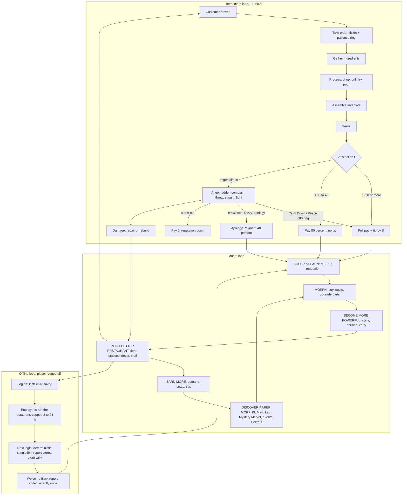

### 4.2 Short Session (5–15 min)

**Purpose.** A phone-length session must deliver the whole fantasy in miniature: a payout, several personalities,
one memorable chaotic event, a purchase, a repair, and visible mutation progress (brief 2.2, Law L8).

**Rules.**
1. If an offline report is pending, the session opens with it (R-OFF-2).
2. At TIER_01–03, at least one chaotic event (anger ≥ 3 with a chain reaction, or a station fire) is expected per
   10 minutes of active play (brawl cadence §3.2.3) [TUNABLE].
3. At least one purchase costing ≤ 15 minutes of the tier's net income is always available and badged
   "Affordable now" in the Restaurant Hub (§24) [TUNABLE].
4. Post-brawl repairs take ≤ 60 s of player time at the current tier with the starter REPAIR stat [TUNABLE] (§15).
5. A **Next Morph** goal is always visible: a HUD chip showing the funding percentage (MB, and MS/RT where needed)
   toward a pinned part. If nothing is pinned, it auto-suggests the cheapest unowned Uncommon that carries a tag
   matching the player's most-used loadout (pin action in §13, chip in §24) [TUNABLE].
6. The session-end summary (shown when the player opens the menu to leave, or on the next login) lists every bar
   that moved.

#### 4.2.1 Beat sheet: a 12-minute session on Day 2 at TIER_02

**Starting state** *(example)*: Level 6 (1,560 XP; L7 at 1,941), Tiny Mutation Diner (6 seats, 5 menu slots),
3.0 ★, Atmosphere 30, staff Ollie (`EMP_001`, `ROLE_CHEF`) plus one Common Prep Cook (`ROLE_PREP`), Octopus Arm
(`MUT_145`) equipped from the tutorial, balance 210 MB, 18 MS. The player was away 9 h.

| Clock | Beat | What happens (systems) | Δ MB | Δ XP | Balance |
|---|---|---|---|---|---|
| 00:00 | **Welcome Back** | "WELCOME BACK, YOU WEIRDO!" Ran 2 h 00 min (capped; no Manager). 97 customers · revenue 941 · tips 43 · ingredients −388 · wages −54 · incident "Ollie pickled 4 lemonades" −12 → **net 530 MB**, +1 MS discovery (§17 computes; these figures are an example) | +530 | 0 | 740 |
| 00:20 | Login streak | Day-2 reward: 1 Morph Capsule, odds displayed (canon C4.7) → Bear Ears (`MUT_086`, Common, new part) | 0 | 0 | 740 |
| 00:40 | Dailies | Three daily quests appear (§20): "Serve 12 customers", "Calm Down! 2 customers", "Repair 3 objects" | — | — | 740 |
| 01:00–04:00 | Rush 1 | 5 customers, e.g. Grandma Golem (`PER_013`), Impatient Goblin (`PER_005`), Picky Platypus (`PER_014`) who wants "exactly seventeen pickles" (§6.18). Octopus Arm carries 2 plates per trip | +68 | +85 | 808 |
| 04:00–05:00 | **CHAOS** | A satisfied Chaos Gremlin (`PER_007`) flicks a fry at a Bodybuilder Pigeon (`PER_010`): +25 anger × sensitivity, roll succeeds, level 3. The Pigeon hurls his plate; the player Dodge Rolls (`ABL_004`); the plate smashes a chair (Cracked) and splats a Health Nut Hamster (`PER_021`, now Annoyed). The Pigeon's next roll succeeds and he charges: Block (`ABL_003`) → Octo-Flurry (`ABL_012`) → Swipe Combo (`ABL_001`) → Dizzy → Apology Payment 40 % of 10 MB. Calm Down! (`ABL_006`) on the Hamster (daily 1/2) | +4 | +25 | 812 |
| 05:00–05:40 | Repair | Chair Cracked → Pristine, table Scuffed → Pristine (`ANM_060` Hammer repair); cost by §15 *(example 18 MB)*; daily "Repair 3" at 2/3 | −18 | +15 | 794 |
| 05:40–08:30 | Rush 2 | 5 customers; a Complaining Impatient Goblin is calmed (daily "Calm Down! 2" complete) | +72 | +85 | 866 |
| 08:30 | Quest payout | Daily reward: ≈ 60 MB, 0.25 × XPRate(6) ≈ 280 XP (canon C5.1 guidance), 5 MS → **Level 7** toast; stat allocation deferred (canon E14) | +60 | +280 | 926 |
| 09:00 | **Upgrade** | Grill Lv2 "Tuned": process time × 0.90 (canon C4.9: × 1.5 station base price; needs TIER_02) *(example 300 MB)* | −300 | 0 | 626 |
| 10:00 | **Mutation progress** | Equip the new Bear Ears in the Morph menu (instant, out of combat; canon E4). The Next Morph chip shows Kangaroo Leg (`MUT_184`, Uncommon, *example 1,200 MB*) at 52 % funded | 0 | 0 | 626 |
| 10:30–12:00 | Rush 3 | 3 customers; the daily "Repair 3" completes later in the day | +40 | +50 | 666 |
| 12:00 | Session summary | "+226 MB earned · +530 offline · Level 7 · Grill Tuned · 1 new part · 1 brawl won" | | | |

**Consistency check against canon C4.4.** Active net = 68 + 4 − 18 + 72 + 60 + 40 = **226 MB** in 0.2 h, against
the canon 1,080 MB/h × 0.2 h = 216 MB (+4.6 %, within the ±15 % tolerance of Pillar 7). XP is above the hourly
reference because a daily quest landed in this session (dailies are lumpy by design). **TIER_01 variant:** the
same structure yields ≈ 126 MB per 12 minutes (630 MB/h). The "upgrade" beat becomes a decor item or a Common part
(150–400 MB, canon C4.5) on every second session.

### 4.3 Medium Session (15–45 min)

**Purpose.** Medium sessions add the city: shopping, learning, hiring, questing, events and friends. The restaurant
keeps running behind the player (brief 2.3).

#### 4.3.1 Activity menu

Rewards are expressed relative to the player's tier income and XP rate, so the menu stays balanced at every tier.

| Activity | Where | Unlock | Time | Typical reward | Pillar |
|---|---|---|---|---|---|
| Run a shift | own restaurant (`BLD_17`) | start | 10–20 min | tier net/h × time (TIER_03 ≈ 29 MB/min) + XP | Cook · Serve · Earn |
| Collect and manage staff | Employee panel (P / radial) | `QST_TUT_012` | 2–4 min | offline report; +5–15 % efficiency from better assignments and morale (§16) | Earn · Build |
| Job Board quests | Job Board `BLD_10`, `DST_01` | start | 1 min to pick, 5–15 to finish | daily ≈ 0.25 × XPRate(L) XP each, plus MB/MS (§20) | all |
| Learn a recipe | Cooking Academy `BLD_06`, `DST_03` | tutorial step 10 | 2 min | new menu option; costs 5 × price (canon C10) | Cook |
| Buy mutations | Mutation Mart `BLD_01`, `DST_02` | start | 3–5 min | Common 150–400 · Uncommon 800–2,000 · Rare 4,000–10,000 MB + 20 MS (canon C4.5) | Morph |
| Restyle | Body Mods `BLD_02`, `DST_02` | start | 2–5 min | earnable palettes, morph name (§13) | Morph · Social |
| Equipment and crates | Restaurant Supplies `BLD_03`, `DST_01` | start | 2–4 min | stations per the canon C7.1 schedule, upgrades, special crates | Build · Cook |
| Weird produce | Weird Produce Stand `BLD_20`, `DST_02` | start | 2 min | special ingredients for stocked recipes (canon C9) | Cook |
| Hire staff | Recruitment Office `BLD_04`, `DST_03` | tutorial step 10 | 3–5 min | Common hire 200–600 MB (canon C4.8) | Earn · Build |
| Visit or co-op a friend | a friend's restaurant on Restaurant Row | start | 10–20 min | guest rewards (§21); damage covered by Co-op Insurance (canon E12) | Social |
| Monster Mall | `BLD_12`, `DST_05` | L6 | 3–5 min | decorations, cosmetics | Build |
| Deliveries | Delivery Depot `BLD_15`, `DST_04` | L8 | 5–10 min | MB comparable to a shift (§18 tunes) | Earn · Explore |
| Repair Workshop | `BLD_07`, `DST_04` | L8 | 3 min | repair skills, quests (§20) | Build |
| Critic challenges | Food Critic Headquarters `BLD_14`, `DST_07` | L10 | 8–12 min | reputation, MS, RT (§20) | Serve |
| Show off | Showcase Stage `BLD_22`, `DST_07` | L10 | 2–5 min | emotes, social status | Social |
| Training | Training Gym `BLD_05`, `DST_10` | L12 | 5 min | combat practice, combat challenges | Survive |
| Arena (opt-in PvP) | Morph Arena `BLD_08`, `DST_10` | L12 | 5–10 min | MS, RT, seasons (§21) | Survive |
| Lab work | Mutation Laboratory `BLD_11`, `DST_06` | L15 | 3–5 min | fusion, upgrades (canon C4.6) | Morph |
| Collection | Morph Museum `BLD_16`, `DST_06` | L15 | 3 min | collection achievements (§36.16) | Morph · Explore |
| Rare shopping | Mystery Market `BLD_13`, `DST_09` | L20 | 3–5 min | weekly Epic/Legendary rotation (canon C4.5) | Morph |
| City event | anywhere (toast + map ping) | per event | 5–15 min | event rewards (§36.11) | Explore |
| Secret hunting | all districts | varies | open-ended | Secret parts (canon C13.8) | Explore · Morph |

#### 4.3.2 The city-trip loop

**Loop rules (requirements on §15, §16 and §18).**
1. **The restaurant keeps trading while the owner is in the city** only if at least one `ROLE_CHEF` is assigned
   (online employee AI, §16). Otherwise the sign flips to "Back in 5 Minutes!": no new customers are seated, and
   anyone already seated is served by staff or leaves paying 0 *without* reputation loss (mirrors canon E1).
2. **Returning is free:** the Return Door has a 10 s cooldown, and Metro stations are free once discovered (canon
   C16.1). Target: any unlocked building is reachable from Restaurant Row in ≤ 90 s with Metro plus a walk [TUNABLE].
3. **Events pull outward:** a starting event shows a toast and a map ping. Participating for 10 minutes should be
   worth ≥ 10 minutes of the tier's net income [TUNABLE] (§18).
4. **Hostile events at home** (an angry customer reaches level ≥ 4 while the owner is away) raise a "Trouble at the
   diner!" toast with a one-tap Return Door. Security Guards (§16) handle it if the player stays out.

**Worked example: a 35-minute session on Day 4 at TIER_03 (Level 12)** *(example values)*

| Clock | Location | Action | Result |
|---|---|---|---|
| 00:00 | restaurant | Welcome Back: 4 h (Basic Manager) | +2,420 MB offline |
| 00:02–10:00 | restaurant | Shift 1 with table service and waiters | +290 MB, 1 brawl, 2 modifications |
| 10:00 | Job Board (`DST_01`, 20 s walk) | Accept a daily and the current story quest | objectives pinned |
| 11:00 | Metro → Mutation Market (`DST_02`) | Mutation Mart: buy Bee Body (`MUT_126`, Uncommon, chef/speed) for the Chef loadout | −1,100 MB |
| 15:00 | Walk → Downtown (`DST_03`) | Cooking Academy: learn Club Sandwich Stack (`RCP_SAN_004`, L10; price ≈ 17 MB, so 5 × 17 = 85 MB) | −85 MB, new recipe |
| 18:00 | Recruitment Office | Hire a Common waiter (table service, canon C15 `Cap_service`) | −400 MB |
| 21:00 | Downtown | **Downtown Dance-Off** (`EVT_027`) starts nearby; toast + ping | event rewards (§36.11) |
| 27:00 | Return Door | Back home: put the Club Sandwich on the menu (6 slots), assign the waiter, equip the Bee Body | — |
| 28:00–35:00 | restaurant | Shift 2 with the faster Chef loadout | +200 MB |
| 35:00 | summary | +490 MB active + event · −1,585 MB spent · +2,420 offline · 1 part, 1 recipe, 1 hire | |

### 4.4 Long-Term Progression

**Purpose.** This defines what a player should have, know and face at five horizons, so that every system's
pacing can be tested against one shared plan (brief 2.4). Levels follow canon C5.1. Tier *affordability* follows
canon C4.4, but tiers are gated by level, so tiers land at the C5.1 hours (TIER_04 at ≈ 8.5 h, TIER_06 at ≈ 26.6 h,
TIER_09 at ≈ 89.3 h). Surplus MB flows into mutations (Law L1).

**Reference persona (the "engaged median" player) [TUNABLE].** Day 1: 2.5 active hours. Days 2–7: about
55 min/day (8 h cumulative). Days 8–30: about 57 min/day (30 h). Days 31–90: about 1 h/day (90 h). About 1.5 offline
reports collected per day. A casual player (≈ half the hours) hits each row at roughly double the calendar time.

#### 4.4.1 Summary table

| Metric | First Hour | First Day | First Week | First Month | First Three Months |
|---|---|---|---|---|---|
| Cumulative active hours | 1 | 2.5 | 8 | 30 | 90 |
| Player level (canon C5.1) | 4 → 5 at ≈ 60 min (tutorial XP front-loaded) | 8 | 17 | 37 | 68 |
| Restaurant tier | TIER_01; TIER_02 at ≈ 70 min for a saver | TIER_02 (TIER_03 at L10 ≈ 3.3 h) | TIER_03 (TIER_04 at L18 ≈ 8.5 h) | TIER_06 (since ≈ 26.6 h) | TIER_09 (since ≈ 89 h) |
| Cumulative active MB earned (canon C4.4 model) | ≈ 1,100 (incl. 600 tutorial) | ≈ 2,640 | ≈ 11,600 | ≈ 126,000 | ≈ 1,524,000 |
| Cumulative tier spend (canon C6) | 0 | 1,000 | 3,000 | 63,000 | 913,000 |
| Cumulative offline MB, canon-default model (§4.5.4) | 0 | ≈ 600 (first report the next morning) | ≈ 18,000 | ≈ 508,000 | ≈ 8,750,000 |
| Recipes *available* (unlock ≤ level, canon C10) | 19 | 37 | 65 | 113 (ALN after ch. 5) | 145 |
| Recipes *known* (estimate) | 5–6 | 10–12 | 25–30 | 70–80 | 110–125 |
| Menu slots (canon C6) | 4 | 5 | 6 (8 at TIER_04) | 12 | 20 |
| Appliances owned (slot-limited) | 4 starter + STOVE (L2) | 6–8 | 10 | 14–16 incl. Anti-Gravity Wok (L30) | 20–22 incl. Mutagen Infuser (L40) |
| Mutation parts owned, unique (C / U / R / E / L / M / S) | 5 / 1–2 / 0–1 / 0 / 0 / 0 / 0 (≈ 7) | 8 / 2 / 0–1 / 0 / 0 / 0 / 0 (≈ 11) | 16 / 7 / 2 / 0 / 0 / 0 / 0 (≈ 25) | 28 / 20 / 9 / 2 / 0 / 0 / 0 (≈ 59) | 40 / 34 / 22 / 8 / 2 / 0 / 0–1 (≈ 107) |
| Employees (cap) | 1 (2) | 2 (3) | 4–5 (4 → 6) | 8–9 (10) | 14–15 (16) |
| Best manager → offline cap (canon C14.3) | none → 2 h | none → 2 h | Basic → 4 h | Rare → 8 h (+2 h with an Assistant) | Epic + Assistant → 14 h |
| Districts unlocked (canon C16.1) | 4 (`DST_01`–`DST_03`, `DST_08` at L4) | 6 (+`DST_05` L6, `DST_04` L8) | 9 (+`DST_07` L10, `DST_10` L12, `DST_06` L15) | 10 (+`DST_09` L20) | 10 |
| Story chapter (canon C17.3: one per tier) | 1 | 2 | 3 | 6 | 9 |
| Customer difficulty (targets for §8–§10) | scripted first tantrum, then a gentle pool; 1–2 items; ≤ 10 % of orders modified; brawl every 10–12 min | counter service; ~15 % modified; first `INSTIGATOR` and `TRICKSTER` styles | table service from TIER_03; ~25 % modified; parties (`PER_016`); critic visits (`PER_004`) | 2–3 item orders common; ~35 % modified; level 6 chaos possible; Undercover Inspector (`PER_025`) | Legendary dish orders; ~45 % modified; brawl every 5–7 min; long chains |

Parts counts stay within canon totals (63 C, 84 U, 75 R, 36 E, 10 L, 5 M, 7 S). The three-month column assumes
≈ 2 Legendary parts via the weekly Mystery Market or events, with Research Tokens (active-only) as the real gate.

#### 4.4.2 Milestone moments per horizon

| Horizon | "Firsts" the player should experience (design targets) |
|---|---|
| First hour | Tutorial (§32): first order, first tantrum, first repair, first mutation, first hire. First free shift. First Common part (capsule or purchase). L4 opens Residential (`DST_08`, Morph Park `BLD_19`). Saving 1,000 MB for Tiny Mutation Diner |
| First day | First Welcome Back report. Second employee. Monster Mall at L6. Industrial District at L8 (Delivery Depot, Repair Workshop). Story chapter 2. First Grill Lv2 |
| First week | Table service at TIER_03. Entertainment District (L10) and Arena District (L12). Research District at L15 (Lab, Museum). First Rare part (equip level 12). First Manager (4 h). City Hall permit for TIER_04 at L18 |
| First month | Alien Cuisine (chapter 5, Zorp). Sewers and Mystery Market (L20). Anti-Gravity Wok (L30). TIER_06 at L35. First Epic (equip level 25) and first Lv4+ Epic upgrade costing RT. Rare Manager (8 h) |
| First three months | TIER_07–TIER_09. Mutagen Infuser and Mutation Cuisine (L40+). First Legendary (equip level 40). First Legendary Recipe quest (`RCP_LEG_001` at L65). Epic Manager + Assistant (14 h). First Secret part |

### 4.5 Offline Progression (the player's perspective)

**Purpose.** Offline play is a full system, not a bonus (brief 2.5). It gives a reason to return every day, turns
management decisions into visible results, shows off staff personalities through incidents, and lets players with
short play windows keep progressing. Formulas, incidents, the report screen and validation are specified in §17
(canon C15). This subsection defines how offline play *feels* and how it fits the other loops.

#### 4.5.1 The daily rhythm

| Moment | Player does | System does | Feeling |
|---|---|---|---|
| Morning check-in (2–5 min) | Opens the game; Welcome Back; Collect; spends on a part or upgrade; re-assigns tired staff | Simulates the capped interval once, stores the report atomically, claims idempotently (canon C15, E11) | "My restaurant made money while I slept!" |
| Midday / after school (5–15 min) | Short session (§4.2); quick collect if a report is pending | Same; each absence is capped separately | "Quick rush, quick upgrade." |
| Evening (15–45 min) | Medium session (§4.3); before leaving, the **Closing Checklist** in the Restaurant Hub: ≥ 1 chef assigned ✓, offline cap shown ✓, special stock for N hours ✓, repairs done ✓, staff energy ✓ | Saves; `lastSimAt` = save time (canon E1) | "Set up the night shift." |
| Overnight | — | Nothing runs on a server; the next login simulates up to the manager cap | Anticipation |

#### 4.5.2 Caps and what they mean to the player

| Best assigned Manager | Cap (canon C14.3) | Typically reached at | Player message |
|---|---|---|---|
| none | 2 h | TIER_01–02 | "Ollie works for 2 h without a boss. Hire a Manager to keep the shift going longer." |
| Common / Uncommon ("Basic") | 4 h | TIER_03–04 | "Your Manager keeps things running for 4 h." |
| Rare ("Experienced") | 8 h | TIER_05–06 | "A full school day or a full night." |
| Epic ("Elite") | 12 h | TIER_07–09 | — |
| Legendary | 24 h | TIER_09–10 | "Your restaurant never sleeps." |
| + Assistant Manager | +2 h (max 24 h) | TIER_05+ | — |

#### 4.5.3 How much offline is worth (canon C15 target: 35–50 % of active net/h for a well-staffed restaurant)

| # | Tier | Active net MB/h (canon C4.4) | Offline net MB/h (35–50 %) | Typical cap | One capped report |
|---|---|---|---|---|---|
| 1 | TIER_01 | 630 | 220–315 (Ollie alone ≈ 158, §32) | 2 h | 440–630 (≈ 316 with Ollie alone) |
| 2 | TIER_02 | 1,080 | 378–540 | 2 h | 756–1,080 |
| 3 | TIER_03 | 1,730 | 606–865 | 4 h | 2,424–3,460 |
| 4 | TIER_04 | 3,100 | 1,085–1,550 | 4 h | 4,340–6,200 |
| 5 | TIER_05 | 5,400 | 1,890–2,700 | 10 h | 18,900–27,000 |
| 6 | TIER_06 | 9,600 | 3,360–4,800 | 10 h | 33,600–48,000 |
| 7 | TIER_07 | 17,400 | 6,090–8,700 | 14 h | 85,260–121,800 |
| 8 | TIER_08 | 32,800 | 11,480–16,400 | 14 h | 160,720–229,600 |
| 9 | TIER_09 | 63,700 | 22,295–31,850 | 24 h | 535,080–764,400 |
| 10 | TIER_10 | 120,500 | 42,175–60,250 | 24 h | 1,012,200–1,446,000 |

#### 4.5.4 How offline complements active play (and the guardrail)

**Complement rules (binding; Law L5).**
1. Offline produces **MB, MS discoveries, rare ingredient crates and ≤ 1 Morph Capsule per real day**, never XP,
   Research Tokens, recipes, story progress or levels (canon C4.1, C15).
2. Per hour, offline is never better than 60 % of active play at the same tier (canon C15).
3. **Offline cannot outrun the level gate.** Tiers need a level (canon C6), and levels need active XP. Offline MB
   therefore funds mutations, staff and decor, which is exactly the Morph-centered economy of Law L1.
4. Offline needs ≥ 1 `ROLE_CHEF`. With none, the report shows 0 customers and a hint (canon C15).
5. Incidents leave hooks for active play: damaged objects (if there is no Repair Technician), sold-out special
   stock, tired staff, upgrade suggestions (R-OFF-3).
6. **Optional re-engagement ping:** with the player's opt-in, Roblox Experience Notifications (sent through Open
   Cloud) may say "Your staff finished their shift". At most 1 per day, sent only once the cap has actually
   been reached, and never containing amounts [TUNABLE] (§31, §29 policy).

**Forecast under canon defaults, and the guardrail.** Running the reference persona (§4.4) through canon C14.3
caps and the C15 35–50 % rate gives an offline share of MB income of ≈ **19 % on Day 1, ≈ 61 % at D7, ≈ 80 % at D30
and ≈ 85 % at D90**. That is expected for a player who plays about 1 h/day but owns 8–14 h of caps. Rule 3 keeps it
from breaking tier pacing. However, it can over-accelerate mutation collection, and the §1.7 guardrail (D7 ≤ 60 %,
D30 ≤ 70 %) would be breached. **Tuning order:** (1) OFFLINE_DEMAND_FACTOR 0.6 → ≈ 0.35 (halving offline throughput
moves the forecast to ≈ 44 % at D7 and ≈ 67 % at D30); (2) then cap semantics (§17); (3) only then manager caps. §17
and §22 own the final calibration during beta. This forecast is the acceptance fixture for AC-04-08.

### 4.6 Loop Interconnection and Economy Flow

| Loop | MB / MS / RT **sources** | Main **sinks** | Feeds the next loop by… |
|---|---|---|---|
| Immediate | payments, tips, Jackpot Tips, Apology Payments | ingredient costs netted at serve, trash waste, repairs | MB + XP + reputation per ticket |
| Short session | rush income, dailies (≈ 15 % of income, canon C4.4), capsules | station upgrades, decor, Common parts, repairs, wages | a purchase every session; mutation goal progress |
| Medium session | quests, deliveries, events, arena (MS/RT), critic challenges | Mart/Lab purchases, recipe learning (5 × price), hiring, taxi | new verbs, staff, parts that raise immediate-loop yield |
| Long-term | story quests (RT), milestones, achievements, Legendary dish orders | tiers (≈ 50 %), Rare+ parts, Epic+ upgrades (RT), fusion | seats, demand and menu that reshape the immediate loop |
| Offline | offline net, MS discoveries, crates, ≤ 1 capsule/day | wages, ingredients, auto-repairs (inside the sim) | MB for morphs at the start of the next session |

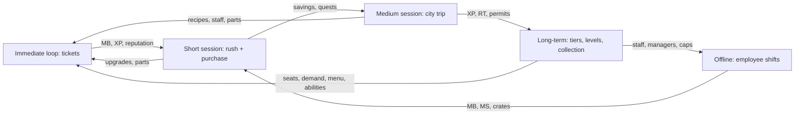

**Loop health signals (watched in §31).**

| Signal | Healthy | Too low means… / lever | Too high means… / lever |
|---|---|---|---|
| Median ticket time ÷ patience | 0.35–0.55 | orders trivial; add modifications (§6.18) | frustration; widen windows, raise patience mult (§9) |
| Brawls per 10 active min (T1–3) | 0.8–1.25 | chaos missing; raise escalation probability (§10) | annoyance; raise CHARM effect, add Calm sources |
| Purchases per session | ≥ 1 | wallet hoarding; surface "Affordable now" | prices too low; inflation check (§22) |
| MB share spent on mutations (D30) | ≥ 40 % | L1 failing; adjust Mart rotations, Next Morph chip | — |
| Offline share of MB (D7 / D30) | ≤ 60 % / ≤ 70 % | — | lower OFFLINE_DEMAND_FACTOR (§4.5.4) |
| Time to next tier ÷ canon interval | 0.8–1.25 | progression too fast; check offline share | grind; check tier costs and active income |

### 4.7 Dependencies, Roblox Implementation and Edge Cases

**Dependencies.** §5 (station timings), §6 / §6.18 (prices, modifications), §8–§10 (spawning, satisfaction, anger),
§11 (combat), §12–§13 (parts, loadouts, Next Morph pin), §14 (XP per action), §15 (repairs, decor, tiers), §16–§17
(staff, offline), §18 (travel, events), §20 (dailies), §22 (rounding, sinks), §24 (HUD, Hub, summaries), §31
(telemetry).

**Roblox implementation (loop orchestration).**
- Each immediate-loop step is owned by exactly one service (step table, §4.1.1). Steps talk through server-side
  signals (`OrderService.TicketOpened`, `CookingService.DishCompleted`, `OrderService.DishServed`,
  `CustomerAIService.SatisfactionResolved`); event names are finalized in §27. The client never reports a grade, a
  wait time or an amount.
- **Ticket idempotency:** the ticket ID is the idempotency key for `EconomyService:Transact` (pay, tip, apology),
  so a re-sent serve can never pay twice (§27 P3).
- **Session summary:** `ProgressionService` accumulates per-session deltas (MB, XP, parts, tiers, repairs) in memory
  and persists only totals. The summary is shown by `UIController` and logged once via
  `AnalyticsService:LogCustomEvent` (event schema in §31).
- **Next Morph chip:** derived client-side from the replicated wallet and the pinned part's price row. The pin is
  stored in the profile (one ID).
- **City-trip trading state:** `RestaurantService` exposes `OpenState ∈ {Open, OwnerAway_Staffed, BackIn5, Closing}`.
  `OwnerAway_Staffed` keeps CustomerAIService spawning while ≥ 1 chef is assigned; `BackIn5` stops spawns.

**Edge cases (loop level).**

| Situation | Behavior |
|---|---|
| Owner disconnects mid-ticket | Canon E1: Closing; staff finish tickets or customers leave paying 0 with no reputation loss |
| Customer turns hostile while a menu is open | Canon E2: menu auto-closes, 1.5 s invulnerability |
| Every menu item sold out | Canon E9: `RCP_BRG_001` auto-added as a fallback |
| Owner walks into the city with no chef assigned | "Back in 5 Minutes!": no new spawns; seated customers leave paying 0 with no reputation loss; a toast reminds the player to assign a chef |
| Level-up mid-rush | Canon E14: toast only; allocation deferred |
| Co-op guest serves the owner's ticket | Allowed (canon E7); pay goes to the owner, the guest receives guest rewards (§21) |
| Two players serve the same ticket simultaneously | First server-validated hand-off wins; the second dish stays in hand ("Already served!") |
| Offline report pending when the player immediately joins a friend's server | The report travels with the profile; it is shown on arrival in the new server and claimed once (canon E11) |
| Player AFK in an open restaurant | After 5 min of no input, the restaurant switches to `BackIn5` unless a chef is assigned; Roblox's idle kick is unchanged [TUNABLE] |

### 4.8 Acceptance Criteria

- **AC-04-01:** Every step of the §4.1.1 table is server-validated by the listed service. A modified client that sends a forged serve, grade or amount gets no MB, XP or reputation (§29 test).
- **AC-04-02:** For the §4.1.3 fixture (prices 10 / 6 MB, patience 105 s, patty GOOD, served at 58 s, K 90, M 42, multipliers 1.0), the server computes S = 87.4 ± 0.1, Pay = 16 MB, Tip = 2 MB, net 13 MB (with the §6 ingredient costs 3 + 2), and Stars +0.0374 ± 0.0001.
- **AC-04-03:** For the §4.1.4 fixture (A 0.5, BURNED, served at 96 s, M 42), S = 48.5 ± 0.1 and Pay = 13 MB with no tip.
- **AC-04-04:** A single-item TIER_01 ticket can be completed by a first-time tester in ≤ 45 s on phone, PC and controller (median of 10 testers per device) [TUNABLE].
- **AC-04-05:** In a scripted 12-minute TIER_02 bot session using the §4.2.1 starting state, active net income is 216 MB ± 15 %, and the session log contains ≥ 1 purchase, ≥ 1 repair, ≥ 1 anger ≥ 3 event and a mutation-goal delta.
- **AC-04-06:** The `core-gameplay-loop` diagram renders in the build, contains the nodes Cook/Earn, Morph, Become More Powerful, Run a Better Restaurant, Earn More, Discover Rarer Morphs and the offline branch.
- **AC-04-07:** With the reference persona replayed through the §22 economy simulator, level and tier land within ±10 % of the §4.4.1 hours (TIER_02 ≈ 1.2 h, TIER_04 ≈ 8.5 h, TIER_06 ≈ 26.6 h, TIER_09 ≈ 89.3 h).
- **AC-04-08:** The offline-share forecast (§4.5.4) is reproduced by the §17 simulator for the reference persona. After calibration, the beta telemetry median meets D7 ≤ 60 % and D30 ≤ 70 %, or a §38 decision documents the exception.
- **AC-04-09:** When the owner leaves the restaurant with ≥ 1 chef assigned, customers keep spawning (`OwnerAway_Staffed`). With 0 chefs, no new customer spawns within 1 s of the owner crossing the door, and no reputation is lost.
- **AC-04-10:** Every session of ≥ 5 minutes in the 100-session beta sample ends with ≥ 1 progress delta recorded in the session summary (Law L8).


## 5. Cooking Mechanics

> This section is the rulebook for everything that happens between "order taken" and
> "customer evaluates the plate": the interaction model, all 24 kitchen stations (canon §C7), every
> preparation verb (canon §C8), quality scoring, tickets and the server-side **Dish** object, kitchen
> hazards, co-op rules and the `CookingService` implementation. Order modifications live in §6.18, recipe
> rows in §6, ingredient rows in §7, satisfaction/anger in §10, abilities in §36.6, status effects in §36.7.
> All balancing values are **[TUNABLE]** unless they restate a canon constant.

**System template map** (canon §C0.2) — where each required block lives for the Cooking system as a whole:

| Template block | Location in §5 |
|---|---|
| Purpose | this intro + §5.1 |
| Rules & Mechanics | §5.2 (interaction), §5.3 (stations), §5.4 (verbs), §5.7 (hazards), §5.8 (co-op) |
| Variables | §5.3.1 (station constants), §5.4.2 (heat model), §5.5 (quality), each station block |
| UI | §5.2.6, §5.4 (per-verb meters), §5.6 (ticket rail & order queue) |
| Progression | §5.3.1 (unlocks & Lv1–Lv5 upgrades), §5.3.3 (Lv5 gimmicks), mutation Kitchen Affinity |
| Player Interactions | §5.2, §5.8 |
| Dependencies | table below |
| Roblox Implementation | §5.10 (+ "Roblox" row of each station) |
| Edge Cases | §5.11 |
| Acceptance Criteria | §5.12 (`AC-05-01` … `AC-05-26`) |

**Dependencies**

| System | Section | Cooking consumes | Cooking provides |
|---|---|---|---|
| Recipes / ingredients | §6, §7 | component lists, canonical stack order, per-component `T_ready`, bake dial, mix sequence, tags | the station/verb vocabulary recipes must use |
| Order modifications | §6.18 | mod predicates | Dish fields and mod-support actions (§5.4.12) |
| Customers / satisfaction | §8, §10 | order items, patience | per-item `Q`, `C`, `A` at serve time (§5.5) |
| Combat | §11, §36.6, §36.7 | `ABL_` effects, `STS_` effects, KO events | hazards that combat can cause or clear (§5.7) |
| Mutations | §12, §36.3 | equipped parts, tags, families | Kitchen Affinity hooks (§5.3.1) |
| Progression | §14 | `COOK_SPD`, `COOK_QLT`, Chef Tree modifiers | contribution records for cooking XP |
| Restaurant | §15, §36.12, §36.13 | station placement, durability, prices | station operating rules, upgrade effects |
| Employees | §16, §17 | employee actors at stations | the same station API (employees call it server-side) |
| Architecture / security | §27, §29 | remote conventions, rate-limit framework | `CookingService` contract (§5.10) |

---

### 5.1 Design Analysis — Why Kitchen Chaos Is Fun

We studied the *mechanics* (never the assets, names, levels or art) of the genre's reference games.

| Reference | Mechanic that creates the fun | What we keep | What we change for Mystery Morph Restaurant |
|---|---|---|---|
| Overcooked | Two verbs (grab / use) applied to many spatially separated stations: difficulty comes from **routing and timing**, not controls. Several timers run in parallel, so players juggle. Failure is loud and funny (fire) yet recoverable (extinguisher). | Two-button kitchen (**Use**, **Grab**); parallel heat timers; extinguishable fire. | No level timer and no star-score fail screen: the restaurant is persistent, so pressure comes from customer patience (§C11.2) and the tantrum ladder (§C11.5) instead of a countdown. |
| Overcooked 2 | **Throwing** ingredients to teammates or straight onto stations; quick-chat; online co-op. | Throw-to-pass and throw-onto-slot (§5.2.1); call-out pings (§5.8). | Thrown food is a scripted arc (canon §C3); hitting a customer is a real consequence (+25 anger). |
| PlateUp! | The **kitchen layout is the puzzle**; upgrades between shifts change how you play; automation emerges over time. | Station placement matters (distance = seconds); upgrades change the feel of each station (Lv5 gimmicks automate one chore each). | Persistence instead of runs; automation comes from employees (§16) and Lv5 gimmicks, never removes the player's core verbs. |
| Cooking Simulator | **Depth per station** — temperatures, precise doneness, mastery of one appliance. | Oven dial, fryer oil heat, doneness bands (RARE → SCREAMING → BURNED) that mods can target. | Precision is optional: base orders accept a 2 s PERFECT window plus GOOD/OK grades; only mods ask for exact bands. |
| Roblox restaurant sims & tycoons | Instant onboarding, short sessions, visible purchases, social visits, idle income, cosmetic flex. | First dish in < 60 s (§32), every purchase is visible in the kitchen, friends can drop in and cook. | Our twist is the morph: what you *are* changes how you cook (extra arms, toaster head, frost fingers). |

**Adaptation rules for ages 8–16 and mobile** (each is binding for every station below):

| # | Rule | Concrete requirement |
|---|---|---|
| D1 | **Readable stations** | Every station state is shown by **colour + icon shape + sound + progress ring**, never colour alone (green ✓ ring = PERFECT, amber ◆ = GOOD/OK, red ▲ = BURNED, flame glyph = ON_FIRE). Station silhouettes are unique at 40 studs. |
| D2 | **Two-button kitchen** | Every cooking action in §5.4 is executable with only **Use** and **Grab** (plus movement). Abilities and combat are optional layers. |
| D3 | **Juggling that scales** | TIER_01 menus need ≤ 2 simultaneous timers; by TIER_06 a skilled player runs 4–6; Lv5 gimmicks and employees keep TIER_10 humane. |
| D4 | **Fair time pressure** | Base PERFECT window ≥ 2.0 s, good span ≥ 6 s, ignition 4 s after burn (canon §C8). Nothing ignites without ≥ 3 audio/visual warnings. |
| D5 | **Forgiveness** | Five-Second Rule for dropped food; fire never pushes a station below 26 % durability; wasted food never drops the balance below 0 MB (canon §C9); `ABL_066` rescues an item at GOOD; Auto-Rhythm and Toggle-Hold accessibility options. |
| D6 | **Co-op without griefing** | Per-slot locks (canon E7), players do not collide with each other, guests cannot waste stocked ingredients (§5.8). |
| D7 | **Emergent chaos** | Customers' thrown food lands on counters/stations, spills make people slip, fires spread one station at a time — all bounded by hard caps (§5.7). |
| D8 | **Morphs matter** | Each station lists Kitchen Affinity bonuses; extra arms raise carry capacity; a few parts unlock genuinely new verbs (Toaster Head toasts bread in your head). |
| D9 | **Mobile first** | Touch targets ≥ 48 dp, primary buttons ≥ 88 dp, rhythm inputs judged with latency compensation, no input requires two simultaneous fingers on the right side. |
| D10 | **Funny failure** | BURNED food grows a sad face, SCREAMING food squeaks like a kettle, an over-agitated drink pops its lid with a confetti-foam burst — failure is a joke, never a wall. |

---

### 5.2 Interaction Model

#### 5.2.1 Carrying

- **Capacity** (canon §C3): 1 item. +1 per equipped carry part — `MUT_145` Octopus Arm (per arm), `MUT_217` Monkey Tail,
  `MUT_249` Extra Arm Backpack — and +1 while `ABL_061` Extra Hands is active (stacks with the Extra Arm Backpack
  passive). **Hard max 3.** While `ABL_061` is active the player may also **operate 2 stations**: a hold-type channel
  (blend, mix, pour, wash, swirl, agitate, scrub) started on one station keeps running hands-free while the player works a
  second station, as long as both stay within 7 + 2 studs (max 2 concurrent channels; duration per §36.6).
- **Carry stack.** Carried items form an ordered stack; the **active item** is the one shown in front of the character and is
  the one placed/thrown/served. **Swap** rotates the stack (active → back). The HUD carry widget shows all held items as
  icons, active item enlarged.
- **Item classes:** ingredient (any state), dish (plated food, bowl, cup, cone, box), tray, tool prop (fire extinguisher, mop,
  trash bag, ingredient crate). A **tray** is 1 item that holds up to 3 dishes [TUNABLE]; carrying a tray plays `ANM_007`,
  applies WalkSpeed ×0.9 and enables `ABL_008` Tray Shield. A **crate** or **trash bag** is a bulky prop: while carried it
  occupies *all* carry slots.
- **Hands full rule:** while carrying anything except a frying pan or tray, base melee (`ABL_001`, `ABL_002`) is replaced by
  **Throw** on the same input. Block (`ABL_003`) and Dodge (`ABL_004`) remain available.
- **Drop:** places the active item on the floor at the feet. **Five-Second Rule:** food picked up within 5.0 s is unharmed
  (a "Five-Second Rule!" pop-up plays); after 5.0 s it becomes SPILLED (trash). Dropped **dishes** break: the food is SPILLED
  and the plate leaves a *broken plate* hazard (§5.7) — paper-wrapped dishes at TIER_01–02 do not shatter.
- **Throw:** ingredients only (no dishes, pots, trays or props). Scripted parabolic arc, max range 12 studs, flight 0.6 s,
  computed by the server from the thrower's position and aim (canon §C3: raycast arc, not physics). On landing the
  server resolves, in order: (1) a teammate with a free carry slot within 2.5 studs catches it; (2) a station slot within
  2.0 studs that accepts the item receives it (throw a patty straight onto an empty grill slot); (3) a customer hit
  → item SPILLED and the customer gains +25 anger × sensitivity (canon §C11.5); (4) otherwise it lands on the floor
  (Five-Second Rule applies).
- **Involuntary drops** (KO, knockdown, slip): the server drops the active item only; food dropped involuntarily is never
  charged as waste. Parts tagged `sticky` (e.g. `MUT_170` Sticky Gecko Hands) prevent involuntary drops entirely.

#### 5.2.2 Context interaction — decision: custom "Smart Interact", not ProximityPrompt

| Criterion | `ProximityPrompt` | Custom Smart Interact (chosen) |
|---|---|---|
| Dense kitchens (up to 24 stations, multi-slot) | One prompt per object; several overlap within 7 studs; `Exclusivity` picks by distance only | One target chosen by a facing-aware score (§5.2.4), slot-level precision |
| Same key, different meaning (tap vs hold, chop rhythm, flip, dial) | Single `HoldDuration` per prompt; prompt must be re-created to change behaviour | Per-context verb table; tap/hold/rhythm on the same button |
| Preview of the result | Only `ActionText`/`ObjectText` strings | Rich preview chip: "Place Patty → Grill slot 2", ghost item, mod hints |
| Touch layout | Auto-generated prompt buttons float in world space, collide with the thumb zone | One fixed, large context button in the thumb zone that changes icon/label |
| Controller | Fine, but no slot cycling | Shoulder-free cycle input to step through candidate targets |
| Server validation | Prompt triggers still need our validation | Same validation path for players and employees |

**Decision:** the kitchen uses a client `InteractionController` (part of `UIController`) that scores candidates and sends
verbs to `CookingService`. `ProximityPrompt` remains acceptable for non-kitchen world objects (doors, city NPCs — owned by
§18/§19). Kitchen station models set no ProximityPrompts.

#### 5.2.3 Hold vs tap

| Input class | Used for | Rules |
|---|---|---|
| **Tap** (< 0.25 s) | pick up, place, flip, toss, spin, shake basket, dial step, serve, add one counted unit, garnish, nudge | 0.15 s input buffer: a tap pressed up to 0.15 s before an action becomes legal is executed when it becomes legal. |
| **Rhythm tap** | chop, pump (infuser), polish (dishwash) | Each tap judged against a timing ring (§5.4.1). Taps closer than 0.12 s to the previous one are ignored (anti-macro, accidental double taps). |
| **Hold** (channel) | blend, mix, pour, agitate, swirl, wash, extinguish, mop, unload crate, tie trash bag, Flip Stack (0.6 s), Box It (0.5 s), Fold (0.6 s), Flourish Serve (0.8 s) | Releasing early cancels (or stops a meter, for blend/mix/pour/agitate/swirl). Moving > 2 studs away or being hit cancels. **Toggle-Hold** accessibility option: first tap starts, second tap stops; fixed-length channels auto-complete. |
| **Long-press menu** (≥ 0.3 s on Pantry/Fridge/Freezer, ≥ 0.5 s on Cutting Board) | ingredient radial, cut-mode wheel | Release on a wedge to choose; release in the centre cancels. |

#### 5.2.4 Targeting and priority

Every 0.1 s the client gathers interactable **slots** (not models) whose anchor attachment is within 7 studs of the
HumanoidRootPart (customers: 10 studs) and scores each:

```
Score = 1.0·(1 − d/7) + 1.5·max(0, dot(LookFlat, DirFlat)) + Ctx + Sticky + Hover
  Ctx    = +2.0 if the active held item can be placed/processed here
           +1.5 if the slot holds a finished item and the player has a free hand
           +1.0 if the slot is running a minigame this player owns (e.g. a chop in progress)
           −∞   if the slot is locked by another interactor or the station is Broken/Destroyed/ON_FIRE
                (ON_FIRE stations remain targetable only for "Extinguish")
  Sticky = +0.5 for the current target (hysteresis: prevents flicker between neighbours)
  Hover  = +3.0 if the mouse cursor ray hits this slot (keyboard & mouse only)
```

The best-scoring slot gets a `Highlight` outline plus a floating **preview chip** describing the exact result ("Flip
patty", "Take Fries (PERFECT)"). **Cycle Target** steps to the next-best candidate for 2 s. The client sends the chosen
`stationUid` + `slot`; the server re-validates (§5.10.4) but never re-targets, so what the player saw is what happens or is
rejected with a reason.

#### 5.2.5 Control scheme (all actions, all inputs)

This is the kitchen view of the canonical default control map in §24.3.2 (which is authoritative if they ever differ).
Keyboard bindings avoid Roblox-reserved keys (Esc, Tab player list, `/` chat, `` ` `` console). Shift Lock is disabled in the
restaurant interior (`StarterPlayer.EnableMouseLockOption = false`) so Left Shift can be Dodge.

| Action | Keyboard + mouse | Controller (Xbox / PlayStation glyphs) | Touch |
|---|---|---|---|
| Move | WASD / arrow keys | Left stick | Dynamic thumbstick (left 45 % of screen) |
| Camera | Right-mouse drag; wheel zoom (when not locked on) | Right stick | One-finger drag on empty right area; pinch zoom |
| Jump | Space | A / Cross | Jump button |
| **Use / Interact** (context: chop, flip, toss, dial step, take order, serve, extinguish) | E | X / Square | **Context button** (largest, 96 dp; icon + label change with target) |
| Chop (rhythm) | E taps | X / Square taps | Context button becomes **CHOP** (with ring) |
| **Grab: pick up / place** | F | B / Circle (gameplay); B is *Back/Cancel* when a panel or minigame has focus | **Grab** button (88 dp) |
| Drop on floor | G (tap) | D-pad Down | Long-press the carry widget 0.4 s → Drop |
| Throw (hands full) | Left mouse: hold to show arc, aim with cursor, release | RT / R2: hold to show arc, aim with left stick + facing, release | Attack button becomes **Throw**: hold, drag to aim, release |
| Cancel (leave minigame / close overlay) | X or Backspace | B / Circle (context) | ✕ on the minigame / overlay; or walk out of range |
| Serve | E (Use) on customer or window pickup spot | X / Square | Context button ("Serve") |
| Flourish Serve | Hold E 0.8 s on customer | Hold X 0.8 s | Hold context button 0.8 s |
| Swap held item | R | Y / Triangle (tap) | Tap the carry widget |
| Cycle target | Mouse hover override, or C | D-pad Right | Tap the station directly (world tap selects target if in range) |
| Attack: Swipe Combo `ABL_001` / Wallop `ABL_002` | Left mouse tap / hold 0.6 s (hands empty) | RT / R2 tap / hold | Attack button tap / hold |
| Lock-on (combat target) | Middle mouse button; mouse wheel cycles targets while locked | R3 (press right stick); right stick flick cycles | Tap an enemy |
| Block `ABL_003` | Hold Q | Hold LT / L2 | Hold **SHIELD** button |
| Dodge Roll `ABL_004` | Left Shift (Shift Lock disabled) | RB / R1 | Swipe on SHIELD button, or Dodge button |
| Calm Down! `ABL_006` | V | D-pad Up | Speech-bubble button (above Attack) |
| Ability bar slots 1–4 | 1, 2, 3, 4 | Hold LB / L1 + X / Y / B / A | 4 ability buttons (64 u each) in an arc around Attack |
| Open order queue (overlay) | O, or click the ticket strip | Hold Y / Triangle 0.4 s | Tap the ticket strip |
| Pin ticket (drives ghost previews) | Click ticket / 1–6 while queue open | D-pad Left/Right to move, A to pin | Tap ticket |
| Call-out ping (co-op) | Z (wheel on hold) | D-pad Left (wheel on hold) | Ping button (top of cluster) → 6-wedge wheel |

#### 5.2.6 Touch layout, feedback and accessibility

- **Right-thumb cluster** (bottom-right, safe-area aware via `GuiService:GetGuiInset()`): Context (96 dp) at the thumb's
  rest point; Grab (88 dp) up-left of it; Attack/Throw (88 dp) left; Jump (72 dp) below-right; SHIELD/Dodge (64 dp); ability
  arc (4 × 64 u); Ping (48 dp). No two primary buttons closer than 12 dp.
- **Minigame meters** render as world-space `BillboardGui`s on the station (max 1 active per player) *and* mirrored in a
  screen-space strip above the Context button on touch devices so the thumb never covers the meter.
- **Haptics:** `HapticService` small pulse on PERFECT, double pulse on BURNED warning, long pulse on ON_FIRE (controller
  and supported mobile devices); disabled by the Reduced Effects setting.
- **Accessibility settings** (persisted per player): Auto-Rhythm (canon §C8: every chop/pump/polish tap = yellow 0.8),
  Toggle-Hold, Reduced Effects (no screen shake, fire VFX at 30 % particles, no flashing), Colour-blind palettes (status
  shapes stay identical), a separate **Kitchen Alerts** volume slider (drives the `Alerts` SoundGroup, §26) independent of music and SFX, Large Meter mode (+50 % meter size),
  "Fewer Weird Requests" (§6.18).

---

### 5.3 Station Specifications

#### 5.3.1 Common station contract (applies to all 24 stations)

**Slot state machine.** Every station is a set of *slots*; each slot runs the same server-owned state machine.

| Slot state | Meaning | Exits |
|---|---|---|
| `EMPTY` | nothing in the slot | item placed → `LOADED` (manual stations) or `PROCESSING` (heat stations auto-start) |
| `LOADED` | item waiting for player input (cutting board, blender, mixer, drink, dishwash) | input starts → `PROCESSING`; Grab → `EMPTY` |
| `PROCESSING` | timer/meter running; for heat verbs the item's doneness band is derived from accumulated `cookSec` | heat: band transitions (below); non-heat: meter released/complete → `DONE`, over-processing → failure |
| `DONE` | finished non-heat item, quality locked | Grab → `EMPTY` |
| heat bands `RARE` → `PERFECT` → `GOOD` → `BURNED` | see §5.4.2 | Grab locks the band's grade; `BURNED` + 4 s → `ON_FIRE` (pots/steamer: boil-over) |
| `ON_FIRE` | station fire (§5.7): item RUINED, slot unusable | extinguished → `EMPTY` (charcoal item auto-binned, no waste charge) |
| `PAUSED` | station Broken (durability ≤ 25 %): all timers frozen, inputs rejected | repaired → previous state resumes |
| *lock overlay* | `LockUserId ≠ 0` while one interactor runs an input on this slot (canon E7) | released on completion, cancel, > 9 studs away, 1.5 s without input in a rhythm minigame, KO, disconnect |

Heat stations lock a slot only while someone is actively inputting (placing, flipping, tossing); a passively cooking slot is
unlocked, so any co-op player may flip or remove it (items are restaurant-owned — canon E7).

**Upgrade levels** (canon §C4.9, applied per station):

| Level | Cost | Requires | Heat stations (GRILL, FRYER, OVEN, PIZZA_OVEN, STOVE, SOUP_POT, STEAMER, INFUSER, ANTIGRAV) | Non-heat processing (CUT, BLENDER, MIXER, DRINK, ICECREAM, FREEZER) | Utility (PANTRY, FRIDGE, PREP, ASSEMBLY, PLATING, WINDOW, DISHWASH, TRASH, DELIVERY) |
|---|---|---|---|---|---|
| Lv1 Stock | purchase | — | baseline | baseline | baseline |
| Lv2 Tuned | × 1.5 base | TIER_02 | `T_ready` × 0.90 | process time × 0.90 | channel time × 0.90 |
| Lv3 Pro | × 4 | TIER_04 | × 0.80; `W_perfect` × 1.25 | × 0.80; PERFECT/green zone × 1.25 | × 0.80; timing windows (garnish, polish) × 1.25 |
| Lv4 Mutant | × 10 | TIER_06 | × 0.70; `W_perfect` × 1.25; burn grace +3 s | × 0.70; zone × 1.25; failure chance −50 % (over-process margin +50 %) | × 0.70; × 1.25; failure −50 % (e.g. trash capacity +50 %) |
| Lv5 Ridiculous | × 25 | TIER_08 | × 0.60; `W_perfect` × 1.5; burn grace +3 s retained; **gimmick** | × 0.60; zone × 1.5; −50 % retained; **gimmick** | × 0.60; × 1.5; −50 % retained; **gimmick** |

*Interpretation:* canon's "cumulative, replaces previous" means multipliers replace earlier multipliers while the Lv4
additive bonus (burn grace / failure reduction) is kept at Lv5. Upgrading is refused while any slot of that station is
`PROCESSING` ("Finish cooking first!"); the purchase is queued and applied when the station idles.

**Timing stack** (all stations; heat formulas in §5.4.2):
`ProcessTime = Base × LvTime × 1/(1 + 0.006·COOK_SPD) × KA_time`, floored at **0.25 × Base**;
`Window = BaseWindow × LvWindow × (1 + 0.005·COOK_QLT) × KA_window`, capped at **3 × BaseWindow** (heat `W_perfect` ≤ 6.0 s).
`KA_*` = Kitchen Affinity (below). Chef Tree nodes (§14) and synergies (§12.10) plug into the same multiplier slots; when a
global cap in §12.10 is stricter, the stricter cap wins.

**Kitchen Affinity (KA) — mutation hooks for stations.** Each station lists *affinity tags* (canon §C13.5 vocabulary).
Each equipped part carrying one of those tags grants that station's tag bonus once (max **3 parts** counted per station;
default per part −5 % process time *or* +6 % window, as listed). Family/part specials and utility abilities are listed per
station. KA totals are capped at −30 % time and +30 % window per station. KA never changes the canon grade values.

**Durability** (damage states owned by §15/§36.12): Pristine/Scuffed/Cracked stations work normally; **Broken** → `PAUSED`
(timers frozen, nothing burns); **Destroyed** → every item is ejected (basic food discarded at no charge, special
ingredients returned to stock), slot states reset. Fire damages a burning station 2 % durability/s but **never below 26 %**
(fire alone cannot break a station).

**Common Roblox requirements** (every station; specifics in §5.10): server-owned slot state machine in `CookingService`;
station `Model` tagged `MMR_Station` via `CollectionService`; attributes `StationType`, `StationUid`, `Level`, `Durability`,
`StationState`, and per slot `S<n>_State`, `S<n>_Item`, `S<n>_CookSec`, `S<n>_Rate`, `S<n>_Stamp`, `S<n>_Lock`,
`S<n>_Opt` (dial/mode); one `Attachment` named `Slot<n>` per slot (interaction anchor and VFX origin); clients predict VFX
from the attributes and `workspace:GetServerTimeNow()`; the server re-validates every input with range ≤ 7 + 2 studs.

#### 5.3.2 Station summary

Suggested base prices drive upgrade costs; the Furniture & Equipment Catalog (§36.13) is authoritative if it differs.

| Station ID | Name | Verb(s) | Slots (Lv1) | Available (level / tier) | Base duration (Lv1, before stats) | Main failure | Suggested base price (MB) | Lv5 "Ridiculous" gimmick |
|---|---|---|---|---|---|---|---|---|
| `STN_PANTRY` | Ingredient Storage (Pantry Shelf) | dispense | dispenser | 1 / TIER_01 (starter) | 0.3 s per item | special stock empty (SOLD OUT) | 300 | **Snack Catapult** — lobs ingredients to you from 14 studs |
| `STN_FRIDGE` | Refrigerator | dispense chilled, CHILL | dispenser + 2-slot Chill Shelf | 1 / TIER_01 (starter) | 0.3 s; chill 3 s | none (door left open: cosmetic) | 400 | **Fridge Burp** — burps the next chilled ingredient onto a free prep hold when a ticket arrives |
| `STN_FREEZER` | Freezer | FREEZE, dispense frozen | 2 | 5 / TIER_02 | 5 s small, 8 s bowl/cup, 10 s plated | ICE-BLOCKED (left > 20 s) | 2,000 | **Yeti Sneeze** — snow-sneezes out fires within 12 studs |
| `STN_CUT` | Cutting Board | CHOP (+ cut modes) | 1 | 1 / TIER_01 (starter) | 4 taps, 0.8 s ring | MUSHY (> N + 3 taps) | 150 | **Combo Chop** — all-green chop instantly chops the on-deck item |
| `STN_PREP` | Preparation Counter | hold, combine, hand-MIX, strain | 3 holds | 1 / TIER_01 (starter) | combine 0.5 s; hand-mix 9 s | none (holding) | 200 | **Lazy Susan** — spins holds to you, +2 holds, contents stay hot |
| `STN_GRILL` | Grill | GRILL (+ flip, turn) | 2 | 1 / TIER_01 (starter) | patty `T_ready` 8 s | BURNED → ON_FIRE | 400 | **Ghost Spatula** — auto-flips perfectly while you are away |
| `STN_FRYER` | Fryer | FRY (+ shake, skim) | 1 basket | 1 / TIER_01 (starter) | fries `T_ready` 7 s | oil overheating → ON_FIRE | 450 | **Self-Draining Basket** — jumps out at PERFECT and holds it 10 s |
| `STN_OVEN` | Oven | BAKE (dial LOW/MED/HIGH) | 2 | 3 / TIER_01 | 9–14 s by dish | wrong dial, BURNED → ON_FIRE | 900 | **Two-Faced Oven** — independent dial per slot |
| `STN_PIZZA_OVEN` | Pizza Oven | BAKE pizza (+ spin) | 1 | 3 / TIER_01 | 10 s (large 12 s) | unspun, BURNED → ON_FIRE | 1,200 | **Spin Cycle** — auto-spins and gains a 2nd slot |
| `STN_STOVE` | Stovetop | SAUTE (pan), BOIL small (pot) | 2 burners | 2 / TIER_01 | 5–9 s | missed tosses; pan fire / pot boil-over | 600 | **Pan-Demonium** — 3rd burner; pans smoke but never ignite |
| `STN_SOUP_POT` | Soup Pot | BOIL / SIMMER | 1 pot = 4 servings | 4 / TIER_01 | 16 s per pot | missed stirs, scorched, boil-over | 1,000 | **Bottomless Ladle** — 6 servings, no simmer decay |
| `STN_STEAMER` | Steamer | STEAM | 2 | 7 / TIER_02 | 7–10 s | soggy (BURNED), boil-dry | 2,500 | **Sauna Mode** — 3 s nearby grants `STS_INSPIRED` |
| `STN_BLENDER` | Blender | BLEND (bizarre combos) | 1 jar | 5 / TIER_01 | smooth band 4.25–7.0 s | MUSHY sludge, lid pop SPILLED | 1,300 | **Blendzilla** — 2 jars, bizarre combos can roll "Lucky Swirl" |
| `STN_MIXER` | Mixer | MIX (sequence) | 1 bowl | 5 / TIER_02 | 6 s | wrong sequence, over-mixed | 1,800 | **Professor Whisk** — auto-sorts any insertion order |
| `STN_DRINK` | Drink Dispenser | POUR, ice, AGITATE | 1 nozzle | 1 / TIER_01 (starter) | 3 s fill | overflow / exploded SPILLED | 350 | **Twin Burp Nozzles** — 2nd nozzle, one-tap auto-stop pours |
| `STN_ICECREAM` | Ice Cream Machine | SCOOP / SWIRL | 1 | 4 / TIER_01 | 0.6 s per scoop; 1.2 s per swirl tier | drip SPILLED, MELTY | 1,100 | **Soft-Serve Sniper** — swirl auto-stops at the ticket's height; no melt for 60 s |
| `STN_ASSEMBLY` | Food Assembly Counter | ASSEMBLE (+ count, flip stack, box; PLATE at TIER_01–02) | 2 boards | 1 / TIER_01 (starter) | 0.35 s per component | wrong order (factor 0.85 / 0.7) | 300 | **Bun Backflip** — top bun auto-lands on correct stacks; 3rd board |
| `STN_PLATING` | Plating Station | PLATE, garnish, drizzle, advanced presentation | 2 | 5 / TIER_02 | 0.8 s plate; 0.5 s garnish | no clean plates | 1,500 | **Plate Juggler** — conjures 4 emergency clean plates per minute |
| `STN_WINDOW` | Serving Window | hand-off, ticket rail, heat lamp | 4 pickup spots | 1 / TIER_01 (starter) | instant; lamp +20 s HOT | dish cools, wrong spot | 500 | **Bell of Destiny** — operatic bell summons pickups / rushes waiters |
| `STN_DISHWASH` | Dishwashing Station | WASH (+ polish) | 1 rack = 4 plates | 1 / TIER_01 (starter) | 1.5 s per plate | backlog → "No Clean Plates" | 400 | **Bubble Tsunami** — whole rack in one hold; bubbles clean a spill |
| `STN_TRASH` | Trash Disposal | dispose, tie bag | ∞ (bag 20 items) | 1 / TIER_01 (starter) | 0.3 s; tie 1.2 s | overflow → trash piles | 100 | **Chomper Bin** — 3× capacity and walks itself to the dumpster |
| `STN_DELIVERY` | Ingredient Delivery Station | receive & unload crates, dumpster | 1 dock | 1 / TIER_01 (starter) | unload 1.5 s per crate | dock blocked (queue) | 600 | **Pneumatic Tube** — crates shoot straight into pantry stock |
| `STN_INFUSER` | Mutagen Infuser | INFUSE (pump) | 1 | 40 / TIER_06 | 10 s in-band | over-mutated, goo geyser, green fire | 20,000 | **Mad Science Mode** — self-stabilising gauge, 2 slots |
| `STN_ANTIGRAV` | Anti-Gravity Wok | FLOAT (nudge) | 1 | 30 / TIER_05 | 8 s | drift-out SPILLED, plasma fire | 10,000 | **Orbit Mode** — 3 items orbit, no drift |

#### 5.3.3 Per-station specifications

Durations are Lv1 values before stats/KA; all heat items use `W_perfect` 2.0 s, `T_burn = T_ready + 6 s`, ignition
`T_burn + 4 s` (canon §C8) unless stated. Recipes (§6) cite these defaults and may override `T_ready` by ±50 %.

##### `STN_PANTRY` — Pantry Shelf
| Field | Spec |
|---|---|
| Purpose & interaction | Dispenses unlimited **basic** ingredients (non-chilled tags: bread, grain, noodle, sauce, spice, sweet, nut, caffeine, fizzy, liquid) and **stocked special** ingredients (count shown). Tap Use = *Smart Dispense* (next ingredient the pinned ticket still needs); long-press 0.3 s = radial of up to 8 menu-relevant ingredients (paged). Needs a free carry slot. |
| Duration / in → out | 0.3 s · nothing → RAW ingredient. Special stock was already reserved when the order was placed (§5.6). |
| Upgrades | Lv2–Lv4 dispense time per §5.3.1. **Lv5 Snack Catapult:** hold Use from up to 14 studs with line of sight; the ingredient arcs into your hands (0.6 s flight). |
| Failure | Special stock 0 → wedge greyed "SOLD OUT" (canon E9). Hands full → "Hands full!" toast. |
| VFX & audio | Shelf items wiggle on hover; a cork-like *plonk* on dispense; an empty special shelf plays a sad slide-whistle. |
| Co-op | No slot lock (concurrent dispensing). Guests need the owner's *Chef* permission to take special stock (§5.8). |
| Mutations | KA `grabby`, `tall`: +1 stud reach per part (max +2) here. `MUT_143` Noodle Arm: +1.5 studs reach at every station (counts toward the +2 cap). |
| Roblox | Dispensing creates a server item record only; the held item is rendered client-side from the carrier's `CarryStack` attribute (no server Instance). |

##### `STN_FRIDGE` — Refrigerator
| Field | Spec |
|---|---|
| Purpose & interaction | Dispenses unlimited chilled basics (meat, poultry, seafood, cheese, dairy, egg, veg, fruit) and — until a freezer exists — `frozen`-tag basics from its drawer. **Chill Shelf** (2 slots): place any item or dish to make it COLD. Same tap / long-press dispensing as the Pantry. |
| Duration / in → out | Dispense 0.3 s · chill 3 s → `temp = COLD` (+ `frosty` if the dish holds ≥ 2 `ING_ICE`). |
| Upgrades | **Lv5 Fridge Burp:** when a ticket arrives, the fridge burps that order's first chilled ingredient onto a free `STN_PREP` hold within 10 studs (1 per ticket). |
| Failure | None (a door left open only hums louder). |
| VFX & audio | Cold mist on open; frost sparkle when COLD; contented hum; the Lv5 burp is a polite "urp — pardon me". |
| Co-op | Dispenser concurrent; Chill Shelf slots lock only while placing/taking. |
| Mutations | KA `ice`: chill −15 % per part. `MUT_131` Fridge Body: hold Use 3 s with no target to chill the active held item; your carried items never warm or melt. |
| Roblox | Chill Shelf uses a non-heat slot timer; temperature lives on the Dish (§5.6). |

##### `STN_FREEZER` — Freezer
| Field | Spec |
|---|---|
| Purpose & interaction | **FREEZE** items and dishes; dispenses `frozen`-tag ingredients. Grab places (auto-start) and removes. |
| Duration / in → out | 5 s single ingredient · 8 s bowl/cup · 10 s plated dish → FROZEN (ingredient state) or `temp = FROZEN` (dish). Frozen dishes stay FROZEN 45 s outside, then turn COLD. |
| Upgrades | Lv4 over-freeze margin 30 s. **Lv5 Yeti Sneeze:** if any station within 12 studs is ON_FIRE, the freezer sneezes a snow cloud that extinguishes it (45 s cooldown). |
| Failure | Left > 20 s after FROZEN → **ICE-BLOCKED**: unusable until chipped (2 taps at `STN_CUT` or hold Use 1.5 s here). No quality loss. |
| VFX & audio | Frost climbs the door as progress; ice-crackle ticks; "ding-ding" on frozen; an ice-blocked item is a cartoon cube with the food's face squished against it ("mmf!"). |
| Co-op | 2 independent slots. |
| Mutations | KA `ice`: −10 % time per part (`MUT_125`, `MUT_162`, `MUT_262`…). `MUT_176` Frost Fingers → `ABL_067` Freeze Touch: instantly FREEZEs one item (held or in a slot) at GOOD quality — the FREEZE step is recorded with grade 0.80 (§5.5), the trade-off for skipping the timer. |
| Roblox | Non-heat slot timer; `frozenUntil` stored on the Dish. |

##### `STN_CUT` — Cutting Board
| Field | Spec |
|---|---|
| Purpose & interaction | **CHOP** to CHOPPED (§5.4.1). Place item, rhythm-tap Use. Long-press 0.5 s opens the cut-mode wheel: NORMAL, SQUARE, HEART, SPIRAL, HALVE (assembled sandwiches/pizzas). TINY = NORMAL with N + 2 or N + 3 taps. Mode persists on the board (`S1_Opt`). |
| Duration / in → out | N = 4 taps (recipes may set 3–6), ring period 0.8 s (≈ 3.2 s) · RAW or cooked component → CHOPPED with `shape`; HALVE (2 taps) → `cut = HALVED_DIAGONAL`; chips ICE-BLOCKED items (2 taps). Cooked components keep their doneness grade. |
| Upgrades | Ring period × 0.9 / 0.8 / 0.7 / 0.6; green zone × 1.25 (Lv3–4), × 1.5 (Lv5); Lv4 MUSHY threshold N + 5. **Lv5 Combo Chop:** an on-deck spot; finishing an all-green chop instantly chops the on-deck item at the same score and mode. |
| Failure | > N + 3 taps → MUSHY 0.35 (canon §C8). Non-choppable items are refused. |
| VFX & audio | Knife *thunk* rising in pitch per tap; green "Clean cut!" sparkle; amber wobble; MUSHY splat with a sad trombone. Ring shows ✓ / ◆ / ✕ glyph per tap. |
| Co-op | 1 slot, locked during the chop; anyone may take the result. |
| Mutations | KA `chef`: ring period −5 %/part; `claw`: green +6 %/part. Octopus family pair (any 2 of `MUT_029`, `MUT_145`, `MUT_195`) **Eight-Arm Chop**: each tap counts as 2 taps of progress (quality averaged over taps made). `MUT_030` Broccoli Head: veg items need 1 fewer tap (min 2). `MUT_151` Mantis Scythe Arm: first tap of every chop is green. |
| Roblox | Rhythm judged by the server with latency compensation (§5.10.4); debounce 0.12 s. |

##### `STN_PREP` — Preparation Counter
| Field | Spec |
|---|---|
| Purpose & interaction | Holding surface (3 holds) and combining bench. Grab places/takes. Use with a held compatible item on a held item = **Combine** (sauce onto pasta, soup into cereal bowl). **Hand-MIX** before `STN_MIXER` exists: place a bowl, insert ingredients in sequence, hold Use (mixer rules, × 1.5 time — canon §C7.1). |
| Duration / in → out | Combine 0.5 s → merged component list in one container · hand-mix 9 s → MIXED. Items here cool normally. |
| Upgrades | **Lv5 Lazy Susan:** +2 holds (5); empty-hand Use spins the top so the next item faces you; HOT items placed here stay HOT. |
| Failure | None; incompatible combines are refused ("That's... no."). |
| VFX & audio | Wooden *clunk*; combine *schloop*; Lazy Susan plays a game-show spin jingle. |
| Co-op | Each hold locks only during place/take — the natural hand-off point. |
| Mutations | KA `chef`: −5 % combine/hand-mix time per part. Whisk parts (`MUT_167`, `MUT_173`) apply their mixer bonus to hand-mixing. |
| Roblox | Three `HOLD`-type slots; hand-mix reuses the mixer meter code. |

##### `STN_GRILL` — Grill
| Field | Spec |
|---|---|
| Purpose & interaction | **GRILL** (§5.4.3). Place → auto-start. Use in the flip window = **Flip** (`ANM_011`); Use within 1.0 s after a flip = **Turn** (crosshatch marks, mods only). Grab removes and locks the grade. |
| Duration / in → out | `T_ready`: patty 8 s, bacon 6 s, hot dog 6 s, fish fillet 7 s, grilled cheese 6 s, tentacle 9 s, steak 10 s, golden patty 12 s, bun/bread toast 3 s (no flip) · RAW → GRILLED + doneness band. |
| Upgrades | **Lv5 Ghost Spatula:** while no player is within 7 studs, a ghostly spatula performs perfect flips (and waves at customers). |
| Failure | Unflipped / mistimed flip → cap GOOD ("One-sided!"); UNDERCOOKED / BURNED / ON_FIRE per heat model. |
| VFX & audio | Sizzle loudness tracks heat; pulsing flip arrow; PERFECT ✓ flash + bright *ting*; smoke wisps 2 s before burn (*tsss*); BURNED food grows a sad face; SCREAMING band (mods) squeaks like a tea kettle ("EEEE!"); fire = cartoon flames + *whoop* alarm. |
| Co-op | 2 independent slots (canon E7). |
| Mutations | KA `fire`: +6 % `W_perfect`/part; `chef`: −5 % `T_ready`/part. `MUT_156` Spatula Arm: flip window +0.5 s each side. `MUT_010` Toaster Head: Use with no target toasts a held bun/bread *in your head* (3 s, GRILLED, PERFECT if not interrupted). `MUT_031` Dragon Head: burn grace +1 s. `MUT_036` Microwave Head → `ABL_066`. `MUT_254` Fireproof Skin: immune to `STS_TOASTY` here. |
| Roblox | Heat slot; flip window derived from `cookSec`. |

##### `STN_FRYER` — Fryer
| Field | Spec |
|---|---|
| Purpose & interaction | **FRY** (§5.4.4). Place → auto-dunk (`ANM_012`). Use in the shake window = **Shake**. Grab lifts the basket. Empty basket + hold Use 1.5 s = **Skim** (−30 OilHeat). |
| Duration / in → out | Fries 7 s, onion rings 7 s, fried pickles 6 s, fish sticks 8 s, shrimp 7 s, nuggets 8 s, fried ice cream 4 s, fried everything 9 s · RAW/CHOPPED → FRIED (countable portions: fries = 20 pieces). |
| Upgrades | Lv4 OilHeat gain −50 %. **Lv5 Self-Draining Basket:** at the end of PERFECT the basket leaps out yelling "I'M DONE!" and holds the item at PERFECT for 10 s. |
| Failure | No shake → cap GOOD; OilHeat ≥ 70 good span × 0.75; ≥ 90 good span × 0.5 and ignition at `T_burn + 2 s`; 100 → station ON_FIRE. |
| VFX & audio | Bubbling intensity; oil thermometer with a face (calm → sweaty → panicking) plus numeric gauge; *chk-chk* on shake; frantic bubbling and smoke when overheating. |
| Co-op | 1 basket, locked during place/shake/skim. |
| Mutations | KA `fire`: +6 % window/part. `MUT_171` Oven Mitt Hands: shake window +0.4 s. `MUT_254` Fireproof Skin: Skim takes 0.8 s. |
| Roblox | Heat slot + station attributes `OilHeat`, `OilRate`, `OilStamp` (client extrapolates). |

##### `STN_OVEN` — Oven
| Field | Spec |
|---|---|
| Purpose & interaction | **BAKE** with a temperature dial (§5.4.5). Place (`ANM_013`) → auto-start. Use on the dial cycles LOW → MED → HIGH (one dial shared by both slots). Grab removes. |
| Duration / in → out | Cookie 9 s (MED), brownie 11 s (MED), cake slice 12 s (MED), pie 12 s (MED), bread bowl 12 s (MED), cheesecake 13 s (LOW), cloud/meringue 10 s (LOW), lasagna 14 s (HIGH), casserole/meatloaf 14 s (HIGH) · RAW/MIXED → BAKED. |
| Upgrades | **Lv5 Two-Faced Oven:** one dial per slot (the oven grows a second moustache). |
| Failure | Wrong dial (rate/cap table §5.4.5); heat model; fire. |
| VFX & audio | Window glow by dial (blue/yellow/red) *and* dial icon with 1/2/3 flames; rising hum; PERFECT *ding!*; smoke from door seams before burn. |
| Co-op | 2 slots; shared dial — UI warns "Slot 2 wants MED!" when slots disagree. |
| Mutations | KA `fire`: +6 % window/part. `MUT_171` Oven Mitt Hands: burn grace +2 s (also `STN_PIZZA_OVEN`). `MUT_010` Toaster Head: bread-type bakes −15 % time. |
| Roblox | Rate-based `cookSec`; dial change rewrites `S<n>_Rate`/`S<n>_Stamp`. |

##### `STN_PIZZA_OVEN` — Pizza Oven
| Field | Spec |
|---|---|
| Purpose & interaction | **BAKE** pizzas at fixed HIGH. Peel slide (`ANM_026`) on place. Use in the spin window [0.40, 0.70] × `T_ready` = **Spin**. Grab removes. |
| Duration / in → out | 10 s standard; 12 s large (`RCP_PIZ_005`, `RCP_PIZ_013`, `RCP_PIZ_015`); 16 s `RCP_LEG_003` · assembled raw pizza → BAKED. |
| Upgrades | **Lv5 Spin Cycle:** auto-spin plus a 2nd slot. |
| Failure | Unspun → cap GOOD; heat model; fire. |
| VFX & audio | Roaring mouth of flame; cheese bubbles at PERFECT; *whoosh* on spin. |
| Co-op | 1 slot (2 at Lv5). |
| Mutations | KA `fire`: +6 % window/part. `MUT_136` Pizza Box Body: spins auto-succeed, Box It is instant. `MUT_031` Dragon Head: −10 % `T_ready`. |
| Roblox | Heat slot. |

##### `STN_STOVE` — Stovetop
| Field | Spec |
|---|---|
| Purpose & interaction | Each burner holds a **pan** (SAUTE) or a **pot** (BOIL small); pan by default, long-press 0.5 s while placing for pot. SAUTE: **Toss** prompts at 33 % and 66 % of `T_ready` (1.0 s windows); pancakes/omelettes/crêpes use one Flip instead. BOIL: no input. Grab removes. |
| Duration / in → out | Onions 5 s, sauce 8 s, pancake 6 s, fried egg 5 s, omelette 7 s, crêpe 6 s · boil: pasta 9 s, noodles 8 s, egg 7 s, **Warm It** (drink) 4 s · → SAUTEED / BOILED (`temp = HOT` for Warm It). |
| Upgrades | **Lv5 Pan-Demonium:** a 3rd burner pops out; pans stop at BURNED (smoke) and never ignite. |
| Failure | Missed tosses cap the grade (0 → PERFECT, 1 → GOOD, 2 → OK). Pan: BURNED → ON_FIRE. Pot: BURNED ("overboiled") → at `T_burn + 4 s` **Boil-Over** — SPILLED puddle, item RUINED, no flames (ruling for water-based verbs). |
| VFX & audio | Pan sizzle; toss arc with sparkle; pot bubbles get grumpier; boil-over *blorp*. |
| Co-op | Per-burner locks. |
| Mutations | KA `fire`: +6 % window/part. `MUT_156` Spatula Arm: toss/flip windows +0.5 s. Chicken family (`MUT_008`, `MUT_121`, `MUT_141`, `MUT_180`): egg dishes +1 s `W_perfect`. `MUT_145` Octopus Arm: one tap answers toss prompts on both burners. |
| Roblox | Burner slots; vessel type in `S<n>_Opt`. |

##### `STN_SOUP_POT` — Soup Pot
| Field | Spec |
|---|---|
| Purpose & interaction | Batch **BOIL/SIMMER** (4 servings). Grab in the recipe's 2–4 components + base liquid, tap Use "Lid on" to start. **Stir** prompts every 5 s (tap Use, `ANM_014`, 1.5 s windows). At READY tap Use = **Simmer** (locks the grade). **Ladle:** Use while holding a clean empty bowl (0.6 s per serving). |
| Duration / in → out | 16 s to `T_ready` · components → BOILED soup servings, each inheriting the pot grade. |
| Grade rules | Simmer pressed in PERFECT → PERFECT, later → GOOD, etc.; each missed stir caps one step. Simmering holds the grade 60 s, then −1 grade per 20 s down to OK. Not simmered → heat model, then Boil-Over (SPILLED, RUINED). |
| Upgrades | **Lv5 Bottomless Ladle:** 6 servings per pot and no simmer decay. |
| VFX & audio | Bubbles and steam; spoon icon for stir prompts; the pot hums a little tune while simmering; *glorp* on boil-over. |
| Co-op | One slot; anyone may stir or ladle (lock only during input). |
| Mutations | KA `water`: +6 % window/part. `MUT_018` Pumpkin Head: stir windows +0.5 s. `ABL_066` Microwave Zap-Cook finishes the whole pot instantly at GOOD (treated as simmered at GOOD). |
| Roblox | Heat slot + `S1_Servings` attribute. |

##### `STN_STEAMER` — Steamer
| Field | Spec |
|---|---|
| Purpose & interaction | **STEAM**. Place (lid lift `ANM_027`) → auto-start. Use = peek (shows doneness, adds +1 s if before `T_ready`). Grab removes. After a boil-dry, hold Use 1.5 s to refill. |
| Duration / in → out | Veg 7 s, dumplings 9 s, fish 9 s, buns 10 s, rice 10 s · → STEAMED. |
| Upgrades | **Lv5 Sauna Mode:** a player within 4 studs for 3 s gains `STS_INSPIRED` (values per §36.7), 60 s cooldown per player. |
| Failure | Past `T_burn` → BURNED (label "Soggy", 0.15). `T_burn + 4 s` → **Boil-Dry**: item RUINED, dry puff, station `NEEDS_WATER` (no fire). |
| VFX & audio | Steam plumes; lid rattle speeds up toward done; soft *pfff* at PERFECT. |
| Co-op | 2 slots. |
| Mutations | KA `water`, `aquatic`: +6 % window/part. `MUT_056` Faucet Nose refills instantly. |
| Roblox | Heat slot; `StationState = NEEDS_WATER` blocks placement. |

##### `STN_BLENDER` — Blender
| Field | Spec |
|---|---|
| Purpose & interaction | **BLEND** 1–4 ingredients (§5.4.7). Grab ingredients into the jar, hold Use to blend (`ANM_015`), release to stop. Any combination is allowed: a recipe match yields the named component; anything else yields a **Mystery Smoothie** (procedural name and colour, e.g. "Bacon-Strawberry Swirl"). |
| Duration / in → out | Smooth band 4.25–7.0 s of blending · ingredients → BLENDED (in a cup). |
| Upgrades | **Lv5 Blendzilla:** 2 jars; each Mystery Smoothie has a 10 % chance to roll "Lucky Swirl" (counts as PERFECT and sparkles). |
| Failure | Released < 3.0 s → LUMPY (0.35); > 9.0 s → MUSHY sludge (0.35); > 12 s → lid pops, SPILLED puddle. |
| VFX & audio | Swirl vortex in the jar's mixed colour; motor whine pitch tracks progress; at > 9 s the blender growls like a tiny monster; lid-pop *fwump* with harmless foam. |
| Co-op | 1 jar locked while blending; partners can load the jar between uses. |
| Mutations | KA `electric`: −8 % time per part. `MUT_069` Blender Mouth: +25 % blend speed and +1 s smooth band. `MUT_224` Extension Cord Tail: electric appliances within 4 studs of you run 15 % faster ("plugged in"). |
| Roblox | Non-heat hold meter; server integrates hold time between `HoldBegin`/`HoldEnd`. |

##### `STN_MIXER` — Mixer
| Field | Spec |
|---|---|
| Purpose & interaction | **MIX** batters and doughs with a required **ingredient sequence** (§5.4.6). Insert ingredients one by one (Grab), then hold Use to whisk (`ANM_016`), release in the green band. |
| Duration / in → out | 6 s to full mix · flour/egg/milk/sugar/butter etc. → MIXED (batter, dough). |
| Upgrades | **Lv5 Professor Whisk:** auto-sorts any insertion order (no sequence penalty); the mixer wears tiny glasses and says "Ahem. Flour first." |
| Failure | Sequence factor 1.0 / 0.85 (one swap) / 0.7 (worse); under-mix < 0.7 of time → 0.35; > time + W + 3 s → "Tough" (0.35). |
| VFX & audio | Bowl spins; batter visibly smooths; wrong-order insert gives a *bonk* and a lumpy texture; *whirr* rising to a happy chime in the green band. |
| Co-op | 1 bowl; anyone may insert, one whisker at a time. |
| Mutations | KA `electric`, `chef`: −5 % time per part. `MUT_167` Whisk Arm / `MUT_173` Whisk Fingers: +20 % mix speed, green band +0.5 s. |
| Roblox | Non-heat meter + ordered insertion list on the slot. |

##### `STN_DRINK` — Drink Dispenser
| Field | Spec |
|---|---|
| Purpose & interaction | **POUR** drinks (§5.4.8). Place a cup (auto from the cup stack on empty-hand Use). Tap the ice chute to add one `ING_ICE` cube per tap (+4 % fill each). Hold Use to pour (`ANM_020`), release in the fill band. After pouring, hold Use on the cup to **Agitate** (shake meter, drink moods for §6.18). Syrups/teas/coffee/milk chosen by the pinned ticket or the long-press radial. |
| Duration / in → out | Fill 3 s · cup → POURED drink with `mood`. |
| Upgrades | **Lv5 Twin Burp Nozzles:** a 2nd nozzle; one tap pours and auto-stops at 95 % (burps happily). |
| Failure | Overfill > 110 % → SPILLED (sticky puddle); agitation > 95 → EXPLODED (confetti-foam, SPILLED). |
| VFX & audio | Liquid level line with target band; fizz hiss; ice clinks; shaking rattles; the drink's tiny face reacts to its mood. |
| Co-op | 1 nozzle (2 at Lv5); cup on the nozzle is locked to the pourer. |
| Mutations | KA `water`: −5 % pour time per part. `MUT_120` Cow Body: dairy pours and shakes 20 % faster. `MUT_053` Elephant Trunk: ice taps add 2 cubes (hold-free). |
| Roblox | Non-heat hold meter; agitation meter value/peak and history stored on the Dish. |

##### `STN_ICECREAM` — Ice Cream Machine
| Field | Spec |
|---|---|
| Purpose & interaction | **SCOOP** (tap Use per scoop into a cone/bowl, `ANM_025`) or **SWIRL** soft-serve (hold Use, release at a height tier mark). Needs `ING_ICE_CREAM_BASE` loaded (one load = 10 servings, Grab to load). |
| Duration / in → out | 0.6 s per scoop; 1.2 s per swirl tier (tiers 1–3) · → SCOOPED (`temp = FROZEN`). |
| Grade | Swirl released within ±0.25 s of the target tier → PERFECT, ±0.5 s → GOOD, else OK; past tier 3 + 1 s → drip SPILLED. Ice cream out of a freezer for 40 s becomes MELTY (−1 grade). |
| Upgrades | **Lv5 Soft-Serve Sniper:** swirl auto-stops at the pinned ticket's height; servings don't melt for 60 s. |
| VFX & audio | Glossy swirl ribbon; base hopper level gauge; cheerful *squirt* and a jingle-truck chime on PERFECT. |
| Co-op | 1 slot. |
| Mutations | KA `ice`, `sweet`: −5 % time/part. `MUT_120` Cow Body: base loads give 15 servings. `MUT_126` Bee Body: `sweet`-tag desserts −10 % time at any station. |
| Roblox | Non-heat slot; `S1_Base` servings attribute. |

##### `STN_ASSEMBLY` — Food Assembly Counter
| Field | Spec |
|---|---|
| Purpose & interaction | **ASSEMBLE** stacks/combos on 2 boards (§5.4.9). At TIER_01–02, place a clean plate first to assemble *on* it (= plated). Each Grab-place pushes a component; empty-hand Grab pops the top one. **Count Mode** (auto when the pinned ticket has a count mod, or long-press 0.5 s): tap = +1 unit, hold = +5 per 0.4 s, empty-hand Grab = −1. **Count Out** moves single pieces from a portion (fries, shrimp, noodles). **Flip Stack:** hold Use 0.6 s on a finished stack. **Garnish (sprig/candle)**, **Box It** and **Fold** are available here at every tier. **Plating:** at TIER_01–02 a clean plate placed first makes the dish plated (canon: assembly doubles as plating); from TIER_03 the plate stack moves to `STN_PLATING` and only dishes plated there earn plating factor 1.0. |
| Duration / in → out | 0.35 s per component · components → dish with ordered `stack`. |
| Upgrades | **Lv5 Bun Backflip:** when the stack below is in correct order, the top bun backflips onto it automatically; a 3rd board appears. |
| Failure | Assembly-order factor 1.0 / 0.85 / 0.7 (canon §C8) evaluated at serve; un-plated at TIER_03+ → plating factor 0.9. |
| VFX & audio | Ghost stack preview for the pinned ticket (next component glows); satisfying *plap* per layer; counter chip "17/17 ✓"; Flip Stack does a pancake-flip *whoomp*. |
| Co-op | Per-board locks during input; two players can build on two boards. |
| Mutations | KA `chef`, `multi`: −5 % time/part. `MUT_039` Golden Burger Head: one wrong-order swap per burger is forgiven. `MUT_145` Octopus Arm: place 2 components per Grab when holding 2. |
| Roblox | Utility slots holding a Dish; stack array on the server Dish. |

##### `STN_PLATING` — Plating Station
| Field | Spec |
|---|---|
| Purpose & interaction | **PLATE** non-assembled food (steaks, pasta, pancakes) onto a clean plate; **Garnish** (tap one of 3 garnish spots; centre = Chef's Flourish); advanced presentation for §6.18: **Drizzle Art** (Smiley / Zig-Zag: trace on touch, or follow a 3-arrow prompt on keyboard/controller), **Spread Out**, **Tip Over**, **Flip Out**, **Gift Wrap**, **Present Nothing**, plus Box It and Fold. Clean plates stack here from `STN_DISHWASH`. |
| Duration / in → out | Plate 0.8 s; garnish 0.5 s; drizzle 1.2 s; other actions 0.5–0.8 s · food → plated dish with presentation fields. |
| Upgrades | **Lv5 Plate Juggler:** conjures up to 4 emergency clean plates per minute when the stack is empty (plates spin on sticks like a circus act). |
| Failure | No clean plate → "No Clean Plates!" (§5.7); drizzle traced badly → GOOD drizzle (still counts for mods). |
| VFX & audio | Spotlight on the plate; sauce squiggle trails; a tiny audience *ooh* on Chef's Flourish. |
| Co-op | 2 slots. |
| Mutations | KA `charm`, `chef`: +6 % garnish window/part. `MUT_047` Mustache of Destiny: garnish always lands centre. `MUT_178` Golden Chef Hands: 5 % chance per plated dish to upgrade one GOOD component to PERFECT ("Golden Touch"). |
| Roblox | Utility slots; presentation fields written to the Dish. |

##### `STN_WINDOW` — Serving Window
| Field | Spec |
|---|---|
| Purpose & interaction | Ticket rail (§5.6) + 4 pickup spots + heat lamp + bell. **TIER_01–02 counter service:** Grab-place a dish on a spot → the server binds it to the best-matching open order item; that customer walks up to collect it (or Use on a customer at the counter to hand it over). **TIER_03+:** spots are the pass for waiters (§16) and players carrying dishes to tables. **Heat lamp:** a HOT dish on a spot stays HOT up to +20 s. Bell: Use = ring. |
| Duration / in → out | Instant · dish → served/bound. |
| Upgrades | **Lv5 Bell of Destiny:** the operatic bell makes every customer with a bound dish come immediately (counter service) or gives waiters +30 % speed for 10 s (60 s cooldown). |
| Failure | Dish placed when no open item matches → the spot shows "?" and the dish waits unbound; a dish left 60 s unbound cools to WARM. |
| VFX & audio | Ticket printer chatter; lamp glow; matched ticket flips green with a *ding*. |
| Co-op | Each spot locks only during place/take. |
| Mutations | KA `charm`: bound customers walk 10 % faster per part. `MUT_245` Jetpack → `ABL_069` Hover Serve; `MUT_079` Eagle Eyes → `ABL_070` (all patience meters). |
| Roblox | Utility; ticket list replicated by `OrderService` (§5.6). |

##### `STN_DISHWASH` — Dishwashing Station
| Field | Spec |
|---|---|
| Purpose & interaction | **WASH** dirty plates/bowls (rack of 4). Grab dirty dishware into the rack; hold Use to scrub (`ANM_021`). Optional **Sparkle Polish**: 3 rhythm taps on a clean plate (all green → SPARKLING, for §6.18). |
| Duration / in → out | 1.5 s per plate · dirty → clean plates on the `STN_PLATING`/assembly stack. Plate pool = 4 + 2 × seats (TIER_01: 12, TIER_10: 52). Cups, cones and boxes are disposable. |
| Upgrades | **Lv5 Bubble Tsunami:** one 2 s hold washes the whole rack; the bubbles drift off and clean one spill within 6 studs per rack. |
| Failure | No clean plates → plating blocked; dirty stacks > 12 on counters count as clutter (§5.7). |
| VFX & audio | Suds, squeaky scrub, plates *clink* onto the stack. |
| Co-op | 1 rack; one scrubber, others may load. |
| Mutations | KA `water`: −10 % time/part. `MUT_056` Faucet Nose: −30 %. `MUT_053` Elephant Trunk: rinse instantly after scrub. |
| Roblox | Utility; plate pool counters on the restaurant (`CleanPlates`, `DirtyPlates`). |

##### `STN_TRASH` — Trash Disposal
| Field | Spec |
|---|---|
| Purpose & interaction | Grab-place any item to dispose (0.3 s, `ANM_023`). Basic-ingredient waste cost is charged here (canon §C9, never below 0 MB; involuntary drops and orphaned dishes are never charged). Bag holds 20 items; when full, hold Use 1.2 s to tie the bag (bulky prop) and carry it to the dumpster at `STN_DELIVERY`. |
| Duration / in → out | 0.3 s · item → gone. |
| Upgrades | Lv4 bag 30 items. **Lv5 Chomper Bin:** 60 items and, when full, it sprouts legs and waddles to the dumpster by itself. |
| Failure | Disposing into a full bag → the item lands next to the bin as a **trash pile** hazard (§5.7). |
| VFX & audio | Lid flap *chomp*; fullness gauge with a face (happy → stuffed); bag tie *zzip*. |
| Co-op | Unlimited concurrent disposal. |
| Mutations | `MUT_066` Vacuum Mouth: vacuum trash piles/broken plates within 6 studs (hold Use 1 s). `MUT_150` Spider Arm Bundle → `ABL_068` Web Sweep (clean trash in radius). |
| Roblox | Utility; `BagCount` attribute. |

##### `STN_DELIVERY` — Ingredient Delivery Station
| Field | Spec |
|---|---|
| Purpose & interaction | Special-ingredient crates (bought at `BLD_03` Restaurant Supplies or the dock terminal overlay) arrive by cartoon truck 30 s after purchase and sit on the dock. Hold Use 1.5 s to **Unload** (stock added to Pantry inventory) or Grab the crate (bulky) and carry it. Also hosts the dumpster for trash bags. |
| Duration / in → out | 1.5 s per crate · crate → special stock. |
| Upgrades | **Lv5 Pneumatic Tube:** crates shoot straight into pantry stock on arrival (*FWOOMP*); manual unloading becomes optional. |
| Failure | Dock holds 1 crate (queue waits on the truck); nothing spoils. |
| VFX & audio | Truck horn *honk-honk*; crate stamped with ingredient icon; unload *thud*. |
| Co-op | 1 dock slot; guests may unload but stock always belongs to the owner. |
| Mutations | KA `heavy`, `tank`: −10 % unload time/part. |
| Roblox | Utility; stock writes go through `InventoryService` (server only). |

##### `STN_INFUSER` — Mutagen Infuser
| Field | Spec |
|---|---|
| Purpose & interaction | **INFUSE** a cooked component with `ING_MUTAGEN_GOO` (required by MUT recipes, canon §C10). Place component, load goo, then tap Use to **pump** (`ANM_028`): pressure −20/s, +15 per pump; infusion time accrues only while the needle is in the green band 50–75 (50 % rate in amber 35–50 / 75–90). |
| Duration / in → out | 10 s of in-band time · cooked component → INFUSED (heat model on in-band time). |
| Upgrades | **Lv5 Mad Science Mode:** the gauge self-stabilises in green and a 2nd slot appears; the infuser cackles. |
| Failure | Past `T_burn` → "Over-Mutated" (BURNED 0.15; the food grows googly eyes); pressure > 100 → **Goo Geyser** (sticky slime SPILLED, item RUINED); `T_burn + 4 s` → green cartoon flames (ON_FIRE). |
| VFX & audio | Bubbling green tank, pressure needle, glow pulses; pump *ka-chunk*; geyser *SPLORT*. |
| Co-op | 1 slot (2 at Lv5); pump lock while pumping. |
| Mutations | KA `alien`, `glow`: +6 % window/part. `MUT_033` Alien Grey Head: green band widened by 5 each side. |
| Roblox | Heat slot whose rate = band factor (1.0 / 0.5 / 0); pressure simulated on the server at 10 Hz. |

##### `STN_ANTIGRAV` — Anti-Gravity Wok
| Field | Spec |
|---|---|
| Purpose & interaction | **FLOAT**-fry (ALN recipes; "make it fly" mods). Place → item is tossed into the field (`ANM_029`) and spins. It drifts toward the field edge at 0.25 radius/s; tap Use to **Nudge** it back to centre (0.3 s cooldown). |
| Duration / in → out | 8 s · → FLOATED. Floated food hovers for 6 s after removal (`hoverUntil`). |
| Upgrades | **Lv5 Orbit Mode:** up to 3 items orbit like tiny planets and never drift out. |
| Failure | Drift reaches the edge → item flies out, SPILLED on the floor; heat model; `T_burn + 4 s` → purple plasma flames (ON_FIRE). |
| VFX & audio | Shimmering bubble field, starfield sparkles, wobbly theremin hum; nudge *boop*. |
| Co-op | 1 slot (3 at Lv5). |
| Mutations | KA `cosmic`, `alien`, `light`: +6 % window/part. `MUT_168` Cosmic Chef Arm: no drift. `MUT_210` Moon Boots: Nudge cooldown 0.15 s. `MUT_166` Alien Tractor Arm: Nudge from 12 studs. |
| Roblox | Heat slot; drift is a deterministic server function of time since last nudge (seeded per item), so clients predict it exactly. |

---

### 5.4 Preparation Actions

Every canon §C8 verb, at Lv1 with 0 stats. "Mobile" = adaptation on touch; every verb also works with Toggle-Hold.

| Verb | Station(s) | Mechanic | Timing windows (Lv1) | Quality scoring | Mobile adaptation | Failure |
|---|---|---|---|---|---|---|
| CHOP | `STN_CUT` | N rhythm taps (default 4) on a shrinking ring | ring 0.8 s; green ±0.09 s; yellow ±0.23 s | mean of taps (1.0 / 0.8 / 0.6) | Context button becomes CHOP; meter mirrored above thumb; Auto-Rhythm = 0.8 per tap | > N + 3 taps → MUSHY 0.35 |
| GRILL | `STN_GRILL` | auto heat + 1 Flip | flip [0.40, 0.75]·`T_ready`; PERFECT [`T_ready`, +2 s] | heat bands (§5.4.2), cap GOOD if unflipped | flip arrow on item = big tap target | BURNED → ON_FIRE |
| FRY | `STN_FRYER` | auto heat + Shake, OilHeat | shake [0.45, 0.70]·`T_ready` | heat bands, cap GOOD if unshaken | single tap | overheating / fire |
| BAKE | `STN_OVEN`, `STN_PIZZA_OVEN` | dial (oven) or Spin (pizza) | dial correct; spin [0.40, 0.70]·`T_ready` | heat bands × dial cap | dial is one tap per step | wrong dial, fire |
| SAUTE | `STN_STOVE` (pan) | 2 Toss prompts (or 1 Flip) | 33 % / 66 % of `T_ready`, 1.0 s each | heat bands, cap per missed toss | tap | pan fire |
| BOIL | `STN_STOVE` (pot), `STN_SOUP_POT` | auto; soup: Stir + Simmer | stir every 5 s (1.5 s window) | heat bands; simmer holds 60 s | tap | boil-over SPILLED |
| STEAM | `STN_STEAMER` | auto; optional peek | — | heat bands | — | soggy, boil-dry |
| FREEZE | `STN_FREEZER`, `ABL_067` | auto | 5 / 8 / 10 s; ability instant | freezer: no grade (state only); `ABL_067`: graded GOOD 0.80 | — | ICE-BLOCKED |
| MIX | `STN_MIXER`, `STN_PREP` (hand) | ordered inserts + hold whisk | green [0.9·T, T + 2 s], T = 6 s | zone score × sequence factor | hold button | under-mixed / tough |
| BLEND | `STN_BLENDER` | hold meter | smooth [4.25, 7.0] s | zone score | hold button | LUMPY, MUSHY, lid pop |
| POUR | `STN_DRINK` | hold fill + optional Agitate | fill band 90–100 % | fill score | hold; Lv5 one-tap | overflow SPILLED |
| SCOOP | `STN_ICECREAM` | tap per scoop / hold swirl | swirl ±0.25 s of tier | swirl score | tap / hold | drip SPILLED, MELTY |
| ASSEMBLE | `STN_ASSEMBLY` | place components in order | — | order factor 1.0 / 0.85 / 0.7 | ghost stack shows next layer | wrong order |
| PLATE | `STN_PLATING` (`STN_ASSEMBLY` at TIER_01–02) | transfer + optional garnish | garnish 0.5 s | plating factor 1.0 / 0.9 (T3+) | tap | no clean plates |
| SERVE | `STN_WINDOW`, customer | Use on spot / customer | patience (§C11.2) | A, Q, C evaluated (§5.5) | Context "Serve" | wrong dish → returned |
| CLEAN | hazards (§5.7) | hold with mop / extinguisher | 1.0–2.0 s per hazard | — | hold | — |
| WASH | `STN_DISHWASH` | hold scrub; optional polish | 1.5 s per plate | SPARKLING flag | hold | plate backlog |
| INFUSE | `STN_INFUSER` | pump to hold pressure band | green 50–75 | heat bands on in-band time | rhythm taps | geyser, green fire |
| FLOAT | `STN_ANTIGRAV` | nudge drifting item | edge reached 4 s after last nudge | heat bands | tap | drift-out SPILLED, fire |

#### 5.4.1 Chopping rhythm (canon §C8)

```
P  (ring period)       = 0.80 s × LvTime × 1/(1 + 0.006·COOK_SPD) × KA_time      floor 0.45 s
g  (green half-width)  = 0.09 s × LvWindow × (1 + 0.005·COOK_QLT) × KA_window    cap 0.20 s
y  (yellow half-width) = g + 0.14 s
Ring k starts at s_k (chop start, or the previous judged tap); its hit moment is h_k = s_k + P.
Judged tap time t = t_serverReceipt − clamp(oneWayLatency, 0, 0.15 s)
e = |t − h_k| :  e ≤ g → 1.0 "Clean cut!"   e ≤ y → 0.8   otherwise → 0.6 (miss)
No tap by h_k + y → ring silently restarts (s_k += P + y), no penalty (players may pause).
Taps < 0.12 s after the previous tap are ignored (not counted).
CHOPPED quality = mean of the first N tap scores. Total taps T: T ∈ {N+2, N+3} → shape TINY;
T ≥ N+4 → MUSHY 0.35 (Lv4+: T ≥ N+6). Removing the item before N taps resets progress.
Auto-Rhythm: every counted tap scores 0.8, timing ignored.
```

#### 5.4.2 Heat timing model and doneness bands (GRILL, FRY, BAKE, SAUTE, BOIL, STEAM, FLOAT, INFUSE)

Each component on a heat slot accumulates `cookSec` at rate `m` (1.0 normally; oven dial, infuser band and Broken
pause change `m`). A component keeps its `cookSec` when removed, so an UNDERCOOKED item can be put back and resumes.

```
T_r   = T_ready_base × LvTime × 1/(1 + 0.006·COOK_SPD) × KA_time            floor 0.25 × base
W     = 2.0 s × LvWindow × (1 + 0.005·COOK_QLT) × KA_window                cap 6.0 s
G     = max( 6.0 s × (1 + 0.004·COOK_QLT) + LvBurnGrace + KA_grace , W + 2.5 s )
T_pe  = T_r + W                      -- end of PERFECT
T_burn = T_r + G
T_fire = T_burn + 4.0 s              -- fryer with OilHeat ≥ 90: T_burn + 2.0 s
```
(`COOK_QLT` "burn delay +0.4 %/pt" is applied to the 6 s good span; burn grace never scales with speed, so faster
stations are not harsher.)

| Band | `cookSec` range | Default grade | Notes |
|---|---|---|---|
| UNDERCOOKED | < `T_r` − 1.0 | 0.35 | raw-looking, pale |
| RARE | [`T_r` − 1.0, `T_r`) | OK 0.60 | "Just barely!" — PERFECT for rare/al-dente/runny/gooey mods |
| PERFECT | [`T_r`, `T_pe`] | 1.00 | green ✓ ring |
| GOOD | (`T_pe`, `T_burn`) | 0.80 | amber ◆; contains WELL_DONE [`T_pe` + 1.0, `T_burn` − 1.5) and SCREAMING [`T_burn` − 1.5, `T_burn`) sub-bands |
| BURNED | [`T_burn`, `T_fire`) | 0.15 | red ▲, sad face; PERFECT for "burn it" mods |
| ON_FIRE | ≥ `T_fire` | RUINED 0.00 | station fire (pans/grill/oven/fryer/infuser/wok); pots & steamer boil over instead |

*Worked numbers (beef patty, Lv1, stats 0):* PERFECT 8.0–10.0 s · WELL_DONE 11.0–12.5 s · SCREAMING 12.5–14.0 s ·
BURNED 14.0–18.0 s · ON_FIRE 18.0 s. *Same patty at Lv5, COOK_SPD 60, COOK_QLT 60:* `T_r` = 8 × 0.6 / 1.36 = 3.53 s;
`W` = 2 × 1.5 × 1.3 = 3.9 s; `G` = max(6 × 1.24 + 3, 6.4) = 10.44 s → PERFECT 3.53–7.43 s, burn at 13.97 s.

**Grade caps** (one-sided, unshaken, unspun, missed tosses/stirs, wrong dial) clamp the band grade at removal:
`grade = min(bandGrade, cap)`. **Warnings before ignition** (D4): smoke wisps at `T_burn` − 2 s; red ▲ + crackle in BURNED;
flashing flame glyph + alarm beeps + haptic at `T_fire` − 2 s. Leaving heat sets `temp = HOT` for 20 s, then WARM.

#### 5.4.3 Grill flip and turn
Items flagged `needsFlip` (patties, steaks, fillets, grilled sandwiches, tentacles) must be flipped once in
[0.40, 0.75] × `T_r`. Not flipped by `T_r`, or flipped outside the window → cap GOOD. **Turn** (Use ≤ 1.0 s after a valid flip)
sets `gridMarks = CROSSHATCH` for §6.18; it never lowers quality.

#### 5.4.4 Fryer shake and overheating
Shake once in [0.45, 0.70] × `T_r` or cap GOOD. **OilHeat** (0–100, starts 0 each day-open): +15 when a basket is lifted,
+5/s while a batch sits past `T_burn`, −3/s while the basket is empty, −30 per Skim. Thresholds: ≥ 70 Hot Oil (good span
× 0.75), ≥ 90 Overheating (good span × 0.5, ignition `T_burn` + 2 s), 100 → station ON_FIRE. Continuous frying reaches
Hot Oil after about 6 batches — the intended rhythm is "fry, fry, fry, skim". Re-frying an item ≥ GOOD for a second cycle
(`T_r` × 0.5) sets `fryCount = 2` (§6.18).

#### 5.4.5 Oven temperature dial
Each BAKE component declares a correct dial (LOW / MED / HIGH, §6). Dial offset Δ = chosen − correct.

| Δ | Rate `m` | Grade cap | Player read-out |
|---|---|---|---|
| −2 | × 0.5 | OK | "Way too cold!" blue ❄ glyph |
| −1 | × 0.67 | GOOD (lifted by the Low-and-Slow mod) | "A bit cold" |
| 0 | × 1.0 | none | ✓ |
| +1 | × 1.43 (windows pass in 70 % real time) | none | "Hot!" |
| +2 | × 2.0 (windows pass in 50 % real time) | none | "WAY too hot!" flashing flames |

Dial changes take effect immediately; with two slots sharing one dial (Lv1–Lv4), cooking two dishes with different dials is
a deliberate juggling decision.

#### 5.4.6 Mixing sequence
Recipes list the insertion sequence. Sequence factor uses the inversion count `d` between inserted and canonical order:
`d = 0 → 1.0`, `d = 1 → 0.85`, `d ≥ 2 → 0.7` (mirrors canon's assembly factor). Whisk meter (T = 6 s, × 1.5 by hand):
release in [0, 0.7T) → 0.35 · [0.7T, 0.9T) → 0.60 · [0.9T, T + W] → 1.00 (W = 2.0 s × window multipliers) ·
(T + W, T + W + 3 s] → 0.80 · later → "Tough" 0.35. MIXED quality = zone score × sequence factor.

#### 5.4.7 Blending and bizarre combos
Hold to blend; release zones: < 3.0 s LUMPY 0.35 · [3.0, 4.25) CHUNKY 0.60 · [4.25, 7.0] SMOOTH 1.00 · (7.0, 9.0] 0.80 ·
> 9.0 MUSHY 0.35 · > 12 s lid pop SPILLED (all scaled by the timing stack). Output: if the jar's ingredient multiset equals a
BLEND component in §6 → that component; otherwise a **Mystery Smoothie** (`kind = MYSTERY`, colour = average of ingredient
display colours, name = adjective from the first ingredient + noun from the second + "Swirl/Slurp/Sludge"). If the jar
holds exactly the finished components of one recipe, `sourceRecipeId` is recorded ("Burger Smoothie", §6.18). Mystery
Smoothies satisfy only mods that ask for them; served otherwise they are a wrong dish.

#### 5.4.8 Pouring, ice and drink moods
Fill rises 1/3 per second (100 % at 3 s); each ice cube adds 4 % before pouring. Release: [90, 100] % → 1.00 ·
(100, 110] % → 0.80 (drip) · [75, 90) % → 0.60 · < 75 % → 0.35 · > 110 % → SPILLED.
**Agitation meter** (after pouring, hold Use): +25/s while held, −10/s otherwise; the server tracks current value, peak and
time since pour end. Mood is locked when the cup leaves `STN_DRINK`, by priority:

| Mood | Condition at pickup | Drink face (client VFX) |
|---|---|---|
| EXPLODED | meter exceeded 95 at any time → drink SPILLED | lid pops, confetti foam |
| FURIOUS | 88 ≤ meter ≤ 95 (also counts as ANGRY) | steaming, eyebrows on fire (cartoon) |
| ANGRY | 70 ≤ meter ≤ 95 | red foam, angry eyebrows, bubbling |
| CONFUSED | peak ≥ 70 and meter ≤ 15 | spiral eyes, question-mark bubbles |
| HAPPY | 30 ≤ meter ≤ 55 and contains `ING_SUGAR` | smile, sparkles |
| SAD | peak ≤ 15, contains `ING_LEMON` and ≥ 1 `ING_ICE`, rested ≥ 4 s | frown, a single bubble-tear |
| CALM | peak ≤ 15, rested ≥ 4 s | sleepy smile |
| FIZZY | anything else (default, irrelevant unless a mod asks) | neutral |

#### 5.4.9 Assembly stack order and counters
Recipes define a canonical stack bottom → top (`ING_BUN` splits into BOTTOM and TOP halves). At serve the server removes
layers omitted/added by mods, applies mod transforms (e.g. Flip Stack reverses), and computes the inversion count against
the expected order: 0 → 1.0, 1 → 0.85, ≥ 2 → 0.7 (canon §C8). Unordered dishes (bowls, salads) use set matching; pizza
topping order matters only for mods. **Counters:** countable components (pickle slices, pepperoni, ice, scoops, fries,
shrimp, noodles, sugar sprinkles, pancake layers) store `count`; Add places the recipe default count; Count Mode/Count
Out edit it one unit at a time with a live "n/target" chip.

#### 5.4.10 Plating and garnish
At TIER_03+ an un-plated dish scores plating factor 0.9 (canon §C8), and plating happens only at `STN_PLATING` (assembly
doubles as plating at TIER_01–02 only — canon §C7). Garnish (3 spots, centre = Chef's Flourish cosmetic)
sets `garnish`; it does not change `Q` (canon formula) but is read by mods and may be read by personalities (§9).
Drizzle Art: trace a 3-point pattern within 1.5 s (touch) or press the 3 shown directions (keyboard/controller); result
`drizzle = {pattern, ingredient}`.

#### 5.4.11 Serving to the correct customer
TIER_01–02: place on a window pickup spot (server binds it to the best-matching open item) or hand over at the counter.
TIER_03+: carry to the customer and press Use within 10 studs (server tolerance 12). The preview chip states the target
("Serve Table 4 – Karenosaurus"); if the held dish matches none of that customer's open items the chip reads "Not theirs!"
and the input is disabled. **Flourish Serve** (hold 0.8 s) and **Hop Serve** (serve while airborne or ≤ 0.5 s after landing)
are serve variants used by §6.18. Validation: §5.6.4.

#### 5.4.12 Mod-support actions (used by §6.18)

| Action | Station | Input | Time (Lv1) | Dish field set |
|---|---|---|---|---|
| Square / Heart / Spiral Cut | `STN_CUT` (mode wheel) | normal chop | N taps | component `shape` |
| Halve | `STN_CUT` (HALVE mode) on an assembled sandwich/pizza | 2 taps | ≈ 1.6 s | `cut = HALVED_DIAGONAL` |
| Tiny Chop | `STN_CUT` NORMAL | N + 2 or N + 3 taps | ≈ 4.8 s | `shape = TINY` |
| Count Mode / Count Out | `STN_ASSEMBLY`, `STN_PLATING` | tap +1, hold +5, Grab −1 | 0.2 s per unit | component `count` |
| Flip Stack | `STN_ASSEMBLY` | hold Use 0.6 s | 0.6 s | `orientation`, `stack` reversed |
| Turn (crosshatch) | `STN_GRILL` | tap ≤ 1 s after flip | — | `gridMarks` |
| Double Fry | `STN_FRYER` | re-place a ≥ GOOD item | 0.5 × `T_r` | `fryCount` |
| Low-and-Slow | `STN_OVEN` | dial one step low | × 1.5 | `bakeDial`, `dialCorrect` |
| Warm It | `STN_STOVE` pot | place a drink | 4 s | `temp = HOT` |
| Chill | `STN_FRIDGE` Chill Shelf | place | 3 s | `temp = COLD`, `frosty` |
| Freeze | `STN_FREEZER` / `ABL_067` | place | 5–10 s / instant | `temp = FROZEN` |
| Heat Lamp | `STN_WINDOW` spot | place | timed | `lampSec`, keeps HOT |
| Box It (empty or filled) | `STN_PLATING` / `STN_ASSEMBLY` | hold Use 0.5 s on the box stack | 0.5 s | `container = BOX`, `kind`, `boxType` |
| Gift Wrap | `STN_PLATING` | hold 0.8 s on a boxed dish | 0.8 s | `wrapped = true` |
| Fold | `STN_PLATING` / `STN_ASSEMBLY` | hold 0.6 s on a baked pizza | 0.6 s | `fold = FOLDED` |
| Tip Over / Spread Out / Flip Out | `STN_PLATING` | tap action chip | 0.5 s | `orientation` / `layout` / inverted, container PLATE |
| Present Nothing | `STN_PLATING` | clean plate + garnish | 1.0 s | `kind = EMPTY_PLATE` |
| Drizzle Art / Candle | `STN_PLATING` (`STN_ASSEMBLY` for Candle) | trace / tap | 1.2 s / 0.5 s | `drizzle` / `garnish = CANDLE` |
| Agitate / Rest | `STN_DRINK` | hold / wait | variable | `mood`, `moodHistory` |
| Mystery Blend | `STN_BLENDER` | blend non-recipe set | smooth band | `kind = MYSTERY`, `sourceRecipeId` |
| Sparkle Polish | `STN_DISHWASH` | 3 rhythm taps | ≈ 2.4 s | `plateGrade = SPARKLING` |
| Flourish Serve / Hop Serve | customer / window | hold 0.8 s / jump | — | `serve.flourish` / `serve.airborne` |
| Float / Infuse | `STN_ANTIGRAV` / `STN_INFUSER` | normal verb | 8 s / 10 s | `FLOATED` + `hoverUntil` / `INFUSED` |

Cleaning actions are specified with the hazards in §5.7.

---

### 5.5 Quality Scoring

**Variables & formulas** (canon §C8, §C11.3):

```
Graded steps: every heat step (band grade, capped, mod-mapped per §6.18), chop (mean tap score / MUSHY 0.35),
              mix / blend / pour / scoop / swirl (zone score), FREEZE by `ABL_067` (GOOD 0.80) and heat steps finished
              by `ABL_066` (GOOD 0.80). Freezer FREEZE, CHILL, combine, plating: no grade.
score(c)  = mean of the graded steps component c went through; components never processed (bun, cheese slice,
            raw garnish) are pass-through and excluded. If a dish has no graded component, meanScore = 1.0.
            MELTY / simmer decay lower a component one grade step (1.00 → 0.80 → 0.60 → 0.35).
Q (Food Quality)     = mean(score(c)) × orderFactor (1.0 / 0.85 / 0.7) × platingFactor (1.0; 0.9 un-plated at TIER_03+)
C (Cooking accuracy) = mean of heat-step grades of heat-cooked components (1.0 if the dish has none)
A (Order accuracy)   = DishMatch × ModScore            -- defined in §6.18.4
```
Bowls, cups, cones and boxes count as plated. The dish label shows **Chef's Kiss ★★★** (Q ≥ 0.95), **Tasty ★★**
(≥ 0.80), **Fine ★** (≥ 0.60), **Edible? ☆** (< 0.60) — stars plus text, never colour alone.

**Worked example 1 — Cheeseburger `RCP_BRG_002`, TIER_01** (illustrative composition; §6 is authoritative):
bun (pass-through), patty grilled and flipped in window, removed at 9.1 s → PERFECT 1.00; cheese (pass-through); lettuce
taps green-green-yellow-green → 0.95; tomato green-yellow-yellow-green → 0.90. Order correct, counter service (no plate
needed). `Q = mean(1.00, 0.95, 0.90) × 1.0 × 1.0 = 0.95` → Chef's Kiss. `C = 1.00`. Q contributes 0.20 × 0.95 × 100 = 19.0
satisfaction points (§C11.3).

**Worked example 2 — Double Cheeseburger `RCP_BRG_003`, TIER_04, rushed:** patty A PERFECT 1.00; patty B pulled at 12.8 s
(SCREAMING sub-band, no mod) → GOOD 0.80; lettuce with Auto-Rhythm → 0.80; cheese placed above the lettuce (one swap) →
orderFactor 0.85; served without a plate at TIER_04 → 0.9.
`Q = mean(1.00, 0.80, 0.80) × 0.85 × 0.9 = 0.8667 × 0.765 = 0.663` → Fine ★. `C = mean(1.00, 0.80) = 0.90`.

**Worked example 3 — Tomato Soup `RCP_SOP_001` with "I want my soup frozen." (`MOD_043`), TIER_05:** tomato chopped
0.90, onion chopped 0.85; pot simmered 1.2 s after PERFECT ended → GOOD 0.80 (one missed stir caps at GOOD anyway). Each
serving is one component: `score = mean(boil 0.80, chop inputs (0.90 + 0.85)/2 = 0.875) = 0.8375`. Frozen 8 s in
`STN_FREEZER` (no grade change). Bowl = plated. `Q = 0.838` (Tasty ★★), `C = 0.80`, mod satisfied → `A = 1.0`.

**Worked example 4 — Pancake Stack `RCP_BRK_001`, TIER_02, mixer with one sequence swap:** batter released in the green
band (1.00) × sequence 0.85 = 0.85; three pancakes sautéed PERFECT, PERFECT and RARE (0.60, no rare mod). Layer scores:
(0.85 + 1.00)/2 = 0.925, 0.925, (0.85 + 0.60)/2 = 0.725. `Q = mean(0.925, 0.925, 0.725) = 0.858` (Tasty ★★);
`C = mean(1.00, 1.00, 0.60) = 0.867`.

---

### 5.6 Orders & Tickets

#### 5.6.1 Order lifecycle
`OrderService` (owned by §27; rules here) creates an **Order** when a customer orders (§8): `{orderId, customerId,
seatId, items = {{itemId, recipeId, mods = {MOD_…}, hiddenMods}}, createdAt}`. Special ingredients for every item (and
for EXTRA mods) are **reserved** from stock at that moment, so a ticket can never become impossible because stock ran out
mid-cook (released if the order is voided). Item states: `OPEN` → `BOUND` (a dish sits on a window spot for it) →
`SERVED`, or `VOID` (customer left; dish becomes an orphan, §5.11).

#### 5.6.2 Ticket rail at `STN_WINDOW`
A physical rail above the window prints a paper ticket per order (printer chatter sound). Each ticket (world-space
`SurfaceGui`, max 12 visible, oldest on the left) shows: seat label, customer head icon, item icons, **mod chips**
(category icon + ≤ 14-character text, e.g. "×17 PICKLE", "UPSIDE-DOWN", "FROZEN", "SCREAM", "ANGRY", "NO CIRCLES",
"EMPTY BOX"), hidden mods as "???", and a 5-segment patience bar (segments + seconds when < 20 s). Bound items get a
✓ stamp; served tickets slide off with a *shhk*.

#### 5.6.3 Order queue UI (HUD)
- **Ticket strip** (top-right; up to 6 cards on desktop/tablet, 4 on phones, horizontally scrollable): same content as the
  rail; sorted by remaining patience (toggle: arrival order). Teammates' pinned tickets show their avatar dot.
- **Pin:** tapping a card pins it; the pinned ticket drives Smart Dispense, ghost stacks at `STN_ASSEMBLY`, the count
  chip, and mod hint bands on meters (e.g. a purple SCREAM band on the grill bar, the ANGRY band on the shake meter).
- **Order queue overlay** (O / hold Y / tap strip): all tickets with full mod text and the customer's quote; it is an
  overlay, so it stays usable while In Combat (canon E2).
- Patience and anger glyphs use shape + number; `ABL_070` Eagle Eye adds live meters for every customer.

#### 5.6.4 The Dish object (server-authoritative)

```lua
--!strict
-- Lives only in server memory (CookingService); clients see a compact replicated summary.
export type Step = { verb: string, grade: number?, band: string?, actor: number, actorSlots: number, t: number }
export type Component = {
	ing: string,                          -- ING_ id (§C9 core / §7)
	part: ("BOTTOM" | "TOP")?,            -- bun halves
	state: string,                        -- §C8 state: RAW, CHOPPED, GRILLED, ... FROZEN, INFUSED, FLOATED
	steps: { Step },                      -- graded history (actor = UserId or -EmployeeIndex; actorSlots = bitmask of equipped anatomy slots)
	cookSec: number?, shape: string,      -- NORMAL | SQUARE | HEART | SPIRAL | TINY
	count: number,                        -- countables (pickle slices, fries, scoops...), default 1
	gridMarks: string?, fryCount: number?, bakeDial: string?, dialCorrect: boolean?,
	seqInversions: number?, seqReversed: boolean?,
	needsFlip: boolean?, flipped: boolean?, shaken: boolean?, spun: boolean?, -- input flags behind grade caps (§5.4.2)
}
export type Dish = {
	dishId: string, restaurantId: string, createdAt: number, lastHandler: number,
	kind: "FOOD" | "DRINK" | "EMPTY_BOX" | "EMPTY_PLATE" | "MYSTERY",
	container: "PLATE" | "BOWL" | "CUP" | "CONE" | "BOX" | "WRAP" | "NONE",
	components: { Component }, stack: { number },          -- stack = component indices, bottom → top
	orientation: "UPRIGHT" | "INVERTED" | "SIDEWAYS", layout: "STACKED" | "SEPARATED",
	cut: "NONE" | "HALVED_DIAGONAL", fold: boolean, plated: boolean, plateGrade: "CLEAN" | "SPARKLING",
	garnish: "NONE" | "SPRIG" | "CANDLE", drizzle: { pattern: string, ing: string }?,
	boxType: string?, wrapped: boolean,
	temp: "HOT" | "WARM" | "COLD" | "FROZEN", hotUntil: number, frozenUntil: number,
	wasHeated: boolean, frosty: boolean, lampSec: number, meltAt: number?,
	mood: string?, moodPeak: number?, moodHistory: { string }?,
	sourceRecipeId: string?, hoverUntil: number?, boundItemId: string?,
}
```
Replicated summary (attribute `DishSummary` on the slot / carrier, JSON ≤ 400 bytes): kind, recipe guess, component
icons + counts, temp, mood, Q stars and mod check states for the pinned ticket.

#### 5.6.5 Server validation at serve (`Cooking.ServeDish`)
1. Rate limit (≤ 4 serves/s) and sequence de-duplication.
2. Player is alive (not Seeing Stars), inside this restaurant interior, and has serve permission (§5.8).
3. The active carried item is a Dish in the **server** carry stack (clients cannot name arbitrary dishes).
4. Target customer proxy exists, is in the waiting state (§8), and is within 10 + 2 studs (window spot: 7 + 2).
5. For each of that customer's `OPEN` items compute `DishMatch` (§6.18.4). If none is acceptable: if the dish fits
   another customer's open item → soft reject "That's for Table 3!"; otherwise the customer refuses with the
   **"Wrong Order?!"** reaction (anger per §10). Either way the dish returns to the player's hands.
6. Pick the item with the highest A (ties → oldest item).
7. Evaluate `Q`, `C`, every mod predicate (§6.18.4) → `ModScore`, `A`, mod pay bonus.
8. Commit atomically: remove the dish from the carry stack, item → `SERVED`, reserved stock consumed, contribution
   record (actors of all steps) sent to `ProgressionService`, then `OrderService.ItemServed(customerId, itemId,
   {Q, C, A, modResults, bonusPct, servedAt})` → `CustomerAIService` computes satisfaction (§10).
9. Reply `Cooking.Result` with stars and mod ✓/✗ for the UI. No client-sent quality, grade or result is ever read.

---

### 5.7 Kitchen Hazards & Cleaning

| Hazard | Trigger | Effect | Clear method | Clear time (Lv1) | Cleanliness input (§10/§15 aggregate) | Caps |
|---|---|---|---|---|---|---|
| **Station fire** (ON_FIRE) | heat item reaches `T_fire`; fryer OilHeat 100 | item RUINED; station −2 % durability/s (floor 26 %); after 10 s spreads to one adjacent heat appliance/counter within 4 studs every 8 s; customer patience drains × 1.25 while any fire burns; touching flames → `STS_TOASTY` (soot, §36.7) | **Fire extinguisher** prop (hold Use, 6-stud cone), `ABL_028` Trunk Spray, `ABL_067` Freeze Touch (each instantly extinguishes one ON_FIRE station, §36.6), `STN_FREEZER` Lv5, employees | FireHP 100 (+10/s while burning, max 200); extinguish 50 HP/s → 2–4 s | smoke −10 while any fire burns | ≤ 3 simultaneous fires per restaurant; never spreads to utility fixtures except PREP/ASSEMBLY counters |
| **Spill** | overflow, boil-over, exploded drink, dropped soup, goo geyser | 2-stud puddle; anyone *running* across: 35 % slip (slide 3 studs, drop active item, involuntary); walking (< 50 % stick / < 8 studs/s) never slips; soda & goo apply `STS_STICKY` instead of slip; customers slip comically (+5 anger) | **Mop** prop (hold Use), `ABL_068` Web Sweep, `STN_DISHWASH` Lv5 bubbles, `ROLE_CLEANER` | 1.5 s | −6 dining / −3 kitchen | evaporates after 120 s; ≤ 8 puddles |
| **Grease spot** | fryer basket lifted: 10 % (30 % at OilHeat ≥ 70) | `STS_GREASY` (§36.7) on walkers + 35 % slip | Mop | 1.0 s | −2 kitchen | ≤ 4 spots |
| **Broken plate** | dropped/thrown plated dish, customer throws (§11) | shard decal: crunch sound, `STS_SLOW` 1 s; plate pool −1 (spare plate restocked free after 60 s) | Mop, `MUT_066` Vacuum Mouth, `ABL_068` | 1.0 s | −5 dining / −2 kitchen | ≤ 10 shard decals |
| **Trash pile** | disposing into a full bag; leftovers from thrown food or storm-outs | clutter decal | Grab it (goes to the bin) or Mop; `ABL_068`; `MUT_066` | 0.5–1.0 s | −4 dining / −1 kitchen | piles within 2 studs merge; ≤ 10 piles |
| **Dirty dish clutter** | > 12 dirty plates outside the rack | stack teeters (cosmetic) | wash | 1.5 s/plate | −2 per 4 extra | — |

**Tools.** Extinguishers are wall-mounted (1 per 6 appliance slots, min 1), infinite charge, 1 carry slot, respawn on
their mount 2 s after being put down. Mops hang on a rack (1 in the kitchen, 1 in the dining room), 1 carry slot.
**Fire while a menu is open:** a red FIRE banner with a "Go!" button and an alarm cue appear above any full-screen menu;
the menu does not auto-close (canon E2 auto-close is for hostile customers), and because fire cannot break stations or
spread beyond 3 fires, an unattended fire costs time and cleanliness, never progress. **Employees:** `ROLE_CLEANER`
clears spills/piles/shards, `ROLE_CHEF` extinguishes fires at its station, `ROLE_DISH` washes (§16).

---

### 5.8 Co-op Cooking Rules (canon E7, E12)

1. **Per-slot locks** (canon E7): one interactor per slot while inputting; multi-slot stations serve several players at
   once; passive heat slots are unlocked. Simultaneous inputs on one slot: the first processed by the server wins, the
   other gets "Too slow!" with no side effects.
2. **Restaurant-owned items:** anyone may flip, remove, finish, plate or serve anyone's item; the Dish records every actor.
3. **No body-blocking:** players are in the `MMR_Players` collision group, which does not collide with itself inside
   interiors.
4. **Passing:** throw-to-teammate and throw-onto-slot (§5.2.1); call-out wheel (Need ⟨next ingredient⟩!, Behind you!,
   Fire!, Plates!, On it!, Nice!) places a world marker and plays a short gibberish voice, max 1 per 2 s.
5. **Shared queue, separate pins:** each player pins their own ticket; teammates' pins are visible to avoid duplicate work.
6. **Guest permissions** (enforced by `MultiplayerService`, §21): *Helper* (default for friends) — cook, serve, clean,
   basic ingredients only; *Chef* (owner-granted) — also special stock; *Visitor* — no station use. Guests can never buy,
   upgrade, move or sell stations; their waste is never charged; they cannot bin special ingredients (blocked with a toast).
7. **Credit:** at serve, cooking XP for the dish is split between actors by graded-step count (amounts per §14); guest
   rewards per §21.
8. **Safety valve:** a player who causes ≥ 3 station fires within 120 s has heat stations disabled for 60 s ("Take a
   breather, chef!"); the owner can remove guests at any time (§21). Guest-caused damage is covered by Co-op Insurance
   (canon E12).

---

### 5.9 Cooking Workflow Diagram

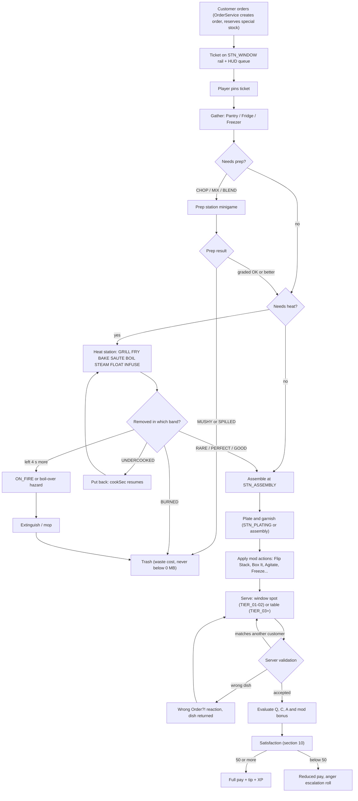

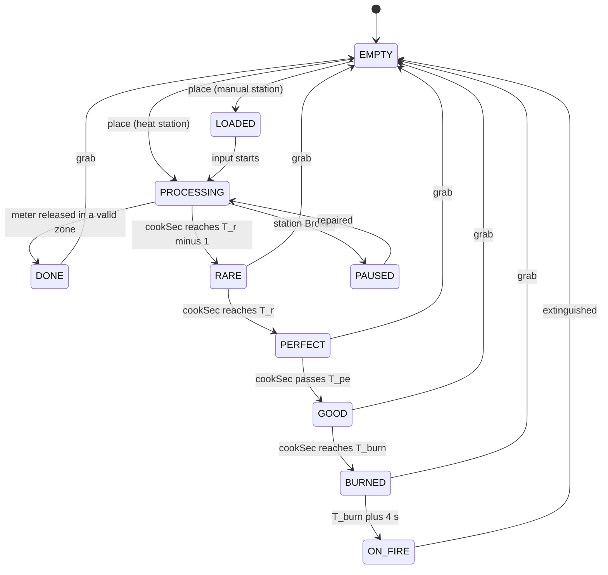

---

### 5.10 Roblox Implementation

#### 5.10.1 Module layout
| Location | Module | Responsibility |
|---|---|---|
| `ServerScriptService/Services/CookingService/init` | `CookingService` | station registry, slot state machines, sweep loop, verb handlers, locks |
| `…/CookingService/HeatModel` | timings, bands, caps (§5.4.2) | pure functions, unit-tested |
| `…/CookingService/Minigames` | chop ring, meters (blend/mix/pour/agitate/swirl/pump), drift | server-side judging |
| `…/CookingService/Dishes` | Dish creation/mutation, carry stacks, floor items, Five-Second Rule | server memory only |
| `…/CookingService/Hazards` | fire, spills, shards, trash piles, cleanliness inputs | caps from §5.7 |
| `ReplicatedStorage/Shared/Data/StationDefs` | per-station constants (verbs, slots, durations, Lv5 gimmick flags, KA tags) | read by server and client UI |
| `StarterPlayerScripts/Controllers/InteractionController` | targeting score (§5.2.4), preview chip, input → remotes | part of `UIController` |
| `StarterPlayerScripts/Controllers/StationVisuals` | progress rings, meters, VFX/SFX prediction from attributes | client only |

Employees (§16) call the same verb handlers server-side through `CookingService.ActAsEmployee(employeeId, stationUid,
slot, verb)`; they never touch remotes. Whose stats apply: the **placer's** `COOK_SPD`/`COOK_QLT`/KA at placement
time are baked into the slot's timings (co-op partners do not retime a cooking item).

#### 5.10.2 Replication model
- Station models are tagged `MMR_Station` (`CollectionService`) and set `ModelStreamingMode = Atomic` so slot
  attachments stream in together.
- **Timers are never replicated per frame.** On each transition the server writes `S<n>_State`, `S<n>_CookSec`,
  `S<n>_Rate`, `S<n>_Stamp` (server-time epoch), `S<n>_Times` (`Vector3` = `T_r`, `T_pe`, `T_burn`), `S<n>_TFire`,
  `S<n>_Lock`, `S<n>_Opt`; clients compute `cookSec = CookSec + (workspace:GetServerTimeNow() − Stamp) × Rate`.
- Internally the server measures with `os.clock()` (monotonic); `clockToServer = workspace:GetServerTimeNow() −
  os.clock()` is sampled once at start-up to convert stamps for clients.
- Cosmetic bursts (sparkles, "ting", sad trombone) go through an `UnreliableRemoteEvent` to players inside that interior
  only; losing one never changes state.

#### 5.10.3 Remotes
| Remote | Kind | Direction | Payload | Server checks |
|---|---|---|---|---|
| `Cooking.InteractStation` | RemoteEvent | C→S | `stationUid: string, slot: number, verb: string, seq: number` | types, rate, interior, range ≤ 9 studs (+ reach parts ≤ +2), permission, lock, verb legal in state |
| `Cooking.MinigameInput` | RemoteEvent | C→S | `stationUid, slot, input: "Tap" \| "HoldBegin" \| "HoldEnd", seq, clientServerTime: number` | lock owner; tap debounce 0.12 s; judged at receipt − clamp(ping/2, 0, 0.15); `clientServerTime` used only for plausibility (> 0.3 s off → flagged) |
| `Cooking.SetStationOption` | RemoteEvent | C→S | `stationUid, slot, option: "Dial" \| "CutMode" \| "Vessel", value: string` | enum whitelist, permission |
| `Cooking.ItemAction` | RemoteEvent | C→S | `action: "Drop" \| "Throw" \| "Swap" \| "PickupFloor", targetId: string?, aim: Vector3?, seq` | server carry stack; aim normalised, range clamped to 12 studs; arc raycast server-side |
| `Cooking.ServeDish` | RemoteEvent | C→S | `customerId: string, seq, flourish: boolean` | §5.6.5 (all nine steps) |
| `Cooking.InteractHazard` | RemoteEvent | C→S | `hazardId: string, phase: "Begin" \| "End", seq` | tool prop held (extinguisher/mop), range 6 studs |
| `Cooking.PinTicket` | RemoteEvent | C→S | `ticketId: string` | ticket in this restaurant |
| `Cooking.Result` | RemoteEvent | S→C | `seq, ok: boolean, code: string, payload: {}?` | ack/rejection for prediction rollback |
| `Cooking.StationFx` | UnreliableRemoteEvent | S→C | `stationUid, slot, fxCode: string` | cosmetic only |

#### 5.10.4 Anti-exploit checklist
1. Clients send **verbs and selections only** — never grades, timestamps-as-truth, item contents, positions of items or
   prices. All results (bands, grades, Q/C/A, mod outcomes) are computed on the server.
2. Every remote argument is type-checked with `typeof`; strings capped at 64 characters; unknown verbs/options rejected.
3. Token bucket per player: 15 station interactions/s and 10 minigame inputs/s; exceeding the bucket 3 times in 10 s is
   logged to the anti-exploit pipeline (§29) and inputs are dropped silently. Per-remote monotonic `seq` drops replays.
4. Range: `|HRP − slotAttachment| ≤ 7 + 2` studs (customers 10 + 2), using the server's view of the character.
5. Ownership: the station must belong to the interior the player currently occupies; guest permission tiers apply (§5.8).
6. Holds: durations are measured between server receipt of `HoldBegin` and `HoldEnd`; a missing `HoldEnd` simply lets
   the meter run into its failure zone (lid pop, overflow) — never into a better result.
7. Throws: the arc starts at the server HRP position; the client contributes only an aim direction.
8. Movement plausibility (teleport/speed) is owned by §29; a flagged player's cooking inputs are paused, not punished.
9. Kitchen effects of abilities (`ABL_028` and `ABL_067` extinguish, `ABL_066` finish at GOOD, `ABL_067` FREEZE at GOOD,
   `ABL_068` clean, `ABL_061` second station channel) are applied **server-side**: `CombatService` validates the cast
   (§36.6) and calls `CookingService.ApplyAbilityEffect(player, abilityId, targetUid)`, which re-checks range, slot state
   and legality (e.g. X12). No client ever reports an ability's kitchen result.

#### 5.10.5 `CookingService` core (server, excerpt)

```lua
--!strict
-- ServerScriptService/Services/CookingService/init.lua (excerpt)
local Players = game:GetService("Players")
local RunService = game:GetService("RunService")
local ReplicatedStorage = game:GetService("ReplicatedStorage")

local StationDefs = require(ReplicatedStorage.Shared.Data.StationDefs)
local Dishes = require(script.Dishes)        -- carry stacks, Dish mutation
local Hazards = require(script.Hazards)      -- fire / spill spawning (§5.7)
local Services = require(script.Parent.Registry) -- RestaurantService, MultiplayerService, MutationService, CombatService

local Remotes = ReplicatedStorage:WaitForChild("Remotes")
local RInteract = Remotes:WaitForChild("Cooking.InteractStation") :: RemoteEvent
local RResult = Remotes:WaitForChild("Cooking.Result") :: RemoteEvent
local RFx = Remotes:WaitForChild("Cooking.StationFx") :: UnreliableRemoteEvent

type Band = "EMPTY" | "LOADED" | "UNDERCOOKED" | "RARE" | "PERFECT" | "GOOD" | "BURNED" | "ON_FIRE" | "DONE" | "PAUSED"
type Timings = { tReady: number, tPe: number, tBurn: number, tFire: number }
type Slot = {
	index: number, anchor: Attachment, state: Band, item: Dishes.Component?,
	cookBase: number, stamp: number, rate: number, timings: Timings?, cap: number,
	lockUserId: number,
}
type Station = { uid: string, kind: string, model: Model, restaurantId: string, level: number, slots: { Slot }, broken: boolean }

local LV_TIME = { 1.0, 0.9, 0.8, 0.7, 0.6 }
local LV_WINDOW = { 1.0, 1.0, 1.25, 1.25, 1.5 }
local LV_GRACE = { 0, 0, 0, 3, 3 }
local GRADE: { [string]: number } = { UNDERCOOKED = 0.35, RARE = 0.60, PERFECT = 1.00, GOOD = 0.80, BURNED = 0.15, ON_FIRE = 0 }
local RANGE, TOLERANCE, SWEEP_PERIOD = 7, 2, 0.1

local CookingService = {}
local stations: { [string]: Station } = {}
local activeHeat: { [Slot]: Station } = {}
local clockToServer = workspace:GetServerTimeNow() - os.clock()

local function computeTimings(base: number, level: number, cookSpd: number, cookQlt: number, ka: Dishes.KA): Timings
	local tReady = math.max(base * LV_TIME[level] / (1 + 0.006 * cookSpd) * ka.time, 0.25 * base)
	local w = math.min(2.0 * LV_WINDOW[level] * (1 + 0.005 * cookQlt) * ka.window, 6.0)
	local g = math.max(6.0 * (1 + 0.004 * cookQlt) + LV_GRACE[level] + ka.grace, w + 2.5)
	return { tReady = tReady, tPe = tReady + w, tBurn = tReady + g, tFire = tReady + g + 4.0 }
end

local function cookSecNow(slot: Slot, now: number): number
	return slot.cookBase + (now - slot.stamp) * slot.rate
end

local function bandFor(t: Timings, c: number): Band
	if c < t.tReady - 1.0 then return "UNDERCOOKED" end
	if c < t.tReady then return "RARE" end
	if c <= t.tPe then return "PERFECT" end
	if c < t.tBurn then return "GOOD" end
	if c < t.tFire then return "BURNED" end
	return "ON_FIRE"
end

local function publish(st: Station, slot: Slot)
	local p, m = "S" .. slot.index .. "_", st.model
	m:SetAttribute(p .. "State", slot.state)
	m:SetAttribute(p .. "CookSec", slot.cookBase)
	m:SetAttribute(p .. "Rate", slot.rate)
	m:SetAttribute(p .. "Stamp", slot.stamp + clockToServer)
	m:SetAttribute(p .. "Lock", slot.lockUserId)
	local t = slot.timings
	m:SetAttribute(p .. "Times", if t then Vector3.new(t.tReady, t.tPe, t.tBurn) else nil)
	m:SetAttribute(p .. "TFire", if t then t.tFire else nil)
end

local function fx(st: Station, slot: Slot, code: string)
	for _, plr in Services.RestaurantService.GetOccupants(st.restaurantId) do
		RFx:FireClient(plr, st.uid, slot.index, code)
	end
end

-- Authoritative sweep: deadlines checked at 10 Hz; transitions rebase cookSec so attributes stay exact.
local lastSweep, acc = os.clock(), 0
RunService.Heartbeat:Connect(function(dt: number)
	acc += dt
	if acc < SWEEP_PERIOD then return end
	acc = 0
	local now = os.clock()
	local gap = now - lastSweep
	lastSweep = now
	if gap > 0.5 then -- server hitch: nobody should burn food during a frozen server
		for slot, st in activeHeat do
			slot.stamp += gap - 0.5
			publish(st, slot)
		end
	end
	for slot, st in activeHeat do
		local c = cookSecNow(slot, now)
		local band = bandFor(slot.timings :: Timings, c)
		if band ~= slot.state then
			slot.cookBase, slot.stamp, slot.state = c, now, band
			if band == "ON_FIRE" then
				activeHeat[slot] = nil
				Hazards.IgniteSlot(st, slot) -- item RUINED, FireHP, spread timer, boil-over for water verbs
			end
			publish(st, slot)
			fx(st, slot, band)
		end
	end
end)

local Verbs: { [string]: (Player, Station, Slot) -> (boolean, string) } = {}

Verbs.Place = function(player, st, slot)
	if slot.state ~= "EMPTY" then return false, "OCCUPIED" end
	local def = StationDefs[st.kind]
	local item = Dishes.PeekActive(player)
	if not item or not def.Accepts(item) then return false, "WRONG_ITEM" end
	Dishes.PopActive(player)
	slot.item = item
	if def.Heat then
		local stats = Services.MutationService.GetCookStats(player) -- effective COOK_SPD / COOK_QLT + KA for this station
		local now = os.clock()
		slot.timings = computeTimings(def.TReady[item.ing] or def.TReadyDefault, st.level, stats.COOK_SPD, stats.COOK_QLT, stats.KA[st.kind])
		slot.cookBase, slot.stamp, slot.rate, slot.cap = item.cookSec or 0, now, def.RateFor(st, item), 1.0
		slot.state = bandFor(slot.timings :: Timings, slot.cookBase)
		activeHeat[slot] = st
	else
		slot.state = "LOADED"
	end
	publish(st, slot)
	return true, "OK"
end

Verbs.Flip = function(player, st, slot)
	local item, t = slot.item, slot.timings
	if not (item and t and activeHeat[slot] and item.needsFlip and not item.flipped) then return false, "NO_FLIP" end
	local judged = os.clock() - math.clamp(player:GetNetworkPing() * 0.5, 0, 0.15)
	local c = cookSecNow(slot, judged)
	item.flipped = true
	if c < 0.40 * t.tReady or c > 0.75 * t.tReady then slot.cap = math.min(slot.cap, GRADE.GOOD) end
	return true, "FLIPPED"
end

Verbs.Take = function(player, st, slot)
	local item = slot.item
	if not item then return false, "EMPTY" end
	if slot.state == "ON_FIRE" then return false, "ON_FIRE" end
	if not Dishes.HasRoom(player) then return false, "HANDS_FULL" end
	if activeHeat[slot] then
		local now = os.clock()
		local c = cookSecNow(slot, now)
		local band = bandFor(slot.timings :: Timings, c)
		if item.needsFlip and not item.flipped then slot.cap = math.min(slot.cap, GRADE.GOOD) end
		-- re-taking an item that was put back replaces its previous step of the same verb
		Dishes.RecordHeatStep(item, StationDefs[st.kind].Verb, band, math.min(GRADE[band], slot.cap), player, c)
		activeHeat[slot] = nil
		if band ~= "UNDERCOOKED" then Dishes.SetHot(item, 20) end
	end
	Dishes.Push(player, item)
	slot.item, slot.state, slot.timings, slot.rate, slot.lockUserId = nil, "EMPTY", nil, 0, 0
	publish(st, slot)
	return true, "OK"
end

local buckets: { [Player]: { tokens: number, t: number, seq: number } } = {}
local function allow(player: Player, seq: number): boolean
	local b = buckets[player]
	local now = os.clock()
	if not b then b = { tokens = 15, t = now, seq = -1 }; buckets[player] = b end
	b.tokens = math.min(15, b.tokens + (now - b.t) * 15)
	b.t = now
	if seq <= b.seq or b.tokens < 1 then return false end
	b.tokens -= 1
	b.seq = seq
	return true
end
Players.PlayerRemoving:Connect(function(p) buckets[p] = nil; CookingService.ReleaseLocks(p) end)

RInteract.OnServerEvent:Connect(function(player: Player, stationUid: unknown, slotIndex: unknown, verb: unknown, seq: unknown)
	if typeof(stationUid) ~= "string" or typeof(slotIndex) ~= "number" or typeof(verb) ~= "string" or typeof(seq) ~= "number" then return end
	if #stationUid > 64 or #verb > 32 or not allow(player, seq) then return end
	local function reply(ok: boolean, code: string) RResult:FireClient(player, seq, ok, code) end
	local st = stations[stationUid]
	if not st or Services.RestaurantService.InteriorOf(player) ~= st.restaurantId then return reply(false, "NO_STATION") end
	local slot = st.slots[slotIndex]
	if not slot then return reply(false, "NO_SLOT") end
	if st.broken then return reply(false, "BROKEN") end
	local char = player.Character
	local hrp = char and char:FindFirstChild("HumanoidRootPart") :: BasePart?
	local reach = RANGE + TOLERANCE + Services.MutationService.GetReachBonus(player) -- ≤ +2
	if not hrp or (hrp.Position - slot.anchor.WorldPosition).Magnitude > reach then return reply(false, "OUT_OF_RANGE") end
	if Services.CombatService.IsKnockedOut(player) then return reply(false, "KO") end
	if not Services.MultiplayerService.CanUseStation(player, st.restaurantId, verb) then return reply(false, "NO_PERMISSION") end
	if slot.lockUserId ~= 0 and slot.lockUserId ~= player.UserId then return reply(false, "BUSY") end
	local handler = Verbs[verb]
	if not handler then return reply(false, "BAD_VERB") end
	reply(handler(player, st, slot))
end)

return CookingService
```

#### 5.10.6 Client prediction (excerpt)

```lua
--!strict
-- StarterPlayerScripts/Controllers/StationVisuals (excerpt): rings are computed locally from replicated stamps.
local RunService = game:GetService("RunService")
local Meter = require(script.Parent.Meter)
local Visible = require(script.Parent.VisibleStations)

local function cookSec(model: Model, i: number): (number, Vector3?)
	local base = (model:GetAttribute(`S{i}_CookSec`) :: number?) or 0
	local rate = (model:GetAttribute(`S{i}_Rate`) :: number?) or 0
	local stamp = (model:GetAttribute(`S{i}_Stamp`) :: number?) or workspace:GetServerTimeNow()
	return base + (workspace:GetServerTimeNow() - stamp) * rate, model:GetAttribute(`S{i}_Times`) :: Vector3?
end

RunService.RenderStepped:Connect(function()
	for _, model in Visible.Get() do
		for i = 1, (model:GetAttribute("SlotCount") :: number?) or 0 do
			local c, times = cookSec(model, i)
			if times then Meter.SetHeat(model, i, c, times.X, times.Y, times.Z) end
		end
	end
end)
```
On input the client immediately plays the animation, SFX and a predicted item on the slot; when the authoritative
attributes arrive (≈ 1 RTT) it blends to them within 0.15 s; a `Cooking.Result` with `ok = false` rolls the prediction
back and plays a soft "bonk" with the reason ("Busy!", "Too far!").

#### 5.10.7 Performance budgets
- Sweep: ≤ 0.3 ms per interior per 10 Hz tick with 24 stations / ≤ 40 active slots; ≤ 8 attribute publishes per cooked
  item lifetime (place, band changes, take).
- No server Instances for held or slotted food (client-rendered from attributes); floor items are anchored invisible
  proxies counted against the ≤ 30 loose props per interior (canon §C3); when full, the oldest floor item despawns
  (basic food uncharged, special ingredients returned to stock).
- Station VFX use pre-placed `ParticleEmitter`s toggled by the client; Reduced Effects scales `Rate` to 30 %.
- Analytics (§31): `mmr_dish_served` {recipeId, Q, C, A, modIds, tier}, `mmr_station_fire` {stationType},
  `mmr_mod_result` {modId, satisfied}, `mmr_wrong_order` {recipeId}, `mmr_chop_result` {avgScore, autoRhythm}.

---

### 5.11 Edge Cases

| # | Situation | Ruling |
|---|---|---|
| E1 | Owner disconnects while cooking | Canon E1: the restaurant enters **Closing** — online employees finish current tickets; otherwise seated customers leave paying 0 ("Closed for the day!", no reputation loss). `CookingService.CloseRestaurant` stops every heat slot, extinguishes fires, clears hazards; in-progress basic food is discarded at no charge; special ingredients in stations and reserved stock return to stock; guests' carry stacks are cleared and guests are moved to the street. |
| E7 | Two players use the same station | Canon E7: locks are per slot (§5.3.1, §5.8); multi-slot stations serve several players; items are restaurant-owned and anyone may finish them. |
| E9 | No ingredients | Canon E9: basic ingredients are unlimited (cost netted at serve); special-ingredient recipes go SOLD OUT and are not ordered; stock is reserved at order time so accepted orders stay completable; if every menu item is sold out, `RCP_BRG_001` is auto-added (starter stations only). |
| X1 | Guest disconnects mid-cook | Their locks are released; their carried items are placed on the nearest free hold within 7 studs, else dropped (involuntary, never charged); their items on stations keep cooking. |
| X2 | Station becomes Broken mid-cook | Slots go `PAUSED` (rate 0): nothing burns; repairing resumes exactly where it stopped. A station that breaks while ON_FIRE goes out with a soot puff. |
| X3 | Station Destroyed mid-cook | Items are ejected: basic food discarded free, special ingredients returned to stock; tickets stay open; §6.18 mods that need that station are waived (no penalty, no bonus). |
| X4 | Fire starts while a player is in a full-screen menu | FIRE banner + "Go!" button + alarm above the menu; no auto-close (canon E2 covers hostile customers); fire is capped (§5.7) and cannot break stations. |
| X5 | Carrying items when KO'd ("Seeing Stars") | All carried items drop at the KO spot as involuntary drops (never charged). Plated dishes do **not** shatter: they rest intact for 5 s (a teammate may grab them), then the food is SPILLED and the plate returns to the dirty pool. Tools return to their mounts; crates return to the dock. |
| X6 | Two players grab the same finished item in the same frame | First request processed wins; the other gets "Too slow!" and nothing else changes. |
| X7 | Customer leaves while their dish is cooking or bound | Items become `VOID`; dishes become orphans that may be bound/served to any open item they match (mods re-evaluated for the new item); binning an orphan is never charged. |
| X8 | Dish served to the wrong customer | §5.6.5 step 5: soft reject if it fits another customer, "Wrong Order?!" if it fits nobody; the dish always returns to the player. |
| X9 | Station upgrade purchased mid-cook | Upgrade queued until every slot idles (§5.3.1); no timing changes mid-item. |
| X10 | Moving or storing a station with items in it (build mode, §15) | Blocked with "Empty it first!" — `BuildingService` checks `CookingService.IsIdle(stationUid)`. |
| X11 | Carry capacity drops while holding extra items (part unequipped, `ABL_061` expires) | Excess items (from the back of the stack) are placed on the nearest free hold within 7 studs, else dropped (involuntary, uncharged), within 1 s. |
| X12 | `ABL_066` Microwave Zap-Cook timing | Instantly **finishes** one heat item at GOOD (0.80): its heat step is recorded at GOOD, the slot's rate drops to 0 (it can no longer burn) and it waits for pickup. Valid only while the item is UNDERCOOKED or RARE (it would never improve a PERFECT item); used on PERFECT or later, non-heat items or ON_FIRE slots it is rejected with no cooldown consumed. A finished-at-GOOD item never satisfies a band-specific doneness mod (RARE, WELL_DONE, SCREAMING, BURNED — §6.18). |
| X13 | Server hitch (frame gap > 0.5 s) | Stamps of all active slots shift forward by `gap − 0.5 s` (§5.10.5): no food burns during a server freeze. |
| X14 | Player levels up or changes stats mid-cook (canon E14) | Toast only; items already on stations keep the placer's timings from placement time. |
| X15 | Thrown item lands on an occupied slot or a burning station | Occupied → bounces to the floor (Five-Second Rule). Burning → item RUINED (charged as waste only if thrown by the owner; guest waste is never charged). |
| X16 | Loose-prop cap (30 per interior) reached | Oldest floor item despawns; basic food uncharged, special ingredients returned to stock. |
| X17 | Player walks out of the restaurant door holding food | Food cannot leave the interior: carried food is placed on the nearest free counter inside (or binned, uncharged); tools return to mounts. |
| X18 | A player is KO'd while holding a chop lock | Lock released; the item stays on the board with its taps so far and anyone may continue the chop. |
| X19 | `EVT_009` Blackout Night | Station rings, meters and ticket rail remain self-illuminated (readability); `glow`-tagged parts light up a 10-stud radius as a bonus. |

---

### 5.12 Acceptance Criteria

- **AC-05-01** — All 24 station types in §5.3.2 exist as `StationDefs` entries with server state machines; an automated test
  places a valid item in every slot type and observes the documented state sequence with no unhandled states.
- **AC-05-02** — At Lv1 with `COOK_QLT` 0, every heat item's PERFECT window measures 2.0 s ± 0.1 s of server time and is shown
  with a green ring plus ✓ glyph; `T_burn = T_ready + 6.0 s` ± 0.1 s; ignition at `T_burn + 4.0 s` ± 0.1 s (fryer at
  OilHeat ≥ 90: + 2.0 s).
- **AC-05-03** — A beef patty's `T_ready` measures 8.0 / 7.2 / 6.4 / 5.6 / 4.8 s at station Lv1–Lv5 (stats 0) ± 0.1 s; each Lv5
  gimmick activates only at Lv5 in a TIER_08+ restaurant.
- **AC-05-04** — Fuzz test over 10,000 random loadouts (stats, upgrades, KA parts): no `T_ready` below 0.25 × base and no
  `W_perfect` above 6.0 s.
- **AC-05-05** — Chopping: N = 4 counted taps; taps < 0.12 s apart are ignored; the (N + 4)th tap yields MUSHY (0.35);
  green/yellow/miss score 1.0/0.8/0.6 and are averaged; with Auto-Rhythm every tap scores 0.8.
- **AC-05-06** — Under a simulated 200 ms RTT, a tap pressed on the client exactly at the ring's hit moment is graded green in
  ≥ 95 % of 1,000 trials.
- **AC-05-07** — Station interactions are rejected beyond 9.0 studs and accepted within 9.0 studs (no reach parts); serving is
  accepted within 12.0 studs of the customer.
- **AC-05-08** — Two players operate grill slots 1 and 2 simultaneously without rejection; an input on a slot locked by another
  player is rejected with "Busy!" within 250 ms; a passively cooking slot accepts flips/removal from any co-op player.
- **AC-05-09** — No Cooking remote accepts a grade, quality, result, price or item-content argument; a fuzzing client sending
  forged or extra arguments cannot change any Dish field (penetration test log clean).
- **AC-05-10** — Every action in §5.2.5 is bound for keyboard + mouse, controller and touch (automated
  `ContextActionService` binding audit); primary touch buttons ≥ 88 dp, all others ≥ 48 dp.
- **AC-05-11** — Every verb in §5.4 can be completed using only Use and Grab (plus movement) on all three input types
  (scripted playtest checklist, 19/19 verbs).
- **AC-05-12** — The highlighted slot is the slot the server acts on in 100 % of accepted interactions; standing still between
  two equidistant slots causes ≤ 1 target switch per second.
- **AC-05-13** — Server-computed `Q` and `C` reproduce §5.5 worked examples 1–4 to ± 0.001 in unit tests.
- **AC-05-14** — Serving a non-matching dish never removes it from the player's hands; "Wrong Order?!" fires only when the dish
  matches no open item in the restaurant.
- **AC-05-15** — Fire: ignition is always preceded by the three warnings of §5.4.2; ≤ 3 simultaneous fires per restaurant;
  fire alone never lowers durability below 26 %; one extinguisher clears a fresh fire in 2.0 s ± 0.1 s.
- **AC-05-16** — Pots and steamers reaching `T_burn + 4 s` produce a boil-over (SPILLED) or boil-dry (`NEEDS_WATER`), never
  ON_FIRE.
- **AC-05-17** — Food picked up ≤ 5.0 s after a drop keeps all components and grades; after 5.0 s it is SPILLED; involuntary
  drops are never charged (economy log shows 0 MB).
- **AC-05-18** — Carry capacity never exceeds 3 for any part/ability combination; reducing capacity places or drops the excess
  within 1 s.
- **AC-05-19** — Canon E1: within 2 s of the owner disconnecting mid-cook, all heat slots stop, special ingredients in stations
  return to stock (inventory delta verified) and basic food is discarded with a 0 MB charge.
- **AC-05-20** — Canon E9: a simulation of 10,000 orders with random special-stock depletion produces 0 impossible tickets.
- **AC-05-21** — ≤ 8 attribute publishes per cooked item lifetime; client progress rings stay within 0.1 s of server state at
  250 ms RTT.
- **AC-05-22** — `CookingService` sweep costs ≤ 0.3 ms per interior per tick with 24 stations and 40 active slots
  (MicroProfiler capture on the reference server profile).
- **AC-05-23** — Injecting a 2.0 s server freeze advances no slot's `cookSec` by more than 0.5 s.
- **AC-05-24** — Lv1 patty classification: removal at 7.5 s → RARE, 9.0 s → PERFECT, 11.5 s → GOOD (WELL_DONE), 13.0 s → GOOD
  (SCREAMING), 15.0 s → BURNED.
- **AC-05-25** — The eight scripted agitation profiles of §5.4.8 (including EXPLODED) yield the documented drink mood in 100 %
  of runs.
- **AC-05-26** — Every station status is conveyed by colour + shape + text or sound; with each colour-blind palette ≥ 95 % of
  test players correctly identify PERFECT, BURNED and ON_FIRE from screenshots.


## 6. Recipe Database

> **Data-backed:** every table and number in §6, §7 and §36.2 is generated by `python3 gdd/tools/render_recipes.py` from `gdd/data/ingredients*.json` and `gdd/data/recipes*.json`, which validates the data against the canon (150 recipes with fixed IDs, names and unlock levels; C9 tag vocabulary and core ingredient IDs; C7.1 station availability; C8 actions and states; C4.2 price curve). Edit the JSON, never the markdown. Ingredient rows live in §7; the one-line-per-recipe index is §36.2.

Mystery Morph Restaurant ships **150 recipes in 15 categories** (BRG 15, PIZ 15, TAC 10, SAN 10, SOP 10, PST 10, BRK 10, DES 15, DRK 15, SEA 10, SAL 5, FRI 5, ALN 10, MUT 5, LEG 5). Every recipe is a small, deterministic program — ingredients in required states, an ordered list of canon actions at canon stations, timed heat components — wrapped in a ridiculous costume. 167 ingredients feed them (§7): 115 unlimited BASIC and 52 stocked SPECIAL.

### 6.1 Recipe System Rules

#### Purpose

Recipes convert player skill (chop rhythm, heat timing, assembly order, multitasking) into Morph Bucks. They are the main *content* ladder of the restaurant pillar: each level-up unlocks something new to cook, each restaurant tier gives more menu slots to show it off, and high-difficulty dishes pay more per second of effort, funding the mutation loop (Cook → Earn → Morph).

#### Rules & Mechanics

##### 6.1.1 Recipe data schema

| Field | Type | Source | Meaning |
|---|---|---|---|
| `id` | string | canon C10 | `RCP_<CAT>_<NNN>`, stable forever |
| `name` | string | canon C10 | display name (localization key = id) |
| `category` | enum | derived from id | BRG PIZ TAC SAN SOP PST BRK DES DRK SEA SAL FRI ALN MUT LEG |
| `unlock` | int 1–95 | canon C10 | level at which the recipe becomes learnable |
| `d` | int 1–5 | data | difficulty (6.1.5); feeds price factor and customer patience (C11.2) |
| `var` | float 0.85–1.15 | data | fixed per-recipe flavor variance multiplier in the price |
| `prep` | int s | data | base preparation time: one competent player, Lv1 stations, no stats, heat steps run in parallel; used by offline `PrepSec_avg` (C15) and employee cook time |
| `ing[]` | {ingId, qty, state} | data | required ingredients, quantity and the C8 state they must be in when the dish is assembled |
| `steps[]` | {action, station, text, tReady?, opts?} | data | ordered canon actions at canon stations; heat actions carry `tReady` (s, Lv1 baseline) and options: component, `flip` (GRILL; default true for proteins and sandwiches), `dial` LOW/MED/HIGH (BAKE at `STN_OVEN`; default MED), `w` Perfect window override; MIX steps list ingredients in canonical insertion sequence (§5.4.6) |
| `stack[]` | ING ids | derived | canonical ASSEMBLE order bottom → top = mention order in the final ASSEMBLE step (a repeated bread = bottom/top halves); `set: true` marks unordered dishes (§5.4.9) |
| `core[]` | ING ids | data | components whose absence makes a wrong dish (DishMatch 0) instead of a missing non-core component (§6.18.4) |
| `counts{}` | {ING: [n, unit]} | data / §7 default | default counts of countable components (pickle slices, pepperoni coins, ice cubes, fries, scoops, pancake layers…) used by COUNT mods |
| `container` | enum | data / category default | PLATE, BOWL, CUP, CONE, BOX or WRAP (Dish.container, §5.6.4); bowls, cups, cones and boxes count as plated |
| `stations[]` | STN ids | derived | storage used + step stations + `STN_WINDOW` |
| `heat[]` | {component, action, station, tReady} | derived | graded heat components (6.1.6) |
| `price` / `cost` / `margin` | MB / MB / % | derived | 6.2 formula; cost = Σ qty × unit cost |
| `learnCost` | MB | derived | 5 × price (0 for L1 recipes) |
| `specials[]` | ING ids | derived | stocked ingredients → SOLD OUT logic |
| `loves[]` / `hates[]` | PER ids | data | personality dish modifiers (6.1.8) |
| `cx[]`, `look`, `anim`, `vfx`, `mut` | strings | data | complaints, visual, animation, effects, mutation notes |

##### 6.1.2 Learning recipes

L1 recipes (`RCP_BRG_001`, `RCP_BRG_002`, `RCP_DRK_001`, `RCP_FRI_001`) are known from the start. Every other recipe becomes *learnable* at its unlock level and is learned at the **Cooking Academy** (`BLD_06`, dean Professor Saucington `NPC_009`) for **5 × its base price** in MB, or is granted free by a quest (recipe unlocks are a C17.4 reward type). Learning is permanent and account-wide. A learned recipe can be put on the menu only when every station in its station list is owned and placed (exception: `STN_PLATING` steps use `STN_ASSEMBLY` at TIER_01–02).

| Category | Recipes | Unlock range | Extra gate |
|---|---|---|---|
| BRG Burgers | 15 | L1–L60 | — |
| PIZ Pizza | 15 | L3–L55 | — |
| TAC Tacos & Mexican-Inspired | 10 | L5–L48 | — |
| SAN Sandwiches | 10 | L2–L42 | — |
| SOP Soups | 10 | L4–L52 | — |
| PST Pasta | 10 | L2–L47 | — |
| BRK Breakfast | 10 | L2–L41 | — |
| DES Desserts | 15 | L3–L58 | — |
| DRK Drinks & Smoothies | 15 | L1–L49 | — |
| SEA Seafood | 10 | L7–L54 | — |
| SAL Salads | 5 | L3–L32 | — |
| FRI Fried Foods | 5 | L1–L43 | — |
| ALN Alien Cuisine | 10 | L30–L62 | Alien Cuisine course — story chapter 5 (Zorp `NPC_027`); no ALN recipe can be bought before it |
| MUT Mutation Cuisine | 5 | L42–L70 | must own an `STN_INFUSER` (L40, TIER_06) before learning; every MUT dish INFUSEs |
| LEG Legendary Dishes | 5 | L65–L95 | a Legendary Recipe quest per dish (`QST_CHF_011`–`QST_CHF_015`, §20); never sold at the Academy |

##### 6.1.3 Menu slots

The menu is the set of learned recipes the restaurant currently offers; drinks, sides and desserts use slots like mains. Menu edits are made at the Menu Board (part of `STN_WINDOW`) at any time and affect only *new* orders. If every menu item is SOLD OUT, `RCP_BRG_001` is auto-added without using a slot (C22 E9).

| Entry level | Tier | Menu slots | Recipes learnable at entry level |
|---|---|---|---|
| L1 | `TIER_01` Broken Burger Shack | 4 | 4 |
| L5 | `TIER_02` Tiny Mutation Diner | 5 | 24 |
| L10 | `TIER_03` Neighborhood Freak Café | 6 | 45 |
| L18 | `TIER_04` Morph City Grill | 8 | 68 |
| L26 | `TIER_05` Mutant Family Restaurant | 10 | 91 |
| L35 | `TIER_06` Monster Food Court | 12 | 110 |
| L45 | `TIER_07` Mutation Megadiner | 14 | 127 |
| L56 | `TIER_08` Luxury Freak Restaurant | 16 | 139 |
| L68 | `TIER_09` Morph City Food Palace | 20 | 145 |
| L80 | `TIER_10` Legendary Mutation Restaurant | 24 | 148 |

##### 6.1.4 From recipe to ticket to dish to validation

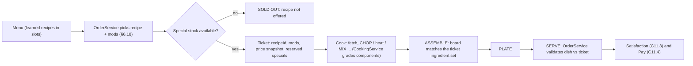

1. **Order.** When a customer orders, `OrderService` draws a recipe from the menu with weight 1.0, ×2.0 for recipes the personality *loves*, ×0.25 for recipes it *hates* [TUNABLE]; recipes that are SOLD OUT or need a Broken/Destroyed station are excluded. Modifications are rolled per §6.18.
2. **Ticket.** `{ticketId, recipeId, mods[], expectedSet, priceSnapshot, customerId, createdAt}`. `expectedSet` = the recipe's ingredient multiset adjusted by the mods (e.g. "no cheese" removes `ING_CHEESE`, COUNT mods change a countable's target). One unit of every SPECIAL ingredient in `expectedSet` is **reserved** from stock at order creation (§5.6.1); reservations are released if the order is voided.
3. **Cook.** Taking an ingredient from storage spawns an item in state RAW; every step changes its state (C8). `CookingService` stores a grade per graded component: chop quality, heat grade (6.1.6), blend/pour/scoop result.
4. **Assemble.** Components placed on an `STN_ASSEMBLY` board build the server-side **Dish** object (§5.6.4); the recipe's `stack` is the canonical bottom → top order graded by the assembly-order factor (C8), and the ghost stack shows the next layer for the pinned ticket. *Bake-after-assembly* recipes (pizzas, lasagnas, casseroles, pies) are assembled raw and then baked as one heat component, which sets every assembled component to BAKED. No two recipes share an identical (ingredient, qty, state) multiset (validated by the renderer), so recipe recognition is unambiguous.
5. **Plate** at `STN_PLATING`; `STN_ASSEMBLY` doubles as plating only at TIER_01–02, so from TIER_03 a dish counts as plated only via `STN_PLATING` (un-plated → 0.9 plating factor, C8). Dishes whose container is a BOWL, CUP, CONE or BOX count as plated (§5.5).
6. **Serve.** `OrderService` validates server-side (§5.6.5): `A = DishMatch × ModScore` per §6.18.4 — a missing **core** component makes it a wrong dish, each missing non-core component or unrequested extra costs 0.15 (floor 0.4). Q and C come from the stored grades (§5.5, C8). Pay = price × (1 + mod bonus) × PayFactor (§6.18.5, C11.4); tips use menu prices only.

##### 6.1.5 Difficulty model

| Diff | Numbered steps | Heat components (data) | Precision demands | Prep band s | Patience (C11.2) | Cost-ratio target | Recipes | Avg prep | Avg cost ratio |
|---|---|---|---|---|---|---|---|---|---|
| D1 | 2–4 | 0–2 | short stacks; chop N = 4 taps; heat steps never need to overlap | 15–30 | +5 s | 33–40 % | 16 | 20 s | 36.4 % |
| D2 | 3–5 | 0–2 | short ordered stacks or one MIX sequence; two heat steps may overlap | 20–45 | +10 s | 31–38 % | 28 | 35 s | 34.0 % |
| D3 | 4–7 | 0–4 | longer stacks or a two-stage chain (e.g. BOIL → BLEND → FREEZE); overlapping timers | 35–80 | +15 s | 29–35 % | 53 | 54 s | 31.1 % |
| D4 | 5–9 | 0–4 | three or more stations busy at once; multi-stage chains; tight ordered builds | 55–125 | +20 s | 27–33 % | 30 | 84 s | 29.6 % |
| D5 | 6–12 | 1–6 | four or more stations, long chains (e.g. CHOP → FRY → INFUSE), big ordered builds, 4+ timers | 80–150 | +25 s | 25–30 % | 23 | 149 s | 27.2 % |

Legendary dishes ignore the step band (they are multi-station showpieces of 9–13 steps) and use a 150–240 s prep band. The difficulty price factor is `0.8 + 0.1 × D` (C4.2), so a D5 dish earns 44 % more than a D1 dish of the same level.

##### 6.1.6 Ideal cooking time (heat components)

Each heat step (GRILL, FRY, BAKE, SAUTE, BOIL, STEAM, FLOAT, INFUSE) is a graded component with an authored `T_ready` at Lv1 with no stats. Canon C8 then fixes: **Perfect** `[T_ready, T_ready + 2.0 s]`, **Good** until `T_burn = T_ready + 6 s`, **BURNED** after, **ON_FIRE** at `T_burn + 4 s` on fire-capable stations (GRILL, FRY, BAKE, SAUTE, FLOAT and INFUSE — the infuser's cartoon green fire); pots and the steamer (BOIL, STEAM) boil over instead (§5.4.2). UNDERCOOKED before `T_ready`. Effective values: `T_ready_eff = T_ready × StationTimeMult (C4.9) / (1 + 0.006 × COOK_SPD)` and `W_eff = 2.0 × StationWindowMult × (1 + 0.005 × COOK_QLT)`; §5.4.2 owns the full stack (burn grace, mutation affinity multipliers, RARE/WELL_DONE/SCREAMING sub-bands). Each detail block also lists the input the station expects: GRILL flip window `[0.40, 0.75] × T_ready` (or *no flip* for buns and veg), FRY shake `[0.45, 0.70] × T_ready`, oven dial LOW/MED/HIGH, pizza-oven spin `[0.40, 0.70] × T_ready`, SAUTE tosses at ⅓ and ⅔, soup-pot stirs, INFUSE pressure band, FLOAT nudges (§5.4.3–5.4.5). Non-heat components (CHOP, MIX, BLEND, POUR, SCOOP, FREEZE) are graded by §5's minigames.

##### 6.1.7 Ingredient supply, stock and SOLD OUT

Per C9, **BASIC** ingredients (unlock ≤ L20, no special tag) are unlimited: their cost is netted from the sale at serve, and wasted basic food is charged at `STN_TRASH` (never below 0 MB). **SPECIAL** ingredients (tags alien, mutagen, legendary, gold, glowing — or unlock > L20, which this database always flags as rarity stock) are bought as crates (§7), stored in `STN_PANTRY`/`STN_FRIDGE`/`STN_FREEZER` stock and consumed per unit. 67 of 150 recipes use at least one SPECIAL ingredient (marked ★); the first appears at L21. When any SPECIAL ingredient of a recipe has 0 unreserved units, the recipe shows **SOLD OUT** on the menu board and in the Recipe Book and cannot be ordered; it returns automatically when stock arrives.

##### 6.1.8 Customer satisfaction modifiers

Dish modifiers are added inside the `P_offset` term of the C11.3 satisfaction formula as a **dish offset**, clamped to −15…+15 in total: **Perfect Plate +5** when every graded component is PERFECT; **Loves +8** and **Hates −8** for the listed personalities (C11.1; §9 may list further preferences, which stack inside the same clamp). Mutation Cuisine applies the C10 rule: +10 "Whoa!" as the `MutationBonus` term plus a 60 s client-only cosmetic mutation part. Complaint lines are barks played at *Inspect food* (§8) when a component grades below GOOD or a *hates* modifier fires.

##### 6.1.9 Mutation affinity hooks

Recipes expose *hooks* — properties that equipped mutation parts react to through their C13.5 tags. The defaults below apply automatically to every equipped part carrying the tag; §12 passives and §36.4 synergies multiply on top within their own caps. Each recipe lists the hooks that apply to it; the signature line names the parts and abilities that make that dish shine.

| Hook | Part tag / ability | Applies to | Default effect [TUNABLE] | Stack cap |
|---|---|---|---|---|
| Hot Hands | `fire` | GRILL / FRY / BAKE / SAUTE steps | T_ready ×0.92 per part | 2 parts (×0.85) |
| Cold Snap | `ice` | FREEZE steps | freeze time ×0.6; `ABL_067` Freeze Touch completes one FREEZE step instantly | 1 part |
| Zap-Cook | `ABL_066` (`MUT_036`) | any one running heat component | finishes it instantly at GOOD (forfeits Perfect Plate) | cooldown per §36.6 |
| Many Hands | `tentacle` or `multi` | ASSEMBLE steps | each input places 2 layers; `ABL_061` Extra Hands runs 2 stations | 1 part |
| Kitchen Pro | `chef` | all heat components | Perfect window +0.2 s per part | 3 parts (+0.6 s) |
| Spark Blend | `electric` | BLEND / MIX steps | process time ×0.85 | 1 part |
| Steam Team | `water` | BOIL / STEAM steps | T_ready ×0.9; `ANM_030` extinguish 50 % faster | 1 part |
| Pincer Prep | `claw` | CHOP of meat / poultry / seafood / tentacle items | taps -1 (min 2) | 1 part |
| Green Thumb | `plant` | CHOP of veg / fruit / plant items | green timing zone +20 % width | 1 part |
| Space Chef | `alien` or `cosmic` | INFUSE / FLOAT steps; CHOP of alien items | Perfect window +0.5 s; alien CHOP taps -1 | 1 part |
| Sweet Tooth | `sweet` | SCOOP / POUR / MIX on dishes with a sweet item | process time ×0.85 | 1 part |
| Sticky Grip | `sticky` | carrying a soup or drink | never SPILLED when bumped | 1 part |
| Sea Legs | `aquatic` | seafood / tentacle heat components | T_burn +1 s | 1 part |
| Glow Guide | `glow` | glowing-item components | Perfect window +0.25 s | 1 part |

##### 6.1.10 How to read a recipe block (6.3–6.17)

| Line | Contents |
|---|---|
| quote | description (flavour text shown in the Recipe Book) |
| Spec | category · unlock level · difficulty D1–D5 · base prep time · **base selling price** · ingredient cost · profit margin · learn cost (5 × price; ALN/MUT/LEG gates per 6.1.2) |
| Ingredients | ID ×qty and the state required at assembly; ★ = SPECIAL stock (6.1.7) |
| Stations | processing and assembly stations in step order; the storage fixture of each ingredient (§7) and `STN_WINDOW` (SERVE) are always implied |
| Steps | numbered canon actions at canon stations. MIX steps name ingredients in their canonical insertion sequence (§5.4.6). The **final ASSEMBLE step names the layers bottom → top: that order is the canonical stack** graded by the assembly-order factor (a repeated bread is the bottom/top halves). Ingredients are fetched from storage before their first step |
| Cook times | per heat component: T_ready, Perfect window, burn and fire/boil-over times at Lv1 with no stats, plus the station input (flip window, shake window, oven dial, pizza spin, tosses, stirs, pressure, nudges) — 6.1.6 |
| Build | core components (omission = wrong dish, §6.18.4) · container · ordered stack or set match · default counts of countable components |
| Satisfaction | dish offsets: Perfect Plate +5 always applies; loves +8 / hates −8 by personality ID; Mutation Cuisine Whoa! bonus |
| Complaints | barks used at Inspect food (§8) on a sub-GOOD component or a *hates* match |
| Visual / FX | blocky Roblox look of the plated dish and its kid-safe effects (Reduced Effects variant noted where it matters) |
| Animation | core animation IDs (C21) for the station actions, then dish-specific notes. Every dish also uses `ANM_019` Serve (hand-off) and `ANM_043` Eat; dishes with open-heat steps add `ANM_030` Extinguish fire as their failure recovery; FREEZE uses `ANM_006` Carry item |
| Mutations | signature mutation interaction (canon `MUT_`/`ABL_` IDs), then the 6.1.9 hooks that apply |

**Personality legend (C11.1):** `PER_001` The Karenosaurus · `PER_002` The Hungry Hippo-Spider · `PER_003` The Polite Demon · `PER_004` The Food Critic · `PER_005` The Impatient Goblin · `PER_006` The Sleepy Sloth-Rocket · `PER_007` The Chaos Gremlin · `PER_008` The Rich Mutant · `PER_009` The Influencer · `PER_010` The Bodybuilder Pigeon · `PER_011` The Conspiracy Moth · `PER_012` The Nervous Newt · `PER_013` The Grandma Golem · `PER_014` The Picky Platypus · `PER_015` The Robot Accountant · `PER_016` The Party Pack · `PER_017` The Pirate Crab · `PER_018` The Drama Llama · `PER_019` The Mime Mantis · `PER_020` The Toddler Titan · `PER_021` The Health Nut Hamster · `PER_022` The Spicy Salamander · `PER_023` The Frozen Yeti-Fish · `PER_024` The Time-Traveler Tortoise · `PER_025` The Undercover Inspector · `PER_026` The Speedrunner Squirrel · `PER_027` The Lovebird Jellyfish Couple · `PER_028` The Haunted Toaster · `PER_029` The Alien Tourist · `PER_030` The Retired Wrestler Walrus · `PER_031` The Birthday Beast · `PER_032` The Mystery Mutant.

**Animation legend (C21):** `ANM_006` Carry item (upper body) · `ANM_010` Chop · `ANM_011` Grill flip · `ANM_012` Fryer dunk · `ANM_013` Oven load · `ANM_014` Stir pot · `ANM_015` Blend (hold lid) · `ANM_016` Mix bowl · `ANM_017` Assemble stack · `ANM_018` Plate & garnish · `ANM_019` Serve (hand-off) · `ANM_020` Pour drink · `ANM_024` Sauté pan toss · `ANM_025` Scoop ice cream · `ANM_026` Pizza peel slide · `ANM_027` Steamer lid lift · `ANM_028` Infuse (mutagen pump) · `ANM_029` Anti-grav toss.

#### Variables

| Variable | Value | Notes |
|---|---|---|
| Learn cost multiplier | 5 × price [canon] | L1 recipes free |
| Perfect window `W_perfect` | 2.0 s [canon TUNABLE] | per heat component, Lv1 |
| Burn offset | T_ready + 6 s [canon TUNABLE] | ON_FIRE 4 s later on open heat |
| Perfect Plate bonus | +5 [TUNABLE] | dish offset |
| Love / hate modifier | +8 / −8 [TUNABLE] | dish offset |
| Dish offset clamp | −15…+15 [TUNABLE] | inside `P_offset` |
| Order weight love / hate | ×2.0 / ×0.25 [TUNABLE] | menu draw |
| Hand-mix penalty | 1.5 × MIX time [canon] | MIX at `STN_PREP` before `STN_MIXER` |
| Mod pay bonus | per mod 5–25 %, cap +40 % per item [§6.18.5] | 6.2.4 |
| Cost-ratio target band | 25–40 % [canon] | per difficulty in 6.1.5 |
| Variance multiplier | 0.85–1.15 [canon] | fixed per recipe, stored in data |

#### UI

- **Recipe Book** (Cooking Academy counter and the restaurant's Menu Board): a grid of recipe cards — isometric dish render, name, category icon, difficulty shown as *D3* text **and** three pips (never colour-only), price, ingredient cost, margin bar, station icons (greyed with a lock if not owned), ★ special-stock counter, SOLD OUT stamp, and a LEARN button showing 5 × price. Filters: category, learnable, on menu, needs station.
- **Ticket card** (ticket rail at `STN_WINDOW` and the HUD order queue): recipe icon, customer patience ring, modification text, and a component checklist where each component shows its target state icon (e.g. a flame for GRILLED) and fills with its live grade.
- **Station overlay** (§5): the heat bar shows the Perfect band in green **with** a ✓ notch and the burn zone with a ✗ notch; the ideal times in each recipe's detail block are exactly what this bar draws at Lv1.

#### Progression

| Level band | New recipes | Categories | Price range MB | With SPECIAL stock |
|---|---|---|---|---|
| L1–L10 | 45 | BRG, PIZ, TAC, SAN, SOP, PST, BRK, DES, DRK, SEA, SAL, FRI | 6–19 | 0 |
| L11–L20 | 29 | BRG, PIZ, TAC, SAN, SOP, PST, BRK, DES, DRK, SEA, SAL | 11–28 | 0 |
| L21–L30 | 26 | BRG, PIZ, TAC, SAN, SOP, PST, BRK, DES, DRK, SEA, SAL, FRI, ALN | 17–50 | 18 |
| L31–L40 | 19 | BRG, PIZ, TAC, SAN, SOP, PST, BRK, DES, DRK, SEA, SAL, ALN | 33–80 | 18 |
| L41–L50 | 15 | BRG, PIZ, TAC, SAN, PST, BRK, DES, DRK, FRI, ALN, MUT | 65–142 | 15 |
| L51–L60 | 8 | BRG, PIZ, SOP, DES, SEA, ALN, MUT | 152–213 | 8 |
| L61–L70 | 4 | ALN, MUT, LEG | 255–738 | 4 |
| L71–L80 | 2 | LEG | 1,038–1,503 | 2 |
| L81–L95 | 2 | LEG | 2,085–3,189 | 2 |

Roughly one new recipe per level through L60 keeps every level-up exciting; the sparse L60+ tail is reserved for Mutation and Legendary showpieces that pair with RT-gated mutation upgrades (§22).

#### Player Interactions

- **Co-op (§21):** items are restaurant-owned, so any co-op player may perform any step of any ticket (C22 E7); station slots lock per interactor.
- **Employees (§16):** a `ROLE_CHEF` cooks a recipe only if `D ≤ 1 + floor(CookingSkill / 25)` (C15); `ROLE_PREP` performs CHOP and MIX steps and stages items at `STN_PREP`; `ROLE_STOCKER` re-buys SPECIAL crates (§7).
- **Customers:** personalities pick favourites by the love/hate lists; dish complaints feed anger (§10).

#### Dependencies

§5 Cooking Mechanics (station timing, minigames, failure states) · §6.18 Order Modifications · §7 Ingredients · §8–§10 customer evaluation · §12 / §36.4 mutation passives and synergies · §14 XP per dish · §16–§17 employees and offline `PrepSec_avg`/`AvgTicket` · §20 quests granting recipes · §22 economy · §27 `RecipeService`/`OrderService`/`CookingService` · §28 recipe-unlock persistence.

#### Roblox Implementation

The renderer's JSON is also exported (build step) to `ReplicatedStorage.Shared.Data.RecipeDefs` as a frozen Luau table; `RecipeService` owns learning and menus, `OrderService` builds tickets, `CookingService` grades components. Clients only *display* prices and timings; the server recomputes every grade and payment.

```lua
--!strict
export type IngredientReq = { id: string, qty: number, state: string }
export type Step = { action: string, station: string, tReady: number?, component: string?,
  flip: boolean?, dial: ("LOW" | "MED" | "HIGH")?, window: number?, sequence: { string }? }
export type RecipeDef = {
  id: string, category: string, unlock: number, difficulty: number,
  prepSec: number, price: number, cost: number, ingredients: { IngredientReq },
  steps: { Step }, stack: { string }, core: { string }, counts: { [string]: number }, container: string,
  stations: { string }, specials: { string }, loves: { string }, hates: { string },
}
local RecipeDefs: { [string]: RecipeDef } = table.freeze({
  RCP_BRG_001 = table.freeze({
    id = "RCP_BRG_001", category = "BRG", unlock = 1, difficulty = 1,
    prepSec = 20, price = 9, cost = 3,
    ingredients = { { id = "ING_BUN", qty = 1, state = "RAW" }, { id = "ING_BEEF_PATTY", qty = 1, state = "GRILLED" }, { id = "ING_PICKLE", qty = 1, state = "CHOPPED" }, --[[ ... ]] },
    steps = { { action = "GRILL", station = "STN_GRILL", tReady = 8, component = "ING_BEEF_PATTY", flip = true }, --[[ ... ]] },
    stack = { "ING_BUN", "ING_BEEF_PATTY", "ING_PICKLE", "ING_LETTUCE", "ING_KETCHUP", "ING_BUN" },
    core = { "ING_BUN", "ING_BEEF_PATTY" }, counts = { ING_PICKLE = 3 }, container = "PLATE",
    stations = { "STN_PANTRY", "STN_FRIDGE", "STN_CUT", "STN_GRILL", "STN_ASSEMBLY", "STN_WINDOW" },
    specials = {}, loves = { "PER_014", "PER_020", "PER_026" }, hates = { "PER_004" },
  }),
})

-- Server-side dish check used by OrderService at SERVE.
local function matchesTicket(dishSet: { [string]: { qty: number, state: string } },
    expected: { IngredientReq }): boolean
  local count = 0
  for _, req in expected do
    local got = dishSet[req.id]
    if not got or got.qty ~= req.qty or got.state ~= req.state then return false end
    count += 1
  end
  for _ in dishSet do count -= 1 end
  return count == 0 -- no extra ingredients
end
```

#### Edge Cases

- **Stock runs out mid-rush:** units already reserved by open tickets are untouchable; only *new* orders see SOLD OUT. Cancelled tickets release unreserved units.
- **Recipe removed from the menu with open tickets:** open tickets stay valid and pay their snapshot price.
- **Station destroyed mid-cook:** the item pops out onto the nearest free `STN_PREP` hold with its current state and timer frozen; tickets needing that station hide from new orders until repaired.
- **MUT dish served to a customer who already wears a cosmetic part:** the new 60 s part replaces it; the +10 bonus applies once per customer visit.
- **Owner disconnects (C22 E1):** in-progress basic food is discarded free; SPECIAL items return to stock.
- **Two players finish the same ticket:** the first validated SERVE wins; the duplicate dish becomes a *spare* that may satisfy another ticket of the same recipe within 60 s, else it is trashed at cost.
- **Modification removes a SPECIAL ingredient:** that unit is not reserved, so the dish can be ordered even while the ingredient is SOLD OUT.

#### Acceptance Criteria

- **AC-06-01:** All 150 canon recipes exist with IDs, names and unlock levels exactly matching C10; the renderer exits 0.
- **AC-06-02:** Every recipe's base price equals `round(10 × 1.05^(L−1) × (0.8 + 0.1·D) × CategoryFactor × var)` with `var` in 0.85–1.15.
- **AC-06-03:** Every recipe's ingredient cost ratio is within 25–40 % and the mean ratio falls as difficulty rises.
- **AC-06-04:** No recipe uses a station before that station's C7.1 availability level.
- **AC-06-05:** Every non-RAW required ingredient state is produced by a step of the matching action.
- **AC-06-06:** A recipe whose SPECIAL ingredient has 0 unreserved units is never offered by `OrderService` and shows SOLD OUT within 1 s.
- **AC-06-07:** Learning a recipe at `BLD_06` deducts exactly 5 × price MB and persists across sessions.
- **AC-06-08:** ALN recipes cannot be learned before the Alien Cuisine course, MUT recipes before an owned `STN_INFUSER`, LEG recipes except via their Legendary Recipe quest.
- **AC-06-09:** A heat component removed inside its Perfect window grades PERFECT (1.00) and the ticket checklist shows it within 0.2 s.
- **AC-06-10:** Serving a dish whose multiset differs from the ticket `expectedSet` yields A = 0 server-side regardless of client claims.
- **AC-06-11:** A menu shows at most the C6 menu-slot count for the current tier.
- **AC-06-12:** Eating a MUT dish shows a cosmetic part on the customer for 60 s ± 0.5 s and adds +10 satisfaction.

### 6.2 Pricing & Profitability

#### 6.2.1 Price formula (canon C4.2)

```text
BasePrice  = 10 × 1.05^(L − 1)                  L = recipe unlock level
Price      = round_half_up( BasePrice × (0.8 + 0.1 × D) × CategoryFactor × var )
CategoryFactor: DRK, FRI, SAL ×0.7 · DES ×0.8 · LEG ×2.5 · all others ×1.0
var        = fixed per-recipe flavor variance, 0.85–1.15, stored in the recipe data
Cost       = Σ qty × ingredient unit cost (§7)  ·  Margin = (Price − Cost) / Price
```

| L | 10 × 1.05^(L−1) | Canon reference | Recipes unlocking at L |
|---|---|---|---|
| 1 | 10.00 | ≈ 10 | `RCP_BRG_001`, `RCP_BRG_002`, `RCP_DRK_001`, `RCP_FRI_001` |
| 10 | 15.51 | ≈ 16 | `RCP_PIZ_011`, `RCP_SAN_004`, `RCP_DES_006`, `RCP_SEA_002` |
| 20 | 25.27 | ≈ 25 | `RCP_BRG_009`, `RCP_SOP_005`, `RCP_DRK_010` |
| 30 | 41.16 | ≈ 41 | `RCP_BRG_011`, `RCP_DES_012`, `RCP_ALN_001` |
| 40 | 67.05 | ≈ 67 | `RCP_BRG_012`, `RCP_ALN_004` |
| 50 | 109.21 | ≈ 109 | `RCP_BRG_014`, `RCP_ALN_007` |
| 60 | 177.90 | ≈ 177 | `RCP_BRG_015` |
| 70 | 289.78 | ≈ 288 | `RCP_MUT_005` |
| 80 | 472.01 | ≈ 469 | `RCP_LEG_003` |
| 90 | 768.86 | ≈ 764 | — |
| 95 | 981.28 | ≈ 975 | `RCP_LEG_005` |

The formula is authoritative: canon's rounded reference values drift by up to 0.7 % at L80+ (e.g. L80 ≈ 469 vs 472.01 computed).

#### 6.2.2 Worked examples

- **RCP_BRG_001 Basic Burger** (L1, D1, BRG): `10 × 1.05^0 = 10.00` × difficulty `0.9` × category `1.0` × variance `1.00` = 9.00 → **9 MB**. Cost = 1×0.5 + 1×1 + 1×0.5 + 1×0.5 + 1×0.5 = **3 MB** → ratio 33.3 %, margin **66.7 %**.
- **RCP_PIZ_008 Lava Pizza** (L34, D4, PIZ): `10 × 1.05^33 = 50.03` × difficulty `1.2` × category `1.0` × variance `1.00` = 60.04 → **60 MB**. Cost = 1×1 + 2×6 + 2×0.6 + 2×2 + 2×0.6 = **19.4 MB** → ratio 32.3 %, margin **67.7 %**.
- **RCP_DRK_005 Bubble Tea** (L8, D2, DRK): `10 × 1.05^7 = 14.07` × difficulty `1.0` × category `0.7` × variance `1.00` = 9.85 → **10 MB**. Cost = 1×0.6 + 2×0.8 + 1×0.5 + 1×0.5 + 1×0.5 = **3.7 MB** → ratio 37.0 %, margin **63.0 %**.
- **RCP_ALN_007 Comet Kebab** (L50, D5, ALN): `10 × 1.05^49 = 109.21` × difficulty `1.3` × category `1.0` × variance `1.00` = 141.98 → **142 MB**. Cost = 2×14 + 1×0.5 + 1×0.5 + 1×0.5 + 1×0.8 + 1×10 + 1×0.5 = **40.8 MB** → ratio 28.7 %, margin **71.3 %**.
- **RCP_LEG_005 The Mystery Morph Meal** (L95, D5, LEG): `10 × 1.05^94 = 981.28` × difficulty `1.3` × category `2.5` × variance `1.00` = 3189.17 → **3,189 MB**. Cost = 1×320 + 1×140 + 2×30 + 1×30 + 1×60 + 2×12 + 1×110 + 2×10 + 1×45 + 2×12 = **833 MB** → ratio 26.1 %, margin **73.9 %**.

#### 6.2.3 Margin targets and actuals

Ingredient cost targets 25–40 % of price (C4.2), falling with difficulty so that hard dishes reward skill with both a higher price factor *and* a fatter margin. Actual values below are computed from the data.

| Diff | Recipes | Target ratio | Min ratio | Mean ratio | Max ratio | Mean margin |
|---|---|---|---|---|---|---|
| D1 | 16 | 33–40 % | 33.3 % | 36.4 % | 38.8 % | 63.6 % |
| D2 | 28 | 31–38 % | 31.0 % | 34.0 % | 37.5 % | 66.0 % |
| D3 | 53 | 29–35 % | 29.0 % | 31.1 % | 34.6 % | 68.9 % |
| D4 | 30 | 27–33 % | 27.0 % | 29.6 % | 32.4 % | 70.4 % |
| D5 | 23 | 25–30 % | 25.5 % | 27.2 % | 30.0 % | 72.8 % |

| Category | Recipes | Cat. factor | Price MB | Mean margin | Mean prep s | Mean profit MB per prep-second |
|---|---|---|---|---|---|---|
| BRG Burgers | 15 | ×1.0 | 9–213 | 68.4 % | 57 | 0.42 |
| PIZ Pizza | 15 | ×1.0 | 10–167 | 68.7 % | 61 | 0.37 |
| TAC Tacos & Mexican-Inspired | 10 | ×1.0 | 9–129 | 68.5 % | 59 | 0.36 |
| SAN Sandwiches | 10 | ×1.0 | 8–75 | 67.3 % | 48 | 0.34 |
| SOP Soups | 10 | ×1.0 | 10–157 | 69.4 % | 68 | 0.36 |
| PST Pasta | 10 | ×1.0 | 8–123 | 68.5 % | 74 | 0.41 |
| BRK Breakfast | 10 | ×1.0 | 8–92 | 67.7 % | 57 | 0.31 |
| DES Desserts | 15 | ×0.8 | 7–159 | 68.1 % | 57 | 0.34 |
| DRK Drinks & Smoothies | 15 | ×0.7 | 6–95 | 67.0 % | 44 | 0.33 |
| SEA Seafood | 10 | ×1.0 | 11–173 | 70.3 % | 69 | 0.41 |
| SAL Salads | 5 | ×0.7 | 7–33 | 66.5 % | 42 | 0.26 |
| FRI Fried Foods | 5 | ×0.7 | 6–65 | 66.4 % | 47 | 0.25 |
| ALN Alien Cuisine | 10 | ×1.0 | 41–255 | 71.2 % | 96 | 0.83 |
| MUT Mutation Cuisine | 5 | ×1.0 | 89–377 | 71.9 % | 119 | 1.16 |
| LEG Legendary Dishes | 5 | ×2.5 | 738–3,189 | 73.9 % | 216 | 5.65 |

Drinks, fried sides and salads are priced at ×0.7 but are quick: they exist to raise the C4.3 average ticket (1.4 items per customer) and to be the cheap "Peace Offering" freebie of C11.5.

#### 6.2.4 How modifications add pay

Modifications are owned by §6.18; recipes only supply the inputs (core components, stack, countables, sequences). Pay per item = `round(Price × (1 + ModBonusPct)) × PayFactor`, where `ModBonusPct = min(0.40, Σ b_j)` over satisfied mods (each `b_j` 5–25 %, §6.18.5); tips use the menu price only. Ingredients that a mod *adds* are netted at their §7 unit cost; ingredients a mod *removes* are not charged and do not discount the price. Example: `RCP_BRG_002` (10 MB, default 0 pickle slices) with an 18 % COUNT mod satisfied pays round(10 × 1.18) = 12 MB; each extra `ING_PICKLE` unit (3 slices) nets 0.5 MB.

#### 6.2.5 Learning payback

Learn cost is 5 × price, so a recipe repays itself after `5 / margin` servings — about 7–8 orders. Examples:

| Recipe | ID | Learn MB | Profit per serving MB | Servings to repay |
|---|---|---|---|---|
| Cheese Pizza | `RCP_PIZ_001` | 50 | 6.80 | 7.4 |
| Nacho Avalanche | `RCP_TAC_005` | 100 | 13.70 | 7.3 |
| Sushi Roll Block | `RCP_SEA_003` | 85 | 11.70 | 7.3 |
| Tentacle Burger | `RCP_BRG_011` | 225 | 30.50 | 7.4 |
| The Infinite Noodle | `RCP_PST_008` | 345 | 48.70 | 7.1 |
| Galaxy Cheesecake | `RCP_DES_014` | 465 | 65.10 | 7.1 |

#### 6.2.6 Economy hooks

- Customer pay and tips use the ticket price (C11.4). Ingredient cost is reduced by player EFFICIENCY (`× (1 − 0.0015 × S)`, C5) and, for SPECIAL crates, by the Ingredient Stocker discount (5–15 %, §7).
- Offline simulation (C15) uses each menu recipe's `price` (AvgTicket), `cost` (AvgIngredientCost), `prep` (PrepSec_avg) and `d` (chef skill gate); SOLD OUT recipes drop out of the offline menu.
- Menu-weighted average item price at each tier's entry level is the input for §22's pacing simulation.

### 6.3 Burgers (15)

The shack's backbone: burgers teach GRILL timing and stack order on day one, then mutate into fire, ice, tentacles and the frankly unreasonable. Every burger is a stacked dish, so the canonical bottom → top order below is graded.

| ID | Name | Unlock L | Diff | Prep s | Price MB | Cost MB | Margin | Special | Learn MB |
|---|---|---|---|---|---|---|---|---|---|
| `RCP_BRG_001` | Basic Burger | 1 | 1 | 20 | 9 | 3 | 66.7 % | — | known |
| `RCP_BRG_002` | Cheeseburger | 1 | 1 | 22 | 10 | 3.5 | 65.0 % | — | known |
| `RCP_BRG_003` | Double Cheeseburger | 4 | 2 | 30 | 12 | 4.5 | 62.5 % | — | 60 |
| `RCP_BRG_004` | Triple Stack Burger | 9 | 3 | 50 | 19 | 6 | 68.4 % | — | 95 |
| `RCP_BRG_005` | Bacon Monster Burger | 7 | 3 | 45 | 16 | 4.9 | 69.4 % | — | 80 |
| `RCP_BRG_006` | Pickle Mountain Burger | 5 | 2 | 32 | 12 | 4.5 | 62.5 % | — | 60 |
| `RCP_BRG_007` | Volcano Burger | 15 | 3 | 55 | 21 | 7 | 66.7 % | — | 105 |
| `RCP_BRG_008` | Frozen Burger | 12 | 3 | 55 | 17 | 5 | 70.6 % | — | 85 |
| `RCP_BRG_009` | Rainbow Burger | 20 | 3 | 60 | 26 | 8 | 69.2 % | — | 130 |
| `RCP_BRG_010` | Mystery Meat Burger | 25 | 3 | 65 | 32 | 9.5 | 70.3 % | ★ | 160 |
| `RCP_BRG_011` | Tentacle Burger | 30 | 3 | 55 | 45 | 14.5 | 67.8 % | ★ | 225 |
| `RCP_BRG_012` | Exploding Burger | 40 | 4 | 80 | 72 | 20 | 72.2 % | ★ | 360 |
| `RCP_BRG_013` | Upside-Down Burger | 18 | 3 | 60 | 21 | 6.5 | 69.0 % | — | 105 |
| `RCP_BRG_014` | Invisible Burger | 50 | 4 | 85 | 125 | 35.5 | 71.6 % | ★ | 625 |
| `RCP_BRG_015` | The Unreasonably Large Burger | 60 | 5 | 140 | 213 | 56.6 | 73.4 % | ★ | 1,065 |

#### RCP_BRG_001 — Basic Burger

> The burger every newcomer to Morph City is legally required to try once. Bun, beef, pickle, lettuce, ketchup — so normal it is practically suspicious.

- **Spec:** BRG · unlock L1 · D1 · prep 20 s · **9 MB** · cost 3 MB · margin 66.7 % · learn known
- **Ingredients:** ING_BUN×1 RAW, ING_BEEF_PATTY×1 GRILLED, ING_PICKLE×1 CHOPPED, ING_LETTUCE×1 CHOPPED, ING_KETCHUP×1 RAW
- **Stations:** STN_CUT, STN_GRILL, STN_ASSEMBLY
- **Steps:**
  1. CHOP @ STN_CUT: Shred ING_LETTUCE, then slice ING_PICKLE into 3 coins (4 taps each).
  2. GRILL @ STN_GRILL: Sear ING_BEEF_PATTY; flip once when it squeaks.
  3. ASSEMBLE @ STN_ASSEMBLY: ING_BUN heel, ING_BEEF_PATTY, ING_PICKLE, ING_LETTUCE, ING_KETCHUP, ING_BUN crown.
  4. PLATE @ STN_ASSEMBLY: Slide it onto a plate.
  5. SERVE @ STN_WINDOW.
- **Cook times:** ING_BEEF_PATTY GRILL 8 s (Perfect 8–10, burn 14, fire 18; flip 3.2–6)
- **Build:** core ING_BUN, ING_BEEF_PATTY · PLATE · ordered stack · counts ING_PICKLE 3 slices
- **Satisfaction:** loves PER_014, PER_020, PER_026 · hates PER_004
- **Complaints:** "Is this... just a burger? Where's the twist?" · "My lettuce looks as tired as I feel."
- **Visual:** Chunky 5-layer stack: tan dome bun with white sesame studs, brown puck patty, three green pickle coins, zig-zag lettuce frill, glossy ketchup drip. **FX:** Small square grill sparks, one steam puff when plated.
- **Animation:** ANM_010, ANM_011, ANM_017, ANM_018 — Patty squeaks and hops 0.2 studs at the flip cue; the plated burger idles with a tiny bounce (prop tween).
- **Mutations:** The tutorial dish (`QST_TUT_003`): `MUT_145` Octopus Arm, the Chef tutorial pick, lets a brand-new cook chop while the patty grills. Hooks: Hot Hands, Zap-Cook, Many Hands, Kitchen Pro, Green Thumb.

#### RCP_BRG_002 — Cheeseburger

> A Basic Burger that discovered cheese and never looked back. The cheese square is contractually obliged to hang off one corner.

- **Spec:** BRG · unlock L1 · D1 · prep 22 s · **10 MB** · cost 3.5 MB · margin 65.0 % · learn known
- **Ingredients:** ING_BUN×1 RAW, ING_BEEF_PATTY×1 GRILLED, ING_CHEESE×1 RAW, ING_TOMATO×1 CHOPPED, ING_LETTUCE×1 CHOPPED, ING_KETCHUP×1 RAW
- **Stations:** STN_CUT, STN_GRILL, STN_ASSEMBLY
- **Steps:**
  1. CHOP @ STN_CUT: Slice ING_TOMATO into rounds, shred ING_LETTUCE.
  2. GRILL @ STN_GRILL: Grill ING_BEEF_PATTY; flip at the chime.
  3. ASSEMBLE @ STN_ASSEMBLY: ING_BUN heel, ING_BEEF_PATTY, ING_CHEESE draped while hot, ING_TOMATO, ING_LETTUCE, ING_KETCHUP, ING_BUN crown.
  4. PLATE @ STN_ASSEMBLY: Plate with the droopy cheese corner facing the customer.
  5. SERVE @ STN_WINDOW.
- **Cook times:** ING_BEEF_PATTY GRILL 8 s (Perfect 8–10, burn 14, fire 18; flip 3.2–6)
- **Build:** core ING_BUN, ING_BEEF_PATTY, ING_CHEESE · PLATE · ordered stack
- **Satisfaction:** loves PER_020, PER_016 · hates PER_021
- **Complaints:** "The cheese isn't hanging off the corner. Is it even trying?" · "I asked for a CHEESEburger, not a cheese suggestion."
- **Visual:** Classic stack with a bright yellow cheese square melted into a single dramatic drip over one edge. **FX:** A tiny golden 'melt' sparkle as the cheese lands on the patty.
- **Animation:** ANM_010, ANM_011, ANM_017, ANM_018 — Cheese corner sags in a slow 0.5 s droop when placed on the hot patty (prop morph).
- **Mutations:** `MUT_171` Oven Mitt Hands (fire) shave grill time; `MUT_102` Chef Hat Crest (chef) widens the patty's Perfect window. Hooks: Hot Hands, Zap-Cook, Many Hands, Kitchen Pro, Green Thumb.

#### RCP_BRG_003 — Double Cheeseburger

> Two patties, two cheeses, one bun pretending it can handle the pressure. Structural engineers have been consulted.

- **Spec:** BRG · unlock L4 · D2 · prep 30 s · **12 MB** · cost 4.5 MB · margin 62.5 % · learn 60 MB
- **Ingredients:** ING_BUN×1 RAW, ING_BEEF_PATTY×2 GRILLED, ING_CHEESE×2 RAW, ING_LETTUCE×1 CHOPPED, ING_KETCHUP×1 RAW
- **Stations:** STN_CUT, STN_GRILL, STN_ASSEMBLY
- **Steps:**
  1. CHOP @ STN_CUT: Shred ING_LETTUCE.
  2. GRILL @ STN_GRILL: Grill both ING_BEEF_PATTY pucks side by side (both slots); flip each in its window.
  3. ASSEMBLE @ STN_ASSEMBLY: ING_BUN heel, ING_BEEF_PATTY, ING_CHEESE, ING_LETTUCE, ING_BEEF_PATTY, ING_CHEESE, ING_KETCHUP, ING_BUN crown.
  4. PLATE @ STN_ASSEMBLY: Plate it before it leans.
  5. SERVE @ STN_WINDOW.
- **Cook times:** ING_BEEF_PATTY GRILL 8 s (Perfect 8–10, burn 14, fire 18; flip 3.2–6)
- **Build:** core ING_BUN, ING_BEEF_PATTY, ING_CHEESE · PLATE · ordered stack
- **Satisfaction:** loves PER_010, PER_002 · hates PER_021
- **Complaints:** "One of these patties is clearly the favourite child." · "It leaned. It LEANED at me."
- **Visual:** Tall 8-layer stack with two cheese drips on opposite sides, slightly tilted like it's thinking. **FX:** Double sizzle sparks on the grill; a crumb puff when the crown bun lands.
- **Animation:** ANM_010, ANM_011, ANM_017, ANM_018 — Stack wobbles left-right once when set down, then settles (prop tween).
- **Mutations:** `MUT_156` Spatula Arm (chef) widens both patties' windows; `ABL_061` Extra Hands lets you build the stack while both patties finish. Hooks: Hot Hands, Zap-Cook, Many Hands, Kitchen Pro, Green Thumb.

#### RCP_BRG_004 — Triple Stack Burger

> Three patties stacked so high the top bun files its own weather report. Eat from the top down, or call a ladder.

- **Spec:** BRG · unlock L9 · D3 · prep 50 s · **19 MB** · cost 6 MB · margin 68.4 % · learn 95 MB
- **Ingredients:** ING_BUN×1 RAW, ING_BEEF_PATTY×3 GRILLED, ING_CHEESE×3 RAW, ING_PICKLE×1 CHOPPED, ING_KETCHUP×1 RAW
- **Stations:** STN_CUT, STN_GRILL, STN_ASSEMBLY, STN_PLATING
- **Steps:**
  1. CHOP @ STN_CUT: Slice ING_PICKLE into coins.
  2. GRILL @ STN_GRILL: Round 1: grill two ING_BEEF_PATTY pucks.
  3. GRILL @ STN_GRILL: Round 2: grill the third ING_BEEF_PATTY while you start the stack.
  4. ASSEMBLE @ STN_ASSEMBLY: ING_BUN heel, ING_BEEF_PATTY, ING_CHEESE, ING_BEEF_PATTY, ING_CHEESE, ING_PICKLE, ING_BEEF_PATTY, ING_CHEESE, ING_KETCHUP, ING_BUN crown.
  5. PLATE @ STN_PLATING: Plate and plant a toothpick flag in the top.
  6. SERVE @ STN_WINDOW.
- **Cook times:** ING_BEEF_PATTY GRILL 8 s (Perfect 8–10, burn 14, fire 18; flip 3.2–6) · ING_BEEF_PATTY GRILL 8 s (Perfect 8–10, burn 14, fire 18; flip 3.2–6)
- **Build:** core ING_BUN, ING_BEEF_PATTY · PLATE · ordered stack · counts ING_PICKLE 3 slices
- **Satisfaction:** loves PER_002, PER_010, PER_030 · hates PER_021, PER_012
- **Complaints:** "The middle patty is lonely. You can tell." · "I need a step stool to start this."
- **Visual:** A 10-layer tower about 1.5 studs tall with a tiny toothpick flag reading 'TRIPLE' on top. **FX:** Toothpick flag flutters; three-part cheese drip shimmer.
- **Animation:** ANM_010, ANM_011, ANM_017, ANM_018 — Customer uses ANM_043 Eat with a stretched jaw (morph-scale 1.4) on the first bite; the tower sways while carried.
- **Mutations:** `MUT_249` Extra Arm Backpack (`ABL_061`) is the triple-stack enabler: grill round 2 while stacking round 1. Carry-boosting parts keep it upright. Hooks: Hot Hands, Zap-Cook, Many Hands, Kitchen Pro, Green Thumb.

#### RCP_BRG_005 — Bacon Monster Burger

> Four crispy bacon strips arranged as monster fangs around a BBQ-glazed patty. It growls when you set it down. It's the bun settling. Probably.

- **Spec:** BRG · unlock L7 · D3 · prep 45 s · **16 MB** · cost 4.9 MB · margin 69.4 % · learn 80 MB
- **Ingredients:** ING_BUN×1 RAW, ING_BEEF_PATTY×1 GRILLED, ING_BACON×4 FRIED, ING_CHEESE×1 RAW, ING_BBQ_SAUCE×1 RAW
- **Stations:** STN_FRYER, STN_GRILL, STN_ASSEMBLY, STN_PLATING
- **Steps:**
  1. FRY @ STN_FRYER: Fry four ING_BACON strips crisp; shake once.
  2. GRILL @ STN_GRILL: Grill ING_BEEF_PATTY.
  3. ASSEMBLE @ STN_ASSEMBLY: ING_BUN heel, ING_BEEF_PATTY, ING_BBQ_SAUCE, ING_CHEESE, ING_BACON fangs poking out, ING_BUN crown.
  4. PLATE @ STN_PLATING: Plate with the fangs facing out.
  5. SERVE @ STN_WINDOW.
- **Cook times:** ING_BACON FRY 5 s (Perfect 5–7, burn 11, fire 15; shake 2.2–3.5) · ING_BEEF_PATTY GRILL 8 s (Perfect 8–10, burn 14, fire 18; flip 3.2–6)
- **Build:** core ING_BUN, ING_BEEF_PATTY, ING_BACON · PLATE · ordered stack · counts ING_BACON 4 strips
- **Satisfaction:** loves PER_030, PER_010, PER_031 · hates PER_021, PER_012
- **Complaints:** "My burger had fewer fangs than advertised. I count THREE." · "It's supposed to look scary. It looks shy."
- **Visual:** Burger with four bacon strips curled out like fangs and two olive-sized cheese 'eyes' melted on the crown bun. **FX:** Small brown grease-free 'crisp' sparkles; a comic growl text bubble 'grr'.
- **Animation:** ANM_012, ANM_011, ANM_017, ANM_018 — Bacon fangs flex open-shut once on plating (prop bone), timed to a cartoon growl.
- **Mutations:** Fire-tagged parts (e.g. `MUT_163` Lava Fist Arm) shave fryer and grill time; `MUT_120` Cow Body chefs get a 'no comment' bark from the patty. Hooks: Hot Hands, Zap-Cook, Many Hands, Kitchen Pro.

#### RCP_BRG_006 — Pickle Mountain Burger

> A burger buried under a landslide of twelve pickle coins. Mountaineers have planted three flags on it. Two were pickles.

- **Spec:** BRG · unlock L5 · D2 · prep 32 s · **12 MB** · cost 4.5 MB · margin 62.5 % · learn 60 MB
- **Ingredients:** ING_BUN×1 RAW, ING_BEEF_PATTY×1 GRILLED, ING_PICKLE×4 CHOPPED, ING_CHEESE×1 RAW, ING_MUSTARD×1 RAW
- **Stations:** STN_CUT, STN_GRILL, STN_ASSEMBLY, STN_PLATING
- **Steps:**
  1. CHOP @ STN_CUT: Slice four ING_PICKLE spears into 12 coins.
  2. GRILL @ STN_GRILL: Grill ING_BEEF_PATTY.
  3. ASSEMBLE @ STN_ASSEMBLY: ING_BUN heel, ING_BEEF_PATTY, ING_CHEESE, ING_MUSTARD, ING_PICKLE mountain, ING_BUN crown balanced on top.
  4. PLATE @ STN_PLATING: Plate; any pickle that rolls off must go back on the summit.
  5. SERVE @ STN_WINDOW.
- **Cook times:** ING_BEEF_PATTY GRILL 8 s (Perfect 8–10, burn 14, fire 18; flip 3.2–6)
- **Build:** core ING_BUN, ING_BEEF_PATTY, ING_PICKLE · PLATE · ordered stack · counts ING_PICKLE 12 slices
- **Satisfaction:** loves PER_014, PER_017 · hates PER_001
- **Complaints:** "This is a pickle HILL at best." · "Exactly how many pickles is a mountain? Not THIS many."
- **Visual:** A cone of 12 green pickle coins piled between patty and a bun crown perched at a jaunty angle. **FX:** Green sparkle 'brine twinkle' around the pile; tiny flag icon on top.
- **Animation:** ANM_010, ANM_011, ANM_017, ANM_018 — One pickle coin rolls off and back on (prop physics-free tween) when served.
- **Mutations:** `MUT_058` Truffle Pig Super-Snout (`ABL_064`) reveals hidden COUNT mods ('exactly seventeen pickles') before you chop. Hooks: Hot Hands, Zap-Cook, Many Hands, Kitchen Pro, Green Thumb.

#### RCP_BRG_007 — Volcano Burger

> Grilled Lava Peppers erupt from a cheese caldera while hot sauce flows down the bun like a tiny, delicious disaster movie.

- **Spec:** BRG · unlock L15 · D3 · prep 55 s · **21 MB** · cost 7 MB · margin 66.7 % · learn 105 MB
- **Ingredients:** ING_BUN×1 RAW, ING_BEEF_PATTY×1 GRILLED, ING_LAVA_PEPPER×2 GRILLED, ING_HOT_SAUCE×1 RAW, ING_CHEESE×1 RAW, ING_JALAPENO×1 CHOPPED
- **Stations:** STN_CUT, STN_GRILL, STN_ASSEMBLY, STN_PLATING
- **Steps:**
  1. CHOP @ STN_CUT: Slice ING_JALAPENO into rings.
  2. GRILL @ STN_GRILL: Grill ING_BEEF_PATTY.
  3. GRILL @ STN_GRILL: Blister two ING_LAVA_PEPPER on the second slot (no flip).
  4. ASSEMBLE @ STN_ASSEMBLY: ING_BUN heel, ING_BEEF_PATTY, ING_CHEESE crater, ING_LAVA_PEPPER, ING_JALAPENO, ING_HOT_SAUCE lava flow, ING_BUN crown.
  5. PLATE @ STN_PLATING: Plate and let the sauce 'erupt' down one side.
  6. SERVE @ STN_WINDOW.
- **Cook times:** ING_BEEF_PATTY GRILL 8 s (Perfect 8–10, burn 14, fire 18; flip 3.2–6) · ING_LAVA_PEPPER GRILL 5 s (Perfect 5–7, burn 11, fire 15; no flip)
- **Build:** core ING_BUN, ING_BEEF_PATTY, ING_LAVA_PEPPER · PLATE · ordered stack · counts ING_JALAPENO 4 rings
- **Satisfaction:** loves PER_022, PER_003 · hates PER_023, PER_012, PER_020
- **Complaints:** "Where's the eruption? I was promised geology." · "Too hot! I mean — not hot ENOUGH! I mean — WATER!"
- **Visual:** Bun crown with a crater hole; orange-red peppers poke out the top and a glossy red sauce flow runs down one side. **FX:** Cartoon steam puffs and orange 'heat shimmer' sprites (no flames on characters).
- **Animation:** ANM_010, ANM_011, ANM_017, ANM_018 — Peppers puff a smoke ring on plating; customer plays ANM_043 then a cartoon fan-face (steam ears).
- **Mutations:** `MUT_254` Fireproof Skin and `MUT_034` Lava Rock Head (fire) shave both grill steps; `MUT_273` Flame Aura chefs get a 'hot hands' sparkle. Hooks: Hot Hands, Zap-Cook, Many Hands, Kitchen Pro, Green Thumb.

#### RCP_BRG_008 — Frozen Burger

> Grilled to perfection, then frozen solid, then topped with ice. Served with a straw and a sense of betrayal. Yeti-Fish adore it.

- **Spec:** BRG · unlock L12 · D3 · prep 55 s · **17 MB** · cost 5 MB · margin 70.6 % · learn 85 MB
- **Ingredients:** ING_BUN×1 RAW, ING_BEEF_PATTY×1 FROZEN, ING_CHEESE×2 FROZEN, ING_ICE×3 RAW, ING_LETTUCE×1 CHOPPED, ING_WHIPPED_CREAM×1 RAW
- **Stations:** STN_GRILL, STN_CUT, STN_ASSEMBLY, STN_PLATING
- **Steps:**
  1. GRILL @ STN_GRILL: Grill ING_BEEF_PATTY first — it must be cooked before it's frozen.
  2. FREEZE @ STN_FREEZER: Freeze ING_BEEF_PATTY with ING_CHEESE on top (8 s) until frosty.
  3. CHOP @ STN_CUT: Shred ING_LETTUCE.
  4. ASSEMBLE @ STN_ASSEMBLY: ING_BUN heel, ING_BEEF_PATTY, ING_CHEESE, ING_LETTUCE, ING_ICE cubes, ING_WHIPPED_CREAM snowcap, ING_BUN crown.
  5. PLATE @ STN_PLATING: Plate on a frosty plate; serve before the snowcap slumps.
  6. SERVE @ STN_WINDOW.
- **Cook times:** ING_BEEF_PATTY GRILL 8 s (Perfect 8–10, burn 14, fire 18; flip 3.2–6)
- **Build:** core ING_BUN, ING_BEEF_PATTY · PLATE · ordered stack · counts ING_ICE 9 cubes
- **Satisfaction:** loves PER_023, PER_011 · hates PER_003, PER_022
- **Complaints:** "It's not frozen, it's 'mildly chilly'. Unacceptable." · "My teeth are cold and my heart is colder."
- **Visual:** Burger glazed in pale blue frost with ice-cube 'toppings' and a whipped-cream snowcap. **FX:** Drifting snowflake particles and a cold-breath puff (client-only).
- **Animation:** ANM_011, ANM_006, ANM_010, ANM_017, ANM_018 — Customer taps the burger with a fork (ANM_043 variant), it clinks; frost cracks off in flakes.
- **Mutations:** `ABL_067` Freeze Touch (`MUT_176` Frost Fingers) skips the freezer; `MUT_131` Fridge Body and `MUT_162` Ice Crystal Arm (ice) cut freeze time. Hooks: Hot Hands, Cold Snap, Zap-Cook, Many Hands, Kitchen Pro, Green Thumb.

#### RCP_BRG_009 — Rainbow Burger

> Seven colours, one burger, zero restraint. The Influencer has photographed this 4,000 times and eaten it twice.

- **Spec:** BRG · unlock L20 · D3 · prep 60 s · **26 MB** · cost 8 MB · margin 69.2 % · learn 130 MB
- **Ingredients:** ING_BUN×1 RAW, ING_BEEF_PATTY×1 GRILLED, ING_TOMATO×1 CHOPPED, ING_CHEESE×1 RAW, ING_LETTUCE×1 CHOPPED, ING_PURPLE_CABBAGE×1 CHOPPED, ING_RAINBOW_SYRUP×2 MIXED, ING_MAYO×1 MIXED, ING_SPRINKLES×1 RAW
- **Stations:** STN_CUT, STN_GRILL, STN_MIXER, STN_ASSEMBLY, STN_PLATING
- **Steps:**
  1. CHOP @ STN_CUT: Slice ING_TOMATO, shred ING_LETTUCE and ING_PURPLE_CABBAGE.
  2. GRILL @ STN_GRILL: Grill ING_BEEF_PATTY.
  3. MIX @ STN_MIXER: Swirl ING_MAYO then ING_RAINBOW_SYRUP into Rainbow Mayo (don't over-mix the bands).
  4. ASSEMBLE @ STN_ASSEMBLY: ING_BUN heel, ING_BEEF_PATTY, ING_TOMATO red, ING_CHEESE yellow, ING_LETTUCE green, ING_PURPLE_CABBAGE violet, ING_RAINBOW_SYRUP mayo with ING_MAYO, ING_SPRINKLES, ING_BUN crown.
  5. PLATE @ STN_PLATING: Plate on the white plate so the colours pop.
  6. SERVE @ STN_WINDOW.
- **Cook times:** ING_BEEF_PATTY GRILL 8 s (Perfect 8–10, burn 14, fire 18; flip 3.2–6)
- **Build:** core ING_BUN, ING_BEEF_PATTY, ING_RAINBOW_SYRUP · PLATE · ordered stack · counts ING_SPRINKLES 20 sprinkles
- **Satisfaction:** loves PER_009, PER_031, PER_020 · hates PER_014
- **Complaints:** "The rainbow is out of order. Red goes FIRST." · "Where's indigo? Nobody ever remembers indigo."
- **Visual:** Burger with visibly separated colour bands in each layer and a sprinkle-dusted crown; a faint rainbow arc hovers above it. **FX:** Short rainbow arc decal over the plate (client-only, 2 s) and sparkle bursts.
- **Animation:** ANM_010, ANM_011, ANM_016, ANM_017, ANM_018 — Influencer-type customers play a camera-pose before ANM_043 (uses ANM_042 Order wave held as a selfie pose).
- **Mutations:** `MUT_270` Rainbow Holo Scales (glow) add a free shimmer to the plate; plant-tagged parts (`MUT_093` Leaf Ears) widen the chop zone for all three veg. Hooks: Hot Hands, Zap-Cook, Many Hands, Kitchen Pro, Spark Blend, Green Thumb, Sweet Tooth.

#### RCP_BRG_010 — Mystery Meat Burger

> What's in the Mystery Meat? The label says '?'. The supplier says '?'. Professor Saucington says 'it's beef' and then winks for nine seconds.

- **Spec:** BRG · unlock L25 · D3 · prep 65 s · **32 MB** · cost 9.5 MB · margin 70.3 % · learn 160 MB
- **Ingredients:** ING_BUN×1 RAW, ING_MYSTERY_MEAT★×1 GRILLED, ING_CHEESE×1 RAW, ING_ONION×1 GRILLED, ING_KETCHUP×1 MIXED, ING_MUSTARD×1 MIXED, ING_MAYO×1 MIXED, ING_PICKLE×1 CHOPPED
- **Stations:** STN_CUT, STN_GRILL, STN_MIXER, STN_ASSEMBLY, STN_PLATING
- **Steps:**
  1. CHOP @ STN_CUT: Slice ING_PICKLE and ING_ONION.
  2. GRILL @ STN_GRILL: Grill ING_MYSTERY_MEAT; it flips itself if you wait (don't wait).
  3. GRILL @ STN_GRILL: Char ING_ONION slices on the other slot (no flip).
  4. MIX @ STN_MIXER: Mystery Sauce: ING_KETCHUP, then ING_MUSTARD, then ING_MAYO.
  5. ASSEMBLE @ STN_ASSEMBLY: ING_BUN heel, ING_MYSTERY_MEAT, ING_CHEESE, ING_ONION, ING_PICKLE, ING_KETCHUP sauce blend with ING_MUSTARD and ING_MAYO, ING_BUN crown.
  6. PLATE @ STN_PLATING: Plate under a cloche; lift it dramatically.
  7. SERVE @ STN_WINDOW.
- **Cook times:** ING_MYSTERY_MEAT GRILL 9 s (Perfect 9–11, burn 15, fire 19; flip 3.6–6.8) · ING_ONION GRILL 5 s (Perfect 5–7, burn 11, fire 15; no flip)
- **Build:** core ING_BUN, ING_MYSTERY_MEAT · PLATE · ordered stack · counts ING_PICKLE 3 slices
- **Satisfaction:** loves PER_032, PER_011, PER_007 · hates PER_025, PER_014
- **Complaints:** "I solved the mystery and I'm disappointed. It's beef." · "Was it supposed to wink at me?"
- **Visual:** Grey-brown patty stamped with a glowing '?' brand, under a little silver cloche. **FX:** Puff of purple question-mark particles when the cloche lifts.
- **Animation:** ANM_010, ANM_011, ANM_016, ANM_017, ANM_018 — Cloche-lift flourish on PLATE (ANM_018); the '?' brand blinks once (decal flipbook).
- **Mutations:** `ABL_064` Super Sniff (`MUT_058`) 'reveals' the secret: it is beef (joke reveal). `MUT_050` Pig Snout chefs earn a suspicious side-eye from the patty. Hooks: Hot Hands, Zap-Cook, Many Hands, Kitchen Pro, Spark Blend, Green Thumb, Sweet Tooth.

#### RCP_BRG_011 — Tentacle Burger

> Two grilled squishy tentacles curl out of the bun and wave politely at passing customers. Tartar sauce keeps them calm.

- **Spec:** BRG · unlock L30 · D3 · prep 55 s · **45 MB** · cost 14.5 MB · margin 67.8 % · learn 225 MB
- **Ingredients:** ING_BUN×1 RAW, ING_TENTACLE★×2 GRILLED, ING_LETTUCE×1 CHOPPED, ING_TOMATO×1 CHOPPED, ING_TARTAR_SAUCE×1 RAW, ING_CHEESE×1 RAW
- **Stations:** STN_CUT, STN_GRILL, STN_ASSEMBLY, STN_PLATING
- **Steps:**
  1. CHOP @ STN_CUT: Shred ING_LETTUCE, slice ING_TOMATO.
  2. GRILL @ STN_GRILL: Grill both ING_TENTACLE; flip as they curl.
  3. ASSEMBLE @ STN_ASSEMBLY: ING_BUN heel, ING_TARTAR_SAUCE, ING_TENTACLE pair curling outward, ING_CHEESE, ING_TOMATO, ING_LETTUCE, ING_BUN crown.
  4. PLATE @ STN_PLATING: Plate with both tentacles waving toward the customer.
  5. SERVE @ STN_WINDOW.
- **Cook times:** ING_TENTACLE GRILL 7 s (Perfect 7–9, burn 13, fire 17; flip 2.8–5.2)
- **Build:** core ING_BUN, ING_TENTACLE · PLATE · ordered stack · counts ING_TENTACLE 2 tentacles
- **Satisfaction:** loves PER_017, PER_029, PER_002 · hates PER_027, PER_012
- **Complaints:** "It waved at me. I didn't wave back. Now it's awkward." · "Only two tentacles? My cousin has eight."
- **Visual:** Purple tentacles with cute suckers curl out of both sides of a sesame bun like a hug. **FX:** Tiny bubble particles from the suckers; a 'hi!' text bubble on serve.
- **Animation:** ANM_010, ANM_011, ANM_017, ANM_018 — Tentacle tips wave in a slow loop (prop bones) and curl shut when bitten.
- **Mutations:** Tentacle-tagged parts (`MUT_145` Octopus Arm, `MUT_146` Squid Tentacle Arm) build two layers per input; Sea Legs adds burn grace; customers wearing `MUT_137` Kraken Core give a knowing nod. Hooks: Hot Hands, Zap-Cook, Many Hands, Kitchen Pro, Green Thumb, Sea Legs.

#### RCP_BRG_012 — Exploding Burger

> Kaboom Crystals in the ketchup make every bite pop with harmless crackles and a confetti burst. Customers flinch, then order another.

- **Spec:** BRG · unlock L40 · D4 · prep 80 s · **72 MB** · cost 20 MB · margin 72.2 % · learn 360 MB
- **Ingredients:** ING_BUN×1 RAW, ING_BEEF_PATTY×2 GRILLED, ING_KABOOM_CRYSTALS★×3 MIXED, ING_KETCHUP×1 MIXED, ING_CHEESE×2 RAW, ING_PICKLE×1 CHOPPED, ING_ONION×1 FRIED
- **Stations:** STN_CUT, STN_FRYER, STN_GRILL, STN_MIXER, STN_ASSEMBLY, STN_PLATING
- **Steps:**
  1. CHOP @ STN_CUT: Slice ING_PICKLE; cut ING_ONION into a long 'fuse' strip.
  2. FRY @ STN_FRYER: Fry the ING_ONION fuse crisp.
  3. GRILL @ STN_GRILL: Grill both ING_BEEF_PATTY.
  4. MIX @ STN_MIXER: Kaboom Ketchup: ING_KETCHUP first, ING_KABOOM_CRYSTALS last (or they pop early).
  5. ASSEMBLE @ STN_ASSEMBLY: ING_BUN heel, ING_BEEF_PATTY, ING_CHEESE, ING_KETCHUP kaboom sauce with ING_KABOOM_CRYSTALS, ING_BEEF_PATTY, ING_CHEESE, ING_PICKLE, ING_BUN crown, ING_ONION fuse on top.
  6. PLATE @ STN_PLATING: Plate with the fuse pointing up; never point it at a Nervous Newt.
  7. SERVE @ STN_WINDOW.
- **Cook times:** ING_ONION FRY 6 s (Perfect 6–8, burn 12, fire 16; shake 2.7–4.2) · ING_BEEF_PATTY GRILL 8 s (Perfect 8–10, burn 14, fire 18; flip 3.2–6)
- **Build:** core ING_BUN, ING_BEEF_PATTY, ING_KABOOM_CRYSTALS · PLATE · ordered stack · counts ING_PICKLE 3 slices, ING_ONION 3 rings
- **Satisfaction:** loves PER_007, PER_018, PER_031 · hates PER_012, PER_025
- **Complaints:** "It didn't explode. I want a refund of my excitement." · "It exploded RIGHT AWAY. I wasn't READY."
- **Visual:** Double burger with a crispy onion 'fuse' sticking out of the crown and red-speckled crackling sauce. **FX:** Kid-safe confetti burst and comic 'POP!' text; small cartoon smoke puff, no fire.
- **Animation:** ANM_010, ANM_012, ANM_011, ANM_016, ANM_017, ANM_018 — On the customer's first ANM_043 bite the burger 'pops': bun lifts 0.5 studs and lands back (prop tween).
- **Mutations:** `ABL_066` Microwave Zap-Cook finishes the patties instantly but the crystals still need the MIX; `MUT_068` Megaphone Mouth (loud) makes the POP louder (cosmetic). Hooks: Hot Hands, Zap-Cook, Many Hands, Kitchen Pro, Spark Blend, Green Thumb, Sweet Tooth.

#### RCP_BRG_013 — Upside-Down Burger

> Built crown-first, served heel-up, eaten by customers who insist gravity is 'just a suggestion'. Comes with a fried egg on the bottom, which is now the top.

- **Spec:** BRG · unlock L18 · D3 · prep 60 s · **21 MB** · cost 6.5 MB · margin 69.0 % · learn 105 MB
- **Ingredients:** ING_BUN×1 GRILLED, ING_BEEF_PATTY×1 GRILLED, ING_CHEESE×1 RAW, ING_LETTUCE×1 CHOPPED, ING_TOMATO×1 CHOPPED, ING_BACON×2 FRIED, ING_AVOCADO×1 CHOPPED, ING_EGG×1 FRIED, ING_ONION×1 CHOPPED, ING_KETCHUP×1 RAW
- **Stations:** STN_CUT, STN_GRILL, STN_FRYER, STN_ASSEMBLY, STN_PLATING
- **Steps:**
  1. CHOP @ STN_CUT: Shred ING_LETTUCE; slice ING_TOMATO, ING_AVOCADO and ING_ONION.
  2. GRILL @ STN_GRILL: Toast the ING_BUN halves face-down (no flip).
  3. GRILL @ STN_GRILL: Grill ING_BEEF_PATTY.
  4. FRY @ STN_FRYER: Fry ING_BACON and ING_EGG together in one basket; shake once.
  5. ASSEMBLE @ STN_ASSEMBLY: Upside down: ING_BUN crown, ING_KETCHUP, ING_EGG, ING_BACON, ING_AVOCADO, ING_ONION, ING_TOMATO, ING_LETTUCE, ING_CHEESE, ING_BEEF_PATTY, ING_BUN heel.
  6. PLATE @ STN_PLATING: Plate it exactly as built — do NOT flip it 'right'.
  7. SERVE @ STN_WINDOW.
- **Cook times:** ING_BUN GRILL 3 s (Perfect 3–5, burn 9, fire 13; no flip) · ING_BEEF_PATTY GRILL 8 s (Perfect 8–10, burn 14, fire 18; flip 3.2–6) · ING_BACON FRY 5 s (Perfect 5–7, burn 11, fire 15; shake 2.2–3.5)
- **Build:** core ING_BUN, ING_BEEF_PATTY, ING_EGG · PLATE · ordered stack · counts ING_BACON 2 strips
- **Satisfaction:** loves PER_024, PER_011, PER_007 · hates PER_001, PER_015
- **Complaints:** "This is right-side up. You flipped it. I can TELL." · "The egg should be looking at the ceiling."
- **Visual:** Burger with the domed crown at the bottom (resting in a little ring stand) and the flat heel on top, fried egg peeking out underneath. **FX:** A tiny 'gravity optional' swirl glyph spins above the plate for 1.5 s.
- **Animation:** ANM_010, ANM_011, ANM_012, ANM_017, ANM_018 — Customer tilts head 180° (neck morph) before ANM_043; the burger rocks on its dome.
- **Mutations:** Many Hands builds the reversed stack faster; `ABL_069` Hover Serve (`MUT_245` Jetpack) carries it inverted with no topple risk. Hooks: Hot Hands, Zap-Cook, Many Hands, Kitchen Pro, Green Thumb.

#### RCP_BRG_014 — Invisible Burger

> A patty infused with Invisi-Mist so it can't be seen, only tasted. Customers pay full price for a bun that seems to be floating. Trust the process.

- **Spec:** BRG · unlock L50 · D4 · prep 85 s · **125 MB** · cost 35.5 MB · margin 71.6 % · learn 625 MB
- **Ingredients:** ING_BUN×1 RAW, ING_BEEF_PATTY×1 INFUSED, ING_INVISI_MIST★×1 INFUSED, ING_CHEESE×1 RAW, ING_LETTUCE×1 CHOPPED, ING_TOMATO×1 CHOPPED, ING_KETCHUP×1 RAW
- **Stations:** STN_CUT, STN_GRILL, STN_INFUSER, STN_ASSEMBLY, STN_PLATING
- **Steps:**
  1. CHOP @ STN_CUT: Shred ING_LETTUCE, slice ING_TOMATO.
  2. GRILL @ STN_GRILL: Grill ING_BEEF_PATTY to Perfect.
  3. INFUSE @ STN_INFUSER: Infuse the grilled ING_BEEF_PATTY with ING_INVISI_MIST; hold pressure 50–75 until it fades from view.
  4. ASSEMBLE @ STN_ASSEMBLY: ING_BUN heel, ING_BEEF_PATTY (invisible), ING_CHEESE, ING_TOMATO, ING_LETTUCE, ING_KETCHUP, ING_BUN crown.
  5. PLATE @ STN_PLATING: Plate it; the ghost outline guide shows where the patty is.
  6. SERVE @ STN_WINDOW.
- **Cook times:** ING_BEEF_PATTY GRILL 8 s (Perfect 8–10, burn 14, fire 18; flip 3.2–6) · ING_BEEF_PATTY INFUSE 10 s (Perfect 10–12, burn 16, fire 20; pressure 50–75)
- **Build:** core ING_BUN, ING_BEEF_PATTY, ING_INVISI_MIST · PLATE · ordered stack
- **Satisfaction:** loves PER_019, PER_011, PER_028 · hates PER_009, PER_015
- **Complaints:** "I can still see a faint shimmer. Do it again." · "How do I know there's a patty? Because I paid for it?"
- **Visual:** Bun, cheese and veggies floating with a perfectly patty-shaped gap; a faint shimmer outlines the invisible patty. **FX:** Shimmer distortion ring (client-only; Reduced Effects shows a dotted outline instead).
- **Animation:** ANM_010, ANM_011, ANM_028, ANM_017, ANM_018 — Customer pokes the gap (finger tap anim on ANM_043 lead-in) and reacts with a double-take.
- **Mutations:** `MUT_252` Ghost Sheet Cape chefs see the patty outline clearly; `ABL_070` Eagle Eye highlights it on the plate; Space Chef widens the INFUSE window. Hooks: Hot Hands, Zap-Cook, Many Hands, Kitchen Pro, Green Thumb, Space Chef.

#### RCP_BRG_015 — The Unreasonably Large Burger

> Eight patties, eight cheeses, six bacon strips and a bun the size of a beanbag chair. Health inspectors measure it in floors.

- **Spec:** BRG · unlock L60 · D5 · prep 140 s · **213 MB** · cost 56.6 MB · margin 73.4 % · learn 1,065 MB
- **Ingredients:** ING_GIANT_BUN★×1 BAKED, ING_BEEF_PATTY×8 GRILLED, ING_CHEESE×8 RAW, ING_BACON×6 FRIED, ING_LETTUCE×2 CHOPPED, ING_TOMATO×2 CHOPPED, ING_ONION×2 CHOPPED, ING_PICKLE×4 CHOPPED, ING_KETCHUP×2 RAW, ING_MUSTARD×2 RAW
- **Stations:** STN_OVEN, STN_CUT, STN_FRYER, STN_GRILL, STN_ASSEMBLY, STN_PLATING
- **Steps:**
  1. BAKE @ STN_OVEN: Bake ING_GIANT_BUN on HIGH; it barely fits.
  2. CHOP @ STN_CUT: Shred ING_LETTUCE; slice ING_TOMATO, ING_ONION and ING_PICKLE.
  3. FRY @ STN_FRYER: Fry six ING_BACON strips.
  4. GRILL @ STN_GRILL: Rounds 1–2: grill four ING_BEEF_PATTY.
  5. GRILL @ STN_GRILL: Rounds 3–4: grill the last four ING_BEEF_PATTY.
  6. ASSEMBLE @ STN_ASSEMBLY: ING_GIANT_BUN heel, ING_BEEF_PATTY, ING_CHEESE, ING_BACON, ING_PICKLE, ING_ONION, ING_TOMATO, ING_LETTUCE, ING_KETCHUP, ING_MUSTARD, ING_GIANT_BUN crown (each patty+cheese pair repeats ×8).
  7. PLATE @ STN_PLATING: Plate on the serving platter; two-handed carry recommended.
  8. SERVE @ STN_WINDOW.
- **Cook times:** ING_GIANT_BUN BAKE 14 s (Perfect 14–16, burn 20, fire 24; dial HIGH) · ING_BACON FRY 5 s (Perfect 5–7, burn 11, fire 15; shake 2.2–3.5) · ING_BEEF_PATTY GRILL 8 s (Perfect 8–10, burn 14, fire 18; flip 3.2–6) · ING_BEEF_PATTY GRILL 8 s (Perfect 8–10, burn 14, fire 18; flip 3.2–6)
- **Build:** core ING_GIANT_BUN, ING_BEEF_PATTY · PLATE · ordered stack · counts ING_BEEF_PATTY 8 patties, ING_BACON 6 strips, ING_PICKLE 12 slices
- **Satisfaction:** loves PER_002, PER_030, PER_016 · hates PER_021, PER_026
- **Complaints:** "It's only REASONABLY large." · "I can't see the people on the other side of the table."
- **Visual:** A burger 3 studs tall on a platter, flags on toothpicks at every second patty, cheese cascading like a waterfall. **FX:** Ground-shake dust puff when the platter lands; comic 'THUD' text.
- **Animation:** ANM_013, ANM_010, ANM_012, ANM_011, ANM_017, ANM_018 — Carrier uses ANM_007 Carry tray with an overloaded wobble; the customer climbs onto the chair to reach the top (ANM_040 variant).
- **Mutations:** Carry-boosting parts (`MUT_249` Extra Arm Backpack, `MUT_217` Monkey Tail) make the platter one-hand carryable; heavy-tagged `MUT_148` Gorilla Arm earns a 'lift with your legs' bark. Hooks: Hot Hands, Zap-Cook, Many Hands, Kitchen Pro, Green Thumb.

### 6.4 Pizza (15)

Pizzas are bake-after-assembly dishes: build raw on the board, then one BAKE at `STN_PIZZA_OVEN` (spin to bake evenly) sets every topping to BAKED. Topping order only matters for mods, so the stack lists sauce-up order for the ghost guide.

| ID | Name | Unlock L | Diff | Prep s | Price MB | Cost MB | Margin | Special | Learn MB |
|---|---|---|---|---|---|---|---|---|---|
| `RCP_PIZ_001` | Cheese Pizza | 3 | 2 | 35 | 10 | 3.2 | 68.0 % | — | 50 |
| `RCP_PIZ_002` | Pepperoni Pizza | 3 | 2 | 38 | 12 | 3.9 | 67.5 % | — | 60 |
| `RCP_PIZ_003` | Veggie Pizza | 6 | 2 | 42 | 13 | 4.7 | 63.8 % | — | 65 |
| `RCP_PIZ_004` | Pineapple Pizza (Controversial) | 8 | 2 | 40 | 13 | 4.2 | 67.7 % | — | 65 |
| `RCP_PIZ_005` | Meat Mountain Pizza | 11 | 3 | 55 | 20 | 6.6 | 67.0 % | — | 100 |
| `RCP_PIZ_006` | Eyeball Pizza | 16 | 3 | 55 | 25 | 8 | 68.0 % | — | 125 |
| `RCP_PIZ_007` | Tentacle Supreme | 28 | 4 | 70 | 50 | 16.2 | 67.6 % | ★ | 250 |
| `RCP_PIZ_008` | Lava Pizza | 34 | 4 | 75 | 60 | 19.4 | 67.7 % | ★ | 300 |
| `RCP_PIZ_009` | Screaming Cheese Pizza | 22 | 3 | 58 | 29 | 8.6 | 70.3 % | ★ | 145 |
| `RCP_PIZ_010` | Pizza With No Crust | 14 | 3 | 50 | 18 | 5.5 | 69.4 % | — | 90 |
| `RCP_PIZ_011` | Pizza With Only Crust | 10 | 2 | 38 | 13 | 4.3 | 66.9 % | — | 65 |
| `RCP_PIZ_012` | Backwards Pizza | 26 | 3 | 60 | 37 | 10.9 | 70.5 % | ★ | 185 |
| `RCP_PIZ_013` | Pizza Inside Another Pizza | 45 | 5 | 120 | 106 | 28.2 | 73.4 % | ★ | 530 |
| `RCP_PIZ_014` | Square Circle Pizza | 19 | 3 | 55 | 24 | 7.1 | 70.4 % | — | 120 |
| `RCP_PIZ_015` | Galaxy Pizza | 55 | 5 | 130 | 167 | 45.9 | 72.5 % | ★★ | 835 |

#### RCP_PIZ_001 — Cheese Pizza

> Dough, sauce, two cheeses and nothing else. The pizza equivalent of a plain white T-shirt, and twice as popular.

- **Spec:** PIZ · unlock L3 · D2 · prep 35 s · **10 MB** · cost 3.2 MB · margin 68.0 % · learn 50 MB
- **Ingredients:** ING_DOUGH×1 BAKED, ING_TOMATO_SAUCE×1 BAKED, ING_MOZZARELLA×2 BAKED, ING_CHEESE×1 BAKED
- **Stations:** STN_ASSEMBLY, STN_PIZZA_OVEN, STN_CUT
- **Steps:**
  1. ASSEMBLE @ STN_ASSEMBLY: ING_DOUGH stretched flat, ING_TOMATO_SAUCE spiral, ING_MOZZARELLA, ING_CHEESE.
  2. BAKE @ STN_PIZZA_OVEN: Bake ING_DOUGH with ING_TOMATO_SAUCE, ING_MOZZARELLA and ING_CHEESE; spin the peel once.
  3. CHOP @ STN_CUT: Slice into 6 wedges (3 taps).
  4. PLATE @ STN_ASSEMBLY: Plate on a pizza tray.
  5. SERVE @ STN_WINDOW.
- **Cook times:** ING_DOUGH BAKE 12 s (Perfect 12–14, burn 18, fire 22; spin 4.8–8.4)
- **Build:** core ING_DOUGH, ING_MOZZARELLA · PLATE · ordered stack
- **Satisfaction:** loves PER_014, PER_020, PER_016 · hates PER_004
- **Complaints:** "The cheese pull is only 1 stud long. Pathetic." · "One wedge is bigger. That's my wedge. Wait, it's not."
- **Visual:** Round golden pie with bubbly white-and-yellow cheese blisters, cut in 6 tidy wedges. **FX:** Steam wisps rising from the cut lines; cheese-blister pop sparkles.
- **Animation:** ANM_017, ANM_026, ANM_010, ANM_018 — Cheese strings stretch from the lifted wedge during ANM_043 (prop beam).
- **Mutations:** `MUT_136` Pizza Box Body (chef) adds a 'family resemblance' bark; Hot Hands shortens the bake for fire-tagged chefs. Hooks: Hot Hands, Zap-Cook, Many Hands, Kitchen Pro.

#### RCP_PIZ_002 — Pepperoni Pizza

> Cheese pizza wearing eight spicy coins like a pirate's treasure. Pirates have tried to bury it. It was delicious.

- **Spec:** PIZ · unlock L3 · D2 · prep 38 s · **12 MB** · cost 3.9 MB · margin 67.5 % · learn 60 MB
- **Ingredients:** ING_DOUGH×1 BAKED, ING_TOMATO_SAUCE×1 BAKED, ING_MOZZARELLA×2 BAKED, ING_PEPPERONI×2 BAKED
- **Stations:** STN_CUT, STN_ASSEMBLY, STN_PIZZA_OVEN
- **Steps:**
  1. CHOP @ STN_CUT: Slice the ING_PEPPERONI stick into 8 coins.
  2. ASSEMBLE @ STN_ASSEMBLY: ING_DOUGH, ING_TOMATO_SAUCE, ING_MOZZARELLA, ING_PEPPERONI coins in a ring.
  3. BAKE @ STN_PIZZA_OVEN: Bake ING_DOUGH with ING_TOMATO_SAUCE, ING_MOZZARELLA and ING_PEPPERONI until the coins cup.
  4. PLATE @ STN_ASSEMBLY: Slice and plate.
  5. SERVE @ STN_WINDOW.
- **Cook times:** ING_DOUGH BAKE 12 s (Perfect 12–14, burn 18, fire 22; spin 4.8–8.4)
- **Build:** core ING_DOUGH, ING_MOZZARELLA, ING_PEPPERONI · PLATE · ordered stack · counts ING_PEPPERONI 8 coins
- **Satisfaction:** loves PER_016, PER_017, PER_027 · hates PER_021
- **Complaints:** "Seven coins. SEVEN. Where is my eighth coin?" · "The pepperoni isn't curly. I need curly."
- **Visual:** Classic pie with eight cupped red coins, each holding a tiny shiny sheen pool. **FX:** Spice-fleck sparkles; small steam puffs.
- **Animation:** ANM_010, ANM_017, ANM_026, ANM_018 — Pepperoni coins curl up in the oven (prop morph over the bake).
- **Mutations:** `ABL_064` Super Sniff reveals hidden COUNT mods on the coins; `MUT_017` Lizard Head chefs flick a coin into place (cosmetic). Hooks: Hot Hands, Zap-Cook, Many Hands, Kitchen Pro, Pincer Prep.

#### RCP_PIZ_003 — Veggie Pizza

> Four vegetables walk onto a pizza. That's it, that's the joke. The Health Nut Hamster laughs every single time.

- **Spec:** PIZ · unlock L6 · D2 · prep 42 s · **13 MB** · cost 4.7 MB · margin 63.8 % · learn 65 MB
- **Ingredients:** ING_DOUGH×1 BAKED, ING_TOMATO_SAUCE×1 BAKED, ING_MOZZARELLA×2 BAKED, ING_BELL_PEPPER×1 BAKED, ING_MUSHROOM×1 BAKED, ING_OLIVE×1 BAKED, ING_ONION×1 BAKED
- **Stations:** STN_CUT, STN_ASSEMBLY, STN_PIZZA_OVEN, STN_PLATING
- **Steps:**
  1. CHOP @ STN_CUT: Slice ING_BELL_PEPPER, ING_MUSHROOM, ING_OLIVE and ING_ONION.
  2. ASSEMBLE @ STN_ASSEMBLY: ING_DOUGH, ING_TOMATO_SAUCE, ING_MOZZARELLA, ING_BELL_PEPPER, ING_MUSHROOM, ING_OLIVE, ING_ONION.
  3. BAKE @ STN_PIZZA_OVEN: Bake ING_DOUGH with ING_TOMATO_SAUCE, ING_MOZZARELLA, ING_BELL_PEPPER, ING_MUSHROOM, ING_OLIVE and ING_ONION.
  4. PLATE @ STN_PLATING: Slice and plate.
  5. SERVE @ STN_WINDOW.
- **Cook times:** ING_DOUGH BAKE 12 s (Perfect 12–14, burn 18, fire 22; spin 4.8–8.4)
- **Build:** core ING_DOUGH, ING_MOZZARELLA · PLATE · set match · counts ING_OLIVE 4 rings
- **Satisfaction:** loves PER_021, PER_013 · hates PER_010, PER_020
- **Complaints:** "Is that mushroom smiling at me?" · "I can taste the vitamins and I don't like it."
- **Visual:** Colourful confetti of green, red, black and brown pieces over a golden cheese sea. **FX:** Green leafy sparkle on plating.
- **Animation:** ANM_010, ANM_017, ANM_026, ANM_018 — Mushrooms boing once when placed (prop squash-stretch).
- **Mutations:** Plant-tagged parts (`MUT_158` Vine Arm, `MUT_177` Leaf Hands) widen the chop zone for all four vegetables (Green Thumb). Hooks: Hot Hands, Zap-Cook, Many Hands, Kitchen Pro, Green Thumb.

#### RCP_PIZ_004 — Pineapple Pizza (Controversial)

> Ham and pineapple on a pizza. Half of Morph City loves it, half have started a petition, and the Karenosaurus has started three.

- **Spec:** PIZ · unlock L8 · D2 · prep 40 s · **13 MB** · cost 4.2 MB · margin 67.7 % · learn 65 MB
- **Ingredients:** ING_DOUGH×1 BAKED, ING_TOMATO_SAUCE×1 BAKED, ING_MOZZARELLA×2 BAKED, ING_PINEAPPLE×1 BAKED, ING_HAM×1 BAKED
- **Stations:** STN_CUT, STN_ASSEMBLY, STN_PIZZA_OVEN, STN_PLATING
- **Steps:**
  1. CHOP @ STN_CUT: Dice ING_PINEAPPLE and ING_HAM.
  2. ASSEMBLE @ STN_ASSEMBLY: ING_DOUGH, ING_TOMATO_SAUCE, ING_MOZZARELLA, ING_HAM, ING_PINEAPPLE.
  3. BAKE @ STN_PIZZA_OVEN: Bake ING_DOUGH with ING_TOMATO_SAUCE, ING_MOZZARELLA, ING_HAM and ING_PINEAPPLE.
  4. PLATE @ STN_PLATING: Slice and plate; brace for opinions.
  5. SERVE @ STN_WINDOW.
- **Cook times:** ING_DOUGH BAKE 12 s (Perfect 12–14, burn 18, fire 22; spin 4.8–8.4)
- **Build:** core ING_DOUGH, ING_PINEAPPLE · PLATE · ordered stack
- **Satisfaction:** loves PER_024, PER_007, PER_009 · hates PER_001, PER_004
- **Complaints:** "Fruit. On. Pizza. I'm calling my lawyer." · "Not ENOUGH pineapple. Controversially."
- **Visual:** Pie with yellow pineapple cubes and pink ham squares; a tiny protest sign pokes out of one slice. **FX:** Split-screen spark burst: half hearts, half grumpy clouds.
- **Animation:** ANM_010, ANM_017, ANM_026, ANM_018 — A tiny 'YES'/'NO' sign flips when the plate is set down (prop flip).
- **Mutations:** `MUT_063` Toucan Beak (chef) gets a tropical bark; `MUT_018` Pumpkin Head chefs are 'neutral on the issue'. Hooks: Hot Hands, Zap-Cook, Many Hands, Kitchen Pro, Pincer Prep, Green Thumb.

#### RCP_PIZ_005 — Meat Mountain Pizza

> Pepperoni, bacon, ham and sausage piled so high the cheese needs a map. Vegetables were invited and declined.

- **Spec:** PIZ · unlock L11 · D3 · prep 55 s · **20 MB** · cost 6.6 MB · margin 67.0 % · learn 100 MB
- **Ingredients:** ING_DOUGH×1 BAKED, ING_TOMATO_SAUCE×1 BAKED, ING_MOZZARELLA×2 BAKED, ING_PEPPERONI×2 BAKED, ING_BACON×2 BAKED, ING_HAM×1 BAKED, ING_SAUSAGE×1 BAKED
- **Stations:** STN_CUT, STN_STOVE, STN_ASSEMBLY, STN_PIZZA_OVEN, STN_PLATING
- **Steps:**
  1. CHOP @ STN_CUT: Chop ING_BACON, ING_HAM and ING_SAUSAGE; coin the ING_PEPPERONI.
  2. SAUTE @ STN_STOVE: Pre-crisp ING_SAUSAGE and ING_BACON in the pan; toss twice.
  3. ASSEMBLE @ STN_ASSEMBLY: ING_DOUGH, ING_TOMATO_SAUCE, ING_MOZZARELLA, ING_SAUSAGE, ING_BACON, ING_HAM, ING_PEPPERONI peak.
  4. BAKE @ STN_PIZZA_OVEN: Bake ING_DOUGH with ING_TOMATO_SAUCE, ING_MOZZARELLA, ING_SAUSAGE, ING_BACON, ING_HAM and ING_PEPPERONI.
  5. PLATE @ STN_PLATING: Slice and plate with a tiny summit flag.
  6. SERVE @ STN_WINDOW.
- **Cook times:** ING_SAUSAGE SAUTE 5 s (Perfect 5–7, burn 11, fire 15; toss 1.7/3.3) · ING_DOUGH BAKE 13 s (Perfect 13–15, burn 19, fire 23; spin 5.2–9.1)
- **Build:** core ING_DOUGH, ING_PEPPERONI, ING_SAUSAGE · PLATE · ordered stack · counts ING_PEPPERONI 8 coins, ING_BACON 2 strips
- **Satisfaction:** loves PER_010, PER_030, PER_002 · hates PER_021
- **Complaints:** "I can see cheese. That means not enough meat." · "The summit flag is missing. Did someone climb it?"
- **Visual:** A heap of meat in the centre of the pie, peaking at 0.75 studs, with a tiny summit flag. **FX:** Small rockslide of crumbs when a wedge is lifted.
- **Animation:** ANM_010, ANM_024, ANM_017, ANM_026, ANM_018 — Customer leans back with ANM_043 'food coma' hold for 1 s after eating.
- **Mutations:** Hot Hands applies to both the SAUTE and the BAKE; `MUT_050` Pig Snout chefs get a respectful nod from the ham. Hooks: Hot Hands, Zap-Cook, Many Hands, Kitchen Pro, Pincer Prep.

#### RCP_PIZ_006 — Eyeball Pizza

> Four gummy eyeballs with olive pupils stare up from a cheesy pie. They follow you around the room. Delicious, and slightly judgmental.

- **Spec:** PIZ · unlock L16 · D3 · prep 55 s · **25 MB** · cost 8 MB · margin 68.0 % · learn 125 MB
- **Ingredients:** ING_DOUGH×1 BAKED, ING_TOMATO_SAUCE×1 BAKED, ING_MOZZARELLA×2 BAKED, ING_GUMMY_EYEBALL×4 BAKED, ING_OLIVE×1 BAKED
- **Stations:** STN_CUT, STN_ASSEMBLY, STN_PIZZA_OVEN, STN_PLATING
- **Steps:**
  1. CHOP @ STN_CUT: Cut ING_OLIVE into 4 pupil rings.
  2. ASSEMBLE @ STN_ASSEMBLY: ING_DOUGH, ING_TOMATO_SAUCE, ING_MOZZARELLA, ING_GUMMY_EYEBALL ×4, ING_OLIVE pupils.
  3. BAKE @ STN_PIZZA_OVEN: Bake ING_DOUGH with ING_TOMATO_SAUCE, ING_MOZZARELLA, ING_GUMMY_EYEBALL and ING_OLIVE; spin so every eye faces up.
  4. PLATE @ STN_PLATING: Plate with the eyes facing the customer.
  5. SERVE @ STN_WINDOW.
- **Cook times:** ING_DOUGH BAKE 12 s (Perfect 12–14, burn 18, fire 22; spin 4.8–8.4)
- **Build:** core ING_DOUGH, ING_GUMMY_EYEBALL · PLATE · ordered stack · counts ING_GUMMY_EYEBALL 4 eyeballs, ING_OLIVE 4 rings
- **Satisfaction:** loves PER_028, PER_007, PER_029 · hates PER_012, PER_014
- **Complaints:** "That one blinked. Is it allowed to blink?" · "They're not looking AT me. Rude."
- **Visual:** Cheese pizza with four big jelly eyeballs whose olive pupils track the nearest player. **FX:** Comic 'stare lines' around the pie for 2 s.
- **Animation:** ANM_010, ANM_017, ANM_026, ANM_018 — Eyeballs blink in sequence (decal flipbook) and track the customer's head (client look-at).
- **Mutations:** `MUT_071` Googly Eyes and `MUT_077` Chameleon Eyes chefs get a staring contest bark; Kitchen Pro widens the bake window. Hooks: Hot Hands, Zap-Cook, Many Hands, Kitchen Pro, Green Thumb.

#### RCP_PIZ_007 — Tentacle Supreme

> Pre-seared tentacles sprawl across a supreme pie like a friendly octopus giving it a hug. Eight-arm service, one-arm prices.

- **Spec:** PIZ · unlock L28 · D4 · prep 70 s · **50 MB** · cost 16.2 MB · margin 67.6 % · learn 250 MB
- **Ingredients:** ING_DOUGH×1 BAKED, ING_TOMATO_SAUCE×1 BAKED, ING_MOZZARELLA×2 BAKED, ING_TENTACLE★×2 BAKED, ING_BELL_PEPPER×1 BAKED, ING_OLIVE×1 BAKED, ING_ONION×1 BAKED
- **Stations:** STN_CUT, STN_GRILL, STN_ASSEMBLY, STN_PIZZA_OVEN, STN_PLATING
- **Steps:**
  1. CHOP @ STN_CUT: Slice ING_BELL_PEPPER, ING_OLIVE and ING_ONION.
  2. GRILL @ STN_GRILL: Pre-sear both ING_TENTACLE; flip as they curl.
  3. ASSEMBLE @ STN_ASSEMBLY: ING_DOUGH, ING_TOMATO_SAUCE, ING_MOZZARELLA, ING_BELL_PEPPER, ING_OLIVE, ING_ONION, ING_TENTACLE pair hugging the rim.
  4. BAKE @ STN_PIZZA_OVEN: Bake ING_DOUGH with ING_TOMATO_SAUCE, ING_MOZZARELLA, ING_BELL_PEPPER, ING_OLIVE, ING_ONION and ING_TENTACLE.
  5. PLATE @ STN_PLATING: Slice around the tentacles and plate.
  6. SERVE @ STN_WINDOW.
- **Cook times:** ING_TENTACLE GRILL 5 s (Perfect 5–7, burn 11, fire 15; flip 2–3.8) · ING_DOUGH BAKE 13 s (Perfect 13–15, burn 19, fire 23; spin 5.2–9.1)
- **Build:** core ING_DOUGH, ING_TENTACLE · PLATE · ordered stack · counts ING_TENTACLE 2 tentacles, ING_OLIVE 4 rings
- **Satisfaction:** loves PER_017, PER_029, PER_016 · hates PER_027, PER_014
- **Complaints:** "Supreme? It's barely Above Average." · "The tentacle hugged my slice and won't let go."
- **Visual:** Supreme pizza with two purple tentacles curling around the rim like arms around a friend. **FX:** Bubble trail along the tentacles; heart-shaped steam puff.
- **Animation:** ANM_010, ANM_011, ANM_017, ANM_026, ANM_018 — Tentacles give the pie a squeeze (prop bones) when it's set down.
- **Mutations:** Tentacle parts (`MUT_195` Octopus Tentacle Legs, `MUT_165` Kraken Tentacle Arm): Many Hands on the assembly; Sea Legs on the sear. Hooks: Hot Hands, Zap-Cook, Many Hands, Kitchen Pro, Green Thumb, Sea Legs.

#### RCP_PIZ_008 — Lava Pizza

> Glowing Lava Sauce, blistered Lava Peppers and pepperoni 'rocks'. It doesn't burn the mouth — it just makes your ears whistle like a kettle.

- **Spec:** PIZ · unlock L34 · D4 · prep 75 s · **60 MB** · cost 19.4 MB · margin 67.7 % · learn 300 MB
- **Ingredients:** ING_DOUGH×1 BAKED, ING_LAVA_SAUCE★×2 BAKED, ING_MOZZARELLA×2 BAKED, ING_LAVA_PEPPER×2 BAKED, ING_PEPPERONI×2 BAKED
- **Stations:** STN_CUT, STN_STOVE, STN_ASSEMBLY, STN_PIZZA_OVEN, STN_PLATING
- **Steps:**
  1. CHOP @ STN_CUT: Slice ING_LAVA_PEPPER into rings; coin the ING_PEPPERONI.
  2. SAUTE @ STN_STOVE: Wake the ING_LAVA_PEPPER rings in a dry pan; two tosses.
  3. ASSEMBLE @ STN_ASSEMBLY: ING_DOUGH, ING_LAVA_SAUCE river, ING_MOZZARELLA, ING_PEPPERONI rocks, ING_LAVA_PEPPER.
  4. BAKE @ STN_PIZZA_OVEN: Bake ING_DOUGH with ING_LAVA_SAUCE, ING_MOZZARELLA, ING_PEPPERONI and ING_LAVA_PEPPER until the sauce glows.
  5. PLATE @ STN_PLATING: Plate on the black volcanic-stone tray.
  6. SERVE @ STN_WINDOW.
- **Cook times:** ING_LAVA_PEPPER SAUTE 4 s (Perfect 4–6, burn 10, fire 14; toss 1.3/2.7) · ING_DOUGH BAKE 14 s (Perfect 14–16, burn 20, fire 24; spin 5.6–9.8)
- **Build:** core ING_DOUGH, ING_LAVA_SAUCE · PLATE · ordered stack · counts ING_PEPPERONI 8 coins
- **Satisfaction:** loves PER_022, PER_003, PER_007 · hates PER_023, PER_012, PER_020
- **Complaints:** "My ears are whistling in the WRONG key." · "It's not lava, it's mildly warm magma."
- **Visual:** Dark crust with glowing orange 'lava rivers' between cheese 'islands' and pepperoni rocks. **FX:** Pulsing orange glow (PointLight) on the sauce; cartoon steam whistles from ears (kid-safe, no flames).
- **Animation:** ANM_010, ANM_024, ANM_017, ANM_026, ANM_018 — Customer's ears emit a kettle-whistle steam jet (FX attachment) after ANM_043.
- **Mutations:** `MUT_034` Lava Rock Head and `MUT_163` Lava Fist Arm (fire): Hot Hands on SAUTE and BAKE; `MUT_254` Fireproof Skin makes the glow tray safe to carry (cosmetic). Hooks: Hot Hands, Zap-Cook, Many Hands, Kitchen Pro, Pincer Prep, Green Thumb, Glow Guide.

#### RCP_PIZ_009 — Screaming Cheese Pizza

> Topped with Screaming Cheese, which shrieks a tiny 'AAAA!' every time it's cut, baked or bitten. Mimes hate it. Toddlers demand it.

- **Spec:** PIZ · unlock L22 · D3 · prep 58 s · **29 MB** · cost 8.6 MB · margin 70.3 % · learn 145 MB
- **Ingredients:** ING_DOUGH×1 BAKED, ING_TOMATO_SAUCE×1 BAKED, ING_SCREAMING_CHEESE★×1 BAKED, ING_MOZZARELLA×1 BAKED, ING_HERBS×1 BAKED
- **Stations:** STN_CUT, STN_ASSEMBLY, STN_PIZZA_OVEN, STN_PLATING
- **Steps:**
  1. CHOP @ STN_CUT: Cube ING_SCREAMING_CHEESE (it screams each tap) and chop ING_HERBS.
  2. ASSEMBLE @ STN_ASSEMBLY: ING_DOUGH, ING_TOMATO_SAUCE, ING_MOZZARELLA, ING_SCREAMING_CHEESE, ING_HERBS.
  3. BAKE @ STN_PIZZA_OVEN: Bake ING_DOUGH with ING_TOMATO_SAUCE, ING_MOZZARELLA, ING_SCREAMING_CHEESE and ING_HERBS; the scream rises in pitch at Perfect.
  4. PLATE @ STN_PLATING: Plate quickly before it screams itself hoarse.
  5. SERVE @ STN_WINDOW.
- **Cook times:** ING_DOUGH BAKE 12 s (Perfect 12–14, burn 18, fire 22; spin 4.8–8.4)
- **Build:** core ING_DOUGH, ING_SCREAMING_CHEESE · PLATE · ordered stack
- **Satisfaction:** loves PER_020, PER_018, PER_007 · hates PER_019, PER_012
- **Complaints:** "It screamed in a minor key. I wanted major." · "It stopped screaming. Is it OK?"
- **Visual:** Pizza dotted with orange cheese cubes, each with a tiny open-mouth hole. **FX:** Comic 'AAA!' text bubbles pop off the pie for 2 s (Reduced Effects: one bubble).
- **Animation:** ANM_010, ANM_017, ANM_026, ANM_018 — Cheese cubes bob up and down while 'screaming' (prop tween synced to audio).
- **Mutations:** `MUT_068` Megaphone Mouth customers scream back (cosmetic duet); the scream's pitch is the audio cue for Perfect, so loud-tagged chefs see a louder cue. Hooks: Hot Hands, Zap-Cook, Many Hands, Kitchen Pro, Green Thumb.

#### RCP_PIZ_010 — Pizza With No Crust

> A crisp disc of baked cheese pretending to be a crust, topped like a real pizza. The crust filed a missing-person report.

- **Spec:** PIZ · unlock L14 · D3 · prep 50 s · **18 MB** · cost 5.5 MB · margin 69.4 % · learn 90 MB
- **Ingredients:** ING_MOZZARELLA×3 BAKED, ING_CHEESE×2 BAKED, ING_TOMATO_SAUCE×1 BAKED, ING_PEPPERONI×2 BAKED, ING_MUSHROOM×1 BAKED, ING_OLIVE×1 BAKED
- **Stations:** STN_CUT, STN_ASSEMBLY, STN_PIZZA_OVEN, STN_PLATING
- **Steps:**
  1. CHOP @ STN_CUT: Coin ING_PEPPERONI; slice ING_MUSHROOM and ING_OLIVE.
  2. ASSEMBLE @ STN_ASSEMBLY: ING_MOZZARELLA and ING_CHEESE pressed into a disc base, ING_TOMATO_SAUCE, ING_PEPPERONI, ING_MUSHROOM, ING_OLIVE.
  3. BAKE @ STN_PIZZA_OVEN: Bake ING_MOZZARELLA disc with ING_CHEESE, ING_TOMATO_SAUCE, ING_PEPPERONI, ING_MUSHROOM and ING_OLIVE until lacy-crisp.
  4. PLATE @ STN_PLATING: Slide off the peel without cracking the cheese 'crust'.
  5. SERVE @ STN_WINDOW.
- **Cook times:** ING_MOZZARELLA BAKE 10 s (Perfect 10–12, burn 16, fire 20; spin 4–7)
- **Build:** core ING_MOZZARELLA, ING_CHEESE · PLATE · ordered stack · counts ING_PEPPERONI 8 coins, ING_OLIVE 4 rings
- **Satisfaction:** loves PER_010, PER_021 · hates PER_028, PER_004
- **Complaints:** "I found a crumb of crust. A CRUMB. This is a crust pizza now." · "It's floppy. Crustless doesn't mean spineless."
- **Visual:** Lacy golden cheese disc with bubbles and browned edges, toppings on top, no bread anywhere. **FX:** Cheese-lace sparkle; small 'crunch' text on bite.
- **Animation:** ANM_010, ANM_017, ANM_026, ANM_018 — Disc crackles and holds stiff when lifted (prop rigid).
- **Mutations:** `MUT_102` Chef Hat Crest (chef) widens the very short bake window; `ABL_066` Microwave Zap-Cook saves an almost-burned disc at GOOD. Hooks: Hot Hands, Zap-Cook, Many Hands, Kitchen Pro, Pincer Prep, Green Thumb.

#### RCP_PIZ_011 — Pizza With Only Crust

> All crust, no pizza: a stuffed crust ring brushed with garlic butter and parmesan. For people who eat the crust first and the pizza never.

- **Spec:** PIZ · unlock L10 · D2 · prep 38 s · **13 MB** · cost 4.3 MB · margin 66.9 % · learn 65 MB
- **Ingredients:** ING_DOUGH×2 BAKED, ING_BUTTER×1 BAKED, ING_GARLIC×1 BAKED, ING_HERBS×1 BAKED, ING_PARMESAN×1 BAKED
- **Stations:** STN_CUT, STN_ASSEMBLY, STN_PIZZA_OVEN, STN_PLATING
- **Steps:**
  1. CHOP @ STN_CUT: Mince ING_GARLIC and ING_HERBS; grate ING_PARMESAN.
  2. ASSEMBLE @ STN_ASSEMBLY: ING_DOUGH ring, ING_DOUGH rope rolled in as stuffed crust, ING_BUTTER brushed with ING_GARLIC and ING_HERBS, ING_PARMESAN.
  3. BAKE @ STN_PIZZA_OVEN: Bake the ING_DOUGH ring with ING_BUTTER, ING_GARLIC, ING_HERBS and ING_PARMESAN.
  4. PLATE @ STN_PLATING: Plate with the hole in the middle, proudly empty.
  5. SERVE @ STN_WINDOW.
- **Cook times:** ING_DOUGH BAKE 11 s (Perfect 11–13, burn 17, fire 21; spin 4.4–7.7)
- **Build:** core ING_DOUGH · PLATE · ordered stack
- **Satisfaction:** loves PER_028, PER_026, PER_005 · hates PER_004, PER_002
- **Complaints:** "There's a hole in my pizza. Oh. That's the point." · "Not crusty enough. Needs more crust on the crust."
- **Visual:** A thick golden ring of crust with a parmesan dusting and an empty centre showing the plate. **FX:** Garlic-butter shimmer and herb flecks.
- **Animation:** ANM_010, ANM_017, ANM_026, ANM_018 — Customer looks through the hole like a telescope before ANM_043.
- **Mutations:** `MUT_143` Noodle Arm and `MUT_116` Noodle Neck (tall) chefs get a bark about 'rings'; Kitchen Pro widens the bake window. Hooks: Hot Hands, Zap-Cook, Many Hands, Kitchen Pro, Green Thumb.

#### RCP_PIZ_012 — Backwards Pizza

> Toppings on the bottom, crust on top, brushed with Rewind Glaze so it bakes in reverse. It tastes like a pizza you will have eaten tomorrow.

- **Spec:** PIZ · unlock L26 · D3 · prep 60 s · **37 MB** · cost 10.9 MB · margin 70.5 % · learn 185 MB
- **Ingredients:** ING_DOUGH×1 BAKED, ING_TOMATO_SAUCE×1 BAKED, ING_MOZZARELLA×2 BAKED, ING_PEPPERONI×2 BAKED, ING_REWIND_GLAZE★×1 BAKED
- **Stations:** STN_CUT, STN_ASSEMBLY, STN_PIZZA_OVEN, STN_PLATING
- **Steps:**
  1. CHOP @ STN_CUT: Coin ING_PEPPERONI.
  2. ASSEMBLE @ STN_ASSEMBLY: Backwards: ING_PEPPERONI on the peel, ING_MOZZARELLA, ING_TOMATO_SAUCE, ING_DOUGH on top, ING_REWIND_GLAZE brushed over.
  3. BAKE @ STN_PIZZA_OVEN: Bake ING_DOUGH with ING_PEPPERONI, ING_MOZZARELLA, ING_TOMATO_SAUCE and ING_REWIND_GLAZE; the oven clock runs backwards.
  4. PLATE @ STN_PLATING: Plate crust-side up; slice from the back.
  5. SERVE @ STN_WINDOW.
- **Cook times:** ING_DOUGH BAKE 12 s (Perfect 12–14, burn 18, fire 22; spin 4.8–8.4)
- **Build:** core ING_DOUGH, ING_REWIND_GLAZE · PLATE · ordered stack · counts ING_PEPPERONI 8 coins
- **Satisfaction:** loves PER_024, PER_011, PER_007 · hates PER_001, PER_015
- **Complaints:** "It's pointing FORWARDS. I can tell." · "I ate it before I ordered it and now I'm confused."
- **Visual:** Smooth glazed crust dome on top, toppings peeking out underneath, a tiny backwards clock decal. **FX:** Rewind swirl particles spinning counter-clockwise.
- **Animation:** ANM_010, ANM_017, ANM_026, ANM_018 — Customer eats it starting from the crust edge with a reversed ANM_043 (played backwards).
- **Mutations:** Customers wearing `MUT_040` Glitch Head love it (glitch-flavour bark); Many Hands builds the inverted stack faster. Hooks: Hot Hands, Zap-Cook, Many Hands, Kitchen Pro, Pincer Prep.

#### RCP_PIZ_013 — Pizza Inside Another Pizza

> A baked mini pepperoni pizza sealed inside a larger fancy-cheese pizza. Cut it open to reveal the pizza within. Pizza-ception is now a word.

- **Spec:** PIZ · unlock L45 · D5 · prep 120 s · **106 MB** · cost 28.2 MB · margin 73.4 % · learn 530 MB
- **Ingredients:** ING_DOUGH×2 BAKED, ING_TOMATO_SAUCE×2 BAKED, ING_MOZZARELLA×4 BAKED, ING_PEPPERONI×3 BAKED, ING_FANCY_FROMAGE★×2 BAKED, ING_MUSHROOM×1 BAKED, ING_BELL_PEPPER×1 BAKED
- **Stations:** STN_CUT, STN_ASSEMBLY, STN_PIZZA_OVEN, STN_PLATING
- **Steps:**
  1. CHOP @ STN_CUT: Coin ING_PEPPERONI; slice ING_MUSHROOM and ING_BELL_PEPPER; wedge ING_FANCY_FROMAGE.
  2. ASSEMBLE @ STN_ASSEMBLY: Inner: small ING_DOUGH, ING_TOMATO_SAUCE, ING_MOZZARELLA, ING_PEPPERONI.
  3. BAKE @ STN_PIZZA_OVEN: Bake the inner ING_DOUGH pizza with its ING_TOMATO_SAUCE, ING_MOZZARELLA and ING_PEPPERONI.
  4. ASSEMBLE @ STN_ASSEMBLY: Outer: big ING_DOUGH, ING_TOMATO_SAUCE, ING_FANCY_FROMAGE, the baked inner pizza, ING_MOZZARELLA, ING_PEPPERONI, ING_MUSHROOM, ING_BELL_PEPPER, sealed edges.
  5. BAKE @ STN_PIZZA_OVEN: Bake the outer ING_DOUGH with ING_FANCY_FROMAGE, ING_MUSHROOM and ING_BELL_PEPPER; spin twice.
  6. CHOP @ STN_CUT: Cut the reveal slice (2 taps) so the inner pizza shows.
  7. PLATE @ STN_PLATING: Plate with the reveal slice pulled out 0.5 studs.
  8. SERVE @ STN_WINDOW.
- **Cook times:** ING_DOUGH BAKE 9 s (Perfect 9–11, burn 15, fire 19; spin 3.6–6.3) · ING_DOUGH BAKE 14 s (Perfect 14–16, burn 20, fire 24; spin 5.6–9.8)
- **Build:** core ING_DOUGH, ING_FANCY_FROMAGE, ING_PEPPERONI · PLATE · ordered stack · counts ING_PEPPERONI 12 coins
- **Satisfaction:** loves PER_016, PER_004, PER_002 · hates PER_015, PER_026
- **Complaints:** "I found only ONE pizza inside. I was promised infinite recursion." · "Which pizza do I eat first? I'm frozen with choice."
- **Visual:** A tall domed pizza with a wedge pulled out revealing a smaller pizza inside, cheese strings bridging the two. **FX:** Sparkle burst and 'WHOA' text when the reveal slice is pulled.
- **Animation:** ANM_010, ANM_017, ANM_026, ANM_018 — Reveal slice slides out with a drawer-like tween; customer does a double-take before ANM_043.
- **Mutations:** `ABL_061` Extra Hands runs both bakes at once; Robot Accountant customers (`PER_015`) throw a recursion-error bark (cosmetic). Hooks: Hot Hands, Zap-Cook, Many Hands, Kitchen Pro, Pincer Prep, Green Thumb.

#### RCP_PIZ_014 — Square Circle Pizza

> A square pizza with circle toppings, sliced into triangles to upset every shape equally. Customers allergic to circles should order it without them.

- **Spec:** PIZ · unlock L19 · D3 · prep 55 s · **24 MB** · cost 7.1 MB · margin 70.4 % · learn 120 MB
- **Ingredients:** ING_DOUGH×1 BAKED, ING_TOMATO_SAUCE×1 BAKED, ING_MOZZARELLA×2 BAKED, ING_CHEESE×1 BAKED, ING_PEPPERONI×4 BAKED, ING_OLIVE×2 BAKED, ING_TOMATO×1 BAKED
- **Stations:** STN_CUT, STN_ASSEMBLY, STN_PIZZA_OVEN, STN_PLATING
- **Steps:**
  1. CHOP @ STN_CUT: Square-cut ING_CHEESE; coin ING_PEPPERONI; ring ING_OLIVE; round ING_TOMATO.
  2. ASSEMBLE @ STN_ASSEMBLY: ING_DOUGH pressed square, ING_TOMATO_SAUCE, ING_MOZZARELLA, ING_CHEESE squares, ING_PEPPERONI circles, ING_OLIVE circles, ING_TOMATO circles.
  3. BAKE @ STN_PIZZA_OVEN: Bake the square ING_DOUGH with ING_TOMATO_SAUCE, ING_MOZZARELLA, ING_CHEESE, ING_PEPPERONI, ING_OLIVE and ING_TOMATO.
  4. CHOP @ STN_CUT: Slice into 8 triangles (4 taps).
  5. PLATE @ STN_PLATING: Plate on a round tray, for maximum geometry.
  6. SERVE @ STN_WINDOW.
- **Cook times:** ING_DOUGH BAKE 12 s (Perfect 12–14, burn 18, fire 22; spin 4.8–8.4)
- **Build:** core ING_DOUGH, ING_PEPPERONI · PLATE · ordered stack · counts ING_PEPPERONI 16 coins, ING_OLIVE 8 rings
- **Satisfaction:** loves PER_015, PER_011 · hates PER_001, PER_014
- **Complaints:** "The circles are slightly oval. I measured." · "Triangles?! I ordered SHAPES, not THIS."
- **Visual:** Square crust in a checkerboard of cheese squares, polka-dotted with pepperoni, olive and tomato circles. **FX:** Geometric sparkle (squares, circles, triangles) burst.
- **Animation:** ANM_010, ANM_017, ANM_026, ANM_018 — Shapes on the pie spin 90° once when served (prop decal tween).
- **Mutations:** Square Cut / Spiral Cut chop modes (§5.4.12) are fastest for `claw` chefs on the meat (Pincer Prep); `MUT_022` Robot Head chefs see a measuring overlay (cosmetic). Hooks: Hot Hands, Zap-Cook, Many Hands, Kitchen Pro, Pincer Prep, Green Thumb.

#### RCP_PIZ_015 — Galaxy Pizza

> A deep-space pie: Galaxy Glaze nebula swirls, Moon Cheese crescents and blueberry planets, finished with sprinkle stars. Gravity sold separately.

- **Spec:** PIZ · unlock L55 · D5 · prep 130 s · **167 MB** · cost 45.9 MB · margin 72.5 % · learn 835 MB
- **Ingredients:** ING_DOUGH×1 BAKED, ING_GALAXY_GLAZE★×2 BAKED, ING_MOON_CHEESE★×2 BAKED, ING_MOZZARELLA×2 BAKED, ING_BLUEBERRY×2 BAKED, ING_SPRINKLES×1 BAKED
- **Stations:** STN_CUT, STN_MIXER, STN_ASSEMBLY, STN_PIZZA_OVEN, STN_PLATING
- **Steps:**
  1. CHOP @ STN_CUT: Cut ING_MOON_CHEESE into crescents.
  2. MIX @ STN_MIXER: Nebula sauce: ING_GALAXY_GLAZE first, then fold in ING_BLUEBERRY planets.
  3. ASSEMBLE @ STN_ASSEMBLY: ING_DOUGH, ING_GALAXY_GLAZE nebula with ING_BLUEBERRY, ING_MOZZARELLA, ING_MOON_CHEESE crescents, ING_SPRINKLES stars.
  4. BAKE @ STN_PIZZA_OVEN: Bake ING_DOUGH with ING_GALAXY_GLAZE, ING_BLUEBERRY, ING_MOZZARELLA, ING_MOON_CHEESE and ING_SPRINKLES; spin twice to swirl the nebula.
  5. CHOP @ STN_CUT: Slice into 8 'planet' wedges.
  6. PLATE @ STN_PLATING: Plate on the black starfield tray and give it a spin.
  7. SERVE @ STN_WINDOW.
- **Cook times:** ING_DOUGH BAKE 14 s (Perfect 14–16, burn 20, fire 24; spin 5.6–9.8)
- **Build:** core ING_DOUGH, ING_GALAXY_GLAZE, ING_MOON_CHEESE · PLATE · ordered stack · counts ING_BLUEBERRY 8 berries, ING_SPRINKLES 20 sprinkles
- **Satisfaction:** loves PER_009, PER_029, PER_008 · hates PER_014
- **Complaints:** "The nebula is swirling clockwise. Space is ANTI-clockwise." · "I counted the stars. You owe me four."
- **Visual:** Deep purple-blue glaze with swirling galaxy arms, pale moon crescents and blue planet berries, twinkling sprinkle stars. **FX:** Twinkling star particles and a soft purple glow (Reduced Effects: static twinkle decal).
- **Animation:** ANM_010, ANM_016, ANM_017, ANM_026, ANM_018 — The glaze swirl slowly rotates on the plate (texture scroll) while the customer eats.
- **Mutations:** `MUT_279` Tiny Moons and `MUT_138` Cosmic Nebula Body (cosmic): Space Chef bonus on the alien cheese chop; Glow Guide on the glaze. Hooks: Hot Hands, Zap-Cook, Many Hands, Kitchen Pro, Spark Blend, Space Chef, Sweet Tooth, Glow Guide.

### 6.5 Tacos & Mexican-Inspired (10)

Tacos and Mexican-inspired dishes are fast, colourful and modular — shells, tortillas and chips around SAUTE-cooked fillings — and scale up into spice challenges for `PER_022` fans.

| ID | Name | Unlock L | Diff | Prep s | Price MB | Cost MB | Margin | Special | Learn MB |
|---|---|---|---|---|---|---|---|---|---|
| `RCP_TAC_001` | Basic Taco | 5 | 1 | 22 | 9 | 3.3 | 63.3 % | — | 45 |
| `RCP_TAC_002` | Crunchy Cheese Taco | 6 | 2 | 30 | 11 | 3.8 | 65.5 % | — | 55 |
| `RCP_TAC_003` | Burrito Blob | 9 | 2 | 40 | 13 | 4.6 | 64.6 % | — | 65 |
| `RCP_TAC_004` | Quesadilla Squish | 8 | 2 | 32 | 12 | 4 | 66.7 % | — | 60 |
| `RCP_TAC_005` | Nacho Avalanche | 13 | 3 | 50 | 20 | 6.3 | 68.5 % | — | 100 |
| `RCP_TAC_006` | Fish Taco of Destiny | 17 | 3 | 55 | 20 | 5.8 | 71.0 % | — | 100 |
| `RCP_TAC_007` | Inside-Out Taco | 24 | 3 | 60 | 30 | 8.9 | 70.3 % | — | 150 |
| `RCP_TAC_008` | Hot Sauce Volcano Burrito | 32 | 4 | 85 | 54 | 14.6 | 73.0 % | ★ | 270 |
| `RCP_TAC_009` | Ghost Pepper Ghost Taco | 38 | 4 | 85 | 69 | 21.9 | 68.3 % | ★ | 345 |
| `RCP_TAC_010` | Mega Taco Tower | 48 | 5 | 135 | 129 | 33.4 | 74.1 % | ★★ | 645 |

#### RCP_TAC_001 — Basic Taco

> Crunchy shell, seasoned crumble, cheese, lettuce, tomato and salsa. It's a taco. It's fine. It's GREAT, actually, and it knows it.

- **Spec:** TAC · unlock L5 · D1 · prep 22 s · **9 MB** · cost 3.3 MB · margin 63.3 % · learn 45 MB
- **Ingredients:** ING_TACO_SHELL×1 RAW, ING_TACO_MEAT×1 SAUTEED, ING_CHEESE×1 RAW, ING_LETTUCE×1 CHOPPED, ING_TOMATO×1 CHOPPED, ING_SALSA×1 RAW
- **Stations:** STN_CUT, STN_STOVE, STN_ASSEMBLY, STN_PLATING
- **Steps:**
  1. CHOP @ STN_CUT: Shred ING_LETTUCE, dice ING_TOMATO.
  2. SAUTE @ STN_STOVE: Sauté ING_TACO_MEAT; two tosses.
  3. ASSEMBLE @ STN_ASSEMBLY: ING_TACO_SHELL, ING_TACO_MEAT, ING_CHEESE, ING_LETTUCE, ING_TOMATO, ING_SALSA.
  4. PLATE @ STN_PLATING: Stand it in the taco holder.
  5. SERVE @ STN_WINDOW.
- **Cook times:** ING_TACO_MEAT SAUTE 5 s (Perfect 5–7, burn 11, fire 15; toss 1.7/3.3)
- **Build:** core ING_TACO_SHELL, ING_TACO_MEAT · PLATE · ordered stack · counts ING_TACO_SHELL 1 shells
- **Satisfaction:** loves PER_026, PER_005, PER_016 · hates PER_004
- **Complaints:** "The shell cracked before I even bit it. Betrayal." · "Taco Tuesday is a lifestyle. This is a Taco Wednesday."
- **Visual:** Yellow U-shell standing in a holder, brown crumble, yellow cheese shreds, green lettuce, red tomato dots. **FX:** Crunch shard sprites on the first bite.
- **Animation:** ANM_010, ANM_024, ANM_017, ANM_018 — Shell cracks in two on the first ANM_043 bite (prop swap) — always, by design.
- **Mutations:** Kitchen Pro widens the sauté window; `MUT_167` Whisk Arm chefs toss with flair (cosmetic). Hooks: Hot Hands, Zap-Cook, Many Hands, Kitchen Pro, Green Thumb.

#### RCP_TAC_002 — Crunchy Cheese Taco

> A regular taco wrapped in a lacy shell of grilled cheese, so it's crunchy twice. Double crunch, single regret: none.

- **Spec:** TAC · unlock L6 · D2 · prep 30 s · **11 MB** · cost 3.8 MB · margin 65.5 % · learn 55 MB
- **Ingredients:** ING_TACO_SHELL×1 RAW, ING_TACO_MEAT×1 SAUTEED, ING_CHEESE×2 GRILLED, ING_SALSA×1 RAW, ING_ONION×1 CHOPPED, ING_JALAPENO×1 CHOPPED
- **Stations:** STN_CUT, STN_STOVE, STN_GRILL, STN_ASSEMBLY, STN_PLATING
- **Steps:**
  1. CHOP @ STN_CUT: Dice ING_ONION; ring ING_JALAPENO.
  2. SAUTE @ STN_STOVE: Sauté ING_TACO_MEAT.
  3. GRILL @ STN_GRILL: Melt ING_CHEESE flat into a lacy crisp (no flip).
  4. ASSEMBLE @ STN_ASSEMBLY: ING_CHEESE crisp wrapped around ING_TACO_SHELL, ING_TACO_MEAT, ING_ONION, ING_JALAPENO, ING_SALSA.
  5. PLATE @ STN_PLATING: Plate in the holder.
  6. SERVE @ STN_WINDOW.
- **Cook times:** ING_TACO_MEAT SAUTE 5 s (Perfect 5–7, burn 11, fire 15; toss 1.7/3.3) · ING_CHEESE GRILL 4 s (Perfect 4–6, burn 10, fire 14; no flip)
- **Build:** core ING_TACO_SHELL, ING_CHEESE · PLATE · ordered stack · counts ING_TACO_SHELL 1 shells, ING_JALAPENO 4 rings
- **Satisfaction:** loves PER_022, PER_020, PER_010 · hates PER_021
- **Complaints:** "Only ONE crunch? I heard rumours of two." · "The cheese shell is floppy. Floppy is not a texture."
- **Visual:** Taco hugged by a golden, holey cheese lattice with jalapeño rings poking out. **FX:** Golden lattice glint when plated.
- **Animation:** ANM_010, ANM_024, ANM_011, ANM_017, ANM_018 — Two-stage crunch on ANM_043 (two shard bursts).
- **Mutations:** Hot Hands speeds the cheese crisp; `MUT_171` Oven Mitt Hands chefs can peel the crisp without a pause (cosmetic). Hooks: Hot Hands, Zap-Cook, Many Hands, Kitchen Pro, Green Thumb.

#### RCP_TAC_003 — Burrito Blob

> Rice, beans, crumble, cheese, avocado, salsa and sour cream, wrapped into a lovable blob that refuses to be a cylinder.

- **Spec:** TAC · unlock L9 · D2 · prep 40 s · **13 MB** · cost 4.6 MB · margin 64.6 % · learn 65 MB
- **Ingredients:** ING_TORTILLA×1 RAW, ING_RICE×1 BOILED, ING_BEANS×1 BOILED, ING_TACO_MEAT×1 SAUTEED, ING_CHEESE×1 RAW, ING_AVOCADO×1 CHOPPED, ING_SALSA×1 RAW, ING_SOUR_CREAM×1 RAW
- **Stations:** STN_STOVE, STN_CUT, STN_ASSEMBLY, STN_PLATING
- **Steps:**
  1. BOIL @ STN_STOVE: Boil ING_RICE and ING_BEANS in one pot.
  2. SAUTE @ STN_STOVE: Sauté ING_TACO_MEAT on the other burner.
  3. CHOP @ STN_CUT: Dice ING_AVOCADO.
  4. ASSEMBLE @ STN_ASSEMBLY: ING_TORTILLA, ING_RICE, ING_BEANS, ING_TACO_MEAT, ING_CHEESE, ING_AVOCADO, ING_SALSA, ING_SOUR_CREAM, then roll into a blob.
  5. PLATE @ STN_PLATING: Plate seam-side down so it can't escape.
  6. SERVE @ STN_WINDOW.
- **Cook times:** ING_RICE BOIL 9 s (Perfect 9–11, burn 15, boil-over 19) · ING_TACO_MEAT SAUTE 5 s (Perfect 5–7, burn 11, fire 15; toss 1.7/3.3)
- **Build:** core ING_TORTILLA, ING_RICE, ING_TACO_MEAT · WRAP · ordered stack
- **Satisfaction:** loves PER_002, PER_006, PER_016 · hates PER_025
- **Complaints:** "It's not blobby enough. I wanted a BLOB." · "It rolled off the table. Is that a feature?"
- **Visual:** A round-ish foil-wrapped blob with a cheerful face sticker and filling peeking from the top. **FX:** Small steam puff from the open top.
- **Animation:** ANM_014, ANM_024, ANM_010, ANM_017, ANM_018 — Blob wobbles like jelly when set down (prop squash-stretch).
- **Mutations:** `ABL_061` Extra Hands runs both stove burners at once; tentacle parts roll the blob in one input (Many Hands). Hooks: Hot Hands, Zap-Cook, Many Hands, Kitchen Pro, Steam Team, Green Thumb.

#### RCP_TAC_004 — Quesadilla Squish

> Two tortillas squish chicken, peppers and double cheese into a melty sandwich-disc, then get squished again on the grill for good measure.

- **Spec:** TAC · unlock L8 · D2 · prep 32 s · **12 MB** · cost 4 MB · margin 66.7 % · learn 60 MB
- **Ingredients:** ING_TORTILLA×2 GRILLED, ING_CHEESE×2 GRILLED, ING_CHICKEN×1 GRILLED, ING_BELL_PEPPER×1 CHOPPED, ING_SOUR_CREAM×1 RAW
- **Stations:** STN_GRILL, STN_CUT, STN_ASSEMBLY, STN_PLATING
- **Steps:**
  1. GRILL @ STN_GRILL: Grill ING_CHICKEN; flip once.
  2. CHOP @ STN_CUT: Slice the grilled ING_CHICKEN and ING_BELL_PEPPER.
  3. ASSEMBLE @ STN_ASSEMBLY: ING_TORTILLA, ING_CHEESE, ING_CHICKEN, ING_BELL_PEPPER, ING_CHEESE, ING_TORTILLA.
  4. GRILL @ STN_GRILL: Squish-grill the stacked ING_TORTILLA disc so the ING_CHEESE melts; flip once.
  5. PLATE @ STN_PLATING: Cut into 4 wedges; add the ING_SOUR_CREAM dip.
  6. SERVE @ STN_WINDOW.
- **Cook times:** ING_CHICKEN GRILL 9 s (Perfect 9–11, burn 15, fire 19; flip 3.6–6.8) · ING_TORTILLA GRILL 5 s (Perfect 5–7, burn 11, fire 15; flip 2–3.8)
- **Build:** core ING_TORTILLA, ING_CHEESE · PLATE · ordered stack
- **Satisfaction:** loves PER_020, PER_026, PER_027 · hates PER_004
- **Complaints:** "Not squished enough. I want it flatter. FLATTER." · "The cheese escaped out the side and now it's on my lap."
- **Visual:** Golden grill-striped disc cut into four wedges with stretchy cheese bridges and a sour-cream cup. **FX:** Cheese-string sparkle when wedges are pulled apart.
- **Animation:** ANM_011, ANM_010, ANM_017, ANM_018 — A cartoon 'squish' press animation on the grill (prop scale 1.0 → 0.6 height).
- **Mutations:** `MUT_148` Gorilla Arm (heavy) squishes in one press (cosmetic bark); Hot Hands applies to both grill steps. Hooks: Hot Hands, Zap-Cook, Many Hands, Kitchen Pro, Pincer Prep, Green Thumb.

#### RCP_TAC_005 — Nacho Avalanche

> A mountain of warm chips buried by a cheese-sauce avalanche, beans, crumble, jalapeños, salsa and sour cream. Dig in. Literally — it comes with a tiny shovel.

- **Spec:** TAC · unlock L13 · D3 · prep 50 s · **20 MB** · cost 6.3 MB · margin 68.5 % · learn 100 MB
- **Ingredients:** ING_TORTILLA_CHIPS×3 BAKED, ING_CHEESE_SAUCE×2 BOILED, ING_TACO_MEAT×1 SAUTEED, ING_BEANS×1 BOILED, ING_JALAPENO×1 CHOPPED, ING_SALSA×1 RAW, ING_SOUR_CREAM×1 RAW
- **Stations:** STN_OVEN, STN_STOVE, STN_CUT, STN_ASSEMBLY, STN_PLATING
- **Steps:**
  1. BAKE @ STN_OVEN: Warm ING_TORTILLA_CHIPS on MED.
  2. BOIL @ STN_STOVE: Heat ING_CHEESE_SAUCE and ING_BEANS in a pot until bubbling.
  3. SAUTE @ STN_STOVE: Sauté ING_TACO_MEAT.
  4. CHOP @ STN_CUT: Ring ING_JALAPENO.
  5. ASSEMBLE @ STN_ASSEMBLY: Pile ING_TORTILLA_CHIPS, ING_BEANS, ING_TACO_MEAT, ING_CHEESE_SAUCE avalanche, ING_JALAPENO, ING_SALSA, ING_SOUR_CREAM.
  6. PLATE @ STN_PLATING: Plate with the tiny shovel.
  7. SERVE @ STN_WINDOW.
- **Cook times:** ING_TORTILLA_CHIPS BAKE 6 s (Perfect 6–8, burn 12, fire 16; dial MED) · ING_CHEESE_SAUCE BOIL 8 s (Perfect 8–10, burn 14, boil-over 18) · ING_TACO_MEAT SAUTE 5 s (Perfect 5–7, burn 11, fire 15; toss 1.7/3.3)
- **Build:** core ING_TORTILLA_CHIPS, ING_CHEESE_SAUCE · PLATE · set match · counts ING_TORTILLA_CHIPS 24 chips, ING_JALAPENO 4 rings
- **Satisfaction:** loves PER_016, PER_002, PER_007 · hates PER_021, PER_025
- **Complaints:** "Some chips have no cheese. Unacceptable avalanche coverage." · "The avalanche is too gentle. I wanted a disaster."
- **Visual:** A tall cone of triangle chips with orange cheese sauce cascading down like a snow slide; tiny shovel stuck in the top. **FX:** Cheesy 'rumble' dust puff; comic 'AVALANCHE!' text on serve.
- **Animation:** ANM_013, ANM_014, ANM_024, ANM_010, ANM_017, ANM_018 — Cheese sauce flows down the pile when plated (texture scroll); customer digs with the shovel prop.
- **Mutations:** Many Hands piles two layers per input; `ABL_061` Extra Hands runs the pot and the pan together. Hooks: Hot Hands, Zap-Cook, Many Hands, Kitchen Pro, Steam Team, Green Thumb.

#### RCP_TAC_006 — Fish Taco of Destiny

> Crispy panko fish, purple slaw, avocado and lemon in a warm tortilla — served with a tiny paper flag that predicts your future. It's always 'more tacos'.

- **Spec:** TAC · unlock L17 · D3 · prep 55 s · **20 MB** · cost 5.8 MB · margin 71.0 % · learn 100 MB
- **Ingredients:** ING_TORTILLA×1 GRILLED, ING_FISH_FILLET×2 FRIED, ING_PANKO×1 FRIED, ING_PURPLE_CABBAGE×1 CHOPPED, ING_AVOCADO×1 CHOPPED, ING_LEMON×1 CHOPPED, ING_TARTAR_SAUCE×1 RAW
- **Stations:** STN_CUT, STN_FRYER, STN_GRILL, STN_ASSEMBLY, STN_PLATING
- **Steps:**
  1. CHOP @ STN_CUT: Cut ING_FISH_FILLET into strips; shred ING_PURPLE_CABBAGE; slice ING_AVOCADO and ING_LEMON.
  2. FRY @ STN_FRYER: Dredge ING_FISH_FILLET in ING_PANKO and fry; shake once.
  3. GRILL @ STN_GRILL: Warm ING_TORTILLA; quick flip.
  4. ASSEMBLE @ STN_ASSEMBLY: ING_TORTILLA, ING_PURPLE_CABBAGE, ING_FISH_FILLET, ING_AVOCADO, ING_TARTAR_SAUCE, ING_LEMON wedge.
  5. PLATE @ STN_PLATING: Plate and plant the destiny flag.
  6. SERVE @ STN_WINDOW.
- **Cook times:** ING_FISH_FILLET FRY 7 s (Perfect 7–9, burn 13, fire 17; shake 3.1–4.9) · ING_TORTILLA GRILL 3 s (Perfect 3–5, burn 9, fire 13; flip 1.2–2.2)
- **Build:** core ING_TORTILLA, ING_FISH_FILLET · PLATE · ordered stack
- **Satisfaction:** loves PER_017, PER_024, PER_021 · hates PER_014
- **Complaints:** "My destiny said 'meh'. Was that the flag or the taco?" · "The fish is soggy. My destiny is soggy."
- **Visual:** Open tortilla with golden fish strips, violet slaw, green avocado and a paper flag reading a fortune. **FX:** Sparkle when the flag is read; random fortune text bubble.
- **Animation:** ANM_010, ANM_012, ANM_011, ANM_017, ANM_018 — Customer reads the flag (ANM_041 Read menu variant) before eating.
- **Mutations:** `MUT_009` Fish Head chefs get an awkward bark; aquatic parts add Sea Legs burn grace to the fry; `claw` parts cut the fish faster (Pincer Prep). Hooks: Hot Hands, Zap-Cook, Many Hands, Kitchen Pro, Pincer Prep, Green Thumb, Sea Legs.

#### RCP_TAC_007 — Inside-Out Taco

> The shell is crumbled inside, the filling is outside, and the whole thing is held together by a grilled cheese crust and sheer willpower.

- **Spec:** TAC · unlock L24 · D3 · prep 60 s · **30 MB** · cost 8.9 MB · margin 70.3 % · learn 150 MB
- **Ingredients:** ING_TACO_SHELL×2 CHOPPED, ING_TACO_MEAT×2 SAUTEED, ING_CHEESE×3 GRILLED, ING_LETTUCE×1 CHOPPED, ING_TOMATO×1 CHOPPED, ING_AVOCADO×1 CHOPPED, ING_SALSA×1 RAW, ING_SOUR_CREAM×1 RAW, ING_CHEESE_SAUCE×2 BOILED
- **Stations:** STN_CUT, STN_STOVE, STN_GRILL, STN_ASSEMBLY, STN_PLATING
- **Steps:**
  1. CHOP @ STN_CUT: Crush ING_TACO_SHELL; shred ING_LETTUCE; dice ING_TOMATO and ING_AVOCADO.
  2. SAUTE @ STN_STOVE: Sauté ING_TACO_MEAT.
  3. GRILL @ STN_GRILL: Grill ING_CHEESE into a large lacy wrap (no flip).
  4. BOIL @ STN_STOVE: Warm ING_CHEESE_SAUCE in a small pot.
  5. ASSEMBLE @ STN_ASSEMBLY: ING_CHEESE wrap outside, ING_CHEESE_SAUCE glue, ING_TACO_MEAT, ING_LETTUCE, ING_TOMATO, ING_AVOCADO, ING_SALSA, ING_SOUR_CREAM, ING_TACO_SHELL crumbs in the very centre.
  6. PLATE @ STN_PLATING: Plate and point it the wrong way.
  7. SERVE @ STN_WINDOW.
- **Cook times:** ING_TACO_MEAT SAUTE 5 s (Perfect 5–7, burn 11, fire 15; toss 1.7/3.3) · ING_CHEESE GRILL 4 s (Perfect 4–6, burn 10, fire 14; no flip) · ING_CHEESE_SAUCE BOIL 6 s (Perfect 6–8, burn 12, boil-over 16)
- **Build:** core ING_TACO_SHELL, ING_TACO_MEAT, ING_CHEESE · PLATE · ordered stack · counts ING_TACO_SHELL 2 shells
- **Satisfaction:** loves PER_024, PER_007, PER_011 · hates PER_014, PER_025
- **Complaints:** "The inside is outside but the outside is ALSO outside. Explain." · "I bit it and found a taco. Inside my taco."
- **Visual:** A cheese-lattice taco shape with lettuce and tomato on the outside and a glimpse of crunchy shell crumbs inside. **FX:** Swirl sparkle on the flip.
- **Animation:** ANM_010, ANM_024, ANM_011, ANM_014, ANM_017, ANM_018 — Taco turns itself inside-out on the plate once (prop flip with a 'boing').
- **Mutations:** Many Hands builds the wrap; `MUT_077` Chameleon Eyes customers see it 'both ways' (bark). Hooks: Hot Hands, Zap-Cook, Many Hands, Kitchen Pro, Steam Team, Green Thumb.

#### RCP_TAC_008 — Hot Sauce Volcano Burrito

> A seared burrito packed with rice, beans, crumble and blistered Lava Peppers, with an eruption sauce core. Every bite releases a puff of cartoon steam.

- **Spec:** TAC · unlock L32 · D4 · prep 85 s · **54 MB** · cost 14.6 MB · margin 73.0 % · learn 270 MB
- **Ingredients:** ING_TORTILLA×1 GRILLED, ING_RICE×1 BOILED, ING_BEANS×2 BOILED, ING_TACO_MEAT×2 SAUTEED, ING_LAVA_PEPPER×2 GRILLED, ING_HOT_SAUCE×1 MIXED, ING_LAVA_SAUCE★×1 MIXED, ING_CHEESE×1 RAW
- **Stations:** STN_STOVE, STN_GRILL, STN_MIXER, STN_ASSEMBLY, STN_PLATING
- **Steps:**
  1. BOIL @ STN_STOVE: Boil ING_RICE and ING_BEANS.
  2. SAUTE @ STN_STOVE: Sauté ING_TACO_MEAT on the second burner.
  3. GRILL @ STN_GRILL: Blister ING_LAVA_PEPPER (no flip).
  4. MIX @ STN_MIXER: Eruption sauce: ING_HOT_SAUCE, then ING_LAVA_SAUCE.
  5. ASSEMBLE @ STN_ASSEMBLY: ING_TORTILLA, ING_RICE, ING_BEANS, ING_TACO_MEAT, ING_LAVA_PEPPER, ING_CHEESE, ING_HOT_SAUCE eruption core with ING_LAVA_SAUCE, rolled tight.
  6. GRILL @ STN_GRILL: Sear the rolled ING_TORTILLA; flip once.
  7. PLATE @ STN_PLATING: Plate standing upright like a volcano.
  8. SERVE @ STN_WINDOW.
- **Cook times:** ING_RICE BOIL 9 s (Perfect 9–11, burn 15, boil-over 19) · ING_TACO_MEAT SAUTE 5 s (Perfect 5–7, burn 11, fire 15; toss 1.7/3.3) · ING_LAVA_PEPPER GRILL 5 s (Perfect 5–7, burn 11, fire 15; no flip) · ING_TORTILLA GRILL 4 s (Perfect 4–6, burn 10, fire 14; flip 1.6–3)
- **Build:** core ING_TORTILLA, ING_LAVA_SAUCE, ING_TACO_MEAT · WRAP · ordered stack
- **Satisfaction:** loves PER_022, PER_003, PER_030 · hates PER_023, PER_012, PER_020
- **Complaints:** "It erupted on the wrong side. The volcano is facing AWAY from me." · "Spicy level: suspiciously mild. I want my ears to whistle."
- **Visual:** Upright seared burrito with a red-orange sauce 'crater' at the top and a steam plume. **FX:** Cartoon steam plume and orange glow (no flames on bodies).
- **Animation:** ANM_014, ANM_024, ANM_011, ANM_016, ANM_017, ANM_018 — On ANM_043, a steam jet erupts from the top (FX) and the customer fans their mouth.
- **Mutations:** Fire parts (Hot Hands) speed the pepper blister and the sear; `MUT_031` Dragon Head customers request extra eruption (bark). Hooks: Hot Hands, Zap-Cook, Many Hands, Kitchen Pro, Spark Blend, Steam Team, Glow Guide.

#### RCP_TAC_009 — Ghost Pepper Ghost Taco

> Grilled ghost peppers and chicken under a sour-cream ghost with gummy eyes. It says 'boo' when served and is legally a little bit haunted.

- **Spec:** TAC · unlock L38 · D4 · prep 85 s · **69 MB** · cost 21.9 MB · margin 68.3 % · learn 345 MB
- **Ingredients:** ING_TACO_SHELL×1 RAW, ING_GHOST_PEPPER★×2 GRILLED, ING_CHICKEN×1 GRILLED, ING_CHEESE×1 RAW, ING_LETTUCE×1 CHOPPED, ING_SOUR_CREAM×2 RAW, ING_GUMMY_EYEBALL×2 RAW
- **Stations:** STN_GRILL, STN_CUT, STN_ASSEMBLY, STN_PLATING
- **Steps:**
  1. GRILL @ STN_GRILL: Grill ING_CHICKEN; flip once.
  2. GRILL @ STN_GRILL: Char ING_GHOST_PEPPER on the second slot (no flip); it giggles at Perfect.
  3. CHOP @ STN_CUT: Slice the grilled ING_CHICKEN; shred ING_LETTUCE.
  4. ASSEMBLE @ STN_ASSEMBLY: ING_TACO_SHELL, ING_CHICKEN, ING_GHOST_PEPPER, ING_CHEESE, ING_LETTUCE, ING_SOUR_CREAM ghost, ING_GUMMY_EYEBALL eyes.
  5. PLATE @ STN_PLATING: Plate in the dark corner of the tray for atmosphere.
  6. SERVE @ STN_WINDOW.
- **Cook times:** ING_CHICKEN GRILL 9 s (Perfect 9–11, burn 15, fire 19; flip 3.6–6.8) · ING_GHOST_PEPPER GRILL 5 s (Perfect 5–7, burn 11, fire 15; no flip)
- **Build:** core ING_TACO_SHELL, ING_GHOST_PEPPER · PLATE · ordered stack · counts ING_TACO_SHELL 1 shells, ING_GUMMY_EYEBALL 2 eyeballs
- **Satisfaction:** loves PER_022, PER_028, PER_018 · hates PER_012, PER_020, PER_023
- **Complaints:** "It said 'boo' but without conviction." · "Not haunted enough. I've been more scared by a muffin."
- **Visual:** Taco topped with a sour-cream ghost shape wearing two gummy eyes; translucent white pepper strips peek out. **FX:** Wispy white ghost particles; spooky purple tint for 1 s (Reduced Effects: tint only).
- **Animation:** ANM_011, ANM_010, ANM_017, ANM_018 — The sour-cream ghost wobbles up 0.3 studs and back down with a 'boo' (prop tween).
- **Mutations:** `MUT_252` Ghost Sheet Cape chefs make it extra spooky (cosmetic); Hot Hands on both grill steps. Hooks: Hot Hands, Zap-Cook, Many Hands, Kitchen Pro, Pincer Prep, Green Thumb.

#### RCP_TAC_010 — Mega Taco Tower

> Six fully loaded tacos stacked into a leaning tower, crowned with a fancy-cheese crisp and a single ghost pepper flag. Engineers weep. Customers cheer.

- **Spec:** TAC · unlock L48 · D5 · prep 135 s · **129 MB** · cost 33.4 MB · margin 74.1 % · learn 645 MB
- **Ingredients:** ING_TACO_SHELL×6 BAKED, ING_TACO_MEAT×6 SAUTEED, ING_CHEESE×4 RAW, ING_LETTUCE×2 CHOPPED, ING_TOMATO×2 CHOPPED, ING_AVOCADO×2 CHOPPED, ING_SALSA×2 RAW, ING_SOUR_CREAM×2 RAW, ING_GHOST_PEPPER★×1 GRILLED, ING_FANCY_FROMAGE★×1 GRILLED
- **Stations:** STN_CUT, STN_OVEN, STN_STOVE, STN_GRILL, STN_ASSEMBLY, STN_PLATING
- **Steps:**
  1. CHOP @ STN_CUT: Shred ING_LETTUCE; dice ING_TOMATO and ING_AVOCADO.
  2. BAKE @ STN_OVEN: Warm six ING_TACO_SHELL on MED so they hold weight.
  3. SAUTE @ STN_STOVE: Batch 1: sauté half the ING_TACO_MEAT.
  4. SAUTE @ STN_STOVE: Batch 2: sauté the rest of the ING_TACO_MEAT.
  5. GRILL @ STN_GRILL: Grill ING_FANCY_FROMAGE into a crown crisp (no flip).
  6. GRILL @ STN_GRILL: Char ING_GHOST_PEPPER (no flip).
  7. ASSEMBLE @ STN_ASSEMBLY: Per tier ×6: ING_TACO_SHELL, ING_TACO_MEAT, ING_CHEESE, ING_LETTUCE, ING_TOMATO, ING_AVOCADO, ING_SALSA, ING_SOUR_CREAM; crown with ING_FANCY_FROMAGE and the ING_GHOST_PEPPER flag.
  8. PLATE @ STN_PLATING: Plate on the tower stand; carry with two hands.
  9. SERVE @ STN_WINDOW.
- **Cook times:** ING_TACO_SHELL BAKE 5 s (Perfect 5–7, burn 11, fire 15; dial MED) · ING_TACO_MEAT SAUTE 6 s (Perfect 6–8, burn 12, fire 16; toss 2/4) · ING_TACO_MEAT SAUTE 6 s (Perfect 6–8, burn 12, fire 16; toss 2/4) · ING_FANCY_FROMAGE GRILL 4 s (Perfect 4–6, burn 10, fire 14; no flip) · ING_GHOST_PEPPER GRILL 5 s (Perfect 5–7, burn 11, fire 15; no flip)
- **Build:** core ING_TACO_SHELL, ING_TACO_MEAT · PLATE · ordered stack · counts ING_TACO_SHELL 6 tacos
- **Satisfaction:** loves PER_002, PER_016, PER_030 · hates PER_025, PER_021
- **Complaints:** "It's leaning to the left. I lean RIGHT." · "Only six tacos tall? I can see over it."
- **Visual:** Six tacos stacked in a zig-zag tower on a stand, cheese crown and a white pepper flag on top. **FX:** Crumb shower on each bite; cheer confetti when finished.
- **Animation:** ANM_010, ANM_013, ANM_024, ANM_011, ANM_017, ANM_018 — Tower sways when carried (ANM_007 Carry tray, wobble layer); customer eats top-down with ANM_043 loop ×6.
- **Mutations:** Carry-boosting parts keep the tower steady; `MUT_115` Frill Lizard Collar customers cheer loudly (bark); Many Hands builds two tiers per input. Hooks: Hot Hands, Zap-Cook, Many Hands, Kitchen Pro, Green Thumb.

### 6.6 Sandwiches (10)

Sandwiches are cold-or-toasted stacks: cheap, quick and order-sensitive, then increasingly architectural (bread in the middle, sandwiches made of sandwiches).

| ID | Name | Unlock L | Diff | Prep s | Price MB | Cost MB | Margin | Special | Learn MB |
|---|---|---|---|---|---|---|---|---|---|
| `RCP_SAN_001` | Grilled Cheese | 2 | 1 | 20 | 8 | 3 | 62.5 % | — | 40 |
| `RCP_SAN_002` | Ham & Cheese Sandwich | 4 | 1 | 22 | 9 | 3.4 | 62.2 % | — | 45 |
| `RCP_SAN_003` | Hot Dog Classic | 3 | 1 | 20 | 9 | 3.2 | 64.4 % | — | 45 |
| `RCP_SAN_004` | Club Sandwich Stack | 10 | 3 | 50 | 19 | 5.8 | 69.5 % | — | 95 |
| `RCP_SAN_005` | Peanut Butter & Jellyfish | 12 | 2 | 30 | 15 | 5.2 | 65.3 % | — | 75 |
| `RCP_SAN_006` | Chili Dog Disaster | 14 | 3 | 50 | 19 | 5.6 | 70.5 % | — | 95 |
| `RCP_SAN_007` | BLT (Bacon Lettuce Tentacle) | 21 | 3 | 55 | 29 | 9.8 | 66.2 % | ★ | 145 |
| `RCP_SAN_008` | Sandwich With Bread in the Middle | 23 | 3 | 55 | 27 | 8.2 | 69.6 % | — | 135 |
| `RCP_SAN_009` | Sub of Unreasonable Length | 33 | 4 | 85 | 57 | 16.7 | 70.7 % | ★ | 285 |
| `RCP_SAN_010` | The Sandwich Sandwich | 42 | 4 | 95 | 75 | 21.3 | 71.6 % | ★ | 375 |

#### RCP_SAN_001 — Grilled Cheese

> Three cheese squares melted between two buttery toasted slices. Simple, golden and emotionally supportive.

- **Spec:** SAN · unlock L2 · D1 · prep 20 s · **8 MB** · cost 3 MB · margin 62.5 % · learn 40 MB
- **Ingredients:** ING_BREAD_SLICE×2 GRILLED, ING_CHEESE×3 GRILLED, ING_BUTTER×1 GRILLED
- **Stations:** STN_ASSEMBLY, STN_GRILL, STN_CUT
- **Steps:**
  1. ASSEMBLE @ STN_ASSEMBLY: ING_BREAD_SLICE, ING_CHEESE ×3, ING_BREAD_SLICE.
  2. GRILL @ STN_GRILL: Butter the outsides with ING_BUTTER and grill the ING_BREAD_SLICE sandwich so the ING_CHEESE melts; flip once.
  3. CHOP @ STN_CUT: Halve it diagonally (2 taps).
  4. PLATE @ STN_ASSEMBLY: Plate the halves leaning on each other.
  5. SERVE @ STN_WINDOW.
- **Cook times:** ING_BUTTER GRILL 6 s (Perfect 6–8, burn 12, fire 16; flip 2.4–4.5)
- **Build:** core ING_BREAD_SLICE, ING_CHEESE · PLATE · ordered stack
- **Satisfaction:** loves PER_012, PER_028, PER_020 · hates PER_008
- **Complaints:** "The cheese didn't ooze. A grilled cheese must OOZE." · "You cut it in rectangles. I'm not a monster."
- **Visual:** Two golden-brown triangles with a thick yellow cheese ooze leaning together like friends. **FX:** Butter shimmer and a small golden steam puff.
- **Animation:** ANM_017, ANM_011, ANM_010, ANM_018 — Cheese stretches between the halves when pulled apart (prop beam).
- **Mutations:** `MUT_010` Toaster Head (fire) gives Hot Hands on the grill and earns a professional nod from Haunted Toaster customers (`PER_028`). Hooks: Hot Hands, Zap-Cook, Many Hands, Kitchen Pro.

#### RCP_SAN_002 — Ham & Cheese Sandwich

> Shaved ham, cheese and a mustard zig-zag between square bread. The sandwich that packs its own lunch.

- **Spec:** SAN · unlock L4 · D1 · prep 22 s · **9 MB** · cost 3.4 MB · margin 62.2 % · learn 45 MB
- **Ingredients:** ING_BREAD_SLICE×2 RAW, ING_HAM×2 CHOPPED, ING_CHEESE×1 RAW, ING_MUSTARD×1 RAW
- **Stations:** STN_CUT, STN_ASSEMBLY
- **Steps:**
  1. CHOP @ STN_CUT: Shave ING_HAM into thin folds.
  2. ASSEMBLE @ STN_ASSEMBLY: ING_BREAD_SLICE, ING_MUSTARD, ING_HAM, ING_CHEESE, ING_BREAD_SLICE.
  3. CHOP @ STN_CUT: Halve diagonally.
  4. PLATE @ STN_ASSEMBLY: Plate it.
  5. SERVE @ STN_WINDOW.
- **Cook times:** none (no heat component)
- **Build:** core ING_BREAD_SLICE, ING_HAM · PLATE · ordered stack
- **Satisfaction:** loves PER_013, PER_015, PER_026 · hates PER_018
- **Complaints:** "The ham is folded. I wanted it pleated." · "Mustard should zig. This zags."
- **Visual:** Neat square sandwich halved into triangles, pink ham ruffles peeking out, yellow mustard zig-zag. **FX:** Tiny sparkle on the mustard zig-zag.
- **Animation:** ANM_010, ANM_017, ANM_018 — Ham ruffles flutter as the plate lands (prop tween).
- **Mutations:** `claw` parts (`MUT_144` Crab Claw Arm) shave the ham in fewer taps (Pincer Prep). Hooks: Many Hands, Pincer Prep.

#### RCP_SAN_003 — Hot Dog Classic

> A snappy grilled dog in a Long Boi Bun with ketchup, mustard, onion and pickle relish. Barks optional.

- **Spec:** SAN · unlock L3 · D1 · prep 20 s · **9 MB** · cost 3.2 MB · margin 64.4 % · learn 45 MB
- **Ingredients:** ING_HOTDOG_BUN×1 RAW, ING_HOTDOG×1 GRILLED, ING_KETCHUP×1 RAW, ING_MUSTARD×1 RAW, ING_ONION×1 CHOPPED, ING_PICKLE×1 CHOPPED
- **Stations:** STN_CUT, STN_GRILL, STN_ASSEMBLY
- **Steps:**
  1. CHOP @ STN_CUT: Dice ING_ONION and ING_PICKLE into relish.
  2. GRILL @ STN_GRILL: Grill ING_HOTDOG; roll it over once.
  3. ASSEMBLE @ STN_ASSEMBLY: ING_HOTDOG_BUN, ING_HOTDOG, ING_KETCHUP, ING_MUSTARD, ING_ONION, ING_PICKLE.
  4. PLATE @ STN_ASSEMBLY: Plate in the paper boat.
  5. SERVE @ STN_WINDOW.
- **Cook times:** ING_HOTDOG GRILL 6 s (Perfect 6–8, burn 12, fire 16; flip 2.4–4.5)
- **Build:** core ING_HOTDOG_BUN, ING_HOTDOG · PLATE · ordered stack · counts ING_PICKLE 3 slices
- **Satisfaction:** loves PER_026, PER_005, PER_016 · hates PER_021
- **Complaints:** "The hot dog is longer than the bun. Classic betrayal." · "Ketchup AND mustard? Pick a side!"
- **Visual:** Grill-striped hot dog poking out both ends of the bun, red and yellow zig-zags, green relish confetti. **FX:** Snap 'crack' text; grill-stripe sparkle.
- **Animation:** ANM_010, ANM_011, ANM_017, ANM_018 — Hot dog does a tiny 'snap' wiggle on the first ANM_043 bite.
- **Mutations:** `MUT_003` Dog Head customers find it 'awkward' (bark); `MUT_212` Dog Tail wags faster near it (cosmetic). Hooks: Hot Hands, Zap-Cook, Many Hands, Kitchen Pro, Green Thumb.

#### RCP_SAN_004 — Club Sandwich Stack

> Three toasted slices, turkey, crispy bacon, lettuce and tomato, quartered and speared with toothpicks. Members only (members = anyone with 19 MB).

- **Spec:** SAN · unlock L10 · D3 · prep 50 s · **19 MB** · cost 5.8 MB · margin 69.5 % · learn 95 MB
- **Ingredients:** ING_BREAD_SLICE×3 GRILLED, ING_TURKEY×2 CHOPPED, ING_BACON×2 FRIED, ING_LETTUCE×1 CHOPPED, ING_TOMATO×1 CHOPPED, ING_MAYO×1 RAW
- **Stations:** STN_GRILL, STN_FRYER, STN_CUT, STN_ASSEMBLY, STN_PLATING
- **Steps:**
  1. GRILL @ STN_GRILL: Toast three ING_BREAD_SLICE; flip once.
  2. FRY @ STN_FRYER: Fry ING_BACON.
  3. CHOP @ STN_CUT: Fold-slice ING_TURKEY; shred ING_LETTUCE; slice ING_TOMATO.
  4. ASSEMBLE @ STN_ASSEMBLY: ING_BREAD_SLICE, ING_MAYO, ING_TURKEY, ING_LETTUCE, ING_BREAD_SLICE, ING_BACON, ING_TOMATO, ING_BREAD_SLICE.
  5. CHOP @ STN_CUT: Quarter into 4 triangles (4 taps).
  6. PLATE @ STN_PLATING: Spear each quarter with a frilly toothpick.
  7. SERVE @ STN_WINDOW.
- **Cook times:** ING_BREAD_SLICE GRILL 3 s (Perfect 3–5, burn 9, fire 13; flip 1.2–2.2) · ING_BACON FRY 5 s (Perfect 5–7, burn 11, fire 15; shake 2.2–3.5)
- **Build:** core ING_BREAD_SLICE, ING_TURKEY, ING_BACON · PLATE · ordered stack · counts ING_BACON 2 strips
- **Satisfaction:** loves PER_025, PER_013, PER_008 · hates PER_020
- **Complaints:** "The toothpick frill is beige. I asked for CELEBRATION." · "Three slices of bread and you couldn't find a fourth?"
- **Visual:** Four tall triangle quarters with visible double-decker layers and frilly toothpicks. **FX:** Toothpick frills sparkle; crumb puff on cut.
- **Animation:** ANM_011, ANM_012, ANM_010, ANM_017, ANM_018 — Quarters fan out on the plate in a 4-step tween when plated.
- **Mutations:** `ABL_061` Extra Hands lets you toast and fry at once; Many Hands builds the double-decker in fewer inputs. Hooks: Hot Hands, Zap-Cook, Many Hands, Kitchen Pro, Pincer Prep, Green Thumb.

#### RCP_SAN_005 — Peanut Butter & Jellyfish

> Peanut butter and chopped jellyfish gummies on soft bread. It's the classic PB&J, if J stood for 'jiggles and has tendrils'.

- **Spec:** SAN · unlock L12 · D2 · prep 30 s · **15 MB** · cost 5.2 MB · margin 65.3 % · learn 75 MB
- **Ingredients:** ING_BREAD_SLICE×2 RAW, ING_PEANUT_BUTTER×2 RAW, ING_JELLYFISH_GUMMY×3 CHOPPED
- **Stations:** STN_CUT, STN_ASSEMBLY, STN_PLATING
- **Steps:**
  1. CHOP @ STN_CUT: Chop three ING_JELLYFISH_GUMMY into wobbly pieces.
  2. ASSEMBLE @ STN_ASSEMBLY: ING_BREAD_SLICE, ING_PEANUT_BUTTER, ING_JELLYFISH_GUMMY, ING_BREAD_SLICE.
  3. CHOP @ STN_CUT: Cut the crusts off (4 taps) — non-negotiable.
  4. PLATE @ STN_PLATING: Plate it with one gummy tendril dangling out.
  5. SERVE @ STN_WINDOW.
- **Cook times:** none (no heat component)
- **Build:** core ING_BREAD_SLICE, ING_PEANUT_BUTTER, ING_JELLYFISH_GUMMY · PLATE · ordered stack
- **Satisfaction:** loves PER_020, PER_017, PER_012 · hates PER_027, PER_004
- **Complaints:** "The jellyfish is NOT jiggling. Did you upset it?" · "Crusts. I see CRUSTS."
- **Visual:** Crustless square sandwich with translucent pink jelly tendrils peeking out the sides. **FX:** Pink jiggle sparkles.
- **Animation:** ANM_010, ANM_017, ANM_018 — Gummy tendrils wiggle when the plate is bumped (prop bones).
- **Mutations:** `MUT_130` Jellyfish Body customers react with an offended gasp (bark, no anger); tentacle parts stack in one input. Hooks: Many Hands, Pincer Prep.

#### RCP_SAN_006 — Chili Dog Disaster

> A hot dog buried under chili, cheese sauce, onion and jalapeño until it becomes a delicious structural failure. Napkins sold separately (they're free).

- **Spec:** SAN · unlock L14 · D3 · prep 50 s · **19 MB** · cost 5.6 MB · margin 70.5 % · learn 95 MB
- **Ingredients:** ING_HOTDOG_BUN×1 RAW, ING_HOTDOG×1 GRILLED, ING_CHILI×2 BOILED, ING_CHEESE_SAUCE×1 BOILED, ING_ONION×1 CHOPPED, ING_JALAPENO×1 CHOPPED
- **Stations:** STN_CUT, STN_GRILL, STN_STOVE, STN_ASSEMBLY, STN_PLATING
- **Steps:**
  1. CHOP @ STN_CUT: Dice ING_ONION; ring ING_JALAPENO.
  2. GRILL @ STN_GRILL: Grill ING_HOTDOG; roll once.
  3. BOIL @ STN_STOVE: Simmer ING_CHILI in a pot.
  4. BOIL @ STN_STOVE: Warm ING_CHEESE_SAUCE on the second burner.
  5. ASSEMBLE @ STN_ASSEMBLY: ING_HOTDOG_BUN, ING_HOTDOG, ING_CHILI landslide, ING_CHEESE_SAUCE, ING_ONION, ING_JALAPENO.
  6. PLATE @ STN_PLATING: Plate in a boat with a fork stuck in it (you'll need it).
  7. SERVE @ STN_WINDOW.
- **Cook times:** ING_HOTDOG GRILL 6 s (Perfect 6–8, burn 12, fire 16; flip 2.4–4.5) · ING_CHILI BOIL 8 s (Perfect 8–10, burn 14, boil-over 18) · ING_CHEESE_SAUCE BOIL 6 s (Perfect 6–8, burn 12, boil-over 16)
- **Build:** core ING_HOTDOG_BUN, ING_HOTDOG, ING_CHILI · PLATE · ordered stack · counts ING_JALAPENO 4 rings
- **Satisfaction:** loves PER_007, PER_002, PER_022 · hates PER_025, PER_014
- **Complaints:** "It's not a disaster, it's a mild inconvenience." · "I can SEE the hot dog. Bury it deeper."
- **Visual:** Hot dog boat overflowing with red-brown chili and orange cheese sauce, the dog barely visible. **FX:** Comic 'SPLORT' text and sauce-splat decals on the tray (cosmetic only, never on the floor).
- **Animation:** ANM_010, ANM_011, ANM_014, ANM_017, ANM_018 — Chili slops over the boat edge when plated (texture-scroll drip); customer uses fork prop.
- **Mutations:** `sticky` parts (`MUT_170` Sticky Gecko Hands) earn a 'no-drip' bark when carrying the overloaded boat; Steam Team speeds both pots. Hooks: Hot Hands, Zap-Cook, Many Hands, Kitchen Pro, Steam Team, Green Thumb.

#### RCP_SAN_007 — BLT (Bacon Lettuce Tentacle)

> Bacon, lettuce and a grilled squishy tentacle on toast. Every time someone asks 'where's the tomato?' the tentacle waves.

- **Spec:** SAN · unlock L21 · D3 · prep 55 s · **29 MB** · cost 9.8 MB · margin 66.2 % · learn 145 MB
- **Ingredients:** ING_BREAD_SLICE×2 GRILLED, ING_BACON×3 FRIED, ING_LETTUCE×1 CHOPPED, ING_TENTACLE★×1 GRILLED, ING_MAYO×1 RAW
- **Stations:** STN_GRILL, STN_FRYER, STN_CUT, STN_ASSEMBLY, STN_PLATING
- **Steps:**
  1. GRILL @ STN_GRILL: Toast two ING_BREAD_SLICE; flip once.
  2. FRY @ STN_FRYER: Fry three ING_BACON strips.
  3. GRILL @ STN_GRILL: Grill ING_TENTACLE; flip as it curls.
  4. CHOP @ STN_CUT: Shred ING_LETTUCE.
  5. ASSEMBLE @ STN_ASSEMBLY: ING_BREAD_SLICE, ING_MAYO, ING_LETTUCE, ING_BACON, ING_TENTACLE, ING_BREAD_SLICE.
  6. PLATE @ STN_PLATING: Plate with the tentacle tip waving out the side.
  7. SERVE @ STN_WINDOW.
- **Cook times:** ING_BREAD_SLICE GRILL 3 s (Perfect 3–5, burn 9, fire 13; flip 1.2–2.2) · ING_BACON FRY 5 s (Perfect 5–7, burn 11, fire 15; shake 2.2–3.5) · ING_TENTACLE GRILL 6 s (Perfect 6–8, burn 12, fire 16; flip 2.4–4.5)
- **Build:** core ING_BREAD_SLICE, ING_BACON, ING_TENTACLE · PLATE · ordered stack · counts ING_BACON 3 strips, ING_TENTACLE 1 tentacles
- **Satisfaction:** loves PER_017, PER_030, PER_029 · hates PER_001, PER_027
- **Complaints:** "Where's the tomato? ...Oh. OH." · "The tentacle waved at my date."
- **Visual:** Toasted sandwich with crispy bacon and a purple tentacle tip curling out one side. **FX:** Small bubble pops from the tentacle.
- **Animation:** ANM_011, ANM_012, ANM_010, ANM_017, ANM_018 — Tentacle tip waves twice when the customer reads it (prop bones).
- **Mutations:** Tentacle parts get a 'cousin' bark; Sea Legs on the tentacle grill; `MUT_029` Octopus Head chefs grill it with feeling (cosmetic). Hooks: Hot Hands, Zap-Cook, Many Hands, Kitchen Pro, Green Thumb, Sea Legs.

#### RCP_SAN_008 — Sandwich With Bread in the Middle

> Lettuce on the outside, toast in the middle, fillings everywhere else. The sandwich turned inside-out and then sideways.

- **Spec:** SAN · unlock L23 · D3 · prep 55 s · **27 MB** · cost 8.2 MB · margin 69.6 % · learn 135 MB
- **Ingredients:** ING_LETTUCE×2 RAW, ING_BREAD_SLICE×1 GRILLED, ING_HAM×2 CHOPPED, ING_TURKEY×2 CHOPPED, ING_CHEESE×2 RAW, ING_BACON×2 FRIED, ING_TOMATO×1 CHOPPED, ING_PICKLE×1 CHOPPED, ING_MAYO×1 RAW
- **Stations:** STN_GRILL, STN_FRYER, STN_CUT, STN_ASSEMBLY, STN_PLATING
- **Steps:**
  1. GRILL @ STN_GRILL: Toast the single ING_BREAD_SLICE; flip once.
  2. FRY @ STN_FRYER: Fry ING_BACON.
  3. CHOP @ STN_CUT: Fold ING_HAM and ING_TURKEY; slice ING_TOMATO and ING_PICKLE.
  4. ASSEMBLE @ STN_ASSEMBLY: ING_LETTUCE leaf, ING_MAYO, ING_HAM, ING_CHEESE, ING_BACON, ING_BREAD_SLICE in the middle, ING_TURKEY, ING_CHEESE, ING_TOMATO, ING_PICKLE, ING_LETTUCE leaf.
  5. PLATE @ STN_PLATING: Plate it and refuse to explain.
  6. SERVE @ STN_WINDOW.
- **Cook times:** ING_BREAD_SLICE GRILL 3 s (Perfect 3–5, burn 9, fire 13; flip 1.2–2.2) · ING_BACON FRY 5 s (Perfect 5–7, burn 11, fire 15; shake 2.2–3.5)
- **Build:** core ING_BREAD_SLICE, ING_LETTUCE · PLATE · ordered stack · counts ING_BACON 2 strips, ING_PICKLE 3 slices
- **Satisfaction:** loves PER_028, PER_024, PER_021 · hates PER_014, PER_001
- **Complaints:** "The bread is slightly off-centre. The MIDDLE, I said." · "Where is the outside bread? Oh. It's lettuce. Hmm."
- **Visual:** Tall stack wrapped top and bottom in big lettuce leaves with a single golden toast slice right in the middle. **FX:** Leafy green sparkle on plating.
- **Animation:** ANM_011, ANM_012, ANM_010, ANM_017, ANM_018 — Customer peeks into the side of the stack (head tilt) before ANM_043.
- **Mutations:** Customers with `MUT_073` Fly Compound Eyes see 'all the breads' (bark); Many Hands handles the 11-layer stack. Hooks: Hot Hands, Zap-Cook, Many Hands, Kitchen Pro, Pincer Prep, Green Thumb.

#### RCP_SAN_009 — Sub of Unreasonable Length

> A Ten-Foot Baguette (actually six studs) loaded end-to-end with ham, turkey, pepperoni, cheese and salad. It hangs off the tray, the table and the laws of portion control.

- **Spec:** SAN · unlock L33 · D4 · prep 85 s · **57 MB** · cost 16.7 MB · margin 70.7 % · learn 285 MB
- **Ingredients:** ING_MEGA_BAGUETTE★×1 BAKED, ING_HAM×2 CHOPPED, ING_TURKEY×2 CHOPPED, ING_PEPPERONI×2 CHOPPED, ING_CHEESE×3 RAW, ING_LETTUCE×2 CHOPPED, ING_TOMATO×2 CHOPPED, ING_ONION×1 CHOPPED, ING_MAYO×1 RAW
- **Stations:** STN_OVEN, STN_CUT, STN_ASSEMBLY, STN_PLATING
- **Steps:**
  1. BAKE @ STN_OVEN: Warm ING_MEGA_BAGUETTE on MED (it sticks out of the door).
  2. CHOP @ STN_CUT: Split ING_MEGA_BAGUETTE lengthwise (4 taps).
  3. CHOP @ STN_CUT: Slice ING_HAM, ING_TURKEY and ING_PEPPERONI.
  4. CHOP @ STN_CUT: Shred ING_LETTUCE; slice ING_TOMATO and ING_ONION.
  5. ASSEMBLE @ STN_ASSEMBLY: ING_MEGA_BAGUETTE base, ING_MAYO, ING_LETTUCE, ING_HAM, ING_TURKEY, ING_PEPPERONI, ING_CHEESE, ING_TOMATO, ING_ONION, ING_MEGA_BAGUETTE lid.
  6. PLATE @ STN_PLATING: Plate on the long tray; it overhangs by 2 studs.
  7. SERVE @ STN_WINDOW.
- **Cook times:** ING_MEGA_BAGUETTE BAKE 10 s (Perfect 10–12, burn 16, fire 20; dial MED)
- **Build:** core ING_MEGA_BAGUETTE, ING_HAM, ING_TURKEY · PLATE · ordered stack · counts ING_PEPPERONI 8 coins
- **Satisfaction:** loves PER_002, PER_016, PER_030 · hates PER_026, PER_021
- **Complaints:** "It's only Somewhat Unreasonable." · "I need a second table for the other end."
- **Visual:** A 6-stud sub on a long tray with fillings visible along its whole length and toothpick flags every stud. **FX:** Comic measuring-tape decal flashes '6 STUDS!' on serve.
- **Animation:** ANM_013, ANM_010, ANM_017, ANM_018 — Two customers can eat from opposite ends (party ANM_043 sync); the carrier uses ANM_007 with a balancing wobble.
- **Mutations:** `MUT_110` Giraffe Neck and `MUT_114` Brachiosaurus Neck (tall) chefs reach both ends without walking (bark); carry-boost parts carry it one-handed. Hooks: Hot Hands, Zap-Cook, Many Hands, Kitchen Pro, Pincer Prep, Green Thumb.

#### RCP_SAN_010 — The Sandwich Sandwich

> A club sandwich, a fancy grilled cheese and a PB&Jellyfish, all stacked between two more slices of bread. It's sandwiches all the way down.

- **Spec:** SAN · unlock L42 · D4 · prep 95 s · **75 MB** · cost 21.3 MB · margin 71.6 % · learn 375 MB
- **Ingredients:** ING_BREAD_SLICE×6 GRILLED, ING_CHEESE×3 GRILLED, ING_FANCY_FROMAGE★×1 GRILLED, ING_TURKEY×2 CHOPPED, ING_HAM×2 CHOPPED, ING_BACON×2 FRIED, ING_PEANUT_BUTTER×1 RAW, ING_JELLYFISH_GUMMY×1 CHOPPED, ING_LETTUCE×1 CHOPPED, ING_MAYO×1 RAW
- **Stations:** STN_GRILL, STN_FRYER, STN_CUT, STN_ASSEMBLY, STN_PLATING
- **Steps:**
  1. GRILL @ STN_GRILL: Grill the inner cheese sandwich: two ING_BREAD_SLICE around ING_CHEESE and ING_FANCY_FROMAGE; flip once.
  2. GRILL @ STN_GRILL: Toast the other four ING_BREAD_SLICE; flip once.
  3. FRY @ STN_FRYER: Fry ING_BACON.
  4. CHOP @ STN_CUT: Slice ING_TURKEY and ING_HAM; shred ING_LETTUCE; chop ING_JELLYFISH_GUMMY.
  5. ASSEMBLE @ STN_ASSEMBLY: ING_BREAD_SLICE, ING_MAYO, ING_LETTUCE, ING_TURKEY, ING_HAM, ING_BACON, the grilled ING_CHEESE + ING_FANCY_FROMAGE sandwich, ING_PEANUT_BUTTER, ING_JELLYFISH_GUMMY, ING_BREAD_SLICE.
  6. CHOP @ STN_CUT: Halve the whole tower (2 taps) to show the cross-section.
  7. PLATE @ STN_PLATING: Plate cut-side out so everyone can see the sandwiches inside.
  8. SERVE @ STN_WINDOW.
- **Cook times:** ING_BREAD_SLICE GRILL 6 s (Perfect 6–8, burn 12, fire 16; flip 2.4–4.5) · ING_BREAD_SLICE GRILL 3 s (Perfect 3–5, burn 9, fire 13; flip 1.2–2.2) · ING_BACON FRY 5 s (Perfect 5–7, burn 11, fire 15; shake 2.2–3.5)
- **Build:** core ING_BREAD_SLICE, ING_FANCY_FROMAGE, ING_PEANUT_BUTTER · PLATE · ordered stack · counts ING_BACON 2 strips
- **Satisfaction:** loves PER_028, PER_002, PER_004 · hates PER_015, PER_021
- **Complaints:** "I count three sandwiches. The menu implied infinity." · "Which sandwich do I bite? All of them? At once?"
- **Visual:** A towering cross-section showing three distinct sandwich layers (club, grilled cheese, PB&Jellyfish) between outer toast. **FX:** Labelled pop-up tags ('club!', 'cheese!', 'jelly!') for 2 s.
- **Animation:** ANM_011, ANM_012, ANM_010, ANM_017, ANM_018 — Cross-section slides apart like a book on the plate (prop tween).
- **Mutations:** `ABL_061` Extra Hands grills and fries together; Haunted Toaster customers (`PER_028`) salute it (bark). Hooks: Hot Hands, Zap-Cook, Many Hands, Kitchen Pro, Pincer Prep, Green Thumb.

### 6.7 Soups (10)

Soups use the `STN_SOUP_POT` (one pot = 4 servings, stir to keep it Perfect) and serve in bowls, so they are always plated. Later soups freeze, scream, glow and refuse to end.

| ID | Name | Unlock L | Diff | Prep s | Price MB | Cost MB | Margin | Special | Learn MB |
|---|---|---|---|---|---|---|---|---|---|
| `RCP_SOP_001` | Tomato Soup | 4 | 2 | 35 | 10 | 3.5 | 65.0 % | — | 50 |
| `RCP_SOP_002` | Chicken Noodle-ish Soup | 7 | 2 | 40 | 11 | 3.5 | 68.2 % | — | 55 |
| `RCP_SOP_003` | Soupsicle (Frozen Soup) | 13 | 3 | 60 | 17 | 5 | 70.6 % | — | 85 |
| `RCP_SOP_004` | Alphabet Grumble Soup | 16 | 3 | 55 | 19 | 6 | 68.4 % | — | 95 |
| `RCP_SOP_005` | Eyeball Broth | 20 | 3 | 55 | 25 | 7.4 | 70.4 % | — | 125 |
| `RCP_SOP_006` | Pumpkin Screamer Soup | 24 | 3 | 60 | 37 | 12.5 | 66.2 % | ★ | 185 |
| `RCP_SOP_007` | Swamp Stew | 27 | 3 | 65 | 35 | 10.4 | 70.3 % | ★ | 175 |
| `RCP_SOP_008` | Lava Lentil Soup | 29 | 4 | 80 | 47 | 14 | 70.2 % | ★ | 235 |
| `RCP_SOP_009` | Bread Bowl in a Bread Bowl | 37 | 4 | 95 | 64 | 18.3 | 71.4 % | ★ | 320 |
| `RCP_SOP_010` | Bottomless Soup | 52 | 5 | 140 | 157 | 41.2 | 73.8 % | ★ | 785 |

#### RCP_SOP_001 — Tomato Soup

> Velvety tomato soup with a grilled bread soldier for dunking. Grandma Golem's favourite; she rates it 'acceptable', which is her highest score.

- **Spec:** SOP · unlock L4 · D2 · prep 35 s · **10 MB** · cost 3.5 MB · margin 65.0 % · learn 50 MB
- **Ingredients:** ING_TOMATO×3 BOILED, ING_ONION×1 BOILED, ING_BROTH×1 BOILED, ING_MILK×1 BOILED, ING_BREAD_SLICE×1 GRILLED
- **Stations:** STN_CUT, STN_SOUP_POT, STN_GRILL, STN_ASSEMBLY
- **Steps:**
  1. CHOP @ STN_CUT: Chop ING_TOMATO and ING_ONION.
  2. BOIL @ STN_SOUP_POT: Simmer ING_TOMATO, ING_ONION, ING_BROTH and ING_MILK; stir every 5 s.
  3. GRILL @ STN_GRILL: Toast ING_BREAD_SLICE into a dunking soldier; flip once.
  4. ASSEMBLE @ STN_ASSEMBLY: Ladle a bowl of ING_TOMATO soup; lay the ING_BREAD_SLICE soldier across the rim.
  5. SERVE @ STN_WINDOW.
- **Cook times:** ING_TOMATO BOIL 15 s (Perfect 15–17, burn 21, boil-over 25; stir/5 s) · ING_BREAD_SLICE GRILL 3 s (Perfect 3–5, burn 9, fire 13; flip 1.2–2.2)
- **Build:** core ING_TOMATO, ING_BROTH · BOWL · set match
- **Satisfaction:** loves PER_013, PER_012, PER_006 · hates PER_023
- **Complaints:** "The soldier is soggy. He has abandoned his post." · "It's red. Fine. But is it RED red?"
- **Visual:** Deep red soup in a round bowl with a cream swirl and a golden bread soldier across the rim. **FX:** Gentle steam wisps; cream swirl spins slowly.
- **Animation:** ANM_010, ANM_014, ANM_011, ANM_017 — Bread soldier salutes (tilts up) when the bowl lands (prop tween).
- **Mutations:** Steam Team (`water` parts such as `MUT_019` Fire Hydrant Head) speeds the simmer; Sticky Grip prevents spills on the walk. Hooks: Hot Hands, Zap-Cook, Many Hands, Kitchen Pro, Steam Team, Green Thumb, Sticky Grip.

#### RCP_SOP_002 — Chicken Noodle-ish Soup

> Chicken, carrots, celery and Noodle-ish Noodles, which are legally distinct from noodles in every way except shape, taste and being noodles.

- **Spec:** SOP · unlock L7 · D2 · prep 40 s · **11 MB** · cost 3.5 MB · margin 68.2 % · learn 55 MB
- **Ingredients:** ING_CHICKEN×1 BOILED, ING_EGG_NOODLES×1 BOILED, ING_CARROT×1 BOILED, ING_CELERY×1 BOILED, ING_ONION×1 BOILED, ING_BROTH×1 BOILED
- **Stations:** STN_CUT, STN_SOUP_POT, STN_STOVE, STN_ASSEMBLY
- **Steps:**
  1. CHOP @ STN_CUT: Dice ING_CHICKEN, ING_CARROT, ING_CELERY and ING_ONION.
  2. BOIL @ STN_SOUP_POT: Simmer ING_CHICKEN, ING_CARROT, ING_CELERY, ING_ONION in ING_BROTH; stir.
  3. BOIL @ STN_STOVE: Boil ING_EGG_NOODLES separately so they stay -ish.
  4. ASSEMBLE @ STN_ASSEMBLY: Bowl: ING_EGG_NOODLES, then ING_CHICKEN soup over the top.
  5. SERVE @ STN_WINDOW.
- **Cook times:** ING_CHICKEN BOIL 15 s (Perfect 15–17, burn 21, boil-over 25; stir/5 s) · ING_EGG_NOODLES BOIL 8 s (Perfect 8–10, burn 14, boil-over 18)
- **Build:** core ING_CHICKEN, ING_EGG_NOODLES · BOWL · set match · counts ING_EGG_NOODLES 12 noodles
- **Satisfaction:** loves PER_013, PER_006, PER_012 · hates PER_004
- **Complaints:** "These noodles are too noodle. I ordered noodle-ISH." · "My soup didn't hug me back."
- **Visual:** Golden broth bowl with orange carrot coins, green celery moons and wavy ribbon noodles. **FX:** Cosy steam curls shaped like little hearts.
- **Animation:** ANM_010, ANM_014, ANM_017 — A single noodle slurps up out of the bowl on the first spoonful (ANM_043 + prop tween).
- **Mutations:** `ABL_061` Extra Hands runs the pot and the stove together; Steam Team speeds both boils. Hooks: Zap-Cook, Many Hands, Kitchen Pro, Steam Team, Pincer Prep, Green Thumb, Sticky Grip.

#### RCP_SOP_003 — Soupsicle (Frozen Soup)

> Tomato-carrot soup simmered, blended smooth and frozen on a stick. Lick it, bite it, or warm it up and feel like you've wasted everyone's time.

- **Spec:** SOP · unlock L13 · D3 · prep 60 s · **17 MB** · cost 5 MB · margin 70.6 % · learn 85 MB
- **Ingredients:** ING_TOMATO×4 FROZEN, ING_CARROT×2 FROZEN, ING_BROTH×2 FROZEN, ING_MILK×1 FROZEN, ING_HERBS×1 CHOPPED
- **Stations:** STN_CUT, STN_SOUP_POT, STN_BLENDER, STN_PLATING
- **Steps:**
  1. CHOP @ STN_CUT: Chop ING_TOMATO, ING_CARROT and ING_HERBS.
  2. BOIL @ STN_SOUP_POT: Simmer ING_TOMATO and ING_CARROT in ING_BROTH with ING_MILK.
  3. BLEND @ STN_BLENDER: Blend ING_TOMATO, ING_CARROT and ING_MILK until smooth.
  4. FREEZE @ STN_FREEZER: Pour into the stick mould and freeze ING_TOMATO, ING_CARROT, ING_BROTH and ING_MILK (10 s).
  5. PLATE @ STN_PLATING: Unmould onto a plate and dust with ING_HERBS.
  6. SERVE @ STN_WINDOW.
- **Cook times:** ING_TOMATO BOIL 14 s (Perfect 14–16, burn 20, boil-over 24; stir/5 s)
- **Build:** core ING_TOMATO, ING_BROTH · PLATE · set match
- **Satisfaction:** loves PER_023, PER_020, PER_024 · hates PER_013, PER_003
- **Complaints:** "It's melting! Soup is escaping!" · "Frozen soup? That's just a cold opinion."
- **Visual:** Red-orange ice pop on a wooden stick with herb flecks frozen inside, frost sparkles on the surface. **FX:** Cold frost sparkles and a drip particle after 20 s (cosmetic melt).
- **Animation:** ANM_010, ANM_014, ANM_015, ANM_006, ANM_018 — Customer licks it (ANM_043 lick variant); a drip forms and is caught.
- **Mutations:** `ABL_067` Freeze Touch skips the freezer; `MUT_125` Penguin Body and `MUT_207` Ice Skates (ice) cut freeze time (Cold Snap). Hooks: Cold Snap, Zap-Cook, Kitchen Pro, Spark Blend, Steam Team, Green Thumb, Sticky Grip.

#### RCP_SOP_004 — Alphabet Grumble Soup

> Tomato-vegetable soup with letter pasta that grumbles complaints while it cooks. Read the bowl: it's usually 'HOT' or 'EAT ME' or 'WHY'.

- **Spec:** SOP · unlock L16 · D3 · prep 55 s · **19 MB** · cost 6 MB · margin 68.4 % · learn 95 MB
- **Ingredients:** ING_ALPHABET_PASTA×2 BOILED, ING_TOMATO×2 BOILED, ING_BROTH×1 BOILED, ING_CARROT×1 BOILED, ING_CELERY×1 BOILED, ING_ONION×1 BOILED, ING_CROUTON×2 RAW
- **Stations:** STN_CUT, STN_SOUP_POT, STN_STOVE, STN_ASSEMBLY
- **Steps:**
  1. CHOP @ STN_CUT: Dice ING_TOMATO, ING_CARROT, ING_CELERY and ING_ONION.
  2. BOIL @ STN_SOUP_POT: Simmer ING_TOMATO, ING_CARROT, ING_CELERY, ING_ONION in ING_BROTH.
  3. BOIL @ STN_STOVE: Boil ING_ALPHABET_PASTA; the letters mutter until done.
  4. ASSEMBLE @ STN_ASSEMBLY: Bowl: ING_ALPHABET_PASTA, ING_TOMATO soup, ING_CROUTON garnish.
  5. SERVE @ STN_WINDOW.
- **Cook times:** ING_TOMATO BOIL 15 s (Perfect 15–17, burn 21, boil-over 25; stir/5 s) · ING_ALPHABET_PASTA BOIL 7 s (Perfect 7–9, burn 13, boil-over 17)
- **Build:** core ING_ALPHABET_PASTA, ING_TOMATO · BOWL · set match · counts ING_CROUTON 8 croutons
- **Satisfaction:** loves PER_011, PER_015, PER_020 · hates PER_019
- **Complaints:** "My soup spelled 'MEH'. Was that a review?" · "There are no vowels in this bowl. I counted."
- **Visual:** Red soup bowl with floating letter pasta that arranges into a short random word. **FX:** Tiny speech-bubble 'grumble' particles from the bowl.
- **Animation:** ANM_010, ANM_014, ANM_017 — Letters drift to spell a word from a whitelist (client-side, kid-safe list) while the customer reads it.
- **Mutations:** `MUT_016` Owl Head customers read the soup aloud (bark); `MUT_095` Headphone Ears chefs hear the grumble cue louder (cosmetic). Hooks: Zap-Cook, Many Hands, Kitchen Pro, Steam Team, Green Thumb, Sticky Grip.

#### RCP_SOP_005 — Eyeball Broth

> Clear vegetable broth with noodles, and three gummy eyeballs bobbing on top that blink at the spoon. They're candy. They're watching. They're candy.

- **Spec:** SOP · unlock L20 · D3 · prep 55 s · **25 MB** · cost 7.4 MB · margin 70.4 % · learn 125 MB
- **Ingredients:** ING_BROTH×2 BOILED, ING_GUMMY_EYEBALL×3 RAW, ING_EGG_NOODLES×1 BOILED, ING_SPINACH×1 BOILED, ING_MUSHROOM×1 BOILED, ING_CARROT×1 BOILED, ING_ONION×1 BOILED
- **Stations:** STN_CUT, STN_SOUP_POT, STN_STOVE, STN_ASSEMBLY
- **Steps:**
  1. CHOP @ STN_CUT: Chop ING_SPINACH, ING_MUSHROOM, ING_CARROT and ING_ONION.
  2. BOIL @ STN_SOUP_POT: Simmer ING_BROTH with ING_SPINACH, ING_MUSHROOM, ING_CARROT and ING_ONION.
  3. BOIL @ STN_STOVE: Boil ING_EGG_NOODLES.
  4. ASSEMBLE @ STN_ASSEMBLY: Bowl: ING_EGG_NOODLES, ING_BROTH soup, then float ING_GUMMY_EYEBALL ×3 last so they don't melt.
  5. SERVE @ STN_WINDOW.
- **Cook times:** ING_BROTH BOIL 15 s (Perfect 15–17, burn 21, boil-over 25; stir/5 s) · ING_EGG_NOODLES BOIL 8 s (Perfect 8–10, burn 14, boil-over 18)
- **Build:** core ING_BROTH, ING_GUMMY_EYEBALL · BOWL · set match · counts ING_GUMMY_EYEBALL 3 eyeballs, ING_EGG_NOODLES 12 noodles
- **Satisfaction:** loves PER_028, PER_029, PER_032 · hates PER_012, PER_014
- **Complaints:** "Only three eyes? My broth is half-blind." · "One of them winked. I'm flattered and disturbed."
- **Visual:** Clear green-gold broth with noodles below and three jelly eyeballs bobbing on top. **FX:** Comic 'stare lines' for 1 s on serve.
- **Animation:** ANM_010, ANM_014, ANM_017 — Eyeballs bob and track the spoon (client look-at), blinking every 3 s.
- **Mutations:** `MUT_082` Alien Eye-Stalk Trio customers wave back at the eyeballs (bark); Steam Team on both boils. Hooks: Zap-Cook, Many Hands, Kitchen Pro, Steam Team, Green Thumb, Sticky Grip.

#### RCP_SOP_006 — Pumpkin Screamer Soup

> Silky whistling-pumpkin soup with a Screaming Cheese swirl that shrieks when stirred. The spookiest comfort food in Morph City.

- **Spec:** SOP · unlock L24 · D3 · prep 60 s · **37 MB** · cost 12.5 MB · margin 66.2 % · learn 185 MB
- **Ingredients:** ING_PUMPKIN×2 BLENDED, ING_BROTH×1 BOILED, ING_MILK×1 BLENDED, ING_CINNAMON×1 BOILED, ING_SCREAMING_CHEESE★×1 CHOPPED
- **Stations:** STN_CUT, STN_SOUP_POT, STN_BLENDER, STN_ASSEMBLY
- **Steps:**
  1. CHOP @ STN_CUT: Cube ING_PUMPKIN (it whistles); crumble ING_SCREAMING_CHEESE (it screams).
  2. BOIL @ STN_SOUP_POT: Simmer ING_PUMPKIN in ING_BROTH with ING_MILK and ING_CINNAMON.
  3. BLEND @ STN_BLENDER: Blend ING_PUMPKIN and ING_MILK silky smooth.
  4. ASSEMBLE @ STN_ASSEMBLY: Bowl of ING_PUMPKIN soup topped with an ING_SCREAMING_CHEESE swirl.
  5. SERVE @ STN_WINDOW.
- **Cook times:** ING_PUMPKIN BOIL 15 s (Perfect 15–17, burn 21, boil-over 25; stir/5 s)
- **Build:** core ING_PUMPKIN, ING_SCREAMING_CHEESE · BOWL · set match
- **Satisfaction:** loves PER_018, PER_028, PER_013 · hates PER_019, PER_012
- **Complaints:** "It only screamed once. I paid for a full scream." · "Too spooky. Not spooky enough. I can't decide and it's your fault."
- **Visual:** Bright orange soup in a mini pumpkin-shaped bowl with a white cheese swirl shaped like an open mouth. **FX:** Comic 'EEEK!' text and a puff of orange leaves (Reduced Effects: text only).
- **Animation:** ANM_010, ANM_014, ANM_015, ANM_017 — The cheese swirl 'screams' (mouth shape widens) when the spoon touches it (decal flipbook).
- **Mutations:** `MUT_018` Pumpkin Head customers are delighted/offended in equal measure (bark); Spark Blend speeds the blend. Hooks: Zap-Cook, Many Hands, Kitchen Pro, Spark Blend, Steam Team, Green Thumb, Sticky Grip.

#### RCP_SOP_007 — Swamp Stew

> Burbling green stew of Bog Moss and spinach with potato and carrot, topped with gummy worms and candy Bug Crunch. It's 100 % swamp and 0 % actual swamp.

- **Spec:** SOP · unlock L27 · D3 · prep 65 s · **35 MB** · cost 10.4 MB · margin 70.3 % · learn 175 MB
- **Ingredients:** ING_BOG_MOSS★×1 BLENDED, ING_SPINACH×1 BLENDED, ING_GUMMY_WORM×2 RAW, ING_BROTH×1 BOILED, ING_POTATO×1 BOILED, ING_CARROT×1 BOILED, ING_BUG_CRUNCH×1 RAW
- **Stations:** STN_CUT, STN_SOUP_POT, STN_BLENDER, STN_ASSEMBLY
- **Steps:**
  1. CHOP @ STN_CUT: Chop ING_BOG_MOSS, ING_SPINACH, ING_POTATO and ING_CARROT.
  2. BOIL @ STN_SOUP_POT: Simmer ING_BOG_MOSS, ING_SPINACH, ING_POTATO and ING_CARROT in ING_BROTH; it burbles.
  3. BLEND @ STN_BLENDER: Blend a ladle of ING_BOG_MOSS and ING_SPINACH back in for swampy texture.
  4. ASSEMBLE @ STN_ASSEMBLY: Bowl of ING_BOG_MOSS stew, ING_GUMMY_WORM ×2 wriggling, ING_BUG_CRUNCH sprinkle.
  5. SERVE @ STN_WINDOW.
- **Cook times:** ING_BOG_MOSS BOIL 16 s (Perfect 16–18, burn 22, boil-over 26; stir/5 s)
- **Build:** core ING_BOG_MOSS, ING_BROTH · BOWL · set match
- **Satisfaction:** loves PER_032, PER_011, PER_007 · hates PER_014, PER_025, PER_008
- **Complaints:** "Not swampy enough. Where's the mysterious bubble?" · "A worm looked at me. A GUMMY worm, sure, but still."
- **Visual:** Murky green stew with bubbles, two wriggling gummy worms and crunchy candy beetles on top. **FX:** Green bubble particles with comic 'blorp' text.
- **Animation:** ANM_010, ANM_014, ANM_015, ANM_017 — Bubbles rise and pop in the bowl; gummy worms wriggle on a loop (prop bones).
- **Mutations:** `MUT_256` Frog Slime Skin and `MUT_134` Slime Body customers feel at home (bark); plant parts speed the chop (Green Thumb). Hooks: Zap-Cook, Many Hands, Kitchen Pro, Spark Blend, Steam Team, Green Thumb, Sticky Grip.

#### RCP_SOP_008 — Lava Lentil Soup

> Hearty lentils simmered with glowing Lava Sauce, crowned with sautéed Lava Peppers. Warm enough to melt a Yeti-Fish's frown.

- **Spec:** SOP · unlock L29 · D4 · prep 80 s · **47 MB** · cost 14 MB · margin 70.2 % · learn 235 MB
- **Ingredients:** ING_LENTILS×2 BOILED, ING_LAVA_SAUCE★×1 BOILED, ING_LAVA_PEPPER×2 SAUTEED, ING_TOMATO×2 BLENDED, ING_BROTH×1 BOILED, ING_ONION×1 SAUTEED, ING_GARLIC×1 SAUTEED, ING_CARROT×1 BLENDED
- **Stations:** STN_CUT, STN_STOVE, STN_SOUP_POT, STN_BLENDER, STN_ASSEMBLY
- **Steps:**
  1. CHOP @ STN_CUT: Chop ING_LAVA_PEPPER, ING_TOMATO, ING_ONION, ING_GARLIC and ING_CARROT.
  2. SAUTE @ STN_STOVE: Sauté ING_LAVA_PEPPER, ING_ONION and ING_GARLIC; two tosses.
  3. BOIL @ STN_SOUP_POT: Simmer ING_LENTILS, ING_LAVA_SAUCE, ING_TOMATO and ING_CARROT in ING_BROTH.
  4. BLEND @ STN_BLENDER: Blend part of the ING_TOMATO and ING_CARROT base for body.
  5. ASSEMBLE @ STN_ASSEMBLY: Bowl of ING_LENTILS soup topped with sautéed ING_LAVA_PEPPER, ING_ONION and ING_GARLIC.
  6. SERVE @ STN_WINDOW.
- **Cook times:** ING_LAVA_PEPPER SAUTE 5 s (Perfect 5–7, burn 11, fire 15; toss 1.7/3.3) · ING_LENTILS BOIL 16 s (Perfect 16–18, burn 22, boil-over 26; stir/5 s)
- **Build:** core ING_LENTILS, ING_LAVA_SAUCE · BOWL · set match
- **Satisfaction:** loves PER_022, PER_003, PER_021 · hates PER_023, PER_020
- **Complaints:** "My eyebrows are fine. That means it isn't hot enough." · "Lentils are just beans that gave up. Hot ones, though."
- **Visual:** Thick orange-red soup glowing faintly, with a crown of glossy red pepper rings. **FX:** Soft orange PointLight glow and steam puffs (no flames).
- **Animation:** ANM_010, ANM_024, ANM_014, ANM_015, ANM_017 — Customer's ears puff cartoon steam after ANM_043; bowl glow pulses.
- **Mutations:** Hot Hands on the sauté; Steam Team on the simmer; `MUT_034` Lava Rock Head customers call it 'mild' (bark). Hooks: Hot Hands, Zap-Cook, Many Hands, Kitchen Pro, Spark Blend, Steam Team, Green Thumb, Sticky Grip, Glow Guide.

#### RCP_SOP_009 — Bread Bowl in a Bread Bowl

> Cheesy potato chowder served in a bread bowl, which is served in a bigger bread bowl. Finish the soup, eat bowl one, panic, eat bowl two.

- **Spec:** SOP · unlock L37 · D4 · prep 95 s · **64 MB** · cost 18.3 MB · margin 71.4 % · learn 320 MB
- **Ingredients:** ING_BREAD_BOWL★×2 BAKED, ING_POTATO×2 BOILED, ING_CHEESE×2 BOILED, ING_MILK×1 BOILED, ING_BROTH×1 BOILED, ING_ONION×1 BOILED, ING_BACON×1 FRIED
- **Stations:** STN_OVEN, STN_CUT, STN_SOUP_POT, STN_FRYER, STN_ASSEMBLY, STN_PLATING
- **Steps:**
  1. BAKE @ STN_OVEN: Bake both ING_BREAD_BOWL on HIGH until crusty.
  2. CHOP @ STN_CUT: Dice ING_POTATO, ING_ONION and ING_BACON.
  3. BOIL @ STN_SOUP_POT: Simmer ING_POTATO, ING_ONION, ING_CHEESE and ING_MILK in ING_BROTH; stir.
  4. FRY @ STN_FRYER: Fry ING_BACON bits.
  5. ASSEMBLE @ STN_ASSEMBLY: Big ING_BREAD_BOWL, small ING_BREAD_BOWL nested inside, ING_POTATO chowder, ING_BACON bits.
  6. PLATE @ STN_PLATING: Put the bread lids on at a jaunty angle.
  7. SERVE @ STN_WINDOW.
- **Cook times:** ING_BREAD_BOWL BAKE 12 s (Perfect 12–14, burn 18, fire 22; dial HIGH) · ING_POTATO BOIL 15 s (Perfect 15–17, burn 21, boil-over 25; stir/5 s) · ING_BACON FRY 4 s (Perfect 4–6, burn 10, fire 14; shake 1.8–2.8)
- **Build:** core ING_BREAD_BOWL, ING_POTATO · BOWL · ordered stack · counts ING_BACON 1 strips
- **Satisfaction:** loves PER_028, PER_013, PER_002 · hates PER_021, PER_015
- **Complaints:** "Two bowls? Where's the third? It's bowls all the way down, right?" · "I ate the inner bowl first. Now the soup is in the outer bowl. Help."
- **Visual:** A large round loaf hollowed into a bowl holding a smaller loaf-bowl full of creamy chowder and bacon bits, two bread lids tilted on top. **FX:** Steam escapes in two puffs (one per bowl).
- **Animation:** ANM_013, ANM_010, ANM_014, ANM_012, ANM_017, ANM_018 — Lids hop off with a 'pop' when served (prop tween); customer peers into nested bowls.
- **Mutations:** `ABL_061` Extra Hands bakes and simmers in parallel; Steam Team on the chowder. Hooks: Hot Hands, Zap-Cook, Many Hands, Kitchen Pro, Steam Team, Pincer Prep, Green Thumb, Sticky Grip.

#### RCP_SOP_010 — Bottomless Soup

> Chicken-vegetable soup built on a Bottomless Broth Cube: the bowl refills itself three times at the table. The fourth time it just burps politely.

- **Spec:** SOP · unlock L52 · D5 · prep 140 s · **157 MB** · cost 41.2 MB · margin 73.8 % · learn 785 MB
- **Ingredients:** ING_BOTTOMLESS_BROTH★×1 BOILED, ING_CHICKEN×2 BOILED, ING_EGG_NOODLES×2 BOILED, ING_CARROT×2 BOILED, ING_CELERY×2 BOILED, ING_POTATO×2 BOILED, ING_ONION×1 BOILED, ING_HERBS×1 CHOPPED
- **Stations:** STN_CUT, STN_SOUP_POT, STN_STOVE, STN_ASSEMBLY
- **Steps:**
  1. CHOP @ STN_CUT: Dice ING_CHICKEN, ING_CARROT, ING_CELERY, ING_POTATO and ING_ONION.
  2. BOIL @ STN_SOUP_POT: Activate the ING_BOTTOMLESS_BROTH cube in the empty pot; stir until it starts refilling.
  3. BOIL @ STN_SOUP_POT: Add ING_CHICKEN, ING_CARROT, ING_CELERY, ING_POTATO and ING_ONION; simmer and stir.
  4. BOIL @ STN_STOVE: Boil ING_EGG_NOODLES.
  5. CHOP @ STN_CUT: Chop ING_HERBS fine for the garnish.
  6. ASSEMBLE @ STN_ASSEMBLY: Bowl: ING_EGG_NOODLES, ING_BOTTOMLESS_BROTH soup with ING_CHICKEN, ING_HERBS on top.
  7. SERVE @ STN_WINDOW.
- **Cook times:** ING_BOTTOMLESS_BROTH BOIL 10 s (Perfect 10–12, burn 16, boil-over 20; stir/5 s) · ING_CHICKEN BOIL 16 s (Perfect 16–18, burn 22, boil-over 26; stir/5 s) · ING_EGG_NOODLES BOIL 8 s (Perfect 8–10, burn 14, boil-over 18)
- **Build:** core ING_BOTTOMLESS_BROTH, ING_CHICKEN · BOWL · set match · counts ING_EGG_NOODLES 24 noodles
- **Satisfaction:** loves PER_002, PER_013, PER_006 · hates PER_026, PER_015, PER_005 · Patience refill: while the bowl refills, the customer's wait factor W cannot fall (they're busy eating)
- **Complaints:** "It stopped refilling. Bottomless my foot." · "I've been here three hours. The soup won't let me leave."
- **Visual:** A deep bowl with a gold-foil cube glinting at the bottom; the level visibly rises again after each spoonful. **FX:** Golden shimmer at the bottom of the bowl; comic 'refill!' text ×3.
- **Animation:** ANM_010, ANM_014, ANM_017 — Bowl refill bubble-up (texture + mesh scale) after each ANM_043 loop, three times, then a polite burp puff.
- **Mutations:** Steam Team speeds all three boils; Sticky Grip matters — the bowl is heavy and sloshy. `MUT_066` Vacuum Mouth customers finish it in one go (bark). Hooks: Zap-Cook, Many Hands, Kitchen Pro, Steam Team, Pincer Prep, Green Thumb, Sticky Grip.

### 6.8 Pasta (10)

Pasta is BOIL timing plus SAUTE sauces; lasagnas are bake-after-assembly. The late pasta line is where the weird gets clever (mimic dough, infinite noodles).

| ID | Name | Unlock L | Diff | Prep s | Price MB | Cost MB | Margin | Special | Learn MB |
|---|---|---|---|---|---|---|---|---|---|
| `RCP_PST_001` | Butter Noodles | 2 | 1 | 20 | 8 | 3 | 62.5 % | — | 40 |
| `RCP_PST_002` | Mac & Cheese | 5 | 2 | 35 | 11 | 3.5 | 68.2 % | — | 55 |
| `RCP_PST_003` | Spaghetti & Meatballs | 6 | 2 | 42 | 13 | 4.5 | 65.4 % | — | 65 |
| `RCP_PST_004` | Lasagna Tower | 18 | 4 | 90 | 28 | 8.7 | 68.9 % | — | 140 |
| `RCP_PST_005` | Spaghetti Tornado | 23 | 3 | 60 | 27 | 8.3 | 69.3 % | — | 135 |
| `RCP_PST_006` | Tentacle Carbonara | 31 | 4 | 75 | 52 | 15.4 | 70.4 % | ★ | 260 |
| `RCP_PST_007` | Glow-in-the-Dark Ravioli | 35 | 4 | 80 | 63 | 20.2 | 67.9 % | ★ | 315 |
| `RCP_PST_008` | The Infinite Noodle | 39 | 4 | 90 | 69 | 20.3 | 70.6 % | ★ | 345 |
| `RCP_PST_009` | Pasta Shaped Like the Customer | 44 | 5 | 120 | 106 | 31.5 | 70.3 % | ★★ | 530 |
| `RCP_PST_010` | Spicy Lava Lasagna | 47 | 5 | 130 | 123 | 34.8 | 71.7 % | ★★ | 615 |

#### RCP_PST_001 — Butter Noodles

> Boiled noodles tossed in melted butter with a little cheese on top. The comfort food of every Nervous Newt and every chef who forgot to buy groceries.

- **Spec:** PST · unlock L2 · D1 · prep 20 s · **8 MB** · cost 3 MB · margin 62.5 % · learn 40 MB
- **Ingredients:** ING_PASTA×3 BOILED, ING_BUTTER×2 SAUTEED, ING_CHEESE×1 RAW
- **Stations:** STN_STOVE, STN_ASSEMBLY
- **Steps:**
  1. BOIL @ STN_STOVE: Boil ING_PASTA until it stops wiggling.
  2. SAUTE @ STN_STOVE: Toss the drained ING_PASTA in melted ING_BUTTER; two tosses.
  3. PLATE @ STN_ASSEMBLY: Bowl it and shower with ING_CHEESE.
  4. SERVE @ STN_WINDOW.
- **Cook times:** ING_PASTA BOIL 9 s (Perfect 9–11, burn 15, boil-over 19) · ING_BUTTER SAUTE 4 s (Perfect 4–6, burn 10, fire 14; toss 1.3/2.7)
- **Build:** core ING_PASTA, ING_BUTTER · BOWL · set match · counts ING_PASTA 36 noodles
- **Satisfaction:** loves PER_012, PER_020, PER_013 · hates PER_022, PER_008
- **Complaints:** "Too much butter. Wait, no such thing. Forget I spoke." · "It's... beige. I wanted a slightly more exciting beige."
- **Visual:** Glossy yellow noodle nest in a bowl, cheese flakes on top, a butter pat sliding down the side. **FX:** Butter shimmer sparkles; a calm little steam curl.
- **Animation:** ANM_014, ANM_024, ANM_018 — Butter pat slides around the bowl rim once (prop tween).
- **Mutations:** Kitchen Pro widens the boil window; `MUT_143` Noodle Arm chefs toss with an extra flourish (cosmetic). Hooks: Hot Hands, Zap-Cook, Kitchen Pro, Steam Team.

#### RCP_PST_002 — Mac & Cheese

> Elbow pasta folded into a bubbling three-cheese sauce. Toddler Titans have been known to calm down mid-stomp for one spoonful.

- **Spec:** PST · unlock L5 · D2 · prep 35 s · **11 MB** · cost 3.5 MB · margin 68.2 % · learn 55 MB
- **Ingredients:** ING_PASTA×2 BOILED, ING_CHEESE×3 SAUTEED, ING_MILK×1 SAUTEED, ING_BUTTER×1 SAUTEED
- **Stations:** STN_STOVE, STN_ASSEMBLY
- **Steps:**
  1. BOIL @ STN_STOVE: Boil ING_PASTA elbows.
  2. SAUTE @ STN_STOVE: Melt ING_BUTTER, add ING_MILK and ING_CHEESE; stir-toss into a sauce.
  3. ASSEMBLE @ STN_ASSEMBLY: Bowl: ING_PASTA folded into the ING_CHEESE sauce.
  4. SERVE @ STN_WINDOW.
- **Cook times:** ING_PASTA BOIL 9 s (Perfect 9–11, burn 15, boil-over 19) · ING_CHEESE SAUTE 5 s (Perfect 5–7, burn 11, fire 15; toss 1.7/3.3)
- **Build:** core ING_PASTA, ING_CHEESE · BOWL · set match · counts ING_PASTA 24 noodles
- **Satisfaction:** loves PER_020, PER_031, PER_012 · hates PER_021
- **Complaints:** "The cheese pull is weak. I demand a cheese SUSPENSION BRIDGE." · "Is this from a box? It tastes like it's from a box. I love it. I'm still complaining."
- **Visual:** Bright orange bowl of elbows with a stretchy cheese pull on the spoon. **FX:** Bubbly cheese pop sparkles.
- **Animation:** ANM_014, ANM_024, ANM_017 — Spoon lifts with a long cheese string (prop beam) during ANM_043.
- **Mutations:** Spark Blend has no effect here, but `MUT_069` Blender Mouth customers ask for it blended (bark); Kitchen Pro on both heat steps. Hooks: Hot Hands, Zap-Cook, Many Hands, Kitchen Pro, Steam Team.

#### RCP_PST_003 — Spaghetti & Meatballs

> Spaghetti twirled under bouncy meatballs in garlic tomato sauce. Two meatballs, because three would be showing off.

- **Spec:** PST · unlock L6 · D2 · prep 42 s · **13 MB** · cost 4.5 MB · margin 65.4 % · learn 65 MB
- **Ingredients:** ING_PASTA×2 BOILED, ING_MEATBALL×2 SAUTEED, ING_TOMATO_SAUCE×1 SAUTEED, ING_GARLIC×1 SAUTEED, ING_HERBS×1 CHOPPED
- **Stations:** STN_STOVE, STN_CUT, STN_PLATING
- **Steps:**
  1. BOIL @ STN_STOVE: Boil ING_PASTA.
  2. CHOP @ STN_CUT: Mince ING_GARLIC and ING_HERBS.
  3. SAUTE @ STN_STOVE: Brown ING_MEATBALL in ING_TOMATO_SAUCE with ING_GARLIC; two tosses (they bounce).
  4. PLATE @ STN_PLATING: Twirl the ING_PASTA nest, top with ING_MEATBALL and sauce, scatter ING_HERBS.
  5. SERVE @ STN_WINDOW.
- **Cook times:** ING_PASTA BOIL 9 s (Perfect 9–11, burn 15, boil-over 19) · ING_MEATBALL SAUTE 6 s (Perfect 6–8, burn 12, fire 16; toss 2/4)
- **Build:** core ING_PASTA, ING_MEATBALL · PLATE · set match · counts ING_PASTA 24 noodles, ING_MEATBALL 2 meatballs
- **Satisfaction:** loves PER_027, PER_013, PER_010 · hates PER_021
- **Complaints:** "One meatball bounced away. I saw it. It's under table four." · "Two meatballs? I have two hands, so... fair."
- **Visual:** Spaghetti nest with two glossy meatballs, red sauce and green herb flecks. **FX:** A tiny heart puff when two customers share; otherwise a steam curl.
- **Animation:** ANM_014, ANM_010, ANM_024, ANM_018 — Lovebird couples share one noodle (ANM_043 pair variant, meeting in the middle).
- **Mutations:** `MUT_277` Orbiting Meatballs customers try to add their own (bark); Hot Hands on the sauté. Hooks: Hot Hands, Zap-Cook, Kitchen Pro, Steam Team, Green Thumb.

#### RCP_PST_004 — Lasagna Tower

> Ten layers of pasta sheet, meat sauce and cheese baked into a tower so tall it has its own elevator music.

- **Spec:** PST · unlock L18 · D4 · prep 90 s · **28 MB** · cost 8.7 MB · margin 68.9 % · learn 140 MB
- **Ingredients:** ING_LASAGNA_SHEET×3 BAKED, ING_TOMATO_SAUCE×2 BAKED, ING_MEATBALL×2 BAKED, ING_MOZZARELLA×2 BAKED, ING_CREAM_CHEESE×1 BAKED, ING_HERBS×1 BAKED
- **Stations:** STN_STOVE, STN_CUT, STN_ASSEMBLY, STN_OVEN, STN_PLATING
- **Steps:**
  1. BOIL @ STN_STOVE: Par-boil ING_LASAGNA_SHEET.
  2. CHOP @ STN_CUT: Crumble ING_MEATBALL; chop ING_HERBS.
  3. ASSEMBLE @ STN_ASSEMBLY: ING_LASAGNA_SHEET, ING_TOMATO_SAUCE, ING_MEATBALL, ING_CREAM_CHEESE, ING_LASAGNA_SHEET, ING_TOMATO_SAUCE, ING_MOZZARELLA, ING_LASAGNA_SHEET, ING_MOZZARELLA, ING_HERBS.
  4. BAKE @ STN_OVEN: Bake the ING_LASAGNA_SHEET tower with ING_TOMATO_SAUCE, ING_MEATBALL, ING_CREAM_CHEESE, ING_MOZZARELLA and ING_HERBS on MED.
  5. CHOP @ STN_CUT: Cut one tall slice (2 taps) without toppling it.
  6. PLATE @ STN_PLATING: Plate standing up.
  7. SERVE @ STN_WINDOW.
- **Cook times:** ING_LASAGNA_SHEET BOIL 8 s (Perfect 8–10, burn 14, boil-over 18) · ING_LASAGNA_SHEET BAKE 14 s (Perfect 14–16, burn 20, fire 24; dial MED)
- **Build:** core ING_LASAGNA_SHEET, ING_TOMATO_SAUCE, ING_MOZZARELLA · PLATE · ordered stack · counts ING_MEATBALL 2 meatballs
- **Satisfaction:** loves PER_004, PER_013, PER_002 · hates PER_026, PER_005
- **Complaints:** "The layers are uneven. Layer six is clearly lazy." · "It fell over. Now it's Lasagna Rubble."
- **Visual:** A tall upright slice showing ten stripes of pasta, red sauce, white and golden cheese, herbs on top. **FX:** Cheese-crisp sparkle on the top layer.
- **Animation:** ANM_014, ANM_010, ANM_017, ANM_013, ANM_018 — Slice wobbles when plated, then stands proud (prop tween).
- **Mutations:** `MUT_110` Giraffe Neck (tall) chefs get a 'the view from up here' bark; Many Hands builds two layers per input. Hooks: Hot Hands, Zap-Cook, Many Hands, Kitchen Pro, Steam Team, Pincer Prep, Green Thumb.

#### RCP_PST_005 — Spaghetti Tornado

> Spaghetti tossed into a spinning funnel cloud with flying meatballs. Served still swirling. Do not stand downwind.

- **Spec:** PST · unlock L23 · D3 · prep 60 s · **27 MB** · cost 8.3 MB · margin 69.3 % · learn 135 MB
- **Ingredients:** ING_PASTA×5 BOILED, ING_MEATBALL×3 SAUTEED, ING_TOMATO_SAUCE×2 SAUTEED, ING_PARMESAN×1 CHOPPED, ING_GARLIC×1 SAUTEED, ING_HERBS×1 CHOPPED
- **Stations:** STN_STOVE, STN_CUT, STN_PLATING
- **Steps:**
  1. BOIL @ STN_STOVE: Boil a big batch of ING_PASTA.
  2. CHOP @ STN_CUT: Mince ING_GARLIC and ING_HERBS; grate ING_PARMESAN.
  3. SAUTE @ STN_STOVE: Brown ING_MEATBALL in ING_TOMATO_SAUCE with ING_GARLIC.
  4. SAUTE @ STN_STOVE: Tornado toss: spin the ING_PASTA through the sauce; two big tosses.
  5. PLATE @ STN_PLATING: Twirl into a funnel, launch ING_MEATBALL into orbit, rain ING_PARMESAN and ING_HERBS.
  6. SERVE @ STN_WINDOW.
- **Cook times:** ING_PASTA BOIL 9 s (Perfect 9–11, burn 15, boil-over 19) · ING_MEATBALL SAUTE 6 s (Perfect 6–8, burn 12, fire 16; toss 2/4) · ING_PASTA SAUTE 3 s (Perfect 3–5, burn 9, fire 13; toss 1/2)
- **Build:** core ING_PASTA, ING_MEATBALL · PLATE · set match · counts ING_PASTA 60 noodles, ING_MEATBALL 3 meatballs
- **Satisfaction:** loves PER_007, PER_018, PER_016 · hates PER_025, PER_012
- **Complaints:** "It's barely a breeze. I want a CATEGORY FIVE." · "A meatball hit me. Good aim, honestly."
- **Visual:** Spaghetti twisted into a spiralling cone with meatballs orbiting on noodle strands. **FX:** Swirl lines and a few flying parmesan flakes (Reduced Effects: static swirl decal).
- **Animation:** ANM_014, ANM_010, ANM_024, ANM_018 — The cone keeps spinning on the plate for 3 s (prop rotation tween); meatballs orbit.
- **Mutations:** Customers wearing `MUT_197` Cloud Leg or `MUT_274` Storm Cloud Hat cheer the weather (bark); `MUT_277` Orbiting Meatballs chefs get a free extra orbit (cosmetic). Hooks: Hot Hands, Zap-Cook, Kitchen Pro, Steam Team, Green Thumb.

#### RCP_PST_006 — Tentacle Carbonara

> Creamy egg-and-parmesan carbonara with sautéed tentacle rings and crispy bacon. Silky, squishy, and slightly cephalopod.

- **Spec:** PST · unlock L31 · D4 · prep 75 s · **52 MB** · cost 15.4 MB · margin 70.4 % · learn 260 MB
- **Ingredients:** ING_PASTA×2 BOILED, ING_TENTACLE★×2 SAUTEED, ING_EGG×2 MIXED, ING_PARMESAN×1 MIXED, ING_BACON×1 SAUTEED
- **Stations:** STN_STOVE, STN_CUT, STN_MIXER, STN_ASSEMBLY
- **Steps:**
  1. BOIL @ STN_STOVE: Boil ING_PASTA.
  2. CHOP @ STN_CUT: Slice ING_TENTACLE into rings; dice ING_BACON.
  3. SAUTE @ STN_STOVE: Sauté ING_TENTACLE and ING_BACON; two tosses.
  4. MIX @ STN_MIXER: Carbonara cream: ING_EGG first, then ING_PARMESAN.
  5. ASSEMBLE @ STN_ASSEMBLY: Bowl: ING_PASTA tossed in the ING_EGG cream, ING_TENTACLE rings, ING_BACON, extra ING_PARMESAN.
  6. SERVE @ STN_WINDOW.
- **Cook times:** ING_PASTA BOIL 9 s (Perfect 9–11, burn 15, boil-over 19) · ING_TENTACLE SAUTE 5 s (Perfect 5–7, burn 11, fire 15; toss 1.7/3.3)
- **Build:** core ING_PASTA, ING_TENTACLE, ING_EGG · BOWL · set match · counts ING_PASTA 24 noodles, ING_TENTACLE 2 tentacles, ING_BACON 1 strips
- **Satisfaction:** loves PER_017, PER_004, PER_029 · hates PER_027, PER_014
- **Complaints:** "The sauce scrambled. I wanted silk, not breakfast." · "Not enough tentacle per noodle. I want a 1:1 ratio."
- **Visual:** Creamy pale-gold pasta in a bowl with purple tentacle rings and bacon bits. **FX:** Silky sheen highlight on the sauce.
- **Animation:** ANM_014, ANM_010, ANM_024, ANM_016, ANM_017 — A tentacle ring wiggles on the fork before being eaten (prop tween).
- **Mutations:** Tentacle parts give Many Hands; Sea Legs on the sauté; `MUT_029` Octopus Head chefs politely look away (bark). Hooks: Hot Hands, Zap-Cook, Many Hands, Kitchen Pro, Spark Blend, Steam Team, Pincer Prep, Sea Legs.

#### RCP_PST_007 — Glow-in-the-Dark Ravioli

> Ravioli tossed in Glowshroom butter that glows cyan in dim light. Turn off the lights, and your dinner becomes a nightlight.

- **Spec:** PST · unlock L35 · D4 · prep 80 s · **63 MB** · cost 20.2 MB · margin 67.9 % · learn 315 MB
- **Ingredients:** ING_RAVIOLI×3 BOILED, ING_GLOWSHROOM★×2 SAUTEED, ING_BUTTER×1 SAUTEED, ING_PARMESAN×1 CHOPPED, ING_HERBS×1 CHOPPED
- **Stations:** STN_CUT, STN_STOVE, STN_ASSEMBLY, STN_PLATING
- **Steps:**
  1. CHOP @ STN_CUT: Slice ING_GLOWSHROOM; grate ING_PARMESAN; chop ING_HERBS.
  2. BOIL @ STN_STOVE: Boil ING_RAVIOLI until they float.
  3. SAUTE @ STN_STOVE: Sauté ING_GLOWSHROOM in ING_BUTTER until it glows; two tosses.
  4. ASSEMBLE @ STN_ASSEMBLY: ING_RAVIOLI, ING_GLOWSHROOM butter, ING_PARMESAN, ING_HERBS.
  5. PLATE @ STN_PLATING: Plate on the black plate so the glow pops.
  6. SERVE @ STN_WINDOW.
- **Cook times:** ING_RAVIOLI BOIL 8 s (Perfect 8–10, burn 14, boil-over 18) · ING_GLOWSHROOM SAUTE 5 s (Perfect 5–7, burn 11, fire 15; toss 1.7/3.3)
- **Build:** core ING_RAVIOLI, ING_GLOWSHROOM · PLATE · set match
- **Satisfaction:** loves PER_028, PER_009, PER_029 · hates PER_006, PER_012
- **Complaints:** "It's glowing at me. It's TOO bright. Dim it." · "It stopped glowing! Is it broken? Is it sad?"
- **Visual:** Square ravioli in cyan-glowing butter with glowing mushroom slices, bright against a black plate. **FX:** Cyan PointLight on the plate (Reduced Effects: emissive texture only).
- **Animation:** ANM_010, ANM_014, ANM_024, ANM_017, ANM_018 — Glow pulses slowly; brighter when the restaurant lights are dim (client-side light check).
- **Mutations:** Glow Guide (`MUT_083` Firefly Glow Eyes, `MUT_233` Moth Wings) widens the sauté window; moth-family customers circle the plate (bark). Hooks: Hot Hands, Zap-Cook, Many Hands, Kitchen Pro, Steam Team, Green Thumb, Glow Guide.

#### RCP_PST_008 — The Infinite Noodle

> A single noodle with no visible end, coiled into a garlic-butter tomato nest. Serve it Perfect ten times and something very long happens to your neck.

- **Spec:** PST · unlock L39 · D4 · prep 90 s · **69 MB** · cost 20.3 MB · margin 70.6 % · learn 345 MB
- **Ingredients:** ING_INFINITE_NOODLE★×2 BOILED, ING_BUTTER×1 SAUTEED, ING_GARLIC×1 SAUTEED, ING_PARMESAN×1 CHOPPED, ING_TOMATO_SAUCE×1 SAUTEED
- **Stations:** STN_STOVE, STN_CUT, STN_ASSEMBLY, STN_PLATING
- **Steps:**
  1. BOIL @ STN_STOVE: Boil ING_INFINITE_NOODLE; feed the spool in as it softens.
  2. CHOP @ STN_CUT: Mince ING_GARLIC; grate ING_PARMESAN.
  3. SAUTE @ STN_STOVE: Sauté ING_GARLIC in ING_BUTTER with ING_TOMATO_SAUCE.
  4. ASSEMBLE @ STN_ASSEMBLY: Coil ING_INFINITE_NOODLE into a nest, ING_TOMATO_SAUCE, ING_PARMESAN.
  5. PLATE @ STN_PLATING: Plate with the noodle end hanging off the table (it has no end).
  6. SERVE @ STN_WINDOW.
- **Cook times:** ING_INFINITE_NOODLE BOIL 10 s (Perfect 10–12, burn 16, boil-over 20) · ING_TOMATO_SAUCE SAUTE 5 s (Perfect 5–7, burn 11, fire 15; toss 1.7/3.3)
- **Build:** core ING_INFINITE_NOODLE · PLATE · ordered stack · counts ING_INFINITE_NOODLE 2 noodle
- **Satisfaction:** loves PER_002, PER_011, PER_006 · hates PER_026, PER_005, PER_015 · Secret hook: 10 PERFECT servings unlock `MUT_116` Noodle Neck (C13.8)
- **Complaints:** "I found the end. Just kidding. I'm still eating." · "It's been an hour. Is this noodle legally a rope?"
- **Visual:** One impossibly long noodle coiled high on a plate, one strand trailing off the table and out of sight. **FX:** Infinity-symbol sparkle when served Perfect; counter badge 'x/10' for the secret (UI, not world).
- **Animation:** ANM_014, ANM_010, ANM_024, ANM_017, ANM_018 — Customer slurps continuously (ANM_043 loop) while the strand scrolls toward them (texture scroll).
- **Mutations:** Serving this Perfect 10 times reveals `MUT_116` Noodle Neck (secret, C13.8). `MUT_143` Noodle Arm chefs wind the spool in half the time (bark). Hooks: Hot Hands, Zap-Cook, Many Hands, Kitchen Pro, Steam Team, Green Thumb.

#### RCP_PST_009 — Pasta Shaped Like the Customer

> Mimic Pasta studies the customer's portrait on the ticket and boils into a noodle sculpture of their exact morph. Eating yourself has never been so flattering.

- **Spec:** PST · unlock L44 · D5 · prep 120 s · **106 MB** · cost 31.5 MB · margin 70.3 % · learn 530 MB
- **Ingredients:** ING_MIMIC_PASTA★×2 BOILED, ING_FANCY_FROMAGE★×1 MIXED, ING_HERBS×1 MIXED, ING_TOMATO_SAUCE×1 SAUTEED, ING_BUTTER×1 SAUTEED, ING_MEATBALL×2 SAUTEED
- **Stations:** STN_CUT, STN_MIXER, STN_STOVE, STN_ASSEMBLY, STN_PLATING
- **Steps:**
  1. CHOP @ STN_CUT: Chop ING_HERBS.
  2. MIX @ STN_MIXER: Knead ING_MIMIC_PASTA while it studies the ticket portrait.
  3. BOIL @ STN_STOVE: Boil the shaped ING_MIMIC_PASTA gently so it keeps the likeness.
  4. SAUTE @ STN_STOVE: Sauté ING_MEATBALL in ING_TOMATO_SAUCE and ING_BUTTER.
  5. MIX @ STN_MIXER: Fromage cream: ING_FANCY_FROMAGE, then ING_HERBS.
  6. ASSEMBLE @ STN_ASSEMBLY: ING_TOMATO_SAUCE canvas, ING_MIMIC_PASTA sculpture, ING_FANCY_FROMAGE cream outline, ING_MEATBALL eyes.
  7. PLATE @ STN_PLATING: Plate facing the customer so they can admire themselves.
  8. SERVE @ STN_WINDOW.
- **Cook times:** ING_MIMIC_PASTA BOIL 9 s (Perfect 9–11, burn 15, boil-over 19) · ING_MEATBALL SAUTE 6 s (Perfect 6–8, burn 12, fire 16; toss 2/4)
- **Build:** core ING_MIMIC_PASTA, ING_FANCY_FROMAGE · PLATE · ordered stack · counts ING_MEATBALL 2 meatballs
- **Satisfaction:** loves PER_009, PER_018, PER_008 · hates PER_012, PER_019 · Likeness bonus: the pasta reads the customer's visible parts, so it always matches — Picky customers count it as 'personalised' (+0, flavour only)
- **Complaints:** "My pasta has a better chin than me. Rude." · "You gave me the wrong tail. I have a FLUFFY tail."
- **Visual:** A flat noodle sculpture on red sauce that copies the customer's head, ears, horns and tail silhouettes in pasta, with meatball eyes. **FX:** Sparkle outline traces the silhouette once on serve.
- **Animation:** ANM_010, ANM_016, ANM_014, ANM_024, ANM_017, ANM_018 — The sculpture copies the customer's last emote frame (client builds the pasta silhouette from the customer's visible MUT parts — SPCV-safe).
- **Mutations:** Built procedurally from the customer's visible parts (head, ears, horns, tail slots, §12); `MUT_021` TV Head customers get a static-noise noodle (cosmetic). Hooks: Hot Hands, Zap-Cook, Many Hands, Kitchen Pro, Spark Blend, Steam Team, Green Thumb.

#### RCP_PST_010 — Spicy Lava Lasagna

> Lasagna layered with glowing Lava Sauce, sautéed Lava Peppers and fancy cheese, baked until the top crust cracks like cooling magma.

- **Spec:** PST · unlock L47 · D5 · prep 130 s · **123 MB** · cost 34.8 MB · margin 71.7 % · learn 615 MB
- **Ingredients:** ING_LASAGNA_SHEET×4 BAKED, ING_LAVA_SAUCE★×2 BAKED, ING_LAVA_PEPPER×2 BAKED, ING_MOZZARELLA×3 BAKED, ING_MEATBALL×2 BAKED, ING_CREAM_CHEESE×1 BAKED, ING_FANCY_FROMAGE★×1 BAKED
- **Stations:** STN_STOVE, STN_CUT, STN_ASSEMBLY, STN_OVEN, STN_PLATING
- **Steps:**
  1. BOIL @ STN_STOVE: Par-boil ING_LASAGNA_SHEET.
  2. CHOP @ STN_CUT: Slice ING_LAVA_PEPPER; crumble ING_MEATBALL; cube ING_FANCY_FROMAGE.
  3. SAUTE @ STN_STOVE: Sear ING_LAVA_PEPPER briefly; two tosses.
  4. ASSEMBLE @ STN_ASSEMBLY: ING_LASAGNA_SHEET, ING_LAVA_SAUCE, ING_MEATBALL, ING_CREAM_CHEESE, ING_LASAGNA_SHEET, ING_LAVA_PEPPER, ING_MOZZARELLA, ING_LASAGNA_SHEET, ING_LAVA_SAUCE, ING_FANCY_FROMAGE, ING_LASAGNA_SHEET, ING_MOZZARELLA.
  5. BAKE @ STN_OVEN: Bake the ING_LASAGNA_SHEET stack with ING_LAVA_SAUCE, ING_LAVA_PEPPER, ING_MEATBALL, ING_CREAM_CHEESE, ING_MOZZARELLA and ING_FANCY_FROMAGE on HIGH.
  6. CHOP @ STN_CUT: Cut a square (2 taps); lava oozes from the cut.
  7. PLATE @ STN_PLATING: Plate on the volcanic-stone tray.
  8. SERVE @ STN_WINDOW.
- **Cook times:** ING_LASAGNA_SHEET BOIL 8 s (Perfect 8–10, burn 14, boil-over 18) · ING_LAVA_PEPPER SAUTE 4 s (Perfect 4–6, burn 10, fire 14; toss 1.3/2.7) · ING_LASAGNA_SHEET BAKE 15 s (Perfect 15–17, burn 21, fire 25; dial HIGH)
- **Build:** core ING_LASAGNA_SHEET, ING_LAVA_SAUCE · PLATE · ordered stack · counts ING_MEATBALL 2 meatballs
- **Satisfaction:** loves PER_022, PER_003, PER_004 · hates PER_023, PER_012, PER_020
- **Complaints:** "The magma crust didn't crack. Geology has failed me." · "Spicy level: polite. I wanted rude."
- **Visual:** A dark-crusted lasagna square with glowing orange cracks and lava sauce oozing between the layers. **FX:** Orange glow and steam vents (no flames).
- **Animation:** ANM_014, ANM_010, ANM_024, ANM_017, ANM_013, ANM_018 — Crust crack lines glow brighter when the fork goes in (decal flipbook).
- **Mutations:** `MUT_163` Lava Fist Arm and `MUT_034` Lava Rock Head (fire): Hot Hands on the sear and bake; Dragon-family customers ask for seconds (bark). Hooks: Hot Hands, Zap-Cook, Many Hands, Kitchen Pro, Steam Team, Pincer Prep, Green Thumb, Glow Guide.

### 6.9 Breakfast (10)

Breakfast dishes are pancake-and-egg juggling acts — batter MIX sequences, SAUTE tosses and lots of countable layers for COUNT mods.

| ID | Name | Unlock L | Diff | Prep s | Price MB | Cost MB | Margin | Special | Learn MB |
|---|---|---|---|---|---|---|---|---|---|
| `RCP_BRK_001` | Pancake Stack | 2 | 1 | 25 | 8 | 3 | 62.5 % | — | 40 |
| `RCP_BRK_002` | Fried Egg Plate | 3 | 1 | 20 | 8 | 3.1 | 61.3 % | — | 40 |
| `RCP_BRK_003` | Waffles | 5 | 2 | 35 | 10 | 3.5 | 65.0 % | — | 50 |
| `RCP_BRK_004` | Breakfast Burrito | 11 | 2 | 40 | 14 | 4.4 | 68.6 % | — | 70 |
| `RCP_BRK_005` | Upside-Down Pancakes | 15 | 3 | 55 | 20 | 6.2 | 69.0 % | — | 100 |
| `RCP_BRK_006` | Omelette of Questionable Origin | 19 | 3 | 55 | 23 | 6.7 | 70.9 % | — | 115 |
| `RCP_BRK_007` | Cereal With Soup Instead of Milk | 22 | 3 | 55 | 26 | 7.6 | 70.8 % | — | 130 |
| `RCP_BRK_008` | Bacon Waterfall | 26 | 3 | 65 | 32 | 10 | 68.8 % | — | 160 |
| `RCP_BRK_009` | Breakfast-for-Dinner-for-Breakfast | 36 | 4 | 100 | 66 | 20.4 | 69.1 % | ★ | 330 |
| `RCP_BRK_010` | Dragon Egg Benedict | 41 | 5 | 120 | 92 | 26.7 | 71.0 % | ★ | 460 |

#### RCP_BRK_001 — Pancake Stack

> Three fluffy pancakes, a butter pat and a syrup waterfall. The breakfast that tastes like a hug from a sleepy cloud.

- **Spec:** BRK · unlock L2 · D1 · prep 25 s · **8 MB** · cost 3 MB · margin 62.5 % · learn 40 MB
- **Ingredients:** ING_FLOUR×1 SAUTEED, ING_EGG×1 SAUTEED, ING_MILK×1 SAUTEED, ING_SUGAR×1 SAUTEED, ING_BUTTER×1 RAW, ING_SYRUP×1 RAW
- **Stations:** STN_PREP, STN_STOVE, STN_ASSEMBLY
- **Steps:**
  1. MIX @ STN_PREP: Batter by hand: ING_FLOUR, ING_EGG, ING_MILK, ING_SUGAR.
  2. SAUTE @ STN_STOVE: Cook three pancakes from the ING_FLOUR batter (with ING_EGG, ING_MILK, ING_SUGAR); flip each once.
  3. ASSEMBLE @ STN_ASSEMBLY: ING_FLOUR pancakes ×3, ING_BUTTER pat, ING_SYRUP.
  4. PLATE @ STN_ASSEMBLY: Plate with the syrup still running.
  5. SERVE @ STN_WINDOW.
- **Cook times:** ING_FLOUR SAUTE 6 s (Perfect 6–8, burn 12, fire 16; toss 2/4)
- **Build:** core ING_FLOUR, ING_SYRUP · PLATE · ordered stack · counts ING_FLOUR 3 pancakes
- **Satisfaction:** loves PER_006, PER_013, PER_020 · hates PER_021
- **Complaints:** "Only three? My stomach has a fourth-pancake-shaped hole." · "The butter is sliding off. Catch it!"
- **Visual:** Three golden pancakes stacked with a butter cube on top and an amber syrup waterfall down the sides. **FX:** Warm steam curl; syrup glint.
- **Animation:** ANM_016, ANM_024, ANM_017, ANM_018 — Butter pat slides slowly down the stack (prop tween); syrup drips (texture scroll).
- **Mutations:** `MUT_167` Whisk Arm and `MUT_173` Whisk Fingers (chef) — Kitchen Pro on the pancakes and a faster hand-mix bark. Hooks: Hot Hands, Zap-Cook, Many Hands, Kitchen Pro, Spark Blend, Sweet Tooth.

#### RCP_BRK_002 — Fried Egg Plate

> Two fryer-crisped eggs with lacy edges, grilled bacon, a toasted slice and a grilled tomato. The sunniest plate in the shack.

- **Spec:** BRK · unlock L3 · D1 · prep 20 s · **8 MB** · cost 3.1 MB · margin 61.3 % · learn 40 MB
- **Ingredients:** ING_EGG×2 FRIED, ING_BREAD_SLICE×1 GRILLED, ING_BACON×1 GRILLED, ING_TOMATO×1 GRILLED, ING_BUTTER×1 RAW
- **Stations:** STN_FRYER, STN_GRILL, STN_ASSEMBLY
- **Steps:**
  1. FRY @ STN_FRYER: Fry two ING_EGG in the basket until lacy; shake once.
  2. GRILL @ STN_GRILL: Grill ING_BACON alongside the ING_BREAD_SLICE toast and a halved ING_TOMATO; flip the bacon.
  3. PLATE @ STN_ASSEMBLY: Arrange on a plate with ING_BUTTER on the toast.
  4. SERVE @ STN_WINDOW.
- **Cook times:** ING_EGG FRY 4 s (Perfect 4–6, burn 10, fire 14; shake 1.8–2.8) · ING_BACON GRILL 5 s (Perfect 5–7, burn 11, fire 15; flip 2–3.8)
- **Build:** core ING_EGG · PLATE · set match · counts ING_BACON 1 strips
- **Satisfaction:** loves PER_010, PER_006, PER_013 · hates PER_023
- **Complaints:** "The yolk is shy. I want a BOLD yolk." · "One egg is looking at the other egg. It's weird."
- **Visual:** Two sunny eggs with frilly golden edges, a crispy bacon strip, toast and a charred tomato half. **FX:** Small sunny sparkle over the yolks.
- **Animation:** ANM_012, ANM_011, ANM_018 — Yolks wobble when the plate lands (prop jiggle).
- **Mutations:** `MUT_008` Chicken Head and `MUT_121` Chicken Body customers find it 'complicated' (bark); Hot Hands on fry and grill. Hooks: Hot Hands, Zap-Cook, Kitchen Pro.

#### RCP_BRK_003 — Waffles

> Crispy golden waffles baked in the oven's waffle iron, with butter pooling in every square. Robot Accountants appreciate the grid.

- **Spec:** BRK · unlock L5 · D2 · prep 35 s · **10 MB** · cost 3.5 MB · margin 65.0 % · learn 50 MB
- **Ingredients:** ING_FLOUR×1 BAKED, ING_EGG×1 BAKED, ING_MILK×1 BAKED, ING_SUGAR×1 BAKED, ING_BUTTER×2 BAKED, ING_SYRUP×1 RAW
- **Stations:** STN_MIXER, STN_OVEN, STN_PLATING
- **Steps:**
  1. MIX @ STN_MIXER: Batter: ING_FLOUR, ING_EGG, ING_MILK, ING_SUGAR, ING_BUTTER.
  2. BAKE @ STN_OVEN: Bake the ING_FLOUR batter (ING_EGG, ING_MILK, ING_SUGAR, ING_BUTTER) in the waffle iron insert on MED.
  3. PLATE @ STN_PLATING: Plate two waffles; pour ING_SYRUP into every square.
  4. SERVE @ STN_WINDOW.
- **Cook times:** ING_FLOUR BAKE 8 s (Perfect 8–10, burn 14, fire 18; dial MED)
- **Build:** core ING_FLOUR · PLATE · set match · counts ING_FLOUR 2 waffles
- **Satisfaction:** loves PER_015, PER_006, PER_020 · hates PER_021
- **Complaints:** "The syrup missed square 14. I counted." · "Too crispy. Wait. Not crispy enough. Wait..."
- **Visual:** Two thick grid waffles with a butter pat and syrup filling the squares like tiny pools. **FX:** Grid sparkle sweep across the waffle.
- **Animation:** ANM_016, ANM_013, ANM_018 — Syrup fills squares one by one (texture flipbook) when plated.
- **Mutations:** Spark Blend speeds the mixer for `electric` parts (`MUT_159` Electric Eel Arm); Kitchen Pro on the bake. Hooks: Hot Hands, Zap-Cook, Kitchen Pro, Spark Blend, Sweet Tooth.

#### RCP_BRK_004 — Breakfast Burrito

> Scrambled egg, sausage, crispy hash cubes, peppers, cheese and salsa rolled into a portable morning. Eat it while running late — it was designed for that.

- **Spec:** BRK · unlock L11 · D2 · prep 40 s · **14 MB** · cost 4.4 MB · margin 68.6 % · learn 70 MB
- **Ingredients:** ING_TORTILLA×1 RAW, ING_EGG×2 SAUTEED, ING_SAUSAGE×1 SAUTEED, ING_POTATO×1 FRIED, ING_BELL_PEPPER×1 CHOPPED, ING_CHEESE×1 RAW, ING_SALSA×1 RAW
- **Stations:** STN_CUT, STN_FRYER, STN_STOVE, STN_ASSEMBLY, STN_PLATING
- **Steps:**
  1. CHOP @ STN_CUT: Cube ING_POTATO; dice ING_BELL_PEPPER and ING_SAUSAGE.
  2. FRY @ STN_FRYER: Fry ING_POTATO hash cubes; shake once.
  3. SAUTE @ STN_STOVE: Scramble ING_EGG with ING_SAUSAGE; two tosses.
  4. ASSEMBLE @ STN_ASSEMBLY: ING_TORTILLA, ING_EGG, ING_SAUSAGE, ING_POTATO, ING_BELL_PEPPER, ING_CHEESE, ING_SALSA, rolled.
  5. PLATE @ STN_PLATING: Plate cut on the bias.
  6. SERVE @ STN_WINDOW.
- **Cook times:** ING_POTATO FRY 6 s (Perfect 6–8, burn 12, fire 16; shake 2.7–4.2) · ING_EGG SAUTE 5 s (Perfect 5–7, burn 11, fire 15; toss 1.7/3.3)
- **Build:** core ING_TORTILLA, ING_EGG · WRAP · ordered stack · counts ING_POTATO 10 fries
- **Satisfaction:** loves PER_026, PER_005, PER_010 · hates PER_004
- **Complaints:** "It unrolled in my hand. Like my morning." · "The potatoes aren't crispy. My life isn't crispy."
- **Visual:** A plump burrito cut diagonally showing yellow egg, sausage, golden cubes and red pepper. **FX:** Small steam puff from the cut end.
- **Animation:** ANM_010, ANM_012, ANM_024, ANM_017, ANM_018 — Speedrunner customers eat it in one gulp (ANM_043 at 3× speed).
- **Mutations:** `ABL_061` Extra Hands runs fryer and pan together; Many Hands rolls it in one input. Hooks: Hot Hands, Zap-Cook, Many Hands, Kitchen Pro, Pincer Prep, Green Thumb.

#### RCP_BRK_005 — Upside-Down Pancakes

> Blueberries go in the pan first, batter on top, then the whole stack is served toppings-down on a pool of syrup. Time-travellers say it's how pancakes will be eaten in 3024.

- **Spec:** BRK · unlock L15 · D3 · prep 55 s · **20 MB** · cost 6.2 MB · margin 69.0 % · learn 100 MB
- **Ingredients:** ING_FLOUR×2 SAUTEED, ING_EGG×1 SAUTEED, ING_MILK×1 SAUTEED, ING_SUGAR×1 SAUTEED, ING_BLUEBERRY×2 SAUTEED, ING_BANANA×1 CHOPPED, ING_BUTTER×1 RAW, ING_SYRUP×1 RAW, ING_WHIPPED_CREAM×1 RAW, ING_CHERRY×1 RAW
- **Stations:** STN_MIXER, STN_CUT, STN_STOVE, STN_ASSEMBLY, STN_PLATING
- **Steps:**
  1. MIX @ STN_MIXER: Batter: ING_FLOUR, ING_EGG, ING_MILK, ING_SUGAR.
  2. CHOP @ STN_CUT: Slice ING_BANANA.
  3. SAUTE @ STN_STOVE: ING_BLUEBERRY into the pan first, then pour the ING_FLOUR batter over (with ING_EGG, ING_MILK, ING_SUGAR); flip each pancake once.
  4. ASSEMBLE @ STN_ASSEMBLY: Upside down: ING_SYRUP pool, ING_CHERRY, ING_WHIPPED_CREAM, ING_BANANA, ING_FLOUR pancakes berry-side down, ING_BUTTER on top.
  5. PLATE @ STN_PLATING: Plate as built; never flip it 'back'.
  6. SERVE @ STN_WINDOW.
- **Cook times:** ING_FLOUR SAUTE 7 s (Perfect 7–9, burn 13, fire 17; toss 2.3/4.7)
- **Build:** core ING_FLOUR, ING_BLUEBERRY · PLATE · ordered stack · counts ING_FLOUR 4 pancakes, ING_BLUEBERRY 8 berries, ING_CHERRY 1 cherries
- **Satisfaction:** loves PER_024, PER_007, PER_011 · hates PER_001, PER_014
- **Complaints:** "The cherry should be at the BOTTOM. Of the top. You know what I mean." · "Gravity is winning. I paid for gravity to lose."
- **Visual:** A pancake stack with a cherry and whipped cream squashed underneath, berries studding the bottom of each pancake, butter on top. **FX:** Counter-clockwise sparkle swirl.
- **Animation:** ANM_016, ANM_010, ANM_024, ANM_017, ANM_018 — Customer eats from the bottom up (ANM_043 with head under the stack, neck morph).
- **Mutations:** `ABL_069` Hover Serve carries it inverted with no topple; Kitchen Pro on the pancakes. Hooks: Hot Hands, Zap-Cook, Many Hands, Kitchen Pro, Spark Blend, Green Thumb, Sweet Tooth.

#### RCP_BRK_006 — Omelette of Questionable Origin

> A fluffy folded omelette of ham, mushroom, pepper and spinach — with one gummy eyeball garnish and a hot-sauce dot nobody ordered. Where did it come from? Don't ask.

- **Spec:** BRK · unlock L19 · D3 · prep 55 s · **23 MB** · cost 6.7 MB · margin 70.9 % · learn 115 MB
- **Ingredients:** ING_EGG×3 SAUTEED, ING_MILK×1 SAUTEED, ING_CHEESE×1 SAUTEED, ING_HAM×1 SAUTEED, ING_MUSHROOM×1 SAUTEED, ING_BELL_PEPPER×1 SAUTEED, ING_SPINACH×1 SAUTEED, ING_GUMMY_EYEBALL×1 RAW, ING_HOT_SAUCE×1 RAW
- **Stations:** STN_CUT, STN_MIXER, STN_STOVE, STN_PLATING
- **Steps:**
  1. CHOP @ STN_CUT: Dice ING_HAM, ING_MUSHROOM, ING_BELL_PEPPER and ING_SPINACH.
  2. MIX @ STN_MIXER: Whisk ING_EGG, then ING_MILK.
  3. SAUTE @ STN_STOVE: Sauté the filling: ING_HAM, ING_MUSHROOM, ING_BELL_PEPPER, ING_SPINACH.
  4. SAUTE @ STN_STOVE: Pour ING_EGG and ING_MILK into the pan, add ING_CHEESE and the filling, fold; one flip.
  5. PLATE @ STN_PLATING: Plate with an ING_GUMMY_EYEBALL garnish and a mysterious ING_HOT_SAUCE dot.
  6. SERVE @ STN_WINDOW.
- **Cook times:** ING_HAM SAUTE 4 s (Perfect 4–6, burn 10, fire 14; toss 1.3/2.7) · ING_EGG SAUTE 6 s (Perfect 6–8, burn 12, fire 16; toss 2/4)
- **Build:** core ING_EGG, ING_CHEESE · PLATE · set match · counts ING_GUMMY_EYEBALL 1 eyeballs
- **Satisfaction:** loves PER_032, PER_011, PER_010 · hates PER_025, PER_014
- **Complaints:** "Questionable? This is DEFINITELY a question." · "The eyeball garnish blinked first. I lost."
- **Visual:** Half-moon golden omelette bulging with colourful filling, a gummy eyeball on top and a single red sauce dot. **FX:** A floating '?' particle appears for 1 s on serve.
- **Animation:** ANM_010, ANM_016, ANM_024, ANM_018 — The garnish eyeball follows the customer's fork (client look-at).
- **Mutations:** `ABL_064` Super Sniff reveals the origin is... a normal kitchen (joke reveal). `MUT_008` Chicken Head customers refuse to comment (bark). Hooks: Hot Hands, Zap-Cook, Kitchen Pro, Spark Blend, Pincer Prep, Green Thumb, Sweet Tooth.

#### RCP_BRK_007 — Cereal With Soup Instead of Milk

> Rainbow cereal, croutons and marshmallows drowned in hot tomato-chicken soup. It's breakfast. It's lunch. It's a cry for help, and it's delicious.

- **Spec:** BRK · unlock L22 · D3 · prep 55 s · **26 MB** · cost 7.6 MB · margin 70.8 % · learn 130 MB
- **Ingredients:** ING_CEREAL×2 RAW, ING_TOMATO×2 BOILED, ING_BROTH×1 BOILED, ING_CHEESE×1 BOILED, ING_CHICKEN×1 BOILED, ING_CARROT×1 BOILED, ING_EGG_NOODLES×1 BOILED, ING_MARSHMALLOW×2 RAW, ING_CROUTON×2 RAW
- **Stations:** STN_CUT, STN_SOUP_POT, STN_STOVE, STN_ASSEMBLY
- **Steps:**
  1. CHOP @ STN_CUT: Dice ING_TOMATO, ING_CHICKEN and ING_CARROT.
  2. BOIL @ STN_SOUP_POT: Simmer ING_TOMATO, ING_CHICKEN and ING_CARROT in ING_BROTH with ING_CHEESE.
  3. BOIL @ STN_STOVE: Boil ING_EGG_NOODLES.
  4. ASSEMBLE @ STN_ASSEMBLY: Bowl: ING_CEREAL, ING_CROUTON, ING_MARSHMALLOW, ING_EGG_NOODLES, then pour the ING_TOMATO soup over.
  5. SERVE @ STN_WINDOW.
- **Cook times:** ING_TOMATO BOIL 14 s (Perfect 14–16, burn 20, boil-over 24; stir/5 s) · ING_EGG_NOODLES BOIL 7 s (Perfect 7–9, burn 13, boil-over 17)
- **Build:** core ING_CEREAL, ING_TOMATO · BOWL · set match · counts ING_EGG_NOODLES 12 noodles, ING_MARSHMALLOW 6 marshmallows, ING_CROUTON 8 croutons
- **Satisfaction:** loves PER_007, PER_024, PER_020 · hates PER_028, PER_013, PER_004
- **Complaints:** "The cereal got soggy. In SOUP. Who could have predicted this." · "Too logical. I want a SILLIER breakfast."
- **Visual:** A cereal bowl of rainbow loops floating in red soup with marshmallows and croutons bobbing among them. **FX:** Rainbow loops spin in the soup (texture scroll); confused '?' bubble.
- **Animation:** ANM_010, ANM_014, ANM_017 — Customer pours the soup from a carton prop at the table (ANM_020 Pour drink reused as a table pour).
- **Mutations:** Sticky Grip keeps the brimming bowl from sloshing; `MUT_027` Fly Head customers rate it 'gourmet' (bark). Hooks: Zap-Cook, Many Hands, Kitchen Pro, Steam Team, Pincer Prep, Green Thumb.

#### RCP_BRK_008 — Bacon Waterfall

> Ten strips of crispy bacon cascade off a pancake cliff into a caramel river and a syrup pool. Swimming is not permitted. Eating is mandatory.

- **Spec:** BRK · unlock L26 · D3 · prep 65 s · **32 MB** · cost 10 MB · margin 68.8 % · learn 160 MB
- **Ingredients:** ING_BACON×10 FRIED, ING_SYRUP×2 RAW, ING_FLOUR×1 SAUTEED, ING_EGG×1 SAUTEED, ING_MILK×1 SAUTEED, ING_BUTTER×1 RAW, ING_WHIPPED_CREAM×1 RAW, ING_CARAMEL×1 BOILED
- **Stations:** STN_FRYER, STN_MIXER, STN_STOVE, STN_ASSEMBLY, STN_PLATING
- **Steps:**
  1. FRY @ STN_FRYER: Batch 1: fry five ING_BACON strips.
  2. FRY @ STN_FRYER: Batch 2: fry five more ING_BACON strips; skim first if the oil is Hot.
  3. MIX @ STN_MIXER: Batter: ING_FLOUR, ING_EGG, ING_MILK.
  4. SAUTE @ STN_STOVE: Cook a thick ING_FLOUR pancake cliff (with ING_EGG and ING_MILK); one flip.
  5. BOIL @ STN_STOVE: Warm ING_CARAMEL into a pourable river.
  6. ASSEMBLE @ STN_ASSEMBLY: ING_SYRUP pool, ING_FLOUR pancake cliff, ING_BUTTER, ING_BACON waterfall cascading down, ING_CARAMEL river, ING_WHIPPED_CREAM foam.
  7. PLATE @ STN_PLATING: Plate on the tilted waterfall stand.
  8. SERVE @ STN_WINDOW.
- **Cook times:** ING_BACON FRY 5 s (Perfect 5–7, burn 11, fire 15; shake 2.2–3.5) · ING_BACON FRY 5 s (Perfect 5–7, burn 11, fire 15; shake 2.2–3.5) · ING_FLOUR SAUTE 6 s (Perfect 6–8, burn 12, fire 16; toss 2/4) · ING_CARAMEL BOIL 5 s (Perfect 5–7, burn 11, boil-over 15)
- **Build:** core ING_BACON, ING_FLOUR · PLATE · ordered stack · counts ING_BACON 10 strips
- **Satisfaction:** loves PER_010, PER_030, PER_002 · hates PER_021, PER_025
- **Complaints:** "The waterfall is more of a trickle. I count NINE strips." · "There's a bacon drought on the left side."
- **Visual:** A pancake 'cliff' with ten bacon strips cascading in a fan down into a glossy caramel-and-syrup pool topped with cream 'foam'. **FX:** Tiny mist puffs at the 'base' of the waterfall (white sparkles).
- **Animation:** ANM_012, ANM_016, ANM_024, ANM_014, ANM_017, ANM_018 — Caramel river flows (texture scroll); bacon strips sway gently like a waterfall.
- **Mutations:** Hot Hands on both fry batches; carry-boost parts keep the tilted stand level. Hooks: Hot Hands, Zap-Cook, Many Hands, Kitchen Pro, Spark Blend, Steam Team, Sweet Tooth.

#### RCP_BRK_009 — Breakfast-for-Dinner-for-Breakfast

> A clock-face plate: pancake (breakfast), burger patty and roast potatoes (dinner), then eggs and bacon (breakfast again), all brushed with Rewind Glaze so it's always the right meal.

- **Spec:** BRK · unlock L36 · D4 · prep 100 s · **66 MB** · cost 20.4 MB · margin 69.1 % · learn 330 MB
- **Ingredients:** ING_EGG×2 FRIED, ING_BACON×2 FRIED, ING_BEEF_PATTY×1 GRILLED, ING_CORN×1 GRILLED, ING_POTATO×2 BAKED, ING_FLOUR×1 SAUTEED, ING_MILK×1 SAUTEED, ING_REWIND_GLAZE★×2 SAUTEED, ING_SYRUP×1 RAW
- **Stations:** STN_OVEN, STN_GRILL, STN_FRYER, STN_MIXER, STN_STOVE, STN_ASSEMBLY, STN_PLATING
- **Steps:**
  1. BAKE @ STN_OVEN: Roast ING_POTATO on HIGH.
  2. GRILL @ STN_GRILL: Grill ING_BEEF_PATTY and an ING_CORN cob side by side.
  3. FRY @ STN_FRYER: Fry ING_EGG and ING_BACON together; shake once.
  4. MIX @ STN_MIXER: Batter: ING_FLOUR, ING_MILK.
  5. SAUTE @ STN_STOVE: Cook the ING_FLOUR pancake (with ING_MILK) glazed with ING_REWIND_GLAZE; one flip.
  6. ASSEMBLE @ STN_ASSEMBLY: Clockwise: ING_FLOUR pancake, ING_BEEF_PATTY, ING_POTATO, ING_CORN, ING_EGG, ING_BACON, ING_SYRUP drizzle.
  7. PLATE @ STN_PLATING: Plate with the clock hand pointing at 'whenever'.
  8. SERVE @ STN_WINDOW.
- **Cook times:** ING_POTATO BAKE 12 s (Perfect 12–14, burn 18, fire 22; dial HIGH) · ING_BEEF_PATTY GRILL 8 s (Perfect 8–10, burn 14, fire 18; flip 3.2–6) · ING_EGG FRY 5 s (Perfect 5–7, burn 11, fire 15; shake 2.2–3.5) · ING_FLOUR SAUTE 6 s (Perfect 6–8, burn 12, fire 16; toss 2/4)
- **Build:** core ING_FLOUR, ING_BEEF_PATTY, ING_EGG · PLATE · set match · counts ING_BACON 2 strips
- **Satisfaction:** loves PER_024, PER_006, PER_002 · hates PER_015, PER_001
- **Complaints:** "It's 3 pm. Which meal am I eating? WHICH ONE?" · "You put dinner at 6 o'clock. Dinner is at 7 o'clock."
- **Visual:** A round plate painted like a clock with each food at an 'hour', a tiny clock hand spinning in the centre. **FX:** Rewind swirl particles; tiny 'tick-tock' text.
- **Animation:** ANM_013, ANM_011, ANM_012, ANM_016, ANM_024, ANM_017, ANM_018 — The clock hand spins backwards once (prop rotation) when served.
- **Mutations:** `ABL_061` Extra Hands is near-essential (four heat stations); Many Hands places two plate items per input. Hooks: Hot Hands, Zap-Cook, Many Hands, Kitchen Pro, Spark Blend, Sweet Tooth.

#### RCP_BRK_010 — Dragon Egg Benedict

> Steam-poached Dragon Eggs on toasted bun halves with ham, spinach and warm Holland-Daze sauce, finished with lava pepper and chili confetti. Each yolk puffs a little smoke ring.

- **Spec:** BRK · unlock L41 · D5 · prep 120 s · **92 MB** · cost 26.7 MB · margin 71.0 % · learn 460 MB
- **Ingredients:** ING_DRAGON_EGG★×2 STEAMED, ING_BUN×1 GRILLED, ING_HAM×2 GRILLED, ING_HOLLANDAISE×1 SAUTEED, ING_SPINACH×1 SAUTEED, ING_LAVA_PEPPER×1 CHOPPED, ING_CHILI_FLAKES×1 RAW
- **Stations:** STN_STEAMER, STN_GRILL, STN_STOVE, STN_CUT, STN_ASSEMBLY, STN_PLATING
- **Steps:**
  1. STEAM @ STN_STEAMER: Poach both ING_DRAGON_EGG in the steamer cups.
  2. GRILL @ STN_GRILL: Toast ING_BUN halves (no flip).
  3. GRILL @ STN_GRILL: Grill ING_HAM; flip once.
  4. SAUTE @ STN_STOVE: Wilt ING_SPINACH; two tosses.
  5. SAUTE @ STN_STOVE: Gently warm ING_HOLLANDAISE (don't split it!).
  6. CHOP @ STN_CUT: Mince ING_LAVA_PEPPER.
  7. ASSEMBLE @ STN_ASSEMBLY: ING_BUN, ING_SPINACH, ING_HAM, ING_DRAGON_EGG, ING_HOLLANDAISE, ING_LAVA_PEPPER, ING_CHILI_FLAKES.
  8. PLATE @ STN_PLATING: Plate two benedicts side by side.
  9. SERVE @ STN_WINDOW.
- **Cook times:** ING_DRAGON_EGG STEAM 9 s (Perfect 9–11, burn 15, boil-over 19) · ING_BUN GRILL 3 s (Perfect 3–5, burn 9, fire 13; no flip) · ING_HAM GRILL 5 s (Perfect 5–7, burn 11, fire 15; flip 2–3.8) · ING_SPINACH SAUTE 4 s (Perfect 4–6, burn 10, fire 14; toss 1.3/2.7) · ING_HOLLANDAISE SAUTE 3 s (Perfect 3–5, burn 9, fire 13; toss 1/2)
- **Build:** core ING_DRAGON_EGG, ING_BUN, ING_HOLLANDAISE · PLATE · ordered stack
- **Satisfaction:** loves PER_004, PER_008, PER_022 · hates PER_023, PER_012
- **Complaints:** "The smoke ring was oval. Dragons blow ROUND rings." · "The sauce split. Like my heart."
- **Visual:** Two towers of toasted bun, spinach, ham and a red-speckled poached egg under golden sauce, with tiny smoke rings rising. **FX:** Small grey cartoon smoke rings and ember-coloured sparkles (no flames).
- **Animation:** ANM_027, ANM_011, ANM_024, ANM_010, ANM_017, ANM_018 — Each egg puffs a smoke ring every 4 s (FX); customer flinches then grins.
- **Mutations:** `MUT_031` Dragon Head and `MUT_096` Dragon Fin Ears customers call it 'a family recipe' (bark); Steam Team on the poach; Hot Hands on grills and pans. Hooks: Hot Hands, Zap-Cook, Many Hands, Kitchen Pro, Steam Team, Green Thumb.

### 6.10 Desserts (15)

Desserts (price ×0.8) cover cookies to cakes to things that bite back. Many are the perfect C11.5 "Peace Offering" because they are fast and cheap.

| ID | Name | Unlock L | Diff | Prep s | Price MB | Cost MB | Margin | Special | Learn MB |
|---|---|---|---|---|---|---|---|---|---|
| `RCP_DES_001` | Chocolate Chip Cookie | 3 | 1 | 25 | 7 | 2.6 | 62.9 % | — | 35 |
| `RCP_DES_002` | Vanilla Ice Cream | 4 | 1 | 15 | 7 | 2.6 | 62.9 % | — | 35 |
| `RCP_DES_003` | Donut Ring | 6 | 2 | 32 | 10 | 3.1 | 69.0 % | — | 50 |
| `RCP_DES_004` | Strawberry Sundae | 7 | 2 | 30 | 11 | 3.8 | 65.5 % | — | 55 |
| `RCP_DES_005` | Brownie Brick | 9 | 2 | 40 | 11 | 3.7 | 66.4 % | — | 55 |
| `RCP_DES_006` | Birthday Cake Slice | 10 | 3 | 55 | 14 | 4.5 | 67.9 % | — | 70 |
| `RCP_DES_007` | Pie in the Face (Edible) | 14 | 3 | 55 | 15 | 4.8 | 68.0 % | — | 75 |
| `RCP_DES_008` | Rainbow Slime Jelly | 17 | 3 | 45 | 21 | 6.4 | 69.5 % | — | 105 |
| `RCP_DES_009` | Exploding Cupcake | 21 | 3 | 55 | 26 | 8 | 69.2 % | ★ | 130 |
| `RCP_DES_010` | Bug Brittle | 25 | 3 | 55 | 24 | 7.5 | 68.8 % | — | 120 |
| `RCP_DES_011` | Frozen Lava Cake | 27 | 4 | 80 | 34 | 10 | 70.6 % | ★ | 170 |
| `RCP_DES_012` | Cloud Cotton Candy | 30 | 3 | 45 | 31 | 9.5 | 69.4 % | ★ | 155 |
| `RCP_DES_013` | Screaming Sorbet | 34 | 4 | 70 | 48 | 15.5 | 67.7 % | ★ | 240 |
| `RCP_DES_014` | Galaxy Cheesecake | 46 | 5 | 125 | 93 | 27.9 | 70.0 % | ★ | 465 |
| `RCP_DES_015` | The Dessert That Bites Back | 58 | 5 | 135 | 159 | 42.5 | 73.3 % | ★ | 795 |

#### RCP_DES_001 — Chocolate Chip Cookie

> One big, chewy cookie studded with hand-chopped chocolate chips. Warm, gooey and the reason the Toddler Titan stopped stomping in the tutorial.

- **Spec:** DES · unlock L3 · D1 · prep 25 s · **7 MB** · cost 2.6 MB · margin 62.9 % · learn 35 MB
- **Ingredients:** ING_FLOUR×1 BAKED, ING_BUTTER×1 BAKED, ING_SUGAR×1 BAKED, ING_CHOCOLATE×1 BAKED, ING_EGG×1 BAKED
- **Stations:** STN_CUT, STN_PREP, STN_OVEN, STN_ASSEMBLY
- **Steps:**
  1. CHOP @ STN_CUT: Chop ING_CHOCOLATE into chips.
  2. MIX @ STN_PREP: Dough by hand: ING_BUTTER, ING_SUGAR, ING_EGG, ING_FLOUR, ING_CHOCOLATE.
  3. BAKE @ STN_OVEN: Bake the ING_FLOUR dough ball (with ING_BUTTER, ING_SUGAR, ING_EGG, ING_CHOCOLATE) on MED.
  4. PLATE @ STN_ASSEMBLY: Plate it warm.
  5. SERVE @ STN_WINDOW.
- **Cook times:** ING_FLOUR BAKE 10 s (Perfect 10–12, burn 16, fire 20; dial MED)
- **Build:** core ING_FLOUR, ING_CHOCOLATE · PLATE · set match
- **Satisfaction:** loves PER_020, PER_013, PER_031 · hates PER_021
- **Complaints:** "I count six chips. A cookie needs SEVEN chips minimum." · "It's not warm. A cookie must be warm. It's the law."
- **Visual:** A large golden cookie with big chocolate chunks and a slightly gooey centre. **FX:** Warm steam curl; crumbs on the plate.
- **Animation:** ANM_010, ANM_016, ANM_013, ANM_018 — Cookie breaks in two with a chocolate string during ANM_043 (prop swap + beam).
- **Mutations:** Classic Peace Offering dessert (C11.5). `MUT_178` Golden Chef Hands chefs get a 'golden-brown' bark; Kitchen Pro on the bake. Hooks: Hot Hands, Zap-Cook, Kitchen Pro, Spark Blend, Sweet Tooth.

#### RCP_DES_002 — Vanilla Ice Cream

> Two swirled scoops of vanilla in a waffle cone. The plainest thing on the menu, and somehow always the first to sell out of smiles.

- **Spec:** DES · unlock L4 · D1 · prep 15 s · **7 MB** · cost 2.6 MB · margin 62.9 % · learn 35 MB
- **Ingredients:** ING_ICE_CREAM_BASE×2 SCOOPED, ING_VANILLA×1 MIXED, ING_WAFFLE_CONE×1 RAW
- **Stations:** STN_PREP, STN_ICECREAM, STN_ASSEMBLY
- **Steps:**
  1. MIX @ STN_PREP: Stir ING_ICE_CREAM_BASE with ING_VANILLA.
  2. SCOOP @ STN_ICECREAM: Swirl two scoops of ING_ICE_CREAM_BASE.
  3. PLATE @ STN_ASSEMBLY: Seat the scoops in the ING_WAFFLE_CONE and stand it in the holder.
  4. SERVE @ STN_WINDOW.
- **Cook times:** none (no heat component)
- **Build:** core ING_ICE_CREAM_BASE, ING_WAFFLE_CONE · CONE · set match · counts ING_ICE_CREAM_BASE 2 scoops
- **Satisfaction:** loves PER_012, PER_020, PER_023 · hates PER_022
- **Complaints:** "The second scoop is leaning. It's going to fall. I'm going to cry." · "Vanilla? I said VANILLA. This is... yes, fine, this is vanilla."
- **Visual:** Waffle cone with two pale-cream swirl scoops and a tiny curl on top. **FX:** Cold sparkle; a drip particle after 30 s.
- **Animation:** ANM_016, ANM_025, ANM_018 — Customer licks (ANM_043 lick variant); scoop wobbles.
- **Mutations:** Sweet Tooth speeds the scoop for `sweet`-tagged chefs (`MUT_080` Gummy Bear Eyes); Peace Offering classic. Hooks: Cold Snap, Spark Blend, Sweet Tooth.

#### RCP_DES_003 — Donut Ring

> A fried dough ring dunked in chocolate frosting and sprinkled into a rainbow. The hole is free.

- **Spec:** DES · unlock L6 · D2 · prep 32 s · **10 MB** · cost 3.1 MB · margin 69.0 % · learn 50 MB
- **Ingredients:** ING_DOUGH×1 FRIED, ING_FROSTING×1 MIXED, ING_CHOCOLATE×1 MIXED, ING_SPRINKLES×1 RAW, ING_SUGAR×1 RAW
- **Stations:** STN_CUT, STN_FRYER, STN_MIXER, STN_ASSEMBLY, STN_PLATING
- **Steps:**
  1. CHOP @ STN_CUT: Punch the hole in ING_DOUGH (2 taps).
  2. FRY @ STN_FRYER: Fry the ING_DOUGH ring; shake once.
  3. MIX @ STN_MIXER: Glaze: ING_FROSTING, then ING_CHOCOLATE.
  4. ASSEMBLE @ STN_ASSEMBLY: ING_DOUGH ring, ING_SUGAR dust, ING_FROSTING chocolate glaze, ING_SPRINKLES.
  5. PLATE @ STN_PLATING: Plate it.
  6. SERVE @ STN_WINDOW.
- **Cook times:** ING_DOUGH FRY 6 s (Perfect 6–8, burn 12, fire 16; shake 2.7–4.2)
- **Build:** core ING_DOUGH, ING_FROSTING · PLATE · ordered stack · counts ING_SPRINKLES 20 sprinkles
- **Satisfaction:** loves PER_031, PER_020, PER_026 · hates PER_021
- **Complaints:** "The hole is too small. I paid for a full hole." · "Sprinkle distribution: 70/30. Unbalanced."
- **Visual:** Golden ring with a glossy chocolate glaze and rainbow sprinkles, perfect round hole. **FX:** Sprinkle twinkles.
- **Animation:** ANM_010, ANM_012, ANM_016, ANM_017, ANM_018 — Customer peers through the hole (ANM_041 variant) before eating.
- **Mutations:** Hot Hands on the fry; `MUT_051` Clown Nose customers wear it as a nose (cosmetic bark). Hooks: Hot Hands, Zap-Cook, Many Hands, Kitchen Pro, Spark Blend, Sweet Tooth.

#### RCP_DES_004 — Strawberry Sundae

> Two scoops crowned with chopped strawberries, whipped cream and a cherry. Lovebird couples order one with two spoons and then argue over the cherry.

- **Spec:** DES · unlock L7 · D2 · prep 30 s · **11 MB** · cost 3.8 MB · margin 65.5 % · learn 55 MB
- **Ingredients:** ING_ICE_CREAM_BASE×2 SCOOPED, ING_STRAWBERRY×2 CHOPPED, ING_WHIPPED_CREAM×1 RAW, ING_CHERRY×1 RAW
- **Stations:** STN_CUT, STN_ICECREAM, STN_ASSEMBLY
- **Steps:**
  1. CHOP @ STN_CUT: Chop ING_STRAWBERRY.
  2. SCOOP @ STN_ICECREAM: Two scoops of ING_ICE_CREAM_BASE into the sundae glass.
  3. ASSEMBLE @ STN_ASSEMBLY: ING_ICE_CREAM_BASE, ING_STRAWBERRY, ING_WHIPPED_CREAM, ING_CHERRY.
  4. SERVE @ STN_WINDOW.
- **Cook times:** none (no heat component)
- **Build:** core ING_ICE_CREAM_BASE, ING_STRAWBERRY · BOWL · ordered stack · counts ING_ICE_CREAM_BASE 2 scoops, ING_CHERRY 1 cherries
- **Satisfaction:** loves PER_027, PER_020, PER_031 · hates PER_021
- **Complaints:** "The cherry is off-centre. Love is about balance." · "Too much cream. I can't find the strawberries. Send help."
- **Visual:** Tall glass with pink-and-cream scoops, red strawberry chunks, a whipped-cream swirl and a glossy cherry. **FX:** Pink heart sparkles for couples.
- **Animation:** ANM_010, ANM_025, ANM_017 — Cherry boings on its stem when served (prop spring).
- **Mutations:** Sweet Tooth on the scoop; plant parts widen the strawberry chop zone. Hooks: Cold Snap, Many Hands, Green Thumb, Sweet Tooth.

#### RCP_DES_005 — Brownie Brick

> A dense, fudgy brownie cut into a perfect brick and drizzled with caramel. Builders have used it as a load-bearing dessert.

- **Spec:** DES · unlock L9 · D2 · prep 40 s · **11 MB** · cost 3.7 MB · margin 66.4 % · learn 55 MB
- **Ingredients:** ING_FLOUR×1 BAKED, ING_CHOCOLATE×2 BAKED, ING_EGG×1 BAKED, ING_BUTTER×1 BAKED, ING_SUGAR×1 BAKED, ING_CARAMEL×1 RAW
- **Stations:** STN_CUT, STN_MIXER, STN_OVEN, STN_PLATING
- **Steps:**
  1. CHOP @ STN_CUT: Chop ING_CHOCOLATE.
  2. MIX @ STN_MIXER: Batter: ING_BUTTER, ING_SUGAR, ING_EGG, ING_CHOCOLATE, ING_FLOUR.
  3. BAKE @ STN_OVEN: Bake the ING_FLOUR batter (ING_BUTTER, ING_SUGAR, ING_EGG, ING_CHOCOLATE) on MED.
  4. CHOP @ STN_CUT: Cut one perfect brick (2 taps).
  5. PLATE @ STN_PLATING: Plate and drizzle ING_CARAMEL.
  6. SERVE @ STN_WINDOW.
- **Cook times:** ING_FLOUR BAKE 12 s (Perfect 12–14, burn 18, fire 22; dial MED)
- **Build:** core ING_FLOUR, ING_CHOCOLATE · PLATE · set match
- **Satisfaction:** loves PER_015, PER_010, PER_020 · hates PER_021
- **Complaints:** "This brick isn't square. It's a rhombus. I'm furious." · "Too fudgy. I can't build with this."
- **Visual:** A dark rectangular brownie block with a crackly top and caramel zig-zag. **FX:** Small crumb dust puff on the knock.
- **Animation:** ANM_010, ANM_016, ANM_013, ANM_018 — Customer knocks on it like a door (ANM_043 lead-in) — it goes 'thunk'.
- **Mutations:** `MUT_060` Beaver Teeth and `MUT_218` Beaver Tail (repair) customers try to build a dam with it (bark). Hooks: Hot Hands, Zap-Cook, Kitchen Pro, Spark Blend, Sweet Tooth.

#### RCP_DES_006 — Birthday Cake Slice

> A tall vanilla sponge wedge with fluffy frosting, rainbow sprinkles and a candle that relights itself every time someone sings. Birthday Beasts demand it daily.

- **Spec:** DES · unlock L10 · D3 · prep 55 s · **14 MB** · cost 4.5 MB · margin 67.9 % · learn 70 MB
- **Ingredients:** ING_FLOUR×1 BAKED, ING_EGG×1 BAKED, ING_SUGAR×1 BAKED, ING_MILK×1 BAKED, ING_BUTTER×1 BAKED, ING_VANILLA×1 BAKED, ING_FROSTING×2 MIXED, ING_SPRINKLES×1 RAW
- **Stations:** STN_MIXER, STN_OVEN, STN_CUT, STN_ASSEMBLY, STN_PLATING
- **Steps:**
  1. MIX @ STN_MIXER: Batter: ING_BUTTER, ING_SUGAR, ING_EGG, ING_VANILLA, ING_MILK, ING_FLOUR.
  2. BAKE @ STN_OVEN: Bake the ING_FLOUR sponge (ING_BUTTER, ING_SUGAR, ING_EGG, ING_VANILLA, ING_MILK) on LOW.
  3. MIX @ STN_MIXER: Whip ING_FROSTING fluffy.
  4. CHOP @ STN_CUT: Cut a fat wedge (3 taps).
  5. ASSEMBLE @ STN_ASSEMBLY: ING_FLOUR sponge, ING_FROSTING, ING_SPRINKLES.
  6. PLATE @ STN_PLATING: Add the self-relighting candle (Candle garnish).
  7. SERVE @ STN_WINDOW.
- **Cook times:** ING_FLOUR BAKE 14 s (Perfect 14–16, burn 20, fire 24; dial LOW)
- **Build:** core ING_FLOUR, ING_FROSTING · PLATE · ordered stack · counts ING_SPRINKLES 20 sprinkles
- **Satisfaction:** loves PER_031, PER_016, PER_020 · hates PER_021, PER_006
- **Complaints:** "Nobody sang. Is it even my birthday if nobody sings?" · "The candle relit four times. I'm out of wishes."
- **Visual:** Tall white-frosted wedge with rainbow sprinkles, visible sponge layers and a striped candle with a cartoon flame. **FX:** Cartoon candle flame (prop, not on any character) and confetti puff.
- **Animation:** ANM_016, ANM_013, ANM_010, ANM_017, ANM_018 — Candle flickers and relights after the customer blows it out (ANM_043 blow variant); nearby customers clap.
- **Mutations:** Party customers (`PER_016`) trigger a table-wide cheer; Kitchen Pro on the low bake; `MUT_272` Sparkle Aura chefs add free extra sparkle. Hooks: Hot Hands, Zap-Cook, Many Hands, Kitchen Pro, Spark Blend, Sweet Tooth.

#### RCP_DES_007 — Pie in the Face (Edible)

> A banana cream pie built for slapstick: a cloud of whipped cream so tall the customer may choose to faceplant into it. It is 100 % edible and 100 % voluntary.

- **Spec:** DES · unlock L14 · D3 · prep 55 s · **15 MB** · cost 4.8 MB · margin 68.0 % · learn 75 MB
- **Ingredients:** ING_PIE_CRUST×1 BAKED, ING_WHIPPED_CREAM×3 MIXED, ING_SUGAR×1 MIXED, ING_VANILLA×1 MIXED, ING_BANANA×1 CHOPPED, ING_MILK×1 BOILED, ING_EGG×1 BOILED
- **Stations:** STN_OVEN, STN_STOVE, STN_CUT, STN_MIXER, STN_ASSEMBLY, STN_PLATING
- **Steps:**
  1. BAKE @ STN_OVEN: Blind-bake ING_PIE_CRUST on MED.
  2. BOIL @ STN_STOVE: Cook custard: ING_MILK with ING_EGG, stirring.
  3. CHOP @ STN_CUT: Slice ING_BANANA.
  4. MIX @ STN_MIXER: Cream cloud: ING_WHIPPED_CREAM, ING_SUGAR, ING_VANILLA.
  5. ASSEMBLE @ STN_ASSEMBLY: ING_PIE_CRUST, ING_MILK custard with ING_EGG, ING_BANANA, ING_WHIPPED_CREAM cloud.
  6. PLATE @ STN_PLATING: Plate with a napkin. Just in case.
  7. SERVE @ STN_WINDOW.
- **Cook times:** ING_PIE_CRUST BAKE 9 s (Perfect 9–11, burn 15, fire 19; dial MED) · ING_MILK BOIL 6 s (Perfect 6–8, burn 12, boil-over 16)
- **Build:** core ING_PIE_CRUST, ING_WHIPPED_CREAM · PLATE · ordered stack
- **Satisfaction:** loves PER_018, PER_007, PER_020 · hates PER_025, PER_008 · Faceplant option: customers who love it may playfully dunk their face (cosmetic, no anger, no cleanliness penalty)
- **Complaints:** "The cream wasn't tall enough to faceplant. I'm devastated." · "I didn't want to faceplant but now I feel left out."
- **Visual:** A golden crust brimming with custard and banana under a towering white cream cloud. **FX:** Cream splat 'POOF' (white puff, comic stars of joy).
- **Animation:** ANM_013, ANM_014, ANM_010, ANM_016, ANM_017, ANM_018 — Optional faceplant: customer leans in, comes up with a cream beard and a big grin (ANM_043 variant).
- **Mutations:** `MUT_051` Clown Nose customers always choose the faceplant (bark); Kitchen Pro on the crust bake and Spark Blend on the cream cloud. Hooks: Hot Hands, Zap-Cook, Many Hands, Kitchen Pro, Spark Blend, Steam Team, Green Thumb, Sweet Tooth.

#### RCP_DES_008 — Rainbow Slime Jelly

> Seven bands of fruit slime jelly set into a jiggling tower and topped with cream. It burbles happily when the table is bumped.

- **Spec:** DES · unlock L17 · D3 · prep 45 s · **21 MB** · cost 6.4 MB · margin 69.5 % · learn 105 MB
- **Ingredients:** ING_SLIME_JELLY×2 FROZEN, ING_RAINBOW_SYRUP×2 MIXED, ING_SUGAR×1 MIXED, ING_WHIPPED_CREAM×1 RAW
- **Stations:** STN_MIXER, STN_ASSEMBLY, STN_PLATING
- **Steps:**
  1. MIX @ STN_MIXER: Layer by layer: ING_SLIME_JELLY, ING_RAINBOW_SYRUP, ING_SUGAR (seven colour bands).
  2. FREEZE @ STN_FREEZER: Set the ING_SLIME_JELLY tower in the freezer (8 s).
  3. ASSEMBLE @ STN_ASSEMBLY: ING_SLIME_JELLY tower, ING_WHIPPED_CREAM cap.
  4. PLATE @ STN_PLATING: Unmould onto the plate with one confident shake.
  5. SERVE @ STN_WINDOW.
- **Cook times:** none (no heat component)
- **Build:** core ING_SLIME_JELLY, ING_RAINBOW_SYRUP · PLATE · ordered stack
- **Satisfaction:** loves PER_020, PER_009, PER_031 · hates PER_014, PER_025
- **Complaints:** "It's not jiggling. Jelly that doesn't jiggle is just a rock." · "The orange band is fatter than the green band. Favouritism."
- **Visual:** A translucent seven-colour jelly tower that jiggles and burbles, with a cream cap. **FX:** Bubbles rising inside the jelly; rainbow glints.
- **Animation:** ANM_016, ANM_006, ANM_017, ANM_018 — Tower jiggles on any nearby bump (prop jiggle bone) and burbles.
- **Mutations:** Cold Snap on the set; `MUT_134` Slime Body customers wave at it like a relative (bark). Hooks: Cold Snap, Many Hands, Spark Blend, Sweet Tooth.

#### RCP_DES_009 — Exploding Cupcake

> A cupcake whose frosting is laced with Kaboom Crystals: the first bite pops with crackles and a burst of confetti. Kid-safe, ear-safe, and very, very loud.

- **Spec:** DES · unlock L21 · D3 · prep 55 s · **26 MB** · cost 8 MB · margin 69.2 % · learn 130 MB
- **Ingredients:** ING_FLOUR×1 BAKED, ING_EGG×1 BAKED, ING_SUGAR×1 BAKED, ING_BUTTER×1 BAKED, ING_KABOOM_CRYSTALS★×1 MIXED, ING_FROSTING×1 MIXED, ING_SPRINKLES×1 RAW
- **Stations:** STN_MIXER, STN_OVEN, STN_ASSEMBLY, STN_PLATING
- **Steps:**
  1. MIX @ STN_MIXER: Batter: ING_BUTTER, ING_SUGAR, ING_EGG, ING_FLOUR.
  2. BAKE @ STN_OVEN: Bake the ING_FLOUR cupcake (ING_BUTTER, ING_SUGAR, ING_EGG) on MED.
  3. MIX @ STN_MIXER: Kaboom frosting: ING_FROSTING first, ING_KABOOM_CRYSTALS last.
  4. ASSEMBLE @ STN_ASSEMBLY: ING_FLOUR cupcake, ING_FROSTING kaboom swirl, ING_SPRINKLES.
  5. PLATE @ STN_PLATING: Plate pointing away from anyone nervous.
  6. SERVE @ STN_WINDOW.
- **Cook times:** ING_FLOUR BAKE 10 s (Perfect 10–12, burn 16, fire 20; dial MED)
- **Build:** core ING_FLOUR, ING_KABOOM_CRYSTALS · PLATE · ordered stack · counts ING_SPRINKLES 20 sprinkles
- **Satisfaction:** loves PER_031, PER_007, PER_018 · hates PER_012, PER_019
- **Complaints:** "It fizzled. I wanted a KA-BOOM, not a ka-pfft." · "Too loud! My antennae are ringing!"
- **Visual:** Tall swirl-frosted cupcake with crackling crystals glinting in the frosting and a striped paper wrapper. **FX:** Confetti burst and comic 'POP!' text (Reduced Effects: text only, no screen shake).
- **Animation:** ANM_016, ANM_013, ANM_017, ANM_018 — On the first ANM_043 bite the frosting pops up and the customer's hair/feathers puff out (cartoon).
- **Mutations:** `MUT_068` Megaphone Mouth customers out-pop the cupcake (bark); Kitchen Pro on the bake. Hooks: Hot Hands, Zap-Cook, Many Hands, Kitchen Pro, Spark Blend, Sweet Tooth.

#### RCP_DES_010 — Bug Brittle

> Glassy caramel brittle packed with candy Bug Crunch and candied nuts, snapped into shards. Every beetle is chocolate and caramel. Every crunch is legendary.

- **Spec:** DES · unlock L25 · D3 · prep 55 s · **24 MB** · cost 7.5 MB · margin 68.8 % · learn 120 MB
- **Ingredients:** ING_BUG_CRUNCH×4 MIXED, ING_SUGAR×2 BOILED, ING_BUTTER×1 BOILED, ING_CARAMEL×1 BOILED, ING_CANDIED_NUTS×1 MIXED
- **Stations:** STN_STOVE, STN_MIXER, STN_CUT, STN_PLATING
- **Steps:**
  1. BOIL @ STN_STOVE: Cook ING_SUGAR, ING_BUTTER and ING_CARAMEL to hard-crack.
  2. MIX @ STN_MIXER: Fold fast: ING_CARAMEL candy, ING_BUG_CRUNCH, ING_CANDIED_NUTS.
  3. FREEZE @ STN_FREEZER: Set the slab (6 s).
  4. CHOP @ STN_CUT: Snap into shards (3 taps).
  5. PLATE @ STN_PLATING: Plate the shards in a jagged fan.
  6. SERVE @ STN_WINDOW.
- **Cook times:** ING_SUGAR BOIL 7 s (Perfect 7–9, burn 13, boil-over 17)
- **Build:** core ING_BUG_CRUNCH, ING_SUGAR · PLATE · set match
- **Satisfaction:** loves PER_032, PER_007, PER_020 · hates PER_014, PER_008
- **Complaints:** "Only candy bugs? I wanted to meet the real... no. No, I didn't." · "The brittle bent. Brittle must SNAP."
- **Visual:** Amber glass-like shards studded with shiny candy beetles and nuts. **FX:** Amber glints; tiny 'CRACK!' text.
- **Animation:** ANM_014, ANM_016, ANM_006, ANM_010, ANM_018 — Shards snap with a satisfying crack during ANM_043.
- **Mutations:** Customers wearing `MUT_027` Fly Head or `MUT_126` Bee Body react with delight (bark); Cold Snap speeds the set. Hooks: Cold Snap, Zap-Cook, Kitchen Pro, Spark Blend, Steam Team, Sweet Tooth.

#### RCP_DES_011 — Frozen Lava Cake

> A chocolate cake with a molten Lava Sauce core, baked hot then flash-frozen on the outside. Cold shell, hot heart, confused tongue.

- **Spec:** DES · unlock L27 · D4 · prep 80 s · **34 MB** · cost 10 MB · margin 70.6 % · learn 170 MB
- **Ingredients:** ING_FLOUR×1 BAKED, ING_CHOCOLATE×2 BAKED, ING_EGG×1 BAKED, ING_BUTTER×1 BAKED, ING_SUGAR×1 BAKED, ING_LAVA_SAUCE★×1 BAKED, ING_ICE_CREAM_BASE×1 SCOOPED
- **Stations:** STN_CUT, STN_MIXER, STN_ASSEMBLY, STN_OVEN, STN_ICECREAM, STN_PLATING
- **Steps:**
  1. CHOP @ STN_CUT: Chop ING_CHOCOLATE.
  2. MIX @ STN_MIXER: Batter: ING_BUTTER, ING_SUGAR, ING_EGG, ING_CHOCOLATE, ING_FLOUR.
  3. ASSEMBLE @ STN_ASSEMBLY: Ramekin: ING_FLOUR batter, ING_LAVA_SAUCE core, ING_CHOCOLATE top.
  4. BAKE @ STN_OVEN: Bake the ING_FLOUR cake with its ING_LAVA_SAUCE core (ING_BUTTER, ING_SUGAR, ING_EGG, ING_CHOCOLATE) on HIGH, briefly.
  5. FREEZE @ STN_FREEZER: Flash-freeze the outside shell (5 s) — the core stays molten.
  6. SCOOP @ STN_ICECREAM: One scoop of ING_ICE_CREAM_BASE on the side.
  7. PLATE @ STN_PLATING: Plate; the first spoon releases the lava.
  8. SERVE @ STN_WINDOW.
- **Cook times:** ING_FLOUR BAKE 9 s (Perfect 9–11, burn 15, fire 19; dial HIGH)
- **Build:** core ING_FLOUR, ING_LAVA_SAUCE · PLATE · ordered stack · counts ING_ICE_CREAM_BASE 1 scoops
- **Satisfaction:** loves PER_023, PER_003, PER_004 · hates PER_012
- **Complaints:** "The lava didn't flow. Dormant volcano. One star." · "Cold outside, cold inside. This is just a Frozen Cake."
- **Visual:** Frosty dark-chocolate dome dusted with frost sparkles; when cut, glowing orange sauce flows out beside a vanilla scoop. **FX:** Frost sparkles meeting orange glow; a steam-and-snowflake puff.
- **Animation:** ANM_010, ANM_016, ANM_017, ANM_013, ANM_006, ANM_025, ANM_018 — Lava ooze flows out when the spoon cuts in (texture scroll + mesh).
- **Mutations:** `ABL_067` Freeze Touch replaces the freezer step; fire parts speed the bake: perfect for `MUT_262` Yeti Frost Fur + `MUT_254` Fireproof Skin chefs. Hooks: Hot Hands, Cold Snap, Zap-Cook, Many Hands, Kitchen Pro, Spark Blend, Sweet Tooth, Glow Guide.

#### RCP_DES_012 — Cloud Cotton Candy

> Spun from a real tiny Cloud Fluff and rainbow sugar. It drizzles a few sugar raindrops on the table and occasionally rumbles with distant, adorable thunder.

- **Spec:** DES · unlock L30 · D3 · prep 45 s · **31 MB** · cost 9.5 MB · margin 69.4 % · learn 155 MB
- **Ingredients:** ING_CLOUD_FLUFF★×1 BLENDED, ING_SUGAR×2 BLENDED, ING_RAINBOW_SYRUP×1 MIXED
- **Stations:** STN_MIXER, STN_BLENDER, STN_ASSEMBLY, STN_PLATING
- **Steps:**
  1. MIX @ STN_MIXER: Tint ING_SUGAR with ING_RAINBOW_SYRUP.
  2. BLEND @ STN_BLENDER: Spin ING_CLOUD_FLUFF with the tinted ING_SUGAR until it puffs out of the lid (stop before lid-pop).
  3. ASSEMBLE @ STN_ASSEMBLY: Twirl the ING_CLOUD_FLUFF candy onto a paper cone.
  4. PLATE @ STN_PLATING: Stand it in the cone holder; it floats slightly.
  5. SERVE @ STN_WINDOW.
- **Cook times:** none (no heat component)
- **Build:** core ING_CLOUD_FLUFF · CONE · ordered stack
- **Satisfaction:** loves PER_009, PER_020, PER_031 · hates PER_010, PER_021
- **Complaints:** "It rained on my shoes. Sugar rain, sure, but still." · "It's a small cloud. I wanted a cumulonimbus."
- **Visual:** A huge pastel rainbow puff on a paper cone with a faint drizzle of sparkly raindrops underneath. **FX:** Sparkly sugar-rain particles and a tiny cartoon lightning glyph (Reduced Effects: no lightning).
- **Animation:** ANM_016, ANM_015, ANM_017, ANM_018 — Cloud bobs gently and rumbles (prop tween + scale pulse).
- **Mutations:** `MUT_197` Cloud Leg and `MUT_274` Storm Cloud Hat chefs make it rumble in harmony (bark); Spark Blend speeds the spin. Hooks: Many Hands, Spark Blend, Sweet Tooth.

#### RCP_DES_013 — Screaming Sorbet

> Scream Berries blended with lemon and frozen into a sorbet that lets out a tiny delighted shriek with every scoop. Brain freeze not included (the scream warns you).

- **Spec:** DES · unlock L34 · D4 · prep 70 s · **48 MB** · cost 15.5 MB · margin 67.7 % · learn 240 MB
- **Ingredients:** ING_SCREAM_BERRY★×2 SCOOPED, ING_SUGAR×1 BLENDED, ING_LEMON×1 BLENDED, ING_ICE×1 BLENDED
- **Stations:** STN_CUT, STN_BLENDER, STN_ICECREAM, STN_PLATING
- **Steps:**
  1. CHOP @ STN_CUT: Halve ING_LEMON and ING_SCREAM_BERRY (they yelp).
  2. BLEND @ STN_BLENDER: Blend ING_SCREAM_BERRY, ING_SUGAR, ING_LEMON and ING_ICE smooth.
  3. FREEZE @ STN_FREEZER: Freeze the ING_SCREAM_BERRY base (10 s).
  4. SCOOP @ STN_ICECREAM: Scoop two shrieking balls of ING_SCREAM_BERRY sorbet.
  5. PLATE @ STN_PLATING: Plate in a frosty bowl.
  6. SERVE @ STN_WINDOW.
- **Cook times:** none (no heat component)
- **Build:** core ING_SCREAM_BERRY · BOWL · set match · counts ING_ICE 3 cubes
- **Satisfaction:** loves PER_023, PER_018, PER_020 · hates PER_019, PER_012
- **Complaints:** "It screamed at the wrong pitch. I'm a trained singer." · "Not cold enough to scream properly."
- **Visual:** Two violet sorbet balls with tiny open-mouth dimples, frosted bowl, lemon twist. **FX:** Comic 'eek!' text and frost sparkles.
- **Animation:** ANM_010, ANM_015, ANM_006, ANM_025, ANM_018 — Each scoop 'screams' (mouth dimple widens) when the spoon touches it.
- **Mutations:** Cold Snap / `ABL_067` Freeze Touch skips the freezer; `MUT_068` Megaphone Mouth customers duet with it (bark). Hooks: Cold Snap, Spark Blend, Green Thumb, Sweet Tooth.

#### RCP_DES_014 — Galaxy Cheesecake

> Creamy baked cheesecake under a swirling Galaxy Glaze nebula with blueberry planets and sprinkle stars. Food critics have described it as 'astronomically smug'.

- **Spec:** DES · unlock L46 · D5 · prep 125 s · **93 MB** · cost 27.9 MB · margin 70.0 % · learn 465 MB
- **Ingredients:** ING_PIE_CRUST×1 BAKED, ING_CREAM_CHEESE×3 BAKED, ING_SUGAR×1 BAKED, ING_EGG×1 BAKED, ING_GALAXY_GLAZE★×2 MIXED, ING_BLUEBERRY×1 MIXED, ING_SPRINKLES×1 RAW
- **Stations:** STN_MIXER, STN_ASSEMBLY, STN_OVEN, STN_CUT, STN_PLATING
- **Steps:**
  1. MIX @ STN_MIXER: Filling: ING_CREAM_CHEESE, ING_SUGAR, ING_EGG.
  2. ASSEMBLE @ STN_ASSEMBLY: Fill ING_PIE_CRUST with the ING_CREAM_CHEESE mix.
  3. BAKE @ STN_OVEN: Bake ING_PIE_CRUST with the ING_CREAM_CHEESE, ING_SUGAR and ING_EGG filling on LOW.
  4. FREEZE @ STN_FREEZER: Chill the cheesecake (8 s) so the glaze sets.
  5. MIX @ STN_MIXER: Nebula glaze: ING_GALAXY_GLAZE, then ING_BLUEBERRY.
  6. ASSEMBLE @ STN_ASSEMBLY: ING_PIE_CRUST, ING_CREAM_CHEESE, ING_GALAXY_GLAZE swirl, ING_BLUEBERRY planets, ING_SPRINKLES stars.
  7. CHOP @ STN_CUT: Cut a clean wedge (2 taps) without smudging the galaxy.
  8. PLATE @ STN_PLATING: Plate on the starfield plate.
  9. SERVE @ STN_WINDOW.
- **Cook times:** ING_PIE_CRUST BAKE 15 s (Perfect 15–17, burn 21, fire 25; dial LOW)
- **Build:** core ING_CREAM_CHEESE, ING_GALAXY_GLAZE · PLATE · ordered stack · counts ING_BLUEBERRY 4 berries, ING_SPRINKLES 20 sprinkles
- **Satisfaction:** loves PER_004, PER_009, PER_008, PER_029 · hates PER_014
- **Complaints:** "Your galaxy has a typo. That star is in the wrong constellation." · "Too beautiful to eat. I'm eating it anyway. I'm upset about it."
- **Visual:** Pale cream wedge topped with a deep purple-blue swirling glaze, glossy blueberry planets and glittering stars. **FX:** Twinkle particles and soft purple glow.
- **Animation:** ANM_016, ANM_017, ANM_013, ANM_006, ANM_010, ANM_018 — Glaze slowly rotates (texture scroll); a tiny comet streaks across the top every 5 s.
- **Mutations:** Glow Guide on the glaze; `MUT_138` Cosmic Nebula Body customers get a 'mirror selfie' bark. Hooks: Hot Hands, Cold Snap, Zap-Cook, Many Hands, Kitchen Pro, Spark Blend, Sweet Tooth, Glow Guide.

#### RCP_DES_015 — The Dessert That Bites Back

> Chocolate cake, cream and berries guarded by sleepy Chomp-Chomp Gummy Jaws that playfully nibble the spoon (never the customer) before being eaten in revenge.

- **Spec:** DES · unlock L58 · D5 · prep 135 s · **159 MB** · cost 42.5 MB · margin 73.3 % · learn 795 MB
- **Ingredients:** ING_CHOMP_GUMMY★×2 FROZEN, ING_CHOCOLATE×3 BAKED, ING_FLOUR×1 BAKED, ING_EGG×1 BAKED, ING_SUGAR×1 BAKED, ING_WHIPPED_CREAM×2 MIXED, ING_CHERRY×2 RAW, ING_STRAWBERRY×2 CHOPPED
- **Stations:** STN_CUT, STN_MIXER, STN_OVEN, STN_ASSEMBLY, STN_PLATING
- **Steps:**
  1. CHOP @ STN_CUT: Chop ING_CHOCOLATE and ING_STRAWBERRY.
  2. MIX @ STN_MIXER: Batter: ING_SUGAR, ING_EGG, ING_CHOCOLATE, ING_FLOUR.
  3. BAKE @ STN_OVEN: Bake the ING_FLOUR chocolate cake (ING_SUGAR, ING_EGG, ING_CHOCOLATE) on MED.
  4. FREEZE @ STN_FREEZER: Keep ING_CHOMP_GUMMY jaws sleepy in the freezer (8 s).
  5. MIX @ STN_MIXER: Whip ING_WHIPPED_CREAM.
  6. ASSEMBLE @ STN_ASSEMBLY: ING_FLOUR cake, ING_WHIPPED_CREAM, ING_STRAWBERRY, ING_CHOMP_GUMMY jaws, ING_CHERRY eyes.
  7. PLATE @ STN_PLATING: Plate quickly — they wake up in 20 s.
  8. SERVE @ STN_WINDOW.
- **Cook times:** ING_FLOUR BAKE 12 s (Perfect 12–14, burn 18, fire 22; dial MED)
- **Build:** core ING_CHOMP_GUMMY, ING_CHOCOLATE · PLATE · ordered stack · counts ING_CHERRY 2 cherries
- **Satisfaction:** loves PER_007, PER_018, PER_030 · hates PER_012, PER_020, PER_013
- **Complaints:** "It didn't bite back. I wanted a rivalry." · "It nibbled my spoon and I've never felt so seen."
- **Visual:** A chocolate cake dome with a pink gummy jaw on top, cherry eyes, strawberry 'tongue' and a cream ruff. **FX:** Comic 'chomp chomp' text and cartoon motion lines (no teeth marks on anyone).
- **Animation:** ANM_010, ANM_016, ANM_013, ANM_006, ANM_017, ANM_018 — Gummy jaw chomps the air and nibbles the spoon prop twice (prop bones) before the customer eats it with a triumphant ANM_043.
- **Mutations:** Cold Snap keeps the jaws asleep longer (the 20 s wake timer doubles while frozen-tagged); `MUT_062` Shark Jaws customers have a friendly staring contest with it (bark). Hooks: Hot Hands, Cold Snap, Zap-Cook, Many Hands, Kitchen Pro, Spark Blend, Green Thumb, Sweet Tooth.

### 6.11 Drinks & Smoothies (15)

Drinks (price ×0.7) are quick add-ons that lift the average ticket. All are served in cups (always plated), and POUR drinks can carry a drink mood for §6.18.

| ID | Name | Unlock L | Diff | Prep s | Price MB | Cost MB | Margin | Special | Learn MB |
|---|---|---|---|---|---|---|---|---|---|
| `RCP_DRK_001` | Fizzy Soda | 1 | 1 | 15 | 6 | 2 | 66.7 % | — | known |
| `RCP_DRK_002` | Lemonade | 2 | 1 | 18 | 7 | 2.5 | 64.3 % | — | 35 |
| `RCP_DRK_003` | Chocolate Milkshake | 5 | 2 | 28 | 8 | 2.7 | 66.2 % | — | 40 |
| `RCP_DRK_004` | Strawberry Smoothie | 6 | 2 | 28 | 9 | 2.8 | 68.9 % | — | 45 |
| `RCP_DRK_005` | Bubble Tea | 8 | 2 | 40 | 10 | 3.7 | 63.0 % | — | 50 |
| `RCP_DRK_006` | Rainbow Slushie | 11 | 2 | 35 | 11 | 4 | 63.6 % | — | 55 |
| `RCP_DRK_007` | Angry Coffee | 13 | 3 | 45 | 14 | 4.5 | 67.9 % | — | 70 |
| `RCP_DRK_008` | Swamp Water Smoothie | 16 | 3 | 45 | 16 | 4.9 | 69.4 % | — | 80 |
| `RCP_DRK_009` | Ice Ice Smoothie | 18 | 3 | 45 | 19 | 6.4 | 66.3 % | — | 95 |
| `RCP_DRK_010` | Hot Sauce Latte | 20 | 3 | 50 | 21 | 6.9 | 67.1 % | — | 105 |
| `RCP_DRK_011` | Tentacle Tea | 24 | 3 | 50 | 26 | 9 | 65.4 % | ★ | 130 |
| `RCP_DRK_012` | Volcano Float | 29 | 3 | 50 | 27 | 8.3 | 69.3 % | ★ | 135 |
| `RCP_DRK_013` | Glowing Mutagen Juice | 33 | 3 | 50 | 41 | 14 | 65.9 % | ★ | 205 |
| `RCP_DRK_014` | Cloud Juice | 38 | 4 | 65 | 54 | 16.6 | 69.3 % | ★ | 270 |
| `RCP_DRK_015` | Liquid Lightning | 49 | 5 | 90 | 95 | 26.6 | 72.0 % | ★ | 475 |

#### RCP_DRK_001 — Fizzy Soda

> Fizz Syrup and ice, poured to the line. It burps politely when you open the lid, which is more than most customers do.

- **Spec:** DRK · unlock L1 · D1 · prep 15 s · **6 MB** · cost 2 MB · margin 66.7 % · learn known
- **Ingredients:** ING_SODA_SYRUP×1 POURED, ING_ICE×2 POURED
- **Stations:** STN_DRINK
- **Steps:**
  1. POUR @ STN_DRINK: Drop ING_ICE into the cup (6 cubes).
  2. POUR @ STN_DRINK: Hold to fill ING_SODA_SYRUP with fizz water to the 90–100 % band.
  3. SERVE @ STN_WINDOW.
- **Cook times:** none (no heat component)
- **Build:** core ING_SODA_SYRUP · CUP · set match · counts ING_ICE 6 cubes
- **Satisfaction:** loves PER_026, PER_005, PER_020 · hates PER_021
- **Complaints:** "It's flat. Like my personality, according to my mum." · "Too much ice. I'm drinking a glacier."
- **Visual:** Tall striped cup with a domed lid, bubbles visibly rising, a bendy straw. **FX:** Rising bubble particles; a tiny 'burp!' text.
- **Animation:** ANM_020 — Cup burps a bubble out of the straw when picked up (prop tween).
- **Mutations:** A Peace Offering staple. Sweet Tooth speeds the pour; agitating it changes its drink mood (§5.4.8) for §6.18 mods. Hooks: Cold Snap, Sweet Tooth, Sticky Grip.

#### RCP_DRK_002 — Lemonade

> Hand-squeezed lemons, sugar and ice. Left to rest without stirring, it becomes a SAD lemonade and quietly sheds a single bubble-tear.

- **Spec:** DRK · unlock L2 · D1 · prep 18 s · **7 MB** · cost 2.5 MB · margin 64.3 % · learn 35 MB
- **Ingredients:** ING_LEMON×2 POURED, ING_SUGAR×1 POURED, ING_ICE×2 POURED
- **Stations:** STN_CUT, STN_PREP, STN_DRINK
- **Steps:**
  1. CHOP @ STN_CUT: Halve ING_LEMON (2 taps each).
  2. MIX @ STN_PREP: Squeeze and stir by hand: ING_LEMON, then ING_SUGAR.
  3. POUR @ STN_DRINK: Pour the ING_LEMON mix with ING_SUGAR over ING_ICE and top with water to the line.
  4. SERVE @ STN_WINDOW.
- **Cook times:** none (no heat component)
- **Build:** core ING_LEMON, ING_SUGAR · CUP · set match · counts ING_ICE 6 cubes
- **Satisfaction:** loves PER_021, PER_013, PER_027 · hates PER_022
- **Complaints:** "Too sour! My face folded in half." · "Too sweet! My teeth are filing a complaint."
- **Visual:** Pale-yellow glass with lemon wheels, ice cubes and a striped paper straw. **FX:** Small citrus sparkle; SAD mood shows a bubble-tear (§5.4.8).
- **Animation:** ANM_010, ANM_016, ANM_020 — Customer puckers dramatically on the first sip (face morph).
- **Mutations:** Contains `ING_LEMON` + `ING_ICE`, so it can reach the SAD mood if rested (§5.4.8); plant parts speed the lemon chop. Hooks: Cold Snap, Spark Blend, Green Thumb, Sweet Tooth, Sticky Grip.

#### RCP_DRK_003 — Chocolate Milkshake

> Two scoops of ice cream, milk and chopped chocolate blended thick enough to stand a straw upright. The straw has never been prouder.

- **Spec:** DRK · unlock L5 · D2 · prep 28 s · **8 MB** · cost 2.7 MB · margin 66.2 % · learn 40 MB
- **Ingredients:** ING_ICE_CREAM_BASE×2 BLENDED, ING_MILK×1 BLENDED, ING_CHOCOLATE×1 BLENDED
- **Stations:** STN_CUT, STN_ICECREAM, STN_BLENDER
- **Steps:**
  1. CHOP @ STN_CUT: Chop ING_CHOCOLATE.
  2. SCOOP @ STN_ICECREAM: Two scoops of ING_ICE_CREAM_BASE into the blender jar.
  3. BLEND @ STN_BLENDER: Blend ING_ICE_CREAM_BASE, ING_MILK and ING_CHOCOLATE to the smooth band.
  4. SERVE @ STN_WINDOW.
- **Cook times:** none (no heat component)
- **Build:** core ING_ICE_CREAM_BASE, ING_CHOCOLATE · CUP · set match · counts ING_ICE_CREAM_BASE 2 scoops
- **Satisfaction:** loves PER_020, PER_031, PER_027 · hates PER_021
- **Complaints:** "The straw fell over. That means it's not thick enough." · "Too thick. I've been sucking for a minute and nothing's happened."
- **Visual:** Tall glass of thick brown shake with chocolate flecks and a straw standing perfectly upright. **FX:** Chocolate swirl highlight.
- **Animation:** ANM_010, ANM_025, ANM_015 — Customer's cheeks cave in on the first sip (face morph) — classic thick-shake gag.
- **Mutations:** Spark Blend (`MUT_081` Lightning Eyes, `MUT_253` Electric Eel Skin) speeds the blend; Sweet Tooth on the scoop. Hooks: Cold Snap, Spark Blend, Sweet Tooth, Sticky Grip.

#### RCP_DRK_004 — Strawberry Smoothie

> Strawberries, banana, yogurt and ice blended pink and frothy. The Health Nut Hamster drinks four a day and vibrates slightly.

- **Spec:** DRK · unlock L6 · D2 · prep 28 s · **9 MB** · cost 2.8 MB · margin 68.9 % · learn 45 MB
- **Ingredients:** ING_STRAWBERRY×2 BLENDED, ING_BANANA×1 BLENDED, ING_YOGURT×1 BLENDED, ING_ICE×1 BLENDED
- **Stations:** STN_CUT, STN_BLENDER, STN_ASSEMBLY
- **Steps:**
  1. CHOP @ STN_CUT: Hull ING_STRAWBERRY and slice ING_BANANA.
  2. BLEND @ STN_BLENDER: Blend ING_STRAWBERRY, ING_BANANA, ING_YOGURT and ING_ICE.
  3. ASSEMBLE @ STN_ASSEMBLY: Pour the ING_STRAWBERRY smoothie into the cup and add a berry on the rim.
  4. SERVE @ STN_WINDOW.
- **Cook times:** none (no heat component)
- **Build:** core ING_STRAWBERRY · CUP · set match · counts ING_ICE 3 cubes
- **Satisfaction:** loves PER_021, PER_009, PER_027 · hates PER_010
- **Complaints:** "Lumpy. A smoothie should be SMOOTH. It's in the name." · "Too pink. I asked for 'blush', not 'flamingo'."
- **Visual:** Frothy pink smoothie in a clear cup with a strawberry on the rim. **FX:** Pink sparkle bubbles.
- **Animation:** ANM_010, ANM_015, ANM_017 — Froth fizzes up when the straw goes in (prop tween).
- **Mutations:** Spark Blend speeds the blend; plant parts widen the strawberry chop zone. Hooks: Cold Snap, Many Hands, Spark Blend, Green Thumb, Sticky Grip.

#### RCP_DRK_005 — Bubble Tea

> Sweet milk tea over chewy tapioca pearls that bounce up the fat straw like tiny happy basketballs.

- **Spec:** DRK · unlock L8 · D2 · prep 40 s · **10 MB** · cost 3.7 MB · margin 63.0 % · learn 50 MB
- **Ingredients:** ING_TEA×1 POURED, ING_TAPIOCA×2 BOILED, ING_MILK×1 POURED, ING_SUGAR×1 POURED, ING_ICE×1 POURED
- **Stations:** STN_STOVE, STN_DRINK, STN_ASSEMBLY
- **Steps:**
  1. BOIL @ STN_STOVE: Boil ING_TAPIOCA pearls until chewy.
  2. BOIL @ STN_STOVE: Brew ING_TEA on the second burner.
  3. POUR @ STN_DRINK: Pour ING_TEA with ING_MILK, ING_SUGAR and ING_ICE; shake gently.
  4. ASSEMBLE @ STN_ASSEMBLY: Cup: ING_TAPIOCA pearls first, then the ING_TEA milk tea; seal and add the fat straw.
  5. SERVE @ STN_WINDOW.
- **Cook times:** ING_TAPIOCA BOIL 8 s (Perfect 8–10, burn 14, boil-over 18) · ING_TEA BOIL 6 s (Perfect 6–8, burn 12, boil-over 16)
- **Build:** core ING_TEA, ING_TAPIOCA · CUP · ordered stack · counts ING_TAPIOCA 16 pearls, ING_ICE 3 cubes
- **Satisfaction:** loves PER_009, PER_027, PER_020 · hates PER_015
- **Complaints:** "A pearl got stuck in the straw. We're both trapped now." · "Not enough pearls. I count fifteen. FIFTEEN."
- **Visual:** Sealed cup of beige milk tea with black pearls at the bottom and a fat striped straw. **FX:** Little 'boing' sparkles when pearls bounce.
- **Animation:** ANM_014, ANM_020, ANM_017 — Pearls zoom up the straw on each sip (prop tween).
- **Mutations:** `ABL_061` Extra Hands runs both burners; Sticky Grip prevents spilled pearls; Sweet Tooth on the pour. Hooks: Cold Snap, Zap-Cook, Many Hands, Kitchen Pro, Steam Team, Sweet Tooth, Sticky Grip.

#### RCP_DRK_006 — Rainbow Slushie

> Fizzy slush with Rainbow Syrup poured in seven perfect bands. Drink it fast and you get a rainbow brain-freeze.

- **Spec:** DRK · unlock L11 · D2 · prep 35 s · **11 MB** · cost 4 MB · margin 63.6 % · learn 55 MB
- **Ingredients:** ING_ICE×3 BLENDED, ING_SODA_SYRUP×1 BLENDED, ING_RAINBOW_SYRUP×1 POURED
- **Stations:** STN_BLENDER, STN_DRINK, STN_PLATING
- **Steps:**
  1. BLEND @ STN_BLENDER: Blend ING_ICE with ING_SODA_SYRUP into slush.
  2. POUR @ STN_DRINK: Layer ING_RAINBOW_SYRUP in seven bands as you fill (hold steady).
  3. PLATE @ STN_PLATING: Dome lid and a spoon-straw.
  4. SERVE @ STN_WINDOW.
- **Cook times:** none (no heat component)
- **Build:** core ING_ICE, ING_RAINBOW_SYRUP · CUP · set match · counts ING_ICE 9 cubes
- **Satisfaction:** loves PER_009, PER_020, PER_031 · hates PER_013, PER_014
- **Complaints:** "The bands blurred. It's a sunset now, not a rainbow." · "My brain froze in only ONE colour."
- **Visual:** Clear dome cup showing seven distinct colour bands of slush. **FX:** Rainbow shimmer and frost sparkles.
- **Animation:** ANM_015, ANM_020, ANM_018 — Customer clutches head in a cartoon brain-freeze (ANM_047 Complain variant, no anger).
- **Mutations:** Cold-tagged chefs (`MUT_131` Fridge Body) and Sweet Tooth speed the pour; Spark Blend speeds the slush. Hooks: Cold Snap, Spark Blend, Sweet Tooth, Sticky Grip.

#### RCP_DRK_007 — Angry Coffee

> Ground-to-order beans, steamed milk, a splash of hot sauce and some chocolate — then agitated until it is genuinely furious. It glares at you from the cup.

- **Spec:** DRK · unlock L13 · D3 · prep 45 s · **14 MB** · cost 4.5 MB · margin 67.9 % · learn 70 MB
- **Ingredients:** ING_COFFEE_BEANS×2 BOILED, ING_MILK×1 STEAMED, ING_SUGAR×1 POURED, ING_HOT_SAUCE×1 POURED, ING_CHOCOLATE×1 BLENDED
- **Stations:** STN_BLENDER, STN_STOVE, STN_STEAMER, STN_DRINK
- **Steps:**
  1. BLEND @ STN_BLENDER: Grind ING_COFFEE_BEANS with ING_CHOCOLATE.
  2. BOIL @ STN_STOVE: Brew the ground ING_COFFEE_BEANS.
  3. STEAM @ STN_STEAMER: Steam ING_MILK into foam.
  4. POUR @ STN_DRINK: Combine coffee with ING_SUGAR and ING_HOT_SAUCE, then Agitate to 70–95 for the ANGRY mood.
  5. SERVE @ STN_WINDOW.
- **Cook times:** ING_COFFEE_BEANS BOIL 7 s (Perfect 7–9, burn 13, boil-over 17) · ING_MILK STEAM 5 s (Perfect 5–7, burn 11, boil-over 15)
- **Build:** core ING_COFFEE_BEANS, ING_HOT_SAUCE · CUP · set match
- **Satisfaction:** loves PER_006, PER_022, PER_018 · hates PER_012, PER_027 · Served ANGRY by default (§5.4.8); if a ticket mod asks for another mood, the mod wins
- **Complaints:** "It's not angry. It's mildly irritated at best." · "It yelled at me. I asked for angry, not abusive!"
- **Visual:** Dark mug with red foam, angry cartoon eyebrows drawn in the foam and a steam plume. **FX:** Steam puffs shaped like little storm clouds (no flames).
- **Animation:** ANM_015, ANM_014, ANM_027, ANM_020 — Foam eyebrows furrow and the mug rattles on the saucer (prop shake).
- **Mutations:** `MUT_081` Lightning Eyes chefs (electric) blend faster; Steam Team on the brew and steam; agitating parts with `loud` make it louder (cosmetic). Hooks: Zap-Cook, Kitchen Pro, Spark Blend, Steam Team, Sweet Tooth, Sticky Grip.

#### RCP_DRK_008 — Swamp Water Smoothie

> Spinach, apple, banana and slime jelly blended swamp-green, with gummy-worm ribbons swirled through. Tastes like a fruit salad wearing camouflage.

- **Spec:** DRK · unlock L16 · D3 · prep 45 s · **16 MB** · cost 4.9 MB · margin 69.4 % · learn 80 MB
- **Ingredients:** ING_SPINACH×2 BLENDED, ING_SLIME_JELLY×1 BLENDED, ING_BANANA×1 BLENDED, ING_APPLE×1 BLENDED, ING_YOGURT×1 BLENDED, ING_GUMMY_WORM×1 MIXED
- **Stations:** STN_CUT, STN_BLENDER, STN_MIXER, STN_ASSEMBLY
- **Steps:**
  1. CHOP @ STN_CUT: Chop ING_SPINACH, ING_BANANA and ING_APPLE.
  2. BLEND @ STN_BLENDER: Blend ING_SPINACH, ING_SLIME_JELLY, ING_BANANA, ING_APPLE and ING_YOGURT.
  3. MIX @ STN_MIXER: Swamp ribbons: ING_SLIME_JELLY swirl, then ING_GUMMY_WORM bits.
  4. ASSEMBLE @ STN_ASSEMBLY: Cup of ING_SPINACH smoothie with an ING_GUMMY_WORM hanging over the rim.
  5. SERVE @ STN_WINDOW.
- **Cook times:** none (no heat component)
- **Build:** core ING_SPINACH, ING_SLIME_JELLY · CUP · set match
- **Satisfaction:** loves PER_021, PER_032, PER_007 · hates PER_014, PER_008
- **Complaints:** "It's not swampy enough. I want to see a frog." · "There's a worm on my cup. A candy worm. I'm fine. I'm FINE."
- **Visual:** Murky green smoothie with jelly ribbons and a gummy worm draped over the rim. **FX:** Green bubble 'blorp' particles.
- **Animation:** ANM_010, ANM_015, ANM_016, ANM_017 — Gummy worm wriggles on the rim (prop bones).
- **Mutations:** `MUT_005` Frog Head and `MUT_061` Frog Tongue customers try to snatch the worm (bark); Spark Blend speeds both blend and mix. Hooks: Many Hands, Spark Blend, Green Thumb, Sweet Tooth, Sticky Grip.

#### RCP_DRK_009 — Ice Ice Smoothie

> Mango, watermelon and yogurt blended with twelve ice cubes and crowned with a frozen ice-cream crown. So cold it hums a song about itself.

- **Spec:** DRK · unlock L18 · D3 · prep 45 s · **19 MB** · cost 6.4 MB · margin 66.3 % · learn 95 MB
- **Ingredients:** ING_ICE×4 BLENDED, ING_MANGO×1 BLENDED, ING_WATERMELON×1 BLENDED, ING_YOGURT×1 BLENDED, ING_ICE_CREAM_BASE×1 FROZEN
- **Stations:** STN_CUT, STN_BLENDER, STN_ASSEMBLY
- **Steps:**
  1. CHOP @ STN_CUT: Cube ING_MANGO and ING_WATERMELON.
  2. BLEND @ STN_BLENDER: Blend ING_ICE, ING_MANGO, ING_WATERMELON and ING_YOGURT.
  3. FREEZE @ STN_FREEZER: Freeze ING_ICE_CREAM_BASE into a crown mould (6 s).
  4. ASSEMBLE @ STN_ASSEMBLY: Cup of ING_ICE smoothie, ING_ICE_CREAM_BASE crown on top.
  5. SERVE @ STN_WINDOW.
- **Cook times:** none (no heat component)
- **Build:** core ING_ICE, ING_MANGO · CUP · set match · counts ING_ICE 12 cubes, ING_ICE_CREAM_BASE 1 scoops
- **Satisfaction:** loves PER_023, PER_009, PER_020 · hates PER_003, PER_022
- **Complaints:** "It's only ice. I wanted ice ICE." · "Too cold. My tongue is skating."
- **Visual:** Frosted orange-pink smoothie with an icy crown of frozen cream and frost crystals on the cup. **FX:** Frost crystals and cold-breath puffs.
- **Animation:** ANM_010, ANM_015, ANM_006, ANM_017 — Cup hums a tiny tune (audio) and frosts the table where it stands (decal).
- **Mutations:** Cold Snap / `ABL_067` Freeze Touch handles the crown instantly; `MUT_162` Ice Crystal Arm chefs get a 'brrr-illiant' bark. Hooks: Cold Snap, Many Hands, Spark Blend, Green Thumb, Sticky Grip.

#### RCP_DRK_010 — Hot Sauce Latte

> Espresso, steamed milk and a cinnamon hot-sauce syrup, topped with a single floating Lava Pepper ring. Wakes you up and then politely sets your eyebrows to 'surprised'.

- **Spec:** DRK · unlock L20 · D3 · prep 50 s · **21 MB** · cost 6.9 MB · margin 67.1 % · learn 105 MB
- **Ingredients:** ING_COFFEE_BEANS×2 BOILED, ING_MILK×2 STEAMED, ING_HOT_SAUCE×2 MIXED, ING_CINNAMON×1 MIXED, ING_LAVA_PEPPER×1 CHOPPED
- **Stations:** STN_BLENDER, STN_STOVE, STN_STEAMER, STN_MIXER, STN_CUT, STN_ASSEMBLY
- **Steps:**
  1. BLEND @ STN_BLENDER: Grind ING_COFFEE_BEANS.
  2. BOIL @ STN_STOVE: Brew ING_COFFEE_BEANS strong.
  3. STEAM @ STN_STEAMER: Steam ING_MILK into foam.
  4. MIX @ STN_MIXER: Spice syrup: ING_HOT_SAUCE, then ING_CINNAMON.
  5. CHOP @ STN_CUT: Cut one ING_LAVA_PEPPER ring.
  6. ASSEMBLE @ STN_ASSEMBLY: Mug: ING_COFFEE_BEANS espresso, ING_HOT_SAUCE syrup, ING_MILK foam, ING_LAVA_PEPPER ring floating.
  7. SERVE @ STN_WINDOW.
- **Cook times:** ING_COFFEE_BEANS BOIL 7 s (Perfect 7–9, burn 13, boil-over 17) · ING_MILK STEAM 5 s (Perfect 5–7, burn 11, boil-over 15)
- **Build:** core ING_COFFEE_BEANS, ING_HOT_SAUCE · CUP · ordered stack
- **Satisfaction:** loves PER_022, PER_006, PER_003 · hates PER_023, PER_012
- **Complaints:** "My eyebrows stayed where they were. Not spicy." · "Latte art should be a heart, not a flame emoji."
- **Visual:** Tall mug with red-tinted foam, latte art shaped like a little flame and a red pepper ring floating. **FX:** Cartoon steam puffs and warm orange shimmer.
- **Animation:** ANM_015, ANM_014, ANM_027, ANM_016, ANM_010, ANM_017 — Customer's eyebrows shoot up after the first sip (face morph); steam ears.
- **Mutations:** Steam Team on the brew and steam; Hot Hands has no heat step here, but `fire` customers (`MUT_273` Flame Aura) tip with a wink (bark). Hooks: Zap-Cook, Many Hands, Kitchen Pro, Spark Blend, Steam Team, Green Thumb, Sweet Tooth, Sticky Grip.

#### RCP_DRK_011 — Tentacle Tea

> Milk tea steeped with a squishy tentacle stirrer and tapioca pearls. The tentacle stirs for you. Politely. Clockwise.

- **Spec:** DRK · unlock L24 · D3 · prep 50 s · **26 MB** · cost 9 MB · margin 65.4 % · learn 130 MB
- **Ingredients:** ING_TEA×2 BOILED, ING_TENTACLE★×1 BOILED, ING_TAPIOCA×1 BOILED, ING_MILK×1 POURED, ING_SUGAR×1 POURED
- **Stations:** STN_STOVE, STN_DRINK, STN_ASSEMBLY
- **Steps:**
  1. BOIL @ STN_STOVE: Steep ING_TEA with ING_TENTACLE in the pot.
  2. BOIL @ STN_STOVE: Boil ING_TAPIOCA on the other burner.
  3. POUR @ STN_DRINK: Top with ING_MILK and ING_SUGAR to the line.
  4. ASSEMBLE @ STN_ASSEMBLY: Cup: ING_TAPIOCA, ING_TEA, ING_TENTACLE stirrer curled over the rim.
  5. SERVE @ STN_WINDOW.
- **Cook times:** ING_TENTACLE BOIL 7 s (Perfect 7–9, burn 13, boil-over 17) · ING_TAPIOCA BOIL 8 s (Perfect 8–10, burn 14, boil-over 18)
- **Build:** core ING_TEA, ING_TENTACLE · CUP · ordered stack · counts ING_TENTACLE 1 tentacles, ING_TAPIOCA 8 pearls
- **Satisfaction:** loves PER_017, PER_029, PER_024 · hates PER_027, PER_014
- **Complaints:** "It stirred anti-clockwise. That's how you summon things." · "The tentacle stopped stirring. Is it on break?"
- **Visual:** Milk tea with pearls and a purple tentacle curling up out of the cup, tip gently stirring. **FX:** Tiny bubble rings from the stirring.
- **Animation:** ANM_014, ANM_020, ANM_017 — Tentacle stirs in slow clockwise circles (prop bones loop).
- **Mutations:** Tentacle parts give a 'cousin' bark; Sea Legs on the steep; `ABL_061` Extra Hands runs both burners. Hooks: Zap-Cook, Many Hands, Kitchen Pro, Steam Team, Sweet Tooth, Sticky Grip, Sea Legs.

#### RCP_DRK_012 — Volcano Float

> Fizzy soda with an ice-cream iceberg, then Lava Sauce poured over until it 'erupts' in harmless red fizz. Do not shake. Do NOT shake.

- **Spec:** DRK · unlock L29 · D3 · prep 50 s · **27 MB** · cost 8.3 MB · margin 69.3 % · learn 135 MB
- **Ingredients:** ING_SODA_SYRUP×1 POURED, ING_ICE×1 POURED, ING_LAVA_SAUCE★×1 POURED, ING_ICE_CREAM_BASE×1 SCOOPED
- **Stations:** STN_DRINK, STN_ICECREAM, STN_ASSEMBLY
- **Steps:**
  1. POUR @ STN_DRINK: Pour ING_ICE and ING_SODA_SYRUP fizz to 90 %.
  2. SCOOP @ STN_ICECREAM: Float one scoop of ING_ICE_CREAM_BASE on top.
  3. POUR @ STN_DRINK: Drizzle ING_LAVA_SAUCE over the scoop until it erupts.
  4. ASSEMBLE @ STN_ASSEMBLY: Cup: ING_ICE, ING_SODA_SYRUP, ING_ICE_CREAM_BASE, ING_LAVA_SAUCE; add a long spoon.
  5. SERVE @ STN_WINDOW.
- **Cook times:** none (no heat component)
- **Build:** core ING_SODA_SYRUP, ING_LAVA_SAUCE, ING_ICE_CREAM_BASE · CUP · ordered stack · counts ING_ICE 3 cubes, ING_ICE_CREAM_BASE 1 scoops
- **Satisfaction:** loves PER_003, PER_007, PER_022 · hates PER_023, PER_025
- **Complaints:** "It didn't erupt. Dormant float. Zero stars." · "It erupted onto my lap. Five stars."
- **Visual:** Tall glass of fizzing soda with a white scoop 'island' and glowing red sauce lava dripping down it. **FX:** Red fizz eruption particles (kid-safe), orange glow; agitating it risks the EXPLODED mood (§5.4.8).
- **Animation:** ANM_020, ANM_025, ANM_017 — Red foam bubbles over the rim once on serve (texture + mesh), then settles.
- **Mutations:** Sweet Tooth on the pours and scoop; `MUT_034` Lava Rock Head customers order two (bark). Hooks: Cold Snap, Many Hands, Sweet Tooth, Sticky Grip, Glow Guide.

#### RCP_DRK_013 — Glowing Mutagen Juice

> Lime-flavoured Mutagen Goo blended with apple, lemon and ice into a neon juice that glows in the dark. It does not mutate you. It just makes your teeth glow for a minute.

- **Spec:** DRK · unlock L33 · D3 · prep 50 s · **41 MB** · cost 14 MB · margin 65.9 % · learn 205 MB
- **Ingredients:** ING_MUTAGEN_GOO★×1 BLENDED, ING_LEMON×1 BLENDED, ING_APPLE×1 BLENDED, ING_ICE×1 BLENDED, ING_SUGAR×1 BLENDED
- **Stations:** STN_CUT, STN_BLENDER, STN_ASSEMBLY, STN_PLATING
- **Steps:**
  1. CHOP @ STN_CUT: Chop ING_LEMON and ING_APPLE.
  2. BLEND @ STN_BLENDER: Blend ING_MUTAGEN_GOO, ING_LEMON, ING_APPLE, ING_ICE and ING_SUGAR (lid tight!).
  3. ASSEMBLE @ STN_ASSEMBLY: Pour the ING_MUTAGEN_GOO juice into the beaker cup.
  4. PLATE @ STN_PLATING: Seal with a glowing straw lid.
  5. SERVE @ STN_WINDOW.
- **Cook times:** none (no heat component)
- **Build:** core ING_MUTAGEN_GOO · CUP · set match · counts ING_ICE 3 cubes
- **Satisfaction:** loves PER_032, PER_029, PER_009 · hates PER_014, PER_013 · Not Mutation Cuisine: no cosmetic part and no Whoa! bonus — customers sometimes complain about exactly that
- **Complaints:** "I didn't grow a single tentacle. False advertising!" · "It's glowing at the wrong frequency."
- **Visual:** Neon-green juice in a lab-beaker cup that glows, bubbles rising, a radioactive-free smiley sticker. **FX:** Green PointLight glow and bubbles (Reduced Effects: emissive only).
- **Animation:** ANM_010, ANM_015, ANM_017, ANM_018 — Customer's teeth glow green for 5 s after drinking (face texture swap).
- **Mutations:** Glow Guide and Space Chef-adjacent parts love it; it teases Mutation Cuisine (`MUT_134` Slime Body customers ask 'is this the good stuff?'). Hooks: Cold Snap, Many Hands, Spark Blend, Green Thumb, Sticky Grip, Glow Guide.

#### RCP_DRK_014 — Cloud Juice

> Two Cloud Fluffs blended with milk, blueberries and ice into a drink so light it floats a little cloud cap above the cup. Hold on to the cup. Firmly.

- **Spec:** DRK · unlock L38 · D4 · prep 65 s · **54 MB** · cost 16.6 MB · margin 69.3 % · learn 270 MB
- **Ingredients:** ING_CLOUD_FLUFF★×2 BLENDED, ING_MILK×1 BLENDED, ING_ICE×2 BLENDED, ING_BLUEBERRY×1 BLENDED, ING_SUGAR×1 BLENDED
- **Stations:** STN_BLENDER, STN_ASSEMBLY, STN_PLATING
- **Steps:**
  1. BLEND @ STN_BLENDER: Fluff ING_CLOUD_FLUFF with ING_SUGAR (short pulse).
  2. BLEND @ STN_BLENDER: Blend ING_MILK, ING_ICE and ING_BLUEBERRY into the base.
  3. FREEZE @ STN_FREEZER: Frost the cup (5 s) so the cloud sticks.
  4. ASSEMBLE @ STN_ASSEMBLY: Cup: ING_MILK juice base, ING_CLOUD_FLUFF cap floating above.
  5. PLATE @ STN_PLATING: Tether the cloud with a paper umbrella.
  6. SERVE @ STN_WINDOW.
- **Cook times:** none (no heat component)
- **Build:** core ING_CLOUD_FLUFF, ING_MILK · CUP · ordered stack · counts ING_ICE 6 cubes, ING_BLUEBERRY 4 berries
- **Satisfaction:** loves PER_009, PER_006, PER_027 · hates PER_010, PER_030
- **Complaints:** "My cloud drifted to the next table. Get it back." · "It's a cirrus. I ordered cumulus."
- **Visual:** Pale-lavender drink with a fluffy white cloud hovering 0.3 studs above the cup, tethered by a paper umbrella. **FX:** Soft cloud puffs and sugar-rain sparkles.
- **Animation:** ANM_015, ANM_006, ANM_017, ANM_018 — Cloud bobs and occasionally drizzles a few sparkly drops into the cup.
- **Mutations:** `MUT_197` Cloud Leg chefs earn a 'family reunion' bark; Spark Blend on both blends. Hooks: Cold Snap, Many Hands, Spark Blend, Sticky Grip.

#### RCP_DRK_015 — Liquid Lightning

> Lightning Soda charged in the Mutagen Infuser and poured over a blueberry storm syrup. It crackles, it sparks, it gives Sleepy Sloth-Rockets the zoomies for ten whole seconds.

- **Spec:** DRK · unlock L49 · D5 · prep 90 s · **95 MB** · cost 26.6 MB · margin 72.0 % · learn 475 MB
- **Ingredients:** ING_LIGHTNING_SODA★×2 INFUSED, ING_ICE×2 POURED, ING_LEMON×1 CHOPPED, ING_BLUEBERRY×1 BLENDED, ING_SUGAR×1 BLENDED
- **Stations:** STN_CUT, STN_BLENDER, STN_INFUSER, STN_DRINK, STN_ASSEMBLY, STN_PLATING
- **Steps:**
  1. CHOP @ STN_CUT: Cut ING_LEMON into a lightning-bolt twist.
  2. BLEND @ STN_BLENDER: Storm syrup: blend ING_BLUEBERRY with ING_SUGAR.
  3. INFUSE @ STN_INFUSER: Charge ING_LIGHTNING_SODA; hold pressure 50–75 until it crackles.
  4. POUR @ STN_DRINK: Pour ING_ICE, then the charged ING_LIGHTNING_SODA over the syrup.
  5. ASSEMBLE @ STN_ASSEMBLY: Cup: ING_ICE, ING_BLUEBERRY storm syrup, ING_LIGHTNING_SODA, ING_LEMON bolt garnish.
  6. PLATE @ STN_PLATING: Insulated lid — it zaps the straw otherwise.
  7. SERVE @ STN_WINDOW.
- **Cook times:** ING_LIGHTNING_SODA INFUSE 10 s (Perfect 10–12, burn 16, fire 20; pressure 50–75)
- **Build:** core ING_LIGHTNING_SODA · CUP · ordered stack · counts ING_ICE 6 cubes, ING_BLUEBERRY 4 berries
- **Satisfaction:** loves PER_006, PER_026, PER_018 · hates PER_024, PER_012, PER_013
- **Complaints:** "It only sparked twice. I wanted a thunderstorm." · "My fur is standing up. ALL of it."
- **Visual:** Electric-yellow drink with a purple storm layer at the bottom, tiny arcs of light crackling across the surface. **FX:** Small cartoon spark arcs and zig-zag light (Reduced Effects: static bolt decal, no flashing).
- **Animation:** ANM_010, ANM_015, ANM_028, ANM_020, ANM_017, ANM_018 — Customer's hair/fur/feathers stand on end for 3 s (puff morph) and they zip around the seat (ANM_003 Run in place, comedic).
- **Mutations:** Space Chef (`alien`/`cosmic` parts) widens the INFUSE window; electric parts (`MUT_159` Electric Eel Arm, `MUT_230` Lightning Tail) crackle in harmony with it (bark). Hooks: Cold Snap, Zap-Cook, Many Hands, Kitchen Pro, Spark Blend, Green Thumb, Space Chef, Sweet Tooth, Sticky Grip, Glow Guide.

### 6.12 Seafood (10)

Seafood brings FRY breading chains, STEAM and the first SPECIAL-stock dishes; everything fishy is cartoon-friendly (googly eyes are gummy, tentacles are squishy calamari).

| ID | Name | Unlock L | Diff | Prep s | Price MB | Cost MB | Margin | Special | Learn MB |
|---|---|---|---|---|---|---|---|---|---|
| `RCP_SEA_001` | Fish Sticks | 7 | 2 | 35 | 11 | 3.5 | 68.2 % | — | 55 |
| `RCP_SEA_002` | Fried Shrimp Basket | 10 | 2 | 40 | 16 | 5.7 | 64.4 % | — | 80 |
| `RCP_SEA_003` | Sushi Roll Block | 12 | 3 | 60 | 17 | 5.3 | 68.8 % | — | 85 |
| `RCP_SEA_004` | Lobster-ish Roll | 19 | 3 | 55 | 24 | 7 | 70.8 % | — | 120 |
| `RCP_SEA_005` | Waving Calamari Rings | 22 | 3 | 55 | 29 | 8.5 | 70.7 % | ★ | 145 |
| `RCP_SEA_006` | Crab Cake Kerfuffle | 25 | 3 | 60 | 34 | 10 | 70.6 % | ★ | 170 |
| `RCP_SEA_007` | Fish That's Still Looking At You | 28 | 4 | 80 | 45 | 12.2 | 72.9 % | ★ | 225 |
| `RCP_SEA_008` | Jellyfish Jiggle Bowl | 31 | 4 | 75 | 52 | 15.1 | 71.0 % | ★ | 260 |
| `RCP_SEA_009` | Sea Monster Steak | 37 | 4 | 85 | 70 | 19.2 | 72.6 % | ★ | 350 |
| `RCP_SEA_010` | Kraken Platter | 54 | 5 | 145 | 173 | 45.8 | 73.5 % | ★★ | 865 |

#### RCP_SEA_001 — Fish Sticks

> Five golden panko-crusted fish sticks with tartar dip and a lemon wedge. The fish volunteered. (It didn't. But it's a cartoon fish.)

- **Spec:** SEA · unlock L7 · D2 · prep 35 s · **11 MB** · cost 3.5 MB · margin 68.2 % · learn 55 MB
- **Ingredients:** ING_FISH_FILLET×1 FRIED, ING_PANKO×1 FRIED, ING_FLOUR×1 FRIED, ING_EGG×1 FRIED, ING_TARTAR_SAUCE×1 RAW, ING_LEMON×1 CHOPPED
- **Stations:** STN_CUT, STN_MIXER, STN_FRYER, STN_PLATING
- **Steps:**
  1. CHOP @ STN_CUT: Cut ING_FISH_FILLET into 5 sticks; wedge ING_LEMON.
  2. MIX @ STN_MIXER: Breading station: ING_FLOUR, ING_EGG, ING_PANKO.
  3. FRY @ STN_FRYER: Coat ING_FISH_FILLET sticks in ING_FLOUR, ING_EGG and ING_PANKO; fry and shake once.
  4. PLATE @ STN_PLATING: Plate with ING_TARTAR_SAUCE and the lemon wedge.
  5. SERVE @ STN_WINDOW.
- **Cook times:** ING_FISH_FILLET FRY 7 s (Perfect 7–9, burn 13, fire 17; shake 3.1–4.9)
- **Build:** core ING_FISH_FILLET, ING_PANKO · PLATE · set match · counts ING_FISH_FILLET 5 sticks
- **Satisfaction:** loves PER_020, PER_017, PER_013 · hates PER_004
- **Complaints:** "Four sticks. I can count to five, you know." · "The breading fell off. Now it's just a naked fish."
- **Visual:** Five rectangular golden sticks fanned on a plate with a tartar cup and a lemon wedge. **FX:** Golden crunch sparkles.
- **Animation:** ANM_010, ANM_016, ANM_012, ANM_018 — Sticks stack themselves into a little log pile on serve (prop tween).
- **Mutations:** `claw` parts cut sticks faster (Pincer Prep); Sea Legs adds burn grace on the fry; `MUT_009` Fish Head customers stay quiet about it (bark). Hooks: Hot Hands, Zap-Cook, Kitchen Pro, Spark Blend, Pincer Prep, Green Thumb, Sea Legs.

#### RCP_SEA_002 — Fried Shrimp Basket

> Three crispy battered shrimp on a bed of fries with tartar sauce, served in a paper basket that is legally not a boat.

- **Spec:** SEA · unlock L10 · D2 · prep 40 s · **16 MB** · cost 5.7 MB · margin 64.4 % · learn 80 MB
- **Ingredients:** ING_SHRIMP×3 FRIED, ING_FLOUR×1 FRIED, ING_EGG×1 FRIED, ING_POTATO×1 FRIED, ING_TARTAR_SAUCE×1 RAW
- **Stations:** STN_CUT, STN_MIXER, STN_FRYER, STN_ASSEMBLY
- **Steps:**
  1. CHOP @ STN_CUT: Cut ING_POTATO into fries.
  2. MIX @ STN_MIXER: Batter: ING_FLOUR, ING_EGG.
  3. FRY @ STN_FRYER: Batter and fry ING_SHRIMP with ING_FLOUR and ING_EGG; shake once.
  4. FRY @ STN_FRYER: Fry the ING_POTATO fries; shake once.
  5. ASSEMBLE @ STN_ASSEMBLY: Basket: ING_POTATO fries, ING_SHRIMP on top, ING_TARTAR_SAUCE cup.
  6. SERVE @ STN_WINDOW.
- **Cook times:** ING_SHRIMP FRY 5 s (Perfect 5–7, burn 11, fire 15; shake 2.2–3.5) · ING_POTATO FRY 7 s (Perfect 7–9, burn 13, fire 17; shake 3.1–4.9)
- **Build:** core ING_SHRIMP · BOX · ordered stack · counts ING_SHRIMP 3 shrimp, ING_POTATO 10 fries
- **Satisfaction:** loves PER_017, PER_016, PER_030 · hates PER_021
- **Complaints:** "Only three shrimp? Shrimp come in fours. It's science." · "My fries are crispier than my shrimp. Hierarchy is broken."
- **Visual:** Red-checked paper basket with golden fries and three curled battered shrimp. **FX:** Crunch sparkles; small steam wisps.
- **Animation:** ANM_010, ANM_016, ANM_012, ANM_017 — Shrimp curl tighter as the customer reaches for them (prop morph).
- **Mutations:** Sea Legs on the shrimp fry; `MUT_144` Crab Claw Arm customers eye the shrimp suspiciously (bark). Hooks: Hot Hands, Zap-Cook, Many Hands, Kitchen Pro, Spark Blend, Green Thumb, Sea Legs.

#### RCP_SEA_003 — Sushi Roll Block

> Steamed fish, cucumber, avocado and cream cheese rolled in rice and seaweed, cut into six perfect cubes. Robot Accountants weep at the right angles.

- **Spec:** SEA · unlock L12 · D3 · prep 60 s · **17 MB** · cost 5.3 MB · margin 68.8 % · learn 85 MB
- **Ingredients:** ING_RICE×2 STEAMED, ING_SEAWEED×1 RAW, ING_FISH_FILLET×1 CHOPPED, ING_CUCUMBER×1 CHOPPED, ING_AVOCADO×1 CHOPPED, ING_CREAM_CHEESE×1 RAW, ING_SOY_SAUCE×1 RAW
- **Stations:** STN_STEAMER, STN_CUT, STN_ASSEMBLY, STN_PLATING
- **Steps:**
  1. STEAM @ STN_STEAMER: Steam ING_RICE sticky.
  2. STEAM @ STN_STEAMER: Steam ING_FISH_FILLET on the second tray (fully cooked, kid-friendly).
  3. CHOP @ STN_CUT: Slice ING_FISH_FILLET, ING_CUCUMBER and ING_AVOCADO into strips.
  4. ASSEMBLE @ STN_ASSEMBLY: ING_SEAWEED, ING_RICE, ING_FISH_FILLET, ING_CUCUMBER, ING_AVOCADO, ING_CREAM_CHEESE; roll square.
  5. CHOP @ STN_CUT: Cut the roll into 6 cubes (Square Cut, 6 taps).
  6. PLATE @ STN_PLATING: Plate in a neat grid with ING_SOY_SAUCE.
  7. SERVE @ STN_WINDOW.
- **Cook times:** ING_RICE STEAM 10 s (Perfect 10–12, burn 16, boil-over 20) · ING_FISH_FILLET STEAM 6 s (Perfect 6–8, burn 12, boil-over 16)
- **Build:** core ING_RICE, ING_SEAWEED, ING_FISH_FILLET · PLATE · ordered stack · counts ING_SEAWEED 6 pieces
- **Satisfaction:** loves PER_015, PER_025, PER_004 · hates PER_014
- **Complaints:** "One cube is a rectangle. I can feel it." · "Square sushi? Sushi has always been round. Except now."
- **Visual:** Six perfect square sushi blocks in a 2×3 grid with green, orange and white centres and a soy dish. **FX:** Tidy grid sparkle sweep.
- **Animation:** ANM_027, ANM_010, ANM_017, ANM_018 — Blocks click into alignment on the plate (prop snap tween).
- **Mutations:** Steam Team speeds both trays; `claw` parts cut the fish faster; `MUT_022` Robot Head customers approve with a beep (bark). Hooks: Zap-Cook, Many Hands, Kitchen Pro, Steam Team, Pincer Prep, Green Thumb, Sea Legs.

#### RCP_SEA_004 — Lobster-ish Roll

> Lobster-ish chunks tossed in lemony mayo with crunchy celery, piled into a butter-toasted Long Boi Bun. It's probably lobster. The tub says 'probably'.

- **Spec:** SEA · unlock L19 · D3 · prep 55 s · **24 MB** · cost 7 MB · margin 70.8 % · learn 120 MB
- **Ingredients:** ING_HOTDOG_BUN×1 GRILLED, ING_LOBSTERISH×1 MIXED, ING_MAYO×1 MIXED, ING_CELERY×1 MIXED, ING_LEMON×1 MIXED, ING_BUTTER×1 GRILLED
- **Stations:** STN_STOVE, STN_CUT, STN_MIXER, STN_GRILL, STN_ASSEMBLY, STN_PLATING
- **Steps:**
  1. BOIL @ STN_STOVE: Boil ING_LOBSTERISH chunks.
  2. CHOP @ STN_CUT: Chop ING_LOBSTERISH, ING_CELERY and ING_LEMON.
  3. MIX @ STN_MIXER: Toss ING_LOBSTERISH, ING_MAYO, ING_CELERY, ING_LEMON.
  4. GRILL @ STN_GRILL: Toast ING_HOTDOG_BUN in ING_BUTTER (no flip).
  5. ASSEMBLE @ STN_ASSEMBLY: ING_HOTDOG_BUN, ING_LOBSTERISH filling.
  6. PLATE @ STN_PLATING: Plate with a paper lobster bib.
  7. SERVE @ STN_WINDOW.
- **Cook times:** ING_LOBSTERISH BOIL 8 s (Perfect 8–10, burn 14, boil-over 18) · ING_HOTDOG_BUN GRILL 3 s (Perfect 3–5, burn 9, fire 13; no flip)
- **Build:** core ING_HOTDOG_BUN, ING_LOBSTERISH · PLATE · ordered stack
- **Satisfaction:** loves PER_008, PER_017, PER_030 · hates PER_011
- **Complaints:** "Is it lobster or not? I need closure." · "Too much -ish. Not enough lobster."
- **Visual:** A split-top golden bun overflowing with pink-and-white chunks, celery flecks and a lemon slice. **FX:** Butter shimmer; a tiny '?' floats above the filling.
- **Animation:** ANM_014, ANM_010, ANM_016, ANM_011, ANM_017, ANM_018 — Customer wears the paper bib (prop attach) before ANM_043.
- **Mutations:** `MUT_152` Lobster Crusher Arm customers have Questions (bark); Steam Team on the boil; Spark Blend on the toss. Hooks: Hot Hands, Zap-Cook, Many Hands, Kitchen Pro, Spark Blend, Steam Team, Pincer Prep, Green Thumb, Sea Legs.

#### RCP_SEA_005 — Waving Calamari Rings

> Squishy tentacle sliced into rings, battered and fried golden. Each ring does a tiny wave before you eat it. It's rude not to wave back.

- **Spec:** SEA · unlock L22 · D3 · prep 55 s · **29 MB** · cost 8.5 MB · margin 70.7 % · learn 145 MB
- **Ingredients:** ING_TENTACLE★×1 FRIED, ING_FLOUR×1 FRIED, ING_EGG×1 FRIED, ING_PANKO×1 FRIED, ING_LEMON×1 CHOPPED, ING_TARTAR_SAUCE×1 RAW
- **Stations:** STN_CUT, STN_MIXER, STN_FRYER, STN_PLATING
- **Steps:**
  1. CHOP @ STN_CUT: Slice ING_TENTACLE into 8 rings; wedge ING_LEMON.
  2. MIX @ STN_MIXER: Batter: ING_FLOUR, ING_EGG, ING_PANKO.
  3. FRY @ STN_FRYER: Coat ING_TENTACLE rings in ING_FLOUR, ING_EGG and ING_PANKO; fry and shake once.
  4. PLATE @ STN_PLATING: Plate in a ring with ING_TARTAR_SAUCE and the lemon.
  5. SERVE @ STN_WINDOW.
- **Cook times:** ING_TENTACLE FRY 5 s (Perfect 5–7, burn 11, fire 15; shake 2.2–3.5)
- **Build:** core ING_TENTACLE · PLATE · set match · counts ING_TENTACLE 8 rings
- **Satisfaction:** loves PER_017, PER_016, PER_029 · hates PER_027, PER_012
- **Complaints:** "Only seven waved. One ring is clearly shy." · "It waved goodbye. Before I even ate it. Hurtful."
- **Visual:** Golden rings piled on a plate, each with a little wiggly tentacle tip, lemon and tartar cup. **FX:** Tiny 'hi!' bubbles over the rings.
- **Animation:** ANM_010, ANM_016, ANM_012, ANM_018 — Rings wave in a Mexican-wave sequence when served (prop bones).
- **Mutations:** Tentacle parts get a 'cousin' bark; `claw` parts slice rings faster (Pincer Prep); Sea Legs on the fry. Hooks: Hot Hands, Zap-Cook, Kitchen Pro, Spark Blend, Pincer Prep, Green Thumb, Sea Legs.

#### RCP_SEA_006 — Crab Cake Kerfuffle

> Crab cakes so packed with Kerfuffle Crab Meat that they bicker on the plate about who's crispier. Mayo calms them down.

- **Spec:** SEA · unlock L25 · D3 · prep 60 s · **34 MB** · cost 10 MB · margin 70.6 % · learn 170 MB
- **Ingredients:** ING_CRAB_MEAT★×1 FRIED, ING_PANKO×1 FRIED, ING_EGG×1 FRIED, ING_CELERY×1 MIXED, ING_HERBS×1 MIXED, ING_LEMON×1 CHOPPED, ING_MAYO×1 RAW
- **Stations:** STN_CUT, STN_MIXER, STN_FRYER, STN_PLATING
- **Steps:**
  1. CHOP @ STN_CUT: Mince ING_CELERY and ING_HERBS; wedge ING_LEMON.
  2. MIX @ STN_MIXER: Cake mix: ING_CRAB_MEAT, ING_EGG, ING_PANKO, ING_CELERY, ING_HERBS.
  3. FRY @ STN_FRYER: Fry the ING_CRAB_MEAT cakes (bound with ING_EGG and ING_PANKO); shake once.
  4. PLATE @ STN_PLATING: Plate two cakes apart (they argue) with ING_MAYO and lemon.
  5. SERVE @ STN_WINDOW.
- **Cook times:** ING_CRAB_MEAT FRY 6 s (Perfect 6–8, burn 12, fire 16; shake 2.7–4.2)
- **Build:** core ING_CRAB_MEAT · PLATE · set match
- **Satisfaction:** loves PER_008, PER_004, PER_030 · hates PER_017, PER_014
- **Complaints:** "That's my cousin Gary!" · "The cakes stopped arguing. Now it's awkward."
- **Visual:** Two golden crab cakes with crisp edges, a dollop of mayo between them like a referee, lemon wedge. **FX:** Comic squiggle 'argument' lines between the cakes.
- **Animation:** ANM_010, ANM_016, ANM_012, ANM_018 — Cakes hop toward each other then back (prop tween) as if squabbling.
- **Mutations:** `MUT_127` Crab Shell Torso and `MUT_144` Crab Claw Arm customers refuse it, with a polite bow (bark); Spark Blend on the mix. Hooks: Hot Hands, Zap-Cook, Kitchen Pro, Spark Blend, Green Thumb, Sea Legs.

#### RCP_SEA_007 — Fish That's Still Looking At You

> A whole roasted Staring Fish on roast potatoes with garlic-herb butter. Its gummy googly eyes follow you everywhere. Eat fast; it judges slow eaters.

- **Spec:** SEA · unlock L28 · D4 · prep 80 s · **45 MB** · cost 12.2 MB · margin 72.9 % · learn 225 MB
- **Ingredients:** ING_STARE_FISH★×1 BAKED, ING_POTATO×2 BAKED, ING_BUTTER×1 BAKED, ING_GARLIC×1 BAKED, ING_HERBS×1 BAKED, ING_LEMON×1 CHOPPED
- **Stations:** STN_CUT, STN_OVEN, STN_ASSEMBLY, STN_PLATING
- **Steps:**
  1. CHOP @ STN_CUT: Cube ING_POTATO; mince ING_GARLIC and ING_HERBS; slice ING_LEMON.
  2. BAKE @ STN_OVEN: Roast ING_POTATO on HIGH.
  3. ASSEMBLE @ STN_ASSEMBLY: Tray: ING_POTATO bed, ING_STARE_FISH, ING_BUTTER, ING_GARLIC, ING_HERBS.
  4. BAKE @ STN_OVEN: Roast ING_STARE_FISH with ING_BUTTER, ING_GARLIC and ING_HERBS on MED.
  5. PLATE @ STN_PLATING: Plate with lemon slices; eyes facing the customer.
  6. SERVE @ STN_WINDOW.
- **Cook times:** ING_POTATO BAKE 10 s (Perfect 10–12, burn 16, fire 20; dial HIGH) · ING_STARE_FISH BAKE 12 s (Perfect 12–14, burn 18, fire 22; dial MED)
- **Build:** core ING_STARE_FISH · PLATE · ordered stack
- **Satisfaction:** loves PER_017, PER_004, PER_030 · hates PER_012, PER_020, PER_014
- **Complaints:** "It's NOT looking at me. It's looking at HIM." · "It blinked first. I win. I'm still eating it."
- **Visual:** Whole cartoon fish, golden-roasted, with big gummy googly eyes, on a bed of crispy potato cubes and lemon slices. **FX:** Comic 'stare' lines for 2 s; herb-butter shimmer.
- **Animation:** ANM_010, ANM_013, ANM_017, ANM_018 — Googly eyes track the nearest player (client look-at) and wobble when the plate moves.
- **Mutations:** `MUT_071` Googly Eyes chefs start a staring contest (bark); Kitchen Pro on both roasts; Sea Legs on the fish. Hooks: Hot Hands, Zap-Cook, Many Hands, Kitchen Pro, Green Thumb, Sea Legs.

#### RCP_SEA_008 — Jellyfish Jiggle Bowl

> Steamed rice bowl topped with steamed tentacle and shrimp, cool cucumber and chilled jellyfish gummies that jiggle with every heartbeat of the restaurant.

- **Spec:** SEA · unlock L31 · D4 · prep 75 s · **52 MB** · cost 15.1 MB · margin 71.0 % · learn 260 MB
- **Ingredients:** ING_JELLYFISH_GUMMY×3 FROZEN, ING_RICE×2 STEAMED, ING_TENTACLE★×1 STEAMED, ING_SHRIMP×2 STEAMED, ING_SEAWEED×1 RAW, ING_CUCUMBER×1 CHOPPED, ING_SOY_SAUCE×1 RAW, ING_SLIME_JELLY×1 FROZEN
- **Stations:** STN_STEAMER, STN_CUT, STN_ASSEMBLY
- **Steps:**
  1. STEAM @ STN_STEAMER: Steam ING_RICE.
  2. STEAM @ STN_STEAMER: Steam ING_TENTACLE and ING_SHRIMP on the second tray.
  3. FREEZE @ STN_FREEZER: Chill ING_JELLYFISH_GUMMY and ING_SLIME_JELLY until jiggly (6 s).
  4. CHOP @ STN_CUT: Slice ING_CUCUMBER.
  5. ASSEMBLE @ STN_ASSEMBLY: Bowl: ING_RICE, ING_SEAWEED, ING_CUCUMBER, ING_SHRIMP, ING_TENTACLE, ING_SLIME_JELLY, ING_JELLYFISH_GUMMY, ING_SOY_SAUCE.
  6. SERVE @ STN_WINDOW.
- **Cook times:** ING_RICE STEAM 10 s (Perfect 10–12, burn 16, boil-over 20) · ING_TENTACLE STEAM 6 s (Perfect 6–8, burn 12, boil-over 16)
- **Build:** core ING_RICE, ING_JELLYFISH_GUMMY · BOWL · set match · counts ING_TENTACLE 1 tentacles, ING_SHRIMP 2 shrimp
- **Satisfaction:** loves PER_009, PER_029, PER_017 · hates PER_027, PER_014
- **Complaints:** "The jiggle is out of sync with the music." · "Not enough jiggle. I want a JIGGLE, not a wobble."
- **Visual:** Rice bowl topped with translucent pink jellyfish gummies, purple tentacle slices, pink shrimp and green cucumber. **FX:** Soft pink bubbles and jiggle sparkles.
- **Animation:** ANM_027, ANM_006, ANM_010, ANM_017 — Jellies jiggle in time with the restaurant music (client beat sync, cosmetic).
- **Mutations:** Cold Snap / `ABL_067` Freeze Touch chills the jellies instantly; `MUT_130` Jellyfish Body customers find it 'a bit much' (bark). Hooks: Cold Snap, Zap-Cook, Many Hands, Kitchen Pro, Steam Team, Green Thumb, Sea Legs.

#### RCP_SEA_009 — Sea Monster Steak

> A teal-marbled kelp-and-cod steak shaped like a friendly sea monster, crosshatch-grilled and bathed in garlic butter, with chunky fries.

- **Spec:** SEA · unlock L37 · D4 · prep 85 s · **70 MB** · cost 19.2 MB · margin 72.6 % · learn 350 MB
- **Ingredients:** ING_SEA_MONSTER_STEAK★×1 GRILLED, ING_BUTTER×1 SAUTEED, ING_GARLIC×1 SAUTEED, ING_HERBS×1 CHOPPED, ING_POTATO×2 FRIED, ING_LEMON×1 CHOPPED
- **Stations:** STN_CUT, STN_FRYER, STN_GRILL, STN_STOVE, STN_PLATING
- **Steps:**
  1. CHOP @ STN_CUT: Cut ING_POTATO into chunky fries; mince ING_GARLIC and ING_HERBS; wedge ING_LEMON.
  2. FRY @ STN_FRYER: Fry ING_POTATO; shake once.
  3. GRILL @ STN_GRILL: Grill ING_SEA_MONSTER_STEAK; flip and turn for crosshatch marks.
  4. SAUTE @ STN_STOVE: Garlic butter: sauté ING_GARLIC in ING_BUTTER.
  5. PLATE @ STN_PLATING: Plate the steak, pour the butter, scatter ING_HERBS, fries on the side.
  6. SERVE @ STN_WINDOW.
- **Cook times:** ING_POTATO FRY 7 s (Perfect 7–9, burn 13, fire 17; shake 3.1–4.9) · ING_SEA_MONSTER_STEAK GRILL 10 s (Perfect 10–12, burn 16, fire 20; flip 4–7.5) · ING_BUTTER SAUTE 4 s (Perfect 4–6, burn 10, fire 14; toss 1.3/2.7)
- **Build:** core ING_SEA_MONSTER_STEAK · PLATE · set match · counts ING_POTATO 20 fries
- **Satisfaction:** loves PER_030, PER_017, PER_002 · hates PER_027, PER_012
- **Complaints:** "It's a sea MONSTER. Why is it smiling?" · "No crosshatch? I want a tic-tac-toe board on my steak."
- **Visual:** A wavy teal-and-white steak with little fin bumps and crosshatch grill marks, golden butter pooling, chunky fries. **FX:** Grill-mark glints; butter shimmer.
- **Animation:** ANM_010, ANM_012, ANM_011, ANM_024, ANM_018 — The steak's little fin flaps once on serve (prop bone).
- **Mutations:** Sea Legs + Hot Hands on the grill; `MUT_038` Kraken Head customers ask if it's a relative (bark). Hooks: Hot Hands, Zap-Cook, Kitchen Pro, Green Thumb, Sea Legs.

#### RCP_SEA_010 — Kraken Platter

> A grilled Kraken Tentacle the length of the table, surrounded by fried shrimp, fish, calamari rings and fries. It waves at the whole restaurant. The whole restaurant waves back.

- **Spec:** SEA · unlock L54 · D5 · prep 145 s · **173 MB** · cost 45.8 MB · margin 73.5 % · learn 865 MB
- **Ingredients:** ING_KRAKEN_TENTACLE★×1 GRILLED, ING_SHRIMP×3 FRIED, ING_FISH_FILLET×2 FRIED, ING_TENTACLE★×1 FRIED, ING_FLOUR×1 FRIED, ING_EGG×1 FRIED, ING_LEMON×2 CHOPPED, ING_TARTAR_SAUCE×2 RAW, ING_POTATO×2 FRIED
- **Stations:** STN_CUT, STN_MIXER, STN_GRILL, STN_FRYER, STN_ASSEMBLY, STN_PLATING
- **Steps:**
  1. CHOP @ STN_CUT: Cut ING_FISH_FILLET into strips, ING_TENTACLE into rings, ING_POTATO into fries; wedge ING_LEMON.
  2. MIX @ STN_MIXER: Batter: ING_FLOUR, ING_EGG.
  3. GRILL @ STN_GRILL: Grill the ING_KRAKEN_TENTACLE across both slots; flip once.
  4. FRY @ STN_FRYER: Round 1: batter and fry ING_SHRIMP and ING_TENTACLE rings with ING_FLOUR and ING_EGG.
  5. FRY @ STN_FRYER: Round 2: batter and fry ING_FISH_FILLET strips with ING_FLOUR and ING_EGG.
  6. FRY @ STN_FRYER: Round 3: fry ING_POTATO; skim the oil first if it's Hot.
  7. ASSEMBLE @ STN_ASSEMBLY: Platter: ING_KRAKEN_TENTACLE centrepiece, ING_SHRIMP, ING_FISH_FILLET, ING_TENTACLE rings, ING_POTATO, ING_TARTAR_SAUCE cups, ING_LEMON.
  8. PLATE @ STN_PLATING: Plate on the giant platter; two hands.
  9. SERVE @ STN_WINDOW.
- **Cook times:** ING_KRAKEN_TENTACLE GRILL 12 s (Perfect 12–14, burn 18, fire 22; flip 4.8–9) · ING_SHRIMP FRY 5 s (Perfect 5–7, burn 11, fire 15; shake 2.2–3.5) · ING_FISH_FILLET FRY 7 s (Perfect 7–9, burn 13, fire 17; shake 3.1–4.9) · ING_POTATO FRY 7 s (Perfect 7–9, burn 13, fire 17; shake 3.1–4.9)
- **Build:** core ING_KRAKEN_TENTACLE · PLATE · set match · counts ING_SHRIMP 3 shrimp, ING_TENTACLE 1 tentacles, ING_POTATO 20 fries
- **Satisfaction:** loves PER_017, PER_030, PER_016 · hates PER_027, PER_021
- **Complaints:** "The kraken waved at the OTHER table first." · "Not enough platter for this much kraken."
- **Visual:** A huge violet tentacle with gold-rimmed suckers arcing over a platter of golden fried seafood and fries. **FX:** Bubble trail and gold sucker glints.
- **Animation:** ANM_010, ANM_016, ANM_011, ANM_012, ANM_017, ANM_018 — The kraken tentacle waves slowly over the table (prop bones); parties do a group wave (ANM_042 synced).
- **Mutations:** `MUT_165` Kraken Tentacle Arm (`ABL_060` is combat-only) and `MUT_137` Kraken Core chefs earn a regal bark and Many Hands on the platter; Sea Legs on every fry. Hooks: Hot Hands, Zap-Cook, Many Hands, Kitchen Pro, Spark Blend, Pincer Prep, Green Thumb, Sea Legs.

### 6.13 Salads (5)

Salads (price ×0.7) are CHOP-rhythm dishes served in bowls with set matching — fast, cheap, and very important to `PER_021`.

| ID | Name | Unlock L | Diff | Prep s | Price MB | Cost MB | Margin | Special | Learn MB |
|---|---|---|---|---|---|---|---|---|---|
| `RCP_SAL_001` | Garden Salad | 3 | 1 | 20 | 7 | 2.5 | 64.3 % | — | 35 |
| `RCP_SAL_002` | Caesar Salad With Tiny Crown | 9 | 2 | 35 | 11 | 3.9 | 64.5 % | — | 55 |
| `RCP_SAL_003` | Fruit Salad Explosion | 15 | 3 | 45 | 15 | 5.1 | 66.0 % | — | 75 |
| `RCP_SAL_004` | Salad With No Lettuce | 23 | 3 | 45 | 21 | 6.6 | 68.6 % | — | 105 |
| `RCP_SAL_005` | Carnivore "Salad" | 32 | 3 | 65 | 33 | 10.2 | 69.1 % | — | 165 |

#### RCP_SAL_001 — Garden Salad

> Lettuce, tomato and cucumber tossed with ranch. Fresh, crunchy and completely unbothered by everything happening around it.

- **Spec:** SAL · unlock L3 · D1 · prep 20 s · **7 MB** · cost 2.5 MB · margin 64.3 % · learn 35 MB
- **Ingredients:** ING_LETTUCE×2 CHOPPED, ING_TOMATO×1 CHOPPED, ING_CUCUMBER×1 CHOPPED, ING_RANCH×1 RAW
- **Stations:** STN_CUT, STN_ASSEMBLY
- **Steps:**
  1. CHOP @ STN_CUT: Chop ING_LETTUCE.
  2. CHOP @ STN_CUT: Slice ING_TOMATO and ING_CUCUMBER.
  3. ASSEMBLE @ STN_ASSEMBLY: Toss ING_LETTUCE, ING_TOMATO, ING_CUCUMBER with ING_RANCH in the bowl.
  4. SERVE @ STN_WINDOW.
- **Cook times:** none (no heat component)
- **Build:** core ING_LETTUCE · BOWL · set match
- **Satisfaction:** loves PER_021, PER_025, PER_013 · hates PER_007, PER_020, PER_010
- **Complaints:** "It's... a salad. I was hoping for chaos." · "The cucumber is wearing sunglasses. Why?"
- **Visual:** Bowl of green lettuce frills with red tomato wedges, cucumber coins and a ranch drizzle. **FX:** Fresh green sparkle.
- **Animation:** ANM_010, ANM_017 — Leaves toss themselves once in the bowl (prop tween).
- **Mutations:** Green Thumb (`MUT_093` Leaf Ears, `MUT_177` Leaf Hands) widens all chop zones; Health Nut customers tip happily. Hooks: Many Hands, Green Thumb.

#### RCP_SAL_002 — Caesar Salad With Tiny Crown

> Romaine-style lettuce, grilled chicken, parmesan and royal dressing, finished with a crouton carved into a tiny crown. All hail the salad.

- **Spec:** SAL · unlock L9 · D2 · prep 35 s · **11 MB** · cost 3.9 MB · margin 64.5 % · learn 55 MB
- **Ingredients:** ING_LETTUCE×2 CHOPPED, ING_CHICKEN×1 GRILLED, ING_PARMESAN×1 CHOPPED, ING_CAESAR_DRESSING×1 MIXED, ING_CROUTON×1 CHOPPED
- **Stations:** STN_GRILL, STN_CUT, STN_MIXER, STN_ASSEMBLY
- **Steps:**
  1. GRILL @ STN_GRILL: Grill ING_CHICKEN; flip once.
  2. CHOP @ STN_CUT: Chop ING_LETTUCE, slice the grilled ING_CHICKEN, shave ING_PARMESAN, carve ING_CROUTON into a crown.
  3. MIX @ STN_MIXER: Royal dressing: ING_CAESAR_DRESSING, then ING_PARMESAN.
  4. ASSEMBLE @ STN_ASSEMBLY: Bowl: ING_LETTUCE, ING_CHICKEN, ING_CAESAR_DRESSING, ING_PARMESAN, ING_CROUTON crown on top.
  5. SERVE @ STN_WINDOW.
- **Cook times:** ING_CHICKEN GRILL 9 s (Perfect 9–11, burn 15, fire 19; flip 3.6–6.8)
- **Build:** core ING_LETTUCE, ING_CROUTON · BOWL · set match · counts ING_CROUTON 4 croutons
- **Satisfaction:** loves PER_008, PER_004, PER_021 · hates PER_030, PER_002
- **Complaints:** "The crown is crooked. This salad cannot rule." · "The crown is too small. I'm a BIG customer."
- **Visual:** Bowl of green leaves with chicken slices and parmesan curls, topped by a golden crouton shaped like a tiny crown. **FX:** Tiny regal sparkle and a 'ta-da' trumpet note (audio only).
- **Animation:** ANM_011, ANM_010, ANM_016, ANM_017 — The crouton crown tips its 'hat' (tilts) when served.
- **Mutations:** `MUT_047` Mustache of Destiny customers bow to it (bark); Kitchen Pro on the chicken; `claw` parts slice the chicken faster. Hooks: Hot Hands, Zap-Cook, Many Hands, Kitchen Pro, Spark Blend, Pincer Prep, Green Thumb.

#### RCP_SAL_003 — Fruit Salad Explosion

> Six fruits chopped into a rainbow and folded into blueberry yogurt, served with a confetti popper that 'explodes' the salad into the bowl. Very vitamin. Very loud.

- **Spec:** SAL · unlock L15 · D3 · prep 45 s · **15 MB** · cost 5.1 MB · margin 66.0 % · learn 75 MB
- **Ingredients:** ING_WATERMELON×1 CHOPPED, ING_PINEAPPLE×1 CHOPPED, ING_GRAPE×1 CHOPPED, ING_STRAWBERRY×1 CHOPPED, ING_APPLE×1 CHOPPED, ING_YOGURT×1 MIXED, ING_BLUEBERRY×1 MIXED
- **Stations:** STN_CUT, STN_MIXER, STN_ASSEMBLY
- **Steps:**
  1. CHOP @ STN_CUT: Cube ING_WATERMELON and ING_PINEAPPLE.
  2. CHOP @ STN_CUT: Halve ING_GRAPE, slice ING_STRAWBERRY, dice ING_APPLE.
  3. MIX @ STN_MIXER: Dressing: ING_YOGURT, then ING_BLUEBERRY.
  4. ASSEMBLE @ STN_ASSEMBLY: Bowl: ING_WATERMELON, ING_PINEAPPLE, ING_GRAPE, ING_STRAWBERRY, ING_APPLE, ING_YOGURT dressing.
  5. SERVE @ STN_WINDOW.
- **Cook times:** none (no heat component)
- **Build:** core ING_WATERMELON, ING_PINEAPPLE · BOWL · set match · counts ING_BLUEBERRY 4 berries
- **Satisfaction:** loves PER_021, PER_020, PER_018 · hates PER_010, PER_012
- **Complaints:** "It didn't explode. It merely sat there being fruit." · "Too explosive. A grape hit my eye. Gently."
- **Visual:** A rainbow bowl of fruit cubes with a purple yogurt swirl and a paper confetti popper stuck in the top. **FX:** Kid-safe confetti burst and comic 'POP!'.
- **Animation:** ANM_010, ANM_016, ANM_017 — Customer pulls the popper (hand prop) — fruit 'jumps' 0.3 studs in the bowl and lands back.
- **Mutations:** Green Thumb on both chop steps; Sweet Tooth on the mix; `MUT_063` Toucan Beak customers order two (bark). Hooks: Many Hands, Spark Blend, Green Thumb, Sweet Tooth.

#### RCP_SAL_004 — Salad With No Lettuce

> Spinach, purple cabbage, cucumber, tomato, carrot, avocado, croutons and candied nuts. Every green except THE green. Lettuce has been notified.

- **Spec:** SAL · unlock L23 · D3 · prep 45 s · **21 MB** · cost 6.6 MB · margin 68.6 % · learn 105 MB
- **Ingredients:** ING_SPINACH×1 CHOPPED, ING_PURPLE_CABBAGE×1 CHOPPED, ING_CUCUMBER×1 CHOPPED, ING_TOMATO×1 CHOPPED, ING_CARROT×1 CHOPPED, ING_AVOCADO×1 CHOPPED, ING_CROUTON×1 CHOPPED, ING_CANDIED_NUTS×1 RAW, ING_RANCH×1 RAW
- **Stations:** STN_CUT, STN_ASSEMBLY
- **Steps:**
  1. CHOP @ STN_CUT: Chop ING_SPINACH and shred ING_PURPLE_CABBAGE.
  2. CHOP @ STN_CUT: Slice ING_CUCUMBER, ING_TOMATO, ING_CARROT and ING_AVOCADO.
  3. CHOP @ STN_CUT: Crumble ING_CROUTON into tiny cubes (Tiny Chop).
  4. ASSEMBLE @ STN_ASSEMBLY: Bowl: ING_SPINACH, ING_PURPLE_CABBAGE, ING_CUCUMBER, ING_TOMATO, ING_CARROT, ING_AVOCADO, ING_CROUTON, ING_CANDIED_NUTS, ING_RANCH.
  5. SERVE @ STN_WINDOW.
- **Cook times:** none (no heat component)
- **Build:** core ING_SPINACH, ING_PURPLE_CABBAGE · BOWL · set match · counts ING_CROUTON 4 croutons
- **Satisfaction:** loves PER_021, PER_011, PER_024 · hates PER_001, PER_014
- **Complaints:** "I found a lettuce molecule. One. I have sensitive leaves." · "Where's the lettuce? Oh. Right. Hmm."
- **Visual:** Bowl of dark greens and violet cabbage with orange, red and green confetti, croutons and glossy nuts — no pale lettuce anywhere. **FX:** Leafy sparkle; a lettuce-crossed-out glyph flashes once.
- **Animation:** ANM_010, ANM_017 — A tiny 'NO LETTUCE' flag pops up from the bowl (prop tween).
- **Mutations:** Green Thumb on all chops; Spinach-loving `MUT_030` Broccoli Head customers nod approvingly (bark). Hooks: Many Hands, Green Thumb.

#### RCP_SAL_005 — Carnivore "Salad"

> Bacon, ham, turkey, grilled chicken, a crumbled patty and meatballs tossed in ranch, with exactly one lettuce leaf 'for legal reasons'. The quotation marks are load-bearing.

- **Spec:** SAL · unlock L32 · D3 · prep 65 s · **33 MB** · cost 10.2 MB · margin 69.1 % · learn 165 MB
- **Ingredients:** ING_BACON×2 FRIED, ING_HAM×2 CHOPPED, ING_TURKEY×2 CHOPPED, ING_CHICKEN×2 GRILLED, ING_BEEF_PATTY×1 GRILLED, ING_MEATBALL×2 SAUTEED, ING_RANCH×1 RAW, ING_LETTUCE×1 RAW
- **Stations:** STN_FRYER, STN_GRILL, STN_STOVE, STN_CUT, STN_ASSEMBLY
- **Steps:**
  1. FRY @ STN_FRYER: Fry ING_BACON.
  2. GRILL @ STN_GRILL: Grill ING_CHICKEN and ING_BEEF_PATTY side by side; flip each once.
  3. SAUTE @ STN_STOVE: Sauté ING_MEATBALL; two tosses.
  4. CHOP @ STN_CUT: Slice ING_HAM, ING_TURKEY and the grilled ING_CHICKEN; crumble ING_BEEF_PATTY.
  5. ASSEMBLE @ STN_ASSEMBLY: Bowl: ING_LETTUCE leaf, ING_HAM, ING_TURKEY, ING_CHICKEN, ING_BEEF_PATTY, ING_MEATBALL, ING_BACON, ING_RANCH.
  6. SERVE @ STN_WINDOW.
- **Cook times:** ING_BACON FRY 5 s (Perfect 5–7, burn 11, fire 15; shake 2.2–3.5) · ING_CHICKEN GRILL 9 s (Perfect 9–11, burn 15, fire 19; flip 3.6–6.8) · ING_MEATBALL SAUTE 6 s (Perfect 6–8, burn 12, fire 16; toss 2/4)
- **Build:** core ING_BACON, ING_CHICKEN, ING_LETTUCE · BOWL · set match · counts ING_BACON 2 strips, ING_MEATBALL 2 meatballs
- **Satisfaction:** loves PER_010, PER_030, PER_002 · hates PER_021, PER_025
- **Complaints:** "There's a lettuce leaf in my salad. Unacceptable." · "Only six meats? It's basically a garden."
- **Visual:** Bowl heaped with assorted meats, a ranch drizzle and a single lonely lettuce leaf on top like a flag. **FX:** Tiny 'legally a salad' stamp decal flashes on serve.
- **Animation:** ANM_012, ANM_011, ANM_024, ANM_010, ANM_017 — The lonely lettuce leaf droops sadly when the customer flicks it off (prop tween).
- **Mutations:** `ABL_061` Extra Hands runs fryer, grill and pan together; `claw` parts slice the meats faster (Pincer Prep). Hooks: Hot Hands, Zap-Cook, Many Hands, Kitchen Pro, Pincer Prep.

### 6.14 Fried Foods (5)

Fried foods (price ×0.7) are fryer rhythm: shake inside the window, watch OilHeat, skim between batches (§5.4.4).

| ID | Name | Unlock L | Diff | Prep s | Price MB | Cost MB | Margin | Special | Learn MB |
|---|---|---|---|---|---|---|---|---|---|
| `RCP_FRI_001` | French Fries | 1 | 1 | 18 | 6 | 2.3 | 61.7 % | — | known |
| `RCP_FRI_002` | Onion Rings | 4 | 1 | 22 | 7 | 2.5 | 64.3 % | — | 35 |
| `RCP_FRI_003` | Fried Pickles | 8 | 2 | 30 | 9 | 3 | 66.7 % | — | 45 |
| `RCP_FRI_004` | Fried Ice Cream | 21 | 3 | 55 | 17 | 5.5 | 67.6 % | — | 85 |
| `RCP_FRI_005` | Fried Everything Basket | 43 | 4 | 110 | 65 | 18.3 | 71.8 % | ★ | 325 |

#### RCP_FRI_001 — French Fries

> Thirty golden fries in a paper box with a ketchup cup. The most-ordered side in Morph City, and the most-stolen off other people's plates.

- **Spec:** FRI · unlock L1 · D1 · prep 18 s · **6 MB** · cost 2.3 MB · margin 61.7 % · learn known
- **Ingredients:** ING_POTATO×3 FRIED, ING_KETCHUP×1 RAW
- **Stations:** STN_CUT, STN_FRYER, STN_ASSEMBLY
- **Steps:**
  1. CHOP @ STN_CUT: Cut ING_POTATO into fries (4 taps each).
  2. FRY @ STN_FRYER: Fry ING_POTATO; shake once.
  3. PLATE @ STN_ASSEMBLY: Box them with a ING_KETCHUP cup.
  4. SERVE @ STN_WINDOW.
- **Cook times:** ING_POTATO FRY 7 s (Perfect 7–9, burn 13, fire 17; shake 3.1–4.9)
- **Build:** core ING_POTATO · BOX · set match · counts ING_POTATO 30 fries
- **Satisfaction:** loves PER_026, PER_005, PER_020, PER_016 · hates PER_021
- **Complaints:** "Twenty-nine fries. I counted. Twice." · "Soggy! A fry must CRUNCH."
- **Visual:** Red-and-white paper box overflowing with golden fries and a small ketchup cup. **FX:** Salt-sparkle twinkles.
- **Animation:** ANM_010, ANM_012, ANM_018 — One fry hops out of the box when served (prop tween).
- **Mutations:** The canon starter side. Hot Hands shortens the fry; countable for 'exactly N fries' COUNT mods (§5.4.9). Hooks: Hot Hands, Zap-Cook, Kitchen Pro, Green Thumb.

#### RCP_FRI_002 — Onion Rings

> Thick onion rings in crunchy batter with a mustard dip. Each ring is a tiny edible halo for a very greasy angel.

- **Spec:** FRI · unlock L4 · D1 · prep 22 s · **7 MB** · cost 2.5 MB · margin 64.3 % · learn 35 MB
- **Ingredients:** ING_ONION×2 FRIED, ING_FLOUR×1 FRIED, ING_EGG×1 FRIED, ING_MUSTARD×1 RAW
- **Stations:** STN_CUT, STN_PREP, STN_FRYER, STN_ASSEMBLY
- **Steps:**
  1. CHOP @ STN_CUT: Slice ING_ONION into rings (tears included).
  2. MIX @ STN_PREP: Batter by hand: ING_FLOUR, ING_EGG.
  3. FRY @ STN_FRYER: Dip ING_ONION rings in the ING_FLOUR and ING_EGG batter; fry and shake once.
  4. PLATE @ STN_ASSEMBLY: Stack the rings on a stick with a ING_MUSTARD cup.
  5. SERVE @ STN_WINDOW.
- **Cook times:** ING_ONION FRY 6 s (Perfect 6–8, burn 12, fire 16; shake 2.7–4.2)
- **Build:** core ING_ONION · BOX · set match · counts ING_ONION 6 rings
- **Satisfaction:** loves PER_005, PER_016, PER_028 · hates PER_021, PER_027
- **Complaints:** "This ring is an oval. I can't wear it as a crown." · "My breath now smells like a decision I regret."
- **Visual:** A stack of golden rings on a wooden skewer with a yellow mustard cup. **FX:** Crunch sparkles; cartoon tear-drop on the chopping step.
- **Animation:** ANM_010, ANM_016, ANM_012, ANM_018 — Customer wears one ring as a monocle before eating it (prop attach).
- **Mutations:** `MUT_051` Clown Nose customers wear one (bark); Hot Hands on the fry. Hooks: Hot Hands, Zap-Cook, Kitchen Pro, Spark Blend, Green Thumb.

#### RCP_FRI_003 — Fried Pickles

> Nine pickle chips in crunchy batter with ranch. Sour, salty, crispy — like a pickle that went to finishing school.

- **Spec:** FRI · unlock L8 · D2 · prep 30 s · **9 MB** · cost 3 MB · margin 66.7 % · learn 45 MB
- **Ingredients:** ING_PICKLE×3 FRIED, ING_FLOUR×1 FRIED, ING_EGG×1 FRIED, ING_RANCH×1 RAW
- **Stations:** STN_CUT, STN_MIXER, STN_FRYER, STN_PLATING
- **Steps:**
  1. CHOP @ STN_CUT: Slice ING_PICKLE into 9 chips.
  2. MIX @ STN_MIXER: Batter: ING_FLOUR, ING_EGG.
  3. FRY @ STN_FRYER: Batter ING_PICKLE chips in ING_FLOUR and ING_EGG; fry and shake once.
  4. PLATE @ STN_PLATING: Plate with ING_RANCH.
  5. SERVE @ STN_WINDOW.
- **Cook times:** ING_PICKLE FRY 5 s (Perfect 5–7, burn 11, fire 15; shake 2.2–3.5)
- **Build:** core ING_PICKLE · BOX · set match · counts ING_PICKLE 9 slices
- **Satisfaction:** loves PER_014, PER_017, PER_022 · hates PER_021
- **Complaints:** "Eight chips. Where's number nine? I named it." · "Too crispy — I can't taste the pickle's personality."
- **Visual:** Basket of golden round chips with green edges peeking out, ranch cup. **FX:** Green brine sparkle inside golden crunch sparkles.
- **Animation:** ANM_010, ANM_016, ANM_012, ANM_018 — Chips sizzle-hop on the plate for 1 s (prop tween).
- **Mutations:** Countable for COUNT mods (9 slices default); `ABL_064` Super Sniff reveals hidden pickle-count mods. Hooks: Hot Hands, Zap-Cook, Kitchen Pro, Spark Blend, Green Thumb.

#### RCP_FRI_004 — Fried Ice Cream

> Two hard-frozen scoops rolled in egg wash and cereal, flash-fried for three seconds and drizzled with caramel. Hot outside, cold inside, confused all over.

- **Spec:** FRI · unlock L21 · D3 · prep 55 s · **17 MB** · cost 5.5 MB · margin 67.6 % · learn 85 MB
- **Ingredients:** ING_ICE_CREAM_BASE×2 FRIED, ING_CEREAL×1 FRIED, ING_EGG×1 FRIED, ING_CINNAMON×1 MIXED, ING_CHOCOLATE×1 BOILED, ING_CARAMEL×1 RAW, ING_WHIPPED_CREAM×1 RAW, ING_CHERRY×1 RAW
- **Stations:** STN_ICECREAM, STN_MIXER, STN_FRYER, STN_STOVE, STN_PLATING
- **Steps:**
  1. SCOOP @ STN_ICECREAM: Scoop two tight balls of ING_ICE_CREAM_BASE.
  2. FREEZE @ STN_FREEZER: Hard-freeze the ING_ICE_CREAM_BASE balls (8 s).
  3. MIX @ STN_MIXER: Egg wash: ING_EGG, then ING_CINNAMON.
  4. FRY @ STN_FRYER: Roll ING_ICE_CREAM_BASE in the ING_EGG wash and ING_CEREAL; flash-fry — the window is only 1 s!
  5. BOIL @ STN_STOVE: Melt ING_CHOCOLATE into a warm sauce.
  6. PLATE @ STN_PLATING: Plate with ING_CHOCOLATE sauce, ING_CARAMEL drizzle, ING_WHIPPED_CREAM and a ING_CHERRY.
  7. SERVE @ STN_WINDOW.
- **Cook times:** ING_ICE_CREAM_BASE FRY 3 s (Perfect 3–4, burn 9, fire 13; shake 1.4–2.1) · ING_CHOCOLATE BOIL 4 s (Perfect 4–6, burn 10, boil-over 14)
- **Build:** core ING_ICE_CREAM_BASE, ING_CEREAL · PLATE · set match · counts ING_ICE_CREAM_BASE 2 scoops, ING_CHERRY 1 cherries
- **Satisfaction:** loves PER_023, PER_003, PER_020 · hates PER_021, PER_025
- **Complaints:** "It melted inside. That's just fried soup." · "Too cold inside. Is that the point? I'm conflicted."
- **Visual:** Two golden crunchy spheres in a bowl of chocolate and caramel, cream swirl and a cherry, wisps of both steam and frost. **FX:** Simultaneous steam and frost particles.
- **Animation:** ANM_025, ANM_006, ANM_016, ANM_012, ANM_014, ANM_018 — Customer's face flips between 'hot' and 'cold' expressions (face swap) on the first bite.
- **Mutations:** `ABL_067` Freeze Touch replaces the freezer step; `ABL_066` Microwave Zap-Cook is a lifesaver on the 1 s fry window (GOOD, no Perfect Plate). Hooks: Hot Hands, Cold Snap, Zap-Cook, Kitchen Pro, Spark Blend, Steam Team, Sweet Tooth.

#### RCP_FRI_005 — Fried Everything Basket

> Fries, onion rings, pickles, shrimp, chicken, mozzarella sticks, calamari and candy Bug Crunch — all battered, all fried, all in one heroic basket. The fryer needs a holiday afterwards.

- **Spec:** FRI · unlock L43 · D4 · prep 110 s · **65 MB** · cost 18.3 MB · margin 71.8 % · learn 325 MB
- **Ingredients:** ING_POTATO×2 FRIED, ING_ONION×1 FRIED, ING_PICKLE×2 FRIED, ING_SHRIMP×2 FRIED, ING_CHICKEN×2 FRIED, ING_MOZZARELLA×2 FRIED, ING_TENTACLE★×1 FRIED, ING_FLOUR×2 FRIED, ING_EGG×2 FRIED, ING_BUG_CRUNCH×1 FRIED, ING_KETCHUP×1 RAW, ING_RANCH×1 RAW
- **Stations:** STN_CUT, STN_MIXER, STN_FRYER, STN_ASSEMBLY
- **Steps:**
  1. CHOP @ STN_CUT: Cut ING_POTATO, ING_ONION, ING_PICKLE, ING_CHICKEN, ING_MOZZARELLA and ING_TENTACLE into bite pieces.
  2. MIX @ STN_MIXER: Batter: ING_FLOUR, ING_EGG.
  3. FRY @ STN_FRYER: Round 1: fry ING_POTATO; shake.
  4. FRY @ STN_FRYER: Round 2: batter ING_SHRIMP, ING_TENTACLE and ING_ONION in ING_FLOUR and ING_EGG; fry.
  5. FRY @ STN_FRYER: Round 3: batter ING_CHICKEN, ING_PICKLE and ING_MOZZARELLA; fry (skim first if Hot).
  6. FRY @ STN_FRYER: Round 4: flash-fry ING_BUG_CRUNCH for a candy crackle.
  7. ASSEMBLE @ STN_ASSEMBLY: Basket: ING_POTATO, ING_ONION, ING_PICKLE, ING_SHRIMP, ING_CHICKEN, ING_MOZZARELLA, ING_TENTACLE, ING_BUG_CRUNCH, ING_KETCHUP and ING_RANCH cups.
  8. SERVE @ STN_WINDOW.
- **Cook times:** ING_POTATO FRY 7 s (Perfect 7–9, burn 13, fire 17; shake 3.1–4.9) · ING_SHRIMP FRY 5 s (Perfect 5–7, burn 11, fire 15; shake 2.2–3.5) · ING_CHICKEN FRY 6 s (Perfect 6–8, burn 12, fire 16; shake 2.7–4.2) · ING_BUG_CRUNCH FRY 2 s (Perfect 2–3.5, burn 8, fire 12; shake 0.9–1.4)
- **Build:** core ING_POTATO, ING_CHICKEN, ING_SHRIMP · BOX · set match · counts ING_POTATO 20 fries, ING_ONION 3 rings, ING_PICKLE 6 slices, ING_SHRIMP 2 shrimp, ING_TENTACLE 1 tentacles
- **Satisfaction:** loves PER_002, PER_007, PER_016 · hates PER_021, PER_025, PER_013
- **Complaints:** "You missed one thing. You didn't fry the basket." · "Everything? Where's the fried ice cream? EVERYTHING means EVERYTHING."
- **Visual:** An overflowing basket with a golden mountain of assorted fried shapes, two dip cups and candy beetles on top. **FX:** Golden crunch sparkles and a comic 'FRY-UMPH!' text.
- **Animation:** ANM_010, ANM_016, ANM_012, ANM_017 — Basket overflows a little when set down (a few pieces tumble back in, prop tween).
- **Mutations:** The ultimate OilHeat juggling test (§5.4.4): `water` parts help extinguish, Hot Hands shortens every round, `ABL_061` Extra Hands lets you chop while frying. Hooks: Hot Hands, Zap-Cook, Many Hands, Kitchen Pro, Spark Blend, Pincer Prep, Green Thumb, Sweet Tooth, Sea Legs.

### 6.15 Alien Cuisine (10)

Alien Cuisine unlocks with the Alien Cuisine course (story chapter 5, Zorp `NPC_027`). Every dish uses at least one alien-tagged SPECIAL ingredient and most use `STN_ANTIGRAV` FLOAT-frying.

| ID | Name | Unlock L | Diff | Prep s | Price MB | Cost MB | Margin | Special | Learn MB |
|---|---|---|---|---|---|---|---|---|---|
| `RCP_ALN_001` | Moon Cheese Nuggets | 30 | 3 | 55 | 41 | 12 | 70.7 % | ★ | 205 |
| `RCP_ALN_002` | Zero-Gravity Noodles | 35 | 4 | 75 | 63 | 20 | 68.3 % | ★ | 315 |
| `RCP_ALN_003` | Crater Crêpes | 38 | 4 | 80 | 73 | 21.3 | 70.8 % | ★★ | 365 |
| `RCP_ALN_004` | Martian Meatloaf | 40 | 4 | 95 | 80 | 25.7 | 67.9 % | ★ | 400 |
| `RCP_ALN_005` | Nebula Nachos | 43 | 4 | 85 | 84 | 24 | 71.4 % | ★★ | 420 |
| `RCP_ALN_006` | UFO Saucer Pancakes | 45 | 4 | 90 | 92 | 25.7 | 72.1 % | ★ | 460 |
| `RCP_ALN_007` | Comet Kebab | 50 | 5 | 125 | 142 | 40.8 | 71.3 % | ★★ | 710 |
| `RCP_ALN_008` | Asteroid Rock Candy | 53 | 4 | 85 | 152 | 41.5 | 72.7 % | ★ | 760 |
| `RCP_ALN_009` | Glorp Stew | 57 | 5 | 135 | 200 | 53.7 | 73.2 % | ★★★ | 1,000 |
| `RCP_ALN_010` | Black Hole Bagel | 62 | 5 | 140 | 255 | 68 | 73.3 % | ★★ | 1,275 |

#### RCP_ALN_001 — Moon Cheese Nuggets

> Six cratered Moon Cheese nuggets, breaded and fried until they glow faintly, with a ranch 'crater dip'. One small bite for a customer, one giant leap for snacks.

- **Spec:** ALN · unlock L30 · D3 · prep 55 s · **41 MB** · cost 12 MB · margin 70.7 % · learn 205 MB + Alien Cuisine course (`QST_STY_017`)
- **Ingredients:** ING_MOON_CHEESE★×1 FRIED, ING_FLOUR×1 FRIED, ING_EGG×1 FRIED, ING_PANKO×1 FRIED, ING_RANCH×1 RAW
- **Stations:** STN_CUT, STN_MIXER, STN_FRYER, STN_PLATING
- **Steps:**
  1. CHOP @ STN_CUT: Cut ING_MOON_CHEESE into 6 cratered nuggets.
  2. MIX @ STN_MIXER: Breading: ING_FLOUR, ING_EGG, ING_PANKO.
  3. FRY @ STN_FRYER: Bread ING_MOON_CHEESE in ING_FLOUR, ING_EGG and ING_PANKO; fry and shake once (it floats a little).
  4. PLATE @ STN_PLATING: Plate around a ING_RANCH crater dip.
  5. SERVE @ STN_WINDOW.
- **Cook times:** ING_MOON_CHEESE FRY 5 s (Perfect 5–7, burn 11, fire 15; shake 2.2–3.5)
- **Build:** core ING_MOON_CHEESE · PLATE · set match · counts ING_MOON_CHEESE 6 nuggets
- **Satisfaction:** loves PER_029, PER_011, PER_020 · hates PER_014
- **Complaints:** "The craters are too shallow. The moon has DEEP craters." · "It's not glowing. Did you buy Earth cheese?"
- **Visual:** Six golden nuggets with crater dimples and a faint pale-yellow glow around a ranch dip shaped like a crater. **FX:** Faint lunar glow and tiny star twinkles.
- **Animation:** ANM_010, ANM_016, ANM_012, ANM_018 — Nuggets drift upward 0.1 studs and settle (low-gravity bob, prop tween).
- **Mutations:** Space Chef cuts alien CHOP taps by 1 for `alien`/`cosmic` chefs (`MUT_033` Alien Grey Head, `MUT_210` Moon Boots); Kitchen Pro on the fry. Hooks: Hot Hands, Zap-Cook, Kitchen Pro, Spark Blend, Space Chef.

#### RCP_ALN_002 — Zero-Gravity Noodles

> Silver noodles float-fried in the Anti-Gravity Wok and served hovering above the bowl with soy-sautéed vegetables. Chopsticks optional; a net is recommended.

- **Spec:** ALN · unlock L35 · D4 · prep 75 s · **63 MB** · cost 20 MB · margin 68.3 % · learn 315 MB + Alien Cuisine course (`QST_STY_017`)
- **Ingredients:** ING_ZERO_G_NOODLES★×2 FLOATED, ING_SOY_SAUCE×1 SAUTEED, ING_GARLIC×1 SAUTEED, ING_BELL_PEPPER×1 SAUTEED, ING_MUSHROOM×1 SAUTEED
- **Stations:** STN_CUT, STN_STOVE, STN_ANTIGRAV, STN_ASSEMBLY
- **Steps:**
  1. CHOP @ STN_CUT: Slice ING_GARLIC, ING_BELL_PEPPER and ING_MUSHROOM.
  2. BOIL @ STN_STOVE: Par-boil ING_ZERO_G_NOODLES (hold them down).
  3. SAUTE @ STN_STOVE: Sauté ING_GARLIC, ING_BELL_PEPPER and ING_MUSHROOM with ING_SOY_SAUCE.
  4. FLOAT @ STN_ANTIGRAV: Float-fry ING_ZERO_G_NOODLES; nudge them back before they drift out.
  5. ASSEMBLE @ STN_ASSEMBLY: Bowl: ING_ZERO_G_NOODLES hovering over ING_BELL_PEPPER, ING_MUSHROOM and ING_GARLIC with ING_SOY_SAUCE.
  6. SERVE @ STN_WINDOW.
- **Cook times:** ING_ZERO_G_NOODLES BOIL 6 s (Perfect 6–8, burn 12, boil-over 16) · ING_BELL_PEPPER SAUTE 5 s (Perfect 5–7, burn 11, fire 15; toss 1.7/3.3) · ING_ZERO_G_NOODLES FLOAT 8 s (Perfect 8–10, burn 14, fire 18; nudge)
- **Build:** core ING_ZERO_G_NOODLES · BOWL · set match
- **Satisfaction:** loves PER_029, PER_026, PER_009 · hates PER_013, PER_015
- **Complaints:** "My noodles floated to table six. They're happier there." · "Not zero gravity — LOW gravity. I can tell."
- **Visual:** A bowl with shimmering silver noodles hovering 0.3 studs above it in a loose swirl, veggies below. **FX:** Sparkle trail around the floating noodles (Reduced Effects: static hover).
- **Animation:** ANM_010, ANM_014, ANM_024, ANM_029, ANM_017 — Noodles drift in a slow orbit; customer slurps them out of the air (ANM_043 upward variant).
- **Mutations:** Space Chef widens the FLOAT window; `ABL_069` Hover Serve carries it without the noodles escaping; `MUT_210` Moon Boots chefs get a 'feels like home' bark. Hooks: Hot Hands, Zap-Cook, Many Hands, Kitchen Pro, Steam Team, Green Thumb, Space Chef.

#### RCP_ALN_003 — Crater Crêpes

> Paper-thin crêpes of Crater Flour that bubble into little craters as they cook, folded around Moon Cheese, strawberries and chocolate.

- **Spec:** ALN · unlock L38 · D4 · prep 80 s · **73 MB** · cost 21.3 MB · margin 70.8 % · learn 365 MB + Alien Cuisine course (`QST_STY_017`)
- **Ingredients:** ING_CRATER_FLOUR★×1 SAUTEED, ING_EGG×1 SAUTEED, ING_MILK×1 SAUTEED, ING_MOON_CHEESE★×1 CHOPPED, ING_STRAWBERRY×2 CHOPPED, ING_CHOCOLATE×1 BOILED, ING_WHIPPED_CREAM×1 RAW
- **Stations:** STN_MIXER, STN_STOVE, STN_CUT, STN_ASSEMBLY, STN_PLATING
- **Steps:**
  1. MIX @ STN_MIXER: Batter: ING_CRATER_FLOUR, ING_EGG, ING_MILK.
  2. SAUTE @ STN_STOVE: Swirl thin ING_CRATER_FLOUR crêpes (with ING_EGG and ING_MILK) until they crater; one flip.
  3. CHOP @ STN_CUT: Crumble ING_MOON_CHEESE; slice ING_STRAWBERRY.
  4. BOIL @ STN_STOVE: Melt ING_CHOCOLATE into a sauce.
  5. ASSEMBLE @ STN_ASSEMBLY: ING_CRATER_FLOUR crêpe, ING_MOON_CHEESE, ING_STRAWBERRY, ING_CHOCOLATE, ING_WHIPPED_CREAM; fold into a moon-quarter.
  6. PLATE @ STN_PLATING: Plate two moon-quarters as a half moon.
  7. SERVE @ STN_WINDOW.
- **Cook times:** ING_CRATER_FLOUR SAUTE 5 s (Perfect 5–7, burn 11, fire 15; toss 1.7/3.3) · ING_CHOCOLATE BOIL 4 s (Perfect 4–6, burn 10, boil-over 14)
- **Build:** core ING_CRATER_FLOUR, ING_MOON_CHEESE · PLATE · ordered stack
- **Satisfaction:** loves PER_029, PER_008, PER_004 · hates PER_010
- **Complaints:** "These craters are man-made. I can tell." · "The crêpe is too thick. A crêpe should be see-through."
- **Visual:** Grey-gold crêpes with tiny bubble craters, folded into quarters, oozing strawberry and chocolate, a cream 'cloud'. **FX:** Moon-dust puff when plated.
- **Animation:** ANM_016, ANM_024, ANM_010, ANM_014, ANM_017, ANM_018 — Crater bubbles pop on the crêpe surface during the sauté (decal flipbook).
- **Mutations:** Kitchen Pro on the delicate crêpe; Space Chef on the alien cheese chop; `MUT_279` Tiny Moons customers point at it proudly (bark). Hooks: Hot Hands, Zap-Cook, Many Hands, Kitchen Pro, Spark Blend, Steam Team, Green Thumb, Space Chef, Sweet Tooth.

#### RCP_ALN_004 — Martian Meatloaf

> Rusty-red Martian Mince meatloaf with a ketchup glaze, served on a mashed-potato 'red planet' with a tiny flag. Planted, claimed, devoured.

- **Spec:** ALN · unlock L40 · D4 · prep 95 s · **80 MB** · cost 25.7 MB · margin 67.9 % · learn 400 MB + Alien Cuisine course (`QST_STY_017`)
- **Ingredients:** ING_MARTIAN_MINCE★×2 BAKED, ING_EGG×1 BAKED, ING_PANKO×1 BAKED, ING_ONION×1 BAKED, ING_KETCHUP×1 BAKED, ING_POTATO×2 MIXED, ING_BUTTER×1 MIXED
- **Stations:** STN_CUT, STN_MIXER, STN_ASSEMBLY, STN_OVEN, STN_STOVE, STN_PLATING
- **Steps:**
  1. CHOP @ STN_CUT: Dice ING_ONION; cube ING_POTATO.
  2. MIX @ STN_MIXER: Loaf: ING_MARTIAN_MINCE, ING_EGG, ING_PANKO, ING_ONION.
  3. ASSEMBLE @ STN_ASSEMBLY: Loaf pan: ING_MARTIAN_MINCE loaf, ING_KETCHUP glaze.
  4. BAKE @ STN_OVEN: Bake the ING_MARTIAN_MINCE loaf (ING_EGG, ING_PANKO, ING_ONION, ING_KETCHUP glaze) on MED.
  5. BOIL @ STN_STOVE: Boil ING_POTATO.
  6. MIX @ STN_MIXER: Mash: ING_POTATO, then ING_BUTTER.
  7. PLATE @ STN_PLATING: Mash planet, loaf slice on top, tiny flag planted.
  8. SERVE @ STN_WINDOW.
- **Cook times:** ING_MARTIAN_MINCE BAKE 14 s (Perfect 14–16, burn 20, fire 24; dial MED) · ING_POTATO BOIL 9 s (Perfect 9–11, burn 15, boil-over 19)
- **Build:** core ING_MARTIAN_MINCE, ING_POTATO · PLATE · ordered stack
- **Satisfaction:** loves PER_029, PER_013, PER_030 · hates PER_014, PER_021
- **Complaints:** "The flag is upside down. Mars will hear about this." · "Grandma's meatloaf was redder. And she was from Venus."
- **Visual:** A thick rusty-red slice with a glossy glaze on a dome of mashed potato, a tiny flag stuck in the top. **FX:** Red dust puff on plating.
- **Animation:** ANM_010, ANM_016, ANM_017, ANM_013, ANM_014, ANM_018 — The flag waves although there's no wind (cosmetic loop).
- **Mutations:** Space Chef helps the alien mince prep; Spark Blend on both mixes; `MUT_033` Alien Grey Head customers hum the anthem of Mars (bark). Hooks: Hot Hands, Zap-Cook, Many Hands, Kitchen Pro, Spark Blend, Steam Team, Green Thumb, Sweet Tooth.

#### RCP_ALN_005 — Nebula Nachos

> Chips baked under melted Moon Cheese, smothered in cheese sauce and swirled with glowing Nebula Salsa. Every chip is a tiny galaxy; every crunch is a supernova.

- **Spec:** ALN · unlock L43 · D4 · prep 85 s · **84 MB** · cost 24 MB · margin 71.4 % · learn 420 MB + Alien Cuisine course (`QST_STY_017`)
- **Ingredients:** ING_TORTILLA_CHIPS×3 BAKED, ING_NEBULA_SALSA★×1 RAW, ING_MOON_CHEESE★×1 BAKED, ING_CHEESE_SAUCE×1 BOILED, ING_BEANS×1 BOILED, ING_JALAPENO×1 CHOPPED, ING_SOUR_CREAM×1 RAW
- **Stations:** STN_CUT, STN_STOVE, STN_OVEN, STN_ASSEMBLY, STN_PLATING
- **Steps:**
  1. CHOP @ STN_CUT: Grate ING_MOON_CHEESE; ring ING_JALAPENO.
  2. BOIL @ STN_STOVE: Heat ING_CHEESE_SAUCE with ING_BEANS.
  3. BAKE @ STN_OVEN: Bake ING_TORTILLA_CHIPS under ING_MOON_CHEESE on MED until it glows.
  4. ASSEMBLE @ STN_ASSEMBLY: Platter: ING_TORTILLA_CHIPS with ING_MOON_CHEESE, ING_BEANS, ING_CHEESE_SAUCE, ING_NEBULA_SALSA swirl, ING_JALAPENO, ING_SOUR_CREAM.
  5. PLATE @ STN_PLATING: Plate on the starfield tray.
  6. SERVE @ STN_WINDOW.
- **Cook times:** ING_CHEESE_SAUCE BOIL 7 s (Perfect 7–9, burn 13, boil-over 17) · ING_TORTILLA_CHIPS BAKE 6 s (Perfect 6–8, burn 12, fire 16; dial MED)
- **Build:** core ING_TORTILLA_CHIPS, ING_NEBULA_SALSA · PLATE · set match · counts ING_TORTILLA_CHIPS 24 chips, ING_JALAPENO 4 rings
- **Satisfaction:** loves PER_029, PER_016, PER_009 · hates PER_014, PER_025
- **Complaints:** "The nebula is too small. Nebulae are VAST." · "My chip went supernova all over my shirt."
- **Visual:** Triangle chips under pale glowing cheese with swirls of purple-blue twinkling salsa like a galaxy. **FX:** Glow Guide shimmer on the salsa; star particles.
- **Animation:** ANM_010, ANM_014, ANM_013, ANM_017, ANM_018 — Salsa swirl slowly rotates (texture scroll); twinkles pulse.
- **Mutations:** Glow Guide (`glow` parts) on the glowing salsa; Space Chef on the alien chop; `MUT_138` Cosmic Nebula Body customers see their reflection (bark). Hooks: Hot Hands, Zap-Cook, Many Hands, Kitchen Pro, Steam Team, Green Thumb, Space Chef, Glow Guide.

#### RCP_ALN_006 — UFO Saucer Pancakes

> Two pancakes float-cooked in the Anti-Gravity Wok into perfect flying saucers with blueberry 'landing lights', drizzled with syrup that falls UP.

- **Spec:** ALN · unlock L45 · D4 · prep 90 s · **92 MB** · cost 25.7 MB · margin 72.1 % · learn 460 MB + Alien Cuisine course (`QST_STY_017`)
- **Ingredients:** ING_FLOUR×2 FLOATED, ING_EGG×1 FLOATED, ING_MILK×1 FLOATED, ING_BLUEBERRY×2 FLOATED, ING_ANTIGRAV_SYRUP★×2 MIXED, ING_BUTTER×1 MIXED
- **Stations:** STN_MIXER, STN_ANTIGRAV, STN_ASSEMBLY, STN_PLATING
- **Steps:**
  1. MIX @ STN_MIXER: Batter: ING_FLOUR, ING_EGG, ING_MILK, ING_BLUEBERRY.
  2. FLOAT @ STN_ANTIGRAV: Float-cook the ING_FLOUR saucers (with ING_EGG, ING_MILK, ING_BLUEBERRY); nudge them into a slow spin.
  3. MIX @ STN_MIXER: Up-syrup: ING_ANTIGRAV_SYRUP, then ING_BUTTER.
  4. ASSEMBLE @ STN_ASSEMBLY: ING_FLOUR saucer, ING_BLUEBERRY landing lights, ING_FLOUR saucer, ING_ANTIGRAV_SYRUP drizzled upward.
  5. PLATE @ STN_PLATING: Plate hovering 0.2 studs above the plate.
  6. SERVE @ STN_WINDOW.
- **Cook times:** ING_FLOUR FLOAT 8 s (Perfect 8–10, burn 14, fire 18; nudge)
- **Build:** core ING_FLOUR, ING_ANTIGRAV_SYRUP · PLATE · ordered stack · counts ING_FLOUR 2 saucers, ING_BLUEBERRY 8 berries
- **Satisfaction:** loves PER_029, PER_011, PER_006 · hates PER_013, PER_014
- **Complaints:** "The syrup fell DOWN. That's just regular syrup!" · "These saucers aren't flying, they're hovering. Different licence."
- **Visual:** Two stacked domed pancakes shaped like flying saucers with a ring of blue berry lights and amber syrup streaming upward. **FX:** Small tractor-beam cone of light under the plate (Reduced Effects: static glow).
- **Animation:** ANM_016, ANM_029, ANM_017, ANM_018 — Saucers hover and rotate slowly; syrup strands rise (inverted drip, texture scroll).
- **Mutations:** `MUT_166` Alien Tractor Arm chefs earn a 'nice beam' bark; Space Chef widens the FLOAT window; Sweet Tooth on the syrup mix. Hooks: Zap-Cook, Many Hands, Kitchen Pro, Spark Blend, Space Chef, Sweet Tooth.

#### RCP_ALN_007 — Comet Kebab

> Icy Comet Chunks skewered with peppers, onion, mushroom and pineapple, grilled and then float-spun in the Anti-Gravity Wok so the skewer trails a sparkling tail across the table.

- **Spec:** ALN · unlock L50 · D5 · prep 125 s · **142 MB** · cost 40.8 MB · margin 71.3 % · learn 710 MB + Alien Cuisine course (`QST_STY_017`)
- **Ingredients:** ING_COMET_MEAT★×2 FLOATED, ING_BELL_PEPPER×1 GRILLED, ING_ONION×1 GRILLED, ING_MUSHROOM×1 GRILLED, ING_PINEAPPLE×1 GRILLED, ING_NEBULA_SALSA★×1 RAW, ING_RICE×1 STEAMED
- **Stations:** STN_CUT, STN_ASSEMBLY, STN_GRILL, STN_ANTIGRAV, STN_STEAMER, STN_PLATING
- **Steps:**
  1. CHOP @ STN_CUT: Cut ING_COMET_MEAT into chunks; cube ING_BELL_PEPPER, ING_ONION, ING_MUSHROOM and ING_PINEAPPLE.
  2. ASSEMBLE @ STN_ASSEMBLY: Skewer: ING_COMET_MEAT, ING_BELL_PEPPER, ING_ONION, ING_COMET_MEAT, ING_MUSHROOM, ING_PINEAPPLE.
  3. GRILL @ STN_GRILL: Grill the ING_COMET_MEAT skewer with its ING_BELL_PEPPER, ING_ONION, ING_MUSHROOM and ING_PINEAPPLE; turn once.
  4. FLOAT @ STN_ANTIGRAV: Float-spin the ING_COMET_MEAT skewer until the tail sparkles; nudge it straight.
  5. STEAM @ STN_STEAMER: Steam ING_RICE.
  6. PLATE @ STN_PLATING: Plate on rice with a ING_NEBULA_SALSA streak.
  7. SERVE @ STN_WINDOW.
- **Cook times:** ING_COMET_MEAT GRILL 9 s (Perfect 9–11, burn 15, fire 19; flip 3.6–6.8) · ING_COMET_MEAT FLOAT 6 s (Perfect 6–8, burn 12, fire 16; nudge) · ING_RICE STEAM 10 s (Perfect 10–12, burn 16, boil-over 20)
- **Build:** core ING_COMET_MEAT · PLATE · ordered stack
- **Satisfaction:** loves PER_029, PER_026, PER_030 · hates PER_013, PER_012
- **Complaints:** "The tail is short. My comet needs a LONG tail." · "It melted a little. Comets are supposed to be icy!"
- **Visual:** A long skewer of glowing blue chunks and colourful veg trailing a sparkle tail, on white rice with a purple salsa streak. **FX:** Sparkle trail (Beam/Trail) — Reduced Effects: short static tail.
- **Animation:** ANM_010, ANM_017, ANM_011, ANM_029, ANM_027, ANM_018 — Skewer hovers and its sparkle tail follows it when carried (Trail on the prop).
- **Mutations:** `MUT_228` Comet Tail (`ABL_046` Comet Blink is combat-only) chefs get a 'family' bark; Space Chef on FLOAT and the alien chop; Hot Hands on the grill. Hooks: Hot Hands, Zap-Cook, Many Hands, Kitchen Pro, Steam Team, Pincer Prep, Green Thumb, Space Chef, Glow Guide.

#### RCP_ALN_008 — Asteroid Rock Candy

> Asteroid Sugar cooked into a candy syrup with a rainbow streak, then crystallised into a lumpy cluster of edible space rocks. Mostly crunchy. Entirely legal.

- **Spec:** ALN · unlock L53 · D4 · prep 85 s · **152 MB** · cost 41.5 MB · margin 72.7 % · learn 760 MB + Alien Cuisine course (`QST_STY_017`)
- **Ingredients:** ING_ASTEROID_SUGAR★×3 FROZEN, ING_SUGAR×2 BOILED, ING_RAINBOW_SYRUP×1 MIXED
- **Stations:** STN_STOVE, STN_MIXER, STN_CUT, STN_PLATING
- **Steps:**
  1. BOIL @ STN_STOVE: Cook ING_SUGAR with ING_ASTEROID_SUGAR to the crystal point.
  2. MIX @ STN_MIXER: Streak: ING_ASTEROID_SUGAR syrup, then ING_RAINBOW_SYRUP (two folds only).
  3. FREEZE @ STN_FREEZER: Crystallise the ING_ASTEROID_SUGAR cluster (10 s).
  4. CHOP @ STN_CUT: Break into meteor chunks (3 taps).
  5. PLATE @ STN_PLATING: Plate the meteor cluster on sticks.
  6. SERVE @ STN_WINDOW.
- **Cook times:** ING_ASTEROID_SUGAR BOIL 8 s (Perfect 8–10, burn 14, boil-over 18)
- **Build:** core ING_ASTEROID_SUGAR · PLATE · set match
- **Satisfaction:** loves PER_029, PER_020, PER_031 · hates PER_013, PER_021
- **Complaints:** "This asteroid wouldn't even scratch a planet." · "Too crunchy! My jaw has left orbit."
- **Visual:** Lumpy grey-violet crystal clusters with a rainbow vein, on wooden sticks, glittering. **FX:** Crystal glints and a tiny meteor streak on serve.
- **Animation:** ANM_014, ANM_016, ANM_006, ANM_010, ANM_018 — Crystals slowly rotate on their sticks (prop tween).
- **Mutations:** Cold Snap / `ABL_067` Freeze Touch crystallises it instantly; `MUT_135` Golem Rock Body customers ask if it's a cousin (bark). Hooks: Cold Snap, Zap-Cook, Kitchen Pro, Spark Blend, Steam Team, Sweet Tooth.

#### RCP_ALN_009 — Glorp Stew

> Teal Glorp simmered with Martian Mince, Glowshrooms and root vegetables. It says 'glorp' when stirred and 'GLORP!' when perfect. Zorp's grandmother's recipe, allegedly.

- **Spec:** ALN · unlock L57 · D5 · prep 135 s · **200 MB** · cost 53.7 MB · margin 73.2 % · learn 1,000 MB + Alien Cuisine course (`QST_STY_017`)
- **Ingredients:** ING_GLORP★×2 BOILED, ING_MARTIAN_MINCE★×1 SAUTEED, ING_GLOWSHROOM★×1 SAUTEED, ING_POTATO×2 BOILED, ING_CARROT×1 BOILED, ING_BROTH×1 BOILED, ING_HERBS×1 CHOPPED
- **Stations:** STN_CUT, STN_MIXER, STN_STOVE, STN_SOUP_POT, STN_ASSEMBLY
- **Steps:**
  1. CHOP @ STN_CUT: Cube ING_POTATO and ING_CARROT; slice ING_GLOWSHROOM.
  2. CHOP @ STN_CUT: Chop ING_HERBS for garnish.
  3. MIX @ STN_MIXER: Wake the ING_GLORP (gentle stir until it says 'glorp').
  4. SAUTE @ STN_STOVE: Brown ING_MARTIAN_MINCE with ING_GLOWSHROOM; two tosses.
  5. BOIL @ STN_SOUP_POT: Simmer ING_GLORP with ING_POTATO and ING_CARROT in ING_BROTH; stir — listen for 'GLORP!' at Perfect.
  6. ASSEMBLE @ STN_ASSEMBLY: Bowl: ING_GLORP stew, ING_MARTIAN_MINCE and ING_GLOWSHROOM, ING_HERBS on top.
  7. SERVE @ STN_WINDOW.
- **Cook times:** ING_MARTIAN_MINCE SAUTE 6 s (Perfect 6–8, burn 12, fire 16; toss 2/4) · ING_GLORP BOIL 16 s (Perfect 16–18, burn 22, boil-over 26; stir/5 s)
- **Build:** core ING_GLORP, ING_MARTIAN_MINCE · BOWL · set match
- **Satisfaction:** loves PER_029, PER_032, PER_013 · hates PER_014, PER_025
- **Complaints:** "It said 'glorp', not 'GLORP'. Undercooked." · "My grandmother's glorp glorped louder."
- **Visual:** A deep bowl of teal, gently glowing stew with cyan mushrooms, orange carrot cubes and mince, bubbles forming 'glorp' text. **FX:** Teal glow and bubble particles.
- **Animation:** ANM_010, ANM_016, ANM_024, ANM_014, ANM_017 — Bubbles rise and pop with 'glorp' speech bubbles (decal flipbook).
- **Mutations:** Steam Team on the simmer; Glow Guide on the glowshroom; `MUT_134` Slime Body customers say 'glorp' back (bark). Hooks: Hot Hands, Zap-Cook, Many Hands, Kitchen Pro, Spark Blend, Steam Team, Green Thumb, Glow Guide.

#### RCP_ALN_010 — Black Hole Bagel

> A boiled bagel baked under Black Hole Seeds, then spun in the Anti-Gravity Wok until its hole becomes an event horizon. The galaxy cream cheese swirls toward the middle and never quite falls in.

- **Spec:** ALN · unlock L62 · D5 · prep 140 s · **255 MB** · cost 68 MB · margin 73.3 % · learn 1,275 MB + Alien Cuisine course (`QST_STY_017`)
- **Ingredients:** ING_BAGEL×1 FLOATED, ING_VOID_SEEDS★×3 BAKED, ING_CREAM_CHEESE×2 MIXED, ING_GALAXY_GLAZE★×1 MIXED
- **Stations:** STN_STOVE, STN_OVEN, STN_ANTIGRAV, STN_MIXER, STN_CUT, STN_ASSEMBLY, STN_PLATING
- **Steps:**
  1. BOIL @ STN_STOVE: Boil ING_BAGEL briefly.
  2. BAKE @ STN_OVEN: Bake ING_BAGEL crusted with ING_VOID_SEEDS on HIGH.
  3. FLOAT @ STN_ANTIGRAV: Spin ING_BAGEL in the wok until the hole turns into an event horizon; nudge it centred.
  4. MIX @ STN_MIXER: Galaxy schmear: ING_CREAM_CHEESE, then ING_GALAXY_GLAZE.
  5. CHOP @ STN_CUT: Slice ING_BAGEL in half (2 taps) — carefully, it pulls.
  6. ASSEMBLE @ STN_ASSEMBLY: ING_BAGEL heel, ING_CREAM_CHEESE galaxy schmear with ING_GALAXY_GLAZE, ING_BAGEL top.
  7. PLATE @ STN_PLATING: Plate; crumbs drift toward the hole.
  8. SERVE @ STN_WINDOW.
- **Cook times:** ING_BAGEL BOIL 5 s (Perfect 5–7, burn 11, boil-over 15) · ING_BAGEL BAKE 10 s (Perfect 10–12, burn 16, fire 20; dial HIGH) · ING_BAGEL FLOAT 8 s (Perfect 8–10, burn 14, fire 18; nudge)
- **Build:** core ING_BAGEL, ING_VOID_SEEDS · PLATE · ordered stack
- **Satisfaction:** loves PER_029, PER_011, PER_004 · hates PER_015, PER_012
- **Complaints:** "The hole isn't infinitely deep. I checked with my finger." · "It ate my napkin. And my spoon. Can I have my spoon back?"
- **Visual:** A dark bagel studded with black glinting seeds, a swirling purple cream spiral spinning toward a jet-black hole that bends the light around it. **FX:** Lensing ripple around the hole (Reduced Effects: dark ring decal).
- **Animation:** ANM_014, ANM_013, ANM_029, ANM_016, ANM_010, ANM_017, ANM_018 — Crumbs and nearby napkin props drift toward the bagel's hole (cosmetic client tween), then pop back.
- **Mutations:** `MUT_070` Black Hole Mouth customers consider it a rival (bark); Space Chef widens the FLOAT window; Glow Guide on the seeds. Hooks: Hot Hands, Zap-Cook, Many Hands, Kitchen Pro, Spark Blend, Steam Team, Space Chef, Sweet Tooth, Glow Guide.

### 6.16 Mutation Cuisine (5)

Mutation Cuisine needs an owned `STN_INFUSER`; every dish INFUSEs mutagen. Canon C10 rule: the customer who eats it sprouts a random cosmetic mutation part for 60 s (client-visual only) and gains +10 "Whoa!" satisfaction.

| ID | Name | Unlock L | Diff | Prep s | Price MB | Cost MB | Margin | Special | Learn MB |
|---|---|---|---|---|---|---|---|---|---|
| `RCP_MUT_001` | Mutagen Meatballs | 42 | 4 | 95 | 89 | 26.3 | 70.4 % | ★★ | 445 |
| `RCP_MUT_002` | Morph Smoothie | 48 | 4 | 80 | 113 | 32.1 | 71.6 % | ★★ | 565 |
| `RCP_MUT_003` | Shapeshifter Sushi | 55 | 5 | 125 | 172 | 45.3 | 73.7 % | ★★ | 860 |
| `RCP_MUT_004` | Chimera Casserole | 63 | 5 | 145 | 268 | 72.2 | 73.1 % | ★★ | 1,340 |
| `RCP_MUT_005` | Evolution Burrito | 70 | 5 | 150 | 377 | 110.8 | 70.6 % | ★★★ | 1,885 |

#### RCP_MUT_001 — Mutagen Meatballs

> Four meatballs sautéed with Glowshrooms, then pumped full of lime Mutagen Goo in the Infuser. One bite and the customer sprouts a random cosmetic mutation for a minute. Whoa.

- **Spec:** MUT · unlock L42 · D4 · prep 95 s · **89 MB** · cost 26.3 MB · margin 70.4 % · learn 445 MB + owned STN_INFUSER
- **Ingredients:** ING_MEATBALL×4 INFUSED, ING_MUTAGEN_GOO★×1 INFUSED, ING_GLOWSHROOM★×1 SAUTEED, ING_TOMATO_SAUCE×2 SAUTEED, ING_PASTA×1 BOILED, ING_PARMESAN×1 CHOPPED
- **Stations:** STN_CUT, STN_STOVE, STN_INFUSER, STN_ASSEMBLY, STN_PLATING
- **Steps:**
  1. CHOP @ STN_CUT: Slice ING_GLOWSHROOM; grate ING_PARMESAN.
  2. BOIL @ STN_STOVE: Boil ING_PASTA.
  3. SAUTE @ STN_STOVE: Brown ING_MEATBALL in ING_TOMATO_SAUCE with ING_GLOWSHROOM.
  4. INFUSE @ STN_INFUSER: Infuse ING_MEATBALL with ING_MUTAGEN_GOO; keep pressure 50–75 until they glow green.
  5. ASSEMBLE @ STN_ASSEMBLY: Bowl: ING_PASTA, ING_TOMATO_SAUCE, ING_MEATBALL, ING_PARMESAN.
  6. PLATE @ STN_PLATING: Plate with a 'may cause whoa' sticker.
  7. SERVE @ STN_WINDOW.
- **Cook times:** ING_PASTA BOIL 9 s (Perfect 9–11, burn 15, boil-over 19) · ING_MEATBALL SAUTE 6 s (Perfect 6–8, burn 12, fire 16; toss 2/4) · ING_MEATBALL INFUSE 10 s (Perfect 10–12, burn 16, fire 20; pressure 50–75)
- **Build:** core ING_MEATBALL, ING_MUTAGEN_GOO · PLATE · ordered stack · counts ING_MEATBALL 4 meatballs, ING_PASTA 12 noodles
- **Satisfaction:** Whoa! +10 + 60 s cosmetic part · loves PER_032, PER_007, PER_029 · hates PER_014, PER_012
- **Complaints:** "I got Bunny Ears. I wanted Dragon Wings. Again!" · "The mutation wore off. Can I have another meatball? For science?"
- **Visual:** Four neon-green-glowing meatballs on spaghetti in red sauce with glowing mushroom slices. **FX:** Green swirl poof on the customer when the part appears (Reduced Effects: small poof).
- **Animation:** ANM_010, ANM_014, ANM_024, ANM_028, ANM_017, ANM_018 — After ANM_043 the customer plays ANM_065 Mutation equip flex as a random cosmetic part pops on (client-only, 60 s).
- **Mutations:** C10 rule: random cosmetic part for 60 s + Whoa! bonus. Space Chef widens the INFUSE window; `MUT_277` Orbiting Meatballs chefs add a fifth orbiting meatball (cosmetic). Hooks: Hot Hands, Zap-Cook, Many Hands, Kitchen Pro, Steam Team, Green Thumb, Space Chef, Glow Guide.

#### RCP_MUT_002 — Morph Smoothie

> A colour-cycling Morph Berry smoothie infused with Mutagen Goo. Drink it and watch your own ears turn into something else for sixty glorious seconds.

- **Spec:** MUT · unlock L48 · D4 · prep 80 s · **113 MB** · cost 32.1 MB · margin 71.6 % · learn 565 MB + owned STN_INFUSER
- **Ingredients:** ING_MORPH_BERRY★×1 INFUSED, ING_MUTAGEN_GOO★×1 INFUSED, ING_YOGURT×1 BLENDED, ING_BANANA×1 BLENDED, ING_ICE×2 BLENDED
- **Stations:** STN_CUT, STN_BLENDER, STN_INFUSER, STN_ASSEMBLY, STN_PLATING
- **Steps:**
  1. CHOP @ STN_CUT: Slice ING_BANANA.
  2. BLEND @ STN_BLENDER: Blend ING_MORPH_BERRY, ING_YOGURT, ING_BANANA and ING_ICE.
  3. INFUSE @ STN_INFUSER: Infuse the ING_MORPH_BERRY smoothie with ING_MUTAGEN_GOO until it cycles colours.
  4. ASSEMBLE @ STN_ASSEMBLY: Pour the ING_MORPH_BERRY smoothie into the beaker cup.
  5. PLATE @ STN_PLATING: Seal with a twisty straw.
  6. SERVE @ STN_WINDOW.
- **Cook times:** ING_MORPH_BERRY INFUSE 10 s (Perfect 10–12, burn 16, fire 20; pressure 50–75)
- **Build:** core ING_MORPH_BERRY, ING_MUTAGEN_GOO · CUP · set match · counts ING_ICE 6 cubes
- **Satisfaction:** Whoa! +10 + 60 s cosmetic part · loves PER_032, PER_009, PER_018 · hates PER_014, PER_013
- **Complaints:** "It turned me into a fish for a minute. Ten out of ten. Do it again." · "The colours stopped cycling. Is it broken or just tired?"
- **Visual:** A tall beaker cup whose smoothie cycles purple → green → orange, with a twisty straw. **FX:** Colour-cycling glow on the cup; poof on the customer.
- **Animation:** ANM_010, ANM_015, ANM_028, ANM_017, ANM_018 — Customer sips, freezes, then ANM_065 flex as a cosmetic part appears.
- **Mutations:** C10 rule: random cosmetic part for 60 s + Whoa! bonus. Spark Blend speeds the blend; Space Chef on INFUSE. Hooks: Cold Snap, Zap-Cook, Many Hands, Kitchen Pro, Spark Blend, Green Thumb, Space Chef, Glow Guide.

#### RCP_MUT_003 — Shapeshifter Sushi

> Steamed Shapeshift Fish infused with mutagen and rolled with rice: every piece morphs into a different silhouette on the plate. So does the customer, briefly.

- **Spec:** MUT · unlock L55 · D5 · prep 125 s · **172 MB** · cost 45.3 MB · margin 73.7 % · learn 860 MB + owned STN_INFUSER
- **Ingredients:** ING_SHAPESHIFT_FISH★×1 INFUSED, ING_MUTAGEN_GOO★×1 INFUSED, ING_RICE×2 STEAMED, ING_SEAWEED×1 RAW, ING_AVOCADO×1 CHOPPED, ING_CUCUMBER×1 CHOPPED, ING_SOY_SAUCE×1 RAW
- **Stations:** STN_STEAMER, STN_CUT, STN_INFUSER, STN_ASSEMBLY, STN_PLATING
- **Steps:**
  1. STEAM @ STN_STEAMER: Steam ING_RICE.
  2. STEAM @ STN_STEAMER: Steam ING_SHAPESHIFT_FISH on the second tray.
  3. CHOP @ STN_CUT: Slice ING_SHAPESHIFT_FISH, ING_AVOCADO and ING_CUCUMBER into strips.
  4. INFUSE @ STN_INFUSER: Infuse the ING_SHAPESHIFT_FISH strips with ING_MUTAGEN_GOO.
  5. ASSEMBLE @ STN_ASSEMBLY: ING_SEAWEED, ING_RICE, ING_SHAPESHIFT_FISH, ING_AVOCADO, ING_CUCUMBER; roll.
  6. CHOP @ STN_CUT: Cut into 8 pieces (each picks a new shape).
  7. PLATE @ STN_PLATING: Plate in a circle with ING_SOY_SAUCE.
  8. SERVE @ STN_WINDOW.
- **Cook times:** ING_RICE STEAM 10 s (Perfect 10–12, burn 16, boil-over 20) · ING_SHAPESHIFT_FISH STEAM 6 s (Perfect 6–8, burn 12, boil-over 16) · ING_SHAPESHIFT_FISH INFUSE 10 s (Perfect 10–12, burn 16, fire 20; pressure 50–75)
- **Build:** core ING_SHAPESHIFT_FISH, ING_MUTAGEN_GOO · PLATE · ordered stack · counts ING_SEAWEED 8 pieces
- **Satisfaction:** Whoa! +10 + 60 s cosmetic part · loves PER_032, PER_004, PER_029 · hates PER_015, PER_014
- **Complaints:** "Piece four turned into a square. Piece four was supposed to be a star." · "I grew gills for a minute. Fantastic. Where's my refund for the gills?"
- **Visual:** Eight sushi pieces that slowly morph between star, heart, fish and cube silhouettes on a round plate. **FX:** Shimmer between morphs; green poof on the customer.
- **Animation:** ANM_027, ANM_010, ANM_028, ANM_017, ANM_018 — Pieces morph silhouettes every 2 s (mesh swap tween); customer ANM_065 flex on the mutation pop.
- **Mutations:** C10 rule: random cosmetic part for 60 s + Whoa! bonus. `MUT_077` Chameleon Eyes and `MUT_255` Chameleon Skin customers morph in sync (bark); Steam Team on both trays. Hooks: Zap-Cook, Many Hands, Kitchen Pro, Steam Team, Pincer Prep, Green Thumb, Space Chef, Sea Legs, Glow Guide.

#### RCP_MUT_004 — Chimera Casserole

> Patchwork Chimera Chunks (part beef, part chicken, part fish, all delicious) infused with mutagen and baked under potatoes and cheese. Every forkful is a different animal; every customer becomes a slightly different one.

- **Spec:** MUT · unlock L63 · D5 · prep 145 s · **268 MB** · cost 72.2 MB · margin 73.1 % · learn 1,340 MB + owned STN_INFUSER
- **Ingredients:** ING_CHIMERA_CHUNKS★×2 BAKED, ING_MUTAGEN_GOO★×1 INFUSED, ING_POTATO×2 BAKED, ING_CHEESE×2 BAKED, ING_ONION×1 SAUTEED, ING_MUSHROOM×1 SAUTEED, ING_CORN×1 BAKED, ING_MILK×1 BAKED
- **Stations:** STN_CUT, STN_STOVE, STN_INFUSER, STN_ASSEMBLY, STN_OVEN, STN_PLATING
- **Steps:**
  1. CHOP @ STN_CUT: Cube ING_CHIMERA_CHUNKS and ING_POTATO; slice ING_ONION and ING_MUSHROOM.
  2. SAUTE @ STN_STOVE: Brown ING_CHIMERA_CHUNKS with ING_ONION and ING_MUSHROOM.
  3. INFUSE @ STN_INFUSER: Infuse ING_CHIMERA_CHUNKS with ING_MUTAGEN_GOO.
  4. ASSEMBLE @ STN_ASSEMBLY: Casserole dish: ING_POTATO, ING_CHIMERA_CHUNKS, ING_ONION, ING_MUSHROOM, ING_CORN, ING_MILK, ING_CHEESE crust.
  5. BAKE @ STN_OVEN: Bake ING_POTATO, ING_CHIMERA_CHUNKS, ING_CORN, ING_MILK and ING_CHEESE on MED.
  6. CHOP @ STN_CUT: Cut a square portion (2 taps).
  7. PLATE @ STN_PLATING: Plate the square, layers showing.
  8. SERVE @ STN_WINDOW.
- **Cook times:** ING_CHIMERA_CHUNKS SAUTE 6 s (Perfect 6–8, burn 12, fire 16; toss 2/4) · ING_CHIMERA_CHUNKS INFUSE 10 s (Perfect 10–12, burn 16, fire 20; pressure 50–75) · ING_POTATO BAKE 15 s (Perfect 15–17, burn 21, fire 25; dial MED)
- **Build:** core ING_CHIMERA_CHUNKS, ING_MUTAGEN_GOO · PLATE · ordered stack
- **Satisfaction:** Whoa! +10 + 60 s cosmetic part · loves PER_032, PER_013, PER_002 · hates PER_014, PER_021, PER_025
- **Complaints:** "My bite was chicken, then fish, then confusion." · "I got a Scorpion Tail. I'm keeping it. (I can't keep it.)"
- **Visual:** A golden-crusted casserole square with visible patchwork layers (beef-red, chicken-cream, fish-white stripes) and green glints. **FX:** Green swirl poof; patchwork shimmer on the layers.
- **Animation:** ANM_010, ANM_024, ANM_028, ANM_017, ANM_013, ANM_018 — Customer ANM_065 flex as a random cosmetic part appears; the casserole crust crackles.
- **Mutations:** C10 rule: random cosmetic part for 60 s + Whoa! bonus. Customers whose morph mixes four or more categories (§12) get a 'relatable' bark; `ABL_061` Extra Hands bridges four stations. Hooks: Hot Hands, Zap-Cook, Many Hands, Kitchen Pro, Pincer Prep, Green Thumb, Space Chef, Sea Legs, Glow Guide.

#### RCP_MUT_005 — Evolution Burrito

> Evolution Beans boiled, then infused until they sprout tiny legs, wrapped with Chimera Chunks, rice and fixings, and seared shut. It evolves while you eat it. So do you, cosmetically, for exactly one minute.

- **Spec:** MUT · unlock L70 · D5 · prep 150 s · **377 MB** · cost 110.8 MB · margin 70.6 % · learn 1,885 MB + owned STN_INFUSER
- **Ingredients:** ING_EVOLUTION_BEANS★×2 INFUSED, ING_MUTAGEN_GOO★×1 INFUSED, ING_TORTILLA×1 GRILLED, ING_RICE×1 BOILED, ING_CHIMERA_CHUNKS★×1 SAUTEED, ING_CHEESE×1 RAW, ING_SALSA×1 RAW, ING_AVOCADO×1 CHOPPED
- **Stations:** STN_STOVE, STN_INFUSER, STN_CUT, STN_ASSEMBLY, STN_GRILL, STN_PLATING
- **Steps:**
  1. BOIL @ STN_STOVE: Boil ING_EVOLUTION_BEANS until they twitch.
  2. INFUSE @ STN_INFUSER: Infuse ING_EVOLUTION_BEANS with ING_MUTAGEN_GOO until they sprout bow ties.
  3. BOIL @ STN_STOVE: Boil ING_RICE.
  4. SAUTE @ STN_STOVE: Sauté ING_CHIMERA_CHUNKS.
  5. CHOP @ STN_CUT: Dice ING_AVOCADO.
  6. ASSEMBLE @ STN_ASSEMBLY: ING_TORTILLA, ING_RICE, ING_EVOLUTION_BEANS, ING_CHIMERA_CHUNKS, ING_AVOCADO, ING_CHEESE, ING_SALSA; roll.
  7. GRILL @ STN_GRILL: Sear the ING_TORTILLA roll shut; flip once.
  8. PLATE @ STN_PLATING: Plate seam-down; it wiggles.
  9. SERVE @ STN_WINDOW.
- **Cook times:** ING_EVOLUTION_BEANS BOIL 8 s (Perfect 8–10, burn 14, boil-over 18) · ING_EVOLUTION_BEANS INFUSE 12 s (Perfect 12–14, burn 18, fire 22; pressure 50–75) · ING_RICE BOIL 9 s (Perfect 9–11, burn 15, boil-over 19) · ING_CHIMERA_CHUNKS SAUTE 6 s (Perfect 6–8, burn 12, fire 16; toss 2/4) · ING_TORTILLA GRILL 4 s (Perfect 4–6, burn 10, fire 14; flip 1.6–3)
- **Build:** core ING_EVOLUTION_BEANS, ING_MUTAGEN_GOO, ING_TORTILLA · WRAP · ordered stack
- **Satisfaction:** Whoa! +10 + 60 s cosmetic part · loves PER_032, PER_002, PER_007 · hates PER_014, PER_024
- **Complaints:** "It evolved into a quesadilla halfway through. I ordered a BURRITO." · "I got Moth Wings. Moth Wings! I've never been happier and I'm furious it ends."
- **Visual:** A seared burrito with tiny bean legs poking out of the ends, wiggling; green glow seams. **FX:** Evolution sparkle spiral; green poof on the customer.
- **Animation:** ANM_014, ANM_028, ANM_024, ANM_010, ANM_017, ANM_011, ANM_018 — Burrito changes silhouette three times while eaten (taco → burrito → wrap, prop swap); customer ANM_065 flex on the mutation pop.
- **Mutations:** C10 rule: random cosmetic part for 60 s + Whoa! bonus. Space Chef on INFUSE; Hot Hands on the sear; `ABL_061` Extra Hands handles the double boil. Hooks: Hot Hands, Zap-Cook, Many Hands, Kitchen Pro, Steam Team, Green Thumb, Space Chef, Sea Legs, Glow Guide.

### 6.17 Legendary Dishes (5)

Legendary Dishes (price ×2.5) are granted only by Legendary Recipe quests (see §20), use legendary SPECIAL ingredients and span at least four processing stations — they are co-op showpieces designed for TIER_08+ kitchens.

| ID | Name | Unlock L | Diff | Prep s | Price MB | Cost MB | Margin | Special | Learn MB |
|---|---|---|---|---|---|---|---|---|---|
| `RCP_LEG_001` | The Golden Patty Supreme | 65 | 5 | 180 | 738 | 196.2 | 73.4 % | ★★★★ | 3,690 |
| `RCP_LEG_002` | Dragon Feast | 72 | 5 | 210 | 1,038 | 270.2 | 74.0 % | ★★★★★ | 5,190 |
| `RCP_LEG_003` | Infinity Pizza | 80 | 5 | 220 | 1,503 | 384 | 74.5 % | ★★★★★★ | 7,515 |
| `RCP_LEG_004` | Kraken King Banquet | 88 | 5 | 230 | 2,085 | 551.7 | 73.5 % | ★★★★★★ | 10,425 |
| `RCP_LEG_005` | The Mystery Morph Meal | 95 | 5 | 240 | 3,189 | 833 | 73.9 % | ★★★★★★★★★★ | 15,945 |

#### RCP_LEG_001 — The Golden Patty Supreme

> A Golden Patty grilled with a crosshatch and infused with Stardust until it hums like a choir, stacked with Moon Cheese, crispy bacon and gold leaf in a toasted bun. Restaurants have been named after less.

- **Spec:** LEG · unlock L65 · D5 · prep 180 s · **738 MB** · cost 196.2 MB · margin 73.4 % · learn Legendary Recipe quest `QST_CHF_011` only
- **Ingredients:** ING_GOLDEN_PATTY★×1 INFUSED, ING_STARDUST★×1 INFUSED, ING_GOLD_LEAF★×1 RAW, ING_BUN×1 GRILLED, ING_MOON_CHEESE★×1 GRILLED, ING_BACON×2 FRIED, ING_ONION×1 FRIED, ING_LETTUCE×1 CHOPPED, ING_TOMATO×1 CHOPPED, ING_KETCHUP×1 MIXED, ING_MAYO×1 MIXED
- **Stations:** STN_CUT, STN_FRYER, STN_GRILL, STN_INFUSER, STN_MIXER, STN_ASSEMBLY, STN_PLATING
- **Steps:**
  1. CHOP @ STN_CUT: Shred ING_LETTUCE; slice ING_TOMATO and ING_ONION rings.
  2. FRY @ STN_FRYER: Fry ING_BACON and ING_ONION rings together; shake once.
  3. GRILL @ STN_GRILL: Toast ING_BUN halves (no flip).
  4. GRILL @ STN_GRILL: Grill ING_GOLDEN_PATTY; flip and Turn for crosshatch.
  5. GRILL @ STN_GRILL: Crisp ING_MOON_CHEESE into a lacy disc (no flip).
  6. INFUSE @ STN_INFUSER: Infuse ING_GOLDEN_PATTY with ING_STARDUST; hold 50–75 until the choir hums.
  7. MIX @ STN_MIXER: Golden sauce: ING_KETCHUP, then ING_MAYO.
  8. ASSEMBLE @ STN_ASSEMBLY: ING_BUN heel, ING_KETCHUP golden sauce with ING_MAYO, ING_LETTUCE, ING_TOMATO, ING_GOLDEN_PATTY, ING_MOON_CHEESE, ING_BACON, ING_ONION, ING_GOLD_LEAF, ING_BUN crown.
  9. PLATE @ STN_PLATING: Plate under the golden cloche; lift on arrival.
  10. SERVE @ STN_WINDOW.
- **Cook times:** ING_BACON FRY 5 s (Perfect 5–7, burn 11, fire 15; shake 2.2–3.5) · ING_BUN GRILL 3 s (Perfect 3–5, burn 9, fire 13; no flip) · ING_GOLDEN_PATTY GRILL 10 s (Perfect 10–12, burn 16, fire 20; flip 4–7.5) · ING_MOON_CHEESE GRILL 4 s (Perfect 4–6, burn 10, fire 14; no flip) · ING_GOLDEN_PATTY INFUSE 12 s (Perfect 12–14, burn 18, fire 22; pressure 50–75)
- **Build:** core ING_GOLDEN_PATTY, ING_BUN · PLATE · ordered stack · counts ING_BACON 2 strips, ING_ONION 3 rings
- **Satisfaction:** loves PER_008, PER_004, PER_010, PER_009 · hates PER_021 · Legendary dish order: awards RT on serve (C4.1; amount per §22)
- **Complaints:** "The choir hummed slightly flat. I have perfect pitch." · "The gold leaf is crooked. Do you know who I am? I'm a customer!"
- **Visual:** A tall burger with a gleaming gold patty, lacy pale cheese, bacon, gold-leaf crown and a soft sparkle halo, revealed under a gold cloche. **FX:** Golden sparkle halo and a choir 'aaah' (audio); Reduced Effects: static halo.
- **Animation:** ANM_010, ANM_012, ANM_011, ANM_028, ANM_016, ANM_017, ANM_018 — Cloche lift with a spotlight beam; nearby customers turn heads (ANM_041 glance) and some clap.
- **Mutations:** `MUT_039` Golden Burger Head, `MUT_178` Golden Chef Hands and `MUT_258` Golden Skin (gold) chefs get a royal bark; Kitchen Pro and Hot Hands on three grill steps; Space Chef on INFUSE. Hooks: Hot Hands, Zap-Cook, Many Hands, Kitchen Pro, Spark Blend, Green Thumb, Space Chef, Sweet Tooth, Glow Guide.

#### RCP_LEG_002 — Dragon Feast

> A feast fit for a dragon (no dragons were harmed — they were invited): Phoenix Ember Rice, a crosshatched Sea Monster Steak, grilled chicken and corn, Stardust-roasted potatoes, Dragon Pepper ember glaze and a Royal Dragonfruit sauce.

- **Spec:** LEG · unlock L72 · D5 · prep 210 s · **1,038 MB** · cost 270.2 MB · margin 74.0 % · learn Legendary Recipe quest `QST_CHF_012` only
- **Ingredients:** ING_DRAGON_PEPPER★×1 SAUTEED, ING_DRAGONFRUIT_ROYALE★×1 BLENDED, ING_PHOENIX_RICE★×2 STEAMED, ING_SEA_MONSTER_STEAK★×1 GRILLED, ING_CHICKEN×2 GRILLED, ING_CORN×2 GRILLED, ING_STARDUST★×1 BAKED, ING_POTATO×2 BAKED
- **Stations:** STN_CUT, STN_OVEN, STN_STEAMER, STN_GRILL, STN_STOVE, STN_BLENDER, STN_ASSEMBLY, STN_PLATING
- **Steps:**
  1. CHOP @ STN_CUT: Cube ING_POTATO; slice ING_DRAGON_PEPPER (it puffs smoke rings); cube ING_DRAGONFRUIT_ROYALE.
  2. BAKE @ STN_OVEN: Roast ING_POTATO dusted with ING_STARDUST on HIGH.
  3. STEAM @ STN_STEAMER: Steam ING_PHOENIX_RICE until it flickers like embers.
  4. GRILL @ STN_GRILL: Grill ING_SEA_MONSTER_STEAK; flip and Turn.
  5. GRILL @ STN_GRILL: Grill ING_CHICKEN and ING_CORN; flip the chicken.
  6. SAUTE @ STN_STOVE: Ember glaze: sauté ING_DRAGON_PEPPER; two tosses.
  7. BLEND @ STN_BLENDER: Blend ING_DRAGONFRUIT_ROYALE into a glowing sauce.
  8. ASSEMBLE @ STN_ASSEMBLY: Feast platter: ING_PHOENIX_RICE, ING_SEA_MONSTER_STEAK, ING_CHICKEN, ING_CORN, ING_POTATO, ING_DRAGON_PEPPER glaze, ING_DRAGONFRUIT_ROYALE sauce.
  9. PLATE @ STN_PLATING: Plate on the dragon-scale platter; two hands, deep breath.
  10. SERVE @ STN_WINDOW.
- **Cook times:** ING_POTATO BAKE 12 s (Perfect 12–14, burn 18, fire 22; dial HIGH) · ING_PHOENIX_RICE STEAM 10 s (Perfect 10–12, burn 16, boil-over 20) · ING_SEA_MONSTER_STEAK GRILL 10 s (Perfect 10–12, burn 16, fire 20; flip 4–7.5) · ING_CHICKEN GRILL 9 s (Perfect 9–11, burn 15, fire 19; flip 3.6–6.8) · ING_DRAGON_PEPPER SAUTE 5 s (Perfect 5–7, burn 11, fire 15; toss 1.7/3.3)
- **Build:** core ING_DRAGON_PEPPER, ING_PHOENIX_RICE, ING_SEA_MONSTER_STEAK · PLATE · set match
- **Satisfaction:** loves PER_008, PER_022, PER_030, PER_002 · hates PER_023, PER_012 · Legendary dish order: awards RT on serve (C4.1; amount per §22)
- **Complaints:** "Not enough smoke rings. A dragon would be ashamed." · "I'm only one dragon. This is a feast for at least four dragons. I'll manage."
- **Visual:** A huge dragon-scale platter: ember-flickering golden rice mound, crosshatched teal steak, grilled chicken and corn, sparkly potatoes, glossy red pepper glaze and a glowing magenta sauce. **FX:** Ember sparkles (no flames), smoke rings, magenta glow; Reduced Effects: fewer particles.
- **Animation:** ANM_010, ANM_013, ANM_027, ANM_011, ANM_024, ANM_015, ANM_017, ANM_018 — Smoke rings puff from the pepper glaze (FX loop); party customers do a synced cheer (ANM_064 Level-up celebrate repurposed as a cheer).
- **Mutations:** `MUT_031` Dragon Head, `MUT_238` Dragon Wings and `MUT_037` Phoenix Head chefs earn a 'family dinner' bark; Hot Hands on six heat steps; `ABL_061` Extra Hands is near-essential. Hooks: Hot Hands, Zap-Cook, Many Hands, Kitchen Pro, Spark Blend, Steam Team, Green Thumb, Sea Legs, Glow Guide.

#### RCP_LEG_003 — Infinity Pizza

> Infinity Flour dough float-stretched into a figure-eight, layered with galaxy glaze, three cheeses from two planets, pepperoni and charged Stardust, baked into a pizza with no beginning and no end. Every slice leads to the next slice.

- **Spec:** LEG · unlock L80 · D5 · prep 220 s · **1,503 MB** · cost 384 MB · margin 74.5 % · learn Legendary Recipe quest `QST_CHF_013` only
- **Ingredients:** ING_INFINITY_FLOUR★×2 BAKED, ING_STARDUST★×2 BAKED, ING_MOON_CHEESE★×3 BAKED, ING_GALAXY_GLAZE★×2 BAKED, ING_FANCY_FROMAGE★×2 BAKED, ING_PEPPERONI×6 BAKED, ING_MOZZARELLA×4 BAKED, ING_TOMATO_SAUCE×2 BAKED, ING_MUSHROOM×2 BAKED, ING_GOLD_LEAF★×2 RAW
- **Stations:** STN_MIXER, STN_ANTIGRAV, STN_INFUSER, STN_CUT, STN_ASSEMBLY, STN_PIZZA_OVEN, STN_PLATING
- **Steps:**
  1. MIX @ STN_MIXER: Infinity dough: ING_INFINITY_FLOUR, then ING_STARDUST.
  2. FLOAT @ STN_ANTIGRAV: Float-stretch the ING_INFINITY_FLOUR dough into a figure-eight; nudge it level.
  3. INFUSE @ STN_INFUSER: Charge the remaining ING_STARDUST until it twinkles.
  4. CHOP @ STN_CUT: Coin ING_PEPPERONI; slice ING_MUSHROOM; cube ING_MOON_CHEESE and ING_FANCY_FROMAGE.
  5. ASSEMBLE @ STN_ASSEMBLY: ING_INFINITY_FLOUR figure-eight, ING_TOMATO_SAUCE, ING_GALAXY_GLAZE, ING_MOZZARELLA, ING_FANCY_FROMAGE, ING_MOON_CHEESE, ING_PEPPERONI, ING_MUSHROOM, ING_STARDUST sparkle.
  6. BAKE @ STN_PIZZA_OVEN: Bake the ING_INFINITY_FLOUR pizza with ING_TOMATO_SAUCE, ING_GALAXY_GLAZE, ING_MOZZARELLA, ING_FANCY_FROMAGE, ING_MOON_CHEESE, ING_PEPPERONI, ING_MUSHROOM and ING_STARDUST; spin twice.
  7. CHOP @ STN_CUT: Slice along the loop into 8 endless slices (4 taps).
  8. PLATE @ STN_PLATING: Plate on the infinity tray and lay the ING_GOLD_LEAF at the crossover.
  9. SERVE @ STN_WINDOW.
- **Cook times:** ING_INFINITY_FLOUR FLOAT 8 s (Perfect 8–10, burn 14, fire 18; nudge) · ING_STARDUST INFUSE 10 s (Perfect 10–12, burn 16, fire 20; pressure 50–75) · ING_INFINITY_FLOUR BAKE 16 s (Perfect 16–18, burn 22, fire 26; spin 6.4–11.2)
- **Build:** core ING_INFINITY_FLOUR, ING_STARDUST, ING_MOON_CHEESE · PLATE · set match · counts ING_PEPPERONI 24 coins
- **Satisfaction:** loves PER_016, PER_008, PER_009, PER_004 · hates PER_015, PER_026 · Legendary dish order: awards RT on serve (C4.1; amount per §22)
- **Complaints:** "I reached the end. There shouldn't BE an end." · "I've been eating for an hour and I'm on slice one. Is that the point?"
- **Visual:** A figure-eight pizza with a deep-space glaze, pale moon-cheese crescents, pepperoni planets, twinkling stardust and gold leaf at the loop's crossing. **FX:** Infinity sparkle running along the loop; star twinkles (Reduced Effects: static).
- **Animation:** ANM_016, ANM_029, ANM_028, ANM_010, ANM_017, ANM_026, ANM_018 — Slices seem to regrow at the loop crossing (texture scroll illusion) while the customer eats.
- **Mutations:** `MUT_138` Cosmic Nebula Body and `MUT_168` Cosmic Chef Arm (cosmic) chefs: Space Chef on FLOAT and INFUSE; Many Hands on the 9-layer build. Hooks: Hot Hands, Zap-Cook, Many Hands, Kitchen Pro, Spark Blend, Pincer Prep, Green Thumb, Space Chef, Sweet Tooth, Glow Guide.

#### RCP_LEG_004 — Kraken King Banquet

> Three grilled Kraken Tentacles crowned with a Royal Pearl glaze over ink-black Kraken rice, surrounded by lobster-ish, steamed shrimp and fish, and crispy calamari. The tentacles wave; the whole restaurant bows.

- **Spec:** LEG · unlock L88 · D5 · prep 230 s · **2,085 MB** · cost 551.7 MB · margin 73.5 % · learn Legendary Recipe quest `QST_CHF_014` only
- **Ingredients:** ING_KRAKEN_TENTACLE★×3 GRILLED, ING_KRAKEN_INK★×1 BOILED, ING_ROYAL_PEARL★×1 MIXED, ING_SHRIMP×6 STEAMED, ING_FISH_FILLET×4 STEAMED, ING_LOBSTERISH×4 BOILED, ING_TENTACLE★×4 FRIED, ING_RICE×3 BOILED, ING_STARDUST★×2 MIXED, ING_GOLD_LEAF★×2 RAW, ING_LEMON×3 CHOPPED, ING_BUTTER×3 SAUTEED
- **Stations:** STN_CUT, STN_GRILL, STN_SOUP_POT, STN_STOVE, STN_STEAMER, STN_FRYER, STN_MIXER, STN_ASSEMBLY, STN_PLATING
- **Steps:**
  1. CHOP @ STN_CUT: Slice ING_TENTACLE into rings; wedge ING_LEMON.
  2. GRILL @ STN_GRILL: Grill three ING_KRAKEN_TENTACLE across both slots; flip and Turn.
  3. BOIL @ STN_SOUP_POT: Boil ING_LOBSTERISH; stir.
  4. BOIL @ STN_STOVE: Cook ING_RICE in ING_KRAKEN_INK until midnight-black.
  5. STEAM @ STN_STEAMER: Steam ING_SHRIMP and ING_FISH_FILLET.
  6. FRY @ STN_FRYER: Fry ING_TENTACLE rings; shake once.
  7. SAUTE @ STN_STOVE: Royal butter: sauté ING_BUTTER until nutty.
  8. MIX @ STN_MIXER: Pearl glaze: melt ING_ROYAL_PEARL, then fold in ING_STARDUST.
  9. ASSEMBLE @ STN_ASSEMBLY: Banquet: ING_RICE, ING_KRAKEN_TENTACLE crown, ING_ROYAL_PEARL glaze, ING_LOBSTERISH, ING_SHRIMP, ING_FISH_FILLET, ING_TENTACLE rings, ING_BUTTER, ING_GOLD_LEAF, ING_LEMON.
  10. PLATE @ STN_PLATING: Plate on the throne platter; requires two carriers or a carry-boosted chef.
  11. SERVE @ STN_WINDOW.
- **Cook times:** ING_KRAKEN_TENTACLE GRILL 12 s (Perfect 12–14, burn 18, fire 22; flip 4.8–9) · ING_LOBSTERISH BOIL 8 s (Perfect 8–10, burn 14, boil-over 18; stir/5 s) · ING_RICE BOIL 10 s (Perfect 10–12, burn 16, boil-over 20) · ING_SHRIMP STEAM 7 s (Perfect 7–9, burn 13, boil-over 17) · ING_TENTACLE FRY 5 s (Perfect 5–7, burn 11, fire 15; shake 2.2–3.5) · ING_BUTTER SAUTE 4 s (Perfect 4–6, burn 10, fire 14; toss 1.3/2.7)
- **Build:** core ING_KRAKEN_TENTACLE, ING_KRAKEN_INK, ING_ROYAL_PEARL · PLATE · set match · counts ING_SHRIMP 6 shrimp, ING_TENTACLE 4 tentacles
- **Satisfaction:** loves PER_017, PER_030, PER_008, PER_016 · hates PER_027 · Legendary dish order: awards RT on serve (C4.1; amount per §22)
- **Complaints:** "Only three tentacles? A king has EIGHT." · "The pearl glaze is merely magnificent. I expected transcendent."
- **Visual:** A throne-shaped platter: midnight-black rice mound, three gold-rimmed violet tentacles arching into a crown with pearl glaze, ringed by pink shrimp, white fish, lobster-ish chunks and golden calamari, gold leaf and lemons. **FX:** Pearl shimmer, gold sparkles and bubble trails (Reduced Effects: shimmer only).
- **Animation:** ANM_010, ANM_011, ANM_014, ANM_027, ANM_012, ANM_024, ANM_016, ANM_017, ANM_018 — Three tentacles wave in a royal sequence (prop bones); party customers bow (ANM_053 Apologize bow reused as a bow of respect).
- **Mutations:** `MUT_038` Kraken Head, `MUT_137` Kraken Core and `MUT_165` Kraken Tentacle Arm chefs earn a 'long live the king' bark; carry-boost parts carry it solo; Sea Legs on every seafood heat step. Hooks: Hot Hands, Zap-Cook, Many Hands, Kitchen Pro, Spark Blend, Steam Team, Pincer Prep, Green Thumb, Sweet Tooth, Sea Legs, Glow Guide.

#### RCP_LEG_005 — The Mystery Morph Meal

> Morph City's final dish: a Golden Patty in an Infinity Flour bun with Dragon Pepper, a float-spun Kraken Tentacle, Phoenix rice crunch and Moon Cheese fondue, all brought together by a Mystery Morph Essence sauce. Nobody knows what it tastes like. Everybody agrees it tastes like winning.

- **Spec:** LEG · unlock L95 · D5 · prep 240 s · **3,189 MB** · cost 833 MB · margin 73.9 % · learn Legendary Recipe quest `QST_CHF_015` only
- **Ingredients:** ING_MYSTERY_ESSENCE★×1 INFUSED, ING_GOLDEN_PATTY★×1 GRILLED, ING_STARDUST★×2 MIXED, ING_KRAKEN_TENTACLE★×1 FLOATED, ING_DRAGON_PEPPER★×1 GRILLED, ING_MUTAGEN_GOO★×2 INFUSED, ING_INFINITY_FLOUR★×1 BAKED, ING_MOON_CHEESE★×2 MIXED, ING_PHOENIX_RICE★×1 FRIED, ING_GOLD_LEAF★×2 RAW
- **Stations:** STN_MIXER, STN_OVEN, STN_GRILL, STN_ANTIGRAV, STN_FRYER, STN_INFUSER, STN_ASSEMBLY, STN_PLATING
- **Steps:**
  1. MIX @ STN_MIXER: Bun dough: ING_INFINITY_FLOUR, then ING_STARDUST.
  2. BAKE @ STN_OVEN: Bake the ING_INFINITY_FLOUR bun on HIGH.
  3. GRILL @ STN_GRILL: Grill ING_GOLDEN_PATTY; flip and Turn.
  4. GRILL @ STN_GRILL: Char ING_DRAGON_PEPPER (no flip).
  5. FLOAT @ STN_ANTIGRAV: Float-spin ING_KRAKEN_TENTACLE until it curls into a crown; nudge it centred.
  6. FRY @ STN_FRYER: Flash-fry ING_PHOENIX_RICE into ember crunch.
  7. MIX @ STN_MIXER: Fondue: ING_MOON_CHEESE, then a pinch of ING_STARDUST.
  8. INFUSE @ STN_INFUSER: Mystery sauce: infuse ING_MYSTERY_ESSENCE with ING_MUTAGEN_GOO; hold 50–75 while it changes colour.
  9. ASSEMBLE @ STN_ASSEMBLY: ING_INFINITY_FLOUR bun heel, ING_MYSTERY_ESSENCE sauce, ING_GOLDEN_PATTY, ING_MOON_CHEESE fondue, ING_DRAGON_PEPPER, ING_PHOENIX_RICE crunch, ING_KRAKEN_TENTACLE crown, ING_GOLD_LEAF, ING_INFINITY_FLOUR bun crown.
  10. PLATE @ STN_PLATING: Plate under the question-mark cloche; reveal with a drumroll.
  11. SERVE @ STN_WINDOW.
- **Cook times:** ING_INFINITY_FLOUR BAKE 12 s (Perfect 12–14, burn 18, fire 22; dial HIGH) · ING_GOLDEN_PATTY GRILL 10 s (Perfect 10–12, burn 16, fire 20; flip 4–7.5) · ING_DRAGON_PEPPER GRILL 5 s (Perfect 5–7, burn 11, fire 15; no flip) · ING_KRAKEN_TENTACLE FLOAT 8 s (Perfect 8–10, burn 14, fire 18; nudge) · ING_PHOENIX_RICE FRY 5 s (Perfect 5–7, burn 11, fire 15; shake 2.2–3.5) · ING_MYSTERY_ESSENCE INFUSE 12 s (Perfect 12–14, burn 18, fire 22; pressure 50–75)
- **Build:** core ING_MYSTERY_ESSENCE, ING_GOLDEN_PATTY, ING_INFINITY_FLOUR · PLATE · ordered stack
- **Satisfaction:** loves PER_032, PER_008, PER_004, PER_029 · hates PER_014 · Legendary dish order: awards RT on serve (C4.1; amount per §22); the finale dish of the Legendary Chef Tournament storyline (`EVT_005`, §20)
- **Complaints:** "It tasted like... everything? I wanted SOMETHING." · "I'll need to order it again to be sure. And again."
- **Visual:** A towering burger-like masterpiece: shimmering bun, gold patty, molten moon-cheese, crimson pepper, a violet tentacle crown and colour-shifting sauce dripping down, under a question-mark cloche. **FX:** Colour-cycling aura, gold sparkle, question-mark confetti (Reduced Effects: aura only).
- **Animation:** ANM_016, ANM_013, ANM_011, ANM_029, ANM_012, ANM_028, ANM_017, ANM_018 — Cloche reveal with drumroll; the whole dining room pauses (customers ANM_041 glance) then cheers; Chef Supreme Omnivora (`NPC_029`) cameo bark when served during `EVT_005`.
- **Mutations:** `MUT_280` Mystery Fog and `MUT_040` Glitch Head (secret) wearers get a unique 'it knows me' bark; Space Chef, Hot Hands, Kitchen Pro and Many Hands all apply — this is the kitchen's final exam. Hooks: Hot Hands, Zap-Cook, Many Hands, Kitchen Pro, Spark Blend, Space Chef, Sweet Tooth, Sea Legs, Glow Guide.


### 6.18 Ridiculous Order Modifications

> Morph City customers do not just order food; they order *experiences*: "Make my burger upside
> down." "Make my drink angry." This subsection defines how modifications ("mods") are generated, how each one is
> completed with the cooking system of §5, how the server verifies it on the Dish object (§5.6.4), how it affects order
> accuracy `A` (canon §C11.3) and pay, and lists **93 modifications** (`MOD_001`–`MOD_093`). Golden rule: **no impossible
> orders** — every mod is completable with stations the restaurant already owns, or is a clearly marked joke with an
> alternative way to satisfy the customer.

| Template block | Where |
|---|---|
| Purpose | this intro, §6.18.1 |
| Rules & Mechanics | §6.18.2 (categories), §6.18.3 (generation), §6.18.4 (verification), §6.18.5 (pay) |
| Variables | §6.18.3 tables, §6.18.5 — all [TUNABLE] |
| UI | §6.18.7 |
| Progression | unlock levels in §6.18.6; tier tables in §6.18.3 |
| Player Interactions | "What the player must do" column; actions defined in §5.4.12 |
| Dependencies | §5 (stations, verbs, Dish), §6 (recipes: core components, canonical stack, sequences), §7 (ingredients), §8–§10 (orders, satisfaction), §16 (employees), §36.6 (`ABL_064`, `ABL_067`) |
| Roblox Implementation | §6.18.8 |
| Edge Cases | §6.18.9 |
| Acceptance Criteria | §6.18.10 (`AC-06-81` … `AC-06-96`; the 81+ range is reserved for §6.18 so it never collides with §6.1–6.17) |

#### 6.18.1 Design rules

1. **Achievable:** a mod may only be generated if every station and action it needs is owned, placed and usable in that
   restaurant *now* (stronger than canon §C7.1's level availability), and the item's estimated prep time plus the mod's
   extra time fits the customer's patience (§6.18.3).
2. **Readable:** every mod is shown as a chip (icon + ≤ 14 characters) on the ticket rail, the HUD queue and the held dish,
   with live ✓ / ✗ marks (§6.18.7). The customer's full quote is always one tap away.
3. **Mechanical:** every non-joke mod maps to a concrete verb, station action or serve variant from §5.4.12; every joke mod
   has a **Play Along** action (full credit + bonus) *and* a **Straight Answer** (serve the normal dish: partial credit,
   never anger).
4. **Fair:** mods add pay bonus on success and cost at most a fraction of order accuracy on failure — a missed mod is a
   funny complaint, not a disaster (Part 26.4).
5. **Morph-aware:** a few mods reward what you are (tails, extra arms) — always with an alternative route.

#### 6.18.2 Mod categories

| Code | Category | Player task pattern | Pay bonus band | Extra time budget | Employee difficulty (§16) | Conflict group |
|---|---|---|---|---|---|---|
| `OMIT` | Omit | leave a component (or a whole tag) out | 5–6 % | 0 s | 1 | `ING:<ingredient or tag>` |
| `EXTRA` | Extra | add more of a component | 5–8 % | +3 s | 1 | `ING:<ingredient or tag>` |
| `COUNT` | Exact count | Count Mode / Count Out to an exact number | 10–15 % | +6 s (+0.3 s per unit above default; +6 s per extra cooked unit) | 2 | `ING:<ingredient>` |
| `DONENESS` | Doneness / method | pull in a specific heat band, bake dial, double fry, crosshatch, method swap | 8–15 % | +4 s | 2 | `DONE:<component>` |
| `TEMP` | Temperature | freeze, chill, keep sizzling, let cool, lamp-warm | 8–15 % | +8 s (lukewarm +20 s) | 2 | `TEMP` |
| `SHAPE` | Shape / orientation | cut modes, Flip Stack, Fold, Tip Over | 10–18 % | +4 s | 2 | `SHAPE:<component>`, `ORIENT` |
| `PRESENT` | Presentation | garnish, drizzle art, wrap, spread out, flourish, sparkling plate | 8–12 % | +4 s | 2 | `PRESENT`, `CONTAINER` |
| `SEQUENCE` | Sequence / order | a specific stack, topping or insertion order | 10–14 % | +2 s | 2 | `STACK` |
| `MOOD` | Drink mood | Agitate / Rest to a mood (§5.4.8) | 10–15 % | +4 s | 2 | `MOOD` |
| `JOKE` | Joke | absurd request; Play Along action or Straight Answer | 15–25 % | +5 s | 3 | `JOKE` (+ `KIND`/`CONTAINER` where noted) |

**Conflict rules** (at most one mod per group per item): one OMIT/EXTRA/COUNT per ingredient, and any mod that *adds* an
ingredient conflicts with an OMIT of that ingredient or of a tag it carries (e.g. `MOD_062` ketchup smiley vs `MOD_006`
no sauce); one DONENESS per component; one TEMP, one MOOD, one PRESENT (except `MOD_066` Flourish, combinable) per item;
`STACK` and `ORIENT` are mutually exclusive; dish-replacing jokes (`KIND`: `MOD_082`, `MOD_084`, `MOD_088`, `MOD_089`,
`MOD_092`) are always the item's only mod; max 1 JOKE per item.

#### 6.18.3 Generation rules

**Per-tier probabilities** (rolled per order item by `OrderService` when the order is placed):

| Tier # | Tier ID | P(item has ≥ 1 mod) | Max mods per item | P(2nd mod given 1st) | P(3rd given 2nd) | Joke share of 1st pick | Hidden-mod chance |
|---|---|---|---|---|---|---|---|
| 1 | `TIER_01` | 10 % | 1 | — | — | 10 % | 0 % |
| 2 | `TIER_02` | 14 % | 1 | — | — | 10 % | 0 % |
| 3 | `TIER_03` | 18 % | 1 | — | — | 12 % | 0 % |
| 4 | `TIER_04` | 22 % | 2 | 25 % | — | 12 % | 0 % |
| 5 | `TIER_05` | 26 % | 2 | 30 % | — | 14 % | 5 % |
| 6 | `TIER_06` | 30 % | 2 | 33 % | — | 14 % | 8 % |
| 7 | `TIER_07` | 33 % | 2 | 36 % | — | 15 % | 10 % |
| 8 | `TIER_08` | 36 % | 3 | 40 % | 20 % | 15 % | 12 % |
| 9 | `TIER_09` | 40 % | 3 | 42 % | 25 % | 16 % | 12 % |
| 10 | `TIER_10` | 45 % | 3 | 45 % | 30 % | 16 % | 15 % |

**Personality affinity** (defaults; §9 may override per personality with a `ModAffinity` field). `Aff` multiplies the
three mod-count probabilities (each clamped to ≤ 85 %); `JokeAff` multiplies the joke share; `HidAff` the hidden chance.

| Affinity group | Aff | JokeAff | HidAff | Personalities |
|---|---|---|---|---|
| Very picky | 2.0 | 0.5 | 1.0 | `PER_001`, `PER_004`, `PER_014`, `PER_015` |
| Chaotic | 1.7 | 2.5 | 1.0 | `PER_007`, `PER_018`, `PER_028`, `PER_032` |
| Fancy | 1.5 | 1.0 | 1.0 (`PER_025`: 2.0) | `PER_008`, `PER_009`, `PER_025`, `PER_027`, `PER_031` |
| Quirky | 1.2 | 1.5 | 1.0 (`PER_011`: 2.0) | `PER_011`, `PER_019`, `PER_020`, `PER_022`, `PER_023`, `PER_024`, `PER_029` |
| Standard | 1.0 | 1.0 | 1.0 | `PER_003`, `PER_010`, `PER_012`, `PER_013`, `PER_016`, `PER_017`, `PER_021`, `PER_030` |
| Low-fuss | 0.6 | 0.5 | 0.5 | `PER_002`, `PER_005`, `PER_006`, `PER_026` |

`PER_019` The Mime Mantis never speaks: its mods appear as pictogram chips only (same icons everyone sees). Party orders
(`PER_016`) roll each member's items separately.

**Eligibility filter** — a mod is a candidate for an item only if **all** hold:
1. Owner level ≥ the mod's unlock level, and the tutorial gate is passed (below).
2. The item matches the mod's *Applies to* (category code, §C9 ingredient tag, `ING_` or `RCP_` id) and the recipe actually
   contains any ingredient the mod omits/counts/doubles (unless the mod explicitly adds it).
3. Every station named in the mod's task is **owned, placed and not Broken/Destroyed** in this restaurant (`MOD_087` also
   needs the owner to own ≥ 1 TAIL part or a tailed employee assigned to a heat station).
4. Special ingredients the mod needs (e.g. extra `ING_STARDUST`) can be reserved from stock now.
5. No conflict with mods already chosen for the item (§6.18.2).
6. **Time budget:** `EstPrep(item) + Σ ExtraTime(mod) ≤ 0.6 × Patience(item)` (EstPrep = recipe base prep time from §6,
   Patience per canon §C11.2 — mods never change the canon patience formula).

**Selection** (deterministic per order: `Random.new(hash(orderId))`, server only):
```
p1 = min(0.85, P1[tier] × Aff);  n = rng:NextNumber() < p1 and 1 or 0
if n == 1 and MaxMods[tier] >= 2 and rng:NextNumber() < min(0.85, P2[tier] × Aff) then n = 2 end
if n == 2 and MaxMods[tier] >= 3 and rng:NextNumber() < min(0.85, P3[tier] × Aff) then n = 3 end
for k = 1, n do
  pool = Eligible(item) minus Conflicts(chosen)
  if k == 1 and rng:NextNumber() < JokeShare[tier] × JokeAff then pool = Jokes(pool) else pool = NonJokes(pool) end
  -- empty pool falls back to the other half; still empty -> stop
  weight(m) = 1 × (3 if personality ∈ m.FavoredBy) × (0.5 if m.Bonus ≥ 15 % and tier ≤ TIER_03)
  chosen += WeightedPick(pool, weight, rng)
end
hidden(m) = m.Category ∈ {OMIT, EXTRA, TEMP, DONENESS} and rng:NextNumber() < Hidden[tier] × HidAff
```

**Hidden mods** appear as "???" chips. They are revealed by **Ask Again** (Use on the customer, 1.5 s, free once per
order — the customer repeats the request, louder) or instantly by `ABL_064` Super Sniff (`MUT_058`) for every customer in
its radius. Hidden mods are verified like any other; COUNT and JOKE mods are never hidden.

**Tutorial gate & pacing:** no mods during `QST_TUT_001`–`QST_TUT_005`; the first mod after that is a scripted `MOD_001`
with a tooltip (scripted in §32); the next 3 mods are drawn only from OMIT/EXTRA. **Accessibility — "Fewer Weird
Requests":** P(≥ 1 mod) × 0.5, no hidden mods, and joke chips show a "Play along?" hint naming the action.

#### 6.18.4 Server verification, order accuracy `A`, and mismatch

At serve (§5.6.5, step 7) the server evaluates each mod's **predicate** against the Dish. Predicate vocabulary:
`count(ING)` (sum of component `count`), `tagCount(tag)`, `base(ING)` (recipe default count), `doneness(c)` / `grade(c)`
(last heat step of component *c*; "protein" = every instance of the recipe's main heat component, e.g. both patties of a double burger), `state(c)`, `shape(c)`,
`stackIndex(ING)`, `orientation`, `layout`, `cut`, `fold`, `container`, `kind`, `boxType`, `wrapped`, `garnish`, `drizzle`,
`plateGrade`, `temp`, `hotFrac` (remaining HOT time / 20 s; the heat lamp pauses it), `lampSec`, `frosty`, `wasHeated`,
`mood`, `moodHistory`, `shaken(c)`, `fryCount(c)`, `gridMarks(c)`, `bakeDial(c)`, `dialCorrect(c)`, `seqReversed(c)`,
`sourceRecipeId`, `hoverUntil`, `serve.flourish`, `serve.airborne`, `lastHeatActor.slots`, `customer.offered`.

```
Expected set  = recipe components (§6) transformed by the item's mods (OMIT removes, EXTRA/COUNT add, method swaps
                replace, Flip Stack reverses the expected stack); dish-replacing jokes use their own predicate instead.
DishMatch     = 0 (not a match → §5.6.5 wrong-dish handling) if any core component (§6; default: the base and every
                heat-processed component) is missing; else max(0.4, 1 − 0.15 × (missing non-core + unrequested extras))
sat_j         = 1 satisfied · 0 failed · 0.5 near miss (COUNT off by exactly 1) · 0.75 joke Straight Answer ·
                1 waived (required station Broken/Destroyed since the order was placed — no bonus)
ModScore      = (1 + Σ sat_j) / (1 + n)            n = number of mods on the item (0 → ModScore 1)
A_item        = DishMatch × ModScore               (canon §C11.3 order accuracy; §10 averages items per order)
```
**Doneness remap for `C`:** for the targeted component, the requested band scores 1.00 (RARE, WELL_DONE, SCREAMING,
BURNED…) and an ordinary PERFECT scores 0.80 ("Tasty, but not what I asked for"); other bands keep their normal grade.

**What a mismatch costs:** each failed mod forfeits its bonus and lowers `A`. One failed mod on a one-mod item → `A` =
0.5 → −12.5 satisfaction points (0.25 × 0.5 × 100); a 16-pickle near miss → `A` = 0.75 → −6.25 points; a joke Straight
Answer → `A` = 0.875 → −3.1 points. The customer delivers a comedic complaint line (§9); §10 may add a small anger bump
(suggested +5 × sensitivity per failed non-joke mod). Joke mods never add anger.

#### 6.18.5 Pay bonus formula

```
b_j           = the mod's Pay bonus (database column), 5–25 %                                   [TUNABLE]
ModBonusPct_i = min(0.40, Σ b_j over mods with sat_j = 1 and not waived)                         [TUNABLE cap]
Pay           = Σ_i round(Price_i × (1 + ModBonusPct_i)) × PayFactor     -- PayFactor, Apology Payment and storm-out
                                                                            rules exactly as canon §C11.4
Tip           = Σ_i Price_i × TipRate(S) × PersonalityTipMult           -- unchanged: tips use menu prices only
```
*Example:* `RCP_BRG_002` priced 10 MB with `MOD_052` (18 %) satisfied → round(11.8) = 12 MB (S ≥ 50). Dish-replacing jokes
still pay the full menu price plus bonus while only the ingredients actually used are netted (an empty box costs 0 MB) —
a deliberate comedy reward, bounded by joke frequency. *Economy impact* (for §22): at TIER_05, 0.26 items modded × 1.3
mods × 11.5 % mean bonus × 80 % success ≈ **+3.1 % of item revenue** (range +1 % at TIER_01 to +5 % at TIER_10).

#### 6.18.6 Modification database

Columns: *Applies to* uses category codes (§C10), ingredient tags (§C9), `ING_` and `RCP_` ids. *What the player must do*
uses the stations of §5.3 and the actions of §5.4.12. *Unlock level* is the owner level from which the mod can appear
(all stations it needs are available at that level per canon §C7.1; the eligibility filter additionally requires them to
be owned). *Favored by* personalities pick that mod with × 3 weight. The seven brief examples are `MOD_020`, `MOD_029`,
`MOD_043`, `MOD_051`, `MOD_052`, `MOD_076` and `MOD_082`.

| ID | Customer says | Category | Applies to | What the player must do | Server verification rule | Pay bonus | Unlock level | Favored by | Joke? |
|---|---|---|---|---|---|---|---|---|---|
| `MOD_001` | "Hold the pickles. Hold them far, far away." | OMIT | items containing ING_PICKLE | Don't add ING_PICKLE at STN_ASSEMBLY | count(ING_PICKLE) = 0 | 5 % | 1 | PER_014, PER_001 | No |
| `MOD_002` | "One cheeseburger, no cheese. I know what I said." | OMIT | RCP_BRG_002, RCP_BRG_003, any item with a `cheese` component | Skip every `cheese` component at STN_ASSEMBLY (pizza: top without cheese) | tagCount(cheese) = 0 | 5 % | 1 | PER_018, PER_021 | No |
| `MOD_003` | "No onions. They make all nine of my eyes cry." | OMIT | items containing ING_ONION | Skip ING_ONION (don't chop or add it) | count(ING_ONION) = 0 | 5 % | 1 | PER_012, PER_029 | No |
| `MOD_004` | "No lettuce. Leaves are for trees." | OMIT | items containing ING_LETTUCE | Skip ING_LETTUCE | count(ING_LETTUCE) = 0 | 5 % | 1 | PER_010, PER_030 | No |
| `MOD_005` | "No tomato. It looked at me funny." | OMIT | items containing ING_TOMATO | Skip ING_TOMATO (ING_TOMATO_SAUCE is fine) | count(ING_TOMATO) = 0 | 5 % | 1 | PER_011, PER_013 | No |
| `MOD_006` | "No sauce. Sauce is too loud." | OMIT | items with a `sauce` component | Leave out every `sauce` component (ING_KETCHUP, ING_MUSTARD, ING_TOMATO_SAUCE…) | tagCount(sauce) = 0 | 6 % | 1 | PER_006, PER_014 | No |
| `MOD_007` | "No bun. Buns are a conspiracy." | OMIT | BRG items | Build the stack straight onto a plate at STN_ASSEMBLY without ING_BUN | count(ING_BUN) = 0 | 6 % | 1 | PER_011, PER_021 | No |
| `MOD_008` | "No ice. Ice is just water showing off." | OMIT | DRK items whose recipe has ING_ICE | Pour at STN_DRINK without tapping the ice chute | count(ING_ICE) = 0 | 5 % | 1 | PER_013, PER_003 | No |
| `MOD_009` | "Nothing spicy. My tongue is on vacation." | OMIT | items with a `spicy` component (ING_HOT_SAUCE, ING_LAVA_PEPPER) | Leave out all `spicy` components | tagCount(spicy) = 0 | 6 % | 8 | PER_012, PER_020 | No |
| `MOD_010` | "No eyeballs. I don't like being watched while I eat." | OMIT | items containing ING_GUMMY_EYEBALL | Skip ING_GUMMY_EYEBALL | count(ING_GUMMY_EYEBALL) = 0 | 6 % | 16 | PER_012, PER_003 | No |
| `MOD_011` | "Extra cheese. Like, a worrying amount." | EXTRA | items with a `cheese` component | Add the cheese component a second time at STN_ASSEMBLY (pizza: second cheese layer before baking) | tagCount(cheese) ≥ base + 1 | 6 % | 1 | PER_002, PER_020 | No |
| `MOD_012` | "Double the patty, double the party." | EXTRA | items containing ING_BEEF_PATTY | GRILL one more ING_BEEF_PATTY at STN_GRILL and stack it | count(ING_BEEF_PATTY) ≥ base + 1 and every patty grade ≥ OK | 8 % | 1 | PER_002, PER_010, PER_030 | No |
| `MOD_013` | "Extra pickles. Pickle me, chef." | EXTRA | items containing ING_PICKLE | Add 2 more pickle slices (the counter chip shows the target) | count(ING_PICKLE) ≥ base + 2 | 5 % | 1 | PER_017, PER_016 | No |
| `MOD_014` | "Extra ice. I'm melting over here." | EXTRA | DRK items | Tap the ice chute at STN_DRINK at least 2 more times than the recipe | count(ING_ICE) ≥ base + 2 | 5 % | 1 | PER_023, PER_022 | No |
| `MOD_015` | "Extra bacon. Bacon is my love language." | EXTRA | items containing ING_BACON | GRILL one more ING_BACON and add it | count(ING_BACON) ≥ base + 1 | 6 % | 7 | PER_030, PER_002 | No |
| `MOD_016` | "Extra hot sauce. I want to see through time." | EXTRA | BRG, SAN, TAC, FRI, PIZ, SOP items | Add one ING_HOT_SAUCE portion at STN_ASSEMBLY or STN_PREP | count(ING_HOT_SAUCE) ≥ base + 1 | 6 % | 8 | PER_022, PER_024 | No |
| `MOD_017` | "More chocolate. Then a little more chocolate." | EXTRA | DES items, RCP_DRK_003 | Add one more ING_CHOCOLATE (topping, or into the blender jar) | count(ING_CHOCOLATE) ≥ base + 1 | 6 % | 3 | PER_031, PER_020 | No |
| `MOD_018` | "Extra eyeballs. I want it to watch me back." | EXTRA | items containing ING_GUMMY_EYEBALL | Add 2 more ING_GUMMY_EYEBALL | count(ING_GUMMY_EYEBALL) ≥ base + 2 | 7 % | 16 | PER_007, PER_028 | No |
| `MOD_019` | "Extra boba. A whole beach of boba." | EXTRA | RCP_DRK_005 and drinks containing ING_TAPIOCA | Add one more ING_TAPIOCA scoop to the cup before pouring | count(ING_TAPIOCA) ≥ base + 1 | 6 % | 8 | PER_009, PER_026 | No |
| `MOD_020` | "I want exactly seventeen pickles." | COUNT | BRG and SAN items (adds ING_PICKLE even if the recipe has none) | At STN_ASSEMBLY use Count Mode: tap = +1 slice, hold = +5, empty-hand Grab = −1, until the chip reads 17/17 ✓ | count(ING_PICKLE) = 17 (16 or 18 → near miss 0.5) | 15 % | 5 | PER_015, PER_014 | No |
| `MOD_021` | "Exactly three ice cubes. Not two. Not four. THREE." | COUNT | DRK items | Tap the ice chute at STN_DRINK exactly 3 times | count(ING_ICE) = 3 | 10 % | 1 | PER_015, PER_004 | No |
| `MOD_022` | "Five pepperonis. One for each of my eyes." | COUNT | PIZ items containing ING_PEPPERONI | Count Mode on the raw pizza at STN_ASSEMBLY before baking | count(ING_PEPPERONI) = 5 | 12 % | 3 | PER_029, PER_032 | No |
| `MOD_023` | "Give me eleven fries. I will be counting." | COUNT | RCP_FRI_001 | Count Out at STN_ASSEMBLY/STN_PLATING: each tap moves one fry from the basket portion onto the plate | count(fried ING_POTATO pieces) = 11 (10 or 12 → 0.5) | 12 % | 1 | PER_015, PER_026 | No |
| `MOD_024` | "Six shrimp. Six! Like my legs!" | COUNT | RCP_SEA_002 and items containing ING_SHRIMP | Count Out exactly six FRIED ING_SHRIMP | count(ING_SHRIMP) = 6 | 12 % | 10 | PER_017, PER_002 | No |
| `MOD_025` | "Exactly two scoops, stacked like a snowman." | COUNT | RCP_DES_002, RCP_DES_004 | Tap SCOOP exactly twice at STN_ICECREAM into one cone/bowl | count(scoops) = 2 | 10 % | 4 | PER_020, PER_023 | No |
| `MOD_026` | "Seven pancakes tall. I measured my mouth." | COUNT | RCP_BRK_001, RCP_BRK_005 | SAUTE seven pancakes at STN_STOVE (both burners) and stack exactly 7 at STN_ASSEMBLY | count(pancake layers) = 7 | 14 % | 2 | PER_002, PER_013 | No |
| `MOD_027` | "Just one noodle. One. Single. Noodle." | COUNT | RCP_PST_001 | Count Out exactly 1 noodle from the BOILED ING_PASTA portion | count(ING_PASTA pieces) = 1 | 12 % | 2 | PER_019, PER_006 | No |
| `MOD_028` | "Nine sugar sprinkles. I'm superstitious." | COUNT | DES items | Tap the ING_SUGAR shaker exactly 9 times at STN_ASSEMBLY/STN_PLATING | count(ING_SUGAR sprinkles) = 9 | 10 % | 3 | PER_011, PER_024 | No |
| `MOD_029` | "Cook my steak until it screams." | DONENESS | RCP_SEA_009 and any GRILL-cooked `meat`/`seafood` component (in Morph City every patty is a "steak") | Leave it on STN_GRILL past PERFECT and pull it in the SCREAMING band [T_burn − 1.5 s, T_burn), when it squeaks like a kettle ("EEEEE!") | doneness(protein) = SCREAMING | 15 % | 10 | PER_022, PER_030, PER_018 | No |
| `MOD_030` | "Rare, please. Just introduce it to the grill." | DONENESS | GRILL-cooked `meat`/`seafood` components | Pull it from STN_GRILL in the RARE band [T_ready − 1 s, T_ready) | doneness(protein) = RARE | 12 % | 1 | PER_010, PER_004 | No |
| `MOD_031` | "Well done. Retirement-home well done." | DONENESS | GRILL- or FRY-cooked `meat`/`poultry`/`seafood` | Pull it in the WELL_DONE band [T_pe + 1 s, T_burn − 1.5 s) | doneness(protein) = WELL_DONE | 10 % | 1 | PER_013, PER_024 | No |
| `MOD_032` | "Burn it. On purpose. I like it crunchy-dark." | DONENESS | GRILL, BAKE or FRY items | Pull it in the BURNED band [T_burn, T_burn + 4 s) — before it ignites | doneness(protein) = BURNED (remapped to 1.00 for C) | 14 % | 3 | PER_028, PER_007 | No |
| `MOD_033` | "Extra crispy. I want to hear it from across the room." | DONENESS | FRI items, RCP_SEA_001, RCP_SEA_002 | Shake in window at STN_FRYER, then pull in WELL_DONE | doneness = WELL_DONE and shaken = true | 10 % | 1 | PER_026, PER_009 | No |
| `MOD_034` | "Toast my bun. Just a little tan." | DONENESS | items containing ING_BUN or ING_BREAD_SLICE | GRILL the bread 3 s at STN_GRILL (or toast it in a Toaster Head, MUT_010) | state(bread) = GRILLED and grade ≥ GOOD | 8 % | 1 | PER_028, PER_013 | No |
| `MOD_035` | "Al dente. The noodles should fight back a little." | DONENESS | PST items with BOILED ING_PASTA | Pull the pasta pot at STN_STOVE in the RARE band | doneness(ING_PASTA) = RARE | 10 % | 2 | PER_004, PER_008 | No |
| `MOD_036` | "Runny egg. I like my yolks adventurous." | DONENESS | items with ING_EGG cooked at STN_STOVE | Pull the egg in the RARE band | doneness(ING_EGG) = RARE | 10 % | 3 | PER_013, PER_003 | No |
| `MOD_037` | "Golden brown. Not tan. Not bronze. GOLDEN." | DONENESS | BAKE items (DES, PIZ, RCP_PST_004, RCP_SOP_009) | Bake at the correct dial on STN_OVEN (or STN_PIZZA_OVEN) and pull strictly inside PERFECT | doneness = PERFECT and dialCorrect | 12 % | 3 | PER_004, PER_008 | No |
| `MOD_038` | "Gooey in the middle, please." | DONENESS | RCP_DES_001, RCP_DES_005, RCP_DES_011 | Pull from STN_OVEN in the RARE band | doneness = RARE | 10 % | 3 | PER_020, PER_031 | No |
| `MOD_039` | "Low and slow. Let it think about its life." | DONENESS | BAKE items whose correct dial is MED or HIGH | Bake one dial step lower on STN_OVEN (× 1.5 time; the usual low-dial GOOD cap is lifted) and reach ≥ GOOD | bakeDial = correct − 1 and grade ≥ GOOD | 12 % | 3 | PER_006, PER_024 | No |
| `MOD_040` | "Fry it twice. Then tell it it did a good job." | DONENESS | FRI items | After a ≥ GOOD fry, put it back into STN_FRYER for a second cycle (0.5 × T_ready) and pull ≥ GOOD | fryCount = 2 and grade ≥ GOOD | 12 % | 1 | PER_017, PER_026 | No |
| `MOD_041` | "Steam it instead of frying it. I'm being healthy-ish." | DONENESS | FRI items, RCP_SEA_001 (their FRY component) | Cook that component at STN_STEAMER instead of the fryer and pull ≥ GOOD | state(component) = STEAMED, no FRIED component | 12 % | 7 | PER_021, PER_013 | No |
| `MOD_042` | "Criss-cross grill marks. Like a tic-tac-toe board." | DONENESS | GRILL items that need a flip | Flip in the window at STN_GRILL, then Turn (tap Use within 1 s) | gridMarks = CROSSHATCH and grade ≥ GOOD | 10 % | 4 | PER_009, PER_008 | No |
| `MOD_043` | "I want my soup frozen." | TEMP | SOP items except RCP_SOP_003 | Ladle into a bowl, then FREEZE it 8 s at STN_FREEZER (or instantly with ABL_067 Freeze Touch) | temp = FROZEN | 15 % | 5 | PER_023, PER_007 | No |
| `MOD_044` | "Extra hot! Steam should come out of my ears." | TEMP | heat-cooked items | Serve while Sizzling: within 10 s of leaving heat (a STN_WINDOW heat-lamp spot pauses the clock) | hotFrac ≥ 0.5 | 10 % | 1 | PER_022, PER_005 | No |
| `MOD_045` | "Lukewarm. Like a bath a duck already used." | TEMP | heat-cooked items | Let it cool out of HOT into WARM (≥ 20 s off heat), never chilled or frozen | temp = WARM and wasHeated | 8 % | 1 | PER_006, PER_024 | No |
| `MOD_046` | "So cold it hurts my feelings." | TEMP | DRK items | Add ≥ 2 ING_ICE, then set the cup on the STN_FRIDGE Chill Shelf for 3 s | temp = COLD and frosty | 10 % | 1 | PER_023, PER_021 | No |
| `MOD_047` | "Frozen salad. A freezing salad. A salad-sicle." | TEMP | SAL items | FREEZE the plated salad 10 s at STN_FREEZER | temp = FROZEN | 12 % | 5 | PER_023, PER_021 | No |
| `MOD_048` | "Freeze my fries. I want fry-sicles." | TEMP | RCP_FRI_001, RCP_FRI_002 | FRY at STN_FRYER, then FREEZE 5 s at STN_FREEZER | temp = FROZEN and fry grade ≥ GOOD | 12 % | 5 | PER_023, PER_007 | No |
| `MOD_049` | "Warm my ice cream. Don't let it melt. Good luck." | TEMP | RCP_DES_002, RCP_DES_004, RCP_DES_013 | Set it on a STN_WINDOW heat-lamp spot for 2–4 s, then serve | lampSec ∈ [2, 4] and not MELTY | 12 % | 4 | PER_024, PER_018 | No |
| `MOD_050` | "Hot milkshake. I know. I KNOW." | TEMP | RCP_DRK_003, RCP_DRK_004 | Warm It: pour the shake into the small pot on STN_STOVE (4 s BOIL) and back into a cup | temp = HOT | 10 % | 5 | PER_013, PER_028 | No |
| `MOD_051` | "Make my burger upside down." | SHAPE | BRG items except RCP_BRG_013 | Build normally, then Flip Stack at STN_ASSEMBLY (hold Use 0.6 s) — or build it in exact reverse order | orientation = INVERTED (stack = reverse of canonical) | 15 % | 1 | PER_024, PER_007 | No |
| `MOD_052` | "I want a cheeseburger, but I'm allergic to circles." | SHAPE | RCP_BRG_002 (this exact line); any other item with a `round` component uses "I want a {item}, but I'm allergic to circles." | Square Cut every `round` component (bun, patty, round cheese) at STN_CUT (SQUARE mode, N taps), raw or cooked; for PIZ items, serving RCP_PIZ_014 Square Circle Pizza from the menu also counts | every component with tag `round` has shape = SQUARE (or recipe = RCP_PIZ_014) | 18 % | 5 | PER_014, PER_015 | No |
| `MOD_053` | "Make my Upside-Down Burger right-side up. Upside-up. You know." | SHAPE | RCP_BRG_013 | Flip Stack the finished RCP_BRG_013 at STN_ASSEMBLY | stack = reverse of RCP_BRG_013 canonical | 15 % | 18 | PER_018, PER_011 | No |
| `MOD_054` | "Square pizza. Circles are overrated." | SHAPE | PIZ items | Square Cut ING_DOUGH at STN_CUT before topping and baking, or serve RCP_PIZ_014 | shape(base) = SQUARE (or recipe = RCP_PIZ_014) | 12 % | 3 | PER_015, PER_001 | No |
| `MOD_055` | "Cut it in half. Diagonally. Like a professional." | SHAPE | SAN items | Put the assembled sandwich on STN_CUT in HALVE mode (2 taps) | cut = HALVED_DIAGONAL | 10 % | 2 | PER_004, PER_013 | No |
| `MOD_056` | "Heart-shaped pancakes for my sweetie." | SHAPE | RCP_BRK_001, RCP_BRK_003, RCP_BRK_005 | Heart Cut each cooked pancake/waffle at STN_CUT | every pancake layer shape = HEART | 12 % | 2 | PER_027, PER_031 | No |
| `MOD_057` | "Spiral fries. Twirly. Like my mood." | SHAPE | RCP_FRI_001 | Spiral Cut ING_POTATO at STN_CUT before frying | shape(ING_POTATO) = SPIRAL | 10 % | 1 | PER_009, PER_018 | No |
| `MOD_058` | "Chop it super tiny. But NOT mushy." | SHAPE | items with ≥ 1 CHOPPED `veg` component | Chop with N + 2 or N + 3 taps (TINY zone); the N + 4th tap turns it MUSHY | every chopped veg: shape = TINY and state ≠ MUSHY | 12 % | 1 | PER_020, PER_012 | No |
| `MOD_059` | "Fold my pizza like a taco. I contain multitudes." | SHAPE | PIZ items | Fold the baked pizza at STN_ASSEMBLY or STN_PLATING (hold Use 0.6 s) | fold = true | 12 % | 3 | PER_026, PER_032 | No |
| `MOD_060` | "Lay my burger on its side. It's had a long day." | SHAPE | BRG items | Tip Over at STN_PLATING | orientation = SIDEWAYS | 12 % | 5 | PER_006, PER_019 | No |
| `MOD_061` | "Make it fancy. Put a little leaf on it." | PRESENT | any plated item | Garnish (sprig) at STN_PLATING or STN_ASSEMBLY | garnish = SPRIG | 10 % | 1 | PER_004, PER_008 | No |
| `MOD_062` | "Draw a smiley face on it with ketchup." | PRESENT | BRG, FRI, SAN items, RCP_BRK_002 | Drizzle Art "Smiley" with ING_KETCHUP at STN_PLATING | drizzle = SMILEY with ING_KETCHUP | 12 % | 5 | PER_020, PER_031 | No |
| `MOD_063` | "Put a candle on it. It's my birthday. Again." | PRESENT | DES items | Garnish "Candle" at STN_PLATING or STN_ASSEMBLY | garnish = CANDLE | 10 % | 3 | PER_031, PER_016 | No |
| `MOD_064` | "Don't let any of the foods touch each other." | PRESENT | plated items with ≥ 3 components (BRK, SEA, SAL, FRI) | Spread Out at STN_PLATING (each component in its own plate zone) | layout = SEPARATED | 12 % | 5 | PER_014, PER_012 | No |
| `MOD_065` | "Wrap it like a present. I'll act surprised." | PRESENT | DES items and any boxable item | Box It, then Gift Wrap at STN_PLATING | container = BOX and wrapped | 12 % | 5 | PER_031, PER_027 | No |
| `MOD_066` | "Serve it with a dramatic 'TA-DA!'" | PRESENT | any item | Flourish Serve: hold Use 0.8 s while serving | serve.flourish = true | 8 % | 1 | PER_018, PER_009 | No |
| `MOD_067` | "Chocolate drizzle. Zig-zag. Make it art." | PRESENT | DES items, RCP_BRK_001, RCP_BRK_003 | Drizzle Art "Zig-Zag" with ING_CHOCOLATE at STN_PLATING | drizzle = ZIGZAG with ING_CHOCOLATE | 10 % | 5 | PER_009, PER_008 | No |
| `MOD_068` | "Squeaky-clean plate. I want to see my faces in it." | PRESENT | any plated item | Sparkle Polish a clean plate at STN_DISHWASH (3 green taps), then plate on it | plateGrade = SPARKLING | 10 % | 1 | PER_025, PER_013 | No |
| `MOD_069` | "Cheese UNDER the patty. I'm a rebel." | SEQUENCE | BRG items with a `cheese` component | Place each cheese layer before its patty at STN_ASSEMBLY | stackIndex(cheese) < stackIndex(patty) for every pair | 12 % | 1 | PER_007, PER_018 | No |
| `MOD_070` | "Sauce goes on first. Everything else is a guest." | SEQUENCE | stacked items (BRG, SAN, TAC) with a `sauce` component | Put the sauce directly on the base (bottom bun, bread or tortilla) | stack position 2 has tag `sauce` | 10 % | 1 | PER_004, PER_001 | No |
| `MOD_071` | "Swap the buns. Top on bottom, bottom on top. Middle stays." | SEQUENCE | BRG items | Place the bun TOP half first and the bun BOTTOM half last; middle in normal order | stack[1] = bun TOP, stack[n] = bun BOTTOM, interior canonical | 14 % | 1 | PER_024, PER_011 | No |
| `MOD_072` | "Put the fries IN the burger." | SEQUENCE | BRG items | Add a FRIED ING_POTATO layer directly under the top bun | stack position n − 1 = fried ING_POTATO | 10 % | 1 | PER_002, PER_007 | No |
| `MOD_073` | "Pepperoni under the cheese, like a secret." | SEQUENCE | PIZ items with ING_PEPPERONI and ING_MOZZARELLA | Place pepperoni on the dough before the mozzarella at STN_ASSEMBLY | stackIndex(ING_PEPPERONI) < stackIndex(ING_MOZZARELLA) | 12 % | 3 | PER_011, PER_025 | No |
| `MOD_074` | "Mix it backwards. I want to taste the chaos." | SEQUENCE | items with a MIXED component (batter, dough) | Insert the mix ingredients in exact reverse order at STN_MIXER (or hand-mix at STN_PREP) | seqReversed(mixed component) = true (sequence factor treated as 1.0) | 14 % | 6 | PER_007, PER_032 | No |
| `MOD_075` | "Soup first, THEN the cereal. Fight me." | SEQUENCE | RCP_BRK_007 | Ladle the soup into the bowl before adding the cereal (Combine at STN_PREP) | stackIndex(soup) < stackIndex(cereal) | 12 % | 22 | PER_018, PER_028 | No |
| `MOD_076` | "Make my drink angry." | MOOD | DRK items except RCP_DRK_007 | After POUR, Agitate at STN_DRINK (hold Use) until the shake meter sits in ANGRY (70–95), release and pick the cup up before it settles below 70 | mood = ANGRY (FURIOUS also counts) | 12 % | 3 | PER_022, PER_030, PER_005 | No |
| `MOD_077` | "Make my drink calm. It's had a long day." | MOOD | DRK items (incl. RCP_DRK_007: "calm my Angry Coffee down") | Never agitate; leave the cup resting on STN_DRINK for 4 s after pouring | mood = CALM | 10 % | 1 | PER_003, PER_006, PER_012 | No |
| `MOD_078` | "Make my drink happy! Birthday happy!" | MOOD | DRK items | Add 1 ING_SUGAR, then Agitate lightly into the 30–55 band | mood = HAPPY | 12 % | 2 | PER_031, PER_020 | No |
| `MOD_079` | "I want a sad drink. It can cry. It's okay." | MOOD | DRK items | Add ING_LEMON and ≥ 1 ING_ICE, never agitate, rest 4 s | mood = SAD | 12 % | 2 | PER_018, PER_012 | No |
| `MOD_080` | "Make it confused. Angry, then calm. Like my uncle." | MOOD | DRK items | Agitate into ANGRY, then let it rest on STN_DRINK until the meter decays to ≤ 15 before pickup | mood = CONFUSED (peak ≥ 70, final ≤ 15) | 15 % | 8 | PER_007, PER_011 | No |
| `MOD_081` | "Make my Angry Coffee FURIOUS." | MOOD | RCP_DRK_007 | Agitate into the narrow FURIOUS band (88–95) and pick up immediately | mood = FURIOUS | 15 % | 13 | PER_030, PER_005 | No |
| `MOD_082` | "Give me a pizza with absolutely no pizza." | JOKE | PIZ items | Play Along: Box It an EMPTY pizza box at STN_PLATING (or STN_ASSEMBLY) and serve the box | kind = EMPTY_BOX and boxType = PIZZA | 20 % | 3 | PER_019, PER_007, PER_032 | Yes — Straight Answer: serve the real pizza ("Fine. I'll eat the pizza.") → sat 0.75, no bonus |
| `MOD_083` | "Can I get that to go? I'm staying here." | JOKE | BRG, PIZ, FRI, TAC, SAN items | Play Along: Box It with the finished food inside, then serve it at their seat | container = BOX and contents match the item | 15 % | 3 | PER_026, PER_011 | Yes — Straight Answer: serve on a plate → 0.75 |
| `MOD_084` | "I want a burger, but hold the burger." | JOKE | BRG items | Play Along: assemble a "Bun Sandwich" — only the ING_BUN halves | components ⊆ {ING_BUN} and count(ING_BUN) ≥ 1 | 15 % | 1 | PER_019, PER_021 | Yes — Straight Answer: the normal burger → 0.75 |
| `MOD_085` | "Hold the ketchup. No, literally. HOLD it." | JOKE | items containing ING_KETCHUP | Play Along: leave ketchup off the dish AND either serve while carrying an ING_KETCHUP bottle as a second item, or first Offer the bottle (Use on the customer while holding it) | count(ING_KETCHUP) = 0 and (bottle in server carry stack or customer.offered = ING_KETCHUP) | 15 % | 1 | PER_028, PER_007 | Yes — Straight Answer: simply omit the ketchup → 0.75 |
| `MOD_086` | "Bring it to me while hopping." | JOKE | any item | Play Along: Hop Serve — jump and serve while airborne or ≤ 0.5 s after landing | serve.airborne = true | 15 % | 1 | PER_020, PER_026 | Yes — Straight Answer: normal serve → 0.75 (wobbly-gait morphs with mismatched legs pass automatically) |
| `MOD_087` | "I only eat food cooked by someone with a tail." | JOKE | heat-cooked items | Play Along: the final heat step must be done by a player or employee wearing a TAIL part (generated only if the owner owns one or a tailed employee works a heat station) | lastHeatActor.slots contains TAIL | 20 % | 5 | PER_032, PER_029 | Yes — Straight Answer: normal dish → 0.75 |
| `MOD_088` | "Just bring me the plate. I'll imagine the rest." | JOKE | any plated item | Play Along: Present Nothing at STN_PLATING (clean plate + garnish) | kind = EMPTY_PLATE and garnish ≠ NONE | 20 % | 5 | PER_019, PER_006 | Yes — Straight Answer: the real dish → 0.75 |
| `MOD_089` | "Surprise me! But not THAT surprising." | JOKE | DRK items | Play Along: serve a Mystery Smoothie (any non-recipe blend from STN_BLENDER) instead of the drink | kind = MYSTERY and container = CUP | 18 % | 5 | PER_007, PER_032 | Yes — Straight Answer: the ordered drink → 0.75 |
| `MOD_090` | "I want my soup… as a hat." | JOKE | SOP items | Play Along: FREEZE the soup bowl at STN_FREEZER, then Flip Out at STN_PLATING (a wobbly soup dome) | temp = FROZEN and orientation = INVERTED and container = PLATE | 22 % | 5 | PER_007, PER_018 | Yes — Straight Answer: normal soup → 0.75 |
| `MOD_091` | "Make my pancakes fly." | JOKE | RCP_BRK_001, RCP_BRK_005, RCP_ALN_006 | Play Along: FLOAT the cooked pancakes at STN_ANTIGRAV and serve within the 6 s hover | state = FLOATED and now < hoverUntil | 20 % | 30 | PER_029, PER_026 | Yes — Straight Answer: normal pancakes → 0.75 |
| `MOD_092` | "Blend my burger. I want to drink it." | JOKE | BRG items | Play Along: put every finished component of the burger into STN_BLENDER and blend to SMOOTH ("Burger Smoothie") | kind = MYSTERY and sourceRecipeId = ordered recipe and blend grade ≥ GOOD | 20 % | 5 | PER_007, PER_002 | Yes — Straight Answer: the normal burger → 0.75 |
| `MOD_093` | "Add a little chaos. A smidge of mutation." | JOKE | any non-MUT item with a cooked component | Play Along: INFUSE one cooked component at STN_INFUSER with ING_MUTAGEN_GOO (the canon Mutation Cuisine effect applies: 60 s cosmetic part) | any component state = INFUSED | 25 % | 40 | PER_032, PER_007 | Yes — Straight Answer: the normal dish → 0.75 |

#### 6.18.7 UI

- **Taking the order:** the customer's speech bubble shows the quote (2.5 s + 0.05 s per character, gibberish voice in the
  personality's register); chips then fly onto the ticket.
- **Chips** (ticket rail, HUD ticket strip, held-dish checklist): category icon + ≤ 14-character text. Icons are
  shape-coded so colour is never required: OMIT slashed circle, EXTRA plus, COUNT hash with the number, DONENESS flame
  gauge, TEMP thermometer/snowflake, SHAPE outline (square/heart/arrow), PRESENT sparkle, SEQUENCE stacked arrows, MOOD
  tiny drink face, JOKE jester hat with a dashed chip border. Hidden mods: "???" with an ear icon ("Ask Again").
- **Station hints for the pinned ticket:** target bands drawn on meters (purple striped SCREAM band, RARE and WELL_DONE
  bands on heat bars, the ANGRY/HAPPY band on the shake meter), the count chip at `STN_ASSEMBLY`, a snowflake badge on
  `STN_FREEZER`, a box badge on the box stack.
- **Held-dish checklist:** chips float above the carried dish with ✓ (satisfied), ✗ (broken), ○ (pending) — distinct
  shapes; predicted on the client from the replicated `DishSummary`, confirmed by the server at serve.
- **Serve result:** pop-up over the customer with quality stars, each mod's ✓/✗, and "+18 % Weird Bonus!" when earned.
- **Jokes:** the first time a player meets each joke mod, a one-time tooltip explains Play Along vs Straight Answer; with
  "Fewer Weird Requests" the hint is always shown. `MOD_085`'s **Offer** prompt appears when holding a sauce bottle within
  10 studs of that customer.
- **Weird Request Journal** (Restaurant menu → Orders tab): lists every mod met and satisfied at least once (93 entries,
  silhouettes until met) — a light collection hook that §14 may tie to achievements.

#### 6.18.8 Roblox implementation

| Location | Module | Contents |
|---|---|---|
| `ReplicatedStorage/Shared/Data/ModDefs` | shared data | per mod: `Id`, `Quote`, `Chip`, `Icon`, `Category`, `AppliesTo` (categories/tags/ids), `RequiredStations`, `Unlock`, `Bonus`, `ExtraTime`, `ConflictGroups`, `FavoredBy`, `IsJoke`, `ReplacesDish` |
| `ServerScriptService/Services/OrderService/ModGenerator` | server | §6.18.3 eligibility + seeded selection (`Random.new(seed)`) |
| `ServerScriptService/Services/OrderService/ModPredicates` | server only | one predicate per mod returning `sat_j` |
| boot validator (`TestService`/CI) | server | asserts every `ModDefs` entry has a predicate, every required station's canon §C7.1 level ≤ `Unlock`, and every referenced `PER_`/`RCP_`/`ING_` id exists in `RecipeService`/`CustomerAIService` data |

```lua
--!strict
-- ServerScriptService/Services/OrderService/ModPredicates.lua (excerpt)
local Dishes = require(script.Parent.Parent.CookingService.Dishes)
local ModDefs = require(game:GetService("ReplicatedStorage").Shared.Data.ModDefs)

export type Ctx = {
	dish: Dishes.Dish, recipe: any, servedRecipeId: string, dishMatchesItem: boolean,
	serve: { flourish: boolean, airborne: boolean, now: number }, offered: string?, carried: { string },
	waived: { [string]: boolean },
}

local function count(d: Dishes.Dish, ing: string): number
	local n = 0
	for _, c in d.components do
		if c.ing == ing then n += c.count end
	end
	return n
end

local P: { [string]: (Ctx) -> number } = {}
P.MOD_001 = function(x) return if count(x.dish, "ING_PICKLE") == 0 then 1 else 0 end
P.MOD_020 = function(x)
	local d = math.abs(count(x.dish, "ING_PICKLE") - 17)
	return if d == 0 then 1 elseif d == 1 then 0.5 else 0
end
P.MOD_029 = function(x) return if Dishes.ProteinBand(x.dish, x.recipe) == "SCREAMING" then 1 else 0 end
P.MOD_043 = function(x) return if x.dish.temp == "FROZEN" then 1 else 0 end
P.MOD_051 = function(x) return if Dishes.IsReverseOf(x.dish, x.recipe.CanonicalStack) then 1 else 0 end
P.MOD_052 = function(x)
	if x.servedRecipeId == "RCP_PIZ_014" then return 1 end
	return if Dishes.AllTaggedHaveShape(x.dish, "round", "SQUARE") then 1 else 0
end
P.MOD_076 = function(x) return if x.dish.mood == "ANGRY" or x.dish.mood == "FURIOUS" then 1 else 0 end
P.MOD_082 = function(x)
	if x.dish.kind == "EMPTY_BOX" and x.dish.boxType == "PIZZA" then return 1 end
	return if x.dishMatchesItem then 0.75 else 0 -- Straight Answer
end

-- Returns ModScore, bonus fraction (capped), per-mod results. Called by OrderService at serve (§5.6.5 step 7).
local function Evaluate(ctx: Ctx, mods: { string }): (number, number, { [string]: number })
	local sum, bonus, results = 0, 0, {}
	for _, id in mods do
		local waived = ctx.waived[id] == true
		local sat = if waived then 1 else P[id](ctx)
		results[id] = sat
		sum += sat
		if sat == 1 and not waived then bonus += ModDefs[id].Bonus end
	end
	return (1 + sum) / (1 + #mods), math.min(0.40, bonus), results
end

return { Predicates = P, Evaluate = Evaluate }
```
Analytics (§31): `mmr_mod_generated` {modId, tier, personalityId, hidden}, `mmr_mod_result` {modId, sat, waived, bonusPct}.

#### 6.18.9 Edge cases

| # | Situation | Ruling |
|---|---|---|
| M1 | A required station breaks or is destroyed after the order was placed | The mod is **waived** (sat 1, no bonus, chip shows "WAIVED"); the customer shrugs ("Eh, forget the frozen thing."). |
| M2 | `EMP_001` Ollie's 5 % stray-pickle trait hits a modded order | The pickle is real: `MOD_001` fails, `MOD_020` becomes a near miss; the ticket shows "Ollie strikes again!" — canon trait, pure comedy. |
| M3 | Same recipe ordered twice with different mods (one customer or a party) | The dish is assigned to the open item where it scores the highest `A` (§5.6.5 step 6); window binding does the same across tickets. |
| M4 | Customer leaves; their modded dish is reused (orphan) | Mods are re-evaluated against the new item's mods; the orphan's extra work earns nothing unless it matches. |
| M5 | A hidden mod is never revealed and fails | Verified normally, but §10 applies no anger bump for unrevealed hidden mods; the complaint line reveals it ("I SAID no onions! …I think I said it."). |
| M6 | `ABL_066` used on a component that has a doneness mod | Finished-at-GOOD never satisfies a band-specific doneness mod (§5.11 X12); TEMP "extra hot" is still satisfiable (the item is HOT). |
| M7 | Temperature mods at TIER_03+ table service (long walks) | A heat-lamp spot pauses the HOT clock; FROZEN lasts 45 s outside; `ABL_069` Hover Serve shortens trips; the time-budget filter already accounts for the walk via EstPrep. |
| M8 | Dish-replacing joke (empty box, bun sandwich, empty plate) | Pays full price + bonus; only ingredients actually used are netted; the reserved special stock is released. |
| M9 | Recipe data changes so an omitted ingredient is no longer in the recipe | New orders filter the mod out (eligibility rule 2); an existing OMIT for an absent ingredient auto-passes. |
| M10 | `MOD_087` (tail) and the player unequips their tail mid-order | Straight Answer (0.75) remains; eligibility is checked only at order time. |
| M11 | Counter service: an empty pizza box is placed on a window spot | It binds only to an open item carrying `MOD_082`; otherwise the spot shows "?". |
| M12 | Mods that need several steps in sequence (FREEZE then Flip Out) | Allowed; only the final Dish state is verified, so step order matters only where the predicate says so. |
| M13 | Offline and employee handling | Offline simulation ignores individual mods (§17 uses aggregate quality). Online employee chefs attempt mods with a success chance defined in §16 from their Accuracy and the category difficulty (§6.18.2). |
| M14 | "Fewer Weird Requests" toggled mid-service | Applies to orders placed after the change only. |
| M15 | Co-op | Any player may perform any mod step (canon E7); the bonus is part of the restaurant's pay as usual. |

#### 6.18.10 Acceptance criteria

- **AC-06-81** — `ModDefs` contains `MOD_001`–`MOD_093` (93 entries), each with a server predicate; the boot validator fails the
  build if any predicate, station reference or `PER_`/`RCP_`/`ING_` reference is missing.
- **AC-06-82** — In 100,000 simulated orders over all tiers with randomised kitchens, 0 mods are generated whose required
  stations are not owned, placed and usable.
- **AC-06-83** — Max mods per item (1 at TIER_01–03, 2 at TIER_04–07, 3 at TIER_08+) is never exceeded, and the observed
  P(item has ≥ 1 mod) per tier is within ± 1.5 percentage points of `min(0.85, P1 × Aff)` (with eligible mods available).
- **AC-06-84** — No item ever carries two mods from the same conflict group (100,000-order simulation).
- **AC-06-85** — For 100 % of generated items, `EstPrep + Σ ExtraTime ≤ 0.6 × Patience`.
- **AC-06-86** — Regenerating an order from the same `orderId` seed reproduces exactly the same mods.
- **AC-06-87** — A scripted bot completes each of the seven brief examples (`MOD_020`, `MOD_029`, `MOD_043`, `MOD_051`, `MOD_052`,
  `MOD_076`, `MOD_082`) in a test restaurant at the mod's unlock level using only stations available at that level, and the
  server returns sat = 1 for each.
- **AC-06-88** — A joke Straight Answer yields sat 0.75, no bonus and no anger change.
- **AC-06-89** — COUNT mods: exact → 1; off by 1 → 0.5; off by ≥ 2 → 0.
- **AC-06-90** — Pay: bonuses apply only to satisfied, non-waived mods, are capped at 40 % per item, and tips are computed from
  menu prices only; the §6.18.5 example pays exactly 12 MB.
- **AC-06-91** — `A_item` reproduces the §6.18.4 examples (0.5, 0.75, 0.875) to ± 0.001.
- **AC-06-92** — Every mod chip shows a shape-coded icon plus ≤ 14 characters of text on the ticket rail, HUD strip and held
  dish; ✓ / ✗ / ○ states are distinguishable in greyscale.
- **AC-06-93** — Hidden mods are never COUNT or JOKE; Ask Again reveals them in 1.5 s; `ABL_064` reveals all hidden mods within
  its radius instantly.
- **AC-06-94** — Breaking a required station after ordering marks the mod "WAIVED" with sat 1 and 0 bonus.
- **AC-06-95** — No mods appear during `QST_TUT_001`–`QST_TUT_005`; the first mod afterwards is `MOD_001`.
- **AC-06-96** — In a 10-hour simulated TIER_05 session, mod bonuses add between +2 % and +5 % to item revenue.


## 7. Ingredient Database

> Generated by `python3 gdd/tools/render_recipes.py` from `gdd/data/ingredients*.json`; the *Compatible recipes* column is computed from §6. All 48 canon core ingredient IDs (C9) are defined here, plus every other ingredient the 150 recipes need: **167 ingredients** (115 BASIC, 52 SPECIAL).

### 7.1 Ingredient System Rules

#### Purpose

Ingredients are the physical inputs of every dish: they carry the tags mutations and synergies react to, the cost that defines recipe margins, and — for SPECIAL stock — the light logistics game (buy crates, carry, shelve, avoid SOLD OUT) that gives mid- and late-game players something to manage and the Ingredient Stocker something to automate.

#### Rules & Mechanics

- **Supply model (canon C9).** **BASIC** ingredients (unlock ≤ L20 and no special tag) are *unlimited*: storage fixtures dispense them on demand and their unit cost is netted from the sale when the dish is served (never paid upfront). Food thrown away is charged at `STN_TRASH`, never taking the balance below 0 MB. **SPECIAL** ingredients — tagged alien, mutagen, legendary, gold or glowing, or unlocking above L20 (all such rows carry the rarity flag) — are *stocked*: bought as crates, shelved, and consumed one unit per qty. A recipe whose SPECIAL stock has no unreserved unit shows **SOLD OUT** (§6.1.7).
- **Storage stations.** Every ingredient names one home fixture: `STN_PANTRY` (dry, jars, candy), `STN_FRIDGE` (chilled; includes the ice bin) or `STN_FREEZER` (frozen-tag SPECIAL stock; available from L5 / TIER_02, so no ingredient below L5 lives there). Taking an ingredient spawns it in state RAW in the player's hands (`ANM_006`).
- **Shelf capacity.** Only SPECIAL stock occupies capacity: 60 units per Pantry Shelf, 40 per Refrigerator, 30 per Freezer [TUNABLE]. Additional storage fixtures are furniture (§36.13) and add their capacity; fixtures do not use appliance slots (C6).
- **Crates.** SPECIAL ingredients come in crates of a fixed size (20 units for items under 10 MB, 10 for 10–40 MB, 5 or fewer for legendary stock). Crate price = size × unit cost — no bulk discount, so recipe margins in §6 are exact; the Ingredient Stocker's discount is the only reduction besides EFFICIENCY.
- **Where to buy.** Restaurant Supplies `BLD_03` (clerk Bolt Butterworth `NPC_006`) and the in-restaurant Supplies tab sell every unlocked SPECIAL crate; the Weird Produce Stand `BLD_20` (Farmer Fungus `NPC_023`) stocks the plant, fungus and fruit SPECIAL crates at the same prices; the Mystery Market `BLD_13` (`NPC_015`) stocks legendary crates in its weekly rotation; offline discoveries (C15: 1 % per simulated hour) and city events can drop free crates.
- **Delivery flow.** (1) Buy a crate → `EconomyService` debits the price. (2) After 30 s the crate drops onto the `STN_DELIVERY` dock (max 4 queued). (3) The player or a Stocker carries it (one carry slot) to the matching storage fixture. (4) Interact for 1 s to unpack: units move into stock up to capacity; leftovers stay in the crate on the dock.
- **Ingredient Stocker (`ROLE_STOCKER`, C14.1).** Discount on SPECIAL crates = 5 % + 10 % × skill / 100 (5–15 %). The Stocker auto-buys crates when an ingredient falls below its par level, within the player's daily stock budget, and carries and unpacks them; offline it applies the same discount to the C15 ingredient cost.
- **No spoilage (design rule).** Ingredients never rot. Spoilage would punish players for logging off (contradicting C22 E5's no-decay rule), add timer micromanagement that is miserable on mobile, and turn SOLD OUT into a punishment rather than a planning signal. The logistics game is *quantity* and *carrying*, not freshness.
- **Kid-friendly "gross" food.** Every gross-looking ingredient is a candy or squishy version and says so in its name: gummy eyeballs, fruit slime jelly, candy Bug Crunch, gummy worms, squishy calamari-style tentacles, googly-eyed (gummy) fish. Descriptions and barks never imply real insects, real body parts or anything scary.
- **Prep states and actions.** An ingredient accepts only the C8 actions listed for it; its prep states are RAW plus the states those actions produce. The renderer rejects any recipe that applies an action an ingredient does not accept, and any required state no recipe step produces.
- **Cost at serve.** Ingredient cost actually charged = Σ qty × unit cost × (1 − 0.0015 × EFFICIENCY) (C5); mod-added ingredients are charged too, mod-removed ones are not (§6.18.5).

| Fixture | Station | Holds | SPECIAL stock capacity per fixture (units) | Available |
|---|---|---|---|---|
| Ingredient Storage (Pantry Shelf) | `STN_PANTRY` | dry goods, sauces in jars, candy | 60 | L1, TIER_01 |
| Refrigerator | `STN_FRIDGE` | chilled: meat, dairy, produce, ice, ice-cream base | 40 | L1, TIER_01 |
| Freezer | `STN_FREEZER` | frozen-tag stock and anything that must stay solid | 30 | L5, TIER_02 |

#### Variables

| Variable | Value | Notes |
|---|---|---|
| Basic unit cost | 0.5–6 MB [TUNABLE] | netted at serve |
| Special unit cost | ≥ 5 MB; legendary 30–320 MB [TUNABLE] | paid at crate purchase |
| Crate price | crate size × unit cost [TUNABLE] | no bulk discount; stocker discount applies |
| Stock capacity | Pantry 60 · Fridge 40 · Freezer 30 units per fixture [TUNABLE] | SPECIAL only |
| Delivery time | 30 s online, instant on login for offline orders [TUNABLE] | `STN_DELIVERY` |
| Delivery dock queue | 4 crates [TUNABLE] | extra crates wait at the Depot |
| Stocker discount | 5 % + 10 % × skill/100 (5–15 %) [TUNABLE] | ROLE_STOCKER, C14.1 |
| EFFICIENCY | ingredient cost × (1 − 0.0015 × S) [canon] | C5 |
| Spoilage | none [design rule] | see below |

#### UI

Supplies tab (phone menu and `BLD_03` counter): one card per SPECIAL ingredient with icon, tags as chips, units in stock / capacity, par level slider, crate size and price, and a BUY CRATE button; BASIC ingredients appear in a read-only "Always Stocked" list with their unit cost. Storage fixtures show a floating stock bar on hover/proximity; empty SPECIAL bins show a red ✗ **and** the word EMPTY.

#### Progression

| Unlock band | New ingredients | BASIC | SPECIAL |
|---|---|---|---|
| L1–L5 | 44 | 44 | 0 |
| L6–L10 | 36 | 36 | 0 |
| L11–L20 | 35 | 35 | 0 |
| L21–L40 | 23 | 0 | 23 |
| L41–L60 | 17 | 0 | 17 |
| L61–L95 | 12 | 0 | 12 |

#### Player Interactions

- **Co-op (§21):** any co-op player can carry and unpack the owner's crates and take stock for tickets; guests can never buy crates or spend the owner's currency (C22 E12).
- **Employees:** the Ingredient Stocker buys, carries and unpacks crates; Prep Cooks take BASIC items from storage for CHOP/MIX steps; Chefs consume stock exactly like players.
- **Customers:** never touch storage; SOLD OUT simply removes a dish from what they can order.

#### Dependencies

§5 (station actions and states) · §6 (recipes consume ingredients) · §15/§36.13 (extra storage fixtures) · §16 Ingredient Stocker · §17/C15 (offline ingredient cost and rare-crate discovery) · §18 (Restaurant Supplies `BLD_03`, Weird Produce Stand `BLD_20`, Mystery Market `BLD_13`) · §22 economy · §27 `InventoryService` (stock) and `RecipeService` (definitions).

#### Roblox Implementation

Definitions ship as `ReplicatedStorage.Shared.Data.IngredientDefs` (generated). Stock is a server-only `{ [ingId]: { units: number, reserved: number } }` map owned by `InventoryService` and persisted in the restaurant profile (§28); BASIC ingredients never appear in it. Ingredient items in the world are pooled MeshParts (one pool per asset key) spawned on interaction with a storage fixture and destroyed (returned to pool) on consumption or trash. Crate purchases go through `EconomyService` in one transaction (debit + stock credit), keyed by a purchase GUID for idempotency.

#### Edge Cases

- **Crate arrives while storage is full:** it waits on the dock (counts toward the 4-crate queue); unpacking only moves units that fit.
- **Player leaves with crates on the dock:** crates persist; nothing is lost.
- **Stocker budget exhausted:** auto-buy pauses and a toast says "Stocker needs a budget!".
- **Ingredient dropped on the floor:** becomes a spill (§5 cleaning); SPECIAL units are lost, BASIC are charged at trash cost.
- **EVT_012 Pickle Rain / city events** may grant free stock; free units obey capacity like bought ones.

#### Acceptance Criteria

- **AC-07-01:** All 48 canon core ingredient IDs from C9 exist with tags only from the C9 vocabulary.
- **AC-07-02:** Every ingredient referenced by a §6 recipe exists here and unlocks at or before that recipe.
- **AC-07-03:** BASIC unit costs are within 0.5–6 MB; every SPECIAL ingredient has a crate size and crate price = size × unit cost.
- **AC-07-04:** Buying a crate debits exactly its price (minus Stocker discount) and credits exactly its size in units, once per purchase GUID.
- **AC-07-05:** A SPECIAL ingredient at 0 unreserved units marks every recipe that needs it SOLD OUT within 1 s.
- **AC-07-06:** BASIC ingredients can be taken from storage without limit and are charged only at serve or trash.
- **AC-07-07:** Stock never decreases while the player is offline except through offline orders served (no spoilage).
- **AC-07-08:** Every gross-themed ingredient's name or description identifies it as gummy, jelly, candy or squishy.

### 7.2 Ingredient Tables

Columns: tags use the C9 vocabulary only; *Prep states* = RAW plus the states its allowed actions produce (C8); *Crate* applies to SPECIAL stock only; *Compatible recipes* is computed from §6.

#### 7.2.1 Breads, Doughs & Shells (15)

| ID | Name | Tags | Group | Unit cost (MB) | Supply | Storage | Crate | Prep states | Prep actions | Unlock L | Visual asset | Compatible recipes |
|---|---|---|---|---|---|---|---|---|---|---|---|---|
| `ING_BUN` | Squishy Sesame Bun | bread, round | BRD | 0.5 | BASIC | `STN_PANTRY` | — | RAW, GRILLED, BAKED | GRILL, BAKE | 1 | `ing_bun` — tan dome + flat heel, white sesame studs | 16: RCP_BRG_001, RCP_BRG_002, RCP_BRG_003, RCP_BRG_004, RCP_BRG_005, RCP_BRG_006, RCP_BRG_007, RCP_BRG_008, RCP_BRG_009, RCP_BRG_010, RCP_BRG_011, RCP_BRG_012, RCP_BRG_013, RCP_BRG_014, RCP_BRK_010, RCP_LEG_001 |
| `ING_BREAD_SLICE` | Square Bread Slice | bread, square | BRD | 0.5 | BASIC | `STN_PANTRY` | — | RAW, GRILLED, CHOPPED, FRIED | GRILL, CHOP, FRY | 2 | `ing_bread_slice` — perfect square slice, brown crust frame | 9: RCP_BRK_002, RCP_SAN_001, RCP_SAN_002, RCP_SAN_004, RCP_SAN_005, RCP_SAN_007, RCP_SAN_008, RCP_SAN_010, RCP_SOP_001 |
| `ING_DOUGH` | Stretchy Dough Ball | bread, grain, round | BRD | 1 | BASIC | `STN_FRIDGE` | — | RAW, BAKED, FRIED, CHOPPED, MIXED | BAKE, FRY, CHOP, MIX | 3 | `ing_dough` — cream sphere that wobbles when poked | 15: RCP_DES_003, RCP_PIZ_001, RCP_PIZ_002, RCP_PIZ_003, RCP_PIZ_004, RCP_PIZ_005, RCP_PIZ_006, RCP_PIZ_007, RCP_PIZ_008, RCP_PIZ_009, RCP_PIZ_011, RCP_PIZ_012, RCP_PIZ_013, RCP_PIZ_014, RCP_PIZ_015 |
| `ING_HOTDOG_BUN` | Long Boi Bun | bread | BRD | 0.5 | BASIC | `STN_PANTRY` | — | RAW, GRILLED | GRILL | 3 | `ing_hotdog_bun` — hinged capsule bun that yawns open | 3: RCP_SAN_003, RCP_SAN_006, RCP_SEA_004 |
| `ING_WAFFLE_CONE` | Waffle Cone | bread, sweet, crunchy | BRD | 0.5 | BASIC | `STN_PANTRY` | — | RAW | — | 4 | `ing_waffle_cone` — gridded cone, golden, slightly too tall | 1: RCP_DES_002 |
| `ING_TACO_SHELL` | Crunch-Shell | bread, crunchy, fried | BRD | 0.5 | BASIC | `STN_PANTRY` | — | RAW, BAKED, CHOPPED | BAKE, CHOP | 5 | `ing_taco_shell` — yellow U-shell with bubble texture | 5: RCP_TAC_001, RCP_TAC_002, RCP_TAC_007, RCP_TAC_009, RCP_TAC_010 |
| `ING_TORTILLA` | Floppy Tortilla | bread, grain, round | BRD | 0.5 | BASIC | `STN_PANTRY` | — | RAW, GRILLED, FRIED, BAKED | GRILL, FRY, BAKE | 5 | `ing_tortilla` — thin disc that flaps like a cape | 6: RCP_BRK_004, RCP_MUT_005, RCP_TAC_003, RCP_TAC_004, RCP_TAC_006, RCP_TAC_008 |
| `ING_PANKO` | Panko Crumb Cloud | bread, crunchy | BRD | 0.5 | BASIC | `STN_PANTRY` | — | RAW, MIXED, FRIED, BAKED | MIX, FRY, BAKE | 7 | `ing_panko` — shaker jar of chunky golden crumbs | 6: RCP_ALN_001, RCP_ALN_004, RCP_SEA_001, RCP_SEA_005, RCP_SEA_006, RCP_TAC_006 |
| `ING_CROUTON` | Crunchy Crouton Cubes | bread, crunchy, square | BRD | 0.5 | BASIC | `STN_PANTRY` | — | RAW, CHOPPED | CHOP | 9 | `ing_crouton` — toasted 0.25-stud cubes | 4: RCP_BRK_007, RCP_SAL_002, RCP_SAL_004, RCP_SOP_004 |
| `ING_PIE_CRUST` | Pie Crust Shell | bread, round | BRD | 0.8 | BASIC | `STN_FRIDGE` | — | RAW, BAKED | BAKE | 14 | `ing_pie_crust` — crimped pale dish that browns when baked | 2: RCP_DES_007, RCP_DES_014 |
| `ING_BAGEL` | Hole-y Bagel | bread, round | BRD | 1 | BASIC | `STN_PANTRY` | — | RAW, BOILED, BAKED, FLOATED, CHOPPED | BOIL, BAKE, FLOAT, CHOP | 20 | `ing_bagel` — glossy torus, suspiciously deep hole | 1: RCP_ALN_010 |
| `ING_CEREAL` | Loop-de-Loops Cereal | grain, crunchy, sweet, round | BRD | 0.8 | BASIC | `STN_PANTRY` | — | RAW, FRIED | FRY | 20 | `ing_cereal` — box of rainbow rings with a dizzy mascot | 2: RCP_BRK_007, RCP_FRI_004 |
| `ING_MEGA_BAGUETTE` | Ten-Foot Baguette | bread | BRD | 8 | SPECIAL | `STN_PANTRY` | 20 @ 160 MB | RAW, BAKED, CHOPPED | BAKE, CHOP | 33 | `ing_mega_baguette` — 6-stud loaf that sticks out of the shelf | 1: RCP_SAN_009 |
| `ING_BREAD_BOWL` | Bread Bowl Blank | bread, round | BRD | 7 | SPECIAL | `STN_PANTRY` | 20 @ 140 MB | RAW, BAKED | BAKE | 37 | `ing_bread_bowl` — round loaf with a lid-shaped top | 1: RCP_SOP_009 |
| `ING_GIANT_BUN` | Unreasonable Bun | bread, round | BRD | 34 | SPECIAL | `STN_PANTRY` | 10 @ 340 MB | RAW, BAKED | BAKE | 60 | `ing_giant_bun` — bun the size of a beanbag chair; needs both arms | 1: RCP_BRG_015 |

#### 7.2.2 Meat & Poultry (12)

| ID | Name | Tags | Group | Unit cost (MB) | Supply | Storage | Crate | Prep states | Prep actions | Unlock L | Visual asset | Compatible recipes |
|---|---|---|---|---|---|---|---|---|---|---|---|---|
| `ING_BACON` | Wiggle Bacon | meat | MEA | 0.6 | BASIC | `STN_FRIDGE` | — | RAW, GRILLED, FRIED, CHOPPED, SAUTEED, BAKED | GRILL, FRY, CHOP, SAUTE, BAKE | 1 | `ing_bacon` — wavy pink strip that stiffens when cooked | 15: RCP_BRG_005, RCP_BRG_013, RCP_BRG_015, RCP_BRK_002, RCP_BRK_008, RCP_BRK_009, RCP_LEG_001, RCP_PIZ_005, RCP_PST_006, RCP_SAL_005, RCP_SAN_004, RCP_SAN_007, RCP_SAN_008, RCP_SAN_010, RCP_SOP_009 |
| `ING_BEEF_PATTY` | Beefy Puck Patty | meat, round | MEA | 1 | BASIC | `STN_FRIDGE` | — | RAW, GRILLED, FRIED, FROZEN, CHOPPED, INFUSED | GRILL, FRY, FREEZE, CHOP, INFUSE | 1 | `ing_beef_patty` — thick brown puck, grill-mark decals when cooked | 15: RCP_BRG_001, RCP_BRG_002, RCP_BRG_003, RCP_BRG_004, RCP_BRG_005, RCP_BRG_006, RCP_BRG_007, RCP_BRG_008, RCP_BRG_009, RCP_BRG_012, RCP_BRG_013, RCP_BRG_014, RCP_BRG_015, RCP_BRK_009, RCP_SAL_005 |
| `ING_HOTDOG` | Snappy Hot Dog | meat | MEA | 0.7 | BASIC | `STN_FRIDGE` | — | RAW, GRILLED, BOILED, FRIED, CHOPPED | GRILL, BOIL, FRY, CHOP | 3 | `ing_hotdog` — pill-shaped sausage that snaps when bent | 2: RCP_SAN_003, RCP_SAN_006 |
| `ING_PEPPERONI` | Pepperoni Coins | meat, round, spicy | MEA | 0.6 | BASIC | `STN_FRIDGE` | — | RAW, CHOPPED, BAKED | CHOP, BAKE | 3 | `ing_pepperoni` — stack of red coins with white flecks | 9: RCP_LEG_003, RCP_PIZ_002, RCP_PIZ_005, RCP_PIZ_008, RCP_PIZ_010, RCP_PIZ_012, RCP_PIZ_013, RCP_PIZ_014, RCP_SAN_009 |
| `ING_HAM` | Pink Ham Slab | meat | MEA | 0.7 | BASIC | `STN_FRIDGE` | — | RAW, GRILLED, CHOPPED, SAUTEED, BAKED | GRILL, CHOP, SAUTE, BAKE | 4 | `ing_ham` — rounded pink slab with a fat rim | 9: RCP_BRK_006, RCP_BRK_010, RCP_PIZ_004, RCP_PIZ_005, RCP_SAL_005, RCP_SAN_002, RCP_SAN_008, RCP_SAN_009, RCP_SAN_010 |
| `ING_TACO_MEAT` | Seasoned Taco Crumble | meat, spice | MEA | 0.8 | BASIC | `STN_FRIDGE` | — | RAW, SAUTEED, GRILLED | SAUTE, GRILL | 5 | `ing_taco_meat` — tub of brown cubes with red spice dots | 7: RCP_TAC_001, RCP_TAC_002, RCP_TAC_003, RCP_TAC_005, RCP_TAC_007, RCP_TAC_008, RCP_TAC_010 |
| `ING_MEATBALL` | Bouncy Meatball | meat, round | MEA | 1 | BASIC | `STN_FRIDGE` | — | RAW, SAUTEED, BAKED, FRIED, BOILED, CHOPPED, INFUSED | SAUTE, BAKE, FRY, BOIL, CHOP, INFUSE | 6 | `ing_meatball` — sphere that bounces once when dropped | 7: RCP_MUT_001, RCP_PST_003, RCP_PST_004, RCP_PST_005, RCP_PST_009, RCP_PST_010, RCP_SAL_005 |
| `ING_CHICKEN` | Cluck Chunks | poultry | MEA | 1 | BASIC | `STN_FRIDGE` | — | RAW, GRILLED, FRIED, BOILED, CHOPPED, SAUTEED, BAKED | GRILL, FRY, BOIL, CHOP, SAUTE, BAKE | 7 | `ing_chicken` — pale nugget block with a tiny feather decal | 9: RCP_BRK_007, RCP_FRI_005, RCP_LEG_002, RCP_SAL_002, RCP_SAL_005, RCP_SOP_002, RCP_SOP_010, RCP_TAC_004, RCP_TAC_009 |
| `ING_TURKEY` | Turkey Stack Slices | poultry | MEA | 0.8 | BASIC | `STN_FRIDGE` | — | RAW, GRILLED, CHOPPED | GRILL, CHOP | 10 | `ing_turkey` — fanned beige slices, gobble sound on pickup | 5: RCP_SAL_005, RCP_SAN_004, RCP_SAN_008, RCP_SAN_009, RCP_SAN_010 |
| `ING_SAUSAGE` | Breakfast Sausage Link | meat | MEA | 0.8 | BASIC | `STN_FRIDGE` | — | RAW, GRILLED, SAUTEED, FRIED, CHOPPED, BAKED | GRILL, SAUTE, FRY, CHOP, BAKE | 11 | `ing_sausage` — chain of three stubby links | 2: RCP_BRK_004, RCP_PIZ_005 |
| `ING_CHILI` | Five-Alarm Chili (Mild) | meat, sauce, spicy | MEA | 1.2 | BASIC | `STN_FRIDGE` | — | RAW, BOILED, SAUTEED | BOIL, SAUTE | 14 | `ing_chili` — red-brown tub with a tiny fire-alarm sticker | 1: RCP_SAN_006 |
| `ING_MYSTERY_MEAT` | Mystery Meat (It's Beef) | meat | MEA | 6 | SPECIAL | `STN_FRIDGE` | 20 @ 120 MB | RAW, GRILLED, FRIED, CHOPPED | GRILL, FRY, CHOP | 25 | `ing_mystery_meat` — grey-brown slab wrapped in a '?' label | 1: RCP_BRG_010 |

#### 7.2.3 Seafood (9)

| ID | Name | Tags | Group | Unit cost (MB) | Supply | Storage | Crate | Prep states | Prep actions | Unlock L | Visual asset | Compatible recipes |
|---|---|---|---|---|---|---|---|---|---|---|---|---|
| `ING_FISH_FILLET` | Flappy Fish Fillet | seafood | SEA | 1 | BASIC | `STN_FRIDGE` | — | RAW, FRIED, GRILLED, BAKED, CHOPPED, STEAMED, SAUTEED | FRY, GRILL, BAKE, CHOP, STEAM, SAUTE | 7 | `ing_fish_fillet` — white slab with a cartoon fin flap | 5: RCP_LEG_004, RCP_SEA_001, RCP_SEA_003, RCP_SEA_010, RCP_TAC_006 |
| `ING_SHRIMP` | Curly Shrimp | seafood | SEA | 1.2 | BASIC | `STN_FRIDGE` | — | RAW, FRIED, GRILLED, SAUTEED, BOILED, STEAMED | FRY, GRILL, SAUTE, BOIL, STEAM | 10 | `ing_shrimp` — pink comma that curls tighter when cooked | 5: RCP_FRI_005, RCP_LEG_004, RCP_SEA_002, RCP_SEA_008, RCP_SEA_010 |
| `ING_LOBSTERISH` | Lobster-ish Chunks | seafood | SEA | 4.5 | BASIC | `STN_FRIDGE` | — | RAW, BOILED, STEAMED, CHOPPED, MIXED, SAUTEED | BOIL, STEAM, CHOP, MIX, SAUTE | 19 | `ing_lobsterish` — red-white chunks in a tub labelled 'probably lobster' | 2: RCP_LEG_004, RCP_SEA_004 |
| `ING_TENTACLE` | Squishy Tentacle | seafood, tentacle | SEA | 6 | SPECIAL | `STN_FRIDGE` | 20 @ 120 MB | RAW, CHOPPED, FRIED, GRILLED, BOILED, SAUTEED, STEAMED, BAKED, INFUSED | CHOP, FRY, GRILL, BOIL, SAUTE, STEAM, BAKE, INFUSE | 21 | `ing_tentacle` — purple calamari-style tentacle with cute suckers; curls when warm | 10: RCP_BRG_011, RCP_DRK_011, RCP_FRI_005, RCP_LEG_004, RCP_PIZ_007, RCP_PST_006, RCP_SAN_007, RCP_SEA_005, RCP_SEA_008, RCP_SEA_010 |
| `ING_CRAB_MEAT` | Kerfuffle Crab Meat | seafood | SEA | 7 | SPECIAL | `STN_FRIDGE` | 20 @ 140 MB | RAW, MIXED, FRIED | MIX, FRY | 25 | `ing_crab_meat` — flaky orange tub with a grumpy crab lid | 1: RCP_SEA_006 |
| `ING_STARE_FISH` | Staring Fish (Googly) | seafood, eyeball | SEA | 9 | SPECIAL | `STN_FRIDGE` | 20 @ 180 MB | RAW, BAKED, GRILLED, STEAMED | BAKE, GRILL, STEAM | 28 | `ing_stare_fish` — whole cartoon fish with gummy googly eyes that track the player | 1: RCP_SEA_007 |
| `ING_SEA_MONSTER_STEAK` | Sea Monster Steak | seafood, meat | SEA | 16 | SPECIAL | `STN_FRIDGE` | 10 @ 160 MB | RAW, GRILLED, SAUTEED | GRILL, SAUTE | 37 | `ing_sea_monster_steak` — teal-marbled kelp-and-cod steak shaped like a sea monster | 2: RCP_LEG_002, RCP_SEA_009 |
| `ING_KRAKEN_TENTACLE` | Kraken Tentacle (Giant, Squishy) | seafood, tentacle, legendary | SEA | 30 | SPECIAL | `STN_FRIDGE` | 10 @ 300 MB | RAW, GRILLED, FRIED, BOILED, CHOPPED, STEAMED, FLOATED, INFUSED | GRILL, FRY, BOIL, CHOP, STEAM, FLOAT, INFUSE | 54 | `ing_kraken_tentacle` — 3-stud violet tentacle with gold-rimmed suckers; waves hello | 3: RCP_LEG_004, RCP_LEG_005, RCP_SEA_010 |
| `ING_KRAKEN_INK` | Royal Kraken Ink | seafood, liquid, legendary, glowing | SEA | 140 | SPECIAL | `STN_FRIDGE` | 5 @ 700 MB | RAW, MIXED, BOILED, INFUSED | MIX, BOIL, INFUSE | 88 | `ing_kraken_ink` — crowned glass bottle of glowing indigo ink | 1: RCP_LEG_004 |

#### 7.2.4 Dairy & Eggs (14)

| ID | Name | Tags | Group | Unit cost (MB) | Supply | Storage | Crate | Prep states | Prep actions | Unlock L | Visual asset | Compatible recipes |
|---|---|---|---|---|---|---|---|---|---|---|---|---|
| `ING_CHEESE` | Melty Cheese Square | cheese, dairy, square | DAI | 0.5 | BASIC | `STN_FRIDGE` | — | RAW, GRILLED, BAKED, CHOPPED, SAUTEED, BOILED, FROZEN, FRIED | GRILL, BAKE, CHOP, SAUTE, BOIL, FREEZE, FRY | 1 | `ing_cheese` — yellow square with one droopy corner | 38: RCP_BRG_002, RCP_BRG_003, RCP_BRG_004, RCP_BRG_005, RCP_BRG_006, RCP_BRG_007, RCP_BRG_008, RCP_BRG_009, RCP_BRG_010, RCP_BRG_011, RCP_BRG_012, RCP_BRG_013, RCP_BRG_014, RCP_BRG_015, RCP_BRK_004, RCP_BRK_006, RCP_BRK_007, RCP_MUT_004, RCP_MUT_005, RCP_PIZ_001, RCP_PIZ_010, RCP_PIZ_014, RCP_PST_001, RCP_PST_002, RCP_SAN_001, RCP_SAN_002, RCP_SAN_008, RCP_SAN_009, RCP_SAN_010, RCP_SOP_009, RCP_TAC_001, RCP_TAC_002, RCP_TAC_003, RCP_TAC_004, RCP_TAC_007, RCP_TAC_008, RCP_TAC_009, RCP_TAC_010 |
| `ING_BUTTER` | Slippery Butter Pat | dairy | DAI | 0.5 | BASIC | `STN_FRIDGE` | — | RAW, SAUTEED, MIXED, BAKED, GRILLED, BOILED | SAUTE, MIX, BAKE, GRILL, BOIL | 2 | `ing_butter` — pale cube that slides off plates | 24: RCP_ALN_004, RCP_ALN_006, RCP_BRK_001, RCP_BRK_002, RCP_BRK_003, RCP_BRK_005, RCP_BRK_008, RCP_DES_001, RCP_DES_005, RCP_DES_006, RCP_DES_009, RCP_DES_010, RCP_DES_011, RCP_LEG_004, RCP_PIZ_011, RCP_PST_001, RCP_PST_002, RCP_PST_007, RCP_PST_008, RCP_PST_009, RCP_SAN_001, RCP_SEA_004, RCP_SEA_007, RCP_SEA_009 |
| `ING_EGG` | Wobble Egg | egg, round | DAI | 0.5 | BASIC | `STN_FRIDGE` | — | RAW, FRIED, BOILED, MIXED, SAUTEED, BAKED, GRILLED, STEAMED, FLOATED | FRY, BOIL, MIX, SAUTE, BAKE, GRILL, STEAM, FLOAT | 2 | `ing_egg` — oval egg that wobbles on flat surfaces | 31: RCP_ALN_001, RCP_ALN_003, RCP_ALN_004, RCP_ALN_006, RCP_BRG_013, RCP_BRK_001, RCP_BRK_002, RCP_BRK_003, RCP_BRK_004, RCP_BRK_005, RCP_BRK_006, RCP_BRK_008, RCP_BRK_009, RCP_DES_001, RCP_DES_005, RCP_DES_006, RCP_DES_007, RCP_DES_009, RCP_DES_011, RCP_DES_014, RCP_DES_015, RCP_FRI_002, RCP_FRI_003, RCP_FRI_004, RCP_FRI_005, RCP_PST_006, RCP_SEA_001, RCP_SEA_002, RCP_SEA_005, RCP_SEA_006, RCP_SEA_010 |
| `ING_MILK` | Moo Juice Milk | dairy, liquid | DAI | 0.5 | BASIC | `STN_FRIDGE` | — | RAW, MIXED, BLENDED, POURED, BOILED, FROZEN, SAUTEED, STEAMED, BAKED, FLOATED | MIX, BLEND, POUR, BOIL, FREEZE, SAUTE, STEAM, BAKE, FLOAT | 2 | `ing_milk` — carton with a cow-spotted cap | 22: RCP_ALN_003, RCP_ALN_006, RCP_BRK_001, RCP_BRK_003, RCP_BRK_005, RCP_BRK_006, RCP_BRK_008, RCP_BRK_009, RCP_DES_006, RCP_DES_007, RCP_DRK_003, RCP_DRK_005, RCP_DRK_007, RCP_DRK_010, RCP_DRK_011, RCP_DRK_014, RCP_MUT_004, RCP_PST_002, RCP_SOP_001, RCP_SOP_003, RCP_SOP_006, RCP_SOP_009 |
| `ING_MOZZARELLA` | Stretchy Mozzarella | cheese, dairy, round | DAI | 0.6 | BASIC | `STN_FRIDGE` | — | RAW, BAKED, CHOPPED, FRIED | BAKE, CHOP, FRY | 3 | `ing_mozzarella` — white ball that stretches into strings when pulled | 18: RCP_FRI_005, RCP_LEG_003, RCP_PIZ_001, RCP_PIZ_002, RCP_PIZ_003, RCP_PIZ_004, RCP_PIZ_005, RCP_PIZ_006, RCP_PIZ_007, RCP_PIZ_008, RCP_PIZ_009, RCP_PIZ_010, RCP_PIZ_012, RCP_PIZ_013, RCP_PIZ_014, RCP_PIZ_015, RCP_PST_004, RCP_PST_010 |
| `ING_ICE_CREAM_BASE` | Ice Cream Base | dairy, sweet, frozen, liquid | DAI | 0.8 | BASIC | `STN_FRIDGE` | — | RAW, SCOOPED, FROZEN, BLENDED, FRIED, MIXED | SCOOP, FREEZE, BLEND, FRY, MIX | 4 | `ing_ice_cream_base` — chilled jug of thick vanilla cream | 7: RCP_DES_002, RCP_DES_004, RCP_DES_011, RCP_DRK_003, RCP_DRK_009, RCP_DRK_012, RCP_FRI_004 |
| `ING_YOGURT` | Wobbly Yogurt | dairy, sweet | DAI | 0.6 | BASIC | `STN_FRIDGE` | — | RAW, BLENDED, MIXED, FROZEN | BLEND, MIX, FREEZE | 6 | `ing_yogurt` — cup with a jiggling top | 5: RCP_DRK_004, RCP_DRK_008, RCP_DRK_009, RCP_MUT_002, RCP_SAL_003 |
| `ING_WHIPPED_CREAM` | Cloud Whip Cream | dairy, sweet | DAI | 0.5 | BASIC | `STN_FRIDGE` | — | RAW, MIXED, FROZEN | MIX, FREEZE | 7 | `ing_whipped_cream` — can that puffs a little cloud on use | 9: RCP_ALN_003, RCP_BRG_008, RCP_BRK_005, RCP_BRK_008, RCP_DES_004, RCP_DES_007, RCP_DES_008, RCP_DES_015, RCP_FRI_004 |
| `ING_SOUR_CREAM` | Sour Cream Dollop | dairy, sauce | DAI | 0.5 | BASIC | `STN_FRIDGE` | — | RAW | — | 8 | `ing_sour_cream` — white swirl blob with a pout | 7: RCP_ALN_005, RCP_TAC_003, RCP_TAC_004, RCP_TAC_005, RCP_TAC_007, RCP_TAC_009, RCP_TAC_010 |
| `ING_PARMESAN` | Grumpy Parmesan | cheese, dairy | DAI | 0.8 | BASIC | `STN_FRIDGE` | — | RAW, CHOPPED, MIXED, BAKED | CHOP, MIX, BAKE | 9 | `ing_parmesan` — wedge with frowning rind face | 7: RCP_MUT_001, RCP_PIZ_011, RCP_PST_005, RCP_PST_006, RCP_PST_007, RCP_PST_008, RCP_SAL_002 |
| `ING_CREAM_CHEESE` | Fluffy Cream Cheese | cheese, dairy | DAI | 1 | BASIC | `STN_FRIDGE` | — | RAW, MIXED, BAKED | MIX, BAKE | 12 | `ing_cream_cheese` — foil brick with a cloud on it | 5: RCP_ALN_010, RCP_DES_014, RCP_PST_004, RCP_PST_010, RCP_SEA_003 |
| `ING_SCREAMING_CHEESE` | Screaming Cheese | cheese, dairy | DAI | 6 | SPECIAL | `STN_FRIDGE` | 20 @ 120 MB | RAW, BAKED, CHOPPED, GRILLED | BAKE, CHOP, GRILL | 22 | `ing_screaming_cheese` — orange wedge with an open-mouth hole; squeaks a tiny 'AAA' when cut | 2: RCP_PIZ_009, RCP_SOP_006 |
| `ING_FANCY_FROMAGE` | Fancy Fromage (Wears a Beret) | cheese, dairy | DAI | 10 | SPECIAL | `STN_FRIDGE` | 10 @ 100 MB | RAW, BAKED, GRILLED, MIXED, CHOPPED | BAKE, GRILL, MIX, CHOP | 32 | `ing_fancy_fromage` — cream wheel with a tiny beret and monocle decal | 6: RCP_LEG_003, RCP_PIZ_013, RCP_PST_009, RCP_PST_010, RCP_SAN_010, RCP_TAC_010 |
| `ING_DRAGON_EGG` | Dragon Egg (Pepper-Speckled) | egg, spicy | DAI | 10 | SPECIAL | `STN_FRIDGE` | 10 @ 100 MB | RAW, STEAMED, BOILED, FRIED | STEAM, BOIL, FRY | 41 | `ing_dragon_egg` — red-speckled egg that puffs a smoke ring every 10 s | 1: RCP_BRK_010 |

#### 7.2.5 Vegetables & Fungi (23)

| ID | Name | Tags | Group | Unit cost (MB) | Supply | Storage | Crate | Prep states | Prep actions | Unlock L | Visual asset | Compatible recipes |
|---|---|---|---|---|---|---|---|---|---|---|---|---|
| `ING_LETTUCE` | Crunchy Lettuce Leaf | veg, plant | VEG | 0.5 | BASIC | `STN_FRIDGE` | — | RAW, CHOPPED | CHOP | 1 | `ing_lettuce` — zig-zag green frill | 22: RCP_BRG_001, RCP_BRG_002, RCP_BRG_003, RCP_BRG_008, RCP_BRG_009, RCP_BRG_011, RCP_BRG_013, RCP_BRG_014, RCP_BRG_015, RCP_LEG_001, RCP_SAL_001, RCP_SAL_002, RCP_SAL_005, RCP_SAN_004, RCP_SAN_007, RCP_SAN_008, RCP_SAN_009, RCP_SAN_010, RCP_TAC_001, RCP_TAC_007, RCP_TAC_009, RCP_TAC_010 |
| `ING_ONION` | Tear-Jerk Onion | veg, round | VEG | 0.5 | BASIC | `STN_PANTRY` | — | RAW, CHOPPED, FRIED, GRILLED, SAUTEED, BOILED, BAKED, MIXED | CHOP, FRY, GRILL, SAUTE, BOIL, BAKE, MIX | 1 | `ing_onion` — purple bulb; cartoon tear drops while chopped | 23: RCP_ALN_004, RCP_ALN_007, RCP_BRG_010, RCP_BRG_012, RCP_BRG_013, RCP_BRG_015, RCP_FRI_002, RCP_FRI_005, RCP_LEG_001, RCP_MUT_004, RCP_PIZ_003, RCP_PIZ_007, RCP_SAN_003, RCP_SAN_006, RCP_SAN_009, RCP_SOP_001, RCP_SOP_002, RCP_SOP_004, RCP_SOP_005, RCP_SOP_008, RCP_SOP_009, RCP_SOP_010, RCP_TAC_002 |
| `ING_PICKLE` | Pickle Spear | pickle, veg | VEG | 0.5 | BASIC | `STN_FRIDGE` | — | RAW, CHOPPED, FRIED | CHOP, FRY | 1 | `ing_pickle` — bumpy green spear; slices into 3 coins | 10: RCP_BRG_001, RCP_BRG_004, RCP_BRG_006, RCP_BRG_010, RCP_BRG_012, RCP_BRG_015, RCP_FRI_003, RCP_FRI_005, RCP_SAN_003, RCP_SAN_008 |
| `ING_POTATO` | Lumpy Potato | veg, plant | VEG | 0.6 | BASIC | `STN_PANTRY` | — | RAW, CHOPPED, FRIED, BAKED, BOILED, MIXED | CHOP, FRY, BAKE, BOIL, MIX | 1 | `ing_potato` — brown lump with three eye-dimples | 15: RCP_ALN_004, RCP_ALN_009, RCP_BRK_004, RCP_BRK_009, RCP_FRI_001, RCP_FRI_005, RCP_LEG_002, RCP_MUT_004, RCP_SEA_002, RCP_SEA_007, RCP_SEA_009, RCP_SEA_010, RCP_SOP_007, RCP_SOP_009, RCP_SOP_010 |
| `ING_TOMATO` | Round Tomato | veg, fruit, round | VEG | 0.5 | BASIC | `STN_FRIDGE` | — | RAW, CHOPPED, BOILED, BLENDED, GRILLED, BAKED, FROZEN, SAUTEED | CHOP, BOIL, BLEND, GRILL, BAKE, FREEZE, SAUTE | 1 | `ing_tomato` — glossy red sphere with a leaf hat | 22: RCP_BRG_002, RCP_BRG_009, RCP_BRG_011, RCP_BRG_013, RCP_BRG_014, RCP_BRG_015, RCP_BRK_002, RCP_BRK_007, RCP_LEG_001, RCP_PIZ_014, RCP_SAL_001, RCP_SAL_004, RCP_SAN_004, RCP_SAN_008, RCP_SAN_009, RCP_SOP_001, RCP_SOP_003, RCP_SOP_004, RCP_SOP_008, RCP_TAC_001, RCP_TAC_007, RCP_TAC_010 |
| `ING_CUCUMBER` | Cool Cucumber | veg, plant | VEG | 0.5 | BASIC | `STN_FRIDGE` | — | RAW, CHOPPED | CHOP | 3 | `ing_cucumber` — green cylinder wearing tiny sunglasses | 5: RCP_MUT_003, RCP_SAL_001, RCP_SAL_004, RCP_SEA_003, RCP_SEA_008 |
| `ING_JALAPENO` | Jumpy Jalapeño | veg, spicy | VEG | 0.5 | BASIC | `STN_FRIDGE` | — | RAW, CHOPPED, GRILLED, FRIED | CHOP, GRILL, FRY | 5 | `ing_jalapeno` — green pepper that hops when grabbed | 5: RCP_ALN_005, RCP_BRG_007, RCP_SAN_006, RCP_TAC_002, RCP_TAC_005 |
| `ING_BELL_PEPPER` | Bell Pepper (Rings Itself) | veg | VEG | 0.5 | BASIC | `STN_FRIDGE` | — | RAW, CHOPPED, GRILLED, SAUTEED, BAKED | CHOP, GRILL, SAUTE, BAKE | 6 | `ing_bell_pepper` — blocky red/green/yellow pepper with a ding sound | 8: RCP_ALN_002, RCP_ALN_007, RCP_BRK_004, RCP_BRK_006, RCP_PIZ_003, RCP_PIZ_007, RCP_PIZ_013, RCP_TAC_004 |
| `ING_GARLIC` | Garlic Bulb | veg, spice | VEG | 0.5 | BASIC | `STN_PANTRY` | — | RAW, CHOPPED, SAUTEED, BAKED | CHOP, SAUTE, BAKE | 6 | `ing_garlic` — white bulb with stink-line decals | 8: RCP_ALN_002, RCP_PIZ_011, RCP_PST_003, RCP_PST_005, RCP_PST_008, RCP_SEA_007, RCP_SEA_009, RCP_SOP_008 |
| `ING_MUSHROOM` | Bouncy Mushroom | veg, plant | VEG | 0.5 | BASIC | `STN_FRIDGE` | — | RAW, CHOPPED, SAUTEED, BAKED, GRILLED, BOILED | CHOP, SAUTE, BAKE, GRILL, BOIL | 6 | `ing_mushroom` — spotted cap that boings | 9: RCP_ALN_002, RCP_ALN_007, RCP_BRK_006, RCP_LEG_003, RCP_MUT_004, RCP_PIZ_003, RCP_PIZ_010, RCP_PIZ_013, RCP_SOP_005 |
| `ING_OLIVE` | Olive Ring | veg, round | VEG | 0.5 | BASIC | `STN_PANTRY` | — | RAW, CHOPPED, BAKED | CHOP, BAKE | 6 | `ing_olive` — black ring, perfect pupil shape | 5: RCP_PIZ_003, RCP_PIZ_006, RCP_PIZ_007, RCP_PIZ_010, RCP_PIZ_014 |
| `ING_CARROT` | Crunchy Carrot | veg, crunchy | VEG | 0.5 | BASIC | `STN_FRIDGE` | — | RAW, CHOPPED, BOILED, STEAMED, BLENDED, FROZEN | CHOP, BOIL, STEAM, BLEND, FREEZE | 7 | `ing_carrot` — orange wedge with leafy hair | 10: RCP_ALN_009, RCP_BRK_007, RCP_SAL_004, RCP_SOP_002, RCP_SOP_003, RCP_SOP_004, RCP_SOP_005, RCP_SOP_007, RCP_SOP_008, RCP_SOP_010 |
| `ING_CELERY` | Celery Stalk | veg, crunchy, plant | VEG | 0.5 | BASIC | `STN_FRIDGE` | — | RAW, CHOPPED, BOILED, MIXED | CHOP, BOIL, MIX | 7 | `ing_celery` — pale green stalk that crunches on pickup | 5: RCP_SEA_004, RCP_SEA_006, RCP_SOP_002, RCP_SOP_004, RCP_SOP_010 |
| `ING_CORN` | Popcorn-Adjacent Corn | veg, grain | VEG | 0.5 | BASIC | `STN_PANTRY` | — | RAW, GRILLED, BOILED, BAKED | GRILL, BOIL, BAKE | 8 | `ing_corn` — yellow cob with pixel kernels | 3: RCP_BRK_009, RCP_LEG_002, RCP_MUT_004 |
| `ING_AVOCADO` | Avocado Blob | veg, fruit | VEG | 0.8 | BASIC | `STN_FRIDGE` | — | RAW, CHOPPED, MIXED, BLENDED | CHOP, MIX, BLEND | 9 | `ing_avocado` — halved green blob with a ball pit | 9: RCP_BRG_013, RCP_MUT_003, RCP_MUT_005, RCP_SAL_004, RCP_SEA_003, RCP_TAC_003, RCP_TAC_006, RCP_TAC_007, RCP_TAC_010 |
| `ING_SEAWEED` | Crinkle Seaweed Sheet | plant, veg, square | VEG | 0.5 | BASIC | `STN_PANTRY` | — | RAW | — | 12 | `ing_seaweed` — dark green square that crinkles | 3: RCP_MUT_003, RCP_SEA_003, RCP_SEA_008 |
| `ING_LAVA_PEPPER` | Lava Pepper | veg, spicy, plant | VEG | 2 | BASIC | `STN_FRIDGE` | — | RAW, CHOPPED, GRILLED, SAUTEED, BLENDED, BAKED, BOILED | CHOP, GRILL, SAUTE, BLEND, BAKE, BOIL | 15 | `ing_lava_pepper` — orange-red pepper with cartoon heat shimmer | 7: RCP_BRG_007, RCP_BRK_010, RCP_DRK_010, RCP_PIZ_008, RCP_PST_010, RCP_SOP_008, RCP_TAC_008 |
| `ING_PURPLE_CABBAGE` | Purple Cabbage | veg, plant, round | VEG | 1 | BASIC | `STN_FRIDGE` | — | RAW, CHOPPED | CHOP | 15 | `ing_purple_cabbage` — violet ball of layered leaves | 3: RCP_BRG_009, RCP_SAL_004, RCP_TAC_006 |
| `ING_SPINACH` | Swamp Spinach | veg, plant | VEG | 0.8 | BASIC | `STN_FRIDGE` | — | RAW, CHOPPED, BLENDED, SAUTEED, BOILED | CHOP, BLEND, SAUTE, BOIL | 15 | `ing_spinach` — bunch of dark leaves with muscle-arm decal | 6: RCP_BRK_006, RCP_BRK_010, RCP_DRK_008, RCP_SAL_004, RCP_SOP_005, RCP_SOP_007 |
| `ING_PUMPKIN` | Whistling Pumpkin | veg, round | VEG | 2.5 | BASIC | `STN_PANTRY` | — | RAW, CHOPPED, BOILED, BLENDED, BAKED | CHOP, BOIL, BLEND, BAKE | 20 | `ing_pumpkin` — squat orange pumpkin whose stem whistles | 1: RCP_SOP_006 |
| `ING_BOG_MOSS` | Bog Moss | plant, veg, slime | VEG | 6 | SPECIAL | `STN_FRIDGE` | 20 @ 120 MB | RAW, CHOPPED, BOILED, BLENDED | CHOP, BOIL, BLEND | 27 | `ing_bog_moss` — squishy green moss tuft that burbles | 1: RCP_SOP_007 |
| `ING_GLOWSHROOM` | Glowshroom | veg, plant, glowing | VEG | 8 | SPECIAL | `STN_FRIDGE` | 20 @ 160 MB | RAW, CHOPPED, SAUTEED, BOILED, MIXED | CHOP, SAUTE, BOIL, MIX | 35 | `ing_glowshroom` — cyan-glowing mushroom, brighter in the dark | 3: RCP_ALN_009, RCP_MUT_001, RCP_PST_007 |
| `ING_GHOST_PEPPER` | Ghost Pepper (Says Boo) | veg, spicy, plant | VEG | 8 | SPECIAL | `STN_FRIDGE` | 20 @ 160 MB | RAW, CHOPPED, GRILLED, SAUTEED | CHOP, GRILL, SAUTE | 38 | `ing_ghost_pepper` — translucent white pepper with a ghost face; 'boo!' on pickup | 2: RCP_TAC_009, RCP_TAC_010 |

#### 7.2.6 Fruits (12)

| ID | Name | Tags | Group | Unit cost (MB) | Supply | Storage | Crate | Prep states | Prep actions | Unlock L | Visual asset | Compatible recipes |
|---|---|---|---|---|---|---|---|---|---|---|---|---|
| `ING_LEMON` | Sour Lemon | fruit, round | FRU | 0.5 | BASIC | `STN_FRIDGE` | — | RAW, CHOPPED, MIXED, BLENDED, POURED | CHOP, MIX, BLEND, POUR | 2 | `ing_lemon` — yellow oval with a puckered face | 13: RCP_DES_013, RCP_DRK_002, RCP_DRK_013, RCP_DRK_015, RCP_LEG_004, RCP_SEA_001, RCP_SEA_004, RCP_SEA_005, RCP_SEA_006, RCP_SEA_007, RCP_SEA_009, RCP_SEA_010, RCP_TAC_006 |
| `ING_BANANA` | Banana Boomerang | fruit, sweet | FRU | 0.5 | BASIC | `STN_PANTRY` | — | RAW, CHOPPED, BLENDED, FRIED, FROZEN | CHOP, BLEND, FRY, FREEZE | 6 | `ing_banana` — curved yellow block that spins back when thrown | 5: RCP_BRK_005, RCP_DES_007, RCP_DRK_004, RCP_DRK_008, RCP_MUT_002 |
| `ING_STRAWBERRY` | Strawberry | fruit, sweet | FRU | 0.6 | BASIC | `STN_FRIDGE` | — | RAW, CHOPPED, BLENDED, FROZEN, MIXED, BAKED | CHOP, BLEND, FREEZE, MIX, BAKE | 6 | `ing_strawberry` — red heart-ish berry with seed pixels | 5: RCP_ALN_003, RCP_DES_004, RCP_DES_015, RCP_DRK_004, RCP_SAL_003 |
| `ING_CHERRY` | Cherry on Top | fruit, round, sweet | FRU | 0.5 | BASIC | `STN_FRIDGE` | — | RAW, BAKED | BAKE | 7 | `ing_cherry` — glossy red sphere on a springy stem | 4: RCP_BRK_005, RCP_DES_004, RCP_DES_015, RCP_FRI_004 |
| `ING_PINEAPPLE` | Spiky Pineapple | fruit, sweet | FRU | 0.8 | BASIC | `STN_PANTRY` | — | RAW, CHOPPED, GRILLED, BLENDED, BAKED | CHOP, GRILL, BLEND, BAKE | 8 | `ing_pineapple` — crosshatched barrel with punk-rock leaves | 3: RCP_ALN_007, RCP_PIZ_004, RCP_SAL_003 |
| `ING_BLUEBERRY` | Blue Bouncer Berries | fruit, round, sweet | FRU | 0.6 | BASIC | `STN_FRIDGE` | — | RAW, BLENDED, BAKED, MIXED, FROZEN, SAUTEED, FLOATED | BLEND, BAKE, MIX, FREEZE, SAUTE, FLOAT | 11 | `ing_blueberry` — cluster of bouncing blue balls | 7: RCP_ALN_006, RCP_BRK_005, RCP_DES_014, RCP_DRK_014, RCP_DRK_015, RCP_PIZ_015, RCP_SAL_003 |
| `ING_APPLE` | Crunch Apple | fruit, round, sweet | FRU | 0.5 | BASIC | `STN_PANTRY` | — | RAW, CHOPPED, BAKED, BLENDED | CHOP, BAKE, BLEND | 14 | `ing_apple` — red apple with a bite already missing | 3: RCP_DRK_008, RCP_DRK_013, RCP_SAL_003 |
| `ING_GRAPE` | Grape Bunch | fruit, round, sweet | FRU | 0.5 | BASIC | `STN_FRIDGE` | — | RAW, CHOPPED, BLENDED, FROZEN | CHOP, BLEND, FREEZE | 15 | `ing_grape` — pyramid of purple spheres | 1: RCP_SAL_003 |
| `ING_WATERMELON` | Watermelon Wedge | fruit, sweet | FRU | 1.5 | BASIC | `STN_FRIDGE` | — | RAW, CHOPPED, BLENDED, FROZEN | CHOP, BLEND, FREEZE | 15 | `ing_watermelon` — green-rind wedge, seeds arranged as a smile | 2: RCP_DRK_009, RCP_SAL_003 |
| `ING_MANGO` | Mango Moon | fruit, sweet | FRU | 1.5 | BASIC | `STN_FRIDGE` | — | RAW, CHOPPED, BLENDED, FROZEN | CHOP, BLEND, FREEZE | 18 | `ing_mango` — orange crescent fruit that glows faintly at night (cosmetic) | 1: RCP_DRK_009 |
| `ING_SCREAM_BERRY` | Scream Berry | fruit, sweet, frozen | FRU | 7 | SPECIAL | `STN_FREEZER` | 20 @ 140 MB | RAW, BLENDED, FROZEN, SCOOPED, CHOPPED | BLEND, FREEZE, SCOOP, CHOP | 34 | `ing_scream_berry` — frosty violet berry with a tiny open mouth; yelps when blended | 1: RCP_DES_013 |
| `ING_DRAGONFRUIT_ROYALE` | Royal Dragonfruit | fruit, legendary, glowing, sweet | FRU | 70 | SPECIAL | `STN_FRIDGE` | 5 @ 350 MB | RAW, CHOPPED, BLENDED, GRILLED | CHOP, BLEND, GRILL | 72 | `ing_dragonfruit_royale` — magenta scaled fruit with a gold crown leaf; ember sparkles | 1: RCP_LEG_002 |

#### 7.2.7 Grains, Pasta & Noodles (12)

| ID | Name | Tags | Group | Unit cost (MB) | Supply | Storage | Crate | Prep states | Prep actions | Unlock L | Visual asset | Compatible recipes |
|---|---|---|---|---|---|---|---|---|---|---|---|---|
| `ING_FLOUR` | Poof Flour | grain | GRN | 0.5 | BASIC | `STN_PANTRY` | — | RAW, MIXED, BAKED, FRIED, SAUTEED, FLOATED, CHOPPED | MIX, BAKE, FRY, SAUTE, FLOAT, CHOP | 2 | `ing_flour` — sack that puffs a white cloud when grabbed | 20: RCP_ALN_001, RCP_ALN_006, RCP_BRK_001, RCP_BRK_003, RCP_BRK_005, RCP_BRK_008, RCP_BRK_009, RCP_DES_001, RCP_DES_005, RCP_DES_006, RCP_DES_009, RCP_DES_011, RCP_DES_015, RCP_FRI_002, RCP_FRI_003, RCP_FRI_005, RCP_SEA_001, RCP_SEA_002, RCP_SEA_005, RCP_SEA_010 |
| `ING_PASTA` | Wiggly Pasta | noodle, grain | GRN | 0.5 | BASIC | `STN_PANTRY` | — | RAW, BOILED, SAUTEED, BAKED | BOIL, SAUTE, BAKE | 2 | `ing_pasta` — bundle of yellow rods that wiggle when boiled | 6: RCP_MUT_001, RCP_PST_001, RCP_PST_002, RCP_PST_003, RCP_PST_005, RCP_PST_006 |
| `ING_BEANS` | Musical Beans | veg, plant | GRN | 0.5 | BASIC | `STN_PANTRY` | — | RAW, BOILED, SAUTEED, MIXED | BOIL, SAUTE, MIX | 5 | `ing_beans` — can of brown beans that toots a note when opened | 4: RCP_ALN_005, RCP_TAC_003, RCP_TAC_005, RCP_TAC_008 |
| `ING_EGG_NOODLES` | Noodle-ish Noodles | noodle, grain, egg | GRN | 0.5 | BASIC | `STN_PANTRY` | — | RAW, BOILED | BOIL | 7 | `ing_egg_noodles` — flat ribbons, slightly off-brand | 4: RCP_BRK_007, RCP_SOP_002, RCP_SOP_005, RCP_SOP_010 |
| `ING_RICE` | Sticky Rice | grain | GRN | 0.5 | BASIC | `STN_PANTRY` | — | RAW, BOILED, STEAMED, FRIED, SAUTEED | BOIL, STEAM, FRY, SAUTE | 9 | `ing_rice` — sack of white pixel grains that clump | 8: RCP_ALN_007, RCP_LEG_004, RCP_MUT_003, RCP_MUT_005, RCP_SEA_003, RCP_SEA_008, RCP_TAC_003, RCP_TAC_008 |
| `ING_TORTILLA_CHIPS` | Triangle Chips | grain, crunchy, fried | GRN | 0.5 | BASIC | `STN_PANTRY` | — | RAW, BAKED, FRIED | BAKE, FRY | 13 | `ing_tortilla_chips` — bag of perfect triangles | 2: RCP_ALN_005, RCP_TAC_005 |
| `ING_ALPHABET_PASTA` | Alphabet Grumble Pasta | noodle, grain | GRN | 1 | BASIC | `STN_PANTRY` | — | RAW, BOILED | BOIL | 16 | `ing_alphabet_pasta` — tiny letter shapes that mutter when boiled | 1: RCP_SOP_004 |
| `ING_LASAGNA_SHEET` | Lasagna Sheet | noodle, grain, square | GRN | 1 | BASIC | `STN_PANTRY` | — | RAW, BOILED, BAKED | BOIL, BAKE | 18 | `ing_lasagna_sheet` — wavy-edged rectangle | 2: RCP_PST_004, RCP_PST_010 |
| `ING_LENTILS` | Lumpy Lentils | grain, plant | GRN | 0.5 | BASIC | `STN_PANTRY` | — | RAW, BOILED | BOIL | 20 | `ing_lentils` — jar of tiny orange discs | 1: RCP_SOP_008 |
| `ING_RAVIOLI` | Ravioli Pillow | noodle, square, cheese | GRN | 0.8 | BASIC | `STN_FRIDGE` | — | RAW, BOILED, FRIED, BAKED | BOIL, FRY, BAKE | 20 | `ing_ravioli` — crimped square pillow | 1: RCP_PST_007 |
| `ING_INFINITE_NOODLE` | Infinite Noodle (End Not Found) | noodle, grain | GRN | 9 | SPECIAL | `STN_PANTRY` | 20 @ 180 MB | RAW, BOILED, SAUTEED | BOIL, SAUTE | 39 | `ing_infinite_noodle` — single noodle coiled on a spool with no visible end | 1: RCP_PST_008 |
| `ING_MIMIC_PASTA` | Mimic Pasta Dough | noodle, grain | GRN | 9 | SPECIAL | `STN_FRIDGE` | 20 @ 180 MB | RAW, MIXED, BOILED | MIX, BOIL | 44 | `ing_mimic_pasta` — putty-grey dough that copies the nearest face | 1: RCP_PST_009 |

#### 7.2.8 Sauces & Condiments (17)

| ID | Name | Tags | Group | Unit cost (MB) | Supply | Storage | Crate | Prep states | Prep actions | Unlock L | Visual asset | Compatible recipes |
|---|---|---|---|---|---|---|---|---|---|---|---|---|
| `ING_KETCHUP` | Ketchup Squirt | sauce, sweet | SAU | 0.5 | BASIC | `STN_PANTRY` | — | RAW, MIXED, BAKED | MIX, BAKE | 1 | `ing_ketchup` — red squeeze bottle with a smiley nozzle | 14: RCP_ALN_004, RCP_BRG_001, RCP_BRG_002, RCP_BRG_003, RCP_BRG_004, RCP_BRG_010, RCP_BRG_012, RCP_BRG_013, RCP_BRG_014, RCP_BRG_015, RCP_FRI_001, RCP_FRI_005, RCP_LEG_001, RCP_SAN_003 |
| `ING_MUSTARD` | Mustard Zigzag | sauce, spice | SAU | 0.5 | BASIC | `STN_PANTRY` | — | RAW, MIXED | MIX | 1 | `ing_mustard` — yellow bottle that draws zig-zags | 6: RCP_BRG_006, RCP_BRG_010, RCP_BRG_015, RCP_FRI_002, RCP_SAN_002, RCP_SAN_003 |
| `ING_SYRUP` | Pancake Syrup | sauce, sweet, liquid | SAU | 0.5 | BASIC | `STN_PANTRY` | — | RAW, POURED, BOILED | POUR, BOIL | 2 | `ing_syrup` — amber bottle shaped like a sleepy tree | 5: RCP_BRK_001, RCP_BRK_003, RCP_BRK_005, RCP_BRK_008, RCP_BRK_009 |
| `ING_RANCH` | Ranch Drizzle | sauce, dairy | SAU | 0.5 | BASIC | `STN_FRIDGE` | — | RAW | — | 3 | `ing_ranch` — white bottle with a cowboy-hat cap | 6: RCP_ALN_001, RCP_FRI_003, RCP_FRI_005, RCP_SAL_001, RCP_SAL_004, RCP_SAL_005 |
| `ING_TOMATO_SAUCE` | Tomato Sauce | sauce, veg, liquid | SAU | 0.5 | BASIC | `STN_PANTRY` | — | RAW, BOILED, BAKED, SAUTEED | BOIL, BAKE, SAUTE | 3 | `ing_tomato_sauce` — red jar with a stirring-spoon handle | 19: RCP_LEG_003, RCP_MUT_001, RCP_PIZ_001, RCP_PIZ_002, RCP_PIZ_003, RCP_PIZ_004, RCP_PIZ_005, RCP_PIZ_006, RCP_PIZ_007, RCP_PIZ_009, RCP_PIZ_010, RCP_PIZ_012, RCP_PIZ_013, RCP_PIZ_014, RCP_PST_003, RCP_PST_004, RCP_PST_005, RCP_PST_008, RCP_PST_009 |
| `ING_MAYO` | Mayo Blob | sauce, egg | SAU | 0.5 | BASIC | `STN_FRIDGE` | — | RAW, MIXED | MIX | 4 | `ing_mayo` — white tub with a shiny swirl | 10: RCP_BRG_009, RCP_BRG_010, RCP_LEG_001, RCP_SAN_004, RCP_SAN_007, RCP_SAN_008, RCP_SAN_009, RCP_SAN_010, RCP_SEA_004, RCP_SEA_006 |
| `ING_SALSA` | Salsa Splash | sauce, veg, spicy | SAU | 0.5 | BASIC | `STN_FRIDGE` | — | RAW | — | 5 | `ing_salsa` — chunky red bowl with dancing tomato decal | 8: RCP_BRK_004, RCP_MUT_005, RCP_TAC_001, RCP_TAC_002, RCP_TAC_003, RCP_TAC_005, RCP_TAC_007, RCP_TAC_010 |
| `ING_BBQ_SAUCE` | BBQ Goop | sauce, sweet | SAU | 0.5 | BASIC | `STN_PANTRY` | — | RAW, MIXED, BAKED | MIX, BAKE | 7 | `ing_bbq_sauce` — brown bottle with a smoke-puff cap | 1: RCP_BRG_005 |
| `ING_HOT_SAUCE` | Feisty Hot Sauce | sauce, spicy, liquid | SAU | 0.5 | BASIC | `STN_PANTRY` | — | RAW, MIXED, POURED, BOILED, SAUTEED, BAKED | MIX, POUR, BOIL, SAUTE, BAKE | 7 | `ing_hot_sauce` — tiny bottle with angry eyebrows | 5: RCP_BRG_007, RCP_BRK_006, RCP_DRK_007, RCP_DRK_010, RCP_TAC_008 |
| `ING_TARTAR_SAUCE` | Tartar Dip | sauce, pickle | SAU | 0.5 | BASIC | `STN_FRIDGE` | — | RAW | — | 7 | `ing_tartar_sauce` — cup of white sauce with green flecks | 6: RCP_BRG_011, RCP_SEA_001, RCP_SEA_002, RCP_SEA_005, RCP_SEA_010, RCP_TAC_006 |
| `ING_CAESAR_DRESSING` | Royal Caesar Dressing | sauce, dairy, egg | SAU | 0.6 | BASIC | `STN_FRIDGE` | — | RAW, MIXED | MIX | 9 | `ing_caesar_dressing` — cream bottle wearing a laurel wreath | 1: RCP_SAL_002 |
| `ING_PEANUT_BUTTER` | Peanut Butter Spread | nut, sauce | SAU | 0.6 | BASIC | `STN_PANTRY` | — | RAW, MIXED | MIX | 12 | `ing_peanut_butter` — brown jar that sticks to hands for 1 s | 2: RCP_SAN_005, RCP_SAN_010 |
| `ING_SOY_SAUCE` | Salty Soy Splash | sauce, liquid | SAU | 0.5 | BASIC | `STN_PANTRY` | — | RAW, MIXED, SAUTEED | MIX, SAUTE | 12 | `ing_soy_sauce` — tiny dark bottle with a red cap | 4: RCP_ALN_002, RCP_MUT_003, RCP_SEA_003, RCP_SEA_008 |
| `ING_CHEESE_SAUCE` | Nacho Cheese Lava | cheese, sauce, dairy | SAU | 1 | BASIC | `STN_FRIDGE` | — | RAW, BOILED, SAUTEED | BOIL, SAUTE | 13 | `ing_cheese_sauce` — bright orange pump-jar that bubbles | 4: RCP_ALN_005, RCP_SAN_006, RCP_TAC_005, RCP_TAC_007 |
| `ING_HOLLANDAISE` | Holland-Daze Sauce | sauce, egg, dairy | SAU | 1.5 | BASIC | `STN_FRIDGE` | — | RAW, MIXED, SAUTEED | MIX, SAUTE | 19 | `ing_hollandaise` — golden sauce boat with a windmill garnish | 1: RCP_BRK_010 |
| `ING_REWIND_GLAZE` | Rewind Glaze | sauce, sweet | SAU | 7 | SPECIAL | `STN_PANTRY` | 20 @ 140 MB | RAW, BAKED, MIXED, POURED, SAUTEED | BAKE, MIX, POUR, SAUTE | 26 | `ing_rewind_glaze` — clock-faced jar; its glaze drips upward | 2: RCP_BRK_009, RCP_PIZ_012 |
| `ING_LAVA_SAUCE` | Lava Sauce (Cinnamon-Red) | sauce, spicy, glowing | SAU | 6 | SPECIAL | `STN_PANTRY` | 20 @ 120 MB | RAW, BOILED, BAKED, POURED, MIXED | BOIL, BAKE, POUR, MIX | 27 | `ing_lava_sauce` — glowing red-orange sauce in a volcano-shaped bottle | 6: RCP_DES_011, RCP_DRK_012, RCP_PIZ_008, RCP_PST_010, RCP_SOP_008, RCP_TAC_008 |

#### 7.2.9 Spices & Seasonings (3)

| ID | Name | Tags | Group | Unit cost (MB) | Supply | Storage | Crate | Prep states | Prep actions | Unlock L | Visual asset | Compatible recipes |
|---|---|---|---|---|---|---|---|---|---|---|---|---|
| `ING_CINNAMON` | Cinnamon Swirl Dust | spice, sweet | SPC | 0.5 | BASIC | `STN_PANTRY` | — | RAW, MIXED, BOILED | MIX, BOIL | 5 | `ing_cinnamon` — shaker that sprinkles spiral puffs | 3: RCP_DRK_010, RCP_FRI_004, RCP_SOP_006 |
| `ING_HERBS` | Fancy Herb Sprigs | plant, spice | SPC | 0.5 | BASIC | `STN_FRIDGE` | — | RAW, CHOPPED, BAKED, MIXED | CHOP, BAKE, MIX | 6 | `ing_herbs` — green sprig bundle with a bow tie | 13: RCP_ALN_009, RCP_PIZ_009, RCP_PIZ_011, RCP_PST_003, RCP_PST_004, RCP_PST_005, RCP_PST_007, RCP_PST_009, RCP_SEA_006, RCP_SEA_007, RCP_SEA_009, RCP_SOP_003, RCP_SOP_010 |
| `ING_CHILI_FLAKES` | Chili Flake Confetti | spice, spicy | SPC | 0.5 | BASIC | `STN_PANTRY` | — | RAW, MIXED | MIX | 11 | `ing_chili_flakes` — shaker of red confetti flakes | 1: RCP_BRK_010 |

#### 7.2.10 Sweets & Baking (11)

| ID | Name | Tags | Group | Unit cost (MB) | Supply | Storage | Crate | Prep states | Prep actions | Unlock L | Visual asset | Compatible recipes |
|---|---|---|---|---|---|---|---|---|---|---|---|---|
| `ING_SUGAR` | Sparkle Sugar | sweet | SWT | 0.5 | BASIC | `STN_PANTRY` | — | RAW, MIXED, POURED, BOILED, BAKED, BLENDED, SAUTEED, FLOATED | MIX, POUR, BOIL, BAKE, BLEND, SAUTE, FLOAT | 2 | `ing_sugar` — glittering cube sack | 24: RCP_ALN_008, RCP_BRK_001, RCP_BRK_003, RCP_BRK_005, RCP_DES_001, RCP_DES_003, RCP_DES_005, RCP_DES_006, RCP_DES_007, RCP_DES_008, RCP_DES_009, RCP_DES_010, RCP_DES_011, RCP_DES_012, RCP_DES_013, RCP_DES_014, RCP_DES_015, RCP_DRK_002, RCP_DRK_005, RCP_DRK_007, RCP_DRK_011, RCP_DRK_013, RCP_DRK_014, RCP_DRK_015 |
| `ING_CHOCOLATE` | Choco Brick | sweet | SWT | 0.6 | BASIC | `STN_PANTRY` | — | RAW, CHOPPED, MIXED, BAKED, BLENDED, BOILED, FROZEN | CHOP, MIX, BAKE, BLEND, BOIL, FREEZE | 3 | `ing_chocolate` — segmented brown brick | 9: RCP_ALN_003, RCP_DES_001, RCP_DES_003, RCP_DES_005, RCP_DES_011, RCP_DES_015, RCP_DRK_003, RCP_DRK_007, RCP_FRI_004 |
| `ING_VANILLA` | Vanilla Drop | sweet, liquid | SWT | 0.5 | BASIC | `STN_PANTRY` | — | RAW, MIXED, BAKED | MIX, BAKE | 4 | `ing_vanilla` — tiny dropper bottle with a flower | 3: RCP_DES_002, RCP_DES_006, RCP_DES_007 |
| `ING_FROSTING` | Fluffy Frosting | sweet, dairy | SWT | 0.5 | BASIC | `STN_FRIDGE` | — | RAW, MIXED | MIX | 6 | `ing_frosting` — piping bag with a curly tip | 3: RCP_DES_003, RCP_DES_006, RCP_DES_009 |
| `ING_SPRINKLES` | Rainbow Sprinkles | sweet, crunchy | SWT | 0.5 | BASIC | `STN_PANTRY` | — | RAW, BAKED | BAKE | 6 | `ing_sprinkles` — shaker of multicolour rods | 6: RCP_BRG_009, RCP_DES_003, RCP_DES_006, RCP_DES_009, RCP_DES_014, RCP_PIZ_015 |
| `ING_CARAMEL` | Caramel Ooze | sweet, sauce | SWT | 0.5 | BASIC | `STN_PANTRY` | — | RAW, BOILED, MIXED | BOIL, MIX | 9 | `ing_caramel` — golden jar with a slow drip | 4: RCP_BRK_008, RCP_DES_005, RCP_DES_010, RCP_FRI_004 |
| `ING_MARSHMALLOW` | Squish Marshmallow | sweet, round | SWT | 0.5 | BASIC | `STN_PANTRY` | — | RAW, GRILLED, MIXED | GRILL, MIX | 9 | `ing_marshmallow` — white puffy cylinders | 1: RCP_BRK_007 |
| `ING_RAINBOW_SYRUP` | Rainbow Syrup | sweet, liquid | SWT | 1.5 | BASIC | `STN_PANTRY` | — | RAW, POURED, MIXED, BLENDED, FROZEN, BAKED | POUR, MIX, BLEND, FREEZE, BAKE | 11 | `ing_rainbow_syrup` — bottle with seven layered colour bands | 5: RCP_ALN_008, RCP_BRG_009, RCP_DES_008, RCP_DES_012, RCP_DRK_006 |
| `ING_CANDIED_NUTS` | Candied Nuts | nut, sweet, crunchy | SWT | 1.5 | BASIC | `STN_PANTRY` | — | RAW, MIXED, BOILED | MIX, BOIL | 15 | `ing_candied_nuts` — glossy nut cluster in a tiny sack | 2: RCP_DES_010, RCP_SAL_004 |
| `ING_KABOOM_CRYSTALS` | Kaboom Crystals | sweet, fizzy, crunchy | SWT | 5 | SPECIAL | `STN_PANTRY` | 20 @ 100 MB | RAW, MIXED, BAKED | MIX, BAKE | 21 | `ing_kaboom_crystals` — pouch of crackling candy crystals with a cartoon fuse | 2: RCP_BRG_012, RCP_DES_009 |
| `ING_CLOUD_FLUFF` | Cloud Fluff | sweet | SWT | 7 | SPECIAL | `STN_PANTRY` | 20 @ 140 MB | RAW, BLENDED, MIXED | BLEND, MIX | 30 | `ing_cloud_fluff` — jar holding a tiny live cloud that rains sugar | 2: RCP_DES_012, RCP_DRK_014 |

#### 7.2.11 Drinks, Liquids & Ice (9)

| ID | Name | Tags | Group | Unit cost (MB) | Supply | Storage | Crate | Prep states | Prep actions | Unlock L | Visual asset | Compatible recipes |
|---|---|---|---|---|---|---|---|---|---|---|---|---|
| `ING_ICE` | Ice Cubes | frozen, liquid, square | LIQ | 0.5 | BASIC | `STN_FRIDGE` | — | RAW, POURED, BLENDED | POUR, BLEND | 1 | `ing_ice` — translucent cubes from the fridge's ice bin | 13: RCP_BRG_008, RCP_DES_013, RCP_DRK_001, RCP_DRK_002, RCP_DRK_004, RCP_DRK_005, RCP_DRK_006, RCP_DRK_009, RCP_DRK_012, RCP_DRK_013, RCP_DRK_014, RCP_DRK_015, RCP_MUT_002 |
| `ING_SODA_SYRUP` | Fizz Syrup | sweet, fizzy, liquid | LIQ | 1 | BASIC | `STN_PANTRY` | — | RAW, POURED, BLENDED | POUR, BLEND | 1 | `ing_soda_syrup` — bag-in-box syrup with a burping valve | 3: RCP_DRK_001, RCP_DRK_006, RCP_DRK_012 |
| `ING_BROTH` | Bubbly Broth | liquid | LIQ | 0.5 | BASIC | `STN_PANTRY` | — | RAW, BOILED, FROZEN | BOIL, FREEZE | 4 | `ing_broth` — carton that gurgles | 11: RCP_ALN_009, RCP_BRK_007, RCP_SOP_001, RCP_SOP_002, RCP_SOP_003, RCP_SOP_004, RCP_SOP_005, RCP_SOP_006, RCP_SOP_007, RCP_SOP_008, RCP_SOP_009 |
| `ING_TAPIOCA` | Tapioca Pearls | round, sweet, grain | LIQ | 0.8 | BASIC | `STN_PANTRY` | — | RAW, BOILED | BOIL | 8 | `ing_tapioca` — jar of black bouncy pearls | 2: RCP_DRK_005, RCP_DRK_011 |
| `ING_TEA` | Tea Leaves | plant, caffeine | LIQ | 0.6 | BASIC | `STN_PANTRY` | — | RAW, BOILED, POURED | BOIL, POUR | 8 | `ing_tea` — tin of curled leaves with a monocle | 2: RCP_DRK_005, RCP_DRK_011 |
| `ING_COFFEE_BEANS` | Grumpy Coffee Beans | caffeine, plant | LIQ | 1.2 | BASIC | `STN_PANTRY` | — | RAW, BLENDED, BOILED, POURED | BLEND, BOIL, POUR | 13 | `ing_coffee_beans` — sack of beans with furrowed brows | 2: RCP_DRK_007, RCP_DRK_010 |
| `ING_LIGHTNING_SODA` | Lightning Soda | fizzy, glowing, liquid, caffeine | LIQ | 12 | SPECIAL | `STN_FRIDGE` | 10 @ 120 MB | RAW, POURED, INFUSED, BLENDED | POUR, INFUSE, BLEND | 49 | `ing_lightning_soda` — crackling yellow can with a bolt logo | 1: RCP_DRK_015 |
| `ING_INVISI_MIST` | Invisi-Mist | liquid | LIQ | 32 | SPECIAL | `STN_PANTRY` | 10 @ 320 MB | RAW, INFUSED, MIXED | INFUSE, MIX | 50 | `ing_invisi_mist` — spray bottle that is itself mostly invisible | 1: RCP_BRG_014 |
| `ING_BOTTOMLESS_BROTH` | Bottomless Broth Cube | liquid | LIQ | 34 | SPECIAL | `STN_PANTRY` | 10 @ 340 MB | RAW, BOILED | BOIL | 52 | `ing_bottomless_broth` — gold-foil cube that refills its own pot (mostly) | 1: RCP_SOP_010 |

#### 7.2.12 Gross-but-Cute (kid-safe candy & jelly) (6)

| ID | Name | Tags | Group | Unit cost (MB) | Supply | Storage | Crate | Prep states | Prep actions | Unlock L | Visual asset | Compatible recipes |
|---|---|---|---|---|---|---|---|---|---|---|---|---|
| `ING_JELLYFISH_GUMMY` | Jellyfish Gummy | slime, sweet, tentacle | GRS | 1 | BASIC | `STN_PANTRY` | — | RAW, CHOPPED, FROZEN, MIXED | CHOP, FREEZE, MIX | 12 | `ing_jellyfish_gummy` — translucent pink gummy bell with jelly tendrils | 3: RCP_SAN_005, RCP_SAN_010, RCP_SEA_008 |
| `ING_BUG_CRUNCH` | Bug Crunch (Candy) | bug, crunchy, sweet | GRS | 1 | BASIC | `STN_PANTRY` | — | RAW, BOILED, MIXED, FRIED, BAKED | BOIL, MIX, FRY, BAKE | 13 | `ing_bug_crunch` — crunchy candy beetles in a tin, caramel-shiny | 3: RCP_DES_010, RCP_FRI_005, RCP_SOP_007 |
| `ING_GUMMY_EYEBALL` | Gummy Eyeball | eyeball, sweet, round | GRS | 1.2 | BASIC | `STN_PANTRY` | — | RAW, BAKED, BOILED, FROZEN, MIXED | BAKE, BOIL, FREEZE, MIX | 16 | `ing_gummy_eyeball` — jelly eyeball with a candy iris; it blinks | 4: RCP_BRK_006, RCP_PIZ_006, RCP_SOP_005, RCP_TAC_009 |
| `ING_GUMMY_WORM` | Gummy Swamp Worm | bug, sweet, slime | GRS | 0.5 | BASIC | `STN_PANTRY` | — | RAW, BOILED, MIXED, BLENDED | BOIL, MIX, BLEND | 16 | `ing_gummy_worm` — two-tone gummy worm that wriggles on plates | 2: RCP_DRK_008, RCP_SOP_007 |
| `ING_SLIME_JELLY` | Slime Jelly (Fruit) | slime, sweet, fruit | GRS | 1.2 | BASIC | `STN_FRIDGE` | — | RAW, MIXED, FROZEN, BLENDED | MIX, FREEZE, BLEND | 16 | `ing_slime_jelly` — lime-green fruit jelly that jiggles and burbles | 3: RCP_DES_008, RCP_DRK_008, RCP_SEA_008 |
| `ING_CHOMP_GUMMY` | Chomp-Chomp Gummy Jaws | sweet, slime | GRS | 18 | SPECIAL | `STN_FREEZER` | 10 @ 180 MB | RAW, FROZEN, MIXED | FREEZE, MIX | 58 | `ing_chomp_gummy` — pink gummy jaw that gently nibbles the air (kept sleepy in the freezer) | 1: RCP_DES_015 |

#### 7.2.13 Alien Imports (11)

| ID | Name | Tags | Group | Unit cost (MB) | Supply | Storage | Crate | Prep states | Prep actions | Unlock L | Visual asset | Compatible recipes |
|---|---|---|---|---|---|---|---|---|---|---|---|---|
| `ING_MOON_CHEESE` | Moon Cheese | cheese, alien | ALN | 10 | SPECIAL | `STN_FRIDGE` | 10 @ 100 MB | RAW, CHOPPED, FRIED, BAKED, MIXED, GRILLED, SAUTEED | CHOP, FRY, BAKE, MIX, GRILL, SAUTE | 30 | `ing_moon_cheese` — pale yellow cratered wedge, faint lunar glow | 7: RCP_ALN_001, RCP_ALN_003, RCP_ALN_005, RCP_LEG_001, RCP_LEG_003, RCP_LEG_005, RCP_PIZ_015 |
| `ING_ZERO_G_NOODLES` | Zero-Gravity Noodles | noodle, alien | ALN | 9 | SPECIAL | `STN_PANTRY` | 20 @ 180 MB | RAW, BOILED, FLOATED | BOIL, FLOAT | 35 | `ing_zero_g_noodles` — silver noodles that hover 0.2 studs above the bowl | 1: RCP_ALN_002 |
| `ING_CRATER_FLOUR` | Crater Flour | grain, alien | ALN | 8 | SPECIAL | `STN_PANTRY` | 20 @ 160 MB | RAW, MIXED, SAUTEED, BAKED | MIX, SAUTE, BAKE | 38 | `ing_crater_flour` — grey sack with tiny craters; puffs moon dust | 1: RCP_ALN_003 |
| `ING_MARTIAN_MINCE` | Martian Mince | meat, alien | ALN | 11 | SPECIAL | `STN_FRIDGE` | 10 @ 110 MB | RAW, MIXED, BAKED, SAUTEED, GRILLED | MIX, BAKE, SAUTE, GRILL | 40 | `ing_martian_mince` — rusty-red mince tub with a flag stuck in it | 2: RCP_ALN_004, RCP_ALN_009 |
| `ING_NEBULA_SALSA` | Nebula Salsa | sauce, alien, glowing | ALN | 10 | SPECIAL | `STN_FRIDGE` | 10 @ 100 MB | RAW, MIXED, BAKED | MIX, BAKE | 43 | `ing_nebula_salsa` — swirling purple-blue salsa with twinkling chunks | 2: RCP_ALN_005, RCP_ALN_007 |
| `ING_ANTIGRAV_SYRUP` | Anti-Grav Syrup | sweet, liquid, alien | ALN | 11 | SPECIAL | `STN_PANTRY` | 10 @ 110 MB | RAW, POURED, MIXED, FLOATED | POUR, MIX, FLOAT | 45 | `ing_antigrav_syrup` — bottle that must be held upside down; syrup falls up | 1: RCP_ALN_006 |
| `ING_GALAXY_GLAZE` | Galaxy Glaze | sweet, sauce, alien, glowing | ALN | 11 | SPECIAL | `STN_FRIDGE` | 10 @ 110 MB | RAW, MIXED, BAKED, POURED | MIX, BAKE, POUR | 46 | `ing_galaxy_glaze` — jar of deep-space swirl with tiny stars | 4: RCP_ALN_010, RCP_DES_014, RCP_LEG_003, RCP_PIZ_015 |
| `ING_COMET_MEAT` | Comet Chunks | meat, alien, glowing | ALN | 14 | SPECIAL | `STN_FREEZER` | 10 @ 140 MB | RAW, GRILLED, FLOATED, CHOPPED | GRILL, FLOAT, CHOP | 50 | `ing_comet_meat` — icy blue chunks trailing a sparkle tail | 1: RCP_ALN_007 |
| `ING_ASTEROID_SUGAR` | Asteroid Sugar | sweet, crunchy, alien | ALN | 13 | SPECIAL | `STN_PANTRY` | 10 @ 130 MB | RAW, BOILED, FROZEN, MIXED | BOIL, FREEZE, MIX | 53 | `ing_asteroid_sugar` — lumpy grey-violet crystal rocks | 1: RCP_ALN_008 |
| `ING_GLORP` | Glorp | slime, alien | ALN | 16 | SPECIAL | `STN_FRIDGE` | 10 @ 160 MB | RAW, BOILED, MIXED, INFUSED | BOIL, MIX, INFUSE | 57 | `ing_glorp` — teal blob that says 'glorp' when poured | 1: RCP_ALN_009 |
| `ING_VOID_SEEDS` | Black Hole Seeds | spice, alien, glowing | ALN | 18 | SPECIAL | `STN_PANTRY` | 10 @ 180 MB | RAW, MIXED, BAKED, FLOATED | MIX, BAKE, FLOAT | 62 | `ing_void_seeds` — pitch-black seeds with a purple rim glow; light bends around them | 1: RCP_ALN_010 |

#### 7.2.14 Mutagenic (5)

| ID | Name | Tags | Group | Unit cost (MB) | Supply | Storage | Crate | Prep states | Prep actions | Unlock L | Visual asset | Compatible recipes |
|---|---|---|---|---|---|---|---|---|---|---|---|---|
| `ING_MUTAGEN_GOO` | Mutagen Goo (Lime-Flavoured) | mutagen, slime, glowing | MUT | 12 | SPECIAL | `STN_FRIDGE` | 10 @ 120 MB | RAW, INFUSED, MIXED, BLENDED, POURED | INFUSE, MIX, BLEND, POUR | 33 | `ing_mutagen_goo` — bubbling neon-green canister with a hazard-free smiley | 7: RCP_DRK_013, RCP_LEG_005, RCP_MUT_001, RCP_MUT_002, RCP_MUT_003, RCP_MUT_004, RCP_MUT_005 |
| `ING_MORPH_BERRY` | Morph Berry | fruit, sweet, mutagen | MUT | 18 | SPECIAL | `STN_FREEZER` | 10 @ 180 MB | RAW, BLENDED, INFUSED, FROZEN | BLEND, INFUSE, FREEZE | 48 | `ing_morph_berry` — berry that cycles through colours every second | 1: RCP_MUT_002 |
| `ING_SHAPESHIFT_FISH` | Shapeshift Fish | seafood, mutagen | MUT | 30 | SPECIAL | `STN_FRIDGE` | 10 @ 300 MB | RAW, CHOPPED, INFUSED, STEAMED | CHOP, INFUSE, STEAM | 55 | `ing_shapeshift_fish` — fish that morphs between three silhouettes | 1: RCP_MUT_003 |
| `ING_CHIMERA_CHUNKS` | Chimera Chunks | meat, poultry, seafood, mutagen | MUT | 28 | SPECIAL | `STN_FRIDGE` | 10 @ 280 MB | RAW, CHOPPED, SAUTEED, INFUSED, BAKED | CHOP, SAUTE, INFUSE, BAKE | 63 | `ing_chimera_chunks` — patchwork cube: beef stripe, chicken stripe, fish stripe | 2: RCP_MUT_004, RCP_MUT_005 |
| `ING_EVOLUTION_BEANS` | Evolution Beans | plant, mutagen, glowing | MUT | 34 | SPECIAL | `STN_PANTRY` | 10 @ 340 MB | RAW, BOILED, INFUSED, SAUTEED | BOIL, INFUSE, SAUTE | 70 | `ing_evolution_beans` — beans that sprout tiny legs, then arms, then a bow tie | 1: RCP_MUT_005 |

#### 7.2.15 Legendary (8)

| ID | Name | Tags | Group | Unit cost (MB) | Supply | Storage | Crate | Prep states | Prep actions | Unlock L | Visual asset | Compatible recipes |
|---|---|---|---|---|---|---|---|---|---|---|---|---|
| `ING_GOLD_LEAF` | Edible Gold Leaf | gold, sweet | LEG | 12 | SPECIAL | `STN_PANTRY` | 10 @ 120 MB | RAW | — | 56 | `ing_gold_leaf` — booklet of shimmering gold squares | 4: RCP_LEG_001, RCP_LEG_003, RCP_LEG_004, RCP_LEG_005 |
| `ING_GOLDEN_PATTY` | Golden Patty | meat, gold, legendary, round | LEG | 140 | SPECIAL | `STN_FRIDGE` | 5 @ 700 MB | RAW, GRILLED, INFUSED, FLOATED | GRILL, INFUSE, FLOAT | 65 | `ing_golden_patty` — solid-gold-sheen patty with a sparkle halo and choir hum | 2: RCP_LEG_001, RCP_LEG_005 |
| `ING_STARDUST` | Stardust | legendary, glowing, sweet | LEG | 30 | SPECIAL | `STN_PANTRY` | 10 @ 300 MB | RAW, MIXED, INFUSED, BAKED | MIX, INFUSE, BAKE | 65 | `ing_stardust` — vial of twinkling multicolour powder | 5: RCP_LEG_001, RCP_LEG_002, RCP_LEG_003, RCP_LEG_004, RCP_LEG_005 |
| `ING_DRAGON_PEPPER` | Dragon Pepper | veg, spicy, legendary, glowing | LEG | 60 | SPECIAL | `STN_FRIDGE` | 5 @ 300 MB | RAW, CHOPPED, GRILLED, SAUTEED, INFUSED | CHOP, GRILL, SAUTE, INFUSE | 72 | `ing_dragon_pepper` — crimson pepper with tiny horns that puffs a smoke ring | 2: RCP_LEG_002, RCP_LEG_005 |
| `ING_PHOENIX_RICE` | Phoenix Ember Rice | grain, legendary, glowing | LEG | 45 | SPECIAL | `STN_PANTRY` | 5 @ 225 MB | RAW, STEAMED, FRIED, FLOATED | STEAM, FRY, FLOAT | 72 | `ing_phoenix_rice` — golden-orange grains that flicker like embers (no heat) | 2: RCP_LEG_002, RCP_LEG_005 |
| `ING_INFINITY_FLOUR` | Infinity Flour | grain, legendary, glowing | LEG | 110 | SPECIAL | `STN_PANTRY` | 5 @ 550 MB | RAW, MIXED, BAKED, FLOATED | MIX, BAKE, FLOAT | 80 | `ing_infinity_flour` — sack embroidered with a looping ∞; never looks emptier | 2: RCP_LEG_003, RCP_LEG_005 |
| `ING_ROYAL_PEARL` | Royal Pearl Glaze | gold, legendary, round | LEG | 180 | SPECIAL | `STN_PANTRY` | 3 @ 540 MB | RAW, MIXED | MIX | 88 | `ing_royal_pearl` — oyster box holding a fist-sized pearl that melts into glaze | 1: RCP_LEG_004 |
| `ING_MYSTERY_ESSENCE` | Mystery Morph Essence | legendary, mutagen, glowing | LEG | 320 | SPECIAL | `STN_FRIDGE` | 2 @ 640 MB | RAW, INFUSED, MIXED | INFUSE, MIX | 95 | `ing_mystery_essence` — question-mark flask whose liquid changes colour when watched | 1: RCP_LEG_005 |

### 7.3 Tag Index

How many ingredients carry each C9 tag — the hook surface for mutation affinities (6.1.9) and synergies.

| Tag | Ingredients | Recipes using a tagged ingredient |
|---|---|---|
| `bread` | 14 | 70 |
| `meat` | 15 | 62 |
| `poultry` | 3 | 15 |
| `seafood` | 11 | 23 |
| `cheese` | 9 | 72 |
| `dairy` | 17 | 114 |
| `veg` | 27 | 99 |
| `fruit` | 16 | 59 |
| `grain` | 18 | 72 |
| `noodle` | 8 | 17 |
| `sauce` | 22 | 97 |
| `spice` | 7 | 34 |
| `spicy` | 11 | 32 |
| `sweet` | 46 | 78 |
| `frozen` | 3 | 18 |
| `liquid` | 16 | 76 |
| `egg` | 6 | 46 |
| `fried` | 2 | 7 |
| `crunchy` | 13 | 37 |
| `round` | 28 | 116 |
| `square` | 7 | 64 |
| `pickle` | 2 | 16 |
| `tentacle` | 3 | 13 |
| `eyeball` | 2 | 5 |
| `slime` | 7 | 15 |
| `bug` | 2 | 4 |
| `alien` | 11 | 15 |
| `mutagen` | 6 | 7 |
| `glowing` | 16 | 25 |
| `legendary` | 10 | 6 |
| `gold` | 3 | 4 |
| `plant` | 18 | 78 |
| `nut` | 2 | 4 |
| `caffeine` | 3 | 5 |
| `fizzy` | 3 | 6 |


## 8. Customer AI

> **Runtime:** `CustomerAIService` (server) with the client-side builder of
> `MorphAssemblyService`. **Companion sections:** personality data lives in §9; the satisfaction, anger,
> chain-reaction and chaos math lives in §10. Order generation and dish validation are executed by
> `OrderService` using the weighting rules defined here. Values marked **[TUNABLE]** are balancing
> assumptions; all other values are requirements.

### 8.1 Purpose

Customers are the engine of Mystery Morph Restaurant. Every 15–60 s loop starts with one walking through the
door, and every memorable brawl starts with one losing their temper. The customer AI must deliver:

1. **Instant readability.** A glance at any customer tells you what they want (order bubble), how long they
   will wait (patience ring) and how close they are to a tantrum (anger icon), without relying on color.
2. **A new creature every time.** Bodies are procedurally assembled from the 280 canon mutation parts
   (§C13.6); personalities (§9) layer behavior on top. Tens of thousands of distinct customers, zero
   hand-built models.
3. **Rigor under the silliness.** Server-authoritative, seed-deterministic and replayable for QA: the same
   session seed reproduces the same arrivals, bodies, names, orders and rolls.
4. **Cheapness.** Up to 160 customer proxies per server, brains ticked at 4 Hz, inside a server budget of
   ≤ 1.5 ms average / ≤ 3.0 ms p95 per frame across all 8 restaurants, with visuals built only by clients standing
   inside that interior.
5. **Emergence.** The state machine exposes hooks (thrown-food hits, splash, auras, furniture knock-ons) that
   §10 uses to turn one bad burger into a restaurant-wide brawl — within strict fairness caps.

**Architecture at a glance**

| Layer | Owner | Runs on | Responsibility |
|---|---|---|---|
| Arrival Scheduler | `CustomerAIService` | server, one per open restaurant | demand → arrivals, jitter, parties, queue, personality pick |
| Customer Brain | `CustomerAIService` | server, 4 Hz batched tick | state machine, patience, anger, targeting, seating requests |
| Proxy | `CustomerAIService` | server `Part` (anchored, invisible) | hitbox for combat raycasts + replicated Attributes |
| Visual | `MorphAssemblyService` (client builder) | each client inside the interior | morph model from seed, animations, bubbles, VFX |
| Orders | `OrderService` | server | menu choice, modifications, tickets, dish validation |
| Combat | `CombatService` | server | Huff Points, abilities, hits, statuses (§11) |

**Layered state model.** Each customer runs three layers at once: the **Core** layer (the 16 service states,
which own patience and the order), the **Mood overlay** (`IMPATIENT`, `COMPLAINING` — cosmetic + anger
bookkeeping, never pauses the Core), and the **Action layer** (hostile, fleeing and recovery states that
*suspend* the Core and remember a `resumeState`). This keeps service logic simple while letting tantrums
interrupt anything.

### 8.2 Rules & Mechanics — Spawning and Arrival

#### 8.2.1 Demand → arrival rate

Online demand uses the canon formula (§C6):

```
Customers/h  = BaseDemand[tier] × RepMult × DecorMult × EventMult
RepMult      = 0.5 + 0.25 × Stars                       -- §C11.4
DecorMult    = 0.9 + 0.003 × Atmosphere                 -- §C11.4, Atmosphere from §15
EventMult    = product of active event demand multipliers (§36.11; 1.0 when none)
Parties/h    = Customers/h ÷ E[PartySize(band)]         -- §8.2.4
MeanInterval = 3600 ÷ Parties/h   (seconds between party arrivals)
```

| Example | BaseDemand | Stars → RepMult | Atmosphere → DecorMult | Customers/h | E[party] | Mean party interval |
|---|---|---|---|---|---|---|
| New shack, tier 1 | 50 | 2.5 → 1.125 | 30 → 0.99 | 55.7 | 1.15 | 74.3 s |
| Mid game, tier 5 | 110 | 3.6 → 1.40 | 60 → 1.08 | 166.3 | 1.82 | 39.4 s |
| Late game, tier 10 | 190 | 4.6 → 1.65 | 90 → 1.17 | 366.8 | 2.02 | 19.8 s |

Seats cap concurrency (§C6), so demand above seat throughput turns into a fuller outside queue and more
walk-bys, never into extra customers inside.

#### 8.2.2 Arrival scheduler with deterministic jitter

One scheduler runs per open restaurant. It is a pure function of a session seed plus an arrival index, so QA
can replay any session exactly.

```
SessionSeed  = hash(OwnerUserId, game.JobId, sessionOpenedAt)        -- 32-bit
rng          = Random.new(SessionSeed)                              -- one stream per restaurant
Rush(t)      = 1 + 0.20 × sin(2π·t / 360 + φ),  φ = rng:NextNumber(0, 2π)   -- 6-min rush/lull rhythm
interval_k   = MeanInterval × (0.65 + 0.70 × rng:NextNumber()) ÷ Rush(t_now)
t_next       = t_now + interval_k
```

- **Jitter band:** every interval lands in [0.65, 1.35] × mean, so arrivals never feel metronomic. [TUNABLE]
- **Rush waves:** ±20 % with a 360 s period give each short session at least one mini-rush. [TUNABLE]
- **Lull guarantee:** if the restaurant is Open with no seated customer and an empty queue for 20 s, the next
  arrival is pulled forward to `now + 3 s`. Dead air is the enemy. [TUNABLE]
- **Determinism rule:** every random draw for a customer (party size, personality, appearance, name, order,
  escalation rolls) comes from a per-customer `Random.new(CustomerSeed)`, where
  `CustomerSeed = bit32.bxor(SessionSeed, (ArrivalIndex × 2654435761) % 2^32)`. The scheduler stream only
  decides *when*; the customer stream decides *who*.

#### 8.2.3 Gating, reservation and the outside queue

A scheduled arrival spawns only if all gates pass; otherwise it is converted as shown.

| Gate | Pass condition | If it fails |
|---|---|---|
| Restaurant Open | state is `Open` (not `Closing` per E1, not `AwayPaused`) | arrival discarded silently |
| Away Mode | an owner/co-op player has been inside the interior within 30 s, **or** ≥ 1 `ROLE_CHEF` employee is on shift (§16) | restaurant becomes `AwayPaused` ("Back in 5!" sign); scheduler sleeps — no penalty |
| Chaos | no level-6 chaos active (§10) | arrival held: party waits in the queue with queue patience paused |
| Server cap | server proxies + party size ≤ the fair-share cap below | arrival discarded silently |
| Queue space | outside queue has room for the whole party (max **4 customers**, counted per member) | **Walk-by**: the party glances at the line, shrugs, leaves. No reputation effect; logs `mmr_customer_walkby` |

**Reservation.** Customers spawn on the Restaurant Row sidewalk (2 spawn nodes per plot), walk to the façade
door (≈ 25–35 studs) and request a reservation: counter service (`TIER_01`–`TIER_02`) needs N free stools
(adjacent preferred); table service (`TIER_03`+) needs one whole table with seats ≥ party size — strangers never
share a table. A reserved seat is held for that party only. No reservation → join the outside queue.

**Outside queue.** Up to 4 customers on the 4 curb queue spots by the door (lined by the `FRN_433` Bouncer Rope when
owned, §15). Queue patience = 60 s × the lowest PatienceMult in the party × `QueuePatienceMult` [TUNABLE]; expiry is a
walk-by (no reputation effect). `QueuePatienceMult` is the product of the queue-comfort items of §15 (`FRN_433`
Bouncer Rope ×1.15, `UPG_034` Curbside Benches ×1.2), capped at ×1.4. Queued customers advance first-come-first-served;
PER_005 may cut the line (§9) unless a Bouncer Rope is owned. The HUD shows a `Queue 2/4` chip while you are inside.

**Server fair share.** Hard cap 160 proxies per server (§C3). Each restaurant's cap is `Seats + 4`; if the sum
across open restaurants exceeds 160, each cap becomes `floor(160 × (Seats_r + 4) / Σ(Seats + 4))`, removing queue
spots first, **and every restaurant's arrival rate is throttled by the same factor**
`f = 160 / Σ(Seats + 4)` (MeanInterval ÷ f), so no plot starves while another floods. Example: 8 restaurants at
`TIER_10` → Σ = 224, f = 0.714, 20 proxies each (16 seated + 4 queued) and arrivals at 71 % of demand.

#### 8.2.4 Party size by tier band

Tier bands are used throughout §8–§10: **A** = `TIER_01`–`TIER_02`, **B** = `TIER_03`–`TIER_04`,
**C** = `TIER_05`–`TIER_06`, **D** = `TIER_07`–`TIER_08`, **E** = `TIER_09`–`TIER_10`.

| Band | Service | P(1) | P(2) | P(3) | P(4) | E[party size] | Notes |
|---|---|---|---|---|---|---|---|
| A | counter | 85 % | 15 % | — | — | 1.15 | pairs take adjacent stools |
| B | table | 55 % | 30 % | 10 % | 5 % | 1.65 | |
| C | table | 48 % | 30 % | 14 % | 8 % | 1.82 | |
| D | table | 44 % | 30 % | 16 % | 10 % | 1.92 | |
| E | table | 40 % | 30 % | 18 % | 12 % | 2.02 | |

**Roll order:** (1) party size; (2) the leader's personality from §8.2.5; (3) if the leader is a fixed-party
personality (PER_016 always 3 mini-mutants, PER_027 always 2), the size is overridden; (4) each extra member
rolls a personality from the same table, excluding PER_004, PER_016, PER_025, PER_027 and PER_032 (critics,
inspectors and mysteries arrive alone). All E[party] values are [TUNABLE].

#### 8.2.5 Personality spawn weights by tier band

A personality is eligible when the restaurant tier ≥ its unlock tier; inside a band, an entry whose unlock
tier is the band's second tier is eligible only at that tier. The pick is a weighted draw over eligible rows.
Weights are relative, not percentages. The band-C column equals the "Base wt" column of §9.3.

| Personality | ID | Unlock | A | B | C | D | E | Weight notes |
|---|---|---|---|---|---|---|---|---|
| The Karenosaurus | `PER_001` | `TIER_01` | 3 | 6 | 6 | 6 | 6 | scripted in QST_TUT_006; kept rare in band A |
| The Hungry Hippo-Spider | `PER_002` | `TIER_02` | 4 | 5 | 5 | 5 | 5 | |
| The Polite Demon | `PER_003` | `TIER_01` | 6 | 6 | 6 | 5 | 5 | |
| The Food Critic | `PER_004` | `TIER_03` | 0 | 2 | 2 | 3 | 3 | extra scheduled visits during `EVT_008` (§36.11) |
| The Impatient Goblin | `PER_005` | `TIER_01` | 4 | 7 | 7 | 7 | 7 | halved in band A (new-player comfort) |
| The Sleepy Sloth-Rocket | `PER_006` | `TIER_01` | 7 | 6 | 6 | 5 | 5 | |
| The Chaos Gremlin | `PER_007` | `TIER_02` | 3 | 5 | 5 | 6 | 6 | |
| The Rich Mutant | `PER_008` | `TIER_03` | 0 | 2 | 3 | 4 | 5 | |
| The Influencer | `PER_009` | `TIER_02` | 2 | 3 | 3 | 4 | 4 | |
| The Bodybuilder Pigeon | `PER_010` | `TIER_02` | 3 | 5 | 5 | 5 | 5 | |
| The Conspiracy Moth | `PER_011` | `TIER_03` | 0 | 4 | 4 | 4 | 4 | |
| The Nervous Newt | `PER_012` | `TIER_01` | 8 | 6 | 5 | 4 | 4 | the gentle starter customer |
| The Grandma Golem | `PER_013` | `TIER_01` | 7 | 5 | 5 | 4 | 4 | |
| The Picky Platypus | `PER_014` | `TIER_01` | 6 | 6 | 6 | 6 | 6 | |
| The Robot Accountant | `PER_015` | `TIER_02` | 3 | 4 | 4 | 4 | 4 | ×3 during `EVT_017` Polite Robot Uprising |
| The Party Pack | `PER_016` | `TIER_03` | 0 | 3 | 3 | 4 | 4 | one draw = a party of 3 |
| The Pirate Crab | `PER_017` | `TIER_02` | 3 | 4 | 4 | 4 | 4 | |
| The Drama Llama | `PER_018` | `TIER_02` | 3 | 4 | 4 | 4 | 4 | |
| The Mime Mantis | `PER_019` | `TIER_03` | 0 | 3 | 3 | 3 | 3 | |
| The Toddler Titan | `PER_020` | `TIER_02` | 3 | 4 | 4 | 4 | 4 | |
| The Health Nut Hamster | `PER_021` | `TIER_02` | 4 | 4 | 4 | 4 | 4 | ×3 during `EVT_031` Spring Sprout Bloom |
| The Spicy Salamander | `PER_022` | `TIER_03` | 0 | 4 | 4 | 4 | 4 | ×3 during `EVT_019` Hot Sauce Heatwave |
| The Frozen Yeti-Fish | `PER_023` | `TIER_03` | 0 | 4 | 4 | 4 | 4 | ×3 during `EVT_020` Frozen Snap |
| The Time-Traveler Tortoise | `PER_024` | `TIER_04` | 0 | 2 | 2 | 3 | 3 | |
| The Undercover Inspector | `PER_025` | `TIER_03` | 0 | 2 | 2 | 2 | 2 | unchanged during `EVT_026` (`NPC_022` inspects instead) |
| The Speedrunner Squirrel | `PER_026` | `TIER_04` | 0 | 3 | 3 | 3 | 3 | |
| The Lovebird Jellyfish Couple | `PER_027` | `TIER_03` | 0 | 3 | 3 | 3 | 3 | one draw = a party of 2 |
| The Haunted Toaster | `PER_028` | `TIER_04` | 0 | 3 | 3 | 3 | 3 | ×4 during `EVT_029` Haunted Kitchen Night |
| The Alien Tourist | `PER_029` | `TIER_05` | 0 | 0 | 3 | 3 | 4 | ×4 during `EVT_018` Alien Tourist Season |
| The Retired Wrestler Walrus | `PER_030` | `TIER_05` | 0 | 0 | 3 | 3 | 3 | |
| The Birthday Beast | `PER_031` | `TIER_03` | 0 | 3 | 3 | 3 | 3 | |
| The Mystery Mutant | `PER_032` | `TIER_06` | 0 | 0 | 2 | 3 | 3 | reveals a random personality (§9) |

**Eligible weight totals:** `TIER_01` 41 · `TIER_02` 69 · `TIER_03` 110 · `TIER_04` 118 · `TIER_05` 124 ·
`TIER_06` 126 · `TIER_07`–`TIER_08` 129 · `TIER_09`–`TIER_10` 131. Example: at `TIER_01` a non-tutorial arrival is a
Nervous Newt with probability 8/41 = 19.5 % and a Karenosaurus with 3/41 = 7.3 %.

**Weight modifiers (multiplicative, applied before the draw):**
- **Events:** as noted in the table. During `EVT_017`, procedural bodies also roll ROBOT-category HEAD/TORSO parts
  ×3 as often (§36.11 "ROBOT-category customers ×3"). `EVT_004` Angry Customer Invasion spawns its own invader
  waves (§36.11) on top of normal arrivals. Event schedules and rules are owned by §36.11.
- **Rough Patch pity** (§10): `PACIFIST` personalities ×2 for 2 min.
- **Regular injection:** before the draw, a 12 % roll (Regulars unlocked, ≥ 1 Regular not already present)
  replaces the arrival with a stored Regular (§8.12). [TUNABLE]
- **Tutorial override:** while QST_TUT_002–QST_TUT_007 are active, arrivals are scripted by §32 (PER_013 Grandma
  Golem, then PER_003 Polite Demon, then the scripted PER_001).

#### 8.2.6 Items per customer (canon average 1.4)

Each personality has an item range `[min, max]` (§9.3). Item count = `min + Binomial(max − min, p_extra)`. The
server solves `p_extra(tier)` at startup by bisection so that the weight-averaged items per customer over the
eligible pool (party members counted individually, PER_002 "Seconds!" included) equals **1.4** (§C4.3). The first
item is always a **main** (BRG, PIZ, TAC, SAN, SOP, PST, BRK, SEA, ALN, MUT, LEG); extra items are **sides/drinks/
desserts** (DRK, FRI, DES, SAL) when the menu has any, otherwise another main.

| Tier | 1 | 2 | 3 | 4 | 5–8 | 9–10 |
|---|---|---|---|---|---|---|
| Reference `p_extra` [TUNABLE, auto-solved] | 0.57 | 0.31 | 0.32 | 0.34 | 0.32 | 0.31 |

### 8.3 Rules & Mechanics — Procedural Appearance and Names

#### 8.3.1 Assembly algorithm

The client builds every customer locally from `CustomerSeed`, `PersonalityId` and `Band` (all replicated as
Attributes, §8.18) using a shared deterministic module, so no part list is ever sent over the network.

1. `rng = Random.new(CustomerSeed)`. Draw order is fixed (slot table order below) so every client agrees.
2. Apply the **personality signature parts** (§9.4) first; those slots are locked.
3. For each remaining slot, roll its fill chance; if filled, roll a rarity from the band table, then pick a
   part uniformly among canon parts of that slot code and rarity (re-roll one rarity step down if empty).
4. Enforce compatibility: `FUR` and `SCALES` are mutually exclusive over `SKIN`; `ARM` rolls 70 % matched pair /
   30 % mismatched; `LEG` 80 % matched / 20 % mismatched (mismatched legs play `ANM_008` Wobbly gait).
5. Enforce budgets (§C13.7): ≤ 24 MeshParts and ≤ 6,000 triangles. When exceeded, drop filled slots in this fixed
   order until within budget: FX → FUR/SCALES shell meshes → FACE → NOSE → EARS → HORNS → HANDS → FEET → NECK →
   BACK → WINGS. HEAD, TORSO, ARMS, LEGS and TAIL are never dropped, and signature slots are skipped. The order is
   fixed so every client renders the identical customer from the same seed. Impostor LOD beyond 60 studs.
6. Body scale: 1.0 (PER_016 minis 0.6; PER_020 1.35). Height follows the LEG `LegLength` attribute.

| Slot | Fill chance | Slot | Fill chance | Slot | Fill chance |
|---|---|---|---|---|---|
| HEAD | 100 % | EARS | 45 % | TAIL | 45 % |
| TORSO | 100 % | EYES | 50 % | WINGS | 15 % |
| ARM_L / ARM_R | 100 % | NOSE | 35 % | BACK | 15 % |
| LEG_L / LEG_R | 100 % | MOUTH | 35 % | SKIN / FUR / SCALES (one) | 35 % |
| FEET | 40 % | FACE | 15 % | FX | 0 % in A–B, 8 % in C–E |
| HANDS | 25 % | HORNS | 20 % | NECK | 15 % |

#### 8.3.2 Rarity weights by band (procedural slots only)

| Band | Common | Uncommon | Rare | Epic | Legendary | Mythic | Secret |
|---|---|---|---|---|---|---|---|
| A | 80 | 18 | 2 | 0 | 0 | 0 | 0 |
| B | 65 | 27 | 7 | 1 | 0 | 0 | 0 |
| C | 50 | 30 | 14 | 5 | 1 | 0 | 0 |
| D | 40 | 30 | 18 | 9 | 2.5 | 0.5 | 0 |
| E | 30 | 30 | 22 | 12 | 5 | 1 | 0 |

**Secret parts never appear on customers** (they would spoil §C13.8 discoveries). Signature parts ignore the
table (e.g. PER_008's Legendary `MUT_258` Golden Skin appears from `TIER_03`). Customers' parts are cosmetic for
the player — no drops — but they drive combat abilities (§9.2) and name roots (§8.3.4).

#### 8.3.3 Showcase customers (mockup combos)

To keep the marketing sheet's "Example Customers" alive in game, 1 arrival in 50 [TUNABLE] (non-signature
personalities only) replaces its procedural body with one of these fixed combos; other slots still roll.

| Showcase | Fixed parts |
|---|---|
| Giraffe-Squid | `MUT_015` Giraffe Head, `MUT_110` Giraffe Neck, `MUT_146` Squid Tentacle Arm ×2 |
| TV-Moth | `MUT_021` TV Head, `MUT_094` Moth Feather Antennae, `MUT_233` Moth Wings |
| Shark-Spider | `MUT_011` Shark Head, `MUT_185` Spider Leg Cluster ×2 |
| Pigeon-Muscle | `MUT_004` Pigeon Head, `MUT_124` Muscle Torso, `MUT_160` Bodybuilder Arm ×2 |
| Axolotl-Cow | `MUT_014` Axolotl Head, `MUT_120` Cow Body |
| Bear-Scorpion | `MUT_001` Bear Head, `MUT_118` Bear Body, `MUT_216` Scorpion Tail |
| Snake-Rabbit | `MUT_020` Snake Head, `MUT_085` Bunny Ears, `MUT_265` Snake Scales |
| Deer-Plant | `MUT_013` Deer Head, `MUT_107` Sprout Antlers, `MUT_263` Moss Fur |
| Frog-Robot | `MUT_005` Frog Head, `MUT_123` Robot Body |
| Cat-Fish | `MUT_002` Cat Head, `MUT_119` Fish Body, `MUT_214` Fish Tail |

#### 8.3.4 Customer name generator

Names are generated from fixed tables (never player text), seeded by `CustomerSeed`, shown on the order ticket,
the receipt and above Regulars.

```
Name    = [Title] + FirstName + " " + Root(HEAD family) + Suffix
Title   = 10 % chance: Sir, Dame, Dr., Professor, Captain, Auntie, Uncle, Little, Big, Coach
First   = Gary, Brenda, Doris, Melvin, Petunia, Norbert, Gladys, Rupert, Bingo, Tilly, Mabel, Ziggy,
          Bertha, Clyde, Fern, Otis, Pearl, Sprocket, Noodle, Biscuit, Wanda, Percy, Hilda, Bob
Root    = family root of the HEAD part: bear→Grizzle, cat→Whisker, dog→Barkley, pigeon→Coo, frog→Ribbit,
          rat→Squeak, goat→Bleat, chicken→Cluck, fish→Gill, toaster→Crumb, shark→Chomp, owl→Hoot,
          robot→Bolt, alien_grey→Glorp, trex→Rex, dragon→Scorch, octopus→Inky, broccoli→Floret;
          any other family → its family name capitalized (pumpkin→Pumpkin)
Suffix  = -bottom, -worth, -wick, -ington, -stein, -flap, -noodle, -paddle, -muffin, -bean, -whistle,
          -sprocket, -wobble, -berry, -snoot, -toes
```

Examples: "Gladys Coobottom", "Dr. Otis Glorpington", "Little Bingo Ribbitwobble". **Personality overrides:**
PER_017 always "Cap'n"; PER_013 always "Granny"; PER_015 appends "-3000"; PER_029 uses alien syllables
(Zib, Blorp, Quix, Vork) + "-ington"; PER_025 is always "Totally Normal" + Root + Suffix; PER_032 shows "???" until
revealed. Every generated name is checked against a curated deny-list of accidental real-brand or rude
combinations; a hit re-rolls the suffix from the same stream (deterministic).

### 8.4 Rules & Mechanics — The Customer State Machine

#### 8.4.1 States

| # | State | Layer | Default duration [TUNABLE] | What the customer does |
|---|---|---|---|---|
| 1 | `SPAWN` | Core | 0.5 s | proxy created on the sidewalk; cartoon poof-in |
| 2 | `APPROACH` | Core | walk (≈ 3 s) | walks to the façade door; may wait in the outside queue |
| 3 | `ENTER` | Core | 1.0 s | door swing; proxy CFrame jumps to the interior door node |
| 4 | `REQUEST_SEAT` | Core | until seated | table service: waits at the host podium; counter service: joins the counter line |
| 5 | `NAVIGATE` | Core | path length ÷ speed | walks the waypoint path to the reserved seat |
| 6 | `SIT` | Core | 1.2 s | `ANM_040` Customer sit |
| 7 | `REVIEW_MENU` | Core | 6 s × MenuMult | `ANM_041` Read menu (menu board at the counter in band A) |
| 8 | `PLACE_ORDER` | Core | ≤ 30 s × PatienceMult | `ANM_042` Order wave until someone takes the order |
| 9 | `WAIT` | Core | ≤ Patience (§C11.2) | patience ring drains; eats already-delivered items meanwhile |
| 10 | `RECEIVE_FOOD` | Core | 0.8 s | reaches for the plate (server plays `ANM_019` on the deliverer) |
| 11 | `INSPECT_FOOD` | Core | 1.5 s × InspectMult | sniff-and-squint inspect (§25–§26 assigns the ID in §36.14) |
| 12 | `EVALUATE` | Core | 0.6 s | computes S for the item (§10); shows the reaction emote |
| 13 | `EAT` | Core | (10 + 3·D) s × EatMult per item | `ANM_043` Eat |
| 14 | `PAY` | Core | 1.5 s | `ANM_044` Pay; spawns the Cash Stack (§8.11) |
| 15 | `TIP` | Core | 1.0 s | `ANM_045` Tip flourish (skipped when tip = 0) |
| 16 | `LEAVE` | Core | walk | walks out; despawns 2 s after crossing the door |
| C1 | `CONFUSED` | Action | 2–4 s | "?" bubble, looks around, re-plans (path fail, seat lost, pictogram mix-up) |
| C2 | `IMPATIENT` | Mood | while condition holds | `ANM_046` Impatient foot tap; patience ring pulses |
| C3 | `COMPLAINING` | Mood | while anger level = 2 | `ANM_047` Complain; small anger aura (§10) |
| C4 | `ANGRY` | Action | while level = 3 | hostile hub: picks a level-3 action every ActionTick (§10) |
| C5 | `ENRAGED` | Action | while level = 4 | hostile hub for level 4; "aggressive form" visual (steam puffs, wings/tails/spines flare); the ×1.15 "Rage Puff" swell plays on entering level 5 (§11.2.1) |
| C6 | `THROWING_FOOD` | Action | 1.2 s | `ANM_048` Throw food; scripted arc (§10.8) |
| C7 | `BREAKING_FURNITURE` | Action | 2.0 s | `ANM_049` Flip table or `ANM_050` Tantrum stomp on a target object |
| C8 | `FIGHTING` | Action | while level ≥ 5 | combat AI of its style (§11), Huff Points active |
| C9 | `FLEEING` | Action | run to door | `ANM_054` Flee; pays 0; no reputation update |
| C10 | `APOLOGIZING` | Action | 2.0 s | `ANM_053` Apologize bow; Apology Payment 40 % (§C11.4) |
| C11 | `CALMING_DOWN` | Action | 2.5 s (+3 s `STS_DIZZY` after a KO) | `ANM_052` Dizzy stars, deep breaths |
| C12 | `ESCORTED_OUT` | Action | walk | `ANM_055` Escorted out; a Security Guard walks alongside if present |
| C13 | `RETURNING` | Core entry | 2 s | a Regular's greeting at spawn; loads favorites and grudges (§8.12) |

**Service variants.** Table service runs 4 → 5 → 6 → 7 → 8 → 9. Counter service (band A) runs
4 (counter line) → 7 (menu board) → 8 (order at the counter) → 5 → 6 → 9: the customer orders standing, then sits
at the reserved stool to wait.

#### 8.4.2 Transition table

Guards are evaluated in row order each 4 Hz tick; the first matching row fires. "Any Core" means states 2–16.
Anger thresholds and escalation rolls are specified in §10.7.

| From | Trigger / Guard | To | Timeout | Notes |
|---|---|---|---|---|
| `SPAWN` | spawned as a Regular | `RETURNING` | 0.5 s | loads memory record |
| `SPAWN` | otherwise | `APPROACH` | 0.5 s | |
| `RETURNING` | greeting finished | `APPROACH` | 2 s | grudge sets starting anger (§8.12) |
| `APPROACH` | at door, reservation granted | `ENTER` | — | seat/table held for the party |
| `APPROACH` | at door, no reservation, queue has room | `APPROACH` (queued) | 60 s × PatMult | queue patience paused during chaos |
| `APPROACH` | queue full on arrival, or queue patience expired | `LEAVE` (walk-by) | — | no pay, no reputation effect |
| `ENTER` | door transition done | `REQUEST_SEAT` | 1 s | |
| `REQUEST_SEAT` | table service: seated by waiter, player or Auto-Seat | `NAVIGATE` | — | §8.6 |
| `REQUEST_SEAT` | table service: unseated > 10 s | `REQUEST_SEAT` + `IMPATIENT` | — | "long seat wait" anger (§10.6) |
| `REQUEST_SEAT` | counter service: reached the counter front | `REVIEW_MENU` | — | |
| `NAVIGATE` | reached the seat node | `SIT` | — | |
| `NAVIGATE` | path failed once, or reserved seat Broken / taken | `CONFUSED` | 2 s | re-path or re-assign |
| `NAVIGATE` | path failed twice, or stuck > 6 s | `SIT` (poof) | — | E10: puff + "Pardon me!" |
| `SIT` | table service | `REVIEW_MENU` | 1.2 s | |
| `SIT` | counter service (order already placed) | `WAIT` | 1.2 s | |
| `REVIEW_MENU` | timer elapsed | `PLACE_ORDER` | 6 s × MenuMult | |
| `PLACE_ORDER` | order taken (player interaction or waiter) | `WAIT` (table) / `NAVIGATE` (counter) | 30 s × PatMult | ticket created; **patience starts** |
| `PLACE_ORDER` | ordering window expired | `PLACE_ORDER` + `IMPATIENT` | +15 s × PatMult | last-chance window, anger accrues |
| `PLACE_ORDER` | last-chance window expired | `LEAVE` (storm-out) | — | pays 0, −0.03 ★ (§10.5) |
| `WAIT` | a plate placed on the table / pickup spot / handed over | `RECEIVE_FOOD` | — | W timestamp = placement time |
| `WAIT` | elapsed ≥ 50 % of Patience | `WAIT` + `IMPATIENT` | — | patience-pressure anger starts |
| `WAIT` | elapsed ≥ Patience, nothing delivered | `LEAVE` (storm-out) | — | pays 0 |
| `WAIT` | elapsed ≥ Patience, ≥ 1 item delivered | `PAY` (after current `EAT`) | — | undelivered items scored as failed (§10.2) |
| `RECEIVE_FOOD` | hand-off done | `INSPECT_FOOD` | 0.8 s | |
| `INSPECT_FOOD` | wrong dish (OrderService mismatch) | `WAIT` | 1.5 s × InspectMult | plate rejected to the nearest free table edge; anger +20 × sens |
| `INSPECT_FOOD` | correct dish | `EVALUATE` | 1.5 s × InspectMult | defects (burned, missing mod) add anger here |
| `EVALUATE` | S computed | `EAT` | 0.6 s | reaction emote |
| `EAT` | item finished, items still pending | `WAIT` | EatTime | |
| `EAT` | item finished, nothing pending, PER_002 "Seconds!" roll | `PLACE_ORDER` | EatTime | new ticket, fresh patience |
| `EAT` | all items resolved | `PAY` | EatTime | |
| `PAY` | tip > 0 | `TIP` | 1.5 s | |
| `PAY` | tip = 0 | `LEAVE` | 1.5 s | |
| `TIP` | flourish done | `LEAVE` | 1.0 s | |
| `LEAVE` | crossed the door | despawn | 2 s | seat freed; table becomes dirty |
| Any Core | anger level ≥ 1 (or patience ≥ 50 %) | + `IMPATIENT` overlay | — | overlay only |
| Any Core | anger level = 2 | + `COMPLAINING` overlay | — | overlay only |
| Any Core | anger crosses 45 and escalation roll succeeds | `ANGRY` | — | `resumeState` saved |
| Any Core | escalation roll fails | sulk / `COMPLAINING` / `LEAVE` | — | fallback table §10.7 |
| `ANGRY` | ActionTick picks "throw" | `THROWING_FOOD` | 1.2 s | back to `ANGRY` |
| `ANGRY` | anger crosses 60, roll succeeds | `ENRAGED` | — | |
| `ANGRY` / `ENRAGED` / `FIGHTING` | anger drops below 45 | `CALMING_DOWN` | — | |
| `ENRAGED` | ActionTick picks "break" | `BREAKING_FURNITURE` | 2.0 s | back to `ENRAGED` |
| `ENRAGED` | anger crosses 75, roll succeeds, fighter cap free | `FIGHTING` | — | |
| `ENRAGED` | anger drops to 45–59 | `ANGRY` | — | |
| `FIGHTING` | anger drops to 60–74 | `ENRAGED` | — | |
| `FIGHTING` | Huff Points reach 0 | `CALMING_DOWN` | 3 s Dizzy + 2.5 s | defeated (§11.10.1) |
| `FIGHTING` | its target is KO'd, no chaos active | `LEAVE` | — | `ANM_051` Victory dance; pays 0 (§C12.1) |
| `FIGHTING` | talked down by `ABL_006` / `ABL_065` (§11.10.1) | `CALMING_DOWN` | — | drops to level 2 |
| Hostile (C4–C8) | Security intercept / talk-down succeeds (§11.10.6) | `CALMING_DOWN` | — | always counts as calmed by combat |
| `CALMING_DOWN` | calmed by combat: Huff reached 0, took player/employee damage this episode, or stopped by Security | `APOLOGIZING` | 2.5 s | |
| `CALMING_DOWN` | calmed without combat (no damage taken this episode) | `resumeState` | 2.5 s | returns to its seat; "Sheepish" 30 s; pays & tips by S (§10.5) |
| `APOLOGIZING` | bow done | `ESCORTED_OUT` | 2 s | Apology Payment 40 %, no tip |
| `ESCORTED_OUT` | crossed the door | despawn | — | |
| Any | chaos starts and the customer's chaos roll = flee | `FLEEING` | — | §10.9 |
| `FLEEING` | crossed the door | despawn | — | pays 0, no reputation update |
| `CONFUSED` | timer elapsed | previous state (re-planned) | 2–4 s | |
| Any | restaurant enters `Closing` (E1) or server shutdown (E13) | `LEAVE` (closed) | — | pays 0, no reputation loss |

#### 8.4.3 Diagram

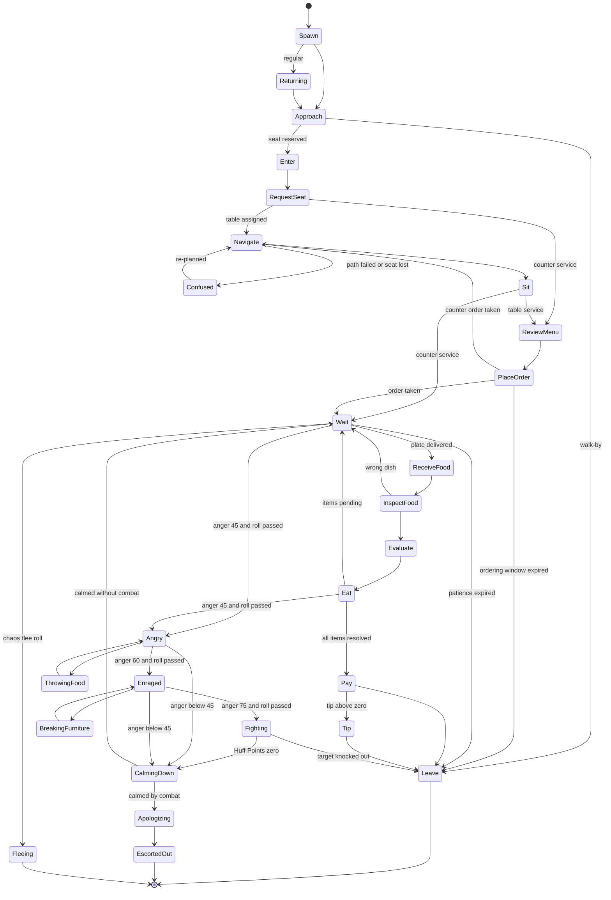

### 8.5 Rules & Mechanics — Interruption Handling

Interruptions are queued as events on the customer and resolved at the start of the next tick in priority
order (highest first). An interruption that invalidates a lower one discards it; otherwise the lower one is
resolved on the same tick if still valid.

| Priority | Interruption | Applies to | Resolution |
|---|---|---|---|
| 100 | Owner disconnect / `Closing` (E1), server shutdown (E13) | all customers | `LEAVE` (closed): pay 0, no reputation change, "Closed for the day!" sign; seated food discarded at no charge |
| 90 | Restaurant-wide chaos starts (level 6) | all inside | each customer resolves its chaos reaction (join / hide / flee, §10.9); queue frozen; arrivals held |
| 80 | Huff Points reach 0 | fighting customers | `CALMING_DOWN` (3 s `STS_DIZZY`), then `APOLOGIZING` |
| 70 | Hit by thrown food / ability / grabbed object | any | anger +25 × sens (thrown) per §10.6; 0.6 s flinch unless hostile; hostile customers retarget the thrower for 10 s |
| 60 | Fire: a station is `ON_FIRE` | customers within 30 studs | anger source (§10.6); customers within 10 studs of the fire step away (`CONFUSED` 2 s); `PACIFIST` customers flee if the fire lasts > 20 s |
| 50 | Table destroyed / seat Broken mid-meal | seated customers at that object | dish counts as finished if eat progress ≥ 50 %, else it is re-queued on the ticket as a free remake with a fresh 0.5 × Patience window; anger +15 × sens; `CONFUSED` 2 s → re-seat at a free seat, else eat standing at a "Standing Room Only" node |
| 45 | Wrong food served | `WAIT`/`INSPECT_FOOD` | rejected at inspect; anger +20 × sens; waits on (patience keeps running) |
| 40 | Seat taken (poof collision, co-op player sitting, knock-on displacement) | `NAVIGATE`/`SIT` | `CONFUSED` 2 s; host logic assigns the best free seat; anger +10 × sens |
| 30 | Player in a full-screen menu becomes this customer's target (E2) | hostile customers | the menu auto-closes for that player, who gets 1.5 s invulnerability; this customer's first attack on them is delayed 1.5 s |
| 20 | Patience expiry | `WAIT`/`PLACE_ORDER` | `LEAVE` per the transition table |

Interruptions never stack the same type twice in one tick (two food hits in one tick = two anger adds, one
flinch). Hostile customers ignore priorities 40 and 20 (they are not waiting any more).

### 8.6 Rules & Mechanics — Seating and Host Logic

**Counter service (`TIER_01`–`TIER_02`, §C6).** No host. Customers queue at the counter (max = seats), order to a
player standing within 10 studs of the counter (QST_TUT_002 teaches this), then walk to their reserved stool.
Food is either **placed on a `STN_WINDOW` pickup spot** tagged with their ticket — the bell dings "Order up,
<Name>!", the customer walks over, collects and returns to the stool — or **handed directly** to the seated
customer (Serve interaction, 10 studs). W stops the moment the plate touches the pickup spot, so a long walk
never costs the cook.

**Table service (`TIER_03`+).** Parties wait at the `FRN_396` Host Podium inside the door — the party wait node,
required from `TIER_03` (granted free with that upgrade, §15). Seating happens by:
1. a `ROLE_WAITER` employee (§16) — automatic, within the waiter's assigned section;
2. a player — tap the party, then tap a highlighted free table (or press **Seat** to accept the host's pick);
3. **Auto-Seat** (restaurant setting, default ON) — if neither acts within 8 s, the party seats itself at the
   host's pick. Auto-Seat never chooses a dirty table.

Order taking at table service is done by the waiter or any player interacting with the waving customer; food
is delivered by whoever carries the plate. MutationBonus (§10.3) uses the parts of whoever *delivered* the item.

**Host scoring** (highest wins; ties broken by the customer's RNG):

| Term | Value [TUNABLE] |
|---|---|
| Fit | −2 per empty seat left at the table |
| Clean | +3 if bussed; a dirty table is not eligible (the party waits — long seat wait, §10.6) |
| Waiter balance | +2 if the table's waiter section has the fewest active parties |
| Local atmosphere | + LocalAtmosphere(table) / 25, using the §15 formula (customers prefer nicer seats) |
| Personality preference | PER_023 near the door +3; PER_012 corner seat +3; PER_009 highest-décor table +3; PER_022 nearest the kitchen +2; PER_020 booth or table for 2+ (occupies 2 seats) |

### 8.7 Rules & Mechanics — Navigation

- **Bake.** `CustomerAIService` keeps a per-interior occupancy grid of 2 × 2-stud cells over the walkable floor.
  Furniture footprints from `BuildingService` mark cells blocked. Nodes = free cells plus named nodes (door,
  podium, queue spots, counter front, window pickup spots, seat-approach nodes). Paths from the door to every
  seat node (and seat → window, seat → door) are precomputed with A* (8-neighbour, octile heuristic) and cached.
- **Rebake.** Any furniture placement, move, removal or Destroyed/rubble state change triggers a debounced
  rebake (0.5 s after the last change), budgeted ≤ 8 ms per rebake for the largest interior (`TIER_10`,
  ≤ 6,400 cells), spread over frames with `task.defer` if larger. Customers mid-path switch to the new path at
  their next node. Placement validation (§15, E10) already rejects layouts that disconnect the door from any seat.
- **Local avoidance.** Each tick a customer reserves the next cell on its path. If another customer holds it,
  wait up to 1 s, then side-step to a free neighbour cell and re-path from there. Clients add a ±0.6-stud lateral
  smoothing offset so crowds do not look like trains.
- **Speed.** 10 studs/s base × personality WalkMult (§9.4); `FLEEING` ×1.4; `ESCORTED_OUT` ×0.7; hostile chase
  speeds per §11.8.1. [TUNABLE]
- **Hostile paths.** `CustomerAIService` answers the §11.8.1 chase-path requests (≤ 1 per second per hostile) from
  the same cached graph; `PathfindingService` is used only by `BuildingService` for placement validation.
- **Stuck handling (E10).** A path request that fails twice, or a customer whose position has not advanced
  ≥ 1 stud for 6 s, "poofs" (cartoon puff, "Pardon me!") to its seat node — or, if leaving, to the door.
  Poofs are logged (`mmr_customer_poof`) so level designers can find bad layouts.

### 8.8 Rules & Mechanics — Ordering

`OrderService:GenerateOrder(customer)` builds the ticket at `PLACE_ORDER` using these rules.

**Menu choice weight** for each eligible recipe r on the menu (not SOLD OUT, station present):

```
w(r) = Pref(r) × (Price(r) / AvgMenuPrice) ^ γ × Novelty(r) × Fatigue(r) × EventBoost(r)
Pref     = 3.0 preferred recipe · 1.8 preferred category · 1.0 neutral · 0 disliked (§9.4)
γ        = personality price bias (PER_008 +1.5, PER_015 −0.5, PER_002 +0.5, default 0)
Novelty  = 1.5 if the recipe joined the menu in the last 10 min
Fatigue  = 0.7 if one of the last 3 tickets in this restaurant was the same recipe
EventBoost = 1.5 for recipes an active event favours (§10.3 event table)
```

If every eligible weight is 0 (e.g. only disliked dishes on the menu), the customer orders the
highest-weighted neutral-ised dish anyway (Pref treated as 0.25) and its P_offset loses 5 (§10.3). Item count
follows §8.2.6. E9 applies: if everything is SOLD OUT, `RCP_BRG_001` is auto-added.

**Modifications (§6.18).** `OrderService` rolls modifications per item exactly as §6.18.3 specifies:
per-tier probabilities and maximums, joke share, hidden-mod chance, conflict groups, and the personality
`ModAffinity` multipliers listed in §9.4. Two rules matter for customers:
- **Time budget:** a modification is only generated if `EstPrep(item) + Σ ExtraTime(mod) ≤ 0.6 × Patience(item)`,
  so patience (§C11.2) needs no per-modification term and no customer ever asks for something that cannot be made
  in time.
- **Achievability:** every station a modification needs must be owned, placed and usable now; PER_019 shows its
  modifications as pictogram chips only.

### 8.9 Rules & Mechanics — Waiting and Patience

- **Patience** (§C11.2): `P = (70 + 20 × (items − 1) + 5 × ΣDifficulty) × PatienceMult × (1 + 0.004 × CHARM)`.
  CHARM is the highest effective CHARM among players inside the interior (rewards co-op charm builds). An event
  patience multiplier stated by §36.11 (e.g. `EVT_003` ×1.15) multiplies the result. Patience starts when the
  ticket is created and stops when the last item is delivered.
- **Seat comfort:** once seated, patience and the ordering window are multiplied by
  `SeatPatienceMult = clamp(1 + 0.02 × AtmospherePts(seat), 1.0, 1.2)` using the seat item's §36.13 Atmosphere
  points (a Cracked seat counts ×0.95: "it wobbles"). Regular "Friendly" (×1.10) and §36.11 event multipliers stack
  multiplicatively on top of §C11.2. [TUNABLE]
- **Ordering window:** 30 s × PatienceMult, then a 15 s × PatienceMult last-chance window (anger accrues).
- **Per-item wait factor** (§10.2): W = 1 until 50 % of P, then linear to 0 at 100 %.
- **Eat-while-waiting:** items arrive independently; the customer eats item 1 while item 2's clock keeps
  running. Plates delivered during `EAT` are placed on the table and inspected when the current item finishes,
  but their W timestamp is the placement time.
- **Pauses:** patience pauses only during chaos (customers are busy hiding), while the customer itself is hostile
  (levels 3–6), during `CONFUSED` caused by the restaurant (seat lost, table destroyed) and while PER_006 is asleep
  (max 15 s per visit). A hostile customer cannot be served ("Can't serve an angry customer!") except with a Peace
  Offering (§10.10).

| Example | Items | ΣD | Mult | CHARM | Patience |
|---|---|---|---|---|---|
| Nervous Newt, one easy burger | 1 | 1 | 1.1 | 0 | 82.5 s |
| Impatient Goblin, one easy burger | 1 | 1 | 0.55 | 0 | 41.3 s |
| Hungry Hippo-Spider, 4 items | 4 | 10 | 1.2 | 40 | 278.4 s |

### 8.10 Rules & Mechanics — Receiving, Inspecting, Eating

1. **Delivery.** A player or waiter carrying a plate interacts with the customer (10 studs; server re-validates
   at 12) or places it on the customer's table / pickup spot. `OrderService:ValidateServe(plate, ticket)` returns
   `{match, recipeId, A, Q, C, defects}` — the plate is matched to any pending item on that customer's ticket.
2. **Inspect.** 1.5 s × InspectMult: sniff, squint, poke (PER_004 uses a magnifying glass for 3 s; PER_014 picks at
   it for 3 s). Defects found here add anger immediately (§10.6): wrong dish, burned/undercooked components,
   failed non-joke modifications, MUSHY/SPILLED components.
3. **Evaluate.** `S_item` per §10.2; the reaction emote shows the band label and icon (§10.13).
4. **Eat.** EatTime = (10 + 3 × D) s × EatMult (D = recipe difficulty). Eating reduces anger 1.0/s at levels ≤ 2.
   Mutation Cuisine items additionally give the 60 s cosmetic random part (§C10, client-only).

### 8.11 Rules & Mechanics — Paying, Tipping, Leaving

- **Final satisfaction** S = price-weighted mean of `S_item` over all ordered items (undelivered items are
  scored as failed, §10.2). Pay, tip, Jackpot and reputation follow §C11.4, detailed in §10.5.
- **Cash Stack.** Payment + tip appear as a bouncing Cash Stack on the table (counter in band A). Any player
  collects it by walking within 10 studs or tapping it (QST_TUT_009); a `ROLE_CASHIER` collects instantly;
  uncollected stacks auto-deposit after 30 s. Money is credited by `EconomyService` at payment time — the stack
  is presentation only, so nothing can be lost or duplicated.
- **Leaving.** The customer walks out; the table becomes **dirty** (plates to bus) until a player, waiter or
  `ROLE_CLEANER` clears it (dirty tables cost cleanliness, §10.2). Reputation updates on despawn.

### 8.12 Rules & Mechanics — Regulars

Regulars are named repeat customers who remember you. Unlocks at `TIER_02`.

- **Promotion.** A solo customer finishing with S ≥ 90 has an 8 % chance to ask "Can I come back?" and becomes a
  Regular (auto-accepted; toast "<Name> is now a Regular!"). Maximum **20 Regulars** per restaurant; when full,
  the Regular with the lowest Loyalty is replaced only if the newcomer's S ≥ 95.
- **Stored record** (profile, owned by §28; ≈ 120 bytes each):
  `{ id, name, seed, personalityId, favoriteRecipe, visits, loyalty, grudge, grudgeCause, lastVisit }`.
  `seed` reproduces the exact body; PER_032 stores its revealed personality.
- **Arrival.** 12 % of arrivals are Regulars (§8.2.5), chosen by weight `1 + Loyalty/25`. They enter through
  `RETURNING` with a name tag and a personal greeting.
- **Favorite dish.** 50 % chance they order `favoriteRecipe` if on the menu (else normal ordering). The favorite
  is updated to the recipe of their highest-S visit.
- **Loyalty** (0–100): +8 for S ≥ 90, +4 for 70–89, 0 for 50–69, −6 for 30–49, −12 for S < 30 or storm-out.

| Loyalty tier | Threshold | Perk [TUNABLE] |
|---|---|---|
| Friendly | ≥ 25 | Patience ×1.10 |
| Loyal | ≥ 50 | TipMult +0.10 |
| Superfan | ≥ 80 | Chill aura: −0.3 anger/s to customers within 8 studs; 25 % chance to bring a +1 friend |

- **Grudges** (0–3). A Regular who storms out or finishes with S < 30 gains Grudge +1 and remembers the cause
  (`"burned RCP_BRG_002"`, `"waited too long"`, `"hit by food"`). Next visits start at anger 15 × Grudge and
  P_offset −5 × Grudge. Serving the grudge cause PERFECT (or simply S ≥ 90 for wait/food-fight causes) clears the
  grudge with "Fine. You're forgiven." At Loyalty 0 with Grudge 3 the Regular leaves forever ("I'm seeing another
  restaurant.").

### 8.13 Variables

| Variable | Value [TUNABLE] | Where used |
|---|---|---|
| Brain tick rate | 4 Hz (0.25 s) | §8.18 |
| Proxy movement replication | 10 Hz moving/fighting · 2 Hz seated/stationary · 1 Hz when no player is inside the interior | §8.18 |
| Arrival jitter band | 0.65–1.35 × mean | §8.2.2 |
| Rush wave | ±20 %, 360 s period | §8.2.2 |
| Lull guarantee | 20 s idle → arrival in 3 s | §8.2.2 |
| Outside queue | 4 customers; patience 60 s × PatMult × QueuePatienceMult (cap ×1.4) | §8.2.3 |
| SeatPatienceMult | 1 + 0.02 × seat Atmosphere pts, clamp 1.0–1.2 (Cracked ×0.95) | §8.9 |
| Away Mode delay | 30 s without a player inside (and no chef on shift) | §8.2.3 |
| Regular arrival share / promotion | 12 % / 8 % at S ≥ 90; cap 20 | §8.12 |
| Showcase body chance | 1 in 50 | §8.3.3 |
| Walk speed | 10 studs/s × WalkMult | §8.7 |
| Ordering window | 30 s × PatMult + 15 s × PatMult last chance | §8.9 |
| Auto-Seat delay | 8 s | §8.6 |
| Stuck poof | 2 path failures or 6 s without 1 stud progress | §8.7 |
| Inspect / eat | 1.5 s × InspectMult / (10 + 3·D) s × EatMult | §8.10 |
| Cash Stack auto-deposit | 30 s | §8.11 |

### 8.14 UI

- **Overhead widget** (`BillboardGui`, `AlwaysOnTop = false`, `MaxDistance = 60`): order bubble (recipe icon +
  mod pictograms; text on hover/long-press), **patience ring** that empties clockwise and gains notches at 50 % and
  a pulsing hourglass glyph at 75 %, **anger icon** (shape + glyph + text label per level, §10.13), Huff bar only
  while `FIGHTING`, name tag for Regulars (★ glyph), "?" for `CONFUSED`.
- **Ticket rail** (HUD order queue, §24): one card per ticket — customer name, portrait snapshot, items, mods,
  patience bar mirrored from the ring, table number. Cards sort by remaining patience.
- **Reaction pop-ups** at `EVALUATE`: band label + icon (WOW!, Nice, Meh, Ugh, FURIOUS) and, for PER_015, the
  itemized A/Q/C/W/K/M receipt (§9.4) — the in-game satisfaction tutor.
- **Door chips:** `Queue 2/4`, `Walk-bys: 3` (last 5 min) and `AwayPaused` banner. Eagle Eye (`ABL_070`) shows all
  patience and anger meters through walls for its duration.
- **Face and voice mood** are derived client-side (no extra replication): while the customer's anger level is ≥ 2
  the face follows the anger level; otherwise, before food arrives, from the patience fraction (< 50 % content,
  50–75 % impatient, > 75 % grumpy) and, after an item is evaluated, from `ItemS` using the canon §C11.3 bands
  (Delighted ≥ 90 · Happy 70–89 · Meh 50–69 · Unhappy 30–49 · Furious < 30). The reaction pop-up text uses the
  personality's own bands (§10.2); faces use the canon bands so art states stay uniform across personalities.
- All widgets respect the reduced-effects setting (no pulsing; static outlines).

### 8.15 Progression

| Band | What customers add |
|---|---|
| A (tiers 1–2) | counter service, 1–2 customers per party, 7 → 16 personalities, ≤ 1 mod per ticket, mostly Common bodies, Regulars from `TIER_02` |
| B (tiers 3–4) | table service + host podium, parties up to 4, critics/inspectors/couples/mimes, up to 3 mods per ticket |
| C (tiers 5–6) | aliens, wrestlers, the Mystery Mutant, FX auras on bodies, Legendary parts begin to appear |
| D–E (tiers 7–10) | Mythic parts, larger parties, 4–5 mods per ticket, higher hostile caps (§10.11) |

### 8.16 Player Interactions

Take order (10 studs, hold 0.3 s on mobile) · Seat party (tap party → tap table) · Serve plate (interact or place on
table/pickup spot) · Collect Cash Stack · Bus table · Peace Offering (serve an off-ticket dessert/drink, §10.10) ·
`ABL_006` Calm Down! · combat (§11) · `ABL_064` Super Sniff reveals hidden preferences and pictogram text ·
`ABL_070` Eagle Eye. Co-op guests may do all of these with owner permission (§21).

### 8.17 Dependencies

§5 (plate quality data), §6/§6.18 (recipes, modifications), §9 (personality parameters), §10 (satisfaction,
anger, chaos), §11 (NPC combat AI per style, Huff Points), §12/§36.3 (parts for bodies), §13 (morph assembly
contract §C13.7), §15 (layout, Atmosphere, damage states), §16 (waiter/cleaner/security/cashier AI), §17 (offline
demand uses the same Stars/DecorMult), §21 (co-op permissions), §24 (HUD), §26/§36.14 (animations), §27
(services, remotes), §28 (Regulars persistence), §30 (budgets), §31 (analytics).

### 8.18 Roblox Implementation

**Server proxy.** An anchored, invisible `Part` (2.5 × 5 × 2.5 studs × body scale; `CanCollide = false`,
`CanTouch = false`, `CanQuery = true` so `CombatService` raycasts hit it) parented to
`Workspace.Interiors.<PlotId>.Customers` (or the plot's street folder while outside), tagged `MMR_Customer` with
`CollectionService`. Interiors sit ≥ 2,000 studs apart with `Workspace.StreamingEnabled = true`, so only clients
near that interior receive its proxies and attribute changes.

**Rates.** Brains (state machine, patience, anger) evaluate at a 4 Hz baseline. Proxy **movement** is flushed
separately: 10 Hz while the customer is walking, fleeing or fighting, 2 Hz while seated or otherwise stationary,
and 1 Hz for every proxy of an interior with no player inside. Clients interpolate between flushes.

**Replicated Attributes** (written only when the value changes; the names below are canonical and centralized in
`ReplicatedStorage/Shared/Npc/ProxyAttributes`, which §27 also references):

| Attribute | Type | Purpose on the client |
|---|---|---|
| `CustomerId`, `PartyId`, `TicketId`, `SeatId` | string | lookup, party grouping, ticket card link |
| `Seed`, `Band`, `PersonalityId` | number / string / string | deterministic body, name, personality animation set (PER_032 changes `PersonalityId` at reveal) |
| `State`, `StateT0` | string / number | animation selection and sync (`workspace:GetServerTimeNow()` clock) |
| `PatienceTotal`, `PatienceT0`, `PatiencePaused` | number / number / bool | client computes the ring locally — no per-frame replication |
| `Anger`, `AngerLevel` | int / int | anger icon; `Anger` written only when its floor changes |
| `Huff`, `HuffMax` | int | Huff bar while fighting |
| `MoveSpeed`, `Emote`, `ItemS`, `RegularName` | number / string / number / string | extrapolation, dialogue bubble code, reaction pop-up, name tag |

**Remotes** (`<Domain>.<Action>`, validated server-side for range, ownership and state): `Customer.TakeOrder`,
`Customer.SeatParty`, `Customer.ServePlate`, `Customer.CollectCash`, `Customer.BusTable`,
`Customer.PeaceOffering`. Dialogue lines are chosen client-side from the `Emote` code so no strings travel.

```lua
--!strict
-- ServerScriptService/CustomerAI/StateMachine.lua : table-driven core layer
local StateMachine = {}

export type Customer = {
	id: string, proxy: BasePart, state: string, stateT0: number, resumeState: string?,
	patience: number, patienceT0: number?, delivered: number, pending: number, eatTime: number,
	pendingPlate: any?, anger: number, rng: Random, flags: { [string]: boolean },
}
type Transition = { guard: (Customer, number) -> boolean, to: string, flag: string? }
type StateDef = { enter: ((Customer, number) -> ())?, transitions: { Transition } }

local DEFS: { [string]: StateDef } = {
	WAIT = {
		transitions = {
			{ guard = function(c) return c.pendingPlate ~= nil end, to = "RECEIVE_FOOD" },
			{ guard = function(c, now)
				return c.patienceT0 ~= nil and now - c.patienceT0 >= c.patience and c.delivered == 0
			end, to = "LEAVE", flag = "stormOut" },
		},
	},
	EAT = {
		transitions = {
			{ guard = function(c, now) return now - c.stateT0 >= c.eatTime and c.pending > 0 end, to = "WAIT" },
			{ guard = function(c, now) return now - c.stateT0 >= c.eatTime and c.pending == 0 end, to = "PAY" },
		},
	},
}

local function setAttr(p: Instance, key: string, value: any)
	if p:GetAttribute(key) ~= value then p:SetAttribute(key, value) end
end

function StateMachine.enter(c: Customer, to: string, now: number)
	c.state, c.stateT0 = to, now
	setAttr(c.proxy, "State", to)
	setAttr(c.proxy, "StateT0", now)
	local def = DEFS[to]
	if def and def.enter then def.enter(c, now) end
end

function StateMachine.step(c: Customer, now: number)
	local def = DEFS[c.state]
	if not def then return end
	for _, t in def.transitions do
		if t.guard(c, now) then
			if t.flag then c.flags[t.flag] = true end
			StateMachine.enter(c, t.to, now)
			return
		end
	end
end

return StateMachine
```

```lua
--!strict
-- ServerScriptService/CustomerAI/Tick.server.lua : 4 Hz brains spread across frames + rate-limited movement flush
local RunService = game:GetService("RunService")
local Brain = require(script.Parent.Brain)      -- interruptions → anger (§10) → StateMachine.step → path advance
local BRAIN_TICK = 0.25
local MOVE_INTERVAL = { moving = 0.1, stationary = 0.5, emptyInterior = 1.0 } -- 10 / 2 / 1 Hz (§27 ruling)
local customers: { any } = {}
local cursor = 1

local function moveInterval(c): number
	if not c.restaurant.hasPlayerInside then return MOVE_INTERVAL.emptyInterior end
	return if c.isMoving or c.isFighting then MOVE_INTERVAL.moving else MOVE_INTERVAL.stationary
end

RunService.Heartbeat:Connect(function(dt: number)
	local n = #customers
	if n == 0 then return end
	local now = workspace:GetServerTimeNow()
	local budget = math.min(n, math.ceil(n * dt / BRAIN_TICK)) -- each brain ≈ every 0.25 s
	for _ = 1, budget do
		if cursor > n then cursor = 1 end
		local c = customers[cursor]
		cursor += 1
		Brain.step(c, now, now - (c.lastStep or now))
		c.lastStep = now
	end
	local parts, cframes = {}, {}
	for _, c in customers do                        -- cheap check; only due, dirty proxies are moved
		if c.cfDirty and now >= (c.nextMoveAt or 0) then
			table.insert(parts, c.proxy)
			table.insert(cframes, c.cf)
			c.cfDirty = false
			c.nextMoveAt = now + moveInterval(c)
		end
	end
	if #parts > 0 then
		workspace:BulkMoveTo(parts, cframes, Enum.BulkMoveMode.FireCFrameChanged)
	end
end)
```

```lua
--!strict
-- StarterPlayerScripts/CustomerVisuals.client.lua : build from seed, follow the proxy smoothly
local CollectionService = game:GetService("CollectionService")
local RunService = game:GetService("RunService")
local Builder = require(game.ReplicatedStorage.Shared.CustomerAppearance) -- same module the QA tools use
local visuals: { [BasePart]: Model } = {}

local function onAdded(proxy: Instance)
	if not proxy:IsA("BasePart") then return end
	local model = Builder.build(proxy:GetAttribute("Seed"), proxy:GetAttribute("PersonalityId"),
		proxy:GetAttribute("Band"))                 -- pooled R15 rig, Humanoid.EvaluateStateMachine = false
	model:PivotTo(proxy.CFrame)
	model.Parent = workspace.ClientVisuals
	visuals[proxy] = model
end
CollectionService:GetInstanceAddedSignal("MMR_Customer"):Connect(onAdded)
CollectionService:GetInstanceRemovedSignal("MMR_Customer"):Connect(function(proxy)
	local m = visuals[proxy :: BasePart]
	if m then Builder.release(m) visuals[proxy :: BasePart] = nil end
end)
for _, p in CollectionService:GetTagged("MMR_Customer") do onAdded(p) end

RunService.RenderStepped:Connect(function(dt: number)
	local alpha = math.min(1, dt * 10)
	for proxy, model in visuals do
		model:PivotTo(model:GetPivot():Lerp(proxy.CFrame, alpha)) -- 10 / 2 / 1 Hz flushes → smooth motion
	end
end)
```

**Performance budget** (§C3, §30):

| Budget | Limit |
|---|---|
| Customer proxies | seats (≤ 24) + 4 queue per restaurant; 160 per server (fair share §8.2.3) |
| Server time | `CustomerAIService` ≤ 1.5 ms average and ≤ 3.0 ms p95 per frame across all 8 restaurants at 160 proxies; rebake ≤ 8 ms, debounced 0.5 s |
| Network | proxy CFrames flushed via `BulkMoveTo` at 10 Hz moving/fighting, 2 Hz stationary, 1 Hz in empty interiors; ≤ 2 attribute writes per customer per second on average |
| Client visuals | built only inside the interior (street visuals for the queue); pooled rigs; ≤ 24 MeshParts / 6,000 triangles each; 1,500-triangle impostor beyond 60 studs; rigs beyond 40 studs stop non-locomotion tracks |
| Thrown food | scripted arcs per §11.6.2, ≤ 12 concurrent projectiles per restaurant (§11.7); debris client-only, despawns in 4 s |

### 8.19 Edge Cases

| # | Situation | Ruling |
|---|---|---|
| 1 | A plate matching another customer's pending item is served to the wrong customer | Accepted if it matches a pending item on the receiver's ticket (recipe + mods); the intended customer keeps waiting |
| 2 | Two players deliver the same item in the same tick | First validated delivery wins; the second plate stays in hand |
| 3 | A party member storms out | Members pay individually; the leaver's items go unpaid; remaining members gain anger +10 × sens |
| 4 | Reserved table destroyed before the party arrives | Re-reserve; if none fits, the party returns to the podium with a 5 s anger grace |
| 5 | Seat removed by redecorating mid-walk | Rebake + reassign; if no seat exists the customer leaves politely ("Oh, you're redecorating!") — no reputation change |
| 6 | Restaurant enters `AwayPaused` with customers inside | Customers without a delivered item leave politely (no reputation change); customers already eating finish and pay |
| 7 | Tier upgrade / renovation while open | Handled as `Closing` (E1): no reputation loss, eaten items paid |
| 8 | Influencer followers would exceed the proxy cap | Followers are bonus arrivals and are dropped silently |
| 9 | Mystery Mutant never interacted with | Leaves unrevealed; its record is not eligible to become a Regular |
| 10 | Customer hit by food during `SIT` | Flinch deferred until seated; anger applies immediately |
| 11 | Regular's favorite recipe is no longer on the menu | Orders normally; favorite kept for later |
| 12 | Owner levels up mid-rush (E14) | No customer effect |
| 13 | Ticket references a recipe that goes SOLD OUT after ordering | The order stands (ingredients reserved at ticket time); E9 only affects new orders |

### 8.20 Acceptance Criteria

- **AC-08-01:** With a fixed session seed, two server runs produce identical first-50 arrivals (time ± 0.01 s,
  party size, personality, `CustomerSeed`).
- **AC-08-02:** A simulated 10-hour `TIER_05` session (3.6 ★, Atmosphere 60, unlimited seats) averages
  166.3 customers/h ± 3 %.
- **AC-08-03:** Every arrival interval lies within [0.65, 1.35] × MeanInterval ÷ Rush(t).
- **AC-08-04:** The outside queue never exceeds 4 customers; an arrival without room logs a walk-by and changes no
  reputation.
- **AC-08-05:** Over 100,000 simulated draws per tier, personality frequencies match §8.2.5 within ± 0.5
  percentage points and no personality appears below its unlock tier.
- **AC-08-06:** Over 100,000 simulated tickets per tier, mean items per customer is 1.40 ± 0.03.
- **AC-08-07:** Two clients render byte-identical part lists for the same proxy; across 1,000,000 generated
  customers no Secret part appears and every visual is ≤ 24 MeshParts and ≤ 6,000 triangles.
- **AC-08-08:** All 29 states are reached and every row of §8.4.2 is exercised by a passing automated scenario.
- **AC-08-09:** A customer with two path failures or 6 s without progress is at its seat node ≤ 0.5 s later.
- **AC-08-10:** A furniture change on a `TIER_10` interior completes its rebake in ≤ 8 ms server time (median of
  100 placements).
- **AC-08-11:** Server patience equals the §8.9 examples to ± 0.1 s.
- **AC-08-12:** When a customer turns hostile on a player inside a full-screen menu, the menu closes within one
  frame and the player takes 0 damage for 1.5 s.
- **AC-08-13:** On owner disconnect every seated customer enters `LEAVE` within 0.25 s, with no payment and no
  reputation change recorded.
- **AC-08-14:** With 160 proxies across 8 restaurants, `CustomerAIService` averages ≤ 1.5 ms and stays ≤ 3.0 ms at
  p95 per server frame; attribute writes average ≤ 2 per customer per second; moving proxies flush at 10 Hz,
  seated ones at 2 Hz and proxies of empty interiors at 1 Hz (± 10 %).
- **AC-08-15:** A Regular renders identically on every visit, and a profile never stores more than 20 Regulars.
- **AC-08-16:** In counter service, W stops at the server timestamp when the plate touches the pickup spot, even if
  the customer needs 8 s to walk to the window.


## 9. Customer Personalities

> This section is the **personality database** (§C1.1): the table in §9.3 defines
> `PER_001`–`PER_032` (names fixed by §C11.1); §9.4 specifies every field for each. Spawning, bodies and the state
> machine are in §8; the satisfaction, anger and chaos math these parameters feed is in §10.

### 9.1 Purpose

A personality is a **behavior package** worn by a procedurally assembled body. The body (§8.3) makes every
customer look new; the personality makes every customer *act* recognisably, so players learn to read the room:
"a Karenosaurus just walked in — triple-check her modifications", "that's a Speedrunner Squirrel — drop everything
for the fries". Thirty-two personalities give each tier band fresh faces, and every one has at least one special
mechanic that creates a funny situation on its own, without a script.

### 9.2 Rules & Mechanics — How Personalities Layer on Bodies

#### 9.2.1 Layering

1. **Body first, personality on top.** §8.3 rolls the body from `CustomerSeed`, then **signature parts** listed in
   §9.4 overwrite their slots (e.g. PER_010 always has `MUT_004` Pigeon Head, per §C11.1). "Optional signature"
   parts are rolled with the stated chance. Everything else stays procedural, so two Karenosauruses never match.
2. **Behavior parameters** (§9.3) plug into the formulas of §8 and §10. Nothing in a personality bypasses those
   formulas; personalities only change inputs, thresholds and which special hooks fire.
3. **Animation set.** Each personality has a locomotion/idle variant set built on the core library (§C21); new
   variants are listed in words and receive IDs from §25–§26 in §36.14.
4. **Dialogue.** Bubble lines are chosen client-side from the personality's pools keyed by emote code (`ORDER`,
   `DELIGHT`, `HAPPY`, `MEH`, `UNHAPPY`, `FURIOUS`, `HOSTILE`, `CALM`, `APOLOGY`, `LEAVE`). Launch requires ≥ 3 lines
   per pool per personality; §9.4 lists the canonical ordering / delighted / furious examples. Lines are
   localization keys (`PER_001.ORDER.1`) in `LocalizationService` tables and pass the kid-safety checklist (§9.11).

#### 9.2.2 Parameter semantics

| Parameter | Meaning | Used in |
|---|---|---|
| Patience× | `PersonalityPatienceMult` in §C11.2 and the ordering window | §8.9 |
| P_mult / P_offset | personality terms of §C11.3. The effective offset adds preference adjustments: +5 preferred recipe, +3 preferred category, −8 disliked recipe or category, −5 forced order (§8.8), plus the dynamic hooks named in §9.4. Effective P_offset is clamped to [−20, +15]. | §10.3 |
| Thresholds D/H/M/U | personality bands for Delighted / Happy / Meh / Unhappy (below U = Furious). They drive the reaction emote, the evaluation anger delta and Regular loyalty. **Pay, tips and reputation always use raw S** (§C11.4). | §10.2, §10.6 |
| AngerP | base `AngerProbability` of the escalation roll at levels 3/4/5 | §10.7 |
| Sens | sensitivity: multiplies every anger **gain** (never decay) | §10.6 |
| Style / Huff | NPC combat style (§C11.6) and Huff Points (40–300, inside the §11.5.2 style bands) | §10.7, §11 |
| DEF / Dmg× | `PersonalityDEF` (0–40, added to the tier DEF term) and `PersonalityDamageMult` (multiplies NPC damage) | §11.5.1 |
| Items / γ | item range for §8.2.6; price bias γ for menu weighting (§8.8) | §8 |
| ModAffinity | §6.18.3 affinity group with its Aff / JokeAff / HidAff multipliers ("Aff / Joke / Hidden" in §9.4) plus the favored modification categories, derived from §6.18's "Favored by" column (favored mods get ×3 pick weight) | §6.18, §8.8 |
| Tip× | `PersonalityTipMult` in §C11.4 | §10.5 |
| Timing | WalkMult · MenuMult · InspectMult · EatMult (§9.4) | §8 |
| Unlock / Base wt | first tier it may spawn; spawn weight in band C (all bands in §8.2.5) | §8.2.5 |

#### 9.2.3 Combat ability selection

Per §C11.6 a customer may use the **active ability of one of its own visible parts**. Selection and use follow
§11.8.3: each customer has at most one **Signature Move**, chosen among its visible parts whose §36.6
"NPC use" entry lists the customer's style; it is used only at anger level 5 or in a scuffle, never by `PACIFIST`
customers, and utilities are never used (the only exception is the §36.6 flee entry of `ABL_063`). NPC numbers are
the §36.6 "NPC use" values. **Extension:** when a personality's signature part grants an eligible ability, that
ability is chosen before §11.8.3's slot priority, so recurring personalities keep a recognisable move. The §9.4
"Abilities" lists show, in priority order, the eligible options that personality's signature and commonly rolled
parts can provide; a customer whose body carries none of them fights with its style's basic attacks only (§11.8.2).

#### 9.2.4 Spawn bands

Personalities unlock by restaurant tier and stay eligible forever after; weights shift by band (§8.2.5). Band A
(`TIER_01`–`TIER_02`) is deliberately gentle — Newts, Grandmas and Sloths dominate — and every `INSTIGATOR` /
`BRAWLER` arrives no earlier than the tier at which the player has learned to fight (QST_TUT_007).

### 9.3 Personality Summary Table

Thresholds are Delighted / Happy / Meh / Unhappy lower bounds (canon default 90 / 70 / 50 / 30). DEF = `PersonalityDEF`
(0–40) and Dmg× = `PersonalityDamageMult` as consumed by the §11.5.1 damage formula ("—" = never attacks). Huff
values sit inside the §11.5.2 recommended band of each style, except the PER_016 minis (three small bodies, 150
total). PER_032 copies every value from the personality it reveals (pre-reveal values in brackets).

| ID | Name | Patience× | P_mult | P_offset | Thresholds D/H/M/U | AngerP | Sens | Style | Huff | DEF | Dmg× | Items | Tip× | Unlock | Base wt |
|---|---|---|---|---|---|---|---|---|---|---|---|---|---|---|---|
| `PER_001` | The Karenosaurus | 0.85 | 0.85 | −5 | 95/80/60/40 | 0.45 | 1.3 | `INSTIGATOR` | 100 | 10 | 0.8 | 1–2 | 0.6 | `TIER_01` | 6 |
| `PER_002` | The Hungry Hippo-Spider | 1.20 | 1.00 | +5 | 90/70/50/30 | 0.30 | 0.8 | `TANK` | 260 | 30 | 1.0 | 3–5 | 0.9 | `TIER_02` | 5 |
| `PER_003` | The Polite Demon | 1.15 | 1.05 | +5 | 88/65/45/25 | 0.12 (0.90 provoked) | 1.0 (1.8 provoked) | `BRAWLER` | 180 | 15 | 1.2 | 1–2 | 1.3 | `TIER_01` | 6 |
| `PER_004` | The Food Critic | 1.00 | 0.90 | 0 | 95/80/60/40 | 0.05 | 0.6 | `PACIFIST` | 60 | 0 | — | 2 | 1.0 | `TIER_03` | 2 |
| `PER_005` | The Impatient Goblin | 0.55 | 1.00 | 0 | 90/70/50/30 | 0.40 | 1.2 | `TRICKSTER` | 70 | 5 | 0.8 | 1 | 0.8 | `TIER_01` | 7 |
| `PER_006` | The Sleepy Sloth-Rocket | 1.80 | 1.05 | +5 | 85/65/45/25 | 0.15 | 0.7 | `CHARGER` | 120 | 20 | 1.1 | 1–2 | 1.1 | `TIER_01` | 6 |
| `PER_007` | The Chaos Gremlin | 0.90 | 1.00 | 0 | 90/70/50/30 | 0.50 | 1.2 | `TRICKSTER` | 80 | 5 | 0.9 | 1–2 | 1.0 | `TIER_02` | 5 |
| `PER_008` | The Rich Mutant | 0.90 | 0.90 | 0 | 96/85/65/45 | 0.20 | 1.0 | `PACIFIST` | 80 | 10 | — | 1–3 | 2.5 | `TIER_03` | 3 |
| `PER_009` | The Influencer | 0.80 | 1.00 | 0 | 92/75/55/35 | 0.30 | 1.1 | `INSTIGATOR` | 75 | 5 | 0.7 | 1–2 | 1.2 | `TIER_02` | 3 |
| `PER_010` | The Bodybuilder Pigeon | 0.90 | 1.00 | 0 | 90/70/50/30 | 0.55 | 1.6 | `BRAWLER` | 180 | 30 | 1.25 | 1–3 | 1.0 | `TIER_02` | 5 |
| `PER_011` | The Conspiracy Moth | 1.00 | 0.95 | 0 | 90/70/50/30 | 0.30 | 1.0 | `TRICKSTER` | 70 | 5 | 0.8 | 1–2 | 0.9 | `TIER_03` | 4 |
| `PER_012` | The Nervous Newt | 1.10 | 1.10 | 0 | 85/65/45/25 | 0.05 | 1.5 | `PACIFIST` | 40 | 0 | — | 1 | 1.2 | `TIER_01` | 5 |
| `PER_013` | The Grandma Golem | 1.40 | 1.05 | +5 | 85/60/40/20 | 0.10 | 0.5 | `TANK` | 300 | 40 | 0.9 | 1–2 | 1.5 | `TIER_01` | 5 |
| `PER_014` | The Picky Platypus | 1.00 | 0.90 | −5 | 92/75/55/35 | 0.35 | 1.1 | `THROWER` | 90 | 10 | 1.0 | 1–2 | 1.0 | `TIER_01` | 6 |
| `PER_015` | The Robot Accountant | 1.00 | 1.00 | 0 | 90/70/50/30 | 0.25 | 0.9 | `TANK` | 200 | 35 | 1.0 | 1–2 | 1.0 | `TIER_02` | 4 |
| `PER_016` | The Party Pack | 0.90 | 1.00 | 0 | 90/70/50/30 | 0.35 | 1.2 | `BRAWLER` | 50 ×3 | 0 | 0.5 | 1 each ×3 | 1.1 | `TIER_03` | 3 |
| `PER_017` | The Pirate Crab | 1.00 | 1.00 | 0 | 90/70/50/30 | 0.40 | 1.1 | `THROWER` | 120 | 15 | 1.0 | 1–2 | 1.0 | `TIER_02` | 4 |
| `PER_018` | The Drama Llama | 0.90 | 0.95 | 0 | 92/72/52/32 | 0.35 | 1.4 | `INSTIGATOR` | 100 | 10 | 0.8 | 1–2 | 1.0 | `TIER_02` | 4 |
| `PER_019` | The Mime Mantis | 1.10 | 1.00 | 0 | 90/70/50/30 | 0.25 | 1.0 | `TRICKSTER` | 100 | 10 | 0.9 | 1–2 | 1.2 | `TIER_03` | 3 |
| `PER_020` | The Toddler Titan | 0.70 | 1.00 | 0 | 85/65/45/25 | 0.45 | 1.3 | `THROWER` | 120 | 20 | 0.9 | 1–2 | 0.8 | `TIER_02` | 4 |
| `PER_021` | The Health Nut Hamster | 1.00 | 0.95 | 0 | 90/70/50/30 | 0.25 | 1.0 | `CHARGER` | 110 | 15 | 1.0 | 1–2 | 1.1 | `TIER_02` | 4 |
| `PER_022` | The Spicy Salamander | 1.00 | 1.00 | 0 | 90/70/50/30 | 0.35 | 1.0 | `THROWER` | 120 | 15 | 1.1 | 1–2 | 1.0 | `TIER_03` | 4 |
| `PER_023` | The Frozen Yeti-Fish | 1.10 | 1.00 | 0 | 90/70/50/30 | 0.25 | 0.9 | `CHARGER` | 170 | 25 | 1.0 | 1–2 | 1.0 | `TIER_03` | 4 |
| `PER_024` | The Time-Traveler Tortoise | 1.50 | 1.00 | +5 | 85/65/45/25 | 0.10 | 0.6 | `PACIFIST` | 80 | 40 | — | 1–2 | 1.3 | `TIER_04` | 2 |
| `PER_025` | The Undercover Inspector | 1.00 | 1.00 | 0 | 90/70/50/30 | 0.00 | 0.5 | `PACIFIST` | 80 | 10 | — | 1 | 1.0 | `TIER_03` | 2 |
| `PER_026` | The Speedrunner Squirrel | 0.60 | 1.00 | 0 | 90/70/50/30 | 0.40 | 1.2 | `CHARGER` | 110 | 5 | 0.9 | 1 | 1.0 | `TIER_04` | 3 |
| `PER_027` | The Lovebird Jellyfish Couple | 1.30 | 1.05 | +5 | 88/68/48/28 | 0.10 | 1.2 | `PACIFIST` | 70 ×2 | 0 | — | 1–2 each ×2 | 1.3 | `TIER_03` | 3 |
| `PER_028` | The Haunted Toaster | 1.00 | 1.00 | 0 | 90/70/50/30 | 0.35 | 1.0 | `THROWER` | 100 | 15 | 1.0 | 1–2 | 1.0 | `TIER_04` | 3 |
| `PER_029` | The Alien Tourist | 1.20 | 1.05 | +5 | 85/65/45/25 | 0.20 | 1.0 | `TRICKSTER` | 100 | 15 | 0.9 | 1–3 | 1.2 | `TIER_05` | 3 |
| `PER_030` | The Retired Wrestler Walrus | 1.00 | 1.00 | 0 | 90/70/50/30 | 0.40 | 1.3 | `BRAWLER` | 180 | 35 | 1.2 | 1–3 | 1.1 | `TIER_05` | 3 |
| `PER_031` | The Birthday Beast | 1.00 | 1.10 | +5 | 92/72/52/32 | 0.40 | 1.5 | `THROWER` | 120 | 10 | 1.0 | 2 | 1.5 | `TIER_03` | 3 |
| `PER_032` | The Mystery Mutant | [1.00] | [1.00] | [0] | [90/70/50/30] | as revealed | as revealed | as revealed | as revealed | as revealed | as revealed | as revealed [1–2] | revealed × 1.2 | `TIER_06` | 2 |

**Style distribution:** `PACIFIST` 6 · `THROWER` 6 · `TRICKSTER` 5 · `BRAWLER` 4 · `CHARGER` 4 · `TANK` 3 ·
`INSTIGATOR` 3 · inherited 1 = 32. Weighted by band-C spawn weights (party members counted), ≈ 15 % of arrivals can never attack
(`PACIFIST`; ≈ 20 % at `TIER_01`), which keeps "not every unhappy customer attacks" true even before escalation rolls.

### 9.4 Personality Detail Blocks

Each block lists every brief field. "Ref. spend" uses the `TIER_03` reference average ticket of ≈ 20 MB
(1.4 items × ≈ 14 MB); actual prices come from §6. Ability lists are in priority order (§9.2.3).

#### PER_001 — The Karenosaurus
*Complains about almost everything, with tiny arms and an enormous voice.*
- **Patience:** ×0.85 (ordering window 25.5 s). Timing: walk ×1.0 · menu ×1.2 · inspect ×1.5 · eat ×1.0.
- **Preferred foods:** BRG, SAL; `RCP_BRG_002` Cheeseburger, `RCP_SAL_002` Caesar Salad With Tiny Crown, `RCP_PIZ_001` Cheese Pizza, `RCP_DRK_002` Lemonade.
- **Disliked foods:** `RCP_PIZ_004` Pineapple Pizza (Controversial), `RCP_BRG_013` Upside-Down Burger.
- **Satisfaction thresholds:** 95 / 80 / 60 / 40; P_mult 0.85, P_offset −5.
- **Anger probability:** 0.45; sensitivity 1.3.
- **Combat behavior:** `INSTIGATOR`, Huff 100, DEF 10, Dmg ×0.8. She may Yell (§10.6) from level 2, one level early. Abilities: `ABL_023` Bat Screech (`MUT_089`), `ABL_029` Peacock Dazzle (`MUT_219`), `ABL_047` Mind Buzz (`MUT_033`). Her thrown food falls 30 % short (tiny arms).
- **Mod affinity:** Very picky (Aff ×2.0 · Joke ×0.5 · Hidden ×1.0) · favors OMIT, SHAPE, SEQUENCE.
- **Spending range:** 1–2 items, γ 0 → ref. spend 10–30 MB. **Tip behavior:** ×0.6.
- **Unique animations:** "Manager Summon" megaphone-hands stomp (variant of `ANM_050`); clipboard tap with tiny arms; holding the plate up to the light, appalled.
- **Dialogue:** Ordering — "One cheeseburger. The cheese must be room temperature. Not warm. Not cool. *Room.*" · Delighted — "Hmph. Acceptable. I'll only write you a *four*-paragraph review." · Furious — "I want to speak to the MANAGER! ...You ARE the manager? Then your manager's MANAGER!"
- **Special interactions:** *Manager!* — at level 2 the HUD pings "A customer demands the manager!"; if a player lands `ABL_006` on her within 20 s the calm amount is doubled, otherwise +10 anger. *Take it back!* — any item with A < 1 or Q < 0.80 is handed back; a remake served within 60 s replaces that item's S (the remake keeps the original W).
- **Tutorial variant (QST_TUT_006 → QST_TUT_007):** scripted by §32 and bound to its values (§32.3): fixed tutorial look (signature parts plus cosmetic sunglasses and handbag props), orders `RCP_BRG_002`, escalation rolls bypassed and anger driven through the scripted beats 32 → 48 → 63 → 78 (complain → soggy-pickle throw → table flip to Broken → fight). Fight values: Huff 48, 4 damage per hit, 1.0 s wind-up (1.5 s after two missed blocks), ≥ 3.0 s between attacks; the player has Plot Armor (≥ 1 HP). Calm Down! is refused at level 5 ("She's past talking"); at 0 Huff she goes Dizzy, apologizes and pays the Apology Payment (40 % of 10 MB = 4 MB). The variant is exempt from new-player protection (§10.11) and cannot storm out. Normal §9 values apply to every later Karenosaurus.
- **Signature look:** `MUT_032` T-Rex Head, `MUT_161` Tiny T-Rex Arm ×2. **Tier band:** `TIER_01`+ (A 3 · B–E 6).

#### PER_002 — The Hungry Hippo-Spider
*Eight legs, one bottomless stomach.*
- **Patience:** ×1.2 (the formula already adds +20 s per extra item). Timing: walk ×0.8 · menu ×0.8 · inspect ×0.6 · eat ×0.5 per item.
- **Preferred foods:** BRG, PIZ, FRI; `RCP_BRG_015` The Unreasonably Large Burger, `RCP_PIZ_005` Meat Mountain Pizza, `RCP_FRI_005` Fried Everything Basket, `RCP_TAC_005` Nacho Avalanche, `RCP_SOP_010` Bottomless Soup, `RCP_FRI_001` French Fries.
- **Disliked foods:** `RCP_SAL_004` Salad With No Lettuce, `RCP_BRG_014` Invisible Burger ("Where's the FOOD?").
- **Satisfaction thresholds:** 90 / 70 / 50 / 30; P_mult 1.0, P_offset +5.
- **Anger probability:** 0.30; sensitivity 0.8.
- **Combat behavior:** `TANK`, Huff 260, DEF 30, Dmg ×1.0. Abilities: `ABL_021` Ground Pound (`MUT_148`), `ABL_010` Bear Slam (`MUT_140`), `ABL_025` Puff Up (`MUT_129`). (Its signature Vacuum Mouth is not `TANK`-eligible for `ABL_035`; the snack trick below is a personality hook.)
- **Mod affinity:** Low-fuss (Aff ×0.6 · Joke ×0.5 · Hidden ×0.5) · favors EXTRA, COUNT.
- **Spending range:** 3–5 items, γ +0.5, plus "Seconds!" → ref. spend 60–120 MB. **Tip behavior:** ×0.9.
- **Unique animations:** four-handed eating blur (`ANM_043` at 2× speed); belly-pat; spider-leg tap-dance of joy.
- **Dialogue:** Ordering — "One of everything. Then the same again, but louder." · Delighted — "Eight legs, one stomach, ZERO regrets!" · Furious — "You call that a PORTION? I've had bigger crumbs!"
- **Special interactions:** *Seconds!* — after the last item, 30 % chance to order 1–2 more items as a new ticket with fresh patience. *Free snack* (personality hook) — thrown food aimed at it, or passing within 2 studs, is slurped out of the air and eaten: no hit, anger −5 instead of +25 (the projectile is consumed and cannot continue).
- **Signature look:** `MUT_066` Vacuum Mouth, `MUT_185` Spider Leg Cluster ×2, `MUT_120` Cow Body. **Tier band:** `TIER_02`+ (A 4 · B–E 5).

#### PER_003 — The Polite Demon
*Courteous, considerate, apologetic — until provoked.*
- **Patience:** ×1.15. Timing: walk ×1.0 · menu ×1.0 · inspect ×1.0 · eat ×1.0.
- **Preferred foods:** spicy and elegant; `RCP_BRG_007` Volcano Burger, `RCP_PST_010` Spicy Lava Lasagna, `RCP_DRK_007` Angry Coffee, `RCP_DES_007` Pie in the Face (Edible).
- **Disliked foods:** `RCP_DES_012` Cloud Cotton Candy, `RCP_DRK_014` Cloud Juice ("A little too heavenly for me, thank you").
- **Satisfaction thresholds:** 88 / 65 / 45 / 25; P_mult 1.05, P_offset +5.
- **Anger probability:** 0.12; **provoked** → 0.90 and sensitivity 1.8 for the rest of the visit.
- **Combat behavior:** `BRAWLER`, Huff 180, DEF 15, Dmg ×1.2. Abilities: `ABL_043` Lava Slam (`MUT_163`, signature), `ABL_031` Rocket Punch (`MUT_154`), `ABL_042` Thunder Clap (`MUT_105`).
- **Mod affinity:** Standard (Aff ×1.0 · Joke ×1.0 · Hidden ×1.0) · favors OMIT, DONENESS, MOOD.
- **Spending range:** 1–2 items → ref. spend 14–30 MB. **Tip behavior:** ×1.3 (always rounds up).
- **Unique animations:** deep courtly bow on arrival; napkin tucked into collar; at level 4 he slowly rolls up the sleeve over the Lava Fist (the "aggressive form" reveal, horns glow).
- **Dialogue:** Ordering — "Good evening! If it's no trouble at all, might I have the Volcano Burger? Only if convenient!" · Delighted — "Exquisite. My compliments to the chef, the sous-chef, and the very kind grill." · Furious — "I asked SO nicely. Excuse me while I roll up my sleeve. I do apologise in advance."
- **Special interactions:** *Provoked* flag — set when hit by thrown food, hit by any player attack, or served a wrong dish twice. Unprovoked, he is the calmest customer in the game; provoked, he skips sulking. *Gentleman's apology* — when calmed by combat he pays 10 % extra on top of the Apology Payment ("For the table, with my sincerest regrets"). **Tutorial:** the step-5 customer and the soda-splashed bystander of QST_TUT_007, calmed with Calm Down! (§32).
- **Signature look:** `MUT_108` Demon Horns, `MUT_047` Mustache of Destiny, `MUT_163` Lava Fist Arm (right arm only). **Tier band:** `TIER_01`+ (A–C 6 · D–E 5).

#### PER_004 — The Food Critic
*Evaluates every aspect. Out loud. In a notebook.*
- **Patience:** ×1.0. Timing: walk ×1.0 · menu ×1.5 · inspect ×2.0 (magnifying glass, 3 s) · eat ×1.2.
- **Preferred foods:** whatever on the menu has the highest difficulty (+1.8 weight per difficulty point above 2); `RCP_PST_004` Lasagna Tower, `RCP_SEA_003` Sushi Roll Block, `RCP_BRK_010` Dragon Egg Benedict, `RCP_DES_014` Galaxy Cheesecake, any LEG recipe.
- **Disliked foods:** `RCP_FRI_001` French Fries, `RCP_DRK_001` Fizzy Soda ("Pedestrian").
- **Satisfaction thresholds:** 95 / 80 / 60 / 40; P_mult 0.90, P_offset 0.
- **Anger probability:** 0.05; sensitivity 0.6.
- **Combat behavior:** `PACIFIST`, Huff 60, DEF 0. Never attacks; when upset she writes furiously (sulk) or leaves.
- **Mod affinity:** Very picky (Aff ×2.0 · Joke ×0.5 · Hidden ×1.0) · favors DONENESS, COUNT, PRESENT.
- **Spending range:** exactly 2 items (main + drink or dessert) → ref. spend 25–40 MB. **Tip behavior:** ×1.0.
- **Unique animations:** notebook scribble; pinky-raised tasting; dramatic pen-click verdict.
- **Dialogue:** Ordering — "Bring me your most ambitious dish. And a pen that hasn't been chewed." · Delighted — "Five stars. Six, if I were allowed. I am not allowed." · Furious — "This dish has the emotional depth of a puddle. A shallow one."
- **Special interactions:** *The Review.* On leaving she scores 5 categories, each 0–5 ★ in half steps: Taste = 5·Q, Technique = 5·C, Accuracy = 5·A, Speed = 5·W (price-weighted over items), Ambience = 5·(K + M)/200. If the average ≥ 4.5 **and** S ≥ 90 she awards a **Critic's Star**: +0.05 ★ reputation applied directly, a newspaper review card, and +1 to the profile's `criticStars` counter (read by §20's critic quest line). Average < 2.0 → −0.05 ★. During `EVT_008` she visits up to twice per restaurant on the §36.11 schedule and her verdict is also converted to Forks (`BLD_14` formula). Worked example in §10.4.
- **Signature look:** `MUT_016` Owl Head, `MUT_110` Giraffe Neck (looking down her nose). **Tier band:** `TIER_03`+ (B–C 2 · D–E 3).

#### PER_005 — The Impatient Goblin
*Wanted it five minutes ago.*
- **Patience:** ×0.55 (ordering window 16.5 s). Timing: walk ×1.3 · menu ×0.5 · inspect ×0.5 · eat ×0.6.
- **Preferred foods:** fastest prep; `RCP_FRI_001` French Fries, `RCP_SAN_003` Hot Dog Classic, `RCP_TAC_001` Basic Taco, `RCP_DRK_001` Fizzy Soda, `RCP_DES_001` Chocolate Chip Cookie.
- **Disliked foods:** `RCP_SOP_010` Bottomless Soup, `RCP_PST_004` Lasagna Tower, `RCP_PIZ_013` Pizza Inside Another Pizza.
- **Satisfaction thresholds:** 90 / 70 / 50 / 30; P_mult 1.0, P_offset 0.
- **Anger probability:** 0.40; sensitivity 1.2.
- **Combat behavior:** `TRICKSTER`, Huff 70, DEF 5, Dmg ×0.8: plate theft and hit-and-run per §11.8.2. Abilities: `ABL_016` Tongue Yank (`MUT_061`), `ABL_048` Slime Trail (`MUT_256`), `ABL_024` Skunk Cloud (`MUT_220`).
- **Mod affinity:** Low-fuss (Aff ×0.6 · Joke ×0.5 · Hidden ×0.5) · favors MOOD, TEMP.
- **Spending range:** 1 item → ref. spend 8–16 MB. **Tip behavior:** ×0.8, but ×2 if the item lands within 25 % of patience ("FAST! GOOD!").
- **Unique animations:** constant `ANM_046` foot tap from the moment he sits; wrist-tapping (no watch); vibrating with impatience.
- **Dialogue:** Ordering — "Burger. Fast. Faster than that. Why are you still listening? GO." · Delighted — "FAST! GOOD! MORE FAST NEXT TIME!" · Furious — "I've been waiting since I was BORN!"
- **Special interactions:** *Line Cutter* — in the outside queue he jumps to the front (impossible once a `FRN_433` Bouncer Rope lines the queue, §15); everyone he passes gains +5 anger on entry. *Speed reader* — orders without a menu phase if a ticket card is free.
- **Signature look:** `MUT_017` Lizard Head, `MUT_090` Fox Ears, `MUT_204` Roller Skates. **Tier band:** `TIER_01`+ (A 4 · B–E 7).

#### PER_006 — The Sleepy Sloth-Rocket
*Takes forever to order; leaves at rocket speed.*
- **Patience:** ×1.8. Timing: walk ×0.6 · menu ×3.0 (18 s) · inspect ×1.2 · eat ×1.8.
- **Preferred foods:** breakfast and caffeine; `RCP_BRK_001` Pancake Stack, `RCP_BRK_003` Waffles, `RCP_DRK_007` Angry Coffee, `RCP_DRK_015` Liquid Lightning, `RCP_SOP_001` Tomato Soup.
- **Disliked foods:** `RCP_DES_009` Exploding Cupcake, `RCP_BRG_012` Exploding Burger ("Too... loud...").
- **Satisfaction thresholds:** 85 / 65 / 45 / 25; P_mult 1.05, P_offset +5.
- **Anger probability:** 0.15; sensitivity 0.7.
- **Combat behavior:** `CHARGER`, Huff 120, DEF 20, Dmg ×1.1. His rush (§11.8.2) gets a cosmetic rocket ignition; he only escalates past level 4 after a nap is interrupted. Abilities: `ABL_013` Rhino Charge (`MUT_099`), `ABL_027` Armadillo Roll (`MUT_128`), `ABL_044` Gust Kick (`MUT_197`).
- **Mod affinity:** Low-fuss (Aff ×0.6 · Joke ×0.5 · Hidden ×0.5) · favors OMIT, TEMP, MOOD.
- **Spending range:** 1–2 items → ref. spend 12–28 MB. **Tip behavior:** ×1.1.
- **Unique animations:** slow-motion menu page turn; snore bubble with drool-free "Zzz"; rocket exhaust puffs when startled.
- **Dialogue:** Ordering — "I'll have the... (yaaawn)... the... what was the question?" · Delighted — "Mmm... so good... I'm gonna blast off... in a minute... or five..." · Furious — "You woke me up for THIS? Initiating... ROCKET MODE!"
- **Special interactions:** *Nap* — in `WAIT`, 20 % chance to fall asleep (`STS_SLEEPY` visual) for up to 15 s; patience is paused while asleep. A loud event within 10 studs (thrown food, breaking furniture) wakes him with +10 anger. Caffeine dishes add +3 P_offset.
- **Signature look:** `MUT_198` Rocket Booster Leg ×2, `MUT_259` Bear Fur, `MUT_202` Bunny Slippers. **Tier band:** `TIER_01`+ (A 7 · B–C 6 · D–E 5).

#### PER_007 — The Chaos Gremlin
*Occasionally causes trouble even when perfectly happy.*
- **Patience:** ×0.9. Timing: walk ×1.2 · menu ×0.8 · inspect ×1.0 · eat ×0.8.
- **Preferred foods:** `RCP_BRG_012` Exploding Burger, `RCP_DES_009` Exploding Cupcake, `RCP_PIZ_012` Backwards Pizza, `RCP_DRK_006` Rainbow Slushie, `RCP_DES_007` Pie in the Face (Edible).
- **Disliked foods:** `RCP_SAL_001` Garden Salad, `RCP_PST_001` Butter Noodles ("Boooring").
- **Satisfaction thresholds:** 90 / 70 / 50 / 30; P_mult 1.0, P_offset 0.
- **Anger probability:** 0.50; sensitivity 1.2.
- **Combat behavior:** `TRICKSTER`, Huff 80, DEF 5, Dmg ×0.9. Abilities: `ABL_056` Stink Bomb (`MUT_251`), `ABL_048` Slime Trail (`MUT_256`), `ABL_057` Firefly Flash (`MUT_083`).
- **Mod affinity:** Chaotic (Aff ×1.7 · Joke ×2.5 · Hidden ×1.0) · favors JOKE, SEQUENCE, TEMP.
- **Spending range:** 1–2 items → ref. spend 10–30 MB. **Tip behavior:** ×1.0.
- **Unique animations:** rubbing hands with a cackle; tiptoe sneak; innocent whistle after every prank.
- **Dialogue:** Ordering — "Something that explodes, please. Or something that WILL explode if I shake it." · Delighted — "Perfect! Now watch this—" · Furious — "Oh, you've done it now. I'm going to be SO MUCH TROUBLE."
- **Special interactions:** *Happy Prank* — once per visit, after paying and regardless of S, 15 % chance of one prank: knock a cup off a neighbour's table (spill), loosen a chair (−15 % durability), or swipe a neighbour's plate (+15 × sens anger to the victim). A `ROLE_SECURITY` employee within 15 studs reduces the chance by 80 %. Pranks count as chain-reaction sources (§10.8).
- **Signature look:** `MUT_089` Bat Ears, `MUT_067` Piranha Grin, `MUT_071` Googly Eyes. **Tier band:** `TIER_02`+ (A 3 · B–C 5 · D–E 6).

#### PER_008 — The Rich Mutant
*Pays exceptionally well. Expects perfection.*
- **Patience:** ×0.9. Timing: walk ×0.9 · menu ×1.2 · inspect ×1.5 · eat ×1.0.
- **Preferred foods:** the priciest dishes (γ +1.5); `RCP_SEA_004` Lobster-ish Roll, `RCP_SEA_010` Kraken Platter, `RCP_LEG_001` The Golden Patty Supreme, `RCP_DES_014` Galaxy Cheesecake, `RCP_PIZ_015` Galaxy Pizza.
- **Disliked foods:** `RCP_SAN_003` Hot Dog Classic, `RCP_PST_001` Butter Noodles ("Peasant noodles").
- **Satisfaction thresholds:** 96 / 85 / 65 / 45; P_mult 0.90, P_offset 0.
- **Anger probability:** 0.20; sensitivity 1.0.
- **Combat behavior:** `PACIFIST`, Huff 80, DEF 10. Storms out loudly instead ("I'll buy this restaurant and close it!").
- **Mod affinity:** Fancy (Aff ×1.5 · Joke ×1.0 · Hidden ×1.0) · favors DONENESS, PRESENT.
- **Spending range:** 1–3 items at top prices → ref. spend 30–70 MB. **Tip behavior:** ×2.5; Jackpot Tip chance doubled.
- **Unique animations:** monocle polish; tosses a coin to the server (cosmetic sparkle); fainting-couch swoon when displeased.
- **Dialogue:** Ordering — "Your most expensive item. Twice. Gold-plated, if you own a plater." · Delighted — "Splendid! Keep the change. Keep ALL the change." · Furious — "Disgraceful! I shall buy this restaurant just to close it! ...It's not for sale? DISGRACEFUL!"
- **Special interactions:** *Perfectionist* — any item with A < 1 or C < 0.8 applies P_offset −10 to the whole visit. *Round for the house* — at `TIER_05`+, when Delighted, 10 % chance that every other customer gets anger −15. MUT_258 Golden Skin on the server adds +2 MutationBonus (§10.3).
- **Signature look:** `MUT_258` Golden Skin, `MUT_047` Mustache of Destiny, `MUT_272` Sparkle Aura. **Tier band:** `TIER_03`+ (B 2 · C 3 · D 4 · E 5).

#### PER_009 — The Influencer
*Can make your restaurant famous — or infamous — in one post.*
- **Patience:** ×0.8. Timing: walk ×1.0 · menu ×1.0 · inspect ×2.0 (photo session) · eat ×1.0.
- **Preferred foods:** photogenic; `RCP_BRG_009` Rainbow Burger, `RCP_DRK_005` Bubble Tea, `RCP_DRK_006` Rainbow Slushie, `RCP_DES_008` Rainbow Slime Jelly, `RCP_DES_012` Cloud Cotton Candy, `RCP_PIZ_015` Galaxy Pizza.
- **Disliked foods:** `RCP_SOP_007` Swamp Stew ("Not aesthetic"), `RCP_BRG_014` Invisible Burger ("Can't post what I can't see").
- **Satisfaction thresholds:** 92 / 75 / 55 / 35; P_mult 1.0, P_offset 0 (+3 if the table's local décor ≥ 60).
- **Anger probability:** 0.30; sensitivity 1.1.
- **Combat behavior:** `INSTIGATOR`, Huff 75, DEF 5, Dmg ×0.7: livestreams the tantrum ("Chat, should I flip this table?") — her Yell (§10.6) reaches 20 studs instead of 12. Abilities: `ABL_029` Peacock Dazzle (`MUT_219`, signature: the ring-light dazzle), `ABL_023` Bat Screech (`MUT_089`), `ABL_047` Mind Buzz (`MUT_033`).
- **Mod affinity:** Fancy (Aff ×1.5 · Joke ×1.0 · Hidden ×1.0) · favors DONENESS, PRESENT, EXTRA.
- **Spending range:** 1–2 items → ref. spend 12–30 MB. **Tip behavior:** ×1.2.
- **Unique animations:** selfie-angle hold; ring-light spin; dramatic "unfollow" swipe.
- **Dialogue:** Ordering — "Hi chat! I'm getting the Rainbow Burger! Make it, like, extra photogenic?" · Delighted — "OMG, everybody come here RIGHT NOW!" · Furious — "Chat, zero stars. Negative stars. UNFOLLOWED."
- **Special interactions:** *The Post.* On leaving: S ≥ 90 → +0.1 ★ applied directly and 2–4 **Follower** customers arrive within 60 s (bonus arrivals outside base demand, random personalities, each 30 % likely to copy her order). S < 50 → −0.1 ★ (−0.05 ★ while the owner is below level 5) and one queued customer leaves. Max one Post effect per restaurant per 10 min. Posts appear as a "Morph Feed" toast.
- **Signature look:** `MUT_021` TV Head, `MUT_219` Peacock Tail (her ring light), `MUT_272` Sparkle Aura. **Tier band:** `TIER_02`+ (A 2 · B–C 3 · D–E 4).

#### PER_010 — The Bodybuilder Pigeon
*Extremely strong. Extremely easily offended. Never skips arm day; always skips leg day.*
- **Patience:** ×0.9. Timing: walk ×1.0 · menu ×0.8 · inspect ×1.0 · eat ×0.7.
- **Preferred foods:** protein; `RCP_BRG_004` Triple Stack Burger, `RCP_BRG_005` Bacon Monster Burger, `RCP_BRK_002` Fried Egg Plate, `RCP_BRK_008` Bacon Waterfall, `RCP_SAL_005` Carnivore "Salad", `RCP_DRK_003` Chocolate Milkshake ("protein shake").
- **Disliked foods:** `RCP_SAL_004` Salad With No Lettuce, `RCP_DES_012` Cloud Cotton Candy.
- **Satisfaction thresholds:** 90 / 70 / 50 / 30; P_mult 1.0, P_offset 0.
- **Anger probability:** 0.55; sensitivity 1.6.
- **Combat behavior:** `BRAWLER`, Huff 180, DEF 30, Dmg ×1.25 (the hardest-hitting customer). Abilities: `ABL_010` Bear Slam (`MUT_140`), `ABL_031` Rocket Punch (`MUT_154`), `ABL_050` Beak Peck Combo (`MUT_063`), `ABL_017` Claw Grab & Toss (`MUT_144`).
- **Mod affinity:** Standard (Aff ×1.0 · Joke ×1.0 · Hidden ×1.0) · favors OMIT, EXTRA, DONENESS.
- **Spending range:** 1–3 items → ref. spend 15–45 MB. **Tip behavior:** ×1.0.
- **Unique animations:** double-bicep flex on entry; head-bob strut; offended chest-puff (feathers fluff).
- **Dialogue:** Ordering — "Protein. Double protein. And a protein on the side, bro." · Delighted — "That burger just gave ME a pump. COO-COO, LET'S GO!" · Furious — "Did you just call my legs skinny?! Nobody did? WELL, I HEARD IT!"
- **Special interactions:** *Easily Offended* — a thrown-food hit forces his next escalation roll to succeed. *Respect* — if the server has `MUT_124` Muscle Torso or `MUT_160` Bodybuilder Arm equipped, P_offset +5 ("Respect, bro"). *Spotter* — when Delighted he stays 10 s and, if a hostile customer comes within 8 studs, flexes at them (anger −10, once per visit).
- **Signature look:** `MUT_004` Pigeon Head, `MUT_124` Muscle Torso, `MUT_160` Bodybuilder Arm ×2, `MUT_180` Chicken Leg ×2. **Tier band:** `TIER_02`+ (A 3 · B–E 5).

#### PER_011 — The Conspiracy Moth
*Knows the truth about the pickles.*
- **Patience:** ×1.0 (+5 % per light fixture within 10 studs, max +20 %). Timing: walk ×1.0 · menu ×1.5 · inspect ×1.5 · eat ×1.0.
- **Preferred foods:** glowing or suspicious; `RCP_PST_007` Glow-in-the-Dark Ravioli, `RCP_DRK_013` Glowing Mutagen Juice, `RCP_SOP_004` Alphabet Grumble Soup ("hidden messages"), `RCP_BRG_010` Mystery Meat Burger.
- **Disliked foods:** `RCP_BRG_014` Invisible Burger ("That's what THEY want"), `RCP_PIZ_014` Square Circle Pizza ("geometrically suspicious").
- **Satisfaction thresholds:** 90 / 70 / 50 / 30; P_mult 0.95, P_offset 0.
- **Anger probability:** 0.30; sensitivity 1.0.
- **Combat behavior:** `TRICKSTER`, Huff 70, DEF 5, Dmg ×0.8: flutters between ceiling lights, debuffs, never stays in melee. Abilities: `ABL_057` Firefly Flash (`MUT_083`), `ABL_040` Spore Puff (`MUT_248`), `ABL_046` Comet Blink (`MUT_228`).
- **Mod affinity:** Quirky (Aff ×1.2 · Joke ×1.5 · Hidden ×2.0) · favors OMIT, SEQUENCE, MOOD.
- **Spending range:** 1–2 items → ref. spend 10–28 MB. **Tip behavior:** ×0.9.
- **Unique animations:** red-string corkboard pantomime; circling the nearest lamp; peering at food through antennae.
- **Dialogue:** Ordering — "I'll have the soup. Not the soup on the menu — the REAL soup." · Delighted — "Delicious... TOO delicious. Who sent you? ...Never mind, another, please." · Furious — "The fries are ROUND on the INSIDE. Wake UP, people!"
- **Special interactions:** *Rumor Mill* — while `COMPLAINING`, customers within 8 studs who are at level ≥ 1 gain +0.3 anger/s ("The pickles are WATCHING us"). *Lamp Lover* — lights calm him (patience bonus above); during `EVT_009` Blackout Night his patience bonus is lost and sensitivity becomes 1.5.
- **Signature look:** `MUT_094` Moth Feather Antennae, `MUT_233` Moth Wings, `MUT_045` Moth Fuzz Face. **Tier band:** `TIER_03`+ (B–E 4).

#### PER_012 — The Nervous Newt
*Apologizes for existing; flees at the first raised voice.*
- **Patience:** ×1.1. Timing: walk ×1.1 · menu ×1.5 · inspect ×1.0 · eat ×1.0.
- **Preferred foods:** mild; `RCP_PST_001` Butter Noodles, `RCP_SAN_001` Grilled Cheese, `RCP_DRK_002` Lemonade, `RCP_DES_002` Vanilla Ice Cream. **Disliked:** `RCP_BRG_012` Exploding Burger, `RCP_PIZ_009` Screaming Cheese Pizza, `RCP_DES_013` Screaming Sorbet.
- **Satisfaction thresholds:** 85 / 65 / 45 / 25; P_mult 1.10, P_offset 0. **Anger probability:** 0.05; sensitivity 1.5 (startles easily).
- **Combat behavior:** `PACIFIST`, Huff 40, DEF 0. No abilities (flees at ×1.3 only if a `MUT_186` Cheetah Leg rolled, §36.6).
- **Mod affinity:** Standard (Aff ×1.0 · Joke ×1.0 · Hidden ×1.0) · favors OMIT, MOOD.
- **Spending range:** 1 item → ref. spend 8–16 MB. **Tip behavior:** ×1.2; ×1.5 more if served with W = 1 ("You're so nice!").
- **Unique animations:** hides behind the menu; startled hop with tail curl; tiny happy wiggle.
- **Dialogue:** Ordering — "Um, h-hi, sorry, could I maybe have the noodles? Only if it's okay? Sorry. Hi." · Delighted — "You remembered my order! Nobody remembers my order!" · Furious — "Oh no oh no — I'm very upset — sorry — bye!"
- **Special interactions:** *Startle* — any thrown food, broken object or fight within 10 studs adds +15 × 1.5 anger; at level ≥ 3 she flees (`FLEEING`, leaving the price of already-eaten items on the table — the only fleeing customer who pays). With the highest band-A weight she is most players' first unscripted customer.
- **Signature look:** `MUT_014` Axolotl Head, `MUT_256` Frog Slime Skin, `MUT_181` Frog Leg ×2. **Tier band:** `TIER_01`+ (A 8 · B 6 · C 5 · D–E 4).

#### PER_013 — The Grandma Golem
*Four hundred years old, made of rock, and worried you're not eating enough.*
- **Patience:** ×1.4. Timing: walk ×0.8 · menu ×1.2 · inspect ×1.0 · eat ×1.3.
- **Preferred foods:** comfort food; `RCP_SOP_001` Tomato Soup, `RCP_SOP_002` Chicken Noodle-ish Soup, `RCP_PST_002` Mac & Cheese, `RCP_BRG_002` Cheeseburger, `RCP_DES_001` Chocolate Chip Cookie, `RCP_DES_006` Birthday Cake Slice. **Disliked:** `RCP_DRK_015` Liquid Lightning ("In MY day lightning stayed in the sky"), `RCP_PIZ_012` Backwards Pizza.
- **Satisfaction thresholds:** 85 / 60 / 40 / 20; P_mult 1.05, P_offset +5. **Anger probability:** 0.10; sensitivity 0.5.
- **Combat behavior:** `TANK`, Huff 300, DEF 40, Dmg ×0.9 (the sturdiest customer): her slams also wobble every table within 10 studs (20 % spill chance per plate). Abilities: `ABL_021` Ground Pound (`MUT_148`), `ABL_010` Bear Slam (`MUT_140`), `ABL_025` Puff Up (`MUT_129`).
- **Mod affinity:** Standard (Aff ×1.0 · Joke ×1.0 · Hidden ×1.0) · favors DONENESS, OMIT.
- **Spending range:** 1–2 items → ref. spend 10–26 MB. **Tip behavior:** ×1.5 ("Buy yourself a sweater, dear").
- **Unique animations:** knitting while waiting; cheek-pinch wave at the server (air pinch); rock-crumble chuckle.
- **Dialogue:** Ordering — "A nice bowl of soup for me, sweetie. You look thin. Eat something too." · Delighted — "Just like I made in the Stone Age!" · Furious — "Young chef, I have been around four hundred years and I have NEVER been so disappointed."
- **Special interactions:** *Calming Presence* — while she is at level 0 and seated, customers within 8 studs decay anger 0.3/s faster (a Chill Aura, §10.10). *Second Helping* — Delighted at the end: 25 % chance she pre-pays a free cookie for the next customer (that customer's P_offset +3). **Tutorial:** QST_TUT_002's first customer, with a fixed look and patience ×3 (§32).
- **Signature look:** `MUT_135` Golem Rock Body, `MUT_169` Mitten Paws, `MUT_260` Sheep Wool (her shawl). **Tier band:** `TIER_01`+ (A 7 · B–C 5 · D–E 4).

#### PER_014 — The Picky Platypus
*Nothing may touch anything. Ever.*
- **Patience:** ×1.0. Timing: walk ×1.0 · menu ×1.5 · inspect ×2.0 (3 s of picking) · eat ×1.2.
- **Preferred foods:** `RCP_SEA_001` Fish Sticks, `RCP_SEA_003` Sushi Roll Block, `RCP_SAN_005` Peanut Butter & Jellyfish, `RCP_BRG_001` Basic Burger. **Disliked:** `RCP_FRI_005` Fried Everything Basket ("too many things TOUCHING"), `RCP_SAN_008` Sandwich With Bread in the Middle, `RCP_PIZ_013` Pizza Inside Another Pizza.
- **Satisfaction thresholds:** 92 / 75 / 55 / 35; P_mult 0.90, P_offset −5. **Anger probability:** 0.35; sensitivity 1.1.
- **Combat behavior:** `THROWER`, Huff 90, DEF 10, Dmg ×1.0: flicks offending garnishes with half the normal aim error. Abilities: `ABL_028` Trunk Spray (`MUT_053`), `ABL_034` Toast Barrage (`MUT_010`), `ABL_041` Frost Blast (`MUT_162`).
- **Mod affinity:** Very picky (Aff ×2.0 · Joke ×0.5 · Hidden ×1.0) · favors OMIT, COUNT, PRESENT.
- **Spending range:** 1–2 items → ref. spend 10–28 MB. **Tip behavior:** ×1.0.
- **Unique animations:** bill-tweezers garnish removal; lines up fries by size; horrified recoil when sauce touches bun.
- **Dialogue:** Ordering — "Fish sticks, cut into rectangles that are less rectangular. And nothing may touch anything." · Delighted — "Nothing is touching. Nothing is TOUCHING! Best day of my life." · Furious — "A pea touched my fry. I'm throwing BOTH."
- **Special interactions:** *Quality Gate* — an item with Q < 0.60 is rejected exactly like a wrong dish (§8.4.2). Serving with `STN_PLATING` plating (plating factor 1.0) earns P_offset +3.
- **Signature look:** `MUT_059` Duck Bill, `MUT_218` Beaver Tail, `MUT_201` Duck Feet. **Tier band:** `TIER_01`+ (A–E 6).

#### PER_015 — The Robot Accountant
*Calculates everything, including your tip, to the decimal.*
- **Patience:** ×1.0 (exactly). Timing: walk ×1.0 · menu ×0.8 · inspect ×1.0 · eat ×1.0.
- **Preferred foods:** efficient and square; `RCP_PIZ_014` Square Circle Pizza, `RCP_SEA_003` Sushi Roll Block, `RCP_DES_005` Brownie Brick, `RCP_SAN_002` Ham & Cheese Sandwich (γ −0.5: likes cheap). **Disliked:** `RCP_PST_008` The Infinite Noodle ("UNBOUNDED VALUE ERROR"), `RCP_SOP_010` Bottomless Soup.
- **Satisfaction thresholds:** 90 / 70 / 50 / 30; P_mult 1.0, P_offset 0 (+5 during `EVT_017`). **Anger probability:** 0.25; sensitivity 0.9.
- **Combat behavior:** `TANK`, Huff 200, DEF 35, Dmg ×1.0: marches in straight lines, "AUDIT" stomp. Abilities: `ABL_032` Laser Eyes (`MUT_078`, optional signature 30 %), `ABL_021` Ground Pound (`MUT_148`), `ABL_042` Thunder Clap (`MUT_105`).
- **Mod affinity:** Very picky (Aff ×2.0 · Joke ×0.5 · Hidden ×1.0) · favors COUNT, SHAPE.
- **Spending range:** 1–2 cheap items → ref. spend 8–22 MB. **Tip behavior:** ×1.0, rounded to the nearest whole MB; never Jackpots ("RANDOMNESS NOT PERMITTED").
- **Unique animations:** calculator-finger typing; receipt printing from the chest; precise 90° turns.
- **Dialogue:** Ordering — "ORDER: ONE (1) SQUARE CIRCLE PIZZA. BUDGET: OPTIMAL." · Delighted — "SATISFACTION 97.2 PERCENT. TIP CALCULATED. THANK YOU, HUMAN-ISH." · Furious — "ERROR. CALCULATING DAMAGES. RESULT: YOUR TABLE."
- **Special interactions:** *Itemized Receipt* — after paying, the server sees a receipt pop-up with that customer's A, Q, C, W, K, M, P_mult, P_offset, bonuses and S (the in-game satisfaction tutor).
- **Signature look:** `MUT_022` Robot Head, `MUT_123` Robot Body, `MUT_044` Robot Visor. **Tier band:** `TIER_02`+ (A 3 · B–E 4).

#### PER_016 — The Party Pack
*Three mini-mutants, one table, zero indoor voices.*
- **Patience:** ×0.9 (shared). Timing: walk ×1.3 · menu ×0.7 · inspect ×0.5 · eat ×0.7.
- **Preferred foods:** kid classics; `RCP_FRI_001` French Fries, `RCP_PIZ_001` Cheese Pizza, `RCP_SAN_003` Hot Dog Classic, `RCP_DES_002` Vanilla Ice Cream, `RCP_DES_003` Donut Ring, `RCP_DRK_001` Fizzy Soda. **Disliked:** `RCP_SAL_001` Garden Salad, `RCP_SOP_007` Swamp Stew.
- **Satisfaction thresholds:** 90 / 70 / 50 / 30; P_mult 1.0, P_offset 0. **Anger probability:** 0.35; sensitivity 1.2.
- **Combat behavior:** `BRAWLER`, Huff 50 each (×3), DEF 0, Dmg ×0.5, body scale 0.6: they dog-pile one target (still bound by the §11.8.1 two-attacker token limit). Abilities: `ABL_011` Kangaroo Kick (`MUT_184`), `ABL_050` Beak Peck Combo (`MUT_063`), `ABL_037` Jelly Bounce (`MUT_134`).
- **Mod affinity:** Standard (Aff ×1.0 · Joke ×1.0 · Hidden ×1.0) · favors EXTRA, PRESENT.
- **Spending range:** 1 item each, one ticket → ref. spend 24–40 MB per party. **Tip behavior:** ×1.1 on the shared bill.
- **Unique animations:** triple high-five; chair-hopping; synchronized "WHOAAA" when food arrives.
- **Dialogue:** Ordering — "FRIES! — NO, PIZZA! — I WANT WHAT SHE'S HAVING!" · Delighted — "BEST! PARTY! EVER!" · Furious — "Mini-mutants... ASSEMBLE!"
- **Special interactions:** spawns as **one party of 3** (§8.2.4) on one table and one ticket; S is the price-weighted mean of the three. *Shared Mood* — when one member gains anger from a hit or defect, the other two gain 40 % of it. Escalation is rolled once for the trio. One mini calmed = all three calm.
- **Signature look:** all three wear `MUT_051` Clown Nose and `MUT_272` Sparkle Aura; bodies otherwise procedural. **Tier band:** `TIER_03`+ (B–C 3 · D–E 4).

#### PER_017 — The Pirate Crab
*Sails in sideways, pays in "doubloons", fires meatballs.*
- **Patience:** ×1.0. Timing: walk ×0.8 (peg leg) · menu ×1.0 · inspect ×1.0 · eat ×1.0.
- **Preferred foods:** SEA; `RCP_SEA_001` Fish Sticks, `RCP_SEA_002` Fried Shrimp Basket, `RCP_SEA_005` Waving Calamari Rings, `RCP_SEA_009` Sea Monster Steak, `RCP_TAC_006` Fish Taco of Destiny, `RCP_DRK_011` Tentacle Tea. **Disliked:** `RCP_SEA_006` Crab Cake Kerfuffle ("That be me Uncle Pinchy!"), `RCP_SAL_001` Garden Salad.
- **Satisfaction thresholds:** 90 / 70 / 50 / 30; P_mult 1.0, P_offset 0. **Anger probability:** 0.40; sensitivity 1.1.
- **Combat behavior:** `THROWER`, Huff 120, DEF 15, Dmg ×1.0: "cannonball" meatball lobs with +5-stud range. Abilities: `ABL_049` Tentacle Whip (`MUT_146`), `ABL_031` Rocket Punch (`MUT_154`, "the cannon arm"), `ABL_028` Trunk Spray (`MUT_053`). His crab claw is for show (its `ABL_017` is not `THROWER`-eligible).
- **Mod affinity:** Standard (Aff ×1.0 · Joke ×1.0 · Hidden ×1.0) · favors EXTRA, COUNT, DONENESS.
- **Spending range:** 1–2 items → ref. spend 12–30 MB. **Tip behavior:** ×1.0; *Buried Treasure* — Jackpot chance ×2.
- **Unique animations:** sideways scuttle with `ANM_008` peg-leg wobble; spyglass menu read; telescope-sighting the kitchen.
- **Dialogue:** Ordering — "Arr! Fetch me yer finest fish sticks, and be quick about it, matey!" · Delighted — "Shiver me shell! Worth its weight in doubloons!" · Furious — "Ready the meatball cannons! FIRE!"
- **Special interactions:** *Treasure Map* — on Delight, 5 % chance to "bury" his tip: a sparkle appears at a random dining spot and the first player to step on it collects tip ×1.5. Displays all prices as "doubloons" (still MB).
- **Signature look:** `MUT_127` Crab Shell Torso, `MUT_144` Crab Claw Arm (one arm), `MUT_193` Tree Trunk Leg as a peg leg (other leg `MUT_179`). **Tier band:** `TIER_02`+ (A 3 · B–E 4).

#### PER_018 — The Drama Llama
*Every feeling at maximum volume.*
- **Patience:** ×0.9. Timing: walk ×1.0 · menu ×1.3 · inspect ×1.3 · eat ×1.0.
- **Preferred foods:** theatrical; `RCP_BRG_007` Volcano Burger, `RCP_PIZ_009` Screaming Cheese Pizza, `RCP_DES_013` Screaming Sorbet, `RCP_SOP_006` Pumpkin Screamer Soup, `RCP_DES_007` Pie in the Face (Edible). **Disliked:** `RCP_PST_001` Butter Noodles ("So... beige").
- **Satisfaction thresholds:** 92 / 72 / 52 / 32; P_mult 0.95, P_offset 0. **Anger probability:** 0.35; sensitivity 1.4.
- **Combat behavior:** `INSTIGATOR`, Huff 100, DEF 10, Dmg ×0.8: monologues (her Yell) that rile up the room. Abilities: `ABL_023` Bat Screech (`MUT_089`), `ABL_029` Peacock Dazzle (`MUT_219`), `ABL_047` Mind Buzz (`MUT_033`).
- **Mod affinity:** Chaotic (Aff ×1.7 · Joke ×2.5 · Hidden ×1.0) · favors SHAPE, SEQUENCE, JOKE.
- **Spending range:** 1–2 items → ref. spend 12–28 MB. **Tip behavior:** ×1.0.
- **Unique animations:** back-of-hoof forehead swoon; standing ovation; slow-motion faint onto the floor.
- **Dialogue:** Ordering — "I would like... (dramatic pause)... the Volcano Burger. And I would like it to CHANGE MY LIFE." · Delighted — "BRAVO! I'm weeping! Somebody bring me a tissue and a second burger!" · Furious — "This is the WORST thing that has EVER happened to ANYONE!" *(faints)*
- **Special interactions:** *Amplified* — evaluation anger deltas ×1.5 in **both** directions. *Dramatic Faint* — at level 2 she faints for 4 s, blocking her aisle cell (paths reroute). *Standing Ovation* — when Delighted, every customer within 10 studs gets anger −10.
- **Signature look:** `MUT_110` Giraffe Neck, `MUT_260` Sheep Wool, `MUT_205` Hooves. **Tier band:** `TIER_02`+ (A 3 · B–E 4).

#### PER_019 — The Mime Mantis
*Orders only in pictograms. Applauds silently. Fights invisibly.*
- **Patience:** ×1.1. Timing: walk ×1.0 · menu ×1.2 · inspect ×1.0 · eat ×1.0.
- **Preferred foods:** quiet food; `RCP_BRG_014` Invisible Burger (a mime's dream), `RCP_DES_002` Vanilla Ice Cream, `RCP_SEA_003` Sushi Roll Block, `RCP_PST_001` Butter Noodles. **Disliked:** loud food; `RCP_PIZ_009` Screaming Cheese Pizza, `RCP_DES_013` Screaming Sorbet, `RCP_SOP_006` Pumpkin Screamer Soup, `RCP_SOP_004` Alphabet Grumble Soup.
- **Satisfaction thresholds:** 90 / 70 / 50 / 30; P_mult 1.0, P_offset 0 (+5 when the pictogram order is fully correct). **Anger probability:** 0.25; sensitivity 1.0.
- **Combat behavior:** `TRICKSTER`, Huff 100, DEF 10, Dmg ×0.9: its debuff throw is mimed as an "invisible box" (`STS_STICKY`, §36.7). Abilities: `ABL_020` Web Shot (`MUT_028`, the "invisible rope"), `ABL_016` Tongue Yank (`MUT_061`), `ABL_046` Comet Blink (`MUT_228`). The scythe arms are for (silent) show.
- **Mod affinity:** Quirky (Aff ×1.2 · Joke ×1.5 · Hidden ×1.0) · favors JOKE, COUNT, SHAPE.
- **Spending range:** 1–2 items → ref. spend 10–28 MB. **Tip behavior:** ×1.2.
- **Unique animations:** walking against invisible wind; pulling an invisible rose from an invisible sleeve; trapped-in-a-box routine.
- **Dialogue (pictogram bubbles):** Ordering — *burger icon · crossed-out tomato · two fingers* while miming careful eating · Delighted — *silent applause, invisible rose, deep bow* · Furious — *mimes being trapped in a box... then mimes building one around YOU.*
- **Special interactions:** *Pictogram Order* — the ticket shows icons only (recipe category, ingredients, modification glyphs). Text appears with `ABL_064` Super Sniff, `ABL_070` Eagle Eye, or after 5 s with the accessibility setting "Pictogram Hints" (default ON in band B). A wrong dish caused by misreading still counts as wrong. Ordering never uses voice SFX.
- **Signature look:** `MUT_026` Mantis Head, `MUT_151` Mantis Scythe Arm ×2. **Tier band:** `TIER_03`+ (B–E 3).

#### PER_020 — The Toddler Titan
*Enormous. Adorable. Throws everything.*
- **Patience:** ×0.7. Timing: walk ×0.9 · menu ×0.6 · inspect ×0.5 · eat ×1.4 (messy).
- **Preferred foods:** sweets; `RCP_DES_002` Vanilla Ice Cream, `RCP_DES_004` Strawberry Sundae, `RCP_DES_003` Donut Ring, `RCP_BRK_001` Pancake Stack, `RCP_DRK_003` Chocolate Milkshake, `RCP_SAN_001` Grilled Cheese. **Disliked:** `RCP_SAL_001` Garden Salad ("NO GREEN!"), `RCP_SOP_007` Swamp Stew, `RCP_DRK_008` Swamp Water Smoothie.
- **Satisfaction thresholds:** 85 / 65 / 45 / 25; P_mult 1.0, P_offset 0 (+5 for any DES item). **Anger probability:** 0.45; sensitivity 1.3.
- **Combat behavior:** `THROWER`, Huff 120, DEF 20, Dmg ×0.9, body scale 1.35 (needs a booth or a 2-seat table): its aim error is doubled — a menace to bystanders. Abilities: `ABL_034` Toast Barrage (`MUT_010`), `ABL_028` Trunk Spray (`MUT_053`), `ABL_041` Frost Blast (`MUT_162`).
- **Mod affinity:** Quirky (Aff ×1.2 · Joke ×1.5 · Hidden ×1.0) · favors EXTRA, OMIT, JOKE.
- **Spending range:** 1–2 items → ref. spend 8–24 MB. **Tip behavior:** ×0.8.
- **Unique animations:** spoon-banging; floor-kicking tantrum (variant of `ANM_050`); sticky-hug lunge when happy.
- **Dialogue:** Ordering — "WANT ICE CREAM! WANT IT NOW! WANT IT YESTERDAY!" · Delighted — "YAAAY! You're my BEST FRIEND!" · Furious — "NO! NO! NOOOOO!"
- **Special interactions:** *Sweet Tooth* — a Peace Offering dessert drops anger by **two full levels** (§10.10). *Nap Time* — after a dessert, 20 % chance to doze for 10 s before paying (`STS_SLEEPY` visual, immune to auras).
- **Signature look:** `MUT_118` Bear Body, `MUT_071` Googly Eyes, `MUT_202` Bunny Slippers; scale 1.35. **Tier band:** `TIER_02`+ (A 3 · B–E 4).

#### PER_021 — The Health Nut Hamster
*Counts every vitamin; rolls out of here in a ball when wronged.*
- **Patience:** ×1.0. Timing: walk ×1.2 · menu ×1.4 (reads labels) · inspect ×1.2 · eat ×0.9.
- **Preferred foods:** SAL, smoothies; `RCP_SAL_001` Garden Salad, `RCP_SAL_003` Fruit Salad Explosion, `RCP_DRK_004` Strawberry Smoothie, `RCP_DRK_008` Swamp Water Smoothie, `RCP_SEA_003` Sushi Roll Block. **Disliked:** FRI; `RCP_FRI_001` French Fries, `RCP_FRI_004` Fried Ice Cream, `RCP_FRI_005` Fried Everything Basket, `RCP_BRG_015` The Unreasonably Large Burger.
- **Satisfaction thresholds:** 90 / 70 / 50 / 30; P_mult 0.95, P_offset 0. **Anger probability:** 0.25; sensitivity 1.0.
- **Combat behavior:** `CHARGER`, Huff 110, DEF 15, Dmg ×1.0: curls into a hamster ball and rolls through furniture. Abilities: `ABL_027` Armadillo Roll (`MUT_128`, signature), `ABL_011` Kangaroo Kick (`MUT_184`).
- **Mod affinity:** Standard (Aff ×1.0 · Joke ×1.0 · Hidden ×1.0) · favors OMIT, TEMP.
- **Spending range:** 1–2 items → ref. spend 10–26 MB. **Tip behavior:** ×1.1.
- **Unique animations:** jogging in place while waiting; label-squint; protein-free victory jumping jacks.
- **Dialogue:** Ordering — "One Garden Salad, extra garden. Is the lettuce free-range?" · Delighted — "So many vitamins! I'll run nine miles on my wheel tonight!" · Furious — "Is that... GREASE?! I'm rolling OUT of here!"
- **Special interactions:** *Label Reader* — any item whose recipe has the `fried` ingredient tag (§C9) applies P_offset −10, even if it was what she ordered by mistake. *Workout* — while waiting she jogs in place: patience drains 10 % slower, but she blocks her aisle cell.
- **Signature look:** `MUT_087` Mouse Ears, `MUT_057` Carrot Nose, `MUT_128` Armadillo Body. **Tier band:** `TIER_02`+ (A–E 4).

#### PER_022 — The Spicy Salamander
*Nothing is ever spicy enough.*
- **Patience:** ×1.0. Timing: walk ×1.0 · menu ×1.0 · inspect ×1.0 · eat ×0.8.
- **Preferred foods:** `spicy` tag; `RCP_BRG_007` Volcano Burger, `RCP_PIZ_008` Lava Pizza, `RCP_TAC_008` Hot Sauce Volcano Burrito, `RCP_TAC_009` Ghost Pepper Ghost Taco, `RCP_SOP_008` Lava Lentil Soup, `RCP_DRK_010` Hot Sauce Latte, `RCP_PST_010` Spicy Lava Lasagna. **Disliked:** frozen; `RCP_BRG_008` Frozen Burger, `RCP_SOP_003` Soupsicle (Frozen Soup), `RCP_DRK_009` Ice Ice Smoothie.
- **Satisfaction thresholds:** 90 / 70 / 50 / 30; P_mult 1.0, P_offset 0 (−5 for any item without the `spicy` tag unless it carries a heat modification from §6.18). **Anger probability:** 0.35; sensitivity 1.0.
- **Combat behavior:** `THROWER`, Huff 120, DEF 15, Dmg ×1.1: prefers `spicy` food as ammunition (`STS_TOASTY` on hit per §11.6.1). Abilities: `ABL_032` Laser Eyes (`MUT_078`, "heat vision"), `ABL_034` Toast Barrage (`MUT_010`), `ABL_031` Rocket Punch (`MUT_154`).
- **Mod affinity:** Quirky (Aff ×1.2 · Joke ×1.5 · Hidden ×1.0) · favors EXTRA, TEMP, MOOD.
- **Spending range:** 1–2 items → ref. spend 14–32 MB. **Tip behavior:** ×1.0.
- **Unique animations:** fanning mouth with delight; steam-ear puffs; drinking hot sauce like soda.
- **Dialogue:** Ordering — "Volcano Burger. Hotter. Hotter than that. Make the volcano nervous." · Delighted — "PERFECT! My tongue just took a vacation to the sun!" · Furious — "This is MILD. Do you know what I do to MILD things?"
- **Special interactions:** *Heat Seeker* — sits nearest the kitchen when possible (§8.6); the `EVT_019` EventModifier (+5 for spicy dishes served with a drink) stacks with his spicy preference. A station going `ON_FIRE` does **not** anger him (he cheers instead: anger −5).
- **Signature look:** `MUT_254` Fireproof Skin, `MUT_215` Lizard Tail, `MUT_115` Frill Lizard Collar. **Tier band:** `TIER_03`+ (B–E 4).

#### PER_023 — The Frozen Yeti-Fish
*Likes it cold. Melts into a bad mood near hot grills.*
- **Patience:** ×1.1 (×0.87 effective drain if ≥ 4 heat stations are running within 20 studs). Timing: walk ×0.9 · menu ×1.0 · inspect ×1.0 · eat ×1.0.
- **Preferred foods:** cold; `RCP_BRG_008` Frozen Burger, `RCP_SOP_003` Soupsicle (Frozen Soup), `RCP_DES_002` Vanilla Ice Cream, `RCP_DES_013` Screaming Sorbet, `RCP_DES_011` Frozen Lava Cake, `RCP_DRK_006` Rainbow Slushie, `RCP_DRK_009` Ice Ice Smoothie. **Disliked:** `RCP_SOP_008` Lava Lentil Soup, `RCP_PIZ_008` Lava Pizza, `RCP_DRK_010` Hot Sauce Latte.
- **Satisfaction thresholds:** 90 / 70 / 50 / 30; P_mult 1.0, P_offset 0. **Anger probability:** 0.25; sensitivity 0.9.
- **Combat behavior:** `CHARGER`, Huff 170, DEF 25, Dmg ×1.0: his rush is a belly slide that leaves a 6-stud ice streak (players crossing it get `STS_SLOW`, §36.7). Abilities: `ABL_054` Hammerhead Bash (`MUT_025`), `ABL_044` Gust Kick (`MUT_197`), `ABL_013` Rhino Charge (`MUT_099`).
- **Mod affinity:** Quirky (Aff ×1.2 · Joke ×1.5 · Hidden ×1.0) · favors TEMP, EXTRA.
- **Spending range:** 1–2 items → ref. spend 10–28 MB. **Tip behavior:** ×1.0.
- **Unique animations:** fanning himself with a menu; shiver of joy; ice-skating belly slide.
- **Dialogue:** Ordering — "Brrr-illiant. One Frozen Burger, colder than a snowball's snowball." · Delighted — "Chilly perfection! I'm so happy I could hibernate." · Furious — "It's WARM. You served me WARM. Prepare for... the BELLY SLIDE!"
- **Special interactions:** *Meltdown* — seated within 20 studs of ≥ 4 running heat stations, patience drains ×1.15; the host seats him by the door (§8.6). Hot-served frozen dishes (temperature modifications of §6.18) count as defects. During `EVT_020` Frozen Snap he is Delighted at 85.
- **Signature look:** `MUT_262` Yeti Frost Fur, `MUT_009` Fish Head, `MUT_214` Fish Tail. **Tier band:** `TIER_03`+ (B–E 4).

#### PER_024 — The Time-Traveler Tortoise
*Orders from the future; politely accepts the present.*
- **Patience:** ×1.5. Timing: walk ×0.5 · menu ×1.5 · inspect ×1.0 · eat ×1.5.
- **Preferred foods:** breakfast at all hours; `RCP_BRK_009` Breakfast-for-Dinner-for-Breakfast, `RCP_BRK_005` Upside-Down Pancakes, `RCP_BRK_007` Cereal With Soup Instead of Milk, `RCP_SOP_003` Soupsicle (Frozen Soup). **Disliked:** `RCP_DRK_015` Liquid Lightning ("Last time I drank that I ended up in next Tuesday").
- **Satisfaction thresholds:** 85 / 65 / 45 / 25; P_mult 1.0, P_offset +5. **Anger probability:** 0.10; sensitivity 0.6.
- **Combat behavior:** `PACIFIST`, Huff 80, DEF 40 (it is mostly shell). No abilities; when upset it retreats into its shell and sulks.
- **Mod affinity:** Quirky (Aff ×1.2 · Joke ×1.5 · Hidden ×1.0) · favors DONENESS, TEMP, SEQUENCE.
- **Spending range:** 1–2 items → ref. spend 12–30 MB. **Tip behavior:** ×1.3.
- **Unique animations:** pocket-watch check; slow-motion everything; a brief rewind shimmer when sitting.
- **Dialogue:** Ordering — "I'd like the Galaxy Pizza, please. Oh — you won't know it for another forty levels? Then whatever's closest." · Delighted — "Marvelous! I'll tip you now AND last Tuesday." · Furious — "I have waited CENTURIES! ...Well, it felt like centuries. It was ninety seconds."
- **Special interactions:** *Order From the Future* — the main is a recipe the owner has **not learned**, chosen from recipes with unlock level in (L, L + 10] in a category the menu serves; the ticket reads "From the Future". Any recipe of the same category is accepted as a substitute with A = 0.8 (+5 P_offset if the substitute's unlock level ≥ requested − 10). Serving the real recipe (if learned meanwhile) gives A = 1 and Tip× +0.5 ("Paradox!"). Either way the requested recipe is revealed as a *Recipe Preview* in the Cooking Academy (`BLD_06`) at −10 % learning cost (once per recipe).
- **Signature look:** `MUT_244` Turtle Backpack Shell, `MUT_109` Turtle Neck, `MUT_272` Sparkle Aura (time sparkles). **Tier band:** `TIER_04`+ (B–C 2 · D–E 3).

#### PER_025 — The Undercover Inspector
*Definitely just a normal customer. Sniff sniff.*
- **Patience:** ×1.0. Timing: walk ×1.0 · menu ×1.0 · inspect ×1.5 · eat ×1.0.
- **Preferred foods:** deliberately ordinary; `RCP_SAN_002` Ham & Cheese Sandwich, `RCP_SOP_001` Tomato Soup, `RCP_DRK_002` Lemonade. **Disliked:** `RCP_BRG_010` Mystery Meat Burger ("Where did this meat come from? Asking for... no one.").
- **Satisfaction thresholds:** 90 / 70 / 50 / 30; P_mult 1.0, P_offset 0. **Anger probability:** 0.00 (would blow the cover); sensitivity 0.5.
- **Combat behavior:** `PACIFIST`, Huff 80, DEF 10. No abilities.
- **Mod affinity:** Fancy (Aff ×1.5 · Joke ×1.0 · Hidden ×2.0) · favors PRESENT, SEQUENCE.
- **Spending range:** 1 item → ref. spend 10–18 MB. **Tip behavior:** ×1.0.
- **Unique animations:** table-top finger swipe for dust; hidden notepad scribble; badge half-flash, quickly hidden.
- **Dialogue:** Ordering — "One perfectly normal sandwich, for me, a perfectly normal customer." · Delighted — "Very... clean. I mean TASTY. Tasty is what I meant." · Furious (cover blown) — "Alright, FINE! INSPECTOR! You have a SPILL in aisle three!"
- **Special interactions:** *Inspection* — tracks the minimum dining cleanliness K seen during the visit (§10.2). On leaving: K_min ≥ 80 → "Spotless" certificate, +0.05 ★ and a cosmetic façade badge for 1 h; K_min < 50 → "Citation", −0.05 ★. *Blown Cover* — if hit by anything, or revealed by `ABL_064` Super Sniff and then served last, he flashes the badge and leaves after paying: the inspection completes immediately using the current K. Cousin of `NPC_022` Inspector Grimewell, who runs the official `EVT_026` sweeps (§36.11); the undercover visits keep their normal weight during a sweep.
- **Signature look:** `MUT_047` Mustache of Destiny (obviously fake), `MUT_054` Star-Nosed Mole Nose. **Tier band:** `TIER_03`+ (B–E 2).

#### PER_026 — The Speedrunner Squirrel
*Going for the world record in eating fries.*
- **Patience:** ×0.6 — a visible speedrun timer floats above the head. Timing: walk ×1.6 · menu ×0.3 · inspect ×0.3 · eat ×0.4.
- **Preferred foods:** nuts and quick bites; `RCP_SAN_005` Peanut Butter & Jellyfish, `RCP_DES_010` Bug Brittle, `RCP_DES_001` Chocolate Chip Cookie, `RCP_FRI_001` French Fries, `RCP_DRK_001` Fizzy Soda. **Disliked:** `RCP_PST_008` The Infinite Noodle ("unskippable cutscene"), `RCP_SOP_010` Bottomless Soup.
- **Satisfaction thresholds:** 90 / 70 / 50 / 30; P_mult 1.0, P_offset 0. **Anger probability:** 0.40; sensitivity 1.2.
- **Combat behavior:** `CHARGER`, Huff 110, DEF 5, Dmg ×0.9: zig-zag rush approach. Abilities: `ABL_011` Kangaroo Kick (`MUT_184`), `ABL_044` Gust Kick (`MUT_197`), `ABL_058` Goat Headbutt (`MUT_097`).
- **Mod affinity:** Low-fuss (Aff ×0.6 · Joke ×0.5 · Hidden ×0.5) · favors JOKE, DONENESS.
- **Spending range:** 1 item → ref. spend 8–16 MB. **Tip behavior:** ×1.0; ×2 if served within 25 % of patience ("WORLD RECORD!").
- **Unique animations:** split-timer tap on arrival and at every state change; frame-perfect chair slide; reset-facepalm.
- **Dialogue:** Ordering — "Fries. GO GO GO — timer's running!" · Delighted — "NEW PERSONAL BEST! Frame-perfect fries!" · Furious — "RESET! RESET! This run is RUINED!"
- **Special interactions:** *Splits* — the timer shows green/red segment glyphs (▲ ahead / ▼ behind, never color-only) against his personal best stored per restaurant; beating it adds P_offset +5. *Speed Skip* — he never waits in the outside queue (walk-by instead).
- **Signature look:** `MUT_186` Cheetah Leg ×2, `MUT_226` Fluffy Fox Tail, `MUT_090` Fox Ears. **Tier band:** `TIER_04`+ (B–E 3).

#### PER_027 — The Lovebird Jellyfish Couple
*Two jellyfish, one sundae, a lot of glowing.*
- **Patience:** ×1.3 (shared). Timing: walk ×0.9 · menu ×1.3 · inspect ×1.0 · eat ×1.3.
- **Preferred foods:** shareable; `RCP_DES_004` Strawberry Sundae, `RCP_DES_006` Birthday Cake Slice, `RCP_DRK_004` Strawberry Smoothie, `RCP_PIZ_002` Pepperoni Pizza, `RCP_PST_003` Spaghetti & Meatballs. **Disliked:** `RCP_SEA_008` Jellyfish Jiggle Bowl ("We don't talk about the Jiggle Bowl").
- **Satisfaction thresholds:** 88 / 68 / 48 / 28; P_mult 1.05, P_offset +5. **Anger probability:** 0.10; sensitivity 1.2.
- **Combat behavior:** `PACIFIST`, Huff 70 each, DEF 0. No abilities; they leave together.
- **Mod affinity:** Fancy (Aff ×1.5 · Joke ×1.0 · Hidden ×1.0) · favors SHAPE, PRESENT.
- **Spending range:** 1–2 items each on one ticket → ref. spend 26–56 MB per couple. **Tip behavior:** ×1.3.
- **Unique animations:** tentacle hand-holding; synchronized pink glow pulses; sharing one milkshake with two straws.
- **Dialogue:** Ordering — "We'll share the sundae! — Two spoons! — One cherry, cut in half!" · Delighted — "Best anniversary EVER!" *(both glow)* · Furious — "Sweetie, let's go. — Yes, darling. We are VERY disappointed. Together."
- **Special interactions:** always a **party of 2** (§8.2.4). *Shared Feelings* — anger gains on one apply 100 % to the other. *Anniversary Moment* — if both are Delighted, 5 % chance of a confetti moment: every customer within 15 studs gets anger −20 and the couple's tip is ×2.
- **Signature look:** both wear `MUT_130` Jellyfish Body, `MUT_111` Flamingo Neck, `MUT_272` Sparkle Aura (hearts). **Tier band:** `TIER_03`+ (B–E 3).

#### PER_028 — The Haunted Toaster
*A ghost who loves bread and hates soggy things.*
- **Patience:** ×1.0. Timing: walk ×1.0 (floats) · menu ×1.0 · inspect ×1.0 · eat ×1.0.
- **Preferred foods:** bread; `RCP_SAN_001` Grilled Cheese, `RCP_SAN_004` Club Sandwich Stack, `RCP_SAN_010` The Sandwich Sandwich, `RCP_BRK_001` Pancake Stack, `RCP_SOP_009` Bread Bowl in a Bread Bowl. **Disliked:** wet; `RCP_SOP_007` Swamp Stew, `RCP_DRK_008` Swamp Water Smoothie.
- **Satisfaction thresholds:** 90 / 70 / 50 / 30; P_mult 1.0, P_offset 0. **Anger probability:** 0.35; sensitivity 1.0.
- **Combat behavior:** `THROWER`, Huff 100, DEF 15, Dmg ×1.0. Abilities: `ABL_034` Toast Barrage (`MUT_010`, signature), `ABL_028` Trunk Spray (`MUT_053`). *Ghostly* (personality hook): 25 % of thrown-food hits pass straight through him (no anger) and keep flying.
- **Mod affinity:** Chaotic (Aff ×1.7 · Joke ×2.5 · Hidden ×1.0) · favors DONENESS, JOKE, TEMP.
- **Spending range:** 1–2 items → ref. spend 10–28 MB. **Tip behavior:** ×1.0.
- **Unique animations:** toast pops from the head when happy; spooky float-bob; slots glowing when annoyed.
- **Dialogue:** Ordering — "Grilled cheeeeese... ooooOOOooo..." · Delighted — "Toasty! I haven't felt this warm since I was plugged in!" · Furious — "SOGGY BREAD? Taste my TOAST BARRAGE!"
- **Special interactions:** *Poltergeist* — at level 2 a random plate within 6 studs floats for 3 s (`STS_FLOATING` visual; cosmetic, the food is unharmed). *Haunted Night* — weight ×4 during `EVT_029`; while that event runs, his Delighted threshold drops to 85.
- **Signature look:** `MUT_010` Toaster Head, `MUT_252` Ghost Sheet Cape. **Tier band:** `TIER_04`+ (B–E 3).

#### PER_029 — The Alien Tourist
*Here to try authentic Earth discs ("burgers").*
- **Patience:** ×1.2. Timing: walk ×1.0 · menu ×1.5 (translating) · inspect ×1.5 (photos) · eat ×1.0.
- **Preferred foods:** ALN plus Earth classics; `RCP_ALN_001` Moon Cheese Nuggets, `RCP_ALN_006` UFO Saucer Pancakes, `RCP_BRG_001` Basic Burger, `RCP_DRK_001` Fizzy Soda, `RCP_PIZ_015` Galaxy Pizza. **Disliked:** `RCP_ALN_009` Glorp Stew ("Tastes like home. TOO much like home."), `RCP_PIZ_014` Square Circle Pizza.
- **Satisfaction thresholds:** 85 / 65 / 45 / 25; P_mult 1.05, P_offset +5. **Anger probability:** 0.20; sensitivity 1.0.
- **Combat behavior:** `TRICKSTER`, Huff 100, DEF 15, Dmg ×0.9: its plate thefts are "beamed up as evidence", angering those diners. Abilities: `ABL_045` Tractor Beam (`MUT_166`, optional signature 50 %), `ABL_046` Comet Blink (`MUT_228`), `ABL_020` Web Shot (`MUT_028`).
- **Mod affinity:** Quirky (Aff ×1.2 · Joke ×1.5 · Hidden ×1.0) · favors JOKE, OMIT, COUNT.
- **Spending range:** 1–3 items → ref. spend 14–45 MB. **Tip behavior:** ×1.2.
- **Unique animations:** photographing every plate; antenna wiggle while reading; awestruck slow-clap with three hands.
- **Dialogue (glyph bubbles + subtitles):** Ordering — "Greetings, Earth cook! I wish to sample your famous Basic Burger disc." · Delighted — "I will tell all eleven of my moons about this!" · Furious — "Reporting this to the Galactic Tourism Board. Beaming up your plates as evidence."
- **Special interactions:** *Tour Group* — during `EVT_018` (weight ×4) 40 % of Alien Tourists arrive as a party of 3–4, all PER_029. *Souvenir* — Delighted: tips an extra 5 % if the restaurant serves any ALN dish. Speech uses glyphs with subtitles (no translation needed by the player).
- **Signature look:** `MUT_033` Alien Grey Head, `MUT_103` Antenna Bobbles, `MUT_210` Moon Boots. **Tier band:** `TIER_05`+ (C–D 3 · E 4).

#### PER_030 — The Retired Wrestler Walrus
*Hung up the singlet years ago. Will come out of retirement for bad service.*
- **Patience:** ×1.0. Timing: walk ×0.8 · menu ×1.0 · inspect ×1.0 · eat ×0.8.
- **Preferred foods:** big plates; `RCP_SEA_009` Sea Monster Steak, `RCP_SEA_002` Fried Shrimp Basket, `RCP_BRG_015` The Unreasonably Large Burger, `RCP_SAN_009` Sub of Unreasonable Length, `RCP_DRK_003` Chocolate Milkshake. **Disliked:** `RCP_SEA_005` Waving Calamari Rings ("They're waving at me. I can't eat a fan.").
- **Satisfaction thresholds:** 90 / 70 / 50 / 30; P_mult 1.0, P_offset 0. **Anger probability:** 0.40; sensitivity 1.3.
- **Combat behavior:** `BRAWLER`, Huff 180, DEF 35, Dmg ×1.2: grapples and body-splashes. Abilities: `ABL_010` Bear Slam (`MUT_140`, signature — "The Body Splash"), `ABL_042` Thunder Clap (`MUT_105`), `ABL_053` Tail Spin (`MUT_227`).
- **Mod affinity:** Standard (Aff ×1.0 · Joke ×1.0 · Hidden ×1.0) · favors EXTRA, MOOD.
- **Spending range:** 1–3 items → ref. spend 18–50 MB. **Tip behavior:** ×1.1.
- **Unique animations:** championship-belt raise (imaginary); turnbuckle pose on his chair; tusk-gleam grin.
- **Dialogue:** Ordering — "Biggest steak you've got, kid. I used to bench-press these." · Delighted — "That meal just won the CHAMPIONSHIP BELT! OOOH YEAH!" · Furious — "Ding ding ding! The Walrus is coming OUT OF RETIREMENT!"
- **Special interactions:** *Tag Team* — if Delighted and still seated, he intercepts the first hostile customer that comes within 15 studs: a harmless headlock that drops its anger by 25 (once per visit; counts as a Chill effect, not combat). *Tag In* — if a player is fighting another customer within 12 studs while he is at level ≥ 2, 25 % chance he joins the fight on the *customer's* side.
- **Signature look:** `MUT_064` Walrus Tusks, `MUT_047` Mustache of Destiny, `MUT_124` Muscle Torso, `MUT_140` Bear Arm ×2. **Tier band:** `TIER_05`+ (C–E 3).

#### PER_031 — The Birthday Beast
*It's their birthday. It's always their birthday.*
- **Patience:** ×1.0. Timing: walk ×1.1 · menu ×0.8 · inspect ×1.0 · eat ×1.0.
- **Preferred foods:** party food; `RCP_DES_006` Birthday Cake Slice (always the extra item; any DES if absent), `RCP_PIZ_002` Pepperoni Pizza, `RCP_DES_009` Exploding Cupcake, `RCP_DRK_006` Rainbow Slushie, `RCP_BRG_009` Rainbow Burger. **Disliked:** `RCP_SAL_004` Salad With No Lettuce ("No salad on my BIRTHDAY").
- **Satisfaction thresholds:** 92 / 72 / 52 / 32; P_mult 1.10, P_offset +5. **Anger probability:** 0.40; sensitivity 1.5.
- **Combat behavior:** `THROWER`, Huff 120, DEF 10, Dmg ×1.0: hurls cake slices (confetti bursts on impact). Abilities: `ABL_031` Rocket Punch (`MUT_154`, "confetti cannon"), `ABL_049` Tentacle Whip (`MUT_146`), `ABL_034` Toast Barrage (`MUT_010`).
- **Mod affinity:** Fancy (Aff ×1.5 · Joke ×1.0 · Hidden ×1.0) · favors PRESENT, EXTRA.
- **Spending range:** exactly 2 items (main + cake) → ref. spend 20–36 MB. **Tip behavior:** ×1.5.
- **Unique animations:** party-horn toot; candle-blowing on anything round; confetti stomp when upset.
- **Dialogue:** Ordering — "It's my BIRTHDAY! Pizza, cake, and everyone has to sing. Those are the rules." · Delighted — "Best. Birthday. EVER! I'm having another one next week!" · Furious — "Nobody SANG! IT'S MY BIRTHDAY!"
- **Special interactions:** *Sing!* — a "Sing" prompt appears on the customer while the cake is on the ticket; any player who holds it for 2 s within 10 studs gives P_offset +8 and anger −15 (once per visit; co-op players singing together each add +2 more, max +12 total). *No Cake?!* — if the dessert isn't delivered before patience ends, anger +20 × sens. At table service, 60 % of Birthday Beasts arrive with a party of 3–4.
- **Signature look:** `MUT_101` Unicorn Horn (worn as a party hat, probably), `MUT_272` Sparkle Aura. **Tier band:** `TIER_03`+ (B–E 3).

#### PER_032 — The Mystery Mutant
*Arrives under a sheet with a question mark. Could be anyone.*
- **Patience / thresholds / anger / style / Huff / items:** pre-reveal ×1.0 · 90/70/50/30 · P_mult 1.0 · P_offset 0; at reveal **every** parameter, ability list, preference and special interaction switches to the revealed personality.
- **Preferred / disliked foods:** hidden ("???" on the ticket until reveal; the order itself is generated from the revealed personality at `PLACE_ORDER`).
- **Combat behavior:** as revealed (the reveal happens before it could ever become hostile).
- **Mod affinity:** Chaotic (Aff ×1.7 · Joke ×2.5 · Hidden ×1.0) · favors JOKE, COUNT, SEQUENCE. The Mystery Mutant keeps this affinity for its order even after the reveal ("the mystery lingers").
- **Spending range:** as revealed. **Tip behavior:** revealed Tip× × 1.2 ("Mystery Bonus").
- **Unique animations:** sheet-wobble walk; the **Reveal** — the sheet is whipped away in a confetti burst, the revealed personality's signature parts pop on, and it strikes that personality's pose.
- **Dialogue:** Ordering (pre-reveal) — "? ?? ????" · Reveal — "Ta-daaa! Bet you didn't see THAT coming!" · Delighted — "Was it me you were expecting? No? Even better!" · Furious — the revealed personality's lines.
- **Special interactions:** *Reveal on first interaction* — when a player or waiter first seats it, takes its order or serves it, the server rolls a personality from the current tier's eligible pool (excluding PER_016, PER_027, PER_032; PER_025 is allowed — "It was the Inspector all along!"), sets `PersonalityId`, and plays the reveal. If never interacted with, it leaves unrevealed. A revealed Mystery Mutant that becomes a Regular stores its revealed personality.
- **Signature look:** `MUT_252` Ghost Sheet Cape with a "?" decal (pre-reveal only; removed at reveal, so it never grants `ABL_059`). **Tier band:** `TIER_06`+ (C 2 · D–E 3).

### 9.5 Variables

| Variable | Value [TUNABLE] | Notes |
|---|---|---|
| Effective P_offset clamp | [−20, +15] | after preference and hook adjustments |
| Preference adjustments | +5 recipe · +3 category · −8 disliked · −5 forced order | §9.2.2 |
| Influencer Post | ±0.1 ★ (−0.05 ★ below owner level 5); 2–4 followers within 60 s; 1 per 10 min | PER_009 |
| Critic's Star | average ≥ 4.5 ★ and S ≥ 90 → +0.05 ★; average < 2.0 → −0.05 ★ | PER_004 |
| Inspection | K_min ≥ 80 → +0.05 ★; K_min < 50 → −0.05 ★ | PER_025 |
| Mystery Bonus | Tip× × 1.2 | PER_032 |
| Hook chances | Seconds 30 % · Happy Prank 15 % · Nap 20 % (≤ 15 s) · Anniversary 5 % · Treasure Map 5 % | per visit |
| Remake window (Karenosaurus) | 60 s | |
| Quality gate (Picky Platypus) | Q < 0.60 = rejected | |
| Sing bonus (Birthday Beast) | P_offset +8, anger −15; +2 per extra singer, max +12 | |

### 9.6 UI

- **Personality glyph** on the ticket card and overhead widget (e.g. tiny T-Rex arms for PER_001, a stopwatch for
  PER_026), so the player recognises the personality even when the body is new. PER_032 shows "?".
- **Customer Codex** (journal tab): an entry unlocks the first time each personality is served; it shows the
  glyph, flavor line, "Likes / Dislikes" (category-level), patience hint (Short / Normal / Long), style icon and
  a hint for its special interaction. Hidden fields (exact numbers) stay hidden; `ABL_064` Super Sniff reveals
  the current customer's preferred recipe and pending hook (e.g. "Will post a review").
- **Special prompts** use the standard interaction prompt: "Sing!" (PER_031), "Manager!" ping (PER_001),
  buried-treasure sparkle (PER_017), pictogram hint timer (PER_019), the "From the Future" ticket badge (PER_024).
- Feed toasts: Influencer Posts, Critic reviews and Inspector results show as a newspaper-style card with icon,
  headline and ★ change text (never color alone).

### 9.7 Progression

| Tier # | New personalities | Total eligible |
|---|---|---|
| 1 | PER_001, PER_003, PER_005, PER_006, PER_012, PER_013, PER_014 | 7 |
| 2 | PER_002, PER_007, PER_009, PER_010, PER_015, PER_017, PER_018, PER_020, PER_021 | 16 |
| 3 | PER_004, PER_008, PER_011, PER_016, PER_019, PER_022, PER_023, PER_025, PER_027, PER_031 | 26 |
| 4 | PER_024, PER_026, PER_028 | 29 |
| 5 | PER_029, PER_030 | 31 |
| 6 | PER_032 | 32 |

Codex completion (all 32 served) is a natural achievement hook for §36.16.

### 9.8 Player Interactions

Reading the glyph and overhead cues · prioritising tickets by personality (Goblins and Squirrels first,
Sloths and Grandmas can wait) · plating for the Platypus · singing for the Birthday Beast · rushing the
Karenosaurus's remake · cleaning before an Inspector leaves · decoding the Mime's pictograms · substituting for
the Tortoise · keeping Polite Demons un-provoked (never throw near them) · using a Delighted Walrus or Pigeon as
an unpaid bouncer.

### 9.9 Dependencies

§6 (recipe list, categories, difficulty), §6.18 (modifications incl. heat/temperature mods), §7/§C9 (ingredient
tags used by hooks: `fried`, `spicy`), §8 (spawn, bodies, states), §10 (formulas), §11 (style AI), §36.6 (NPC
ability variants), §36.7 (status effects), §15 (light fixtures, décor, plating station), §16 (Security Guard,
Cashier), §20 (critic quest line reading `criticStars`), §24 (ticket cards, Codex), §26/§36.14 (animation
variants named here), §36.11 (event schedules that change weights).

### 9.10 Roblox Implementation

Personality data is a shared, read-only ModuleScript so clients can pick animations, glyphs and dialogue
locally; behavior hooks are server-only and dispatched by name.

```lua
--!strict
-- ReplicatedStorage/Shared/PersonalityDefs.lua (excerpt; generated from the §9.3 table)
export type PersonalityDef = {
	id: string, patience: number, pMult: number, pOffset: number,
	thresholds: { delighted: number, happy: number, meh: number, unhappy: number },
	angerP: number, sens: number, style: string, huff: number, def: number, dmgMult: number,
	modAffinity: { aff: number, jokeAff: number, hidAff: number, favored: { string } },
	items: { number }, gamma: number, tipMult: number, unlockTier: number,
	timing: { walk: number, menu: number, inspect: number, eat: number },
	signature: { string }, abilities: { { part: string, ability: string } }, hooks: { string },
}

local Defs: { [string]: PersonalityDef } = {
	PER_014 = {
		id = "PER_014", patience = 1.0, pMult = 0.90, pOffset = -5,
		thresholds = { delighted = 92, happy = 75, meh = 55, unhappy = 35 },
		angerP = 0.35, sens = 1.1, style = "THROWER", huff = 90,
		items = { 1, 2 }, gamma = 0, tipMult = 1.0, unlockTier = 1,
		timing = { walk = 1.0, menu = 1.5, inspect = 2.0, eat = 1.2 },
		signature = { "MUT_059", "MUT_218", "MUT_201" },
		def = 10, dmgMult = 1.0,
		modAffinity = { aff = 2.0, jokeAff = 0.5, hidAff = 1.0, favored = { "OMIT", "COUNT", "PRESENT" } },
		abilities = { { part = "MUT_053", ability = "ABL_028" }, { part = "MUT_010", ability = "ABL_034" },
			{ part = "MUT_162", ability = "ABL_041" } },
		hooks = { "AlwaysMod", "QualityGate", "PlatingBonus" },
	},
}
return table.freeze(Defs)
```

```lua
--!strict
-- ServerScriptService/CustomerAI/PersonalityHooks.lua : server-only behavior hooks
local Hooks = {}

Hooks.QualityGate = {
	onInspect = function(c, result) -- result from OrderService:ValidateServe
		if result.match and result.Q < 0.60 then result.match = false end -- treated as a wrong dish
	end,
}

function Hooks.pickSignatureMove(c, def, npcUse: (string, string) -> boolean): string?
	-- extension (§9): signature parts first, then §11.8.3 slot priority (performed by CombatService)
	for _, entry in def.abilities do
		if c.signatureParts[entry.part] and npcUse(entry.ability, def.style) then return entry.ability end
	end
	return nil -- CombatService falls back to the §11.8.3 slot-priority scan of the visible parts
end

function Hooks.dispatch(c, def, event: string, ...)
	for _, name in def.hooks do
		local h = Hooks[name]
		if h and h[event] then h[event](c, ...) end
	end
end

return Hooks
```

Kid-safety checklist for every dialogue line (§9.11): no insults about real groups or bodies, no real brands or
people, no threats of real harm (cartoon threats only: "TOAST BARRAGE!"), no romance beyond holding hands, and a
second-reviewer sign-off before localization.

### 9.11 Edge Cases

| # | Situation | Ruling |
|---|---|---|
| 1 | PER_024 requests a recipe but the owner has learned every recipe in range | It requests the highest-level learned recipe of that category instead, flagged "Paradox!" (A = 1 if served) |
| 2 | PER_031's cake (`RCP_DES_006`) is not on the menu | Any dessert on the menu replaces it; if no dessert exists, the party orders 1 item and "No Cake?!" never fires |
| 3 | PER_009's Post would push Stars above 5.0 or below 1.0 | Clamped to [1.0, 5.0] (§C3) |
| 4 | PER_032 reveals as a personality whose unlock tier exceeds the restaurant tier | Impossible: the pool is the current tier's eligible set |
| 5 | PER_016 or PER_027 rolled but no table fits the party | They queue; if the queue lacks room for the whole party → walk-by |
| 6 | PER_025 inspected while chaos is active | K_min freezes at chaos start (the inspector is hiding under a table) — chaos never auto-fails an inspection |
| 7 | PER_002's Free snack during level-6 chaos | Still counts as eating it (anger −5); the projectile is consumed and cannot hit anyone behind |
| 8 | PER_003 provoked by a co-op guest's accidental hit | Provoked regardless of who hit him; guest damage rules follow E12 |
| 9 | PER_019 order on a mobile screen too small for pictograms | Pictogram Hints is forced ON below 6-inch screens (text after 5 s) |
| 10 | Two Influencer Posts in the same 10 min | The second Post shows the toast but applies no ★ change and spawns no followers |
| 11 | PER_013's Calming Presence and a hostile neighbour | Aura still applies; it cannot drop a hostile customer's anger faster than its own decay rule allows (§10.6) |

### 9.12 Acceptance Criteria

- **AC-09-01:** §9.3 contains exactly 32 rows `PER_001`–`PER_032` with the §C11.1 names, and every row has all 14
  columns filled.
- **AC-09-02:** Every personality's Huff Points lie within 40–300 and every combat style is one of the 7 §C11.6
  styles (PER_032 inherits).
- **AC-09-03:** Every signature part and ability reference resolves to §C13.6 / §C12.2, each listed ability is the
  canon active of the listed part, and each is eligible for that personality's style in §36.6 "NPC use".
- **AC-09-04:** In 10,000 simulated spawns per personality, signature parts appear on 100 % of bodies and
  optional signatures within ± 2 percentage points of their stated chance.
- **AC-09-05:** A `PACIFIST` customer never deals damage in 1,000 simulated chaos events.
- **AC-09-06:** PER_001's tutorial variant plays the §32.3 beats (32 → 48 → 63 → 78) in order, reaches level 5 and
  never KOs the player in 200 scripted runs, and later Karenosauruses use only §9.3 values.
- **AC-09-07:** PER_009 with S ≥ 90 changes Stars by exactly +0.10 (clamped) and spawns 2–4 followers within
  60 s; a second Post within 10 min changes nothing.
- **AC-09-08:** PER_004's five category scores equal the formulas in §9.4 to the half-star, and a Critic's Star is
  awarded if and only if average ≥ 4.5 and S ≥ 90.
- **AC-09-09:** PER_019 tickets display no recipe text until Super Sniff, Eagle Eye or the 5 s hint fires.
- **AC-09-10:** PER_024 always requests an unlearned recipe with unlock level in (L, L + 10] when one exists in a
  served category, and any same-category substitute yields A = 0.8.
- **AC-09-11:** PER_025 applies +0.05 ★ when K_min ≥ 80 and −0.05 ★ when K_min < 50, and never enters a hostile
  state.
- **AC-09-12:** PER_032 is revealed within one tick of its first interaction, and all subsequent behavior uses the
  revealed personality's parameters with Tip× × 1.2.
- **AC-09-13:** PER_016 always spawns 3 minis on one ticket and PER_027 always 2 on one ticket.
- **AC-09-14:** Every personality has ≥ 3 approved lines in each of the ORDER, DELIGHT and FURIOUS pools at launch.


## 10. Satisfaction and Tantrum Systems

> Implements §C11.3 (satisfaction), §C11.4 (payment, tips, reputation) and §C11.5
> (anger levels), using personality parameters from §9.3 and customer states from §8.4. Fight AI per combat style
> belongs to §11; ability and status numbers to §36.6 / §36.7. Values marked **[TUNABLE]** are balancing
> assumptions.

### 10.1 Purpose

Every customer carries two independent meters:

| Meter | Range | When it changes | What it decides |
|---|---|---|---|
| **Satisfaction S** | 0–100 | computed per item at `EVALUATE`; final value at `PAY` | payment, tip, Jackpot, reputation, reaction emote, Regular loyalty |
| **Anger** | 0–100 | continuously, every 4 Hz tick | mood overlays, escalation rolls, hostile behavior, chain reactions, chaos |

They are coupled in one direction only: each evaluated item pushes anger up or down (§10.6). Anger never feeds
back into S — the canon formula stays pure, and a player who calms a tantrum and then serves a perfect plate is
paid for a perfect plate. Design goals: (1) the player can always tell *why* a customer is unhappy; (2) failure
is funny and recoverable, never ruinous; (3) one unhappy customer *can* start a brawl, but only through visible,
bounded chain reactions.

### 10.2 Rules & Mechanics — The Satisfaction Formula

The canon formula (§C11.3), applied **per delivered item i**:

```
S_base = 100 × (0.25·A + 0.20·Q + 0.15·C + 0.20·W + 0.10·K + 0.10·M)
S_i    = clamp( S_base × P_mult + P_offset_eff + MutationBonus(≤ +10) + EventModifier(−15..+15), 0, 100 )
S      = Σ_i (S_i × Price_i) / Σ_i Price_i          -- final, price-weighted over the whole ticket
```

Thresholds (defaults, shifted per personality, §9.3): **Delighted ≥ 90 · Happy 70–89 · Meh 50–69 · Unhappy
30–49 · Furious < 30.** Lower bounds are inclusive. Labels drive reactions and anger only; money and reputation
always use the raw number S.

**Undelivered items** (patience expired, §8.4.2) are scored A = Q = C = W = 0 with K and M measured at the moment
patience ends, so an abandoned item contributes at most `(0.10·K + 0.10·M) × 100 × P_mult + P_offset_eff`.

#### 10.2.1 A — order accuracy

A is computed by `OrderService` exactly as §6.18.4 specifies and consumed here:

```
DishMatch = 0 → wrong dish: rejected at INSPECT_FOOD, never evaluated (anger +20 × sens, §10.6)
          = max(0.4, 1 − 0.15 × (missing non-core components + unrequested extras)) otherwise
ModScore  = (1 + Σ sat_j) / (1 + n)     sat_j = 1 satisfied · 0 failed · 0.5 COUNT near miss ·
                                          0.75 joke "Straight Answer" · 1 waived (station broke after ordering)
A_item    = DishMatch × ModScore
```

Accepted substitutes (PER_024) score A = 0.8. For a DONENESS modification, §6.18.4 also remaps C for the targeted
component (requested band 1.00, an ordinary PERFECT 0.80).

| Requested mods | Outcome | A (DishMatch 1) |
|---|---|---|
| 0 | — | 1.00 |
| 1 | failed | 0.50 |
| 1 | joke, Straight Answer | 0.875 |
| 2 | one failed | 0.667 |
| 3 | one near miss, one failed | 0.625 |

#### 10.2.2 Q — food quality

Per §C8: `Q = mean component score × assembly-order factor (1.0 / 0.85 / 0.7) × plating factor (1.0 plated;
0.9 un-plated at TIER_03+)`. Component scores: PERFECT 1.00 · GOOD 0.80 · OK 0.60 · UNDERCOOKED 0.35 · BURNED 0.15 ·
RUINED 0.00; components that need no processing score 1.00 unless SPILLED (0.00) or MUSHY (0.35). Chopped
components use the chop rhythm average (§C8).

#### 10.2.3 C — cooking accuracy

`C = mean doneness score of the heat-cooked components` (GRILL, FRY, BAKE, SAUTE, BOIL, STEAM, FLOAT, INFUSE) using
the same grade values; ON_FIRE components count as RUINED (0.00). Items finished with `ABL_066` Microwave Zap-Cook
count as GOOD. **Dishes with no heat-cooked component score C = 1.00** — cold dishes are judged through Q.

#### 10.2.4 W — wait factor

`t_i` = item placement time − ticket creation time; `P` = patience (§C11.2).
`W = 1` if `t_i ≤ 0.5·P`, else `W = max(0, 2 − 2·t_i / P)`.

| t / P | ≤ 50 % | 60 % | 75 % | 90 % | 100 % |
|---|---|---|---|---|---|
| W | 1.00 | 0.80 | 0.50 | 0.20 | 0.00 |

Patience pauses (chaos, restaurant-caused `CONFUSED`, PER_006 naps, hostile states) stop `t_i` as well.

#### 10.2.5 K — cleanliness

K is the dining-room cleanliness (0–100) sampled at `EVALUATE`, computed per customer:

```
K = clamp(100 − Σ_mess Points(mess) × (1.5 if within 12 studs of the customer else 1.0), 0, 100)
```

| Mess (dining area only) | Points each | Category cap |
|---|---|---|
| Trash piece (dropped garnish, wrapper, leftover debris that persists) | 3 | 30 |
| Spill / sauce splat (thrown food that landed, dropped plate, Gremlin prank) | 4 | 32 |
| Dirty table (not bussed 20 s after its customers left) | 2 | 12 |
| Cracked object (durability 50–26 %) | 1 | 10 |
| Broken object (25–1 %) | 5 | 30 (shared with rubble) |
| Destroyed rubble pile (0 %) | 8 | (shared) |
| Smoke from a station `ON_FIRE` | 10 | 10 |

Messes persist until cleaned (§5 CLEAN; `ROLE_CLEANER`; `ABL_068` Web Sweep). This is the bridge from chaos to
money: every food fight leaves splats that quietly lower K for everyone still eating.

#### 10.2.6 M — atmosphere

`M = Atmosphere / 100`, the restaurant's décor score from §15 (damaged décor counts at its §15 reduced value),
sampled at `EVALUATE`. The same Atmosphere drives DecorMult (§C11.4).

### 10.3 Rules & Mechanics — Personality, Mutation and Event Modifiers

**Personality.** `P_mult` and the effective `P_offset` come from §9.3/§9.4: base offset + preference
adjustment (+5 preferred recipe, +3 preferred category, −8 disliked, −5 forced order) + the personality's dynamic
hooks (e.g. PER_008 Perfectionist −10, PER_031 Sing +8), clamped to [−20, +15].

**MutationBonus** (≤ +10 total per item; evaluated on the deliverer — the player or employee who delivered it):

| Source | Part | Bonus | Condition |
|---|---|---|---|
| Charm-tagged parts | any | +1 each, max +4 | equipped parts carrying the `charm` tag (§C13.5) |
| Mustache of Destiny | `MUT_047` | +2 | "dashing service" (stacks with its charm tag) |
| Chef Hat Crest | `MUT_102` | +1 | looks professional |
| Sparkle Aura | `MUT_272` | +1 | |
| Nine Fox Tails | `MUT_229` | +2 | |
| Golden Burger Head | `MUT_039` | +3 | |
| Golden Skin | `MUT_258` | +2 | customer is PER_008 |
| TV Head | `MUT_021` | +2 | customer is PER_009 ("on camera") |
| Family Resemblance | any | +2 | deliverer wears a part of the same family as the customer's HEAD |
| Mutation Cuisine "Whoa!" | — | +10 | the item is a MUT recipe (§C10) |
| §12 part passives | as defined in §12 | as defined | add into this same pool; the +10 cap always holds |

**EventModifier** (sum of active events, clamped to −15..+15 per §C11.3 and §36.11). Event schedules and rules are
owned by §36.11; where §36.11 states an EventModifier (marked **§36.11**) that value is repeated here, the other
values are §8–§10's satisfaction effects. Unlisted events give 0 — including `EVT_003`, `EVT_004`, `EVT_008` and
`EVT_026`, whose challenge comes from their own rules (extra demand, invaders, critics, inspections).

| Event | ID | Modifier |
|---|---|---|
| Giant Food Festival | `EVT_001` | +3 all items (festive mood) |
| Legendary Chef Tournament | `EVT_005` | +5 LEG items |
| Mutation Meteor Shower | `EVT_006` | +10 MUT items and items with the `mutagen` tag |
| Blackout Night | `EVT_009` | +5 all items — candlelit dining (**§36.11**, which also grants Atmosphere +10) |
| Upside-Down Day | `EVT_011` | +5 `RCP_BRG_013`, `RCP_BRK_005`, `RCP_PIZ_012` and items carrying an upside-down modification |
| Pickle Rain | `EVT_012` | +5 items with the `pickle` tag |
| Sewer Flood | `EVT_013` | −3 all items (soggy socks) |
| Celebrity Chef Visit | `EVT_014` | +3 all items (star-struck diners) |
| Polite Robot Uprising | `EVT_017` | +5 for customers whose HEAD or TORSO is ROBOT category |
| Alien Tourist Season | `EVT_018` | +5 ALN items |
| Hot Sauce Heatwave | `EVT_019` | +5 `spicy` items served together with a drink (**§36.11**) |
| Frozen Snap | `EVT_020` | +5 SOP items, `RCP_DRK_007` and `RCP_DRK_010`; −5 `frozen` items |
| Neon Lights Festival | `EVT_028` | +5 all items |
| Haunted Kitchen Night | `EVT_029` | +5 spooky-themed items, e.g. `RCP_SOP_006`, `RCP_SOP_005`, `RCP_PIZ_006` (**§36.11**) |
| Snowmorph Holiday | `EVT_030` | +5 SOP items and hot drinks |
| Spring Sprout Bloom | `EVT_031` | +5 SAL items |
| Bug Swarm Brunch | `EVT_032` | +5 items with the `bug` tag |

### 10.4 Worked Satisfaction Examples

Recipe prices and difficulties below are illustrative (§6 is authoritative); every formula is exact.

**Example 1 — Grandma Golem (PER_013), `TIER_01`, one Cheeseburger (10 MB, D 1), CHARM 10.**
- Patience = (70 + 0 + 5·1) × 1.4 × 1.04 = **109.2 s**. Served at 70 s → t/P = 0.641 → W = 2 − 1.282 = **0.718**.
- Patty GOOD (0.80), bun and cheese 1.00 → Q = **0.933** (no plating penalty below `TIER_03`); C = **0.80**; A = **1.00**.
- K = 92 (two spills across the room), M = 30 (shack décor).
- S_base = 100 × (0.25 + 0.1867 + 0.120 + 0.1436 + 0.092 + 0.030) = **82.23**.
- P_offset_eff = +5 base + 5 (Cheeseburger is a preferred recipe) = +10; MutationBonus +1 (server wears `MUT_002`
  Cat Head, `charm` tag); no event.
- S = 82.23 × 1.05 + 10 + 1 = **97.34** → Delighted (her threshold 85). Pay 10 MB; TipRate 18 % → tip = 10 × 0.18 ×
  1.5 = 2.7 → **3 MB**. Stars 2.50 → 2.50 + 0.02 × (4.867 − 2.50) = **2.547 ★**.

**Example 2 — Karenosaurus (PER_001), `TIER_04`, Bacon Monster Burger (15 MB, D 3, one modification) + Fizzy Soda
(6 MB, D 1), CHARM 20.**
- Patience = (70 + 20 + 5·4) × 0.85 × 1.08 = **100.98 s**. Soda at 30 s (W 1.0); burger at 75.7 s (75 %, **W 0.50**)
  with the modification missed (**A 0.50**), Q 0.88, C 1.00. K 85, M 55.
- Burger: S_base = 100 × (0.125 + 0.176 + 0.150 + 0.100 + 0.085 + 0.055) = 69.10; P_offset_eff = −5 + 3 (BRG is a
  preferred category) = −2 → S_burger = 69.10 × 0.85 − 2 = **56.74**.
- Soda: S_base = 94.00 → S_soda = 94.00 × 0.85 − 5 = **74.90**.
- S = (56.74 × 15 + 74.90 × 6) / 21 = **61.93** → "Meh" by her bands (60–79). Pay 21 MB (S ≥ 50), tip 0.
  Stars 3.20 → **3.198 ★**.
- *Take it back!* (§9.4) lets the cook remake the burger within 60 s; the remake keeps the original W (0.50) and,
  with A = 1.00, scores 81.60 × 0.85 − 2 = 67.36 → S = **69.51** (and the burger now earns its §6.18.5 modification
  bonus). Still under 70: no tip. The Karenosaurus is hard to please, by design.
- Anger along the way: 25.2 s of patience pressure (50–75 %) at 0.6 × 1.3 /s = **19.7**; failed modification
  ("Wrong Order?!") +5 × 1.3 = **26.2**; Unhappy evaluation +18 × 1.3 × 15/21 = **42.9** → level 2, Complaining, and
  the "Manager!" ping. One more insult — a splash from a nearby food fight (+6 × 1.3) — would cross 45 and trigger an
  escalation roll of p = 0.45 × 100/120 = **37.5 %** (§10.7).

**Example 3 — Rich Mutant (PER_008), `TIER_07`, three premium items (ΣD 9, ticket 412 MB), CHARM 60, LUCK 40, during
`EVT_028` Neon Lights Festival.**
- Patience = (70 + 40 + 45) × 0.9 × 1.24 = **172.98 s**; all items by 70 s (40 %) → W = 1.00.
- A 1.00, Q 0.97, C 0.95, K 96, M 88 → S_base = **97.05**. No preference matches → P_offset_eff 0.
- MutationBonus +4 (`MUT_047` Mustache of Destiny +2 and its `charm` tag +1, plus one other charm part +1); Event +5.
- S = 97.05 × 0.90 + 0 + 4 + 5 = **96.35** → Delighted (his bar is 96). TipRate 18 % → tip = 412 × 0.18 × 2.5 =
  **185 MB**. Jackpot chance = (0.5 % + 0.1 % × 40) × 2 (Rich Mutant) = **9 %** → on a hit, tip ×5 = **927 MB**
  (cap 5,000 at `TIER_05`+). Stars 4.40 → **4.408 ★**.

**Example 4 — Food Critic (PER_004), `TIER_05`, Lasagna Tower (31 MB, D 3) + Bubble Tea (9 MB, D 2), CHARM 35.**
- Patience = (70 + 20 + 5·5) × 1.0 × 1.14 = **131.1 s**; drink at 39.3 s, main at 59.0 s → W = 1.00 for both.
- Main: A 1.00, Q 0.92, C 0.90, K 90, M 72 → S_base 93.10; preferred recipe +5; MutationBonus +2 →
  S_main = 93.10 × 0.90 + 5 + 2 = **90.79**. Drink: S_base 96.20 → 96.20 × 0.90 + 2 = **88.58**.
- S = (90.79 × 31 + 88.58 × 9) / 40 = **90.29** → "Happy" by her bands; TipRate 18 % → **7 MB**.
- Review: Taste 5 × 0.938 = 4.69 → **4.5 ★**; Technique 5 × 0.9225 → **4.5 ★**; Accuracy **5 ★**; Speed **5 ★**;
  Ambience 5 × (90 + 72)/200 = 4.05 → **4.0 ★**. Average **4.6** ≥ 4.5 and S ≥ 90 → **Critic's Star**: Stars 3.80 →
  3.814 (base update) + 0.05 = **3.864 ★**.

**Example 5 — Mystery Mutant revealed as Spicy Salamander (PER_032 → PER_022), `TIER_06`, Mutagen Meatballs (60 MB,
D 4) during `EVT_006` Mutation Meteor Shower, after a food fight; CHARM 50.**
- Patience = (70 + 20) × 1.0 × 1.20 = **108 s**; served at 86.4 s (80 %) → W = **0.40**.
- A 1.00, Q 0.84, C 0.80, K 70 (six splats), M 60 → S_base = **74.80**.
- P_offset_eff −5 (not spicy, Salamander hook); MutationBonus +10 (Mutation Cuisine "Whoa!" fills the cap, so the
  server's charm parts add nothing more); Event +10 (MUT item).
- S = 74.80 − 5 + 10 + 10 = **89.80** → Happy, TipRate 10 % → tip = 60 × 0.10 × (1.0 × 1.2 Mystery Bonus) = **7 MB**.
  Cleaning up the splats (K 70 → 100) would have added 3 points and crossed 90 (18 % tip). Stars 3.00 → **3.030 ★**.

### 10.5 Rules & Mechanics — Payment, Tips and Reputation

**Payment** (§C11.4 with the §6.18.5 modification bonus): `Pay = Σ_i round(Price_i × (1 + ModBonusPct_i)) × PayFactor`,
where `ModBonusPct_i` is the capped sum of the pay bonuses of item i's satisfied modifications (§6.18.5), and PayFactor **1.0** if S ≥ 50, **0.8** if 30 ≤ S < 50,
and **0.6** if S < 30 for a customer who stays to pay (canon is silent on this case; [TUNABLE]). Only delivered
items are charged. Rounding is half-up to whole MB.

**Tip:** `Tip = round(Σ Price_i × (TipRate(S) + CashierBonus) × TipMult)` where TipRate(S) = 0 (S < 70), 5 %
(70–79), 10 % (80–89), 18 % (90–97), 25 % (98–100, "Chef's Kiss"); CashierBonus = +1 % per 20 Cashier skill (§C14.1)
and applies only when TipRate(S) > 0; TipMult = personality Tip× (+0.10 for a Loyal Regular, ×1.2 for PER_032). A
positive tip is at least 1 MB.

**Jackpot Tip:** on S ≥ 90, chance `0.5 % + 0.1 % × LUCK` (LUCK of the delivering player, else the owner's) for tip
×5, capped at 500 MB below `TIER_05` and 5,000 MB at `TIER_05` and above. PER_008 and PER_017 double the chance;
PER_015 never Jackpots.

**Reputation:** after each customer, `Stars += 0.02 × (S_rep / 20 − Stars)`, then the outcome's extra change,
then personality hooks (PER_004, PER_009, PER_025), clamped to [1.0, 5.0]. `RepMult = 0.5 + 0.25 × Stars`.

| Outcome | Pay | Tip | S_rep | Extra ★ |
|---|---|---|---|---|
| Normal visit | per S | per S | S | — |
| Hostile, calmed **without** combat (Calm Down!, Peace Offering, aura) | per S | per S | S | — |
| Hostile, calmed **by** combat (Huff 0, Security intercept, or took damage this episode) | 40 % Apology Payment | 0 | min(S, 40); 30 if never evaluated | — |
| Storm-out (fallback leave, ordering or patience expiry with nothing delivered, KO'd a player) | 0 | 0 | 20 [TUNABLE] | −0.03 |
| Fled during chaos (the Nervous Newt pays eaten items) | 0 | 0 | not counted | — |
| Walk-by (never entered) | — | — | not counted | — |
| Closed (E1, E13, Away Mode) | 0 | 0 | not counted | — |

**More examples.**
- *Apology Payment:* a Bodybuilder Pigeon (ticket 15 + 12 MB) is beaten to Huff 0 before being served: pays
  round(27 × 0.4) = **11 MB**, no tip; S_rep 30 → Stars 3.00 → **2.970 ★**.
- *Storm-out:* an Impatient Goblin's patience expires with nothing delivered at 2.80 ★: pays 0; 2.80 + 0.02 × (1 −
  2.80) = 2.764, then −0.03 → **2.734 ★**.
- *Jackpot cap:* at `TIER_04` a 120 MB tip hits the Jackpot: ×5 = 600 → capped at **500 MB**.

### 10.6 Rules & Mechanics — The Anger Meter

Anger is a float 0–100 per customer, updated every 4 Hz brain tick. Levels follow §C11.5: **0 Happy** (0–14) ·
**1 Annoyed** (15–29) · **2 Complaining** (30–44) · **3 Throwing food** (45–59) · **4 Destroying furniture**
(60–74) · **5 Fighting** (75–89) · **6 Restaurant-wide chaos** (90–100, only during chaos, §10.9). Outside chaos the
meter is clamped at 89. Every **gain** is multiplied by the personality sensitivity (§9.3); decay never is.
Amounts that originate in combat rules are restated from §11 so both sections agree.

**Continuous gains (per second)**

| Source | Rate × sens [TUNABLE] | Condition |
|---|---|---|
| Patience pressure | +0.6 /s from 50 % to 75 % of patience; +1.0 /s from 75 % to 100 % | `WAIT` with items pending |
| Ordering pressure | +0.5 /s after 50 % of the ordering window; +1.0 /s in the last-chance window | `PLACE_ORDER` |
| Long seat wait | +0.5 /s after 10 s unseated at the podium (table service) or un-served in the counter line | `REQUEST_SEAT` |
| Dirty room | +0.005 × max(0, 60 − K) /s (K 40 → +0.10 /s; K 0 → +0.30 /s) | any Core state |
| Fire | +0.3 /s | a station `ON_FIRE` within 30 studs (PER_022 is exempt) |
| Complaining aura | +0.15 /s | a level-2 customer within 6 studs |
| Tantrum aura | +0.4 /s (the strongest single tantrum aura only) | a level ≥ 3 customer within 12 studs |
| Mob aura | +0.3 /s | inside a mob cluster (§10.8) |
| Rumor Mill | +0.3 /s | PER_011 complaining within 8 studs |

All aura-type gains together (complaining, tantrum, mob, rumor) are capped at **+2.0 /s** per customer before
sensitivity, so a crowded room escalates quickly but never instantly.

**One-off gains**

| Event | Amount × sens | Defined in |
|---|---|---|
| Wrong dish (rejected at inspect) | +20 | §8.4.2 |
| Burned or ruined component | +12 (once per item) | §8–§10 |
| Undercooked component | +8 | §8–§10 |
| Each failed non-joke modification — the "Wrong Order?!" reaction (COUNT near miss +2.5; joke mods never add anger) | +5 | §6.18.4, §8–§10 |
| MUSHY or SPILLED component | +6 | §8–§10 |
| *Per-item defect cap* | *+30* | §8–§10 |
| Evaluation label × item price share | Delighted −25 · Happy −12 · Meh +6 · Unhappy +18 · Furious +32 (negative values are not × sens; PER_018 ×1.5 both ways) | §8–§10 |
| Hit by a thrown object of any kind, from anyone | +25 | §C11.5, §11.2.2 |
| Splash: within 4 studs of a food impact but not hit | +6 | §8–§10 |
| Player melee or area contact while not hostile (0 damage, 0.3 s flinch) | +8 | §11.2.2 |
| `PACIFIST` hit by anything (cries and flees 8 studs) | +10 extra | §11.8.2 |
| Watching a scuffle hit within 10 studs | +3 per hit | §11.6.4 |
| Instigator Yell (12 studs; the Influencer 20 studs) | +4 every 2 s, max +20 per customer per yelling session | §11.8.2 |
| INSTIGATOR Bat Screech / Mind Buzz (NPC versions) | +10 to each affected customer | §36.6 (`ABL_023`, `ABL_047`) |
| Plate stolen from its table (theft, food grab, tractor beam) | +15 | §11.6.4 |
| A table within 6 studs flipped / its own table flipped | +10 / +25 | §8–§10 (flip execution §11.6.3) |
| Its seat or table becomes Broken under it | +15 | §8–§10 |
| Its reserved seat taken | +10 | §8–§10 |
| Personality hooks (Karenosaurus ignored "Manager!" +10, Sloth-Rocket woken +10, Newt startle +15, Birthday Beast "No Cake?!" +20) | as listed | §9.4 |
| Regular with a grudge | starts at 15 × Grudge | §8.12 |

**Decay and resets**

| Rule | Value [TUNABLE] |
|---|---|
| Calm decay | −0.5 /s at levels 0–2 once no gain has applied for 5 s |
| Eating | −1.0 /s at levels 0–2 while in `EAT` (replaces calm decay) |
| Hostile fatigue | −0.2 /s at levels 3–4 once the customer has not been hit for 5 s; level 5 does not tire (resolved by combat or talk-down) |
| Chill effects | Chill décor scales gains (§10.10); chill auras add decay; total decay capped at 3.0 /s |
| Sheepish | for 30 s after calming: all gains ×0.5 and escalation rolls ×0.5 |
| Perfect Recovery | finishing the whole order Perfect (every item A = 1, Q ≥ 0.95, C ≥ 0.95) at level ≤ 2 → anger 0 (§C11.5) |

**Tick order:** queued one-off events → continuous gains → decay → clamp → threshold crossings in ascending order
with escalation rolls (§10.7) → level-6 gate → replicate `Anger`/`AngerLevel` (§8.18).

### 10.7 Rules & Mechanics — Escalation Rolls and Behavior by Level

#### 10.7.1 The escalation roll

Crossing into levels 3, 4 and 5 requires a roll (§C11.5):

```
p = clamp( AngerP × 100 / (100 + CHARM) × EventMul + Adds − EscalationDampener , 0 , 0.95 ) × Dampers
CHARM              = highest effective CHARM among players inside the interior
EventMul           = 1.5 during EVT_004 (§36.11), else 1.0
EscalationDampener = calm décor/security subtraction from §15 (e.g. FRN_214 Soothing Seafoam Paint 0.05;
                     sum capped at 0.15; 0 by default)
Adds               = +0.10 in a mob · +0.10 retaliation (hit by a thrown object or attack in the last 10 s)
                     · +0.15 while chaos is active
Dampers            = ×0.5 each for Sheepish, Rough Patch and Bad-Luck Breaker (§10.11); ×0.75 on a 2nd attempt
```

- **Forced results:** PER_010 after a thrown-object hit (success); PER_003 when provoked uses AngerP 0.90; the
  QST_TUT_006/007 beats bypass rolls (§32).
- **Deferred (no roll spent):** when the hostile cap (level 3), the fighter cap (level 5) or new-player protection
  (level 5, owner below level 5) blocks the crossing, anger is held at threshold − 1 and the customer keeps its
  current behavior until a slot frees — the same "deferred" rule §11.7 uses for its absolute caps.
- **Failure:** anger is held at threshold − 1 (44 / 59 / 74), the customer draws a fallback reaction (table
  below), and that threshold's attempt counter increases. After 2 failures at the same threshold, the next crossing
  automatically picks **Leave** (a storm-out) — nobody sulks forever.
- **`PACIFIST` success** lets the meter cross, but the customer only uses the pacifist rows below.

| Fallback after a failed roll | Sulk | Complain | Leave |
|---|---|---|---|
| `PACIFIST` | 30 % | 30 % (cries dramatically) | 40 % |
| `THROWER` | 30 % | 50 % | 20 % |
| `BRAWLER` | 35 % | 45 % | 20 % |
| `CHARGER` | 40 % | 35 % | 25 % |
| `TANK` | 55 % | 35 % | 10 % |
| `TRICKSTER` | 25 % | 45 % | 30 % |
| `INSTIGATOR` | 10 % | 80 % | 10 % |

*Sulk* = arms crossed for 12 s with anger frozen, then decay at double rate for 10 s. *Complain* = `ANM_047` for
6 s with its complaining aura doubled. *Leave* = storm-out (pay 0, §10.5).

#### 10.7.2 Behavior per level

| Level | State / overlay | What the customer does | Hostile flag (§11.2.1) |
|---|---|---|---|
| 0 Happy | — | normal service; happy idles and emotes | no |
| 1 Annoyed | `IMPATIENT` | `ANM_046` foot tap, grumble bubbles; no mechanical effect | no |
| 2 Complaining | `COMPLAINING` | `ANM_047`; complaining aura; PER_001 "Manager!", PER_018 faint, PER_028 poltergeist | no |
| 3 Throwing food | `ANGRY` | draws a mode each ModeTick from the level-3 table; throws follow the §11.2.1 cadence and §11.6.2 arcs | for 6 s after throwing at a player, and in scuffles |
| 4 Destroying furniture | `ENRAGED` | level-4 table; smashing and flips per §11.6.3 | yes |
| 5 Fighting the player | `FIGHTING` | the §11.8 style AI, Signature Move (§9.2.3), Huff Points | yes |
| 6 Restaurant-wide chaos | `FIGHTING` (Ringleader) + restaurant chaos | §10.9 | every customer at level ≥ 3 |

**ModeTick:** a mode is drawn on entering a level and every 6 s while there (4 s for `THROWER` and `TRICKSTER`);
the mode runs, executed by §11, until the next draw. *Special* = the style's own trick from §11.8.2 (`TRICKSTER`:
plate theft or condiment debuff; `INSTIGATOR`: climb a chair and Yell). *Fight* is only possible at level 5.

| Level 3 mode draw | Sulk | Complain | Leave | Throw | Break | Fight | Special |
|---|---|---|---|---|---|---|---|
| `PACIFIST` | 40 % | 35 % | 25 % | — | — | — | — |
| `THROWER` | 5 % | 10 % | 0 % | 85 % | 0 % | — | 0 % |
| `BRAWLER` | 10 % | 25 % | 0 % | 65 % | 0 % | — | 0 % |
| `CHARGER` | 15 % | 25 % | 0 % | 60 % | 0 % | — | 0 % |
| `TANK` | 25 % | 25 % | 0 % | 50 % | 0 % | — | 0 % |
| `TRICKSTER` | 10 % | 15 % | 0 % | 50 % | 0 % | — | 25 % |
| `INSTIGATOR` | 5 % | 20 % | 0 % | 25 % | 0 % | — | 50 % |

| Level 4 mode draw | Sulk | Complain | Leave | Throw | Break | Fight | Special |
|---|---|---|---|---|---|---|---|
| `PACIFIST` | 25 % | 35 % | 40 % | — | — | — | — |
| `THROWER` | 0 % | 5 % | 0 % | 60 % | 35 % | — | 0 % |
| `BRAWLER` | 0 % | 10 % | 0 % | 30 % | 60 % | — | 0 % |
| `CHARGER` | 0 % | 5 % | 0 % | 15 % | 80 % | — | 0 % |
| `TANK` | 5 % | 5 % | 0 % | 20 % | 70 % | — | 0 % |
| `TRICKSTER` | 0 % | 5 % | 0 % | 30 % | 30 % | — | 35 % |
| `INSTIGATOR` | 0 % | 15 % | 0 % | 20 % | 25 % | — | 40 % |

| Level 5 mode draw | Sulk | Complain | Leave | Throw | Break | Fight | Special |
|---|---|---|---|---|---|---|---|
| `PACIFIST` | 0 % | 30 % | 70 % | — | — | — | — |
| `THROWER` | 0 % | 0 % | 0 % | 15 % | 10 % | 75 % | 0 % |
| `BRAWLER` | 0 % | 0 % | 0 % | 5 % | 10 % | 85 % | 0 % |
| `CHARGER` | 0 % | 0 % | 0 % | 0 % | 20 % | 80 % | 0 % |
| `TANK` | 0 % | 0 % | 0 % | 5 % | 15 % | 80 % | 0 % |
| `TRICKSTER` | 0 % | 0 % | 0 % | 10 % | 10 % | 50 % | 30 % |
| `INSTIGATOR` | 0 % | 10 % | 0 % | 10 % | 10 % | 30 % | 40 % |

### 10.8 Rules & Mechanics — Chain Reactions (Emergent Chaos)

A brawl is never scripted; it emerges from these rules, each of which is visible and bounded.

1. **Thrown-food arcs.** Every throw is a scripted arc (§11.6.2: launch 45 studs/s, fake gravity 60 studs/s², apex
   ≤ 6 studs, 0.5 s telegraph with a landing reticle). A dodged, phased or missed projectile **keeps flying** and
   hits whoever is next on its path. A direct hit on a customer applies +25 × sens; the impact point spawns a splat
   (K −4) and splashes everyone within **4 studs** (+6 × sens).
2. **Bystanders fight back.** A hit customer records the thrower as its grievance target and gets the +0.10
   retaliation add for 10 s. If it then passes a level-3 roll it starts a **scuffle** with the thrower even below
   level 5 (§11.6.4), and every scuffle hit adds +3 to customers within 10 studs ("Ooh, a fight!").
3. **Mob mentality.** When ≥ 3 customers at level ≥ 2 stand within 15 studs of one another (single-link cluster,
   computed on a 15-stud spatial hash every tick), they form a **mob**: every customer within 15 studs of any
   member gains +0.3 /s and +0.10 on escalation rolls. A mob dissolves when fewer than 3 members remain at level ≥ 2.
4. **Furniture knock-ons.** Smashes, flips, charges and wall splats damage objects per §11.6.3. Their anger effects
   are §8–§10's: a table flipped within 6 studs +10 × sens, one's own table flipped +25 × sens (dish handling §8.5),
   a seat turning Broken under someone +15 × sens. Spilled plates become splats (K).
5. **Chain depth limit.** Each anger event carries a `chainDepth`: 0 for a direct cause (bad food, waiting, a
   player's throw); an event produced by a customer whose hostility came from a depth-d event carries d + 1.
   Escalation rolls triggered by events of depth ≥ 3 automatically fail (fallback). Cascades therefore stop after
   three links unless the player keeps feeding them.
6. **Caps** (escalations beyond a cap are deferred, §10.7.1). §11.7's absolute limit of 6 fighting customers
   (8 during chaos) is never exceeded.

| Tier | 1 | 2 | 3 | 4 | 5 | 6 | 7 | 8 | 9 | 10 |
|---|---|---|---|---|---|---|---|---|---|---|
| Max customers at level ≥ 3 | 2 | 3 | 3 | 3 | 4 | 4 | 5 | 5 | 6 | 6 |
| Max customers at level 5 | 1 | 1 | 2 | 2 | 2 | 2 | 3 | 3 | 3 | 3 |
| During chaos (each +2, absolute max 8 fighters) | 4 / 3 | 5 / 3 | 5 / 4 | 5 / 4 | 6 / 4 | 6 / 4 | 7 / 5 | 7 / 5 | 8 / 5 | 8 / 5 |

7. **New-player protection.** While the owner is below level 5 (the scripted tutorial excepted): no customer may
   reach level 5, chaos cannot ignite, the level-3 cap is min(tier cap, 2) and the damage budget (§10.11) is
   halved. Escalation still reaches level 4 — tantrums stay memorable.

**Worked chain reaction** (`TIER_04`, owner level 20, CHARM 20 → charm factor 100/120 = 0.833):

| t (s) | What happens | Numbers | Rule |
|---|---|---|---|
| 0.0 | A Picky Platypus (anger 47, level 3) draws Throw and lobs her fries at the player | `THROWER` level 3: Throw 85 % | §10.7.2 |
| 0.5 | The player dodges; the fries keep flying and hit a Bodybuilder Pigeon (anger 12) | +25 × 1.6 = **+40 → 52** | rule 1 |
| 0.5 | The Pigeon crosses 45: *Easily Offended* forces success → `ANGRY`, grievance = Platypus | forced roll | §9.4, §10.7.1 |
| 0.5 | Splash 3 studs from a Grandma Golem (anger 5): +6 × 0.5 → 8. A Nervous Newt startles: +15 × 1.5 → 32.5 | level 2 for the Newt | rule 1, §9.4 |
| 1.5 | The Pigeon throws his burger back and hits the Platypus | +25 × 1.1 = 27.5 → **74.5** → crosses 60: p = 0.35 × 0.833 + 0.10 = **0.39** → passes → `ENRAGED` | rule 2 |
| 2.0 | The burger lands: a splat (K −4 room-wide, −6 within 12 studs) | | §10.2.5 |
| 4.0 | The Platypus draws Break (35 %) and smashes her table; its plates spill (two more splats) | §11.6.3 values | §10.7.2 |
| 4.0 | The Newt's table is 5 studs away: +10 × 1.5 → 47.5 → crosses 45: p = 0.05 × 0.833 = 0.04 → fails → fallback draws Leave | storm-out: pays 0, Stars −0.06 | §10.5 |
| 6.0 | The player uses Calm Down! on the Pigeon: −(20 + 0.1 × 20) = −22 → 30 → `CALMING_DOWN`, Sheepish | §36.6 | §10.10 |
| 8.0 | A free Strawberry Smoothie (Peace Offering) to the Platypus: −35 → 39.5 → `CALMING_DOWN`, Sheepish | | §10.10 |
| after | One storm-out, three splats to mop, one table to repair; both calmed customers will still pay by S | | §10.11 |

Only two customers ever reached level 3, so chaos never ignited — with one more angry diner it would have.

### 10.9 Rules & Mechanics — Level 6: Restaurant-wide Chaos

- **Ignition:** (a) ≥ 3 customers at level ≥ 3 on two consecutive brain ticks (0.5 s; §11.6.4-6); or (b) a
  chaos command from an event (§36.11). Never while the owner is below level 5, while the restaurant is `Closing`,
  or within the **3-minute chaos cooldown** after the previous chaos ended.
- **On ignition:** the hostile with the highest anger becomes the **Ringleader** (anger set to ≥ 90, crown glyph);
  every other customer at level ≥ 3 gains +10 (rolls apply, with the +0.15 chaos add); every customer at level ≤ 2
  rolls a chaos reaction — `PACIFIST`: 60 % flee / 40 % hide; others: 45 % flee / 35 % hide / 20 % join (anger set to
  45 without a roll if the chaos cap allows, otherwise hide). Hiding customers crouch under the nearest table,
  ignore auras and are untargetable.
- **During chaos (max 45 s):** arrivals are held, the outside queue and every patience clock pause, caps rise per
  §10.8, the 89 clamp is lifted, the "CHAOS!" banner and music sting play (§11.2.1, §26). A KO'd player's KO'er
  stays in the fight (§C12.1).
- **Chaos Meter:** `CM = 100 × Σ_hostile max(0, anger − 44) / CM₀`, where CM₀ is that sum at ignition (joins add to
  CM₀). It falls as hostiles are calmed, talked down, defeated or leave. Calming or defeating the Ringleader first
  removes 25 points at once and gives every hostile −10 anger ("Without a leader, the mob loses steam").
- **Resolution:** *Resolved* when fewer than 2 customers remain at level ≥ 3 for 8 consecutive seconds
  (§11.6.4-6) → **"BRAWL SURVIVED!"**; the last hostile, if any, continues as a normal hostile. *Fizzled* at 45 s →
  every remaining hostile storms out (pay 0; the chaos's total extra reputation loss is capped at −0.10 ★); hiding
  customers resume with patience restored to at least 50 %. *Closed* if the owner disconnects (E1): no reward and no
  reputation loss.
- **"Brawl Survived" reward:** XP `round(0.03 × XPRate(L))` to each participating player (dealt or blocked damage,
  calmed or talked down a customer, or was targeted) — 62 XP at level 20 — and MB `round(0.02 × NetMB/h[tier])` (§C4.4)
  to the owner: 13 MB at `TIER_01`, 35 MB at `TIER_03`, 192 MB at `TIER_06`, 2,410 MB at `TIER_10`. Guests follow §21.
  **Anti-farm:** no reward if ≥ 50 % of the anger that carried the hostiles past 45 came from player-caused sources
  (player-thrown objects, player contact), and at most one reward per restaurant per 15 min.
- **Afterwards:** the 3-minute cooldown starts; "Calm Afterglow" halves anger gains for the next 5 arrivals;
  Aftermath (Furniture Homing, repair markers) runs per §11.6.3.

### 10.10 Rules & Mechanics — De-escalation and Recovery

| Method | Effect | Defined in |
|---|---|---|
| Calm Down! | anger −(20 + 0.1 × CHARM), max −35; at level ≤ 4 drops at least one level; at level 5 works only on a Winded or ≤ 50 % Huff customer (`TRICKSTER` ≤ 25 %) and then **talks it down** to level 2; ×2 against `INSTIGATOR` and inside PER_001's "Manager!" window (never more than ×2) | §36.6 (`ABL_006`), §11.10.1 |
| Soothing Song | −15 (−25 at level ≤ 2) within 12 studs; talks down level-5 hostiles at ≤ 70 % Huff; silences `INSTIGATOR` 8 s | §36.6 (`ABL_065`) |
| **Peace Offering** | serve any off-ticket DES or DRK dish to a customer at level ≥ 1 — the only thing that can be handed to a hostile customer: −35 anger (PER_020: −2 full levels); a second offering in the same visit −10; free for the customer, ingredient cost charged; at level 0 it is simply nice (P_offset +3) | §8–§10 |
| Chill décor | `FRN_146` Lava Lamp Floor Lamp: anger **gains** ×0.90 within 6 studs · `FRN_434` Chill-Out Beanbag Corner: ×0.85 within 8 studs; the strongest applies, never stacked | §15 |
| Chill auras (customers) | PER_013 Grandma Golem and Superfan Regulars: +0.3 /s decay within 8 studs | §9.4, §8.12 |
| One-off personality calms | PER_030 Tag Team −25 · PER_027 Anniversary −20 (15 studs) · PER_008 Round for the house −15 · PER_010 Spotter −10 · PER_018 Standing Ovation −10 | §9.4 |
| Security Guard employee | interpose, Bouncer Hug, talk-down every 4 s; a Security stop always counts as calmed by combat | §11.10.6 (`ROLE_SECURITY`) |
| Perfect Recovery | finishing the whole order Perfect at level ≤ 2 → anger 0 | §C11.5 |
| Angry Customer Invasion: Perfect dish | instantly calms an invader | §36.11 (`EVT_004`) |

**Recovery rules**
- Anger falling below 45 (or a level-5 talk-down) sends a hostile customer through `CALMING_DOWN` (2.5 s).
  **Calmed without combat** — it took no player or employee damage during this hostile episode — it returns to its
  seat (`resumeState`), its patience clock resumes, and it pays and tips by S. **Calmed by combat** — it took damage,
  reached 0 Huff, or was stopped by Security — it apologizes and pays the 40 % Apology Payment with no tip (§10.5,
  §11.10.1).
- **Sheepish** (30 s after any calm): anger gains ×0.5 and escalation rolls ×0.5, so customers do not ping-pong
  between calm and furious.
- A calmed customer is served normally again; later items are evaluated with the normal formula (anger never
  enters S).

### 10.11 Rules & Mechanics — Consequences and Fairness Safeguards

| Consequence | Rule |
|---|---|
| Money | pay/tip per the §10.5 outcome table; storm-outs and fleeing customers pay 0 |
| Reputation | storm-out −0.03 ★ extra; a fizzled chaos loses at most −0.10 ★ extra in total; PER_004/PER_009/PER_025 hooks |
| Damage | durability per §11.6.3 (throws, smashes, flips, charges, wall splats); repaired through `RepairService` (§15); nothing is ever permanently lost (§C6) |
| Cleanliness | splats, spills and trash lower K for every diner (§10.2.5) until cleaned |
| Time | hostile customers' patience is paused, but every other ticket keeps running |
| Player KO | §11.10.2: no loss of anything; the KO'er dances and leaves without paying (storm-out) |

**Fairness safeguards** (failure must be funny, not devastating — Part 26.4):
1. **Chaos cooldown:** 3 min between chaos events; Calm Afterglow afterwards (§10.9).
2. **Caps:** per-tier hostile and fighter caps (§10.8) inside §11.7's absolute limits; escalations beyond a cap are
   deferred, never converted into something worse.
3. **New-player protection:** owner below level 5 → no level 5, no chaos, level-3 cap ≤ 2, damage budget halved
   (scripted tutorial excepted).
4. **Damage budget:** the repair-cost value of customer-caused durability damage in any rolling 10 min is capped at
   15 % of the tier's NetMB/h (§C4.4) — 95 MB at `TIER_01`, 260 MB at `TIER_03`, 1,440 MB at `TIER_06`, 18,075 MB at
   `TIER_10`. Beyond it, customer hits on furniture are cosmetic (splats still appear but auto-clean after 20 s).
   §11.10.5 `FurnitureCombatDamageMult` upgrades apply before the budget.
5. **Essential-station floor:** customer actions cannot push the last usable instance of any station a menu recipe
   needs — or the last `STN_WINDOW` / `STN_ASSEMBLY` — below Cracked (26 %). Cooking never becomes impossible
   because of customers.
6. **Rough Patch:** ≥ 3 storm-outs within 5 min → for 2 min `PACIFIST` spawn weights ×2, escalation rolls ×0.5, and
   the next 3 arrivals get patience ×1.2.
7. **Bad-Luck Breaker:** if 2 escalation rolls succeeded in this restaurant within 60 s, the next roll is ×0.5.
8. **Sheepish**, the **chain-depth limit** (§10.8 rule 5) and the **anti-farm** chaos reward rule (§10.9).
9. Combat-side protections, restated: Mercy Rule after 3 KOs in 10 min (§11.10.2), reduced damage while the owner is
   KO'd (§11.10.3), the leash when every player leaves (§11.8.1), and menu safety (§C22 E2).

### 10.12 Variables

| Variable | Value [TUNABLE] | Section |
|---|---|---|
| Satisfaction weights | 0.25 / 0.20 / 0.15 / 0.20 / 0.10 / 0.10 (canon, fixed) | §10.2 |
| PayFactor below S 30 (customer stays) | 0.6 | §10.5 |
| Storm-out S_rep | 20 | §10.5 |
| Patience pressure | +0.6 /s (50–75 %), +1.0 /s (75–100 %) | §10.6 |
| Aura cap | +2.0 /s before sensitivity | §10.6 |
| Calm decay / eating / fatigue | −0.5 /s / −1.0 /s / −0.2 /s | §10.6 |
| Evaluation deltas | −25 / −12 / +6 / +18 / +32 | §10.6 |
| Splash radius / mob radius | 4 studs / 15 studs | §10.8 |
| Escalation adds | mob +0.10, retaliation +0.10, chaos +0.15; max p 0.95 | §10.7 |
| ModeTick | 6 s (`THROWER`, `TRICKSTER` 4 s) | §10.7 |
| Chaos | ignition 2 ticks; 45 s max; resolve < 2 hostiles for 8 s; cooldown 3 min | §10.9 |
| Brawl Survived | 0.03 × XPRate(L) XP; 0.02 × NetMB/h MB; 1 per 15 min | §10.9 |
| Peace Offering | −35, second −10 | §10.10 |
| Damage budget | 15 % of NetMB/h per rolling 10 min | §10.11 |

### 10.13 UI — Color-Independent Indicators

Every status uses **shape + glyph + text**, with color only as reinforcement; ≥ 3 levels also add a fill pattern.

| Anger level | Shape | Glyph | Text label | Color (secondary) | Pattern / motion |
|---|---|---|---|---|---|
| 0 Happy | circle | smile | "Happy" | green | none |
| 1 Annoyed | triangle | single steam puff | "Annoyed" | yellow | none |
| 2 Complaining | square | speech bubble with "!" | "Complaining" | orange | slow wobble |
| 3 Throwing food | pentagon | flying plate | "Throwing!" | red-orange | diagonal stripes |
| 4 Destroying furniture | hexagon | broken chair | "Smashing!" | red | cross-hatch |
| 5 Fighting | octagon (stop-sign) | boxing glove | "Fighting!" | crimson | double border, pulse |
| 6 Chaos | star burst | "!!" | "CHAOS!" | magenta | screen-edge banner |

| Satisfaction band | Glyph | Text | Notes |
|---|---|---|---|
| Delighted | heart | "WOW!" | Chef's Kiss (S ≥ 98) adds a sparkle burst and "CHEF'S KISS!" |
| Happy | thumbs-up | "Nice!" | |
| Meh | flat wavy line | "Meh" | |
| Unhappy | down arrow | "Ugh" | |
| Furious | storm cloud | "FURIOUS" | |

- The **anger icon** sits beside the patience ring (§8.14) and shows the level numeral (0–6) inside the shape.
- **Chaos Meter** (top-center while chaos is active): star-burst icon, "CHAOS" label, a hatched bar with the CM
  percentage as text, and a 45-second countdown ring with seconds ("0:32"). The Ringleader wears a crown glyph.
  Resolution shows "BRAWL SURVIVED!" with the reward lines; a fizzle shows "The chaos fizzled out…" with a summary
  (storm-outs, objects damaged, Apology Payments).
- **Reduced effects:** no pulsing or screen-edge flashing (static outlines instead), no camera shake; the banner
  becomes a static strip. Audio cues for level changes are described in §26 and always have a visual twin.
- `ABL_070` Eagle Eye shows every customer's anger icon and patience ring through walls; the Robot Accountant's
  itemized receipt (§9.4) shows the full satisfaction breakdown.

### 10.14 Progression

- Below owner level 5: tantrums up to level 4 only (learning phase). From level 5 (`TIER_02` entry) fights and,
  from three simultaneous hostiles, chaos become possible.
- Caps, party sizes, modification counts and personalities scale with tier (§10.8, §8, §9); chaos rewards scale
  with NetMB/h.
- Players counter escalation with CHARM (longer patience, lower roll chance), Customer Service specialization
  skill nodes (§14, which may modify these values within the caps here), calm décor and security upgrades (§15),
  and `ROLE_SECURITY` employees (§16).

### 10.15 Player Interactions

Serve accurately and fast (S) · keep the room clean (K) and pretty (M) · equip charm parts (MutationBonus) · read
anger icons and act early · Calm Down! grumblers before they throw · Peace Offerings for hostile customers · dodge
or block thrown food (and mind who stands behind you) · defend until Winded, then talk (no Apology loss) · break up
mobs by calming the loudest member · go after the Ringleader first during chaos · mop splats and repair afterwards.

### 10.16 Dependencies

§C11 (formulas), §5 (component grades, cleaning verb), §6/§6.18 (prices, A, ModBonusPct, mod generation), §8
(states, patience, hostile pauses), §9 (personality parameters and hooks), §11 (fight execution, projectiles,
furniture damage, caps, talk-down, Security), §14 (Customer Service specialization, XPRate), §15 (Atmosphere, LocalAtmosphere, Chill
décor, EscalationDampener, repairs), §16 (Security, Cashier, Cleaner), §21 (guest rewards), §22 (economy), §24
(HUD), §26 (audio stings), §36.6/§36.7 (calm abilities, statuses), §36.11 (event effects).

### 10.17 Roblox Implementation

`CustomerAIService` owns `Satisfaction` (pure functions, unit-tested against §10.4) and `Anger` (below). Both run on
the server only; clients receive `Anger`, `AngerLevel` and `ItemS` attributes (§8.18).

```lua
--!strict
-- ServerScriptService/CustomerAI/Anger.lua : per-tick anger update, escalation rolls, level-6 gate
local Anger = {}
local THRESH = { [3] = 45, [4] = 60, [5] = 75 }

function Anger.levelOf(a: number): number
	if a >= 90 then return 6 elseif a >= 75 then return 5 elseif a >= 60 then return 4
	elseif a >= 45 then return 3 elseif a >= 30 then return 2 elseif a >= 15 then return 1 end
	return 0
end

local function rollEscalation(c, level: number, ctx): (boolean, boolean) -- (passed, deferred)
	if ctx.capReached(level) or (level == 5 and ctx.ownerLevel < 5 and not c.scripted) then
		return false, true                                     -- deferred: no attempt spent
	end
	local tries = c.rollTries[level] or 0
	c.rollTries[level] = tries + 1
	if tries >= 2 then ctx.forceLeave(c) return false, false end  -- nobody sulks forever
	if c.forcedNextRoll then c.forcedNextRoll = false return true, false end
	if c.chainDepth >= 3 then return false, false end           -- cascade limit (§10.8)
	local p = c.def.angerP * 100 / (100 + ctx.charm) * ctx.eventMul
	p += (ctx.inMob(c) and 0.10 or 0) + (c.retaliateUntil > ctx.now and 0.10 or 0) + (ctx.chaos and 0.15 or 0)
	p = math.clamp(p - ctx.escalationDampener, 0, 0.95)
	if tries == 1 then p *= 0.75 end
	if c.sheepishUntil > ctx.now then p *= 0.5 end
	if ctx.roughPatch then p *= 0.5 end
	if ctx.badLuckBreaker then p *= 0.5 end
	return c.rng:NextNumber() < p, false
end

function Anger.update(c, dt: number, ctx)
	local sens = c.def.sens
	local gainMult = (c.sheepishUntil > ctx.now and 0.5 or 1) * ctx.chillDecorMult(c) -- 0.85 / 0.90 / 1.0
	local burst = 0
	for _, ev in c.angerEvents do                               -- hits, defects, evaluation deltas
		burst += if ev.amount > 0 then ev.amount * sens * gainMult else ev.amount
		c.chainDepth = math.max(c.chainDepth, ev.depth)
	end
	table.clear(c.angerEvents)
	local rate = ctx.patienceRate(c) + ctx.orderRate(c) + ctx.seatRate(c)
		+ 0.005 * math.max(0, 60 - ctx.K(c)) + ctx.fireRate(c) + math.min(2.0, ctx.auraRate(c))
	local gain = rate * sens * gainMult * dt
	if gain > 0 or burst > 0 then c.lastGainAt = ctx.now end
	local decay = math.min(3.0, ctx.decayRate(c)) * dt         -- calm / eating / fatigue + chill auras
	local a = math.clamp(c.anger + burst + gain - decay, 0, 100)

	local old, new = Anger.levelOf(c.anger), Anger.levelOf(a)
	for L = old + 1, math.min(new, 5) do
		if L >= 3 then
			local passed, deferred = rollEscalation(c, L, ctx)
			if not passed then
				a = THRESH[L] - 1
				if not deferred then ctx.fallback(c, L) end        -- sulk / complain / leave table
				break
			end
		end
	end
	if a >= 90 and not ctx.chaos then a = 89 end              -- level 6 exists only during chaos
	c.anger = a
	c.proxy:SetAttribute("Anger", math.floor(a))              -- engine skips unchanged values; §8.18 writes on change
	local lvl = Anger.levelOf(a)
	if lvl ~= c.level then
		c.level = lvl
		c.proxy:SetAttribute("AngerLevel", lvl)
		ctx.onLevelChanged(c, old, lvl)                       -- state machine, modes, analytics
	end
end

return Anger
```

Mob detection uses a 15-stud spatial hash rebuilt once per brain tick per interior (≤ 28 customers, O(n)); chaos
is a per-restaurant controller holding `ChaosStartedAt`, `CM0`, `RingleaderId` and the cooldown timestamp, replicated
to clients as interior attributes (`ChaosActive`, `ChaosPercent`, `ChaosEndsAt`). Analytics: `mmr_first_tantrum`,
`mmr_customer_escalated`, `mmr_customer_storm_out`, `mmr_chaos_start`, `mmr_chaos_end` (§31).

### 10.18 Edge Cases

| # | Situation | Ruling |
|---|---|---|
| 1 | Anger crosses two thresholds in one tick (e.g. 40 → 70) | Rolls run in ascending order; a failure or deferral stops at that threshold − 1 |
| 2 | S lands exactly on a boundary (50.0, 70.0, 98.0) | Lower bounds are inclusive: PayFactor 1.0, TipRate 5 %, 25 % respectively |
| 3 | A projectile is in flight when its target despawns | It keeps flying along its arc and may hit someone else (§11.6.2) |
| 4 | Peace Offering to a level-0 customer | Free gift: P_offset +3, no anger change; counts as that visit's one full-strength offering |
| 5 | Owner disconnects during chaos | §C22 E1: chaos ends at once, no reward, no reputation loss, everyone leaves "closed" |
| 6 | A second chaos trigger during chaos | Ignored; one chaos per restaurant at a time |
| 7 | The player is KO'd during chaos | The KO'er stays in the fight (§C12.1); the 45 s cap still applies |
| 8 | A forced roll (PER_010) meets a full cap | The cap wins: the escalation is deferred |
| 9 | A player-thrown object misses a hostile and hits a bystander | +25 × sens to the bystander; counts as player-caused for the chaos anti-farm rule |
| 10 | Damage budget exhausted mid-brawl | Durability stops dropping; splats auto-clean after 20 s; anger rules continue normally |
| 11 | A customer calmed without combat is hit again within its Sheepish window | Gains ×0.5; if it turns hostile again and then takes damage, the Apology Payment applies |
| 12 | All items undelivered when patience expires but the customer already ate one | It pays for the eaten item by S (failed items included at A = Q = C = W = 0) — not a storm-out |
| 13 | Two players calm the same customer in one tick | Both effects apply (max −35 each per §36.6); calm credit is shared |
| 14 | A hostile customer is offered a normal (on-ticket) plate | Refused: "Can't serve an angry customer!" — only Peace Offerings are accepted |

### 10.19 Acceptance Criteria

- **AC-10-01:** For the five §10.4 examples, the server's S values match to ± 0.01 and pay/tip match exactly.
- **AC-10-02:** Item S is always clamped to 0–100; final S equals the price-weighted mean of item S.
- **AC-10-03:** MutationBonus never exceeds +10 per item and EventModifier never leaves −15..+15, in 100,000 random
  combinations.
- **AC-10-04:** K equals 100 minus the §10.2.5 deductions (with 1.5× local weighting and category caps) in 50 scripted
  mess layouts.
- **AC-10-05:** Reputation after each outcome type in §10.5 matches the formula to 4 decimals, including the −0.03 ★
  storm-out extra and the [1.0, 5.0] clamp.
- **AC-10-06:** Jackpot tips are capped at 500 MB in `TIER_01`–`TIER_04` and 5,000 MB in `TIER_05`+, and never occur
  for PER_015.
- **AC-10-07:** Over 10,000 simulated crossings, escalation success rates match p from §10.7.1 within ± 1 percentage
  point for each style, and no `PACIFIST` ever deals damage.
- **AC-10-08:** After 2 failed rolls at a threshold, the next crossing produces a storm-out 100 % of the time.
- **AC-10-09:** The number of customers at level ≥ 3 and at level 5 never exceeds the §10.8 caps (outside chaos) or
  the chaos caps (during chaos), and never exceeds §11.7's absolute limits.
- **AC-10-10:** With the owner below level 5 (non-tutorial), no customer reaches level 5 and chaos never ignites in
  1,000 simulated hours.
- **AC-10-11:** Chaos ignites within 0.5 s of a third simultaneous level-3 customer (owner ≥ level 5, no cooldown),
  never lasts more than 45 s, resolves after 8 s with fewer than 2 hostiles, and cannot re-ignite within 3 min.
- **AC-10-12:** "Brawl Survived" grants exactly round(0.03 × XPRate(L)) XP per participant and round(0.02 × NetMB/h)
  MB, at most once per 15 min, and nothing when ≥ 50 % of the triggering anger was player-caused.
- **AC-10-13:** Customers calmed without taking damage pay and tip by S; customers that took damage, hit 0 Huff or
  were stopped by Security pay exactly 40 % with no tip.
- **AC-10-14:** Every anger level and satisfaction band is distinguishable in grayscale screenshots (shape + glyph +
  text), verified by an accessibility review.
- **AC-10-15:** Customer-caused durability damage per rolling 10 min never exceeds the damage budget, and no customer
  action reduces the last required station below Cracked.
- **AC-10-16:** In the §10.8 worked chain reaction, a scripted replay reproduces every anger value in the table to
  ± 0.1.


## 11. Combat System

> **Combat is the spice, not the meal.** Mystery Morph Restaurant is a restaurant game first. Combat exists
> so that a furious Karenosaurus is *funny and consequential* instead of a sad animation, so that mutation
> parts have loud, show-off-able powers, and so that one flying hamburger can snowball into a restaurant-wide
> brawl that players tell their friends about. It must never stop players from cooking, never take away
> anything they own, and always end quickly. Ability data lives in **§36.6**, status effects in **§36.7**.

### 11.1 Purpose & Design Goals

**Purpose.** Turn customer anger (§10, canon C11.5) into short, readable, slapstick encounters; give every
active mutation part a distinct combat or utility verb; generate emergent chain reactions out of simple,
simulated rules (projectiles keep flying, knockback hits furniture, bystanders get grumpy) rather than scripts.

| # | Goal | Rule(s) that enforce it | Measurable target [TUNABLE] |
|---|---|---|---|
| G1 | Encounters are short | Huff bands + tier DEF scaling (§11.5.2), Winded state (§11.8.1), apology flow (§11.10.1) | Median encounter 8–20 s; 95th percentile ≤ 45 s |
| G2 | Combat is occasional | Frequency is driven by service quality (§10); caps on simultaneous fighters (§11.8.1) | ≤ 15 % of active restaurant time "In Combat" for the median player; ≤ 5 % for players holding ≥ 4.0 ★ |
| G3 | Failure is funny, never devastating | No loss of mutations/items/currency on KO (canon C12.1); repairs are the only cost (§11.10.4) | KO costs ≤ 10 s of play; combat-caused repair spend ≤ 8 % of gross income at matched tier |
| G4 | Always readable | Every NPC attack is telegraphed ≥ 0.4 s with a "!" indicator (§11.8.1) | 100 % of NPC attacks telegraphed; telegraphs visible with Reduced VFX on |
| G5 | Fair on every device | Soft lock + auto-target on touch/controller (§11.4); identical server rules | Time-to-calm within ±10 % across KB/M, controller, touch in playtests |
| G6 | Emergent chaos | Projectiles are not consumed by dodges, bystander anger, NPC grudges, wall-splat furniture damage (§11.6) | The brief's hamburger chain (§11.6.5) reproduces from rules alone in a sandbox test |
| G7 | A non-violent path always exists | Winded + `ABL_006` Calm Down!, `ABL_065` Soothing Song, Security employees (§11.10.6) | Any hostile customer can be resolved with 0 damage dealt (QA scripted test) |
| G8 | Cheap to run | Server-authoritative, budgeted spatial queries, scripted arcs, client-only debris (§11.7) | Combat server cost ≤ 1.5 ms per Heartbeat per restaurant at 6 hostiles |

**Non-goals.** No PvP inside restaurants (Arena only, §11.11, §21). No death, blood, or permanent loss.
No random crits or damage variance. No combat farming: combat never pays Morph Bucks except the canon
Apology Payment (40 %), which is always worse than a happy customer's payment.

---

### 11.2 Who Fights Whom (Hostility Model)

**Combatant kinds:** *Player*, *Customer* (SPCV proxy, canon C3), *Employee* (SPCV proxy), and *Event boss*
(city events in §18 reuse this framework with boss-scaled numbers).

#### 11.2.1 Anger level → combat behavior (§8–§10 owns escalation triggers; this table owns the fight)

| Anger level (canon C11.5) | Hostile flag | Combat behavior |
|---|---|---|
| 0 Happy · 1 Annoyed · 2 Complaining | No (bystander) | Never attacks; can be hit by stray projectiles (anger rules below) |
| 3 Throwing food | For 6 s after it throws at a player, and while it is in a scuffle (§11.6.4) | Throws its own food/plate/cup at its grievance target: 1 throw per 6 s (THROWER style 1 per 2.5 s). Projectile rules §11.6.2 |
| 4 Destroying furniture | Yes | Smashes nearby furniture (values §11.6.3); flips tables (TANK/CHARGER, `ANM_049`); does not chase players |
| 5 Fighting the player | Yes | Full style AI (§11.8) including its Signature Move (§11.8.3); entering level 5 plays a 0.4 s "Rage Puff" roar (morph visual swells 1.15×, steam puffs from ears — cosmetic) |
| 6 Restaurant-wide chaos | Yes, for every customer at level ≥ 3 | Caps raised (§11.8.1), "CHAOS!" banner, chaos music sting (§26) |
| Any level, style `PACIFIST` | Never | Sulks, cries dramatically (`ANM_056`), flees (`ANM_054`) or storms out per §10 |

#### 11.2.2 Damage relationship matrix

| Attacker → Target | Result |
|---|---|
| Player → Hostile customer | Full damage (§11.5.1) |
| Player → non-hostile customer (bystander) | **0 damage.** Melee/area contact: +8 anger × personality sensitivity and a 0.3 s flinch. Thrown object: +25 anger × sensitivity (canon thrown-food rule, extended to every thrown prop). Soft lock and auto-target never select bystanders. |
| Player ↔ Player (co-op, guests, visitors) | No damage, knockback or status — friendly fire is **off** in restaurants and the city. Arena only (§11.11). |
| Customer → Player | Full NPC damage (§11.5.1) |
| Customer → Customer | ×0.5 damage; starts a grudge/scuffle (§11.6.4) |
| Customer → Employee | Employees have no HP: a hit "Bonks" them (`STS_DIZZY` 2 s, drops carried item; max once per 8 s per employee). `ROLE_SECURITY` uses Guard HP instead (§11.10.6). |
| Player → Employee | No effect |
| Anything → furniture/appliances | Durability damage per §11.6.3 (canon C6 damage states) |

---

### 11.3 Controls & Input (per device)

The canonical default map is **§24.3.2** (built on §5's kitchen scheme); this table repeats the combat subset
and must stay identical to it. All bindings are rebindable (§24 Settings). Input mode switches automatically on
the last input type (`UserInputService.LastInputTypeChanged`); HUD glyphs update instantly. **Shift Lock is
disabled** (LeftShift is Dodge); lock-on replaces it for camera-relative fighting.

| Action | Ability | Keyboard & Mouse | Controller | Touch (phone / tablet) |
|---|---|---|---|---|
| Move / camera | — | WASD or arrows / RMB-drag, wheel zoom | Left stick / right stick | Dynamic thumbstick (left 45 %) / drag right area, pinch |
| Swipe Combo | `ABL_001` | LMB tap (each tap = next hit) | RT tap | ATTACK tap (auto-target) |
| Wallop | `ABL_002` | Hold LMB ≥ 0.6 s, release | Hold RT ≥ 0.6 s, release | Hold ATTACK (charge ring fills), release |
| Block | `ABL_003` | Hold Q | Hold LT | Hold SHIELD (Settings: tap-to-toggle) |
| Dodge Roll | `ABL_004` | LeftShift (direction = WASD; none = backward) | RB | Swipe on SHIELD in a direction, or the DODGE button (direction = thumbstick) |
| Grab / pick up a prop | `ABL_005` | F | B | GRAB button |
| Throw carried prop (hands full) | — | LMB hold = arc, release | RT hold = arc, release | ATTACK becomes THROW: hold, drag to aim, release |
| Drop carried item | — | G | D-pad Down | Long-press the carry widget 0.4 s |
| Calm Down! | `ABL_006` | V | D-pad Up | Speech-bubble CALM button |
| Mutation slots 1–4 | — | 1 / 2 / 3 / 4 | Hold LB + X / Y / B / A (radial overlay shows icons on face-button glyphs) | Four 64 u buttons in an arc around ATTACK; tap = auto-aim, drag = aim, drag back to centre = cancel |
| Lock-on / cycle | — | MMB toggles; mouse wheel cycles while locked | R3 toggles; flick right stick to cycle | Tap an enemy; tap again to release |
| Jump | — | Space | A | JUMP button |
| Revive ally (Smelling Salts) | — | Hold E 2 s | Hold X 2 s | Hold Context button 2 s |

**Contextual swaps.** Holding a frying pan replaces Swipe/Wallop with `ABL_007` Pan Bonk; holding an empty
tray replaces Block with `ABL_008` Tray Shield. Carrying any prop turns ATTACK into THROW. Hold-type
abilities (channels such as `ABL_032`) channel while the key is held, up to their maximum. Input buffer: the
next combat input pressed ≤ 0.25 s before the current action can accept it is queued (one queued input max).
Touch layout keeps every combat button ≥ 64 u (§24 layout units) and inside the thumb arc; the
order-queue overlay stays tappable during combat.

---

### 11.4 Targeting

| Mode | Default on | Rules |
|---|---|---|
| **Free aim** | KB/M | Melee faces the lock-on target when locked, otherwise movement direction (Shift Lock is disabled). Aimed abilities fire at the mouse ground point (raycast from camera), clamped to max range. |
| **Soft lock** | Touch, controller (optional on KB/M) | Candidates: Hostile combatants within 18 studs with line of sight. Score = `1.0 × (1 − d/18) + 0.8 × facingDot + 0.6 (if it is targeting you) + 0.3 (if it was your last target)`. Re-evaluated every 0.2 s and on every attack press; switches only if a candidate beats the current by ≥ 0.25 (hysteresis). |
| **Auto-target** (touch; controller optional) | Touch | ATTACK turns you toward the soft-lock target (≤ 0.1 s turn) if it is within 12 studs; melee lunge-assist closes up to 1.5 studs; aimed abilities aim at the target centre, projectiles lead by `targetVelocity × travelTime` (lead capped at 4 studs). Drag-from-button overrides with manual aim. |
| **Hard lock** (lock-on) | Any (opt-in: MMB / R3 / tap enemy) | Camera keeps the target framed and melee/abilities face it. Breaks at > 30 studs, after 1.5 s without line of sight, or on target defeat. |
| **Aim assist** (controller) | Controller | 30 % camera slowdown inside a 4-stud bubble around soft-lock target; never snaps. |

**Never-target list:** bystanders (anger ≤ 2 and not flagged Hostile), `PACIFIST` customers, defeated
(Defeat-Dizzy) customers, allies, employees. Manual free aim *can* still hit bystanders with thrown props —
that risk is deliberate and is the source of many chain reactions.

---

### 11.5 Core Combat Rules

#### 11.5.1 Damage formula (no random crits, no variance)

```
Damage   = round( Base × StrMult × AbilityMult × 100 / (100 + DEF_target) × BlockMult ),  minimum 1
Base     = the ability's listed damage (§36.6) or prop throw damage (§11.6.1)
StrMult  = 1 + 0.008 × STR                     (players; STR cap 150 → ×2.2, canon C5)
         = TierScale × PersonalityDamageMult    (NPCs; PersonalityDamageMult from §9, default 1.0)
TierScale = 1 + 0.25 × (TierIndex − 1)          (TIER_01 ×1.00 … TIER_05 ×2.00 … TIER_10 ×3.25)
AbilityMult = min(2.0, LevelScale × ComboMult × InteractionMult × SynergyMult × ModeMult)
  LevelScale      = 1 + 0.05 × (PartLevel − 1)  (base kit & utensils: 1 + 0.002 × player Level, max 1.2)
  ComboMult       = 1.10 on a Combo Link hit (§11.5.5), else 1.0
  InteractionMult = status interactions (§11.5.7), e.g. Zap Combo 1.5, Shatter 1.5, Wake-up 1.25, Winded 1.25
  SynergyMult     = 1 + Σ synergy damage bonuses (§12, §36.4), capped at 1.25
  ModeMult        = PvP 0.7 · NPC-vs-NPC 0.5 · incoming damage to a Gentle Mode player 0.75 · otherwise 1.0
BlockMult = 0.30 when blocked (−70 %, canon C12.1) · 0.10 behind a raised Tray Shield · 0 on Perfect Block
DEF_target (player)   = DEF stat (cap 200 → ×0.333, canon C5)
DEF_target (customer) = PersonalityDEF (§9, 0–40) + 8 × (TierIndex − 1)
```

Customer Huff Points stay inside the canon 40–300 band at every tier; tier toughness comes from the DEF term,
and tier threat comes from TierScale. Rounding is half-up after all multipliers.

| # | Scenario | Calculation | Result |
|---|---|---|---|
| A | L1 player (STR 0), Swipe hit 1 (Base 8) vs TIER_01 customer with PersonalityDEF 10 | 8 × 1.00 × 1.00 × 100/110 | **7** (combo 7 + 7 + 11 = 25) |
| B | L40 player, STR 60, `ABL_010` Bear Slam (Base 22) at part Lv3, vs TIER_06 customer PersonalityDEF 30 (DEF 70) | 22 × 1.48 × 1.10 × 100/170 | **21** |
| C | TIER_06 BRAWLER combo hit (NPC Base 4) vs player DEF 30 | 4 × 2.25 × 1.0 × 100/130 | **7** |
| D | Same as C but blocked | 6.92 × 0.30 (rounded once at the end) | **2**, guard −9 (4 × 2.25) |
| E | PvP: `ABL_019` Shark Chomp (Base 16), arena template STR 60, part treated as Lv3, DEF 60 | 16 × 1.48 × (1.10 × 0.7) × 100/160 | **11** (§36.6 shows the arena Base 16 × 0.7 ≈ 11; ModeMult is applied once) |

#### 11.5.2 Health, Huff Points and time-to-calm targets

- **Player HP** = `100 + 2 × (Level − 1) + mutation HP bonuses` (canon C5). No regeneration while In Combat;
  out of combat, 10 % Max HP per second beginning 3 s after the In Combat flag clears ("Shake it off!").
- **Customer Huff** (canon 40–300) is assigned per personality by §9. Recommended bands per combat style
  [TUNABLE]: `PACIFIST` 40–80, `THROWER` 60–120, `TRICKSTER` 60–110, `INSTIGATOR` 60–100, `BRAWLER` 100–180,
  `CHARGER` 110–200, `TANK` 200–300. Huff does not regenerate while hostile; it resets when calmed.
- **Targets** [TUNABLE]: a player with tier-appropriate stats (STR ≈ 30 at L35) calms a 120-Huff BRAWLER in
  6–10 s and a 260-Huff TANK in 14–20 s using the base kit plus one on-tier ability; a single NPC BRAWLER
  needs ≥ 15 s of *unblocked* hits (combo + heavy) to KO a tier-appropriate player (two attackers ≥ 8 s).

#### 11.5.3 Knockback formula and caps

```
KB_dist = BaseKB × (1 + 0.004 × STR_attacker) × (1 − KBResist_target) × StateMult × ModeKB
          clamped to 0 … 18 studs (restaurant interiors) or 0 … 22 studs (city & arena)
KBResist: default 0 · TANK style 0.6 · +0.1 per equipped `heavy`-tag part (max +0.3) · SHIELDED via ABL_025 = immune
StateMult: blocking 0.3 · FLOATING 1.5 · GREASY 1.3 · airborne 1.2 (multiplicative)
ModeKB: PvP 0.8 · otherwise 1.0           NPC StrMult term uses TierScale^0.5 instead of STR (keeps late-tier KB sane)
Vertical pop ≤ 4 studs · travel time = 0.15 + 0.02 × KB_dist s · 0.5 s knockback immunity after it ends
```

**Wall splat.** The server sweeps the knockback path (`workspace:Blockcast`). If a wall, counter or furniture
stops the target with ≥ 2 studs of travel remaining, the target is "splatted" (cartoon flatten + stars):
`STS_STUN` 0.5 s, and the object struck takes impact damage `4 + 1.5 × remainingStuds` % durability
(clamped 4–20 %, §11.6.3). This single rule is what makes "someone crashes into a table" happen.
Players are moved by their own client (server sends `Combat.Knockback`; the client drives a `LinearVelocity`
for the travel time; the server verifies displacement, §29). NPC proxies are moved by a server CFrame tween.

#### 11.5.4 Defense, stun and invulnerability (canon C12.1)

| Rule | Value [TUNABLE] |
|---|---|
| Block (base kit) | `ABL_003`: −70 % damage from a frontal 120° arc; move speed ×0.5; cannot block while carrying a Heavy prop |
| Guard meter | 60 (Arena 80). Guard damage = Base × StrMult × GuardMult (default 1.0; heavy attacks 1.5; CHARGER rush 2.0), before DEF. Regenerates 20/s after 2 s without guard damage |
| Guard break | Guard reaches 0 → `STS_STUN` 1.0 s; guard refills to 30 afterwards |
| Perfect Block | Block raised ≤ 0.15 s before the hit lands → 0 damage, 0 guard damage, "TINK!" sparkle |
| Dodge Roll (base kit) | `ABL_004`: 0.4 s roll, 8 studs, invulnerable 0.05–0.30 s (0.25 s), 1.2 s cooldown. Projectiles pass through and **keep flying** |
| Flinch (hitstun) | Light hits 0.3 s, heavy hits 0.5 s; interrupts wind-ups and channels; not a status, not DR-counted. TANK NPCs ignore light-hit flinch |
| Hard-CC diminishing returns | `STS_STUN`, `STS_FROZEN`, `STS_SLEEPY`, `STS_CHARMED`, `STS_KNOCKDOWN`, `STS_FLOATING`, non-defeat `STS_DIZZY` on the same target within 8 s: 100 % → 50 % → 25 % → 4 s immunity ("Not again!" shield icon) |
| Player CC protection | Any single NPC-applied hard CC on a player ≤ 1.5 s (≤ 1.0 s at TIER_01–02). ≥ 2.5 s of hard CC within 6 s → 3 s "Shake-Off" immunity |
| Get-up | After `STS_KNOCKDOWN`, a 0.3 s get-up with invulnerability (no wake-up loops) |
| Interrupted ability | Flinch/CC during wind-up (before the active frame) → cooldown set to 2.0 s (or the remaining cooldown if lower). Channels interrupted after the first tick refund 50 % of the unused fraction |

**Invulnerability windows** (overlaps do not add; the latest end time wins): Dodge 0.25 s · E2 menu
auto-close 1.5 s · respawn protection 3.0 s (ends early if you attack) · Smelling Salts revive 2.0 s ·
`ABL_046` Comet Blink 0.2 s · `ABL_059` Ghost Phase 1.5 s (intangible) · knockdown get-up 0.3 s.

#### 11.5.5 Combo rules

- **Swipe chain** (`ABL_001`): hits at 0.35 s cadence, 8 / 8 / 12 (hit 3 is the finisher: 4-stud knockback).
  The chain resets after 0.8 s without input.
- **Wallop** (`ABL_002`): minimum charge 0.6 s (Base 20, 8-stud knockback); full charge 1.2 s (Base 30,
  12 studs). Releasing before 0.6 s performs Swipe hit 1. Charging has no armor: any flinch cancels it.
- **Dodge-cancel:** a dodge may cancel any action after its active frame (never during a heavy wind-up).
- **Combo Link:** casting a mutation ability ≤ 0.25 s after Swipe hit 2 or 3 connects gives that ability's
  first hit ComboMult 1.10 and a "LINK!" pop.
- **Launch & juggle:** a launched target (e.g. `ABL_052` Horn Toss) can take exactly one juggle hit, then is
  juggle-immune until it lands.
- **Combo Fatigue:** a single target that takes 8 hits within 3 s gains 1.0 s of Poise (no flinch, still
  takes damage). There are no combo-count rewards (nothing to farm).
- **Global cooldown:** 0.25 s between any two mutation-ability casts (Swipe/Block/Dodge exempt).

#### 11.5.6 Ability bar and cooldowns

- **Base kit** `ABL_001`–`ABL_006` is always bound. Held utensils override as in §11.3 (`ABL_007`, `ABL_008`).
- **Four mutation slots** (canon C12.1): filled only from abilities granted by currently equipped parts
  (source parts fixed in canon C13.6 and §36.6). If more than four are granted, the player chooses in the
  Morph menu's *Ability Bar* tab (§13); default auto-fill by slot priority HEAD → ARM_R → ARM_L → TAIL →
  legs → BACK → WINGS → others. The arrangement is saved per loadout.
- **Paired parts** (both arms or both legs the same part) grant the ability once, with its *paired bonus*
  (§36.6 Balance notes; canon C13.4).
- **Cooldown authority:** the server owns `readyAt[abilityId]`; the client shows a predicted cooldown on
  press and is corrected by `Combat.CooldownSync`. Cooldown starts at cast confirm (start of wind-up).
- **Cooldown reduction:** part level −2 % per level above 1 (Mythic Lv10 = −18 %); `STS_INSPIRED` +20 %
  recovery rate; synergies ≤ −20 % total; absolute floor 50 % of the listed cooldown. Base kit cooldowns are
  only affected by `STS_INSPIRED`.
- **Where usable:** own or co-op restaurant interiors, city event combat zones (§18), the Arena (§21).
  Disabled in shop interiors and cutscenes. Utility abilities `ABL_061`–`ABL_070` work in and out of combat.

#### 11.5.7 Status-effect interactions

| Interaction | Statuses | Trigger | Result |
|---|---|---|---|
| Zap Combo | `STS_SOAKED` + `STS_SHOCKED` | Shock applied to a soaked target | **Zap Combo:** `STS_STUN` 1.0 s, the triggering hit ×1.5, SOAKED consumed, giant "ZZAP!" text |
| Steam-off | `STS_SOAKED` vs `STS_TOASTY` | Soak applied | TOASTY cleansed; while SOAKED, TOASTY cannot apply (a harmless steam puff plays instead) |
| Deep Freeze | `STS_SOAKED` + `STS_FROZEN` | Freeze applied to a soaked target | FROZEN duration ×1.5; SOAKED consumed |
| Thaw | `STS_TOASTY` ↔ `STS_FROZEN` | Either applied while the other is active | "Thaw": the older one is removed and the new one lasts half as long |
| Shatter | `STS_FROZEN` + heavy hit | `ABL_002`, `ABL_007` Big Bonk, `ABL_010`, `ABL_021` centre, `ABL_054` | "Shatter": FROZEN ends, hit ×1.5, ice-cube confetti |
| Slick-n-Stick | `STS_STICKY` ↔ `STS_GREASY` | Either applied while the other is active | Both removed ("Slick-n-Stick") |
| Butter Slide | `STS_GREASY` + knockback | Any knockback | Distance ×1.3 |
| Wake-up Bonk | `STS_SLEEPY` + damage | Any damage | Target wakes; that hit ×1.25 |
| Up and Away | `STS_FLOATING` | Knockback / ground effects | Knockback ×1.5; immune to ground-only effects (`ABL_021`, `ABL_043`, `ABL_048`, `ABL_039`) |
| "Ew, no." | `STS_STINKY` + `STS_CHARMED` | Charm applied to a stinky target | Charm fails ("Ew, no.") |
| Mix-up | `STS_CONFUSED` (NPC) | Each 0.2 s decision tick | 40 % chance to target the nearest other combatant — can start NPC scuffles (§11.6.4) |
| Bubble Guard | `STS_SHIELDED` | Any damage | Shield absorbs first; `ABL_026` and `ABL_015` quills deal ×1.5 to shields |
| Speed vs Slow | `STS_HYPED` + `STS_SLOW` | Movement | Multiplicative (e.g. 1.15 × 0.7) |

#### 11.5.8 "In Combat" flag and menus (canon C12.1, E2, E4)

- **In Combat** = dealt or took damage within the last 6 s, or targeted by a level-5 customer. It blocks
  loadout swaps (E4), full-screen menus (E2: "Can't shop during a brawl!"), fast-travel (Morph Metro, Pigeon
  Taxi, Return Door) and out-of-combat HP regeneration. Overlay panels (order queue, map) stay usable.
- If a customer turns hostile while a full-screen menu is open, the menu auto-closes and the player gets
  1.5 s of invulnerability (canon E2).
- An **encounter** starts when any combatant in the interior is flagged Hostile and ends ("All Clear!") when
  no Hostile combatant has existed for 10 s; the Aftermath step then runs (§11.6.3).

#### 11.5.9 Core combat variables (all [TUNABLE]; canon values marked C12.1/C5/C3)

| Variable | Value | Notes |
|---|---|---|
| Swipe damage / cadence / reset | 8 · 8 · 12 / 0.35 s / 0.8 s | C12.1 (8 dmg, 3 hits, 0.35 s) |
| Wallop min / full charge | 20 @ 0.6 s / 30 @ 1.2 s | C12.1 (20 dmg, 0.6 s) |
| Block reduction / arc / guard / regen | 70 % / 120° / 60 / 20 per s after 2 s | C12.1 |
| Guard-break stun | 1.0 s `STS_STUN` | C12.1 |
| Perfect Block window | 0.15 s | |
| Dodge roll / invulnerability / cooldown / distance | 0.4 s / 0.25 s / 1.2 s / 8 studs | C12.1 |
| In Combat window | 6 s | C12.1 |
| Encounter end ("All Clear!") | 10 s with no Hostile | |
| Input buffer / Combo Link window | 0.25 s / 0.25 s | |
| Global ability cooldown | 0.25 s | |
| AbilityMult cap · SynergyMult cap | 2.0 · 1.25 | |
| Cooldown floor | 50 % of listed | |
| TierScale per tier | +0.25 | NPC threat |
| Customer DEF per tier | +8 | Customer toughness |
| Knockback cap (interior / city & arena) | 18 / 22 studs | |
| Knockback immunity after KB | 0.5 s | |
| Wall-splat stun / impact damage | 0.5 s / 4 + 1.5 × remaining studs % (4–20 %) | |
| Hard-CC DR window / steps / immunity | 8 s / 100-50-25 % / 4 s | |
| NPC hard-CC cap on players | 1.5 s (1.0 s at TIER_01–02) | |
| Shake-Off trigger / immunity | ≥ 2.5 s CC in 6 s / 3 s | |
| Out-of-combat HP regen | 10 % Max HP/s after 3 s | |
| Soft-lock radius / auto-target radius / hard-lock break | 18 / 12 / 30 studs | |
| Server hit tolerance | +2 studs (C3) + attacker speed × min(ping, 0.2 s) | §11.16 |
| Bystander anger (melee/area · thrown) | +8 · +25 × sensitivity | thrown rule from C11.5 |

---

### 11.6 Environmental Combat

**Purpose.** The restaurant *is* the arena. Furniture, dishes and utensils are weapons, shields and
casualties, which keeps fights funny and ties combat back into repair (§15) and cleanliness K (canon C11.3).

#### 11.6.1 Props table

Throw damage uses the §11.5.1 formula with the Base below. Durability values are percentages of the object's
maximum durability (§15 converts it to its own units); canon C6 damage states apply. `PropClass` is the
attribute `CombatService` reads on the object's model.

| Prop class (`PropClass`) | Weight · pickup time | Who can lift | Throw Base dmg · range | Effect on hit | Self-damage to the prop | Damage to objects it hits | NPC users |
|---|---|---|---|---|---|---|---|
| Chair / stool (`"Chair"`) | Medium · 0.6 s | Players; `BRAWLER`, `TANK` | 12 · 16 studs | Knockback 6 studs | −20 % per throw; −10 % per melee swing | −8 % | `BRAWLER` swings it (NPC Base 6, 2 swings then drops it) or throws it; `TANK` throws |
| Small table, ≤ 2 seats (`"TableSmall"`) | Heavy · 1.0 s | Players with STR ≥ 30, a `heavy` or `grabby` tag part, or via `ABL_017`/`ABL_045`; `TANK` | 20 · 12 studs | `STS_KNOCKDOWN` 0.6 s; items on it spill first | −25 % | −12 % | `TANK` at level 4 flips it (`ANM_049`) instead of throwing |
| Large table / booth / counter (`"TableLarge"`) | Fixed | Nobody lifts | — | Can be flipped by `TANK`/`CHARGER` at level 4 (`ANM_049`): items on it spill | −15 % per flip | — | `TANK`, `CHARGER` |
| Empty serving tray (`"Tray"`) | Light · 0.3 s | Anyone | 6 · 14 studs (Tray Toss frisbee via `ABL_008`: 8) | Flinch | −5 % per hit | — | `TRICKSTER` steals; `INSTIGATOR` bangs it (noise only) |
| Empty or dirty plate (`"Plate"`) | Light · 0.3 s | Anyone | 6 · 14 studs | Flinch | Breaks into cartoon shards → broken-dish trash (cleaning, §5) | — | `THROWER` |
| Food / plated dish (`"Food"`) | Light · 0.3 s | Anyone (a co-op ally's carried item cannot be taken) | 6 · 16 studs | By ingredient tag (canon C9): `liquid` → `STS_SOAKED` 3 s · `sauce`/`slime` → `STS_STICKY` 1.5 s · `spicy` → `STS_TOASTY` 2 s · `frozen` → `STS_SLOW` 2 s · otherwise "SPLAT!" | Consumed → spill trash; a wasted order dish is charged at the trash (canon C9) | — | `THROWER` core move; every non-`PACIFIST` style at anger level 3 |
| Cup / drink (`"Cup"`) | Light · 0.2 s | Anyone | 4 · 14 studs | `STS_SOAKED` 3 s | Consumed → spill | — | `THROWER` |
| Condiment bottle (`"Condiment"`) | Light · 0.3 s | Anyone | 4 · 12 studs | Oil → `STS_GREASY` 3 s; ketchup/mustard → `STS_STICKY` 1.5 s | None (auto-refills, homes back) | — | `TRICKSTER` |
| Small trash can (`"TrashCan"`) | Medium · 0.6 s | Players; `BRAWLER`, `TANK` | 12 · 14 studs | Spills 2 trash piles at the impact point + `STS_STINKY` 3 s | −15 % | −6 % | `BRAWLER` kicks it over at level 4 |
| Frying pan (`"Pan"`) | Light (utensil) · 0.3 s | Players; `BRAWLER` | Held → `ABL_007`; thrown 10 · 14 studs | Thrown: "BONK!" `STS_STUN` 0.3 s | −5 % per hit; never breaks below Scuffed | — | `BRAWLER` grabs one within 6 studs (50 % chance) |
| Other utensils: ladle, rolling pin, whisk, spatula (`"Utensil"`) | Light · 0.3 s | Anyone | 6 · 14 studs | Flinch | None (homes back) | — | `THROWER`, `BRAWLER` |
| Mop & bucket (`"MopBucket"`) | Medium · 0.6 s | Players; `TRICKSTER` | 8 · 12 studs | `STS_SOAKED` 5 s + a 3-stud puddle for 4 s (`STS_SOAKED` 2 s to anyone crossing; extinguishes `STS_TOASTY`) | None | — | `TRICKSTER` |
| Broken furniture piece: leg, plank (`"Debris"`) | Light · 0.3 s | Anyone | 8 · 14 studs | Flinch | Poofs on impact and returns to its rubble pile | — | `BRAWLER` |
| Small decoration flagged `Throwable` (`"DecorSmall"`: potted plant, mini statue, menu stand) | Light/Medium · 0.4 s | Anyone | 8 · 14 studs | Potted plant: soil puff `STS_BLINDED` 1 s; others flinch | −20 % | −6 % | `TRICKSTER` |
| Large decoration / aquarium / wall decor (`"DecorLarge"`) | Fixed | Nobody | — | Takes collateral from wall splats, charges and area attacks | — | — | `CHARGER` smashes in its path |
| Kitchen appliance / station (`"Station"`) | Fixed | Nobody | — | Collateral only, at ×0.5; never targeted by player abilities | — | — | `CHARGER`/`TANK` level-4 smashes (only if no furniture within 12 studs) |

#### 11.6.2 Pickup, carry and throw rules

1. **Lifting** uses `ABL_005` and the canon carry capacity (1 item; +1 per carry-boosting part; hard max 3,
   canon C3). Heavy props occupy all carry slots. Pickup range 6 studs; pickup time per table above
   (interrupted by flinch). Furniture with a seated customer, owner-locked trophies (`FRN_901`–`FRN_910`) and
   anything not flagged `Throwable` cannot be lifted.
2. **Carrying** a Medium prop: WalkSpeed ×0.85; Heavy: ×0.7, no Block, and Dodge becomes a 4-stud stumble
   with no invulnerability.
3. **Throwing** is a scripted parabolic arc (canon C3), never Roblox physics: launch speed 45 studs/s, fake
   gravity 60 studs/s², apex ≤ 6 studs, range per prop. Throw cooldown 0.8 s. Holding Attack shows the arc and landing
   reticle (pre-aimed at the soft lock on touch/controller, at the cursor on KB/M); release throws.
4. **A projectile is never consumed by an invulnerable target.** A dodged, phased or mis-aimed projectile
   keeps flying along its arc and can hit whoever is next on the path — including bystanders.
5. **Interception:** `ABL_008` Tray Shield and `ABL_036` Umbrella Parry reflect thrown projectiles; `ABL_035`
   Vacuum Suck inhales them; `ABL_053` Tail Spin destroys them; Block reduces them by 70 %.
6. **Dropping on CC:** `STS_KNOCKDOWN`, `STS_FROZEN`, `STS_SLEEPY`, KO, or any hit while `STS_GREASY` drops
   the carried item. A dropped *plated dish* lands upright ("Plate Save!") and stays pickable for 10 s at
   quality ×0.9 ("Floor Fluff"), then becomes spill trash. A dropped special ingredient returns to Pantry
   stock after 10 s if nobody picks it up (spirit of canon E1). Dropped props stay where they land.
7. **Furniture Homing:** at All Clear + 10 s, every moved but unbroken furniture prop waddles back to its grid
   cell (1.5 s client tween, server snaps the CFrame); broken ones become repair markers at their home cell.
   Layouts are never permanently scrambled by a brawl.

#### 11.6.3 Combat damage to furniture and appliances

| Source | Durability damage [TUNABLE] |
|---|---|
| Wall splat (any knockback) | 4 + 1.5 × remaining studs %, clamped 4–20 % |
| Thrown prop impact | per §11.6.1 "Damage to objects" column |
| `CHARGER` rush through an object | 18 % per object (max 3 objects per rush) |
| Level-4 smash: `BRAWLER` / `TANK` slam / `CHARGER` crash | 10 % per hit every 1.5 s / 20 % every 3 s / 18 % per crash |
| Table flip | 15 % + everything on top spills (`ANM_049`) |
| Player abilities | Only the abilities that say so in §36.6 (e.g. `ABL_013` Rhino Charge: 15 % per object; `ABL_027`: 5 % per bump) |
| Appliances (`"Station"`) | ×0.5 of the above; an appliance at **Broken** stops processing (canon C6) |

**Step limit:** a single combat hit lowers an object by at most one canon C6 damage state (Pristine → Scuffed
→ Cracked → Broken → Destroyed). Destroyed objects become a cartoon rubble pile with the auto-rebuild offer
(≤ 25 % of item price, canon C6) — nothing is ever permanently lost. Damage from guests and from customers
during co-op is covered by Co-op Insurance (canon E12).

**Aftermath** (runs at All Clear): Furniture Homing, a summary toast ("Brawl over! 2 tables need fixing ·
Apology payments +18 MB"), repair markers on every object below Pristine, and a cleanliness K recalculation
for spills (§10). Repairs are performed by players or `ROLE_REPAIR` employees through `RepairService` (§15);
an object damaged while being repaired follows canon E3.

#### 11.6.4 Bystanders, grudges and NPC scuffles

1. **Stray hits on customers** apply the anger amounts in §11.2.2 (×personality sensitivity from §9). If
   that pushes a customer across an anger threshold, the normal escalation roll of canon C11.5 applies.
2. **Grudge:** when an NPC's attack or projectile hits another customer B, B records a grudge against the
   *source* NPC. If B is (or becomes) anger level ≥ 3 and passes its escalation roll, B starts a **scuffle**
   with the source using its own style AI — even below level 5, because the target is an NPC.
3. **Scuffle rules:** both scufflers are flagged Hostile while the scuffle lasts (so players can step in);
   NPC-vs-NPC damage ×0.5; a scuffle lasts ≤ 12 s, then both sulk unless re-provoked;
   every scuffle hit adds +3 anger to customers within 10 studs ("Ooh, a fight!"); `PACIFIST` customers
   never scuffle (they flee). A scuffler reduced to 0 Huff goes through the normal defeat flow (§11.10.1)
   and still pays the Apology Payment.
4. **Player involvement:** a player can Calm Down! either scuffler; a scuffler that is hit twice by a player
   switches its target to that player (and becomes Hostile).
5. **Food theft:** a `THROWER` with nothing to throw may grab food from another customer's table (that
   customer +15 anger) — another chain starter.
6. **Chaos:** canon level 6 ignites when ≥ 3 customers are at level ≥ 3 simultaneously (or by event); it ends
   when fewer than 2 are at level ≥ 3 for 8 s.

#### 11.6.5 Walkthrough — the brief's chain reaction, produced by rules only

Setting: a TIER_03 table-service café, 7 seated customers, one player cooking. Nothing below is scripted.

| Step | What happens | Rule that causes it |
|---|---|---|
| 1 | Customer **A** (a `THROWER`-style personality, burger served late) is at anger 48 → level 3 and lobs its half-eaten hamburger at the player. A "!" appears above A for 0.5 s and a landing reticle shows on the floor. | §11.2.1 level 3; telegraph §11.8.1; scripted arc §11.6.2-3 |
| 2 | The player presses Dodge just before impact and rolls under the arc. | Dodge 0.25 s invulnerability §11.5.4 |
| 3 | The burger is **not consumed**; it continues along its arc and lands on customer **B**, seated two tables behind (anger 20, Annoyed). | §11.6.2-4 |
| 4 | B is hit by thrown food: +25 × sensitivity 1.4 = +35 → anger 55 → crosses into level 3; escalation roll `0.6 × 100/(100 + CHARM 20)` = 50 % → succeeds. B records a grudge against A. | canon C11.5; §11.6.4-1/2 |
| 5 | B (a `BRAWLER`) stomps over and starts a scuffle with A. Nearby diners gain +3 anger per hit. | §11.6.4-3 |
| 6 | B's heavy swing (NPC Base 12, BaseKB 6) knocks A back 6 × √1.5 ≈ 7.3 studs; 2.3 studs into the slide, A hits a two-seat table. | Knockback §11.5.3 (NPC term √TierScale) |
| 7 | Wall splat (5 studs of travel remaining): A is stunned 0.5 s; the table (already Cracked at 34 % from an earlier spill) takes 4 + 1.5 × 5 = 11.5 % → 22.5 % → **Broken**. Its plates slide off → spill trash; its two seats become unusable. | Wall splat §11.5.3; §11.6.3; canon C6 |
| 8 | Two more diners pass level 3 from the spectacle → three customers at level ≥ 3 → **chaos (level 6)**. | §11.6.4-6 |
| 9 | The player Calms Down! A (level 3 → 2: it stops scuffling and sits back down), then swipes B (Hostile while scuffling) to 0 Huff → B is Defeat-Dizzy → apologizes → Apology Payment 40 % → escorted out. The other two cool off when the player serves their food Perfect. | `ABL_006` (§36.6.2); §11.6.4-3; §11.10.1 |
| 10 | All Clear → Aftermath: the table shows a repair marker; the player repairs it (repair cost only). | §11.6.3; §15 |

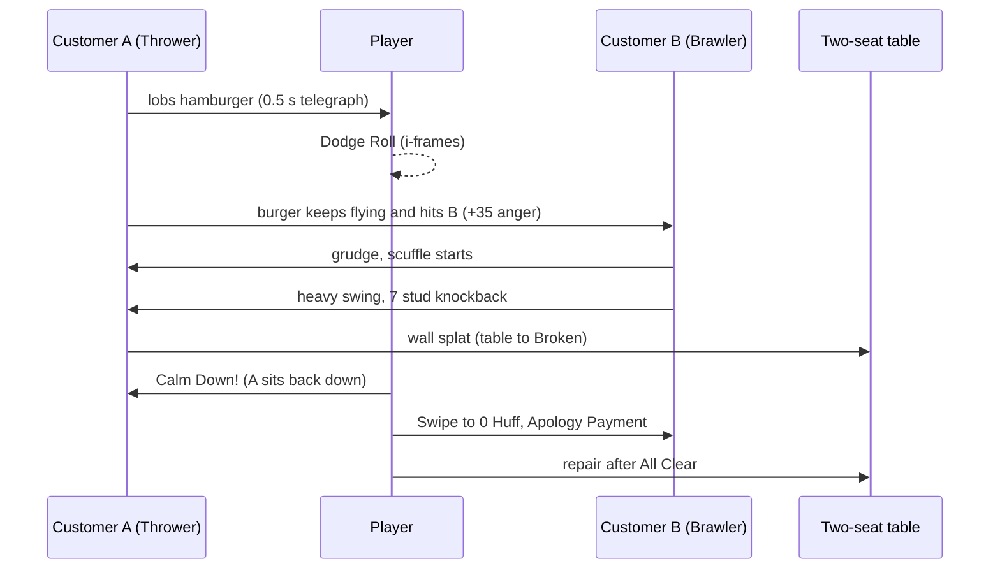

---

### 11.7 Physics Limits & Performance Safeguards

All combat movement is scripted; nothing in combat relies on unanchored Roblox physics (canon C3).

| Budget (per restaurant interior unless noted) | Limit [TUNABLE] | Overflow behavior |
|---|---|---|
| Loose props (thrown, dropped, debris pieces) | ≤ 30 (canon C3) | The oldest loose prop "poofs" into confetti and returns home (debris returns to its rubble pile) |
| Concurrent projectiles | ≤ 12 | Player projectiles always spawn; the oldest NPC projectile fizzles in a puff; NPC throw requests wait (the NPC keeps its wind-up pose up to 1 s, then cancels) |
| Projectile simulation | Server steps each arc at 30 Hz with `workspace:Spherecast` between successive points; max lifetime 2.0 s | Clients render the same arc from `{origin, velocity, gravity, serverStartTime}` — no per-frame replication |
| Knockback tweens | ≤ 16 concurrent; NPC proxies only (players drive their own) | New knockbacks on an already-moving proxy replace the old tween |
| Debris & impact VFX | Client-only; despawn in 4 s (canon C3); ≤ 40 debris pieces per client | Oldest debris removed first |
| Combat ParticleEmitters (per client) | ≤ 8 active emitters, ≤ 250 particles; mobile/Reduced VFX halves both | Lowest-priority effects (dust, crumbs) skipped first; telegraphs are never skipped |
| Damage numbers / "BONK!" text | Pooled BillboardGuis: 24 per client | Oldest recycled |
| Spatial queries | ≤ 40 hit queries per Heartbeat per restaurant; one `OverlapParams` per restaurant reused | Excess hits queued to the next frame (≤ 1 frame delay) |
| Hostile AI decision tick | 5 Hz per hostile NPC, staggered; total combat AI ≤ 1.0 ms per Heartbeat per server | Ticks for NPCs farther than 40 studs from every player drop to 2 Hz |
| Remote traffic | `Combat.HitConfirm` batched per Heartbeat per interior (one table payload) | — |
| Simultaneous Fighting customers (level 5) | 6 per restaurant (8 during chaos) | Further escalations to level 5 are deferred: the customer stays at level 4 (smashing) |

Proxies remain anchored at all times; knockback is a short `CFrame` tween (§11.5.3). Characters are never
ragdolled; KO uses an authored animation (`ANM_062`).

### 11.8 NPC Combat AI

#### 11.8.1 Shared framework (all styles in canon C11.6)

- **Perception & aggro.** Each hostile keeps an aggro list: `threat = damage received from X + 30 (X is its
  grievance target) + 10 per hit X landed in the last 6 s − 0.5 × distance`. Target = highest threat with a
  path; re-evaluated each decision tick (0.2 s) with a 20 % switch hysteresis.
- **Aggression budget (attack tokens).** Each player has **2 tokens**: at most **2 NPCs may attack one player
  at the same time** (melee and ranged combined). An NPC must hold a token to begin a wind-up and releases it
  after its recovery or after 4 s. Token-less hostiles **circle and taunt** at 8–12 studs (`ANM_050`), or,
  after 3 s without a token, 40 % chance to smash a nearby object instead (level-4 behavior, §11.6.3).
- **Telegraphs.** Every NPC attack has a wind-up ≥ 0.4 s (values in §36.6 "NPC use") shown by a "!" above
  the head: yellow "!" = blockable, red "!!" = unblockable (grabs, charges), plus ground decals for areas and
  lines. +0.2 s at TIER_01–02 and for Gentle Mode players. **Latency fairness:** a wind-up aimed at player P
  is extended by `clamp(P.ping/2 − 0.05, 0, 0.2)` s.
- **Winded.** After 3 of its attacks are blocked, dodged or whiffed within 10 s (`TANK`: 4), an NPC pants for
  2.5 s (sweat drops). During Winded, `ABL_006` Calm Down! auto-succeeds and hits deal ×1.25 — the
  non-violent route is "defend, then talk".
- **Retreat.** Style-specific (table below); every hostile below 25 % Huff with no token backs off 3 s once.
- **Leash.** Hostiles never leave the interior to chase; if every player leaves the interior, hostiles sulk
  (level 4 → 3) for 20 s, then storm out paying 0 (canon pay rules) if nobody returns.
- **Movement.** Base walk 12 studs/s, hostile chase 14 (`TANK` 10, `TRICKSTER` flee 17); pathfinding via
  `PathfindingService` waypoints computed by `CustomerAIService`, refreshed ≤ 1 per second per NPC.
- **Restaurant caps.** 6 Fighting customers (8 in chaos), §11.7.

#### 11.8.2 Style decision tables (evaluated top-down each 0.2 s tick; first valid row runs)

| Style | Priority-ordered decisions (condition → action · telegraph · cooldown) | Retreat / special rules |
|---|---|---|
| `PACIFIST` | 1 Hit by anything → cry dramatically (`ANM_056`) and flee 8 studs (`ANM_054`), +10 anger · — · — 2 Level 3–5 → sulk, cry or storm out (§10) 3 Chaos → hide under the nearest table (crouch) | Never attacks, never holds tokens, never targeted by soft lock |
| `THROWER` | 1 Player within 6 studs → backpedal to 12 studs; if cornered, slap (NPC Base 3, 0.4 s) 2 Holding a throwable + token + line of sight → lob (`ANM_048`; NPC Base food 6 / plate 6 / cup 4) · 0.5 s "!" + landing reticle · 2.5 s 3 Signature Move ready (§11.8.3) → use it 4 No throwable → fetch the nearest food/plate/cup within 15 studs (may steal from another table, §11.6.4-5) | Keeps 12–18 studs; below 30 % Huff hides behind furniture for 4 s. Aim error ±10 % of distance; never homing |
| `BRAWLER` | 1 In 4 studs + token → 3-hit combo (NPC Base 4 / 4 / 6) · 0.4 s "!" · 1.5 s 2 Every 6 s → heavy swing (NPC Base 12, 6-stud knockback) · 0.7 s "!" — or Signature Move 3 Pan/chair within 6 studs and empty-handed → 50 % pick it up (pan: `ABL_007` NPC version) 4 Otherwise chase target | Below 30 % Huff: 35 % chance per 3 s to back off and taunt for 3 s |
| `CHARGER` | 1 Target 8–20 studs + line of sight + token → rush (30 studs/s, 20 studs; NPC Base 12, 10-stud knockback, guard damage ×2, smashes up to 3 objects 18 % each) · 0.8 s hoof-scrape + red "!!" + lane decal · 5 s 2 Rush ends in a wall → self `STS_STUN` 1.2 s ("Dazed": takes ×1.25) 3 In 4 studs → shove (NPC Base 6, 5-stud knockback) · 0.5 s "!" · 2 s 4 Otherwise reposition to 10–14 studs | Never retreats while a rush is ready; otherwise as shared rule |
| `TANK` | 1 Target in 7 studs + token → ground slam (NPC Base 11 centre / 6 edge, 7-stud radius, `STS_KNOCKDOWN` inner 3 studs — same numbers as the `ABL_021` NPC version; a TANK whose Signature Move is `ABL_021` slams every 4 s) · 0.9 s ring decal "!" · 6 s 2 In 4 studs → backhand (NPC Base 10, 8-stud knockback) · 0.6 s "!" · 2.5 s 3 Player charging Wallop in front → raise arms and Block 1.5 s 4 Level 4 → flip a table (`ANM_049`) | KBResist 0.6, ignores light flinch, Winded after 4 misses, never retreats |
| `TRICKSTER` | 1 A plated dish is unattended at `STN_WINDOW` or a table → steal it and run (17 studs/s), return in 6 s 2 Debuff ready → condiment throw (`STS_STICKY`/`STS_GREASY`) or Signature debuff · 0.5 s "!" · 6 s 3 Targeted by a player within 6 studs → hop back 4 studs (no invulnerability), then flee 8 s 4 Adjacent + token → poke (NPC Base 4) · 0.4 s "!" | At ≤ 25 % Huff surrenders (Calm Down! auto-succeeds). Stolen dish is dropped (Plate Save rule) when hit or CC'd |
| `INSTIGATOR` | 1 Not attacked → climb a chair and yell (`ANM_050`): +4 anger every 2 s to customers within 12 studs (max +20 per customer per yelling session) · 0.5 s megaphone pose "!" 2 Hit twice → slap (NPC Base 4) then flee 6 s 3 Signature Move only if it is a debuff | Yelling is silenced for 5 s by any hit, `STS_STINKY`, `STS_BLINDED`, `STS_CONFUSED`, `STS_SLEEPY` or `ABL_023`; Calm Down! on an Instigator counts double |

#### 11.8.3 Signature Moves — NPCs using their own parts' abilities (canon C11.6)

1. At spawn, `CustomerAIService` lists the customer's **visible** parts that grant an active ability (canon
   C13.6). The first one (slot priority HEAD → ARM → TAIL → LEG → BACK → others) whose §36.6 "NPC use" entry
   includes the customer's style becomes its single **Signature Move**; no match → none.
2. **When (aligned with §9):** at anger level ≥ 4 and in scuffles — at level 4 only against a player within 6
   studs who hit it in the last 6 s, or to clear furniture in its path; `TRICKSTER` and `INSTIGATOR` debuff/aura
   Signature Moves may be used from level 3. `PACIFIST` customers use only non-damaging escape actives (the
   §36.6 rows that list `PACIFIST`). Utility abilities `ABL_061`–`ABL_070` are never used by customers, except
   the `ABL_063` flee variant listed in §36.6.
3. **NPC tuning** (already applied to §36.6 "NPC use" values): damage ≈ 0.6 × player Base before TierScale;
   cooldown ≥ 1.5 × player cooldown; wind-up = max(0.4 s, listed); CC on players ≤ the §11.5.4 cap; no
   paired bonuses; area radius ×0.8.
4. `ABL_060` Kraken Grasp is disabled on customers below TIER_07 (NPC version: 1 target, 1.0 s hold).
5. Employees with ability-granting parts use the NPC version only when assigned `ROLE_SECURITY` (§11.10.6).

---

### 11.9 Mutation-Based Combat

- **Abilities come only from equipped parts** (canon C12.1). Each `ABL_009`–`ABL_070` has exactly one source
  part fixed in canon C13.6 and repeated in §36.6; `ABL_001`–`ABL_006` are the base kit; `ABL_007`/`ABL_008`
  come from held utensils. The brief's examples map 1:1: Scorpion Tail → `ABL_009`, Bear Arm → `ABL_010`,
  Kangaroo Leg → `ABL_011`, Octopus Arm → `ABL_012`, Rhino Horn → `ABL_013`, Electric Eel Skin → `ABL_014`,
  Porcupine Spines → `ABL_015`, Frog Tongue → `ABL_016`, Crab Claw Arm → `ABL_017`, Dragon Head → `ABL_018`.
- **Power curve:** part upgrade level raises LevelScale (+5 % damage/level) and lowers cooldown (−2 %/level);
  CC durations never scale with level (no lock-down creep). Passives and stat budgets are §12.
- **Synergies** (§12, §36.4) may modify combat numbers but `CombatService` clamps the totals: damage +25 %,
  cooldown −20 %, CC duration +20 %, knockback +30 %.
- **Swapping (canon E4):** blocked while In Combat; otherwise a loadout swap is a 3 s channel interrupted by
  damage with a 10 s cooldown; single-part equips in the Morph menu are instant (the menu is unavailable in
  combat). Abilities granted by a removed part leave the bar immediately; their cooldowns persist for 30 s
  (re-equipping cannot reset a cooldown).
- **Archetype examples** (canon parts only): *Scorpion-Bear Bouncer* — `MUT_140` ×2 (paired `ABL_010`),
  `MUT_216` (`ABL_009`), `MUT_099` (`ABL_013`); *Soggy Sparky* — `MUT_053` (`ABL_028`) + `MUT_253`
  (`ABL_014`) for Zap Combos; *Kitchen Fixer* — `MUT_153`, `MUT_150`, `MUT_036`, `MUT_249` (four utilities,
  zero combat actives: still fully viable thanks to the base kit and Calm Down!).

---

### 11.10 Defeat & Recovery

#### 11.10.1 Customer defeat (canon C12.1, C11.4)

0 Huff → **Defeat-Dizzy** (`STS_DIZZY` 3 s, `ANM_052`; untargetable, immune) → *Calming down* →
*Apologizing* (`ANM_053`) → **Apology Payment 40 %** of its bill, no tip → *Escorted out* (`ANM_055`).
**Talked down** instead (`ABL_006` on a level-5 customer that is Winded or ≤ 50 % Huff — `TRICKSTER` ≤ 25 % —
or `ABL_065` on a level-5 customer at ≤ 70 % Huff; levels 3–4 simply lose anger, §36.6.2): the fight ends at
once and the customer drops to level 2. Payment follows §10's outcome table: if it took **no damage** this
episode (the "defend until Winded, then talk" route) it returns to its seat and pays and tips by satisfaction
("calmed without combat"); if it took damage, it apologizes and pays the 40 % Apology Payment ("calmed by
combat"). De-escalating without hitting is therefore the economically smart play.

#### 11.10.2 Player KO ("Seeing Stars") and respawn

| Step | Rule [TUNABLE where not canon] |
|---|---|
| KO | HP 0 → `ANM_062` Seeing Stars, 4 s (canon). Carried item dropped (Plate Save rule, §11.6.2). Cooldowns keep running. |
| KO'er reaction | The customer who KO'd you plays `ANM_051` victory dance and leaves without paying, unless chaos level 6 continues (canon). |
| Respawn | `ANM_063` respawn poof at the kitchen spawn with 60 % HP and `STS_WOOZY` (−15 % move, 10 s) (canon); 3 s respawn protection (ends if you attack). |
| Never lost | Mutations, items, currency, XP, loadouts — **nothing** (canon). Recovery costs are only repairs. |
| Second Wind | A second KO within 3 min respawns at 80 % HP with 5 s `STS_WOOZY`. |
| Mercy Rule | 3 KOs within 10 min → "Closing Bell": every currently hostile customer apologizes and leaves paying 0, and no customer can reach level 5 for 60 s. |

#### 11.10.3 The restaurant while you are KO'd

Hostiles retarget in this order: another player in the interior → a `ROLE_SECURITY` employee → level-4
smashing. While the owner is KO'd, customer furniture damage is ×0.5 and each target-less hostile performs at
most 3 smashes before sulking. Kitchen timers keep running (food can burn — the comedic price of a KO), and
online employees keep working unless Bonked.

#### 11.10.4 Recovery costs

Only repairs via `RepairService` (§15) at normal repair prices (REPAIR stat discounts apply, canon C5);
Destroyed objects use the canon C6 rebuild offer. No fines, no wage penalties, no reputation loss for being
KO'd (storm-outs still follow §10 rules).

#### 11.10.5 Protective upgrades (generic; owned by §15 and §36.12)

Combat exposes three multipliers and one subtractive dampener that restaurant upgrades may modify (bounded here):
`FurnitureCombatDamageMult` (sturdier/padded furniture, ≥ 0.5), `SecurityResponseMult` (alarm/bell upgrades:
Security reaction time, ≥ 0.5), `WoozyDurationMult` (comfy break-room style upgrades, ≥ 0.3; e.g. 0.6), and
`EscalationDampener` (calming decor or music, e.g. 0.05; **subtracted** by §10 from the escalation-roll
probability, never a multiplier). §15 names the upgrades and prices; `CombatService` reads the
restaurant attributes.

#### 11.10.6 Employee intervention (`ROLE_SECURITY`)

| Behavior | Rule [TUNABLE] (Combat Strength `CS` 1–100, canon C14.2) |
|---|---|
| Detection | Responds to any customer at anger level ≥ 4 within 30 studs; reaction delay `2.0 − 0.012 × CS` s × `SecurityResponseMult` |
| Interpose | Moves between the hostile and its target; occupies one of the target player's attack tokens (so only one NPC can attack that player) |
| Guard HP | `50 + 2 × CS`; at 0 the guard is Bonked (`STS_DIZZY` 3 s) then resumes |
| Bouncer Hug | Holds a hostile 2.5 s (`STS_STUN`, DR applies), cooldown 10 s |
| Calm Damage | `6 + 0.2 × CS` Huff damage every 1.2 s while engaged; may use its own part's Signature Move (NPC version) |
| Talk-down | Every 4 s: success chance `0.25 + 0.006 × CS` (doubled if Winded) → fight ends; a Security intercept always counts as "calmed by combat" (40 % Apology Payment, §10) |
| Escort | Escorts defeated customers out (`ANM_055`) so players can go back to cooking |
| KO response | When a player is KO'd, Security prioritizes the KO'er |

Other roles never fight: they flee to the kitchen (`ANM_054`), then resume work at All Clear.

#### 11.10.7 Co-op revive — "Smelling Salts"

A teammate within 4 studs holds the Revive input (E / pad X / touch Context) for 2 s on a KO'd player. While any ally is within 20 studs of a
KO'd player, Seeing Stars extends to up to 10 s with a "Hang in there!" bubble (the KO'd player may tap
"Respawn now" at any time). Success: the player stands up in place with 50 % HP, `STS_WOOZY` 5 s and 2.0 s
invulnerability. The hold is interrupted if the reviver takes damage or moves > 4 studs. A player can be
revived at most once per 60 s; reviving grants the reviver a small XP bonus (§11.14).

---

### 11.11 Co-op & PvP Adjustments

**Co-op restaurants (§21).** Friendly fire off; each player has their own 2 attack tokens; Calm credit (XP,
quest progress) goes to every player who damaged, blocked or calmed the customer in the last 10 s; guests
follow canon E12 (Co-op Insurance repairs their damage free; guests cannot spend owner currency). Revive
per §11.10.7.

**Arena PvP (opt-in only, `BLD_08` in `DST_10`; match rules, matchmaking and rewards in §21).** Restaurant
customers always remain NPCs; PvP never happens anywhere else.

| Rule | Arena value [TUNABLE] |
|---|---|
| Stats | Normalized template for every player: HP 300, STR 60, DEF 60, MOVE 50; all other stats ignored |
| Part levels | Every equipped part treated as its rarity's Lv3 (LevelScale 1.10) — collection breadth matters, grind does not |
| Damage · CC duration · knockback | ×0.7 · ×0.6 · ×0.8 (§36.6 "PvP tuning" column lists final values) |
| Guard meter | 80 |
| Hard-CC DR | 100 % → 40 % → immune 5 s |
| Ultimate | `ABL_060` cooldown 60 s |
| Utilities | Disabled except `ABL_063` and `ABL_070` (PvP variants in §36.6); `ABL_006` becomes a harmless "Hug it out" emote |
| Props | Arena-placed props only; no restaurant furniture |
| KO | Eliminated from the round ("Seeing Stars" pose, then spectate); no `STS_WOOZY` |
| Anti-cheat | Same server validation as §11.16 plus per-match damage audit (§29) |

---

### 11.12 Combat State Machine

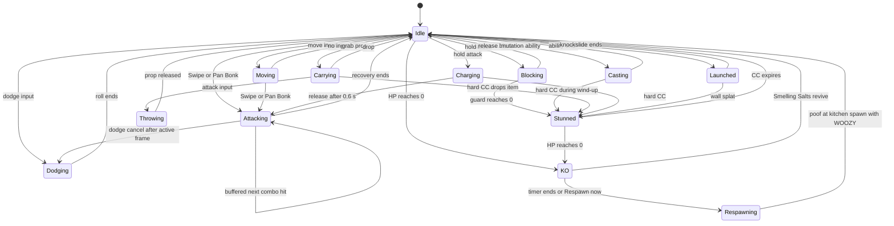

| State | Allowed actions | Exits |
|---|---|---|
| Idle / Moving | everything | any action input, CC, knockback, KO |
| Attacking | buffer next hit, dodge-cancel after active frame, Combo Link | recovery end, flinch, CC |
| Charging (Wallop) | move ×0.6, release | release, flinch cancels to Idle, CC |
| Blocking | move ×0.5, Perfect Block, release | release, guard break → Stunned |
| Dodging | none (0.25 s invulnerable) | roll end |
| Casting (wind-up / channel) | channel steering where §36.6 allows; recast for two-press abilities | end, interruption (cooldown rules §11.5.4) |
| Carrying / Throwing | move (weight penalty), throw, drop, Dodge (Light/Medium) | throw, drop, CC drop |
| Stunned (any hard CC) | mash to shorten FROZEN only (each input −0.1 s, max −50 %) | expiry |
| Launched | none; wall splat check | slide end, wall splat |
| KO | "Respawn now" button, receive revive | timer, revive |
| Respawning | — (camera poof) | spawn, 3 s protection |

---

### 11.13 UI & Feedback

- **Ability bar** (bottom-centre on desktop, right thumb arc on touch): four small base-kit icons
  (Swipe/Wallop, Block, Dodge, Calm), four large mutation slots with keybind/glyph labels, and a contextual
  slot that shows the held utensil or carried prop. Each icon: rarity border colour **and** shape (canon
  C13.3), radial clockwise cooldown sweep, whole-second countdown (tenths below 1 s), "ready" pop + soft chime,
  grey + lock badge when unusable (carrying, stunned, menu), red flash when the server rejects a cast.
- **Guard meter:** a curved bar around the Block icon; flashes and shows a cracked-plate icon below 20.
- **Status row** above the HP bar: icon (unique silhouette per §36.7), radial timer, stack pip; never colour
  alone. Buffs in rounded frames, debuffs in spiky frames.
- **Telegraphs:** "!" BillboardGui above NPCs (yellow blockable, red "!!" unblockable), ground decals
  (rings, lanes, cones) rendered client-side from `Combat.Telegraph`; an optional audio "boop" per telegraph.
- **Hit feedback:** client hit-stop 0.05 s on confirmed hits, cartoon words ("BONK!", "SPLAT!", "BIF!") for
  hits ≥ 15 damage, small numbers otherwise; Huff bar appears over hostile customers only.
- **Encounter frame:** subtle red vignette pulse while In Combat; "CHAOS!" banner at level 6; "All Clear!"
  toast plus Aftermath summary.
- **Accessibility (§24):** Reduced VFX, Reduced Flash (replaces `STS_BLINDED` white-out with a dark polka-dot
  vignette), screen-shake toggle, hold/toggle Block, auto-target on any device, **Gentle Mode** (incoming NPC
  damage ×0.75, telegraphs +0.2 s; no reward penalty because combat is not a reward source).

---

### 11.14 Progression & Rewards Hooks

- **XP** (canon C5.1 relative units): calming a hostile through combat `0.005 × XPRate(L)`; talking one down
  `0.008 × XPRate(L)`; a successful revive `0.004 × XPRate(L)`; combat XP is capped at `0.10 × XPRate(L)` per
  rolling hour so provoking customers is never worth it.
- **Combat Tree** (§14) nodes may raise STR/DEF, guard, dodge cooldown, Calm Down! power, throw damage; this
  section's floors and caps (§11.5.9) always clamp the result.
- **Quests & achievements:** `QST_TUT_007` "Defend the Diner" teaches block, dodge, swipe and Calm Down! —
  during it incoming damage is ×0.5 and the player's HP cannot drop below 1; combat challenges (`CBT` type)
  live in §20; combat achievements in §36.16; analytics in §11.16.4.

---

### 11.15 Dependencies

| Depends on | For |
|---|---|
| canon C5, C11, C12, C13.6, C21, C22 | stats, anger levels, combat constants, ability sources, animation IDs, edge rulings |
| §8 / §10 (`CustomerAIService`) | customer state machine, anger meter, escalation rolls, pay/tip, Hostile flag source |
| §9 | personality Huff, PersonalityDEF, PersonalityDamageMult, sensitivity, combat style per personality |
| §12 / §36.3 / §36.4 (`MutationService`) | equipped parts, part levels, paired detection, passives, synergy modifiers |
| §13 | Ability Bar tab, loadouts, swap channel UI |
| §15 / §36.12 / §36.13 (`BuildingService`, `RepairService`) | durability, damage states, `Throwable` flags, home cells, protective upgrade multipliers |
| §16 (`EmployeeService`) | `ROLE_SECURITY` stats and assignment |
| §21 (`MultiplayerService`) | co-op permissions, arena matches |
| §24 (`UIController`) | HUD, touch layout, settings |
| §26 / §36.14 / §36.15 | `ANM_301`–`ANM_370` and core animations; combat sounds (described in words here) |
| §27 / §29 / §30 | service architecture, anti-exploit strikes, performance budgets |
| Provides to others | `IsInCombat(player)`, `ApplyHit`, `RequestAttackToken`, signals `CustomerDefeated`, `PlayerKO`, `ObjectImpacted`, `EncounterEnded` |

---

### 11.16 Roblox Implementation

#### 11.16.1 Layout

- `ServerScriptService/Services/CombatService` — validation, hit resolution, damage, statuses, KO/respawn,
  attack tokens, encounter tracking (canon C19). Hostile *decision-making* runs inside `CustomerAIService`,
  which calls `CombatService:RequestAttackToken`, `:Telegraph` and `:ApplyHit`.
- `ReplicatedStorage/Shared/Combat/AbilityDefs` (generated from §36.6), `StatusDefs` (from §36.7),
  `CombatConfig` (§11.5.9), `ArcMath` (shared projectile parabola so server and clients agree).
- `StarterPlayerScripts/Controllers/CombatController` — input via `ContextActionService:BindActionAtPriority`,
  soft lock, predicted animation/VFX, telegraph rendering, knockback driver (`LinearVelocity`).
- Each interior has folders `StaticGeometry`, `Furniture`, `CombatProxies` (anchored, `CanCollide=false`,
  `CanTouch=false`, `CanQuery=true`, `Transparency=1`, attribute `CombatantId`). Players get a server-created
  `CombatHitbox` part welded to `HumanoidRootPart` and parented into the current interior's `CombatProxies`.

#### 11.16.2 Remotes (convention `<Domain>.<Action>`)

| Remote | Kind · direction | Payload | Server validation |
|---|---|---|---|
| `Combat.UseAbility` | RemoteEvent · C→S | abilityId, seq, aimDir, targetId? | token bucket (§29 combat class: 12 burst, 8/s), types, ownership via `MutationService`, state, cooldown (−0.1 s tolerance), range + LOS |
| `Combat.BlockState` | RemoteEvent · C→S | isBlocking, seq | ≤ 10/s; block start = receive time − min(ping/2, 0.1 s) |
| `Combat.Dodge` | RemoteEvent · C→S | dir, seq | cooldown 1.1 s minimum; invulnerability starts at receive − min(ping/2, 0.15 s) ("dodge grace") |
| `Combat.Grab` / `Combat.Throw` | RemoteEvent · C→S | propId / aimDir, charge | range 6 + 2 studs, `Throwable`, carry capacity; throw cooldown 0.8 s |
| `Combat.Revive` | RemoteEvent · C→S | targetUserId, begin/cancel | range 4, KO state; the 2 s hold is timed on the server |
| `Combat.HitConfirm` | UnreliableRemoteEvent · S→C | batched hit list per Heartbeat per interior | cosmetic only — HP/Huff/guard replicate as attributes |
| `Combat.Telegraph` | RemoteEvent · S→C | npcId, abilityId, shape, serverStart, windup | — |
| `Combat.Knockback` | RemoteEvent · S→C (victim) | displacement vector, duration | server audits resulting position (§29) |
| `Combat.CooldownSync` | RemoteEvent · S→C | seq, reason, readyAt | — |

Statuses replicate as attributes on the character/proxy (`STS_STUN` = server expiry time) so late joiners
and streaming clients render them without extra traffic.

#### 11.16.3 Hit validation and damage pipeline (excerpt)

```lua
--!strict
-- ServerScriptService/Services/CombatService (excerpt): request validation + damage pipeline
local ReplicatedStorage = game:GetService("ReplicatedStorage")
local ServerScriptService = game:GetService("ServerScriptService")
local TweenService = game:GetService("TweenService")
local Workspace = game:GetService("Workspace")

local CombatShared = ReplicatedStorage:WaitForChild("Shared"):WaitForChild("Combat")
local AbilityDefs = require(CombatShared:WaitForChild("AbilityDefs") :: ModuleScript) -- generated from §36.6
local Config = require(CombatShared:WaitForChild("CombatConfig") :: ModuleScript)     -- §11.5.9 values
local AntiExploit = require(ServerScriptService:WaitForChild("Services"):WaitForChild("AntiExploit") :: ModuleScript) -- §29

local RemoteFolder = ReplicatedStorage:WaitForChild("Remotes"):WaitForChild("Combat") -- "Combat.<Action>"
local UseAbilityRemote = RemoteFolder:WaitForChild("UseAbility") :: RemoteEvent
local CooldownSyncRemote = RemoteFolder:WaitForChild("CooldownSync") :: RemoteEvent
local KnockbackRemote = RemoteFolder:WaitForChild("Knockback") :: RemoteEvent

export type Combatant = {
	id: string, kind: "Player" | "Customer" | "Employee", player: Player?,
	proxy: BasePart, interior: Model, state: string, castToken: number,
	hp: number, def: number, strMult: number, hostile: boolean,
	iframeUntil: number, blockSince: number?, guard: number, lastGuardHit: number,
	readyAt: {[string]: number}, lastCombatAt: number,
}
export type HitSpec = {
	base: number, abilityMult: number, guardMult: number, unblockable: boolean,
	thrown: boolean, kb: number, statuses: {{id: string, dur: number}},
}

local CombatService = {}
local combatants: {[string]: Combatant} = {}
local buckets: {[Player]: {tokens: number, t: number}} = {}
local losCache: {[Model]: RaycastParams} = {}
local MutationService: any, CustomerAIService: any, RepairService: any -- injected by Init()
-- Helpers defined elsewhere in this module (not shown): CanAct, EffectiveCooldown, IsFacing, InteractionMult,
-- AbsorbShield, ApplyStatus (hard-CC DR + player caps), Confirm (batched HitConfirm), KO, DefeatCustomer,
-- KbMultiplier (§11.5.3 terms), SweepParams (per-interior RaycastParams: StaticGeometry + Furniture).

local function now(): number
	return Workspace:GetServerTimeNow()
end

local function takeToken(plr: Player): boolean -- token bucket rate limit
	local t = os.clock()
	local b = buckets[plr] or { tokens = Config.bucketBurst, t = t }
	buckets[plr] = b
	b.tokens = math.min(Config.bucketBurst, b.tokens + (t - b.t) * Config.bucketPerSecond)
	b.t = t
	if b.tokens < 1 then return false end
	b.tokens -= 1
	return true
end

local function hasLineOfSight(interior: Model, from: Vector3, to: Vector3): boolean
	local p = losCache[interior]
	if not p then
		p = RaycastParams.new()
		p.FilterType = Enum.RaycastFilterType.Include
		p.FilterDescendantsInstances = { interior:WaitForChild("StaticGeometry") }
		losCache[interior] = p
	end
	return Workspace:Raycast(from, to - from, p) == nil
end

local function reject(plr: Player, seq: number, reason: string, readyAt: number?)
	CooldownSyncRemote:FireClient(plr, seq, reason, readyAt) -- client un-predicts
	AntiExploit.Strike(plr, "combat_" .. reason)                -- silent; thresholds in §29
end

local function onUseAbility(plr: Player, abilityId: unknown, seq: unknown, aim: unknown, targetId: unknown)
	if typeof(abilityId) ~= "string" or typeof(seq) ~= "number" or typeof(aim) ~= "Vector3" then return end
	local s = seq :: number
	if not takeToken(plr) then return reject(plr, s, "rate") end
	local def = AbilityDefs[abilityId :: string]
	local c = combatants["P" .. plr.UserId]
	if def == nil or c == nil then return end
	if not CombatService.CanAct(c) then return reject(plr, s, "state") end
	-- Ownership: base kit, held utensil, or a slotted ability granted by an equipped part (canon C13.6)
	if not MutationService:IsAbilityUsable(plr, def.id) then return reject(plr, s, "notOwned") end
	local t = now()
	local readyAt = c.readyAt[def.id] or 0
	if t < readyAt - Config.cooldownTolerance then return reject(plr, s, "cooldown", readyAt) end
	local dir = aim :: Vector3
	local flatAim = dir * Vector3.new(1, 0, 1)
	if math.abs(dir.Magnitude - 1) > 0.1 or flatAim.Magnitude < 0.1 then return reject(plr, s, "aim") end
	dir = flatAim.Unit
	local target = if typeof(targetId) == "string" then combatants[targetId :: string] else nil
	if target then
		local reach = def.range + target.proxy.Size.X * 0.5 + Config.rangeTolerance
			+ c.proxy.AssemblyLinearVelocity.Magnitude * math.min(plr:GetNetworkPing(), 0.2)
		local origin, goal = c.proxy.Position, target.proxy.Position
		if (goal - origin).Magnitude > reach or not hasLineOfSight(c.interior, origin, goal) then
			return reject(plr, s, "range")
		end
	end
	c.readyAt[def.id] = t + CombatService.EffectiveCooldown(c, def) -- cooldown authority lives here
	c.castToken += 1
	local token = c.castToken
	c.state = "Casting"
	task.delay(def.windup, function()
		if c.castToken ~= token or c.state ~= "Casting" then -- interrupted in wind-up (§11.5.4)
			c.readyAt[def.id] = math.min(c.readyAt[def.id], now() + Config.interruptCooldown)
			return
		end
		for _, victim in CombatService.QueryArc(c, def, dir) do
			CombatService.ApplyHit(c, victim, def.hit)
		end
		c.state = "Idle"
	end)
end

function CombatService.QueryArc(c: Combatant, def: any, dir: Vector3): {Combatant}
	local params = OverlapParams.new()
	params.FilterType = Enum.RaycastFilterType.Include
	params.FilterDescendantsInstances = { c.interior:WaitForChild("CombatProxies") }
	params.MaxParts = 24
	local origin = c.proxy.Position
	local cosHalf = math.cos(math.rad(def.arcDeg * 0.5))
	local found: {Combatant} = {}
	for _, part in Workspace:GetPartBoundsInRadius(origin, def.range + Config.proxyTolerance, params) do
		local victim = combatants[part:GetAttribute("CombatantId") :: string]
		if victim and victim ~= c then
			local flat = (part.Position - origin) * Vector3.new(1, 0, 1)
			if (flat.Magnitude < 1 or flat.Unit:Dot(dir) >= cosHalf)
				and hasLineOfSight(c.interior, origin, part.Position) then
				table.insert(found, victim)
			end
		end
	end
	table.sort(found, function(a, b)
		return (a.proxy.Position - origin).Magnitude < (b.proxy.Position - origin).Magnitude
	end)
	while #found > def.maxTargets do table.remove(found) end
	return found
end

function CombatService.ApplyHit(a: Combatant, v: Combatant, hit: HitSpec): string
	local t = now()
	if a.kind == "Player" and (v.kind == "Player" or v.kind == "Employee") then return "friendly" end
	if a.kind == "Player" and v.kind == "Customer" and not v.hostile then -- bystander (§11.2.2)
		CustomerAIService:AddAnger(v.id, if hit.thrown then 25 else 8, "bystander") -- × sensitivity inside
		return "bystander"
	end
	if t < v.iframeUntil then return "iframes" end
	local blockMult = 1
	if v.blockSince and not hit.unblockable and CombatService.IsFacing(v, a.proxy.Position, 120) then
		if t - v.blockSince <= Config.perfectBlockWindow then
			CombatService.Confirm(a, v, 0, "perfect")
			return "perfect"
		end
		blockMult = 1 - Config.blockReduction
		v.guard -= hit.base * a.strMult * hit.guardMult -- pre-DEF guard damage
		v.lastGuardHit = t
		if v.guard <= 0 then -- guard break (canon C12.1)
			v.guard, v.blockSince = Config.guardRefill, nil
			CombatService.ApplyStatus(v, "STS_STUN", Config.guardBreakStun, a)
		end
	end
	local mult = math.min(Config.abilityMultCap, hit.abilityMult * CombatService.InteractionMult(v, hit))
	local raw = hit.base * a.strMult * mult * 100 / (100 + math.min(v.def, 200)) * blockMult
	local dmg = CombatService.AbsorbShield(v, math.max(1, math.floor(raw + 0.5))) -- STS_SHIELDED first
	v.hp = math.max(0, v.hp - dmg)
	v.proxy:SetAttribute("HP", v.hp)
	a.lastCombatAt, v.lastCombatAt = t, t
	for _, st in hit.statuses do
		CombatService.ApplyStatus(v, st.id, st.dur, a) -- applies hard-CC DR and player CC caps
	end
	if hit.kb > 0 then
		CombatService.Knockback(a, v, hit.kb * (if blockMult < 1 then 0.3 else 1))
	end
	CombatService.Confirm(a, v, dmg, "hit")
	if v.hp == 0 then
		if v.kind == "Player" then CombatService.KO(v, a) else CombatService.DefeatCustomer(v, a) end
	end
	return "hit"
end

function CombatService.Knockback(a: Combatant, v: Combatant, baseKb: number)
	local dist = math.clamp(baseKb * CombatService.KbMultiplier(a, v), 0, Config.kbCapInterior)
	if dist <= 0 then return end
	local flat = (v.proxy.Position - a.proxy.Position) * Vector3.new(1, 0, 1)
	local dir = if flat.Magnitude > 0.01 then flat.Unit else a.proxy.CFrame.LookVector
	if v.kind == "Player" then -- players own their physics: the victim client drives a LinearVelocity
		KnockbackRemote:FireClient(v.player :: Player, dir * dist, 0.15 + 0.02 * dist)
		return
	end
	local p = CombatService.SweepParams(v.interior) -- Include StaticGeometry + Furniture
	local result = Workspace:Blockcast(v.proxy.CFrame, v.proxy.Size * 0.9, dir * dist, p)
	local travel = if result then math.max(0, result.Distance - 0.25) else dist
	local duration = 0.15 + 0.02 * travel
	TweenService:Create(v.proxy, TweenInfo.new(duration, Enum.EasingStyle.Quad, Enum.EasingDirection.Out),
		{ CFrame = v.proxy.CFrame + dir * travel }):Play()
	local remaining = dist - travel
	if result and remaining >= 2 then -- wall splat (§11.5.3)
		task.delay(duration, function()
			CombatService.ApplyStatus(v, "STS_STUN", 0.5, a)
			local model = result.Instance:FindFirstAncestorWhichIsA("Model")
			if model and model:GetAttribute("Durability") ~= nil then
				RepairService:ApplyCombatDamage(model, math.clamp(4 + 1.5 * remaining, 4, 20), "WallSplat")
			end
		end)
	end
end

UseAbilityRemote.OnServerEvent:Connect(onUseAbility)
return CombatService
```

Projectiles reuse `ArcMath.PositionAt(origin, velocity, gravity, t)` on both sides; the server steps at 30 Hz
with `Workspace:Spherecast(prev, radius, next − prev, params)` and calls `ApplyHit` on the first proxy hit;
invulnerable victims are skipped and the arc continues (§11.6.2-4).

#### 11.16.4 Analytics (canon C20, `AnalyticsService:LogCustomEvent` + internal schema)

`mmr_combat_encounter_start` (tier, trigger, hostiles) · `mmr_combat_encounter_end` (duration_s, hostiles,
player_kos, calmed_by {combat, talk, security}, durability_lost_pct) · `mmr_player_ko` (tier, killer_style,
had_security) · `mmr_customer_calmed` (method, personality) · `mmr_ability_used` (abilityId, context;
10 % sampled) · `mmr_prop_thrown` (propClass, hit_kind; 10 % sampled). Balancing use: if median encounter
> 20 s or KO rate > 1 per 20 min at a tier, lower TierScale or Huff bands for that tier; if `talk` share
< 20 %, widen Winded or Calm Down! power.

---

### 11.17 Edge Cases

| # | Situation | Ruling |
|---|---|---|
| 1 | Customer attacks while the player is in a menu (canon E2) | Full-screen menus cannot open while In Combat or while targeted by a level-5 customer ("Can't shop during a brawl!"). If a customer turns hostile with a menu open, it auto-closes and the player gets 1.5 s invulnerability. NPC attacks that land during the grace whiff; the NPC releases its token and must re-telegraph. |
| 2 | Changing mutations during combat (canon E4) | Blocked while In Combat. Out of combat: 3 s swap channel interrupted by damage, 10 s cooldown. A removed part's ability keeps its cooldown for 30 s, so swapping cannot reset cooldowns. |
| 3 | KO while carrying | Item dropped: plated dish → Plate Save (10 s, quality ×0.9); special ingredient → back to stock after 10 s; utensil → homes to its hook; Heavy prop lands in place and homes at All Clear. |
| 4 | Ability interrupted by stun | Before the active frame → cooldown becomes 2.0 s. Channel interrupted after its first tick → 50 % of the unused fraction refunded. A stunned `ABL_060` caster releases every grasped target at once. |
| 5 | High latency | Range tolerance +2 studs + speed × min(ping, 0.2 s); dodge grace ≤ 0.15 s; telegraph extension ≤ 0.2 s. A player whose ping stays > 600 ms for 3 s is not chosen for new NPC wind-ups (NPCs circle) until it recovers. Damage numbers only appear on server confirm, never on prediction. |
| 6 | Friendly fire in co-op | Off. Area abilities pass through allies, grabs/pulls cannot select allies, a knocked-back NPC passing an ally does not hurt them. |
| 7 | Customer knocked out of bounds | Knockback sweeps stop at walls. If a proxy ends outside the interior bounds, off the navmesh, or inside geometry, it poofs to the nearest valid point ("Pardon me!", like canon E10). Knockback through the door trigger never counts as leaving. |
| 8 | Hits during spawn/menu grace | Invulnerability windows (§11.5.4) make those hits whiff; projectiles continue; no anger is generated against the invulnerable player. |
| 9 | Owner disconnects mid-fight (canon E1) | Restaurant enters Closing: hostiles leave immediately paying 0 (no reputation loss), guests are moved to the street, combat state is discarded. |
| 10 | Player leaves the interior mid-fight | Hostiles leash (§11.8.1); In Combat still runs its 6 s (no fast-travel). If nobody returns within 20 s, hostiles storm out paying 0. |
| 11 | Player and customer reach 0 on the same frame | Both resolve: the customer is calmed (no victory dance, Apology Payment paid) and the player is KO'd normally. |
| 12 | Two players defeat the same customer on the same frame | Huff floors at 0; `DefeatCustomer` is idempotent by customer state; calm credit is shared (§11.11). |
| 13 | Projectile or loose-prop cap reached | Overflow rules in §11.7 (player projectiles always spawn; oldest NPC projectile fizzles; oldest loose prop poofs home). |
| 14 | Level-up mid-combat (canon E14) | Toast only; Max HP rises and current HP rises by the same amount; stat allocation waits for the menu. |
| 15 | Server shutdown mid-fight (canon E13) | Combat state discarded; furniture damage already applied persists; players are teleported. |
| 16 | Guest breaks the owner's furniture (canon E12) | Damage repaired free by Co-op Insurance after the visit; guests can throw props but cannot store, sell or move them permanently (Furniture Homing returns them). |
| 17 | Area ability used next to calm diners (e.g. `ABL_024`) | Diners take 0 damage but receive bystander anger and cleanliness effects listed in §36.6 — a deliberate risk the player controls. |
| 18 | Prop thrown through the front door or out of the interior | Despawns in a poof and homes to its cell immediately; it never appears in the city. |
| 19 | Tutorial `QST_TUT_007` | Incoming damage ×0.5, player HP floor 1 (no KO possible); the scripted Karenosaurus refuses Calm Down! (it is taught on the splashed Polite Demon `PER_003`, per §32), and Winded triggers after 2 misses. |
| 20 | Customer defeated while holding a stolen dish | Dish drops with the Plate Save rule; its original owner's anger −10 when it is re-served. |

---

### 11.18 Acceptance Criteria

- **AC-11-01:** `ABL_001` lands three hits at a 0.35 s cadence for Base 8 / 8 / 12, and the chain resets after 0.8 s without input (frame log, ±1 frame at 60 FPS).
- **AC-11-02:** With STR 60, Base 22, LevelScale 1.10 and target DEF 70 the server applies exactly 21 damage on every one of 1,000 trials (no variance, no crits).
- **AC-11-03:** Block reduces frontal (≤ 60° off-axis) damage by 70 %; 60 guard damage triggers `STS_STUN` for 1.0 s; guard regenerates 20/s starting 2.0 s after the last guard hit.
- **AC-11-04:** Dodge grants 0.25 s invulnerability with a 1.2 s cooldown; a dodged projectile continues and hits a second combatant on its arc in 100 % of 50 sandbox trials.
- **AC-11-05:** Every NPC attack displays its "!" ≥ 0.40 s before the active frame (automated log of ≥ 500 attacks across all seven styles).
- **AC-11-06:** No player is ever attacked by more than 2 NPCs at once during a 10-minute chaos soak test with 8 hostile customers (token audit log).
- **AC-11-07:** Knockback never exceeds 18 studs inside interiors; a wall splat applies `STS_STUN` 0.5 s and 4–20 % durability damage to the struck object, lowering it at most one damage state.
- **AC-11-08:** Per interior, loose props never exceed 30 and concurrent projectiles never exceed 12; debris exists only on clients and despawns within 4 s.
- **AC-11-09:** The server rejects 100 % of fuzzed `Combat.UseAbility` requests for abilities not granted by the base kit, a held utensil, or a slotted ability of an equipped part, and every request arriving > 0.1 s before `readyAt`.
- **AC-11-10:** Requests above 8 burst / 6 per second are dropped, while a recorded maximum-speed legitimate play session never triggers the limiter.
- **AC-11-11:** A KO plays `ANM_062` for 4 s, respawns with `ANM_063` at the kitchen spawn with 60 % HP and `STS_WOOZY` (−15 % move, 10 s); MB, MS, RT, mutations, items and XP are identical before and after (snapshot diff).
- **AC-11-12:** Smelling Salts: a 2.0 s hold within 4 studs revives with 50 % HP and 2.0 s invulnerability; damage to the reviver cancels the hold.
- **AC-11-13:** Canon E2: a hostile turn while a full-screen menu is open closes the menu on the same frame the client receives the event and applies 1.5 s invulnerability.
- **AC-11-14:** Canon E4: loadout swaps are refused while In Combat; out of combat the swap is a 3 s channel cancelled by damage, with a 10 s cooldown.
- **AC-11-15:** A customer at 0 Huff enters `STS_DIZZY` for 3 s, apologizes, pays exactly 40 % of its bill (rounded to whole MB) with no tip, and is escorted out.
- **AC-11-16:** `ABL_006` used on a Winded customer succeeds 100 % of the time; a talked-down customer that took no damage this episode returns to its seat and pays and tips by satisfaction, while one that took damage pays exactly the 40 % Apology Payment (§10).
- **AC-11-17:** Soft lock and auto-target never select a bystander, `PACIFIST`, defeated customer, ally or employee in 200 automated presses across crowded scenarios.
- **AC-11-18:** Touch: every combat button is ≥ 64 u (§24.3.2 layout units); auto-target turns the player to the target within 0.1 s; playtest median time-to-calm on touch is within ±10 % of KB/M.
- **AC-11-19:** The third hard CC of the same family within 8 s lasts 25 % of its base duration; no NPC-applied hard CC on a player exceeds 1.5 s (1.0 s at TIER_01–02).
- **AC-11-20:** With 6 hostiles in one restaurant, `CombatService` uses ≤ 1.5 ms per Heartbeat for that restaurant and combat AI ≤ 1.0 ms per Heartbeat per server (MicroProfiler capture on a mid-range phone-hosted test).
- **AC-11-21:** The §11.6.5 hamburger chain reproduces in a sandbox using only scripted player inputs and default rules (no special-case code paths).
- **AC-11-22:** In the Arena, damage is ×0.7, CC durations ×0.6 and knockback ×0.8 relative to the normalized template; no player-vs-player damage can occur outside `BLD_08`.
- **AC-11-23:** At All Clear + 10 s, every moved unbroken furniture prop is back on its home cell within a further 2 s; broken ones show a repair marker at home.
- **AC-11-24:** For each of the six fighting styles, QA resolves a level-5 customer with 0 damage dealt using only Block/Dodge (to cause Winded) and `ABL_006`.


## 12. Mutation System

The Mutation System turns money into a stranger, stronger body. It owns the **280 mutation parts** (database in §36.3),
the 22 anatomy slots and their compatibility rules, the way parts are bolted onto Roblox R15 rigs, rarities and
acquisition, upgrades, the procedural generator that dresses every customer, employee and NPC, and the balance caps that
keep it all fair. Morph combinations and synergy rules continue in §12.9–§12.10 (synergy rows in §36.4, combination
examples in §36.5); the Morph customization screen is §13; abilities are §36.6 and status effects §36.7. Runtime owners:
`MutationService` (ownership, equip rules, stats, upgrades, fusion, capsules) and `MorphAssemblyService` (building morph
models) — interfaces in §27, persistence in §28.

### 12.1 Overview

**Purpose.** The restaurant is how players earn; mutations are what they want to spend it on. A restaurant has a finite
list of meaningful upgrades, but the slot system below produces more than 2 × 10^24 distinct loadouts from 280 authored parts
(§12.7). Every part does something useful in the kitchen, the dining room, a brawl or a repair job, so the core loop the
Creative Director asked for is mechanically true: **Cook → Earn → Morph → Become More Powerful → Run a Better Restaurant
→ Earn More → Discover Rarer Morphs**, while employees keep earning (and occasionally finding capsules, §17) offline.

**What a part does.** Every part is defined by the same five layers, so code never special-cases an individual part:

| Layer | Rule | Example (`MUT_031` Dragon Head) |
|---|---|---|
| Stats | Points in the nine player stats (§14), budget `round(BaseBudget[rarity] × SlotWeight)` at Lv1, +12 % of that per upgrade level; capped per stat (§12.8) | COOK_SPD +5, COOK_QLT +2, STR +7, LUCK +2 (Epic, major slot = 16) |
| Passive | Exactly one per part, mapped to one of 48 engineering keys with a combined cap (§12.8) | *Furnace Breath:* heat stations −12 % process time, burn delay −0.5 s |
| Active | At most one per part (62 parts have one); up to 4 on the ability bar; NPC-tuned versions for customers (§36.6) | `ABL_018` Dragon Breath |
| Synergy hooks | Family, category, slot and tags; synergies match these, never single IDs (§12.10, §36.4) | family `dragon`; tags fire, fighter, chef |
| Rig & look | Attachment, LOD meshes, compatibility flags, procedural motion (§12.2–§12.3) | jaw Motor6D for the breath clip; 1,350 tris Hi / 540 NPC |

**A morph-centric economy.** Canon pacing (§22) sends about half of all income to tiers and expansion and half to
mutations, furniture, staff and upgrades. Mutation prices are set so that, at every tier, the *next* rarity costs a few
hours of active play and the *current* rarity's upgrades cost a few more — there is always a morph goal one session away:

| Tier on entry | Net MB / active h | Typical next purchase | Active hours | Mutation upgrade goal | Active hours |
|---|---|---|---|---|---|
| `TIER_01` (Lv1) | 630 | Common major part (330–400 MB) | 0.5–0.6 | first Uncommon at Lv5 (1,040–2,000 MB) | 1.7–3.2 |
| `TIER_03` (Lv10) | 1,730 | Uncommon part | 0.6–1.2 | first Rare at Lv12 (5,200–10,000 MB + 20 MS) | 3.0–5.8 |
| `TIER_05` (Lv26) | 5,400 | Rare part | 1.0–1.9 | Rare Lv1 → 7 (18,703 MB) or first Epic | 3.5 / 5.9–11.1 |
| `TIER_07` (Lv45) | 17,400 | Epic part | 1.8–3.4 | Epic Lv1 → 8 (96,516 MB) or first Legendary | 5.5 / 11.5–23 |
| `TIER_09` (Lv68) | 63,700 | Legendary part | 3.1–6.3 | Legendary Lv1 → 9 (492,578 MB) | 7.7 |
| `TIER_10` (Lv80) | 120,500 | Mythic fusion inputs | — | Mythic Lv1 → 10 (2,246,602 MB) | 18.6 |

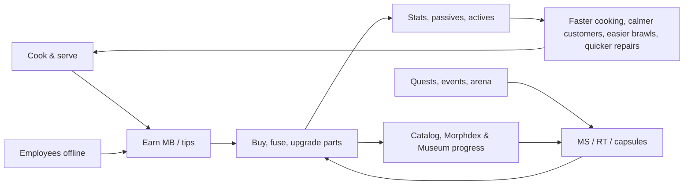

**Collection meta — the Mutation Catalog.** Every part has a Catalog entry with four states: **Unknown** (silhouette)
→ **Seen** (name, sources and odds revealed) → **Owned** → **Mastered** (max level). *Seen* is granted server-side when you
serve, fight or calm a customer wearing the part, hire or interview an employee wearing it, talk to a named NPC whose
morph uses it, or *Inspect* another player — so watching the weird customers in your own dining room is how you learn
what to chase next. (The combination-level **Morphdex** of head-family × dominant-family keys, with its own Museum
rewards, is §12.9.4; the Catalog tracks individual parts.) Catalog milestones pay out only in canon reward types and
deliberately skip the 10- and 50-part thresholds that §14's achievements already reward, so nothing pays twice:

| Catalog milestone (distinct parts owned) | Reward |
|---|---|
| 25 | `MUT_272` Sparkle Aura |
| 75 | `MUT_277` Orbiting Meatballs |
| 100 | the Morph Museum's "Empty Exhibit" becomes inspectable (the `MUT_048` condition) + title "Morphologist" |
| 150 | `MUT_279` Tiny Moons |
| 200 | `MUT_258` Golden Skin |
| 250 | 10 RT + title "Mostly Mutant" |
| 273 (every non-Secret part) | cosmetic palette "Prismatic" + title "Morphologist Supreme" |
| Each category complete (16) | 3 Morph Capsules + that category's cosmetic palette |
| 10 / 50 parts Mastered | 300 MS / 5 RT |

The **Morph Museum** (`BLD_16`, curator `NPC_018`) displays every part you own on rotating mannequins grouped by
category, shows your featured morph to visiting players, hosts the Empty Exhibit and pays the Morphdex rewards of §12.9.4.

**UI.** All interaction happens in the Morph screen (§13): slot groups, inventory, stat preview with MAXED markers,
upgrade and fusion buttons, the Catalog tab and the always-visible capsule odds panel.

**Dependencies.** §14 stats and levels · §10 satisfaction (MutationBonus cap) · §11 and §36.6 combat and actives · §15
furniture repair states · §16 employees (generated morphs) · §18 shops and Lab · §22 economy · §23 cosmetics-only
monetization · §27 services · §28 profile schema · §30 performance budgets.

### 12.2 Anatomy Slots and Compatibility

**Rules & Mechanics.** A morph is a map from the 22 anatomy slots to part IDs. Ownership is per part ID: one owned copy
can fill both slots of a pair (a part is a blueprint, not a limb), and upgrading it upgrades both sides. **Core slots**
(HEAD, TORSO, ARM_L, ARM_R, LEG_L, LEG_R) are never empty: unequipping a torso, arm or leg reverts it to the
always-owned Plain Human part (`MUT_117`, `MUT_139`, `MUT_179`); a HEAD can only be swapped. All other slots may be empty.

| Slot | UI group | Part code (parts) | Slot weight | Host rig part → attachment | Rules and constraints |
|---|---|---|---|---|---|
| HEAD | Head | HEAD (40) | 1.0 | Head → `MMR_HeadCore` | core, swap-only; 5 faceLocked heads; each head ships optional built-in eyes/nose/mouth/ears submeshes shown only while that sub-slot is empty |
| FACE | Head | FACE (8) | 0.5 | Head → `MMR_FaceFront` | hidden by faceLocked heads; `MUT_044` hides EYES, `MUT_048` hides NOSE/MOUTH/EYES |
| NOSE | Head | NOSE (10) | 0.5 | Head → `MMR_Nose` | replaces the head's built-in nose |
| MOUTH | Head | MOUTH (12) | 0.5 | Head → `MMR_Mouth` | replaces the built-in mouth; jaw parts carry Motor6D `MMR_Jaw` |
| EYES | Eyes | EYES (14) | 0.5 | Head → `MMR_Eyes` | drives facial expressions (texture swaps); hidden by faceLocked heads |
| EARS | Ears | EARS (12) | 0.5 | Head → `MMR_EarL`, `MMR_EarR` | always visible, even on a TV head (bunny ears become antennae) |
| HORNS | Ears | HORNS (12) | 0.5 | Head → `MMR_HeadTop` | added height counts toward the morph height clamp |
| NECK | Extras | NECK (8) | 0.5 | UpperTorso → `MMR_Neck` | `NeckLength` 0–2.5 studs raises the head via the Neck joint |
| TORSO | Extras | TORSO (22) | 1.0 | UpperTorso, LowerTorso → `MMR_TorsoCore`, `MMR_Hips` | core; shells and plates push BACK parts outward 0.25–0.5 stud |
| ARM_L | Arms | ARM (30) | 1.0 | LeftUpperArm, LeftLowerArm, LeftHand → `MMR_ArmL_Upper/Lower/Hand` | core; 19 handsLocked arms; matched pair +25 % stats |
| ARM_R | Arms | ARM (30) | 1.0 | right side, mirrored assets | as ARM_L |
| HANDS | Arms | HANDS (10) | 0.5 | LeftHand, RightHand → `MMR_HandL`, `MMR_HandR` | one part covers both hands; hidden on any handsLocked side |
| LEG_L | Legs | LEG (22) | 0.5 | LeftUpperLeg, LeftLowerLeg → `MMR_LegL_Upper/Lower` | core; `LegLength` 1.4–3.0 sets HipHeight; matched pair +25 % |
| LEG_R | Legs | LEG (22) | 0.5 | right side, mirrored assets | mismatched legs play `ANM_008` Wobbly gait (no penalty) |
| FEET | Legs | FEET (10) | 0.5 | LeftFoot, RightFoot → `MMR_FootL`, `MMR_FootR` | hidden on footless legs (`MUT_183`, `MUT_191`, `MUT_192`, `MUT_195`, `MUT_197`) |
| TAIL | Tails | TAIL (20) | 1.0 | LowerTorso → `MMR_TailBase` | spring-chain motion; counts toward the huge-part limit |
| WINGS | Extras | WINGS (12) | 1.0 | UpperTorso → `MMR_WingL`, `MMR_WingR` | cannot coexist with a blocksWings BACK part; no sustained flight |
| BACK | Extras | BACK (10) | 1.0 | UpperTorso → `MMR_Back` | 5 parts are blocksWings |
| SKIN | Extras | SKIN (6) | 0.5 | all organic visual parts (surface) | base surface; always stays under FUR/SCALES and keeps its stats |
| FUR | Extras | FUR (6) | 0.5 | surface + ≤ 3 shell meshes (Hi LOD) | **FUR ⊕ SCALES** (mutually exclusive) |
| SCALES | Extras | SCALES (6) | 0.5 | surface | **FUR ⊕ SCALES** |
| FX | Extras | FX (10) | 0.0 | HumanoidRootPart → `MMR_FXRoot` | emitters/trails only; flavor passive, no stats |

**Compatibility flags.** The golden rule is **hidden ≠ disabled**: visual rules never delete stats, passives or actives.
Only two rules are mechanical exclusions (marked ✱).

| Flag | Parts | Effect |
|---|---|---|
| faceLocked | `MUT_018`, `MUT_021`, `MUT_022`, `MUT_036`, `MUT_040` | FACE, NOSE, MOUTH and EYES meshes are not built; the head shows a **screen-emote** (8–12 decal expressions driven by the same emotion state as faces, plus pixel icons of the equipped EYES/MOUTH). Hidden parts keep their stats and passives; their ability VFX spawn from the screen. The NPC generator never fills face slots under these heads. |
| hides | `MUT_044` (EYES), `MUT_048` (NOSE, MOUTH, EYES), footless legs (FEET on that side) | Same visual-only rule. |
| handsLocked | 19 arms: `MUT_141`, `MUT_144`–`MUT_146`, `MUT_150`–`MUT_159`, `MUT_163`–`MUT_167` | The HANDS mesh on that side is not built; the arm supplies its own `MMR_Grip` attachment for plates, trays and the pan/tray utensils (`ABL_007`, `ABL_008`). |
| ✱ blocksWings | `MUT_244`, `MUT_245`, `MUT_246`, `MUT_249`, `MUT_251` | Cannot be worn with any WINGS part. Equipping one prompts "Swap out your wings?"; the server rejects loadouts containing both (`CONFLICT_WINGS`). Capes (`MUT_252`) and spines do not block. |
| ✱ FUR ⊕ SCALES | all FUR and SCALES parts | One covering at a time (`CONFLICT_COVERING`); SKIN stays underneath. |
| Size class | huge: 17 parts (e.g. `MUT_032`, `MUT_135`, `MUT_238`); tiny: `MUT_161`, `MUT_213`, `MUT_231` | At most **2 huge** parts render huge; a third renders at ×0.7 scale with the toast "Squished to fit!". Size never changes collision. |
| Length & height | NECK `NeckLength`, LEG `LegLength`, HORNS height | Morph height (sole to top) ≤ **9.5 studs** so every door works: NeckLength compresses first, then HORNS sink up to 0.5 stud. |
| Matched pair | identical part in ARM_L+ARM_R or LEG_L+LEG_R | +25 % to that pair's stats; the part's active gains its paired bonus (§36.6); its passive still applies once. |

Morph visuals **never** change collision, hitboxes or interaction origins: the R15 base rig keeps its standard
HumanoidRootPart and limb sizes, which keeps combat fair (§11) and pathfinding stable (§8). Customers, employees and NPCs
use the same rules through the same shared `MorphRules` module (§12.7).

**Variables [TUNABLE].** `MAX_MORPH_HEIGHT = 9.5` studs · `HUGE_LIMIT = 2` · `HUGE_OVERFLOW_SCALE = 0.7` ·
`TINY_SCALE` authored into the mesh (≈ 0.6 of slot volume) · `PAIR_BONUS = 0.25` · `LEG_LENGTH ∈ [1.4, 3.0]` ·
`NECK_LENGTH ∈ [0, 2.5]` · `HORN_SINK_MAX = 0.5` stud.

### 12.3 Attaching Parts to Roblox R15 Rigs

**Purpose.** One assembly path builds every body in the game — players, customers, employees, named NPCs — from a part
list, on any device, inside fixed budgets (the "skin-over-rig" contract).

**Base rig.** `StarterPlayer.StarterCharacter` is `MMR_BaseRig`: a standard R15 rig at scale 1.0 (5.5 studs tall),
`Humanoid.AutomaticScalingEnabled = false`, default body MeshParts kept for joints and hit tests but set to
`Transparency = 1`, Roblox avatar accessories and HumanoidDescription not applied. `MorphAssemblyService` inserts the
canon attachments (`MMR_HeadCore` … `MMR_FXRoot`, plus `MMR_Grip` in each hand) once, and stores every leg/neck
Motor6D's original `C0`/`C1` as CFrame attributes (`BaseC0`, `BaseC1`) so builds are repeatable.

**Asset format.** `ReplicatedStorage/MorphParts/<SLOT>/<PartId>` (e.g. `MorphParts/HEAD/MUT_031`) is a Model with LOD folders `Hi` (players) and
`Lo` (customers/employees within 60 studs); HEAD parts add an `L2` folder with a ≤ 300-triangle head silhouette that is
combined with the pre-baked body-plan impostor beyond 60 studs (§30.13). Each MeshPart has a child Attachment `Mount` and attributes `Host` (canon attachment name),
`Side` (`L`/`R`/nil — Roblox cannot mirror meshes at runtime, so paired parts ship authored L and R meshes), `Tris`,
optional `JointName` (animatable sub-part) and `MMR_Skin = true` on organic surfaces. Model attributes mirror the JSON:
`Slot`, `LegLength`, `NeckLength`, `SizeClass`, `FaceLocked`, `HandsLocked`, `Hides`, `BlocksWings`, `Motion`. Parts are
authored on a 0.25-stud grid at R15 standard scale, textures ≤ 512² (§30.13), imported with `CollisionFidelity = Box`
(not settable at runtime); organic surfaces use uniform texel density so tiling covering materials line up across parts. The generated `MutationDefs` module (from `gdd/data/mutations.json`) is the only place
code reads part data.

**Assembly algorithm** (`MorphAssemblyService.Build(rig, loadout, opts)`; identical shared code builds NPC visuals on clients):

1. **Resolve** the loadout through `MorphRules.Resolve`: validate slots and exclusions, compute the visibility set
   (faceLocked, hides, handsLocked), apply the huge-part limit and the 9.5-stud height clamp, and produce a build order:
   TORSO → LEG_L/R → NECK → HEAD → EYES/MOUTH/NOSE/FACE → EARS/HORNS → ARM_L/R → HANDS → FEET → TAIL → BACK → WINGS → FX.
   The order doubles as trim priority.
2. **Release** the previous `MMR_Visual` folder (players: destroy; NPC visuals: return MeshParts to a per-part, per-LOD pool).
3. **Clone** each visible MeshPart of the chosen LOD (and matching `Side`) and set `Anchored = false`, `Massless = true`,
   `CanCollide = false`, `CanTouch = false`, `CanQuery = false`, `CastShadow = (lod == "Hi")`, `CollisionGroup = "MMR_Visual"`.
4. **Align & join**: `part.CFrame = host.WorldCFrame * mount.CFrame:Inverse()`; join with a `WeldConstraint` (Part0 =
   host's rig part), or — if the mesh has `JointName` — rename the part to that joint name and join it with a `Motor6D`
   (`C0 = host.CFrame`, `C1 = mount.CFrame`) so animation poses named `MMR_Jaw`, `MMR_TailTip`, `MMR_WingL` … can drive it.
5. **Legs**: scale the Y offsets of Hip/Knee/Ankle `C0`/`C1` by `LegLength / 2.0` per side; set
   `Humanoid.HipHeight = BASE_HIP_HEIGHT + (max(LegLength_L, LegLength_R) − 2.0)`; the shorter leg of a mismatched pair
   dangles and the client plays `ANM_008`. Reversed-knee legs flip the Knee `C0` rotation.
6. **Neck**: `Neck.C0 = BaseC0 * CFrame.new(0, NeckLength_clamped, 0)`; the neck mesh spans the gap; long necks are bone chains.
7. **Surface pass**: on every MeshPart with `MMR_Skin`, SKIN sets `Color` and `Material`/`MaterialVariant`; FUR or SCALES
   then override the `MaterialVariant` (e.g. `MMR_Fur_Shaggy`, `MMR_Scales_Dragon`; 18 variants total in MaterialService);
   FUR adds ≤ 3 alpha shell meshes on Hi LOD only. On LOW/MID graphics and on NPC visuals the covering falls back to
   `Color` + base `Material` over the category atlas (§30.13). Object/robot parts use SurfaceAppearance and are never
   furred ("toasters don't grow fur"); only `MUT_258` tints them through `SurfaceAppearance.Color`.
8. **Palette pass**: primary color → `MeshPart.Color` under SurfaceAppearance `AlphaMode = Overlay` regions and skin;
   secondary/accent → texture-variant index (4 variants per part).
9. **FX**: clone emitters/trails under `MMR_FXRoot`; `Rate × QualityFactor`, ×0.5 under "Reduced Effects"; NPC Lo FX at
   ×0.5 within 40 studs, off beyond; FX never parented to body skin (cartoon flames orbit, never burn).
10. **Motion registration**: tag spring Bones `MMR_Spring` and flap/rotor parts `MMR_Motion` via CollectionService.
11. **Budget check**: count MeshParts and `Tris`; anything over budget is skipped in reverse build order and logged
    (`mmr_morph_budget_trim`). Set `MMR_MorphCode` and `MMR_BuildVersion` attributes, fire `MorphBuilt`.

| Joint type | Used for | Why |
|---|---|---|
| `WeldConstraint` | rigid visual mounts (most parts) | cheapest; keeps the aligned offset; no animation |
| `Motor6D` (named per asset) | jaws, pincers, scythe folds, tail tips, wing roots, fans, lids | driven by ability/emote clips (§36.14) through the Animator |
| Skinned MeshPart + `Bone` chain | tails, tentacles, trunks, long necks, cloth capes, hoses | procedural client motion; no network cost |
| none (surface swap) | SKIN, FUR, SCALES | `Color` + `MaterialVariant` only |

**Who builds what.** Player characters are built **on the server** (welds replicate; all clients see the same body; the
hit rig is unchanged). Customers, employees and named NPCs follow SPCV: the server owns an anchored, invisible proxy with
the attribute `MMR_MorphCode`, and **each client's `MorphVisualController` builds the visual locally** (≤ 1 build per
frame, ≤ 2 ms each, pooled MeshParts) for proxies in its interior or within 120 studs. Beyond 60 studs a visual becomes
its body-plan impostor (biped, tall-neck, winged, tentacle-leg … — `MorphRules` derives the class from the flags) tinted
with the morph's three dominant colors plus the head's `L2` silhouette; beyond 120 studs it is culled (§30). After a rebuild, the client re-loads ability animation tracks so new Motor6Ds bind.

**Procedural secondary motion (client only).** `SecondaryMotionController` simulates tagged Bone chains with damped
springs (stiffness/damping per part attribute): player characters at 30 Hz within 40 studs and 15 Hz to 80 studs; NPC
chains only within 30 studs (beyond that NPCs play primary tracks only, §30); at most 40 chains per client, nearest
first; your own character is always simulated. Wings idle-flutter procedurally and flap through
Motor6D clips; ears and antennae use 1–2-bone springs; prehensile tails and tentacles lerp bone angles toward
`MMR_Grip` targets to "hold" carried items. The server never simulates cosmetic motion.

**Budgets** (per part; totals equal the canon limits — player ≤ 40 MeshParts / 15,000 tris, NPC ≤ 24 / 6,000, impostor ≤ 1,500):

| Slot | Max MP (player) | Hi tris | NPC Lo tris |
|---|---|---|---|
| HEAD (incl. built-in features) | 3 | 1,500 | 600 (+ `L2` silhouette ≤ 300) |
| FACE / NOSE / MOUTH / EYES | 1 / 1 / 1 / 2 | 300 / 250 / 350 / 300 | 100 / 80 / 120 / 100 |
| EARS / HORNS / NECK | 2 / 2 / 1 | 400 / 400 / 500 | 150 / 150 / 180 |
| TORSO | 2 | 2,000 | 800 |
| ARM (each side) | 3 | 1,100 | 400 |
| HANDS (pair) / FEET (pair) | 2 / 2 | 600 / 500 | 150 / 150 |
| LEG (each side) | 2 | 1,000 | 350 |
| TAIL / WINGS (pair) / BACK | 1 / 2 / 3 | 900 / 1,200 / 900 | 350 / 450 / 320 |
| FUR or SCALES shells | 3 | 500 | 0 (material only) |
| FX | 1 | 200 | 0 |
| **Full 22-slot total** | **39** (+1 for a held utensil) | **15,000** | **5,200**; impostor = body plan ≤ 1,200 + head ≤ 300 |

NPC Lo assets merge paired meshes that share a host (eyes, ears, horns, wings) into one MeshPart, so a fully filled NPC
needs exactly 24; the generator's fill rates (§12.7) average 14–16 per NPC.

```lua
--!strict
-- ReplicatedStorage/Shared/MorphBuilder (used by MorphAssemblyService on the server and the NPC visual builder on clients)
local ReplicatedStorage = game:GetService("ReplicatedStorage")
local CollectionService = game:GetService("CollectionService")
local MorphRules = require(ReplicatedStorage.Shared.MorphRules)
local PartLib = ReplicatedStorage:WaitForChild("MorphParts")

export type BuildOpts = { lod: "Hi" | "Lo" | "L2", pool: any? }
local BASE_HIP_HEIGHT = 2.0 -- MMR_BaseRig at LegLength 2.0 [TUNABLE]
local BUDGET = { Hi = { mp = 40, tris = 15000 }, Lo = { mp = 24, tris = 6000 }, L2 = { mp = 2, tris = 1500 } }

local MorphBuilder = {}

local function hostOf(rig: Model, name: string): Attachment
	local a = rig:FindFirstChild(name, true)
	assert(a ~= nil and a:IsA("Attachment"), "rig is missing attachment " .. name)
	return a
end

local function mount(rig: Model, visual: Folder, src: MeshPart, opts: BuildOpts): MeshPart
	local part = if opts.pool then opts.pool:Take(src) else src:Clone()
	part.Anchored, part.Massless = false, true
	part.CanCollide, part.CanTouch, part.CanQuery = false, false, false
	part.CastShadow = opts.lod == "Hi"
	part.CollisionGroup = "MMR_Visual"
	local m = part:FindFirstChild("Mount") :: Attachment
	local host = hostOf(rig, part:GetAttribute("Host") :: string)
	local hostPart = host.Parent :: BasePart
	part.CFrame = host.WorldCFrame * m.CFrame:Inverse()
	local jointName = part:GetAttribute("JointName") :: string?
	if jointName then
		part.Name = jointName -- animation poses address the Part1 name
		local j = Instance.new("Motor6D")
		j.Name, j.Part0, j.Part1, j.C0, j.C1 = jointName, hostPart, part, host.CFrame, m.CFrame
		j.Parent = part
	else
		local w = Instance.new("WeldConstraint")
		w.Part0, w.Part1 = hostPart, part
		w.Parent = part
	end
	part.Parent = visual
	return part
end

local function scaleJointY(joint: Motor6D, k: number)
	local c0, c1 = joint:GetAttribute("BaseC0") :: CFrame, joint:GetAttribute("BaseC1") :: CFrame
	joint.C0 = CFrame.new(c0.X, c0.Y * k, c0.Z) * c0.Rotation
	joint.C1 = CFrame.new(c1.X, c1.Y * k, c1.Z) * c1.Rotation
end

function MorphBuilder.Build(rig: Model, loadout: { [string]: string }, opts: BuildOpts)
	local hum = rig:FindFirstChildOfClass("Humanoid") :: Humanoid
	local plan = MorphRules.Resolve(loadout) -- validated, visibility + clamps applied, ordered by trim priority
	local old = rig:FindFirstChild("MMR_Visual")
	if old then MorphBuilder.Release(old, opts) end
	local visual = Instance.new("Folder")
	visual.Name = "MMR_Visual"
	local mp, tris, budget = 0, 0, BUDGET[opts.lod]
	if opts.lod == "L2" then -- body-plan impostor (≤ 1,200 tris, §30.13); only the HEAD contributes an L2 mesh below
		MorphBuilder.AttachImpostor(rig, visual, plan.bodyPlan, plan.palette)
		mp, tris = 1, 1200
	end
	for _, e in plan.order do
		if not e.visible then continue end
		local lodFolder = PartLib[e.slotCode][e.id]:FindFirstChild(opts.lod)
		if not lodFolder then continue end -- only HEAD parts ship an L2 silhouette
		for _, src in lodFolder:GetChildren() do
			if not src:IsA("MeshPart") then continue end
			local side = src:GetAttribute("Side")
			if side ~= nil and side ~= e.side then continue end
			local cost = (src:GetAttribute("Tris") :: number?) or 0
			if mp + 1 > budget.mp or tris + cost > budget.tris then
				plan.trimmed += 1
				continue
			end
			local p = mount(rig, visual, src, opts)
			if e.scale ~= 1 then MorphBuilder.Rescale(p, e.scale) end
			mp += 1
			tris += cost
		end
	end
	for side, ll in { Left = plan.legLengthL, Right = plan.legLengthR } do
		for _, jn in { side .. "Hip", side .. "Knee", side .. "Ankle" } do
			local j = rig:FindFirstChild(jn, true)
			if j and j:IsA("Motor6D") then scaleJointY(j, ll / 2.0) end
		end
	end
	hum.HipHeight = BASE_HIP_HEIGHT + (math.max(plan.legLengthL, plan.legLengthR) - 2.0)
	local neck = rig:FindFirstChild("Neck", true) :: Motor6D
	neck.C0 = (neck:GetAttribute("BaseC0") :: CFrame) * CFrame.new(0, plan.neckLength, 0)
	MorphBuilder.ApplySurface(visual, plan.skin, plan.covering, opts.lod)
	MorphBuilder.ApplyPalette(visual, plan.palette)
	MorphBuilder.AttachFX(rig, plan.fx, opts)
	for _, d in visual:GetDescendants() do
		if d:IsA("Bone") and d:GetAttribute("Spring") then CollectionService:AddTag(d, "MMR_Spring") end
	end
	visual.Parent = rig
	rig:SetAttribute("MMR_MorphCode", plan.morphCode)
	return plan
end

return MorphBuilder
```

**Edge handling inside the builder.** A missing asset (content failed to load) mounts a grey 1-stud "Loading…" placeholder
from `MorphParts/_Placeholder` and retries via `ContentProvider:PreloadAsync` after 5 s; stats are unaffected because the
server never reads visuals. Server builds are rate-limited to one per player per 0.5 s (rapid equips coalesce into the
latest loadout). A rebuild during an ability keeps the old Motor6D until the clip ends (≤ 1.5 s), then swaps.

### 12.4 The 16 Mutation Categories

Categories give art a shared visual language and give synergies (§36.4) and Lab fusion (§12.5) something to group by.
Stat leanings come from each part's tags plus a small category bias, so a FOOD arm still leans "chef".

| Category | Visual language | Stat leanings | Typical passives |
|---|---|---|---|
| MAMMAL | soft fur, round cartoon shapes, big friendly eyes | STR, DEF, CHARM | knockback resist, tips, patience, jump |
| BIRD | feathers, beaks, bright plumage, constant bobbing | MOVE, LUCK, CHARM | glide, reveal, rare-drop weight |
| REPTILE | glossy scales, frills, slit pupils, lazy blinks | DEF, MOVE | status resist, directional damage reduction |
| AMPHIBIAN | wet gloss, bulging eyes, stretchy limbs | MOVE, EFFICIENCY | jump, long-tongue reach, sticky resist |
| FISH | fins, iridescent scales, bubble eyes | MOVE, DEF (seafood COOK_QLT) | sewer swimming, soaked resist |
| INSECT | chitin plates, antennae, compound eyes, buzzing | MOVE, EFFICIENCY | dodge, action-flow speed, jump |
| ARACHNID | fuzzy multi-limbs, eight bead eyes, webs | REPAIR, EFFICIENCY, STR | sticky procs, repair speed, sticky-floor immunity |
| MARINE | tentacles, suckers, barnacles, shells | COOK_SPD, DEF, EFFICIENCY | carry, reach, seafood speed, max HP |
| DINOSAUR | chunky silhouettes, plates, frills, tiny arms | STR, DEF | knockback, thrown-damage reduction, intimidation |
| MYTHOLOGICAL | glow, gold trim, flame-shaped (never burning) feathers | LUCK, CHARM (+ fire) | revive, jackpot, auras, calm |
| ROBOT | tin plates, bolts, Neon lights, visor screens | REPAIR, EFFICIENCY | repair speed/cost, information HUDs |
| OBJECT | household objects with cartoon faces; chrome/plastic SurfaceAppearance, never furred | EFFICIENCY, REPAIR, cooking | station-specific cooking, fire safety, cleanup |
| FOOD | glossy edible-looking (no sauce drips on skin) | COOK_QLT, CHARM | dish quality, noodle speed, jackpot |
| PLANT | leaves, bark, petals, gentle sway | EFFICIENCY, DEF, CHARM | regeneration, reach, thorns |
| ALIEN | smooth grey/green skin, glow, cosmic scrolling textures | LUCK, EFFICIENCY | forecasts, beam reach, auto-clean |
| ELEMENTAL | emissive crystal, lava, storm and cloud materials | STR, COOK_SPD | status procs and immunities, temperature stations |

Part counts by category × rarity are tabulated in §36.3.2; MAMMAL (64) and OBJECT (30) are the broad "everyday" pools, while MYTHOLOGICAL and ALIEN hold most Legendary, Mythic and Secret parts.

### 12.5 Rarities and Acquisition

**Rules & Mechanics.** Rarity sets the stat budget, price, equip level, max level and sources. Rarity is always shown as
color **and** shape (§24 accessibility).

| Rarity | Parts | Equip Lv | Shop price (MB) + extra | Capsule odds | Max Lv | Sources (codes) |
|---|---|---|---|---|---|---|
| ● Common (gray) | 63 | 1 | 150–400 | 55 % | 5 | STARTER, SHOP_MART, CAPSULE, OFFLINE_FIND, EVENT |
| ▲ Uncommon (green) | 84 | 5 | 800–2,000 | 27 % | 6 | SHOP_MART, CAPSULE, QUEST (Job Board, tutorial), EVENT, ARENA, OFFLINE_FIND |
| ■ Rare (blue) | 75 | 12 | 4,000–10,000 + 20 MS | 12 % | 7 | SHOP_MART rotation, CAPSULE, QUEST, LAB_FUSION, EVENT, ARENA |
| ⬟ Epic (purple) | 36 | 25 | 25,000–60,000 + 80 MS | 4.5 % | 8 | SHOP_ROTATION, LAB_FUSION, EVENT, ARENA, CAPSULE |
| ★ Legendary (orange) | 10 | 40 | 150,000–400,000 + 250 MS + 10 RT | 1.3 % | 9 | SHOP_ROTATION weekly, LAB_FUSION, QUEST (story ch. 6–9), EVENT, CAPSULE |
| ⬢ Mythic (magenta) | 5 | 60 | not sold | 0.2 % | 10 | LAB_FUSION route, QUEST (story finale), EVENT top rewards, CAPSULE |
| ? Secret (rainbow on black) | 7 | on discovery | not sold | 0 % | 10 | SECRET conditions only (listed in §36.3) |

**Prices.** Within the canon range, `Price = Min + (Max − Min) × PriceFactor`, PriceFactor = 0.2 (minor slot), 0.7
(major slot), +0.3 if the part has an active (max 1.0), 0.0 for FX; rounded to 10 MB (Common/Uncommon), 100 (Rare), 500
(Epic), 5,000 (Legendary). Resulting price points [TUNABLE]:

<!-- BEGIN GENERATED: price-points -->
| Rarity | Canon range (MB) | Extra cost | Minor slot | Minor + active | Major slot | Major + active | FX (cosmetic) | Parts sold |
|---|---|---|---|---|---|---|---|---|
| ● Common | 150–400 | — | 200 | 280 | 330 | 400 | 150 | 63 |
| ▲ Uncommon | 800–2,000 | — | 1,040 | 1,400 | 1,640 | 2,000 | 800 | 84 |
| ■ Rare | 4,000–10,000 | 20 MS | 5,200 | 7,000 | 8,200 | 10,000 | 4,000 | 75 |
| ⬟ Epic | 25,000–60,000 | 80 MS | 32,000 | 42,500 | 49,500 | 60,000 | 25,000 | 36 |
| ★ Legendary | 150,000–400,000 | 250 MS + 10 RT | 200,000 | · | 325,000 | 400,000 | · | 10 |
| ⬢ Mythic | not sold | Lab fusion: 3 Legendary parts from one fusion route (MYTHOLOGICAL / MARINE / OBJECT routes, see §12.5) + 600 MS + 40 RT | · | · | · | · | · | 0 |
| ? Secret | not sold | hidden discovery condition | · | · | · | · | · | 0 |
<!-- END GENERATED: price-points -->

**Sources in detail.**
- **Mutation Mart** (`BLD_01`, `DST_02`; opens at `QST_TUT_010`): every Common and Uncommon whose equip level ≤ player
  level + 5 is always in stock; **Rare rotation** of 6 slots (visible from Lv10) refreshes every 4 h at 00/04/08/12/16/20 UTC.
- **Mystery Market** (`BLD_13`, `DST_09`, Lv20): 4 Epic slots refresh daily at 00:00 UTC; 1 Legendary slot weekly (Monday
  00:00 UTC). Stock is **personal** (seeded by UserId + date) and the weekly Legendary is always one you do not own while
  any remain; `EVT_024` adds 2 Epic slots. Prices never discount below the canon range.
- **Lab fusion** (`BLD_11`, `DST_06`, Lv15): 3 parts of one rarity **from the same category** + cost → **one part of the
  next rarity that you choose** from that category (falls back to next-rarity parts sharing a tag with an input when the
  category has none). Inputs must be unequipped; a last copy above Lv1 cannot be consumed. Recipes [TUNABLE]: Rare ← 3
  Uncommon + 40 MS + 1,000 MB; Epic ← 3 Rare + 150 MS + 5,000 MB; Legendary ← 3 Epic + 400 MS + 8 RT + 20,000 MB; Mythic ←
  3 Legendary + 600 MS + 40 RT (canon) via the routes below. Fusion is deterministic: no random outcome.
- **Morph Capsules** (earned only; odds printed on every capsule): rarity is rolled with the disclosed odds; the part
  is uniform within the tier with **×2 weight for parts you do not own**, ×3 for the featured parts of a running event,
  ×3 for OFFLINE_FIND parts in offline-discovery capsules. **Pity:** an Epic-or-better is guaranteed on the 40th capsule
  without one (counter persists, shown in the UI). Duplicates auto-convert to MS (§12.6) unless "Keep copies for upgrades"
  is on; copies beyond what max level needs always convert.
- **Quests / events / arena / achievements:** Job Board quests (`BLD_10`) grant Uncommons; district chains grant Rares;
  story chapters grant the Legendaries and Mythics named in §36.3; each city event features 3–8 parts on its reward track
  and in its capsule pool; Arena seasons (§21) grant fighter parts; Catalog milestones (§12.1) grant FX and `MUT_258`.
- **Tutorial & starter:** every profile starts with `MUT_117`, `MUT_139` (both arms), `MUT_179` (both legs) and one random
  starter head; `QST_TUT_010` grants one of `MUT_145` (Chef), `MUT_144` (Fighter), `MUT_153` (Repair), equippable at Lv1.

**Mythic fusion routes.** Canon requires 3 Legendary parts of the same category, but only MYTHOLOGICAL, MARINE and
OBJECT have Legendary parts, and the Mythics belong to FOOD, ALIEN and MYTHOLOGICAL. The route table resolves this; the
player chooses the output:

| Route | Inputs (any 3 copies, duplicates allowed) + 600 MS + 40 RT | Output choices |
|---|---|---|
| Mythological route | `MUT_037`, `MUT_084`, `MUT_108`, `MUT_200`, `MUT_229` | `MUT_242` Phoenix Wings or `MUT_138` Cosmic Nebula Body |
| Marine route | `MUT_038`, `MUT_137`, `MUT_165` | `MUT_070` Black Hole Mouth or `MUT_168` Cosmic Chef Arm |
| Object route | `MUT_178`, `MUT_258` | `MUT_039` Golden Burger Head |

**Progression requirements.** Mart from `QST_TUT_010`; Arena rewards from Lv12 (`DST_10`); Lab and Museum from Lv15
(`DST_06`); Mystery Market from Lv20 (`DST_09`). Parts may be *owned* below their equip level (a lucky capsule shows
"Unlocks at Lv25") and may be upgraded early, but not equipped.

**Anti-predatory rules (binding, §23).**
1. Robux never buys parts (FX included), stats, MS, RT, capsules, upgrades, fusions, pity progress, shop refreshes or
   rerolls. Robux cosmetics may only recolor parts the player already owns.
2. No paid random rewards; capsules are earned only, and their odds and pity counter are always one tap away.
3. Duplicates are always useful: upgrade copies, MS conversion, or fusion inputs.
4. No permanent exclusivity: every event, arena or achievement part stays capsule-eligible at its tier, and event parts
   return to the Mystery Market rotation within 90 days.
5. No energy, timers-to-skip or losses: KO never removes parts (§11), and absence never decays them (§17).
6. No near-miss theatrics: the capsule reveal shows the result directly and is skippable; no countdown pop-ups on shops.
7. No trading or gifting of parts (removes scam and pressure vectors); parts are profile-bound.

### 12.6 Upgrades

**Rules & Mechanics.** Upgrades happen instantly from the Morph screen (§13) anywhere outside combat, or at the Lab.
Upgrading a part from level `L` to `L + 1` costs (canon): `MB = BaseMB[r] × 1.5^(L−1)`, `MS = BaseMS[r] × L`,
`RT = RTBase[r] × (L − 3)` for Epic and above when `L ≥ 4` (Secret counts as Epic-and-above), **plus one duplicate copy**
of the part or `DupeSubstituteMS[r]`. MB results round half-up to whole MB (MS and RT are whole by construction). Secret parts never duplicate and always
pay the substitute.

- **Stat growth:** `Budget(L) = round(BaseBudget[r] × SlotWeight × (1 + 0.12 × (L − 1)))` to the nearest point (the only
  exact ties, Lv1 Uncommon/Rare minor budgets of 3.5 and 5.5, round up to 4 and 6), distributed over the part's Lv1
  stat split by largest remainder (ties in canon stat order), so a part never changes identity as it grows. Small
  budgets grow in steps (a Common minor part reaches its 3rd point at Lv4), so their passive growth carries more weight.
- **Passive growth:** numeric magnitudes scale ×(1 + 0.05 × (L − 1)) — Common Lv5 ×1.20, Mythic Lv10 ×1.45 — while ICDs,
  durations, radii, counts (carry +1, +1 target) and flat triggers never scale; combined caps (§12.8) never move.
- **Active growth:** `MutationService` passes the part level to `CombatService`; potency per level is defined in §36.6.
- Levels are permanent (no downgrade, no refund). A part at max level is **Mastered** (gold frame, Catalog milestone).
- Example: `MUT_031` Dragon Head Lv1 → 8 costs 96,516 MB + 420 MS + 10 RT + 7 copies (or 1,120 MS) and grows its budget
  from 16 to 29 points.

**Stat budget by level [TUNABLE]:**

<!-- BEGIN GENERATED: budget-growth -->
Total stat points per part, shown as **major / minor** slot (major = HEAD, TORSO, each ARM, TAIL, WINGS, BACK; minor = FACE, NOSE, MOUTH, EYES, EARS, HORNS, NECK, HANDS, each LEG, FEET, SKIN, FUR, SCALES; FX = 0 at every level):

| Level | Multiplier | ● Common | ▲ Uncommon | ■ Rare | ⬟ Epic | ★ Legendary | ⬢ Mythic | ? Secret |
|---|---|---|---|---|---|---|---|---|
| Lv1 | ×1.00 | 4 / 2 | 7 / 4 | 11 / 6 | 16 / 8 | 22 / 11 | 28 / 14 | 24 / 12 |
| Lv2 | ×1.12 | 4 / 2 | 8 / 4 | 12 / 6 | 18 / 9 | 25 / 12 | 31 / 16 | 27 / 13 |
| Lv3 | ×1.24 | 5 / 2 | 9 / 4 | 14 / 7 | 20 / 10 | 27 / 14 | 35 / 17 | 30 / 15 |
| Lv4 | ×1.36 | 5 / 3 | 10 / 5 | 15 / 7 | 22 / 11 | 30 / 15 | 38 / 19 | 33 / 16 |
| Lv5 | ×1.48 | 6 / 3 | 10 / 5 | 16 / 8 | 24 / 12 | 33 / 16 | 41 / 21 | 36 / 18 |
| Lv6 | ×1.60 | — | 11 / 6 | 18 / 9 | 26 / 13 | 35 / 18 | 45 / 22 | 38 / 19 |
| Lv7 | ×1.72 | — | — | 19 / 9 | 28 / 14 | 38 / 19 | 48 / 24 | 41 / 21 |
| Lv8 | ×1.84 | — | — | — | 29 / 15 | 40 / 20 | 52 / 26 | 44 / 22 |
| Lv9 | ×1.96 | — | — | — | — | 43 / 22 | 55 / 27 | 47 / 24 |
| Lv10 | ×2.08 | — | — | — | — | — | 58 / 29 | 50 / 25 |
<!-- END GENERATED: budget-growth -->

**Upgrade cost tables (computed from the canon formula):**

<!-- BEGIN GENERATED: upgrade-costs -->
| Rarity | Max Lv | Total MB to max | Total MS to max | Total RT to max | Copies used (or extra MS) | Spare copy → MS |
|---|---|---|---|---|---|---|
| ● Common | 5 | 813 | 20 | — | 4 copies or 40 MS | 5 MS |
| ▲ Uncommon | 6 | 3,957 | 60 | — | 5 copies or 125 MS | 12 MS |
| ■ Rare | 7 | 18,703 | 168 | — | 6 copies or 360 MS | 30 MS |
| ⬟ Epic | 8 | 96,516 | 420 | 10 | 7 copies or 1,120 MS | 80 MS |
| ★ Legendary | 9 | 492,578 | 1,080 | 30 | 8 copies or 3,200 MS | 200 MS |
| ⬢ Mythic | 10 | 2,246,602 | 2,250 | 84 | 9 copies or 9,000 MS | 500 MS |
| ? Secret | 10 | 1,123,301 | 1,800 | 63 | no copies: 5,400 MS | — (cannot duplicate) |

Per-step cost of upgrading **Lv L → L+1** (cell = MB · MS · RT; every step also consumes the duplicate shown in the last row):

| Step | ● Common | ▲ Uncommon | ■ Rare | ⬟ Epic | ★ Legendary | ⬢ Mythic | ? Secret |
|---|---|---|---|---|---|---|---|
| Lv1 → 2 | 100 MB · 2 MS | 300 MB · 4 MS | 900 MB · 8 MS | 3,000 MB · 15 MS | 10,000 MB · 30 MS | 30,000 MB · 50 MS | 15,000 MB · 40 MS |
| Lv2 → 3 | 150 MB · 4 MS | 450 MB · 8 MS | 1,350 MB · 16 MS | 4,500 MB · 30 MS | 15,000 MB · 60 MS | 45,000 MB · 100 MS | 22,500 MB · 80 MS |
| Lv3 → 4 | 225 MB · 6 MS | 675 MB · 12 MS | 2,025 MB · 24 MS | 6,750 MB · 45 MS | 22,500 MB · 90 MS | 67,500 MB · 150 MS | 33,750 MB · 120 MS |
| Lv4 → 5 | 338 MB · 8 MS | 1,013 MB · 16 MS | 3,038 MB · 32 MS | 10,125 MB · 60 MS · 1 RT | 33,750 MB · 120 MS · 2 RT | 101,250 MB · 200 MS · 4 RT | 50,625 MB · 160 MS · 3 RT |
| Lv5 → 6 | — | 1,519 MB · 20 MS | 4,556 MB · 40 MS | 15,188 MB · 75 MS · 2 RT | 50,625 MB · 150 MS · 4 RT | 151,875 MB · 250 MS · 8 RT | 75,938 MB · 200 MS · 6 RT |
| Lv6 → 7 | — | — | 6,834 MB · 48 MS | 22,781 MB · 90 MS · 3 RT | 75,938 MB · 180 MS · 6 RT | 227,813 MB · 300 MS · 12 RT | 113,906 MB · 240 MS · 9 RT |
| Lv7 → 8 | — | — | — | 34,172 MB · 105 MS · 4 RT | 113,906 MB · 210 MS · 8 RT | 341,719 MB · 350 MS · 16 RT | 170,859 MB · 280 MS · 12 RT |
| Lv8 → 9 | — | — | — | — | 170,859 MB · 240 MS · 10 RT | 512,578 MB · 400 MS · 20 RT | 256,289 MB · 320 MS · 15 RT |
| Lv9 → 10 | — | — | — | — | — | 768,867 MB · 450 MS · 24 RT | 384,434 MB · 360 MS · 18 RT |
| **Duplicate per step** | 1 copy or 10 MS | 1 copy or 25 MS | 1 copy or 60 MS | 1 copy or 160 MS | 1 copy or 400 MS | 1 copy or 1,000 MS | 600 MS (no copies) |
<!-- END GENERATED: upgrade-costs -->

### 12.7 Procedural Generation and the Combination System

**Purpose.** Every customer, employee and background citizen is assembled from the same 280 parts by one seeded generator,
so the city never runs out of new weirdos and art never authors a whole creature.

**Generator** (`MorphGenerator.Generate(seed, context) → plan`, server-side; output encoded as a MorphCode):
1. `rng = Random.new(seed)` with `seed = hash(restaurantId, customerSerial, utcDay)` for customers,
   `hash(UserId, candidateIndex, utcDay)` for recruitment candidates (§16) and `hash(npcId)` for city extras.
   Named NPCs and `EMP_` archetypes may pin slots (e.g. `PER_010` always wears `MUT_004`; signature looks per §9 and §36.8).
2. **Families:** family A = a family drawn by rarity weight for the HEAD; family B = a second family with parts in ≥ 3
   slots (robot, bear, fish, frog, dragon, plant, chicken, spider, octopus …). Each filled slot draws from A (35 %),
   B (35 %) or any family (30 %) when A/B has a part there — this yields readable two-family hybrids like the mockup's
   Giraffe-Squid, Shark-Spider and Axolotl-Cow.
3. **Slot fill and rarity** by restaurant tier band (tables below). Core slots always fill; arms match 60 % of the time,
   legs 75 %. If the drawn rarity has no part in that slot, step down one rarity (then up). Secret parts never generate.
4. **Compatibility solver** (`MorphRules`): fill in build order; reject a candidate that breaks FUR ⊕ SCALES, blocksWings,
   the huge limit, the height clamp or the NPC 24-MeshPart budget, and redraw (max 8 tries, then leave the slot empty).
   Face slots are skipped under faceLocked heads.
5. **Palette:** one of 24 palettes (primary/secondary/accent triplets) weighted by HEAD category (MAMMAL earthy, ALIEN neon,
   ROBOT metallic …).
6. **Context hooks:** role biases for employees (`ROLE_CHEF` ×3 weight on chef-tag parts, `ROLE_SECURITY` on fighter/tank,
   `ROLE_REPAIR` on repair, `ROLE_WAITER` on speed/charm); event weight overrides published by §18 (e.g. `EVT_018` ALIEN
   ×3, `EVT_032` INSECT ×3, `EVT_015`/`EVT_016` whole-body scale ×0.6/×1.4, cosmetic only).
7. **Name hook:** `MorphNames.Generate(plan, rng)` (rules in §12.9) turns the dominant families into the display name.
8. **Encode** the plan as a 49-character **MorphCode**: `M1` + 22 slots × 2 base-36 digits in canon slot order (`00` = empty,
   else the part number) + palette (2 digits) + scale flag (`n`/`t`/`g`). Example Giraffe-Squid (`MUT_015` head, `MUT_075`
   eyes, `MUT_110` neck, `MUT_117` torso, `MUT_146` both arms, `MUT_179` both legs, palette 7):
   `M10F00000023000032394242004Z4Z000000000000000007n`. The server stores it on the SPCV proxy; clients only decode it,
   so every client shows the identical creature. A customer may use the active of one of its *visible* parts (§36.6).

| Optional slot fill % by tier band [TUNABLE] | T1–2 | T3–4 | T5–6 | T7–8 | T9–10 |
|---|---|---|---|---|---|
| FACE / HORNS | 15 | 20 | 25 | 30 | 35 |
| NOSE / MOUTH / FEET | 30 | 35 | 40 | 45 | 50 |
| EYES | 50 | 55 | 60 | 65 | 70 |
| EARS / TAIL | 40 | 45 | 50 | 55 | 60 |
| HANDS | 25 | 30 | 35 | 40 | 45 |
| NECK / WINGS / BACK | 10 | 12 | 15 | 18 | 20 |
| SKIN | 15 | 20 | 25 | 30 | 35 |
| Covering (FUR or SCALES) | 20 | 22 | 25 | 28 | 30 |
| FX | 0 | 3 | 5 | 8 | 10 |

| Rarity weights by tier band [TUNABLE] | Common | Uncommon | Rare | Epic | Legendary | Mythic |
|---|---|---|---|---|---|---|
| T1–2 | 70 | 25 | 5 | 0 | 0 | 0 |
| T3–4 | 55 | 30 | 12 | 3 | 0 | 0 |
| T5–6 | 40 | 32 | 20 | 7 | 1 | 0 |
| T7–8 | 30 | 30 | 25 | 12 | 3 | 0 |
| T9–10 | 22 | 28 | 28 | 16 | 5 | 1 |

Rarer customers are a visible sign of progress — and since serving them marks their parts as *Seen*, they double as a
shop window for the Mutation Catalog.

**The combination space.** The counts below are computed by the renderer from the canon slot counts and flags:

<!-- BEGIN GENERATED: combination-math -->
| Scope | How it is counted | Distinct combinations |
|---|---|---|
| Matched core body | HEAD × TORSO × (one ARM part on both sides) × (one LEG part on both sides) = 40 × 22 × 30 × 22 | 580,800 |
| Core body | HEAD × TORSO × ARM_L × ARM_R × LEG_L × LEG_R = 40 × 22 × 30² × 22² | 383,328,000 |
| Silhouette | core × TAIL (20 + empty) × WINGS/BACK pairs that respect blocksWings (83) | 668,140,704,000 |
| Full loadout | silhouette × optional FACE, NOSE, MOUTH, EYES, EARS, HORNS, NECK, HANDS, FEET, SKIN, FX (each + empty) × covering (FUR 6 ⊕ SCALES 6 ⊕ none) | 2,376,218,638,994,599,919,520,000 (≈ 2.38e+24) |
| Visually distinct | full loadout, collapsing face-group choices under the 5 faceLocked heads | 2,079,206,695,151,348,450,688,000 (≈ 2.08e+24) |
| With palettes | visually distinct × 24 palettes (§12.7) | ≈ 4.99e+25 |

Art builds **280** parts (of which 8 are emitter-only FX and 18 are surface swaps), yet matched pairs alone yield 580,800 core bodies, free pairing 383,328,000, and the full space exceeds 2 × 10^24. No combination is ever authored by hand.
<!-- END GENERATED: combination-math -->

### 12.8 Balance Limits

**Stat caps** (formulas in §14). Effective stat = level-up allocation + skill nodes + Σ mutation points (pairs ×1.25),
rounded, then capped; the Morph screen shows the overflow as wasted "MAXED" points so players can rebalance.

| Stat | COOK_SPD | COOK_QLT | STR | DEF | REPAIR | MOVE | LUCK | CHARM | EFFICIENCY |
|---|---|---|---|---|---|---|---|---|---|
| Cap | 150 | 150 | 150 | 200 | 150 | 100 | 150 | 150 | 150 |
| At cap | process ×0.526 | Perfect ×1.75 | damage ×2.2 | damage taken ×0.333 | repair ×2.5 | WalkSpeed 20.8 | rare drops ×1.6 | patience ×1.6 | ingredients ×0.775 |

**Structural rules.**
- One part per slot; **at most one passive and one active per part** (canon). A passive applies once per character even
  if its part fills both slots of a pair.
- **Ability bar:** 4 mutation actives plus the fixed base kit (§11). Parts with actives beyond four keep their stats and
  passives; the player picks which four are slotted. Hidden parts' actives count toward the four.
- **Synergies** add on top of passives but are capped separately — synergy caps and stacking live in §12.10 and §36.4.
- **Loadouts** (§13): equips are blocked while In Combat (6 s); a saved-loadout swap is a 3 s channel interrupted by
  damage, then a 10 s cooldown; single-part equips in the Morph screen are instant.
- **Movement & carry:** WalkSpeed is clamped to 20.8 studs/s (the MOVE-cap value) outside active abilities (server check every 0.5 s, §29);
  airtime ≤ 1.5 s outside `ABL_022`/`ABL_069`, no part gains altitude while gliding, max one extra jump; carry capacity
  is 1 + one per distinct carry part (`MUT_145`, `MUT_217`, `MUT_249`), hard max **3**; reach never works through walls
  (server line-of-sight raycast) and stays within the server's +2-stud tolerance.
- **Passive caps** — every passive maps to one key; equipped sources of the same key add up to the cap below
  (Lv-scaled values included, synergies excluded):

<!-- BEGIN GENERATED: passive-caps -->
| Passive key (group) | Effect | Combined cap / stacking [TUNABLE] | Parts |
|---|---|---|---|
| `station_speed` (cooking) | Process/action time −X % at named stations, tagged ingredients or recipe categories | −25 % per station (multiplies with COOK_SPD and station level) | 15 |
| `perfect_window` (cooking) | Perfect window +X s | +0.8 s per station | 3 |
| `burn_grace` (cooking) | Burn delay +X s | +2.0 s per station | 1 |
| `chop` (cooking) | Fewer chop taps | −2 taps; minimum 2 taps; timing ring always kept | 1 |
| `ingredient_save` (cooking) | Chance an ingredient is not consumed / cost refunded | 15 % | 2 |
| `dish_quality` (cooking) | +Food Quality on matching dishes, Golden-dish chance | +0.10 Q (Q ≤ 1.00) | 4 |
| `plating` (cooking) | Plating & garnish time | −40 % time | 1 |
| `cleanup` (cooking) | Trash / spill / debris cleaning speed or auto-clean | −40 % time; auto-clean interval ≥ 2 s | 4 |
| `fire_safety` (cooking) | Station-fire extinguish speed / range | −60 % extinguish time | 3 |
| `service_speed` (service) | Order-taking and hand-off time | −40 % time | 2 |
| `patience` (service) | Customer patience +X % (after CHARM) | +25 % | 8 |
| `tip_bonus` (service) | Tips × (1 + X) | +30 % | 5 |
| `satisfaction` (service) | +N satisfaction on serve | shares the MutationBonus cap of +10 (§10) | 6 |
| `reputation` (service) | Reputation gain multiplier | +50 % | 1 |
| `anger_resist` (service) | Anger gain / escalation-roll multiplier | combined multiplier floor ×0.70 | 3 |
| `calm_bonus` (service) | Calm Down! range/cooldown/targets; passive anger removal | range +3 studs; cooldown −20 %; +1 target; 1 removal per customer per 30 s | 6 |
| `reveal` (service) | Information & telegraphs (UI only) | binary; telegraph leads never stack (longest wins) | 17 |
| `employee_boost` (service) | Efficiency of nearby employees | +10 %; online only | 1 |
| `damage_bonus` (combat) | +X % damage (often conditional) | +30 % combined, applied before STR | 13 |
| `attack_speed` (combat) | Swipe Combo hit interval | −10 % | 1 |
| `cleave` (combat) | Extra targets on a hit | +1 target | 1 |
| `damage_reduction` (combat) | −X % damage taken (typed or directional) | 35 % combined, applied before DEF | 12 |
| `knockback_resist` (combat) | Knockback received −X % | 60 %; immunity only from conditional parts | 9 |
| `knockback_bonus` (combat) | Knockback dealt +X % | +40 % | 8 |
| `throw_power` (combat) | Grab & Throw range / damage / knockback | +30 % | 3 |
| `on_hit_status` (combat) | Status applied on hit (chance or conditional) | max 2 proc sources active; each ICD ≥ 4 s | 9 |
| `thorns` (combat) | Damage or status returned to melee attackers | 8 damage per hit; ICD ≥ 1.5 s; status thorns use an on-hit proc slot | 7 |
| `status_resist` (combat) | Status duration −X % or immunity | −60 % per status; immunity only where listed | 17 |
| `guard` (combat) | Block guard meter / block reduction | +20 guard; block reduction ≤ 80 % | 3 |
| `dodge` (combat) | Dodge cooldown / i-frames / distance; projectile miss | cooldown ≥ 0.9 s; i-frames ≤ 0.40 s; distance +25 %; miss 25 % | 8 |
| `regen` (combat) | HP regeneration | 3 HP/s combined | 10 |
| `max_hp` (combat) | +max HP | +60 | 4 |
| `revive` (combat) | KO prevention / faster KO recovery | one trigger per KO; 180 s shared cooldown; off in ranked Arena | 2 |
| `aggro` (combat) | Targeting priority / stealth | binary | 2 |
| `aura` (combat) | Area effect on hostile customers | same-type auras never stack (strongest wins) | 3 |
| `repair_speed` (repair) | Repair speed +X % | +40 % (multiplies with REPAIR) | 10 |
| `repair_cost` (repair) | Repair material cost −X % | −15 % (≤ −40 % together with REPAIR) | 2 |
| `sprint` (movement) | +MOVE while running or under a condition | +8 MOVE; MOVE cap 100; WalkSpeed ≤ 20.8 | 8 |
| `jump` (movement) | Jump height / extra jump | +40 % height; max 1 extra jump | 9 |
| `glide` (movement) | Fall-speed reduction, glide, apex hover | −60 % fall speed; no sustained flight | 10 |
| `swim` (movement) | Sewer-water speed / soaked penalty | +30 % | 5 |
| `move_terrain` (movement) | Immunity to floor slowdowns (spills, sticky, greasy) | binary per terrain | 5 |
| `reach` (movement) | +studs interaction or pickup range | +2 studs stations/customers; +4 studs pickup; server re-validates | 9 |
| `grip` (movement) | Keep carried item when knocked back | 100 %; KO always drops | 2 |
| `carry` (movement) | +1 carry capacity | hard max 3 items (§12.8) | 3 |
| `drop_luck` (luck) | Rare-drop weight / finds | +30 %; never changes Morph Capsule odds | 8 |
| `jackpot` (luck) | Jackpot Tip chance +pp | +2.0 pp | 4 |
| `cosmetic` (cosmetic) | FX flavor only | no stats, no gameplay effect | 10 |
<!-- END GENERATED: passive-caps -->

**Where passive keys plug in.** `MutationService` publishes one `PassiveTotals` table per character (keys summed, capped,
level-scaled) and each consumer reads only its keys: **CombatService** multiplies `damage_bonus` into §11's AbilityMult as
`PassiveMult = 1 + Σ damage_bonus` (the AbilityMult ×2.0 ceiling still holds), applies `damage_reduction` as
`× (1 − Σ, ≥ 0.65)` before the DEF term, and shortens incoming statuses by `status_resist` after §36.7's own rules;
**CustomerAIService** applies `patience` after CHARM and adds `satisfaction` into §10's MutationBonus pool (+10 cap);
**CookingService** multiplies `station_speed` with COOK_SPD and station level and adds `perfect_window`/`burn_grace`
seconds after all multipliers; **RepairService** multiplies `repair_speed` with REPAIR; movement keys set Humanoid
properties server-side (WalkSpeed from MOVE + `sprint`, JumpHeight from `jump`), with glides simulated client-side and
validated by the server's movement checks (§29).

**PvP normalization (Arena, §21).** Inside Arena matches every equipped part's stats are recomputed as if it were **Rare
at Lv4** (`round(11 × SlotWeight × 1.36)`), keeping its own stat split; passives use Lv1 magnitudes; status immunities
become −60 % duration; on-hit status durations are halved; `MUT_216`'s stun becomes `STS_SLOW`; revive passives are off in
ranked and once per match in casual; `MUT_237` gliding is off. Collection breadth matters in the Arena, grinding does not.

**Banned interactions.**
1. No proc chains: passives trigger only from player actions or incoming hits, never from another passive or synergy.
2. Thorns never reflect thorns; damage reflection never triggers on-hit procs.
3. Currency-finding passives obey their server-side hourly caps (`MUT_004`: 30 MB/h); `MUT_040` never duplicates MB, RT or parts.
4. `drop_luck` and LUCK never change Morph Capsule odds, pity or Lab fusion outcomes.
5. Mutation passives are online-only; the offline simulation (§17) reads only the EFFICIENCY stat through its canon formula.
6. Customer-facing passives cannot make a PACIFIST customer attack, push anger below 0, or force a storm-out.
7. Damage dealt to customers never exceeds their Huff Points path (§11): bonuses speed up "Dizzy", they never skip Apologizing.

```lua
--!strict
-- ServerScriptService/Services/MutationService (excerpt): equip validation and stat computation
local ReplicatedStorage = game:GetService("ReplicatedStorage")
local Defs = require(ReplicatedStorage.Shared.MutationDefs) -- generated from gdd/data/mutations.json
local MorphRules = require(ReplicatedStorage.Shared.MorphRules)
local CombatService = require(script.Parent.CombatService)

local STAT_CAP = { COOK_SPD = 150, COOK_QLT = 150, STR = 150, DEF = 200, REPAIR = 150, MOVE = 100, LUCK = 150, CHARM = 150, EFFICIENCY = 150 }
local BASE_BUDGET = { Common = 4, Uncommon = 7, Rare = 11, Epic = 16, Legendary = 22, Mythic = 28, Secret = 24 }
local STAT_ORDER = { "COOK_SPD", "COOK_QLT", "STR", "DEF", "REPAIR", "MOVE", "LUCK", "CHARM", "EFFICIENCY" }

local MutationService = {}

function MutationService.ValidateEquip(player: Player, profile, slot: string, partId: string): (boolean, string?)
	local def = Defs[partId]
	if def == nil then return false, "UNKNOWN_PART" end
	local owned = profile.Mutations.Owned[partId]
	if owned == nil then return false, "NOT_OWNED" end
	if not MorphRules.SlotAccepts(slot, def.slot) then return false, "WRONG_SLOT" end -- ARM fits ARM_L/ARM_R, LEG fits LEG_L/LEG_R
	local required = if owned.tutorialCopy then 1 else def.equipLevel
	if required ~= nil and profile.Level < required then return false, "LEVEL_TOO_LOW" end
	if CombatService.IsInCombat(player) then return false, "IN_COMBAT" end
	local proposed = table.clone(profile.Mutations.Equipped)
	proposed[slot] = partId
	local ok, conflict = MorphRules.CheckExclusions(proposed) -- CONFLICT_WINGS, CONFLICT_COVERING
	if not ok then return false, conflict end
	if MorphRules.CarryCapacity(proposed) < profile.Runtime.carriedCount then return false, "PUT_SOMETHING_DOWN" end
	return true, nil
end

-- Points of one part at a level: canon budget, distributed over the Lv1 split by largest remainder.
function MutationService.PartStats(def, level: number): { [string]: number }
	local lv1 = 0
	for _, v in def.stats do lv1 += v end
	if lv1 == 0 then return {} end
	local target = math.floor(BASE_BUDGET[def.rarity] * def.slotWeight * (1 + 0.12 * (level - 1)) + 0.5)
	local out, rema, given = {}, {}, 0
	for idx, s in STAT_ORDER do
		local v = def.stats[s]
		if v then
			local exact = v * target / lv1
			out[s] = math.floor(exact)
			given += out[s]
			table.insert(rema, { s = s, r = exact - out[s], i = idx })
		end
	end
	table.sort(rema, function(a, b) -- largest remainder first; ties in canon stat order
		if a.r ~= b.r then return a.r > b.r end
		return a.i < b.i
	end)
	for k = 1, target - given do out[rema[k].s] += 1 end
	return out
end

function MutationService.ComputeStats(profile): ({ [string]: number }, { [string]: number })
	local raw: { [string]: number } = {}
	for s, v in profile.Stats.Allocated do raw[s] = v end
	for s, v in profile.Stats.FromSkills do raw[s] = (raw[s] or 0) + v end
	local eq = profile.Mutations.Equipped
	for slot, partId in eq do
		local pts = MutationService.PartStats(Defs[partId], profile.Mutations.Owned[partId].level)
		local pair = ((slot == "ARM_L" or slot == "ARM_R") and eq.ARM_L == eq.ARM_R)
			or ((slot == "LEG_L" or slot == "LEG_R") and eq.LEG_L == eq.LEG_R)
		local mult = if pair then 1.25 else 1
		for s, v in pts do raw[s] = (raw[s] or 0) + v * mult end
	end
	local eff, wasted = {}, {}
	for _, s in STAT_ORDER do
		local v = math.floor((raw[s] or 0) + 0.5)
		eff[s] = math.min(v, STAT_CAP[s])
		wasted[s] = math.max(0, v - STAT_CAP[s]) -- shown as MAXED in the Morph screen
	end
	return eff, wasted
end

return MutationService
```

**Edge Cases.**

| # | Situation | Ruling |
|---|---|---|
| 1 | A faceLocked head is equipped over FACE/NOSE/MOUTH/EYES parts | Those meshes are not built; stats, passives and actives stay; toast "Face parts hidden — still working!"; their VFX spawn from the screen. |
| 2 | WINGS equipped while a blocksWings BACK is worn (or FUR over SCALES) | Swap prompt in the UI; a crafted remote with both is rejected (`CONFLICT_WINGS` / `CONFLICT_COVERING`) and logged (§29). |
| 3 | A saved loadout references a part later consumed by fusion | The slot loads as Plain Human (core) or empty (optional) with a "missing part" badge; nothing else changes. |
| 4 | Capsule grants a part above the player's equip level | Owned and upgradable, shows "Unlocks at LvX", cannot be equipped; counts for the Catalog immediately. |
| 5 | Unequipping a carry part while holding 3 items | Rejected (`PUT_SOMETHING_DOWN`) until the hands hold no more than the new capacity; items are never dropped by an equip. |
| 6 | Station timers running when stats change (loadout swap mid-cook) | Remaining time is rescaled `remaining × oldMult / newMult` at the moment of change — never retroactive, never instant-complete. |
| 7 | Mismatched legs with different LegLength | HipHeight follows the longer leg; the shorter dangles; `ANM_008` plays; stats unaffected. |
| 8 | Ostrich legs + Brachiosaurus neck + antlers exceed 9.5 studs | NeckLength compresses to fit, then horns sink ≤ 0.5 stud; stats and reach bonuses unchanged. |
| 9 | A Secret condition is completed again | "Already discovered" — no duplicate, no reward (Secrets cannot duplicate; prevents farming). |
| 10 | Duplicate arrives while the part is Mastered | Auto-converts to MS regardless of the "keep copies" toggle. |
| 11 | Generated NPC would exceed 24 MeshParts | Solver redraws; at build time the lowest-priority slots (FX, shells, horns, face) are trimmed and logged. |
| 12 | Player enters the Arena with Mythic Lv10 parts | Stats normalized to Rare Lv4 equivalents on entry, restored on exit (§21). |
| 13 | Two upgrade requests for the same part arrive together (double-tap, lag) | Each request carries the expected current level; `MutationService` applies the first inside the profile's update and rejects the stale one (`LEVEL_CHANGED`) — never double-charged (§28). |

**Acceptance Criteria.**
- **AC-12-01:** `python3 gdd/tools/render_mutations.py` exits 0 with 280 parts; every part's Lv1 stat sum equals
  `round(BaseBudget × SlotWeight)`, and the generated `MutationDefs` module has the same 280 entries.
- **AC-12-02:** With `MUT_021` and `MUT_078` equipped, no EYES mesh exists under `MMR_Visual`, the TV screen shows an emote,
  the stat panel includes `MUT_078`'s points, and `ABL_032` fires from the screen origin.
- **AC-12-03:** The server rejects 100 % of loadouts containing a blocksWings BACK part with any WINGS part, or FUR with
  SCALES (fuzz test: 10,000 random remote payloads, 0 accepted).
- **AC-12-04:** A full 22-slot player morph builds with ≤ 40 MeshParts and ≤ 15,000 triangles in ≤ 2 ms (p95, reference
  hardware, §30); an NPC visual builds with ≤ 24 MeshParts / ≤ 6,000 tris, at most one build per frame, and swaps to its
  body-plan impostor + head silhouette (≤ 1,500 tris) beyond 60 studs.
- **AC-12-05:** Every `MMR_Visual` descendant BasePart has CanCollide, CanTouch and CanQuery false and Massless true, and
  the HumanoidRootPart size is identical for all 280 parts (automated scan).
- **AC-12-06:** `Humanoid.HipHeight = 2.0 + (max LegLength − 2.0)` ± 0.01 for all 22 LEG parts, and a downward raycast from
  each visible foot sole finds the floor within 0.15 stud while idle.
- **AC-12-07:** Upgrade charges match the §12.6 tables for all 48 rarity × level steps, and post-upgrade stats match the
  budget-by-level table (unit tests).
- **AC-12-08:** 1,000,000 simulated capsule openings land within ±0.1 percentage point of the disclosed odds, and no
  sequence of 40 capsules lacks an Epic-or-better.
- **AC-12-09:** The Robux catalog audit finds 0 developer products or passes that grant parts, stats, MS, RT, capsules,
  upgrades or fusions.
- **AC-12-10:** No effective stat exceeds its cap; excess appears as MAXED; MOVE at cap gives WalkSpeed 20.8, and no part
  combination yields WalkSpeed > 20.8 outside an active ability.
- **AC-12-11:** Equipping `MUT_145` on both arms with `MUT_217` and `MUT_249` gives carry capacity exactly 3; any two of
  them give 3; one gives 2.
- **AC-12-12:** Four `station_speed` sources totalling −37 % at one station apply −25 %; two `revive` parts trigger at
  most once per KO and once per 180 s.
- **AC-12-13:** The same MorphCode renders the same parts, palette and scale on the server proxy and on 3 clients
  (screenshot hash per slot); 10,000 generated customers show 0 rule violations and 0 Secret parts.
- **AC-12-14:** Equips are refused while In Combat; a loadout swap takes 3 s, is cancelled by damage, and starts a 10 s cooldown.
- **AC-12-15:** Serving a customer whose MorphCode contains an unseen part flips it to *Seen* in the Mutation Catalog within 1 s;
  reaching 100 owned parts makes the Museum's Empty Exhibit inspectable.
- **AC-12-16:** Lab fusion with 3 same-category inputs always yields the chosen output (0 random outcomes in 1,000 tests) and
  refuses equipped inputs and last copies above Lv1.


### 12.9 Morph Combinations

> Parts are referenced only by canon `MUT_` IDs; their stats,
> passives and acquisition live in §12.1–12.8 and §36.3. Synergies are listed in §36.4, combination examples in §36.5.

**Purpose.** A morph is more fun to show off when the game *notices* it. Every morph a player wears, and every customer,
employee or NPC they meet, gets a readable name ("Scorpion Bear"), a collectible **Morphdex key** ("Bear-Scorpion"),
and possibly a set of synergies. None of this is hand-authored per combination. It all comes from the metadata every
part already carries in canon (slot, category, rarity, family, tags), so the 280 launch parts give thousands of
named combinations, and any part added later joins in automatically.

#### 12.9.1 The Combination Concept

| Term | Definition |
|---|---|
| Loadout | The part (or nothing) in each of the 22 anatomy slots (`HEAD` … `FX`). `ARM` parts may fill `ARM_L` and/or `ARM_R`, `LEG` parts `LEG_L` and/or `LEG_R`. `FUR` and `SCALES` are mutually exclusive. |
| Mandatory slots | `HEAD`, `TORSO`, `ARM_L`, `ARM_R`, `LEG_L`, `LEG_R` are never empty. Unequipping a torso/arm/leg reverts it to the Plain Human default (`MUT_117` / `MUT_139` / `MUT_179`); a head can only be swapped (§13). |
| Lead family | The family of the `HEAD` part. It always supplies the first word of the key. |
| Dominant family | The non-lead family that is most visible on the body, scored by the Name-o-Matic (12.9.2). |
| Morphdex key | `<Lead word>-<Dominant word>`, e.g. `Bear-Scorpion`. This is the form shown on the mockup's customer cards. |
| Display name | The spoken form, e.g. "Scorpion Bear". A matching signature rule replaces it with a title, e.g. "Kitchen Kaiju". |
| Synergy set | Synergies whose requirements the loadout meets, resolved by the 12.10 stacking rules. Up to 5 can be active. |

**Scale (computed by `gdd/tools/check_synergies.py --stats`):** 40 head families × 132 nameable families
(families with at least one non-head, non-FX part, minus the neutral `human`) give **5,292 Morphdex keys**
(5,252 two-word keys plus 40 "Just a …" keys). The number of legal loadouts from the 280 parts is about
**2.4 × 10²⁴**. The checker reproduces exactly the 2,376,218,638,994,599,919,520,000 that §12.7 derives once the
blocksWings and FUR ⊕ SCALES exclusions are applied. A combination is *derived*, never stored. The only per-combination data that exists is the
Morphdex bitset (12.9.4).

#### 12.9.2 Naming Rules (the "Name-o-Matic")

**Rules & Mechanics.** `MorphNames.Generate(loadout)` (the "name hook" called by the §12.7 generator) is
deterministic. It runs in the shared module on both the server (authoritative, for Morphdex and nameplates) and the
client (for previews). It ignores any RNG argument, so a body always gets the same name.

1. **Lead** = family of the `HEAD` part.
2. For every other **visible** equipped part except `FX`: skip it if its family equals the lead family or is
   neutral (`human`). Otherwise add `NameDominance[slot] + NameBonus[rarity]` to that family's score. "Visible"
   follows the §12 compatibility flags: faceLocked heads hide FACE/NOSE/MOUTH/EYES, `MUT_044`/`MUT_048` hide face
   slots, HANDS are hidden when both arms are handsLocked, and FEET when both legs are footless. Hidden parts keep
   their stats and synergies, but you cannot name what you cannot see. Two arms of the same family
   therefore score twice, which is why squid tentacle arms out-shout a giraffe neck.
3. **Dominant** = the highest-scoring family. Ties go to the family with the rarer single part (higher
   `NameBonus`), then to the earliest slot in the tie-break order, then to the alphabetically first family id.
4. **Key** = `<Lead word>-<Dominant word>`. If no family scored, the key is just `<Lead word>` and the display name
   is "Just a(n) <Lead word>" (e.g. an all-robot morph is "Just a Robot").
5. **Display name** = "<Lead word> <Dominant word>", unless the dominant family is a **Loud Prefix** family and the
   lead family is not. Then the dominant word goes first: Bear-Scorpion is spoken "Scorpion Bear", Pigeon-Muscle
   is spoken "Muscle Pigeon".
6. **Signature override:** the signature rules below are checked top to bottom on the visible parts. The first match replaces the display
   name with its title. The key does not change, and the title is also logged in the Morphdex.
7. A player's **custom morph name** (§13) replaces the display name on their own nameplate only. The generated name
   stays visible as a subtitle and is what the Morphdex records.

| Slot | Name dominance | Why |
|---|---|---|
| TORSO, WINGS | 5 | biggest silhouette pieces |
| TAIL | 4 | moves constantly, reads from far away |
| BACK, NECK | 3 | changes the outline |
| ARM | 3 | per arm, so a matched pair scores 6 |
| LEG | 2 | per leg, so a matched pair scores 4 |
| HORNS, FUR, SCALES | 2 | big but secondary |
| SKIN, EARS, FACE, NOSE, MOUTH, EYES, HANDS, FEET | 1 | accents |
| HEAD, FX | 0 | the head is always the lead word; FX is never named |

| Rarity | Name bonus |
|---|---|
| Common | 0 |
| Uncommon | 0.5 |
| Rare | 1 |
| Epic | 1.5 |
| Legendary | 2 |
| Mythic | 2.5 |
| Secret | 2 |

| Tie-break slot order |
|---|
| TORSO > ARM > WINGS > TAIL > LEG > BACK > NECK > HORNS > FUR > SCALES > SKIN > EARS > FACE > NOSE > MOUTH > EYES > HANDS > FEET |

**Family name words.** By default a family's word is its id in Title Case (`spider` → "Spider"). The exceptions and
the Loud Prefix flags are below. Loud Prefix families are the adjective-like or headline families that sound right
in front ("Golden Rat", "Frosty Penguin", "Dragon Cat").

| Family | Name word | Loud prefix |
|---|---|---|
| `alien_grey` | Alien | no |
| `fox_spirit` | Ninetail | no |
| `trex` | T-Rex | no |
| `tv` | TV | no |
| `seaslug` | Sea-Slug | no |
| `headphones` | Headphone | no |
| `skate` | Skater | no |
| `wheel` | Unicycle | no |
| `cord` | Plug | no |
| `boxing` | Boxer | no |
| `human` | — | neutral (never named) |
| `fire` | Blazing | yes |
| `ice` | Frosty | yes |
| `storm` | Stormy | yes |
| `lava` | Lava | yes |
| `gold` | Golden | yes |
| `muscle` | Muscle | yes |
| `scorpion` | Scorpion | yes |
| `kraken` | Kraken | yes |
| `dragon` | Dragon | yes |
| `phoenix` | Phoenix | yes |
| `ghost` | Ghost | yes |
| `glitch` | Glitchy | yes |
| `nebula` | Cosmic | yes |
| `void` | Void | yes |
| `holo` | Holo | yes |
| `rubber` | Rubber | yes |
| `slime` | Slimy | yes |
| `paper` | Paper | yes |
| `mustache` | Mustache | yes |
| `pizza` | Pizza | yes |
| `fairy` | Fairy | yes |
| `demon` | Demon | yes |
| `cloud` | Cloud | yes |

**Worked examples (the brief's list).**

| Parts (non-default) | Scores | Key | Display |
|---|---|---|---|
| Bear Head `MUT_001` + Scorpion Tail `MUT_216` | scorpion 4 + 1 = 5 | Bear-Scorpion | Scorpion Bear (scorpion is loud) |
| Shark Head `MUT_011` + Spider Leg Cluster `MUT_185` ×2 | spider 2 × (2 + 0.5) = 5 | Shark-Spider | Shark Spider |
| Giraffe Head `MUT_015` + Giraffe Neck `MUT_110` + Squid Tentacle Arm `MUT_146` ×2 | neck skipped (lead family); squid 2 × 3.5 = 7 | Giraffe-Squid | Giraffe Squid |
| TV Head `MUT_021` + Moth Feather Antennae `MUT_094` + Moth Wings `MUT_233` | moth 2 + 5.5 = 7.5 (a moth *face* would be hidden by the faceLocked TV head) | TV-Moth | TV Moth |
| Pigeon Head `MUT_004` + Bodybuilder Arm `MUT_160` ×2 | muscle 2 × 4 = 8 | Pigeon-Muscle | Muscle Pigeon |
| Snake Head `MUT_020` + Bunny Ears `MUT_085` + Bunny Slippers `MUT_202` | rabbit 1 + 1 = 2 | Snake-Rabbit | Snake Rabbit |

**Signature titles.** These hand-picked silhouettes deserve a title. The rules use the same grammar as synergies
(12.10.2) and are checked in table order; the first match wins.

| Signature title | Rule (grammar) | Example | Why it is special |
|---|---|---|---|
| Kitchen Kaiju | `family:dragon@HEAD AND family:kraken@ARM>=2` | `CMB_012` | Chef Supreme Omnivora's look (`NPC_029`); copying it is a rite of passage |
| The Full Kraken | `family:kraken>=3` | `CMB_122` | three Legendary kraken pieces at once |
| His Royal Snackness | `family:burger@HEAD AND family:gold>=2` | `CMB_040` | Mythic burger head dripping in gold |
| Accidental Platypus | `family:duck@MOUTH AND family:beaver@TAIL` | `CMB_061` | nature already did this one |
| Turtducken | `family:turtle>=1 AND family:duck>=1 AND family:chicken>=1` | `CMB_062` | three animals, one questionable sandwich |
| Kitchen Chimera | `family:cat@HEAD AND family:goat>=1 AND family:snake@TAIL` | `CMB_063` | the classic myth, with an apron |
| Discount Griffin | `family:cat@HEAD AND family:eagle>=1 AND tag:flying@WINGS` | `CMB_064` | close enough |
| Ninetail Maître d' | `family:fox_spirit@TAIL AND family:fox@EARS` | `CMB_115` | matching fox set |
| Sir Hoots-a-Lot | `family:owl@HEAD AND family:owl@EYES AND family:mustache@FACE` | `CMB_026` | a very distinguished owl |
| Ceiling Inspector | `tag:tall>=4` | `CMB_066` | doorframes fear this morph |
| Literally a Hot Dog | `family:dog@HEAD AND tag:fire@SKIN` | `CMB_118` | the pun was mandatory |
| Sewer Royalty | `family:rat@HEAD AND family:crab@ARM>=2` | `CMB_017` | King Ratbeard's look (`NPC_020`) |
| Le Fancy Fin | `family:shark@HEAD AND family:peacock@TAIL` | `CMB_013` | Baron Von Bistro's look (`NPC_003`) |
| Mer-Waiter | `family:mermaid@TAIL AND family:human@TORSO` | `CMB_065` | classic silhouette, now taking orders |
| Absolute Mystery | `distinct:category>=10` | `CMB_124` | ten categories on one body |
| Beep Boop Supreme | `category:ROBOT>=8` | `CMB_022` | more robot than robot |
| Walking Salad Bar | `category:PLANT>=6` | `CMB_125` | customers keep asking for dressing |

**Variables [TUNABLE].** Slot dominance, rarity bonus, loud-prefix flags and the signature list are data
(`ReplicatedStorage/Shared/Morph/NamingRules`). Tuning goal: across live customer spawns, ≥ 90 % of keys should name
the part a playtester points at first when asked "what is that creature?" (sampled in §35 playtests).

#### 12.9.3 Why Thousands of Combinations Need Zero Hand-Authoring

1. **Geometry.** Every part attaches to the fixed R15 attachment contract (`MMR_HeadCore`, `MMR_ArmL_Upper`, … per
   §12 and §25), so any part fits any body. `LegLength` / `NeckLength` attributes fix hip and head height
   automatically.
2. **Identity.** Key, display name and title are computed from family, slot and rarity (12.9.2).
3. **Behavior.** Synergies (12.10) are written against families, tags, categories and slots, never against a single
   part ID. A new tentacle part counts toward Tentacle Tango (`SYN_031`) the day it ships.
4. **Content pipeline.** Adding a part means adding one data row (§36.3) plus its mesh and icon. Its family word
   defaults to Title Case. If its family is new, the family registry appends one index, which creates 40 new
   Morphdex keys with no further work.
5. **Validation.** `python3 gdd/tools/check_synergies.py` re-proves that every synergy is still satisfiable and that
   every documented combination still names and resolves correctly (see §36.4 and §36.5).

#### 12.9.4 The Morphdex (Discovery Tracking & Museum Rewards)

**Purpose.** This is the "gotta catch 'em all" layer of the combo system: it turns *looking at weird customers* into
progress and gives players a reason to try odd builds.

**Rules & Mechanics.**
- Each key has two discovery states:
  - **Spotted.** A server-known morph with that key was served, fought or calmed in your restaurant, was hired by
    you, or was inspected by you in the city. Inspect means holding the Inspect prompt on an NPC or player for
    2 s within 12 studs. City crowds are client-only cosmetics (§18) and never give credit.
  - **Worn.** You wore the key for ≥ 60 s outside the Morph menu, or completed one order, fight or repair while
    wearing it. This stops players registering keys by flicking parts in the menu.
- Signature titles have their own page (17 at launch). The first time you **wear** a title, it is also added as a
  selectable nameplate title (titles are part of the C17.4 reward vocabulary).
- The Morphdex screen is a grid with one row per head family (40) and one cell per dominant family. Unseen cells show
  a "?" silhouette; Spotted cells show a gray silhouette plus "Spotted at <place>"; Worn cells show a full-color
  thumbnail rendered from the player's own morph. Filters: head family, category of the dominant family,
  Spotted / Worn / missing.
- **Storage (§28):** each family has a permanent, append-only index (head families 0–39, dominant families 0–255).
  `keyIndex = headIdx × 256 + domIdx`, and two bitsets (`spotted`, `worn`) of 40 × 256 bits = 1,280 bytes each are
  stored base64-encoded (≈ 3.4 KB total). "Just a …" keys use `domIdx = 255`. Titles are a 32-bit mask.

**Variables [TUNABLE] — Museum reward ladder** (claimed from Curator Fossilbottom `NPC_018` at the Morph Museum
`BLD_16`; reward types follow canon C17.4):

| Tier | Requirement | Reward |
|---|---|---|
| 1 | 10 Spotted | 50 MS · title "Morph Spotter" |
| 2 | 25 Spotted | 1 Morph Capsule · palette "Museum Pastels" |
| 3 | 50 Spotted, 10 Worn | 150 MS · emote "Curator Bow" |
| 4 | 100 Spotted, 25 Worn | 2 Morph Capsules · palette "Fossil Tones" · unlocks loadout slot 5 (§13) |
| 5 | 250 Spotted, 50 Worn | 300 MS + 5 RT · title "Chimera Scholar" |
| 6 | 500 Spotted, 100 Worn | 3 Morph Capsules · palette "Neon Specimen" |
| 7 | 1,000 Spotted, 200 Worn | 15 RT · title "Living Encyclopedia" · emote "Specimen Pose" |
| Signature | First time wearing each signature title | 25 MS · that title |

**Pacing check.** A TIER_03–05 restaurant serves about 80–110 customers per active hour (canon demand table). With
the §12.7 slot-fill rates, about 35 % of a session's customers show a key the player hasn't spotted
yet in the first 10 hours, falling to about 8 % by 60 hours. Tier 4 (100 Spotted) therefore arrives around 6–9
active hours, and tier 7 (1,000 Spotted) is a 150+ hour collector goal.

**Player Interactions.** A "NEW!" toast with a 1.2 s silhouette reveal fires on each new Spotted key (at most one
toast per 5 s; extras are queued into the Morphdex badge counter). Friends can open each other's Morphdex
read-only from the profile card.

**Dependencies.** §8 and §12.7 (customer spawns call `MorphNames`), §16 (hire screen badge), §18 (Museum building), §28
(bitset persistence), §31 (analytics `mmr_morphdex_spotted`, `mmr_morphdex_worn`, `mmr_signature_unlocked`).

#### 12.9.5 How Customers, NPCs, Employees and Players Display Combos

**Assembly.** Customers, recruitment candidates and city extras are built by the seeded §12.7 generator
(`MorphGenerator`, MorphCode on the SPCV proxy), which already guarantees a readable two-family hybrid (family A
on the head, family B in ≥ 3 slots). This section only adds what happens *after* assembly: the generator's name hook
calls `MorphNames.Generate`, the server stores the resulting key on the proxy (`MorphKey` attribute), and serving,
fighting or calming that customer credits the Morphdex (12.9.4). Secret parts never generate on NPCs (§12.7), so
secrets stay secret.

**Display rules.**

| Who | Where the combo shows | Format |
|---|---|---|
| Customer | Nameplate (on hover/target only, to keep the dining room readable), order ticket, Welcome Back report | **Scorpion Bear** · The Karenosaurus; ticket: "Bear-Scorpion · Table 4". A ✦ icon shows when its parts would trigger a synergy (cosmetic only, 12.10.6) |
| Employee | Roster card, hire screen, offline report lines | "Octopus Chef (Chef)". Hire candidates with an unspotted key get a "Morphdex: NEW!" badge |
| Named NPC | Dialogue header, inspect card | Fixed looks from §19. Looks built from canon parts produce real keys and titles (e.g. `NPC_029` → Kitchen Kaiju). NPC-only props (monocle, crown, lab coat) never count |
| Player | Overhead nameplate, inspect card, Showcase Stage `BLD_22` | Custom name (filtered, §13) in bold, generated name as subtitle, rarity-colored pedestal icon; the inspect card lists parts, key and active synergies |

#### 12.9.6 Edge Cases (12.9)

| Situation | Ruling |
|---|---|
| Two families tie exactly on score and rarity | Slot tie-break order, then alphabetical family id. Fully deterministic, so the server and every client agree. |
| Head swapped to the same family as the dominant part (cat head + cat tail) | The cat tail is skipped as lead family; the next family takes over, or "Just a Cat". |
| Signature rule and a custom name both apply | Nameplate: custom name, subtitle: signature title. Morphdex records both the key and the title. |
| Part data hot-fix changes a family | Morphdex bits are keyed by family index, so existing discoveries stay valid. The new key becomes discoverable. |
| Customer visual fails to load a mesh (asset throttling) | The proxy keeps its key. The client shows the 1,500-triangle impostor and retries in 10 s; credit is unaffected. |
| Player flicks parts in the Morph menu to farm Worn | Worn needs 60 s outside the menu or one completed activity. A rate cap of 30 Worn registrations per hour [TUNABLE] stops macro farming. |
| City crowd NPC inspected | No credit, because crowds are client-only. The prompt says "Just passing through!". |

### 12.10 Mutation Synergy Rules

**Purpose.** Synergies reward *combining* parts that belong together (octopus arms in a chef build, bear arms with a
rhino horn) without letting stacked bonuses break the canon stat caps. They are the "one more part" hook of the
morph economy: a build is worth more than the sum of its parts, but only a little more, and always visibly.

#### 12.10.1 Detection Algorithm (evaluated on equip, cached)

1. **Trigger.** `MutationService` re-evaluates a player's synergies whenever their loadout changes: a single-part
   equip or unequip, a loadout apply, a part upgrade (no effect on matching, but the stat totals are rebuilt), a
   pin change, or entering/leaving the Arena ruleset. Nothing is evaluated per frame.
2. **Hash.** `loadoutHash = "HEAD=MUT_001;TORSO=MUT_117;…|pins=SYN_014,…"` (slot instances in canon order,
   sorted pins). If the hash is in the 512-entry result cache (flushed when full; shared by everyone on the server,
   since identical loadouts resolve identically), the cached result is reused.
3. **Count index.** One pass over the ≤ 21 occupied non-FX slot instances (FX is indexed separately) builds counts
   per family, tag, category and rarity-rank for every slot instance.
4. **Match.** Each synergy's requirement was compiled into a predicate tree at server start (§36.4 data →
   `SynergyDefs`). All 141 are evaluated: ≤ 141 × 5 atoms × 21 slots ≈ 15k cheap checks, under 0.2 ms on a server
   core.
5. **Resolve.** Stacking groups and the 5-slot limit (12.10.3) produce `active` and `suppressed` lists.
6. **Apply.** Active effects are pushed into the player's `ModifierStack`, keyed by effect type × target, which
   `CookingService`, `CombatService`, `RepairService` and the movement controller read. The stack applies the caps.
   The active list is replicated as the player attribute `ActiveSynergies` (comma-separated IDs) for nameplates,
   the HUD and inspect cards.
7. **Client preview.** The Morph menu runs the same shared module on hypothetical loadouts to show "would activate
   / would deactivate" (§13). Clients never send synergy results; the server always recomputes.

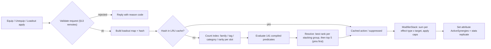

#### 12.10.2 Requirement Grammar

```
Requirement := Clause { " OR " Clause }          -- OR binds loosest
Clause      := Term { " AND " Term }
Term        := Atom | "(" Requirement ")"
Atom        := Kind ":" Values [ "@" Scope ] [ Cmp Count ]
Kind        := "family" | "tag" | "category" | "rarity" | "slot" | "pair" | "distinct"
Values      := Name { "+" Name }                 -- all values must hold on the SAME part
Cmp         := ">=" | "<="                       -- default ">=1"
Count       := 0..21
```

| Atom form | Counts / tests | Example |
|---|---|---|
| `family:F[@S][>=n]` | parts in scope S whose canon Family is F | `family:octopus@ARM` (≥ 1 octopus arm) |
| `tag:T[+T2][@S][>=n]` | parts in S carrying every listed tag | `tag:repair+claw@ARM` (one arm that is both repair and claw) |
| `category:C[@S][>=n]` | parts in S of canon Category C | `category:PLANT>=4` |
| `rarity:R[@S][>=n]` | parts in S whose rarity is ≥ R (Secret counts as Legendary) | `rarity:Epic>=3` |
| `slot:S[>=n]` | occupied slot instances in scope S | `slot:ANY>=8` |
| `pair:ARM` / `pair:LEG` | both sides hold the same part ID (canon matched pair) | `pair:LEG AND family:raptor@LEG>=2` |
| `distinct:family\|category[@S][cmp n]` | number of different families or categories in S (the neutral `human` family is ignored) | `distinct:category>=8` |

| Scope | Slot instances |
|---|---|
| *(omitted)* = `ANY` | all 21 non-FX instances |
| any anatomy slot code | that slot (`ARM_L`, `LEG_R` … also accepted) |
| `ARM` / `LEG` | both sides |
| `COVER` | SKIN, FUR, SCALES |
| `G_HEAD`, `G_EARS`, `G_EYES`, `G_ARMS`, `G_LEGS`, `G_TAILS`, `G_EXTRAS` | the canon UI groups (G_EXTRAS without FX) |
| `FX` | the FX slot only |

**Counting rules.** Every slot instance counts once, so two octopus arms give `family:octopus@ARM` a count of 2.
Parts hidden by the §12 visibility flags still count, because hidden ≠ disabled.
**Plain Human defaults are neutral filler.** `MUT_117`/`MUT_139`/`MUT_179` are ignored by every atom (tags,
categories, rarity, `slot`, `distinct`, `pair`) except an explicit `family:human` atom, and they are never named.
Canon gives them the `charm` tag, so without this rule every starter morph would already hold five charm parts and
trivially trigger charm-count synergies. Synergies must be earned with mutations.
**FX parts count only for atoms scoped `@FX`**, and a synergy with any FX atom must be `social`-only (cosmetic),
because FX parts carry no stats (canon C13.4). Secret parts count normally.

#### 12.10.3 Stacking Rules & Caps

1. **Stacking groups.** Every synergy belongs to one stacking group (`SG_…`) and has a rank r1–r3 inside it. Only
   the highest-ranked qualifying synergy of a group is active; on equal rank, the lower ID wins. Example: Dragon
   Head + Fireproof Skin qualifies for both `SYN_004` Dragon's Own Kitchen (r3) and `SYN_006` Oven Mitts Optional
   (r1) in `SG_HEATCOOK`, so only `SYN_004` Dragon's Own Kitchen applies.
2. **At most 5 active synergies** [TUNABLE]. If more than 5 groups have a winner, the player's pinned synergies
   (up to 5, chosen in §13) go first, then higher rank, then lower ID. The rest are listed as *suppressed* (grey).
3. **Per-stat cap:** the `STAT` effects of all active synergies add at most **+25 points per stat** [TUNABLE]. The
   canon stat caps (§14) still apply on top, and any excess shows "MAXED".
4. **Per-effect-type cap:** percentage effects of the same type are summed additively, then capped at **30 % per
   effect type** [TUNABLE]. When the type names a target (a station, ability, status or repair class), the cap
   applies per target. Example: `PROC_TIME` −12 % (all stations) + −10 % (`STN_GRILL`) = −22 % on the grill. Flat
   effects have the caps in the table below. The capped synergy layer then multiplies with stats, skill nodes and
   station levels in the owning system's formula (§5, §11, §15).
5. **Drawbacks** (e.g. the +10 % damage taken of `SYN_060` Glass-Jaw Slugger) are fixed, never capped and never
   cancelled by other synergies, so a trade-off stays a trade-off.
6. **No scaling with upgrades.** Synergy magnitudes do not grow with part upgrade level, which keeps them easy to
   read. Upgrades raise part stat budgets instead (canon C13.4).

| Effect type | Meaning | Synergy cap |
|---|---|---|
| `PROC_TIME` | Station process-time reduction (all stations, or the stations/recipe categories named) | −30 % per station |
| `INTERACT` | Manual interaction time reduction (chop, mix-by-hand, assemble, plate, wash, clean, extinguish) | −30 % per action |
| `CHOP_ZONE` | Width of the green "Clean cut" zone on chop rings | +30 % |
| `PERFECT_WIN` | Perfect-window width (multiplies with COOK_QLT and station level) | +30 % per station |
| `BURN_GRACE` | Extra seconds before BURNED (and before ON_FIRE) | +3 s total |
| `SAT_BONUS` | Satisfaction points paid through the MutationBonus term of §10 | shares the MutationBonus cap of +10 |
| `TIP` | Tip amount multiplier | +30 % |
| `JACKPOT` | Jackpot Tip chance, in percentage points | +1.0 pp |
| `STAT` | Flat stat points (the 9 stats of §14); stat caps still apply | +25 points per stat |
| `HP` | Flat max HP | +40 HP |
| `REGEN` | HP per second while the In Combat flag is clear | 3 HP/s |
| `REVIVE` | Better KO recovery (respawn HP / Woozy length) | one source only |
| `KNOCKBACK` | Knockback dealt | +30 % |
| `KB_RESIST` | Knockback received reduction | −30 % |
| `MELEE_DMG` | Damage of base melee (ABL_001, ABL_002, ABL_007) | +30 % |
| `ABILITY_DMG` | Damage of the named ability | +30 % per ability |
| `COOLDOWN` | Cooldown reduction of the named ability | −30 % per ability |
| `ABILITY_RANGE` | Range or radius of the named ability | +30 % per ability |
| `ABILITY_MOD` | Behavior change of the named ability (extra target / projectile / hits / duration) | +1 target or projectile, +2 hits, +0.5 s, −0.15 s charge per ability |
| `STATUS_DUR` | Duration of statuses you inflict | +30 % per status |
| `STATUS_ADD` | Rider status applied on hit | 1 rider, ≤ 1 s |
| `STATUS_IMMUNE` | Immunity to the named status | boolean |
| `STATUS_RESIST` | Shorter duration of the named status on you | −50 % per status |
| `THORNS` | Cartoon-poke damage to melee attackers | ≤ 4 per contact, 0.5 s internal cooldown |
| `GUARD` | Block guard-meter size | +30 % |
| `DMG_TAKEN` | Damage-taken reduction (drawbacks are fixed, never capped) | −30 % |
| `MOVE_CTX` | WalkSpeed % while a condition holds | +30 %, and absolute WalkSpeed ≤ 21 studs/s |
| `JUMP` | JumpPower % | +30 % |
| `GLIDE` | Fall-speed reduction while airborne | −40 % |
| `REPAIR_SPD` | Repair speed % (all repairs, or the named target class) | +30 % per target class |
| `REPAIR_COST` | Repair-material cost reduction | −10 % (≤ −30 % together with the REPAIR stat) |
| `FURN_SAFE` | Less damage dealt to your own restaurant objects | −50 % |
| `PATIENCE` | Customer patience % | +30 % |
| `ORDER_WAIT` | Ordering-phase wait window % | +30 % |
| `ANGER` | Anger gain or escalation-roll reduction | −30 % |
| `REVEAL` | Information highlight (no numbers change) | boolean |
| `QOL` | Convenience rule change (no numbers change) | boolean |
| `SOCIAL` | Cosmetic only; never changes a number | none |

#### 12.10.4 UI Display

- **Morph menu (§13):** the Synergies panel lists each synergy as a chip with a context icon (pan = cook,
  fist = combat, wrench = repair, shoe = move, heart = social), its name, rank pips (●●○ = r2) and a state:
  **Active**, **Suppressed: same group** (names the winner), **Suppressed: limit 5**, **Would activate** or
  **Would deactivate** (during previews). State is never shown by color alone; every state has a word and an icon.
- **Pins:** tapping the pin on a chip reserves one of the 5 active slots for it (max 5 pins).
- **HUD:** a strip of up to 5 synergy icons sits beside the ability bar. Hover, long-press, or (on gamepad) opening
  the §24 quick-access radial shows the effect text with live numbers ("Grill −22 % (cap 30 %)").
- **Activation toast:** "SYNERGY! Eight-Arm Kitchen Nightmare", 1.5 s, at most one every 3 s. With reduced motion,
  a static banner replaces the slide.
- **Inspect card (players):** the target's active synergies (names only) under their combo key.
- **Synergy Codex:** every requirement is always readable (no hidden recipes for kids to look up). The first
  activation stamps the synergy "Discovered". The titles "Synergist" (25 discovered), "Combo Chef" (60) and
  "Grand Synergizer" (all) are cosmetic rewards.

#### 12.10.5 PvP Normalization (Morph Arena `BLD_08`)

| Rule | Value [TUNABLE] |
|---|---|
| Contexts that apply | `combat` and `move` only; `cook`, `repair` and the non-cosmetic parts of `social` are inert (`SOCIAL` cosmetics still show) |
| Magnitude | × 0.5 for every numeric effect (round half up to 0.1 %, or to whole points for `STAT`) |
| Per-stat synergy cap | +10 (instead of +25) |
| Active synergies | max 3 (pins honored, then rank, then ID), locked when the match is accepted |
| `ABILITY_MOD` extra targets / projectiles | disabled; duration and charge changes halved |
| `REVIVE` | disabled (Arena KO rules, §21) |
| `STATUS_IMMUNE` | becomes `STATUS_RESIST` −50 % |
| Information | the versus card shows both fighters' active synergies and their halved numbers |

Opt-in Arena play is the only place where players hit each other (§21). Restaurant customers stay NPCs, so normal
synergies never affect another player.

#### 12.10.6 NPCs (Customers, Employees, City NPCs)

Synergies change numbers **only for players**. Customer balance belongs to §8–§10 and employee output to §16.
For readability, the client still evaluates the shared module on NPC part lists. A customer or employee whose parts
would trigger a synergy shows a ✦ on its nameplate, and the inspect card says, for example, "Natural synergy:
Tentacle Tango". This is purely cosmetic and great for "look at that guy" moments. An employee archetype may *copy* a
synergy's idea as its own trait (e.g. Ollie's "Eight Arms, One Brain Cell", `EMP_001`), but that trait is defined
in §16, not here.

#### 12.10.7 Roblox Implementation

**Modules.** `ReplicatedStorage/Shared/MutationDefs` (§12, generated from §36.3) and
`ReplicatedStorage/Shared/MorphRules` (§12: slot fit, exclusions, visibility) are reused. §13 adds, in
`ReplicatedStorage/Shared/Morph/`: `SynergyDefs` (generated from §36.4; requirements are pre-compiled into the node
tables below by the build script), `NamingRules`, `MorphNames` and `SynergyEvaluator`. `ServerScriptService/Services/MutationService` calls the evaluator, owns the
`ModifierStack`, and sets the `ActiveSynergies` attribute. The client UI requires the same modules for previews only.

```lua
--!strict
-- ReplicatedStorage/Shared/Morph/SynergyEvaluator.lua
-- Shared: authoritative on the server (MutationService), preview-only on the client (Morph menu).
local ReplicatedStorage = game:GetService("ReplicatedStorage")
local PartDefs = require(ReplicatedStorage.Shared.MutationDefs) -- §36.3: id -> { family, category, rarityRank, tagSet, ... }
local SynergyDefs = require(script.Parent.SynergyDefs) -- array of { id, group, rank, req: Node }

export type Loadout = { [string]: string }             -- slot instance ("ARM_L") -> part id ("MUT_145")
type Atom = { kind: string, values: { string }, scope: { string }, cmp: string, n: number }
type Node = { op: string, atom: Atom?, kids: { Node }? }
export type Result = { active: { string }, suppressed: { string } }

local MAX_ACTIVE = 5
local CACHE_LIMIT = 512
local RARITY_RANK = { Common = 1, Uncommon = 2, Rare = 3, Epic = 4, Legendary = 5, Mythic = 6, Secret = 5 }
local SLOT_ORDER = { "HEAD", "FACE", "NOSE", "MOUTH", "EYES", "EARS", "HORNS", "NECK", "TORSO", "ARM_L", "ARM_R",
	"HANDS", "LEG_L", "LEG_R", "FEET", "TAIL", "WINGS", "BACK", "SKIN", "FUR", "SCALES", "FX" }

local Evaluator = {}

local function partMatches(atom: Atom, part: any): boolean
	local kind = atom.kind
	if kind == "family" then
		return part.family == atom.values[1]
	elseif kind == "category" then
		return part.category == atom.values[1]
	elseif kind == "rarity" then
		return part.rarityRank >= RARITY_RANK[atom.values[1]]
	elseif kind == "tag" then
		for _, tag in atom.values do
			if not part.tagSet[tag] then
				return false
			end
		end
		return true
	end
	return true -- slot / distinct: any occupant counts
end

local function isNeutral(atom: Atom, part: any): boolean
	return part.family == "human" and not (atom.kind == "family" and atom.values[1] == "human")
end

local function atomValue(atom: Atom, loadout: Loadout): number
	if atom.kind == "pair" then
		local left, right = loadout[atom.scope[1]], loadout[atom.scope[2]]
		local paired = left ~= nil and left == right and not isNeutral(atom, PartDefs[left])
		return if paired then 1 else 0
	end
	local count, seen = 0, {}
	for _, slot in atom.scope do -- scope arrays never contain FX unless the atom is scoped @FX
		local id = loadout[slot]
		local part = if id then PartDefs[id] else nil
		if part and isNeutral(atom, part) then
			part = nil -- Plain Human filler is invisible to synergies (12.10.2)
		end
		if part then
			if atom.kind == "distinct" then
				local value = if atom.values[1] == "family" then part.family else part.category
				if not seen[value] then
					seen[value] = true
					count += 1
				end
			elseif partMatches(atom, part) then
				count += 1
			end
		end
	end
	return count
end

local function holds(node: Node, loadout: Loadout): boolean
	if node.op == "atom" then
		local atom = node.atom :: Atom
		local value = atomValue(atom, loadout)
		return if atom.cmp == ">=" then value >= atom.n else value <= atom.n
	end
	local kids = node.kids :: { Node }
	if node.op == "and" then
		for _, kid in kids do
			if not holds(kid, loadout) then
				return false
			end
		end
		return true
	end
	for _, kid in kids do -- "or"
		if holds(kid, loadout) then
			return true
		end
	end
	return false
end

local cache: { [string]: Result } = {}
local cacheCount = 0

local function hashOf(loadout: Loadout, pins: { string }): string
	local pieces = table.create(#SLOT_ORDER)
	for _, slot in SLOT_ORDER do
		table.insert(pieces, slot .. "=" .. (loadout[slot] or "-"))
	end
	local sortedPins = table.clone(pins)
	table.sort(sortedPins)
	return table.concat(pieces, ";") .. "|" .. table.concat(sortedPins, ",")
end

function Evaluator.Resolve(loadout: Loadout, pins: { string }?): Result
	local pinList = pins or {}
	local key = hashOf(loadout, pinList)
	local hit = cache[key]
	if hit then
		return hit
	end
	local pinned = {}
	for _, id in pinList do
		pinned[id] = true
	end

	local best: { [string]: any } = {}
	local suppressed = {}
	for _, def in SynergyDefs do
		if holds(def.req, loadout) then
			local current = best[def.group]
			if current == nil or def.rank > current.rank or (def.rank == current.rank and def.id < current.id) then
				if current then
					table.insert(suppressed, current.id)
				end
				best[def.group] = def
			else
				table.insert(suppressed, def.id)
			end
		end
	end

	local winners = {}
	for _, def in best do
		table.insert(winners, def)
	end
	table.sort(winners, function(a, b)
		local pa, pb = pinned[a.id] == true, pinned[b.id] == true
		if pa ~= pb then
			return pa
		end
		if a.rank ~= b.rank then
			return a.rank > b.rank
		end
		return a.id < b.id
	end)

	local active = {}
	for index, def in winners do
		table.insert(if index <= MAX_ACTIVE then active else suppressed, def.id)
	end
	table.sort(active)
	table.sort(suppressed)

	local result: Result = table.freeze({ active = table.freeze(active), suppressed = table.freeze(suppressed) })
	if cacheCount >= CACHE_LIMIT then
		table.clear(cache)
		cacheCount = 0
	end
	cache[key] = result
	cacheCount += 1
	return result
end

return Evaluator
```

```lua
-- ServerScriptService/Services/MutationService.lua (excerpt)
function MutationService:_refreshSynergies(player: Player, profile)
	local result = SynergyEvaluator.Resolve(profile.morph.equipped, profile.morph.pinnedSynergies)
	if ArenaRuleset.IsInMatch(player) then
		result = ArenaRuleset.Normalize(result) -- 12.10.5: contexts, x0.5, max 3, stat cap +10
	end
	ModifierStack.Rebuild(player, result.active) -- sums per (effect type, target) and applies the 12.10.3 caps
	player:SetAttribute("ActiveSynergies", table.concat(result.active, ","))
	player:SetAttribute("SuppressedSynergies", table.concat(result.suppressed, ","))
end
```

`ModifierStack.Rebuild` caps each (type, target) pool when it is built, so gameplay services read final
multipliers with one table lookup (e.g. `ModifierStack.Get(player, "PROC_TIME", "STN_GRILL") → 0.78`).
Contextual effects (`MOVE_CTX` "damaged object within 25 studs", heat-station radius) are evaluated by their owning
service at 4 Hz with 0.5 s hysteresis, not by the evaluator.

#### 12.10.8 Edge Cases (12.10)

| Situation | Ruling |
|---|---|
| Loadout changes while an ability is mid-cast | The cast finishes with the old modifiers. New modifiers apply from the next action; statuses already inflicted keep their duration. |
| A synergy modifies an ability that is not on the 4-slot ability bar (canon C12.1) | The modifier is stored but inert. The chip reads "needs `ABL_064` on your bar". |
| A pinned synergy stops qualifying | The pin is kept but marked "Pinned (inactive)"; the freed slot goes to the next winner. |
| Two `ABILITY_MOD` synergies add targets to the same ability | Capped at +1 extra target or projectile per ability. |
| Part data or synergy data hot-fix | The `SynergyDefs` version is bumped, every server flushes its cache and re-evaluates each player within 5 s (staggered). |
| Context flicker (damaged object moves in and out of range) | 0.5 s hysteresis; the WalkSpeed change eases over 0.25 s so the camera never jitters. |
| Guest cooking in a friend's restaurant (§21) | Cook, repair and move synergies apply to any restaurant where the guest has work permission. |
| `SAT_BONUS` together with other mutation satisfaction bonuses (§12) | All share the canon MutationBonus cap of +10 per customer. |
| Morph swapped by an event (`EVT_021` Morph Swap Hour) | The temporary morph is evaluated like any loadout. When the event ends, the saved loadout and its synergies return. |

#### 12.10.9 Acceptance Criteria (12.9 and 12.10)

- **AC-12-80:** `MorphNames.Generate` gives identical key, display name and title on the server and on every client
  for 100 % of the §36.5 combinations and of 10,000 random legal loadouts in the test harness.
- **AC-12-81:** `python3 gdd/tools/check_synergies.py` exits with code 0 ("RESULT: CLEAN"). It proves every
  synergy (and every OR-branch) satisfiable, every example valid, and every §36.5 combination slot-valid, correctly
  named and correctly resolved.
- **AC-12-82:** A newly Spotted key shows its toast within 0.5 s of the triggering event, with at most one toast per 5 s.
- **AC-12-83:** Worn credit is never granted for a loadout kept < 60 s outside the menu without a completed order,
  fight or repair, and is always granted otherwise (20 scripted test cases).
- **AC-12-84:** A profile with all 5,292 keys Spotted and Worn serializes its Morphdex in ≤ 4 KB.
- **AC-12-85:** In 100,000 simulated customer spawns, every proxy's `MorphKey` attribute equals
  `MorphNames.Generate` of its decoded MorphCode (§12.7). Serving the customer credits Spotted exactly once per
  visit, and a city-crowd inspect never credits.
- **AC-12-86:** A synergy cache miss takes ≤ 0.5 ms (p99) on a live server, and the evaluator runs 0 times during a
  10-minute session with no loadout changes.
- **AC-12-87:** With more than 5 qualifying stacking groups, exactly 5 synergies are active, chosen pinned → rank →
  ID, and the others are listed as suppressed with a reason.
- **AC-12-88:** Synergy `STAT` totals never exceed +25 per stat, and no (effect type × target) pool exceeds its
  cap. A test loadout triggering every cooking `PROC_TIME` synergy shows exactly −30 % at `STN_GRILL`.
- **AC-12-89:** Equipping or removing an FX part changes no number in the stat snapshot (only `SOCIAL` effects).
- **AC-12-90:** In an Arena match, only `combat`/`move` synergies apply, at 50 % magnitude, with at most 3 active,
  and both fighters' lists show on the versus card.
- **AC-12-91:** WalkSpeed from stats and synergies never exceeds 21 studs/s outside dash and dodge abilities.
- **AC-12-92:** A customer's ✦ synergy icon changes no customer value (satisfaction distributions with and without
  icons are identical in a 10,000-customer simulation).


## 13. Morph Customization

> This section specifies the **Customize Your Morph** screen
> from the mockup (left category list, center 3D preview on a glowing pedestal, right inventory grid) and every rule
> behind it: equipping, loadouts, naming, colors (palettes), upgrades, and the doors to Lab fusion and Body Mods. Part data is in
> §12 / §36.3, combination naming and synergies in §12.9–12.10 / §36.4 / §36.5, abilities in §36.6, and the
> generic UI framework in §24.

### 13.1 Purpose & Design Goals

**Purpose.** The morph is the centerpiece of the economy: the restaurant earns the money, and this screen is where
it turns into a ridiculous creature worth showing off. The screen must make three things effortless: **seeing**
the morph (a big rotatable pedestal preview), **deciding** (honest stat deltas and synergy previews before every
equip), and **switching** (saved loadouts for Chef / Fighter / Repair work).

| # | Goal | Measured by |
|---|---|---|
| G1 | Equip any owned part in ≤ 2 taps/clicks from opening the screen | AC-13-01 |
| G2 | No decision without information: every equip shows stat, ability and synergy changes first | AC-13-04, AC-13-05 |
| G3 | Fun to show off: pedestal, preview animations, photo mode, custom name | AC-13-09 |
| G4 | Identical capability on desktop, mobile (landscape and portrait), tablet and controller | AC-13-11 |
| G5 | Server-authoritative: the client only previews; every change is validated by `MutationService` | AC-13-12 |

### 13.2 Entry Points, Blocking Rules & Screen States

**Rules & Mechanics.**

| Entry point | Opens on | Notes |
|---|---|---|
| Direct key `N`, the quick-access radial (`T` / Select / ≡) → Morph, or an empty ability slot's "+" (§24) | Parts tab, last category used | Main entry |
| "Equip now" after a Mutation Mart (`BLD_01`) purchase, capsule reveal or quest reward | Parts tab with the new part selected | Shows the equip preview immediately |
| Body Mods (`BLD_02`), talking to stylist Glamtrax (`NPC_005`) | Style tab in **Salon mode** (palette shop, Looks, photo booth) | 13.16 |
| Mutation Laboratory (`BLD_11`), talking to Dr. Splice (`NPC_013`) | Upgrade tab in **Lab mode** (fusion enabled) | 13.16 |
| Morphdex cell "Try this look" (§12.9.4) | Parts tab, filtered to owned parts of the two families | Builds a preview loadout |
| Inspect card "Copy look" on another player | Preview loadout from the parts you own; missing parts listed with where-to-get | 13.17 |
| Tutorial `QST_TUT_010` Your First Mutation | Arms category, the three starter arms highlighted | Guided, other tabs locked until complete |

- **Cannot open** while In Combat (dealt or took damage in the last 6 s), while a level-5 customer targets you,
  while Seeing Stars, during an Arena match, or in Safe Mode (canon E2, E4, E6). The button greys out and a toast
  says "Can't change outfits during a brawl!" (or the matching reason).
- **Auto-close:** if a customer turns hostile toward you while the screen is open, it closes at once and you get
  1.5 s of invulnerability (canon E2). Equips are applied the moment the server accepts them, so nothing is lost.
  An unsent palette change or a half-typed name is kept locally and restored next time.
- **The world keeps running.** The Morph screen is a full-screen menu over the live game; customers keep waiting.
  A thin **order alert strip** (an overlay panel, allowed by E2) at the top of the screen flashes when any customer
  drops below 30 % patience, with a "Back to work" button.

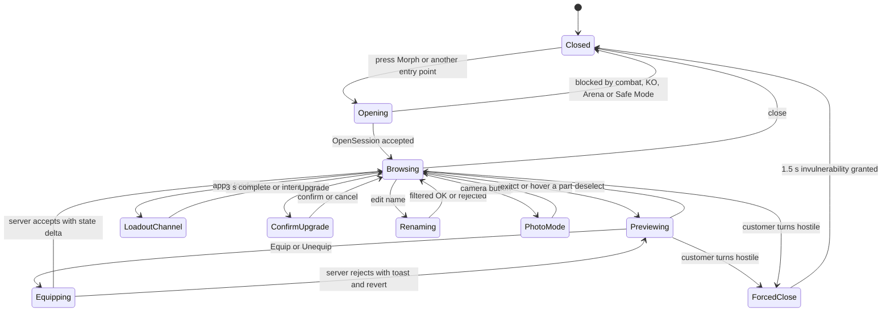

### 13.3 Layouts & Wireframes

All layouts share one component tree (13.4). `UIController` picks a **layout profile** from the viewport size and
the last input type (`UserInputService.LastInputTypeChanged`) and re-parents panels; nothing is duplicated.

| Profile | Trigger | Reference resolution | Grid columns | Detail panel |
|---|---|---|---|---|
| Desktop | viewport width ≥ 1,100 px and last input mouse/keyboard | 1920 × 1080 (scales 1280 × 720 → 2560 × 1440) | 4 | docked right, under the grid |
| Mobile landscape | touch, width > height, height < 600 px | 844 × 390 | 3 | bottom sheet |
| Mobile portrait | touch, height > width | 390 × 844 | 4 (smaller cards) | bottom sheet |
| Tablet | touch, shortest side ≥ 600 px | 1180 × 820 | 4 | docked right (desktop-like, larger hit areas) |
| Console / 10-foot | last input gamepad, or `GuiService:IsTenFootInterface()` | 1920 × 1080 inside a 90 % safe area | 4 (large cards) | docked right |

**Portrait support.** Gameplay locks phones to landscape. While the Morph screen is open the client sets
`PlayerGui.ScreenOrientation = Enum.ScreenOrientation.Sensor`, so a phone can be turned upright for a tall
"dressing-room" view, and restores `LandscapeSensor` on close.

#### 13.3.1 Desktop (1920 × 1080)

```text
+------------------------------------------------------------------------------------------------------------+
| CUSTOMIZE YOUR MORPH  "Sir Snacks-a-Lot" [edit]  Scorpion Bear (Bear-Scorpion)    12,450 MB  320 MS  8 RT [X]|
| ! Table 4 is getting impatient                                                         [Back to work]       |
+----------------+-----------------------------------------------+--------------------------------------------+
| CATEGORIES     |  [Idle] [Cook] [Fight] [Emote]        [Photo] | [Parts] [Equipped] [Loadouts] [Style] [Upg] |
| > All      12  |                                               | (Search parts, tags, abilities...) [Filter] |
| > Head      3* |                 .-""""-.                      | Sort: Recommended v   [x] Owned  [ ] Locked |
| > Ears         |                (  o  o  )                     | +------+ +------+ +------+ +------+         |
| > Eyes      1* |                 \  ^^  /     3D PREVIEW       | |O     | |^   L | |#     | |@  LK |         |
| > Arms         |              .--/      \--.  (ViewportFrame)  | | icon | | icon | | icon | | Lv25 |         |
| > Legs         |              |   BODY     |~~~ tail           | | Lv 2 | | Lv 4 | | Lv 1 | |      |         |
| > Tails        |               \_/      \_/                    | +------+ +------+ +------+ +------+         |
| > Extras    2* |        ===========================            | +------+ +------+ +------+ +------+  ...    |
|                |         ~ glowing pedestal (rarity color) ~   | (virtualized grid, 40 pooled cards)         |
| SUB-SLOTS      |      drag = rotate  wheel = zoom  R = reset   +--------------------------------------------+
| [L Arm][R Arm] +-----------------------+-----------------------+ DETAIL: Octopus Arm  ^ Uncommon  Lv 2/6    |
| [Hands]        | STATS (preview)       | SYNERGIES  3/5 active | MARINE - octopus - tentacle, chef, multi   |
|                | Cook Speed  64  ^ +6  | * Eight-Arm Kitchen.. | Ability: Octo-Flurry          On bar 2/4   |
|                | Strength    42  v -4  | + Tentacle Tango NEW  | Passive: (from 12) carry +1                |
|                | Movement   100  MAXED | - Battering Ram       | [EQUIP: BOTH  * pair +25%] [Left] [Right]  |
|                | [More stats v]        | [Pins 1/5]            | [Upgrade 450 MB + 8 MS + dupe]             |
+----------------+-----------------------+-----------------------+--------------------------------------------+
| LOADOUTS: [Chef *] [Fighter] [Repair] [4: Lv 20] [5: Morphdex 100]   Look: [Default v]   [Save] [Undo]   |
+------------------------------------------------------------------------------------------------------------+
  Legend: O = Common circle, ^ = Uncommon triangle, # = Rare square, @ = Epic pentagon (real UI draws the C13.3
  glyphs), L = equipped left, LK = level-locked, * = NEW items in category.
```

#### 13.3.2 Mobile Landscape (844 × 390)

```text
+----+---------------------------------+------------------------------+
|Head|   [Idle][Cook][Fight][Emote] [X]| [Parts][Eqp][Load][Style][Up]|
|Ears|                                 | (search)            [Filter] |
|Eyes|          .-""-.                 | +-----+ +-----+ +-----+      |
|Arms|         ( o  o )   PREVIEW      | |  ^  | |  #  | |  O  |      |
|Legs|        /|  ^^  |\               | | Lv2 | | Lv1 | | Lv3 |      |
|Tail|         |______|~~              | +-----+ +-----+ +-----+      |
|Xtra|     ===============             | +-----+ +-----+ +-----+      |
| *  |  [Stats] [Synergies]  (toggle)  | (3 columns, 88 x 108 cards)  |
+----+---------------------------------+------------------------------+
| BOTTOM SHEET (slides up on select): Octopus Arm ^ Lv 2/6 | Cook Spd ^+6 | [BOTH*] [L] [R] [More] |
+---------------------------------------------------------------------------------------------------+
  Category rail = 56 px icon column with text labels under icons; touch targets >= 48 px.
  One-finger drag on the preview rotates; pinch zooms; double-tap resets the camera.
```

#### 13.3.3 Mobile Portrait (390 × 844)

```text
+-----------------------------------------+
| < Back   Scorpion Bear       [Photo][..]|
|                                         |
|              .-""-.                     |
|             ( o  o )     PREVIEW (42%)  |
|            /|  ^^  |\                   |
|             |______|~~                  |
|         ===================             |
| [Idle][Cook][Fight][Emote]  Stats|Syn > |
+-----------------------------------------+
| (Head)(Ears)(Eyes)(Arms)(Legs)(Tails)>> |  <- horizontal chip scroller
| (search parts...)           [Filter]    |
| +----+ +----+ +----+ +----+             |
| | ^  | | #  | | O  | | @  |  4 columns  |
| |Lv2 | |Lv1 | |Lv3 | |LK25|  76 x 96    |
| +----+ +----+ +----+ +----+             |
| ...                                     |
+-----------------------------------------+
| [Chef*][Fighter][Repair][+]   [EQUIP]   |  <- sticky bar; EQUIP = selected part
+-----------------------------------------+
```

#### 13.3.4 Console / 10-Foot (1920 × 1080, 90 % safe area)

```text
+--------------------------------------------------------------------------------------------+
|  (LB) Head  Ears  Eyes  [ARMS]  Legs  Tails  Extras (RB)          Scorpion Bear   12,450 MB |
+------------------------------------------+-------------------------------------------------+
|                                          |  +--------+ +--------+ +--------+ +--------+    |
|               .-""-.                     |  |   ^    | |   #    | |   O    | |   @    |    |
|              ( o  o )                    |  |  icon  | |  icon  | |  icon  | | LK 25  |    |
|             /|  ^^  |\     PREVIEW       |  |  Lv 2  | |  Lv 1  | |  Lv 3  | |        |    |
|              |______|~~                  |  +--------+ +--------+ +--------+ +--------+    |
|          ==================              |  DETAIL: Octopus Arm  ^ Uncommon  Lv 2/6       |
|  (RS) rotate / zoom   (R3) reset         |  Cook Speed 64 ^+6   Strength 42 v-4            |
|  STATS | SYNERGIES  (L3 toggles)         |  + Tentacle Tango   - Battering Ram             |
+------------------------------------------+-------------------------------------------------+
| (A) Select/Equip  (X) Compare  (Y) Upgrade  (B) Back  (LT/RT) Loadout  (R3) Reset view       |
+--------------------------------------------------------------------------------------------+
  Cards 128 x 156 px; focus ring = 4 px glow + 1.06x scale; text >= 24 px at 1080p.
```

### 13.4 ScreenGui Component Hierarchy

One `ScreenGui` (built from a template in `ReplicatedStorage/UI/MorphMenu`, cloned into `PlayerGui` on first open
and then kept but disabled). It uses the shared §24 components: `MmrPreview3D` (ViewportFrame + WorldModel + orbit)
for the preview, `MmrVirtualList` of `MmrRarityTile` for the grid, `MmrStatRow`, `MmrModal`, `MmrTooltip` and
`MmrProgressRing`. Names are the instance names used in code.

```text
MorphMenu (ScreenGui: IgnoreGuiInset=true, ResetOnSpawn=false, DisplayOrder=20, ZIndexBehavior=Sibling, Enabled=false)
└─ Root (Frame, 1x1 scale)  + UIScale "TextScale"  + UIAspectRatioConstraint (desktop only)
   ├─ TopBar (Frame)
   │  ├─ TitleLabel ("CUSTOMIZE YOUR MORPH")
   │  ├─ MorphNameButton (TextButton -> RenameModal)   ├─ GeneratedNameLabel ("Scorpion Bear (Bear-Scorpion)")
   │  ├─ CurrencyStrip (MB / MS / RT labels)          ├─ CloseButton
   │  └─ OrderAlertStrip (Frame, hidden until a customer < 30 % patience) └─ BackToWorkButton
   ├─ CategoryRail (ScrollingFrame + UIListLayout)
   │  ├─ CategoryButton_All, _Head, _Ears, _Eyes, _Arms, _Legs, _Tails, _Extras (ImageButton + Label + NewBadge)
   │  └─ SubSlotChips (Frame + UIListLayout) └─ Chip_<SLOT> (e.g. Chip_ARM_L, Chip_HANDS)
   ├─ PreviewPanel (MmrPreview3D)
   │  ├─ PedestalGlow (ImageLabel radial sprite + UIGradient; tinted by best equipped rarity)
   │  ├─ PreviewViewport (ViewportFrame: Ambient, LightColor, LightDirection set in 13.5)
   │  │  ├─ PreviewCamera (Camera; ViewportFrame.CurrentCamera)
   │  │  └─ WorldModel
   │  │     ├─ Pedestal (MeshPart, anchored)
   │  │     └─ PreviewRig (Model: R15 rig + Humanoid + Animator + welded mutation MeshParts)
   │  ├─ FXOverlay (ImageLabel flipbook for FX-slot previews)  ├─ ChannelRing (loadout swap progress)
   │  ├─ AnimButtons (Frame) └─ AnimIdle, AnimCook, AnimFight, AnimEmote
   │  ├─ CameraHint ("drag to rotate")  ├─ ZoomSlider (desktop/tablet)  └─ PhotoButton
   ├─ InfoPanels (Frame; tabs on mobile)
   │  ├─ StatsPanel └─ StatRow_<CODE> x9 (Icon, Name, Value, CapBar, Delta, MaxedTag) + DerivedList
   │  └─ SynergyPanel └─ SynergyChip template (ContextIcon, Name, RankPips, StateLabel, PinButton)
   ├─ RightPanel (Frame)
   │  ├─ TabBar └─ Tab_Parts, Tab_Equipped, Tab_Loadouts, Tab_Style, Tab_Upgrade
   │  ├─ PartsPage
   │  │  ├─ FilterBar └─ SearchBox (TextBox), FilterButton, SortDropdown, OwnedToggle, LockedToggle
   │  │  ├─ FilterSheet (category / rarity / tag / ability / upgradeable toggles)
   │  │  └─ InventoryGrid (MmrVirtualList: ScrollingFrame, manual virtualization) └─ PartCard x40 (pooled MmrRarityTile)
   │  │        PartCard: Icon (ImageRectOffset into atlas), RarityFrame, RarityGlyph, LevelPips,
   │  │                  EquippedBadge (L/R/both), NewDot, LockOverlay, AbilityIcon, DupeCount
   │  ├─ EquippedPage └─ SlotRow_<SLOT> x22 (grouped by UI group headers)
   │  ├─ LoadoutsPage └─ LoadoutCard_1..5, LookCard_1..10, SaveButton, ApplyButton
   │  ├─ StylePage └─ PaletteGrid, PaletteTabs (owned / shop / locked), ApplyScope, Match, Randomize, ResetNatural
   │  └─ UpgradePage └─ LevelBar, BudgetPreview, CostBreakdown, DupeToggle, UpgradeButton, ConvertDupes,
│                    KeepDuplicatesToggle, FavoriteButton, FusionButton
   ├─ DetailDrawer (docked or bottom sheet)
   │  └─ PartIcon, NameLabel, RarityBadge, MetaLine, StatDeltaList, AbilityCard, PassiveCard,
   │     SynergyPreviewList, EquipBothButton, EquipLeftButton, EquipRightButton, UnequipButton, UpgradeShortcut
   ├─ LoadoutBar (bottom strip: 5 slots + Look dropdown + Save + Undo)
   ├─ Modals
   │  └─ ConfirmUpgradeModal, RenameModal, ReplaceAbilityModal, PairPrompt, ConfirmOverwriteModal, ConvertDupesModal
   ├─ Toasts (UIListLayout, max 3 visible)
   └─ ControllerHints (bottom bar; glyphs from UserInputService:GetImageForKeyCode)
```

### 13.5 Rotatable 3D Preview (ViewportFrame + WorldModel)

**Rules & Mechanics.**
- **Build.** On open, the shared `Shared/Morph/MorphBuilder` (§27) clones `ReplicatedStorage/MorphRigs/R15Base` into
  `WorldModel` and attaches the equipped mutation MeshParts to the canon attachments (`MMR_HeadCore`,
  `MMR_ArmL_Upper`, …) after `MorphRules.Resolve` applies the §12 visibility flags, huge-part limit and 9.5-stud
  height clamp. This is the same code that builds the real character and SPCV customer visuals, so the preview
  always matches the in-world morph. The `WorldModel` is what lets the `Humanoid`'s `Animator` play animations inside a ViewportFrame.
  A preview equip swaps only the affected slot's MeshParts (≤ 4 instances), never the whole rig.
- **Camera.** `PreviewCamera` (FieldOfView 30°) orbits the rig's bounding-box center (`Model:GetBoundingBox()`).
  Yaw is free over 360°, pitch is clamped −10° to +35°, and distance runs 6–18 studs. Auto-fit sets distance
  `d = (h / 2) / tan(15°) / 0.8`, so tall morphs (a Brachiosaurus neck, `MUT_114`) still fill 80 % of the viewport
  height.
- **Input.**

| Input | Rotate | Zoom | Reset |
|---|---|---|---|
| Mouse | left-drag: 0.4°/px yaw, 0.25°/px pitch | wheel: 1.0 stud per notch | double-click the preview |
| Touch | one-finger drag (same rates × 1.5) | `UserInputService.TouchPinch` (scale delta → distance) | double-tap |
| Gamepad | right stick X: 180°/s yaw at full deflection (pitch follows the category framing), dead zone 0.15 | right stick Y: 6 studs/s (LT/RT switch loadouts per §24) | `R3` |

- **Feel [TUNABLE].** Release inertia decays at e^(−6t). After 4 s without input the morph idle-spins at 12°/s.
  Selecting a category eases the camera over 0.35 s (Quad Out) to frame it: Head/Ears/Eyes 5-stud close-up of the
  head; Arms waist-up front view; Legs lower body; Tails rear three-quarter view (yaw +150°); Extras full body.
  **Reduced motion** turns off inertia, idle spin and eased framing (instant cuts).
- **Preview animation buttons:**

| Button | Plays | Notes |
|---|---|---|
| Idle | `ANM_001` | default loop; mismatched legs use `ANM_008` Wobbly gait when walking in Photo mode |
| Cook | `ANM_011` Grill flip, then `ANM_010` Chop, alternating | props (spatula, board) are preview-only MeshParts |
| Fight | the ability animations of the equipped bar abilities in order (`ANM_3xx` ↔ `ABL_0xx`, canon C21); with no actives: `ANM_301` Swipe Combo | a cartoon target dummy appears; no damage numbers |
| Emote | `ANM_065` Mutation equip flex, then `ANM_051` Victory dance | `ANM_065` also plays once after every successful equip |

- **Lighting.** `Ambient` (140, 140, 160), `LightColor` (255, 244, 230), `LightDirection` (−1, −1.2, −0.6).
  ViewportFrames have no shadows, bloom or post-processing, so the **glowing pedestal** is a 2D radial-gradient
  `PedestalGlow` behind the viewport. It is tinted with the color of the best rarity equipped (C13.3) and pulses
  between 0.6 and 0.9 transparency at 0.5 Hz (static with reduced motion). Secret parts give a slowly rotating
  rainbow `UIGradient`.
- **FX-slot limitation.** ParticleEmitters, Beams and Trails do not render inside a ViewportFrame. FX parts are
  previewed by `FXOverlay`, an 8 × 8-frame sprite-sheet flipbook at 24 fps layered over the viewport. A **"See it
  live"** button (unavailable during combat) hides the screen for 6 s of **Mirror mode**: the world camera orbits
  the real character with the UI hidden, then the screen returns.
- **Cost control.** There is exactly one ViewportFrame. The rig respects canon C13.7 (≤ 40 MeshParts, ≤ 15,000
  triangles). Animation tracks stop when the screen is hidden, and the `WorldModel` is cleared 30 s after close.
  If the client's frame time stays above 25 ms for 3 s, the preview drops to **Static mode** (idle pose, no
  animation, 30° rotation steps) and says so in the corner.

### 13.6 Body-Part Categories (canon C13.1 UI groups)

| Category (mockup label) | Slots inside | Sub-slot chips | Camera framing | Empty-slot behavior |
|---|---|---|---|---|
| All | every slot | — | full body | — |
| Head | `HEAD`, `FACE`, `NOSE`, `MOUTH` | Head · Face · Nose · Mouth | head close-up | `HEAD` cannot be emptied; the others show "+ Add" |
| Ears | `EARS`, `HORNS` | Ears · Horns | head close-up, top angle | "+ Add" |
| Eyes | `EYES` | — | face close-up | "+ Add" |
| Arms | `ARM_L`, `ARM_R`, `HANDS` | Left Arm · Right Arm · Hands | waist-up | arms revert to Plain Human (`MUT_139`); hands "+ Add" |
| Legs | `LEG_L`, `LEG_R`, `FEET` | Left Leg · Right Leg · Feet | lower body | legs revert to Plain Human (`MUT_179`); feet "+ Add" |
| Tails | `TAIL` | — | rear three-quarter | "+ Add" |
| Extras | `NECK`, `TORSO`, `WINGS`, `BACK`, `SKIN`, `FUR`, `SCALES`, `FX` | Neck · Torso · Wings · Back · Skin · Fur/Scales · FX | full body | torso reverts to Plain Human (`MUT_117`); others "+ Add" |

- Each category button shows a **NEW** badge with the count of owned parts the player has not opened yet. The
  badge clears when the card scrolls into view for ≥ 1 s.
- Picking a sub-slot chip filters the grid to parts that fit it; an `ARM` part fits both arm chips.
- `FUR` and `SCALES` share one chip, "Fur/Scales", because they are mutually exclusive (13.8).

### 13.7 Mutation Inventory Grid

**Card anatomy** (desktop 112 × 136 px, mobile 88 × 108 px / 76 × 96 px portrait, console 128 × 156 px):

| Element | Position | Content |
|---|---|---|
| Icon | center | atlas sprite (13.22), 3/4 view on a transparent background |
| Rarity frame + glyph | border + top-left | canon color **and** shape (13.9) |
| Level pips | bottom | "Lv 3/7", pips filled per level |
| Equipped badge | top-right | `L`, `R`, `L+R` or ✓ |
| NEW dot | top-right (under badge) | unseen part |
| Lock overlay | full card, 60 % dark | "Lv 25" equip requirement (C13.3), or a padlock + source icon for unowned parts |
| Ability icon | bottom-right | the part's active ability, if it has one |
| Duplicate count | bottom-left | "+2" duplicates owned (upgrade fuel) |

**Filters** (combinable; the active filter count shows on `FilterButton`):

| Filter | Options | Default |
|---|---|---|
| Slot | the sub-slot chips of the category (13.6) | category's all |
| Category | the 16 canon categories, each with an icon | all |
| Rarity | Common … Secret, 7 toggles with glyphs | all |
| Tag | the 33 canon synergy tags as chips (`chef`, `fighter`, `repair` …) | none |
| Ownership | Owned · Locked (seen in shops, Morphdex or capsule odds but not owned) · All | Owned |
| Has active ability | on/off | off |
| Upgradeable now | on/off (enough currency + duplicate or substitute MS) | off |

**Sorting:** *Recommended* (default: equipped first, then parts that would activate a new synergy, then rarity
high→low, then level), Rarity, Level, Power (stat budget per C13.4), Newest, Name A–Z, or by any single stat
(e.g. "COOK_SPD high→low").

**Search** (`SearchBox`): matches part name, family, category, tags and ability name, case- and accent-insensitive.
Tokens are ANDed ("tentacle chef" → Octopus Arm, Octopus Head). Results update after a 150 ms debounce. Search text
stays on the device and is never shown to anyone else, so it needs no text filtering.

**Locked and secret parts.** Locked cards show a silhouette, rarity and source ("Mutation Mart", "Capsule",
"Event", per §12 acquisition codes). Pressing **Where to get?** sets a map waypoint. Undiscovered Secret parts show
only a "?" card with a riddle hint once the player has found the hint location (canon C13.8). They are never
silhouetted, so secrets stay secret.

**Virtualization.** The grid keeps a pool of 40 `PartCard` instances. `CanvasSize` is set from the row count, and
on `CanvasPosition` changes the visible row range is recomputed and pooled cards are re-bound (icon rect, labels).
No card is created or destroyed while scrolling.

### 13.8 Equipped Panel, Equip / Unequip Controls & Slot Rules

**Equipped panel.** A "paper-doll" list of all 22 slots, grouped under the seven UI-group headers. Each row shows
icon, name, level and rarity glyph. Selecting a row selects that slot's chip and filters the grid. Empty optional
slots read "+ Add"; mandatory slots show their Plain Human default in grey.

**Ownership rule.** Owning a part ID once lets you wear it on *both* sides. `ARM` and `LEG` parts are mirrored
automatically (canon C13.1), so a matched pair never needs a second copy. Extra copies are **duplicates**: upgrade
fuel or MS conversion (13.15). The starter morph's "×2" arms and legs are one owned part worn on both sides.

**Controls.**

| Action | Mouse/keyboard | Touch | Gamepad |
|---|---|---|---|
| Select part | click card | tap card (opens bottom sheet) | D-pad / left stick + `A` |
| Equip (single-slot part) | double-click card, `Enter`, or EQUIP button | EQUIP in sheet or sticky bar | `A` on the card (focus jumps to EQUIP), `A` again |
| Equip ARM/LEG to both sides | EQUIP BOTH (default button) | EQUIP BOTH | `A`, `A` (EQUIP BOTH is the default focus) |
| Equip to one side | Left / Right buttons, or `Shift`+click = left, `Ctrl`+click = right | Left / Right buttons | `A`, then D-pad to Left / Right, `A` |
| Unequip | right-click equipped card → Unequip | UNEQUIP in sheet | focus UNEQUIP in the drawer, `A` |
| Compare / Upgrade | right-click → Compare; Upgrade button | Compare / Upgrade in sheet | `X` compare, `Y` upgrade (§24 Morph row) |
| Undo last change (10 deep) | `Ctrl+Z` or Undo | Undo | hold `B` 0.5 s |

**Slot rules (all re-checked by the server, 13.20).**

1. **One part per anatomy slot.** Equipping into an occupied slot replaces the part; there is no confirmation
   because Undo exists.
2. **Arms.** An `ARM` part may go to `ARM_L`, `ARM_R` or both. The default button is **Both** when the other arm is
   Plain Human or already the same part; otherwise it is the side selected in the chips. Both arms with the same
   part show the canon **matched pair** bonus as "★ Pair: +25 % to this pair's stats" plus the part's paired
   ability bonus (§36.6).
3. **Legs.** Same as arms. If the legs end up mismatched, the drawer shows "Wobbly gait (no penalty)" and plays
   `ANM_008` in the preview once, with a "Make a pair (+25 %)" shortcut.
4. **Exclusions (§12 ✱ flags).** Equipping a `FUR` part while `SCALES` is worn (or the reverse), or `WINGS` while a
   blocksWings `BACK` part is worn (`MUT_244`, `MUT_245`, `MUT_246`, `MUT_249`, `MUT_251`, or the reverse), opens
   the one-tap prompt "Swap out your wings?" / "Swap Scales for Fur?". Confirming sends the equip with
   `swap = true` and the server removes the conflicting part. Without it, the server answers `CONFLICT_WINGS` /
   `CONFLICT_COVERING`. `SKIN` is independent and stays under either covering.
5. **Mandatory slots.** Unequipping a torso, arm or leg reverts it to the Plain Human default. `HEAD` can only be
   swapped; its Unequip button is disabled with the tooltip "Every morph needs a head. Probably."
6. **Level requirement.** Parts above the player's level (canon C13.3 / C4.5: Common 1, Uncommon 5, Rare 12,
   Epic 25, Legendary 40, Mythic 60, Secret by condition) show the lock overlay and "Reach Lv 25 to equip". They
   can still be previewed on the pedestal ("Try on") but not equipped. The tutorial starter arm (`QST_TUT_010`) is
   exempt (canon C13.8).
7. **Ability bar (max 4 active abilities, canon C12.1).** If a new part brings an active ability and the bar is
   full, `ReplaceAbilityModal` asks which ability to drop, or "Keep on bench". Benched abilities are inactive until
   swapped onto the bar.
8. **Carry capacity (canon C3).** If the change would leave you carrying more items than your new capacity
   (e.g. removing an Octopus Arm while holding 2 plates), the equip is refused with "Put something down first!"
   (code `PUT_SOMETHING_DOWN`).
9. **Size and height.** `LEG` and `NECK` parts change `Humanoid.HipHeight` and head offset (C13.7). The §12 height
   clamp (≤ 9.5 studs, so every door works) and the huge-part limit (a third huge part renders at ×0.7) are applied
   by `MorphRules`. The preview shows the same "Squished to fit!" badge the world shows. Collision never changes.
10. **Hidden is not disabled.** Face parts under a faceLocked head (e.g. TV Head `MUT_021`), HANDS under handsLocked
   arms, and FEET under footless legs are not built, but keep their stats, passives, abilities and synergies. The
   card shows "Hidden — still working!" and the preview shows the head's screen-emote.

**Instant, optimistic, authoritative.** Single-part equips are instant (canon E4). The client applies the change
to the preview right away and sends `Mutation.Equip`. On rejection, the preview reverts and a toast explains why.
On success, the real character updates through `MorphAssemblyService` and the screen receives the new stats and
synergy snapshot.

### 13.9 Rarity Indicators (canon C13.3)

Rarity is always shown by **color + shape + text**, never by color alone.

| Rarity | Color | Glyph | Frame pattern (second cue) | Pedestal glow |
|---|---|---|---|---|
| Common | gray `#9AA0A6` | ● circle | plain 2 px border | soft gray |
| Uncommon | green `#3DDC84` | ▲ triangle | dotted border | green |
| Rare | blue `#3A8DFF` | ■ square | double border | blue |
| Epic | purple `#A15CFF` | ⬟ pentagon | notched corners | purple |
| Legendary | orange `#FF9F1C` | ★ star | star corner studs | orange, slow shimmer |
| Mythic | magenta `#FF3EA5` | ⬢ hexagon | hex-tiled border (animated unless reduced motion) | magenta, shimmer |
| Secret | rainbow shimmer on black | ? glyph | black card, rainbow edge | rotating rainbow |

The detail drawer always spells out the rarity name ("Uncommon"). Palettes (13.14) never change rarity frames.

### 13.10 Stats Panel & Compare Deltas

**Rules & Mechanics.** The panel shows the nine canon stats with their effective values. Each value is the sum of
level-up allocation, part budgets (C13.4, including the matched-pair +25 %), skill nodes (§14) and synergy `STAT`
effects (capped at +25 per stat, §12.10.3), then clamped to the canon cap. The same shared module `StatCalc` that
the server uses computes the numbers, so a preview always equals the post-equip result.

| Row element | Normal | While previewing a change |
|---|---|---|
| Value | "64" | "64 → 70" |
| Delta | — | **▲ +6** (green `#3DDC84`, up arrow) / **▼ −4** (orange-red `#FF6B4A`, down arrow) / "= 0" (gray). The arrow and sign are always present. Colorblind modes switch to blue `#3A8DFF` / orange `#FF9F1C`. |
| Cap bar | fill = value / cap | ghost segment shows the change |
| MAXED | value ≥ cap: bar full, label **MAXED** | "MAXED (+7 wasted)" in gray italics when a change would overflow the cap |

The default view shows the mockup's four headline stats (Cooking, Strength, Repair, Luck; canon C5). **More stats**
expands all nine plus a derived block in plain numbers:

| Derived line | Formula (canon C5) | Example |
|---|---|---|
| WalkSpeed | `16 × (1 + 0.003 · MOVE)`, max 21 studs/s including synergies | "17.4 → 18.1 studs/s" |
| Cooking time | `× 1 / (1 + 0.006 · COOK_SPD)` | "× 0.72 → × 0.70" |
| Perfect window | `× (1 + 0.005 · COOK_QLT)` | "× 1.30 → × 1.33" |
| Damage | `× (1 + 0.008 · STR)` | "× 1.34 → × 1.31" |
| Damage taken | `× 100 / (100 + DEF)` | "× 0.77" |
| Repair speed | `× (1 + 0.01 · REPAIR)` | "× 1.45" |
| Max HP | `100 + 2 × (Level − 1) + mutation HP` | "142 → 162" |
| Carry capacity | 1 + carry parts, hard max 3 | "2 → 3" |

### 13.11 Ability Descriptions & Synergy Preview

- **Ability card:** icon, player-facing name (never the ID), type (melee / ranged / utility), cooldown, one-line
  description from §36.6, state ("On bar 2/4" or "On bench"), and **Try it**, which plays the ability's
  `ANM_3xx` animation on the pedestal against the cartoon dummy.
- **Passive card:** the part's passive from §12, with numbers at the current level and "Next level:" in gray.
- **Synergy preview.** When a card is selected, the shared `SynergyEvaluator` (§12.10.7) runs on the hypothetical
  loadout and the Synergy panel shows the differences:

| Line | Meaning | Look |
|---|---|---|
| `+ Would activate: Tentacle Tango` | a new winner enters the active 5 | green plus sign + text |
| `− Would deactivate: Battering Ram` | an active synergy stops qualifying | red minus sign + text |
| `⇄ Would replace: Oven Mitts Optional → Dragon's Own Kitchen` | same stacking group, higher rank takes over | swap arrows |
| `… Would be suppressed (limit 5): Glow Up` | qualifies but does not fit in the 5 slots | gray, with a "Pin" shortcut |

- **Synergy Hunt.** In the Synergies tab, choosing any §36.4 synergy filters the grid to owned parts that move
  you toward it and shows progress ("chef parts 3/5"), with the missing pieces' sources for unowned parts.
- **Pins.** Up to 5 synergies can be pinned; pins decide which synergies win when more than 5 qualify
  (§12.10.3). Pins are saved per loadout.

### 13.12 Saved Loadouts & Switching Rules

**Loadout slots.**

| Slot | Default name & icon | Unlock | Cost |
|---|---|---|---|
| 1 | Chef Loadout (pan) | from the start (pre-filled with the current morph after `QST_TUT_010`) | free |
| 2 | Fighter Loadout (fist) | from the start | free |
| 3 | Repair Loadout (wrench) | from the start | free |
| 4 | Custom (star) | player level 20 | free (earnable) |
| 5 | Custom (star) | Morphdex tier 4: 100 Spotted + 25 Worn (§12.9.4) | free (earnable) |
| Looks 1–2 | "Natural", "Party" | from the start | free |
| Looks 3–10 | cosmetic loadouts | §23 (Robux, cosmetic only), or 1 extra Look from an event reward | — |

- A **functional loadout** stores per-slot part IDs, per-slot palettes, the 4-slot ability bar order, synergy pins,
  an optional loadout name and a linked Look. Names, icons and order are editable.
- A **Look** (cosmetic loadout) stores *appearance only*: per-slot palettes, FX visibility, nameplate title, pedestal style and
  Photo-mode pose. It can be applied on top of any functional loadout. Looks never store parts, so buying Look
  slots can never change stats. This keeps §23 strictly non-pay-to-win.
- **Save:** "Save to slot" snapshots the current morph; overwriting a non-empty slot asks for confirmation.
  "Revert" restores the slot's saved state into the preview.

**Switching restrictions (canon E4).**

| Situation | Rule [TUNABLE values from canon] |
|---|---|
| Single-part equip inside the Morph screen | instant |
| Applying a whole loadout (`Mutation.SwapLoadout`, from the screen, `LT`/`RT` inside it, or the inner "Loadouts" ring of the §24 quick-access radial: hold `T` / Select / ≡) | **3 s channel**, then a **10 s cooldown** that starts when the channel completes |
| During the channel | walk at 50 % speed; interacting, attacking, or taking damage **interrupts** it (no cooldown consumed). A cartoon "costume-change" dust cloud plays (client FX), with `ANM_065` on completion |
| In Combat (6 s flag), Seeing Stars, a level-5 customer targeting you | channel cannot start; the radial's Loadouts ring shows "Can't change outfits during a brawl!" |
| Arena (`BLD_08`) | the loadout is locked when the match is accepted; it can be changed in the lobby under the same channel rules |
| Carrying items | allowed only if the target loadout's carry capacity ≥ items carried |
| Loadout contains a part no longer owned (converted to MS) or above your level | that slot keeps its current part; the card shows "1 part missing" with a fix-up shortcut |
| Applying a Look | instant, no cooldown (purely cosmetic), not during combat |

### 13.13 Morph Naming

- **Rules.** 3–20 characters after trimming (counted with `utf8.len`), letters (including accented Latin),
  digits, space and `- ' ! ? .`. No line breaks, no rich-text tags (nameplates use `RichText = false`), and runs of
  spaces collapse to one. An empty name means "use the generated display name" (§12.9.2).
- **Input.** `RenameModal` has a `TextBox` (`ClearTextOnFocus = false`) with a live counter ("12/20"). Over-long
  input is trimmed on `GetPropertyChangedSignal("Text")`, because Roblox TextBoxes have no max-length property.
- **Server flow (`Morph.SetName`, §27; the design limits below are stricter than the 5 s transport limit there).**
  1. Validate type, length and character set.
  2. Rate limit: 1 attempt per 30 s and 10 per 24 h per player [TUNABLE]. Every attempt counts, so the filter
     cannot be brute-forced.
  3. If `TextChatService:CanUserChatAsync(userId)` is false, custom names are disabled for that account: the
     nameplate shows the generated name and the button explains why.
  4. `TextService:FilterStringAsync(text, player.UserId, Enum.TextFilterContext.PublicChat)` inside `pcall`, then
     `:GetNonChatStringForBroadcastAsync()`. If the result differs from the input (characters replaced by `#`), the
     name is rejected: "The filter scrambled that one. Try another!". If the filter service errors, the name is
     rejected with "Name service is busy, try again soon" and the attempt is not counted.
  5. Persist the raw text as §28 specifies (`morph.morphName`, never logged). Only the broadcast-filtered string is
     ever replicated or displayed, to everyone including the owner.
  6. **Re-filter on every session load:** filter rules change, so the saved name is filtered again when the profile
     loads, and the result is cached for the session. If it now comes back scrambled, the nameplate falls back to the
     generated name and the player gets a notice.
- **Where names appear:** the overhead nameplate (`BillboardGui`, MaxDistance 60 studs), the inspect card, the
  Showcase Stage (`BLD_22`) and co-op guest lists. Each loadout may carry its own name ("Chef Loadout" can be
  "Sir Saucelot").

### 13.14 Cosmetic Color Selection (Style tab)

- **What a color is.** A **palette** is a named primary / secondary / accent triplet (the 24 base palettes of §12.7
  plus reward palettes). Recoloring a part means pointing it at that palette's 16 × 16-swatch atlas (§25 "palette
  atlases"). Tintable hero parts (Legendary+, `SurfaceAppearance` with `AlphaMode = Overlay`) also take the
  palette's primary color as `MeshPart.Color`. Coverings (`SKIN` / `FUR` / `SCALES`) recolor their surface swap.
  Untintable details (pupils, Secret shimmer) are masked out.
- **Per-part choice.** Every equipped slot can use a different palette, and palette 0 means the part's authored
  "Natural" colors. The choice is a map `{ [slot] = paletteIndex }`, sent with `Morph.SetPalette` (§27) and stored
  per loadout (§28).
- **Palette sources.**

| Source | Examples | How to get |
|---|---|---|
| Natural + 7 starter base palettes | Ketchup & Mustard, Pickle Jar, Blueberry Jam, Diner Chrome… | free |
| Remaining 16 base palettes (§12.7) | Neon Alien, Metallic Bot, Earthy Mammal… | unlock by first owning a part of the matching head category, or buy at Body Mods |
| Reward palettes (canon C17.4) | "Museum Pastels", "Fossil Tones", "Neon Specimen" (§12.9.4); quest, achievement, milestone and event palettes (§14, §18, §20) | rewards |
| Body Mods shop (earnable cosmetics, canon C4.1) | "Sewer Chic", "Diner Neon", "Critic's Choice" | 2,500–25,000 MB each at `BLD_02` [TUNABLE] |
| Cosmetic packs | themed palettes | §23 (Robux, cosmetic only) |

- **Controls.** A palette grid of swatch triplets with an **apply scope**: this part / this category / everything.
  Also **Match** (copy another slot's palette), **Randomize** (undoable) and **Reset to Natural**. Changes preview
  instantly and are sent after 0.5 s of inactivity (one `Morph.SetPalette` call with all changed slots).
- **Readability rules.** The rainbow shimmer stays reserved for Secret parts (never offered as a palette), and
  palettes never touch UI rarity frames. With **Keep colors** on (default), a part swapped into a slot inherits
  that slot's palette. The server rejects palettes the player does not own.

### 13.15 Mutation Upgrade Controls (Upgrade tab)

**Rules & Mechanics** (canon C4.6 and C13.4).
- Upgrading level `L → L+1` costs `MB = BaseMB × 1.5^(L−1)` (rounded half up to whole MB), `MS = BaseMS × L`,
  `RT = RTBase × (L − 3)` for Epic+ from L ≥ 4, **plus one duplicate** of the part **or** `DupeSubstituteMS` extra
  MS (Common 10, Uncommon 25, Rare 60, Epic 160, Legendary 400, Mythic 1,000, Secret 600; Secrets can never
  duplicate, so they always pay the substitute).
- The page shows: level bar ("Lv 3 / 7"); the stat budget now and next (`Budget × (1 + 0.12 × (L − 1))`: Lv1 ×1.00
  → Lv2 ×1.12 → … → Lv10 ×2.08), with the per-stat result in the Stats panel as ▲ deltas; the cost breakdown with
  owned amounts (missing amounts in red with a ✗ glyph); the **Use duplicate (owned: 2)** / **Pay +60 MS instead**
  toggle; and **UPGRADE**.
- **Confirmation.** Every upgrade opens `ConfirmUpgradeModal` with the exact costs. Costs ≥ 10,000 MB or any RT need
  **hold to confirm** for 0.8 s (accessibility option: "tap twice instead"). The request carries `expectedLevel`,
  so a double-tap or a network retry can never upgrade twice.
- **Duplicates.** The duplicates list shows each part with spare copies and **Convert to MS** at the canon rate
  (Common 5, Uncommon 12, Rare 30, Epic 80, Legendary 200, Mythic 500). One global **Keep duplicates for upgrades**
  toggle (§28 `keepDuplicates`) decides whether capsule duplicates auto-convert (canon C4.7). A per-part
  **Favorite** star (§28 `fav`) protects a part from auto-conversion and from fusion pickers.
- **Max level** shows "MAX" with a sparkle, and the button becomes "Fully upgraded!".

**Upgrade cost per step (MB / MS / RT; plus one duplicate or the substitute MS) [TUNABLE, from canon C4.6]:**

| Step | Common | Uncommon | Rare | Epic | Legendary | Mythic | Secret |
|---|---|---|---|---|---|---|---|
| Lv1→2 | 100 / 2 | 300 / 4 | 900 / 8 | 3,000 / 15 | 10,000 / 30 | 30,000 / 50 | 15,000 / 40 |
| Lv2→3 | 150 / 4 | 450 / 8 | 1,350 / 16 | 4,500 / 30 | 15,000 / 60 | 45,000 / 100 | 22,500 / 80 |
| Lv3→4 | 225 / 6 | 675 / 12 | 2,025 / 24 | 6,750 / 45 | 22,500 / 90 | 67,500 / 150 | 33,750 / 120 |
| Lv4→5 | 338 / 8 | 1,013 / 16 | 3,038 / 32 | 10,125 / 60 / 1 RT | 33,750 / 120 / 2 RT | 101,250 / 200 / 4 RT | 50,625 / 160 / 3 RT |
| Lv5→6 | — | 1,519 / 20 | 4,556 / 40 | 15,188 / 75 / 2 RT | 50,625 / 150 / 4 RT | 151,875 / 250 / 8 RT | 75,938 / 200 / 6 RT |
| Lv6→7 | — | — | 6,834 / 48 | 22,781 / 90 / 3 RT | 75,938 / 180 / 6 RT | 227,813 / 300 / 12 RT | 113,906 / 240 / 9 RT |
| Lv7→8 | — | — | — | 34,172 / 105 / 4 RT | 113,906 / 210 / 8 RT | 341,719 / 350 / 16 RT | 170,859 / 280 / 12 RT |
| Lv8→9 | — | — | — | — | 170,859 / 240 / 10 RT | 512,578 / 400 / 20 RT | 256,289 / 320 / 15 RT |
| Lv9→10 | — | — | — | — | — | 768,867 / 450 / 24 RT | 384,434 / 360 / 18 RT |
| **Total to max** | **813 / 20** | **3,957 / 60** | **18,703 / 168** | **96,516 / 420 / 10 RT** | **492,578 / 1,080 / 30 RT** | **2,246,602 / 2,250 / 84 RT** | **1,123,301 / 1,800 / 63 RT** |

Worked check: a Rare part from Lv1 to Lv7 costs 18,703 MB + 168 MS + 6 duplicates (or 360 extra MS). At TIER_04
income (3,100 MB per active hour), that is about 6 active hours of income, in line with canon's 50 % "mutations,
furniture, staff" spending share.

### 13.16 Entry to Lab Fusion (`BLD_11`) and Body Mods (`BLD_02`)

| Button (location) | Inside the building | Elsewhere |
|---|---|---|
| **Fusion** (Upgrade tab) | Opens the Fusion sub-panel in Lab mode: pick inputs from the grid. Mythic fusion = 3 Legendary parts of the same category + 600 MS + 40 RT (canon C4.5); other fusion recipes per §12. Inputs show their stat loss and the preview shows the result silhouette | Shows "Visit Dr. Splice at the Mutation Laboratory (Mutation Research District, `DST_06`)" with **Set waypoint** and **Morph Metro** (if that station is discovered) |
| **Get more palettes** (Style tab) | Salon mode: Palette Shop (MB purchases), Look slot management, Photo Booth backdrops, a free rename (skips the 30 s cooldown once per visit) | Waypoint to Body Mods (Mutation Market, `DST_02`) |
| **Where to get?** (locked card) | — | Waypoint to the source building (Mutation Mart `BLD_01`, Mystery Market `BLD_13`, Lab, quest giver) |

Fusion and shop transactions are owned by `MutationService` and `EconomyService` (§12, §18, §22). This screen only
hosts their UI and shows the result on the pedestal.

### 13.17 Show-Off Features

- **Photo mode** (camera button): hides all UI, offers poses (Idle, Flex `ANM_065`, Victory `ANM_051`, any
  equipped ability pose), backdrops (Restaurant, Neon City, Museum, Plain) and a frame with the display name, key
  and rarity glyphs. On supported platforms it uses `CaptureService:CaptureScreenshot`, then
  `CaptureService:PromptSaveCapturesToGallery`, or the platform share prompt where available. Elsewhere it shows a
  "screenshot now!" pose timer.
- **Inspect card** (hold Inspect 2 s on a player or NPC within 12 studs): display name, key, parts (icons),
  active synergies, and the **Morphdex Spotted** credit (§12.9.4). For players, **Copy look** builds a preview
  loadout from the parts you own, listing the missing ones with where-to-get.
- **Showcase Stage (`BLD_22`):** the Morph screen's current loadout is what struts the runway. Legendary-rarity
  synergies such as `SYN_128` Museum Piece add the special entrance.

### 13.18 Accessibility

| Need | Implementation |
|---|---|
| Text size | Settings → Text Scale 100 / 125 / 150 % drives the `TextScale` `UIScale` on text containers. Body text ≥ 14 px on phones, ≥ 24 px at 1080p on console (`UITextSizeConstraint`). Layout reflows; grid columns drop by one at 150 %. |
| Reduced motion | No idle spin, inertia, eased camera framing, pedestal pulse or animated Mythic borders. Slides become 0.15 s fades; toasts are static banners. |
| Color-independent status | Rarity = color + glyph + frame pattern + name (13.9). Stat deltas = arrow + sign + number (13.10). Synergy states = icon + word (§12.10.4). Missing currency = red + ✗ glyph + "need 120 more". |
| Colorblind modes | Deuteranopia / protanopia / tritanopia presets swap delta colors to blue/orange and raise frame-pattern contrast. Rarity hues stay canon, but the glyphs carry the meaning. |
| Motor | Touch targets ≥ 48 × 48 px with 8 px spacing. Every drag has a button alternative (rotate ◀ ▶ buttons, zoom slider). "Tap twice instead of hold" for confirmations. No timed inputs on this screen. |
| Cognitive | Recommended sort + Synergy Hunt guide choices. Plain-language ability text. Every number has a tooltip with its formula. |
| Audio | Equip / upgrade / rename cues are described to §26 as sounds (not specified here) and are never the only feedback. |
| Haptics | `HapticService` small-motor pulse (0.3 for 60 ms) on equip and on upgrade, where the gamepad supports it. |
| Screen readers | Roblox has no screen-reader API. All icons have text labels or tooltips, and no information exists only in images. |

### 13.19 Controller Navigation Map

- Focus uses `GuiService.SelectedObject`. While the screen is open `GuiService.AutoSelectGuiEnabled` is `false`, so
  the screen controls focus. Each panel is a `SelectionGroup` with `SelectionBehaviorLeft/Right/Up/Down = Stop` at
  its outer edges, and cross-panel moves are wired with `NextSelectionLeft/Right`. The focus ring is a custom
  `SelectionImageObject` (4 px rarity-neutral white glow).
- Bindings use `ContextActionService:BindActionAtPriority` (priority 3,000) while the screen is open and are
  unbound on close. Glyphs come from `UserInputService:GetImageForKeyCode`, so Xbox and PlayStation layouts both read
  correctly.

| Button | Action |
|---|---|
| Left stick / D-pad | move focus (grid, chips, tabs, detail buttons) |
| `A` | select a card (focus jumps to its primary button) / confirm (equip) |
| `B` | back: close modal → close drawer → close screen; hold 0.5 s = Undo |
| `X` | compare (pins the selected part's deltas) |
| `Y` | upgrade the selected part (opens the Upgrade tab) |
| `LB` / `RB` | previous / next category |
| `LT` / `RT` | previous / next loadout (applying starts the 3 s channel) |
| Right stick | X = rotate preview, Y = zoom |
| `R3` | reset camera |
| `L3` | toggle Stats ↔ Synergies |
| Select (tap) | §24 quick-access radial (unchanged inside menus) |
| Start | reserved for the Roblox menu (§24) |

```text
Focus graph (left/right moves between panels; up/down inside a panel)
 [CategoryRail] <-> [SubSlotChips] <-> [InventoryGrid] <-> [DetailDrawer buttons]
       |                                     |                       |
 [LoadoutBar] <------------------------ [TabBar] <-------------> [Stats/Synergy panel]
 Entering the grid restores the last focused card; entering the drawer focuses its primary button (EQUIP BOTH).
```

### 13.20 Remotes & Server Validation

Remotes are named `Mutation.<Action>` (canon C2) and live in `ReplicatedStorage/Remotes/Mutation`. Every request
carries a `reqId` (string ≤ 36 chars). The server keeps the last 50 `reqId`s per player and replays the stored
response for duplicates (idempotent retries). Payloads are type-checked with `typeof`, unknown keys are rejected,
and strings are length-bounded. `MutationService` is the only writer of morph data, and `EconomyService` performs
every currency debit.

| Remote | Type | Payload (client → server) | Server validation | Response | Rate limit [TUNABLE] |
|---|---|---|---|---|---|
| `Mutation.OpenSession` | RemoteFunction | `{}` | not In Combat, not targeted by a level-5 customer, not KO'd, not in an Arena match, not Safe Mode (E2/E4/E6) | snapshot: equipped, inventory version, loadouts, cooldowns, pins | 1 / s |
| `Mutation.CloseSession` | RemoteEvent | `{}` | — | — | 1 / s |
| `Mutation.Equip` | RemoteFunction | `{reqId, partId, target, swap?}`; `target` = slot instance, `"ARM_BOTH"` or `"LEG_BOTH"` | session open; part owned (§28 entries are per part ID); level requirement (tutorial copy exempt); slot code fits; `MorphRules.CheckExclusions` (FUR ⊕ SCALES, blocksWings; resolved only if `swap`); ability bar; carry capacity; no loadout channel running | `{ok, code, delta, stats, synergies}` | 10 / s burst, 60 / 10 s |
| `Mutation.Unequip` | RemoteFunction | `{reqId, slot}` | session open; slot not `HEAD`; mandatory slots revert to default; carry capacity | same as Equip | as Equip |
| `Mutation.SetAbilityBar` | RemoteFunction | `{reqId, abilities = {ABL ×≤4}}` | each ability comes from an equipped part; no duplicates; not In Combat | `{ok, code, bar}` | 4 / s |
| `Mutation.SaveLoadout` | RemoteFunction | `{reqId, slot 1–5, name?, icon?}` (contents = current morph) | slot unlocked; name passes 13.13 rules + filter; payload ≤ 2 KB | `{ok, code, loadout}` | 1 / 2 s |
| `Mutation.SwapLoadout` | RemoteFunction | `{reqId, slot}` | not In Combat; cooldown elapsed; carry capacity; exclusions; starts the 3 s **server-timed** channel | `{ok, code, channelEndsAt}`, then `Mutation.LoadoutChannel` events | 1 / s |
| `Mutation.LoadoutChannel` | RemoteEvent (server → client) | `{state = "started" \| "interrupted" \| "completed", reason?}` | server interrupts on damage, attack or interaction | — | — |
| `Morph.ApplyLook` | RemoteFunction | `{reqId, look 1–10}` | Look slot owned; not In Combat | `{ok, code}` | 2 / s |
| `Morph.SetPalette` | RemoteFunction | `{reqId, loadout?, palette = { [slot] = paletteIndex }}` (§27) | every palette owned; slots valid | `{ok, code}` | 2 / s (client batches) |
| `Morph.SetName` | RemoteFunction | `{reqId, name, loadout?}` (§27) | 13.13 rules, `CanUserChatAsync`, filter | `{ok, code, filteredName}` | 1 / 30 s, 10 / 24 h |
| `Mutation.Upgrade` | RemoteFunction | `{reqId, partId, useDuplicate, expectedLevel}` | owned; `level == expectedLevel < max`; atomic debit of MB+MS(+RT) and the duplicate or substitute MS | `{ok, code, level, wallet}` | 2 / s |
| `Mutation.ConvertDuplicates` | RemoteFunction | `{reqId, partId, count}` | `count ≤ duplicates`; not Secret | `{ok, code, msGained}` | 2 / s |
| `Mutation.SetKeepDuplicates` | RemoteEvent | `{keep}` (global, §28) | boolean | — | 1 / s |
| `Mutation.SetFavorite` | RemoteEvent | `{partId, fav}` | owned | — | 5 / s |
| `Mutation.Fuse` | RemoteFunction | per §12 / §27 (Lab mode only) | the player is inside `BLD_11`; recipe rules in §12 | per §27 | transaction |
| `Mutation.PinSynergies` | RemoteFunction | `{reqId, ids = {SYN ×≤5}}` | valid IDs | `{ok, code, synergies}` | 2 / s |
| `Mutation.InventoryChanged` | RemoteEvent (server → client, §27) | changed / removed part views (new parts, levels, duplicates) | — | — | — |
| `Mutation.SessionClosed` | RemoteEvent (server → client) | `{reason = "HOSTILE" \| "COMBAT" \| "SAFE_MODE"}` | sent on E2 auto-close | — | — |

**Response codes** (shared with the §12 `MutationService.ValidateEquip` codes): `OK`, `BAD_REQUEST`, `UNKNOWN_PART`,
`SESSION_CLOSED`, `IN_COMBAT`, `NOT_OWNED`, `LEVEL_TOO_LOW`, `WRONG_SLOT`, `CONFLICT_WINGS`, `CONFLICT_COVERING`,
`HEAD_REQUIRED`, `ABILITY_BAR_FULL`, `PUT_SOMETHING_DOWN`, `CHANNEL_ACTIVE`, `COOLDOWN`, `INSUFFICIENT_FUNDS`,
`MAX_LEVEL`, `STALE_LEVEL`, `RATE_LIMITED`, `FILTER_REJECTED`, `FILTER_UNAVAILABLE`, `CHAT_DISABLED`, `SAFE_MODE`.
Each code maps to one friendly toast string in the localization table.

```lua
--!strict
-- ServerScriptService/Services/MutationService/EquipHandler.lua (excerpt)
-- Adds the Morph-screen layer (session, idempotency, rate limit, both-sides, swap prompt) on top of the
-- per-slot rules in MutationService.ValidateEquip (§12).
local ReplicatedStorage = game:GetService("ReplicatedStorage")
local Remotes = ReplicatedStorage.Remotes.Mutation
local MorphRules = require(ReplicatedStorage.Shared.MorphRules) -- §12: SlotAccepts, CheckExclusions, CarryCapacity

local BOTH = { ARM_BOTH = { "ARM_L", "ARM_R" }, LEG_BOTH = { "LEG_L", "LEG_R" } }

Remotes.Equip.OnServerInvoke = function(player: Player, payload: any)
	if typeof(payload) ~= "table" or typeof(payload.reqId) ~= "string" or #payload.reqId > 36
		or typeof(payload.partId) ~= "string" or typeof(payload.target) ~= "string"
		or (payload.swap ~= nil and typeof(payload.swap) ~= "boolean") then
		return { ok = false, code = "BAD_REQUEST" }
	end
	local cached = RequestLedger.Get(player, payload.reqId)
	if cached then
		return cached -- idempotent retry: replay the stored answer
	end
	if not RateLimiter.Take(player, "Mutation.Equip") then
		return { ok = false, code = "RATE_LIMITED" }
	end
	if not Sessions.IsOpen(player) then
		return { ok = false, code = "SESSION_CLOSED" }
	end

	local profile = PlayerDataService:GetProfile(player)
	local slots = BOTH[payload.target] or { payload.target }
	local proposed = table.clone(profile.mutations.equipped)
	for _, slot in slots do
		local ok, code = MutationService.ValidateEquip(player, profile, slot, payload.partId) -- §12 rules
		if not ok and not (payload.swap and (code == "CONFLICT_WINGS" or code == "CONFLICT_COVERING")) then
			return { ok = false, code = code }
		end
		proposed[slot] = payload.partId
	end
	if payload.swap then
		proposed = MorphRules.RemoveConflicts(proposed, slots) -- drops the blocking wings/back or other covering
	end
	local ok, conflict = MorphRules.CheckExclusions(proposed)
	if not ok then
		return { ok = false, code = conflict }
	end
	local barOk, barCode = AbilityBar.Check(profile, proposed) -- may bench a 5th active (13.8 rule 7)
	if not barOk then
		return { ok = false, code = barCode }
	end

	MutationService:CommitEquipped(player, profile, proposed) -- fires EquipChanged -> MorphAssemblyService rebuild
	MutationService:_refreshSynergies(player, profile) -- §12.10.7
	local response = {
		ok = true, code = "OK",
		delta = MorphRules.Diff(Sessions.LastSent(player), proposed),
		stats = StatCalc.Effective(player, profile),
		synergies = player:GetAttribute("ActiveSynergies"),
	}
	RequestLedger.Put(player, payload.reqId, response)
	Analytics.Custom(player, "mmr_mutation_equip", { part = payload.partId, target = payload.target })
	return response
end
```

### 13.21 Data Model (fields the Morph screen reads and writes; schema owned by §28)

Persistence lives in the §28 `mutations` block (writer `MutationService`) and `morph` block (written through
`MorphAssemblyService`). The screen needs the fields below; ✚ marks fields that this section requires §28 to carry
in addition to what it lists today.

| Field (§28 path) | Type | Used for |
|---|---|---|
| `mutations.owned[partId]` `{lvl, copies, fav, new}` | per part ID | grid, upgrade costs, Favorite star, NEW dots |
| `mutations.keepDuplicates` | boolean | global "Keep duplicates for upgrades" toggle (13.15) |
| `mutations.equipped` | slot → part ID | current body (mandatory slots always present) |
| `mutations.abilityBar` | ≤ 4 `ABL_` IDs | ability bar order |
| `mutations.loadouts[1..5]` `{name, slots, abilityBar, palette}` | functional loadouts | 1 Chef, 2 Fighter, 3 Repair, 4–5 earnable (13.12) |
| ✚ `mutations.loadouts[i].palette` as a per-slot map | slot → palette index | per-part colors (13.14); today §28 holds a single palette key |
| ✚ `mutations.loadouts[i].pins` | ≤ 5 `SYN_` IDs | synergy pins (§12.10.3) |
| ✚ `mutations.loadouts[i].icon`, `.look` | string, number? | loadout icon and linked Look |
| `mutations.activeLoadout`, `mutations.lastLoadoutSwapAt` | number, UnixTime | swap cooldown (canon E4) |
| `morph.morphName` | raw text (§28) | custom name (13.13); only the filtered result is ever replicated |
| `morph.palettes` | owned palette keys | palette ownership checks |
| ✚ `morph.looks[1..10]` `{palette, fx, title, pedestal}` | cosmetic loadouts | Looks (13.12, §23) |
| `morph.morphdex` `{spotted, worn, titleBits}` | base64 bitsets | §12.9.4 |

Size: loadouts with per-slot palettes and pins add ≈ 0.4 KB, and Looks ≈ 0.6 KB, well inside §28's `mutations`
(31 KB) and `morph` (4.5 KB) caps. The morph is saved on autosave and with any upgrade purchase ≥ 10,000 MB
(canon C3).

### 13.22 Performance

| Item | Budget / technique |
|---|---|
| 3D preview | one ViewportFrame; rig ≤ 40 MeshParts / 15,000 triangles (C13.7); animations paused while hidden; `WorldModel` cleared 30 s after close; Static-mode fallback (13.5) |
| Part icons | pre-rendered **icon atlases**: 128 × 128 px icons on 1,024 × 1,024 sheets (64 per sheet → 5 sheets for 280 parts, plus 1 UI-glyph sheet). Cards use `ImageRectOffset`/`ImageRectSize`. Low-memory phones get a 64 px set (512 px sheets). The visible sheets are preloaded with `ContentProvider:PreloadAsync` on open, with shimmer placeholders until ready. No per-card ViewportFrames, ever. |
| Grid | 40 pooled cards with manual virtualization (13.7); no layout recalculation per scroll frame |
| Previews | stats and synergy previews are computed on selection change only (results cached by hypothetical-loadout hash) |
| Network | equip request ≈ 120 bytes; responses are deltas; palette changes batched every 0.5 s |
| Targets | open-to-interactive ≤ 400 ms on a mid-tier phone; ≤ 25 MB texture memory on mobile while open; stable 60 fps desktop / 30 fps mobile with the preview animating |

### 13.23 Dependencies

§5 (station effects of synergies), §11 (In Combat flag, abilities, Arena), §12 / §36.3 (part data, passives,
acquisition, fusion recipes, §12.7 generator and compatibility flags), §12.9–12.10 / §36.4–36.5
(naming, Morphdex, synergies), §14 (stats, level requirements, respec), §16 (employee looks), §18 (`BLD_01`, `BLD_02`, `BLD_11`, `BLD_13`, `BLD_16`, `BLD_22`),
§21 (Arena locking), §22 (MB/MS/RT sinks), §23 (cosmetic Look slots and palettes), §24 (UI framework, HUD wheel),
§25 (rig, palette atlases, icons), §26 (animations `ANM_001`, `ANM_008`, `ANM_010`, `ANM_011`, `ANM_051`, `ANM_065`,
`ANM_301`–`ANM_370`; sound cues), §27 (`MutationService`, `MorphAssemblyService`, `EconomyService`, `UIController`),
§28 (persistence), §29 (remote security), §30 (performance budgets), §31 (`mmr_mutation_equip`,
`mmr_loadout_apply`, `mmr_mutation_upgrade`, `mmr_morph_rename`, `mmr_photo_taken`).

### 13.24 Edge Cases

| # | Situation | Expected behavior |
|---|---|---|
| 1 | A customer turns hostile while the screen is open (E2) | The screen closes, 1.5 s invulnerability, `Mutation.SessionClosed {HOSTILE}`. Accepted equips persist; unsent palette changes and name drafts are restored next open. |
| 2 | Player is damaged during the 3 s loadout channel | The channel is interrupted, the loadout is unchanged, no cooldown is consumed, toast "Costume change interrupted!". |
| 3 | Two devices or tabs send conflicting equips (exploit or lag) | Requests are serialized per player on the server; the second applies to the state the first produced. `reqId` replay prevents doubles. |
| 4 | Network drops after Upgrade was sent | On reconnect the client resends the same `reqId`. The server replays the stored response or, if the upgrade never committed, `expectedLevel` guarantees at most one level-up. |
| 5 | A loadout references a part that was converted to MS | That slot keeps its current part; the card shows "1 part missing" plus a fix-up shortcut. The saved loadout is not silently rewritten. |
| 6 | The equip would push the ability bar past 4 | `ReplaceAbilityModal`; if dismissed, the new ability goes to the bench and the equip still succeeds. |
| 7 | Removing a carry part while carrying more than the new capacity | Refused with `PUT_SOMETHING_DOWN` ("Put something down first!"); nothing changes. |
| 8 | New legs, neck and horns would make the morph taller than 9.5 studs, or a third huge part is equipped | `MorphRules` compresses NeckLength, then sinks horns (§12 height clamp), and renders the third huge part at ×0.7. The preview and world both show "Squished to fit!"; collision never changes, so doors and pathing always work. |
| 9 | The filter service is down during rename | `FILTER_UNAVAILABLE`, the old name is kept, the attempt is not counted. If filtering also fails at join, the generated name is shown until it succeeds. |
| 10 | Profile loaded in Safe Mode (E6) | The screen opens read-only (preview, rotate, photo); every write button is disabled with "Saving is paused — your stuff is safe!". |
| 11 | Equipping wings while a blocksWings back part (e.g. Jetpack `MUT_245`) is worn, or FUR over SCALES | One-tap swap prompt; confirming removes the conflicting part (Undo restores it). A crafted request without `swap` gets `CONFLICT_WINGS` / `CONFLICT_COVERING`. Saved loadouts change only when the player saves. |
| 12 | Player levels up while the screen is open (E14) | Level-locked cards unlock live with a "Now equippable!" sparkle. Stat allocation still waits for the level-up menu. |
| 13 | A part's data is hot-fixed (tags, ability) while equipped | On the version broadcast the screen refreshes cards, stats and synergies within 5 s. Equipped state is untouched. |
| 14 | Device rotates mid-drag in portrait support | The drag is cancelled, the layout re-profiles in ≤ 1 frame, and selection and scroll position are preserved. |
| 15 | Opening the screen as a guest in a friend's restaurant | Allowed. Combat rules are identical, and changes affect only the guest's own morph. |

### 13.25 Acceptance Criteria

- **AC-13-01:** From the closed state, any owned, equippable, single-slot part can be equipped with ≤ 2
  clicks/taps after opening (select → Equip, or double-click). An ARM/LEG pair takes ≤ 2 (select → EQUIP BOTH).
- **AC-13-02:** The screen is interactive ≤ 400 ms after pressing Morph on the mid-tier reference phone, with the
  preview rig built and the visible icon atlas loaded (or placeholders shown) within that time.
- **AC-13-03:** The preview responds on all input types: mouse drag, one-finger drag, right stick (dead zone 0.15).
  Zoom works by wheel, pinch and right-stick Y. Pitch never leaves −10° to +35°, and distance stays 6–18 studs.
- **AC-13-04:** Every equip preview shows stat deltas as arrow + sign + number (never color alone), and the
  post-equip server stats equal the previewed values in 100 % of 1,000 automated random equips.
- **AC-13-05:** The synergy preview lists exactly the activations, deactivations, replacements and suppressions
  that the server applies after the equip (verified on the 130 §36.5 loadouts with one random part swap each).
- **AC-13-06:** Equipping an ARM or LEG part offers Left / Right / Both. "Both" applies the matched-pair bonus
  (+25 % to that pair's stats), and mismatched legs show the "Wobbly gait (no penalty)" note.
- **AC-13-07:** Equipping FUR over SCALES (or the reverse), or WINGS with a blocksWings BACK part (or the reverse),
  always shows the swap prompt and never leaves both parts equipped; a request without `swap = true` returns
  `CONFLICT_COVERING` / `CONFLICT_WINGS`. `HEAD` can never be emptied, and other mandatory slots revert to Plain
  Human.
- **AC-13-08:** Loadout apply always takes a 3.0 s (± 0.1 s) server-timed channel, is blocked while In Combat, is
  interrupted by damage without consuming the cooldown, and enforces a 10 s cooldown after completion (canon E4).
- **AC-13-09:** Photo mode hides 100 % of UI elements and offers ≥ 4 poses and ≥ 4 backdrops. The pedestal glow
  shows the best equipped rarity's canon color.
- **AC-13-10:** Names outside 3–20 characters, or containing disallowed characters, are rejected client- and
  server-side. Every accepted name passed `TextService:FilterStringAsync` + `GetNonChatStringForBroadcastAsync`.
  Rename attempts are limited to 1 per 30 s and 10 per 24 h.
- **AC-13-11:** Every action on the screen can be done with a gamepad alone (no virtual cursor), with touch alone,
  and with mouse alone. Focus never escapes the screen while it is open.
- **AC-13-12:** A modified client that sends `Mutation.Equip` for an unowned part, a wrong slot, a level-locked part,
  during combat, or 100 times per second gets the matching error code, and the profile is unchanged (automated
  exploit suite, §35).
- **AC-13-13:** An upgrade debits exactly the canon C4.6 costs (e.g. Epic Lv4→5 = 10,125 MB + 60 MS + 1 RT + one
  duplicate or 160 MS). A duplicated `reqId` or a stale `expectedLevel` never upgrades twice.
- **AC-13-14:** Looks (cosmetic loadouts) change no stat, synergy or ability. The stat snapshot before and after
  applying any Look is identical.
- **AC-13-15:** With reduced motion on, the screen shows no auto-rotation, inertia, pulsing glow or sliding
  transitions. At 150 % text scale, no text is clipped at 1280 × 720 or 844 × 390.


## 14. Player Progression

> **Binding inputs:** canon §C5 (stats), §C5.1 (XP curve), §C4.4 (pacing), §C6 (tiers),
> §C7.1 (stations), §C10 (recipe unlock levels), §C16.1 (districts), §C17.4 (reward vocabulary), §C18 (skill trees),
> §C22 E14. Tables between `BEGIN/END GENERATED` markers are produced from the canon formulas by
> `python3 gdd/tools/render_progression.py` (run `--check` to validate this section, §36.16 and §36.17). Do not hand-edit them.

### 14.1 Purpose and Progression Philosophy

**Purpose.** Progression is the glue of the creative director's loop **Cook → Earn → Morph → Become More Powerful →
Run a Better Restaurant → Earn More → Discover Rarer Morphs**. Cooking pays twice: **XP** (which *unlocks possibility*:
recipes become learnable, districts open, tiers become eligible, rarer mutations become equippable, skill rows open) and
**MB/MS/RT** (which *buy actuality*: learning, parts, upgrades, staff). Neither alone is enough — a rich Level-10 player
cannot run a `TIER_05` restaurant, and a Level-80 player with no Morph Bucks still owns a shack.

**Design principles (all binding for every section that grants progress):**

1. **Every session progresses something** (brief 26.5). The end-of-session **Recap card** always shows ≥ 3 moved bars
   (XP, MB, a quest or achievement counter) and the next unlock ("2 levels until the Arena District!").
2. **The morph is the star.** Allocated stats are deliberately small (≤ 50 per stat, 198 points total) so identity comes
   from mutations (§12) and skills. Reference split of a Level-60 player's effective stat points: ≈ 30 % allocation,
   ≈ 55 % mutations, ≈ 15 % skills [TUNABLE].
3. **Choices, not chores.** 198 stat points vs 450 allocatable (9 × 50) means a player can max at most ~4 stats; the
   skill trees cost **222 points** against at most **130 obtainable** (§14.14). Respecs are cheap enough to experiment.
4. **Never lose progress.** XP never decreases, levels never drop, KOs ("Seeing Stars") cost no XP (§C12.1), and nothing
   decays while away (§C22 E5).
5. **Active play levels you; offline play pays you.** XP is earned only online. The offline simulation (§17, §C15) yields
   MB, MS finds and capsules, never XP — returning players want to *play* with what their staff earned.
6. **No pay-to-win.** No XP boosters, paid skill points or paid respecs exist for Robux (§23). XP multiplier events are
   limited to the `EVENT` allowance in §14.5 and never exceed ×1.25 on `DISH` XP [TUNABLE].

**Session progress guarantee (competent play, any level)** [TUNABLE]:

| Session | XP (in XPU, §14.3) | Other guaranteed movement |
|---|---|---|
| 5 min | ≥ 8 XPU (≥ 34 % of a Level-1 level, ≥ 2.3 % of a Level-99 level) | ≥ 1 achievement/quest counter advanced; MB earned |
| 15 min | ≈ 25 XPU (more than all of Level 1; one daily-quest equivalent) | ≥ 1 daily-quest objective; a purchasable upgrade step at T1–T4 |
| 45 min | ≈ 75 XPU (one full level up to L16) | a daily quest completed; a mutation or station purchase typical |

### 14.2 Progression Layers

| Layer | Grows by | Gate | Detailed in |
|---|---|---|---|
| Player level 1–100 | XP from active play (§14.5) | — | §14.3–14.4 |
| Player statistics (9) | 2 points/level + mutations + skill nodes | max 50 allocated per stat; per-stat caps | §14.7, §12 |
| Skill trees (3 primary + 2 specializations) | 1 point/level from L2 + milestone/achievement/quest grants | row level gates and points-in-tree gates | §14.9–14.15 |
| Morph collection | MB/MS/RT purchases, capsules, quests, events | rarity equip level (Common 1 · Uncommon 5 · Rare 12 · Epic 25 · Legendary 40 · Mythic 60) | §12, §13 |
| Recipes | MB at the Cooking Academy `BLD_06` (5 × price) or quests | recipe unlock level (§C10) | §6 |
| Restaurant tier | MB (+ City Hall permit at `TIER_04`+) | required level (§C6) | §15 |
| Kitchen stations | MB at Restaurant Supplies `BLD_03` | availability level + minimum tier (§C7.1) | §5 |
| Morph City | walking, Morph Metro, Pigeon Taxi | district unlock level (§C16.1) | §18 |
| Staff | MB (hire, wages) | tier employee cap | §16 |
| Mastery & collection | achievements, milestones | — | §36.16, §36.17 |

### 14.3 Level System

**Purpose.** A single, readable number ("Level 12" on the mockup) that paces content unlocks across ≈ 185 active hours.

**Rules & Mechanics.**

- Levels run **1 → 100** (§C3 cap). XP needed to go from level L to L+1 (canon §C5.1, verbatim):
  **`XPReq(L) = round((180 + 30·L) × 1.045^(L−1))`**.
- Reference XP rate of a competent player at level L (canon §C5.1, verbatim): **`XPRate(L) = 900 × 1.045^(L−1)` XP per
  active hour**, ≈ 75 % from cooking/serving and 25 % from quests, combat, repairs, exploration and events.
- **XP Unit.** This section defines **`XPU(L) = XPRate(L) / 100 = 9 × 1.045^(L−1)` XP** — "one percent of a competent
  hour". Every XP source in the game is specified in XPU and converted at the player's level *at the moment of the grant*
  (rounded to the nearest whole XP, minimum 1). Example: XPU(1) = 9 XP, XPU(12) = 14.6 XP, XPU(30) = 32.3 XP, XPU(90) = 452 XP.
- **Consequence (closed form).** `XPReq(L) / XPU(L) ≈ 20 + 10·L/3` XPU, so level L takes **≈ 0.2 + L/30 active hours**
  (L1 0.23 h · L10 0.53 h · L30 1.2 h · L60 2.2 h · L99 3.5 h) no matter how big the raw XP numbers get. Live-ops can retune
  activity values without breaking pacing as long as a competent hour still totals ≈ 100 XPU (§14.5.3).
- XP overflow carries over; one grant may produce several level-ups (processed in order, one combined toast).
- **Per level gained:** +2 stat points (§C5), +1 skill point (from L2, §C18), Max HP +2 (§14.8), plus every unlock listed
  in the level table (§14.4). Points are **banked** until the player chooses to spend them (§C22 E14).
- **Level 100.** The XP bar becomes an **Overtime Bar** of `XPReq(99)` = 235,346 XP; each full bar fires milestone
  `MLS_045` (repeatable). Total XP keeps counting for leaderboards.
- **Display.** HUD chip "Lv 12" with an XP bar (`xp / XPReq(L)`, `xp` = XP into the current level), a gold "+" badge while points are unspent, and a
  tooltip naming the next two unlocks from §14.4.

**Variables.**

| Variable | Value | Notes |
|---|---|---|
| `LEVEL_CAP` | 100 | §C3 |
| `XP_BASE`, `XP_SLOPE`, `XP_GROWTH` | 180, 30, 1.045 | §C5.1 [TUNABLE] (canon-owned: change only via canon) |
| `XPRATE_BASE` | 900 XP/h at L1 | §C5.1 [TUNABLE] |
| `XPU(L)` | `XPRate(L) / 100` | defined here |
| `STAT_POINTS_PER_LEVEL` | 2 | §C5 |
| `SKILL_POINTS_PER_LEVEL` | 1 (from L2) | §C18 |
| `OVERTIME_BAR_XP` | `XPReq(99)` = 235,346 | [TUNABLE] |
| `LEVELUP_SAVE_THROTTLE` | 60 s | a level-up requests a profile save at most once per 60 s [TUNABLE] |

### 14.4 Level Table (1–100)

Columns: **XP to next** = `XPReq(L)`; **Cumulative XP** = total XP to *reach* L; **≈ Cum. active h** = `Σ XPReq(k)/XPRate(k)`
for k < L (a competent player earning 100 XPU/h); **Stat pts / Skill pts** = cumulative points granted by levels alone
(bonus skill points from level milestones are flagged in the Unlocks column; achievement and quest grants are not shown).
**Unlocks** lists what becomes *available*: listed recipes become **learnable** (bought at `BLD_06`), stations become
**purchasable**, tiers become **eligible** (MB still required), districts open. Canon reference values reproduced exactly:
XPReq(10) = 713, XPReq(45) = 10,612, cumulative L26 = 28,402, L80 = 1,365,697, L100 = 4,319,405.

<!-- BEGIN GENERATED: levels -->
| Level | XP to next | Cumulative XP | ≈ Cum. active h | Stat pts (cum.) | Skill pts (cum.) | Unlocks at this level |
|---|---|---|---|---|---|---|
| 1 | 210 | 0 | 0.0 | 0 | 0 | Start: Broken Burger Shack, 12-station starter kit, `DST_01`/`DST_02` (+`DST_03` at tutorial step 10), Common mutations, free starter part (`QST_TUT_010`) · **Recipes known (4):** `RCP_BRG_001`, `RCP_BRG_002`, `RCP_DRK_001`, `RCP_FRI_001` |
| 2 | 251 | 210 | 0.2 | 2 | 1 | Skill points begin (1/level) · skill Row 1 of every primary tree · **Stations:** `STN_STOVE` · **Recipes (4):** `RCP_BRK_001`, `RCP_DRK_002`, `RCP_PST_001`, `RCP_SAN_001` · `MLS_014` |
| 3 | 295 | 461 | 0.5 | 4 | 2 | **Stations:** `STN_OVEN`, `STN_PIZZA_OVEN` · **Recipes (6):** `RCP_BRK_002`, `RCP_DES_001`, `RCP_PIZ_001`, `RCP_PIZ_002`, `RCP_SAL_001`, `RCP_SAN_003` |
| 4 | 342 | 756 | 0.8 | 6 | 3 | **District:** `DST_08` Residential District · **Stations:** `STN_SOUP_POT`, `STN_ICECREAM` · **Recipes (5):** `RCP_BRG_003`, `RCP_DES_002`, `RCP_FRI_002`, `RCP_SAN_002`, `RCP_SOP_001` |
| 5 | 394 | 1,098 | 1.1 | 8 | 4 | Uncommon mutations equippable · skill Row 2 · **Tier:** `TIER_02` Tiny Mutation Diner eligible · **Stations:** `STN_BLENDER`; `STN_MIXER`, `STN_FREEZER`, `STN_PLATING` (needs `TIER_02`) · **Recipes (5):** `RCP_BRG_006`, `RCP_BRK_003`, `RCP_DRK_003`, `RCP_PST_002`, `RCP_TAC_001` · `MLS_032` |
| 6 | 449 | 1,492 | 1.5 | 10 | 5 | **District:** `DST_05` Monster Mall · **Recipes (5):** `RCP_DES_003`, `RCP_DRK_004`, `RCP_PIZ_003`, `RCP_PST_003`, `RCP_TAC_002` |
| 7 | 508 | 1,941 | 1.9 | 12 | 6 | **Stations:** `STN_STEAMER` (needs `TIER_02`) · **Recipes (4):** `RCP_BRG_005`, `RCP_DES_004`, `RCP_SEA_001`, `RCP_SOP_002` |
| 8 | 572 | 2,449 | 2.3 | 14 | 7 | **District:** `DST_04` Industrial District · **Recipes (4):** `RCP_DRK_005`, `RCP_FRI_003`, `RCP_PIZ_004`, `RCP_TAC_004` |
| 9 | 640 | 3,021 | 2.8 | 16 | 8 | **Recipes (4):** `RCP_BRG_004`, `RCP_DES_005`, `RCP_SAL_002`, `RCP_TAC_003` |
| 10 | 713 | 3,661 | 3.3 | 18 | 9 | Skill Row 3 · **Tier:** `TIER_03` Neighborhood Freak Café eligible · **District:** `DST_07` Entertainment District · **Recipes (4):** `RCP_DES_006`, `RCP_PIZ_011`, `RCP_SAN_004`, `RCP_SEA_002` · `MLS_033` (+1 bonus skill point) |
| 11 | 792 | 4,374 | 3.8 | 20 | 10 | **Recipes (3):** `RCP_BRK_004`, `RCP_DRK_006`, `RCP_PIZ_005` |
| 12 | 876 | 5,166 | 4.4 | 22 | 11 | Rare mutations · Morph Arena `BLD_08` (opt-in PvP) & Training Gym `BLD_05` · **District:** `DST_10` Arena District · **Recipes (3):** `RCP_BRG_008`, `RCP_SAN_005`, `RCP_SEA_003` · `MLS_034` |
| 13 | 967 | 6,042 | 5.0 | 24 | 12 | **Recipes (3):** `RCP_DRK_007`, `RCP_SOP_003`, `RCP_TAC_005` |
| 14 | 1,063 | 7,009 | 5.6 | 26 | 13 | **Recipes (3):** `RCP_DES_007`, `RCP_PIZ_010`, `RCP_SAN_006` |
| 15 | 1,167 | 8,072 | 6.3 | 28 | 14 | Mutation Laboratory `BLD_11` (fusion) & Morph Museum `BLD_16` · **District:** `DST_06` Mutation Research District · **Recipes (3):** `RCP_BRG_007`, `RCP_BRK_005`, `RCP_SAL_003` · `MLS_035` |
| 16 | 1,277 | 9,239 | 7.0 | 30 | 15 | **Recipes (3):** `RCP_DRK_008`, `RCP_PIZ_006`, `RCP_SOP_004` |
| 17 | 1,395 | 10,516 | 7.7 | 32 | 16 | **Recipes (2):** `RCP_DES_008`, `RCP_TAC_006` |
| 18 | 1,522 | 11,911 | 8.5 | 34 | 17 | Skill Row 4 · **Tier:** `TIER_04` Morph City Grill eligible · **Recipes (3):** `RCP_BRG_013`, `RCP_DRK_009`, `RCP_PST_004` |
| 19 | 1,656 | 13,433 | 9.3 | 36 | 18 | **Recipes (3):** `RCP_BRK_006`, `RCP_PIZ_014`, `RCP_SEA_004` |
| 20 | 1,800 | 15,089 | 10.1 | 38 | 19 | **1st specialization** (pick SVC or MGMT; spec Row S1) · Mystery Market `BLD_13` · **District:** `DST_09` Underground Mutation Sewers · **Recipes (3):** `RCP_BRG_009`, `RCP_DRK_010`, `RCP_SOP_005` · `MLS_036` |
| 21 | 1,953 | 16,889 | 11.0 | 40 | 20 | **Recipes (3):** `RCP_DES_009`, `RCP_FRI_004`, `RCP_SAN_007` |
| 22 | 2,117 | 18,842 | 11.9 | 42 | 21 | **Recipes (3):** `RCP_BRK_007`, `RCP_PIZ_009`, `RCP_SEA_005` |
| 23 | 2,291 | 20,959 | 12.8 | 44 | 22 | **Recipes (3):** `RCP_PST_005`, `RCP_SAL_004`, `RCP_SAN_008` |
| 24 | 2,477 | 23,250 | 13.8 | 46 | 23 | **Recipes (3):** `RCP_DRK_011`, `RCP_SOP_006`, `RCP_TAC_007` |
| 25 | 2,675 | 25,727 | 14.8 | 48 | 24 | Epic mutations · **Recipes (3):** `RCP_BRG_010`, `RCP_DES_010`, `RCP_SEA_006` · `MLS_037` (+1 bonus skill point) |
| 26 | 2,885 | 28,402 | 15.8 | 50 | 25 | Skill Row 5 · spec Row S2 · **Tier:** `TIER_05` Mutant Family Restaurant eligible · **Recipes (2):** `RCP_BRK_008`, `RCP_PIZ_012` |
| 27 | 3,109 | 31,287 | 16.9 | 52 | 26 | **Recipes (2):** `RCP_DES_011`, `RCP_SOP_007` |
| 28 | 3,348 | 34,396 | 18.0 | 54 | 27 | **Recipes (2):** `RCP_PIZ_007`, `RCP_SEA_007` |
| 29 | 3,601 | 37,744 | 19.1 | 56 | 28 | **Recipes (2):** `RCP_DRK_012`, `RCP_SOP_008` |
| 30 | 3,871 | 41,345 | 20.3 | 58 | 29 | **Stations:** `STN_ANTIGRAV` (needs `TIER_05`) · **Recipes (3):** `RCP_ALN_001`, `RCP_BRG_011`, `RCP_DES_012` (ALN needs the Ch.5 Alien Cuisine course) · `MLS_038` |
| 31 | 4,157 | 45,216 | 21.5 | 60 | 30 | **Recipes (2):** `RCP_PST_006`, `RCP_SEA_008` |
| 32 | 4,462 | 49,373 | 22.7 | 62 | 31 | **Recipes (2):** `RCP_SAL_005`, `RCP_TAC_008` |
| 33 | 4,785 | 53,835 | 24.0 | 64 | 32 | **Recipes (2):** `RCP_DRK_013`, `RCP_SAN_009` |
| 34 | 5,129 | 58,620 | 25.3 | 66 | 33 | **Recipes (2):** `RCP_DES_013`, `RCP_PIZ_008` |
| 35 | 5,494 | 63,749 | 26.6 | 68 | 34 | Skill Row 6 · spec Row S3 · **Tier:** `TIER_06` Monster Food Court eligible · **Recipes (2):** `RCP_ALN_002`, `RCP_PST_007` (ALN needs the Ch.5 Alien Cuisine course) |
| 36 | 5,881 | 69,243 | 28.0 | 70 | 35 | **Recipes (1):** `RCP_BRK_009` |
| 37 | 6,292 | 75,124 | 29.4 | 72 | 36 | **Recipes (2):** `RCP_SEA_009`, `RCP_SOP_009` |
| 38 | 6,728 | 81,416 | 30.8 | 74 | 37 | **Recipes (3):** `RCP_ALN_003`, `RCP_DRK_014`, `RCP_TAC_009` (ALN needs the Ch.5 Alien Cuisine course) |
| 39 | 7,190 | 88,144 | 32.3 | 76 | 38 | **Recipes (1):** `RCP_PST_008` |
| 40 | 7,681 | 95,334 | 33.8 | 78 | 39 | Legendary mutations · **Stations:** `STN_INFUSER` (needs `TIER_06`) · **Recipes (2):** `RCP_ALN_004`, `RCP_BRG_012` (ALN needs the Ch.5 Alien Cuisine course) · `MLS_039` |
| 41 | 8,201 | 103,015 | 35.3 | 80 | 40 | **Recipes (1):** `RCP_BRK_010` |
| 42 | 8,752 | 111,216 | 36.9 | 82 | 41 | **Recipes (2):** `RCP_MUT_001`, `RCP_SAN_010` (MUT needs `STN_INFUSER`) |
| 43 | 9,337 | 119,968 | 38.5 | 84 | 42 | **Recipes (2):** `RCP_ALN_005`, `RCP_FRI_005` (ALN needs the Ch.5 Alien Cuisine course) |
| 44 | 9,956 | 129,305 | 40.1 | 86 | 43 | **Recipes (1):** `RCP_PST_009` |
| 45 | 10,612 | 139,261 | 41.8 | 88 | 44 | Skill Row 7 · spec Row S4 · **Tier:** `TIER_07` Mutation Megadiner eligible · **Recipes (2):** `RCP_ALN_006`, `RCP_PIZ_013` (ALN needs the Ch.5 Alien Cuisine course) |
| 46 | 11,307 | 149,873 | 43.5 | 90 | 45 | **Recipes (1):** `RCP_DES_014` |
| 47 | 12,043 | 161,180 | 45.2 | 92 | 46 | **Recipes (1):** `RCP_PST_010` |
| 48 | 12,823 | 173,223 | 47.0 | 94 | 47 | **Recipes (2):** `RCP_MUT_002`, `RCP_TAC_010` (MUT needs `STN_INFUSER`) |
| 49 | 13,648 | 186,046 | 48.8 | 96 | 48 | **Recipes (1):** `RCP_DRK_015` |
| 50 | 14,521 | 199,694 | 50.6 | 98 | 49 | **2nd specialization** auto-unlocks (the one you did not pick) · **Recipes (2):** `RCP_ALN_007`, `RCP_BRG_014` (ALN needs the Ch.5 Alien Cuisine course) · `MLS_040` (+1 bonus skill point) |
| 51 | 15,446 | 214,215 | 52.5 | 100 | 50 | — |
| 52 | 16,424 | 229,661 | 54.4 | 102 | 51 | **Recipes (1):** `RCP_SOP_010` |
| 53 | 17,459 | 246,085 | 56.3 | 104 | 52 | **Recipes (1):** `RCP_ALN_008` (ALN needs the Ch.5 Alien Cuisine course) |
| 54 | 18,554 | 263,544 | 58.3 | 106 | 53 | **Recipes (1):** `RCP_SEA_010` |
| 55 | 19,712 | 282,098 | 60.3 | 108 | 54 | **Recipes (2):** `RCP_MUT_003`, `RCP_PIZ_015` (MUT needs `STN_INFUSER`) |
| 56 | 20,937 | 301,810 | 62.3 | 110 | 55 | **Tier:** `TIER_08` Luxury Freak Restaurant eligible |
| 57 | 22,232 | 322,747 | 64.4 | 112 | 56 | **Recipes (1):** `RCP_ALN_009` (ALN needs the Ch.5 Alien Cuisine course) |
| 58 | 23,601 | 344,979 | 66.5 | 114 | 57 | **Recipes (1):** `RCP_DES_015` |
| 59 | 25,048 | 368,580 | 68.6 | 116 | 58 | — |
| 60 | 26,578 | 393,628 | 70.8 | 118 | 59 | Mythic mutations · Row 8 capstones · spec Row S5 capstones · **Recipes (1):** `RCP_BRG_015` · `MLS_041` |
| 61 | 28,195 | 420,206 | 73.0 | 120 | 60 | — |
| 62 | 29,904 | 448,401 | 75.2 | 122 | 61 | **Recipes (1):** `RCP_ALN_010` (ALN needs the Ch.5 Alien Cuisine course) |
| 63 | 31,709 | 478,305 | 77.5 | 124 | 62 | **Recipes (1):** `RCP_MUT_004` (MUT needs `STN_INFUSER`) |
| 64 | 33,616 | 510,014 | 79.8 | 126 | 63 | — |
| 65 | 35,631 | 543,630 | 82.1 | 128 | 64 | **Recipes (1):** `RCP_LEG_001` (LEG needs its Legendary Recipe quest) |
| 66 | 37,758 | 579,261 | 84.5 | 130 | 65 | — |
| 67 | 40,005 | 617,019 | 86.9 | 132 | 66 | — |
| 68 | 42,378 | 657,024 | 89.3 | 134 | 67 | **Tier:** `TIER_09` Morph City Food Palace eligible |
| 69 | 44,884 | 699,402 | 91.8 | 136 | 68 | — |
| 70 | 47,529 | 744,286 | 94.3 | 138 | 69 | **Recipes (1):** `RCP_MUT_005` (MUT needs `STN_INFUSER`) |
| 71 | 50,321 | 791,815 | 96.8 | 140 | 70 | — |
| 72 | 53,269 | 842,136 | 99.4 | 142 | 71 | **Recipes (1):** `RCP_LEG_002` (LEG needs its Legendary Recipe quest) |
| 73 | 56,380 | 895,405 | 102.0 | 144 | 72 | — |
| 74 | 59,662 | 951,785 | 104.6 | 146 | 73 | — |
| 75 | 63,127 | 1,011,447 | 107.3 | 148 | 74 | `MLS_042` (+1 bonus skill point) |
| 76 | 66,782 | 1,074,574 | 110.0 | 150 | 75 | — |
| 77 | 70,638 | 1,141,356 | 112.7 | 152 | 76 | — |
| 78 | 74,706 | 1,211,994 | 115.5 | 154 | 77 | — |
| 79 | 78,997 | 1,286,700 | 118.3 | 156 | 78 | — |
| 80 | 83,523 | 1,365,697 | 121.1 | 158 | 79 | **Tier:** `TIER_10` Legendary Mutation Restaurant eligible · **Recipes (1):** `RCP_LEG_003` (LEG needs its Legendary Recipe quest) |
| 81 | 88,297 | 1,449,220 | 124.0 | 160 | 80 | — |
| 82 | 93,330 | 1,537,517 | 126.9 | 162 | 81 | — |
| 83 | 98,639 | 1,630,847 | 129.8 | 164 | 82 | — |
| 84 | 104,236 | 1,729,486 | 132.8 | 166 | 83 | — |
| 85 | 110,136 | 1,833,722 | 135.8 | 168 | 84 | — |
| 86 | 116,357 | 1,943,858 | 138.8 | 170 | 85 | — |
| 87 | 122,915 | 2,060,215 | 141.9 | 172 | 86 | — |
| 88 | 129,827 | 2,183,130 | 145.0 | 174 | 87 | **Recipes (1):** `RCP_LEG_004` (LEG needs its Legendary Recipe quest) |
| 89 | 137,113 | 2,312,957 | 148.1 | 176 | 88 | — |
| 90 | 144,791 | 2,450,070 | 151.3 | 178 | 89 | `MLS_043` |
| 91 | 152,883 | 2,594,861 | 154.5 | 180 | 90 | — |
| 92 | 161,410 | 2,747,744 | 157.7 | 182 | 91 | — |
| 93 | 170,394 | 2,909,154 | 161.0 | 184 | 92 | — |
| 94 | 179,861 | 3,079,548 | 164.3 | 186 | 93 | — |
| 95 | 189,834 | 3,259,409 | 167.6 | 188 | 94 | **Recipes (1):** `RCP_LEG_005` (LEG needs its Legendary Recipe quest) |
| 96 | 200,341 | 3,449,243 | 171.0 | 190 | 95 | — |
| 97 | 211,408 | 3,649,584 | 174.4 | 192 | 96 | — |
| 98 | 223,067 | 3,860,992 | 177.8 | 194 | 97 | — |
| 99 | 235,346 | 4,084,059 | 181.3 | 196 | 98 | — |
| 100 | — (cap) | 4,319,405 | 184.8 | 198 | 99 | **Level cap.** Further XP fills repeatable Overtime Bars (`MLS_045`) · `MLS_044` (+1 bonus skill point) |
<!-- END GENERATED: levels -->

### 14.5 XP Sources

**Purpose.** Reward every pillar (Cook, Serve, Survive, Build, Explore) while keeping a competent hour at ≈ 100 XPU so the
canon pacing holds.

#### 14.5.1 Credit rules (who gets the XP)

- **Hands-on rule.** `DISH` XP goes to each player who performed ≥ 1 processing step on that dish (CHOP, any heat action,
  MIX, BLEND, POUR, SCOOP, FREEZE, INFUSE, FLOAT, ASSEMBLE, PLATE) *and* only when the dish is served to its customer.
  With several contributors, each gets `DISH × max(0.5, ownSteps / totalSteps)` (co-op cooking is never worse than 50 %).
- **Serve credit.** `SERVE` XP goes to the player who performed the SERVE hand-off; if an employee served, it goes to the
  player who cooked the dish's main component.
- **Employees and offline.** Dishes made and served entirely by employees grant **no XP** to anyone; offline simulation
  grants no XP (§17). Employees make money, players make progress.
- **Guests** (co-op, §21) earn XP in the host's restaurant at *their own* XPU, under the same caps; the host earns only for
  their own actions. Guests never earn XP from the host's employees.
- **Combat credit** (`CALM_*`) goes to every player who damaged, blocked or calmed that customer in the last 10 s (§11.11).
- **Arena** (opt-in, L12+) XP is outside the reference mix and capped per day so PvP is never required to level.

#### 14.5.2 Source table

All values are multiples of **XPU(L)** at grant time. "Once" sources are idempotent by key (see §14.18).

| Tag | Activity | XP granted (× XPU(L)) | Limits / anti-farm [TUNABLE] | Ref. share of 100 XPU/h |
|---|---|---|---|---|
| `DISH` | Dish served with you hands-on | `1.4 × DiffMult(D) × Fresh(Lr, L) × Grade(Q) × Cat` — `DiffMult = 0.5 + 0.25·D` (D1 0.75 … D5 1.75); `Fresh = max(0.6, 1 − 0.01·(L − Lr))` with Lr = recipe unlock level (§C10); `Grade` = 1.25 if Q ≥ 0.95, 1.0 if Q ≥ 0.75, 0.8 if Q ≥ 0.5, 0.4 below, **0** for a wrong dish (A = 0); `Cat` = 1.5 for LEG recipes, else 1.0 | rolling cap 110 XPU/h | 56–64 |
| `SERVE` | Customer pays (you served / cooked their main) | `SatXP(S)`: 0 (S < 30) · 0.1 (30–49) · 0.25 (50–69) · 0.5 (70–89) · 0.8 (90–97) · 1.0 Chef's Kiss (98–100) | rolling cap 40 XPU/h | 14–17 |
| `CALM_FIGHT` | Hostile customer calmed through combat (reaches Apologizing; §11) | 0.5 (= 0.005 × XPRate, §11.14) | **0** if you instigated (you hit or threw food at that customer while its anger was < 45); shares the combat cap below | 1–2 |
| `CALM_TALK` | De-escalation without combat: `ABL_006`, a Peace Offering, `ABL_065`, or a PERFECT order at anger ≤ 2 that lowers anger by ≥ 15 | 0.8 (= 0.008 × XPRate, §11.14) | 1 per customer visit; shares the combat cap | 1.5–3 |
| `REVIVE` | Co-op revive of a KO'd teammate (§11) | 0.4 (§11.14) | target revivable once per 60 s; shares the combat cap | — |
| *(combat cap)* | `CALM_FIGHT` + `CALM_TALK` + `REVIVE` | — | ≤ 10 XPU per rolling hour (= 0.10 × XPRate, §11.14) — provoking customers never pays | 3–5 |
| `REPAIR` | Object restored by you | `0.5 × statesCrossed` (Scuffed→Pristine 1 … Destroyed→Pristine 4) | same object ≤ 2 grants per 10 min; damage you caused yourself (e.g. `ABL_005` throws) grants 0; cap 20 XPU/h | 2 |
| `CLEAN` | Trash, spill or broken dish cleaned | 0.1 | cap 6 XPU/h | 0.5 |
| `FIRE` | Station fire extinguished | 0.5 | cap 3 XPU/h | 0.5 |
| `LEARN` | Recipe learned (Academy or quest) | 5 | once per recipe | one-time |
| `FIRST_PERFECT` | First PERFECT dish (Q ≥ 0.95) of each recipe | 3 | once per recipe | one-time |
| `DISCOVER` | First entry to a district / Metro station / hidden secret spot | 15 / 5 / 10 | once per location key | one-time |
| `NPC_MEET` | First conversation with each named NPC | 1 | once per NPC | one-time |
| `QUEST` | Quest completed (§19–§20 picks the value inside the band) | TUT 2–3 each (≤ 35 for all twelve) · DLY ≈ 25 (canon: 0.25 × XPRate) · WKY ≈ 150 · STY 60–120 · CHF/CBT/RPR/EXP/EMP/RST 30–60 | once per quest instance | 11–14 |
| `UPGRADE` | Tier upgrade · first purchase of each restaurant upgrade · station reaches Lv n (once per station type and level) · first copy of each mutation part · part upgraded to a new level · first activation of each synergy · first hire per role | 40 · 5 · 3 × n · 2 · 2 · 3 · 5 | once per key | 4–7 (with `DISCOVER`, `EVENT`, `LEARN`) |
| `EVENT` | City event reward band reached (§18: Participation / Success / Top) | `XPF × 100` with the event's listed XPF (highest band only, typically 15–45) | idempotent per event slot (`<EVT>@<slot>`, §18) | (inside the 4–7) |
| `CITY` | City micro-activities and secret spots priced in XPF by §18 (props, races, litter, secrets) | `XPF × 100` as listed in §18 (e.g. a secret 0.1 → 10) | §18 daily caps; rolling cap 10 XPU/h | (inside the 4–7) |
| `ARENA` | Arena match completed (opt-in) | 4, +4 on a win | first 10 matches per UTC day | outside mix |
| `ACH` / `MLS` | Achievement / milestone reward | as listed in §36.16 / §36.17 | once per ID | — |
| `ADMIN` | Live-ops / support grant | any | audited (ticket id, operator) | — |

**Worked example (Level 12).** XPU(12) = 14.6 XP. A PERFECT-plated `RCP_BRG_005` Bacon Monster Burger (Lr 7; D = 3 taken
as illustrative — §6 owns D) served Delighted (S = 92): `DISH` = 14.6 × 1.4 × 1.25 × 0.95 × 1.25 = **30 XP**;
`SERVE` = 14.6 × 0.8 = **12 XP**. XPReq(12) = 876, so ≈ 21 such orders fill the level.

#### 14.5.3 Calibration by tier (expected XP per active hour)

Reference activity mix of a competent player [TUNABLE]: hands-on dishes fall slightly as staff take over basic dishes,
while recipe difficulty rises. SERVE assumes 1.4 items per customer (§C4.3) and an average `SatXP` of 0.55 (≈ 55 % Happy,
30 % Delighted, 5 % Chef's Kiss). Because every source is in XPU, **Total XPU/h ≈ 100 ⇔ XP/h ≈ XPRate(L)**.

<!-- BEGIN GENERATED: calibration -->
| Tier (ref. level) | Hands-on dishes/h | Avg D | Avg Fresh | DISH XPU | SERVE XPU | Calm XPU | Repair/clean XPU | Quest XPU | Discovery/event/one-time XPU | **Total XPU/h** | Cook+serve share | XP/h at ref. level (= Total × XPU) | XPRate(L) |
|---|---|---|---|---|---|---|---|---|---|---|---|---|---|
| 1 Broken Burger Shack (L3) | 44 | 1.5 | 1.00 | 56.3 | 17.3 | 3.0 | 3.0 | 14.0 | 7.0 | **100.6** | 73% | 989 | 983 |
| 2 Tiny Mutation Diner (L7) | 43 | 1.8 | 0.97 | 58.0 | 16.9 | 3.5 | 3.0 | 12.0 | 6.5 | **99.9** | 75% | 1,170 | 1,172 |
| 3 Neighborhood Freak Café (L14) | 42 | 2.1 | 0.94 | 59.2 | 16.5 | 4.0 | 3.0 | 11.0 | 6.0 | **99.7** | 76% | 1,590 | 1,595 |
| 4 Morph City Grill (L22) | 41 | 2.4 | 0.92 | 60.7 | 16.1 | 4.5 | 3.0 | 11.0 | 5.0 | **100.3** | 77% | 2,275 | 2,268 |
| 5 Mutant Family Restaurant (L30) | 40 | 2.7 | 0.90 | 61.9 | 15.7 | 5.0 | 3.0 | 11.0 | 4.5 | **101.1** | 77% | 3,261 | 3,226 |
| 6 Monster Food Court (L40) | 39 | 3.0 | 0.88 | 62.8 | 15.3 | 5.0 | 3.0 | 11.0 | 4.0 | **101.1** | 77% | 5,064 | 5,009 |
| 7 Mutation Megadiner (L50) | 38 | 3.2 | 0.86 | 62.2 | 14.9 | 5.0 | 3.0 | 11.0 | 4.0 | **100.1** | 77% | 7,786 | 7,779 |
| 8 Luxury Freak Restaurant (L62) | 37 | 3.4 | 0.84 | 61.4 | 14.5 | 5.0 | 3.0 | 11.0 | 4.0 | **98.9** | 77% | 13,050 | 13,193 |
| 9 Morph City Food Palace (L74) | 37 | 3.6 | 0.82 | 62.8 | 14.5 | 5.0 | 3.0 | 11.0 | 4.0 | **100.3** | 77% | 22,440 | 22,373 |
| 10 Legendary Mutation Restaurant (L90) | 36 | 3.8 | 0.80 | 62.6 | 14.1 | 5.0 | 3.0 | 11.0 | 4.0 | **99.8** | 77% | 45,141 | 45,247 |
<!-- END GENERATED: calibration -->

#### 14.5.4 Pacing proof

The level table's hours equal canon §C5.1 by construction (100 XPU/h); the "mix-weighted" column integrates the tier mix
above level by level and stays within ±0.3 h of canon.

<!-- BEGIN GENERATED: pacing -->
| Level | Canon §C5.1 pacing (h) | This table (h, 100 XPU/h) | Δ | Mix-weighted (h, §14.5.3 mix) | Canon §C4.4 tier-entry h | Cumulative XP (this table) |
|---|---|---|---|---|---|---|
| 5 | 1.1 | 1.1 | +0.0 | 1.1 | 1 (`TIER_02`) | 1,098 |
| 10 | 3.3 | 3.3 | +0.0 | 3.3 | 3 (`TIER_03`) | 3,661 |
| 18 | 8.5 | 8.5 | +0.0 | 8.5 | 8 (`TIER_04`) | 11,911 |
| 26 | 15.8 | 15.8 | +0.0 | 15.8 | 14 (`TIER_05`) | 28,402 |
| 35 | 26.6 | 26.6 | +0.0 | 26.6 | 25 (`TIER_06`) | 63,749 |
| 45 | 41.8 | 41.8 | +0.0 | 41.6 | 40 (`TIER_07`) | 139,261 |
| 56 | 62 | 62.3 | +0.3 | 62.0 | 60 (`TIER_08`) | 301,810 |
| 68 | 89 | 89.3 | +0.3 | 89.1 | 85 (`TIER_09`) | 657,024 |
| 80 | 121 | 121.1 | +0.1 | 121.0 | 120 (`TIER_10`) | 1,365,697 |
| 100 | 185 | 184.8 | -0.2 | 184.7 | — | 4,319,405 |
<!-- END GENERATED: pacing -->

**Reconciling §C4.4.** The §C4.4 "cum. active hours to reach" a tier runs 0–4 h *ahead* of the level gate (e.g. `TIER_04`
7 h vs L18 at 8.5 h). A tier upgrade needs both the level (§C6) and the MB, so effective entry is
`max(level time, MB time)` ≈ the level time above; §C4.4 hours are read as "MB affordable by". Players below the
competent rate (≈ 70–90 XPU/h) reach L100 in ≈ 200–260 h, matching §C4.4's "Level 100 ≈ 200 active hours" for a typical player.

**Tuning levers (in order of preference):** (1) the `QUEST` bands (cheapest, no code), (2) `DiffMult` slope,
(3) `SatXP` table, (4) rolling caps. Never touch the canon curve without a canon change. Watch `mmr_xp_session_summary`
(§14.18) — if the median XPU per active hour by tier leaves 85–115, retune.

### 14.6 Long-Term Pacing (brief 2.4)

Horizons use the cumulative active hours of §4.4.1 (1 / 2.5 / 8 / 30 / 90 h); levels follow §14.4. A casual player at half
the hours reaches each row at about double the calendar time.

| Horizon | Active hours | Level | Restaurant | What progression delivers |
|---|---|---|---|---|
| First hour | 1 | 4 → 5 | `TIER_01`; `TIER_02` eligible at L5 | tutorial `QST_TUT_001`–`QST_TUT_012`, first tantrum, first mutation, Ollie `EMP_001`, Residential District (L4), Uncommon parts (L5), skill Row 2 |
| First day | 2.5 | 8 | `TIER_02` | Monster Mall (L6), Steamer (L7), Industrial District (L8), ≈ 37 recipes available |
| First week | 8 | 17 | `TIER_03` (`TIER_04` at L18 ≈ 8.5 h) | Entertainment District (L10), Arena District + opt-in arena and Rare parts (L12), Lab & Museum (L15) |
| First month | 30 | 37 | `TIER_06` (since L35 ≈ 26.6 h) | first specialization + Sewers + Mystery Market (L20), Epic parts (L25), Anti-Gravity Wok (L30), skill Row 6 (L35) |
| First three months | 90 | 68 | `TIER_09` (since L68 ≈ 89 h) | Legendary parts + Mutagen Infuser (L40), second specialization (L50), Mythic parts + capstones (L60), `RCP_LEG_001` (L65) |
| Long tail | 121 / 185 | 80 / 100 | `TIER_10` at L80 | `RCP_LEG_003`–`RCP_LEG_005` (L80–L95), Overtime Bars (`MLS_045`), collection and secret achievements |

Customer difficulty rises with tier (more modifications, harsher personalities, more simultaneous seats; §8–§10), so the
player's growing stats meet a growing challenge rather than trivializing it.

### 14.7 Player Statistics

**Purpose.** Nine numbers that turn mutations, skills and level-ups into felt power in cooking, fighting, repairing and
running the business (brief 9.1). Formulas and caps are canon §C5; this subsection specifies allocation, aggregation, UI.

#### 14.7.1 The nine statistics

| Stat | Name (UI) | Effect formula (canon §C5) | Cap | At S = 50 | At cap |
|---|---|---|---|---|---|
| `COOK_SPD` | Cooking Speed | process & chop time × `1 / (1 + 0.006·S)` | 150 | × 0.769 | × 0.526 |
| `COOK_QLT` | Cooking Quality | Perfect window × `(1 + 0.005·S)`; burn delay +0.4 %/pt | 150 | × 1.25; +20 % | × 1.75; +60 % |
| `STR` | Strength | damage × `(1 + 0.008·S)`; knockback +0.4 %/pt | 150 | × 1.40 | × 2.20 |
| `DEF` | Defense | damage taken × `100 / (100 + S)` | 200 | × 0.667 | × 0.333 |
| `REPAIR` | Repair Speed | repair speed × `(1 + 0.01·S)`; material cost −0.2 %/pt (max −30 %) | 150 | × 1.5; −10 % | × 2.5; −30 % |
| `MOVE` | Movement Speed | WalkSpeed `16 × (1 + 0.003·S)` | 100 | 18.4 | 20.8 |
| `LUCK` | Luck | rare-drop weight × `(1 + 0.004·S)`; Jackpot Tip chance +0.1 %/pt | 150 | × 1.2; 5.5 % | × 1.6; 15.5 % |
| `CHARM` | Customer Charm | patience × `(1 + 0.004·S)`; anger-escalation chance × `100 / (100 + S)` | 150 | × 1.2; × 0.667 | × 1.6; × 0.4 |
| `EFFICIENCY` | Restaurant Efficiency | ingredient cost × `(1 − 0.0015·S)`; employee output +0.1 %/pt | 150 | × 0.925; +5 % | × 0.775; +15 % |

#### 14.7.2 Sources and aggregation

`S_eff = min(Cap, Alloc + Σ MutationStats + Σ SkillStats + Σ Conditional)`.

- **Allocation** — level-up points (below). **Mutations** — every equipped part's stat budget
  `BaseBudget[rarity] × SlotWeight × (1 + 0.12 × (UpgradeLevel − 1))`, matched pairs +25 % (§C13.4; per-part split by §12/§36.3).
  **Skills** — flat stat nodes in §14.10–14.13. **Conditional** — temporary skill bonuses (e.g. `SKL_CHEF_20` during a rush).
- Sums are kept **unrounded**; formulas use the unrounded value, the UI shows the nearest integer.
- Points above the cap are wasted and the stat row shows **MAXED** (gold text + a crown glyph, never color alone).
- Effective stats recompute on: allocation, respec, part equip/unequip/upgrade, loadout swap (§13, §C22 E4), node unlock,
  conditional start/stop. Recompute is O(9 × parts) on the server and replicated through the profile replica (§14.18).

#### 14.7.3 Allocation rules

- +2 stat points per level gained (198 by L100). Points can be banked forever.
- At most **50 allocated points per stat** (§C5); the "+" for that stat shows `50/50` and disables.
- **Mockup headline view:** the Level panel shows **Cooking, Strength, Repair, Luck** with "+" buttons; "More Stats"
  expands all nine. The **Cooking** "+" puts 1 point into whichever of `COOK_SPD`/`COOK_QLT` has fewer allocated points
  (tie → `COOK_SPD`), producing strict alternation; its row displays the mean of the two effective values with a split bar.
- Allocating into a stat that is currently MAXED by mutations is allowed after a warning ("Wasted right now — your Fighter
  loadout may need it later. Keep?") because loadouts change.
- Edits are **staged** client-side and committed on **Apply** or panel close as `Progression.AllocateStat` calls (§14.18).
- Allocation never interrupts cooking: level-ups only toast (§C22 E14); the panel is a full-screen menu and is unavailable
  while In Combat (§C22 E2).

#### 14.7.4 Respec (stats)

Full reset only — free once per rolling 24 h, else 500 MB × Level or one stat respec token (§14.15).

#### 14.7.5 UI — "Level Up & Get Stronger" panel (mockup)

```
+------------------- LEVEL UP & GET STRONGER -------------------+
|  LEVEL 12            [##############..........]  612 / 876 XP |
|  Stat points: 2                        Skill points: 1  (+)   |
|  [pan]    Cooking    24  (SPD 26 | QLT 22)        [ + ]       |
|  [fist]   Strength    9                           [ + ]       |
|  [wrench] Repair      7                           [ + ]       |
|  [clover] Luck        5                           [ + ]       |
|  v More Stats (9): Defense 4 · Move 8 · Charm 3 · Efficiency 2 |
|  [Skill Trees]     [Respec: free in 03:12:44]     [Apply]     |
+---------------------------------------------------------------+
```

Component hierarchy: `LevelPanel` (ScreenGui child Frame) → `Header` (level, XP bar) → `PointsRow` → `HeadlineStats`
(4 × `StatRow`: icon, label, value, MAXED badge, "+" button, tooltip with formula result e.g. "Cook time × 0.739") →
`MoreStats` (collapsible, 9 rows) → `Footer` (Skill Trees, Respec, Apply). Gamepad: D-pad moves rows, A = "+", X = Apply;
mobile: 64 px touch targets; screen-reader labels state value, cap and MAXED.

#### 14.7.6 Composition order for cooking modifiers

So that §5, §12 and §14 agree, cooking timers compose in this order (all multiplicative unless marked "flat"):

- **Process / chop time** = base × station-level multiplier (§C4.9) × `1/(1 + 0.006·COOK_SPD)` × `SKL_CHEF_11` streak multiplier.
- **Perfect window** = 2.0 s × station-level multiplier × `(1 + 0.005·COOK_QLT)` + flat skill seconds (`SKL_CHEF_14`, `SKL_CHEF_15`, `SKL_CHEF_19`).
- **Good band** (`T_burn − T_ready`) = 6 s × `(1 + 0.004·COOK_QLT)` + flat `SKL_CHEF_04` seconds + flat station Lv4+ burn grace 3 s.

#### 14.7.7 Worked example — a Level-30 "Chef Loadout"

**Points available at L30:** 58 stat points; 29 level skill points + 1 each from `MLS_033` (L10) and `MLS_037` (L25) = **31**.

**Allocation (58):** Cooking "+" × 36 (→ `COOK_SPD` 18, `COOK_QLT` 18), Strength 10, Repair 6, Luck 6.

**Skills (31 points):** `SKL_CHEF_01` ×3, `SKL_CHEF_02` ×3, `SKL_CHEF_03` ×2, `SKL_CHEF_04` ×3, `SKL_CHEF_05`, `SKL_CHEF_06` ×1,
`SKL_CHEF_07`, `SKL_CHEF_08` ×1, `SKL_CHEF_09`, `SKL_CHEF_10` ×2, `SKL_CHEF_11`, `SKL_CHEF_13` ×2, `SKL_CHEF_16` ×2 (27 Chef points;
Row 5 gate of 14 met), `SKL_CMBT_01` ×2, `SKL_CMBT_02` ×1, `SKL_RPR_01` ×1. Stat yield: `COOK_SPD` +13, `COOK_QLT` +17, `MOVE` +8,
`STR` +6, `DEF` +4, `REPAIR` +4.

**Mutations** (budgets per §C13.4; the per-stat split is *illustrative* — §36.3 is authoritative):

| Slot | Part | Rarity · level | Budget | Illustrative split |
|---|---|---|---|---|
| HEAD | `MUT_036` Microwave Head (grants `ABL_066`) | Epic · Lv1 (equip L25 ✓) | 16 × 1.0 = 16 | COOK_SPD 8, COOK_QLT 6, REPAIR 2 |
| ARM ×2 | `MUT_145` Octopus Arm (matched pair) | Uncommon · Lv2 | 7 × 1.0 × 1.12 × 1.25 = 9.8 each → 19.6 | COOK_SPD 10, COOK_QLT 6, EFFICIENCY 3.6 |
| TORSO | `MUT_126` Bee Body | Uncommon · Lv1 | 7 | COOK_SPD 3, MOVE 4 |
| BACK | `MUT_249` Extra Arm Backpack (grants `ABL_061`) | Rare · Lv1 | 11 | COOK_SPD 5, EFFICIENCY 6 |
| TAIL | `MUT_217` Monkey Tail | Uncommon · Lv1 | 7 | COOK_QLT 3, LUCK 4 |
| HANDS | `MUT_173` Whisk Fingers | Uncommon · Lv1 | 7 × 0.5 = 3.5 | COOK_SPD 2, COOK_QLT 1.5 |
| LEG ×2 | `MUT_179` Plain Human Leg (matched pair) | Common · Lv1 | 4 × 0.5 × 1.25 = 2.5 each → 5 | MOVE 3, CHARM 2 |
| EYES | `MUT_072` Cat Eyes | Common · Lv1 | 2 | LUCK 2 |
| NOSE | `MUT_050` Pig Snout | Common · Lv1 | 2 | COOK_QLT 2 |
| FX | `MUT_277` Orbiting Meatballs | Rare | 0 (FX is cosmetic) | — |

Carry capacity: 1 + Octopus Arm ×2 + Monkey Tail + Extra Arm Backpack = 5 → **hard max 3** (§C3).

| Stat | Alloc | Skills | Mutations | **Effective** | Result |
|---|---|---|---|---|---|
| `COOK_SPD` | 18 | 13 | 28 | **59** | times × 0.739; a 10 s grill item on a Lv2 grill: 10 × 0.90 × 0.739 = **6.6 s** |
| `COOK_QLT` | 18 | 17 | 18.5 | **53.5** | Perfect window 2.0 → **2.54 s**; Good band 6 × 1.214 + 3 (`SKL_CHEF_04` ×3) = **10.3 s** |
| `STR` | 10 | 6 | 0 | **16** | `ABL_001` 8 → 9.0 per hit; `ABL_002` 20 → 22.6 |
| `DEF` | 0 | 4 | 0 | **4** | damage taken × 0.962 |
| `REPAIR` | 6 | 4 | 2 | **12** | repair speed × 1.12; material −2.4 % |
| `MOVE` | 0 | 8 | 7 | **15** | WalkSpeed 16.7 |
| `LUCK` | 6 | 0 | 6 | **12** | rare weight × 1.048; Jackpot Tip 0.5 % + 1.2 % = **1.7 %** |
| `CHARM` | 0 | 0 | 2 | **2** | patience × 1.008; escalation × 0.980 |
| `EFFICIENCY` | 0 | 0 | 9.6 | **9.6** | ingredient cost × 0.986; employee output +0.96 % |

Headline view shows **Cooking 56 · Strength 16 · Repair 12 · Luck 12**; HP = 100 + 2 × 29 = **158** (no HP parts equipped).

### 14.8 Health (HP)

**`MaxHP = 100 + 2 × (Level − 1) + mutation HP bonuses`** (canon §C5): L1 100 · L30 158 · L60 218 · L100 298, plus part
bonuses from §12 (`SKL_CMBT_19` multiplies the mutation term by 1.25). On level-up MaxHP and current HP both rise by 2
(no full heal — levelling mid-fight is not a heal exploit). KO ("Seeing Stars", `ANM_062`) respawns at 60 % HP with
`STS_WOOZY` (§C12.1; 80 % and 5 s with `SKL_CMBT_14`). The server sets `Humanoid.MaxHealth`; clients never write it.

### 14.9 Skill Trees — Rules & Mechanics

**Purpose.** Let players specialize *how* they play (brief 9.2): the Chef tree (faster prep, less burning, quality,
multitasking), Combat tree (strength, defense, mobility, mutation effectiveness), Repair tree (faster/cheaper repairs,
sturdier furniture, disaster recovery), plus two optional specializations — Customer Service (`SVC`) and Employee Management (`MGMT`).

- **Points.** 1 skill point per level from L2 (99 by L100, §C18) + grants: 6 from milestones (§36.17), 10 from achievements
  (§36.16), and at most 15 from quests (§20; design ceiling handed to §19–§20) [TUNABLE] → **130 maximum**.
- **Buying a rank** requires: (a) enough unspent points (Cost is *per rank*); (b) every listed prerequisite owned at ≥ 1 rank
  ("or" = any one); (c) the node's level requirement; (d) the row gate — points already spent *in that tree*:

| Primary row | 1 | 2 | 3 | 4 | 5 | 6 | 7 | 8 (capstone) |
|---|---|---|---|---|---|---|---|---|
| Level gate | 2 | 5 | 10 | 18 | 26 | 35 | 45 | 60 |
| Points spent in tree | 0 | 2 | 5 | 9 | 14 | 20 | 26 | 32 |

| Specialization row | S1 | S2 | S3 | S4 | S5 (capstone) |
|---|---|---|---|---|---|
| Level gate | 20 | 26 | 35 | 45 | 60 |
| Points spent in spec | 0 | 3 | 7 | 11 | 16 |

- **Specializations.** At **L20** the player picks one (SVC or MGMT) in a one-time choice dialog; at **L50** the other
  unlocks automatically [TUNABLE]. The choice changes only through a full skill respec (§14.15).
- **Commit model.** Node purchases are staged in the Skill Tree screen and sent in dependency order as `Progression.UnlockSkill`
  calls (§14.18); once accepted, points return only through a full respec (no orphaned prerequisites are possible).
- **Stacking.** Flat stat nodes add to `S_eff` (capped, §14.7.2); percentage modifiers multiply each other and the stat
  effect unless stated; cooldowns never drop below the §11.5.9 floor (50 % of the listed value) whatever the sources. Ability-specific nodes work only
  while a part granting that ability is equipped (the node shows "inactive — no source part").

### 14.10 Chef Tree (`SKL_CHEF_`)

| ID | Name | Row | Cost | Prereqs | Level req | Max ranks | Effect |
|---|---|---|---|---|---|---|---|
| `SKL_CHEF_01` | Spatula Basics | 1 | 1 | — | L2 | 3 | +3 `COOK_SPD` per rank. |
| `SKL_CHEF_02` | Don't Panic, It's Just Grease | 1 | 1 | — | L2 | 3 | +3 `COOK_QLT` per rank. |
| `SKL_CHEF_03` | Knife Rhythm | 1 | 1 | — | L2 | 2 | Chop green zone +15 % wider per rank; rank 2 raises the over-chop limit from N+3 to N+4 taps. |
| `SKL_CHEF_04` | Burn Insurance | 2 | 1 | `SKL_CHEF_02` | L5 | 3 | Good band (`T_burn`) +1.0 s per rank (flat, §14.7.6). |
| `SKL_CHEF_05` | Mise en Place | 2 | 2 | `SKL_CHEF_01` | L5 | 1 | `STN_PREP` holds 4 items (not 3); MIX-by-hand penalty 1.5× → 1.25×. |
| `SKL_CHEF_06` | Ticket Tetris | 2 | 1 | `SKL_CHEF_03` | L5 | 2 | +1 pinned ticket on the HUD order rail per rank (3 → 5); modification icons 25 % larger. |
| `SKL_CHEF_07` | Two-Pan Tango | 3 | 2 | `SKL_CHEF_05` | L10 | 1 | Hold-interact 0.5 s on `STN_GRILL`, `STN_STOVE`, `STN_OVEN` or `STN_STEAMER` fills every free slot with copies of your held basic item (special stock is consumed per copy). |
| `SKL_CHEF_08` | Fire Drill | 3 | 1 | `SKL_CHEF_04` | L10 | 2 | ON_FIRE starts at `T_burn` + 6 s (r1) / + 8 s (r2) instead of + 4 s; extinguish time −25 % per rank. |
| `SKL_CHEF_09` | Assembly Line | 3 | 2 | `SKL_CHEF_06` | L10 | 1 | Assembly-order factor for exactly one swap 0.85 → 0.95 (§C8). |
| `SKL_CHEF_10` | Station Sprinter | 3 | 1 | — | L10 | 2 | +4 `MOVE` per rank. |
| `SKL_CHEF_11` | Perfect Streak | 4 | 2 | `SKL_CHEF_08` | L18 | 1 | Each consecutive PERFECT heat component: process time × 0.98, max 5 stacks (× 0.904); a BURNED or UNDERCOOKED component clears stacks. |
| `SKL_CHEF_12` | Garnish Genius | 4 | 2 | `SKL_CHEF_09` | L18 | 1 | PLATE action −40 % time; garnish taps on `STN_PLATING` always grade clean. |
| `SKL_CHEF_13` | Recipe Scholar | 4 | 1 | — | L18 | 2 | Cooking Academy learning price 5× → 4.5× (r1) → 4× (r2) the menu price. |
| `SKL_CHEF_14` | Multitask Maestro | 4 | 3 | `SKL_CHEF_07` | L18 | 1 | While ≥ 2 stations you started are running, each new item gets Perfect window +0.5 s (flat). |
| `SKL_CHEF_15` | Anti-Grav Ace | 5 | 2 | — | L30 | 1 | `STN_ANTIGRAV` FLOAT Perfect window +1.0 s; floated items cannot become SPILLED. |
| `SKL_CHEF_16` | Sauce Boss | 5 | 1 | `SKL_CHEF_01` | L26 | 3 | +2 `COOK_SPD` and +4 `COOK_QLT` per rank. |
| `SKL_CHEF_17` | Microwave Mindset | 5 | 2 | — | L26 | 1 | `ABL_066` cooldown −15 % and 30 % of its results are PERFECT instead of GOOD; `ABL_061` duration +3 s. |
| `SKL_CHEF_18` | Kitchen Accountant | 6 | 1 | — | L35 | 3 | +4 `EFFICIENCY` per rank. |
| `SKL_CHEF_19` | Infuser Initiate | 6 | 2 | — | L40 | 1 | `STN_INFUSER` process time × 0.85; INFUSE Perfect window +0.5 s (flat). |
| `SKL_CHEF_20` | Rush Hour Hero | 7 | 3 | `SKL_CHEF_11` or `SKL_CHEF_14` | L45 | 1 | While ≥ 6 tickets are open: +15 conditional `COOK_SPD` (counts toward the 150 cap). |
| `SKL_CHEF_21` | Legendary Line Cook | 7 | 3 | — | L65 | 1 | LEG recipe components: Perfect window × 1.2; one BURNED special ingredient per LEG dish refunds 50 % of its stock. |
| `SKL_CHEF_22` | Michelin't Star | 8 | 5 | `SKL_CHEF_20` | L60 | 1 | **Capstone:** every 90 s, the next dish you plate upgrades all its GOOD components to PERFECT (gold sparkle on the plate). |

```
CHEF TREE   (Cnn = SKL_CHEF_nn; [ranks x cost])
Row1 L2   C01 Spatula[3x1]      C02 Grease[3x1]        C03 Knife[2x1]
            |      \               |                      |
Row2 L5   C05 Mise[1x2]          C04 BurnIns[3x1]       C06 Tickets[2x1]
            |                      |                      |
Row3 L10  C07 TwoPan[1x2]        C08 FireDrill[2x1]     C09 Assembly[1x2]     C10 Sprinter[2x1]
            |                      |                      |
Row4 L18  C14 Multitask[1x3]     C11 Streak[1x2]        C12 Garnish[1x2]      C13 Scholar[2x1]
             \____________________/
Row5 L26  C16 SauceBoss[3x1] (needs C01)   C15 AntiGrav[1x2] (L30)   C17 Microwave[1x2]
Row6 L35  C18 Accountant[3x1]   C19 Infuser[1x2] (L40)
Row7 L45  C20 RushHour[1x3] (C11 or C14)   C21 LegendLine[1x3] (L65)
Row8 L60  C22 Michelin't Star[1x5] (needs C20)
```

### 14.11 Combat Tree (`SKL_CMBT_`)

| ID | Name | Row | Cost | Prereqs | Level req | Max ranks | Effect |
|---|---|---|---|---|---|---|---|
| `SKL_CMBT_01` | Knuckle Sandwich | 1 | 1 | — | L2 | 3 | +3 `STR` per rank. |
| `SKL_CMBT_02` | Thick Apron | 1 | 1 | — | L2 | 3 | +4 `DEF` per rank. |
| `SKL_CMBT_03` | Inside Voice | 1 | 1 | — | L2 | 2 | `ABL_006` Calm Down! range +2 studs and channel −0.2 s per rank. |
| `SKL_CMBT_04` | Combo Finisher | 2 | 1 | `SKL_CMBT_01` | L5 | 2 | `ABL_001` third hit +20 % damage per rank. |
| `SKL_CMBT_05` | Guard Up | 2 | 1 | `SKL_CMBT_02` | L5 | 2 | `ABL_003` Guard meter +15 per rank (60 → 90); rank 2: guard regen starts after 1.5 s (not 2 s). |
| `SKL_CMBT_06` | Light Feet | 2 | 1 | — | L5 | 2 | +3 `MOVE` per rank. |
| `SKL_CMBT_07` | Wallop Windup | 3 | 2 | `SKL_CMBT_04` | L10 | 1 | `ABL_002` charge 0.6 s → 0.45 s. |
| `SKL_CMBT_08` | Roll With It | 3 | 2 | `SKL_CMBT_06` | L10 | 1 | `ABL_004` cooldown 1.2 s → 0.9 s; invulnerability 0.25 s → 0.30 s. |
| `SKL_CMBT_09` | Pan Handler | 3 | 1 | — | L10 | 2 | `ABL_007` Pan Bonk damage +15 % per rank; rank 2: the 3rd consecutive bonk on one target applies 0.5 s `STS_STUN`. |
| `SKL_CMBT_10` | Bouncer Training | 3 | 2 | `SKL_CMBT_03` | L10 | 1 | Apology Payment from customers you calm through combat 40 % → 50 % of the bill (§C11.4). |
| `SKL_CMBT_11` | Mutation Mastery I | 4 | 2 | — | L18 | 2 | Cooldowns of equipped mutation combat abilities (`ABL_009`–`ABL_060`) −5 % per rank. |
| `SKL_CMBT_12` | Throw Arm | 4 | 1 | — | L18 | 2 | `ABL_005` thrown-prop damage +20 % and aim-assist cone +5° per rank. |
| `SKL_CMBT_13` | Shrug It Off | 4 | 2 | `SKL_CMBT_05` | L18 | 1 | `STS_STUN`, `STS_SLOW`, `STS_STICKY`, `STS_CONFUSED`, `STS_STINKY`, `STS_SOAKED` on you last 25 % shorter. |
| `SKL_CMBT_14` | Stars, Shmars | 5 | 2 | — | L26 | 1 | After a KO you respawn with 80 % HP (not 60 %); `STS_WOOZY` lasts 5 s (not 10 s). |
| `SKL_CMBT_15` | Heavyweight Chef | 5 | 1 | `SKL_CMBT_01` | L26 | 3 | +4 `STR` and +4 `DEF` per rank. |
| `SKL_CMBT_16` | Crowd Control | 5 | 3 | `SKL_CMBT_07` | L26 | 1 | `ABL_002` hits every hostile in a 4-stud frontal arc; secondary targets take 70 %. |
| `SKL_CMBT_17` | Mutation Mastery II | 6 | 3 | `SKL_CMBT_11` | L35 | 1 | Damage and status durations of equipped mutation abilities +10 %. |
| `SKL_CMBT_18` | Tray Wall | 6 | 2 | `SKL_CMBT_13` | L35 | 1 | `ABL_008` catches thrown plates and food arcs: caught plates don't break and splats don't land (cleanliness unaffected). |
| `SKL_CMBT_19` | Thick Skull | 6 | 2 | — | L35 | 1 | Mutation HP bonuses × 1.25 (the mutation term of the HP formula, §14.8). |
| `SKL_CMBT_20` | Chaos Wrangler | 7 | 3 | `SKL_CMBT_16` | L45 | 1 | During anger level 6 (restaurant-wide chaos): damage taken −15 % and `ABL_006` cooldown −30 %. |
| `SKL_CMBT_21` | Second Wind | 7 | 3 | `SKL_CMBT_14` | L45 | 1 | Once per 120 s, a hit that would KO you leaves you at 1 HP and applies `STS_SHIELDED` for 2 s. |
| `SKL_CMBT_22` | Main Character Energy | 8 | 5 | `SKL_CMBT_20` or `SKL_CMBT_21` | L60 | 1 | **Capstone:** when your hit drops a customer into `STS_DIZZY`, gain `STS_HYPED` for 6 s (internal cooldown 20 s). |

```
COMBAT TREE   (Knn = SKL_CMBT_nn)
Row1 L2   K01 Knuckle[3x1]     K02 Apron[3x1]       K03 InsideVoice[2x1]
            |                    |                     |
Row2 L5   K04 Combo[2x1]       K05 GuardUp[2x1]     K06 LightFeet[2x1]
            |                    |                     |        \
Row3 L10  K07 Wallop[1x2]        |    K09 Pan[2x1]  K08 Roll[1x2]  K10 Bouncer[1x2] (needs K03)
            |                    |
Row4 L18    |    K11 Mastery1[2x2]  K12 Throw[2x1]  K13 Shrug[1x2] (needs K05)
Row5 L26  K16 Crowd[1x3]  K15 Heavyweight[3x1] (needs K01)  K14 Stars[1x2]
Row6 L35  K17 Mastery2[1x3] (K11)  K18 TrayWall[1x2] (K13)  K19 ThickSkull[1x2]
Row7 L45  K20 ChaosWrangler[1x3] (K16)          K21 SecondWind[1x3] (K14)
Row8 L60  K22 Main Character Energy[1x5] (K20 or K21)
```

### 14.12 Repair Tree (`SKL_RPR_`)

| ID | Name | Row | Cost | Prereqs | Level req | Max ranks | Effect |
|---|---|---|---|---|---|---|---|
| `SKL_RPR_01` | Duct Tape Devotee | 1 | 1 | — | L2 | 3 | +4 `REPAIR` per rank. |
| `SKL_RPR_02` | Penny-Pincher Pliers | 1 | 1 | — | L2 | 2 | Repair material cost −5 % per rank, applied after the `REPAIR` discount (combined discount cap 45 %). |
| `SKL_RPR_03` | Mop Hustle | 1 | 1 | — | L2 | 2 | CLEAN (trash, spills, broken dishes) time −25 % per rank. |
| `SKL_RPR_04` | Sturdy Screws | 2 | 1 | `SKL_RPR_01` | L5 | 3 | Durability lost by your restaurant's furniture and appliances −8 % per rank. |
| `SKL_RPR_05` | Fire Marshal | 2 | 2 | `SKL_RPR_03` | L5 | 1 | Extinguish time −50 %; while you are within 10 studs a station fire cannot spread. |
| `SKL_RPR_06` | Toolbelt Sprint | 2 | 1 | — | L5 | 2 | +3 `MOVE` per rank. |
| `SKL_RPR_07` | Multi-Fix | 3 | 2 | `SKL_RPR_04` | L10 | 1 | While you repair, other damaged objects within 6 studs repair at 50 % of your rate. |
| `SKL_RPR_08` | Rebuild Rush | 3 | 2 | `SKL_RPR_02` | L10 | 1 | Destroyed-object rebuild costs 15 % (not 25 %) of item price; rebuild time −30 %. |
| `SKL_RPR_09` | Hammer Time | 3 | 1 | — | L10 | 2 | Timing zones of the repair interaction (§15) +15 % wider per rank. |
| `SKL_RPR_10` | Burst Booster | 4 | 2 | — | L18 | 1 | `ABL_062` Repair Burst restores +30 % durability; cooldown −15 %. |
| `SKL_RPR_11` | Mentor Mechanic | 4 | 2 | — | L18 | 1 | `ROLE_REPAIR` employees +10 effective Repair Skill (cap 100) while you are in the restaurant. |
| `SKL_RPR_12` | Spare Parts | 4 | 1 | `SKL_RPR_08` | L18 | 2 | Repairs from Broken or Destroyed refund 5 % of that repair's MB cost per rank. |
| `SKL_RPR_13` | Tool Hoarder | 4 | 1 | — | L18 | 2 | +3 `REPAIR` per rank. |
| `SKL_RPR_14` | Reinforced Everything | 5 | 3 | `SKL_RPR_04` | L26 | 1 | A single hit removes at most 25 % durability from your furniture and appliances (no Pristine-to-Broken one-shots). |
| `SKL_RPR_15` | Scrap Savant | 5 | 1 | — | L26 | 3 | +5 `REPAIR` and +2 `EFFICIENCY` per rank. |
| `SKL_RPR_16` | Disaster Drill | 5 | 2 | `SKL_RPR_05` | L26 | 1 | When an anger-level-6 chaos episode ends, every Scuffed object in your restaurant returns to Pristine. |
| `SKL_RPR_17` | Morning-After Crew | 6 | 2 | — | L35 | 1 | For 10 min after collecting an offline report, repairs of offline damage run 50 % faster. |
| `SKL_RPR_18` | Station Surgeon | 6 | 2 | `SKL_RPR_07` | L35 | 1 | Appliance repairs take −25 % time and −10 % material. |
| `SKL_RPR_19` | Fireproof Fixtures | 6 | 2 | `SKL_RPR_05` | L35 | 1 | Fire damage to appliances −50 %. |
| `SKL_RPR_20` | Quake-Proof Kitchen | 7 | 3 | `SKL_RPR_14` | L45 | 1 | Appliances take −30 % damage from customer attacks and thrown props. |
| `SKL_RPR_21` | Unflinching Wrench | 7 | 3 | `SKL_RPR_10` | L45 | 1 | Your repairs are not interrupted by hits dealing < 10 % of your MaxHP. |
| `SKL_RPR_22` | Good As New-ish | 8 | 5 | `SKL_RPR_20` or `SKL_RPR_21` | L60 | 1 | **Capstone:** once per 180 s, a 1 s hold fully restores one object in any state (incl. Destroyed); material cost still charged. |

```
REPAIR TREE   (Rnn = SKL_RPR_nn)
Row1 L2   R01 DuctTape[3x1]    R02 Pliers[2x1]      R03 Mop[2x1]
            |                    |                    |
Row2 L5   R04 Screws[3x1]        |    R06 Toolbelt[2x1]  R05 FireMarshal[1x2]
            |      \             |                    |          \
Row3 L10  R07 MultiFix[1x2]  R08 Rebuild[1x2]   R09 Hammer[2x1]   \
Row4 L18  R10 Burst[1x2]  R11 Mentor[1x2]  R12 SpareParts[2x1] (R08)  R13 Hoarder[2x1]
Row5 L26  R14 Reinforced[1x3] (R04)  R15 Scrap[3x1]  R16 DisasterDrill[1x2] (R05)
Row6 L35  R17 MorningAfter[1x2]  R18 Surgeon[1x2] (R07)  R19 Fireproof[1x2] (R05)
Row7 L45  R20 QuakeProof[1x3] (R14)          R21 Unflinching[1x3] (R10)
Row8 L60  R22 Good As New-ish[1x5] (R20 or R21)
```

### 14.13 Specializations — Customer Service (`SKL_SVC_`) and Employee Management (`SKL_MGMT_`)

| ID | Name | Row | Cost | Prereqs | Level req | Max ranks | Effect |
|---|---|---|---|---|---|---|---|
| `SKL_SVC_01` | Winning Smile | S1 | 1 | — | L20 | 3 | +4 `CHARM` per rank. |
| `SKL_SVC_02` | Speed Greeter | S1 | 1 | — | L20 | 2 | Order-taking −20 % time per rank; ordering-phase wait (30 s × personality multiplier) +5 s per rank. |
| `SKL_SVC_03` | Menu Whisperer | S1 | 2 | — | L20 | 1 | Taking an order has a 30 % chance to reveal one hidden preference or modification (as `ABL_064`). |
| `SKL_SVC_04` | Peace Offering Pro | S2 | 2 | `SKL_SVC_01` | L26 | 1 | A free dessert/drink Peace Offering removes 15 extra anger points. |
| `SKL_SVC_05` | Queue Comedian | S2 | 2 | `SKL_SVC_02` | L26 | 1 | Customers waiting in the queue lose patience 25 % slower. |
| `SKL_SVC_06` | Tip Jar Charisma | S2 | 1 | — | L26 | 2 | Jackpot Tip chance +0.5 percentage points per rank (§C11.4 formula, additive). |
| `SKL_SVC_07` | Critic Radar | S3 | 2 | `SKL_SVC_03` | L35 | 1 | `PER_004`, `PER_025` and `PER_009` get a gold ★ marker on arrival and × 1.15 patience. |
| `SKL_SVC_08` | Reputation Guardian | S3 | 2 | — | L35 | 1 | Storm-out extra reputation penalty −0.03 ★ → −0.015 ★. |
| `SKL_SVC_09` | Party Planner | S3 | 2 | `SKL_SVC_05` | L35 | 1 | `PER_016` and `PER_031` groups keep wait factor W = 1.0 up to 60 % (not 50 %) of patience. |
| `SKL_SVC_10` | Soothing Presence | S4 | 3 | `SKL_SVC_04` | L45 | 1 | Customers within 10 studs of you gain anger 20 % slower (does not stack between players). |
| `SKL_SVC_11` | Regulars Club | S4 | 2 | — | L45 | 1 | Returning repeat customers arrive with × 1.10 patience. |
| `SKL_SVC_12` | Five-Star Host | S5 | 5 | `SKL_SVC_10` | L60 | 1 | **Capstone:** once per 300 s, "Reset the Evening" on one seated customer at anger ≤ 4: anger → 0, wait timer restarts at 50 % patience. |
| `SKL_MGMT_01` | Clipboard Confidence | S1 | 1 | — | L20 | 3 | +4 `EFFICIENCY` per rank. |
| `SKL_MGMT_02` | Recruiter's Eye | S1 | 1 | — | L20 | 2 | Recruitment Office `BLD_04`: +1 candidate per refresh and hiring cost −5 % per rank. |
| `SKL_MGMT_03` | Pep Talk | S1 | 2 | — | L20 | 1 | Interact with an employee: +10 Morale (once per employee per 10 min). |
| `SKL_MGMT_04` | Break Room Planner | S2 | 2 | `SKL_MGMT_03` | L26 | 1 | Employees' online Energy drain −20 %. |
| `SKL_MGMT_05` | Payroll Wizard | S2 | 2 | — | L26 | 1 | During an Unpaid Break (§C22 E8) Morale loss −5/h → −2/h. |
| `SKL_MGMT_06` | Training Montage | S2 | 1 | `SKL_MGMT_02` | L26 | 2 | Employee training cost and time −10 % per rank (§16). |
| `SKL_MGMT_07` | Shift Lead | S3 | 2 | `SKL_MGMT_04` | L35 | 1 | While you are in the restaurant, employees count +10 Morale (cap 100) in the §C14.2 Efficiency formula. |
| `SKL_MGMT_08` | Tuck-In Ritual | S3 | 2 | `SKL_MGMT_04` | L35 | 1 | On log-off each assigned employee's Energy is raised to ≥ 80 % before the offline simulation starts (an input only; §C15 is unchanged). |
| `SKL_MGMT_09` | Security Briefing | S3 | 2 | — | L35 | 1 | `ROLE_SECURITY` employees +10 effective Combat Strength while you are in the restaurant. |
| `SKL_MGMT_10` | Open-Door Policy | S4 | 3 | `SKL_MGMT_07` | L45 | 1 | During online shifts employee Morale cannot fall below 40. |
| `SKL_MGMT_11` | Delegation Station | S4 | 2 | — | L45 | 1 | Assigned `ROLE_MANAGER` and `ROLE_ASST_MGR` employees +10 to every stat their role uses (cap 100). |
| `SKL_MGMT_12` | Empire Builder | S5 | 5 | `SKL_MGMT_10` | L60 | 1 | **Capstone:** +10 `EFFICIENCY`; employees at Morale ≥ 90 get +5 to their role stats (cap 100). |

```
CUSTOMER SERVICE (Snn = SKL_SVC_nn)              EMPLOYEE MANAGEMENT (Mnn = SKL_MGMT_nn)
S1 L20  S01 Smile[3x1] S02 Greeter[2x1] S03 Whisper[1x2]   M01 Clipboard[3x1] M02 Recruit[2x1] M03 PepTalk[1x2]
          |              |              |                    |                  |               |
S2 L26  S04 Peace[1x2]  S05 Queue[1x2]  |  S06 Tips[2x1]     M05 Payroll[1x2]   M06 Training    M04 BreakRoom[1x2]
          |              |              |                                       [2x1]          /         \
S3 L35    |            S09 Party[1x2] S07 Critic[1x2] S08 Rep  M09 Security[1x2]          M07 ShiftLead  M08 TuckIn
S4 L45  S10 Soothing[1x3] (S04)   S11 Regulars[1x2]         M10 OpenDoor[1x3] (M07)   M11 Delegation[1x2]
S5 L60  S12 Five-Star Host[1x5] (S10)                       M12 Empire Builder[1x5] (M10)
```

### 14.14 Skill-Point Economy (choices are mandatory)

Totals are parsed from the node tables above and the reward columns of §36.16/§36.17 by the renderer.

<!-- BEGIN GENERATED: economy -->
| Tree | Nodes | Total ranks | Cost to max (points) |
|---|---|---|---|
| Chef | 22 | 37 | 55 |
| Combat | 22 | 35 | 56 |
| Repair | 22 | 34 | 53 |
| Customer Service (spec) | 12 | 16 | 29 |
| Employee Management (spec) | 12 | 16 | 29 |
| **All trees** | **90** | **138** | **222** |

| Skill-point source | Points |
|---|---|
| Levels (1 per level from L2) | 99 |
| Achievements (§36.16, rows granting a skill point) | 10 |
| Milestones (§36.17, rows granting a skill point) | 6 |
| Quests (§20) — design ceiling [TUNABLE] | 15 |
| **Maximum obtainable** | **130** |
| **Total node cost ÷ maximum obtainable** | **1.71×** (a maxed player owns at most 59% of all ranks) |
<!-- END GENERATED: economy -->

**Reading the numbers.** Maxing one primary tree costs ≈ 53–56 points; at L60 (59 level points + 3 milestone points + a few
grants) a player can complete *one* tree plus a partial second; even with every grant at L100, a player owns ≈ 59 % of all
ranks — e.g. full Chef (55) + full Customer Service (29) + 46 Combat points, or full Repair (53) + full MGMT (29) + 48 Chef
points. Capstones are a commitment: the cheapest path to a primary capstone is 37 points (row gate 32 + 5) and to a spec
capstone 21, so a character can own at most 4 of the 5 capstones (all five would need 153).

### 14.15 Respec Rules

| Respec | Scope | Free | Otherwise | Restrictions |
|---|---|---|---|---|
| Stats | all allocated points refunded | once per rolling 24 h (§C5) | 500 MB × Level, or 1 stat respec token | not In Combat; not during a Level-5 targeting (§C22 E2) |
| Skills | every node in all trees refunded, incl. bonus points; specialization choice reset (at L ≥ 50 both remain) | once per rolling 7 days (§C18) | 1,000 MB × Level [TUNABLE] | not In Combat; staged-but-uncommitted edits are discarded |
| Staged edits | uncommitted "+" or node picks | always free (Undo/Reset in the screen) | — | lost if the menu auto-closes (§C22 E2) |

Respecs never refund MB spent on anything else, never touch mutations, and log `mmr_respec {kind, paid, cost, level}`.

### 14.16 Progression Flow (diagram)

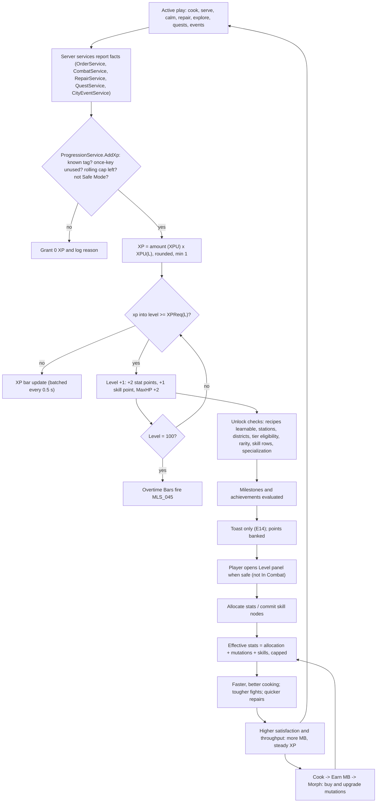

### 14.17 Player Interactions and Dependencies

**Player Interactions.** Nameplates (BillboardGui) show `Lv N` + the equipped title (a fixed, pre-approved list from §36.16/§36.17). Co-op guests earn their own XP (§14.5.1) and
see the host's level on the restaurant sign. Arena matchmaking (§21) brackets by level band (±10) and mutation power,
never by skill points. The Showcase Stage `BLD_22` displays a player's headline stats on request (opt-in).

**Dependencies.** §5 (cooking timers consume `COOK_SPD`/`COOK_QLT`; composition order §14.7.6) · §6 (recipe D, unlock
levels) · §8–§10 (`CHARM`, satisfaction for `SERVE` XP, anger thresholds for `CALM_*`) · §11 (`STR`/`DEF`, HP, KO, combat XP
values and cap §11.14) · §12/§36.3 (per-part stat splits, HP bonuses) · §13 (morph screen previews effective stats) ·
§15 (repair math, tier gates) · §16 (employee stats for MGMT nodes) · §17 (no XP offline) · §18 (district gates, XPF event/city XP) ·
§20 (quest XP bands, ≤ 15 skill points total) · §22 (MB sinks: respecs, learning) · §24 (HUD level chip, toasts) ·
§26 (`ANM_064` Level-up celebrate) · §27 (`ProgressionService`) · §28 (profile schema) · §29 (anti-exploit) · §31 (analytics).

### 14.18 Roblox Implementation

**Modules.** `ServerScriptService/Services/ProgressionService` (§27.8.19; server authority for XP, levels, stats, skills,
achievements, milestones) with children `XPRules` (source-tag registry and caps, §14.5.2) and `AchievementTracker`
(counter → ACH/MLS evaluation); `ReplicatedStorage/Shared/Config/ProgressionConfig` (curve constants, stat caps, node
data) so the client can preview costs; client UI in `UIController` (`LevelPanel`, `SkillTreeScreen`, toasts, §24).

**Server API.** The network and service contract is §27.8.19; §14 fixes the semantics:

| Function (§27.8.19) | §14 semantics |
|---|---|
| `AddXp(player, amount, source, eventKey?)` | `amount` is in **XPU**, never raw XP; `source` must be a registered tag (§14.5.2); optional `eventKey` makes the grant idempotent (`"L:RCP_BRG_003"`, an order ticket id, a quest instance id); applies rolling caps; converts with `XPU(L)` at grant time; returns nothing, fires `XpGained` |
| `AllocateStat(player, stat, points)` | §14.7.3 rules; `stat` ∈ the nine canon codes; the Cooking button is resolved client-side into the two cooking stats before sending |
| `UnlockSkill(player, skillId)` | buys **one rank**; checks cost, prerequisites, level, row gate; the first `SKL_SVC_`/`SKL_MGMT_` purchase at L20–49 with no specialization chosen *is* the specialization choice (one-time confirm dialog) |
| `Respec(player, kind, key)` | `"Stats"`/`"Skills"`; payment chosen server-side in order Free → token (stats only) → MB, at the price shown in the hold-to-confirm modal (§24); `key` = idempotency key |
| `GetEffectiveStats(player)` | `S_eff` per §14.7.2, cached, recomputed on `MutationService.EquipChanged`, allocation, node purchase, respec |
| `UnlockAchievement(player, id)` | called by `AchievementTracker`; grants §36.16 rewards through `EconomyService` (currency), `MutationService` (parts), `RecipeService` (recipes), idempotent by ID |
| Signals `XpGained`, `LevelUp`, `StatsChanged`, `AchievementUnlocked`, `MilestoneReached` | consumed by HUD, quests, analytics |

Internal helpers (not remotes): `IncrementCounter(player, counter, n)` and `SetFlag(player, flag)` used by other
services to feed `progression.achievements.counters` (§28.9.3).

**Remotes** (§27.8.19 names and rate limits; validation per §14):

| Remote | Kind | §14 validation |
|---|---|---|
| `Progression.AllocateStat` | RF C2S `{stat, points 1..10}` | canon stat code; `points` integer 1–10; ≤ unspent; `statAlloc[stat] + points ≤ 50`; not In Combat. The Level panel stages edits and on **Apply** sends one call per changed stat (chunks of ≤ 10), queued at the §27 rate; on any failure the queue stops and the panel re-syncs from the replica |
| `Progression.UnlockSkill` | RF C2S `{skillId}` | one rank per call; staged picks are sent in dependency order; a refused call cancels the rest of the queue (no partial orphan state is possible because prerequisites are re-checked per call) |
| `Progression.Respec` | RF C2S `{kind, idempotencyKey}` | §14.15 cooldowns from server time; balance or token checked before debit |
| `Progression.LevelUp` | Event S2C `{level, statPoints, skillPoints}` | toast only (E14); one event per grant, carrying the final level |
| `Progression.AchievementUnlocked` | Event S2C `{achievementId}` | toast + journal badge |

XP bar, points, counters and milestone cards update through the replicated profile view (`PlayerData.Delta`, ≤ 10 Hz,
§27). The server also sets `Humanoid.WalkSpeed = 16 × (1 + 0.003 × MOVE)` (status effects from §11 apply on top) and
`Humanoid.MaxHealth` (§14.8); clients never write either.

**Profile.** Field names follow §28.9.3 `progression` (`level`, `xp` = XP into the current level, `totalXp`, `statAlloc`,
`unspentStatPoints`, `lastFreeStatRespecAt`, `respecTokens`, `skillNodes` (node ID → rank, e.g. `skillNodes["SKL_CHEF_01"] = 3`),
`specs`, `bonusSkillPoints`, `unspentSkillPoints`, `lastFreeSkillRespecAt`, `overtimeXp`, `xpOnceKeys`, `titles`, `emotes`)
with achievements and milestones in `progression.achievements` (`unlocked`, `milestones`, `counters`). Cosmetic palettes
live in `morph` (§28.9.6) and the equipped title in `social.titleEquipped` (§28.9.12). Rolling-cap windows live
in server memory only (reset on rejoin — bounded by the caps themselves).

```lua
--!strict
-- ProgressionService.AddXp (excerpt). amount is in XPU; called only by server services.
local XPRules = require(script.XPRules)            -- [tag] = { capPerHour: number?, capGroup: string? }
local MAX_LEVEL, GROWTH = 100, 1.045

local function xpReq(level: number): number return math.round((180 + 30 * level) * GROWTH ^ (level - 1)) end
local function xpu(level: number): number return 9 * GROWTH ^ (level - 1) end

function ProgressionService.AddXp(player: Player, amount: number, source: string, eventKey: string?)
	local rule = XPRules[source]
	local prof = PlayerDataService:GetProfile(player)
	if not rule or not prof or prof.SafeMode or amount <= 0 then return end
	local p = prof.Data.progression
	if eventKey then                                   -- idempotency: once-sources, tickets, quests
		if p.xpOnceKeys[eventKey] then return end
		p.xpOnceKeys[eventKey] = true
	end
	local group = rule.capGroup or source              -- e.g. CALM_FIGHT/CALM_TALK/REVIVE share "COMBAT"
	local cap = rule.capPerHour
	if cap then
		amount = math.min(amount, math.max(0, cap - Window.sum(player, group, 3600)))
		if amount <= 0 then Telemetry.capHit(player, source) return end
		Window.add(player, group, amount)
	end
	local xp = math.max(1, math.round(amount * xpu(p.level)))
	local before = p.level
	p.totalXp += xp
	if p.level < MAX_LEVEL then
		p.xp += xp
		while p.level < MAX_LEVEL and p.xp >= xpReq(p.level) do
			p.xp -= xpReq(p.level)
			p.level += 1
			p.unspentStatPoints += 2
			p.unspentSkillPoints += 1
		end
		if p.level == MAX_LEVEL then p.overtimeXp += p.xp; p.xp = 0 end
	else
		p.overtimeXp += xp
	end
	while p.overtimeXp >= xpReq(99) do p.overtimeXp -= xpReq(99); Milestones.fire(player, "MLS_045") end
	ProgressionService.XpGained:Fire(player, xp, source)
	if p.level > before then ProgressionService.LevelUp:Fire(player, before, p.level) end
end
```

Order-ticket keys are pruned after 24 h; permanent once-keys use compact prefixes (`L:` learn, `P:` first perfect,
`D:` discover, `N:` NPC, `U:` upgrade, `S:` synergy). **Anti-exploit** (§29): no client→server XP path exists (§27 P1);
`CALM_FIGHT` checks the server-side instigator flag; `REPAIR` ignores damage the repairer caused; repeatable XP above
180 XPU in any rolling hour (1.8× reference) raises `mmr_xp_anomaly` for review (no auto-ban); `ADMIN` grants require
an operator id. **Analytics:** `AnalyticsService:LogProgressionEvent(player, "PlayerLevel",
Enum.AnalyticsProgressionType.Complete, level)` per level; internal `mmr_level_up {level, hours_active}`,
`mmr_stat_allocated`, `mmr_skill_node_unlocked {node, rank}`, `mmr_respec`, and `mmr_xp_session_summary {xpu_by_tag}`
on session end (feeds the §14.5.4 tuning check). **Performance:** one stat recompute per change, replica deltas only
for changed fields, XP toasts batched.

### 14.19 Edge Cases

| ID | Situation | Ruling |
|---|---|---|
| EC-14-01 | Player levels up mid-rush (§C22 **E14**) | Level-up **toast only** plus the HUD "+" badge; no modal, no input capture, no camera change. `ANM_064` plays at the next idle moment (no carried item, no station interaction, not In Combat) within 10 s, else is skipped. Stat/skill allocation waits until the player opens the panel. |
| EC-14-02 | One grant crosses several levels (big quest) | Levels are applied in order with carry-over; one combined toast ("Level 14 → 16!"); every crossed level's unlocks, milestones and points are granted. |
| EC-14-03 | XP at the cap | XP flows into the Overtime Bar; a single grant can fill several bars (each fires `MLS_045` once). |
| EC-14-04 | Level-up during combat | MaxHP and current HP +2 only (no heal); the panel stays locked until In Combat clears (6 s). |
| EC-14-05 | Allocating into a stat that is MAXED by mutations | Allowed after the "wasted right now" confirm; server accepts if `alloc ≤ 50`. |
| EC-14-06 | Loadout swap lowers a stat below its cap (or above) | Effective stats recompute at swap completion (3 s channel, §C22 E4); MAXED badges update; conditional bonuses re-evaluate. |
| EC-14-07 | Respec requested In Combat, mid-staging, or without funds | Rejected with a reason toast; staged edits discarded only on a successful respec; balance never goes negative (`EconomyService` checks first). |
| EC-14-08 | Player provokes customers to farm combat XP | Instigator flag → `CALM_FIGHT` grants 0 for that customer; Apology Payment still follows §C11.4. |
| EC-14-09 | Player breaks own furniture to farm repairs | Damage attributed to the player grants 0 `REPAIR` XP; the same object grants at most 2 times per 10 min. |
| EC-14-10 | Guest farms a friend's employees' dishes | No XP (employee-only dishes grant nothing); guest hands-on dishes earn at the guest's XPU under the guest's caps. |
| EC-14-11 | DataStore failure / Safe Mode (§C22 E6) | `AddXp` grants nothing in Safe Mode (no earning); nothing is queued to avoid duplicate grants on recovery. |
| EC-14-12 | Disconnect or shutdown right after a level-up (§C22 E1, E13) | Level-up requests a save (throttled 60 s); worst case loss = autosave interval; once-keys and levels are saved atomically with currency in the same profile write, so rewards are never granted twice. |
| EC-14-13 | Curve retune in a future version (schema migration) | Players keep their level; `xpInLevel` is rescaled proportionally to the new `XPReq(L)`; nobody ever loses a level. |
| EC-14-14 | Specialization or prerequisite chain after a skill respec | Full respec only, so no orphaned nodes; spec choice reopens (L ≥ 50 keeps both). |
| EC-14-15 | Malformed remote payloads (negative points, unknown stat, 10,000 calls) | Rejected server-side, counted toward the §29 remote-abuse score; rate limits drop excess calls. |
| EC-14-16 | Reward grants a recipe below its unlock level or already known | Stored as a voucher that auto-learns when the level is reached; if already known, refunded as 5 × price MB. |

### 14.20 Acceptance Criteria

- **AC-14-01:** For every level 1–99, the server's `XPReq(L)` equals `round((180 + 30·L) × 1.045^(L−1))` and the §14.4 table (verified by `render_progression.py --check`), incl. XPReq(10) = 713 and cumulative L100 = 4,319,405.
- **AC-14-02:** A scripted competent bot following the §14.5.3 mix earns 95–105 XPU per active hour at reference levels 3, 30 and 90 (± 5 %).
- **AC-14-03:** Reaching L10 takes 3.3 h ± 10 % and L45 takes 41.8 h ± 10 % of simulated competent play.
- **AC-14-04:** Each level gained adds exactly +2 unspent stat points and (from L2) +1 skill point; at L100 lifetime level grants total 198 stat and 99 skill points.
- **AC-14-05:** A level-up during an active cooking interaction shows only a toast (≤ 2.5 s, no input capture); 0 cooking inputs are dropped in a 50-trial test (E14).
- **AC-14-06:** The server rejects any allocation that would make a stat's allocated points exceed 50 or spend more than the unspent pool, and leaves the profile unchanged.
- **AC-14-07:** An effective stat above its cap displays "MAXED" with the crown glyph and the gameplay value equals the capped formula (e.g. `COOK_SPD` 180 → time × 0.526).
- **AC-14-08:** The Cooking "+" alternates `COOK_SPD`/`COOK_QLT`: 10 presses from 0/0 yield 5/5; from 7/4 the next 3 presses go to `COOK_QLT`.
- **AC-14-09:** The Level panel shows Cooking, Strength, Repair and Luck rows with "+" buttons and a "More Stats" expander listing all 9 stats, on desktop, mobile (touch targets ≥ 64 px) and gamepad.
- **AC-14-10:** A free stat respec is available once per rolling 24 h; a second within 24 h costs exactly 500 MB × Level or one token; respecs are refused while In Combat.
- **AC-14-11:** A free skill respec is available once per rolling 7 days; after any skill respec 100 % of spent skill points (incl. bonus points) are unspent.
- **AC-14-12:** `Progression.UnlockSkill` refuses a rank whose cost, prerequisite, level requirement or row gate is unmet and leaves the profile unchanged; a refused call cancels the rest of the staged queue.
- **AC-14-13:** Total skill-node cost (222) exceeds the maximum obtainable skill points (130) as reported by the renderer; every tree has ≥ 20 (primary) or ≥ 10 (specialization) nodes.
- **AC-14-14:** No RemoteEvent/RemoteFunction accepts an XP amount; fuzzing all `Progression.*` remotes for 10 min grants 0 XP and 0 points.
- **AC-14-15:** Repeating the same once-key (`LEARN`, `DISCOVER`, quest id, order ticket) grants XP exactly once, across rejoin and server change.
- **AC-14-16:** Rolling caps hold: farming one tag for 2 h never yields more than its cap per rolling hour (e.g. `REPAIR` ≤ 20 XPU/h), and repeatable XP above 180 XPU/h emits `mmr_xp_anomaly`.
- **AC-14-17:** Instigated fights grant 0 `CALM_FIGHT` XP, and self-caused damage grants 0 `REPAIR` XP, in 20/20 scripted attempts each.
- **AC-14-18:** On level-up the player's `Humanoid.MaxHealth` equals `100 + 2 × (Level − 1) + mutation HP bonuses` and current HP rises by exactly 2.
- **AC-14-19:** Satisfying an achievement's condition twice (including across rejoin and server change) records it once and grants its §36.16 reward once; hidden achievements display "???" plus category until unlocked.
- **AC-14-20:** Each §36.17 milestone fires its analytics event exactly once per account (`MLS_045` once per bar), and `MLS_001`–`MLS_013` log `LogFunnelStepEvent` steps 1–13 of the `mmr_first_session` funnel in ID order (the single onboarding funnel belongs to the tutorial, §31.8).
- **AC-14-21:** Every unlock in the §14.4 table becomes available exactly at its level: the Cooking Academy refuses a recipe one level early and offers it at its §C10 level; districts open at their §C16.1 level; tier upgrades below the §C6 level are refused.


## 15. Restaurant Building

> This section specifies the **Build** pillar:
> how the restaurant grows from Nana Gristle's shabby shack to a neon monster palace with an aquarium wall
> ("Upgrade Your Restaurant: **Basic → Expand → Go Wild**"), how players place furniture, how atmosphere and
> cleanliness are scored, and how everything breaks hilariously and gets fixed again. Databases live in
> §36.12 (tiers + 72 upgrades) and §36.13 (214 purchasable items + 10 trophies); both are generated by
> `python3 gdd/tools/render_restaurant.py` from `gdd/data/furniture.json`, which also refreshes the two AUTO
> tables in this section. Every number marked **[TUNABLE]** is a balancing assumption.

Template map (§C0): Purpose §15.1 · Rules & Mechanics §15.2–§15.10 · Variables in each subsection · UI §15.11 · Progression §15.2/§15.3/§15.8/§15.10 · Player Interactions §15.4/§15.5/§15.9 · Dependencies §15.13 · Roblox Implementation §15.12 · Edge Cases §15.14 · Acceptance Criteria §15.15.

### 15.1 Purpose and Design Goals

The restaurant is **how players earn**; mutations are **what they spend on** (creative director note). The
restaurant therefore has a finite, legible set of meaningful upgrades — 10 tiers, 24 station paths, 48 other
upgrades, ~200 furniture pieces — that each change how a shift *feels*, while never competing with the morph
collection as the long-term chase.

| # | Goal | Design rule that delivers it |
|---|---|---|
| G1 | Growth you can see from the street | Every tier swaps the façade on Restaurant Row and grows the instanced interior; the mockup's Basic (T1–T3) → Expand (T4–T7) → Go Wild (T8–T10) is the visual spine. |
| G2 | Destruction is funny, never devastating (brief 26.4) | Objects are **never permanently lost** (canon §C6): rubble piles, cheap rebuilds, a free "Elbow Grease" rebuild when broke, free full restore on every tier upgrade, Co-op Insurance (E12). |
| G3 | The layout is a light puzzle | PlateUp-style "distance = seconds" in the kitchen, seat placement vs. atmosphere in the dining room — but validation makes it impossible to save a broken layout (E10). |
| G4 | Mobile-first building | 2-stud grid, 90° rotations, drag-to-place with an offset ghost, every action reachable with one thumb. |
| G5 | Server-authoritative and cheap | One occupancy grid per restaurant is the single truth for placement, connectivity, customer pathing (§8) and repair access; BFS < 1 ms. |
| G6 | Atmosphere matters, but cooking matters more | Atmosphere feeds only `M` (10 % of satisfaction) and `DecorMult` (×0.9–×1.2 demand), per canon §C11. |

### 15.2 Restaurant Tier Progression

All ten canon tiers (§C6) with §15's physical and economic detail. Canon columns (cost, level, seats,
appliance slots, menu, staff cap, base demand) are verbatim; floor plans, throughput and offline potential are
defined here. Online throughput is the planning estimate `min(BaseDemand × RepMult × DecorMult, Seats × 3600 /
240 s)` at the tier's typical reputation and atmosphere (§36.12.3); offline values use canon §C15 exactly.

<!-- AUTO:render_restaurant:tier-summary BEGIN -->
| # | Tier | Cost (MB) | Level | Permit | Interior W×D (sq studs) | Patio | Seats | Appliance slots | Kitchen area | Menu | Staff cap | Base demand | Online throughput | Offline net/h lean–full | Max offline session |
|---|---|---|---|---|---|---|---|---|---|---|---|---|---|---|---|
| 1 | `TIER_01` Broken Burger Shack | 0 | 1 | no | 32×26 (832) | — | 4 | 6 | 32×12 | 4 | 2 | 50 | ≈ 56/h | 149–185 | 370 (2 h) |
| 2 | `TIER_02` Tiny Mutation Diner | 1,000 | 5 | no | 40×30 (1,200) | — | 6 | 8 | 40×12 | 5 | 3 | 65 | ≈ 79/h | 171–308 | 924 (4 h) |
| 3 | `TIER_03` Neighborhood Freak Café | 2,000 | 10 | no | 48×34 (1,632) | 24×12 | 8 | 10 | 48×14 | 6 | 4 | 80 | ≈ 104/h | 246–410 | 820 (2 h) |
| 4 | `TIER_04` Morph City Grill | 5,000 | 18 | yes | 56×38 (2,128) | 28×12 | 10 | 12 | 56×14 | 8 | 6 | 95 | ≈ 130/h | 281–776 | 2,328 (4 h) |
| 5 | `TIER_05` Mutant Family Restaurant | 15,000 | 26 | yes | 64×42 (2,688) | 32×14 | 12 | 14 | 64×16 | 10 | 8 | 110 | ≈ 158/h | 503–1,587 | 7,933 (8 h) |
| 6 | `TIER_06` Monster Food Court | 40,000 | 35 | yes | 72×48 (3,456) | 36×16 | 14 | 16 | 72×18 | 12 | 10 | 125 | ≈ 189/h | 762–3,119 | 15,594 (8 h) |
| 7 | `TIER_07` Mutation Megadiner | 100,000 | 45 | yes | 80×52 (4,160) | 40×16 | 16 | 18 | 80×18 | 14 | 12 | 140 | ≈ 222/h | 1,374–5,607 | 32,523 (12 h) |
| 8 | `TIER_08` Luxury Freak Restaurant | 225,000 | 56 | yes | 88×58 (5,104) | 44×18 | 18 | 20 | 88×20 | 16 | 14 | 155 | ≈ 259/h | 2,263–12,101 | 70,185 (12 h) |
| 9 | `TIER_09` Morph City Food Palace | 525,000 | 68 | yes | 96×64 (6,144) | 48×20 | 20 | 22 | 96×22 | 20 | 16 | 170 | ≈ 300/h | 3,969–24,584 | 201,587 (24 h) |
| 10 | `TIER_10` Legendary Mutation Restaurant | 1,500,000 | 80 | yes | 112×72 (8,064) | 56×24 | 24 | 24 | 112×24 | 24 | 20 | 190 | ≈ 359/h | 6,183–51,314 | 420,771 (24 h) |
<!-- AUTO:render_restaurant:tier-summary END -->

**Service style.** `TIER_01`–`TIER_02` are counter service: customers order at the Serving Window's dining
side and sit on attached stools/booth seats (§8). From `TIER_03` the restaurant is table service: a Host
Podium (`FRN_396`, granted free with `TIER_03`) is the party wait node and waiters become useful.

**Seats are a hard cap.** A layout may contain at most the tier's canon Seats in *attached* seats (§15.5.6);
the purchase of extra chairs is allowed (they wait in storage), placement is not.

#### 15.2.1 Tier profiles (interior, façade, Grand Opening Kit)

Interiors are W×D studs with the front door centred on the front wall (z = 0), kitchen along the back wall,
and the optional patio (`UPG_031` Patio Permit, `TIER_03`+) off the dining room's left wall. Each tier upgrade
grants a **Grand Opening Kit** into storage so the new seats are usable immediately.

| # | Interior layout (kitchen · dining · extras) | Exterior façade (plot footprint) | Grand Opening Kit (free) |
|---|---|---|---|
| 1 | Counter service. 32×12 kitchen strip holds the 12-fixture starter kit (4 of 6 slots used); Ding! window on the divider; 32×14 dining room with a 6×4 lobby. Starter dining: 2 Wobbly Card Tables, 2 Crooked Stools, 2 Folding Chairs (4 seats), 1 Bare Bulb, 2 windows. Pre-damaged for the tutorial: one card table **Broken** (`QST_TUT_008`), bulb and both windows **Cracked**, door Scuffed. | Crooked plywood shack, patched tin roof, sign missing letters ("BRO EN BURG R SHA K"), one flickering bulb (28×18) | — (starter layout) |
| 2 | Counter service with a snack-bar row; kitchen 40×12 gains room for freezer/mixer/plating; dining 40×18 fits a booth plus a two-top or a counter. | Mint paint, striped awning, small neon DINER sign with a winking mutant eye (34×22) | `FRN_061` Diner Two-Top + 2× `FRN_102` |
| 3 | First table-service floor: kitchen 48×14 with a swinging staff door; dining 48×20 (two four-tops + lobby podium); optional 24×12 patio. | Corner café, chalkboard easel, window boxes of snapping flytraps, two patio umbrellas (40×24) | `FRN_396` Host Podium + `FRN_061` + 2× `FRN_101` |
| 4 | Two dining wings around a central aisle; kitchen 56×14 fits 12 appliances in two facing lines; second pass possible (`UPG_029`). | Red-brick grill house, chimney puffing burger-shaped smoke rings, City Hall permit plaque (48×28) | `FRN_064` Barrel Table + 2× `FRN_104` |
| 5 | Family hall: long-table centre row, booths along both walls, kids corner by the lobby; kitchen 64×16. | Two-storey family front (the upper floor is a painted fake), big waving mascot board (56×30) | `FRN_064` + 2× `FRN_104` + `FRN_365` |
| 6 | Food-court plan: up to three serving windows (`UPG_030`) feed three dining pods around a shared centre; kitchen 72×18. | Arcade of three mini storefront arches under one roof, giant crossed fork and spoon on top (70×34) | `FRN_068` Beaker Table + 2× `FRN_106` |
| 7 | Long diner hall with a horseshoe of booths and a karaoke corner; kitchen runs the full 80 studs. | Chrome streamline megadiner, giant rotating burger on the roof, neon racing stripes (80×36) | `FRN_068` + 2× `FRN_107` + `FRN_368` |
| 8 | Fine-dining salon with a ramped VIP ring, dessert bar, 44×18 terrace patio; kitchen 88×20. | Marble columns, red carpet, gold awning, cardboard valet waving (88×40) | 2× `FRN_108` Velvet Throne + `FRN_064` |
| 9 | Banquet hall plus 48×20 garden patio; two staff doors; kitchen 96×22 with an island line. | Palace with cloche-shaped domes, twin sauce fountains, sweeping searchlights (96×44) | `FRN_072` Palace Round Table + 2× `FRN_110` |
| 10 | Showpiece hall wrapped around a 16-stud aquarium wall, glass-floor aisle, 56×24 courtyard patio; kitchen 112×24. | **Go Wild:** a giant neon monster building whose open mouth is the entrance, tentacles on the roof holding neon signs, the aquarium visible from the street, fireworks at 4.5 ★ (104×50) | `FRN_073` Kraken-Arm Table + 4× `FRN_110` |

**Kitchen capacity.** Canon appliance slots count only the 14 slot-using appliances (cut, grill, fryer, oven,
pizza oven, stove, soup pot, steamer, blender, mixer, drink, ice cream, infuser, anti-grav wok). The 10 utility
fixtures are slot-free but need floor space; the kitchen floor of every tier fits its full slot count plus one
of each utility with ≥ 2-cell aisles (verified by the tier template layouts, §15.12.5).

**Available equipment and decor per tier** (station unlocks follow canon §C7.1; full lists in §36.12.1):
T1 starter kit + STOVE (L2), OVEN/PIZZA_OVEN (L3), SOUP_POT/ICECREAM (L4), BLENDER (L5) · T2 MIXER, FREEZER,
PLATING (L5), STEAMER (L7), station Lv2 · T3 premium variants, patio, Host Podium · T4 station Lv3, second pass ·
T5 ANTIGRAV (L30) · T6 INFUSER (L40), station Lv4, third pass · T8 station Lv5 · T9–T10 palace and legendary
showpieces. Decor themes unlock with their set tier (§15.8).

#### 15.2.2 Offline earning potential (canon §C15, shown briefly)

For each tier the full tier-typical crew (§36.12.3: stats at the middle of the canon §C4.8 rarity band,
Morale 80, average Energy over the manager's cap) gives the following canon §C15 values per offline hour
(before incidents and auto-repairs):

<!-- AUTO:render_restaurant:offline-calc BEGIN -->
| # | Full crew | Demand_off = Base × Rep × Decor × 0.6 | min(Cap_seat, Cap_kitchen, Cap_service) | Q | Revenue = Q × 1.4P × q | + Tips − Ingredients − Wages | Net / h (% of active) |
|---|---|---|---|---|---|---|---|
| 1 | Ollie (EMP_001), 1×Chef (C) | 50 × 1.125 × 0.990 × 0.6 = 33.4 | 48, 48.3, 48.3 | 33.4 | 33.4 × 13.3 × 0.77 = 343 | +14 −142 −30 | **185** (29 %) |
| 2 | Ollie (EMP_001), 1×Chef (C), 1×Manager (C) | 65 × 1.200 × 1.014 × 0.6 = 47.5 | 72, 45.8, 45.8 | 45.8 | 45.8 × 16.0 × 0.77 = 567 | +23 −233 −48 | **308** (29 %) |
| 3 | Ollie (EMP_001), 1×Chef (U), 2×Waiter (U) | 80 × 1.250 × 1.035 × 0.6 = 62.1 | 96, 53.2, 65.2 | 53.2 | 53.2 × 20.6 × 0.79 = 869 | +50 −347 −162 | **410** (24 %) |
| 4 | 3×Chef (U), 2×Waiter (U), 1×Manager (U) | 95 × 1.300 × 1.050 × 0.6 = 77.8 | 120, 70.9, 66.2 | 66.2 | 66.2 × 29.2 × 0.81 = 1,572 | +91 −587 −300 | **776** (25 %) |
| 5 | 3×Chef (R), 3×Waiter (R), 1×Dish (C), 1×Manager (R) | 110 × 1.350 × 1.065 × 0.6 = 94.9 | 144, 108.8, 128.7 | 94.9 | 94.9 × 45.6 × 0.84 = 3,654 | +231 −1,300 −998 | **1,587** (29 %) |
| 6 | 4×Chef (R), 3×Waiter (R), 1×Dish (C), 1×Security (R), 1×Manager (R) | 125 × 1.400 × 1.080 × 0.6 = 113.4 | 168, 135.5, 129.7 | 113.4 | 113.4 × 64.5 × 0.84 = 6,178 | +390 −2,171 −1,278 | **3,119** (32 %) |
| 7 | 4×Chef (E), 3×Waiter (E), 1×Cashier (R), 1×Dish (U), 1×Security (R), 1×Repair (R), 1×Manager (E) | 140 × 1.450 × 1.095 × 0.6 = 133.4 | 192, 158.0, 178.5 | 133.4 | 133.4 × 105.7 × 0.88 = 12,408 | +871 −4,002 −3,670 | **5,607** (32 %) |
| 8 | 5×Chef (E), 3×Waiter (E), 1×Cashier (R), 1×Dish (U), 1×Security (R), 1×Repair (R), 1×Manager (E) | 155 × 1.500 × 1.116 × 0.6 = 155.7 | 216, 186.3, 179.8 | 155.7 | 155.7 × 157.0 × 0.88 = 21,511 | +1,510 −6,849 −4,070 | **12,101** (37 %) |
| 9 | 6×Chef (E), 4×Waiter (E), 1×Cashier (E), 1×Dish (R), 1×Security (R), 1×Repair (R), 1×Manager (L), 1×Asst Mgr (E) | 170 × 1.550 × 1.140 × 0.6 = 180.2 | 240, 211.8, 241.6 | 180.2 | 180.2 × 256.7 × 0.88 = 40,716 | +2,885 −12,798 −6,220 | **24,584** (39 %) |
| 10 | 6×Chef (E), 1×Chef (L), 5×Waiter (E), 1×Cashier (E), 1×Dish (R), 1×Security (E), 1×Repair (E), 1×Stocker (R), 1×Manager (L), 1×Asst Mgr (E) | 190 × 1.625 × 1.164 × 0.6 = 215.6 | 288, 242.3, 304.3 | 215.6 | 215.6 × 393.3 × 0.89 = 75,106 | +5,322 −20,835 −8,280 | **51,314** (43 %) |
<!-- AUTO:render_restaurant:offline-calc END -->

`P` (menu-weighted mean item price) is calibrated so the online model reproduces canon §C4.4 (§36.12.3). From
`TIER_06` a well-staffed restaurant returns ≈ 32–39 % of active income per offline hour (canon target 35–50 %,
ceiling 60 %); `TIER_01`–`TIER_05` sit at ≈ 24–29 % because low chef accuracy caps `q` and, from `TIER_03`,
waiters bind `Cap_service` while staff caps are tiny — offline is a teaser until the player can staff properly.
§17 owns the simulation; this is §15's capacity check that every tier can feed it.

### 15.3 Tier Upgrade Flow

**Requirements** (checked server-side by `BuildingService.UpgradeTier`; target = current + 1 only; each failure
shows a padlock chip with the exact gap, §24): (1) player level ≥ the tier's canon level ("Reach Level 18");
(2) wallet ≥ canon cost ("Need 1,230 more MB"); (3) `TIER_04`+: the City Hall Expansion Permit for that tier — a
quest-gated formality with `NPC_002` at `BLD_09`, fee included in the canon price (§20); (4) not In Combat, no
level-6 chaos (canon E2: "Can't renovate during a brawl!"); (5) no Edit Mode session or blueprint swap running.

**Flow.** The Upgrades screen uses hold-to-confirm 0.8 s (§24). Then:

1. **Last Call (≤ 45 s [TUNABLE]).** The restaurant enters `RENOVATING`: arrivals stop, the outside queue walks
   by (no reputation effect), customers already eating finish, unserved customers leave paying 0 with **no
   reputation loss** behind a "Closed for renovation!" sign (same courtesy as E1). The modal shows a countdown;
   "Skip Last Call" ends it immediately with the same no-penalty rule. Station timers freeze (nothing burns).
2. **Commit.** The server first computes the migrated layout (pure grid math, below — no instances needed), then
   one `EconomyService.TransactWith` call deducts the MB and writes `restaurant.tier`, the new `layoutPacked`
   (every object at 100 %), the updated `storage` (Grand Opening Kit + "Needs a home" items) and an empty
   `pendingRebuilds`, all in the profile's session-locked update with the client's idempotency key (§28). Either
   everything is written or nothing is charged.
3. **Mutant Builders sequence (10.0 s; 3.0 s short version after the first view; skippable for others).** Purely
   presentational: during it `RestaurantService` swaps the shell and façade and `BuildingService` spawns the
   already-committed layout.
4. **Migration result** shown as a toast and in the storage tab.
5. **Grand Opening.** Doors reopen in `OPEN`; a confetti burst, an XP grant per §14, and the prompt "New space!
   Arrange it now?" (enters Edit Mode, optional).

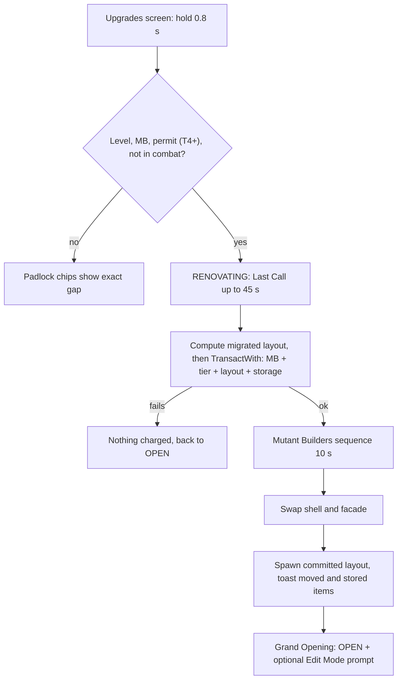

**Mutant Builders sequence** (cartoon, kid-safe; the crew is a client-only cosmetic built from random Common
mutation parts, no NPC IDs). 0.0 s fade to the exterior, "CLOSED FOR RENOVATION" banner unrolls · 0.5 s six
builders pour out of a tiny van (clown-car gag), hard hats on every head shape (one on a tail) · 1.5–7.0 s
scaffolding pops up, hammering loops (`ANM_060`), a crane lifts the new sign, one builder bonks their own thumb
(cartoon stars), dust clouds hide the swap · 7.0 s dust clears on the new façade with a "ta-da" and confetti ·
8.0–9.5 s builders celebrate (`ANM_064`) while the sign lights letter by letter · 10.0 s door opens, fade back
inside to the already-migrated interior.

**What carries over (everything):** placed and stored furniture, trophies, station-type upgrade levels, all
purchased `UPG_` upgrades (kitchen expansion and patio re-apply to the new shell), employees and assignments,
menu (new menu slots start empty), reputation, special stock, blueprints (re-validated on first use), theme-set
progress, restaurant name. Damage does **not** carry over: Mutant Builders "fix everything while they're at it"
(all objects → Pristine, rubble rebuilt, insurance ledger cleared; active repair jobs cancelled with no charge).

**Layout migration algorithm** (deterministic; the floor plan only ever grows):

1. Compute offsets in cells: dining/lobby `dx = (Wc_new − Wc_old) / 2` (door stays centred), `dz = 0`;
   kitchen `dx` as dining, `dz = Dc_new − Dc_old` (anchored to the back wall); patio anchored to the patio door.
2. Translate every floor/ceiling item by its zone offset; items on the divider (serving windows, staff doors)
   snap to the new divider row at the same relative x; wall items keep their wall side and relative position.
3. Validate each item in a deterministic order (essentials, appliances, seats, surfaces, decor). A failing item
   tries a spiral search of radius ≤ 6 cells in the same zone, first at its rotation, then the other three.
4. Still failing → moved to storage with a "Needs a home" badge (never lost, never sold).
5. Run connectivity (§15.5.9). If it fails, store the blocking decor with the lowest atmosphere points first
   until it passes; seats and essentials are never auto-stored if any decor could be stored instead.
6. Toast: "Moved 41 items · 2 need a home". Analytics `mmr_restaurant_tier_up` logs counts (§31).

### 15.4 Plot and Instanced Interior Model

**Restaurant Row (`DST_01`, `BLD_17`).** 8 plots per server (canon §C3), one per player. A plot is a 120 × 90-stud
lot: the façade footprint grows per tier (§15.2.1, from 28×18 to 104×50; heights 16 → 70 studs) behind a
120 × 14-stud **curb strip** that holds curb sockets (4 → 16 by tier), the door approach lane (6 studs wide,
always clear) and the **outside queue** of 4 velvet-rope spots by the door (§8). Curb items are cosmetic,
indestructible and visible to everyone walking the Row; they count at ×0.5 for atmosphere.

**Instanced interior (canon §C3, §C16.4).** The playable restaurant is an interior shell spawned by
`RestaurantService` in the far-off `Workspace.Interiors` region at `(6,000 + 400 × plotIndex, 0, 6,000)` — more
than 2,000 studs from the city and 400 studs from each other, so streaming never overlaps. It is bigger on the
inside than the façade ("Morph City zoning is weird," says the City Hall clerk). Entering the façade door:
0.35 s fade → `Player:RequestStreamAroundAsync(interiorDoor, 5)` → `PivotTo` the interior spawn; leaving
reverses it. Customers are spawned at the interior door directly while cosmetic client-only walkers enter the
façade so the street looks busy (§8). The façade shows live state: windows lit when OPEN, a renovation banner
when `RENOVATING`, and flickering silhouettes plus a "Uh-oh!" sign wobble when chaos is happening inside — a
free advert for passers-by.

Interior folders: `Shell` (tier model, sockets, zone volumes, spawns), `Stations` (tags `MMR_Station`,
`MMR_Destructible`), `Furniture` (`MMR_Destructible`, `MMR_Seat`), `Rubble` (6 shared tinted piles), plus
`CombatProxies` (§11) and `Messes` (RepairService).

**Visiting.** Same-server visitors walk in through the door; cross-server friends join via the friends list
(`TeleportService`, §21). Guests follow the owner's co-op settings (§21, `restaurant.coop`): they may cook,
serve, clean and repair if allowed, but can never sell, move or store owner furniture, enter Edit Mode, or
spend owner currency (canon E12). **Restaurant name:** 3–24 characters chosen by the owner, filtered with
`TextService:FilterStringAsync` and shown via `GetNonChatStringForBroadcastAsync` on the façade sign
(`TIER_02`+) and the Monster Marquee.

### 15.5 Building Placement System

**Purpose.** Let players arrange kitchen and dining with zero ambiguity on every device, while guaranteeing that
every saved layout is cookable, servable, repairable and walkable.

#### 15.5.1 Grid and rotation decision

| Option | Pros | Cons | Verdict |
|---|---|---|---|
| 1-stud grid, free rotation | maximum freedom | fiddly on touch; nav grid mismatch; float drift in saves | rejected |
| **2-stud grid, 90° rotation** | matches the 2×2-stud nav cells of §8, integer saves, chair = 1 cell, thumb-friendly | less freedom for decorators | **chosen** |
| 4-stud grid | trivial on mobile | chairs and aisles too coarse; small interiors waste space | rejected |

Every footprint is an even number of studs; rotation is 0/90/180/270 (stored 0–3). Ceiling and wall items
snap to the same 2-stud rhythm along their surface.

#### 15.5.2 Layers and zones

| Layer | Blocks floor cells? | Holds |
|---|---|---|
| FLOOR | yes | appliances, fixtures, tables, seats, decor, floor lamps |
| WALKABLE | no | rugs (`FRN_495`) — placed over free floor, removable in one tap |
| CEILING | no | ceiling lights, hanging plants, smoke detector (one per cell) |
| WALL | no | windows, wall art, wall lights, signs, Morph Mirror, Trophy Shelf (wall sockets per tier) |
| DOOR | no | front door (1), staff doors (1–2), patio door, back door (sockets fixed by the shell) |
| ZONE FINISH | no | one floor finish + one wall finish per zone |
| CURB | no (exterior) | façade-side decor in curb sockets |

| Zone | Purpose | Accepts | Fixed features kept clear |
|---|---|---|---|
| KITCHEN | staff only; customers never path here | appliances, utility fixtures, safety items, kitchen decor | staff spawn 2×2 cells, back door + delivery dock socket |
| DINING | seats and their surfaces | tables, counters, chairs, booths, decor, lights, aquariums, interactive | divider pickup side of each serving window (1×2 cells) |
| LOBBY | inside the door: waiting and ordering | podium, decor, interactive, signs (no seats) | **door clearance 3×3 cells**; party wait spots (4 cells beside the podium); counter line (counter service) |
| OUTSIDE | patio (`UPG_031`), always fully lit | Outside-rated tables/chairs, Patio items, plants, sculptures | patio door 2×2 cells |
| CURB | exterior plot (cosmetic) | curb signs, planters, gnomes, valet podium, Bouncer Rope | door approach lane, 4 queue spots |

#### 15.5.3 Edit Mode rules

- **Who:** the owner, or a co-owner whose co-op settings grant Build (§21). One editor at a time per restaurant
  (edit lock); other co-owners see a "Pardon our dust" view. Guests never.
- **When:** not In Combat and no level-6 chaos (canon E2), **and** zero customers inside (seated, walking,
  waiting at the podium or in the counter line). If customers are inside, the button becomes **Pause Service**:
  arrivals stop and the button counts down "Waiting for 3 customers to finish…". **Last Call** (optional) applies
  the Renovation no-penalty rule to unserved customers. Queued customers outside keep waiting (queue patience
  paused) or walk by.
- **While editing:** restaurant state `EDITING` holds arrivals, freezes every station timer (no burning, §5),
  sends employees to idle at the staff spawn, and blocks guests from interacting with furniture. Ops commit one
  at a time on the server (§15.12), so a disconnect never loses work and never leaves an invalid layout.
- **Exit:** always allowed (every committed op already passed validation); restores the previous state (OPEN or
  PAUSED). Auto-exit after 10 min without input [TUNABLE].

#### 15.5.4 Placement rules

Checked in this order (cheapest first) for every Place/Move/Rotate; the first failure returns its reason code
(§15.11).

| # | Rule | Reason code |
|---|---|---|
| R1 | Actor may build; restaurant in `EDITING`; item owned and unplaced (Place) or placed and movable (Move) | `NO_PERMISSION` / `NOT_EDITING` |
| R2 | Item's tier ≤ current tier; station's canon unlock level ≤ player level (§C7.1) | `TIER_LOCKED` / `LEVEL_LOCKED` |
| R3 | Footprint inside the shell, entirely in an accepting zone (or socket of the right type) | `OUT_OF_BOUNDS` / `WRONG_ZONE` |
| R4 | No overlap with other FLOOR footprints, walls, fixed features or clearance cells | `OVERLAP` / `KEEP_CLEAR` |
| R5 | Access cells free: ≥ 1 free side/rear neighbour per chair (its access cell), station operator cell(s), door swing, window pickup side | `ACCESS_BLOCKED` |
| R6 | Appliance slots used ≤ tier slots (canon §C6); serving windows ≤ 1/2/3 (`UPG_029`/`UPG_030`) | `SLOTS_FULL` / `WINDOWS_FULL` |
| R7 | Attached seats ≤ tier Seats (§15.5.6) | `SEAT_CAP` |
| R8 | Placed items ≤ tier Max placed items (60 → 400, §36.12.2; trophies, rugs and finishes exempt) and per-item max counts (catalog notes) | `ITEM_CAP` |
| R9 | Essentials remain: ≥ 1 each of PANTRY, FRIDGE, PREP, ASSEMBLY, WINDOW, DISHWASH, TRASH, DELIVERY, ≥ 1 slot-using appliance, and (T3+) the Host Podium | `ESSENTIAL` |
| R10 | Connectivity C1–C6 still holds (§15.5.9) | `PATH_BLOCKED_*` |
| R11 | Object is not Destroyed and not occupied (seated customer or proxy on it) | `IS_RUBBLE` / `OCCUPIED` |

**Store** requires R1, R9, R11 and **Pristine** durability (≥ 76 %): damaged objects must be repaired first, so
store-and-replace can never heal anything. **Sell** (from storage only): 50 % of price, or 100 % if bought ≤ 5 min
ago and never placed ("Changed my mind") [TUNABLE]; trophies cannot be sold. Stations holding food can be moved
(contents move with them) but not stored.

#### 15.5.5 Collisions

Placement uses the server's integer **occupancy grid**, never physics. Placed models are `Anchored`; tables,
counters, booths and appliances use collision group `MMR_Furniture` (collides with players); chairs and decor
are `CanCollide = false` for players so nobody gets wedged. NPC proxies are anchored and follow grid paths
(§8), so furniture never shoves them. A player standing inside a target footprint does not block placement:
they are nudged 2 studs out on commit.

#### 15.5.6 Seats and surfaces

- A **chair** is a seat only if the cell it faces belongs to a **surface** (table, counter, booth table) that
  still has capacity ("serves N"); its **access cell** is any free side or rear neighbour (the §8
  seat-approach node). Unattached chairs are allowed only in the LOBBY as waiting benches (0 seats, decor).
- A **booth** provides its built-in seats and table. **Counters** take stools along their long side(s).
- **Counter service (T1–T2):** the counter line forms on the dining side of the serving window: as many cells as
  Seats must be free in a straight or L-shaped line from the window front (§8).
- Seat count shown live in Build Mode ("Seats 6/6"); a surface with a Broken/Destroyed state disables its
  attached seats until repaired.

#### 15.5.7 Appliance slots and utilities (canon §C6)

Slot-using appliances (14 station types, any variant) cost 1 slot each, duplicates included (two grills = 2
slots). Utility fixtures (PANTRY, FRIDGE, FREEZER, PREP, ASSEMBLY, PLATING, WINDOW, DISHWASH, TRASH, DELIVERY)
never use slots. The starter kit uses 4 of `TIER_01`'s 6 slots, leaving the canon "choose two of STOVE / OVEN /
PIZZA_OVEN / SOUP_POT / ICECREAM / BLENDER" decision. Removing the last instance of a station type used by a
menu recipe asks for confirmation and flags those recipes "Missing station" (§6); it is never silently allowed.

#### 15.5.8 Undo, redo and blueprints

- The client keeps a stack of **inverse ops** (≤ 50 per edit session). Undo/redo sends the inverse as a normal
  Place/Move/Store/Rotate and the server validates it like any op; if the world changed ("Can't undo: that spot
  is taken"), the entry is dropped. Purchases are not undoable (use "Changed my mind").
- **Blueprints** (`UPG_070`/`UPG_071`): save the current layout to a slot; applying one stores everything
  not in the blueprint, then places the blueprint items in a deterministic order; items you no longer own are
  listed as "missing" and skipped. The applied result must pass R1–R11, otherwise the swap is rolled back.

#### 15.5.9 Path connectivity validation (canon E10)

Validation runs a 4-neighbour flood fill on the occupancy grid (free floor and WALKABLE cells are passable).
4-neighbour reachability is stricter than the 8-neighbour A* customers use (§8), so any layout that passes is
walkable by customers and staff. Aisles may be 1 cell (2 studs); routes narrower than 2 cells show an amber
"Tight squeeze" hint but are legal.

| Check | Sources | Every one of these must be reachable |
|---|---|---|
| C1 Customers | front door cell | an access cell of every attached seat (chair side/rear neighbour, booth opening) |
| C2 Ordering | front door cell | podium wait spots (T3+) or the full counter line (T1–T2); patio door if a patio exists |
| C3 Kitchen | staff spawn + staff door(s) | every station operator cell and the kitchen side of every serving window |
| C4 Service (T3+) | staff door(s) | every seat access cell and every window pickup side (waiters) |
| C5 Repair access | front door ∪ staff spawn | ≥ 1 neighbouring cell of every destructible object (incl. decor and lights' floor cell) |
| C6 Deliveries | back door | the delivery dock's unload cell |

Cost: the largest grid (`TIER_10` + Elbow Room III + Patio Sprawl ≈ 2,900 cells) floods in ≈ 0.2 ms. The client
runs the same shared module on the ghost at ≤ 10 Hz to show the red route preview and reason text before the
player taps Place.

```lua
--!strict
-- ReplicatedStorage/Shared/Building/Connectivity.lua  (shared: server validation + client ghost preview)
export type Grid = { w: number, h: number, x0: number, blocked: buffer } -- 1 byte per cell, 1 = blocked
export type Target = { cell: Vector2int16, tag: string }

local DIRS = { Vector2int16.new(1, 0), Vector2int16.new(-1, 0), Vector2int16.new(0, 1), Vector2int16.new(0, -1) }
local Connectivity = {}

local function index(g: Grid, x: number, z: number): number? -- x may be negative (patio)
	local col = x - g.x0
	if col < 0 or col >= g.w or z < 0 or z >= g.h then return nil end
	return z * g.w + col
end

function Connectivity.flood(g: Grid, sources: { Vector2int16 }): buffer
	local seen = buffer.create(g.w * g.h)
	local queue: { number } = table.create(g.w * g.h)
	local head, tail = 1, 0
	for _, s in sources do
		local i = index(g, s.X, s.Y)
		if i and buffer.readu8(g.blocked, i) == 0 and buffer.readu8(seen, i) == 0 then
			buffer.writeu8(seen, i, 1); tail += 1; queue[tail] = i
		end
	end
	while head <= tail do
		local i = queue[head]; head += 1
		local x, z = (i % g.w) + g.x0, i // g.w
		for _, d in DIRS do
			local j = index(g, x + d.X, z + d.Y)
			if j and buffer.readu8(seen, j) == 0 and buffer.readu8(g.blocked, j) == 0 then
				buffer.writeu8(seen, j, 1); tail += 1; queue[tail] = j
			end
		end
	end
	return seen
end

-- Returns nil if every target is reachable, otherwise the tag of the first unreachable target
-- (e.g. "seat:17" -> reason PATH_BLOCKED_SEAT, highlights seat uid 17 in red).
function Connectivity.firstUnreachable(g: Grid, sources: { Vector2int16 }, targets: { Target }): string?
	local seen = Connectivity.flood(g, sources)
	for _, t in targets do
		local i = index(g, t.cell.X, t.cell.Y)
		if not i or buffer.readu8(seen, i) == 0 then return t.tag end
	end
	return nil
end

return Connectivity
```

**Runtime fallback (canon E10).** If a customer's path fails twice or they are stuck > 6 s, they poof to the seat
(§8). Rubble keeps its object's footprint, so destruction never changes connectivity mid-shift; Broken doors
never block.

| Variable | Value [TUNABLE] |
|---|---|
| Grid cell | 2 studs |
| Rotations | 4 (90° steps) |
| Door clearance | 3 × 3 cells |
| Undo stack | 50 ops per session |
| Edit Mode auto-exit | 10 min idle |
| Sell-back | 50 % (100 % within 5 min, never placed) |
| Client path preview rate | ≤ 10 Hz |
| Server op rate | 4 ops/s, burst 8 (§27) |

### 15.6 Atmosphere Score (feeds `M` and `DecorMult`)

`Atmosphere` is an integer 0–100 per restaurant, recomputed by `BuildingService` on every layout op, durability
state change or light change (debounced 1 s), and replicated as the restaurant attribute `Atmosphere`. It feeds
canon §C11: `M = Atmosphere / 100` in satisfaction (weight 0.10) and `DecorMult = 0.9 + 0.003 × Atmosphere`
in demand (online and offline; offline uses the value saved at logout).

```text
Eff_i       = AtmospherePts_i × StateFactor_i × ZoneFactor_i × DupFactor_i
              StateFactor: Pristine 1.0 · Scuffed 0.75 · Cracked 0.5 · Broken 0 · Destroyed 0
              ZoneFactor:  Dining/Lobby/Outside/Wall 1.0 · Kitchen 0.25 (seen through the pass) · Curb 0.5
              DupFactor:   k-th copy of the same FRN item counts max(0.3, 0.85^(k−1))
              Zone finishes count once per zone; shelved trophies ×1.2
A_furn      = 55 × min(1, Σ Eff_i / PtsTarget[tier])                     -- 0..55
A_variety   = min(15, 1.5 × #categories with Σ Eff ≥ 1)                 -- 0..15 (10 categories max it)
A_theme     = min(15, Σ sets: complete (≥ 6 countable pieces) first +10, others +5; partial (3–5) +3)
A_light     = 15 × Coverage                                              -- 0..15
              Coverage = share of DINING+LOBBY+OUTSIDE cells within radius r of a working light
              (Pristine/Scuffed lights count fully; windows count at 0.5 unless Broken; OUTSIDE is always lit;
               UPG_035 Mood Lighting Dimmer: all radii ×1.25)
A_penalty   = min(40, 1 × Cracked + 3 × Broken + 5 × Destroyed)          -- customer-side objects; kitchen ×0.5
Atmosphere  = clamp(round(A_furn + A_variety + A_theme + A_light − A_penalty), 0, TierCap[tier])
```

| Tier | 1 | 2 | 3 | 4 | 5 | 6 | 7 | 8 | 9 | 10 |
|---|---|---|---|---|---|---|---|---|---|---|
| PtsTarget (Σ Eff for full A_furn) | 30 | 50 | 75 | 100 | 130 | 170 | 215 | 265 | 320 | 400 |
| TierCap (max Atmosphere) | 55 | 60 | 65 | 70 | 75 | 80 | 85 | 90 | 95 | 100 |

**Worked example — the starter shack** (template geometry). Pre-damaged layout: tables 1 + 0 (Broken), folding
chairs 1 + 0.85, Cracked bulb 0.5, Cracked windows 0.5 + 0.43, Scuffed door 0.75, curb sign 0.5, kitchen
starter kit 4 × 0.25 → Σ Eff ≈ 6.5 → A_furn ≈ 12; categories with ≥ 1 pt: chairs, tables → A_variety 3; Greasy
Spoon Classic is already complete (7 countable pieces — "Congratulations, consistently shabby!") → +10; the
Cracked bulb gives no light, the windows ≈ 0.25 coverage → ≈ 3.8; penalty 3 Cracked + 1 Broken = 6.
**Atmosphere ≈ 23** (DecorMult ×0.969). After repairing the table, bulb and windows (`QST_TUT_008` teaches the
first one): Σ Eff ≈ 8.8 → 16, variety 6, theme 10, light ≈ 0.55 coverage → 8, no penalty: **Atmosphere ≈ 40**
(×1.02) — the first lesson that fixing things pays.

**Local atmosphere** (host scoring term in §8): `LocalAtmosphere(table) = clamp(Atmosphere + 20 × (D_t −
D_avg) / max(D_avg, 1), 0, 100)` where `D_t` is Σ Eff of decor within 12 studs of the table centre and `D_avg`
the mean over all tables. **UI:** Build Mode top bar "Atmosphere 41 (+3)" previews the delta of the ghost before
placing (§24); the restaurant panel shows the five terms as bars with labels and numbers.

### 15.7 Cleanliness (`K`)

`RepairService` owns messes (§27) and computes `K` (0–100) event-driven on every mess spawn/clean or
object state change; customers sample it when they evaluate satisfaction (`K/100`, weight 0.10, canon §C11.3).

```text
K = clamp(100 − 4·Trash − 6·Spills − 3·DirtyTables − 4·BrokenDishes
              − 2·Cracked − 5·Broken − 8·Destroyed − 10·KitchenFires, 0, 100)
    Trash/Spills/BrokenDishes/DirtyTables: counted in DINING, LOBBY and OUTSIDE (kitchen messes count ×0.5)
    Cracked/Broken/Destroyed: customer-side destructible objects; KitchenFires: stations currently ON_FIRE (smoke)
```

| Mitigation | Effect |
|---|---|
| `FRN_431` Wet Floor Sign | spills within 6 studs count half |
| `FRN_437` Dining Trash Bin | 30 % of trash spawned within 8 studs is auto-binned |
| `UPG_056`/`UPG_057` Robo-Mop | removes 1 mess per 30 s / 15 s |
| `UPG_058` Bus-Bot | clears one dirty table per 25 s |
| `FRN_185` Lab Rubber Tiles, `FRN_190` Anti-Slip Mats | spills in that zone dry faster |
| `ROLE_CLEANER`, `UPG_040` Janitor Closet Pro, `SKL_RPR_03` | faster cleaning (§16, §14) |

The HUD shows K as "Condition 82" next to Atmosphere (§24). K is not part of the offline formula (canon §C15).

### 15.8 Themes and Sets

Nine earnable theme sets (members and counts in §36.13): **Greasy Spoon Classic** (T1, Basic), **Chrome Comet
Diner** (T2, Expand), **Swamp Bistro** (T3), **Tentacle Tavern** (T4, nautical + fish tanks), **Neon Monster**
and **Mad Lab Lunchroom** (T6, Go Wild), **Space Saucer** (T7), **Royal Ridiculous** (T8) and **Legendary
Menagerie** (T9–T10, aquariums and kraken arms). Rules:

- A set piece counts if placed, distinct, and Pristine or Scuffed. ≥ 6 pieces = complete, 3–5 = partial
  (A_theme above). Mixing is allowed and encouraged: the theme term caps at 15.
- Completing a set unlocks its façade skin for `UPG_060` Facade Facelift; the façade then matches the inside.
- Premium kitchen variants belong to sets, so a themed kitchen also counts (at its ZoneFactor for points, fully
  for set counting).
- Robux restaurant themes (§23) are **re-skins** of earnable items with identical stats; they never add
  atmosphere, slots or durability (no pay-for-income).

### 15.9 Damage and Repair

**Purpose.** Brawls (§11), kitchen fires (§5), offline incidents (§36.9) and events break things in loud,
cartoon ways; fixing them is a satisfying 3–15 s beat and a modest MB sink — never a progress loss.

#### 15.9.1 Durability model and damage intake

Every destructible object (tag `MMR_Destructible`) has **MaxDur** points (§36.13: chairs 40–120, tables 60–300,
booths 140–340, appliances 120–420, aquariums 40–400) and a saved durability **percentage** 0–100 (§28 codec);
the canon state is derived from the percentage. Floors, wall finishes, curb items, rugs and trophies are
indestructible.

**Conversion of quoted damage.** §5, §11, §36.9 and event rules quote damage as "% durability" calibrated for a
**100-point reference object**. `RepairService` converts:
`ΔPct = Quoted × (100 / MaxDur_eff) × Protect`, where `MaxDur_eff` includes Reinforced upgrades and `Protect` is the
product of applicable damage multipliers (§15.9.10). Sturdy pieces therefore shrug off hits that wreck a folding
chair. Bounds: combined combat protection is never below **0.5 × the unprotected ΔPct** (`FurnitureCombatDamageMult
≥ 0.5`, §11); one combat hit lowers an object by **at most one state** (§11); fire burns 2 quoted %/s but
never below 26 % (§5).

| `PropClass` for §11 | Catalog items |
|---|---|
| `Chair` | all chairs (`FRN_100`–`FRN_111`) |
| `TableSmall` | tables that serve ≤ 2 (incl. `FRN_460`) |
| `TableLarge` | tables serving ≥ 4, counters, booths (fixed; can be flipped unless `UPG_033`) |
| `DecorSmall` (Throwable) | 2×2 plants, accessories, 2×2 sculptures, chalkboard sign |
| `DecorLarge` | aquariums, larger sculptures, interactive pieces, floor lamps, wall and ceiling items |
| `Station` | all appliances and utility fixtures (collateral ×0.5, §11) |
| `TrashCan` | `FRN_437` Dining Trash Bin |

#### 15.9.2 Damage states and gameplay effects (canon §C6 bands)

| State | Durability | Seats & surfaces | Appliances & fixtures | Lights · windows · doors | Atmosphere factor | K | Look |
|---|---|---|---|---|---|---|---|
| Pristine | 100–76 % | normal | normal | normal | 1.0 | 0 | clean |
| Scuffed | 75–51 % | normal | normal | normal | 0.75 | 0 | scuff decals, a "fix me?" sticky note |
| Cracked | 50–26 % | usable (wobble emote, no penalty beyond K/M) | normal (§5) | lights stop counting for coverage; windows still do | 0.5 | −2 | crack decals, 3° tilt, bandage |
| Broken | 25–1 % | **unusable**; a Broken surface disables its attached seats (canon) | **PAUSED**: timers frozen, nothing burns (§5) | light off · window boarded with cartoon planks · door hangs from one hinge (still passable) | 0 | −5 | slumped "broken pose" (artist-authored per model, fallback 12° tilt + popped leg) |
| Destroyed | 0 % | rubble pile on the same footprint; seats gone until rebuilt | contents ejected (basic food free, specials to stock, §5) | rubble / empty frame | 0 | −8 | poof into a tinted rubble pile; rebuild offer |

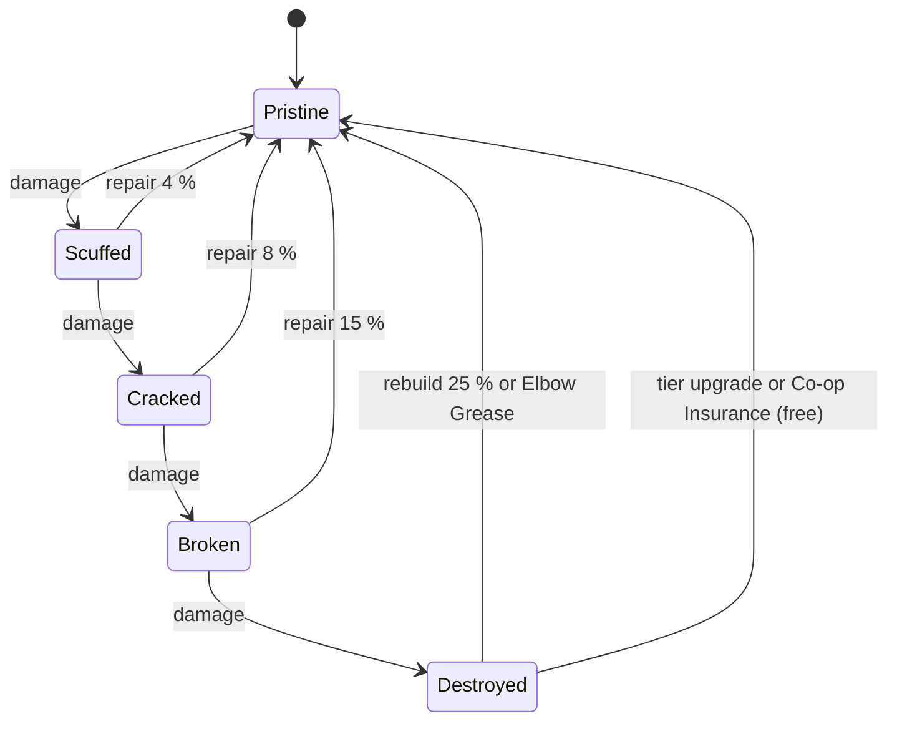

#### 15.9.3 Repair requirements, costs and durations

A repair always restores to **Pristine 100 %**. Requirements: an actor within 7 (+2) studs (player with repair
permission, or `ROLE_REPAIR`), the object not on fire, and MB charged **once at completion** for the worst state
reached during the job (canon E3). If charging fails, the object is still repaired and the cost becomes a
debt-free "owner pays later" entry (§27) — never a negative balance.

| Worst state | Cost (% of price) [TUNABLE] | Diner Two-Top (120) | Sizzle Grill (400) | Grand Aquarium Wall (300,000) |
|---|---|---|---|---|
| Scuffed | 4 % | 5 MB | 16 MB | 12,000 MB |
| Cracked | 8 % | 10 MB | 32 MB | 24,000 MB |
| Broken | 15 % | 18 MB | 60 MB | 45,000 MB |
| Destroyed (Rebuild) | 25 % (canon cap) | 30 MB | 100 MB | 75,000 MB |

Discounts: player `REPAIR` −0.2 %/pt (max −30 %, canon §C5) plus `SKL_RPR_02` (combined cap −45 %, §14);
`SKL_RPR_08` makes rebuilds 15 %; `ROLE_REPAIR` jobs use the technician discount `RepairSkill / 200` instead
(canon §C15, max −50 %). Minimum 1 MB. **Elbow Grease:** when the wallet cannot cover a rebuild, the owner may
rebuild for 0 MB by hand at ×2 duration — nobody is ever stuck with rubble.

**Size classes** (footprint cells; wall items use wall-studs / 2) and **base durations** at `REPAIR` 0, divided by
`1 + 0.01 × REPAIR` (cap ×2.5):

| Class | Cells | Examples | Scuffed | Cracked | Broken | Rebuild |
|---|---|---|---|---|---|---|
| S | ≤ 2 | chair (1), plant (1), cutting board (2), 4-stud window (2) | 2.0 s | 3.5 s | 5.0 s | 8 s |
| M | 3–6 | two-top (4), grill (4), 8×2 counter (4), pizza oven (6) | 3.0 s | 5.0 s | 7.5 s | 11 s |
| L | 7–15 | booth (9), four-top (9), long table (10), karaoke stage (12) | 4.0 s | 6.5 s | 10.0 s | 15 s |
| XL | ≥ 16 | 8×8 tables (16), Grand Aquarium Wall (8 × 2 = 16), Grand Tentacle Booth (20) | 5.0 s | 8.0 s | 12.5 s | 19 s |

`SKL_RPR_18` (appliances −25 %), `SKL_RPR_08` (rebuild −30 %) and `SKL_RPR_07` (Multi-Fix) stack
multiplicatively. A typical post-brawl cleanup (a Cracked chair, a Scuffed table, a Cracked booth, a Scuffed
grill) is ≈ 16 s of hands-on time with the starter stat — inside §4's ≤ 60 s target.

```lua
--!strict
-- ServerScriptService/Server/Services/RepairService/RepairMath.lua
local FLOOR = { Pristine = 51, Scuffed = 26, Cracked = 1, Broken = 0, Destroyed = 0 } -- step limit targets

local RepairMath = {}

function RepairMath.state(pct: number): string
	if pct >= 76 then return "Pristine" elseif pct >= 51 then return "Scuffed"
	elseif pct >= 26 then return "Cracked" elseif pct >= 1 then return "Broken" end
	return "Destroyed"
end

-- quoted: "% durability" from §5/§11/§36.9 (100-point reference); protect already floored at 0.5 for combat
function RepairMath.applyDamage(pct: number, quoted: number, maxDurEff: number, protect: number, isCombatHit: boolean): number
	local new = pct - quoted * (100 / maxDurEff) * protect
	if isCombatHit then new = math.max(new, FLOOR[RepairMath.state(pct)]) end -- one state per hit
	return math.clamp(math.floor(new + 0.5), 0, 100)
end

-- cost(price, worstState, discount) and duration(sizeClass, worstState, REPAIR) implement the two tables above.

return RepairMath
```

#### 15.9.4 The repair minigame: "Fix-It Ring"

Rendered by the repair widget of §24; `RepairService` picks the mode and the values below.

| | **Whack** (furniture, decor, windows: `ANM_060` hammer) | **Hold** (appliances, fixtures, aquariums: `ANM_061` weld/bolt) |
|---|---|---|
| Base progress | ring fills passively at 0.6 × base rate while the player stays in range | holding the button fills at 1.0 × base rate |
| Rhythm | a sweet-spot pip crosses the target every 0.9 s; tap: **Perfect** (±0.12 s) +0.9 s of progress, **Good** (±0.22 s) +0.5 s, Miss 0 (cartoon thumb-bonk, no penalty) | every 25 % of progress a "Tighten!" pip appears; re-press inside 0.35 s: +8 % progress |
| Result range | all Perfect ≈ 0.62 × base time · all Good ≈ 0.86 × · no taps ≈ 1.67 × | all pips ≈ 0.76 × base time · none 1.0 × |

- **Never fails.** Leaving range or being hit pauses the job; progress is kept 30 s (`SKL_RPR_21` ignores small hits).
- **Mobile:** one large FIX button above Interact (≥ 96 × 96 px), pips sized ≥ 44 px; **controller** X/A; **keyboard**
  E or Space. **Auto-Fix** accessibility toggle turns every job into Hold with automatic Good pips.
- `SKL_RPR_09` widens timing windows 15 % per rank; `ABL_062` Repair Burst calls `RepairService` to add its
  instant percentage (§36.6). Two players may **Team Fix** one object (second player at 60 % contribution).
- **XP:** `XPRate(L) / 3600` per second of base repair time (canon §C5.1 relative rule), ×1.25 if ≥ 80 % Perfect.
- **Server validation:** pip schedule is seeded per `jobId`; `Repair.Input` tap times are checked against
  `workspace:GetServerTimeNow()` with latency tolerance (the same scheme §27 uses for chopping); a job can never complete faster than
  0.6 × its base time.

#### 15.9.5 Destruction and restoration presentation

All debris is client-only and despawns within 4 s (canon §C3); reduced-VFX settings halve particles and drop
screen shake.

| Event | Animation and effects (kid-safe) |
|---|---|
| Damaged (any hit) | object jiggles 0.2 s, "CRACK!"/"BONK!" comic text, 6–10 cartoon stars or feathers, sauce splat decal if food hit it |
| Becomes Broken | slumps into its broken pose, a leg or knob pops off and bounces, soot puff for appliances, appliance face (if any) gets dizzy spirals |
| Destroyed | "poof": dust cloud, bouncing bolts and springs, then a tinted rubble pile with a tiny white flag; aquariums drop their fish into a bucket ("We're fine!"); goldfish Chef gives a thumbs-up fin |
| Restored ("Good as new!") | sparkle burst (30 particles), scale tween 0.9 → 1.1 → 1.0 over 0.4 s (`TweenService`), a shine sweep across the model, floating text "Good as new!", ding |
| Co-op Insurance sweep | a sparkle wave travels from the front door through every insured object (1.5 s) |
| Tier upgrade | Mutant Builders sequence (§15.3) |

#### 15.9.6 Employee repair (`ROLE_REPAIR`)

Players can always delegate: every damaged object's prompt has **Assign to Repair Tech**, and the Repair panel
has **Repair All** (queues every damaged object). Technicians skip the minigame and work from a priority queue:
(1) Broken appliance needed by an open ticket · (2) Broken seat/surface while customers wait · (3) Destroyed
objects if the owner's "Auto-rebuild" toggle is on (default off) · (4) other Broken · (5) Cracked customer-side ·
(6) Cracked kitchen · (7) Scuffed, only if "Polish scuffs" is on. Duration = base × `(1.5 − RepairSkill / 200)`
× trait multipliers (§36.8, e.g. *Live Wire* appliance ×1.3 speed); cost uses the technician discount and an
owner-set hourly repair budget (default 10 % of last hour's income). Canon E3 applies: new damage during a job
grows its remaining work, Destroyed converts the job to Rebuild, the cost is charged once at completion.

#### 15.9.7 Offline damage (canon §C15)

`OfflineEarningsService` passes the report's damage events (from §36.9 incidents) to `RepairService`, which picks
targets with the report's seeded RNG (customer-side furniture 60 %, appliances 25 %, decor 15 %) and applies them
with the §15.9.1 conversion. Fairness rules [TUNABLE]: offline damage **never Destroys** (floor 1 %, Broken); at
most `min(6, 1 + floor(H / 2))` objects per report; trophies, finishes, curb items and rugs are immune. With a
Repair Tech, each technician repairs up to 4 objects per simulated hour inside the sim at the state cost ×
`(1 − RepairSkill / 200)`, shown as **Repairs** in the report, and those objects come back Pristine. Without one,
objects wait for the player (cheaper than replacing; atmosphere lower next session) and the Welcome Back screen's
**Restaurant Damage** button lists them with a Repair All total. `SKL_RPR_17` speeds those repairs for 10 min.

#### 15.9.8 Co-op Insurance (canon E12)

Every damage event is tagged with its source. Damage dealt by **guests**, and by **customers while at least one
guest is present**, accrues as `insuredPct` on the object (owner-alone sessions are not insured). When the visit
ends (`MultiplayerService.GuestLeft` with no guests left, or the owner leaving), the insurance sweep restores each
object by its insured share for free (insured share ≥ the damage → Pristine; mixed damage → only the uninsured
part remains to pay). Repairs done during the visit on insured damage cost 0 MB and still award XP. Guests may
repair (if allowed) but can never sell, move or store owner furniture or spend owner currency.

#### 15.9.9 "Never permanently lost" rules

1. Destroyed objects stay placed as rubble (`restaurant.pendingRebuilds`, §28) with a rebuild offer of ≤ 25 %.
2. Elbow Grease rebuilds for free when the wallet cannot pay.
3. Every tier upgrade restores everything to Pristine for free.
4. Migration and content changes move items to storage, never delete them; sells are always player-initiated.
5. Trophies (`FRN_901`–`FRN_910`) are indestructible and unsellable.
6. Offline damage cannot Destroy; Co-op Insurance repays guest-time damage.

#### 15.9.10 Protective upgrades and combat hooks

| Upgrade / item | Effect | Hook it feeds |
|---|---|---|
| `UPG_049`–`UPG_051` Reinforced Furniture | seating/surface MaxDur +25/50/100 % | MaxDur_eff (counts toward the 0.5 floor) |
| `UPG_052`/`UPG_053` Reinforced Appliances | appliance MaxDur +25/50 % | MaxDur_eff |
| `UPG_033` Booth Bolt-Downs | no flips; tables/booths ×0.6 damage | `FurnitureCombatDamageMult` (§11) |
| `UPG_054` Bumper Pads | wall-splat damage ×0.5 | `FurnitureCombatDamageMult` |
| `UPG_044` Riot-Proof Ribbon | ×0.7 during level-6 chaos | `FurnitureCombatDamageMult` |
| `UPG_048` Shatterproof Glass | glass ×0.4 | Protect (glass) |
| `UPG_042` Anti-Throw Netting | wall items/glass immune to thrown food | Protect |
| `UPG_045`/`UPG_046` Sprinklers, `UPG_047` Fire-Retardant | auto-extinguish 3 s / 1 s; fire ×0.5 | §5 fire |
| `FRN_430` Extinguisher Cabinet, `FRN_432` Smoke Detector Pigeon | extinguish −50 % in 12 studs; 2 s fire warning | §5 fire |
| `FRN_435` Owl Camera, `UPG_041` Owl Eye Network, `FRN_436` Security Booth, `UPG_043` Training Mats | warning markers; guard −1 s, −1 s; +4 / +3 studs radius | `SecurityResponseMult` (≥ 0.5), §16 |
| `FRN_146`, `FRN_434` Chill Aura items | anger gain −10 % / −15 % in radius (strongest only) | canon §C11.5 Chill Aura, §10 |
| `FRN_214` Soothing Seafoam Paint | zone-wide escalation dampening 0.05 | `EscalationDampener` (§10) |
| `UPG_055` Nap Nook Respawn Pad | `STS_WOOZY` ×0.6 | `WoozyDurationMult` (≥ 0.3) |
| `FRN_433` Bouncer Rope, `UPG_034` Curbside Benches | queue patience ×1.15 / ×1.2 (cap ×1.4), no line-cutting | `QueuePatienceMult` (§8) |

### 15.10 Station Upgrades (canon §C4.9)

The 24 path rows `UPG_001`–`UPG_024` (§36.12) implement canon §C4.9 for every station, with §5's heat /
process / utility interpretation and Lv5 gimmicks. **Scope decision: levels belong to the station type**, not
to individual instances: buying Grill Lv3 upgrades every grill you own now or later, premium variants included,
priced from the stock item (`cost = multiplier × stock FRN price`). This keeps storage simple (no hidden levels
on stored items), makes second copies immediately useful, and is generous on purpose — station levels are a
side sink beside mutations. Persistence: `restaurant.upgrades` holds `"UPG_006#3"`-style entries (path + level);
the §28 codec's per-object `lvl` mirrors the type level for `CookingService`. A purchase made while any instance
is `PROCESSING` is queued and applied as each instance idles (§5). No recipe ever requires above Lv1.

### 15.11 UI

Screens are specified in §24 (Restaurant Upgrades screen, Building Placement Mode, Repair Minigame); §15 supplies their data
and rules. Build Mode additions: zone tint overlay (pattern + label per zone, not colour alone), live counters
"Slots 6/8 · Seats 6/6 · Items 54/60", the red route preview to the first unreachable target, an amber "Tight
squeeze" hint, and a "Needs a home" storage tab after migrations. Every rejection shows ✕ + one of these texts:

| Code | Text | Code | Text |
|---|---|---|---|
| `WRONG_ZONE` | "Appliances live in the kitchen!" | `SEAT_CAP` | "Fire marshal says 6 seats max!" |
| `OVERLAP` | "Something's already there." | `ITEM_CAP` | "Only 1 Jukebox fits the vibe." |
| `KEEP_CLEAR` | "Keep the doorway clear!" | `ESSENTIAL` | "You need at least one Pantry!" |
| `ACCESS_BLOCKED` | "Nobody can reach the front of that." | `LEVEL_LOCKED` | "Unlocks at Level 5." |
| `SLOTS_FULL` | "All 8 appliance slots used." | `TIER_LOCKED` | "Needs Tier 6." |
| `WINDOWS_FULL` | "One pass is plenty (for now)." | `IS_RUBBLE` | "Rebuild it before moving it." |
| `PATH_BLOCKED_SEAT` | "Blocks the path to a seat!" | `OCCUPIED` | "Someone's sitting there!" |
| `PATH_BLOCKED_STATION` | "Your cooks can't reach that station!" | `DAMAGED_STORE` | "Repair it before storing it." |

Inputs follow §24 (KB/M: mouse ghost, R rotate, LMB/E place, X store, Ctrl+Z undo, Ctrl+Y redo · gamepad: stick
cursor 8 cells/s, LB/RB rotate, A place, Y move, X store, B exit · touch: drag ghost drawn 1.5 cells above the
finger, Rotate/Place/Store/Undo buttons ≥ 56 u).

### 15.12 Roblox Implementation

#### 15.12.1 Services (names fixed by canon §C19; APIs per §27)

| Service | §15 responsibilities |
|---|---|
| `BuildingService` | occupancy grid per interior; rules R1–R11; connectivity C1–C6; Place/Move/Store/Rotate ops; blueprints; atmosphere and local atmosphere; tier upgrade validation, Mutant Builders cue, layout migration; Grand Opening Kits; `LayoutChanged`, `TierUpgraded`, `AtmosphereChanged` signals; publishes nav-blocked cells to `CustomerAIService` (§8 rebake) |
| `RepairService` | durability attributes `Durability`/`DamageState`; damage intake and conversion; repair jobs (Fix-It Ring sessions, technician jobs, E3 merging); costs via `EconomyService`; rebuild/Elbow Grease; insurance ledger; offline damage application; messes and K |
| `RestaurantService` | interior lifecycle and operating state (table below), shell spawning per tier, plot façade swap |
| `InventoryService` / `EconomyService` | storage counts and purchases (`Inventory.BuyFurniture`), the only currency mutations |

| Operating state | Arrivals | Station timers | Notes |
|---|---|---|---|
| `OPEN` | yes | run | normal service |
| `PAUSED` | no | run | Pause Service; customers inside finish |
| `EDITING` | held | frozen | 0 customers inside (§15.5.3) |
| `RENOVATING` | no | frozen | Last Call then Mutant Builders (§15.3) |
| `AWAY` (owner in the city, same server) | staffed: yes · unstaffed: no ("Out to Lunch", or "Event Break" during city events) | heat stations paused (no fires while away) | per §18: seated customers finish or leave politely with no reputation loss; anger escalation into levels 4–6 is suppressed unless a Security Guard is on shift (would-be escalators sulk and leave, §18), so level-4 smashing (and furniture damage from it) cannot happen in an unguarded restaurant |
| `CLOSING` | no | finish/discard | canon E1 on owner disconnect |

#### 15.12.2 Layout serialization (DataStore)

Logical record per placed object: **`{itemId, x, z, rot, durability}`** plus the restaurant-unique `uid`
(home cell for §11 Furniture Homing). Physical encoding is §28's 10-byte packed record
(`kind, num, uid, x, z, rotLvl, dur`, Base64): every §15 item uses `kind = 0` (FRN, `num` = numeric ID, so
`FRN_006` → 6); appliances are FRN items whose station type comes from the catalog; `rotLvl = rot + 4 × (typeLevel
− 1)` mirrors the station-type level. `x`/`z` are **2-stud cell indices** (§15.5.1). Non-floor layers use reserved
`z` ranges so no schema change is needed:

| Layer | `x` | `z` | `rot` |
|---|---|---|---|
| FLOOR / WALKABLE | cell column (patio = negative x) | cell row 0–511 | 0–3 |
| CEILING | cell column | row + 2048 | 0–3 |
| WALL socket | socket index | −1 | wall side 0–3 |
| DOOR socket | 0 front · 1–2 staff · 3 patio · 4 back | −2 | 0 |
| ZONE finish | 0 kitchen · 1 dining · 2 lobby · 3 outside | −3 | 0 floor · 1 wall |
| CURB socket | socket index | −4 | 0–3 |

Budget: 400 objects × 14 Base64 chars ≈ 5.6 KB (§28 allots 9 KB to `restaurant`). Storage = `{FRN → count}` of
Pristine items only (§15.5.4), so counts suffice. On load, a record that fails validation (content change) is
moved to storage and logged (§27); connectivity repair follows §15.3 step 5.

#### 15.12.3 Server validation and client ghost

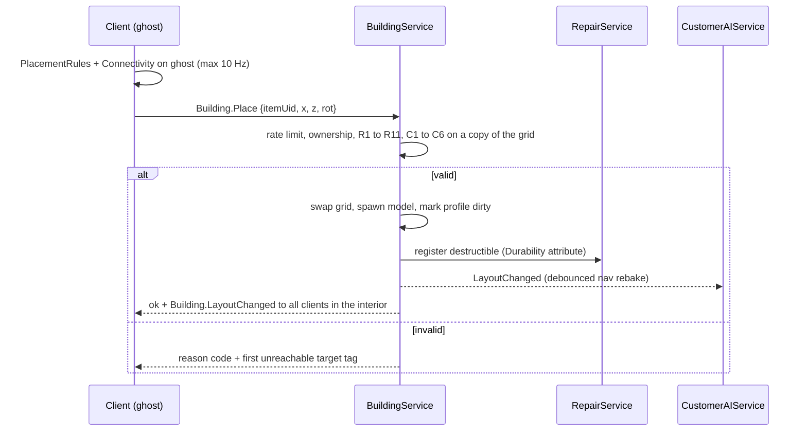

- **Shared rules module** `ReplicatedStorage.Shared.Building.PlacementRules` (pure Luau, no instances) is required by
  both sides, so the ghost shows exactly what the server will decide; the server never trusts client results.
- **Ghost:** the client clones the item from `ReplicatedStorage.Assets.Furniture/<id>`, sets parts to 0.5
  transparency with `CanCollide/CanQuery = false`, adds a `Highlight` (valid ✓ green outline / invalid ✕ red with a
  diagonal-stripe `Decal` for colour-blind players), and positions it each `RunService.RenderStepped` from
  `Camera:ViewportPointToRay` + `workspace:Raycast` (whitelist: the interior floor), snapped to the grid.
  `ContextActionService` binds rotate/place/store/undo per input type.
- **Atomicity:** each op is validated on a copy of the grid and swapped in only if all rules pass; purchases
  go through `EconomyService` with idempotency keys; tier upgrades are one session-locked transaction (§15.3).
- **Anti-exploit:** ops ≤ 4/s (burst 8); integer cells inside the shell only; item counts reconciled against
  ownership on every load (placed + stored ≤ owned); durability is server-only; repair completion floored at
  0.6 × base time (§29 owns the general framework).

#### 15.12.4 Performance budgets [TUNABLE]

Furniture models ≤ 12 parts / 2,000 triangles (showpieces such as `FRN_345`, `FRN_267`, `FRN_288` ≤ 40 parts /
8,000 triangles); a `TIER_10` interior ≤ 3,500 parts and ≤ 150,000 triangles; furniture uses
`ModelStreamingMode.Atomic`; damage states are decal/`SurfaceAppearance` swaps plus one optional broken pose (no
extra models); rubble uses 6 shared meshes; animated decor (fish, fireflies, murals) runs client-side only within
60 studs. Atmosphere recompute < 0.5 ms; connectivity < 0.3 ms; offline damage application < 1 ms.

#### 15.12.5 Content pipeline

`render_restaurant.py` validates the catalog (unique IDs, all 24 canon stations covered, trophies exactly
`FRN_901`–`FRN_910` with canon names, every set ≥ 6 pieces, sequential `UPG_` IDs and prereqs) and the
generated read-only `Furniture`/`Tiers`/`Upgrades` Luau modules (§27) are built from the same JSON. Each tier
ships a **template layout** (the Grand Opening default) that must pass R1–R11 with every slot filled — the proof
that each kitchen fits its canon slot count.

#### 15.12.6 Analytics

`mmr_furniture_purchased` (item, price, tier), `mmr_layout_op` (op, reason code if rejected), `mmr_restaurant_tier_up`
(tier, migrated, stored), `mmr_object_damaged` / `mmr_object_destroyed` (item, source), `mmr_repair_completed`
(item, worst state, cost, actor, minigame grade), `mmr_insurance_settled`, plus `LogEconomyEvent` sinks for
purchases, repairs, rebuilds and upgrades (§31).

### 15.13 Dependencies

| Depends on | For | Provides to | What |
|---|---|---|---|
| canon §C3, §C4, §C6, §C7, §C15, §C16.4, E3/E10/E12 | binding values | §5 Cooking | station footprints, durability, PAUSED/eject triggers, station-type levels |
| §5 | station verbs, gimmicks, fire rules | §8 Customer AI | seat/surface nodes, nav-blocked cells, local atmosphere, podium, counter line |
| §8, §10 | arrivals, queue, escalation | §10 / §C11 | `M` (Atmosphere), `K` (Cleanliness), `DecorMult` |
| §11 | combat damage events, PropClass use | §11 | PropClass mapping, durability conversion, protective multipliers |
| §14 | REPAIR stat, `SKL_RPR_` nodes | §16 / §17 | repair jobs for `ROLE_REPAIR`, offline damage rules, capacity check per tier |
| §16 / §17 | technicians, offline report | §20 | City Hall permit gate (`TIER_04`+), repair objectives |
| §21 | co-op permissions, guests | §24 | data for §24 screens, reason texts |
| §27 / §28 | services, codec | §27 / §28 | layout record meaning, reserved z ranges |

### 15.14 Edge Cases

| # | Situation | Ruling |
|---|---|---|
| 1 | Damage lands on an object while an employee or player repairs it (canon **E3**) | job absorbs it (remaining work grows, ring drops, "More damage!"); Destroyed converts the job to Rebuild; cost charged once at completion at the worst state reached |
| 2 | A layout would disconnect the door from a seat (canon **E10**) | the op is rejected with `PATH_BLOCKED_SEAT` and the route preview; at runtime, stuck customers poof (§8) |
| 3 | A guest (or a customer during co-op) breaks the owner's furniture (canon **E12**) | insured share repaired free at visit end; guests can't sell/move/store or spend |
| 4 | Owner tries to place furniture while a customer is seated | Edit Mode cannot open while customers are inside (Pause Service/Last Call first); an occupied seat can never be moved or stored (`OCCUPIED`) |
| 5 | Tier upgrade with damaged or Destroyed items | Mutant Builders restore all to Pristine and rebuild rubble for free; active repair jobs are cancelled with no charge |
| 6 | Tier upgrade requested mid-brawl or during chaos | refused ("Can't renovate during a brawl!"), nothing charged |
| 7 | Owner disconnects during Edit Mode | every committed op was already valid; restaurant goes to E1 Closing; next session opens normally |
| 8 | Server dies during the builders sequence | tier, migrated layout and charge were one transaction: on rejoin the new shell loads with the migrated layout; a retried request with the same idempotency key is a no-op (no double charge) |
| 9 | Player tries to store/sell the last Pantry (or the podium at T3+) | `ESSENTIAL`; sell is storage-only anyway |
| 10 | A station breaks mid-cook / is destroyed | Broken → PAUSED, timers frozen; Destroyed → contents ejected per §5; no burn, no charge |
| 11 | Wallet too low to rebuild | Elbow Grease: free manual rebuild at ×2 time |
| 12 | Store a damaged item to "heal" it | refused (`DAMAGED_STORE`); durability lives on the placed uid |
| 13 | Content update makes a saved item invalid (new footprint, tier change) | item moves to storage with a "Needs a home" badge; connectivity repair stores lowest-value blockers |
| 14 | Two co-owners try to edit at once | single edit lock; the second sees a read-only view with the editor's name |
| 15 | Offline damage hits an object with a paused repair job | merged by E3; offline damage never Destroys (floor 1 %) |
| 16 | Sprinkler and a player extinguish the same fire | first completion wins; one puddle at most; no double effects |
| 17 | Seat cap reached but the player buys more chairs | purchase allowed (goes to storage); placement refused with `SEAT_CAP` |
| 18 | Restaurant left unstaffed while the owner explores the city | `AWAY` "Out to Lunch": no arrivals, heat timers paused, escalation into levels 4–6 suppressed without security (§18) — nothing burns or gets smashed (§15.12.1) |

### 15.15 Acceptance Criteria

- **AC-15-01:** All 10 tiers load with canon §C6 values; an upgrade with insufficient level, MB or (T4+) permit is
  refused with the exact gap shown and charges 0 MB.
- **AC-15-02:** A tier upgrade from `OPEN` completes in ≤ 45 s Last Call + 10.0 s ± 0.2 s builders sequence (3.0 s
  short version after the first view) and no customer loses reputation because of it.
- **AC-15-03:** After any tier upgrade, 100 % of previously owned items exist (placed or in storage), every object
  is Pristine, and the migrated layout passes R1–R11.
- **AC-15-04:** Every placement op is answered by the server in ≤ 250 ms on a 150 ms-latency client, and the client
  ghost's verdict matches the server's in 100 % of 10,000 randomized fixture placements.
- **AC-15-05:** No saved layout ever disconnects the front door from any attached seat; a fuzz test of 5,000 random
  op sequences produces 0 invalid committed layouts.
- **AC-15-06:** Connectivity validation of the largest interior (≈ 2,900 cells) takes ≤ 1 ms on the server.
- **AC-15-07:** Appliance slot use never exceeds canon slots; utility fixtures never consume a slot; the starter
  kit uses exactly 4 of 6 slots at `TIER_01`.
- **AC-15-08:** Attached seats never exceed tier Seats; a Broken surface disables its seats within one server tick.
- **AC-15-09:** Atmosphere is an integer 0–TierCap, recomputed ≤ 1 s after a change, and `DecorMult = 0.9 + 0.003 ×
  Atmosphere` is what `CustomerAIService` reads; the template starter shack reads 20–26 before and 36–44 after
  repairing its table, bulb and windows.
- **AC-15-10:** Cleanliness K drops by exactly 4 per dining trash item and 6 per spill (fixtures), recovers when
  they are cleaned, and is clamped to 0–100.
- **AC-15-11:** Durability is stored as an integer 0–100 per object; states derive from canon bands (76/51/26/1/0)
  and a single combat hit never lowers an object by more than one state.
- **AC-15-12:** Repair cost equals 4/8/15/25 % of price for Scuffed/Cracked/Broken/Destroyed (± 1 MB rounding,
  before discounts) and is charged exactly once per job even if damage occurs during the job (E3).
- **AC-15-13:** With `REPAIR` 0, a Small Cracked object repairs in 3.5 s ± 0.1 s in Hold mode without pips; no job
  completes faster than 0.6 × its base time.
- **AC-15-14:** The Fix-It Ring is fully playable with one thumb on a 5-inch phone (FIX button ≥ 96 × 96 px) and
  with Auto-Fix enabled requires no timing input.
- **AC-15-15:** A Destroyed object always offers Rebuild at ≤ 25 % of price, or Elbow Grease at 0 MB when the wallet
  is short; no code path deletes a placed object without a player sell action.
- **AC-15-16:** Damage caused by guests, or by customers while a guest is present, is fully repaired at 0 MB within
  2 s of the last guest leaving (E12).
- **AC-15-17:** Offline reports never Destroy objects, damage at most `min(6, 1 + floor(H/2))` objects, and identical
  inputs reproduce identical damaged-object lists (seeded).
- **AC-15-18:** With a Repair Tech, offline-damaged objects are Pristine on return and the report's Repairs line
  equals the state costs × (1 − RepairSkill / 200), ± 1 MB.
- **AC-15-19:** Store is refused for any object below 76 % durability; storage holds only Pristine items.
- **AC-15-20:** A `TIER_10` interior with 400 placed items stays within 3,500 parts and 150,000 triangles, and
  destruction debris despawns within 4 s.
- **AC-15-21:** Buying a station path level upgrades every owned instance of that type (including premium variants
  and copies bought later) and costs ×1.5/×4/×10/×25 of the stock item price.
- **AC-15-22:** While the restaurant is `AWAY` and unstaffed, no new customers arrive, no station reaches ON_FIRE,
  and no customer escalates into anger levels 4–6 without a Security Guard on shift (§18).


## 16. Employee Management

> Binding inputs: canon §C14 (roles, statistics, offline caps, `EMP_001`), §C4.8 (rarity
> bands), §C6 (employee cap per tier), §C22 E8 (wages). The offline half of this system is specified in §17; the
> archetype database is §36.8 and the offline incident database is §36.9. Every value marked **[TUNABLE]** is a
> balancing assumption that the systems in §17 and §22 already agree on.

### 16.1 Purpose

**Purpose.** Employees are the second engine of Mystery Morph Restaurant. While the player is online they absorb the
repetitive half of the restaurant (washing, re-stocking, seating, standard tickets), so the player can chase the
fun half: tricky orders, brawls, repairs, the city. While the player is offline they keep the restaurant open and
turn hours away into a **Welcome Back** report (§17) — the single strongest daily-return driver in the game. The
brief calls this "a major gameplay system"; we design it as a full management sim layered on top of the action game,
never as a passive bonus.

Design rules (they settle every later trade-off):

1. **Offline complements, never replaces.** A well-staffed restaurant earns 35–50 % of active net per hour during
   the first 2 offline hours, then a long-absence taper applies (×0.5 for hours 2–8, ×0.2 for hours 8–24), so even a
   24 h Legendary-Manager absence is worth about 3 active hours (§17.4, proven in §17.9). Research Tokens, recipe
   learning, quests, combat, skill points and all player XP stay active-only.
2. **Every hire is a decision.** A candidate always trades something: wage vs output, a great trait vs a funny
   drawback (the Dragon Chef burns 6 % of grill items), rarity vs the employee cap of the tier. There is no "best
   employee" for every restaurant — the bottleneck decides (§16.9 ROI table).
3. **Employees are morphs.** Their mutations are canon parts (§12, §36.3) and those parts *are* their abilities:
   an octopus cooks two things at once, a cheetah delivers fast, a rhino stops brawls. The same family/tag system that
   drives player synergies drives employee traits (§16.5), so new mutation parts automatically create new employees.
4. **Earnable only.** Hiring, rerolls, training and raises cost MB; nothing in this system is sold for Robux and
   offline earnings never depend on purchases (§23).
5. **Failure is funny, not devastating.** Bad staffing produces sulky cartoon moments and smaller reports, never
   debt: balances cannot go negative (E8) and the Manager closes early instead of losing money (§17).

### 16.2 Employee Roles

**Rules & Mechanics.** Each employee has a *native role* (from its archetype, §36.8) and an *assigned role* (default =
native). An employee can be assigned any unlocked role; off-native assignments use that role's stat weights and an
**Unfamiliar ×0.85** penalty to RoleStatAvg until a Cross-Training course (§16.7.4) removes it. Roles unlock by tier;
the employee cap is canon §C6. Only one Manager and one Assistant Manager may be assigned at a time.

| ID | Role | Unlock | RoleStatAvg weights | Online responsibilities (task types, §16.3) | Offline contribution (canon §C14.1, formulas §17.4) | Limit |
|---|---|---|---|---|---|---|
| `ROLE_CHEF` | Chef | `TIER_01` | 0.6 Cook + 0.3 Accuracy + 0.1 Reliability | `CookTicket` at assigned station group: claims a station slot, fetches, cooks, assembles, plates to `STN_WINDOW`; at `TIER_01`–`TIER_02` also hands food over the counter | Kitchen capacity: Σ (3600 / PrepSec_avg) × Contribution / 1.4. **Required** — no Chef, no offline customers | — |
| `ROLE_PREP` | Prep Cook | `TIER_01` | 0.4 Cook + 0.4 Service + 0.2 Accuracy | `PrepComponent`: chops, mixes and pre-cooks components into the `STN_PREP` holds the chefs pull from; washes produce | +15 % kitchen capacity per prep (Multi-Tasker prep counts 1.25, `EMP_021` counts 1.5), max +45 % | 3 counted |
| `ROLE_WAITER` | Waiter | `TIER_03` | 0.6 Service + 0.3 Accuracy + 0.1 Reliability | `SeatParty`, `TakeOrder`, `DeliverPlate`, bussing; carries 1 tray (+1 Grabby, max 3) | Service capacity Σ (3600 / 45) × Contribution × (1 + 0.10 × cashiers); needed at `TIER_03`+ (else 30 % of kitchen) | — |
| `ROLE_CASHIER` | Cashier | `TIER_01` | 0.5 Accuracy + 0.4 Service + 0.1 Reliability | `ProcessPayment` at the register (`ANM_066`); at `TIER_01`–`TIER_02` also `TakeOrder` at the counter | +10 % service capacity each (max 3 counted); tips × (1 + 0.01 × floor(cashierSkill / 20)) | 3 counted |
| `ROLE_DISH` | Dishwasher | `TIER_01` | 0.5 Service + 0.5 Reliability | `WashRack` at `STN_DISHWASH` (`ANM_021`); keeps ≥ 4 clean plates ready | Prevents "No Clean Plates": without one, kitchen capacity × 0.80 at `TIER_04`+ | — |
| `ROLE_CLEANER` | Cleaner | `TIER_01` | 0.5 Service + 0.3 Reliability + 0.2 Accuracy | `CleanMess` (trash, spills, broken plates; `ANM_022`, `ANM_023`); keeps cleanliness K high | Without one, offline quality q × 0.95 (`TIER_04`–`TIER_06`) / × 0.92 (`TIER_07`+); enables passing inspections (§36.9) | — |
| `ROLE_REPAIR` | Repair Technician | `TIER_02` | 0.7 Repair + 0.2 Reliability + 0.1 Service | `RepairObject` jobs from `RepairService` (`ANM_060`, `ANM_061`); `ExtinguishFire` | Auto-repairs offline damage at −(Repair / 200) discount (+10 pp Wall Crawler, max 60 %) | — |
| `ROLE_SECURITY` | Security Guard | `TIER_03` | 0.6 Combat + 0.2 Reliability + 0.2 Service | `InterceptHostile`: calms or subdues customers at anger level ≥ 3 (§16.3.3) | Security Mitigation SM = Σ (0.25 × Contribution + 0.10 Bouncer + 0.05 Heavyweight), max 0.60: incident count × (1 − SM) | — |
| `ROLE_MANAGER` | Restaurant Manager | `TIER_02` | 0.4 Reliability + 0.3 Service + 0.3 Accuracy | `Coordinate` aura: team Morale baseline +5 (+10 Epic+), schedules breaks, takes over `SeatParty` when idle | Sets the offline cap by rarity (canon §C14.3); Energy decay 5 %/h instead of 8; coordination +3–10 % capacity | 1 |
| `ROLE_DELIVERY` | Delivery Worker | `TIER_04` | 0.6 Service + 0.3 Reliability + 0.1 Combat | `RunDelivery`: carries bagged orders from `STN_WINDOW` to city doorsteps (cosmetic run; revenue on hand-off) | Delivery revenue = Revenue × min(15 %, Σ 0.06 × Contribution), limited by spare kitchen capacity | — |
| `ROLE_STOCKER` | Ingredient Stocker | `TIER_04` | 0.5 Accuracy + 0.3 Reliability + 0.2 Service | `Restock`: unloads `STN_DELIVERY` crates, refills Pantry, warns before SOLD OUT | Ingredient discount 5–15 % (0.05 + 0.10 × Contribution); auto-buys special stock within the player's budget | — |
| `ROLE_ASST_MGR` | Assistant Manager | `TIER_05` | 0.4 Reliability + 0.3 Service + 0.3 Accuracy | Covers Manager tasks when the Manager is on break; settles staff arguments | +2 h offline cap (requires a Manager; absolute max 24 h), −20 % incident losses, coordination +2–5 % | 1 |

**Role behavior notes (online).**

- **Chef.** Works only recipes whose difficulty D ≤ 1 + floor(Cooking / 25) (canon skill gate) and whose stations
  exist; anything harder stays on the ticket rail for the player, highlighted "Chef can't do this one!". A chef never
  starts a ticket the player has already claimed (§16.3.1 reservation).
- **Waiter.** Seats in arrival order except Rich/celebrity personalities (`PER_008`, `PER_009`) who are seated first;
  delivers to the ticket's seat; on a missed modification the customer gets the normal Accuracy penalty (§10).
- **Security Guard.** Patrols an assigned post (Door / Dining / Kitchen). Never attacks a customer below anger 45.
  Security upgrades bought in §15 (§36.12) shorten the guard's response by 1 s and widen the 30-stud intercept
  radius by +3 / +4 studs (§16.3.3); while the owner is in the city, escalation into anger levels 4–6 is only possible
  when a guard is on shift (§16.3.4, §18.8.6).
- **Manager.** Never cooks; while the owner is in the city (Away Mode, §16.3.4) the Manager is the one who flips the sign to "Out to Lunch" if every Chef goes on break or unpaid break.

### 16.3 Online Work AI

#### 16.3.1 Task board and utility scoring

Other services post **tasks** to a per-restaurant `TaskBoard`; each idle or re-evaluating employee picks the task with
the highest utility. Tasks are *reserved* by one actor (player or employee) — players always win a reservation
conflict, and an employee whose task is claimed by a player drops it within 0.25 s.

```
U(task, emp) = RoleFit(task, emp.role) × (Base + Urgency) × (0.5 + Contribution) × ZoneBonus
               − 0.02 × pathDistanceStuds − SwitchPenalty
RoleFit   : 1.0 native task of the role, listed secondary fit (0.3–0.6), else 0 (never chosen)
ZoneBonus : 1.3 inside the employee's assigned workstation/zone, else 1.0
SwitchPenalty : 15 if the employee would abandon an in-progress task, else 0
Contribution  : Efficiency/100 × trait multiplier (§16.4), recomputed every 10 s
```

| Task type | Posted by | Roles (RoleFit) | Base | Urgency term |
|---|---|---|---|---|
| `CookTicket` | `OrderService` | Chef 1.0, Prep 0.4 | 50 | + 40 × (oldest ticket wait ÷ its patience) |
| `PrepComponent` | `CookingService` | Prep 1.0, Chef 0.5 | 40 | + 20 × queued components ÷ 3 |
| `SeatParty` | `CustomerAIService` | Waiter 1.0, Manager 0.5 | 45 | + 30 × queue wait ÷ 30 s |
| `TakeOrder` | `CustomerAIService` | Waiter 1.0, Cashier 0.4 (1.0 at `TIER_01`–`TIER_02`) | 55 | + 45 × ordering-patience used |
| `DeliverPlate` | `CookingService` (window) | Waiter 1.0, any role 0.3 | 60 | + 50 × patience used |
| `ProcessPayment` | `CustomerAIService` | Cashier 1.0, Waiter 0.5 | 40 | + 20 |
| `WashRack` | `CookingService` | Dishwasher 1.0, Prep 0.3 | 30 | + 50 if clean plates < 4 |
| `CleanMess` | `RepairService` (mess list) | Cleaner 1.0, Dishwasher 0.3 | 25 | + 3 per point of cleanliness below 90 |
| `RepairObject` | `RepairService` | Repair 1.0, Cleaner 0.3 | 35 | + 40 if Broken, + 20 if Cracked |
| `ExtinguishFire` | `CookingService` | any 1.0 (Splash Zone ×2) | 95 | — |
| `InterceptHostile` | `CustomerAIService` | Security 1.0, Manager 0.3 | 80 | + 15 × anger level |
| `Restock` | `InventoryService` | Stocker 1.0 | 30 | + 60 if a menu recipe goes SOLD OUT within 5 min |
| `RunDelivery` | `OrderService` | Delivery 1.0 | 40 | + 30 × order age ÷ 120 s |
| `Break` | `EmployeeService` | self | 70 if Energy < 25 % (forced < 10 %) | — |
| `IdleTidy` | `EmployeeService` | any | 5 | — (wipes tables, poses, hums) |

**Scheduler.** One `EmployeeBrain` loop per restaurant runs at **4 Hz** [TUNABLE], staggered by plot index
(offset 0.03 s × plotIndex) so 8 restaurants never tick on the same frame. Each tick re-evaluates at most 5
employees round-robin plus any employee whose task just finished or failed; interruptible tasks are re-scored every
1.5 s. A task that fails twice (path blocked, station destroyed) is released with a 5 s cooldown for that employee.

#### 16.3.2 Action timing and quality

| Quantity | Formula [TUNABLE] | Notes |
|---|---|---|
| Walk speed (studs/s) | `(12 + 0.06 × Service) × move` (Speedster 1.35, Heavyweight 0.9, Unhurried 0.6), max 21 | Players walk 16–21 (§C3) |
| Floor handling time (seat, order entry, hand-off, payment) | `Base × 1 / (0.6 + 0.8 × Service/100)` | Calculator Brain payment 0.5 s flat |
| Kitchen handling time (fetch, assemble, plate) | `Base × 1 / (0.6 + 0.8 × Cook/100)` | Station process time is physical (§5, §C4.9) and identical for everyone |
| Heat item grade | P(PERFECT) = 0.05 + 0.55·Acc/100 + 0.15·Cook/100; P(BURNED) = max(0.01, 0.12 − 0.10·Acc/100) + trait burn chance; P(UNDERCOOKED) = max(0.01, 0.08 − 0.07·Cook/100); else GOOD | Ember adds 6 % burn; Toastmaster Tim halves burns |
| Chop grade | Clean cut chance 0.2 + 0.7·Acc/100, else yellow (0.8) | never MUSHY |
| Order mistake (waiter/cashier) | `0.10 × (1 − Acc/100) × (1.5 − Rel/100)` per order | wrong table or a dropped modification |
| Wander-off (Reliability) | `0.2 × (1 − Rel/100)` per online hour: 2 min idle "daydream" | shown as a thought bubble |
| Order-modification success (chef, per mod, §6.18) | `P = clamp(0.5 + (Skill − 10 × difficulty) / 100, 0.30, 0.98)`; Skill = Accuracy, or (Accuracy + Cooking) / 2 for `DONENESS` and `TEMP` mods; difficulty from §6.18.2 (OMIT/EXTRA 1, most categories 2, JOKE 3) | rolled once per mod when the employee finishes the item; a failed mod counts as missed for order accuracy A (§10); JOKE mods always use the Play Along action on success, otherwise the Straight Answer (never anger) |

Examples: Ollie (Accuracy 28) succeeds on an OMIT 68 % of the time and on a JOKE 48 %; a Legendary chef (Accuracy 90)
hits 98 % / 98 %. A ticket whose mod needs a TAIL actor or another morph condition (§6.18) is only auto-claimed by an
employee who satisfies it. **Offline, modifications are not simulated per order:** their effect is already folded
into the aggregate quality q (avg chef Accuracy) and order-accuracy assumptions of canon §C15 (§17.4).

A typical Uncommon chef produces Food Quality around 0.75–0.80 and a Legendary one around 0.92 — a skilled player at
PERFECT timing (1.00) stays the best cook in the building, by design.

#### 16.3.3 Customers, combat and repairs

- **Interception (Security).** Trigger: a customer reaches anger ≥ 45 (level 3) within 30 studs of the guard's post
  (+3 / +4 studs with §15 security upgrades; anywhere if no post); reaction delay 1.5 s (−1 s with the upgrade). The guard walks over and channels **Calm Talk** for 2.0 s:
  `P(calm) = clamp(0.25 + 0.6 × Combat/100 + 0.25 [Bouncer] − 0.10 × (angerLevel − 3), 0.10, 0.95)`. Success: anger
  −40 and the customer enters *Calming down*. Failure: the guard **subdues** — 4 + Combat/10 Huff Points per hit every
  1.2 s until the customer is `STS_DIZZY` and is escorted out with the canon Apology Payment (40 %, no tip). At
  level 6 chaos guards target the angriest customer first.
- **Staff safety.** Employee HP = 60 + Combat. At 0 the employee plays Seeing Stars (`ANM_062`) for 8 s and returns
  at 50 % HP and −5 Morale — never removed, never "lost". Non-guard staff within 8 studs of a hostile customer flee
  (`ANM_054`) and resume after 4 s; a thrown item that hits a carrying employee drops the plate 50 % of the time
  (0 % with Sticky Grip). Employees never damage customers except guards subduing a level ≥ 3 customer.
- **Repairs.** Repair Technicians take `RepairService` jobs; repair rate = base × (0.5 + Repair/100) × traits (Electric
  appliances ×1.3, Wall Crawler travel ×0.6). Material cost × (1 − Repair/400). A job absorbs new damage and converts to
  Rebuild if the object reaches Destroyed; cost is charged once at completion (canon E3).
- **Co-op.** Guests' actions reserve tasks like the owner's; employees obey the owner's assignments only.

#### 16.3.4 Away Mode (owner online, exploring the city) — consistent with §18.8.6

Away Mode is **not** the offline simulation. It engages when the owner has been outside their own interior for ≥ 20 s
while still online on the same server. A **staffed** restaurant (≥ 1 `ROLE_CHEF` on an Always or Online Only shift, or
a co-op guest with Cook permission inside) stays **OPEN** and runs **live**: the online AI of this section, SPCV
customers, online wages (§16.7.11) and online income; anger escalation into levels 4–6 is suppressed unless a
`ROLE_SECURITY` is on shift (would-be escalators sulk and leave). An **unstaffed** restaurant goes "Out to Lunch" (or
"Event Break" while the owner is at a live event): no new customers, rain checks for seated customers without food,
heat-station timers pause, no reputation loss, no wages. The §17 offline simulation covers **only** time when the
player is in no server at all, starting from the `lastSimAt` written by the last save (PlayerRemoving / BindToClose,
canon E1/E13); an idle player removed by Roblox's idle kick simply becomes offline from that save. Staffing therefore
pays twice: the player can explore Morph City without closing, and the restaurant earns while they are logged off.

### 16.4 Employee Statistics

All statistics of canon §C14.2. The six *trainable* stats live on the 1–100 scale; at hire they sit inside the rarity
band of §C4.8 (Common 15–40 … Legendary 75–100) and training can raise them to the **potential cap** (rarity cap
55 / 70 / 82 / 92 / 100, +3 per seniority star, max 100).

| Stat | Range | Online effect (§16.3.2) | Offline effect (§17.4) | Raised by |
|---|---|---|---|---|
| Cooking Skill | 1–100 | kitchen handling speed, PERFECT/UNDERCOOKED odds, recipe skill gate D ≤ 1 + floor(Cook/25) | best chef's Cook sets the offline menu gate; RoleStatAvg of Chef/Prep | Cooking Academy course (`BLD_06`) |
| Service Speed | 1–100 | walk speed, floor handling speed | RoleStatAvg of Waiter/Cashier/Dish/Cleaner/Delivery; avg waiter Service raises tip rate | Training Gym course (`BLD_05`) |
| Accuracy | 1–100 | PERFECT and BURNED odds, order mistakes | avg chef Accuracy sets quality q = min(0.95, 0.70 + 0.25 × Acc/100) | Cooking Academy course |
| Repair Skill | 1–100 | repair rate, material discount | auto-repair discount Repair/200 | Repair Workshop course (`BLD_07`) |
| Combat Strength | 1–100 | calm chance, subdue damage, staff HP | Security Mitigation via Contribution | Training Gym course |
| Reliability | 1–100 | mistake multiplier, wander-off chance | weight in most roles; staff-mistake incident odds | Repair Workshop course |
| Energy | 0–100 % | at < 25 % takes a break; Efficiency × (0.7 + 0.3·E/100) | −8 %/h (−5 %/h with Manager) per simulated hour | breaks, Off Duty, closed hours |
| Morale | 0–100 | Efficiency × (0.6 + 0.4·M/100); < 25 = Sulking | −1/h offline | raises, stars, praise, snacks, good days |
| Salary | MB/h | paid every 60 s while on shift (E8) | Σ wage × hours worked | raises (+10 %), stars (+5 %) |
| Efficiency | derived | drives utility and speed | drives every capacity | all of the above |
| Special Abilities | traits | §16.5 | §16.5 | promotions (star 3 upgrades the signature) |

**Efficiency (canon §C14.2, exact).**

```
RoleStatAvg = Σ weight_role(stat) × stat            (weights in §16.2; × 0.85 if off-native role and not cross-trained;
                                                     Calculator Brain counts Reliability +5)
Efficiency  = RoleStatAvg × (0.6 + 0.4 × Morale/100) × (0.7 + 0.3 × Energy/100) × (1 + 0.001 × player EFFICIENCY)
Eff         = Efficiency / 100                       (0–1.15; the form used by every capacity formula)
Contribution = Eff × TraitMult(role)                 (TraitMult = product of applicable trait multipliers, max ×1.5)
```

Example: Ollie (`EMP_001`, Cook 30 / Acc 28 / Rel 40) → RoleStatAvg 30.4; at Morale 90, Energy 100, player EFFICIENCY 0
→ Efficiency 29.2 → Eff 0.292 → Contribution 0.292 × 1.25 (Multi-Tasker) = **0.365** (§17.9 Example A).

### 16.5 How Employee Mutations Shape Performance

**Derivation rule.** A trait is derived when the employee's parts contain one of its **key families** (any part) or
**≥ 2 parts carrying its key tag** (a matched pair counts as two parts). Families and tags are the canon vocabulary of
§C13.5/§C13.6, so every future mutation part automatically produces employees with sensible traits. An employee shows
at most **two derived traits** (designer-picked per archetype; the procedural generator keeps the two most relevant to
the native role) plus one **signature ability** unique to the archetype (§36.8). Per-employee trait multipliers cap at
×1.5; restaurant-wide bonuses have their own caps (listed).

| Trait | Derived from | Online effect | Offline effect | Drawback |
|---|---|---|---|---|
| Multi-Tasker | families octopus, kraken, squid; or an ARM/BACK part tagged `multi` | works 2 station slots / 2 racks / 2 repair jobs at once (80 % speed each) | Chef, Dish, Repair, Cleaner Contribution ×1.25 (kraken ×1.35); a Multi-Tasker prep counts 1.25 preps | — |
| Speedster | families cheetah, ostrich, raptor, wheel, skate, grasshopper, kangaroo; or ≥ 2 `speed` | walk speed ×1.35 | Waiter, Delivery, Cleaner ×1.20 | 1 % chance per delivery to overshoot the table (comedy only) |
| Bouncer | families rhino, bull, triceratops; or ≥ 2 `horn` | calm chance +25 %; charges to split two brawlers | Security Mitigation +0.10 per guard | knocks over 1 chair per charge (Scuffed) |
| Wall Crawler | families spider, gecko | repairs walls/ceilings without a ladder; travel between jobs ×0.6 | auto-repair discount +10 pp (max 60 %); "Sauce on the Ceiling" weight ×0.5 | — |
| Calculator Brain | family robot; or ≥ 2 `robotic` | payments 0.5 s; order-entry mistakes −80 % | cashier skill ×1.5 for the tip bonus; Reliability +5 in RoleStatAvg | speaks only in beeps |
| Unhurried | family turtle; or ≥ 2 `tank` and no `speed` | action speed ×0.6; Energy drain ×0.5; immune to rush stress | capacity roles ×0.6; *presence* roles (Dish, Cleaner, Repair existence checks) count fully; Energy decay ×0.5 | slow |
| Grill Master | families dragon, lava, phoenix; or ≥ 2 `fire` | GRILL/FRY/BAKE handling ×0.8 (dragon ×0.7), PERFECT +10 % | Chef ×1.15; offline quality q −0.02 per Grill Master chef (max −0.04) | 4 % burn chance per heat item (dragon 6 %) |
| Ice Hands | families ice, yeti, penguin; or ≥ 2 `ice` | FREEZE/BLEND/SCOOP ×0.75 | Chef ×1.05 if ≥ 25 % of the menu is drinks/desserts, ×1.10 if ≥ 50 % | — |
| Charmer | ≥ 2 `charm` | customer patience +8 % within 10 studs; tips +5 % on their tables | tip multiplier +0.05 per Charmer waiter/cashier (max +0.10) | — |
| Loudmouth | ≥ 2 `loud` | shouts tickets: chefs within 15 studs +5 % speed | coordination +2 pp (Manager/Assistant) | nearby customers −2 satisfaction |
| Sniffer | families pig, dog, mole, rat | spots messes and SOLD OUT risks 2× sooner | stocker discount +2 pp; discovery chances ×1.10 (once per restaurant) | — |
| Lucky Charm | ≥ 2 `luck` | +0.5 % Jackpot Tip chance on their tables | discovery chances ×1.15 (once; combined discovery boost max ×1.25) | — |
| Tough Shell | ≥ 2 `armored` | damage taken −40 %, cannot be knocked down | as a guard: customer-incident losses ×0.9 | — |
| Heavyweight | families bear, gorilla, golem, elephant, muscle; or ≥ 2 `heavy` | immune to knockback; carries 2 trays | as a guard: Security Mitigation +0.05 | walk speed ×0.9 |
| Grabby | ≥ 2 `grabby` | carry +1 (max 3, §C3) | Waiter ×1.10; breakage incidents ×0.3 | — |
| Glow-Up | ≥ 2 `glow` | Atmosphere +2 while on shift | DecorMult +0.006 each (max +0.02) | — |
| Splash Zone | families elephant, faucet, hydrant, extinguisher; or ≥ 2 `water`/`aquatic` | extinguishes ON_FIRE instantly; racks ×1.25 | fire incidents ×0.3; Dish ×1.10 | leaves puddles (CleanMess task) |
| Sticky Grip | ≥ 2 `sticky` | never drops plates or trays | breakage incidents ×0.3 | leaves faint footprints |
| Regenerator | ≥ 2 `regen` | Energy drain ×0.75 | Energy decay ×0.75 | — |
| Electric | ≥ 2 `electric` | appliance repairs ×1.3 | as Repair Tech: equipment incidents ×0.7 | 2 %/h chance to trip a breaker (10 s stall) |
| Flying | any part tagged `flying` | Hover Serve over tables (path ×0.8) | Waiter, Delivery ×1.15 | — |
| Golden Touch | any part tagged `gold` | tips +10 % on their tables | tip multiplier +0.10 (once per restaurant) | — |
| Chef's Instinct | ≥ 2 `chef` | PERFECT +10 % | offline q +0.02 per such chef (max +0.03) | — |
| Cosmic Intuition | ≥ 2 `cosmic` | sees anger spikes 3 s early (meter flashes) | as Manager/Assistant: positive incident weights ×1.15 | — |

The brief's examples map exactly: Octopus Chef → Multi-Tasker (`EMP_005`), Cheetah Waiter → Speedster (`EMP_028`),
Rhino Security Guard → Bouncer (`EMP_066`), Spider Repair Technician → Wall Crawler (`EMP_058`), Robot Cashier →
Calculator Brain (`EMP_034`), Sloth Dishwasher → Unhurried and the band-minimum wage (`EMP_039`), Dragon Chef → Grill
Master with burns (`EMP_009`).

**Employee personalities** (one per archetype; small, readable effects; they also flavor report lines).

| Personality | Effect [TUNABLE] |
|---|---|
| Eager Beaver | Morale baseline +5; online Energy drain ×1.1 |
| Zen Noodle | all Morale changes ×0.5 (offline −0.5/h) |
| Drama Royalty | all Morale changes ×1.5; report lines are extra dramatic |
| Perfectionist | Accuracy +5 effective online; handling ×1.05 slower |
| Chatterbox | customer patience +5 % near them; online Energy drain ×1.05 |
| Grump | Morale baseline −10; no Morale loss from being hit by food |
| Clumsy Sweetheart | mistake chance ×1.5; Morale baseline +10 |
| Overachiever | training gain +1; online Energy drain ×1.1 |
| Snack Goblin | Morale baseline +5; enables "Snack Break Became a Picnic" (`INC_024`) |
| Night Owl | offline Energy decay −2 %/h; online drain ×1.1; boosts midnight incidents |
| Show-Off | tips +3 % on their tables; mistake chance ×1.2 |
| Shy Genius | customer-facing tasks ×0.9 speed; kitchen tasks ×1.05 |
| Loyal Lump | Morale floor 40; coworkers lose double Morale if this employee is fired |
| Daydreamer | wander-off chance ×1.5; discovery report lines more often |

### 16.6 Hiring System

**Where.** The Recruitment Office (`BLD_04`, Downtown `DST_03`), staffed by **Ms. Hirewell** (`NPC_007`, owl head,
filing-cabinet torso). From `TIER_06` the **Hirewell Hotline** button in the Employee menu allows remote hiring for a
+10 % fee, so late-game players are not forced to commute, while early players learn the city.

#### 16.6.1 Candidate pool

| Rule | Value [TUNABLE] |
|---|---|
| Refresh | every 4 h on UTC windows (00:00, 04:00, … 20:00); `windowIndex = floor(os.time() / 14400)` |
| Seed | `hash(UserId, windowIndex, rerollIndex)` → `Random.new(seed)`; rejoining or server-hopping shows the same pool |
| Pool size by tier | T1 3 · T2 3 · T3 4 · T4 4 · T5 5 · T6 5 · T7 6 · T8 6 · T9 7 · T10 8 |
| Slot 1 "Hirewell's Pick" | role-gap fill: no Chef → Chef; else the role behind the last offline report's bottleneck (Kitchen → Chef/Prep, Service → Waiter/Cashier, cap reached → Manager/Assistant, SOLD OUT → Stocker) |
| Archetype pick | roll rarity (table below) → uniform among archetypes of that rarity with `min_tier ≤ tier`; archetypes already employed weigh ×0.5 |
| Rerolls | first reroll per window free; then `50 × tier × 2^(n−1)` MB for paid reroll n = 1..3 (T5: 250 / 500 / 1,000) |
| Hold | pin one candidate into the next window for 5 % of its hire cost (non-refundable) |
| Pity | at `TIER_05`+, 12 windows without a Rare-or-better candidate → next pool has one; at `TIER_08`+, 24 windows without Epic+ → next pool has one (counters persist, reset on sight) |
| Disclosure | the rarity odds below are shown in the UI (ⓘ button); rerolls cost MB only and are never sold for Robux |

| Tier | Tier ID | ● Common | ▲ Uncommon | ■ Rare | ⬟ Epic | ★ Legendary |
|---|---|---|---|---|---|---|
| T1 | `TIER_01` | 90 % | 10 % | 0 % | 0 % | 0 % |
| T2 | `TIER_02` | 78 % | 22 % | 0 % | 0 % | 0 % |
| T3 | `TIER_03` | 60 % | 36 % | 4 % | 0 % | 0 % |
| T4 | `TIER_04` | 42 % | 46 % | 12 % | 0 % | 0 % |
| T5 | `TIER_05` | 28 % | 44 % | 25 % | 3 % | 0 % |
| T6 | `TIER_06` | 18 % | 38 % | 34 % | 10 % | 0 % |
| T7 | `TIER_07` | 10 % | 30 % | 38 % | 20 % | 2 % |
| T8 | `TIER_08` | 6 % | 22 % | 38 % | 28 % | 6 % |
| T9 | `TIER_09` | 4 % | 16 % | 34 % | 34 % | 12 % |
| T10 | `TIER_10` | 2 % | 12 % | 30 % | 36 % | 20 % |

#### 16.6.2 What each candidate has

| Field | Generation rule |
|---|---|
| Name & morph | archetype name; parts from §36.8 (client visual, ≤ 24 MeshParts) |
| Rarity | rolled per 16.6.1; color + shape icon (§C13.3) so it is never color-only |
| Stats | archetype values ± up to 3 (seeded), clamped to the rarity band |
| Hire cost | archetype hire × U(0.9, 1.1), rounded (50 MB under Rare, 500 Rare, 1,000 Epic, 5,000 Legendary), clamped to band |
| Wage | archetype wage × U(0.9, 1.1), clamped to band |
| Traits & signature | archetype's; procedural candidates (future) derive traits from parts by the §16.5 rule |
| Personality | archetype's |
| Training potential | grade S/A/B/C/D (gain ×1.5/1.3/1.15/1.0/0.75) and cap (rarity cap + 3 per star) |
| Quirk line | 1 of 24 cosmetic lines ("Hums the city anthem while chopping", "Afraid of round plates") |
| Offline impact preview | Δ full-rate offline MB/h (first 2 h) and Δ MB per full capped absence if hired into the suggested role, computed by the §17 model with expected values (no RNG) |

#### 16.6.3 Recruitment interface

```
┌─ RECRUITMENT OFFICE ─ Ms. Hirewell ─────────────────── Pool refreshes in 02:41:13 ── [X] ┐
│ Staff 5/8 ▸ Wages 498 MB/h ▸ Bottleneck: SERVICE              [Reroll: FREE] [ⓘ Odds]    │
├──────────────┬──────────────┬──────────────┬──────────────┬──────────────────────────────┤
│ ★ HIREWELL'S │ ■ RARE       │ ▲ UNCOMMON   │ ● COMMON     │  ┌ CANDIDATE DETAIL ───────┐  │
│   PICK       │              │              │              │  │ [ rotating 3D morph ]   │  │
│ [3D bust]    │ [3D bust]    │ [3D bust]    │ [3D bust]    │  │ "Chet Speedwell"        │  │
│ Chet         │ Rocco        │ Skates       │ Sloane       │  │ ■ Rare · Waiter         │  │
│ Waiter       │ Security     │ Waiter       │ Dishwasher   │  │ Svc ███████░ 68 ...     │  │
│ 12,000 MB    │ 12,500 MB    │ 2,300 MB     │ 200 MB       │  │ Speedster · Zoomies     │  │
│ 165 MB/h     │ 170 MB/h     │ 55 MB/h      │ 10 MB/h      │  │ Show-Off · Potential A  │  │
│ +695 MB/h ▲  │ +0 MB/h      │ +443 MB/h ▲  │ +121 MB/h ▲  │  │ Offline: +695 MB/h      │  │
│ [HOLD 5%]    │ [HOLD 5%]    │ [HOLD 5%]    │ [HOLD 5%]    │  │ [ HIRE AS: Waiter ▾ ]   │  │
└──────────────┴──────────────┴──────────────┴──────────────┴──└─────────────────────────┘──┘
```

Component hierarchy: `RecruitScreen` → `HeaderBar` (staff count / cap, wages per hour, bottleneck chip, refresh
timer, `RerollButton` showing price, `OddsButton`) → `CandidateRow` (`CandidateCard` × poolSize: bust viewport, rarity
badge with shape, name, role icon, hire cost, wage, offline-impact delta with ▲/▼ arrow, `HoldButton`) →
`CandidateDetail` (ViewportFrame morph preview with idle work animation, stat bars with potential ghost bar, trait
chips with tooltips, signature ability, personality, quirk, `RoleDropdown`, `HireButton`, `ReplaceToggle` when at cap).
Input: mouse/touch tap cards; controller D-pad moves focus, A selects, X rerolls, Y holds, B closes; mobile cards
scroll horizontally with 88 px minimum touch targets. Hire buttons are disabled (with reason text) when funds, cap or
role unlock fail — the server still re-validates.

#### 16.6.4 Hiring workflow

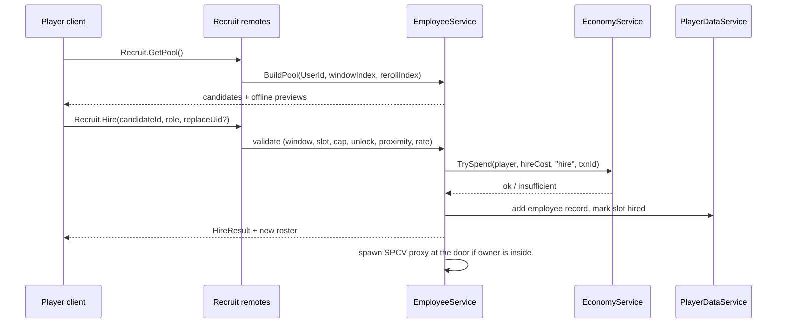

Server validation for `Recruit.Hire` (any failure returns a reason code and changes nothing):

1. Rate limit 1 hire request per 2 s per player; profile loaded and not in Safe Mode (E6).
2. `candidateId` = `windowIndex:slot` belongs to the *current* window (or the held candidate) and the slot is not yet
   hired; stats/costs are regenerated server-side from the seed — the client never sends a price.
3. Player is within 12 studs of Ms. Hirewell's ProximityPrompt, or uses the Hotline at `TIER_06`+ (fee applied).
4. Not In Combat and no full-screen menu restriction (canon E2).
5. `#employees < EmployeeCap[tier]` (canon §C6), unless `replaceUid` is given (that employee is fired first, §16.7.7,
   atomically in the same transaction).
6. The requested role is unlocked at the current tier; Manager/Assistant uniqueness respected.
7. `EconomyService:TrySpend` succeeds with idempotency key `hire:<UserId>:<windowIndex>:<slot>` (a retried request
   cannot double-charge).
8. The employee record is written to the profile and the profile is saved immediately if the cost is ≥ 10,000 MB
   (canon autosave rule) — otherwise at the next autosave.

The first hire is scripted by `QST_TUT_012` "Hire Help": Ms. Hirewell gifts Ollie (`EMP_001`, cost 0) and the
screen shows the **Offline Forecast** ("If you log off now, Ollie earns about 280 MB/h for up to 2 h").

### 16.7 Employee Management

#### 16.7.1 Roster screen (Employee menu, HUD quick-access, usable anywhere)

```
┌─ MY STAFF ── 8/8 ── Wages 636 MB/h ── Offline cap 8 h (Mister Mustache ■) ── Forecast 2,205 MB/h* ─ [X] ┐
│ [All][Kitchen][Floor][Support]    Sort: Role ▾      [Night Menu] [Auto-buy budget] [Wage priority]    │
├────────────────────────────────────────────────────────────────────────────────────────────────────┤
│ ● Sloane  Dish   ▮▮▮▮▮▮▮▮▮▮ E 100%  ☺ 90  KPI B  10 MB/h  Always   "washed 456 plates"     [ ▸ ]    │
│ ▲ Octavia Chef   ▮▮▮▮▮▮▮▮░░ E 90%   ☺ 80  KPI A  50 MB/h  Always   GRILL LINE  ⏳ —        [ ▸ ]    │
│ ■ Chet    Waiter ▮▮▮▮▮▮▮░░░ E 88%   ☺ 80  KPI S  165 MB/h Always   Zone A       ★☆☆       [ ▸ ]    │
├────────────────────────────────── DETAIL: Octavia ──────────────────────────────────────────────────┤
│ [3D morph]  Role [Chef ▾]  Station [Grill line ▾]  Shift [Always ▾]  Cook 58/70 ▮▮▮▮▮▮▮░ Acc 52/70 …  │
│ Traits: Multi-Tasker · Tentacle Tornado     Personality: Overachiever   Potential A   Stars ★☆☆     │
│ Last 24 h: 412 dishes · avg Q 0.81 · 3 burns · KPI 84 (A) · value 3.1× wage                           │
│ [Train ▸] [Raise +10%] [Promote ★] [Praise] [Snack Bonus] [Replace] [Fire]                            │
└────────────────────────────────────────────────────────────────────────────────────────────────────┘
```

\* The Forecast is the expected full-rate MB/h for the first 2 offline hours plus the total for one full cap with the
taper ("8 h ≈ 11,000 MB"). Hierarchy: `StaffScreen` → `StaffHeader` (count/cap, wages/h, offline cap with the
manager's rarity icon, Offline Forecast) → `FilterTabs` + `SettingsButtons` (Night Menu, Auto-buy budget, Wage priority) → `RosterList`
(`EmployeeRow`: rarity icon, name, role icon, Energy bar, Morale face + number, KPI grade letter, wage, shift chip,
station/zone, training timer, stars) → `EmployeeDetail` (viewport, assignment dropdowns, stat bars with potential cap
marker, traits, KPIs, action buttons). Every action button shows its MB price; destructive actions (Fire, Replace)
open a confirm dialog. Controller: LB/RB switch tabs, D-pad rows, A open detail, X Praise, Y Train.

#### 16.7.2 Assign roles and change workstations

- **Role**: any unlocked role; off-native roles show "Unfamiliar ×0.85" until cross-trained. Changing role is free,
  takes effect after the current task, and has a 60 s cooldown per employee.
- **Workstation / zone** (ZoneBonus ×1.3 in §16.3.1): Chef → station group (Grill line, Fry line, Bake line,
  Drinks & Desserts, Any); Prep → board/counter; Waiter/Cleaner → dining zone A/B/C or Any (zones auto-split by
  table count); Security → Door / Dining / Kitchen post; Repair → Kitchen-first / Dining-first priority.
  Idle employees still help outside their zone after 5 s without a zone task.

#### 16.7.3 Shifts and rest

| Shift mode | Online | Offline (§17) | Wage | Energy |
|---|---|---|---|---|
| Always (default) | works | works | paid both | drains online and offline |
| Online Only | works | rests | online only | recovers +10 %/h offline |
| Offline Only | rests at home | works | offline only | recovers +10 %/h while you play |
| Off Duty ("vacation") | — | — | none | +10 %/h; Morale +2/h up to baseline |

Breaks are automatic (§16.7.10). The restaurant always keeps the last Chef working when breaks overlap, unless his
Energy is < 10 %.

#### 16.7.4 Training

Courses run in the city — **Cooking Academy** (`BLD_06`): Cooking, Accuracy; **Training Gym** (`BLD_05`): Service,
Combat; **Repair Workshop** (`BLD_07`): Repair, Reliability — and are bought from the roster (no commute). The trainee
leaves for the course in real time (it continues while you are offline), does not work and is not paid during it,
but still counts toward the employee cap.

| Rule | Formula [TUNABLE] | Example |
|---|---|---|
| Gain | `round(4 × GradeMult)` points (D 3, C 4, B 5, A 5, S 6; Overachiever +1), never above the effective cap | Ollie (B): +5 Cooking |
| Effective cap | `min(100, RarityCap + 3 × stars)` (55 / 70 / 82 / 92 / 100) | Ollie with 2 stars: 61 |
| Cost | `0.04 × ArchetypeHire × 1.08^(stat − bandMin)` MB (`EMP_001` uses 400 as its hire basis) | Ollie Cooking 30: 51 MB · Captain Calamari Cook 96: ≈ 77,000 MB |
| Duration | `min(240, 20 + 3 × (stat − bandMin))` minutes | Ollie: 65 min · Captain: 83 min |
| Concurrent trainees | 1 (`TIER_01`–`TIER_03`), 2 (`TIER_04`–`TIER_07`), 3 (`TIER_08`+) | — |
| Cross-Training | `0.10 × ArchetypeHire` MB, 60 min: removes Unfamiliar for one chosen role | Octavia → Prep: 210 MB |
| Completion | Morale +5; report line "Graduated with honors (and a tiny hat)" | — |

Training is the long-term sink that keeps old favorites relevant: a trained Uncommon can match an untrained Rare at a
fraction of the wage (Example C trains Octavia to Cook 58 / Accuracy 52).

#### 16.7.5 Salary raises

`Raise` sets wage × 1.10 (max 3 raises, +33 %): Morale +10 now and Morale baseline +5 per raise. An employee whose
Morale stays < 40 for 24 h of shift time *asks* for a raise (notification); ignoring it for 72 h lowers the baseline
by 5 until a raise is given. Raised wages may exceed the hire band (bands apply at hire, §C4.8).

#### 16.7.6 Promotions ("seniority stars")

| Star | Requires | Fee | Effects |
|---|---|---|---|
| ★ Senior | 10 h worked (online + offline) and last review ≥ B | 25 % × ArchetypeHire (min 100 MB) | potential cap +3, primary stat +2, Morale baseline +5, wage +5 % |
| ★★ Veteran | 40 h worked, review ≥ B | 50 % × ArchetypeHire | same again |
| ★★★ Legend of the Kitchen | 120 h worked, review ≥ A | 75 % × ArchetypeHire | same again + signature upgrade (e.g. Multi-Tasker ×1.30, Grill Master burn 4 % → 2 %) and a celebration (`ANM_064`) |

#### 16.7.7 Replace or fire

- **Fire**: confirm dialog → the employee waves goodbye with a cardboard box (client-only animation) and is removed.
  Within 15 min of hiring ("probation") the player gets 50 % of the hire cost back; afterwards the employee receives
  a severance of 2 h wage. Coworkers lose 3 Morale (8 if the fired employee had ≥ 2 stars or ≥ 7 days of tenure;
  doubled by Loyal Lump). An employee in training must have the course cancelled first (no refund). The individual
  can never be re-hired; the archetype can reappear in pools.
- **Replace**: from the roster, opens the Recruitment pool filtered to that role (at `BLD_04`, or Hotline at
  `TIER_06`+). Hire + fire happen in one transaction; the newcomer inherits role, station, shift and zone; the
  coworker Morale hit is halved.

#### 16.7.8 Hiring managers

Managers are hired like anyone else; their **rarity** sets the offline cap (canon §C14.3: none 2 h, Common/Uncommon
"Basic" 4 h, Rare "Experienced" 8 h, Epic "Elite" 12 h, Legendary 24 h; Assistant +2 h, max 24 h). Online the
Manager raises team Morale baseline (+5, +10 at Epic+), schedules breaks so two employees of the same role never
rest together, and adds coordination (`min(0.10, 0.03 + 0.07 × Contribution)`, +2 pp for Loudmouth or `EMP_072`).
The Assistant Manager covers the Manager's breaks, adds +2–5 pp coordination and −20 % incident losses offline.

#### 16.7.9 Performance reviews

Each employee gets a **KPI score** (0–100) over the rolling 24 h of shift time (online and offline), shown as a grade:
S ≥ 90, A ≥ 75, B ≥ 60, C ≥ 40, D < 40. "Employee of the Day" (best score, ≥ 3 employees) gets Morale +10.

| Role | KPI components (each normalized to its expected value at the employee's tier) |
|---|---|
| Chef | 40 % dishes/h · 40 % average Food Quality · 20 % burn-free rate |
| Prep | 60 % components/h · 40 % clean-cut rate |
| Waiter | 40 % deliveries/h · 40 % average wait factor W of served customers · 20 % mistake-free orders |
| Cashier | 50 % transactions/h · 50 % tip uplift |
| Dishwasher | 60 % plates/h · 40 % minutes without a "No Clean Plates" stall |
| Cleaner | 50 % messes cleaned · 50 % average cleanliness K |
| Repair Technician | 60 % durability restored/h · 40 % average time objects stayed Broken |
| Security Guard | 40 % intercepts · 40 % calm rate · 20 % damage prevented |
| Manager / Assistant | 50 % team average Morale · 50 % team average KPI |
| Delivery Worker | 60 % runs/h · 40 % on-time rate |
| Stocker | 50 % SOLD OUT minutes avoided · 50 % discount saved |

The review panel also shows **value vs wage**: MB attributed to the employee (their share of dishes, deliveries,
tips, losses avoided, offline marginal net) ÷ wage paid. Review actions: **Praise** (free, once per employee per day,
Morale +5), **Pep Talk** (free, once per day, whole team +3), **Snack Bonus** (costs 1 h of that wage, Morale +15,
12 h cooldown).

#### 16.7.10 Morale and energy

```
Morale baseline B = 60 + 5·raises + 5·stars + personality (Grump −10, Clumsy Sweetheart +10, Eager Beaver +5,
                    Snack Goblin +5) + Manager aura (+5; +10 Epic/Legendary)                         [clamp 0–100]
Online: Morale drifts toward B at 4 points/h, plus events:
   +1 per Delighted customer they served (max +6/h) · −2 hit by thrown food (Grump 0) · −5 Seeing Stars ·
   −5/h on Unpaid Break · −2/h while Energy < 20 % · +5 training done · +10 raise · +15 promotion ·
   +5 Praise · +3 Pep Talk · +15 Snack Bonus · −3/−8 coworker fired · +10 Employee of the Day
Offline (§17): −1/h (Zen Noodle −0.5/h); morale events from incidents (§36.9)
Morale < 25 = "Sulking": 20 % chance per online hour of a 3-min sulk break (raincloud VFX)

Energy (online) drain = 10 %/h × RoleDrain × personality × traits
   RoleDrain: Chef 1.2 · Prep 1.1 · Waiter 1.15 · Dish 1.2 · Cleaner 1.0 · Repair 1.0 · Security 0.8 · Cashier 0.8 ·
              Manager 0.6 · Delivery 1.2 · Stocker 0.9 · Assistant 0.6; Regenerator ×0.75; Unhurried ×0.5
Break: at Energy < 25 % if another employee of the role is working or the player is present (forced at < 10 %):
   4 min, +6 %/min (×1.5 if the restaurant owns a staff-room upgrade from §15), returns ≥ 49 %
Off Duty / Online Only while offline / closed hours beyond the offline cap: +10 %/h
Offline: −8 %/h, −5 %/h with a Manager; never below 3 %/h after bonuses (§17.4)
```

#### 16.7.11 Online wages (canon E8)

Every **60 s** while the restaurant is open (live or Away Mode) `EmployeeService` pays `Σ wage/60` for every employee
on shift (working or on a normal break; not Off Duty, not training, not on Unpaid Break) through
`EconomyService:TrySpend(…, "wages")`. If the balance cannot cover the whole tick, employees are paid **in wage
priority order** (default Manager → Chefs → Waiters → everyone else; player-reorderable) and the unpaid ones go on
**Unpaid Break**: they stop working, show a "💤 waiting for payday" bubble and lose 5 Morale/h; they resume
automatically on the first tick that can pay them. The balance never goes negative. Offline wages follow §17 (net is
floored at 0 and the Manager closes early instead of running a loss).

#### 16.7.12 Equipment, Night Menu and auto-buy budget

- **Equipment upgrades** are bought in §15; for staff they matter through the canon station levels (§C4.9): online
  station process time is shared with players, and offline `PrepSec_eff = PrepSec × (1 − 0.5 × (1 − levelMult))`
  (half of a dish's base time is station processing). All-Lv5 stations give a kitchen +25 % offline capacity.
- **Night Menu**: an optional subset of known recipes used for offline time (default = the day menu). The screen
  compares the Forecast for both menus and warns when a dish fails the chef skill gate or lacks special stock. A one-chef
  kitchen often earns more with fast D2 dishes (§17.9 Example B).
- **Auto-buy budget**: MB per offline report the Stocker may spend to top up special stock (default 0 = off, slider up
  to 2 h of the tier's active net). Purchases are paid from the interval's own income, never from the wallet (§17.4).

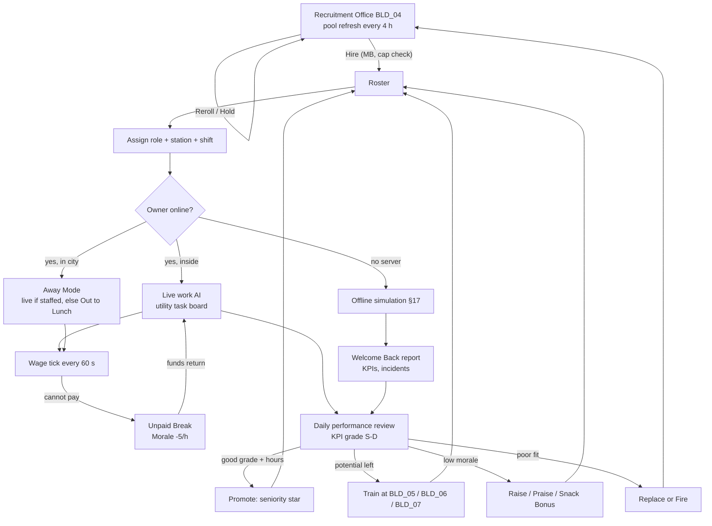

### 16.8 Variables [TUNABLE]

| Variable | Default | Used in |
|---|---|---|
| `UnfamiliarPenalty` | ×0.85 RoleStatAvg | off-native role |
| `BrainHz` / `BrainMaxPerTick` | 4 Hz / 5 employees | scheduler |
| `ZoneBonus` / `SwitchPenalty` / `DistanceCost` | 1.3 / 15 / 0.02 per stud | utility |
| `PoolWindowSeconds` | 14,400 (4 h) | candidate pool |
| `PoolSize[tier]` | 3,3,4,4,5,5,6,6,7,8 | candidate pool |
| `RerollBase` | 50 × tier MB, doubling, 3 paid per window | rerolls |
| `HoldFee` | 5 % of hire | hold |
| `PityRareWindows` / `PityEpicWindows` | 12 (T5+) / 24 (T8+) | pity |
| `HotlineFee` | +10 %, from `TIER_06` | remote hiring |
| `TrainGainBase` / `TrainCostFactor` / `TrainCostGrowth` | 4 / 0.04 × hire / 1.08 per point | training |
| `TrainMinutes` | min(240, 20 + 3 × points above band min) | training |
| `CrossTrainCost` | 0.10 × hire, 60 min | training |
| `RaiseStep` / `MaxRaises` | +10 % / 3 | raises |
| `StarHours` / `StarFee` | 10 / 40 / 120 h · 25 / 50 / 75 % of hire | promotions |
| `ProbationMinutes` / `ProbationRefund` / `Severance` | 15 / 50 % / 2 h wage | firing |
| `MoraleDrift` / `MoraleBaseline` | 4 /h / 60 + modifiers | morale |
| `EnergyDrainBase` / `BreakThreshold` / `BreakRecovery` | 10 %/h / 25 % / +6 %/min for 4 min | energy |
| `WageTickSeconds` | 60 | wages |
| `RepairMaterialDiscount` | Repair / 400 | repairs |
| `GuardCalmBase` / `GuardCalmPerCombat` | 0.25 / 0.6 | interception |
| `StaffHP` / `StaffKOSeconds` | 60 + Combat / 8 s | combat |

The Employee Management skill tree (`SKL_MGMT_01`–`SKL_MGMT_10`, §14) may only modify the variables above, within
±25 %, and never the canon offline caps or bands.

### 16.9 Progression and return on investment

| Tier band (§C6) | What opens up | Typical staff (cap) | Offline cap |
|---|---|---|---|
| Tiers 1–2 | Ollie (tutorial), Commons; Manager & Repair at T2 | Chef + Cashier/Prep (2–3) | 2 h → 4 h with a Basic Manager |
| Tiers 3–4 | Waiters & Security (table service), first Rares; Delivery & Stocker at T4 | Chef, 2 Waiters, Manager (4–6) | 4 h |
| Tiers 5–6 | Assistant Manager, first Epics, Hotline at T6, Rare pity | 2 Chefs, 3 Waiters, Dish, Cleaner, Rare Manager (8–10) | 8 h (+2 h) |
| Tiers 7–8 | first Legendaries, Epic pity | full line, Elite Manager (12–14) | 12 h (+2 h) |
| Tiers 9–10 | Legendary pool 12–20 % | 16–20 specialists, Legendary Manager | 24 h |

**Employee ROI.** `Payback = HireCost ÷ (ΔNet_offline + ΔNet_online)` over the player's real schedule. The table
measures the offline part with the §17 reference model by removing one employee from a §17.9 example roster (base
economy, no incidents): the full-rate delta of the first 2 offline hours and the delta over that example's whole
tapered absence ("report").

| Example roster | Employee | Hire (MB) | Wage (MB/h) | Δ full-rate MB/h | Δ per report | Payback (reports) |
|---|---|---|---|---|---|---|
| B (T3, 4 h) | Benny Bun, Common Waiter | 400 | 18 | +325 | +970 | 0.4 |
| B (T3, 4 h) | Skates McGee, Uncommon Waiter | 2,300 | 55 | +443 | +1,311 | 1.8 |
| C (T5, 8 h) | Octavia, Uncommon Chef (trained) | 2,100 | 50 | +1,120 | +6,000 | 0.35 |
| C (T5, 8 h) | Sloane, Common Dishwasher | 200 | 10 | +121 | +1,285 | 0.16 |
| C (T5, 8 h) | Dusty, Common Cleaner | 400 | 18 | +190 | +953 | 0.42 |
| C (T5, 8 h) | Chet Speedwell, Rare Waiter | 12,000 | 165 | +695 | +3,931 | 3.1 |
| D (T7, 12 h) | Rocco, Rare Security Guard | 12,500 | 170 | −170 (not a bottleneck) | −986 | online / insurance only |
| E (T10, 24 h) | Tractor Trixie, Epic Stocker | 57,000 | 440 | +1,452 | +25,579 (keeps special dishes live) | 2.2 |
| E (T10, 24 h) | Comet Carla, Epic Courier | 61,000 | 465 | +2,472 | +5,529 | 11.0 |

Lessons the UI teaches through the Forecast and the Upgrade Suggestions: hire into the **bottleneck** (cheap
presence roles like Dishwasher and Cleaner pay back in minutes once their penalty applies), Security Guards earn their
wage online (brawls, reputation) and as offline insurance, and luxury hires are mutation-collection flexes rather
than economic necessities — which is exactly where we want the late-game sink.

### 16.10 Player interactions

- **Owner only** can hire, fire, train, raise, promote and change settings; co-op guests (§21) see the staff, may
  work alongside them and can *Praise* (cosmetic emote, no Morale effect) but cannot change anything.
- Employees greet the owner (`ANM_042` wave) on entry, celebrate milestones, and appear in friends' visits.
- Employee management challenges (quest type EMP, §20) and achievements (§36.16) may read the analytics events
  of §16.12 (e.g. "train an employee to their potential cap").

### 16.11 Dependencies

`EmployeeService` (owner of this section) depends on `PlayerDataService` (profile, session lock), `EconomyService`
(all MB movements, idempotency keys), `OrderService`, `CookingService`, `CustomerAIService`, `RepairService`,
`InventoryService` (task producers), `MorphAssemblyService` (client visuals), `RestaurantService` (tier, cap, open
state), `OfflineEarningsService` (§17, reads roster/settings and writes Energy/Morale/KPIs), `QuestService`
(`QST_TUT_012`), `UIController`. Data: §36.8 archetypes, §36.9 incidents, §C6 caps, §C4.8 bands.

### 16.12 Roblox implementation

**Modules.** `ServerScriptService/Services/EmployeeService/` → `init.lua` (public API), `CandidatePool.lua`
(deterministic generation), `TaskBoard.lua`, `EmployeeBrain.lua` (utility AI), `WageLedger.lua`, `MoraleEnergy.lua`,
`Reviews.lua`, `ProxyController.lua` (SPCV). Static data `ReplicatedStorage/Shared/Data/EmployeeArchetypes.lua`,
`EmployeeTraits.lua`, `OfflineIncidents.lua` are generated from `gdd/data/*.json` by the build pipeline.

```lua
--!strict
export type EmployeeRecord = {
    uid: string, archetype: string, role: string, nativeRole: string,
    stats: { cook: number, svc: number, acc: number, rep: number, cmb: number, rel: number },
    energy: number, morale: number, wage: number, raises: number, stars: number,
    hoursWorked: number, hiredAt: number, shift: "Always" | "OnlineOnly" | "OfflineOnly" | "OffDuty",
    station: string?, zone: string?, crossTrained: { [string]: boolean },
    training: { stat: string, endsAt: number }?, kpi24h: { [string]: number }, quirk: number,
}
-- profile.staff = { employees = {[uid]=EmployeeRecord}, wagePriority = {uid}, nightMenu = {string}?,
--                   autoBuyBudget = number, recruit = { windowIndex = number, rerolls = number,
--                   hiredSlots = {number}, held = string?, pityRare = number, pityEpic = number } }

local EmployeeService = {}
function EmployeeService:Hire(player: Player, candidateId: string, role: string, replaceUid: string?): (boolean, string)
function EmployeeService:Fire(player: Player, uid: string, confirmToken: string): (boolean, string)
function EmployeeService:Assign(player: Player, uid: string, role: string, station: string?): (boolean, string)
function EmployeeService:Forecast(player: Player): { fullRateMBh: number, capHours: number, perCapMB: number, bottleneck: string }
```

**Remotes** (`<Domain>.<Action>`; every handler checks profile loaded, owner of the restaurant, not Safe Mode):

| Remote | Kind | Payload | Server validation | Rate limit |
|---|---|---|---|---|
| `Recruit.GetPool` | RemoteFunction | — | regenerates the pool from the seed | 2/s |
| `Recruit.Reroll` | RemoteFunction | — | price from server counter; `TrySpend`; window unchanged | 1/s |
| `Recruit.Hold` | RemoteFunction | slot | one hold per window; fee via `TrySpend` | 1/s |
| `Recruit.Hire` | RemoteFunction | candidateId, role, replaceUid? | §16.6.4 checklist | 1 per 2 s |
| `Employee.GetRoster` | RemoteFunction | — | — | 2/s |
| `Employee.Assign` | RemoteFunction | uid, role, station? | role unlocked, uniqueness, 60 s cooldown | 4/s |
| `Employee.SetShift` | RemoteFunction | uid, mode | enum | 4/s |
| `Employee.Train` / `Employee.CancelTraining` | RemoteFunction | uid, stat | below cap, trainee slots, `TrySpend` | 1/s |
| `Employee.Raise` / `Employee.Promote` | RemoteFunction | uid | max raises; hours + grade + fee | 1/s |
| `Employee.Fire` | RemoteFunction | uid, confirmToken | token issued by a prior confirm call (10 s TTL); not training | 1 per 2 s |
| `Employee.ReviewAction` | RemoteFunction | uid, action | daily limits, cooldowns | 2/s |
| `Employee.SetWagePriority` / `SetNightMenu` / `SetAutoBuyBudget` | RemoteFunction | list / list / number | known uids; known recipes, ≥ 1 cookable; 0 ≤ budget ≤ 2 × active net | 1/s |
| `Employee.Forecast` | RemoteFunction | — | §17 model, expected values | 1/s |

**SPCV staff.** Each employee is a server proxy (anchored, invisible, 2 × 5 × 1 studs, CanCollide false) with
attributes `EmpUid`, `Archetype`, `Role`, `State`, `AnimKey`, `CarryItem`, `MoveFrom`, `MoveTo`, `MoveT0`, `MoveSpeed`.
The server moves the proxy logically along a **precomputed navigation graph** of the interior (nodes at stations,
tables, doors; rebuilt by `BuildingService` on layout change; A* over ≤ 200 nodes) and only writes segment
attributes; clients interpolate and build the morph from §36.8 parts (cached per archetype, LOD impostor beyond 60
studs). Work animations reuse core IDs: `ANM_010` chop, `ANM_011` grill, `ANM_012` fryer, `ANM_017` assemble,
`ANM_018` plate, `ANM_019` serve, `ANM_007` tray, `ANM_021` wash, `ANM_022` mop, `ANM_060`/`ANM_061` repair,
`ANM_066` register, `ANM_030` extinguish, `ANM_054` flee, `ANM_062` Seeing Stars, `ANM_008` wobbly gait for
mismatched legs. Budget: ≤ 20 staff per restaurant, ≤ 160 per server, brain cost ≤ 0.05 ms per employee per tick.

**Analytics** (`AnalyticsService` + internal `mmr_` events): `mmr_employee_hired` {archetype, rarity, role, cost,
tier, source pool/hotline/tutorial, slot}, `mmr_candidate_reroll` {n, cost}, `mmr_candidate_hold`,
`mmr_employee_fired` {tenure_h, stars, probation}, `mmr_employee_trained` {stat, gain, cost}, `mmr_employee_promoted`,
`mmr_employee_raise`, `mmr_unpaid_break` {employees, minutes}, `mmr_review_action`; hire/train/raise/wage spends via
`LogEconomyEvent` (sink). First hire is an onboarding funnel step owned by §31.

### 16.13 Edge cases

| # | Situation | Expected behavior |
|---|---|---|
| 1 | Pool window rolls over while the Recruitment UI is open | `Recruit.Hire` with a stale `candidateId` returns "This candidate took another job!"; UI refreshes; a held candidate stays valid |
| 2 | Player rejoins or server-hops to get a new pool | Seed = (UserId, windowIndex, rerollIndex) and `rerolls` is persisted → identical pool |
| 3 | Hire request retried after a timeout | Idempotency key `hire:<UserId>:<window>:<slot>`; the slot is already hired → returns the existing employee, no second charge |
| 4 | At employee cap | Hire buttons switch to "Replace…"; hire + fire are one atomic transaction (§16.7.7) |
| 5 | Firing the only Chef | Warning "No Chef = no offline income and Away Mode closes"; allowed after confirm |
| 6 | Manager fired while an offline report is pending | The report was computed at join with the old cap and stays valid; the next interval uses the new cap (§17) |
| 7 | Training finishes during offline time | The course `endsAt` is checked per simulated step; the employee works from the following step (§17.4) |
| 8 | Employee KO'd while carrying a plate | Plate drops unless Sticky Grip; the dish is remade (ticket re-posted); employee back after 8 s |
| 9 | Station destroyed mid-task / object repaired by player mid-job | Task fails and is released; repair cost charged once (canon E3) |
| 10 | Wage tick with insufficient MB | Priority payment, Unpaid Break for the rest, balance never negative (canon E8) |
| 11 | Fire/Train during combat | Full-screen menus blocked while In Combat (canon E2); quick actions queue until combat ends |
| 12 | Co-op guest calls an Employee remote | Rejected: owner only |
| 13 | Archetype removed or rebalanced in a patch | IDs are never reused; existing employees keep their stored stats; missing data falls back to the archetype's last shipped values |
| 14 | Employee cap lowered by a future tuning patch | Excess employees go "On Leave" (no work, no wage) until slots free; nobody is deleted |
| 15 | Two employees target the same station slot | Slot locks are per slot (canon E7); the loser re-scores tasks next tick |

### 16.14 Acceptance criteria

- **AC-16-01:** A new player completing `QST_TUT_012` owns exactly one employee, `EMP_001` Ollie, with Cooking 30,
  Service 15, Accuracy 28, Reliability 40, wage 12 MB/h and hire cost 0, and the screen shows an Offline Forecast.
- **AC-16-02:** The candidate pool size equals `PoolSize[tier]`, refreshes exactly at 4-hour UTC boundaries, and two
  sessions in the same window (any server) show identical candidates and prices.
- **AC-16-03:** Over 10,000 simulated pool rolls per tier, each rarity's frequency is within ±1 percentage point of the
  §16.6.1 odds table, and the odds are reachable from the UI in one tap.
- **AC-16-04:** Every generated candidate's hire cost, wage and six stats lie inside its rarity band (§C4.8);
  validated in a unit test over all archetypes × 1,000 seeds.
- **AC-16-05:** `Recruit.Hire` rejects (no MB moved, no record created) each of: stale window, already-hired slot,
  cap reached without replace, locked role, insufficient MB, In Combat, distance > 12 studs without Hotline.
- **AC-16-06:** Firing within 15 min refunds exactly 50 % of the hire cost; afterwards exactly 2 h of wage is paid as
  severance and every coworker's Morale drops by 3 (8 for a 2-star or 7-day employee).
- **AC-16-07:** A training course raises the chosen stat by `round(4 × GradeMult)` capped at the effective cap, costs
  and lasts exactly per §16.7.4, and completes while the player is offline.
- **AC-16-08:** With Morale 80 and Energy 100, an employee's displayed Efficiency equals the §16.4 formula to 0.1, and
  an off-native assignment shows the ×0.85 penalty until cross-trained.
- **AC-16-09:** A wage tick that cannot be fully covered pays employees in wage-priority order, puts the rest on Unpaid
  Break (Morale −5/h) and leaves the MB balance ≥ 0; they resume on the first payable tick.
- **AC-16-10:** A Security Guard reaches and starts Calm Talk on a level-3 customer within 30 studs in ≤ 4 s, and the
  measured calm success rate over 500 trials is within ±3 pp of the formula.
- **AC-16-11:** An employee never takes a station slot or ticket reserved by a player; when a player claims an
  employee's task the employee releases it within 0.25 s.
- **AC-16-12:** With 8 restaurants × 20 employees on a test server, `EmployeeBrain` uses ≤ 1.5 ms per frame on
  average (MicroProfiler) and staff visuals stay within 24 MeshParts / 6,000 triangles each.
- **AC-16-13:** Each derived trait listed in §36.8 is reproduced by the derivation rule from the employee's canon part
  families/tags (`render_employees.py` validation passes with 0 errors).
- **AC-16-14:** While the owner is in the city, a staffed restaurant keeps serving with live AI and pays online wages;
  an unstaffed one shows "Out to Lunch", takes no new customers and loses no reputation; no offline report is created
  for that time.
- **AC-16-15:** All employee remotes enforce their rate limits (excess calls return `RateLimited` and change nothing)
  and reject calls from non-owners.


## 17. Offline Restaurant Simulation

> Binding inputs: canon §C15 (model, persistence, idempotency), §C14.3 (caps), §C4.4 (active
> net per hour), §C22 E5 / E8 / E11. Staff, traits and management live in §16; archetypes in §36.8; incidents in §36.9.
> The reference implementation is `gdd/tools/offline_sim_examples.py` (Python 3 stdlib), which produced every number
> in §17.9 and is the golden source for the Luau `OfflineEarningsService` tests.

### 17.1 Purpose and principles

**Purpose.** When the player is in **no server at all**, their staffed restaurant keeps "operating" and they come back
to a Welcome Back report with real money, funny employee stories and a list of things to improve — the reason to
return every day (brief Part 2.5, 11, 26.8). Time spent online in the city is *not* offline time: that is Away Mode,
which runs live (§16.3.4, §18).

| Principle | How it is guaranteed |
|---|---|
| No server needs to stay running | Nothing is simulated while the player is away; the whole interval is computed once, on the next join, from persisted state |
| Server-authoritative | Only `os.time()` on a game server and the saved profile are inputs; the client sends nothing but a `reportId` to collect |
| Timestamp-based | `H_elapsed = max(0, now − lastSimAt) / 3600`; `lastSimAt` is written by every save while online and at leave (canon E1) |
| Deterministic | `Seed = FNV-1a-32("<UserId>:<lastSimAt>:<SIM_VERSION>")` → `Random.new(seed)`; fixed draw order (§17.5); money kept as fractions, rounded half-up only at payout (canon C0) |
| Capped | interval cap from the best Manager (canon §C14.3); incident caps 10 % / 15 %; hard ceiling 60 % of the tier's active net per hour |
| Idempotent | the report and `lastSimAt` are written in one session-locked `UpdateAsync`; Collect is keyed by `reportId` with a 20-entry `claimedReportIds` ring (canon E11) |
| Complements active play | 35–50 % of active net/hour during the **first 2 offline hours** of a well-staffed restaurant, then a long-absence taper (×0.5 for hours 2–8, ×0.2 for hours 8–24): a full 24 h Legendary interval ≈ 3 active hours (proved in §17.9); no XP, no Research Tokens, no recipes or quests offline; guardrail KPI in §17.6 |

### 17.2 The return procedure

The brief's 13 steps (Part 11.6) mapped onto the canon model. Steps 1–12 run inside one pure function executed in the
profile-load `UpdateAsync` transform (no yields); step 13 is the client screen.

| # | Brief step | Server action | Canon §C15 term |
|---|---|---|---|
| 1 | Retrieve last saved logout/simulation timestamp | read `profile.lastSimAt` (unset → set to `now`, no report) | `lastSimAt` |
| 2 | Determine elapsed offline time | `elapsed = now − lastSimAt`; < 0 → 0 + `mmr_offline_clock_skew`; < 300 s → no report, `lastSimAt` unchanged | `H_elapsed` |
| 3 | Apply the offline earnings cap | `H = min(H_elapsed, CapHours(best Manager, Assistant))`; hours beyond the cap are forfeited; each hourly step gets its shift factor from the long-absence taper (×1.0 / ×0.5 / ×0.2) | `H`, §C14.3, taper |
| 4 | Calculate employee productivity | per step: RoleStatAvg → Efficiency(Morale, Energy, EFFICIENCY) → `Eff = Efficiency/100` → Contribution = Eff × TraitMult | §C14.2 |
| 5 | Estimate customer throughput | `Q = min(Demand_off, Cap_seat, Cap_kitchen, Cap_service)`; N via fractional accumulator | `Q`, `N_step` |
| 6 | Calculate revenue | `N × AvgTicket × q` (+ tips, + delivery) on the live menu (skill gate, stations, special stock) | `Revenue`, `Tips` |
| 7 | Deduct ingredient costs | basic ingredients netted per dish; special stock consumed; Stocker auto-buy inside the step | `IngredientCost` |
| 8 | Deduct employee wages | `Σ wage × hours worked × shift factor` (only employees on Always/Offline Only, not training) | `Wages` |
| 9 | Apply equipment and mutation bonuses | station levels (§C4.9), traits & signatures (§16.5), Manager coordination, Glow-Up decor | elaboration |
| 10 | Calculate incidents and operational losses | incident count & draws (§36.9), caps, damage → auto-repair or deferred | `Incidents`, `Repairs` |
| 11 | Determine net profit | `Net = max(0, Σ Net_step)` with close-early rule and the 60 % ceiling | `Net_step`, `Net` |
| 12 | Save the resulting state | write `pendingOfflineReport` (merged if one exists), Energy/Morale/hours, stock, damage, `lastSimAt = now` — same `UpdateAsync` | persistence |
| 13 | Present an offline earnings report | client receives `Offline.ReportReady` → Welcome Back screen (§17.10) → `Offline.Collect(reportId)` | Collect |

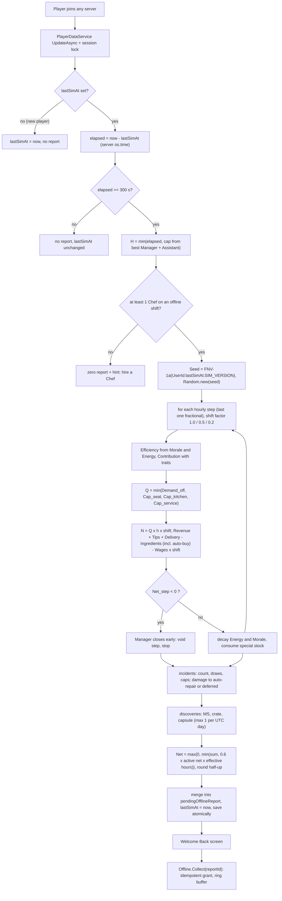

### 17.3 Variables [TUNABLE]

| Variable | Default | Meaning |
|---|---|---|
| `SIM_VERSION` | 1 | bumped whenever any formula or table below changes; part of the seed and `reportId` |
| `MIN_OFFLINE_SECONDS` | 300 | shorter absences produce no report (server hops, teleports) |
| `OFFLINE_DEMAND_FACTOR` | 0.6 (canon) | offline share of online demand |
| `VISIT_SECONDS_OFFLINE` | 300 (canon) | seat turnover; Cap_seat = Seats × 12 /h |
| `WAITER_SECONDS` | 45 (canon) | per waiter: 80 customers/h at Contribution 1.0 |
| `ITEMS_PER_CUSTOMER` | 1.4 (canon §C4.3) | dishes per customer |
| `PREP_BONUS` / `MAX_PREPS` | 0.15 / 3 (canon) | kitchen bonus per prep |
| `CASHIER_BONUS` / `MAX_CASHIERS` | 0.10 / 3 | service bonus per cashier (`EMP_038` counts 2) |
| `NO_WAITER_FACTOR` | 0.30 (canon) | service at `TIER_03`+ without waiters |
| `DISH_FACTOR_ABSENT` | 0.80 at `TIER_04`+ (canon) | no dishwasher |
| `CLEAN_FACTOR_ABSENT` | 0.95 (`TIER_04`–`TIER_06`), 0.92 (`TIER_07`+) | no cleaner (multiplies q) |
| `Q_BASE` / `Q_SLOPE` / `Q_MAX` | 0.70 / 0.25 / 0.95 (canon) | quality from avg chef Accuracy |
| `TIP_BASE` / `TIP_SLOPE` | 0.04 / 0.04 (canon) | tip rate from avg waiter Service |
| `PROCESS_SHARE` | 0.5 | share of a dish's base time spent in station processing (station level applies to it) |
| `STATION_MULT` | Lv1 1.0 · Lv2 0.9 · Lv3 0.8 · Lv4 0.7 · Lv5 0.6 (canon §C4.9) | process-time multiplier |
| `UNFAMILIAR_PENALTY` | 0.85 | off-native role |
| `TRAIT_MULT_CAP` | 1.5 | per employee |
| `COORD_MANAGER` | min(0.10, 0.03 + 0.07 × Contribution) (+0.02 Loudmouth / `EMP_072`) | capacity multiplier |
| `COORD_ASSISTANT` | min(0.05, 0.02 + 0.03 × Contribution); total ≤ 0.15 | capacity multiplier |
| `DELIVERY_PER_COURIER` / `DELIVERY_CAP` | 0.06 × Contribution / 0.15 (+0.02 `EMP_084`) | share of revenue, limited by kitchen headroom |
| `STOCKER_DISCOUNT` | 0.05 + 0.10 × min(1, Contribution) (+0.02 Sniffer, +0.02 `EMP_088`/`EMP_090`), max 0.15 | ingredient discount |
| `SPECIAL_BASIC_SHARE` | 0.6 | part of a special recipe's ingredient cost netted per dish (the rest is pre-paid stock) |
| `ENERGY_DECAY` / `ENERGY_DECAY_MGR` / `ENERGY_DECAY_FLOOR` | 8 / 5 / 3 %/h (canon + floor) | per simulated hour |
| `MORALE_DECAY` | 1 /h (canon) | Zen Noodle 0.5 |
| `CLOSED_HOURS_ENERGY_RECOVERY` | +10 %/h | for elapsed hours beyond the cap |
| `INCIDENT_RATE` | 0.6 /h (canon) | before Security Mitigation |
| `SECURITY_MITIGATION` | Σ (0.25 × Contribution + 0.10 Bouncer + 0.05 Heavyweight), max 0.60 | incident count reduction |
| `NEG_CAP` / `POS_CAP` | 10 % / 15 % of Revenue + Tips (canon) | incident caps |
| `MAX_SAME_INCIDENT` | 2 per report | variety |
| `ASST_LOSS_MULT` | 0.8 (canon −20 %) | negative incident magnitudes |
| `COST_PER_DAMAGE_POINT` | T1 1 · T2 1.5 · T3 2.5 · T4 4 · T5 7 · T6 12 · T7 20 · T8 35 · T9 60 · T10 100 MB | damage points shown on objects |
| `REPAIR_DISCOUNT` | min(0.60, bestRepair/200 + 0.10 Wall Crawler) (canon base) | auto-repair |
| `MS_CHANCE` / `CRATE_CHANCE` / `CAPSULE_CHANCE` | 8 % / 1 % / 5 % per simulated hour (first two canon) | discoveries |
| `DISCOVERY_BOOST_CAP` | ×1.25 | Sniffer ×1.10, Lucky Charm ×1.15 |
| `OFFLINE_CEILING_SHARE` | 0.60 of §C4.4 active net/h × effective hours | hard clamp (canon "never above 60 %") |
| `TAPER_BANDS` | hours 0–2 ×1.0 ("Full Shift") · 2–8 ×0.5 ("Late Shift") · 8–24 ×0.2 ("Skeleton Shift") | long-absence taper (integrator policy); scales the whole operation of the step |
| `TAPER_CLOCK` | `interval` | hour index counted from `lastSimAt`; fallback `rolling24h` counts offline hours already simulated in the last 24 h (§17.6 lever) |
| `CAP_HOURS` | none 2 · Basic 4 · Experienced 8 · Elite 12 · Legendary 24; Assistant +2; max 24 (canon) | interval cap |
| `CLAIMED_RING` | 20 (canon) | idempotency ring buffer |
| `WELCOME_BACK_CRATE_DAYS` | 7 (canon E5) | absence for the crate |

### 17.4 The model in detail (elaborations of canon §C15) [TUNABLE]

**Snapshot.** Everything is read from the profile as saved at `lastSimAt`: tier, reputation ★, Atmosphere, station
levels, menu (or Night Menu), special stock, roster with stats/Energy/Morale/shift/training, auto-buy budget, player
EFFICIENCY. Nothing that happened online after that time can leak in, and the snapshot never changes mid-interval.

**Who works.** Employees on *Always* or *Offline Only* shifts and not in training; a course whose `endsAt` falls inside
the interval adds the employee from the next step. No working `ROLE_CHEF` → zero report with the hint "Hire a Chef!".

**Long-absence taper [TUNABLE].** Step k (starting at hour k) runs a shift with factor `S_k` = 1.0 for k < 2, 0.5 for
2 ≤ k < 8, 0.2 for k ≥ 8: only that share of the restaurant operates ("Late Shift": half the tables, half the staff on
the clock; "Skeleton Shift": a fifth). Customers, revenue, tips, delivery, ingredients **and paid wages** all scale
by `S_k`, so a long absence never flips a step negative and longer caps still add value; Energy and Morale keep
decaying at the canon rates (the taper sits on top of energy decay). `H_eff = Σ h × S_k` is the interval's effective
hours (Example E: 24 h → 8.2 effective h).

**Per step k** (step length h = 1, last one fractional):

```
Eff_i          = RoleStatAvg_i × (0.6 + 0.4·M_i/100) × (0.7 + 0.3·E_i/100) × (1 + 0.001·EFFICIENCY) / 100
Contribution_i = Eff_i × TraitMult_i(role)                     (§16.5, max ×1.5)
live menu      = recipes with D ≤ 1 + floor(bestChefCook/25), stations owned, special stock ≥ 1
PrepSec_avg    = mean over live menu of PrepSec_base × (1 − PROCESS_SHARE × (1 − STATION_MULT[level]))
AvgTicket      = 1.4 × mean live price;  AvgIngredientCost = 1.4 × mean live netted ingredient cost
Coord          = COORD_MANAGER + COORD_ASSISTANT (≤ 0.15)
Demand_off     = BaseDemand × (0.5 + 0.25·★) × (0.9 + 0.003·Atmosphere + GlowUp) × 0.6
Cap_seat       = Seats × 3600 / 300
Cap_kitchen    = Σ_chefs 3600/PrepSec_avg × Contribution_c / 1.4 × (1 + 0.15·min(3, preps)) × DishFactor × (1 + Coord)
Cap_service    = tier ≤ 2 ? Cap_kitchen : waiters ≥ 1 ? Σ 80 × Contribution_w × (1 + 0.10·min(3, cashiers)) × (1 + Coord)
                                        : 0.30 × Cap_kitchen
Q              = min(Demand_off, Cap_seat, Cap_kitchen, Cap_service);  N = floor(carry + Q·h·S_k); carry keeps the fraction
q              = min(0.95, 0.70 + 0.25·avgChefAcc/100 + ChefsInstinct − GrillMaster) × CleanFactor
Revenue        = N × AvgTicket × q
Tips           = Revenue × (0.04 + 0.04·avgWaiterService/100) × (1 + 0.01·floor(cashierSkill/20)) × TipTraitMult (≤ 1.25)
Delivery       = Revenue × min(DELIVERY_CAP, Σ 0.06·Contribution_d, Cap_kitchen/Q − 1)
Ingredients    = (N + N_delivery) × AvgIngredientCost × (1 − StockerDiscount) × (1 − 0.0015·EFFICIENCY) + AutoBuy_k
Wages          = Σ wage_i × h × S_k
Net_step       = Revenue + Tips + Delivery − Ingredients − Wages
if Net_step < 0: the Manager closes early — the step is voided (no customers, no wages, its auto-buy rolled back), stop
Energy_i      −= decay_i × h   (8 %/h, 5 %/h with a Manager, minus signature/Night Owl bonuses, floor 3 %/h;
                                 Regenerator ×0.75, Unhurried ×0.5);   Morale_i −= 1 × h
special stock −= (N + N_delivery) × 1.4 × (users of that ingredient / live recipes)
```

- **Special stock and auto-buy.** At the start of each step, if a Stocker works and budget remains, each special pool is
  topped up to that step's expected need at `unit = mean(price × ratio(D) × 0.4)` × (1 − discount); the cost lands in that
  step's Ingredients, so it can never push the wallet negative (a voided step rolls it back). When a pool hits 0, every
  recipe using it is **SOLD OUT** from the next step and PrepSec_avg / AvgTicket are recomputed (§17.9 Examples D, E).
- **Incidents** (after the step loop, over effective hours H_eff): `λ = H_eff × 0.6 × (1 − SM)`,
  `count = floor(λ) + (rng < frac(λ))`; each draw picks an eligible §36.9 row by effective weight, a step uniformly, and
  `{n}`. Effects are fractions of `Rh` (interval Revenue+Tips+Delivery per effective hour); negatives (MB + damage
  value) are scaled to ≤ 10 % of Revenue+Tips, positives to ≤ 15 %. They are booked into their step for the report but
  do not feed the close-early test (the caps depend on the interval total, so the test uses the operating result).
- **Repairs.** Damage value → points = ceil(value / CostPerPoint[tier]) on random destructible objects (never past
  Broken). With a Repair Technician it is auto-paid at `value × (1 − discount)`; otherwise it stays visible and costs
  nothing until the player repairs (cheaper manual repair, §15).
- **Discoveries** per operated step: MS `rng < 0.08 × boost × h × S_k` → 1–3 MS; crate `rng < 0.01 × h × S_k` (×1.5 `EMP_091`) →
  5–15 units of a special ingredient the restaurant can use; capsule `rng < 0.05 × h × S_k`, at most **one per report and one
  per UTC day** (`lastOfflineCapsuleDay`).
- **Totals.** `Net = max(0, Σ Net_step + incidents − auto-repairs)`, clamped to `0.60 × ActiveNet[tier] × H_eff`
  (`mmr_offline_ceiling_hit`), then rounded half-up to whole MB — the only money rounding (canon C0).
- **Closed hours.** For `elapsed − H` beyond the cap employees recover Energy +10 %/h (staff went home); Morale is
  unchanged.

### 17.5 Deterministic RNG and hourly stepping

```lua
--!strict
local function fnv1a32(s: string): number
    local h = 2166136261
    for i = 1, #s do
        h = bit32.bxor(h, string.byte(s, i))
        h = (bit32.lshift(h, 24) + h * 403) % 4294967296   -- h * 16777619 mod 2^32 without float overflow
    end
    return h
end
local seed = fnv1a32(string.format("%d:%d:%d", userId, profile.lastSimAt, SIM_VERSION))
local rng = Random.new(seed)
```

Draw order is fixed and part of `SIM_VERSION`: (1) incident extra roll, (2) per incident: row pick, step, `{n}`,
(3) per operated step in order: MS roll (+ amount), crate roll (+ units), capsule roll. Every roll is consumed even when
its result is unused (e.g. zero operated hours), so adding an incident row changes only weights, never the alignment
of later draws within a version. The deterministic economy (steps 4–9, 11) uses no RNG at all; the Python reference
reproduces it to the MB, while its incident/discovery draws use Python's generator with the same seed (different
numbers, same distribution).

### 17.6 Caps and the tuning plan [TUNABLE]

The cap ladder (canon §C14.3) is the progression spine of management: a Basic Manager doubles a newcomer's offline
window, an Experienced one covers a school day, an Elite one an evening + night, a Legendary one a full day. With the
taper, the *first* hours are worth the most, so returning 2–3 times a day is rewarded, while a longer cap still adds
total value (Examples C–E: 8 h ≈ 2.0, 12 h ≈ 2.5, 24 h ≈ 3.1 active hours). Tuning uses §31 telemetry, always changes **one variable at a time** behind a server config flag, bumps
`SIM_VERSION`, and is A/B tested on new cohorts for ≥ 14 days.

| Signal (§31) | Healthy band | If too low | If too high |
|---|---|---|---|
| D1 / D7 retention of players who hired ≥ 1 employee vs not | hired cohort ≥ +5 pp D7 | make the first Manager cheaper/earlier (Common Manager in `TIER_02` pools 1.5× weight); Forecast more prominent | — |
| Share of returns that hit the cap | 30–60 % | caps feel generous — keep | > 70 % for 7 days: raise the Basic cap 4 → 5 h in a test cohort, or add Assistant earlier |
| Median hours between sessions vs cap | median ≤ cap | — | median ≫ cap and falling D7: test +2 h for Basic/Experienced |
| Report collect rate (collected within 24 h) | ≥ 90 % | simplify the screen; auto-collect on Continue (already) | — |
| **Guardrail: median player's offline share of all MB earned** | **≤ 60 % at D7, ≤ 70 % at D30** | — | lower the taper factors first (Late 0.5 → 0.4, Skeleton 0.2 → 0.15); if driven by many short check-ins per day, switch `TAPER_CLOCK` to `rolling24h`; only then touch caps or demand |
| First-2-h offline ÷ active net per hour (per tier, logged per report) | 35–50 % | raise `OFFLINE_DEMAND_FACTOR` 0.6 → 0.65 | lower it to 0.55; ceiling hits > 1 % of reports → investigate |
| Value of a full capped absence (MB ÷ active net/h) | Basic ≈ 1–1.5, Experienced ≈ 2, Elite ≈ 2.5, Legendary ≈ 3 active hours | raise the Late Shift factor | lower the Skeleton Shift factor |
| Offline share of all MB earned (T5+, players with ≥ 2 h active/day) | 25–40 % | as above | > 45 %: lower taper factors before demand |
| Inflation: median wallet ÷ next-tier cost (§C4.4) | ≤ 1.5 for 7 days | — | > 3: raise sinks (training growth 1.08 → 1.10) before touching caps |
| Closed-early reports | < 5 % | — | > 10 %: stronger Forecast warnings and "you are paying for idle staff" suggestions |
| Incident net / R | −3 % … +3 % | soften negative weights | raise negative weights or lower positives |

### 17.7 Persistence and idempotency (canon §C15, E11)

**Profile fields** (schema owned by §28; §16–§17 defines the contents):

```lua
--!strict
export type OfflineReport = {
    reportId: string,            -- "<UserId>:<firstFromTs>:<lastToTs>:v<SIM_VERSION>"
    simVersion: number, segments: { { fromTs: number, toTs: number, simulatedSec: number, capHours: number,
                                      capped: boolean, tier: number, closedEarlyStep: number? } },
    customers: number, revenue: number, tips: number, delivery: number, ingredients: number,
    wages: number, autoRepairs: number, incidentNet: number, net: number,          -- fractions kept
    ms: number, capsules: number, crates: { { ing: string, units: number } },
    damage: { { objectId: string, points: number } }, deferredRepairMB: number,
    incidents: { { id: string, step: number, mb: number, employeeUid: string?, n: number } },  -- ≤ 20 kept
    employeeLines: { { uid: string, kpi: { [string]: number } } }, soldOut: { { rcp: string, step: number } },
    suggestions: { string }, welcomeBackCrate: boolean,
}
-- profile.lastSimAt: number            profile.lastLogoutAt: number     profile.lastOfflineCapsuleDay: number
-- profile.pendingOfflineReport: OfflineReport?                          profile.claimedReportIds: { string } (≤ 20)
```

**Simulate on join** — `SimulateTransform` runs inside the session-locked load (`PlayerDataService`, §28), as a pure function: no yields, no
remote calls, no analytics until the write succeeds (an `UpdateAsync` transform may run more than once).

```lua
--!strict
local OfflineEarningsService = {}
local SIM_VERSION, MIN_OFFLINE, RING = 1, 300, 20

-- registered with PlayerDataService:RegisterLoadTransform (§27, §28): runs inside the session-locked UpdateAsync
function OfflineEarningsService.SimulateTransform(data: any, ctx: { userId: number, now: number }): any
    local userId, now = ctx.userId, ctx.now
    if data.lastSimAt == nil then data.lastSimAt = now; return nil end
    local elapsed = now - data.lastSimAt
    if elapsed < 0 then data._flags.clockSkew = elapsed; elapsed = 0 end   -- negative → 0, flagged (canon)
    if elapsed < MIN_OFFLINE then return nil end                            -- lastSimAt untouched
    local capSec = OfflineModel.CapHours(data.staff) * 3600
    local simSec = math.min(elapsed, capSec)
    local rng = Random.new(fnv1a32(string.format("%d:%d:%d", userId, data.lastSimAt, SIM_VERSION)))
    local seg = OfflineModel.Run(OfflineModel.Snapshot(data), simSec, rng, now)  -- §17.4, deterministic
    OfflineModel.ApplyState(data, seg, elapsed - simSec)  -- Energy/Morale/hours, stock, damage, ★, capsule day
    local fromTs = data.lastSimAt
    data.pendingOfflineReport = OfflineEarningsService.Merge(data.pendingOfflineReport, seg, userId, fromTs, now)
    if now - (data.lastLogoutAt or now) >= 7 * 86400 then data.pendingOfflineReport.welcomeBackCrate = true end
    data.lastSimAt = now                                     -- toTs = now: forfeited hours are never re-simulated
    return data.pendingOfflineReport
end

function OfflineEarningsService.Merge(old: any?, seg: any, userId: number, fromTs: number, toTs: number): any
    local r = old or OfflineModel.EmptyReport()
    local first = (old and old.segments[1].fromTs) or fromTs
    OfflineModel.AddTotals(r, seg)                           -- sums; each segment was capped on its own
    table.insert(r.segments, seg.summary)
    r.reportId = string.format("%d:%d:%d:v%d", userId, first, toTs, SIM_VERSION)
    r.net = math.max(0, r.net)
    return r
end

-- RemoteFunction Offline.Collect(reportId): the only way money from offline time reaches the wallet
function OfflineEarningsService.Collect(player: Player, reportId: string)
    if not RateLimiter:Allow(player, "Offline.Collect", 1) then return { ok = false, reason = "RateLimited" } end
    local profile = PlayerDataService:Get(player)
    if not profile or profile.safeMode then return { ok = false, reason = "NotLoaded" } end
    local data = profile.data
    if typeof(reportId) ~= "string" or #reportId > 64 then return { ok = false, reason = "Bad" } end
    if table.find(data.claimedReportIds, reportId) then return { ok = true, alreadyClaimed = true } end
    local r = data.pendingOfflineReport
    if not r or r.reportId ~= reportId then return { ok = false, reason = "Stale", current = r and r.reportId } end
    -- one synchronous block: grant + ring + clear mutate the same in-memory profile, then one save
    local mb = math.floor(r.net + 0.5)                        -- canon C0: round half-up at payout only
    local ms = r.ms + (r.welcomeBackCrate and 50 or 0)        -- Welcome Back Crate MS (canon E5) rides the same txn
    -- single-writer economy (§27 P3): one idempotent transaction, reason code `offline_collect` (§22/§31),
    -- key `offline:<reportId>` (§28); non-currency grants run inside the same non-yielding step
    local res = EconomyService:TransactWith(player, { id = `offline:{reportId}`, deltas = { MB = mb, MS = ms },
        src = "offline_collect", ref = reportId }, function()
        for _, c in r.crates do InventoryService:AddStock(player, c.ing, c.units, "offline_find") end
        if r.capsules > 0 then MutationService:GrantCapsules(player, r.capsules, "OFFLINE_FIND") end
        if r.welcomeBackCrate then MutationService:GrantCapsules(player, 1, "welcome_back") end
    end)
    if not res.ok and res.reason ~= "duplicate" then return res end
    table.insert(data.claimedReportIds, reportId)
    if #data.claimedReportIds > RING then table.remove(data.claimedReportIds, 1) end
    data.pendingOfflineReport = nil
    PlayerDataService:SaveNow(player, "offline_collect")       -- retried with backoff (canon E6)
    Analytics:Log("mmr_offline_collected", { reportId = reportId, mb = mb })
    return { ok = true, mb = mb }
end
```

Why it cannot pay twice (canon E11): (1) the report and `lastSimAt = now` are written in the same `UpdateAsync`, so an
interval can never be simulated twice; (2) a second server cannot load the profile while it is locked; (3) Collect
grants, appends the `reportId` to the ring and clears the pending report in one synchronous block of the same
in-memory profile that `SaveNow` writes — if the server dies before the save, the DataStore still holds the unpaid
pending report and no grant (nothing lost, nothing doubled); (4) if a stale copy ever resurfaced with an
already-claimed report, the ring rejects it; (5) `EconomyService` also refuses a repeated idempotency key. Reconnects
reload the same pending report; nothing is recomputed. If a pending report exists when a new interval is simulated
(the player left without collecting), the new segment is merged into it with a new `reportId`; old IDs were never
paid, so nothing is lost.

**While online**, every autosave (120 s) and every save writes `lastSimAt = now`, so a crash without
`PlayerRemoving` starts offline time at most one autosave interval early (accepted; ≤ 2 min of overlap with Away
Mode/live play). `PlayerRemoving` and `BindToClose` write `lastSimAt` and `lastLogoutAt` (canon E1, E13).

### 17.8 Anti-exploit

| Threat | Defense |
|---|---|
| Client-supplied time or earnings | Only server `os.time()` and persisted data are inputs; `Offline.Collect` accepts a `reportId` string and nothing else; amounts come from the stored report |
| Device clock changes | Irrelevant — the client clock is never read |
| Server clock skew between servers | Negative elapsed → 0 and `mmr_offline_clock_skew`; elapsed is clamped to ≤ 30 days before capping; any skew is bounded by the cap and the 60 % ceiling |
| Multiple servers / two devices | Session lock: one server owns the profile; the second join waits or is kicked with a friendly message; only the lock owner simulates |
| Rejoin spam / server hopping | `MIN_OFFLINE_SECONDS` = 300; leaving to earn offline pays 35–50 % of staying, so there is no incentive; teleports between servers produce no report |
| Collect replay or double-click | `claimedReportIds` ring (20) + `EconomyService` idempotency key; Collect rate-limited 1/s |
| Hire-before-logout, fire-for-refund | Probation refund only within 15 real minutes of hiring; payroll for the interval is already paid |
| Roster or menu edits during the screen | The report was computed from the snapshot at `lastSimAt`; later edits only affect the next interval |
| Forged remote spam on Welcome Back buttons | Every button maps to a validated server action (§17.10); tabs read the already-sent report |
| Inflating via Away Mode then crashing | Away Mode pays live and writes `lastSimAt` every autosave; the overlap is ≤ 1 autosave |
| Data rollback to an older save | `lastSimAt` rolls back with it, so the restored interval is simulated once; claimed IDs in the ring block replays of the same report |

### 17.9 Worked examples

Generated by `python3 gdd/tools/offline_sim_examples.py` (stdlib only; `--check` asserts that every well-staffed
example's **first-2-hour rate** is 35–50 % of the tier's §C4.4 active net/hour). Five well-staffed restaurants at
different progression points plus one deliberately bad roster; every example shows the taper column ("Shift") and the
value of the whole absence in active hours. Shared assumptions, so each example only lists what differs:

- **Canon §C15 constants unchanged**, plus the long-absence taper (§17.4) and the §16–§17 elaborations exactly as
  §17.3–§17.4. Employees use their §36.8 values (trained stats listed under the roster).
- **Menus** use real recipe IDs from §C10 with prices from the canon curve (§C4.2, no flavor variance). Difficulty D,
  base prep seconds (mains 10 + 7D, desserts/fried/salads 8 + 5D, drinks 4 + 3D, legendary 20 + 10D) and ingredient
  ratios (D1 36 % … D5 26 %, inside the canon 25–40 % band) are *assumed for the examples*; the live game reads §6.
  Special-ingredient mappings (alien → `ING_MOON_CHEESE` / `ING_STARDUST`, mutation → `ING_MUTAGEN_GOO`, legendary →
  `ING_GOLDEN_PATTY`) are assumptions too; §7 owns them.
- **Reputation / Atmosphere** are typical for a competent player at that tier; player EFFICIENCY grows with level.
- **Incident and discovery draws** come from the Python generator with the real seed; the economy columns are what
  the Luau service must reproduce exactly. "Base economy" in the result is the run without incidents.

#### 17.9.1 Example A — TIER_01 — Ollie alone, back after 9 h (cap 2 h)

**Inputs**

| Parameter | Value | Derivation |
|---|---|---|
| Tier | `TIER_01` Broken Burger Shack | seats 4, base demand 50/h, employee cap 2 (§C6) |
| Player | level 4, EFFICIENCY 0 | Efficiency × 1.000; ingredient cost × 1.0000 |
| Reputation | 3.8 ★ | RepMult = 0.5 + 0.25 × 3.8 = 1.450 |
| Atmosphere | 45 | DecorMult = 0.9 + 0.003 × 45 = 1.035 |
| Stations | starter kit, all Lv1 | PrepSec × (1 − 0.5 × (1 − 1.00)) = × 1.000 |
| Offline cap | 2 h | no Manager → 2 h |
| Elapsed / simulated | 9 h 00 min / **2 h 00 min** (capped) | H = min(H_elapsed, cap) |
| Long-absence taper | 2.00 effective h | Full Shift h0–2 ×1.0 · Late Shift h2–8 ×0.5 · Skeleton Shift h8–24 ×0.2 |
| Seed | `0xDD6C3873` | FNV-1a-32("81234567:1760131800:1") |

**Roster**

| Employee | Archetype | Role | Rarity | RoleStatAvg | Morale₀ / Energy₀ | Efficiency (step 1) | Trait mult | Contribution | Wage (MB/h) |
|---|---|---|---|---|---|---|---|---|---|
| Ollie | `EMP_001` | Chef | Common | 30.4 | 90 / 100 | 29.2 | ×1.25 | 0.365 | 12 |

**Menu** (skill gate: D ≤ 1 + floor(30 / 25) = 2)

| Recipe | ID | L | D | Price (MB) | Ingredients/item (MB) | PrepSec base → eff (s) | Offline? |
|---|---|---|---|---|---|---|---|
| Double Cheeseburger | `RCP_BRG_003` | 4 | 2 | 12 | 3.96 | 24 → 24.0 | yes |
| Ham & Cheese Sandwich | `RCP_SAN_002` | 4 | 2 | 12 | 3.96 | 24 → 24.0 | yes |
| Cheeseburger | `RCP_BRG_002` | 1 | 1 | 9 | 3.24 | 17 → 17.0 | yes |
| Lemonade | `RCP_DRK_002` | 2 | 1 | 7 | 2.52 | 7 → 7.0 | yes |

**Interval constants**

- Demand_off = 50 × 1.450 × 1.035 × 0.6 = **45.0 customers/h**; Cap_seat = 4 × 3600 / 300 = **48/h**.
- Step-1 PrepSec_avg = 18.00 s; AvgTicket = 1.4 × mean price = 14.00 MB; q = min(0.95, 0.70 + 0.25 × avgChefAcc/100 +0.00) × CleanFactor 1.00 = 0.770.
- Preps counted 0.00 (+0 %), cashiers counted 0, DishFactor 1.00, Manager/Assistant coordination +0.0 %, stocker discount 0.0 %, delivery share 0.0 %, tip trait multiplier ×1.00.

**Hourly steps**

| Step | h | Shift | Avg Energy % | Cap_kitchen | Cap_service | Q | Limit | N | Revenue | Tips | Delivery | Ingredients | Wages | Net_step |
|---|---|---|---|---|---|---|---|---|---|---|---|---|---|---|
| 1 | 1.00 | ×1.0 | 100.0 | 52.1 | 52.1 | 45.0 | Demand | 45 | 485 | 19 | 0 | 215 | 12 | 277 |
| 2 | 1.00 | ×1.0 | 92.0 | 50.7 | 50.7 | 45.0 | Demand | 45 | 485 | 19 | 0 | 215 | 12 | 277 |
| **Σ** | 2.00 | 2.00 eff. | | | | | | **90** | **970** | **39** | **0** | **431** | **24** | **554** |

**Incidents & discoveries**

- Security Mitigation SM = 0.000; λ = 2.00 effective h × 0.6 × (1 − SM) = 1.200 → count = floor(λ) + roll(0.200) = **1**; eligible pool 21 incidents; Rh = 505 MB per effective hour.
- Caps: negatives 15 ≤ 10 % of R (101) → scale ×1.00; positives 0 ≤ 15 % of R (151) → scale ×1.00.

| # | Step | Incident | MB effect | Damage value | Report line |
|---|---|---|---|---|---|
| 1 | 1 | `INC_032` Bun Shortage | −15 | — | We ran out of buns. Ollie served 5 burgers between two slices of pizza. Reviews: mixed. |

- Discoveries (MS chance 8.0 %/h after trait boost ×1.00; crate 1 %/h; capsule 5 %/h, ≤ 1 per UTC day): none this time.

**Result**

| Customers | Revenue | Tips | Delivery | Ingredients | Wages | Auto-repairs | Incidents | **Net** | First-2-h rate (MB/h) | C4.4 active net / h | First-2-h ÷ active | Interval worth |
|---|---|---|---|---|---|---|---|---|---|---|---|---|
| 90 | 970 | 39 | 0 | −431 | −24 | 0 | −15 | **539** | 277 | 630 | **44.0 %** | 0.86 active h |

#### 17.9.2 Example B — TIER_03 — basic staff + Basic Manager, 4 h

**Inputs**

| Parameter | Value | Derivation |
|---|---|---|
| Tier | `TIER_03` Neighborhood Freak Café | seats 8, base demand 80/h, employee cap 4 (§C6) |
| Player | level 12, EFFICIENCY 10 | Efficiency × 1.010; ingredient cost × 0.9850 |
| Reputation | 3.9 ★ | RepMult = 0.5 + 0.25 × 3.9 = 1.475 |
| Atmosphere | 50 | DecorMult = 0.9 + 0.003 × 50 = 1.050 |
| Stations | all Lv2 Tuned | PrepSec × (1 − 0.5 × (1 − 0.90)) = × 0.950 |
| Offline cap | 4 h | Barnaby Hoot (Common) → 4 h |
| Elapsed / simulated | 5 h 20 min / **4 h 00 min** (capped) | H = min(H_elapsed, cap) |
| Long-absence taper | 3.00 effective h | Full Shift h0–2 ×1.0 · Late Shift h2–8 ×0.5 · Skeleton Shift h8–24 ×0.2 |
| Seed | `0x9D1F42EB` | FNV-1a-32("81234567:1760380200:1") |

**Roster**

| Employee | Archetype | Role | Rarity | RoleStatAvg | Morale₀ / Energy₀ | Efficiency (step 1) | Trait mult | Contribution | Wage (MB/h) |
|---|---|---|---|---|---|---|---|---|---|
| Octavia | `EMP_005` | Chef | Uncommon | 49.2 | 82 / 92 | 45.0 | ×1.25 | 0.563 | 50 |
| Skates McGee | `EMP_026` | Waiter | Uncommon | 48.6 | 80 / 90 | 43.8 | ×1.20 | 0.526 | 55 |
| Benny Bun | `EMP_023` | Waiter | Common | 32.9 | 85 / 95 | 30.8 | ×1.20 | 0.369 | 18 |
| Barnaby Hoot | `EMP_070` | Manager | Common | 30.7 | 80 / 95 | 28.1 | ×1.00 | 0.281 | 17 |

**Menu** (skill gate: D ≤ 1 + floor(52 / 25) = 3)

| Recipe | ID | L | D | Price (MB) | Ingredients/item (MB) | PrepSec base → eff (s) | Offline? |
|---|---|---|---|---|---|---|---|
| Sushi Roll Block | `RCP_SEA_003` | 12 | 2 | 17 | 5.61 | 24 → 22.8 | yes |
| Club Sandwich Stack | `RCP_SAN_004` | 10 | 2 | 16 | 5.28 | 24 → 22.8 | yes |
| Meat Mountain Pizza | `RCP_PIZ_005` | 11 | 2 | 16 | 5.28 | 24 → 22.8 | yes |
| Fried Shrimp Basket | `RCP_SEA_002` | 10 | 2 | 16 | 5.28 | 24 → 22.8 | yes |
| Breakfast Burrito | `RCP_BRK_004` | 11 | 2 | 16 | 5.28 | 24 → 22.8 | yes |
| Rainbow Slushie | `RCP_DRK_006` | 11 | 2 | 11 | 3.63 | 10 → 9.5 | yes |

**Interval constants**

- Demand_off = 80 × 1.475 × 1.050 × 0.6 = **74.3 customers/h**; Cap_seat = 8 × 3600 / 300 = **96/h**.
- Step-1 PrepSec_avg = 20.58 s; AvgTicket = 1.4 × mean price = 21.47 MB; q = min(0.95, 0.70 + 0.25 × avgChefAcc/100 +0.00) × CleanFactor 1.00 = 0.815.
- Preps counted 0.00 (+0 %), cashiers counted 0, DishFactor 1.00, Manager/Assistant coordination +5.0 %, stocker discount 0.0 %, delivery share 0.0 %, tip trait multiplier ×1.10.

**Hourly steps**

| Step | h | Shift | Avg Energy % | Cap_kitchen | Cap_service | Q | Limit | N | Revenue | Tips | Delivery | Ingredients | Wages | Net_step |
|---|---|---|---|---|---|---|---|---|---|---|---|---|---|---|
| 1 | 1.00 | ×1.0 | 93.0 | 73.8 | 75.1 | 73.8 | Kitchen | 73 | 1,277 | 82 | 0 | 509 | 140 | 710 |
| 2 | 1.00 | ×1.0 | 89.2 | 72.5 | 73.9 | 72.5 | Kitchen | 73 | 1,277 | 82 | 0 | 509 | 140 | 710 |
| 3 | 1.00 | ×0.5 | 85.5 | 71.3 | 72.6 | 71.3 | Kitchen | 35 | 612 | 39 | 0 | 244 | 70 | 337 |
| 4 | 1.00 | ×0.5 | 81.8 | 70.1 | 71.4 | 70.1 | Kitchen | 36 | 630 | 40 | 0 | 251 | 70 | 349 |
| **Σ** | 4.00 | 3.00 eff. | | | | | | **217** | **3,796** | **243** | **0** | **1,514** | **420** | **2,105** |

**Incidents & discoveries**

- Security Mitigation SM = 0.000; λ = 3.00 effective h × 0.6 × (1 − SM) = 1.800 → count = floor(λ) + roll(0.800) = **1**; eligible pool 38 incidents; Rh = 1,347 MB per effective hour.
- Caps: negatives 40 ≤ 10 % of R (404) → scale ×1.00; positives 0 ≤ 15 % of R (606) → scale ×1.00.

| # | Step | Incident | MB effect | Damage value | Report line |
|---|---|---|---|---|---|
| 1 | 1 | `INC_006` Drama Llama Monologue | −40 | — | A Drama Llama performed a monologue about lukewarm soup. 3 customers left before the second act. |

- Discoveries (MS chance 9.2 %/h after trait boost ×1.15; crate 1 %/h; capsule 5 %/h, ≤ 1 per UTC day): step 1: +3 MS.

**Result**

| Customers | Revenue | Tips | Delivery | Ingredients | Wages | Auto-repairs | Incidents | **Net** | First-2-h rate (MB/h) | C4.4 active net / h | First-2-h ÷ active | Interval worth |
|---|---|---|---|---|---|---|---|---|---|---|---|---|
| 217 | 3,796 | 243 | 0 | −1,514 | −420 | 0 | −40 | **2,065** | 710 | 1,730 | **41.0 %** | 1.19 active h |

#### 17.9.3 Example C — TIER_05 — Experienced Manager, 8 h

**Inputs**

| Parameter | Value | Derivation |
|---|---|---|
| Tier | `TIER_05` Mutant Family Restaurant | seats 12, base demand 110/h, employee cap 8 (§C6) |
| Player | level 28, EFFICIENCY 25 | Efficiency × 1.025; ingredient cost × 0.9625 |
| Reputation | 4.1 ★ | RepMult = 0.5 + 0.25 × 4.1 = 1.525 |
| Atmosphere | 60 | DecorMult = 0.9 + 0.003 × 60 = 1.080 |
| Stations | mix of Lv2 and Lv3 (mean process multiplier 0.85) | PrepSec × (1 − 0.5 × (1 − 0.85)) = × 0.925 |
| Offline cap | 8 h | Mister Mustache (Rare) → 8 h |
| Elapsed / simulated | 8 h 00 min / **8 h 00 min** | H = min(H_elapsed, cap) |
| Long-absence taper | 5.00 effective h | Full Shift h0–2 ×1.0 · Late Shift h2–8 ×0.5 · Skeleton Shift h8–24 ×0.2 |
| Seed | `0x8B08E0D0` | FNV-1a-32("81234567:1761085800:1") |

**Roster**

| Employee | Archetype | Role | Rarity | RoleStatAvg | Morale₀ / Energy₀ | Efficiency (step 1) | Trait mult | Contribution | Wage (MB/h) |
|---|---|---|---|---|---|---|---|---|---|
| Mister Mustache | `EMP_073` | Manager | Rare | 63.2 | 80 / 95 | 58.7 | ×1.00 | 0.587 | 160 |
| Sir Loin | `EMP_008` | Chef | Rare | 64.9 | 78 / 90 | 58.8 | ×1.00 | 0.588 | 160 |
| Octavia | `EMP_005` | Chef | Uncommon | 54.6 | 80 / 90 | 49.9 | ×1.25 | 0.624 | 50 |
| Benny Bun | `EMP_023` | Waiter | Common | 32.9 | 85 / 92 | 30.9 | ×1.20 | 0.371 | 18 |
| Chet Speedwell | `EMP_028` | Waiter | Rare | 63.5 | 80 / 88 | 57.7 | ×1.20 | 0.693 | 165 |
| Skates McGee | `EMP_026` | Waiter | Uncommon | 48.6 | 78 / 90 | 44.1 | ×1.20 | 0.529 | 55 |
| Sloane | `EMP_039` | Dish | Common | 27.5 | 90 / 100 | 27.1 | ×0.60 | 0.162 | 10 |
| Dusty | `EMP_048` | Cleaner | Common | 32.5 | 75 / 90 | 29.1 | ×1.20 | 0.349 | 18 |

Trained above the §36.8 values (within the potential cap, §16.7.4): Octavia Cooking 58, Accuracy 52.

**Menu** (skill gate: D ≤ 1 + floor(67 / 25) = 3)

| Recipe | ID | L | D | Price (MB) | Ingredients/item (MB) | PrepSec base → eff (s) | Offline? |
|---|---|---|---|---|---|---|---|
| Upside-Down Burger | `RCP_BRG_013` | 18 | 3 | 25 | 7.50 | 31 → 28.7 | yes |
| Square Circle Pizza | `RCP_PIZ_014` | 19 | 3 | 26 | 7.80 | 31 → 28.7 | yes |
| Inside-Out Taco | `RCP_TAC_007` | 24 | 3 | 34 | 10.20 | 31 → 28.7 | yes |
| Sandwich With Bread in the Middle | `RCP_SAN_008` | 23 | 3 | 32 | 9.60 | 31 → 28.7 | yes |
| Spaghetti Tornado | `RCP_PST_005` | 23 | 3 | 32 | 9.60 | 31 → 28.7 | yes |
| Crab Cake Kerfuffle | `RCP_SEA_006` | 25 | 3 | 35 | 10.50 | 31 → 28.7 | yes |
| Bacon Waterfall | `RCP_BRK_008` | 26 | 3 | 37 | 11.10 | 31 → 28.7 | yes |
| Exploding Cupcake | `RCP_DES_009` | 21 | 2 | 21 | 6.93 | 18 → 16.7 | yes |
| Tentacle Tea | `RCP_DRK_011` | 24 | 2 | 22 | 7.26 | 10 → 9.2 | yes |
| Pumpkin Screamer Soup | `RCP_SOP_006` | 24 | 3 | 34 | 10.20 | 31 → 28.7 | yes |

**Interval constants**

- Demand_off = 110 × 1.525 × 1.080 × 0.6 = **108.7 customers/h**; Cap_seat = 12 × 3600 / 300 = **144/h**.
- Step-1 PrepSec_avg = 25.53 s; AvgTicket = 1.4 × mean price = 41.72 MB; q = min(0.95, 0.70 + 0.25 × avgChefAcc/100 +0.02) × CleanFactor 1.00 = 0.862.
- Preps counted 0.00 (+0 %), cashiers counted 0, DishFactor 1.00, Manager/Assistant coordination +7.1 %, stocker discount 0.0 %, delivery share 0.0 %, tip trait multiplier ×1.10.

**Hourly steps**

| Step | h | Shift | Avg Energy % | Cap_kitchen | Cap_service | Q | Limit | N | Revenue | Tips | Delivery | Ingredients | Wages | Net_step |
|---|---|---|---|---|---|---|---|---|---|---|---|---|---|---|
| 1 | 1.00 | ×1.0 | 91.9 | 130.8 | 136.5 | 108.7 | Demand | 108 | 3,886 | 262 | 0 | 1,320 | 636 | 2,192 |
| 2 | 1.00 | ×1.0 | 87.4 | 128.2 | 133.7 | 108.7 | Demand | 109 | 3,922 | 264 | 0 | 1,332 | 636 | 2,218 |
| 3 | 1.00 | ×0.5 | 83.0 | 125.5 | 130.9 | 108.7 | Demand | 54 | 1,943 | 131 | 0 | 660 | 318 | 1,096 |
| 4 | 1.00 | ×0.5 | 78.6 | 122.9 | 128.2 | 108.7 | Demand | 55 | 1,979 | 133 | 0 | 672 | 318 | 1,122 |
| 5 | 1.00 | ×0.5 | 74.1 | 120.3 | 125.5 | 108.7 | Demand | 54 | 1,943 | 131 | 0 | 660 | 318 | 1,096 |
| 6 | 1.00 | ×0.5 | 69.7 | 117.7 | 122.8 | 108.7 | Demand | 54 | 1,943 | 131 | 0 | 660 | 318 | 1,096 |
| 7 | 1.00 | ×0.5 | 65.2 | 115.1 | 120.1 | 108.7 | Demand | 55 | 1,979 | 133 | 0 | 672 | 318 | 1,122 |
| 8 | 1.00 | ×0.5 | 60.8 | 112.6 | 117.4 | 108.7 | Demand | 54 | 1,943 | 131 | 0 | 660 | 318 | 1,096 |
| **Σ** | 8.00 | 5.00 eff. | | | | | | **543** | **19,539** | **1,315** | **0** | **6,636** | **3,180** | **11,039** |

**Incidents & discoveries**

- Security Mitigation SM = 0.000; λ = 5.00 effective h × 0.6 × (1 − SM) = 3.000 → count = floor(λ) + roll(0.000) = **3**; eligible pool 47 incidents; Rh = 4,171 MB per effective hour.
- Caps: negatives 459 ≤ 10 % of R (2,085) → scale ×1.00; positives 209 ≤ 15 % of R (3,128) → scale ×1.00.

| # | Step | Incident | MB effect | Damage value | Report line |
|---|---|---|---|---|---|
| 1 | 5 | `INC_008` Wrong Table Waltz | −125 | — | Chet Speedwell delivered 8 orders to the wrong table. The wrong tables said thank you. |
| 2 | 4 | `INC_049` Rich Mutant Big Tipper | 209 | — | A Rich Mutant tipped 268 shiny coins and a monocle. We kept the coins. |
| 3 | 8 | `INC_002` Meatball Food Fight | −167 | 167 | One meatball was thrown. Then 12 meatballs were thrown. Dusty is still finding them. |

- Damage value 167 MB (24 damage points) is **left for the player** (no Repair Technician): shown in the Restaurant Damage tab, not deducted.
- Discoveries (MS chance 9.2 %/h after trait boost ×1.15; crate 1 %/h; capsule 5 %/h, ≤ 1 per UTC day): none this time.

**Result**

| Customers | Revenue | Tips | Delivery | Ingredients | Wages | Auto-repairs | Incidents | **Net** | First-2-h rate (MB/h) | C4.4 active net / h | First-2-h ÷ active | Interval worth |
|---|---|---|---|---|---|---|---|---|---|---|---|---|
| 543 | 19,539 | 1,315 | 0 | −6,636 | −3,180 | 0 | −83 | **10,955** | 2,205 | 5,400 | **40.8 %** | 2.03 active h |

#### 17.9.4 Example D — TIER_07 — Elite Manager, 12 h, special stock runs out

**Inputs**

| Parameter | Value | Derivation |
|---|---|---|
| Tier | `TIER_07` Mutation Megadiner | seats 16, base demand 140/h, employee cap 12 (§C6) |
| Player | level 48, EFFICIENCY 45 | Efficiency × 1.045; ingredient cost × 0.9325 |
| Reputation | 4.3 ★ | RepMult = 0.5 + 0.25 × 4.3 = 1.575 |
| Atmosphere | 70 | DecorMult = 0.9 + 0.003 × 70 + Glow-Up = 1.116 |
| Stations | mostly Lv3–Lv4 (mean process multiplier 0.75) | PrepSec × (1 − 0.5 × (1 − 0.75)) = × 0.875 |
| Offline cap | 12 h | Megaphone Maxine (Epic) → 12 h |
| Elapsed / simulated | 14 h 30 min / **12 h 00 min** (capped) | H = min(H_elapsed, cap) |
| Long-absence taper | 5.80 effective h | Full Shift h0–2 ×1.0 · Late Shift h2–8 ×0.5 · Skeleton Shift h8–24 ×0.2 |
| Seed | `0x52BD87E4` | FNV-1a-32("81234567:1762378200:1") |
| Special stock at logout | `ING_MOON_CHEESE` × 70, `ING_MUTAGEN_GOO` × 400 | consumed 1 unit per special dish |

**Roster**

| Employee | Archetype | Role | Rarity | RoleStatAvg | Morale₀ / Energy₀ | Efficiency (step 1) | Trait mult | Contribution | Wage (MB/h) |
|---|---|---|---|---|---|---|---|---|---|
| Megaphone Maxine | `EMP_075` | Manager | Epic | 76.3 | 80 / 95 | 72.3 | ×1.00 | 0.723 | 500 |
| Ember | `EMP_009` | Chef | Epic | 76.4 | 75 / 90 | 69.7 | ×1.15 | 0.802 | 515 |
| Frostina | `EMP_007` | Chef | Rare | 59.6 | 80 / 92 | 55.9 | ×1.00 | 0.559 | 135 |
| Sir Loin | `EMP_008` | Chef | Rare | 64.9 | 80 / 90 | 60.5 | ×1.00 | 0.605 | 160 |
| Mantis Mandy | `EMP_019` | Prep | Rare | 63.8 | 80 / 90 | 59.5 | ×1.00 | 0.595 | 155 |
| Twinkle Thistlewing | `EMP_030` | Waiter | Epic | 79.4 | 85 / 95 | 76.8 | ×1.00 | 0.768 | 500 |
| Chet Speedwell | `EMP_028` | Waiter | Rare | 63.5 | 80 / 90 | 59.2 | ×1.20 | 0.711 | 165 |
| Ozzie | `EMP_029` | Waiter | Rare | 61.6 | 80 / 90 | 57.4 | ×1.20 | 0.689 | 135 |
| Cassie Cassette | `EMP_036` | Cashier | Rare | 64.3 | 80 / 95 | 60.9 | ×1.00 | 0.609 | 160 |
| Drippy | `EMP_043` | Dish | Rare | 63.0 | 80 / 95 | 59.7 | ×1.10 | 0.656 | 145 |
| Vacuuma Vera | `EMP_051` | Cleaner | Rare | 62.1 | 80 / 92 | 58.3 | ×1.20 | 0.699 | 155 |
| Rocco | `EMP_066` | Security | Rare | 65.6 | 85 / 95 | 63.5 | ×1.00 | 0.635 | 170 |

**Menu** (skill gate: D ≤ 1 + floor(84 / 25) = 4)

| Recipe | ID | L | D | Price (MB) | Ingredients/item (MB) | PrepSec base → eff (s) | Offline? |
|---|---|---|---|---|---|---|---|
| Exploding Burger | `RCP_BRG_012` | 40 | 4 | 80 | 22.40 | 38 → 33.2 | yes |
| Pizza Inside Another Pizza | `RCP_PIZ_013` | 45 | 4 | 103 | 28.84 | 38 → 33.2 | yes |
| Mega Taco Tower | `RCP_TAC_010` | 48 | 4 | 119 | 33.32 | 38 → 33.2 | yes |
| The Sandwich Sandwich | `RCP_SAN_010` | 42 | 3 | 81 | 24.30 | 31 → 27.1 | yes |
| Pasta Shaped Like the Customer | `RCP_PST_009` | 44 | 3 | 90 | 27.00 | 31 → 27.1 | yes |
| Sea Monster Steak | `RCP_SEA_009` | 37 | 3 | 64 | 19.20 | 31 → 27.1 | yes |
| Dragon Egg Benedict | `RCP_BRK_010` | 41 | 3 | 77 | 23.10 | 31 → 27.1 | yes |
| Galaxy Cheesecake | `RCP_DES_014` | 46 | 3 | 79 | 23.70 | 23 → 20.1 | yes |
| Glowing Mutagen Juice | `RCP_DRK_013` | 33 | 3 | 37 | 6.66 | 13 → 11.4 | yes · stock `ING_MUTAGEN_GOO` |
| Bread Bowl in a Bread Bowl | `RCP_SOP_009` | 37 | 3 | 64 | 19.20 | 31 → 27.1 | yes |
| Fried Everything Basket | `RCP_FRI_005` | 43 | 3 | 60 | 18.00 | 23 → 20.1 | yes |
| Mutagen Meatballs | `RCP_MUT_001` | 42 | 3 | 81 | 14.58 | 31 → 27.1 | yes · stock `ING_MUTAGEN_GOO` |
| Martian Meatloaf | `RCP_ALN_004` | 40 | 3 | 74 | 13.32 | 31 → 27.1 | yes · stock `ING_MOON_CHEESE` |
| Moon Cheese Nuggets | `RCP_ALN_001` | 30 | 2 | 41 | 8.12 | 24 → 21.0 | yes · stock `ING_MOON_CHEESE` |

**Interval constants**

- Demand_off = 140 × 1.575 × 1.116 × 0.6 = **147.6 customers/h**; Cap_seat = 16 × 3600 / 300 = **192/h**.
- Step-1 PrepSec_avg = 25.88 s; AvgTicket = 1.4 × mean price = 105.00 MB; q = min(0.95, 0.70 + 0.25 × avgChefAcc/100 +0.00) × CleanFactor 1.00 = 0.849.
- Preps counted 1.00 (+15 %), cashiers counted 1, DishFactor 1.00, Manager/Assistant coordination +10.1 %, stocker discount 0.0 %, delivery share 0.0 %, tip trait multiplier ×1.10.

**Hourly steps**

| Step | h | Shift | Avg Energy % | Cap_kitchen | Cap_service | Q | Limit | N | Revenue | Tips | Delivery | Ingredients | Wages | Net_step |
|---|---|---|---|---|---|---|---|---|---|---|---|---|---|---|
| 1 | 1.00 | ×1.0 | 92.4 | 247.3 | 210.0 | 147.6 | Demand | 147 | 13,107 | 1,030 | 0 | 3,862 | 2,895 | 7,380 |
| 2 | 1.00 | ×1.0 | 87.4 | 242.2 | 205.8 | 147.6 | Demand | 148 | 13,196 | 1,037 | 0 | 3,888 | 2,895 | 7,449 |
| 3 | 1.00 | ×0.5 | 82.4 | 237.1 | 201.7 | 147.6 | Demand | 74 | 6,598 | 518 | 0 | 1,944 | 1,448 | 3,725 |
| 4 | 1.00 | ×0.5 | 77.4 | 229.4 | 197.6 | 147.6 | Demand | 73 | 6,762 | 531 | 0 | 2,067 | 1,448 | 3,778 |
| 5 | 1.00 | ×0.5 | 72.4 | 224.5 | 193.6 | 147.6 | Demand | 74 | 6,855 | 538 | 0 | 2,096 | 1,448 | 3,850 |
| 6 | 1.00 | ×0.5 | 67.4 | 219.6 | 189.6 | 147.6 | Demand | 74 | 6,855 | 538 | 0 | 2,096 | 1,448 | 3,850 |
| 7 | 1.00 | ×0.5 | 62.4 | 214.8 | 185.6 | 147.6 | Demand | 74 | 6,855 | 538 | 0 | 2,096 | 1,448 | 3,850 |
| 8 | 1.00 | ×0.5 | 57.4 | 210.0 | 181.6 | 147.6 | Demand | 74 | 6,855 | 538 | 0 | 2,096 | 1,448 | 3,850 |
| 9 | 1.00 | ×0.2 | 52.4 | 205.3 | 177.7 | 147.6 | Demand | 29 | 2,686 | 211 | 0 | 821 | 579 | 1,497 |
| 10 | 1.00 | ×0.2 | 47.4 | 200.6 | 173.8 | 147.6 | Demand | 30 | 2,779 | 218 | 0 | 850 | 579 | 1,569 |
| 11 | 1.00 | ×0.2 | 42.4 | 195.9 | 169.9 | 147.6 | Demand | 29 | 2,686 | 211 | 0 | 821 | 579 | 1,497 |
| 12 | 1.00 | ×0.2 | 37.4 | 191.3 | 166.0 | 147.6 | Demand | 30 | 2,779 | 218 | 0 | 850 | 579 | 1,569 |
| **Σ** | 12.00 | 5.80 eff. | | | | | | **856** | **78,012** | **6,128** | **0** | **23,485** | **16,791** | **43,863** |

Special stock used: `ING_MOON_CHEESE` 70, `ING_MUTAGEN_GOO` 187 (left: 0, 213). **SOLD OUT** from step 4: `RCP_ALN_004`, `RCP_ALN_001` — later steps recompute PrepSec_avg and AvgTicket without those dishes.

**Incidents & discoveries**

- Security Mitigation SM = 0.309; λ = 5.80 effective h × 0.6 × (1 − SM) = 2.406 → count = floor(λ) + roll(0.406) = **2**; eligible pool 52 incidents; Rh = 14,507 MB per effective hour.
- Caps: negatives 580 ≤ 10 % of R (8,414) → scale ×1.00; positives 725 ≤ 15 % of R (12,621) → scale ×1.00.

| # | Step | Incident | MB effect | Damage value | Report line |
|---|---|---|---|---|---|
| 1 | 12 | `INC_051` Brawl Stopped Cold | 725 | — | Rocco stopped 2 angry customers with one very stern eyebrow. |
| 2 | 10 | `INC_003` Goblin Dine-and-Dash | −580 | — | 2 Impatient Goblins sprinted out before paying. Twinkle Thistlewing chased them to the corner, then waved. |

- Discoveries (MS chance 8.0 %/h after trait boost ×1.00; crate 1 %/h; capsule 5 %/h, ≤ 1 per UTC day): none this time.

**Result**

| Customers | Revenue | Tips | Delivery | Ingredients | Wages | Auto-repairs | Incidents | **Net** | First-2-h rate (MB/h) | C4.4 active net / h | First-2-h ÷ active | Interval worth |
|---|---|---|---|---|---|---|---|---|---|---|---|---|
| 856 | 78,012 | 6,128 | 0 | −23,485 | −16,791 | 0 | +145 | **44,009** | 7,414 | 17,400 | **42.6 %** | 2.53 active h |

#### 17.9.5 Example E — TIER_10 — Legendary Manager, 24 h

**Inputs**

| Parameter | Value | Derivation |
|---|---|---|
| Tier | `TIER_10` Legendary Mutation Restaurant | seats 24, base demand 190/h, employee cap 20 (§C6) |
| Player | level 85, EFFICIENCY 80 | Efficiency × 1.080; ingredient cost × 0.8800 |
| Reputation | 4.6 ★ | RepMult = 0.5 + 0.25 × 4.6 = 1.650 |
| Atmosphere | 85 | DecorMult = 0.9 + 0.003 × 85 + Glow-Up = 1.173 |
| Stations | mostly Lv4–Lv5 (mean process multiplier 0.65) | PrepSec × (1 − 0.5 × (1 − 0.65)) = × 0.825 |
| Offline cap | 24 h | The Oracle of Orders (Legendary) → 24 h (+2 h Assistant, absolute max 24 h) |
| Elapsed / simulated | 31 h 00 min / **24 h 00 min** (capped) | H = min(H_elapsed, cap) |
| Long-absence taper | 8.20 effective h | Full Shift h0–2 ×1.0 · Late Shift h2–8 ×0.5 · Skeleton Shift h8–24 ×0.2 |
| Seed | `0x00F61938` | FNV-1a-32("81234567:1764970200:1") |
| Special stock at logout | `ING_GOLDEN_PATTY` × 200, `ING_MUTAGEN_GOO` × 300, `ING_STARDUST` × 300 | consumed 1 unit per special dish |

**Roster**

| Employee | Archetype | Role | Rarity | RoleStatAvg | Morale₀ / Energy₀ | Efficiency (step 1) | Trait mult | Contribution | Wage (MB/h) |
|---|---|---|---|---|---|---|---|---|---|
| The Oracle of Orders | `EMP_076` | Manager | Legendary | 91.4 | 85 / 95 | 91.4 | ×1.00 | 0.914 | 1,480 |
| Lady Luckfeather | `EMP_097` | Asst Mgr | Legendary | 92.8 | 85 / 95 | 92.8 | ×1.00 | 0.928 | 1,410 |
| Captain Calamari | `EMP_011` | Chef | Legendary | 95.8 | 85 / 95 | 95.8 | ×1.35 | 1.293 | 1,480 |
| Goldie Gourmand | `EMP_012` | Chef | Legendary | 93.3 | 85 / 95 | 93.3 | ×1.00 | 0.933 | 1,340 |
| Ember | `EMP_009` | Chef | Epic | 76.4 | 80 / 95 | 74.8 | ×1.15 | 0.860 | 515 |
| Professor Dice | `EMP_021` | Prep | Epic | 78.6 | 80 / 95 | 76.9 | ×1.00 | 0.769 | 500 |
| Hoverina | `EMP_031` | Waiter | Legendary | 92.5 | 85 / 95 | 92.5 | ×1.15 | 1.064 | 1,410 |
| Twinkle Thistlewing | `EMP_030` | Waiter | Epic | 79.4 | 85 / 95 | 79.4 | ×1.00 | 0.794 | 500 |
| Chet Speedwell | `EMP_028` | Waiter | Rare | 63.5 | 80 / 95 | 62.1 | ×1.20 | 0.746 | 165 |
| Ozzie | `EMP_029` | Waiter | Rare | 61.6 | 80 / 95 | 60.3 | ×1.20 | 0.723 | 135 |
| Sterling Silverfin | `EMP_037` | Cashier | Epic | 77.9 | 80 / 95 | 76.2 | ×1.00 | 0.762 | 500 |
| The Rinse-o-Tron 3000 | `EMP_045` | Dish | Epic | 84.5 | 80 / 95 | 82.7 | ×1.25 | 1.034 | 500 |
| Gale Force | `EMP_052` | Cleaner | Epic | 79.4 | 80 / 95 | 77.7 | ×1.00 | 0.777 | 455 |
| Gearhart | `EMP_060` | Repair | Epic | 78.1 | 80 / 95 | 76.4 | ×1.25 | 0.955 | 500 |
| Steggy | `EMP_068` | Security | Epic | 76.4 | 80 / 95 | 74.8 | ×1.00 | 0.748 | 465 |
| Golem Gary | `EMP_069` | Security | Legendary | 92.0 | 85 / 95 | 92.0 | ×1.00 | 0.920 | 1,410 |
| Comet Carla | `EMP_083` | Delivery | Epic | 77.1 | 80 / 95 | 75.5 | ×1.20 | 0.905 | 465 |
| Tractor Trixie | `EMP_090` | Stocker | Epic | 77.0 | 80 / 95 | 75.4 | ×1.00 | 0.754 | 440 |

Trained above the §36.8 values (within the potential cap, §16.7.4): Captain Calamari Cooking 100.

**Menu** (skill gate: D ≤ 1 + floor(100 / 25) = 5)

| Recipe | ID | L | D | Price (MB) | Ingredients/item (MB) | PrepSec base → eff (s) | Offline? |
|---|---|---|---|---|---|---|---|
| The Golden Patty Supreme | `RCP_LEG_001` | 65 | 5 | 738 | 115.13 | 70 → 57.8 | yes · stock `ING_GOLDEN_PATTY` |
| The Infinite Noodle | `RCP_PST_008` | 39 | 4 | 77 | 21.56 | 38 → 31.3 | yes |
| Infinity Pizza | `RCP_LEG_003` | 80 | 5 | 1,534 | 239.30 | 70 → 57.8 | yes · stock `ING_GOLDEN_PATTY` |
| Chimera Casserole | `RCP_MUT_004` | 63 | 4 | 247 | 41.50 | 38 → 31.3 | yes · stock `ING_MUTAGEN_GOO` |
| Evolution Burrito | `RCP_MUT_005` | 70 | 4 | 348 | 58.46 | 38 → 31.3 | yes · stock `ING_MUTAGEN_GOO` |
| Black Hole Bagel | `RCP_ALN_010` | 62 | 4 | 235 | 39.48 | 38 → 31.3 | yes · stock `ING_STARDUST` |
| Glorp Stew | `RCP_ALN_009` | 57 | 4 | 184 | 30.91 | 38 → 31.3 | yes · stock `ING_STARDUST` |
| The Unreasonably Large Burger | `RCP_BRG_015` | 60 | 4 | 213 | 59.64 | 38 → 31.3 | yes |
| Galaxy Pizza | `RCP_PIZ_015` | 55 | 4 | 167 | 46.76 | 38 → 31.3 | yes |
| Kraken Platter | `RCP_SEA_010` | 54 | 4 | 159 | 44.52 | 38 → 31.3 | yes |
| The Dessert That Bites Back | `RCP_DES_015` | 58 | 4 | 155 | 43.40 | 28 → 23.1 | yes |
| Bottomless Soup | `RCP_SOP_010` | 52 | 4 | 144 | 40.32 | 38 → 31.3 | yes |
| Shapeshifter Sushi | `RCP_MUT_003` | 55 | 4 | 167 | 28.06 | 38 → 31.3 | yes · stock `ING_MUTAGEN_GOO` |
| Asteroid Rock Candy | `RCP_ALN_008` | 53 | 4 | 152 | 25.54 | 38 → 31.3 | yes · stock `ING_STARDUST` |
| Pizza Inside Another Pizza | `RCP_PIZ_013` | 45 | 4 | 103 | 28.84 | 38 → 31.3 | yes |
| Invisible Burger | `RCP_BRG_014` | 50 | 4 | 131 | 36.68 | 38 → 31.3 | yes |
| Comet Kebab | `RCP_ALN_007` | 50 | 4 | 131 | 22.01 | 38 → 31.3 | yes · stock `ING_STARDUST` |
| Liquid Lightning | `RCP_DRK_015` | 49 | 4 | 87 | 24.36 | 16 → 13.2 | yes |
| Mega Taco Tower | `RCP_TAC_010` | 48 | 4 | 119 | 33.32 | 38 → 31.3 | yes |
| Morph Smoothie | `RCP_MUT_002` | 48 | 4 | 119 | 19.99 | 38 → 31.3 | yes · stock `ING_MUTAGEN_GOO` |
| Spicy Lava Lasagna | `RCP_PST_010` | 47 | 3 | 104 | 31.20 | 31 → 25.6 | yes |
| Galaxy Cheesecake | `RCP_DES_014` | 46 | 3 | 79 | 23.70 | 23 → 19.0 | yes |
| The Sandwich Sandwich | `RCP_SAN_010` | 42 | 3 | 81 | 24.30 | 31 → 25.6 | yes |
| UFO Saucer Pancakes | `RCP_ALN_006` | 45 | 3 | 94 | 16.92 | 31 → 25.6 | yes · stock `ING_STARDUST` |

**Interval constants**

- Demand_off = 190 × 1.650 × 1.173 × 0.6 = **220.6 customers/h**; Cap_seat = 24 × 3600 / 300 = **288/h**.
- Step-1 PrepSec_avg = 31.21 s; AvgTicket = 1.4 × mean price = 324.80 MB; q = min(0.95, 0.70 + 0.25 × avgChefAcc/100 +0.01) × CleanFactor 1.00 = 0.909.
- Preps counted 1.50 (+22 %), cashiers counted 1, DishFactor 1.00, Manager/Assistant coordination +14.2 %, stocker discount 14.5 %, delivery share 5.4 %, tip trait multiplier ×1.20.

**Hourly steps**

| Step | h | Shift | Avg Energy % | Cap_kitchen | Cap_service | Q | Limit | N | Revenue | Tips | Delivery | Ingredients | Wages | Net_step |
|---|---|---|---|---|---|---|---|---|---|---|---|---|---|---|
| 1 | 1.00 | ×1.0 | 95.0 | 355.6 | 334.3 | 220.6 | Demand | 220 | 64,965 | 5,693 | 3,530 | 11,152 | 13,670 | 49,366 |
| 2 | 1.00 | ×1.0 | 91.0 | 349.4 | 328.6 | 220.6 | Demand | 221 | 65,261 | 5,719 | 3,487 | 11,209 | 13,670 | 49,587 |
| 3 | 1.00 | ×0.5 | 87.0 | 343.2 | 322.9 | 220.6 | Demand | 110 | 32,483 | 2,847 | 1,707 | 5,583 | 6,835 | 24,618 |
| 4 | 1.00 | ×0.5 | 83.0 | 337.1 | 317.3 | 220.6 | Demand | 110 | 32,483 | 2,847 | 1,678 | 5,586 | 6,835 | 24,586 |
| 5 | 1.00 | ×0.5 | 79.0 | 331.0 | 311.7 | 220.6 | Demand | 111 | 32,778 | 2,872 | 1,665 | 5,640 | 6,835 | 24,840 |
| 6 | 1.00 | ×0.5 | 75.0 | 324.9 | 306.2 | 220.6 | Demand | 110 | 32,483 | 2,847 | 1,621 | 5,592 | 6,835 | 24,523 |
| 7 | 1.00 | ×0.5 | 71.0 | 319.0 | 300.7 | 220.6 | Demand | 110 | 32,483 | 2,847 | 1,593 | 5,642 | 6,835 | 24,446 |
| 8 | 1.00 | ×0.5 | 67.0 | 313.0 | 295.3 | 220.6 | Demand | 111 | 32,778 | 2,872 | 1,579 | 6,156 | 6,835 | 24,239 |
| 9 | 1.00 | ×0.2 | 63.0 | 307.2 | 289.9 | 220.6 | Demand | 44 | 12,993 | 1,139 | 615 | 2,440 | 2,734 | 9,572 |
| 10 | 1.00 | ×0.2 | 59.0 | 301.3 | 284.6 | 220.6 | Demand | 44 | 12,993 | 1,139 | 604 | 2,441 | 2,734 | 9,560 |
| 11 | 1.00 | ×0.2 | 55.0 | 295.6 | 279.3 | 220.6 | Demand | 44 | 12,993 | 1,139 | 593 | 2,506 | 2,734 | 9,485 |
| 12 | 1.00 | ×0.2 | 51.0 | 289.8 | 274.0 | 220.6 | Demand | 44 | 12,993 | 1,139 | 582 | 2,675 | 2,734 | 9,305 |
| 13 | 1.00 | ×0.2 | 47.0 | 284.1 | 268.8 | 220.6 | Demand | 44 | 12,993 | 1,139 | 571 | 2,655 | 2,734 | 9,314 |
| 14 | 1.00 | ×0.2 | 43.0 | 278.5 | 263.6 | 220.6 | Demand | 44 | 12,993 | 1,139 | 561 | 2,678 | 2,734 | 9,281 |
| 15 | 1.00 | ×0.2 | 39.0 | 272.9 | 258.4 | 220.6 | Demand | 45 | 13,288 | 1,164 | 562 | 2,730 | 2,734 | 9,551 |
| 16 | 1.00 | ×0.2 | 35.0 | 267.4 | 253.3 | 220.6 | Demand | 44 | 12,993 | 1,139 | 539 | 2,659 | 2,734 | 9,278 |
| 17 | 1.00 | ×0.2 | 31.0 | 261.9 | 248.3 | 220.6 | Demand | 44 | 12,993 | 1,139 | 529 | 2,681 | 2,734 | 9,245 |
| 18 | 1.00 | ×0.2 | 27.0 | 256.5 | 243.3 | 220.6 | Demand | 44 | 12,993 | 1,139 | 518 | 2,661 | 2,734 | 9,255 |
| 19 | 1.00 | ×0.2 | 23.0 | 251.1 | 238.3 | 220.6 | Demand | 44 | 12,993 | 1,139 | 508 | 2,683 | 2,734 | 9,222 |
| 20 | 1.00 | ×0.2 | 19.0 | 245.8 | 233.4 | 220.6 | Demand | 44 | 12,993 | 1,139 | 498 | 2,663 | 2,734 | 9,232 |
| 21 | 1.00 | ×0.2 | 15.0 | 240.5 | 228.5 | 220.6 | Demand | 44 | 12,993 | 1,139 | 487 | 3,189 | 2,734 | 8,696 |
| 22 | 1.00 | ×0.2 | 11.0 | 255.0 | 223.7 | 220.6 | Demand | 45 | 8,581 | 752 | 315 | 1,760 | 2,734 | 5,154 |
| 23 | 1.00 | ×0.2 | 7.0 | 261.3 | 218.8 | 218.8 | Service | 43 | 6,816 | 597 | 245 | 1,704 | 2,734 | 3,221 |
| 24 | 1.00 | ×0.2 | 3.0 | 255.5 | 214.1 | 214.1 | Service | 43 | 6,816 | 597 | 240 | 1,705 | 2,734 | 3,215 |
| **Σ** | 24.00 | 8.20 eff. | | | | | | **1,807** | **517,132** | **45,318** | **24,828** | **96,392** | **112,094** | **378,791** |

Special stock used: `ING_GOLDEN_PATTY` 205, `ING_MUTAGEN_GOO` 411, `ING_STARDUST` 506 (left: 0, 0, 0). Stocker auto-buy: 29 top-ups in steps 7–22 costing 5,999 MB (charged inside those steps' Ingredients) until the 6,000 MB budget ran out. **SOLD OUT** from step 22: `RCP_LEG_001`, `RCP_LEG_003`; step 23: `RCP_MUT_004`, `RCP_MUT_005`, `RCP_ALN_010`, `RCP_ALN_009`, `RCP_MUT_003`, `RCP_ALN_008`, `RCP_ALN_007`, `RCP_MUT_002`, `RCP_ALN_006` — later steps recompute PrepSec_avg and AvgTicket without those dishes.

**Incidents & discoveries**

- Security Mitigation SM = 0.567; λ = 8.20 effective h × 0.6 × (1 − SM) = 2.131 → count = floor(λ) + roll(0.131) = **3**; eligible pool 53 incidents; Rh = 71,619 MB per effective hour.
- Caps: negatives 2,865 ≤ 10 % of R (58,728) → scale ×1.00; positives 2,149 ≤ 15 % of R (88,092) → scale ×1.00.

| # | Step | Incident | MB effect | Damage value | Report line |
|---|---|---|---|---|---|
| 1 | 22 | `INC_053` Cake Catch of the Century | 2,149 | — | Hoverina caught a falling birthday cake 9 centimeters from the floor. Standing ovation. |
| 2 | 10 | `INC_040` Baron's Coupon Blitz | −2,292 | — | Baron Von Bistro handed out 45 coupons for Le Fancy Fin right outside our door. Rude. Effective. |
| 3 | 7 | `INC_031` Ratbeard's "Borrowing" | −573 | — | King Ratbeard's minions borrowed 4 crates and left an IOU written in cheese. |

- Discoveries (MS chance 9.2 %/h after trait boost ×1.15; crate 1 %/h; capsule 5 %/h, ≤ 1 per UTC day): step 5: +1 MS; step 18: +1 MS; 1 Morph Capsule.

**Result**

| Customers | Revenue | Tips | Delivery | Ingredients | Wages | Auto-repairs | Incidents | **Net** | First-2-h rate (MB/h) | C4.4 active net / h | First-2-h ÷ active | Interval worth |
|---|---|---|---|---|---|---|---|---|---|---|---|---|
| 1,807 | 517,132 | 45,318 | 24,828 | −96,392 | −112,094 | 0 | −716 | **378,075** | 49,477 | 120,500 | **41.1 %** | 3.14 active h |

#### 17.9.6 Example F — what goes wrong — TIER_04, one weak chef carrying an expensive floor team (closes early)

**Inputs**

| Parameter | Value | Derivation |
|---|---|---|
| Tier | `TIER_04` Morph City Grill | seats 10, base demand 95/h, employee cap 6 (§C6) |
| Player | level 19, EFFICIENCY 10 | Efficiency × 1.010; ingredient cost × 0.9850 |
| Reputation | 3.4 ★ | RepMult = 0.5 + 0.25 × 3.4 = 1.350 |
| Atmosphere | 40 | DecorMult = 0.9 + 0.003 × 40 = 1.020 |
| Stations | all Lv2 Tuned | PrepSec × (1 − 0.5 × (1 − 0.90)) = × 0.950 |
| Offline cap | 4 h | Gus (Common) → 4 h |
| Elapsed / simulated | 6 h 00 min / **4 h 00 min** (capped) | H = min(H_elapsed, cap) |
| Long-absence taper | 2.00 effective h | Full Shift h0–2 ×1.0 · Late Shift h2–8 ×0.5 · Skeleton Shift h8–24 ×0.2 |
| Seed | `0xF442C339` | FNV-1a-32("81234567:1760650200:1") |

**Roster**

| Employee | Archetype | Role | Rarity | RoleStatAvg | Morale₀ / Energy₀ | Efficiency (step 1) | Trait mult | Contribution | Wage (MB/h) |
|---|---|---|---|---|---|---|---|---|---|
| Gus | `EMP_071` | Manager | Common | 29.5 | 70 / 80 | 24.6 | ×1.00 | 0.246 | 17 |
| Toastmaster Tim | `EMP_003` | Chef | Common | 31.6 | 70 / 80 | 26.4 | ×1.15 | 0.304 | 15 |
| Chet Speedwell | `EMP_028` | Waiter | Rare | 63.5 | 70 / 80 | 53.1 | ×1.20 | 0.637 | 165 |
| Rocco | `EMP_066` | Security | Rare | 65.6 | 70 / 80 | 54.8 | ×1.00 | 0.548 | 170 |
| Skates McGee | `EMP_026` | Waiter | Uncommon | 48.6 | 70 / 80 | 40.6 | ×1.20 | 0.487 | 55 |


**Interval constants**

- Demand_off = 95 × 1.350 × 1.020 × 0.6 = **78.5 customers/h**; Cap_seat = 10 × 3600 / 300 = **120/h**.
- Step-1 PrepSec_avg = 20.42 s; AvgTicket = 1.4 × mean price = 29.75 MB; q = min(0.95, 0.70 + 0.25 × avgChefAcc/100 +0.00) × CleanFactor 0.95 = 0.739.
- Preps counted 0.00 (+0 %), cashiers counted 0, DishFactor 0.80, Manager/Assistant coordination +4.7 %, stocker discount 0.0 %, delivery share 0.0 %, tip trait multiplier ×1.05.

**Hourly steps**

| Step | h | Shift | Avg Energy % | Cap_kitchen | Cap_service | Q | Limit | N | Revenue | Tips | Delivery | Ingredients | Wages | Net_step |
|---|---|---|---|---|---|---|---|---|---|---|---|---|---|---|
| 1 | 1.00 | ×1.0 | 80.0 | 32.0 | 94.2 | 32.0 | Kitchen | 32 | 703 | 47 | 0 | 309 | 422 | 19 |
| 2 | 1.00 | ×1.0 | 75.0 | 31.4 | 92.2 | 31.4 | Kitchen | 31 | 681 | 46 | 0 | 300 | 422 | 5 |
| 3 (voided) | 1.00 | ×0.5 | 70.0 | 30.7 | 90.3 | 30.7 | Kitchen | 15 | 330 | 22 | 0 | 145 | 211 | −4 |
| **Σ** | 2.00 | 2.00 eff. | | | | | | **63** | **1,384** | **93** | **0** | **609** | **844** | **24** |

Step 3 would have lost money (Net_step < 0), so the Manager **closed early**: that step is voided (no customers, no wages) and the simulation stops.

Incidents: λ = 0.86 → 0 drawn (0 MB net, within caps); discoveries: none.

**Result**

| Customers | Revenue | Tips | Delivery | Ingredients | Wages | Auto-repairs | Incidents | **Net** | First-2-h rate (MB/h) | C4.4 active net / h | First-2-h ÷ active | Interval worth |
|---|---|---|---|---|---|---|---|---|---|---|---|---|
| 63 | 1,384 | 93 | 0 | −609 | −844 | 0 | +0 | **24** | 12 | 3,100 | **0.4 %** | 0.01 active h |

#### 17.9.7 Summary of the worked examples

| Example | Tier | Staff | Simulated (effective) | Customers | Net | First-2-h rate | Active net / h (C4.4) | First-2-h ÷ active | Band 35–50 % | Interval worth (active hours) |
|---|---|---|---|---|---|---|---|---|---|---|
| A | `TIER_01` | 1 | 2 h 00 min (2.00 h) | 90 | 539 | 277 | 630 | 44.0 % | ✓ | 0.86 |
| B | `TIER_03` | 4 | 4 h 00 min (3.00 h) | 217 | 2,065 | 710 | 1,730 | 41.0 % | ✓ | 1.19 |
| C | `TIER_05` | 8 | 8 h 00 min (5.00 h) | 543 | 10,955 | 2,205 | 5,400 | 40.8 % | ✓ | 2.03 |
| D | `TIER_07` | 12 | 12 h 00 min (5.80 h) | 856 | 44,009 | 7,414 | 17,400 | 42.6 % | ✓ | 2.53 |
| E | `TIER_10` | 18 | 24 h 00 min (8.20 h) | 1,807 | 378,075 | 49,477 | 120,500 | 41.1 % | ✓ | 3.14 |
| F | `TIER_04` | 5 | 2 h 00 min (2.00 h) | 63 | 24 | 12 | 3,100 | 0.4 % | ✗ (intentional) | 0.01 |

**What the examples show.**

- Every well-staffed example's first-2-hour rate lands in the band (40.8–44.0 %); none approaches the 60 % ceiling.
  The taper then makes the absence worth 0.9 (2 h), 1.2 (4 h), 2.0 (8 h), 2.5 (12 h) and 3.1 (24 h) active hours —
  meaningful, never a replacement for playing.
- The limiting factor teaches the next purchase: B stays kitchen-bound by about one customer/h even on a fast D2
  Night Menu (a Prep Cook is the next hire, but the 4-slot cap forces a choice); C swapped a prep it did not need for a
  third waiter; E's 6,000 MB auto-buy budget ran dry in step 22 and the special dishes sold out — the Welcome Back
  screen turns exactly these facts into Upgrade Suggestions (§17.10.4).
- Energy decay bites late: E's kitchen capacity falls from 356 to 255 customers/h and service from 334 to 214 over
  24 h, so the last hour is service-bound — but by then the Skeleton Shift only runs a fifth of the floor.
- F demonstrates the canon close-early rule: a single weak Common chef cannot feed a Rare/Uncommon floor team at
  `TIER_04` without a dishwasher; profit per step goes 19 → 5 → −4, step 3 is voided, and the player still gets
  24 MB instead of a loss, with the reason on screen.

### 17.10 Welcome Back screen

#### 17.10.1 UI state machine

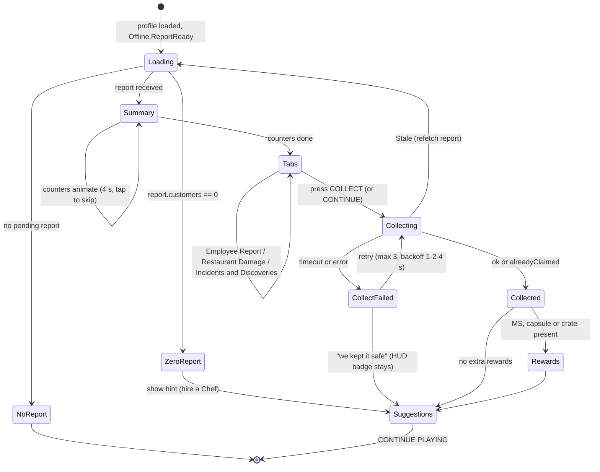

The screen opens after the spawn fade, never during the tutorial's first five steps, and never in combat (canon E2).
Closing it at any point keeps the report pending; a gold **"Uncollected earnings"** HUD badge reopens it, and
CONTINUE PLAYING always collects first (one tap is enough).

#### 17.10.2 Wireframe — the brief's example, adapted to §17.9 Example C

```
┌──────────────────────────── WELCOME BACK, YOU WEIRDO! ────────────────────────────┐
│  Your restaurant operated for 8 hours and 0 minutes (capped at 8 h by Mister ■).   │
│  Full Shift 2 h ▸ Late Shift 6 h at half pace  — tip: drop by more often!          │
│                                                                                    │
│   Customers Served ............  543        Revenue ...............  19,539 MB      │
│   Tips ........................ 1,315 MB    Ingredients ........... −6,636 MB      │
│   Employee Wages .............. −3,180 MB   Repairs ...............      0 MB      │
│   Incidents ...................   −83 MB    (167 MB of damage is waiting for you)  │
│   ────────────────────────────────────────────────────────────────────────────    │
│   TOTAL PROFIT ............................................... 10,955 MB  ✨       │
│                                                                                    │
│  "Octavia cooked 391 dishes — 78 of them simultaneously, with arms to spare."      │
│  "Sloane washed 456 plates, very thoroughly. The other 304 are 'soaking'."         │
│  "A Rich Mutant tipped 268 shiny coins and a monocle. We kept the coins."          │
│                                                                                    │
│ [Employee Report] [Restaurant Damage •24] [Incidents & Discoveries 3]              │
│                                                                                    │
│        [  COLLECT 10,955 MB  ]          [Upgrade Suggestions ▸]   [Continue ▸]     │
└────────────────────────────────────────────────────────────────────────────────────┘
```

Component hierarchy: `WelcomeBackScreen` → `Header` (title, operated-time line with cap chip and manager icon, shift
strip with the taper) → `CounterGrid` (6–8 `AnimatedCounter`s: customers, revenue, tips, ingredients, wages, repairs,
incidents, profit; numbers tick up over 4 s with cash-register sound and coin particles; Reduced Motion shows final
values instantly) → `HighlightLines` (3 funniest lines) → `TabBar` → `TabContent` → `ActionBar` (Collect, Upgrade
Suggestions, Continue Playing). Controller: A Collect, X tabs, Y suggestions, B continue. Text ≥ 18 px on mobile;
negative lines carry a "−" sign *and* a red-orange color (never color-only).

#### 17.10.3 Tabs and report lines

- **Employee Report:** one card per employee: hours worked, Energy/Morale start → end, KPI grade, wage paid, and one
  generated line. Lines come from deterministic templates per role/trait fed by the report's KPIs, e.g. Multi-Tasker
  chefs "cooked {n} dishes — {m} of them simultaneously", Unhurried dishwashers "washed {n} plates, very thoroughly.
  The other {m} are 'soaking'", Speedster waiters "served {n} tables at roughly the speed of sound", guards
  "stopped {n} angry customers with one very stern eyebrow" (the brief's Rhino line), Managers "kept the doors open for
  {h} and approved {n} snack breaks". Incident lines (§36.9) are attached to the employee they name.
- **Restaurant Damage:** a mini floor plan with damaged objects pulsing (state icon + durability %), total points,
  "auto-repaired by {employee} for {x} MB" or the estimated manual repair bill; buttons *Repair all* and *Go fix it*.
- **Incidents & Discoveries:** chronological cards (step hour, icon by category, MB effect, line) and the discovery
  roll-up (MS, crates, capsule); a capped report shows "Your Manager stopped the clock after 8 h — hire an Elite
  Manager for 12 h".
- **Mutation Rewards** (after Collect, only if present): MS counter, capsule card with *Open now* (odds disclosed,
  §C4.7), crate card with the ingredient and units; Welcome Back Crate (canon E5) appears here.

#### 17.10.4 Upgrade Suggestions (computed server-side into `report.suggestions`) [TUNABLE]

| Report fact | Suggestion (deep link) |
|---|---|
| Limit = Kitchen in ≥ 50 % of steps | "Your kitchen was the bottleneck — hire a Prep Cook (+15 %) or a Chef" (Recruitment map pin) / upgrade station levels (Build menu) |
| Limit = Service | "Customers waited for waiters — hire a Waiter or a Cashier (+10 %)" |
| Limit = Seats | "Every seat was full — time to expand" (tier upgrade, §15) |
| Limit = Demand | "Make the place more popular — raise ★ and Atmosphere" (decor shop) |
| elapsed > cap | "You were away 14 h but your Manager stops at 12 h — an Assistant Manager adds 2 h" |
| Taper used (> 2 h) | "Drop by every few hours to keep your restaurant at full pace" |
| SOLD OUT or auto-buy budget exhausted | "Special dishes sold out at hour 22 — raise the auto-buy budget or stock up" |
| Closed early | "You paid for staff who had nothing to do — check the Forecast before logging off" |
| No Chef / zero report | "Hire a Chef so your restaurant can open while you're away" |

#### 17.10.5 Server validation of every button

| Button | Server call | Validation |
|---|---|---|
| COLLECT / CONTINUE PLAYING | `Offline.Collect(reportId)` | owner's profile loaded, not Safe Mode; `reportId` matches pending or is in `claimedReportIds` (idempotent success); rate limit 1/s |
| Employee Report / Incidents tabs | none (renders the server-sent report) | read-only; KPIs come from the stored report |
| Restaurant Damage tab | `Offline.GetDamage()` | returns current object durability from `RepairService` (truth after any auto-repair) |
| Repair all | `RepairService` normal repair purchase | standard costs and E3 rules; never reads report numbers from the client |
| Upgrade Suggestions links | none / navigation | purchases happen in their own validated screens |
| Open capsule | `MutationService:OpenCapsule` | capsule owned (granted at Collect), server RNG, odds disclosed |

### 17.11 Offline mutation progression [TUNABLE]

Offline income feeds the morph economy (Creative Director: "when the player logs off, employees keep that progression
moving") without replacing it:

- **MB** from offline time buys mutations, upgrades and staff like any other MB.
- **Mutation Shards:** 8 %/h × shift factor × discovery boost (≤ ×1.25) for 1–3 MS → ≈ 0.8–1.0 MS per 8 h
  Experienced report (5 effective hours) and ≈ 1.3–1.6 MS per full 24 h report (8.2 effective hours). Rare+ purchases need 20+ MS and Epic+ upgrades need Research Tokens
  (§C4.5/§C4.6), which come from active play only.
- **Morph Capsule:** 5 %/h × shift factor, **max one per report and one per UTC day** (canon "≤ 1 per real day") —
  ≈ 10 % for a 2 h report, ≈ 22 % for an 8 h report, ≈ 34 % for a 24 h report. Same disclosed odds and pity counter
  as every earnable capsule (§C4.7).
- **Rare ingredient crates:** 1 %/h × shift factor (×1.5 with `EMP_091`): 5–15 units of a special ingredient the menu
  can use — they keep special dishes on the menu, a mid-game convenience.
- **Why active play stays superior:** offline pays 35–50 % of the active rate for 2 hours and then tapers; no XP, no
  Research Tokens, no recipes, quests, skill points, arena or event rewards offline; reputation only moves by
  incident effects (±0.05 ★ per report); offline Food Quality caps at 0.95 while a skilled player plates PERFECT 1.00.

### 17.12 Analytics hooks

| Event (`mmr_`) | When | Key fields |
|---|---|---|
| `mmr_offline_report_generated` | after the join `UpdateAsync` succeeds | reportId, simVersion, tier, elapsedSec, simulatedSec, effectiveHours, capped, capHours, managerRarity, customers, net, first2Rate, ratioToActive, valueInActiveHours, bottleneck, closedEarlyStep, incidents, ms, capsule, crates, merged |
| `mmr_offline_report_viewed` | screen/tab opened | reportId, tab, secondsOnScreen |
| `mmr_offline_collected` | Collect succeeded | reportId, mb, delaySec, auto (via Continue), alreadyClaimed |
| `mmr_offline_collect_failed` | retry exhausted | reportId, reason |
| `mmr_offline_suggestion_clicked` | suggestion tapped | reportId, type |
| `mmr_offline_ceiling_hit` / `mmr_offline_clock_skew` / `mmr_offline_merge` | safety paths | reportId, amount / skewSec / segments |
| `mmr_welcome_back_crate` | E5 crate granted | daysAway |

Collect also logs `AnalyticsService:LogEconomyEvent` (Source, MB, "offline_collect"). The first collected report is
an onboarding funnel step owned by §31. These feed the §17.6 tuning table, including the guardrail KPI (offline share
of MB by D7/D30 cohort).

### 17.13 Edge cases

| # | Situation | Expected behavior |
|---|---|---|
| E5 | Returning after 30 days | H capped at the manager cap (≤ 24 h) and tapered; report shows "capped"; wages only for simulated (tapered) hours; ≥ 7 days away adds the Welcome Back Crate (1 Morph Capsule + 50 MS) granted at Collect; no decay of restaurant, staff or mutations |
| E8 | No money to pay employees | Offline wages come out of the interval's own income; the wallet is never touched (auto-buy also from income); a losing step closes the restaurant early; Net floored at 0 |
| E11 | Offline earnings received twice after a reconnect | Impossible: report + `lastSimAt` in one locked `UpdateAsync`; Collect idempotent by `reportId` with the 20-entry ring; second server cannot load the profile |
| 1 | Employee fired while a report is pending | Report stays valid (computed from the snapshot); its KPI card shows "(no longer employed)"; next interval uses the new roster |
| 2 | Tier upgraded after a pending report | Impossible mid-interval (tier changes need the player online); a pending report merged with a new interval keeps one segment per tier/cap |
| 3 | `SIM_VERSION` changes | Pending reports keep their stored values; new intervals use the new version (seed and `reportId` include it); never recomputed |
| 4 | No Chef on an offline shift | Zero report with the "Hire a Chef" hint; `lastSimAt = now`; no wages charged |
| 5 | Training course ends mid-interval | Employee joins from the next step; course cost already paid |
| 6 | All special stock gone at logout | Those recipes are off the offline menu from step 1; if nothing remains cookable the report is zero with a "stock up" hint (`RCP_BRG_001` fallback is online-only, canon E9) |
| 7 | Player rejoins after 4 minutes | Under `MIN_OFFLINE_SECONDS`: no report, `lastSimAt` unchanged, no screen |
| 8 | Server shuts down during the join simulation | `UpdateAsync` writes all or nothing; next join simulates the same interval with the same seed |
| 9 | DataStore failure at join | Safe Mode (canon E6): no simulation, `lastSimAt` untouched, so the interval is simulated on the next successful load |
| 10 | Report never collected, player leaves again | Next join merges the new interval into the pending report (each interval capped and tapered on its own); nothing expires |
| 11 | Client closes the screen before Collect | Report stays pending, HUD badge; any later Collect or Continue pays it once |
| 12 | Clock of the new server is behind `lastSimAt` | elapsed < 0 → 0 hours, flagged; `lastSimAt` is not moved backwards |

### 17.14 Acceptance criteria

- **AC-17-01:** Given the inputs of §17.9 Examples A–F, the Luau `OfflineEarningsService` reproduces customers,
  revenue, tips, delivery, ingredients, wages and base net of every step to within 1 MB of the reference script.
- **AC-17-02:** Each well-staffed example's first-2-hour rate is 35–50 % of the tier's §C4.4 active net/hour
  (`offline_sim_examples.py --check` exits 0), and no report ever exceeds 60 % of active net × effective hours.
- **AC-17-03:** A 24 h Legendary-Manager absence at `TIER_10` is worth 2.5–3.5 active hours (Example E: 3.14).
- **AC-17-04:** The same profile, `lastSimAt` and `SIM_VERSION` produce a byte-identical report on 100 repeated runs
  and on two different servers.
- **AC-17-05:** H = min(elapsed, cap) for every manager rarity (2/4/8/12/24 h, +2 h with an Assistant, max 24 h);
  absences longer than the cap show the "capped" chip and charge wages only for simulated hours.
- **AC-17-06:** Steps starting at hours 0–1 use shift factor 1.0, hours 2–7 use 0.5, hours 8–23 use 0.2, applied to
  customers, revenue, tips, delivery, ingredients and wages alike.
- **AC-17-07:** Absences < 300 s create no report and leave `lastSimAt` unchanged; a negative elapsed produces 0 hours
  and a `mmr_offline_clock_skew` event.
- **AC-17-08:** Killing the server between report creation and Collect never loses or duplicates money: after rejoin
  the same `reportId` is pending and pays exactly once.
- **AC-17-09:** Calling `Offline.Collect` 50 times concurrently or from two clients grants the amount exactly once;
  later calls return `alreadyClaimed`; the ring keeps the last 20 IDs.
- **AC-17-10:** A step whose net would be negative is voided (no customers, no wages, auto-buy rolled back) and the
  simulation stops; the report's net is ≥ 0 (Example F).
- **AC-17-11:** Over 10,000 seeded reports, Σ negative incident effects never exceed 10 % and Σ positive never exceed
  15 % of Revenue + Tips; no incident ID appears more than twice in one report.
- **AC-17-12:** Over 10,000 simulated days, at most one offline Morph Capsule is granted per UTC day and per report.
- **AC-17-13:** A profile with no working Chef yields a zero report with the hint and charges no wages.
- **AC-17-14:** The Welcome Back screen shows counters within 1 s of spawn on mobile, animates in ≤ 4 s (instant with
  Reduced Motion), and every button maps to the validated server action of §17.10.5.
- **AC-17-15:** Closing the screen without collecting keeps the pending report and shows the HUD badge; Continue
  Playing collects before closing.
- **AC-17-16:** Merged reports keep one segment per interval, each capped and tapered separately, and get a new
  `reportId`; old IDs are never paid.
- **AC-17-17:** `mmr_offline_report_generated` and `mmr_offline_collected` fire for 100 % of reports in a soak test,
  and the dashboard computes the guardrail KPI (offline share of MB ≤ 60 % D7 / ≤ 70 % D30).


## 18. Morph City

> **Binding inputs:** canon §C16 (districts, buildings, NPCs, plots, events, trophies),
> §C13.8 (Secret mutation conditions), §C17.4 (reward vocabulary), §C4 (economy), §C3 (constants).
> Building rows live in §36.10, event rows in §36.11. Acceptance criteria for all three §18 files use the
> `AC-18-NN` series (§18: 01–29 · §36.10: 30–49 · §36.11: 50–69) so IDs never collide inside §36.

Morph City is the **Explore** pillar made physical: a compact, neon-soaked cartoon metropolis where every
shop is a reason to spend what the restaurant earns, every alley might hide a Secret mutation, and every
30 minutes Anchor Andy (`NPC_030`) interrupts the news to announce something ridiculous happening *right now*.
The city exists to (1) convert restaurant income into morph progression (Cook → Earn → **Morph**), (2) pull
players out of the kitchen for short, social, high-reward bursts, and (3) make the world feel inhabited by
the same absurd mutants who eat in your dining room.

Design rules that apply everywhere in this section:

1. **Never punish leaving the kitchen.** Exploring pauses earning; it never costs reputation (§18.8.6).
2. **Everything is reachable in ≤ 10 s of input** from anywhere via Return Door, Metro or Pigeon Taxi (§18.4).
3. **Every district has at least one secret, one interactive toy and one shop or service.**
4. **The city is cosmetic-heavy on the client and authority-light on the server:** crowds, traffic and
   billboards are client-only; anything that grants rewards is validated on the server (§18.9).

---

### 18.1 City Overview & Visual Hooks

**Purpose.** Make the city instantly readable ("that glowing vending machine is where I buy arms") and
constantly funny without scripted cutscenes.

**Silhouette & scale rules.** Cartoon architecture with *exaggerated function-shaped buildings*: the
Mutation Mart is a 36-stud vending machine, the Training Gym flexes two tower-arms, the Delivery Depot wears
a snail shell. Façades lean 2–5° off vertical, windows are rounded, roofs carry a giant prop that names the
business. Street-level doors are 12 studs tall (so Giant Day morphs fit, §36.11), sidewalks 16 studs wide
(two morphs with wings pass each other), roads 32 studs. Palette per district (§18.3) keeps orientation
color-independent by pairing each palette with a unique roofline prop and district icon.

| Visual hook | Specification | Gameplay hook |
|---|---|---|
| Bright neon signs | Every storefront has a `Material.Neon` sign + `BloomEffect` (Intensity 0.6, Size 24, Threshold 1.6). Night intensity ×1.5. ≤ 1 `PointLight` per sign (lights budget §18.9.4). | Signs name the business in plain words; a flickering letter marks a nearby secret 3 times in the city. |
| Colorful storefronts | District palette + 2 accent colors; shop windows show *live stock* (e.g., today's Rare parts on mannequins at `BLD_01`). | Window-shopping = free information; drives visits. |
| Strange citizens | Client-only crowd built from the same procedural morph generator as customers (§8), seeded per district (§18.7). | Citizens react to you, to events and to each other (bumps, waves, gossip bubbles). |
| Unusual vehicles | Walking sedans with chicken legs, a bread-loaf bus ("Loaf Liner"), the Snail Bus, the Hot Dog Blimp, Pigeon Taxis, the centipede Morph Metro, rubber-duck boats. | Several are rideable or interactive (§18.5). |
| Animated billboards | Sprite-sheet flipbooks (8–12 fps) on `SurfaceGui` `ImageLabel`s; the Gravy Plaza Mega-Screen carries live data (news, events, top restaurants on the server). | Event countdowns and Anchor Andy's headlines live here. |
| Absurd advertisements | Parody of nothing real — see ad list below. | Some ads are interactive (pie the Baron's ad). |
| Cartoon architecture | Bendy lamp posts with eyes, chimneys puffing bubbles (never smoke), awnings that double as trampolines. | Traversal toys and launch pads. |
| Hidden alleyways | 10 alleys (one per district) behind revolving posters, laundry lines, dumpsters and doghouses (§18.6.1). | Secrets, dead pixels, the busker poster. |
| Interactive props | 30 catalogued props/vehicles (§18.5). | Micro-rewards, social play, secret triggers. |

**Parody ad rotation** (billboards cycle every 20 s; every brand is invented): *"SOGGY-OS: The Cereal That
Already Gave Up."* · *"Neck Extension Cream — results in 3–5 business giraffes."* · *"Bottled Silence — now
Extra Quiet!"* (interact → 2 s of total silence) · *"Square Wheels Co. — 4× BUMPIER."* · *"Instant Hole: just
add ground."* · *"Recycle your old tails! — Mayor Moosington"* · *"LE FANCY FIN — Too Fancy For You."* (throw any
food prop at it → 30 s sauce splat and a shouted complaint from Baron Von Bistro, `NPC_003`) · *"Pigeon Taxi:
We Probably Won't Drop You!"* · *"Morph Metro: Mostly On Time Since Recently."* · *"Gravy Plaza: it's gravy, on a
plaza."* · *"Mutation Mart: Arms! Legs! Things That Are Neither!"* and *"Body Mods: be the weirdo you were born to
be (again)."* (tap → map pin to `BLD_01` / `BLD_02`).

**City day/night.** The canon 24-minute cosmetic lighting loop (§C3) is divided: Dawn 0:00–2:00,
Day 2:00–14:00, Dusk 14:00–16:00, **Night 16:00–24:00** (8 min). "City night" in any rule (Secret
`MUT_280`, Museum after-hours, Pigeon Council) means the Night phase. The loop phase is
`((serverUnixTime − cycleEpoch) % 1440) / 60` minutes, identical on every server (cycleEpoch is a fixed
constant), so friends on different servers see the same sky. During `EVT_009` the Night look is forced.

---

### 18.2 City Layout & District Map

**Purpose.** Ten districts (canon §C16.1) arranged so that Downtown is the hub, the three starting districts
form a tight triangle around the spawn, and gated districts radiate outward in unlock order.

#### 18.2.1 District master table

| ID | District | Unlock | Connects to (canon) | Footprint (X × Z studs) | Center (X, Z) | Buildings | Metro station |
|---|---|---|---|---|---|---|---|
| `DST_01` | Restaurant Row | start | DST_02, DST_03, DST_08 | 640 × 420 | (−860, 60) | `BLD_03`, `BLD_10`, `BLD_17` | Row Station |
| `DST_02` | Mutation Market | start | DST_01, DST_03, DST_06 | 520 × 420 | (−860, −560) | `BLD_01`, `BLD_02`, `BLD_20` | Market Stop |
| `DST_03` | Downtown Morph City | start (opens on completing `QST_TUT_010`, tutorial step 10; open immediately if the tutorial is skipped) | DST_01, DST_02, DST_04, DST_05, DST_07, DST_10 | 760 × 640 | (0, 0) | `BLD_04`, `BLD_06`, `BLD_09`, `BLD_18` | Central Morph Metro Station (`BLD_18`, hub) |
| `DST_04` | Industrial District | L8 | DST_03, DST_09 | 640 × 520 | (880, −20) | `BLD_07`, `BLD_15` | Smokestack Stop |
| `DST_05` | Monster Mall | L6 | DST_03, DST_07 | 480 × 480 | (−760, 820) | `BLD_12` | Mall-tiplex Station |
| `DST_06` | Mutation Research District | L15 | DST_02, DST_09 | 520 × 460 | (−1,620, −560) | `BLD_11`, `BLD_16` | Petri Dish Platform |
| `DST_07` | Entertainment District | L10 | DST_03, DST_05, DST_10 | 640 × 520 | (0, 900) | `BLD_14`, `BLD_22` | Neon Strip Station |
| `DST_08` | Residential District | L4 | DST_01, DST_09 | 600 × 520 | (−1,620, 60) | `BLD_19` | Cul-de-Sac Stop |
| `DST_09` | Underground Mutation Sewers | L20 | DST_04, DST_06, DST_08 (hidden manholes) | 900 × 700 at floor Y = −700 | (−450, −100) | `BLD_13`, `BLD_21` | Drain Station (hidden) |
| `DST_10` | Arena District | L12 | DST_03, DST_07 | 520 × 520 | (820, 900) | `BLD_05`, `BLD_08` | Rumble Station |

World axes: +X east, +Z south (north is −Z, as on the map). Surface extents X −1,920…1,200, Z −790…1,160
(≈ 3,120 × 1,950 studs). The Sewers sit 700 studs below the surface so that surface streaming never loads
them (§18.9.1). Restaurant interiors live in the far-off Interiors region owned by §15/§27.

#### 18.2.2 ASCII map (connections exactly per §C16.1)

```text
                  SURFACE  (Y = 0)                                                                      N ^
     .----------------.               .----------------.
     | DST_06   [L15] |  Helix Bridge | DST_02 [start] |
  :..| Mut. Research  |===============| Mutation Market|
  :  | BLD_11  BLD_16 |               | BLD_01  BLD_02 |
  :  '----------------'               | BLD_20         |
  :                                   '----------------'
  :                                         |           \  Mutation Mile
  :                    Bazaar Steps         |             \_______              Smokestack Ave
  :                                         |                     .----------------.      .----------------.
  :  .----------------.               .----------------.          | DST_03 [start*]|      | DST_04    [L8] |
  :  | DST_08    [L4] | Picket Fence  | DST_01 [start] |          | Downtown       |======| Industrial     |
  :  | Residential    |===============| Restaurant Row |==========| Morph City     |      | BLD_07  BLD_15 |..:
  :  | BLD_19         |               | BLD_03  BLD_10 |Grand     | BLD_04  BLD_06 |      '----------------'  :
  :  '----------------'               | BLD_17 (plots) |Gravy Blvd| BLD_09  BLD_18 |                          :M4
  :           :M8                     '----------------'          '----------------'                          :
  :M6         :                                                           |                                   :
  :           :                                                    /      |       \    Rumble Road            :
  :           :                   Escalator Expwy              /          |          \                        :
  :           :                                            /              |Neon Strip   \                     :
  :           :                                        /                  |                \                  :
  :           :                       .----------------.          .----------------.      .----------------.  :
  :           :                       | DST_05    [L6] |          | DST_07   [L10] |      | DST_10   [L12] |  :
  :           :                       | Monster Mall   |==========| Entertainment  |======| Arena District |  :
  :           :                       | BLD_12         |          | BLD_14  BLD_22 |      | BLD_05  BLD_08 |  :
  :           :                       '----------------'          '----------------'      '----------------'  :
  :           :                         Food Court Footbridge             Confetti Causeway                   :
  :           :                                                                                               :
~~:~~~~~~~~~~~:~~~~~~~~~~~~~~~~~~~~~~~~~~~~~~~~~~~~~~~~~~~~~~~~~~~~~~~~~~~~~~~~~~~~~~~~~~~~~~~~~~~~~~~~~~~~~~~:~~~
  :           :   UNDERGROUND  (Y = -700)      : = hidden manhole drop-tube (slide down, ladder up)           :
  :           :                                                                                               :
  :           :               .--------------------------------------------------.                            :
  :           :...............| DST_09   [L20]   Underground Mutation Sewers     |                            :
  :...........................| BLD_13 Mystery Market   BLD_21 Throne Room       |............................:
                              | Drain Station (hidden Metro stop)                |
                              '--------------------------------------------------'
  [start*] = available from start but opens at tutorial step 10 (QST_TUT_010).  [Lnn] = player level gate.
```

#### 18.2.3 Connections (14 links)

| Link | Between | Kind | Length (studs) | Notes |
|---|---|---|---|---|
| Bazaar Steps | DST_01 ↔ DST_02 | stairway street | 200 | Awning trampolines along the steps. |
| Grand Gravy Boulevard | DST_01 ↔ DST_03 | boulevard | 160 | Main tutorial route; Snail Bus line. |
| Picket Fence Lane | DST_01 ↔ DST_08 | residential street | 140 | Gate closed with a "Wet Paint (Forever)" sign below L4. |
| Mutation Mile | DST_02 ↔ DST_03 | diagonal avenue | 222 | Neon arches every 40 studs. |
| Helix Bridge | DST_02 ↔ DST_06 | bridge over a soda canal | 240 | Barrier: a sleeping DNA-noodle across the bridge below L15. |
| Smokestack Avenue | DST_03 ↔ DST_04 | avenue | 180 | Bubble-puffing smokestacks; gate below L8 is a giant snail crossing. |
| Escalator Expressway | DST_03 ↔ DST_05 | moving walkway (×1.3 speed) | 295 | Gate below L6: escalator "under repair (by a sloth)". |
| Neon Strip | DST_03 ↔ DST_07 | pedestrian strip | 320 | Gate below L10: velvet rope + bouncer turtle. |
| Rumble Road | DST_03 ↔ DST_10 | road | 367 | Gate below L12: a sleeping sumo armadillo. |
| Food Court Footbridge | DST_05 ↔ DST_07 | skybridge | 200 | |
| Confetti Causeway | DST_07 ↔ DST_10 | causeway | 240 | Confetti cannons fire when anyone wins in the Arena. |
| Drain Gate (M4) | DST_04 ↔ DST_09 | hidden manhole drop-tube | scripted 4 s ride | Under a pallet in the forklift yard. |
| Specimen Chute (M6) | DST_06 ↔ DST_09 | hidden manhole drop-tube | scripted 4 s ride | Inside a walk-in specimen freezer. |
| Rubber Ducky Drain (M8) | DST_08 ↔ DST_09 | hidden manhole drop-tube | scripted 4 s ride | Under a doghouse in a back yard. |

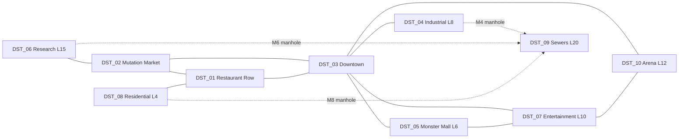

**Locked districts.** A district whose level gate the player has not met is *visible* (skyline, signs,
sounds) but blocked by a comedic barrier on every link. Barriers are client-collidable parts for the locked
player only, plus a server **District Guard** (§18.4.6) that returns anyone who gets inside anyway (flying
mutations, launch pads, knockback). Touching a barrier shows: *"Come back at Level 8! (The snail is very
slow.)"* Metro and taxi never list locked districts. Unlocking plays a 2 s barrier-removal gag for that
player only (the snail finally finishes crossing) and pins the district on the map.

---

### 18.3 District Specifications

Each block lists: **Theme · Footprint · Landmarks · Buildings · Ambient life · Vehicles · Music & ambience
(described in words; IDs are §25–§26's) · Secrets · Unlock · Customer flavor.** *Customer flavor* names the
citizen types that dominate the district crowd (§18.7) and, as an optional hook for §8, the personalities
whose spawn weight rises by ×1.25 [TUNABLE] while a city event is centered on that district.

#### DST_01 — Restaurant Row
- **Theme:** a greasy, cheerful food street of mismatched façades under strings of bulb lights; cartoon
  "scent lines" waft from every door. Palette ketchup red / mustard yellow; roofline prop: giant ketchup
  bottle water tower.
- **Footprint:** 640 × 420 studs; two facing rows of 4 plots (each 80 × 100) along Gravy Lane.
- **Landmarks:** Le Fancy Fin (Baron Von Bistro's glass-and-shark-fin restaurant, a story set, not a
  `BLD_`), the Ketchup Water Tower, Row Station, the empty lot behind the Job Board.
- **Buildings:** `BLD_03` Restaurant Supplies, `BLD_10` Job Board, `BLD_17` plots.
- **Ambient life:** customers queuing at player doors (these are real SPCV customers, §8), sweepers with mop
  tails, food-cart vendors yelling prices nobody pays, Sous-Chef Sniffles (`NPC_028`) sweeping outside Le
  Fancy Fin.
- **Vehicles:** Snail Bus stop, parked food trucks, 6 Pigeon Taxi perches.
- **Music & ambience:** upbeat kitchen-funk loop, sizzles, door chimes, distant cash registers; reverb *City*.
- **Secrets:** dead pixel `CPIX_01`, Time Capsule `CSEC_17`, alley *Grease Trap Gap*.
- **Unlock:** start. **Customer flavor:** Impatient Goblins (`PER_005`), Speedrunner Squirrels (`PER_026`),
  Hungry Hippo-Spiders (`PER_002`).

#### DST_02 — Mutation Market
- **Theme:** a crowded bazaar of striped awnings; spare tails hang like sausages, gummy-eyeball jars glow,
  every stall has a mirror. Palette teal / magenta; roofline prop: the spinning capsule atop `BLD_01`.
- **Footprint:** 520 × 420 studs.
- **Landmarks:** the giant vending-machine Mutation Mart, Glamtrax's salon-chair building, the mushroom
  produce stand, Helix Bridge head, Fortune-Telling Toaster, awning trampolines.
- **Buildings:** `BLD_01` Mutation Mart, `BLD_02` Body Mods, `BLD_20` Weird Produce Stand.
- **Ambient life:** citizens trying on tails and arguing with mirrors, a juggling octopus, capsule-delivery
  drones.
- **Vehicles:** giant-chicken rickshaws, capsule drones, 5 taxi perches.
- **Music & ambience:** bouncy bazaar percussion with a wheezy squeeze-box synth, haggling murmurs;
  reverb *Alley* under awnings, *City* in the open.
- **Secrets:** `CPIX_02`, Fortune Alley (toaster hints), alley *Fortune Alley*.
- **Unlock:** start. **Customer flavor:** Rich Mutants (`PER_008`), Influencers (`PER_009`), Picky
  Platypuses (`PER_014`).

#### DST_03 — Downtown Morph City
- **Theme:** the neon heart. Skyscrapers with cartoon faces that blink, the **MORPH CITY** sign on Billboard
  Hill, Gravy Plaza with its Mega-Screen and the **Sauce Fountain** (the "Downtown fountain" of
  `MUT_237`). Palette electric violet / hot cyan; roofline prop: the sign itself.
- **Footprint:** 760 × 640 studs (largest surface district).
- **Landmarks:** MORPH CITY sign (`CPROP_01`), Mega-Screen (`CPROP_02`), Sauce Fountain (`CPROP_15`),
  MCN news booth of Anchor Andy (`NPC_030`), ERROR billboard in Sauce Drip Alley (`CPROP_04`), City Hall
  roof (96 studs).
- **Buildings:** `BLD_04` Recruitment Office, `BLD_06` Cooking Academy, `BLD_09` City Hall, `BLD_18`
  Central Morph Metro Station.
- **Ambient life:** commuters with briefcases (and one with a brief-*case* of live crabs), Sergeant Rhonda
  (`NPC_026`) directing traffic, Inspector Grimewell (`NPC_022`) patrolling with a clipboard.
- **Vehicles:** chicken-legged "Leggy Sedans", Loaf Liner buses, Hot Dog Blimp overhead, 8 taxi perches.
- **Music & ambience:** big-city neon swing with synth brass; honks, crowd chatter; reverb *City*.
- **Secrets:** Glitch Head `CSEC_01`, Paper Airplane Wings `CSEC_05`, Mayor's Rubber Duck `CSEC_12`, Sign
  Fixer `CSEC_23`, `CPIX_03`, alley *Sauce Drip Alley*.
- **Unlock:** start, opens at tutorial step 10. **Customer flavor:** Robot Accountants (`PER_015`), Food
  Critics (`PER_004`), Undercover Inspectors (`PER_025`).

#### DST_04 — Industrial District
- **Theme:** chunky factories whose smokestacks puff soap bubbles, the Pickle Factory, conveyor skybridges,
  cranes dangling giant food. Palette safety orange / steel blue; roofline prop: a crane holding a pickle.
- **Footprint:** 640 × 520 studs.
- **Landmarks:** Pickle Factory and its conveyor (`CPROP_18`), steam vents (`CPROP_16`), forklift yard
  (`CPROP_17`), manhole M4 *Drain Gate*.
- **Buildings:** `BLD_07` Repair Workshop, `BLD_15` Delivery Depot.
- **Ambient life:** wrench-armed workers on lunch break, robots napping on pallets, crates riding conveyors.
- **Vehicles:** forklifts (rideable), snail delivery trucks, a crate train, 5 taxi perches.
- **Music & ambience:** machine-percussion funk (clank-hiss-clank in rhythm); reverb *Hangar*.
- **Secrets:** `CPIX_04`, manhole `CSEC_09`, Conveyor of Destiny `CSEC_14`, alley *Rust Bucket Row*.
- **Unlock:** L8. **Customer flavor:** Bodybuilder Pigeons (`PER_010`), Retired Wrestler Walruses
  (`PER_030`), Chaos Gremlins (`PER_007`).

#### DST_05 — Monster Mall
- **Theme:** one enormous mall shaped like a stack of monster-sized shopping bags, plus its parking lot.
  Palette bubblegum pink / mint; roofline prop: a peacock-tail fan sign.
- **Footprint:** 480 × 480 studs (mall 200 × 160 × 4 floors; parking 480 × 200).
- **Landmarks:** Monster Mall atrium with sideways escalators (`CPROP_19`), shopping-cart race track
  (`CPROP_20`), Food Court Footbridge.
- **Buildings:** `BLD_12` Monster Mall.
- **Ambient life:** shoppers buried under bags, mall-walking Grandma Golems, teen mutants sharing one
  milkshake with four straws.
- **Vehicles:** shopping carts, a caterpillar parking tram, 4 taxi perches.
- **Music & ambience:** wobbly elevator-muzak; reverb *ParkingLot* outside, *Hallway* inside.
- **Secrets:** `CPIX_05`, Floor ½ `CSEC_13`, alley *Loading Dock Labyrinth*.
- **Unlock:** L6. **Customer flavor:** Party Packs (`PER_016`), Birthday Beasts (`PER_031`), Toddler Titans
  (`PER_020`), Drama Llamas (`PER_018`).

#### DST_06 — Mutation Research District
- **Theme:** a sterile-but-silly campus of glass domes, a 60-stud DNA helix made of noodles, specimen tubes
  and robotic lawnmowers. Palette lab white / slime green; roofline prop: the noodle helix.
- **Footprint:** 520 × 460 studs.
- **Landmarks:** Noodle Helix, Specimen Tubes (`CPROP_24`), Helix Bridge, manhole M6 *Specimen Chute*.
- **Buildings:** `BLD_11` Mutation Laboratory, `BLD_16` Morph Museum.
- **Ambient life:** scientists with clipboards, tiny escaped specimens scurrying between bushes, lab robots.
- **Vehicles:** hover-segways, specimen drones, 4 taxi perches.
- **Music & ambience:** curious plinky lab synth over bubbling beakers; reverb *StoneCorridor* indoors.
- **Secrets:** Cosmic Void Face `CSEC_02`, manhole `CSEC_10`, Museum After Hours `CSEC_16`, Specimen Fetch
  `CSEC_22`, `CPIX_06`, alley *Specimen Back Lot*.
- **Unlock:** L15. **Customer flavor:** Conspiracy Moths (`PER_011`), Nervous Newts (`PER_012`), Mystery
  Mutants (`PER_032`), Health Nut Hamsters (`PER_021`).

#### DST_07 — Entertainment District
- **Theme:** maximum neon. Theaters, an arcade, light-up dance floors, buskers on every corner, Zorp's tour
  buses (no gambling of any kind). Palette ultraviolet / gold; roofline prop: a giant spinning microphone.
- **Footprint:** 640 × 520 studs.
- **Landmarks:** Neon Strip, busker corner (`CPROP_13`), dance floor (`CPROP_14`), the Grand Tournament
  Kitchen beside the Showcase Stage (Chef Supreme Omnivora, `NPC_029`), the mime statue.
- **Buildings:** `BLD_14` Food Critic Headquarters, `BLD_22` Showcase Stage.
- **Ambient life:** tourists photographing everything, Vlogzilla (`NPC_021`) live-streaming, Zorp (`NPC_027`)
  leading tour groups, street performers.
- **Vehicles:** Zorp's alien tour bus, centipede limos, 6 taxi perches.
- **Music & ambience:** neon disco-funk; applause swells; reverb *City* outside, *ConcertHall* at the stage.
- **Secrets:** Accordion Neck `CSEC_03`, Mime's Invisible Door `CSEC_18`, `CPIX_07`, alley *Kazoo Alley*.
- **Unlock:** L10. **Customer flavor:** Influencers (`PER_009`), Alien Tourists (`PER_029`), Lovebird
  Jellyfish Couples (`PER_027`), Mime Mantises (`PER_019`).

#### DST_08 — Residential District
- **Theme:** cul-de-sacs of houses shaped like boots, teapots and sleeping cats; picket fences; a
  laundromat; the park. Palette sunny yellow / sky blue; roofline prop: a teapot house steaming bubbles.
- **Footprint:** 600 × 520 studs.
- **Landmarks:** Morph Park & Fountain, laundromat, ice-cream truck loop (`CPROP_09`), manhole M8 under a
  doghouse, 24 delivery addresses (§36.10 `BLD_15`).
- **Buildings:** `BLD_19` Morph Park & Fountain.
- **Ambient life:** snails mowing lawns, young mutants playing hopscotch on wobbly legs, mail pigeons,
  Grandma Golems knitting scarves for lamp posts.
- **Vehicles:** the Tentacle Ice Cream Truck, tentacle tricycles, 4 taxi perches.
- **Music & ambience:** sunny ukulele and pigeon coos, sprinklers; reverb *Plain*.
- **Secrets:** manhole `CSEC_08`, Pigeon Council `CSEC_11`, Lost Sock Shrine `CSEC_19`, `CPIX_08`, alley
  *Laundry Line Lane*.
- **Unlock:** L4. **Customer flavor:** Grandma Golems (`PER_013`), Sleepy Sloth-Rockets (`PER_006`), Polite
  Demons (`PER_003`).

#### DST_09 — Underground Mutation Sewers
- **Theme:** kid-safe sewers: canals of fizzy lime soda, bioluminescent mushrooms, murals painted by very
  talented rats, pipes that hum in chords. Palette glow green / rust; landmark prop: a crown-shaped grate.
- **Footprint:** 900 × 700 studs, floor Y = −700, ceiling 60 studs.
- **Landmarks:** Mystery Market barge, Throne Room drain-mouth, Drain Station, rubber-duck canals
  (`CPROP_26`), the karaoke booth.
- **Buildings:** `BLD_13` Mystery Market, `BLD_21` Sewer King's Throne Room.
- **Entrances:** M4 (`DST_04`), M6 (`DST_06`), M8 (`DST_08`) — each a hidden manhole that must be found
  (§18.6) and opened at L20; a scripted 4 s slide-tube ride down, ladder ride up. Drain Station becomes a
  Metro stop once visited on foot.
- **Ambient life:** King Ratbeard's subjects hauling "borrowed" crates, glowing fish, dripping (gentle).
- **Vehicles:** rubber-duck boats, pipe slides. No taxi perches underground (taxi can *drop* at Drain
  Station once discovered).
- **Music & ambience:** echoey dub-lite bassline over drips; reverb *SewerPipe*.
- **Secrets:** Mystery Fog `CSEC_07`, Sewer Karaoke `CSEC_21`, alley *Drip Tunnel*.
- **Unlock:** L20. **Customer flavor:** Pirate Crabs (`PER_017`), Haunted Toasters (`PER_028`), Chaos
  Gremlins (`PER_007`).

#### DST_10 — Arena District
- **Theme:** sports zone with a colosseum of stacked giant food tins, a flexing gym, protein-shake fountains
  and stadium lights. Palette champion red / chrome; roofline prop: the Arena jumbotron.
- **Footprint:** 520 × 520 studs.
- **Landmarks:** Champions Walk (8 plinths that show the morphs of the server's top Arena players this week,
  client-built from public loadout data), Wallop-O-Meter (`CPROP_25`), Rumble Road.
- **Buildings:** `BLD_05` Training Gym, `BLD_08` Morph Arena.
- **Ambient life:** athletes jogging on wobbly mismatched legs, mascots, cheering crowds, the "Dizzy Wagon"
  that carries Seeing-Stars citizens off for juice.
- **Vehicles:** Dizzy Wagon, sports blimp, 5 taxi perches.
- **Music & ambience:** drumline stadium rock; crowd chants; reverb *Arena*.
- **Secrets:** Bag Whisperer `CSEC_15`, alley *Locker Room Back Door*.
- **Unlock:** L12. **Customer flavor:** Retired Wrestler Walruses (`PER_030`), Bodybuilder Pigeons
  (`PER_010`), Spicy Salamanders (`PER_022`).

---

### 18.4 Travel

**Purpose.** Let players cross a 3,120-stud city in seconds when they have a goal, while making walking
pleasant enough that discovery happens on foot.

**Rules & Mechanics.**

1. **Walking / sprinting.** Base movement uses the player's stat WalkSpeed (§C3/§C5). In city zones only
   (not restaurant interiors, not Arena pits, not boss arenas) a **City Sprint** toggle multiplies WalkSpeed
   by 1.35 [TUNABLE] with no stamina. Sprint is a traversal mode, not a stat; the MOVE cap (§C5) still
   applies to the stat value. Sprint is disabled while In Combat (§C12.1) and while carrying event objects
   flagged *Fragile*. Moving walkways (Escalator Expressway) add ×1.3 on top.
2. **Morph Metro.** One station per district (table §18.2.1). A station is **discovered** when the player
   enters its concourse trigger (14-stud radius around the turnstiles) or interacts with its map. Riding is
   **free** between any two discovered stations; the player must be inside a station concourse to board. A
   ride is a 3 s tunnel transition (centipede train, Conductor Choo `NPC_019` waves). Drain Station
   (`DST_09`) is only discoverable on foot after first entering the Sewers. Discovering all 10 stations
   completes the Metro Card (title "Commuter" + cosmetic palette "Line Colors", granted once).
3. **Pigeon Taxi.** Hail from any **street corner perch** (47 perches; a perch is usable within 12 studs) to
   any **discovered** district. Cost **25 MB × restaurant tier number** (TIER_01 = 25 MB … TIER_10 = 250 MB),
   charged on arrival. Ride = 4 s cosmetic flight (giant pigeon, wicker basket), skippable after 1.5 s.
   Drop point: the district's main perch, or the door of any building in that district the player has
   entered before (picked on the map). Every 100th taxi ride per player is a free Golden Pigeon (`CSEC_20`).
   A district is discovered by entering it on foot or by Metro.
4. **Return Door.** A HUD button available anywhere in the city (and inside other players' restaurants):
   free, **10 s cooldown**, 1.0 s door-opening animation (cancelled by taking damage), lands the player at
   their own restaurant's interior entrance. Unavailable while In Combat.
5. **Event Portal.** During the Live phase of a city event the event toast offers **Join**: free, one-way,
   no cooldown, lands at the event's staging pad. If the event area lies in a district the player has not
   unlocked but the player meets the event's minimum level, they receive **Event Access** to that event zone
   only for the event's duration (+30 s grace); it does not count as discovering the district.
6. **District Guard.** Every 1 s the server checks each character's position against district bounds
   (axis-aligned boxes from §18.2.1, any altitude up to Y +400). If the player is inside a district they
   cannot access (and has no Event Access), they are moved to their last safe position with the barrier
   toast. Last safe position is recorded every 1 s while grounded in an accessible area.
7. **Manholes.** Each hidden manhole (M4/M6/M8) is discovered by interacting with it once (any level); it
   opens only at L20. The ride down is a 4 s scripted slide (no physics); the ladder up returns to the same
   manhole.
8. **Visiting friends.** Walking into a friend's door on Restaurant Row follows §21 visit permissions;
   joining a friend on another server uses TeleportService (§C16.4, §21). Inside one server, *no* travel
   ever uses TeleportService.

**Variables.**

| Variable | Value | Notes |
|---|---|---|
| `CitySprintMultiplier` | 1.35 [TUNABLE] | city zones only |
| `MetroRideSeconds` | 3 [TUNABLE] | fixed, any distance |
| `MetroDiscoveryRadius` | 14 studs | concourse trigger |
| `TaxiCostPerTier` | 25 MB (canon) | × tier number |
| `TaxiRideSeconds` / skippable after | 4 / 1.5 [TUNABLE] | |
| `TaxiPerchRange` | 12 studs | |
| `ReturnDoorCooldown` | 10 s (canon) | |
| `ReturnDoorChannel` | 1.0 s [TUNABLE] | cancelled by damage |
| `StreamRequestTimeout` | 4 s [TUNABLE] | `RequestStreamAroundAsync` |
| `ArrivalAnchorMax` | 3 s | anchor until floor raycast hits |
| `DistrictGuardInterval` | 1 s | |
| `EventAccessGrace` | 30 s | after event end |
| `GoldenPigeonEvery` | 100 rides | free ride + 20 MS |
| `TravelRequestRateLimit` | 1 request / 2 s per player | server |

**UI.** The **City Map** (full-screen overlay, opens with `M` / Back button / map icon; usable as an
*overlay* during combat per §C22 E2 but travel buttons disabled) shows: districts (locked = padlock icon +
diagonal stripes + "Lv 8" label, never color alone), buildings (icons + names), discovered stations (train
icon), taxi perches (pigeon icon) with the nearest highlighted, the player's restaurant (house icon), active
event beacon with countdown, active quest markers (§20), and friends on this server (avatar dots). Selecting
a destination opens a **Travel Card** with the options valid from the player's current position: *Metro
(Free)* if standing in a station, *Taxi (125 MB)* if at a perch (price shown with balance check), *Walk*
(draws a route ribbon on the ground, client-only), *Return Door* always pinned bottom-right. Mobile: map
pinch-zoom, Travel Card as a bottom sheet with 56-px buttons; controller: right stick pans, A selects, Y opens
Return Door.

**Progression.** Districts gate by level (§C16.1); stations and perches expand as districts are discovered;
taxi costs scale with tier so travel stays a small convenience sink (one ride ≤ 5 % of an active hour's income at every tier, falling to 0.2 % at TIER_10; Metro and Return Door stay free).

**Player Interactions.** Party members can **share a taxi** (one pays; up to 4 players within 12 studs of
the perch ride together, each lands at the same drop point). Metro rides are per-player. A friend's map dot
can be selected to show a walking route ("Go to friend").

**Dependencies.** §C3 (WalkSpeed), §11 (In Combat flag), §15 (interior entrance spawn), §21 (visits,
cross-server join), §22 (taxi sink), §24 (map UI), §27 (`EconomyService`, `MultiplayerService`), §28 (city
progress fields), §30 (streaming).

**Roblox Implementation.** In-place travel is a server-side `PivotTo` preceded by a streaming pre-request:

```lua
--!strict
-- ServerScriptService/City/CityTravel.lua (module hosted with CityEventService's city package, §18.9)
local HttpService = game:GetService("HttpService")
local Config = require(game.ReplicatedStorage.Shared.Config.CityTravel)

local lastRequest: {[Player]: number} = {}

local function travel(player: Player, mode: "Metro" | "Taxi" | "ReturnDoor" | "EventPortal", destKey: string)
	local now = os.clock()
	if (lastRequest[player] or 0) > now - 2 then return false, "RateLimited" end
	lastRequest[player] = now
	local character = player.Character
	local root = character and character:FindFirstChild("HumanoidRootPart") :: BasePart?
	if not (character and root) then return false, "NoCharacter" end
	if CombatService.IsInCombat(player) then return false, "InCombat" end
	local dest = CityTravel.ResolveDestination(player, mode, destKey) -- validates unlock, discovery, cooldown, position (station/perch range)
	if not dest then return false, "InvalidDestination" end
	local cost = (mode == "Taxi" and not CityTravel.IsGoldenRide(player)) and 25 * RestaurantService.GetTierNumber(player) or 0
	if cost > 0 and EconomyService.GetBalance(player, "MB") < cost then return false, "InsufficientMB" end
	CityRemotes.TravelBegin:FireClient(player, mode, destKey)          -- client plays ride/fade
	pcall(function() player:RequestStreamAroundAsync(dest.Position, Config.StreamRequestTimeout) end)
	task.wait(Config.MinTransitionSeconds[mode])                      -- 3 s Metro, 1.5–4 s Taxi, 1 s Door
	if player.Parent == nil or player.Character ~= character then return false, "Aborted" end
	root.Anchored = true                                               -- hold until floor exists client-side
	character:PivotTo(dest.CFrame)
	if cost > 0 then
		EconomyService.Spend(player, "MB", cost, "city_taxi", HttpService:GenerateGUID(false))
	end
	CityTravel.AfterArrival(player, mode, dest)                         -- cooldowns, analytics mmr_city_travel
	task.delay(Config.ArrivalAnchorMax, function() if root.Parent then root.Anchored = false end end)
	CityRemotes.TravelEnd:FireClient(player, destKey)                  -- client reports floor hit via City.ArrivalReady; server unanchors
	return true
end
```

Notes: the client requests `City.RequestTravel(mode, destKey)`; the server never trusts a client CFrame.
Client unanchoring is done by a server-owned request (`City.ArrivalReady`) after a downward raycast hits the
streamed floor, or automatically after 3 s. Taxi charge happens after a successful pivot, so aborted rides are
never charged. The Return Door moves the character into the Interiors region (a `PivotTo`, not TeleportService)
through `RestaurantService`'s door handler with the same pre-stream call.

**Edge Cases.** §18.10 rows 1–5. **Acceptance Criteria.** AC-18-01 … AC-18-06.

---

### 18.5 City Interactivity Catalog

All props are server-placed instances; their *animation* is client-side. Interactions use `ProximityPrompt`
(server-created, `MaxActivationDistance` as listed, `RequiresLineOfSight` true unless noted) and are
validated server-side (§18.9.6). Micro-rewards use the Event Reward Minute unit **ERM** defined in §18.8.4
and are capped as listed.

| ID | Prop / vehicle | Location | Behavior | Interaction & reward | Limits / implementation |
|---|---|---|---|---|---|
| `CPROP_01` | MORPH CITY neon sign | DST_03 Billboard Hill | 9 letters, 12 studs tall; every 20 min one random letter "falls off" (cartoon bounce) and lies on the hill. | Players carry the letter back (2-player lift if not Giant) → +0.02 × XPRate (§C5.1) each; 10 returns → `CSEC_23`. | Atomic model, `LevelOfDetail` StreamingMesh; fallen letter is a server prop (1 at a time). |
| `CPROP_02` | Gravy Plaza Mega-Screen | DST_03 | Rotates: Anchor Andy headlines, event countdown, server top 3 restaurants (by ★), parody ads. | Look-only; tap to open event details. | Single live `SurfaceGui`; disabled > 150 studs. |
| `CPROP_03` | Parody billboards ×24 | all surface districts | Flipbook ads (§18.1); Le Fancy Fin ad accepts food splats. | Splat the Baron's ad → Baron taunt line; no reward. | Off-screen flipbooks pause (frustum check). |
| `CPROP_04` | ERROR billboard | DST_03, Sauce Drip Alley | Normally shows "SALE"; during `EVT_009` it flickers "ERROR". | 3 interactions during `EVT_009` → `MUT_040` (`CSEC_01`). | Prompt enabled only during `EVT_009`; counter per event instance. |
| `CPROP_05` | Pigeon Taxi perches ×47 | street corners (none in DST_09) | Pigeon idles, preens, judges your outfit. | Hail taxi (§18.4). | 12-stud range. |
| `CPROP_06` | Morph Metro centipede train | elevated loop over DST_01/02/03/05/07/10 | Cosmetic train circles every 90 s; legs scurry; honks a kazoo. | Look-only; wave emote → the train waves back with 40 legs. | Client-only spline animation. |
| `CPROP_07` | Snail Bus | loop DST_01 → DST_03 → DST_08 | 6 studs/s (slower than walking). | Ride the full 4-min loop once → title "Patient Passenger". | Server `VehicleSeat` ×6; bus path is server-tweened at 2 Hz, client-smoothed. |
| `CPROP_08` | Hot Dog Blimp | sky over DST_01/03/07 | Every 3 min drops a "Blimp Coupon" with a parachute at a random sidewalk spot. | Catch it → 0.5 ERM MB. | Max 3 coupons per player per real hour; server spawns ≤ 1 at a time. |
| `CPROP_09` | Tentacle Ice Cream Truck | DST_08 loop | Plays a jingle; tentacles wave cones. | Get a free cone (cosmetic held item, 60 s) + "Brain Freeze" face. | Once per city day per player. |
| `CPROP_10` | Fire hydrant geysers ×30 | all surface districts | Kick it (interact) → water spout. | Launches the player 25 studs up; `STS_SOAKED` (cosmetic drip, 5 s). | 5 s cooldown per hydrant; the server approves the kick and the client applies the impulse to its own character (it owns that assembly's physics); the server sanity-checks the resulting velocity. |
| `CPROP_11` | Awning trampolines ×12 | DST_02, Bazaar Steps | Bouncy awnings. | Bounce +18 studs; 5 bounces in a row → confetti puff. | Client-side jump boost validated by server velocity sanity check. |
| `CPROP_12` | Fortune-Telling Toaster | DST_02 Fortune Alley | Pops toast with a printed fortune. | 1 free fortune per city day: a cryptic hint to one secret the player has not found. | Hint pool server-side (spoiler-safe). |
| `CPROP_13` | Busker instruments ×5 | DST_07 busker corner | Slide Whistle, Bucket Drums, Kazoo Organ, Banjo-Tuba, Rubber-Chicken Bagpipe. | Play each (1 note phrase); correct 5-sequence → `MUT_112` (`CSEC_03`). | Positional sounds, `RollOffMaxDistance` 60. |
| `CPROP_14` | Light-up dance floors | DST_07 & Gravy Plaza | 8 × 8 tiles light under feet; sync when ≥ 3 players dance. | 3 players emoting together for 10 s → "Floor Filler" emote unlock (once). | Tile lighting client-side; sync check server-side. |
| `CPROP_15` | Sauce Fountain | DST_03 Gravy Plaza | Gravy-brown (it's caramel) fountain, basin radius 14 studs. | Toss 1 MB for a splash (joke sink); 100 tosses → title "Wishful Thinker". Target of `MUT_237`. | Toss limited 1 per 3 s. |
| `CPROP_16` | Steam vents ×8 | DST_04 | Puffs bubbles every 4 s. | Stand on it → launch 30 studs (route to the conveyor roof). | Timed client impulse + server velocity check. |
| `CPROP_17` | Forklifts ×4 | DST_04 yard | Drivable at 10 studs/s. | Crate-stack minigame: 5 crates in 60 s → 1 ERM MB (3/day). | Server `VehicleSeat`; network ownership to driver; crates ≤ 6 physics parts. |
| `CPROP_18` | Pickle Factory conveyor | DST_04 | 180-stud belt through the factory. | Ride end to end (90 s) → `CSEC_14`. | Belt is `AssemblyLinearVelocity` on anchored belt parts. |
| `CPROP_19` | Sideways escalators | BLD_12 atrium | Move horizontally between stores. | Fun traversal. | Same belt technique. |
| `CPROP_20` | Shopping-cart racers ×8 | DST_05 parking lot | Push-cart karts. | 1-lap race vs friends (≥ 2 players) → winner +0.03 × XPRate (5/day). | `VehicleSeat` carts, max 8. |
| `CPROP_21` | Over-enthusiastic massage chairs ×6 | BLD_12 floor 2 | Vibrate wildly. | Sit 10 s → camera wobble + "Relaxed?" toast. | Wobble disabled under Reduced Motion. |
| `CPROP_22` | Sleeping armadillo speed bumps ×20 | roads | Snore; roll away squeaking when stepped on, return in 5 s. | Pure comedy. | Client-only. |
| `CPROP_23` | Talking trash cans ×40 | sidewalks | Compliment passers-by ("Nice tail!"). | Throw city litter (spawns near cans) in → +0.005 × XPRate (20/day). | Litter is client-visual; validated by can proximity. |
| `CPROP_24` | Specimen tubes ×12 | DST_06 | Tap the glass → specimen pulls a face or waves. | Pure comedy; one tube hides `CPIX_06`. | Client animation. |
| `CPROP_25` | Wallop-O-Meter | DST_10 | Carnival high-striker. | Hit with `ABL_002` Wallop → strength rating; server board of top 5 today. | Server reads the CombatService hit event; 1 hit / 3 s. |
| `CPROP_26` | Rubber-duck boats ×6 | DST_09 canals (surface streets during `EVT_013`) | Paddle-able 12 studs/s. | Canal tour; required to reach the karaoke booth (`CSEC_21`). | `VehicleSeat` boats on a water-plane collision layer. |
| `CPROP_27` | "Say Cheese(burger)" photo spots ×10 | one per district | Frame + pose marker. | Pose with an emote → camera framing for a native screenshot; 10 spots → palette "Postcard Pastels". | Client camera tween; progress server-side. |
| `CPROP_28` | Streetlamp creatures ×120 | all streets | Eyes track the nearest player; yawn at dawn; switch off during `EVT_009`. | Comedy; Blackout landmark. | Client-only, nearest 12 animate. |
| `CPROP_29` | Burping parking meters ×16 | DST_03, DST_05 | Eat a coin, burp. | 1 MB joke sink (no reward). | 1 per 3 s. |
| `CPROP_30` | Le Fancy Fin velvet rope | DST_01 | A snooty bouncer-turtle. | Interact → line varies by story chapter (§20) and your tier vs. the Baron's; no entry until the story allows. | Dialogue only. |

---

### 18.6 Hidden Alleyways & Secrets

**Purpose.** Reward curiosity with things worth bragging about — including all 7 Secret mutations — while
keeping every secret fair: each has an in-world clue, and none is random or purchasable.

**Rules & Mechanics.** A secret is a server-validated condition (position, state, counters). Clues come
from: the Fortune-Telling Toaster (`CPROP_12`, 1/city day), Old Man Pigeon's daily rumor (`NPC_025`,
1/real day, always about an *undiscovered* secret), torn posters, and flickering neon letters. The Museum's
*Vault of Secrets* (§36.10 `BLD_16`) shows a "?" silhouette for each Secret mutation not yet found. Rewards use
only §C17.4 vocabulary and are granted once per player (idempotent by secret ID).

#### 18.6.1 Hidden alleyways (one per district)

| Alley | District | How it is hidden | What it holds |
|---|---|---|---|
| Grease Trap Gap | DST_01 | 4-stud gap between plots 4 and 5 behind dumpsters | shortcut to the empty lot (`CSEC_17`) |
| Fortune Alley | DST_02 | through a bead curtain behind the produce stand | Fortune-Telling Toaster, `CPIX_02` route |
| Sauce Drip Alley | DST_03 | behind City Hall, under a dripping caramel pipe | ERROR billboard, window-washer lift to the City Hall roof |
| Rust Bucket Row | DST_04 | climb the conveyor roof via steam vents | `CPIX_04` vantage, factory back door |
| Loading Dock Labyrinth | DST_05 | stacked crate maze behind the mall | service elevator used by `CSEC_13` |
| Specimen Back Lot | DST_06 | hedge maze behind the Lab | escaped specimen blob (`CSEC_22`) |
| Kazoo Alley | DST_07 | revolving "Coming Soon" poster wall | the torn busker poster (`CSEC_03`) |
| Laundry Line Lane | DST_08 | duck under hanging laundry between two boot-houses | 3 of the 9 lost socks (`CSEC_19`) |
| Drip Tunnel | DST_09 | reachable only by rubber-duck boat | karaoke booth (`CSEC_21`) |
| Locker Room Back Door | DST_10 | behind the Gym's lockers (door marked "NOT A DOOR") | Very Old Punching Bag (`CSEC_15`) |

#### 18.6.2 Secret catalog (23 secrets)

| ID | Secret | Location | Discovery rule (server-validated) | Reward (§C17.4) |
|---|---|---|---|---|
| `CSEC_01` | Glitch in the System | DST_03, ERROR billboard (`CPROP_04`) | During `EVT_009` Blackout Night, interact with the flickering "ERROR" billboard **three times** (prompt cooldown 2 s; counter resets if the event instance ends). | `MUT_040` Glitch Head |
| `CSEC_02` | The Empty Exhibit | `BLD_16` Morph Museum, Grand Hall | Own **≥ 100 different mutation parts** (distinct IDs in inventory, any level), then inspect the "Empty Exhibit". Below 100 the plaque reads "Come back when you're more… complete. (n/100)". | `MUT_048` Cosmic Void Face |
| `CSEC_03` | The Busker Sequence | DST_07 busker corner + Kazoo Alley poster | Play the **five busker instruments in DST_07 in the order shown on the torn poster** in Kazoo Alley, within 60 s; a wrong note resets. The order is a per-player permutation `perm(hash(UserId))`, rendered client-side on the poster ("the poster rearranges itself when someone else looks"). | `MUT_112` Accordion Neck |
| `CSEC_04` | The Infinite Noodle | player's restaurant (hint: Wall of Noodles, `BLD_06`) | **Serve `RCP_PST_008` The Infinite Noodle 10 times at PERFECT quality** (cumulative; grading per §5). Professor Saucington (`NPC_009`) delivers the reward by hologram in the restaurant on the 10th. | `MUT_116` Noodle Neck |
| `CSEC_05` | Paper Planes | `BLD_09` City Hall roof → Sauce Fountain (`CPROP_15`) | **From the roof of City Hall, throw a paper menu (`ABL_005`) so it lands in the Downtown fountain.** Menus come from a "TOO MANY MENUS" box on the roof; thrown paper glides (descent 6 studs/s, forward 30 studs/s, deterministic wind drift); success = server-simulated landing point inside the 14-stud basin. | `MUT_237` Paper Airplane Wings |
| `CSEC_06` | Dead Pixels | DST_01–DST_08 (table 18.6.3) | **Find all 8 hidden dead pixels**, one per district `CPIX_01`–`CPIX_08` (any order; each +10 MS when found). | `MUT_276` Pixel Glitch |
| `CSEC_07` | Fog of the Market | `BLD_13` Mystery Market | **Hold 5.0 ★ for 50 consecutive customers**, then **visit the Mystery Market during city night** (§18.1). "5.0 ★" = displayed rating, i.e. Stars ≥ 4.95; the counter resets when the displayed rating drops below 5.0; eligibility, once earned, never expires. The Hagfish rings the Fog Bell on arrival. | `MUT_280` Mystery Fog |
| `CSEC_08` | Rubber Ducky Drain | DST_08, manhole M8 under a doghouse | Interact with the doghouse 3 times (the dog moves over). | Sewer entrance (opens at L20) + 25 MS |
| `CSEC_09` | Drain Gate | DST_04 forklift yard | Lift the marked pallet with a forklift (`CPROP_17`). | Sewer entrance + 25 MS |
| `CSEC_10` | Specimen Chute | DST_06, walk-in specimen freezer | Open the freezer at the back of the Lab; pull the lever labelled "DO NOT PULL (seriously)". | Sewer entrance + 25 MS; all three manholes → title "Drain Explorer" |
| `CSEC_11` | The Pigeon Council | `BLD_19`, Old Man Pigeon's bench | Sit beside `NPC_025` during city night for 60 continuous seconds. | Title "Honorary Pigeon" + emote "Bread Crumb Toss" |
| `CSEC_12` | Mayor's Rubber Duck | `BLD_09` Mayor's office | Squeeze the desk duck 10 times within 10 s. | 50 MS + title "Duck Enthusiast" |
| `CSEC_13` | Floor ½ | `BLD_12` service elevator | Press floor buttons 3-1-4 in order → elevator stops at "Floor ½", a room for tiny people. | 1 Morph Capsule + title "Half-Floor Hero" |
| `CSEC_14` | Conveyor of Destiny | DST_04 Pickle Factory (`CPROP_18`) | Ride the belt end to end without leaving it (90 s). | Emote "Conveyor Shuffle" + 0.1 × XPRate XP |
| `CSEC_15` | Bag Whisperer | `BLD_05`, Locker Room Back Door | Hit the Very Old Punching Bag 100 times in one visit. | 1 stat respec token + title "Bag Whisperer" |
| `CSEC_16` | Museum After Hours | `BLD_16` Grand Hall | During city night, interact with the T-Rex skeleton while it winks (every 20 s, 2 s window). | Palette "Fossil Fuchsia" |
| `CSEC_17` | Time Capsule | DST_01 empty lot | Dig (interact 5×) at the X that is only visible in a puddle's reflection. | 100 MS + title "Snack Archaeologist" |
| `CSEC_18` | Mime's Invisible Door | DST_07 mime statue | Perform any emote within 6 studs of the statue → an invisible door opens to a tiny room. | Emote "Invisible Box" |
| `CSEC_19` | Lost Sock Shrine | DST_08 laundromat | Find 9 lost socks hidden across DST_08 and place them on the shrine. | 1 Morph Capsule + title "Sock Detective" |
| `CSEC_20` | Golden Pigeon | any taxi perch | Every 100th Pigeon Taxi ride (deterministic counter) is free and golden. | 20 MS each time; first time title "Golden Fare" |
| `CSEC_21` | Sewer Karaoke | DST_09 Drip Tunnel | Finish the karaoke rhythm minigame with ≥ 80 % accuracy. | Emote "Sewer Serenade" |
| `CSEC_22` | Specimen Fetch | DST_06 Specimen Back Lot | Throw (`ABL_005`) 5 squeaky test-tube toys to the escaped blob; it follows you for 10 min. | Palette "Specimen Green" + 1 skill point |
| `CSEC_23` | Sign Fixer | DST_03 Billboard Hill (`CPROP_01`) | Return 10 fallen MORPH CITY letters (cumulative). | Title "Sign Fixer" + 50 MS |

#### 18.6.3 Dead pixels for `MUT_276`

Each dead pixel is a 0.6 × 0.6-stud black square with a magenta sub-pixel that flickers every 3 s; its prompt
appears only within 6 studs with line of sight.

| ID | District | Exact spot | Clue |
|---|---|---|---|
| `CPIX_01` | DST_01 | Back of the Job Board corkboard, between two flyers, 9 studs up (jump from the bench). | A flyer reads "LOST: one pixel. Black. Answers to nothing." |
| `CPIX_02` | DST_02 | The full stop after "MUTATION MART" on the roof sign (reach via awning trampolines). | The full stop never lights at night. |
| `CPIX_03` | DST_03 | A literal dead pixel on the Gravy Plaza Mega-Screen, interact from the adjacent rooftop. | Anchor Andy: "Our screen is fine. Mostly." |
| `CPIX_04` | DST_04 | Label of one pickle jar riding the factory conveyor (moves; catch it). | Factory sign "Quality Control: 99.9 %". |
| `CPIX_05` | DST_05 | Left eye of a mannequin in a floor-2 mall window. | The mannequin never blinks. Ever. |
| `CPIX_06` | DST_06 | Readout of the 7th specimen tube's monitor. | Tube label "Specimen 7: ??????". |
| `CPIX_07` | DST_07 | The one dance-floor tile that never lights. | Busker lyric: "…the tile that never shines…" |
| `CPIX_08` | DST_08 | Bottom of the Morph Park fountain basin (wade in). | Old Man Pigeon: "Saw something black in the water. Probably a raisin." |

**Variables.** Toaster hints 1/city day; Pigeon rumor 1/real day; dead-pixel prompt range 6 studs; busker
window 60 s; paper glide 6 studs/s down, 30 studs/s forward, wind drift ±4 studs/s (seeded per 10-s window).
**UI.** Discovery toast with a rainbow "?" frame for Secret mutations; a *Secrets* page in the journal lists
found secrets and counts unfound ones ("17 / 23 — something is hiding in Downtown"). **Progression.** Secrets
are spread across unlock levels so each new district brings 2–5 new ones. **Player Interactions.** Players may
help each other (e.g., point at a pixel) but rewards are personal; nothing is first-come-first-served.
**Dependencies.** §12/§36.3 (Secret parts, `SECRET` acquisition), §5 (PERFECT grading), §10 (Stars),
§11 (`ABL_005`), §20 (story gating of the velvet rope), §28 (progress fields).

**Roblox Implementation.** Secret definitions (positions, sequences, conditions) live in
`ServerStorage.Config.CitySecrets` — never replicated — so exploit tools cannot data-mine them. Client props
carry only a `PropId` attribute. Progress persists in the profile under `city.secrets` (set of IDs),
`city.deadPixels` (8-bit mask), `city.counters` (taxi rides, sign letters, fountain tosses, PERFECT Infinite
Noodles, consecutive 5★ customers) and `city.flags` (`fogEligible`). Grants go through `MutationService` /
`EconomyService` with the secret ID as idempotency key. The paper-menu throw is simulated on the server from
the validated roof origin, the throw direction (clamped to the `ABL_005` aim cone) and the server-seeded
wind; the client renders the same seeded path. **Edge Cases.** §18.10 rows 11–13. **Acceptance Criteria.**
AC-18-07 … AC-18-11.

---

### 18.7 City NPC Presence Model

**Purpose.** Make the city feel crowded on any device while keeping server cost flat.

**Rules & Mechanics.** Two populations:

1. **Named NPCs (`NPC_001`–`NPC_030`, plus §19's additional NPCs)** use the canon SPCV pattern (§C3): the
   server owns an anchored, invisible proxy part (ProximityPrompt + attributes `NpcId`, `PostId`, `State`);
   each client builds the morph visual locally when the proxy streams in and destroys it when it streams
   out. Wandering NPCs move along authored routes at ≤ 8 studs/s; the server updates proxy CFrames at
   2 Hz and clients interpolate. Named NPCs never path-find.
2. **Ambient crowds** are **client-only** cosmetic citizens generated by the customer morph generator (§8)
   from a per-district seed. They walk sidewalk splines, idle at shop windows, react to players (wave,
   startle, "Oof!" on bump), and react to events (flee from `EVT_007` rats, cheer at `EVT_002`, carry
   candles in `EVT_009`, umbrellas in `EVT_012`). They cannot be targeted, damaged or given quests.

**Named NPC posts.**

| NPC | ID | Post | Schedule / movement | City-event roles |
|---|---|---|---|---|
| Nana Gristle | `NPC_001` | `BLD_17` (hologram menu board in each player's restaurant) | static; contextual | relays Anchor Andy's alerts inside restaurants ("Go! I'll watch the grill. I won't, but go!") |
| Mayor Moosington | `NPC_002` | `BLD_09` Mayor's office / balcony | balcony speech 1 min before headline events | opens `EVT_002`, `EVT_028` |
| Baron Von Bistro | `NPC_003` | DST_01, Le Fancy Fin entrance | struts the Row every 10 min | contestant in `EVT_005`; sulks during `EVT_014` |
| Mutty McMutface | `NPC_004` | `BLD_01` counter | static | — |
| Glamtrax | `NPC_005` | `BLD_02` | static | judge in `EVT_002` |
| Bolt Butterworth | `NPC_006` | `BLD_03` | static | hands out tools in `EVT_010` |
| Ms. Hirewell | `NPC_007` | `BLD_04` | static | — |
| Coach Crunch | `NPC_008` | `BLD_05` | jogs a lap of DST_10 every 6 min | referee in `EVT_025` |
| Professor Saucington | `NPC_009` | `BLD_06` | static | head chef `EVT_001`; judge `EVT_005` |
| Wrenchy | `NPC_010` | `BLD_07` | static | generators in `EVT_009`; `EVT_010` |
| Rex Rumbleton | `NPC_011` | `BLD_08` jumbotron booth | static | commentary `EVT_007`, `EVT_025` |
| Pinboard Pete | `NPC_012` | `BLD_10` | static | posts event bounties |
| Dr. Splice | `NPC_013` | `BLD_11` | static | meteor science in `EVT_006` |
| Mallory Megamall | `NPC_014` | `BLD_12` atrium | rides the sideways escalators | — |
| The Hooded Hagfish | `NPC_015` | `BLD_13` | static | host `EVT_024`; rings the Fog Bell (`CSEC_07`) |
| Madame Fourchette | `NPC_016` | `BLD_14` | static | `EVT_008`; judge `EVT_005` |
| Dispatch Dot | `NPC_017` | `BLD_15` | zooms around the depot | `EVT_023` |
| Curator Fossilbottom | `NPC_018` | `BLD_16` | static | clue expert `EVT_022` |
| Conductor Choo | `NPC_019` | `BLD_18` | walks the platform | — |
| King Ratbeard | `NPC_020` | `BLD_21` throne | static outside events | boss of `EVT_007`; cameo `EVT_013` |
| Vlogzilla | `NPC_021` | DST_07 Neon Strip | wanders the Strip | alternate celebrity `EVT_014`; `EVT_027` |
| Inspector Grimewell | `NPC_022` | DST_03 (City Hall ↔ Gravy Plaza) | patrol loop 3 min | inspector in `EVT_026` |
| Farmer Fungus | `NPC_023` | `BLD_20` | static | `EVT_031`, `EVT_032` |
| DJ Morphenstein | `NPC_024` | `BLD_22` DJ booth | static | host `EVT_027` (mobile stage truck) |
| Old Man Pigeon | `NPC_025` | `BLD_19` bench | static; naps at dawn | daily rumor; `CSEC_11` |
| Sergeant Rhonda | `NPC_026` | DST_03 traffic island | patrols district gates | crowd control `EVT_004`, `EVT_007` |
| Zorp | `NPC_027` | DST_07 tour-bus depot | drives a tour loop every 8 min | host `EVT_018` |
| Sous-Chef Sniffles | `NPC_028` | DST_01, outside Le Fancy Fin | sweeps | helper in `EVT_010` |
| Chef Supreme Omnivora | `NPC_029` | DST_07 Grand Tournament Kitchen | static | host `EVT_005`; celebrity `EVT_014` |
| Anchor Andy | `NPC_030` | DST_03 MCN booth, Gravy Plaza | static; appears on every screen | announces every event (§18.8.3) |

**Ambient crowd density by device.**

| Bucket | Detection (client) | Max citizens within 120 studs | Ambient vehicles | Animated props |
|---|---|---|---|---|
| Low | `UserGameSettings.SavedQualityLevel` 1–3, or 5-s average frame time > 25 ms, or `Stats:GetTotalMemoryUsageMb()` > 1,100 | 8 | 3 | 12 |
| Medium | levels 4–6, or Automatic (start) | 18 | 6 | 24 |
| High | levels 7–10 and frame time < 14 ms | 32 | 10 | 40 |

When `SavedQualityLevel` is Automatic the controller starts at Medium and moves one bucket at most every
10 s based on frame time. During a Live event in the player's district, the crowd cap drops by 40 % to free
budget for event effects.

**Roblox Implementation.** Client `CrowdController` keeps a pool of 40 prebuilt citizen visuals (built over
the first 20 s, ≤ 2 per frame), each ≤ 24 MeshParts / 6,000 triangles with the §C13.7 1,500-triangle
impostor beyond 60 studs; citizens beyond 120 studs are returned to the pool. Citizens are `CanCollide`,
`CanQuery` and `CanTouch` false and animate through one shared `Animator` per visual using the core walk/idle
set (`ANM_001`, `ANM_002`). Named NPC visuals bind via `CollectionService` tag `CityNPC`
(`GetInstanceAddedSignal` / `GetInstanceRemovedSignal`). Ambient vehicles follow road splines, fade to 50 %
transparency and honk when any character is within 6 studs ahead, and stop until clear. **Edge Cases.**
§18.10 rows 14–15. **Acceptance Criteria.** AC-18-12 … AC-18-14.

---

### 18.8 City Event System

**Purpose.** Create shared, predictable-but-surprising moments that pull players out of their kitchens,
put eight weirdos in one place, and reward them with things cooking cannot give (MS, RT, Capsules,
trophies, Secret opportunities) — without ever damaging the restaurant they left behind. Rows for all 32
events are in §36.11; this section defines the machinery. Runtime owner: `CityEventService` (§C19).

#### 18.8.1 Event classes

| Class | Slot | Scope | Typical duration | Events (§36.11) |
|---|---|---|---|---|
| Headline (H) | every hour at :00 UTC | city-wide / district | 8–15 min | 11 rotating events |
| Side (S) | every hour at :30 UTC (50 % of slots are quiet) | restaurant or district | 6–8 min | 5 rotating events |
| Modifier (M) | odd hours at :15 UTC | city-wide rules change | 24 min (one city day); `EVT_018` 48 min | 8 rotating events |
| Fixed (F) | anchored UTC times | varies | 15–30 min | `EVT_005`, `EVT_007`, `EVT_024`, `EVT_025` |
| Seasonal (X) | replaces H slots in season | city-wide | 12–15 min editions + month-long track | `EVT_028`–`EVT_031` |

At most **one H/F/X + one S + one M** event run at once (sole exception: `EVT_024`, a district-scope shop
event that runs alongside the 00:00 headline); rule conflicts are resolved by the compatibility list in §36.11.

#### 18.8.2 Scheduler: global UTC grid + deterministic rotation

Every server computes the same schedule independently from UTC time, so no server is "in charge":

1. **Slot index** `s = floor(unixTime / 1800)`; even `s` = headline slot (:00), odd `s` = side slot (:30).
   Modifier windows start at `hour ∈ {1,3,…,23}` + 15 min. Day index `d = floor(unixTime / 86400)`; week index
   `w = floor((d + 3) / 7)` (Monday-based; the Unix epoch was a Thursday).
2. **Fixed anchors first:** `EVT_007` at 02:00/06:00/10:00/14:00/18:00/22:00; `EVT_024` daily 00:00–00:30
   (district scope, runs alongside the 00:00 headline); `EVT_025` Fri–Sun 20:00 and Sat–Sun 08:00; `EVT_005`
   finals Sat 19:00 and Sun 03:00 (qualifying runs all week, §36.11).
3. **Seasonal overrides:** inside a season window (Oct = `EVT_029`, Dec = `EVT_030`, Apr = `EVT_031`, Jul 1–7 =
   `EVT_028`) every unanchored headline slot whose hour is divisible by 3 runs the seasonal edition. `EVT_028`
   also has a monthly mini-edition on the first Saturday at 21:00.
4. **Rotation decks** fill the remaining slots: per day and per pool (H, S, M) build a weighted deck, shuffle
   it with `Random.new(seed)` where `seed = fnv1a(d, weekSalt, poolName)`, and deal cards in slot order,
   reshuffling when exhausted. A card equal to the previous slot's event is swapped with the next card.
   Side decks include Quiet cards equal to the number of event cards (→ ~50 % quiet).
5. **Live-ops overrides** (cancel/replace a slot, kill-switch an event) are read from MemoryStore before the
   announcement (§18.8.3) and applied on top.

```lua
--!strict
-- ReplicatedStorage/Shared/CitySchedule.lua  (pure; runs identically on server and client)
local Pools = require(script.Parent.Config.CityEventPools) -- {H = {{id="EVT_001", w=1}, ...}, S = ..., M = ...}

local function fnv1a(str: string): number
	local h = 2166136261
	for i = 1, #str do
		h = bit32.bxor(h, string.byte(str, i))
		h = (h * 16777619) % 4294967296
	end
	return h
end

local function deckFor(day: number, salt: number, pool: string): {string}
	local deck = {}
	for _, e in Pools[pool] do for _ = 1, e.w do table.insert(deck, e.id) end end
	local rng = Random.new(fnv1a(string.format("%d:%d:%s", day, salt, pool)))
	for i = #deck, 2, -1 do local j = rng:NextInteger(1, i); deck[i], deck[j] = deck[j], deck[i] end
	return deck
end

-- Returns the event scheduled for a slot, or nil (quiet). Anchors and seasons are checked before decks.
function CitySchedule.EventForSlot(slotIndex: number, salt: number): string?
	local anchored = CitySchedule.Anchor(slotIndex) or CitySchedule.Seasonal(slotIndex)
	if anchored then return anchored end
	local pool = (slotIndex % 2 == 0) and "H" or "S"
	local day = (slotIndex * 1800) // 86400
	local deck = deckFor(day, salt, pool)
	local ordinal = CitySchedule.FreeSlotOrdinal(slotIndex, pool) -- nth unanchored slot of this pool today
	local card = deck[((ordinal - 1) % #deck) + 1]
	if card == CitySchedule.PreviousCard(slotIndex, pool, salt) then
		card = deck[(ordinal % #deck) + 1]
	end
	return if card == "QUIET" then nil else card
end
```

#### 18.8.3 Cross-server sync & announcements

**MemoryStoreService** (all keys short-lived; quota ≈ 1,000 + 100 × CCU requests/min experience-wide):

| Structure | Key | Value | Writer | TTL |
|---|---|---|---|---|
| HashMap `CityEventsMeta` | `weekSalt:<w>` | random 31-bit integer | first server to `UpdateAsync` a nil key (create-if-absent) | 9 days |
| HashMap `CityEventsMeta` | `ovr:<slotIndex>` | `{action = "cancel"/"replace", evt = <event ID>}` | live-ops tool (Open Cloud MemoryStore API) | 2 days |
| HashMap `CityEventsMeta` | `kill:<EVT>` | `true` | live-ops tool | until removed |
| SortedMap `evtgoal:<EVT>@<slot>` | `b00`…`b63` | integer contribution | each server adds its 15-s delta to bucket `hash(JobId) % 64` via `UpdateAsync` | 3 h |
| SortedMap `tourney:<w>` | `UserId` | final score (sort key) | servers at `EVT_005` round end | 8 days |

Each server reads the 64 goal buckets with one `GetRangeAsync(Enum.SortDirection.Ascending, 64)` every 15 s
during events with a global goal (≈ 4 writes + 256 read units/min per server — well within quota).
**MessagingService** topic `CityEvents` pushes overrides and "global goal reached" instantly (payload < 1 KB);
because delivery is best-effort, servers also poll `ovr:` keys every 60 s and at T−6 min.
**Fallbacks:** if MemoryStore fails, `weekSalt = w × 7919` (all servers still agree); global goals become
server-local goals with the per-server target listed in §36.11; overrides cannot be applied until recovery.

**Announcements by Anchor Andy (`NPC_030`).**

| Time | Channel | Content |
|---|---|---|
| T−5:00 | Mega-Screen + all billboards switch to "BREAKING NEWS"; HUD chip | Headline + countdown, e.g. *"BREAKING: King Ratbeard has 'borrowed' the city's cheese again. Citizens are advised to bonk responsibly."* |
| T−1:00 | Non-modal portrait pop-up (4 s), Nana relays inside restaurants | Headline + **Join** (enabled at T0) + **Remind me** |
| T0 | HUD chip turns LIVE; sky beacon (400-stud client `Beam` pillar) over the event pad | **Join** button, objective summary |
| every 2 min | chip progress bar | "City progress 61 %"; global milestones as ticker lines |
| End | results card (non-modal) | band reached, rewards, global stat ("Morph City served 1,204,551 dishes!") |

Pop-ups are deferred while the player is mid-station-interaction (≤ 10 s) and suppressed entirely while In
Combat. Setting *Event notifications*: **All** · **Headline & Fixed only** · **Chip only** (the chip is never
hidden, so events stay discoverable).

#### 18.8.4 Rewards

- **ERM (Event Reward Minute):** MB reward = `round(ERM × NetMBPerHour[tier] / 60)` using the §C4.4 table
  (TIER_01 10.5 MB/ERM · TIER_04 51.7 · TIER_06 160 · TIER_08 546.7 · TIER_10 2,008.3). The same unit prices
  city micro-rewards (§18.5) and building activities (§36.10).
- **XPF:** XP = `round(XPF × XPRate(L))` with `XPRate(L) = 900 × 1.045^(L−1)` (§C5.1).
- **Bands:** **P** Participation = ≥ 60 s of active contribution *or* ≥ 10 % of the personal objective;
  **S** Success = personal objective met (or team objective met while P-qualified); **T** Top = top 3
  contributors on the server (ties → earlier contribution) unless the row defines an MVP rule. Listed values
  are the **total** for the highest band reached (not additive).
- **Global bonus:** +25 % MB if the event's cross-server goal is reached.
- **Caps [TUNABLE]:** full rewards for the first 16 H/S/F/X events and first 8 M objectives per UTC day, then
  ×0.5 MB and MS (XP unchanged); ≤ 3 event Morph Capsules per day (extra → 25 MS each); ≤ 10 event RT per week
  (`EVT_005` exempt). Trophies `FRN_901`–`FRN_910` are granted once; a repeat grant becomes 100 MS.
- **Delivery:** rewards are written at event end with idempotency key `<EVT>@<slotIndex>:<UserId>`; players
  who disconnected after qualifying receive them on next join from `pendingEventRewards`.
- **Event score items** (meteor chunks, candy, glow sparks, pickles) are *not* currencies: they exist only
  during the event and convert to the listed rewards at the end.

#### 18.8.5 How events pull players out of their restaurants

1. **Free instant Join** (§18.4 Event Portal) and **Return Door** home — the round trip costs nothing.
2. **Exclusive rewards:** MS, RT, Capsules and all event trophies come only from outside the kitchen.
3. **Secret hooks:** `MUT_040` exists only during `EVT_009`; several secrets are easier during events.
4. **Post-Event Rush:** owners who reached P in a headline/fixed/seasonal event get `EventMult ×1.25` on
   their restaurant demand for 5 min after returning ("hungry crowds follow you home").
5. **Zero-risk leaving** (§18.8.6) and staffed restaurants keep earning.
6. **Worked example (TIER_04, L20, 3,100 MB/active h):** `EVT_007` Success = 12 ERM = 620 MB + 40 MS + 1 RT +
   1 Capsule + 0.15 × 2,077 = 312 XP. An unstaffed restaurant would have netted ≈ 775 MB in those 15 min, so
   MB is near break-even before the Post-Event Rush (≈ +65 MB) and the MS/RT/Capsule are pure gain; with one
   chef on staff the restaurant keeps earning at online rates, making the event strictly positive.

#### 18.8.6 Restaurant protections while the owner is away

**Away Mode** engages when the owner's character has been outside their own interior for ≥ 20 s while still
online (disconnects follow §C22 E1 *Closing*).

| Situation | Restaurant behaviour | Reputation |
|---|---|---|
| **Staffed** (≥ 1 `ROLE_CHEF` on shift, or a co-op guest with Cook permission inside) | Stays **OPEN**: employees run it normally at online rates (§16); façade sign "OPEN — Staff on duty". Anger escalation into levels 4–6 is suppressed unless a `ROLE_SECURITY` is on shift: would-be escalators sulk and leave instead (standard storm-out, pay 0). | Served customers update ★ normally. During a Live event the extra storm-out penalty (−0.03 ★) is waived. |
| **Unstaffed, no event** → **Out to Lunch** | No new customers spawn; queued customers leave politely; seated customers without food get a *Rain Check* (pay 0, leave); customers already eating finish and pay; heat-station timers pause (nothing burns); special ingredients in stations return to stock. | ★ never decreases from rain checks or departures. |
| **Unstaffed, owner joined a Live event** → **Event Break** | Same as Out to Lunch; sign reads "Gone to the Giant Food Festival! Back soon!" with the event's name. | ★ frozen for the duration. |
| **Restaurant-scope events** (`EVT_003`, `EVT_004`, `EVT_010`, `EVT_026`) | Only apply to restaurants whose owner is inside, or to staffed restaurants where the row says so; an Away unstaffed restaurant is simply skipped. | No penalty for skipping. |

On return, Away Mode ends instantly (spawning resumes within 3 s) and any Post-Event Rush starts.

#### 18.8.7 Runtime lifecycle, variables, UI, dependencies

```mermaid
%% diagram: city-event-lifecycle
stateDiagram-v2
  [*] --> Scheduled
  Scheduled --> Announced: T minus 5 min
  Announced --> Warning: T minus 1 min
  Warning --> Live: T0 spawn set pieces
  Live --> Resolving: objective met or timer ends
  Resolving --> Rewarding: compute bands and global bonus
  Rewarding --> Cooldown: rewards written and set pieces despawn
  Cooldown --> [*]
  Scheduled --> Cancelled: override or kill switch
  Announced --> Cancelled: override or kill switch
  Cancelled --> [*]
```

| Variable | Value |
|---|---|
| `SlotSeconds` | 1,800 |
| `AnnounceLead` / `WarnLead` | 300 s / 60 s |
| `JoinCutoff` | end of Live; boss phases close at boss HP < 25 % |
| `ParticipationSeconds` / `ParticipationShare` | 60 s / 10 % |
| `AwayGraceSeconds` | 20 |
| `PostEventRush` | EventMult ×1.25 for 300 s |
| `GoalPushInterval` | 15 s |
| `MidJoinMinRemaining` | 180 s (servers that boot mid-event) |
| `AFKNoContribution` | 120 s without contribution at end → no band |

**UI.** HUD event chip (top-centre, under objectives: icon, name, timer, progress), T−1 pop-up, Join toast,
results card, and the **Event Calendar** (map tab + City Hall desk) listing the next 24 h, computed
client-side with `CitySchedule` plus replicated overrides. **Progression.** Min levels per row (§36.11);
reward MB scales with tier, XP with level. **Player Interactions.** Server-wide co-op objectives, Top bands,
spectating for under-level players outside event zones. **Dependencies.** §8/§16 (Away behaviour), §10
(EventModifier −15…+15, ★), §11 (event combat), §20 (event bounties on the Job Board), §21 (Arena), §22
(sources), §24 (chip/toast/calendar), §27/§28 (service & reward persistence), §31 (`mmr_city_event_*`).
**Roblox Implementation.** Event state replicates as attributes on `ReplicatedStorage.CityEventState`
(`HeadlineId`, `Phase`, `EndsAt`, `Progress`, `SideId`, `ModifierId`); set pieces are cloned from
`ServerStorage.CityEvents.<EVT>` at T0 and destroyed in Cooldown; contribution is recorded server-side from
gameplay hooks (never from a client "I contributed" remote). **Edge Cases.** §18.10 rows 6–10, 16.
**Acceptance Criteria.** AC-18-15 … AC-18-22.

---

### 18.9 Roblox Implementation

#### 18.9.1 Streaming & world settings

| Setting | Value | Reason |
|---|---|---|
| `Workspace.StreamingEnabled` | true | city + interiors + sewers exceed mobile memory if fully loaded |
| `StreamingMinRadius` | 64 studs | guarantees the street around the player |
| `StreamingTargetRadius` | 320 studs [TUNABLE] | one district ahead; the engine lowers the effective radius on low-memory devices |
| `StreamOutBehavior` | `Opportunistic` | free memory from districts left behind |
| `StreamingIntegrityMode` | `MinimumRadiusPause` | pause the character if the 64-stud ring is missing after travel |
| `FallenPartsDestroyHeight` | −1,200 | default −500 would destroy everything in the Sewers (Y −700) |
| Sewer floor | Y = −700 | > target radius below the surface: never streamed from above |

**ModelStreamingMode plan.**

| Content | `ModelStreamingMode` | `LevelOfDetail` | Notes |
|---|---|---|---|
| District folder roots | (Folders; children stream individually) | — | roads, sidewalks, terrain decorations |
| Building façades (`<BLD>.Facade`) | `Atomic` | `StreamingMesh` | façade, door and sign arrive together; the skyline impostor keeps distant districts visible |
| Building interiors (`<BLD>.Interior`) | `Atomic` | `Disabled` | built inside the façade footprint; per-floor models for `BLD_12` and per-wing models for `BLD_16` |
| MORPH CITY sign, Noodle Helix, Ketchup Tower, Arena jumbotron | `Atomic` | `StreamingMesh` | orientation landmarks visible from everywhere |
| Restaurant façades on plots (`BLD_17`) | `Atomic` | `StreamingMesh` | swapped per tier (§15) |
| Named NPC proxies | `Atomic` | — | proxy + prompt arrive together |
| Event set pieces | `Atomic` | — | cloned at T0 |
| Throne Room boss arena (`BLD_21`) during `EVT_007` | `PersistentPerPlayer` + `Model:AddPersistentPlayer(p)` for each participant | — | arena cannot stream out mid-fight; `RemovePersistentPlayer` at Cooldown |
| District safe-spawn pads (10 tiny parts) | `Persistent` | — | fallback landing if streaming times out |

#### 18.9.2 Hierarchy

```text
Workspace
  City
    Districts
      DST_01 … DST_10            -- Folders; each has Roads, Props, Perches, Buildings
        Buildings
          <BLD> (Model)          -- Facade (Atomic, StreamingMesh), Interior (Atomic), Door, Counters
    NPCProxies                   -- named NPC proxy parts (tag CityNPC)
    EventSets                    -- live event set pieces (server-spawned)
    SafePads                     -- Persistent landing pads
  Interiors                      -- restaurant interiors (owned by §15/§27)
ReplicatedStorage.Shared
  CitySchedule (module)          -- deterministic schedule (server + client)
  Config.CityTravel / Config.Districts / Config.CityProps / Config.CityEventPools
ReplicatedStorage.CityEventState -- attributes: HeadlineId, SideId, ModifierId, Phase, EndsAt, Progress
ServerStorage
  Config.CitySecrets             -- secret definitions, never replicated
  CityEvents.<EVT>               -- event set-piece templates
ServerScriptService
  Services.CityEventService      -- canon service; hosts city submodules:
    City.Travel, City.Districts (guard), City.Props, City.Secrets, City.NpcPosts
StarterPlayerScripts.CityClient
  CrowdController, TrafficController, AmbienceController, BillboardController, PropAnimator
```

The submodules are module names, not new top-level services; §27 may re-home them without changing the
behaviour specified here.

#### 18.9.3 LOD rules

- Façades: `StreamingMesh` impostors beyond the target radius; interior props hidden until the player is
  inside the building trigger.
- Crowds: full visual ≤ 60 studs, 1,500-triangle impostor 60–120 studs, pooled > 120 studs (§18.7).
- Billboards: live `SurfaceGui` ≤ 150 studs (`Enabled` toggled by the client), static `Decal` texture beyond;
  flipbooks pause when off-screen (`Camera:WorldToViewportPoint` test every 0.5 s).
- Neon: `Material.Neon` + Bloom instead of light sources; at most the nearest 16 `PointLight`s enabled
  (Medium), toggled by `PropAnimator`.
- `Lighting.Technology = ShadowMap` (Future lighting is not required for the neon look and costs too much on
  mobile).

#### 18.9.4 Performance budgets

| Budget (city, per client) | Low | Medium | High |
|---|---|---|---|
| Parts streamed in | ≤ 12,000 | ≤ 20,000 | ≤ 30,000 |
| Triangles on screen | ≤ 250 k | ≤ 500 k | ≤ 900 k |
| Crowd citizens / ambient vehicles | 8 / 3 | 18 / 6 | 32 / 10 |
| Active `ParticleEmitter`s | ≤ 12 | ≤ 24 | ≤ 40 |
| Live `SurfaceGui`s | ≤ 4 | ≤ 8 | ≤ 12 |
| Enabled dynamic lights | ≤ 8 | ≤ 16 | ≤ 24 |
| Client memory | ≤ 900 MB | ≤ 1,300 MB | ≤ 1,800 MB |
| Frame time | ≤ 33 ms | ≤ 16.7 ms | ≤ 16.7 ms |

| Budget (server) | Value |
|---|---|
| City + event script time | ≤ 3 ms per Heartbeat (average over 60 s) |
| Named NPC proxies | 30 canon + §19 additions, ≤ 120 total |
| Event NPC proxies (rats, robots, critics, tourists) | ≤ 60 simultaneously |
| Event projectiles / server physics props | ≤ 40 scripted arcs / ≤ 30 physics parts |
| City replication per player | ≤ 2 KB/s average (attributes + remotes) |
| MemoryStore | ≤ 15 requests/min per server outside events, ≤ 40 during global-goal events |

#### 18.9.5 Sound zones

`AmbienceController` finds the player's district from `Config.Districts` bounds (and building interior
triggers) every 0.5 s, crossfades the ambience bed over 2 s and music over 3 s through `SoundGroup`s
(`CityAmbience`, `CityMusic`, `EventMusic`), and sets `SoundService.AmbientReverb`. Event music ducks
ambience by 6 dB. Positional props use `RollOffMode = InverseTapered`, `RollOffMaxDistance` 60.

| Zone | `AmbientReverb` | Zone | `AmbientReverb` |
|---|---|---|---|
| Restaurant Row (DST_01) | `City` | Research (DST_06) | `StoneCorridor` indoors / `Plain` outdoors |
| Mutation Market (DST_02) | `Alley` under awnings / `City` | Entertainment (DST_07) | `City` / `ConcertHall` at the stage |
| Downtown (DST_03) | `City` | Residential (DST_08) | `Plain` |
| Industrial (DST_04) | `Hangar` | Sewers (DST_09) | `SewerPipe` |
| Monster Mall (DST_05) | `ParkingLot` / `Hallway` inside the mall | Arena (DST_10) | `Arena` |
| Hidden alleys | `Alley` (district music −9 dB) | Building interiors | per §36.10 row (default `Room`) |

Ambience beds and music moods per district are listed in §18.3 (descriptions for §25–§26, who owns the IDs).

#### 18.9.6 Remotes & validation

| Remote | Direction | Payload | Server validation |
|---|---|---|---|
| `City.RequestTravel` | C→S | mode, destKey | rate limit 1/2 s; In Combat; unlock/discovery; station or perch range (+2-stud tolerance); balance |
| `City.ArrivalReady` | C→S | — | only during an active arrival; unanchors |
| `City.InteractProp` | C→S | propId | prompt distance + 2 studs; prop cooldown; event state; daily caps |
| `City.DiscoverStation` | (server trigger) | — | concourse trigger touched by the character |
| `CityEvent.Join` | C→S | eventInstanceId | event Live; min level; not In Combat |
| `CityEvent.SetNotifications` | C→S | enum | — |
| `City.TravelBegin` / `City.TravelEnd` | S→C | mode, destKey | — |
| `CityEvent.Results` | S→C | bands, rewards | — |

All grants route through `EconomyService` / `MutationService` / `ProgressionService` (§C19); suspicious
patterns (prompt spam, impossible positions, teleport-like movement > 1.5× max speed for 2 s outside travel)
are logged to §29's anti-exploit pipeline and the District Guard returns the player to the last safe spot.

#### 18.9.7 Persistence & analytics

Profile fields required (schema owned by §28): `city.discoveredDistricts` (10-bit mask),
`city.discoveredStations` (10-bit), `city.manholes` (3-bit), `city.secrets` (set), `city.deadPixels` (8-bit),
`city.counters` (map), `city.flags` (map), `city.eventClaims` (ring buffer of last 50 instance keys),
`city.pendingEventRewards` (list), `city.seasonTrack` `{seasonKey, stamps}`. Analytics (§31, `AnalyticsService`
custom events): `mmr_city_district_enter`, `mmr_city_travel` (mode, cost), `mmr_city_secret_found`,
`mmr_city_event_join`, `mmr_city_event_result` (band, ERM), `mmr_city_away_mode` (staffed/unstaffed, minutes).

---

### 18.10 Edge Cases

| # | Situation | Expected behaviour |
|---|---|---|
| 1 | Travel requested while In Combat (incl. event boss fights) | Rejected with "Can't travel during a brawl!"; Return Door shows the remaining In Combat time. |
| 2 | Destination not streamed when `RequestStreamAroundAsync` times out (4 s) | Pivot proceeds; HumanoidRootPart stays anchored until the floor raycast hits or 3 s pass; if still no floor, the player is moved to the district's Persistent safe pad. |
| 3 | Player enters a locked district by flight, launch pad or knockback | District Guard returns them to the last safe position within 1 s and shows the barrier toast; no damage. |
| 4 | Taxi ride with insufficient MB, or MB spent during the ride | Button disabled with the price; server re-checks before the ride; charge happens on arrival and is skipped (ride still completes) if balance is short — balance never goes negative. |
| 5 | Character dies/resets or player leaves during a travel transition | Travel aborted; no charge; cooldowns not consumed. |
| 6 | Event starts while the player is cooking mid-rush | No forced exit; pop-up deferred ≤ 10 s, then non-modal; ignoring it has no cost. |
| 7 | Player disconnects after qualifying for a band | Reward stored in `pendingEventRewards`, granted on next join; idempotent by `<EVT>@<slot>:<UserId>`; rejoining the same instance on another server cannot double-claim. |
| 8 | A server boots mid-event | Joins the instance if ≥ 180 s remain; otherwise stays quiet until the next slot. |
| 9 | MemoryStore unavailable | Deterministic fallback salt keeps schedules identical; global goals switch to server-local targets; overrides wait for recovery. |
| 10 | MessagingService override lost | 60-s polling of `ovr:` keys reconciles; announcements always re-check overrides at T−6 min. |
| 11 | Secret attempted from far away / by remote spam | Server distance and state checks reject; rate-limited; logged (§29). |
| 12 | `EVT_009` ends after only 2 ERROR-billboard interactions | Counter resets; the next Blackout Night starts from 0. |
| 13 | Player becomes `fogEligible` but their rating later drops | Eligibility persists; `MUT_280` is granted on the next night-time Mystery Market visit. |
| 14 | Very low-end device in a crowded event | Crowd drops to the Low bucket and the event −40 % cap; event set pieces keep priority. |
| 15 | Named NPC proxy streams out mid-dialogue | Dialogue UI closes gracefully ("Mutty wandered off… he'll be right back"); reopening re-streams via `RequestStreamAroundAsync` on the server when the player walks back. |
| 16 | Owner leaves the restaurant during an Angry Customer Invasion (`EVT_004`) | Leaving through the door is blocked while In Combat; once out of combat, Away Mode applies and the invasion ends for that restaurant with no penalty. |
| 17 | Tiny Day / Giant Day while entering an interior | Scale returns to 1.0 inside interiors and Arena pits; re-applied on exit. |

---

### 18.11 Acceptance Criteria

- **AC-18-01:** From any accessible city position, Return Door lands the player inside their restaurant in
  ≤ 2.0 s (1.0 s channel + transition) at Medium quality on a reference mid-range phone, and its 10 s cooldown
  is enforced server-side (a second request at 9.9 s is rejected).
- **AC-18-02:** A Pigeon Taxi ride charges exactly 25 MB × the player's restaurant tier number, only on arrival,
  and is never offered for an undiscovered or locked district.
- **AC-18-03:** Metro rides between two discovered stations are free and take 3.0 s ± 0.2 s; boarding is
  rejected when the player is outside a station concourse.
- **AC-18-04:** No in-place travel (Metro, Taxi, Return Door, Event Portal, manholes) calls TeleportService;
  each calls `Player:RequestStreamAroundAsync` on the destination before `PivotTo`.
- **AC-18-05:** A player inside a locked district (no Event Access) is returned to their last safe position
  within 1.5 s in 100 % of 50 automated launch-pad/fly tests.
- **AC-18-06:** City Sprint raises WalkSpeed by exactly ×1.35 in city zones and is unavailable in restaurant
  interiors, Arena pits and while In Combat.
- **AC-18-07:** All 7 Secret mutations are obtainable exactly by their §C13.8 conditions, and an automated test
  confirms each grant fires once and only once per player.
- **AC-18-08:** Exactly 8 dead pixels exist, one in each of DST_01–DST_08; collecting the 8th grants `MUT_276`
  and each pixel's prompt is invisible beyond 6 studs.
- **AC-18-09:** The busker poster shows a different 5-instrument order for two different test accounts, and
  the server accepts only the viewing account's order.
- **AC-18-10:** The paper-menu throw from the City Hall roof lands in the Sauce Fountain basin for a scripted
  reference aim with seed X in 10/10 runs, and no client-supplied landing position is ever accepted.
- **AC-18-11:** `CitySecrets` is absent from every client's DataModel (verified by a client-side scan).
- **AC-18-12:** Ambient crowd counts never exceed 8 / 18 / 32 citizens within 120 studs on Low / Medium / High,
  and citizens never block player movement (no collisions).
- **AC-18-13:** All 30 canon named NPCs are present at their posts with a working prompt within 2 s of the
  player arriving within 30 studs.
- **AC-18-14:** City frame time stays ≤ 33 ms on the Low reference device in Gravy Plaza during a Live
  headline event with 8 players.
- **AC-18-15:** Two servers started 10 minutes apart compute identical event IDs for every slot of the next
  48 h (with and without MemoryStore available).
- **AC-18-16:** A live-ops override written to `ovr:<slot>` is applied by ≥ 99 % of servers before T−5 min.
- **AC-18-17:** Anchor Andy's T−5 and T−1 announcements fire within ±2 s of schedule on every server, and no
  pop-up appears while the player is In Combat.
- **AC-18-18:** An unstaffed owner who joins a Live event loses 0.00 ★ during Event Break, no customer pays
  0 after having been served, and no heat-station item burns while away.
- **AC-18-19:** A staffed owner's restaurant continues serving while the owner is in the city, with zero
  level-4+ escalations when no Security Guard is on shift.
- **AC-18-20:** Event MB rewards equal `round(ERM × NetMBPerHour[tier] / 60)` for all ten tiers in a unit test.
- **AC-18-21:** Event rewards are never granted twice for the same `<EVT>@<slot>:<UserId>` across disconnects,
  server hops and retries.
- **AC-18-22:** The Event Calendar's next-24-h list matches the server schedule for 100 % of slots.
- **AC-18-23:** Every district has ≥ 1 secret, ≥ 1 interactive prop and ≥ 1 service building or social
  building, verified against §18.3, §18.5, §18.6 and §36.10.
- **AC-18-24:** All city text, ads and NPC lines pass the kid-safety review: no real brands, no realistic
  weapons, no gore; defeat is shown only as Dizzy/Seeing Stars.


## 19. City NPCs

> Morph City's named residents are the game's living UI. They hand out quests, run shops, gossip, heckle,
> and react to what the player has done. This section covers the **NPC runtime system** (§19.1–§19.8) and the
> **NPC database** (§19.9): **115 named NPCs**, made up of canon `NPC_001`–`NPC_030` plus `NPC_031`–`NPC_115`,
> grouped by district. Quest IDs referenced here are defined in §20. Buildings, districts and events are
> canon (§C16) and are specified in §18 / §36.10 / §36.11.

### 19.1 Purpose

- Make the city feel inhabited and funny. Every named NPC has a distinct silhouette, a voice and a running joke.
- Act as the front end of every city service: shopkeepers open shop UIs, Ms. Hirewell opens hiring, Mayor
  Moosington issues permits.
- Deliver quests (§20) through markers, dialogue and turn-ins, and carry the story campaign's cast.
- Offer an optional, light **Hearts** friendship track (§19.6) that rewards curiosity with cosmetics. It
  never gates core progression.

### 19.2 Rules & Mechanics — the NPC data model

Each named NPC is a single data record (`ReplicatedStorage/Shared/Data/NPCs/<NPC_ID>.lua`, generated from
`gdd/data/npcs.jsonl`). Behavior is entirely data-driven: the runtime ships no per-NPC scripts.

```lua
--!strict
export type NPCDef = {
	id: string,                 -- "NPC_016"
	nameKey: string,            -- "npc.NPC_016.name"
	district: string,           -- "DST_07"
	building: string?,          -- "BLD_14" (nil = street NPC)
	morph: { parts: {string}, signature: {string}, scale: number }, -- MUT ids + NPC-only signature meshes
	role: "SERVICE" | "QUEST" | "AMBIENT" | "STORY" | "BOSS",
	service: string?,           -- UI screen opened by the "Shop"/"Service" option, e.g. "CriticHQ"
	schedule: {ScheduleEntry},  -- §19.5
	dialogueTree: string,       -- "dlg_NPC_016"
	questIds: {string},         -- quests offered or involving this NPC (§20)
	hearts: { enabled: boolean, favoriteCategory: string? }, -- §19.6
	voice: { blipSet: string, pitch: number },               -- gibberish "blip" voice, never real speech
	barkCooldown: number,       -- seconds, default 45 [TUNABLE]
}
```

**Morph rule.** Named NPCs are built by `MorphAssemblyService` from canon mutation parts (`MUT_` ids, §C13.6)
plus, where canon calls for something outside the catalog (a moose head, a vending-machine torso, a news-desk
body), **signature meshes**. These are NPC-only MeshParts authored to the same R15 attachment contract
(§C13.7) and the 24-MeshPart / 6,000-triangle NPC budget. Signature meshes are **never obtainable** and grant no
stats; they keep key characters unique (§25 owns the art). In §19.9 they appear in the morph column as plain
words with no ID.

**Role classes** (tagged in brackets at the start of each NPC's *Interaction behavior* cell in §19.9)

| Role class | Count | Always present? | Moves? | Notes |
|---|---|---|---|---|
| SERVICE | 18 | yes, at the counter | no (idles in place) | opens a building UI; must never be unavailable |
| STORY | 9 | yes (chapter-aware position) | scripted | campaign cast; may appear in the player's restaurant during set pieces |
| QUEST | 80 | while the district is loaded | short wander ≤ 12 studs (PATROL/RIDE NPCs: fixed loops) | gives or is involved in ≥ 1 quest |
| AMBIENT | 7 | district loaded | full schedule | color, barks, hints; still involved in ≥ 1 quest |
| BOSS | 1 | event-driven | event script | King Ratbeard during `EVT_007` (§11 and §36.11 define the fight) |

### 19.3 Dialogue trees (conditions, variables, effects)

A dialogue tree is a graph of nodes. The client renders it. The **server** evaluates conditions and applies
effects, so a client can never pick a branch it isn't entitled to.

```lua
--!strict
export type DialogueNode = {
	id: string,                       -- "greet_day"
	speaker: string,                  -- "NPC_016" or "PLAYER"
	textKey: string,                  -- "npc.NPC_016.greet_day.01"
	conditions: {Condition}?,         -- all must pass
	effects: {Effect}?,               -- applied server-side when the node is shown
	choices: {{ textKey: string, next: string, conditions: {Condition}? }}?,
	next: string?,                    -- auto-advance when there are no choices
}
-- Condition examples:
-- {kind="QuestState", quest="QST_STY_007", state="Active"}   states: Locked|Available|Active|ReadyToTurnIn|Completed
-- {kind="LevelAtLeast", value=10}       {kind="TierAtLeast", value=3}     {kind="Hearts", npc="NPC_016", atLeast=2}
-- {kind="TimeOfDay", phase="Night"}     {kind="EventActive", event="EVT_008"}
-- {kind="HasMutationTag", tag="chef"}   {kind="Flag", name="baron_friend"}  {kind="Chance", p=0.25}
-- Effect examples:
-- {kind="OfferQuest", quest="QST_STY_007"}  {kind="TurnIn", quest="QST_STY_007"}  {kind="TalkObjective", npc="NPC_016"}
-- {kind="SetFlag", name="met_fourchette"}   {kind="AddHearts", npc="NPC_016", amount=5}  {kind="OpenService", screen="CriticHQ"}
```

**Variables** (resolved on the client from replicated state, inserted through `LocalizationTable` format
arguments, never by string concatenation): `{player}` morph nickname, `{restaurant}` restaurant name,
`{tierName}` canon tier name, `{level}`, `{stars}` reputation to one decimal, `{eventName}`, `{favDish}`
(the player's most-served recipe this week), `{hearts}`.

**Opening-line priority** (first match wins):
1. a quest is **ReadyToTurnIn** with this NPC → turn-in line (purple ? marker);
2. a story beat is pending → story line;
3. a quest is **Available** from this NPC → offer line (yellow ! marker);
4. an event in this district is active → event line;
5. Hearts ≥ 3 → friendly line (uses `{player}`);
6. a time-of-day line;
7. a random line from the NPC's pool of 6–10, never repeating any of the last 3 shown to this player.

**Barks.** These are ambient one-liners in a speech bubble when the player passes within 20 studs. Cooldown is
45 s per NPC per player. A client shows at most 2 bubbles at once, and none while the player is In Combat.
Barks react to systemic state such as "Nice Octopus Arm!" (the player has the `tentacle` tag), "Smells like
burnt toast…" (a fire in the last 60 s), or "Your reputation's up to {stars}★!", so humor comes out of play
rather than from scripts alone.

```mermaid
%% diagram: npc-dialogue-flow
flowchart TD
    A["Player presses Talk (≤ 10 studs)"] --> B{"Server: in combat or menu-locked?"}
    B -- yes --> X["Prompt hidden; bark 'Busy brawling, huh?'"]
    B -- no --> C["Server picks opening node by priority"]
    C --> D["Client renders node + allowed choices"]
    D --> E{"Choice selected"}
    E --> F["Server re-checks conditions"]
    F -- fail --> D
    F -- pass --> G["Apply effects: OfferQuest / TurnIn / AddHearts / OpenService / SetFlag"]
    G --> H{"Next node?"}
    H -- yes --> D
    H -- no --> I["Close; NPC resumes schedule after 2 s"]
```

### 19.4 Interaction prompt rules

| Rule | Value [TUNABLE] |
|---|---|
| Prompt type | `ProximityPrompt` on the proxy, `RequiresLineOfSight = false`, `HoldDuration = 0` |
| Range | 10 studs (matches customers, §C3); server re-validates at 12 studs |
| Prompt selection | only the single best prompt shows: the nearest NPC inside a 60° view cone; ties go to quest markers |
| Labels | "Talk", "Shop", "Quest !", "Turn In ?", "Hire", "Permit" |
| Input | E (keyboard) · ButtonX (gamepad) · tap the prompt (mobile, 56 px minimum target) |
| Facing | NPC turns its head/torso toward the player over 0.3 s and pauses its schedule while dialogue is open |
| Auto-close | dialogue closes after 90 s idle, or if the player moves > 16 studs away |
| Combat | prompts hide while the player is In Combat (§C12.1) or targeted by a level-5 customer (E2) |
| Concurrency | any number of players can talk to the same NPC at once. Each sees their own dialogue. The NPC faces the most recent speaker |
| Rate limit | `NPC.Interact` remote: 4 calls/s per player; `NPC.Choose`: 8 calls/s; excess calls are dropped and logged (§29) |

**Quest markers** (shape plus color, so they never rely on color alone, §26.3): yellow **!** = new quest
available · purple **?** = ready to turn in · blue **↻** = daily/weekly poster · gold **★** = story quest ·
gray **…** = quest locked (tooltip gives the requirement, e.g. "Requires L20"). Markers are client-side
BillboardGuis, visible at 80 studs and on the minimap.

### 19.5 Idle schedules & behaviors

The city's cosmetic lighting cycle lasts 24 minutes (§C3), split into four phases: **Dawn** (min 0–4),
**Day** (4–14), **Dusk** (14–18) and **Night** (18–24). Each NPC has 1–4 schedule entries of
`{phase, anchor, behavior}`. Behaviors:

| Behavior | Description | Server cost |
|---|---|---|
| `STATION` | stands at a counter or desk; loops 2–3 idle animations (from §36.14, by role) | static proxy |
| `WANDER` | random waypoints within a radius (default 12 studs) on the district's waypoint graph | 4 Hz CFrame tween |
| `PATROL` | fixed waypoint loop (guards, mall walkers, couriers) | 4 Hz |
| `COMMUTE` | moves between two anchors at phase change, using the Metro platform as a door (despawn/respawn) | 4 Hz while moving |
| `PERFORM` | stage or busker loop with a crowd-cheer trigger when ≥ 3 players are nearby | static + client FX |
| `SIT` / `SLEEP` | bench, café table or hammock; snore bubbles at Night | static |
| `RIDE` | rides a Metro carriage loop (metro riders); can be talked to when the carriage is docked | rides carriage |

**Rules.** SERVICE NPCs are always `STATION` while their building's service is open, and services are open
24/7, so the schedule only changes their idle animation and barks. QUEST NPCs stay within 12 studs
of their anchor, or on a fixed PATROL/RIDE loop of ≤ 60 s drawn on the minimap while they hold a quest marker, so
quest givers stay findable. Only AMBIENT NPCs commute. During city events,
`CityEventService` may override schedules (`EventOverride`): for example, every DST_07 NPC gathers at the
Showcase Stage (`BLD_22`) during `EVT_027` Downtown Dance-Off.

### 19.6 Hearts — optional friendship (Progression · Player Interactions)

**Purpose.** Reward players who chat, help and feed the cast, with cosmetic goodies only.

| Rule | Value [TUNABLE] |
|---|---|
| Friendable NPCs | 60 (every canon NPC except `NPC_020` during `EVT_007`, plus 30 others; marked "♥ fav: CAT" in §19.9) |
| Scale | 0–5 Hearts; Heart points never decay and never go negative |
| Daily chat | +5 for the first conversation per NPC per UTC day |
| Quest | +20 when completing a quest this NPC gives; +10 when the NPC is only involved |
| Gift a dish | +15 (or +25 if it's their favorite category); 1 gift per NPC per UTC day. A gift is *virtual*: choose any recipe you have served at ≥ GOOD in the last 24 h (server-tracked list). It costs nothing and consumes nothing |
| Event together | +10 when you complete an event in which this NPC appears |
| Thresholds | 1♥ 20 · 2♥ 60 · 3♥ 120 · 4♥ 200 · 5♥ 300 points |

| Heart | Reward (canon C17.4 vocabulary only) |
|---|---|
| 1♥ | new dialogue pool; NPC uses your nickname; favorite category revealed |
| 2♥ | an emote themed on the NPC (plain-text cosmetic, e.g. "Monocle Pop") |
| 3♥ | a cosmetic color palette themed on the NPC |
| 4♥ | 10 × T MS (T = your current tier at the moment of unlock) |
| 5♥ | title "<NPC name>'s Best Friend" + 1 Morph Capsule |

**UI.** A heart row sits under the NPC's name in the dialogue header. The Quest Journal's "Friends of Morph City" tab lists
every friendable NPC met so far, their favorite (once revealed) and the next reward. **Pacing:** 5♥ takes about 10–14 days
of daily chat + gift, and the 60 one-time 5♥ capsules sit outside the capsule pity economy (§C4.7). Hearts never unlock
stats, recipes, mutations or services.

### 19.7 Roblox Implementation — SPCV placement, streaming, performance

- **Pattern:** Server Proxy + Client Visual (§C3). For each named NPC the server owns one anchored,
  invisible, non-colliding proxy `Part` (2 × 5 × 2 studs) under `Workspace/City/NPCProxies/<DST>`. Its
  attributes are `NpcId`, `State`, `Facing` and `Anim`, plus the `ProximityPrompt`.
  `MorphAssemblyService` (client builder) builds the visual locally when the proxy streams in
  (`StreamingEnabled`, `ModelStreamingMode = Atomic` for the visual container). Beyond 60 studs it swaps to the
  1,500-triangle impostor and destroys the visual at 150 studs.
- **Spawning:** SERVICE and STORY proxies always exist (static, cheap). QUEST and AMBIENT proxies exist
  only for districts with ≥ 1 player inside, plus a 30 s linger after the last player leaves.
- **Budgets [TUNABLE]:** ≤ 115 named-NPC proxies per server (separate from the 160 customer-proxy cap);
  ≤ 14 per district; ≤ 20 moving proxies per district at once; client visual cap 25 named NPCs (nearest
  first). City crowds stay client-only cosmetic (§C3).
- **Movement:** server tweens proxy CFrames along precomputed district waypoint graphs at 4 Hz, and clients
  interpolate. Named NPCs never use runtime `PathfindingService`. If a waypoint is blocked > 3 s, the NPC
  waits, then "poofs" to the next node (cartoon puff, "Pardon my morph!").
- **Services:** the `Dialogue` submodule of `QuestService` (§27) owns named-NPC proxies, schedules and dialogue
  evaluation; city discovery state lives in its `Discovery` submodule. Remotes (catalogued in §27):
  `Quest.Interact {npcId}`, `Quest.DialogueChoice {npcId, nodeId, choice}`, `Quest.Gift {npcId, recipeId}`;
  server→client `Quest.Dialogue {node}` and `Quest.Bark {npcId, key}`.
- **Persistence (§28):** `profile.npc = { hearts = {[npcId] = points}, lastChatDay = {[npcId] = dayIndex},
  lastGiftDay = {...}, flags = {...} }`. Days are UTC day indices computed from server `os.time()`.

### 19.8 Localization-ready dialogue keys

- Every visible string has a key: `npc.<NPC_ID>.name`, `npc.<NPC_ID>.<nodeId>.<nn>`, `npc.<NPC_ID>.bark.<nn>`,
  `npc.<NPC_ID>.role`. Example: `npc.NPC_025.bark.03` = "Back in my day, burgers had ONE patty and we LIKED it."
- English source lines are ≤ 90 characters, leaving about 30 % room for expansion. Placeholders use named
  arguments (`{player}`). Plurals use separate keys (`.one` / `.other`). Jokes that depend on English
  wordplay carry a `context` column note for translators ("pun on 'fork'; free to replace with a local food
  pun").
- Strings ship in a single `LocalizationTable` per domain (`NPC`, `Quest`). The voice is gibberish blips
  (never recorded speech), so localization never needs re-recording.
- Text passes through `TextService:FilterStringAsync` only when it contains player-authored content
  (`{player}` nickname, `{restaurant}`).

### 19.9 NPC database (115 named NPCs)

Column notes: **Morph** lists canon mutation parts by ID plus a short description. Unlisted words are
NPC-only signature meshes (§19.2). **Quest possibilities** is generated from §20: quests this NPC gives or is
involved in. **Interaction behavior** gives the behavior class (§19.5), what the prompt opens, and
"♥ fav: CAT" for friendable NPCs (favorite recipe category code, §C10).

#### 19.9.1 Restaurant Row (`DST_01`) — 13 NPCs

| ID | Name | Morph combination | Personality | Location | Role | Dialogue | Quest possibilities | Interaction behavior |
|---|---|---|---|---|---|---|---|---|
| `NPC_001` | **Nana Gristle** | Tortoise head + toaster torso + MUT_171 Oven Mitt Hands; appears as a flickering hologram on your menu board | Cranky, sentimental, allergic to compliments | `DST_01` · `BLD_17` (your shack's menu board) | Tutorial mentor; your great-aunt who left you the shack (now on a permanent retirement cruise) | “I'm on a retirement cruise, sweetie, not on vacation from judging you.” / “Back in my day we didn't have mutations. We had MOODS.” / “That patty is raw. I can hear it mooing through the hologram.” | QST_TUT_001, QST_TUT_002, QST_TUT_003, QST_TUT_004, QST_TUT_005, QST_TUT_006, QST_TUT_007, QST_TUT_008, QST_TUT_009, QST_TUT_012, QST_STY_002, QST_STY_029, QST_STY_033, QST_CHF_015, QST_RST_002 | [STORY] Client-local hologram inside each player's own restaurant; opens tutorial hints & story recap; ♥ fav: SAN |
| `NPC_003` | **Baron Von Bistro** | MUT_011 Shark Head + MUT_219 Peacock Tail + monocle; velvet waistcoat | Snooty, theatrical, secretly lonely | `DST_01` (Le Fancy Fin, end of the Row) | Comedic rival restaurateur and story antagonist; runs Le Fancy Fin | “Your shack has charm. The charm of a damp sock.” / “I'll buy it for three Morph Bucks and a coupon. Final offer. Fine — two coupons.” / “(after Ch. 9) Hmph. Your grilled cheese is… adequate. Make me another.” | QST_STY_001, QST_STY_003, QST_STY_004, QST_STY_008, QST_STY_009, QST_STY_024, QST_STY_027, QST_STY_028, QST_STY_029, QST_STY_032 | [STORY] STATION at Le Fancy Fin door; struts the Row at Dusk; position is chapter-aware; ♥ fav: SEA (friendable after QST_STY_029) |
| `NPC_006` | **Bolt Butterworth** | Beaver head (MUT_060 Beaver Teeth) + forklift legs + MUT_218 Beaver Tail | Chipper, pun-happy, measures everything twice | `DST_01` · `BLD_03` | Restaurant Supplies clerk (stations, ingredients, special stock) | “Need a grill? I've got grills that'll grill your grill.” / “Special stock's fresh today. Fresh-ish. Glowing is normal.” | QST_TUT_011, QST_RST_001 | [SERVICE] STATION at counter; opens Restaurant Supplies; slaps tail on the counter at each sale; ♥ fav: BRG |
| `NPC_012` | **Pinboard Pete** | MUT_004 Pigeon Head + corkboard torso covered in pinned notices | Frantic, helpful, loses pins constantly | `DST_01` · `BLD_10` | Job Board keeper (daily & weekly quest board, rerolls) | “New jobs! Hot off the board! Literally — someone pinned a pizza.” / “Reroll? Sure! Un-pin, re-pin… ow. Pinned myself.” | QST_DLY_001, QST_WKY_001 | [SERVICE] STATION at the Job Board; opens Daily/Weekly board; pecks at notices; ♥ fav: BRK |
| `NPC_028` | **Sous-Chef Sniffles** | MUT_006 Rat Head + mop arm (right) + MUT_139 Plain Human Arm (left); oversized chef hat | Nervous, sneezy, good-hearted underneath | `DST_01` (alley behind Le Fancy Fin) | Baron's sidekick; redeemable (switches sides in Ch. 8) | “The Baron says I can't say your food smells good. …It smells good.” / “A-CHOO! Allergic to pepper. I work in a kitchen. Life is hard.” / “(after Ch. 8) Need a mop? I AM a mop. Partly.” | QST_STY_001, QST_STY_003, QST_STY_009, QST_STY_025 | [STORY] WANDER behind Le Fancy Fin; hides behind bins when the Baron yells; ♥ fav: SOP |
| `NPC_031` | **Fizzwick Pompadour** | MUT_111 Flamingo Neck + MUT_125 Penguin Body + MUT_047 Mustache of Destiny | Snooty maître d', sniffs at everything | `DST_01` (Le Fancy Fin podium) | Rival restaurant staff: Le Fancy Fin maître d' | “Reservations are booked until the end of time. Try again Tuesday.” / “Your menu has… pictures. How quaint.” | QST_STY_004, QST_RST_013 | [QUEST] STATION at podium; looks down his flamingo neck at passers-by |
| `NPC_032` | **Truffle Trufflington** | MUT_058 Truffle Pig Super-Snout + MUT_002 Cat Head + MUT_156 Spatula Arm | Prim pastry perfectionist, privately impressed by you | `DST_01` (Le Fancy Fin back door) | Rival restaurant staff: Le Fancy Fin head pastry chef | “I sniffed your dessert from across the street. It is… not a crime.” / “A soufflé is like a reputation: rises slowly, collapses instantly.” | QST_STY_018, QST_WKY_003 | [QUEST] WANDER back alley; sniffs toward your plot at Dusk; ♥ fav: DES |
| `NPC_033` | **Busboy Bix** | MUT_042 Bandit Raccoon Mask + MUT_204 Roller Skates + MUT_212 Dog Tail | Hyper, honest to a fault, snack thief | `DST_01` (Restaurant Row sidewalk) | Rival restaurant staff: Le Fancy Fin busser (sneaks your fries) | “Le Fancy Fin fries are cut with a laser. Yours are cut with LOVE. And a knife.” / “I'm on break. I'm always on break. Don't tell Fizzwick.” | QST_STY_004, QST_DLY_016 | [QUEST] PATROL the Row on skates; bonks a lamppost at Night (comedy loop); ♥ fav: FRI |
| `NPC_034` | **Greta Griddlebottom** | MUT_120 Cow Body + MUT_013 Deer Head + MUT_171 Oven Mitt Hands | Warm, competitive neighbor, co-op fanatic | `DST_01` ('Dog Days' cart on the Row) | Street-food neighbor; co-op cooking champion | “Neighbor! Borrow a cup of ketchup? I'll trade a cup of mustard.” / “Cooking's better with friends. And worse with the Baron.” | QST_WKY_013 | [QUEST] STATION at cart; serves pretend hot dogs to crowd NPCs; ♥ fav: SAN |
| `NPC_035` | **Gus the Plot Surveyor** | MUT_015 Giraffe Head + MUT_110 Giraffe Neck + MUT_187 Robot Leg ×2 (tripod stance) | Precise, geometry-obsessed, deadpan | `DST_01` · `BLD_17` (between plots) | City plot surveyor; measures façades for tier upgrades | “Your façade is 0.3 studs off-center. I've lost sleep.” / “A circle is just a square that gave up.” | QST_CHF_002, QST_RST_003 | [QUEST] WANDER between plots with a theodolite; measures players who stand still |
| `NPC_036` | **Spork** | MUT_185 Spider Leg Cluster ×2 + toolbox-shaped MUT_022 Robot Head + MUT_173 Whisk Fingers | Eager apprentice, overcommits to everything | `DST_01` · `BLD_03` | Restaurant Supplies assistant (deliveries, repair tips) | “Boss says I'm half spoon, half fork, all enthusiasm!” / “I can carry six crates! …Five. Four. Help.” | QST_RPR_001 | [QUEST] WANDER aisles stacking crates; drops one every 5 min (comedy SFX) |
| `NPC_037` | **Tackatha** | MUT_063 Toucan Beak + MUT_085 Bunny Ears + MUT_232 Butterfly Wings | Bubbly, gossip-adjacent, speed-reader | `DST_01` · `BLD_10` | Job Board assistant; Pete's niece (posts dailies) | “Uncle Pete pinned himself again. I've got the board!” / “Fresh daily! Smells like burgers and ambition.” | QST_DLY_002 | [QUEST] STATION beside the board; pins new posters at 00:00 UTC with a fanfare; ♥ fav: DRK |
| `NPC_038` | **Lumpy the Line-Waiter** | MUT_001 Bear Head + MUT_259 Bear Fur + MUT_198 Rocket Booster Leg ×2 (never used) | Sleepy, philosophical professional queue-stander | `DST_01` (outside the busiest restaurant on the server) | Professional line-waiter | “I've waited in every line in Morph City. Yours is… adequate.” / “Rocket legs. Never used 'em. Waiting is an art.” | QST_DLY_018 | [AMBIENT] SIT on the sidewalk outside the busiest plot (street only, never a customer, never blocks the door) |

#### 19.9.2 Mutation Market (`DST_02`) — 12 NPCs

| ID | Name | Morph combination | Personality | Location | Role | Dialogue | Quest possibilities | Interaction behavior |
|---|---|---|---|---|---|---|---|---|
| `NPC_004` | **Mutty McMutface** | Chameleon head (MUT_077 Chameleon Eyes, MUT_255 Chameleon Skin) + vending-machine torso | Salesy, color-shifts with mood | `DST_02` · `BLD_01` | Mutation Mart shopkeeper | “Welcome to Mutation Mart! Today's special: arms. So many arms.” / “Buy, then try, then cry with joy!” | QST_TUT_010 | [SERVICE] STATION behind the vending torso; opens Mutation Mart; dispenses a capsule-shaped receipt; ♥ fav: ALN |
| `NPC_005` | **Glamtrax** | MUT_111 Flamingo Neck + MUT_123 Robot Body + MUT_272 Sparkle Aura | Fabulous, dramatic, brutally honest stylist | `DST_02` · `BLD_02` | Body Mods stylist (colors, palettes, looks) | “Darling, your colors are screaming. Let's make them sing.” / “Pink neck, chrome body, zero regrets.” | QST_RST_012 | [SERVICE] STATION at the mirror; opens Body Mods; strikes a pose at every compliment; ♥ fav: DRK |
| `NPC_023` | **Farmer Fungus** | MUT_248 Mushroom Cap + MUT_120 Cow Body + MUT_177 Leaf Hands | Laid-back, spore-tastic, speaks slowly | `DST_02` · `BLD_20` | Weird produce vendor (special crates: moon cheese, lava peppers) | “These lava peppers? Grown with love. And a volcano.” / “Moon cheese ain't from the moon. It's from a guy. The guy's from the moon.” | QST_STY_016 | [SERVICE] STATION at the stand; opens Weird Produce; sneezes a puff of glitter spores hourly; ♥ fav: SAL |
| `NPC_039` | **Cappy Capsule** | MUT_123 Robot Body + MUT_071 Googly Eyes + MUT_103 Antenna Bobbles; gumball-dome head | Bouncy, rule-loving, transparent about odds | `DST_02` · `BLD_01` | Mutation Mart assistant; explains capsule odds, pity counter and upgrades | “Capsule odds are posted right here! Common 55 percent! I love math!” / “Forty capsules without an Epic? The pity counter has your back!” | QST_TUT_010, QST_WKY_009 | [QUEST] STATION by the odds board; opens Capsule Odds & Upgrade help; ♥ fav: DES |
| `NPC_040` | **Snipsy Shearwater** | MUT_144 Crab Claw Arm ×2 (salon scissors) + MUT_009 Fish Head + MUT_046 Fish Gill Cheeks | Chatty hairdresser, snips the air when nervous | `DST_02` · `BLD_02` | Body Mods assistant (equip previews, color trials) | “Snip snip! Sorry, habit. Claws.” / “New look, who dis? You, darling. It's you.” | QST_EXP_014 | [QUEST] WANDER salon chairs snipping the air |
| `NPC_041` | **Auntie Okra** | MUT_093 Leaf Ears + MUT_209 Root Feet + MUT_117 Plain Human Torso | Folksy pickle evangelist; Farmer Fungus's rival | `DST_02` (pickle stall beside BLD_20) | Pickle & 'suspicious vegetable' vendor | “A pickle a day keeps the Karenosaurus away.” / “Fungus sells moon cheese. I sell TRUTH. In brine.” | QST_STY_016, QST_CHF_001 | [QUEST] STATION at stall; trades scripted barks with Farmer Fungus at Dusk; ♥ fav: BRG |
| `NPC_042` | **Haggle Hank** | MUT_007 Goat Head + MUT_097 Goat Horns + MUT_199 Goat Hoof Leg ×2 | Cheapskate who haggles with vending machines | `DST_02` (market plaza) | Professional haggler; money-making tips | “Five MB? I'll give you four and a compliment.” / “I haggled a lamppost down to half price. Still a lamppost.” | QST_DLY_006 | [QUEST] WANDER plaza; tries to haggle with Mutty (bark exchange) |
| `NPC_043` | **Mira-Bel** | MUT_021 TV Head (screen shows compliments) + MUT_232 Butterfly Wings + MUT_202 Bunny Slippers | Relentlessly positive compliment machine | `DST_02` (outside BLD_02) | Hype-mutant; cheers on players' morphs | “Your morph is a 10! My screen only goes to 9!” / “Chef's kiss! Literally — my screen shows lips now.” | QST_DLY_007 | [QUEST] STATION at the Body Mods window; screen shows the nearest player's rarest part name; ♥ fav: DES |
| `NPC_044` | **Professor Pocketlint** | MUT_247 Camel Humps + MUT_074 Owl Eyes + MUT_217 Monkey Tail | Know-it-all trivia host, pockets full of facts | `DST_02` (quiz kiosk) | Mutation trivia quizmaster; teaches employee job-fit | “Pop quiz! Better waiter: cheetah legs or a fridge body? …Legs. Always legs.” / “My humps store water. And trivia.” | QST_EMP_002 | [QUEST] STATION at kiosk; daily 3-question quiz (barks only; Hearts only reward) |
| `NPC_045` | **Sprinkles McGee** | MUT_080 Gummy Bear Eyes + MUT_085 Bunny Ears + MUT_161 Tiny T-Rex Arm ×2 | Sugar-rushed kid who wants everything rainbow | `DST_02` (candy corner) | Kid; pizza-party enthusiast | “Can pizza be a rainbow? Can a rainbow be pizza? WHY NOT BOTH?” / “My arms are tiny but my appetite is HUGE!” | QST_DLY_022 | [QUEST] WANDER candy corner; hops whenever a player emotes; ♥ fav: PIZ |
| `NPC_046` | **Barnaby Bargainbin** | MUT_050 Pig Snout + MUT_192 Unicycle Wheel Leg + MUT_213 Pig Curly Tail; shopping-cart torso | Upbeat hustler, terrible at math | `DST_02` (clearance cart) | Clearance-cart vendor (flavor only, sells nothing) | “Everything must go! Including me — I'm late for lunch.” / “This cart is 100 percent off! Because it's empty.” | QST_WKY_008 | [QUEST] PATROL market loop on one wheel; wobbles into stalls |
| `NPC_047` | **Yolanda Yolk** | MUT_008 Chicken Head + MUT_121 Chicken Body + MUT_180 Chicken Leg ×2 | Motherly worrier, egg-obsessed | `DST_02` (egg stall) | Egg vendor; breakfast challenge giver | “Gently! These eggs have feelings. Mostly scrambled.” / “Sunny side up means SMILING side up, dear.” | QST_CHF_003 | [QUEST] STATION at stall; clucks in alarm when a player sprints past; ♥ fav: BRK |

#### 19.9.3 Downtown Morph City (`DST_03`) — 17 NPCs

| ID | Name | Morph combination | Personality | Location | Role | Dialogue | Quest possibilities | Interaction behavior |
|---|---|---|---|---|---|---|---|---|
| `NPC_002` | **Mayor Moosington** | Moose head + MUT_125 Penguin Body + mayoral sash | Pompous ribbon-cutting addict, fair underneath | `DST_03` · `BLD_09` | Mayor; issues City Hall Expansion Permits | “By the antlers vested in me, I declare this permit… pending.” / “I've cut 400 ribbons this year. I may have a problem.” | QST_STY_013, QST_STY_027, QST_RST_004, QST_RST_005, QST_RST_006, QST_RST_007, QST_RST_008, QST_RST_009, QST_RST_010 | [SERVICE] STATION at City Hall desk; opens Permits; carries giant scissors at ceremonies; ♥ fav: SOP |
| `NPC_007` | **Ms. Hirewell** | MUT_016 Owl Head + MUT_074 Owl Eyes + filing-cabinet torso | Organized, unflappable; rotates head 270° when surprised | `DST_03` · `BLD_04` | Recruitment officer (hiring, rosters, training) | “Every mutant deserves a job. That octopus deserves eight.” / “Résumé says 'can juggle plates.' References say 'mostly.'” | QST_TUT_012, QST_STY_024, QST_EMP_001, QST_EMP_003, QST_EMP_005 | [SERVICE] STATION at desk; opens Recruitment; a drawer pops open with each hire; ♥ fav: DRK |
| `NPC_009` | **Professor Saucington** | MUT_029 Octopus Head + tweed torso + MUT_145 Octopus Arm ×2 | Absent-minded, joyful; lectures with all arms | `DST_03` · `BLD_06` | Cooking Academy dean (recipe learning, Alien Cuisine course) | “Today's lesson: the grill is hot. Tomorrow's lesson: the grill is STILL hot.” / “Eight arms, eight whisks, zero patience for soggy fries.” | QST_STY_017, QST_CHF_011 | [SERVICE] STATION at lectern; opens Cooking Academy; chalks with three arms at once; ♥ fav: PST |
| `NPC_019` | **Conductor Choo** | Centipede body + train-engine head with smokestack hat | Punctual to the nanosecond; choo-choo puns | `DST_03` · `BLD_18` | Morph Metro conductor (fast travel, station discovery) | “All aboard! Mind the gap. Mind the legs. I have many.” / “Next stop: everywhere you've already been!” | QST_EXP_001 | [SERVICE] STATION on the Central platform; opens Metro map; toots at each real-time minute :00 (SFX slider); ♥ fav: BRK |
| `NPC_022` | **Inspector Grimewell** | Mole head (MUT_054 Star-Nosed Mole Nose) + clipboard hands; trench coat | Stern squinter who secretly loves tidy kitchens | `DST_03` (Downtown streets; visits restaurants during inspections) | Health inspector (inspection story beats, EVT_026) | “I can smell a crumb from forty studs. Forty-one if it's a big crumb.” / “Clean kitchen, clean conscience. Clipboard says so.” / “That's a spill. That's a spill. That's… art? No. A spill.” | QST_STY_003, QST_STY_021, QST_RST_005 | [STORY] PATROL Downtown; enters player restaurants only during his quests and EVT_026; ♥ fav: SAL |
| `NPC_026` | **Sergeant Rhonda** | MUT_099 Rhino Horn + traffic-cone body + MUT_189 Elephant Leg ×2 | Gruff, protective, whistle-happy | `DST_03` (Downtown plaza checkpoint) | City security chief (combat tips, event defense) | “Halt! …Oh, you're just hungry. Carry on.” / “Tray up, knees bent, Calm Down! ready. The Rhonda Method.” | QST_STY_011, QST_STY_019, QST_WKY_004, QST_CBT_002, QST_RST_008 | [QUEST] PATROL Downtown plaza; whistles at sprinting players (cosmetic); ♥ fav: BRG |
| `NPC_030` | **Anchor Andy** | Anglerfish head with glowing lure + news-desk torso | Dramatic newscaster; everything is BREAKING | `DST_03` (jumbotron studio) | City news anchor (event announcements) | “BREAKING: Local chef makes burger. More at eleven.” / “This just in: it's raining pickles. Again.” | QST_STY_019, QST_STY_026, QST_WKY_006 | [QUEST] STATION at news desk; jumbotron shows live event countdowns; ♥ fav: SEA |
| `NPC_048` | **Clerk Stampwell** | MUT_145 Octopus Arm ×2 (a stamp in each sucker) + MUT_109 Turtle Neck + MUT_244 Turtle Backpack Shell | Slow, meticulous bureaucrat who loves forms | `DST_03` · `BLD_09` | City Hall permit clerk (stamps permits, Citizen Passport) | “Form 27-Moose? Triplicate. Quadruplicate if you're a hydra.” / “Stamp. Stamp. Stamp. Ahh. Best sound in the world.” | QST_STY_013, QST_EXP_004, QST_RST_004, QST_RST_005, QST_RST_006, QST_RST_007, QST_RST_008, QST_RST_009, QST_RST_010 | [QUEST] STATION at side desk; stamps the air in rhythm |
| `NPC_049` | **Paige Turner** | MUT_090 Fox Ears + MUT_226 Fluffy Fox Tail + MUT_117 Plain Human Torso; clipboard | Overworked, efficient, runs on coffee | `DST_03` · `BLD_09` | Mayor's assistant (emergencies, event coordination) | “The Mayor is cutting a ribbon. Again. How can I help?” / “Invasion at three, dance-off at four, lunch never.” | QST_CBT_007, QST_RST_006 | [QUEST] WANDER City Hall lobby at a speed-walk |
| `NPC_050` | **TA Basilica Basil** | MUT_030 Broccoli Head + MUT_167 Whisk Arm + MUT_139 Plain Human Arm | Earnest teaching assistant who grades everything | `DST_03` · `BLD_06` | Cooking Academy teaching assistant (Perfect-timing drills) | “A-plus for effort! C-minus for the smoke.” / “The Perfect window is green. Like me. Coincidence? Yes.” | QST_DLY_003 | [QUEST] WANDER Academy practice stations |
| `NPC_051` | **Gary the Applicant** | MUT_005 Frog Head + MUT_117 Plain Human Torso + MUT_142 Frog Arm ×2; clutching a résumé | Hopeful, endlessly cheerful, perpetually unhired | `DST_03` · `BLD_04` (waiting chair) | Eternal job applicant; shift-supervision tips | “Applying for chef! And waiter! And mop!” / “Interview number 47 today. Feeling lucky! Feeling… damp.” | QST_DLY_014 | [QUEST] SIT in the waiting chair; leaps up when anyone hires ('Was it me?') |
| `NPC_052` | **Commuter Carl** | MUT_186 Cheetah Leg ×2 + MUT_012 Wolf Head + briefcase | Frazzled; always late despite cheetah legs | `DST_03` · `BLD_18` (Metro carriages) | Metro rider; speed-cooking challenge giver | “Cheetah legs, and I STILL miss the train.” / “Breakfast in four minutes or I'm doomed!” | QST_CHF_004, QST_EXP_001 | [QUEST] RIDE the Metro loop; talkable when his carriage docks at Central; sprints platforms at Dawn |
| `NPC_053` | **Snapshot Sally** | MUT_073 Fly Compound Eyes + MUT_125 Penguin Body + MUT_210 Moon Boots; floral shirt | Camera-crazy tourist, thrilled by everything | `DST_03` (Downtown fountain) | Tourist; sightseeing dailies | “Smile! Now from 2,000 eye angles!” / “Is that a REAL mutant? Oh, they're all real. Wow!” | QST_DLY_015 | [QUEST] WANDER landmarks photographing players (soft flash; off with reduced FX); ♥ fav: DES |
| `NPC_054` | **Silent Simone** | MUT_026 Mantis Head + MUT_151 Mantis Scythe Arm ×2 (pantomime only) + striped torso | Mime; speaks only in gestures | `DST_03` (street corner by BLD_06) | Street mime; teaches Mime Mantis orders | “(mimes being trapped in an invisible soup bowl)” / “(points at you, then a burger, then gives two thumbs up)” | QST_DLY_023 | [QUEST] PERFORM on the corner; crowd-cheer when 3+ players watch; ♥ fav: DES |
| `NPC_055` | **Newsie Nibbles** | MUT_087 Mouse Ears + MUT_049 Rat Nose + MUT_191 Pogo Stick Leg; newsboy cap | Loud kid headline-shouter | `DST_03` (street corners) | Newspaper kid; headline hints | “EXTRA! EXTRA! Spaghetti tornado spotted downtown!” / “Read all about it! Baron loses argument with a pigeon!” | QST_CHF_007 | [QUEST] PATROL corners on a pogo stick; headlines react to live events |
| `NPC_056` | **Officer Biscuit** | MUT_003 Dog Head + MUT_212 Dog Tail + MUT_117 Plain Human Torso; whistle | Overeager rookie, tail always wagging | `DST_03` (Downtown plaza) | Rookie security officer (de-escalation dailies) | “Sergeant Rhonda says I'm a good boy. Officer! Good OFFICER!” / “Calm Down! works on customers. Not on squirrels. I tried.” | QST_DLY_004 | [QUEST] PATROL a few steps behind Sergeant Rhonda |
| `NPC_057` | **Fountain Fran** | MUT_119 Fish Body + MUT_183 Fish Tail Hopper ×2 + MUT_091 Fin Ears | Dreamy coin-diver who believes in wishes | `DST_03` (Downtown fountain) | Fountain dweller; wishes and landmark hints | “Every coin's a wish. Mostly wishes for fries.” / “Something once fell off City Hall's roof and landed right… here. Spooky.” | QST_EXP_013 | [QUEST] SIT in the fountain; dives for coins at Night; ♥ fav: SEA |

#### 19.9.4 Industrial District (`DST_04`) — 10 NPCs

| ID | Name | Morph combination | Personality | Location | Role | Dialogue | Quest possibilities | Interaction behavior |
|---|---|---|---|---|---|---|---|---|
| `NPC_010` | **Wrenchy** | MUT_185 Spider Leg Cluster ×2 + MUT_022 Robot Head + MUT_153 Wrench Claw Arm | Grumbly perfectionist, secretly soft | `DST_04` · `BLD_07` | Repair Workshop mechanic (repair skills, tools) | “Broken? Good. Broken means business.” / “Eight legs, one wrench, zero excuses.” | QST_WKY_005, QST_RPR_003, QST_RPR_009 | [SERVICE] STATION at workbench; opens Repair Workshop; climbs walls while idle; ♥ fav: BRG |
| `NPC_017` | **Dispatch Dot** | Snail head + rocket boots + MUT_123 Robot Body | Speed-obsessed boss, cheerfully ironic about being a snail | `DST_04` · `BLD_15` | Delivery Depot boss (delivery missions) | “I'm a snail in rocket boots. Speed is a STATE OF MIND.” / “Hot food delivered hot. Cold food delivered… also hot. Sorry.” | QST_STY_005, QST_STY_026, QST_WKY_007 | [SERVICE] STATION at dispatch desk; opens Delivery missions; zooms two studs, stops, repeats; ♥ fav: TAC |
| `NPC_058` | **Rivet Rosie** | MUT_153 Wrench Claw Arm + MUT_174 Wrench Fingers + MUT_246 Hermit Crab Shell | Can-do apprentice who whistles while welding | `DST_04` · `BLD_07` | Repair Workshop apprentice (daily repair jobs) | “We can fix it! Probably! Maybe twice!” / “My shell holds 40 screws and one sandwich.” | QST_DLY_005, QST_RPR_003 | [QUEST] WANDER workshop benches |
| `NPC_059` | **Zoomie Zara** | MUT_198 Rocket Booster Leg ×2 + MUT_126 Bee Body + MUT_236 Bee Wings | Hyperactive courier who talks at double speed | `DST_04` · `BLD_15` (loading dock) | Star courier (delivery tips) | “Delivered-it-before-you-ordered-it, that's my motto!” / “Buzz buzz, gotta zoom, soup's getting cold!” | QST_STY_005, QST_DLY_010 | [QUEST] PATROL loading dock to Downtown loop; ♥ fav: TAC |
| `NPC_060` | **Forklift Fernando** | MUT_053 Elephant Trunk + MUT_088 Elephant Ears + MUT_187 Robot Leg ×2 (forklift prongs) | Gentle giant who never forgets a chair | `DST_04` (warehouse yard) | Warehouse worker; furniture-rescue challenges | “I never forget. Especially chairs. I miss them all.” / “Lift with your legs. Or your trunk.” | QST_RPR_004 | [QUEST] PATROL warehouse yard lifting crates |
| `NPC_061` | **Dr. Kablooey** | MUT_036 Microwave Head + MUT_249 Extra Arm Backpack + MUT_123 Robot Body | Manic inventor whose inventions end in confetti | `DST_04` (garage lab) | Inventor; station-upgrade challenges | “Behold: the Self-Flipping Grill! (confetti) …Version two!” / “Microwave head? DING! New idea!” | QST_RST_011 | [QUEST] STATION at garage; harmless confetti 'explosion' every 3 min (reduced-FX safe); ♥ fav: FRI |
| `NPC_062` | **Smokestack Stan** | MUT_001 Bear Head + MUT_118 Bear Body + MUT_250 Fire Extinguisher Tank; hard hat | Safety-obsessed foreman | `DST_04` (factory gate) | Factory foreman (repair emergencies) | “Safety first! Second! Also third!” / “Grill fire? Extinguish it, then apologize to the grill.” | QST_RPR_005 | [QUEST] PATROL factory gate; mists harmless spray at cosmetic sparks |
| `NPC_063` | **Kate Crate** | MUT_024 Gorilla Head + MUT_148 Gorilla Arm ×2 + cardboard-box helmet | Strong, blunt, fond of rubble | `DST_04` · `BLD_15` (crate stacks) | Crate stacker; rebuild challenges | “Rubble's just furniture taking a break.” / “I stack crates. Crates stack me. It's a relationship.” | QST_RPR_002 | [QUEST] STATION at crate stack; restacks fallen crates |
| `NPC_064` | **Sir Squeaks-a-Lot** | MUT_022 Robot Head + MUT_192 Unicycle Wheel Leg + MUT_155 Magnet Hand Arm | Excessively polite robot who squeaks every step | `DST_04` (Industrial roads) | Oil-can courier robot; ally during EVT_017 | “Pardon me. Excuse me. Terribly sorry. Squeak.” / “My fellow robots are rising up. Politely. Please calm them gently.” | QST_CBT_011 | [QUEST] PATROL roads; bows to every player; ♥ fav: DRK |
| `NPC_065` | **Mildred Mopsworth** | MUT_066 Vacuum Mouth + MUT_260 Sheep Wool + MUT_202 Bunny Slippers; reading glasses | Retired cleaner; sweet but spotless standards | `DST_04` · `BLD_15` (Lost & Found window) | Retiree; Lost & Found keeper; cleanliness challenges | “Back in my day we cleaned with our mouths. Vacuum mouths. Different times.” / “Pristine, dear. Not 'pretty clean'. PRISTINE.” | QST_RPR_006 | [QUEST] SIT at Lost & Found; hoovers crumbs off players who linger; ♥ fav: DES |

#### 19.9.5 Monster Mall (`DST_05`) — 9 NPCs

| ID | Name | Morph combination | Personality | Location | Role | Dialogue | Quest possibilities | Interaction behavior |
|---|---|---|---|---|---|---|---|---|
| `NPC_014` | **Mallory Megamall** | MUT_219 Peacock Tail + escalator legs + MUT_117 Plain Human Torso; power blazer | Ambitious, trend-obsessed, loves foot traffic | `DST_05` · `BLD_12` | Monster Mall manager (cosmetics & decorations) | “Foot traffic! I love feet. And traffic.” / “Everything's on sale! Not really. But it FEELS like it.” | QST_STY_018, QST_RST_007 | [SERVICE] STATION at atrium kiosk; opens Monster Mall; ♥ fav: DES |
| `NPC_066` | **Mall Cop Mallomar** | MUT_009 Fish Head + MUT_129 Pufferfish Body + MUT_204 Roller Skates; tiny hat | Jumpy guard who puffs up when startled | `DST_05` · `BLD_12` | Mall security (bouncer dailies) | “Halt! Oh no, I'm puffing. Give me a second.” / “No running in the mall! Roller skating is fine.” | QST_DLY_013 | [QUEST] PATROL concourse; puffs up when a player jumps beside him |
| `NPC_067` | **Speedwalk Gladys** | MUT_013 Deer Head + MUT_260 Sheep Wool + MUT_188 Ostrich Leg ×2; sweatband | Fiercely fit retiree mall-walker | `DST_05` · `BLD_12` | Retiree; Grandma Golem service dailies | “Ten laps before lunch! Eleven if there's pie.” / “You young mutants and your 'sprinting'. Walk with PURPOSE.” | QST_DLY_011 | [QUEST] PATROL the mall loop fast; overtakes running players; ♥ fav: DES |
| `NPC_068` | **Kiosk Kevin** | MUT_103 Antenna Bobbles + MUT_068 Megaphone Mouth + MUT_117 Plain Human Torso | Pushy but harmless salesman | `DST_05` · `BLD_12` (antenna-case kiosk) | Kiosk vendor; social & photo weeklies | “Antenna case? Protect those bobbles!” / “Photo mode is FREE. Antenna cases are not.” | QST_WKY_014 | [QUEST] STATION at kiosk; megaphone-greets anyone within 12 studs (SFX slider) |
| `NPC_069` | **Lil' Tantrum Timmy** | Oversized toddler head + MUT_161 Tiny T-Rex Arm ×2 + MUT_202 Bunny Slippers | Dramatic, adorable, extremely loud toddler | `DST_05` · `BLD_12` (toy store) | Kid; Toddler Titan service dailies | “I WANT THE BIG BURGER! …no, the small one. NO, THE BIG ONE!” / “(stomps; a tiny burst of confetti)” | QST_DLY_024 | [QUEST] WANDER toy store; harmless tantrum stomp (ANM_050) every 4 min; ♥ fav: DES |
| `NPC_070` | **Duchess Decora** | MUT_101 Unicorn Horn + MUT_241 Fairy Wings + MUT_272 Sparkle Aura | Lavish sparkle-maximalist decorator | `DST_05` · `BLD_12` (Décor Boutique) | Decoration boutique owner; parade-float quests | “More sparkle. No, MORE. There's no such thing as too much sparkle.” / “A restaurant without a chandelier is a kitchen with chairs.” | QST_EXP_007 | [QUEST] STATION in boutique; glitter puff on every purchase (reduced-FX safe) |
| `NPC_071` | **Corndog Cornelius** | Corn-dog head + MUT_143 Noodle Arm ×2 + MUT_121 Chicken Body | Competitive but fair food-court rival | `DST_05` · `BLD_12` (food court stall) | Food-court stall owner (rival vendor) | “My corn dogs are battered with SUCCESS.” / “The Baron opened a kiosk here. A KIOSK. In MY food court.” | QST_STY_018 | [QUEST] STATION at stall flipping pretend corn dogs |
| `NPC_072` | **Escalator Ed** | MUT_113 Spring Neck + MUT_208 Spring Boots + MUT_117 Plain Human Torso | Bouncy escalator enthusiast; Mallory's cousin | `DST_05` · `BLD_12` | Mall regular who rides the escalators all day | “Up! Down! Up! This is the life.” / “Cousin Mallory says I'm 'bad for business'. I'm GREAT for escalators.” | QST_EXP_004 | [AMBIENT] PATROL the escalators endlessly; bounces at the top |
| `NPC_073` | **Photobooth Phoebe** | MUT_255 Chameleon Skin + MUT_095 Headphone Ears + MUT_202 Bunny Slippers | Cool, encouraging teen; color-shifts per photo | `DST_05` · `BLD_12` (photo booth) | Photo-booth attendant; staff-morale challenges | “Say 'mutation'! …Nailed it.” / “Happy staff, happy photos. Ever done a staff photo day?” | QST_EMP_004 | [QUEST] STATION at booth; skin shifts color whenever a player emotes |

#### 19.9.6 Mutation Research District (`DST_06`) — 10 NPCs

| ID | Name | Morph combination | Personality | Location | Role | Dialogue | Quest possibilities | Interaction behavior |
|---|---|---|---|---|---|---|---|---|
| `NPC_013` | **Dr. Splice** | MUT_014 Axolotl Head + lab coat + MUT_147 Robot Arm | Enthusiastic, slightly mad, very safety-conscious | `DST_06` · `BLD_11` | Mutation Lab scientist (fusion, research) | “Fusion is like cooking, but the soup has opinions.” / “Regeneration is my hobby. Also my species.” | QST_CHF_008, QST_EXP_002 | [SERVICE] STATION at the fusion chamber; opens Mutation Lab; ♥ fav: ALN |
| `NPC_018` | **Curator Fossilbottom** | Triceratops head (MUT_104 Triceratops Frill) + grandfather-clock torso | Slow-talking lore lover; chimes on the hour | `DST_06` · `BLD_16` | Museum curator (collection log & lore) | “Every part tells a story. This one tells a LOUD story.” / “BONG. Pardon me. That was my torso.” | QST_STY_033, QST_EXP_009 | [SERVICE] STATION in the Great Hall; opens Museum collection log; chimes each real-time minute :00 (SFX slider); ♥ fav: SOP |
| `NPC_074` | **Lab Assistant Beaker** | MUT_130 Jellyfish Body + MUT_044 Robot Visor + MUT_142 Frog Arm ×2 | Nervous, very kind, jiggles when anxious | `DST_06` · `BLD_11` | Lab assistant; safety orientation | “Please don't tap the glass. I am the glass. Sort of.” / “Safety orientation step one: don't panic. Step two: I'm panicking.” | QST_CHF_008, QST_EXP_002 | [QUEST] WANDER lab benches; glows brighter when a player approaches; ♥ fav: DES |
| `NPC_075` | **Dr. Hypothesis Hoot** | MUT_114 Brachiosaurus Neck + MUT_044 Robot Visor + MUT_123 Robot Body | Contrarian theorist with wild hypotheses | `DST_06` · `BLD_11` (rival research balcony) | Rival scientist; paradox-cooking challenges | “Hypothesis: soup can be frozen AND remain soup. Prove me right!” / “My neck lets me see the big picture. Literally.” | QST_CHF_005 | [QUEST] STATION on balcony; lowers his neck into conversations |
| `NPC_076` | **Test Subject Todd** | MUT_026 Mantis Head + MUT_119 Fish Body + MUT_191 Pogo Stick Leg + MUT_179 Plain Human Leg (wobbly gait) | Unbothered volunteer guinea pig and glitch-hunter | `DST_06` (Research plaza) | Professional test subject; secret-hunting hints | “I've tried 200 mutations. Today: mantis-fish-pogo. Tomorrow? Mystery!” / “I see dead pixels everywhere. Not spooky. Techy.” | QST_EXP_002, QST_EXP_005 | [QUEST] WANDER plaza with ANM_008 wobbly gait; ♥ fav: MUT |
| `NPC_077` | **Docent Dottie** | MUT_045 Moth Fuzz Face + MUT_094 Moth Feather Antennae + MUT_233 Moth Wings | Whispery guide, distracted by lamps | `DST_06` · `BLD_16` | Museum tour guide | “(whispering) Welcome to the museum… please whisper… WHISPER.” / “This fossil is 10,000 years old. Or 10. The label fell off.” | QST_EXP_009 | [QUEST] PATROL the exhibit loop; drifts toward lights at Night |
| `NPC_078` | **Professor Quark Quibble** | MUT_092 Satellite Dish Ears + MUT_197 Cloud Leg ×2 (hovers) + MUT_279 Tiny Moons | Cosmic physicist; inventor of the Anti-Gravity Wok | `DST_06` · `BLD_11` (observatory deck) | Physicist; meteor & Infinity Pizza challenges | “Infinity is just a pizza that refuses to end.” / “Meteor shower tonight! Bring a bucket. And a soft helmet.” | QST_CHF_013, QST_EXP_006 | [QUEST] STATION on the observatory deck, floating one stud up |
| `NPC_079` | **Specimen Seven (Sevvy)** | MUT_134 Slime Body + MUT_071 Googly Eyes; lives in a big glass jar on wheels | Polite, philosophical blob who wants to see the world | `DST_06` · `BLD_11` | Sentient slime; lab lore | “Hello! I am a slime. I contain multitudes. Mostly jelly.” / “Mutation cuisine? I AM mutation cuisine. Please don't eat me.” | QST_CHF_008, QST_EXP_002 | [AMBIENT] STATION in jar; waves a pseudopod at passers-by; ♥ fav: DES |
| `NPC_080` | **Archivist Inkwell** | MUT_075 Sea Slug Eye Stalks + MUT_146 Squid Tentacle Arm ×2 + ink-stained cardigan | Meticulous record-keeper who inks when startled | `DST_06` · `BLD_16` (archive stacks) | Museum archivist (city lore, Nana's old records) | “Shh. The archive is sleeping.” / “I've filed every recipe since the city began. Some twice. By accident.” | QST_STY_033 | [AMBIENT] STATION at the shelves; ink-puff if a player jumps nearby |
| `NPC_081` | **Night Guard Nocturna** | MUT_089 Bat Ears + MUT_234 Bat Wings + MUT_117 Plain Human Torso; flashlight | Night guard who is afraid of the dark | `DST_06` · `BLD_16` | Museum night guard; night-shift employee challenges | “I'm a bat who's scared of the dark. Don't make it weird.” / “Night shift is when the real work happens. Ask your employees.” | QST_EMP_007 | [QUEST] PATROL with a flashlight cone at Night; SIT by the door at Day |

#### 19.9.7 Entertainment District (`DST_07`) — 14 NPCs

| ID | Name | Morph combination | Personality | Location | Role | Dialogue | Quest possibilities | Interaction behavior |
|---|---|---|---|---|---|---|---|---|
| `NPC_016` | **Madame Fourchette** | MUT_110 Giraffe Neck + MUT_146 Squid Tentacle Arm ×2; tiny beret | Exacting, elegant, unexpectedly kind to effort | `DST_07` · `BLD_14` | Chief food critic; holds the city's star ratings | “I taste with my neck. It gives the food time to think about what it did.” / “Three stars. Do not cry. Cry at four.” / “A perfect grilled cheese is rarer than caviar, darling.” | QST_STY_007, QST_STY_010, QST_STY_022, QST_STY_023, QST_STY_028, QST_RST_009 | [STORY] STATION in the tasting salon; opens Critic HQ rating challenges; ♥ fav: SAN |
| `NPC_021` | **Vlogzilla** | MUT_017 Lizard Head + smartphone face + MUT_215 Lizard Tail | Hype-driven influencer, insecure, ultimately genuine | `DST_07` (Entertainment streets) | Influencer celebrity | “Hey Morph-fam! Smash that like button! On your face!” / “This restaurant? Mid. Wait — this fry? ELITE.” / “Sponsored by nobody. That's my brand.” | QST_STY_008 | [STORY] WANDER streets livestreaming (soft flash; off with reduced FX); ♥ fav: DRK |
| `NPC_024` | **DJ Morphenstein** | MUT_089 Bat Ears + boombox torso + MUT_175 Boxing Gloves (worn as headphone pads) | Loud party-starter, surprisingly wise | `DST_07` · `BLD_22` | Showcase Stage host (shows, contests) | “Drop the beat! Not the plates. Never the plates.” / “Tonight: chefs, freaks, and one very confused moose.” | QST_CHF_010 | [SERVICE] PERFORM at the DJ booth; opens Showcase Stage; ♥ fav: FRI |
| `NPC_027` | **Zorp** | MUT_033 Alien Grey Head + tour-bus torso + MUT_210 Moon Boots | Cheerful alien tour guide who mistranslates idioms | `DST_07` (tour-bus stop) | Alien tour guide (Alien Cuisine, EVT_018) | “Greetings, Earth-chef! My tourists hunger for… what is 'flavor'?” / “On my planet we eat with elbows. Is rude here? Okay.” / “Hold your antennae! Tour departs when bus remembers how to bus.” | QST_STY_014, QST_STY_015, QST_STY_017 | [STORY] STATION at the bus stop; honks his horn-face at passing players; ♥ fav: ALN |
| `NPC_029` | **Chef Supreme Omnivora** | MUT_031 Dragon Head + MUT_165 Kraken Tentacle Arm ×2 + MUT_178 Golden Chef Hands | Serene legend with impossible standards; warm to the worthy | `DST_07` (Grand Culinary Pavilion) | Legendary chef; story finale & Legendary Chef Tournament host | “Every great chef begins with a burnt burger. Most stop there.” / “Cook as if for your grandmother. A very picky grandmother.” / “The tournament awaits. Bring your best… and your strangest.” | QST_STY_030, QST_STY_031, QST_STY_032, QST_CHF_012, QST_CHF_014 | [STORY] STATION in the pavilion (visible from L45, talkable from L65); ♥ fav: LEG |
| `NPC_082` | **Critic Crumbsworth** | MUT_055 Anteater Snoot + MUT_117 Plain Human Torso; tweed jacket | Eager junior critic who sniffs every crumb | `DST_07` · `BLD_14` | Junior food critic (critic dailies) | “Sniff. Notes of grill. Hints of ambition. A whisper of pickle.” / “Madame says I'm 'promising'. I wrote it down. Twice.” | QST_STY_007, QST_STY_022, QST_DLY_012 | [QUEST] WANDER Critic HQ lobby; sniffs players' hands |
| `NPC_083` | **Paloma Peppermill** | MUT_053 Elephant Trunk + MUT_111 Flamingo Neck + MUT_272 Sparkle Aura | Flamboyant critic who rates by sneezes | `DST_07` · `BLD_14` | Senior food critic (tasting flights, five-star weeklies) | “One sneeze: bland. Two: pleasant. Three: MAGNIFIQUE! Achoo!” / “Darling, your plating is a poem. A limerick, but still.” | QST_STY_022, QST_STY_023, QST_WKY_002, QST_CHF_009 | [QUEST] STATION at the tasting table; confetti sneeze at Perfect dishes; ♥ fav: DES |
| `NPC_084` | **Stagehand Stubs** | MUT_087 Mouse Ears + MUT_150 Spider Arm Bundle + MUT_217 Monkey Tail | Grumbly behind-the-scenes fixer | `DST_07` · `BLD_22` (backstage) | Showcase Stage stagehand | “Six arms, one tail, zero applause. Story of my life.” / “Who put a grill on the stage? …For the contest? Fine.” | QST_CHF_010 | [AMBIENT] WANDER backstage; hangs from the rigging by his tail at Dusk |
| `NPC_085` | **Chuckles McGuffaw** | MUT_051 Clown Nose + MUT_068 Megaphone Mouth + MUT_202 Bunny Slippers | Pun-addicted comedian who laughs at his own jokes | `DST_07` (Giggle Grotto comedy club) | Stand-up comic; time-loop breakfast challenge | “Why did the burger go to school? To be well-bred! …I'll see myself out.” / “Breakfast for dinner for breakfast? That's my whole schedule!” | QST_CHF_006 | [QUEST] PERFORM at the club door; laugh-track SFX when a player emotes |
| `NPC_086` | **Fleem** | MUT_082 Alien Eye-Stalk Trio + MUT_210 Moon Boots + MUT_228 Comet Tail | Wide-eyed alien tourist who loves Earth weirdness | `DST_07` (Zorp's tour group) | Alien tourist from Zorp's group | “Earth food is so… solid. Fascinating!” / “I photographed a pickle. My planet will never believe it.” | QST_STY_014, QST_STY_015 | [QUEST] WANDER near Zorp's bus; stares at fountains with all three eyes; ♥ fav: ALN |
| `NPC_087` | **Sous-Chef Saffron** | MUT_096 Dragon Fin Ears + MUT_268 Dragon Scales + MUT_171 Oven Mitt Hands | Strict, precise, fiercely loyal to Omnivora | `DST_07` (Grand Culinary Pavilion gate) | Omnivora's sous-chef (tournament qualifiers, Dragon Feast trial) | “Chef Omnivora sees all. I see the rest.” / “Your sear is acceptable. Your garnish is a crime.” | QST_STY_031, QST_STY_032, QST_CHF_012 | [QUEST] STATION at the pavilion gate; inspects plating with a magnifying glass |
| `NPC_088` | **Busker Bellows** | MUT_115 Frill Lizard Collar + MUT_265 Snake Scales + MUT_222 Rattlesnake Tail | Wandering musician who speaks in rhymes | `DST_07` (busking corners) | Street musician; busker-tour exploration | “Five buskers play, five songs are sung; one secret waits for old and young.” / “My tail's a maraca. My collar's a speaker. My rent is late.” | QST_EXP_012 | [QUEST] PERFORM, rotating between busker spots each phase |
| `NPC_089` | **Neon Nell** | MUT_083 Firefly Glow Eyes + MUT_230 Lightning Tail + MUT_264 Static Fluff Fur | Electric, artsy sign-painter who hates blackouts | `DST_07` (neon sign workshop) | Neon sign artist; blackout repair quests | “Neon is just light that went to art school.” / “Blackout Night? My nightmare. Help me relight the street!” | QST_RPR_008 | [QUEST] STATION at the workshop; her tail powers the shop sign at Night |
| `NPC_090` | **Usher Umbra** | MUT_252 Ghost Sheet Cape + MUT_071 Googly Eyes + MUT_202 Bunny Slippers | Gentle, spooky-cute shusher | `DST_07` · `BLD_22` (stage entrance) | Theater usher; quiet-service daily | “Shhhh. The show is about to — shhhh.” / “Calm diners are happy diners. Shhh.” | QST_DLY_025 | [QUEST] STATION at the doors; shushes loud emotes |

#### 19.9.8 Residential District (`DST_08`) — 10 NPCs

| ID | Name | Morph combination | Personality | Location | Role | Dialogue | Quest possibilities | Interaction behavior |
|---|---|---|---|---|---|---|---|---|
| `NPC_025` | **Old Man Pigeon** | MUT_004 Pigeon Head + MUT_124 Muscle Torso + MUT_235 Pigeon Wings | Gossip who flexes constantly and knows everything | `DST_08` · `BLD_19` | Park regular; gossip, tips and story intel | “Back in my day, burgers had ONE patty and we LIKED it.” / “Coo. I've heard things. Rat things. Crown things.” / “Want a tip? Never trust a shark in a monocle.” | QST_STY_005, QST_STY_006, QST_STY_026, QST_EXP_010 | [STORY] SIT on the park bench; flexes at joggers; feeds crowd pigeons at Dawn; ♥ fav: BRG |
| `NPC_091` | **Granny Gumdrop** | MUT_135 Golem Rock Body + MUT_260 Sheep Wool + MUT_169 Mitten Paws | Sweet, stubborn, rock-solid baker | `DST_08` (cottage porch) | Retiree; dessert dailies and family-recipe lore | “Have a cookie, dearie. It's rock-hard. I'm a golem, it's tradition.” / “Dessert first. Life's short. Mine isn't — I'm a rock.” | QST_DLY_009 | [QUEST] SIT on the porch knitting; her 2♥ emote is 'Cookie Offer'; ♥ fav: DES |
| `NPC_092` | **Pipsqueak Polly** | MUT_231 Tiny Chicken Wings + MUT_180 Chicken Leg ×2 + MUT_085 Bunny Ears | Determined kid who wants to fly | `DST_08` · `BLD_19` | Kid; travel & sky exploration | “One day these wings will lift me! (flap flap) …One day.” / “Did you ride a Pigeon Taxi? What was it LIKE?” | QST_EXP_011 | [QUEST] WANDER the park; flaps and hops every 30 s; ♥ fav: DES |
| `NPC_093` | **Walter Walksalot** | MUT_012 Wolf Head + MUT_150 Spider Arm Bundle (nine leashes) + MUT_181 Frog Leg ×2 | Unflappable multitasker who walks nine pets | `DST_08` (sidewalk loop) | Pet-walker; staffing-capacity challenge | “Nine pets, nine leashes, one very organized brain.” / “Managing staff? Like pets, but they ask for wages.” | QST_EMP_008 | [QUEST] PATROL the sidewalk trailed by nine client-only cosmetic pets |
| `NPC_094` | **Mrs. Hedge Trimmington** | MUT_158 Vine Arm ×2 + MUT_107 Sprout Antlers + MUT_278 Falling Leaves | Competitive gardener, neighborly to a fault | `DST_08` (topiary garden) | Gardener; neighborly repair challenge | “My hedges are shaped like burgers. Took me eleven years.” / “Help a neighbor, help yourself. That's Residential law.” | QST_RPR_007 | [QUEST] STATION at her hedge; trims a new topiary shape each in-game day |
| `NPC_095` | **Captain Kerplunk** | MUT_246 Hermit Crab Shell + MUT_144 Crab Claw Arm + MUT_139 Plain Human Arm; paper pirate hat | Pirate-playing kid and treasure-map maker | `DST_08` · `BLD_19` (park pond) | Kid; owner of Squishy, a small lost pet kraken (EVT_022) | “Arr! Have ye seen Squishy? He's a kraken. A SMALL kraken.” / “X marks the spot! The spot is… also X.” | QST_CHF_014, QST_EXP_008 | [QUEST] WANDER the pond; digs for 'treasure' in the sandbox; ♥ fav: SEA |
| `NPC_096` | **Professor Emeritus Snore** | MUT_259 Bear Fur + MUT_109 Turtle Neck + MUT_202 Bunny Slippers; mortarboard | Retired Academy professor who dozes mid-sentence | `DST_08` · `BLD_19` | Retiree; soup dailies | “When I taught at the Academy, soup was… zzz…” / “A good broth needs patience. Zzz. And salt. Zzz.” | QST_DLY_017 | [QUEST] SLEEP on a park bench; wakes with a snort when talked to |
| `NPC_097` | **Mail Carrier Marge** | MUT_184 Kangaroo Leg ×2 + MUT_211 Cat Tail + MUT_117 Plain Human Torso; pouch satchel | Reliable, bouncy, never misses a mailbox | `DST_08` (Residential & Downtown routes) | Mail carrier (delivers offline reports & story letters as flavor) | “Special delivery! Your offline report, still warm.” / “Rain, sleet or pickle storm — the mail gets through.” | QST_STY_006, QST_WKY_011 | [QUEST] PATROL mailbox route; hops to your plot's mailbox when a report is pending (cosmetic) |
| `NPC_098` | **Lemonade Lulu** | MUT_002 Cat Head + MUT_142 Frog Arm ×2 + MUT_211 Cat Tail | Fierce kid entrepreneur | `DST_08` (lemonade stand near BLD_19) | Kid; drink dailies | “Lemonade! One MB! Two if you want a cup.” / “My business plan: lemons. That's the whole plan.” | QST_DLY_008 | [QUEST] STATION at her stand selling pretend lemonade to crowd NPCs; ♥ fav: DRK |
| `NPC_099` | **Neighborhood Watch Walt** | MUT_079 Eagle Eyes + MUT_110 Giraffe Neck + MUT_115 Frill Lizard Collar | Nosy, observant, tracks everyone's business | `DST_08` (lookout porch) | Neighborhood watch; personality-spotting weekly | “I saw a Karenosaurus at 3:42. She was asking for a manager's manager.” / “I know every customer type in this city. EVERY. ONE.” | QST_WKY_012 | [QUEST] STATION on the porch peering over hedges with his long neck |

#### 19.9.9 Underground Mutation Sewers (`DST_09`) — 10 NPCs

| ID | Name | Morph combination | Personality | Location | Role | Dialogue | Quest possibilities | Interaction behavior |
|---|---|---|---|---|---|---|---|---|
| `NPC_015` | **The Hooded Hagfish** | Hagfish head + mysterious cloak + MUT_275 Bubble Trail | Cryptic, theatrical, scrupulously honest merchant | `DST_09` · `BLD_13` | Mystery Market merchant (weekly rotation) | “Welcome, seeker… prices are fair. Mysteriously fair.” / “This week's wares came from… places. Wet places.” | QST_EXP_003 | [SERVICE] STATION behind a curtained stall; opens Mystery Market; ♥ fav: MUT |
| `NPC_020` | **King Ratbeard** | Giant rat head (MUT_006 Rat Head at 1.6× scale) + crown + MUT_144 Crab Claw Arm ×2; cape | Blustering, cheese-loving, soft-hearted monarch | `DST_09` · `BLD_21` | Sewer King; boss of EVT_007; story ally after Ch. 6 | “I don't STEAL. I BORROW. Permanently.” / “Bring me cheese and I shall bring you… more requests for cheese.” / “(after Ch. 6) The display crown looks better on your wall anyway.” | QST_STY_012, QST_STY_013, QST_STY_019, QST_STY_020 | [BOSS] STATION on the throne; leads the EVT_007 attack (fight by §11/§36.11); ♥ fav: PIZ (not during EVT_007) |
| `NPC_100` | **Duchess Drainsworth** | MUT_049 Rat Nose + MUT_087 Mouse Ears + MUT_225 Mermaid Fin Tail; ballgown | Aristocratic royal advisor with perfect sewer manners | `DST_09` · `BLD_21` | Ratbeard's royal advisor; court-management challenge | “One does not 'sludge'. One 'glides'.” / “His Majesty's staff are loyal. Staff are everything, dear.” | QST_STY_012, QST_STY_020, QST_EMP_009 | [QUEST] STATION beside the throne; curtsies to visitors |
| `NPC_101` | **Sir Gunk** | MUT_023 Crocodile Head + MUT_127 Crab Shell Torso + plunger lance | Earnest sewer knight, hopeless at sneaking | `DST_09` · `BLD_21` | Royal sewer guard | “Halt! Who goes there? …A chef. Carry on. Bring snacks.” / “My lance is a plunger. It is VERY effective.” | QST_STY_012, QST_CBT_010 | [QUEST] PATROL the throne-room bridge, clanking |
| `NPC_102` | **Mossimo the Hermit** | MUT_263 Moss Fur + MUT_248 Mushroom Cap + MUT_209 Root Feet | Zen hermit who speaks in calm riddles | `DST_09` (quiet grotto) | Hermit; calm-combat challenge | “The angriest customer is just a hungry friend.” / “Breathe in. Breathe out. Block the flying soup.” | QST_CBT_005 | [QUEST] SIT in the grotto with drifting spores; ♥ fav: SAL |
| `NPC_103` | **Gutter Gourmet Gloop** | MUT_005 Frog Head + MUT_256 Frog Slime Skin + MUT_102 Chef Hat Crest | Proud underground chef of 'sewer cuisine' (all fruit jelly) | `DST_09` (Sewer Supper Club) | Underground chef; spicy & sewer-cuisine challenges | “Sewer cuisine is all fruit jelly. The rumors are FALSE.” / “Spice is the sewer's secret. One of them.” | QST_DLY_019, QST_CHF_016 | [QUEST] STATION at the supper-club stove |
| `NPC_104` | **Phantasma** | MUT_159 Electric Eel Arm ×2 + MUT_266 Fish Scales + MUT_275 Bubble Trail | Dramatic pipe-organist who echoes everything | `DST_09` (Pipe Organ Hall junction) | Sewer musician; flood-cleanup combat quest | “Welcome to my pipe organ… organ… organ…” / “The flood clogged my pipes! Help! Pipes! Pipes!” | QST_CBT_010 | [QUEST] PERFORM at the pipe organ; echo filter on dialogue audio |
| `NPC_105` | **Glowcap Gillian** | MUT_075 Sea Slug Eye Stalks + MUT_046 Fish Gill Cheeks + MUT_177 Leaf Hands | Gentle forager of glowing mushrooms | `DST_09` (Glowcap Caverns) | Mushroom forager; sewer exploration | “Glowcaps glow when they're happy. So do I.” / “Six glowcaps hide in these tunnels. They're shy.” | QST_EXP_015 | [QUEST] WANDER the caverns; her lantern lights the path |
| `NPC_106` | **Slime Jr.** | MUT_256 Frog Slime Skin + MUT_071 Googly Eyes + miniature hooded cloak | Eager apprentice merchant who counts coins out loud | `DST_09` · `BLD_13` | Mystery Market apprentice | “One coin, two coin, slimy coin, new coin!” / “The master says I'm 'adequately mysterious'. Best day ever.” | QST_EXP_003 | [QUEST] STATION beside the Hagfish's stall |
| `NPC_107` | **Tunnel Tom** | MUT_196 Mole Digger Leg ×2 + MUT_054 Star-Nosed Mole Nose + hard hat with lamp | Chatty miner, very proud of his manholes | `DST_09` (tunnels; pops out of the DST_08 manhole) | Mole miner; sewer guide | “Every manhole's a front door if you're brave enough.” / “I dug this tunnel. And that one. That one's a mistake.” | QST_STY_011, QST_EXP_003 | [QUEST] WANDER tunnels; surfaces at the DST_08 manhole to offer QST_EXP_003 at L20 |

#### 19.9.10 Arena District (`DST_10`) — 10 NPCs

| ID | Name | Morph combination | Personality | Location | Role | Dialogue | Quest possibilities | Interaction behavior |
|---|---|---|---|---|---|---|---|---|
| `NPC_008` | **Coach Crunch** | MUT_004 Pigeon Head + MUT_148 Gorilla Arm ×2 + MUT_124 Muscle Torso | Motivational yeller who believes in everyone | `DST_10` · `BLD_05` | Training Gym coach (combat drills, staff training) | “DROP AND GIVE ME TWENTY… BURGERS!” / “Block! Dodge! Swipe! Calm Down! Repeat until dinner!” | QST_CBT_003, QST_EMP_006 | [SERVICE] STATION in the gym ring; opens Training Gym; ♥ fav: BRG |
| `NPC_011` | **Rex Rumbleton** | MUT_032 T-Rex Head + microphone hand + MUT_161 Tiny T-Rex Arm | Booming announcer who lives for a showdown | `DST_10` · `BLD_08` | Arena announcer (arena access, seasons) | “LADIES, GENTLEMEN, AND ASSORTED MUTANTS!” / “In this corner: a chef! In THAT corner: another chef! Fight… respectfully!” | QST_CBT_001, QST_CBT_009 | [SERVICE] STATION at the announcer booth; opens the opt-in Arena queue; ♥ fav: BRG |
| `NPC_108` | **Brawlin' Barbara** | MUT_069 Blender Mouth + MUT_149 Kangaroo Boxing Arm ×2 + MUT_184 Kangaroo Leg ×2 | Cheerful fighter who blends victory smoothies | `DST_10` · `BLD_08` | Arena fighter (contender challenge) | “They call me 'The Blender'. I make victory smoothies.” / “Good match! Smoothie? It's mostly protein and confetti.” | QST_CBT_008 | [QUEST] WANDER the arena tunnel shadow-boxing; ♥ fav: DRK |
| `NPC_109` | **Iron Ingrid** | MUT_128 Armadillo Body + MUT_269 Pangolin Plates + MUT_175 Boxing Gloves | Calm, dry-humored defensive champion | `DST_10` · `BLD_05` | Arena fighter; dodge & defense trainer | “Best offense? Never getting hit.” / “I roll into a ball when stressed. Also when winning.” | QST_CBT_003, QST_CBT_004 | [QUEST] STATION at the sparring mat; rolls across it every 2 min |
| `NPC_110` | **Referee Stripes** | MUT_261 Tiger Stripe Fur + MUT_072 Cat Eyes + MUT_207 Ice Skates; whistle | Scrupulously fair and whistle-obsessed | `DST_10` · `BLD_08` | Arena referee (fair-play rules, weekly matches) | “Fair fight! No biting! Unless you have shark jaws — then GENTLE biting!” / “TWEET! Foul. TWEET! …That was a bird. Carry on.” | QST_WKY_010 | [QUEST] PATROL the arena floor edge on skates |
| `NPC_111` | **Kid Knuckles** | MUT_175 Boxing Gloves (far too big) + MUT_085 Bunny Ears + MUT_202 Bunny Slippers | Tiny trainee with huge dreams | `DST_10` · `BLD_05` | Kid trainee; arena warm-up daily | “One day I'll be champion! Today I'm lunchtime champion.” / “These gloves were my dad's. And my dad's dad's.” | QST_DLY_020 | [QUEST] WANDER the gym; punches the bag and bounces off |
| `NPC_112` | **Grand Tusk Gerald** | MUT_064 Walrus Tusks + MUT_124 Muscle Torso + MUT_182 Bear Leg ×2; replica title belt | Gentle retired wrestler walrus who loves a story | `DST_10` · `BLD_05` | Retiree; bouncer certification | “Back in the day I pinned a hydra. All nine heads. Took a while.” / “A real bouncer protects the diner. And the diners.” | QST_CBT_006 | [QUEST] SIT ringside; flexes when cheered; ♥ fav: SEA |
| `NPC_113` | **Mascot Muncho** | MUT_136 Pizza Box Body + MUT_071 Googly Eyes + MUT_204 Roller Skates | Silent mascot running on maximum hype | `DST_10` · `BLD_08` | Arena mascot (cheers rookies) | “(enthusiastic pizza-box flapping)” / “MUN-CHO! MUN-CHO! (that is the whole chant)” | QST_CBT_001 | [AMBIENT] PERFORM in the stands; starts a crowd wave when a player wins |
| `NPC_114` | **Spin Doctor Dolores** | MUT_095 Headphone Ears + MUT_077 Chameleon Eyes + MUT_117 Plain Human Torso | Rapid-fire color commentator | `DST_10` · `BLD_08` | Arena color commentator | “What a dodge! What a block! Is that a… sandwich?” / “Statistically, 80 percent of fights end. The rest are cooking.” | QST_CBT_009 | [AMBIENT] STATION in the commentary booth beside Rex |
| `NPC_115` | **Professor Punch** | Hamster-cheek head + MUT_124 Muscle Torso + MUT_177 Leaf Hands | Energetic health-nut nutritionist | `DST_10` · `BLD_05` (gym juice bar) | Gym nutritionist; morph-workout daily | “Protein! Fiber! Mutations! The three food groups!” / “Use your abilities! Muscles that don't move become decorative.” | QST_DLY_021 | [QUEST] WANDER the gym juice bar |

### 19.10 Edge Cases

| # | Situation | Ruling |
|---|---|---|
| N1 | A quest needs an NPC in a district with no players loaded | The proxy spawns when the player enters the district (QUEST/AMBIENT spawn rule), and quest markers on the map always show the anchor position. |
| N2 | Story NPC "visits" the player's restaurant (Grimewell in `QST_STY_003`, Zorp in `QST_STY_014`, Baron in Ch. 9) | `QuestService.Dialogue` spawns a temporary proxy inside the owner's instanced interior. Co-op guests see it, but only the owner's quest advances. Guests get a "witness" bark. The proxy despawns when the beat ends or after 10 min. |
| N3 | Two players with different quest states talk to the same NPC | Dialogue is per player. The NPC faces the latest speaker, and neither conversation blocks the other. |
| N4 | Player disconnects mid-dialogue | No effect is applied until the server has processed the choice. `TurnIn` is a single atomic `QuestService` transaction (§20.7), so a half-finished conversation can never pay out. |
| N5 | NPC is moved by an event override (§19.5) while holding a quest marker | The marker and waypoint follow the NPC. Turn-in works at the override location, and the NPC returns to its anchor when the event ends. |
| N6 | King Ratbeard during `EVT_007` | Not talkable while in boss state (prompt label "Busy being dramatic"). Hearts and gifts are suspended until the event ends. |
| N7 | Baron Von Bistro before and after `QST_STY_029` | The dialogue tree switches pools on the flag `baron_friend`. Hearts unlock only after the flag is set, and earlier Heart points are not retroactive (the Baron "was being difficult"). |
| N8 | Player stands on an NPC's waypoint | The NPC waits 3 s, says a polite bark, then poofs to the next node (§19.7). It never pushes players. |
| N9 | Gift exploit attempts (spamming remotes, gifting un-cooked dishes) | The server checks `recentDishes` (served ≥ GOOD in the last 24 h) and `lastGiftDay[npc] < today`. Failing requests are dropped and rate-limit strikes are logged (§29). |
| N10 | Missing localization key | The EN source string is shown, and an `mmr_loc_missing` analytics event fires with the key. The UI never shows a raw key. |
| N11 | Player is In Combat or targeted by a level-5 customer near an NPC | The prompt is hidden. If dialogue was already open, it auto-closes and the player gets the canon 1.5 s invulnerability (E2). |
| N12 | Low-end mobile device | The client visual cap drops from 25 to 12 named NPCs (nearest first; quest-marker NPCs are prioritized). Barks still show as bubbles above impostors. |
| N13 | Player is in a different chapter from a friend in the same server | NPC positions and lines that depend on the chapter are client-local overlays. The shared server proxy stays at the NPC's neutral anchor, so each player sees their own story state. |

### 19.11 Dependencies

- **§18 / §36.10 / §36.11:** building interiors, anchors, waypoint graphs and event schedules (`EVT_` overrides).
- **§20:** quest IDs, states and markers. Dialogue effects call `QuestService` (`OfferQuest`, `TurnIn`, `TalkObjective`).
- **§12 / §36.3 / §13:** mutation parts used in NPC morphs; `MorphAssemblyService` builds the visuals.
- **§25 / §26 / §36.14 / §36.15:** signature meshes, idle animations, blip voices and bark SFX (§36.14/§36.15 assign IDs).
- **§24:** dialogue box, heart row, quest markers and the "Friends of Morph City" journal tab.
- **§27 / §28 / §29:** service hosting, the `profile.npc` schema, and remote rate limits.
- **§31:** analytics events `mmr_npc_talk {npcId, nodeId}`, `mmr_npc_gift {npcId, recipeId, fav}`, `mmr_npc_heart_up {npcId, hearts}`,
  `mmr_npc_bark_seen {npcId}` (sampled at 5 %).

### 19.12 Acceptance Criteria

- **AC-19-01:** The rendered database contains ≥ 110 named NPCs (currently 115). Every canon `NPC_001`–`NPC_030` keeps its canon name, morph, role and location, and each NPC appears in exactly one district table.
- **AC-19-02:** Every NPC row lists ≥ 1 quest possibility, and every listed `QST_` ID resolves to a row in §20 (enforced by `render_npcs_quests.py --check`).
- **AC-19-03:** Pressing Talk within 10 studs opens the correct opening node in ≤ 200 ms server round-trip at p95. A request from > 12 studs is rejected server-side.
- **AC-19-04:** Only one interaction prompt is visible at a time, and it belongs to the nearest NPC within a 60° view cone. Prompts are hidden 100 % of the time while the player is In Combat.
- **AC-19-05:** Opening-line priority follows §19.3: with a ReadyToTurnIn quest the turn-in line is shown first in 100 % of tests, and random lines never repeat any of the last 3 shown.
- **AC-19-06:** A client-forged `NPC.Choose` for a branch whose conditions fail produces no effect and no reward, and is logged.
- **AC-19-07:** SERVICE NPCs are present and interactable at all four day phases, and every service screen opens from its NPC.
- **AC-19-08:** Hearts: the first daily chat grants exactly +5 once per UTC day per NPC. Gifting twice to the same NPC on one UTC day grants points once. The 5♥ reward (title + 1 Morph Capsule) is granted exactly once per NPC, even across reconnects.
- **AC-19-09:** With 8 players spread over 3 districts, the server holds ≤ 115 named-NPC proxies and ≤ 20 moving proxies per district, and server NPC movement costs ≤ 1.5 ms per frame (MicroProfiler p95).
- **AC-19-10:** A mid-tier phone client renders ≤ 25 named-NPC visuals (≤ 12 in low-end mode). Visuals beyond 60 studs use impostors, and those beyond 150 studs are destroyed.
- **AC-19-11:** Every visible NPC string resolves through a `LocalizationTable` key of the form `npc.<NPC_ID>.<node>.<nn>`. The pseudo-localization build (+30 % length) shows no clipped dialogue lines.
- **AC-19-12:** Quest markers use shape plus color (!, ?, ↻, ★, …) and remain distinguishable in the three color-blind simulation modes.
- **AC-19-13:** No NPC dialogue line contains real brands, real people, copyrighted characters, violence beyond cartoon slapstick, or mean-spirited humor (content review checklist signed off before Beta).
- **AC-19-14:** NPCs blocked by a player for more than 3 s poof to their next waypoint, and no NPC ever physically pushes or traps a player.


## 20. Quests

> Quests turn "cook, earn, morph" into a guided, funny journey. This section covers the quest runtime (§20.1–§20.7),
> the ten-chapter **story campaign** (§20.8), and the **quest database** (§20.9) of 157 fully specified quests.
> NPCs are defined in §19, events in §36.11, tiers in §36.12, recipes in §6 and mutation parts in §36.3. Rewards use
> only the canon C17.4 vocabulary: MB, MS, RT, XP, Morph Capsules, specific `MUT_` parts, `RCP_` recipe unlocks,
> trophies `FRN_901`–`FRN_910`, skill points, stat respec tokens, and plain-text titles, emotes and color palettes.

### 20.1 Purpose

- **Teach** each system at the moment it unlocks (tutorial, district/building access quests, first-hire quests).
- **Pace** progression: every tier has a story chapter, a City Hall permit (TIER_04+), and a handful of challenges.
- **Pull players into the city**: about a third of quests need a city visit, an event, or an NPC conversation.
- **Give every session a goal**: 3 dailies plus 5 weeklies, so a 10-minute session always finishes something.
- **Tell a lighthearted story** about becoming Morph City's greatest restaurateur. The rival is beaten by cooking, never by combat.

### 20.2 Rules & Mechanics — quest types and lifecycle

| Code | Type | Repeatable | Giver / turn-in | Abandon? | Concurrency |
|---|---|---|---|---|---|
| TUT | Tutorial | no | Nana Gristle (`NPC_001`) and the building NPCs named in each row; auto turn-in | no (skip offered, §32) | sequential |
| STY | Story | no | chapter cast; turn in to the giver | no (can untrack) | one chapter at a time, quests in order |
| DLY | Daily | daily pool | Job Board poster NPC (portrait only); auto-claim in journal | no; **reroll** instead | 3 slots |
| WKY | Weekly | weekly pool | Job Board poster NPC; auto-claim | no; weekly reroll | 5 slots |
| CHF | Cooking challenge | no | giver NPC | yes | up to 10 non-story quests active in total [TUNABLE] |
| CBT | Combat challenge | no | giver NPC | yes | shared cap of 10 |
| RPR | Repair challenge | no | giver NPC | yes | shared cap of 10 |
| EXP | Exploration challenge | no | giver NPC | yes | shared cap of 10 |
| EMP | Employee challenge | no | giver NPC | yes | shared cap of 10 |
| RST | Restaurant expansion (incl. permits) | no | Mayor/Bolt/etc. | permits: no; others: yes | shared cap of 10 |

```mermaid
%% diagram: quest-lifecycle
stateDiagram-v2
    [*] --> Locked
    Locked --> Available: prerequisites met (level, tier, quests, district)
    Available --> Active: accept at NPC or journal
    Active --> ReadyToTurnIn: all objectives complete (NPC turn-in quests)
    Active --> Completed: all objectives complete (auto-claim quests)
    ReadyToTurnIn --> Completed: talk to turn-in NPC
    Active --> Failed: timer expired or fail condition hit (timed quests only)
    Failed --> Available: 60 s retry cooldown, no penalty
    Active --> Available: abandoned (progress reset)
    Active --> Expired: daily or weekly reset passes
    Completed --> [*]: rewards granted once (idempotent key)
```

**Progress rules**

1. **Server-only progress.** Objectives advance only from server-side gameplay signals (§20.3). The client never reports
   progress.
2. **No retroactive counting** for count objectives: progress starts at acceptance. **State objectives** (`ReachLevel`,
   `ReachReputation`, `ReachAtmosphere`, `UpgradeTier`, `OwnEmployees`) are evaluated immediately on accept, so they
   can already be true.
3. **Co-op attribution (§21).** Cook, serve, calm, defeat and repair objectives credit the player who performed the
   action, in any restaurant. `EarnMB`, reputation, atmosphere and staffing objectives count only for the restaurant
   owner. Guests never progress the owner's story quests.
4. **Multi-step objectives** are ordered unless marked "(any order)". The journal shows the current step plus a
   collapsed list.
5. **Recipe Loan rule.** When a STY or CHF objective names a specific `RCP_` the player doesn't know yet, and the player's
   level ≥ that recipe's unlock level, accepting the quest teaches the recipe permanently for free (counts as a C17.4
   recipe-unlock reward). Required stations are never granted. The quest card shows "Needs `STN_…`" with a shortcut to
   Restaurant Supplies (`BLD_03`).
6. **District gates.** A quest whose location is in a locked district stays **Locked** with the tooltip "Unlocks at L*n*"
   (canon §C16.1).

### 20.3 Objective grammar (typed objectives)

Objectives are typed records `{type, params, target, progress}` written in the database as `Type(params, target)`.
`⁺` after a target means it scales with the player's tier at accept time: `round(N × (1 + 0.15 × (T − 1)))` [TUNABLE].
Quality qualifiers: `≥GOOD` / `PERFECT` (§C8). `S≥n` means customer satisfaction ≥ n (§C11.3).

| Objective type | Parameters | Advanced by (server signal) | Validation notes |
|---|---|---|---|
| `TakeOrder` | n | `OrderService.OrderTaken` | tutorial only |
| `CookRecipe` | recipe, n, quality? | `CookingService.DishCompleted` | dish must be plated and served (not just cooked) for count > 1, to stop trash-farming |
| `CookCategory` | category or "distinct k", n, quality? | `CookingService.DishCompleted` | category from the recipe ID (§C10) |
| `CookQuality` | grade, n | `CookingService.DishCompleted` | any recipe |
| `ServeCustomers` | n, condition? | `OrderService.OrderServed` | condition e.g. "S≥80", "table service", "≥ 2 employees assigned" |
| `ServePersonality` | `PER_` or "distinct k", n, S≥? | `CustomerAIService.CustomerPaid` | only rolled or required if the personality is in the player's current spawn table (§9) |
| `AchieveSatisfaction` | threshold, n | `CustomerAIService.CustomerPaid` | uses final S after modifiers |
| `EarnMB` | amount | `EconomyService.Credit` (source ∈ sales, tips, offline) | quest rewards never count toward EarnMB |
| `CalmCustomers` | n, ability? | `CustomerAIService.Deescalated` | a customer counts once per visit |
| `DefeatHostiles` | n, location/event? | `CombatService.TargetDizzied` | hostile customers, event hostiles, training dummies when stated |
| `RepairObjects` | n, state/grade/location? | `RepairService.RepairCompleted` | an object counts once per damage instance (E3 rebuild counts once) |
| `MaintainCleanliness` | value, duration | `RestaurantService.CleanlinessTick` | timer resets if K < value |
| `VisitBuilding` | `BLD_` or "any distinct k" | `QuestService.Dialogue.ZoneEntered` | interior volume trigger, server-checked position |
| `DiscoverSecret` | secret key | `QuestService.Discovery.SecretFound` | secret keys are listed in §18 (story props) or by canon §C13.8 |
| `DiscoverLocation` | kind, n | `QuestService.Discovery.LocationDiscovered` | metro stations, landmarks, exhibits, collectibles |
| `Travel` | mode (Metro / Pigeon Taxi), n distinct districts | `QuestService.Discovery.TravelCompleted` | |
| `TalkToNPC` | `NPC_` or "distinct k" | `QuestService.Dialogue.TalkObjective` | dialogue node must be reached server-side |
| `CompleteEvent` | `EVT_` or "any", stage/score? | `CityEventService.ParticipationAwarded` | Bronze participation or better unless stated |
| `HireEmployee` | role or `EMP_001`, n | `EmployeeService.Hired` | |
| `AssignRole` | role or "distinct k" | `EmployeeService.Assigned` | |
| `TrainEmployee` | n sessions | `EmployeeService.Trained` | |
| `RaiseMorale` | n employees, threshold | `EmployeeService.MoraleChanged` | state check: true at the moment of evaluation |
| `OwnEmployees` | n, filter? | `EmployeeService.RosterChanged` | state objective |
| `UpgradeTier` | `TIER_` | `BuildingService.TierUpgraded` | state objective |
| `UpgradeStation` | level, n | `BuildingService.StationUpgraded` | |
| `PlaceFurniture` | n, category? | `BuildingService.Placed` | placing, removing and re-placing the same item counts once |
| `FillMenu` | n slots, min distinct categories? | `RecipeService.MenuChanged` | state objective; counts only recipes the player can currently cook (not SOLD OUT) |
| `ReachAtmosphere` | value | `RestaurantService.AtmosphereChanged` | state objective |
| `ReachReputation` | stars | `RestaurantService.ReputationChanged` | state objective |
| `PurchaseStock` | `ING_`, crates | `InventoryService.StockPurchased` | special stock only |
| `EquipMutation` | `MUT_` / "k slots" / family | `MutationService.Equipped` | |
| `UpgradeMutation` | part or "any", n | `MutationService.Upgraded` | |
| `UseAbility` | `ABL_` or "any mutation", n, outcome? | `CombatService.AbilityResolved` | outcome e.g. "blocked a hit", "successful dodge" |
| `CollectOffline` | n reports, minHours? | `OfflineEarningsService.Claimed` | idempotent by `reportId` (§C15) |
| `WinArenaMatch` | n, mode? | `MultiplayerService.ArenaResult` | every arena objective also accepts the non-PvP **Bash the Bots** (PvE) and **Cook-Off** race modes (§21), so **PvP is never required** |
| `DeliverOrders` | n, destination? | `OrderService.DeliveryCompleted` | Delivery Depot missions (§18) or quest drop-offs |
| `ReachLevel` | L | `ProgressionService.LevelUp` | state objective |
| `MoveTo` | marker | `QuestService.Dialogue.ZoneEntered` | tutorial only |

### 20.4 UI — journal, tracking, markers

- **Quest Journal** (full-screen; hotkey J / gamepad Select / mobile scroll icon). Tabs: **Story** (chapter cards, art
  thumbnails, "Previously on…" recap read by Nana's hologram), **Daily & Weekly** (slots, reset countdowns in local time,
  reroll button), **Challenges** (filter chips TUT · CHF · CBT · RPR · EXP · EMP · RST), **Completed**, and
  **Friends of Morph City** (§19.6).
- **Quest card:** name, giver portrait, short description, objective checklist with progress bars ("7/10"), timer chip
  for timed quests, rewards row (currency icons + item thumbnails with rarity shape), Track toggle, Abandon (where allowed).
- **HUD tracker:** up to **3** tracked quests [TUNABLE] (story auto-tracked first). Each shows the current step only. Tapping it
  sets a **waypoint** that draws an arrow-trail on the ground (client-only) and pins the map.
- **Markers:** ! ? ↻ ★ … above NPCs and on the minimap (§19.4). Completed objective = check + chime + a small confetti
  burst (reduced-FX: chime only).
- **Toasts:** "Quest updated" (≤ 1 per 2 s, merged), "Quest complete!" with a reward fly-out into the currency counters.
  Toasts never cover the order queue or the patience meters (§24 safe zones).
- **Accessibility:** every timer has a text countdown, colors are paired with icons, and the "Story Assist" toggle
  (§20.7) is reachable from any failed timed quest.

### 20.5 Daily & weekly rotation and rerolls

| Rule | Daily | Weekly |
|---|---|---|
| Slots | **3** | **5** |
| Reset | 00:00 UTC every day (§C3) | Monday 00:00 UTC |
| Draw | deterministic seeded draw from the eligible pool: `seed = hash(UserId, dayIndex, POOL_VERSION)` | `seed = hash(UserId, weekIndex, POOL_VERSION)` |
| Eligibility | unlock level, district unlocked, required systems (e.g. employees, Arena opt-in), personality in spawn table | same |
| Diversity | ≤ 1 per category tag (cook / serve / combat / repair / explore / staff) per day; no repeats from yesterday | ≤ 2 per category tag; no repeats from last week |
| Free reroll | **1 per UTC day** (any one slot) | **1 per week** |
| Extra rerolls | 0.01 × IncH(T) MB each, max 3 per day [TUNABLE]. MB only, never Robux (§23) | 0.04 × IncH(T) MB, max 1 per week |
| Social exemption | — | co-op/social weeklies (`QST_WKY_013`, `QST_WKY_014`) can be rerolled free at any time by players who prefer solo play |
| Completion bonus | **Daily Trio** — all 3 claimed: 1 Morph Capsule | **Weekly Sweep** — all 5 claimed: 2 Morph Capsules + 1 RT |
| Expiry | unfinished dailies expire at reset (no penalty) | unfinished weeklies expire at reset (no penalty) |

The draw is stored when the player first loads after reset (`profile.quests.daily = {dayIndex, slots, rerollsUsed}`).
Reconnecting the same day restores the same slots and progress, and rerolling replaces one slot's quest ID while
keeping the `dayIndex`.

### 20.6 Variables — reward scaling [TUNABLE]

**Notation.** `IncH(T)` = canon net MB per active hour at tier T (§C4.4). `XPR(L)` = `900 × 1.045^(L−1)` (§C5.1).
Each one-time quest carries a reference tier `t` and level `l`:
`MB = f_MB × IncH(t) × P_MB(t)` and `XP = f_XP × XPR(l) × P_XP(t)`. Values are rounded to friendly numbers
(< 100 → 5, < 1,000 → 10, < 10,000 → 50, < 100,000 → 100, else 1,000). `P_MB` / `P_XP` are **tier pacing factors**
(table below). Tiers 2–4 last only 2–7 hours (§C4.4) yet hold many teaching quests, while tiers 8–10 last 25–80 hours,
so a constant fraction would either flood the early game or starve the late game. Daily and weekly rewards scale with
the player's **current** T and L, snapshotted at accept, so upgrading mid-quest never changes the payout.

| Quest type | f_MB | f_XP | MS | RT | Other |
|---|---|---|---|---|---|
| TUT | fixed per §32.5: 600 MB total (500 MB before `QST_TUT_011`) | fixed per §32.5: ≈ 360–380 XP (`QST_TUT_007` tops up to Level 2) | 10 | — | `MUT_145` / `MUT_144` / `MUT_153` choice; 1 Morph Capsule; 2 titles; 1 emote |
| STY (regular / chapter finale) | 0.15–0.20 / 0.30–0.40 | 0.30 / 0.60 | 2×T to 10×T | from Ch. 3: 1–15 (finale Ch. 10: 50) | finales: 1 skill point; trophies, parts, titles |
| DLY (no P factor) | 0.02 | 0.25 (canon example) | 2 + T | — | Daily Trio bonus: 1 Morph Capsule |
| WKY (no P factor) | 0.08 | 0.50 | 5 × T | 1 + ⌊(T−1)/4⌋ | Weekly Sweep: 2 Morph Capsules + 1 RT |
| CHF / CBT / RPR / EXP / EMP | 0.10–0.25 | 0.20–0.40 | 3 to 60 | late-game: 1–5 | trophies, parts, palettes, titles |
| Legendary Recipe quests (CHF_011–015) | 0.30 | 0.50 | 80–150 | 10–25 | the `RCP_LEG_` recipe |
| RST permits / other RST | 0.15 / 0.10 | 0.50 / 0.20 | 3 × T | — | permit flag (a gate, not a reward item) |

**Daily and weekly reward values by tier** (XP shown at each tier's entry level; generated):

| Tier | Entry L | IncH (MB/h) | Daily MB (0.02·IncH) | Daily XP (0.25·XPR) | Daily MS (2+T) | Weekly MB (0.08·IncH) | Weekly XP (0.5·XPR) | Weekly MS (5×T) | Weekly RT |
|---|---|---|---|---|---|---|---|---|---|
| T1 · `TIER_01` | 1 | 630 | 15 | 220 | 3 | 50 | 450 | 5 | 1 |
| T2 · `TIER_02` | 5 | 1,080 | 20 | 270 | 4 | 85 | 540 | 10 | 1 |
| T3 · `TIER_03` | 10 | 1,730 | 35 | 330 | 5 | 140 | 670 | 15 | 1 |
| T4 · `TIER_04` | 18 | 3,100 | 60 | 480 | 6 | 250 | 950 | 20 | 1 |
| T5 · `TIER_05` | 26 | 5,400 | 110 | 680 | 7 | 430 | 1,350 | 25 | 2 |
| T6 · `TIER_06` | 35 | 9,600 | 190 | 1,000 | 8 | 770 | 2,000 | 30 | 2 |
| T7 · `TIER_07` | 45 | 17,400 | 350 | 1,550 | 9 | 1,400 | 3,100 | 35 | 2 |
| T8 · `TIER_08` | 56 | 32,800 | 660 | 2,550 | 10 | 2,600 | 5,050 | 40 | 2 |
| T9 · `TIER_09` | 68 | 63,700 | 1,250 | 4,300 | 11 | 5,100 | 8,600 | 45 | 3 |
| T10 · `TIER_10` | 80 | 120,500 | 2,400 | 7,300 | 12 | 9,650 | 14,600 | 50 | 3 |

**Budget check** (generated from the database). For each tier: total one-time quest MB divided by the income earned
while in that tier (`IncH × hours in tier`, from the cumulative-hours column of §C4.4), and total one-time quest XP
divided by the XP needed to cross the tier's level band (§C5.1). Targets [TUNABLE]:

- `TIER_01` is the tutorial onboarding grant (§32.5), deliberately generous: it pays for the first upgrade and leaves the player at Level 2.
- `TIER_02`–`TIER_04` allow ≤ 25 % MB / ≤ 20 % XP, a deliberate early-session boost.
- `TIER_05`+ allow ≈ 8 % MB / ≈ 12 % XP.
- For a typical 1.5 h/day player, dailies add ≈ 4 % and weeklies ≈ 4 % of income. One-time + repeatable quests
  therefore stay near the canon ~15 % "quests + events" share from mid-game on; events are budgeted in §36.11.

| Tier | P_MB | P_XP | Hours in tier | Income in tier (MB) | One-time quests | Quest MB | MB share | XP to cross band | Quest XP | XP share |
|---|---|---|---|---|---|---|---|---|---|---|
| T1 · `TIER_01` | ×0.3 | ×0.15 | 1 | 630 | 20 | 815 | 129.4 % | 1,098 | 680 | 61.9 % |
| T2 · `TIER_02` | ×0.3 | ×0.14 | 2 | 2,160 | 13 | 515 | 23.8 % | 2,563 | 510 | 19.9 % |
| T3 · `TIER_03` | ×0.35 | ×0.18 | 4 | 6,920 | 21 | 1,545 | 22.3 % | 8,250 | 1,475 | 17.9 % |
| T4 · `TIER_04` | ×0.4 | ×0.21 | 7 | 21,700 | 20 | 3,140 | 14.5 % | 16,491 | 2,475 | 15.0 % |
| T5 · `TIER_05` | ×0.47 | ×0.33 | 11 | 59,400 | 13 | 4,890 | 8.2 % | 35,347 | 4,180 | 11.8 % |
| T6 · `TIER_06` | ×0.8 | ×0.6 | 15 | 144,000 | 8 | 11,520 | 8.0 % | 75,512 | 8,800 | 11.7 % |
| T7 · `TIER_07` | ×1.35 | ×1.0 | 20 | 348,000 | 6 | 26,900 | 7.7 % | 162,549 | 18,550 | 11.4 % |
| T8 · `TIER_08` | ×1.9 | ×1.4 | 25 | 820,000 | 5 | 65,450 | 8.0 % | 355,214 | 41,500 | 11.7 % |
| T9 · `TIER_09` | ×2.5 | ×1.7 | 35 | 2,229,500 | 5 | 175,200 | 7.9 % | 708,673 | 83,750 | 11.8 % |
| T10 · `TIER_10` | ×3.4 | ×2.8 | 80 | 9,640,000 | 7 | 717,500 | 7.4 % | 2,953,708 | 327,900 | 11.1 % |

**Skill points.** Quests grant at most **15** skill points in total (§14 budget: levels 99 + achievements 10 + milestones
6 + quests ≤ 15). The database grants 12: one per story chapter finale, one for the epilogue, and one for
the final Legendary Recipe quest.

### 20.7 Failure, abandon, retry — and Roblox implementation

**Timed quests**

- The timer is server-side (`os.time()`). Shift-style challenges begin when the player presses **Start Challenge** in
  the journal or at the NPC, not on accept, so accepting and walking away is never punished.
- The timer runs only while the player is online and inside the required location (their restaurant, a district, an
  event zone). Leaving pauses it for up to 60 s; staying away longer fails the attempt.
- **Fail** → state `Failed` → 60 s cooldown [TUNABLE] → `Available`. There is **no currency, item or XP penalty, ever**. Only the
  timed attempt's progress resets; untimed steps already completed in the same quest stay completed.
- **Disconnect / server shutdown** during a timed attempt voids the attempt (no fail count, no cooldown).
- **Story Assist:** after 3 failed attempts of the same STY or TUT step, the player may toggle Story Assist for that step
  (+50 % time, −20 % count targets rounded up, same rewards) [TUNABLE]. The story can always be finished (§26.4).

**Event-dependent quests**

- Non-story event quests (e.g. `QST_EXP_006`) are offered only while their event is active or scheduled within the
  next 24 h. Progress **persists across event occurrences** and they never fail.
- Story quests that need an event (`QST_STY_019`, `QST_STY_022`, `QST_STY_031`, `QST_STY_032`) open a **Story Replay**
  instance if the live event isn't running within 60 min of the player starting the step. Story Replay is a solo or
  party instance of the event's script that grants only the quest objective, not the event's own rewards. §36.11 provides
  the replay mode per event (§36.11).

**Abandon / retry**

- Challenge quests (CHF/CBT/RPR/EXP/EMP, non-permit RST) can be abandoned from the journal (confirmation dialog).
  Progress resets, and the quest can be re-accepted immediately.
- STY, TUT and permit quests can't be abandoned, only untracked. Dailies and weeklies are rerolled, not abandoned (§20.5).

**Server validation & duplicate-reward prevention**

```lua
--!strict
-- QuestService (server). Rewards come only from server data; clients send IDs, never values.
export type QuestState = {
	id: string, key: string, progress: {number}, acceptedAt: number,
	timerEndsAt: number?, tierSnap: number, levelSnap: number, status: string,
}

local function questKey(def, slotInfo): string
	if def.kind == "DLY" then return ("D:%d:%d:%s"):format(slotInfo.dayIndex, slotInfo.slot, def.id) end
	if def.kind == "WKY" then return ("W:%d:%d:%s"):format(slotInfo.weekIndex, slotInfo.slot, def.id) end
	return def.id                                    -- one-off quests: the ID itself, claimable once forever
end

function QuestService.Claim(player: Player, key: string)
	return PlayerDataService.Update(player, function(profile)  -- session-locked UpdateAsync wrapper (§28)
		local q = profile.quests.active[key]
		if not q or q.status ~= "Completed" then return false, "NotComplete" end
		if profile.quests.claimed[key] then return false, "AlreadyClaimed" end
		local bundle = QuestRewards.Build(QuestDefs[q.id], q.tierSnap, q.levelSnap)  -- §20.6 formulas
		local ok = EconomyService.GrantBundle(profile, bundle, "quest:" .. key)      -- idempotent key, txn log
		if not ok then return false, "GrantFailed" end
		profile.quests.claimed[key] = os.time()   -- one-offs: kept forever; repeatables: ring buffer of last 200
		profile.quests.active[key] = nil
		return true
	end)
end
```

- Remotes (rate-limited per player): `Quest.Accept(questId)` 2/s · `Quest.Claim(key)` 2/s · `Quest.Reroll(slot)` 1/s ·
  `Quest.Track(key, on)` 4/s · `Quest.StartChallenge(key)` 1/s. Server → client: `Quest.State(snapshot)`,
  `Quest.Progress(key, idx, value)` (batched at most every 0.5 s).
- Anti-farm: a customer, dish ticket, damaged object or hostile counts **once** per objective. Self-ordered dishes don't
  exist (orders come from `OrderService`), and trash-binned dishes never count.
- Claims and the profile write are one session-locked update. A reward bundle ≥ 10,000 MB triggers an immediate save
  (canon §C3). `EconomyService` rejects a repeated idempotency key (last 500 kept), so double-taps, reconnects and
  cross-server races can't pay twice (E11-style).
- Content updates: quest IDs are never reused. If a definition's target drops, active progress is clamped and
  re-evaluated. If a quest is retired, active instances with ≥ 50 % progress auto-complete with their rewards; the
  rest are removed with an apology toast and 1 Morph Capsule.
- Analytics (§31): `mmr_quest_accept`, `mmr_quest_progress` (sampled), `mmr_quest_complete {questId, durationS,
  attempts}`, `mmr_quest_fail {questId, reason}`, `mmr_quest_reroll {slot, paid}`, `mmr_story_chapter {chapter}`.

### 20.8 Progression — the story campaign "From Shack to Legendary"

Ten chapters, one per restaurant tier (canon §C17.3). Each chapter opens when the player reaches its tier and
finishes the previous chapter. Chapter quests unlock in order. Finales grant a skill point and a signature reward.
Recurring jokes: the Baron's offers keep getting smaller ("three MB and a coupon" → "a coupon" → "half a coupon"),
Nana's hologram flickers at dramatic moments, and Old Man Pigeon always already knew.

#### Chapter 1 — "Grease Is the Word" (`TIER_01`, L1–4) · `QST_STY_001`–`QST_STY_003`
- **Synopsis:** You inherit Nana Gristle's crumbling shack. Baron Von Bistro makes an insulting offer, you refuse, and he
  "anonymously" tips off the health inspector.
- **Set pieces:** the Baron's contract arrives as a paper airplane that bonks you on the nose. Nana's recipe tin is hidden
  inside the cold fryer, guarded by one very offended pickle. During the inspection, Inspector Grimewell sniffs every
  surface while Sniffles hides in your trash can, sneezing.
- **Cast:** `NPC_001`, `NPC_003`, `NPC_028`, `NPC_022`. **Unlocks:** `RCP_DRK_002` Lemonade; finale skill point.

#### Chapter 2 — "Diner-Mite" (`TIER_02`, L5–9) · `QST_STY_004`–`QST_STY_006`
- **Synopsis:** Le Fancy Fin fires free canapés at your queue from a sample cannon. Meanwhile your crates vanish
  overnight, and tiny crowned footprints lead to a manhole.
- **Set pieces:** canapés splat on customers' faces (they need calming). Old Man Pigeon's informants arrange
  breadcrumbs into a map. Each footprint has a tiny crown imprint.
- **Cast:** `NPC_003`, `NPC_031`, `NPC_033`, `NPC_017`, `NPC_059`, `NPC_025`, `NPC_097`. **Unlocks:** `MUT_235`
  Pigeon Wings; skill point.

#### Chapter 3 — "Café Society" (`TIER_03`, L10–17) · `QST_STY_007`–`QST_STY_010`
- **Synopsis:** Madame Fourchette grants your first official rating. The Baron pays Vlogzilla for a bad review, then
  sends Sniffles to sneeze pepper through your vents. You climb to 3.5★ anyway.
- **Set pieces:** the whole café holds its breath as Fourchette's neck lowers inch by inch toward a fry. Vlogzilla's
  live chat rains thumbs-down icons that flip to flame icons on the first bite. Pepper clouds make customers sneeze
  their soup across the room.
- **Cast:** `NPC_016`, `NPC_082`, `NPC_021`, `NPC_028`, `NPC_003`. **Unlocks:** title "Café Celebrity"; skill point.
  Chapter barks point players to Arena access (`QST_CBT_001`, L12) and Lab access (`QST_EXP_002`, L15).

#### Chapter 4 — "Down the Drain" (`TIER_04`, L18–25) · `QST_STY_011`–`QST_STY_013`
- **Synopsis:** The footprints lead to King Ratbeard, who "borrows" ingredients through the pipes. A Borrowing Treaty
  ends the raids and reveals who has been buying the borrowed crates: the Baron.
- **Set pieces:** a throne room built from upturned colanders. The treaty is signed with a ketchup quill and notarized
  by the Mayor's giant stamp.
- **Cast:** `NPC_026`, `NPC_107`, `NPC_020`, `NPC_100`, `NPC_101`, `NPC_002`. **Requires:** Mystery Market access
  (`QST_EXP_003`, L20). **Unlocks:** `MUT_049` Rat Nose, title "Friend of the Sewer Crown"; skill point.

#### Chapter 5 — "Close Encounters of the Fried Kind" (`TIER_05`, L26–34) · `QST_STY_014`–`QST_STY_017`
- **Synopsis:** Zorp's tour bus parks inside your dining-room wall. The alien tourists find Earth food "too solid",
  so Professor Saucington and Zorp create the **Alien Cuisine course**.
- **Set pieces:** a cartoon crash (only the wall's pride is hurt) followed by aliens photographing the ketchup bottle.
  Zorp's translator glitches and customers order "a medium-rare emotion". Graduation happens in zero gravity, with
  mortarboards floating away.
- **Cast:** `NPC_027`, `NPC_086`, `NPC_023`, `NPC_041`, `NPC_009`. **Unlocks:** Alien Cuisine course (every ALN recipe
  becomes learnable at `BLD_06` at its unlock level, §C10), `RCP_ALN_001`, `MUT_103`; skill point.

#### Chapter 6 — "The Rat King Cometh" (`TIER_06`, L35–44) · `QST_STY_018`–`QST_STY_020`
- **Synopsis:** The Baron opens a kiosk in the Monster Mall food court and stops paying Ratbeard, who blames the whole
  city and storms the surface (`EVT_007`). You end it with an apology feast, not a knockout.
- **Set pieces:** a food-court cook-off with Corndog Cornelius as hype-man. Ratbeard rides a giant rolling cheese wheel
  down the avenue. At the feast he weeps happy cheese tears into a Bread Bowl in a Bread Bowl.
- **Cast:** `NPC_014`, `NPC_071`, `NPC_032`, `NPC_030`, `NPC_026`, `NPC_020`. **Unlocks:** `FRN_902` Rat King's Crown
  Display, `MUT_084` Crystal Ball Eyes (Legendary); Ratbeard becomes an ally; skill point.

#### Chapter 7 — "Five Forks Up" (`TIER_07`, L45–55) · `QST_STY_021`–`QST_STY_023`
- **Synopsis:** The Food Critic Convention comes to town. Undercover inspectors hide among your customers, and
  Fourchette offers her legendary five-course tasting challenge.
- **Set pieces:** every customer wears a fake mustache, so which one is the inspector? Paloma sneezes confetti at
  Perfect dishes. On the last course, Fourchette's neck rises right through a ceiling tile.
- **Cast:** `NPC_022`, `NPC_016`, `NPC_082`, `NPC_083`. **Unlocks:** `FRN_903` Critic's Five-Star Plaque, `MUT_038` Kraken
  Head + `MUT_137` Kraken Core (Legendary); skill point.

#### Chapter 8 — "Poach Perfect" (`TIER_08`, L56–67) · `QST_STY_024`–`QST_STY_026`
- **Synopsis:** The Baron slips glittery job offers into your staff lockers. He fires Sniffles for being too nice, and
  Sniffles switches sides, bringing the Baron's master plan: win the deeds to Restaurant Row in a public cook-off.
- **Set pieces:** a locker-room "poaching" montage, then Sniffles sobbing under a pickle drizzle. The "Mustache Memo"
  is delivered by forty pigeons in formation.
- **Cast:** `NPC_007`, `NPC_028`, `NPC_025`, `NPC_017`, `NPC_030`. **Unlocks:** emote "Sniffles Sneeze", `MUT_037` Phoenix Head +
  `MUT_200` Phoenix Talon Leg (Legendary); skill point.

#### Chapter 9 — "Cook-Off on Restaurant Row" (`TIER_09`, L68–79) · `QST_STY_027`–`QST_STY_029`
- **Synopsis:** The Baron challenges you (with a too-hot oven mitt) to a cook-off judged by Fourchette. He loses, and his
  famous mustache falls off: it was fake all along. A Perfect grilled cheese, his childhood favorite, turns the rival
  into a grumpy friend. Nana reveals she and the Baron's grandmother were bake-off rivals.
- **Set pieces:** all of Restaurant Row watching from rooftops. The mustache falls in slow motion. The Baron "hates"
  every bite of his grilled cheese while asking for seconds.
- **Cast:** `NPC_003`, `NPC_016`, `NPC_002`, `NPC_001`. **Unlocks:** `MUT_178` Golden Chef Hands + `MUT_108` Demon Horns
  (Legendary), `FRN_905` Baron's Defeated Mustache Portrait; the Baron becomes friendable; skill point.

#### Chapter 10 — "Legendary" (`TIER_10`, L80+) · `QST_STY_030`–`QST_STY_032`, epilogue `QST_STY_033`
- **Synopsis:** Chef Supreme Omnivora invites you to the **Legendary Chef Tournament** (`EVT_005`). You clear Saffron's
  qualifiers, and in the finale the Baron, in an apron reading "GRUMPY SOUS-CHEF", cooks at your side. Finishing the
  final at **any** placement completes the story; placements only change the event's own rewards (§36.11).
- **Set pieces:** the invitation appears written in sauce on your window. Omnivora tastes with all eight tentacles at
  once. City-wide confetti cannons fire when the final ends.
- **Epilogue:** at L90 Nana's hologram sends you to the Museum archives for her last recipe page, which unlocks the final
  Legendary Recipe quest (`QST_CHF_015`).
- **Cast:** `NPC_029`, `NPC_087`, `NPC_003`, `NPC_001`, `NPC_018`, `NPC_080`. **Unlocks:** `FRN_910` Omnivora's Signed
  Apron, a Mythic part of your choice (`MUT_039` Golden Burger Head **or** `MUT_242` Phoenix Wings), title "Legendary Chef";
  skill points (finale + epilogue).

### 20.9 Quest database

| Type | Code | Count | Minimum |
|---|---|---|---|
| Tutorial quests | TUT | 12 | 12 |
| Story quests (campaign) | STY | 33 | 30 |
| Daily quest pool | DLY | 25 | 20 |
| Weekly quest pool | WKY | 14 | 12 |
| Cooking challenges (incl. Legendary Recipe quests) | CHF | 16 | 10 |
| Combat challenges | CBT | 11 | 10 |
| Repair challenges | RPR | 9 | 8 |
| Exploration challenges | EXP | 15 | 10 |
| Employee management challenges | EMP | 9 | 8 |
| Restaurant expansion challenges (incl. City Hall permits) | RST | 13 | 10 |
| **Total** | — | **157** | 125 |

#### 20.9.1 Tutorial quests — 12 quests

| ID | Name | Description | NPC | Location | Objectives | Prerequisites | Completion conditions | Rewards | Failure conditions |
|---|---|---|---|---|---|---|---|---|---|
| `QST_TUT_001` | **Welcome to the Shack** | Nana's hologram flickers on: follow the footprints to your new (old) shack and shove the sticky door. | `NPC_001` Nana Gristle | DST_01 · BLD_17 | 1) MoveTo(footprint trail to your plot) 2) VisitBuilding(BLD_17 — interact with the sticky door) | New profile | Auto-completes on entering the interior | title “Shack Inheritor” | None. Wander > 80 studs away and the hologram pings a waypoint every 20 s. |
| `QST_TUT_002` | **Your First Order** | A polite Grandma Golem waddles in. Take her order before she knits a sweater out of boredom. | `NPC_001` Nana Gristle | DST_01 · BLD_17 | 1) Greet the scripted customer (PER_013) 2) TakeOrder(1) | QST_TUT_001 | Ticket and patience ring appear on the order rail (order queue unlocked) | no currency — unlocks the order queue (§32.5) | None. The scripted customer's patience is frozen. |
| `QST_TUT_003` | **Burger 101** | Bun from the pantry, patty from the fridge, flip at the arrow, stack it right. | `NPC_001` Nana Gristle | DST_01 · BLD_17 | 1) Carry ING_BUN (STN_PANTRY) and ING_BEEF_PATTY (STN_FRIDGE) 2) Grill the patty at STN_GRILL (≥ GOOD) 3) CookRecipe(RCP_BRG_001, 1) at STN_ASSEMBLY: bun → patty → bun | QST_TUT_002 | A Basic Burger is assembled; the Level badge appears and the tutorial skip unlocks (§32) | 50 MB · 60 XP | A burned patty triggers Nana's 'That's charcoal, sweetie' and a free retry (no ingredient charge). |
| `QST_TUT_004` | **Plate It, Serve It** | Plate it and hand it over the serving window. Presentation is 20 percent of… something. | `NPC_001` Nana Gristle | DST_01 · BLD_17 | 1) Plate the burger 2) ServeCustomers(1) via STN_WINDOW | QST_TUT_003 | Grandma receives the dish and eats | 25 MB · 30 XP | None (only one ticket exists, so it can't be mis-served). |
| `QST_TUT_005` | **Happy Customer, Happy Wallet** | Learn what makes customers happy, then cook for a Polite Demon with fewer hints. | `NPC_001` Nana Gristle | DST_01 · BLD_17 | 1) Read the satisfaction reaction card; collect pay + tip 2) ServeCustomers(1) — Polite Demon (PER_003): RCP_BRG_002 + RCP_DRK_001 3) AchieveSatisfaction(≥70, 1) | QST_TUT_004 | MB counter revealed; Polite Demon pays | 75 MB · 30 XP | If S < 70, Nana explains the satisfaction bar and the Demon politely re-orders (unlimited). |
| `QST_TUT_006` | **Uh-Oh, Karenosaurus** | The lights flicker. She storms in and orders the impossible. It goes about as well as you'd think. | `NPC_001` Nana Gristle | DST_01 · BLD_17 | 1) ServePersonality(PER_001, 1) — serve her a Cheeseburger 2) Watch the scripted escalation: complain → soggy pickle → table flip | QST_TUT_005 | She turns on the player (hand-off to QST_TUT_007) | 25 MB · 20 XP | None (fully scripted; she cannot leave or damage anything beyond the one table). |
| `QST_TUT_007` | **Defend the Diner** | Block, dodge, swipe — then calm the splashed Polite Demon before the chaos spreads. | `NPC_001` Nana Gristle | DST_01 · BLD_17 | 1) UseAbility(ABL_003, 2 blocked hits) 2) UseAbility(ABL_004, 1 successful dodge — the soda splashes the Polite Demon) 3) UseAbility(ABL_001, 2 combos) → Karenosaurus Dizzy → apology → Apology Payment 4) CalmCustomers(1, ABL_006 — the Polite Demon) | QST_TUT_006 | Karenosaurus is escorted out; the Demon leaves a 'dinner theater' tip; the player reaches Level 2 | 75 MB · max(50, 210 − current XP) XP · emote “Phew!” | A KO plays 'Seeing Stars', respawns at full HP and restarts the current step. Nothing is ever lost (canon C12.1). |
| `QST_TUT_008` | **Fix It Up** | She flipped a table on her way out. Grab the hammer, fix the bulb, mop the puddle. | `NPC_001` Nana Gristle | DST_01 · BLD_17 | 1) RepairObjects(1 — the flipped table) 2) Quick-fix the bulb and windows (Atmosphere 22 → 42) 3) Mop the puddle (CLEAN) | QST_TUT_007 | Table Pristine; the first repair is free | 50 MB · 40 XP | None. |
| `QST_TUT_009` | **Cash In** | Ka-ching! Read your Shift Receipt and open Nana's Inheritance Envelope. | `NPC_001` Nana Gristle | DST_01 · BLD_17 | 1) Interact with the cash register (ANM_066) 2) Read the Shift Receipt and the MB / MS / RT wallet tooltip 3) Open Nana's Inheritance Envelope | QST_TUT_008 | Wallet tooltip closed | 150 MB · 20 XP | None. The envelope amount is the §32.5 balancing lever (Σ tutorial MB − first upgrade price = 400 ± 50 MB). |
| `QST_TUT_010` | **Your First Mutation** | Mutty McMutface has a free arm on the Starter Pedestal with your name on it. Choose wisely (or randomly — we don't judge). | `NPC_004` Mutty McMutface (with `NPC_039`) | DST_02 · BLD_01 | 1) VisitBuilding(BLD_01) — footprint trail (free Pigeon Taxi if slow) 2) Try on and choose one free part: MUT_145, MUT_144 or MUT_153 3) EquipMutation(chosen part) and test its ability on the Complaint Dummy | QST_TUT_009 | Part equipped (ANM_065 flex). Completion opens the DST_03 Downtown gate (canon tutorial step 10) | 50 MB · 40 XP · 10 MS · one free part (equip-level override): MUT_145 Octopus Arm (Chef) · MUT_144 Crab Claw Arm (Fighter) · MUT_153 Wrench Claw Arm (Repair) | None. The choice is final; all three can be bought later at BLD_01. |
| `QST_TUT_011` | **Fancy Upgrades** | You have about 525 MB. Make the shack slightly less shack-like — Bolt will install it. | `NPC_006` Bolt Butterworth | DST_01 · BLD_17 (Restaurant Hub → Upgrades) | 1) Return Door home 2) Buy the circled first restaurant upgrade (§15/§32, priced 150–250 MB) 3) Watch Bolt install it (PlaceFurniture if placeable) | QST_TUT_010 | First upgrade purchased and installed | 50 MB · 30 XP | If the balance is somehow below the circled item's price, Nana's 'emergency savings' tops it up to exactly that price (once). |
| `QST_TUT_012` | **Hire Help** | Ollie the Octopus Intern knocks with a referral from Ms. Hirewell. He is all arms and enthusiasm. | `NPC_001` Nana Gristle (with `NPC_007`) | DST_01 · BLD_17 (front door) | 1) HireEmployee(EMP_001 'Ollie' the Octopus Intern — 0 MB) 2) AssignRole(ROLE_CHEF) at the grill 3) Watch Ollie cook two patties at once for a walk-in 4) View the Offline Income Preview card | QST_TUT_011 | Ollie hired and assigned; preview shows ≈ 315 MB per 2 h offline for the current setup | 50 MB · 40 XP · 1 Morph Capsule · title “Restaurant Owner (Probably)” | None. |

#### 20.9.2 Story quests (campaign) — 33 quests

| ID | Name | Description | NPC | Location | Objectives | Prerequisites | Completion conditions | Rewards | Failure conditions |
|---|---|---|---|---|---|---|---|---|---|
| `QST_STY_001` | **A Shark in a Monocle** | The Baron offers to buy your shack for three MB and a coupon. Prove you're staying. | `NPC_003` Baron Von Bistro (with `NPC_028`) | DST_01 (Le Fancy Fin) → BLD_17 | 1) TalkToNPC(NPC_003) 2) ServeCustomers(10) 3) TalkToNPC(NPC_001) — Nana's verdict | QST_TUT_012 | Turn in to NPC_001's hologram | 30 MB · 40 XP · 3 MS · title “Not For Sale” | None. |
| `QST_STY_002` | **Nana's Recipe Tin** | Nana hid her recipe tin somewhere in the shack. Somewhere greasy. | `NPC_001` Nana Gristle | DST_01 · BLD_17 | 1) DiscoverSecret(nana_recipe_tin — inside the cold fryer, guarded by a pickle) 2) CookRecipe(RCP_SAN_001, 3, ≥GOOD) | QST_STY_001 · L2 | Turn in to NPC_001 | 30 MB · 40 XP · 3 MS · RCP_DRK_002 | None. |
| `QST_STY_003` | **The Inspector Cometh** | An 'anonymous' tip sends Inspector Grimewell to your door. Keep it clean for 8 minutes. | `NPC_022` Inspector Grimewell (with `NPC_028`, `NPC_003`) | DST_01 · BLD_17 | 1) Start Challenge (8 min timer) 2) MaintainCleanliness(≥75, 8 min) 3) AchieveSatisfaction(≥70, 6) | QST_STY_002 · L3 | Grimewell stamps 'PASSED (barely)'; turn in to NPC_022. Chapter 1 finale | 55 MB · 90 XP · 5 MS · 1 skill point · title “Inspection Survivor” | Timer ends with an objective unmet, or any object Destroyed at the end → Failed (60 s retry; Story Assist after 3). |
| `QST_STY_004` | **Free Samples, Expensive Problems** | Le Fancy Fin's sample cannon is pelting your queue with canapés. Keep customers happy anyway. | `NPC_003` Baron Von Bistro (with `NPC_031`, `NPC_033`) | DST_01 · BLD_17 | 1) ServeCustomers(20) 2) CalmCustomers(3) | QST_STY_003 · TIER_02 · L5 | Return to NPC_003, who stomps off muttering | 50 MB · 45 XP · 6 MS | None (untimed). |
| `QST_STY_005` | **The Case of the Missing Crates** | Crates keep vanishing. Dispatch Dot has a theory: tiny nibbles. | `NPC_017` Dispatch Dot (with `NPC_059`, `NPC_025`) | DST_04 · BLD_15 → DST_08 | 1) VisitBuilding(BLD_15) 2) TalkToNPC(NPC_059) 3) TalkToNPC(NPC_025) 4) DiscoverSecret(crowned_footprints — manhole in DST_08) | QST_STY_004 · L8 | Turn in to NPC_017 | 50 MB · 50 XP · 6 MS | None. |
| `QST_STY_006` | **Pigeon Intelligence Network** | Old Man Pigeon's informants will talk… for snacks. Deliver food to the flock's contacts. | `NPC_025` Old Man Pigeon (with `NPC_097`) | DST_08 · BLD_19 | 1) DeliverOrders(5) 2) TalkToNPC(NPC_097) 3) TalkToNPC(NPC_025) — debrief | QST_STY_005 · L8 | Pigeon reveals 'a rat with a crown'. Chapter 2 finale | 95 MB · 100 XP · 8 MS · 1 skill point · MUT_235 | None. |
| `QST_STY_007` | **Meet the Fork** | Madame Fourchette will rate your café. Serve well — she's watching from somewhere tall. | `NPC_016` Madame Fourchette (with `NPC_082`) | DST_07 · BLD_14 → BLD_17 | 1) VisitBuilding(BLD_14) 2) TalkToNPC(NPC_016) 3) ServeCustomers(25, average S≥75 over the last 25) | QST_STY_006 · TIER_03 · L10 | Turn in to NPC_016 for your first official rating card | 90 MB · 70 XP · 9 MS · 1 RT | Never fails: serving continues until the rolling last-25 average reaches 75. |
| `QST_STY_008` | **Going Viral (Gently)** | The Baron paid Vlogzilla to trash your café. Win her over with three flawless visits. | `NPC_021` Vlogzilla (with `NPC_003`) | DST_07 → BLD_17 | 1) TalkToNPC(NPC_021) 2) ServePersonality(PER_009, 3, S≥90) | QST_STY_007 · L11 | Vlogzilla posts a glowing review; turn in to NPC_021 | 90 MB · 75 XP · 9 MS · emote “Selfie Spin” | None (Influencer visits under S 90 just don't count). |
| `QST_STY_009` | **Sneeze Sabotage** | Sniffles is sneezing pepper through your vents. Survive one chaotic shift. | `NPC_028` Sous-Chef Sniffles (with `NPC_003`) | DST_01 · BLD_17 | 1) Start Challenge (12 min timer) 2) CalmCustomers(5) or DefeatHostiles(5) (combined count) 3) ServeCustomers(15) | QST_STY_008 · L13 | Sniffles tumbles out of the vent; turn in to NPC_028 | 90 MB · 80 XP · 10 MS | Timer expires, or 4 storm-outs during the shift → Failed (60 s retry; Story Assist after 3). |
| `QST_STY_010` | **One-Star Wonder No More** | Fourchette's verdict: 'promising'. Prove it with a 3.5-star reputation. | `NPC_016` Madame Fourchette | DST_07 · BLD_14 | 1) ReachReputation(3.5★) 2) TalkToNPC(NPC_016) | QST_STY_009 · L15 | Turn in to NPC_016. Chapter 3 finale | 180 MB · 180 XP · 15 MS · 2 RT · 1 skill point · title “Café Celebrity” | None. |
| `QST_STY_011` | **Pipe Dreams** | Sergeant Rhonda has reports of crates disappearing down manholes. Follow the trail underground. | `NPC_026` Sergeant Rhonda (with `NPC_107`) | DST_03 → DST_09 | 1) TalkToNPC(NPC_107) 2) DiscoverSecret(stolen_crate_pile — DST_09) 3) VisitBuilding(BLD_21) | QST_STY_010 · QST_EXP_003 · TIER_04 · L20 | Auto-completes on entering BLD_21 | 190 MB · 130 XP · 12 MS · 1 RT | None. |
| `QST_STY_012` | **An Audience with the Sewer King** | King Ratbeard will listen — after a royal snack. | `NPC_020` King Ratbeard (with `NPC_100`, `NPC_101`) | DST_09 · BLD_21 | 1) TalkToNPC(NPC_020) 2) CookRecipe(RCP_SOP_005, 3, ≥GOOD) 3) DeliverOrders(3, destination BLD_21) | QST_STY_011 · L21 | Turn in to NPC_020 | 190 MB · 140 XP · 12 MS · 1 RT | None. |
| `QST_STY_013` | **The Borrowing Treaty** | Ratbeard will stop 'borrowing' for a weekly cheese delivery — and spills who's been buying his loot. | `NPC_020` King Ratbeard (with `NPC_002`, `NPC_048`) | DST_09 · BLD_21 → DST_03 · BLD_09 | 1) DeliverOrders(10, destination BLD_21) 2) TalkToNPC(NPC_002) — notarize the treaty | QST_STY_012 · L22 | Treaty stamped (it was the Baron!); turn in to NPC_020. Chapter 4 finale | 370 MB · 290 XP · 20 MS · 3 RT · 1 skill point · MUT_049 · title “Friend of the Sewer Crown” | None. |
| `QST_STY_014` | **Tour Bus Fender-Bender** | Zorp's tour bus parked in your dining room. Through the wall. Fix everything before lunch. | `NPC_027` Zorp (with `NPC_086`) | DST_01 · BLD_17 | 1) Start Challenge (10 min timer) 2) RepairObjects(8) | QST_STY_013 · TIER_05 · L26 | The bus backs out apologetically; turn in to NPC_027 | 380 MB · 270 XP · 15 MS · 2 RT · MUT_103 | Timer expires → Failed; bus damage is reset free of charge before the retry (60 s). |
| `QST_STY_015` | **Lost in Translation** | Zorp's tourists find Earth food 'too solid'. Satisfy eight of them anyway. | `NPC_027` Zorp (with `NPC_086`) | DST_01 · BLD_17 | 1) ServePersonality(PER_029, 8, S≥80) | QST_STY_014 · L27 | Turn in to NPC_027 | 380 MB · 280 XP · 15 MS · 2 RT | None. While active, PER_029 spawn weight is ×3 in your restaurant. |
| `QST_STY_016` | **Moon Cheese, Please** | Alien cuisine needs moon cheese. Farmer Fungus knows a guy. The guy knows the moon. | `NPC_023` Farmer Fungus (with `NPC_041`) | DST_02 · BLD_20 | 1) VisitBuilding(BLD_20) 2) TalkToNPC(NPC_041) — settle the pickle-vs-fungus feud 3) PurchaseStock(ING_MOON_CHEESE, 1 crate) | QST_STY_015 · L28 | Turn in to NPC_023 | 510 MB · 290 XP · 15 MS · 2 RT | None. |
| `QST_STY_017` | **Alien Cuisine 101** | Professor Saucington and Zorp co-teach the city's first Alien Cuisine course. Graduation is in zero gravity. | `NPC_009` Professor Saucington (with `NPC_027`) | DST_03 · BLD_06 | 1) TalkToNPC(NPC_009) — lecture (grants RCP_ALN_001) 2) CookRecipe(RCP_ALN_001, 5, ≥GOOD) 3) TalkToNPC(NPC_027) — graduation | QST_STY_016 · L30 | Sets course_alien = true: every ALN recipe becomes learnable at BLD_06 at its unlock level. Chapter 5 finale | 760 MB · 640 XP · 25 MS · 5 RT · 1 skill point · RCP_ALN_001 (granted at step 1) | None. |
| `QST_STY_018` | **Food Court Fracas** | The Baron opened a kiosk in Mallory's food court. Out-serve him for a day. | `NPC_014` Mallory Megamall (with `NPC_071`, `NPC_032`) | DST_05 · BLD_12 → BLD_17 | 1) TalkToNPC(NPC_071) 2) ServeCustomers(40, S≥80) | QST_STY_017 · TIER_06 · L35 | The kiosk closes in shame; turn in to NPC_014 | 1,150 MB · 720 XP · 20 MS · 3 RT | None. |
| `QST_STY_019` | **The Rat King Cometh** | BREAKING: the Sewer King is rolling down the avenue on a giant cheese wheel! Defend the city. | `NPC_030` Anchor Andy (with `NPC_020`, `NPC_026`) | DST_03 (event zone) | 1) CompleteEvent(EVT_007, Bronze+) | QST_STY_018 · L37 | Auto-completes on the participation award (or via Story Replay, §20.7) | 1,150 MB · 790 XP · 20 MS · 3 RT | None (Story Replay opens if the live event isn't running within 60 min). |
| `QST_STY_020` | **A Crown of Cheese** | Ratbeard was only angry because the Baron stopped paying. Cook him an apology feast. | `NPC_020` King Ratbeard (with `NPC_100`) | DST_09 · BLD_21 | 1) CookRecipe(RCP_SOP_009, 3, PERFECT) 2) DeliverOrders(3, destination BLD_21) 3) TalkToNPC(NPC_020) | QST_STY_019 · L40 | Ratbeard weeps happy cheese tears; turn in to NPC_020. Chapter 6 finale | 2,300 MB · 1,800 XP · 30 MS · 5 RT · 1 skill point · FRN_902 · MUT_084 | None. |
| `QST_STY_021` | **The Undercover Inspector** | Everyone at the Convention wears a fake mustache. Three are inspectors. Wow all of them. | `NPC_022` Inspector Grimewell | DST_01 · BLD_17 | 1) ServePersonality(PER_025, 3, S≥90) | QST_STY_020 · TIER_07 · L45 | Turn in to NPC_022 | 3,500 MB · 1,850 XP · 25 MS · 4 RT · title “Mustache Detective” | None. PER_025 spawn weight ×2 while active; ABL_064 Super Sniff reveals them. |
| `QST_STY_022` | **Convention Season** | The Food Critic Convention is in town and every critic wants a bite. | `NPC_016` Madame Fourchette (with `NPC_082`, `NPC_083`) | DST_07 (event zone) | 1) CompleteEvent(EVT_008, Bronze+) | QST_STY_021 · L47 | Auto (or Story Replay) | 3,500 MB · 2,050 XP · 25 MS · 4 RT | None (Story Replay available). |
| `QST_STY_023` | **Five Forks Up** | Fourchette's tasting challenge: five categories, five Perfect dishes, one very long neck. | `NPC_016` Madame Fourchette (with `NPC_083`) | DST_07 · BLD_14 | 1) ReachReputation(4.5★) 2) CookCategory(distinct 5, 1 each, PERFECT) 3) DeliverOrders(5, destination BLD_14) | QST_STY_022 · L50 | Fourchette's neck goes through the ceiling tile; turn in to NPC_016. Chapter 7 finale | 7,050 MB · 4,650 XP · 40 MS · 8 RT · 1 skill point · FRN_903 · MUT_038 · MUT_137 | None. |
| `QST_STY_024` | **Poach Perfect** | The Baron is slipping glittery job offers into your staff lockers. Keep your team happy. | `NPC_007` Ms. Hirewell (with `NPC_003`) | DST_03 · BLD_04 → BLD_17 | 1) RaiseMorale(4 employees, ≥80) 2) TrainEmployee(2) | QST_STY_023 · TIER_08 · L56 | Turn in to NPC_007 | 9,350 MB · 4,250 XP · 30 MS · 5 RT | None. |
| `QST_STY_025` | **Sniffles Switches Sides** | The Baron fired Sniffles for being too nice. He's sobbing in the pickle drizzle outside your door. | `NPC_028` Sous-Chef Sniffles | DST_01 · BLD_17 | 1) TalkToNPC(NPC_028) 2) CookRecipe(RCP_SOP_002, 1, PERFECT) and serve it to Sniffles 3) TalkToNPC(NPC_028) | QST_STY_024 · L58 | Sniffles hands over the Baron's notebook; sets flag sniffles_friend | 9,350 MB · 4,650 XP · 30 MS · 5 RT · emote “Sniffles Sneeze” | None. |
| `QST_STY_026` | **The Mustache Memo** | The notebook mentions a 'Mustache Memo'. Old Man Pigeon's flock can intercept it. | `NPC_025` Old Man Pigeon (with `NPC_017`, `NPC_030`) | DST_08 · BLD_19 | 1) DeliverOrders(15) 2) TalkToNPC(NPC_017) 3) TalkToNPC(NPC_030) — go public | QST_STY_025 · L60 | Memo revealed: the Baron plans to win Restaurant Row's deeds in a cook-off. Chapter 8 finale | 18,700 MB · 10,100 XP · 50 MS · 10 RT · 1 skill point · MUT_037 · MUT_200 · title “Memo Interceptor” | None. |
| `QST_STY_027` | **Gauntlet of Garnish** | The Baron slaps you with an oven mitt (it's hot; he regrets it) and demands a cook-off. Train for it. | `NPC_003` Baron Von Bistro (with `NPC_002`) | DST_01 → DST_03 · BLD_09 | 1) TalkToNPC(NPC_002) — register the cook-off 2) CookRecipe(RCP_SEA_010, 3, PERFECT) | QST_STY_026 · TIER_09 · L68 | Turn in to NPC_003 | 23,900 MB · 8,750 XP · 40 MS · 8 RT · MUT_178 | None. |
| `QST_STY_028` | **Cook-Off on Restaurant Row** | Twelve judges. Fifteen minutes. One Baron. Madame Fourchette keeps score. | `NPC_016` Madame Fourchette (with `NPC_003`) | DST_01 (cook-off stage instance) | 1) Start Challenge (15 min timer) 2) ServeCustomers(12 judges, average S≥90) | QST_STY_027 · L70 | Your average beats the Baron's scripted 89 and his fake mustache falls off; turn in to NPC_016 | 31,800 MB · 12,800 XP · 50 MS · 10 RT · FRN_905 | Timer expires, or average < 90 after 12 judges → Failed (60 s retry; Story Assist after 3). |
| `QST_STY_029` | **A Grumpy Friendship** | The Baron is sulking. Nana's hologram has a hint: his grandmother's grilled cheese. | `NPC_003` Baron Von Bistro (with `NPC_001`) | DST_01 (Le Fancy Fin) | 1) TalkToNPC(NPC_001) 2) CookRecipe(RCP_SAN_001, 1, PERFECT) and serve it to the Baron 3) TalkToNPC(NPC_003) | QST_STY_028 · L71 | Sets flag baron_friend: the Baron becomes friendable and visits as a regular. Chapter 9 finale | 47,800 MB · 20,000 XP · 60 MS · 12 RT · 1 skill point · MUT_108 · title “Baron's Frenemy” · emote “Monocle Pop” | None. |
| `QST_STY_030` | **An Invitation Written in Sauce** | Chef Supreme Omnivora has written your name on your window. In sauce. It's an invitation. | `NPC_029` Chef Supreme Omnivora | DST_07 (Grand Culinary Pavilion) | 1) ReachLevel(80) 2) CookRecipe(RCP_LEG_001, 1, ≥GOOD) 3) TalkToNPC(NPC_029) | QST_STY_029 · QST_CHF_011 · TIER_10 · L80 | Turn in to NPC_029 | 61,500 MB · 24,500 XP · 50 MS · 10 RT | None. |
| `QST_STY_031` | **Qualifier Rounds** | Saffron runs the qualifiers with a magnifying glass and no mercy. | `NPC_087` Sous-Chef Saffron (with `NPC_029`) | DST_07 (event zone) | 1) CompleteEvent(EVT_005, qualifier stage) | QST_STY_030 · L82 | Auto (or Story Replay) | 61,500 MB · 26,700 XP · 50 MS · 10 RT | None (Story Replay available). |
| `QST_STY_032` | **The Legendary Chef Tournament** | The final. The Baron ties on an apron reading GRUMPY SOUS-CHEF. Omnivora raises a fork in every tentacle. | `NPC_029` Chef Supreme Omnivora (with `NPC_003`, `NPC_087`) | DST_07 (event zone) | 1) CompleteEvent(EVT_005, final stage, any placement) 2) TalkToNPC(NPC_029) | QST_STY_031 · L85 | Story complete; city-wide confetti. Chapter 10 finale | 164,000 MB · 61,000 XP · 100 MS · 50 RT · 1 skill point · FRN_910 · one Mythic part of your choice: MUT_039 Golden Burger Head or MUT_242 Phoenix Wings · title “Legendary Chef” | None (Story Replay available). |
| `QST_STY_033` | **Nana's Last Recipe** | Nana's hologram flickers: 'One last thing, sweetie. Check the Museum archives.' | `NPC_001` Nana Gristle (with `NPC_018`, `NPC_080`) | DST_06 · BLD_16 | 1) ReachLevel(90) 2) VisitBuilding(BLD_16) 3) TalkToNPC(NPC_080) 4) TalkToNPC(NPC_001) | QST_STY_032 · L90 | Epilogue; unlocks QST_CHF_015 | 61,500 MB · 38,000 XP · 80 MS · 15 RT · 1 skill point · title “Nana's Favorite” | None. |

#### 20.9.3 Daily quest pool — 25 quests

| ID | Name | Description | NPC | Location | Objectives | Prerequisites | Completion conditions | Rewards | Failure conditions |
|---|---|---|---|---|---|---|---|---|---|
| `QST_DLY_001` | **Burger Bonanza** | The city is hungry for burgers. Feed it. | `NPC_012` Pinboard Pete | Any (your restaurant) | 1) CookCategory(BRG, 8⁺, served) | L1 | Auto-claim | 0.02·IncH MB · 0.25·XPR XP · (2+T) MS | Expires at 00:00 UTC. |
| `QST_DLY_002` | **Happy Plates** | Fifteen happy customers. Smiles are free; burgers are not. | `NPC_037` Tackatha | Any (your restaurant) | 1) AchieveSatisfaction(≥70, 15⁺) | L1 | Auto-claim | 0.02·IncH MB · 0.25·XPR XP · (2+T) MS | Expires at 00:00 UTC. |
| `QST_DLY_003` | **Perfectionist Practice** | Hit the green window. Basil is grading. | `NPC_050` TA Basilica Basil | Any (your restaurant) | 1) CookQuality(PERFECT, 6⁺) | L2 | Auto-claim | 0.02·IncH MB · 0.25·XPR XP · (2+T) MS | Expires at 00:00 UTC. |
| `QST_DLY_004` | **Chill Pill** | Calm three upset customers. Officer Biscuit believes in you. | `NPC_056` Officer Biscuit | Any (your restaurant) | 1) CalmCustomers(3) | L3 | Auto-claim | 0.02·IncH MB · 0.25·XPR XP · (2+T) MS | Expires at 00:00 UTC. |
| `QST_DLY_005` | **Fix-It Any Day** | Something is always broken. Fix four somethings. | `NPC_058` Rivet Rosie | Any (your restaurant) | 1) RepairObjects(4⁺) | L3 | Auto-claim | 0.02·IncH MB · 0.25·XPR XP · (2+T) MS | Expires at 00:00 UTC. |
| `QST_DLY_006` | **Cash Flow** | Earn half an hour's income. Hank says haggling is optional. | `NPC_042` Haggle Hank | Any (your restaurant) | 1) EarnMB(0.5·IncH) | L2 | Auto-claim | 0.02·IncH MB · 0.25·XPR XP · (2+T) MS | Expires at 00:00 UTC. |
| `QST_DLY_007` | **Chef's Kiss Club** | Five Delighted customers. Mira-Bel's screen will show lips. | `NPC_043` Mira-Bel | Any (your restaurant) | 1) AchieveSatisfaction(≥90, 5⁺) | L4 | Auto-claim | 0.02·IncH MB · 0.25·XPR XP · (2+T) MS | Expires at 00:00 UTC. |
| `QST_DLY_008` | **Drink Up** | Lulu's lemonade stand has competition: you. | `NPC_098` Lemonade Lulu | Any (your restaurant) | 1) CookCategory(DRK, 6⁺, served) | L2 | Auto-claim | 0.02·IncH MB · 0.25·XPR XP · (2+T) MS | Expires at 00:00 UTC. |
| `QST_DLY_009` | **Dessert First** | Granny's rule: dessert before everything. | `NPC_091` Granny Gumdrop | Any (your restaurant) | 1) CookCategory(DES, 5⁺, served) | L4 | Auto-claim | 0.02·IncH MB · 0.25·XPR XP · (2+T) MS | Expires at 00:00 UTC. |
| `QST_DLY_010` | **Delivery Dash** | Zoom some orders across town. Zara already did six while you read this. | `NPC_059` Zoomie Zara | DST_04 · BLD_15 missions | 1) DeliverOrders(4) | L8 · DST_04 unlocked | Auto-claim | 0.02·IncH MB · 0.25·XPR XP · (2+T) MS | Expires at 00:00 UTC. |
| `QST_DLY_011` | **Grandma Approved** | Serve two Grandma Golems. Bonus points for not rushing them. | `NPC_067` Speedwalk Gladys | Any (your restaurant) | 1) ServePersonality(PER_013, 2, S≥70) | PER_013 in your spawn table | Auto-claim | 0.02·IncH MB · 0.25·XPR XP · (2+T) MS | Expires at 00:00 UTC. |
| `QST_DLY_012` | **Critic Proof** | One Food Critic, one great meal. Crumbsworth is taking notes. | `NPC_082` Critic Crumbsworth | Any (your restaurant) | 1) ServePersonality(PER_004, 1, S≥80) | L10 · PER_004 in spawn table | Auto-claim | 0.02·IncH MB · 0.25·XPR XP · (2+T) MS | Expires at 00:00 UTC. |
| `QST_DLY_013` | **Bouncer Duty** | Three hostile customers need a gentle, cartoonish timeout. | `NPC_066` Mall Cop Mallomar | Any (your restaurant) | 1) DefeatHostiles(3) | L5 | Auto-claim | 0.02·IncH MB · 0.25·XPR XP · (2+T) MS | Expires at 00:00 UTC. |
| `QST_DLY_014` | **Shift Supervisor** | Run a shift with your crew. Gary is taking notes for his next interview. | `NPC_051` Gary the Applicant | Any (your restaurant) | 1) ServeCustomers(15⁺, with ≥ 2 employees assigned) | L5 · ≥ 2 employees | Auto-claim | 0.02·IncH MB · 0.25·XPR XP · (2+T) MS | Expires at 00:00 UTC. |
| `QST_DLY_015` | **City Stroll** | Visit three different buildings. Sally will photograph you at each. | `NPC_053` Snapshot Sally | City-wide | 1) VisitBuilding(any distinct 3) | L3 | Auto-claim | 0.02·IncH MB · 0.25·XPR XP · (2+T) MS | Expires at 00:00 UTC. |
| `QST_DLY_016` | **Fry Day** | Every day is Fry Day if you believe. | `NPC_033` Busboy Bix | Any (your restaurant) | 1) CookCategory(FRI, 8⁺, served) | L1 | Auto-claim | 0.02·IncH MB · 0.25·XPR XP · (2+T) MS | Expires at 00:00 UTC. |
| `QST_DLY_017` | **Soup's On** | Professor Snore dreams of soup. Make his dream come true. | `NPC_096` Professor Emeritus Snore | Any (your restaurant) | 1) CookCategory(SOP, 4⁺, served) | L4 · STN_SOUP_POT owned | Auto-claim | 0.02·IncH MB · 0.25·XPR XP · (2+T) MS | Expires at 00:00 UTC. |
| `QST_DLY_018` | **Rush Hour** | Serve 25 customers. Lumpy will watch from the queue, approvingly. | `NPC_038` Lumpy the Line-Waiter | Any (your restaurant) | 1) ServeCustomers(25⁺) | L1 | Auto-claim | 0.02·IncH MB · 0.25·XPR XP · (2+T) MS | Expires at 00:00 UTC. |
| `QST_DLY_019` | **Spicy Business** | Two Spicy Salamanders want it HOT. Gloop approves of spice. | `NPC_103` Gutter Gourmet Gloop | Any (your restaurant) | 1) ServePersonality(PER_022, 2, S≥70) | L10 · PER_022 in spawn table | Auto-claim | 0.02·IncH MB · 0.25·XPR XP · (2+T) MS | Expires at 00:00 UTC. |
| `QST_DLY_020` | **Arena Warm-Up** | One win. Bots count. Kid Knuckles is cheering anyway. | `NPC_111` Kid Knuckles | DST_10 · BLD_08 | 1) WinArenaMatch(1, any mode — Bash the Bots (PvE) or Cook-Off race count; PvP optional) | QST_CBT_001 | Auto-claim | 0.02·IncH MB · 0.25·XPR XP · (2+T) MS | Expires at 00:00 UTC. |
| `QST_DLY_021` | **Morph Workout** | Muscles that don't move become decorative. Use those abilities! | `NPC_115` Professor Punch | Anywhere | 1) UseAbility(any mutation ability, 15) | L2 · ≥ 1 equipped part with an active ability | Auto-claim | 0.02·IncH MB · 0.25·XPR XP · (2+T) MS | Expires at 00:00 UTC. |
| `QST_DLY_022` | **Pizza Party** | Sprinkles demands pizza. Lots of pizza. | `NPC_045` Sprinkles McGee | Any (your restaurant) | 1) CookCategory(PIZ, 5⁺, served) | L3 · an oven station owned | Auto-claim | 0.02·IncH MB · 0.25·XPR XP · (2+T) MS | Expires at 00:00 UTC. |
| `QST_DLY_023` | **Read My Hands** | Two Mime Mantises will order by pantomime. Watch closely. | `NPC_054` Silent Simone | Any (your restaurant) | 1) ServePersonality(PER_019, 2, S≥70) | PER_019 in spawn table | Auto-claim | 0.02·IncH MB · 0.25·XPR XP · (2+T) MS | Expires at 00:00 UTC. |
| `QST_DLY_024` | **Toddler Tamer** | Two Toddler Titans. Nap time is not an option. | `NPC_069` Lil' Tantrum Timmy | Any (your restaurant) | 1) ServePersonality(PER_020, 2, S≥70) | PER_020 in spawn table | Auto-claim | 0.02·IncH MB · 0.25·XPR XP · (2+T) MS | Expires at 00:00 UTC. |
| `QST_DLY_025` | **Hush Hour** | Serve ten in a row without anyone reaching Complaining. Shhh. | `NPC_090` Usher Umbra | Any (your restaurant) | 1) ServeCustomers(10 consecutive, none reaching anger level 2) | L6 | Auto-claim | 0.02·IncH MB · 0.25·XPR XP · (2+T) MS | Expires at 00:00 UTC. A customer reaching anger level 2 resets the streak (not the quest). |

#### 20.9.4 Weekly quest pool — 14 quests

| ID | Name | Description | NPC | Location | Objectives | Prerequisites | Completion conditions | Rewards | Failure conditions |
|---|---|---|---|---|---|---|---|---|---|
| `QST_WKY_001` | **Century of Service** | One hundred customers this week. Pete will pin a gold star on you (and himself). | `NPC_012` Pinboard Pete | Any (your restaurant) | 1) ServeCustomers(100⁺) | L1 | Auto-claim | 0.08·IncH MB · 0.5·XPR XP · 5×T MS · 1+⌊(T−1)/4⌋ RT | Expires Monday 00:00 UTC. |
| `QST_WKY_002` | **Five-Star Streak** | Forty Delighted customers this week. Paloma will sneeze thrice. | `NPC_083` Paloma Peppermill | Any (your restaurant) | 1) AchieveSatisfaction(≥90, 40⁺) | L5 | Auto-claim | 0.08·IncH MB · 0.5·XPR XP · 5×T MS · 1+⌊(T−1)/4⌋ RT | Expires Monday 00:00 UTC. |
| `QST_WKY_003` | **Menu Tour** | Truffle dares you to master six categories. He'll pretend not to be impressed. | `NPC_032` Truffle Trufflington | Any (your restaurant) | 1) CookCategory(distinct 6, 5 each, served) | L8 | Auto-claim | 0.08·IncH MB · 0.5·XPR XP · 5×T MS · 1+⌊(T−1)/4⌋ RT | Expires Monday 00:00 UTC. |
| `QST_WKY_004` | **Peacekeeper** | Sergeant Rhonda wants twenty calm customers. No whistles required. | `NPC_026` Sergeant Rhonda | Any (your restaurant) | 1) CalmCustomers(20) | L5 | Auto-claim | 0.08·IncH MB · 0.5·XPR XP · 5×T MS · 1+⌊(T−1)/4⌋ RT | Expires Monday 00:00 UTC. |
| `QST_WKY_005` | **Handy Mutant** | Wrenchy's weekly quota: twenty-five repairs. Gently. | `NPC_010` Wrenchy | Any restaurant (co-op counts) | 1) RepairObjects(25⁺) | L8 | Auto-claim | 0.08·IncH MB · 0.5·XPR XP · 5×T MS · 1+⌊(T−1)/4⌋ RT | Expires Monday 00:00 UTC. |
| `QST_WKY_006` | **Event Enthusiast** | Anchor Andy needs field reporters. Show up at two city events. | `NPC_030` Anchor Andy | City (event zones) | 1) CompleteEvent(any, 2) | L6 | Auto-claim | 0.08·IncH MB · 0.5·XPR XP · 5×T MS · 1+⌊(T−1)/4⌋ RT | Expires Monday 00:00 UTC. |
| `QST_WKY_007` | **Courier of the Week** | Twenty deliveries. Dot says speed is a state of mind. | `NPC_017` Dispatch Dot | DST_04 · BLD_15 missions | 1) DeliverOrders(20) | L8 | Auto-claim | 0.08·IncH MB · 0.5·XPR XP · 5×T MS · 1+⌊(T−1)/4⌋ RT | Expires Monday 00:00 UTC. |
| `QST_WKY_008` | **Big Earner** | Earn four hours' worth of income. Barnaby will count it (badly). | `NPC_046` Barnaby Bargainbin | Any | 1) EarnMB(4·IncH) | L3 | Auto-claim | 0.08·IncH MB · 0.5·XPR XP · 5×T MS · 1+⌊(T−1)/4⌋ RT | Expires Monday 00:00 UTC. |
| `QST_WKY_009` | **Mutation Maintenance** | Cappy says every part deserves a level-up. Upgrade two. | `NPC_039` Cappy Capsule | DST_02 · BLD_01 or Morph menu | 1) UpgradeMutation(any, 2) | L5 | Auto-claim | 0.08·IncH MB · 0.5·XPR XP · 5×T MS · 1+⌊(T−1)/4⌋ RT | Expires Monday 00:00 UTC. |
| `QST_WKY_010` | **Arena Regular** | Five wins this week. Referee Stripes will be watching. TWEET. | `NPC_110` Referee Stripes | DST_10 · BLD_08 | 1) WinArenaMatch(5, any mode — Bash the Bots (PvE) or Cook-Off race count; PvP optional) | QST_CBT_001 | Auto-claim | 0.08·IncH MB · 0.5·XPR XP · 5×T MS · 1+⌊(T−1)/4⌋ RT | Expires Monday 00:00 UTC. |
| `QST_WKY_011` | **Offline Mogul** | Marge delivers your offline reports. Collect four of them. | `NPC_097` Mail Carrier Marge | Welcome Back screen | 1) CollectOffline(4 reports, ≥ 1 h each) | ≥ 1 ROLE_CHEF assigned | Auto-claim | 0.08·IncH MB · 0.5·XPR XP · 5×T MS · 1+⌊(T−1)/4⌋ RT | Expires Monday 00:00 UTC. |
| `QST_WKY_012` | **Personality Bingo** | Walt has spotted every customer type. Serve eight different ones. | `NPC_099` Neighborhood Watch Walt | Any (your restaurant) | 1) ServePersonality(distinct 8, 1 each) | L10 | Auto-claim | 0.08·IncH MB · 0.5·XPR XP · 5×T MS · 1+⌊(T−1)/4⌋ RT | Expires Monday 00:00 UTC. |
| `QST_WKY_013` | **Co-op Kitchen** | Cook in a friend's kitchen, or host one. Greta says food tastes better shared. | `NPC_034` Greta Griddlebottom | Any player restaurant | 1) ServeCustomers(30, as a guest, or as host with ≥ 1 guest present) | L6 · social weekly (free reroll any time) | Auto-claim | 0.08·IncH MB · 0.5·XPR XP · 5×T MS · 1+⌊(T−1)/4⌋ RT | Expires Monday 00:00 UTC. |
| `QST_WKY_014` | **Going Viral IRL** | Strike a pose! Emote near other players, or snap photos at landmarks. | `NPC_068` Kiosk Kevin | City-wide | 1) Emote within 10 studs of 5 different players OR DiscoverLocation(Photo Mode shot at a landmark, 5) | L4 · social weekly (free reroll any time) | Auto-claim | 0.08·IncH MB · 0.5·XPR XP · 5×T MS · 1+⌊(T−1)/4⌋ RT | Expires Monday 00:00 UTC. |

#### 20.9.5 Cooking challenges (incl. Legendary Recipe quests) — 16 quests

| ID | Name | Description | NPC | Location | Objectives | Prerequisites | Completion conditions | Rewards | Failure conditions |
|---|---|---|---|---|---|---|---|---|---|
| `QST_CHF_001` | **Pickle Mountain Climber** | Auntie Okra wants a burger with more pickle than burger. | `NPC_041` Auntie Okra | DST_02 → BLD_17 | 1) CookRecipe(RCP_BRG_006, 5, served) | L5 | Return to NPC_041 | 30 MB · 30 XP · 6 MS · title “Pickle Pilgrim” | None. |
| `QST_CHF_002` | **Pizza Geometry** | Gus needs a pizza that is both square and circle. For science. And lunch. | `NPC_035` Gus the Plot Surveyor | DST_01 → BLD_17 | 1) CookRecipe(RCP_PIZ_014, 4, PERFECT) | L19 | Return to NPC_035 | 120 MB · 85 XP · 12 MS · cosmetic color palette “Blueprint” | None. |
| `QST_CHF_003` | **Sunny Side Hustle** | Yolanda wants eight fried eggs, smiling side up. | `NPC_047` Yolanda Yolk | DST_02 → BLD_17 | 1) CookRecipe(RCP_BRK_002, 8, ≥GOOD) | L3 | Return to NPC_047 | 20 MB · 30 XP · 3 MS · emote “Egg Wobble” | None. |
| `QST_CHF_004` | **Speed Chef Trials** | Carl's train leaves in four minutes. Serve eight dishes before it does. | `NPC_052` Commuter Carl | DST_01 · BLD_17 | 1) Start Challenge (4 min timer) 2) ServeCustomers(8) | L10 | Auto on completion | 75 MB · 60 XP · 9 MS · title “Fast Food (Literally)” | Timer expires → Failed (60 s retry, no penalty). |
| `QST_CHF_005` | **Frozen Soup Paradox** | Dr. Hoot hypothesizes frozen soup is still soup. Prove it five times. | `NPC_075` Dr. Hypothesis Hoot | DST_06 → BLD_17 | 1) CookRecipe(RCP_SOP_003, 5, ≥GOOD) | L13 · STN_FREEZER owned | Return to NPC_075 | 60 MB · 55 XP · 9 MS · cosmetic color palette “Brain Freeze” | None. |
| `QST_CHF_006` | **Breakfast Time Loop** | Chuckles wants breakfast-for-dinner-for-breakfast. He's been awake since yesterday tomorrow. | `NPC_085` Chuckles McGuffaw | DST_07 → BLD_17 | 1) CookRecipe(RCP_BRK_009, 6, ≥GOOD) 2) AchieveSatisfaction(≥90, 3, customers who ordered RCP_BRK_009) | L36 | Return to NPC_085 | 770 MB · 500 XP · 24 MS | None. |
| `QST_CHF_007` | **Spaghetti Tornado Warning** | EXTRA! EXTRA! Spaghetti tornado! (It's you. You're the tornado.) | `NPC_055` Newsie Nibbles | DST_03 → BLD_17 | 1) CookRecipe(RCP_PST_005, 6, ≥GOOD) | L23 | Return to NPC_055 | 120 MB · 100 XP · 12 MS | None. |
| `QST_CHF_008` | **Mutation Cuisine Certification** | Dr. Splice certifies chefs to cook food that briefly mutates the eater. Totally safe. Mostly hilarious. | `NPC_013` Dr. Splice (with `NPC_074`, `NPC_079`) | DST_06 · BLD_11 → BLD_17 | 1) TalkToNPC(NPC_013) 2) CookRecipe(RCP_MUT_001, 5, ≥GOOD) 3) AchieveSatisfaction(≥90, 3, MUT dishes) | L42 · STN_INFUSER owned | Return to NPC_013 | 1,550 MB · 980 XP · 40 MS · 3 RT · title “Certified Mutagenic” | None. |
| `QST_CHF_009` | **The Critic's Tasting Flight** | Paloma's flight: five categories, each at least Good. Sneezes optional. | `NPC_083` Paloma Peppermill | DST_07 · BLD_14 | 1) CookCategory(distinct 5, 1 each, ≥GOOD) 2) DeliverOrders(5, destination BLD_14) | L30 | Return to NPC_083 | 300 MB · 270 XP · 20 MS · 1 RT | None. |
| `QST_CHF_010` | **Golden Spatula Gauntlet** | DJ Morphenstein's live cook-off show: three rounds, one golden spatula. | `NPC_024` DJ Morphenstein (with `NPC_084`) | DST_07 · BLD_22 | 1) Round 1: CookRecipe(RCP_BRG_014, 3, PERFECT) 2) Round 2: CookCategory(DES, 3, PERFECT) 3) Round 3: Start Challenge (6 min) — CookRecipe(RCP_TAC_010, 3, ≥GOOD) | L50 | Turn in to NPC_024 on stage | 5,850 MB · 3,100 XP · 60 MS · 5 RT · FRN_901 | Round 3 timer expires → only round 3 fails (rounds 1–2 stay done); 60 s retry. |
| `QST_CHF_011` | **Legendary Recipe: The Golden Patty Supreme** | Saucington opens the vault: the golden patty that started it all. | `NPC_009` Professor Saucington | DST_03 · BLD_06 | 1) PurchaseStock(ING_GOLDEN_PATTY, 1 crate) 2) CookRecipe(RCP_BRG_015, 3, PERFECT) 3) TalkToNPC(NPC_009) | L65 | Turn in to NPC_009; the recipe is learned instantly | 18,700 MB · 10,500 XP · 80 MS · 10 RT · RCP_LEG_001 | None. |
| `QST_CHF_012` | **Legendary Recipe: Dragon Feast** | Saffron tests whether you can handle dragon-grade heat. | `NPC_087` Sous-Chef Saffron (with `NPC_029`) | DST_07 (Grand Culinary Pavilion) | 1) CookRecipe(RCP_BRK_010, 5, PERFECT) 2) CookRecipe(RCP_PIZ_008, 5, ≥GOOD) 3) ServePersonality(PER_022, 5, S≥90) | L72 · QST_CHF_011 | Turn in to NPC_087 | 47,800 MB · 17,400 XP · 90 MS · 15 RT · RCP_LEG_002 | None. |
| `QST_CHF_013` | **Legendary Recipe: Infinity Pizza** | Professor Quibble has proven pizza can be infinite. Now someone has to cook it. | `NPC_078` Professor Quark Quibble | DST_06 · BLD_11 | 1) CookRecipe(RCP_PIZ_013, 5, PERFECT) 2) CookRecipe(RCP_PIZ_015, 3, PERFECT) 3) TalkToNPC(NPC_078) | L80 · QST_CHF_012 | Turn in to NPC_078 | 123,000 MB · 40,800 XP · 100 MS · 20 RT · RCP_LEG_003 | None. |
| `QST_CHF_014` | **Legendary Recipe: Kraken King Banquet** | Omnivora's banquet for a kraken king. Squishy the pet kraken is guest of honor (he eats jelly). | `NPC_029` Chef Supreme Omnivora (with `NPC_095`) | DST_07 (Grand Culinary Pavilion) | 1) CookRecipe(RCP_SEA_010, 5, PERFECT) 2) CompleteEvent(EVT_022) | L88 · QST_CHF_013 | Turn in to NPC_029 | 123,000 MB · 58,000 XP · 100 MS · 25 RT · RCP_LEG_004 | None; event progress persists across occurrences. |
| `QST_CHF_015` | **Legendary Recipe: The Mystery Morph Meal** | Nana's last page: one Perfect dish from every category in the city. Then the meal reveals itself. | `NPC_001` Nana Gristle | DST_01 · BLD_17 | 1) CookCategory(distinct 15 — every category incl. ALN, MUT, LEG — 1 each, PERFECT) 2) TalkToNPC(NPC_001) | L95 · QST_STY_033 | Turn in to NPC_001's hologram | 123,000 MB · 78,900 XP · 150 MS · 25 RT · 1 skill point · RCP_LEG_005 · title “Mystery Morph Master” | None. |
| `QST_CHF_016` | **Sewer Supper Club** | Gloop's guests want Swamp Stew delivered to the Supper Club. It's fruit jelly; no nose-holding needed. | `NPC_103` Gutter Gourmet Gloop | DST_09 (Sewer Supper Club) | 1) CookRecipe(RCP_SOP_007, 5, ≥GOOD) 2) DeliverOrders(5, destination Sewer Supper Club) | L27 · QST_EXP_003 | Return to NPC_103 | 300 MB · 230 XP · 15 MS | None. |

#### 20.9.6 Combat challenges — 11 quests

| ID | Name | Description | NPC | Location | Objectives | Prerequisites | Completion conditions | Rewards | Failure conditions |
|---|---|---|---|---|---|---|---|---|---|
| `QST_CBT_001` | **Ring Debut** | Rex wants a new face in the ring. Your first opponent is a very polite robot. | `NPC_011` Rex Rumbleton (with `NPC_113`) | DST_10 · BLD_08 | 1) VisitBuilding(BLD_08) 2) TalkToNPC(NPC_011) 3) WinArenaMatch(1, Bash the Bots exhibition) | L12 · DST_10 unlocked | Unlocks Arena access: Bash the Bots (PvE), Cook-Off race, and the opt-in PvP queues (§21) | 75 MB · 65 XP · 10 MS · title “Rookie Rumbler” | A loss simply retries (no penalty). |
| `QST_CBT_002` | **Tray Chic** | Sergeant Rhonda's lesson: a tray is a shield with snacks. | `NPC_026` Sergeant Rhonda | DST_03 → BLD_17 | 1) UseAbility(ABL_008, 15, blocked a thrown item) | L6 | Return to NPC_026 | 30 MB · 30 XP · 5 MS | None. |
| `QST_CBT_003` | **Gym Orientation** | Coach Crunch's obstacle drill. Three minutes. Infinite yelling. | `NPC_008` Coach Crunch (with `NPC_109`) | DST_10 · BLD_05 | 1) Start Challenge (3 min timer) 2) UseAbility(ABL_004, 10, successful dodge) 3) UseAbility(ABL_002, 5, landed) 4) DefeatHostiles(5 training dummies) | L12 | Auto on completion | 60 MB · 55 XP · 10 MS | Timer expires → Failed (60 s retry). |
| `QST_CBT_004` | **Dodge This** | Ingrid's rule: the best hit is the one that misses you. | `NPC_109` Iron Ingrid | Anywhere | 1) UseAbility(ABL_004, 25, successful dodge) | L14 · QST_CBT_003 | Return to NPC_109 | 60 MB · 55 XP · 10 MS · emote “Armadillo Roll” | None. |
| `QST_CBT_005` | **Calm Before the Storm** | Mossimo teaches the way of the calm chef: soothe eight tempers in one rush. | `NPC_102` Mossimo the Hermit | DST_09 → BLD_17 | 1) Start Challenge (10 min timer) 2) CalmCustomers(8) | L20 | Return to NPC_102 | 150 MB · 110 XP · 15 MS · title “Zen Chef” | Timer expires → Failed (60 s retry). |
| `QST_CBT_006` | **Bouncer Certification** | Gerald certifies bouncers: fifteen timeouts, zero naps on the floor. | `NPC_112` Grand Tusk Gerald | DST_10 · BLD_05 → BLD_17 | 1) DefeatHostiles(15) without being KO'd | L25 | Return to NPC_112 | 150 MB · 140 XP · 15 MS · MUT_175 | Being KO'd ('Seeing Stars') resets the count to 0; the quest stays active. |
| `QST_CBT_007` | **Invasion Defense** | Paige's calendar says: Angry Customer Invasion, 3 p.m. Be there. | `NPC_049` Paige Turner | DST_03 (event zone) | 1) CompleteEvent(EVT_004) 2) DefeatHostiles(20, during EVT_004) | L28 | Auto-claim | 380 MB · 290 XP · 25 MS · 1 RT | None; progress persists across event occurrences. |
| `QST_CBT_008` | **Arena Contender** | Barbara will blend you a victory smoothie for ten wins in any arena mode. | `NPC_108` Brawlin' Barbara | DST_10 · BLD_08 | 1) WinArenaMatch(10, any mode — Bash the Bots, Cook-Off race or opt-in PvP) | QST_CBT_001 | Return to NPC_108 | 150 MB · 100 XP · 20 MS · emote “Victory Smoothie” | None. |
| `QST_CBT_009` | **Champion of the Arena** | Become champion: clear the Bash the Bots Champion Gauntlet, top a Cook-Off final, or reach Gold in an opt-in season. | `NPC_011` Rex Rumbleton (with `NPC_114`) | DST_10 · BLD_08 | 1) WinArenaMatch(25, any mode — Bash the Bots, Cook-Off race or opt-in PvP) 2) One of: clear the Bash the Bots Champion Gauntlet (5 bots in a row) · win a Cook-Off race final · reach Gold rank in an opt-in PvP season (§21) | L40 · QST_CBT_008 | Return to NPC_011 | 1,550 MB · 1,200 XP · 60 MS · 5 RT · FRN_904 · title “Arena Champion” | A Gauntlet or final loss just restarts that attempt (no penalty). |
| `QST_CBT_010` | **Sewer Scuffle** | The Sewer Flood washed rowdy event hostiles into Phantasma's organ hall. Clear them out. | `NPC_104` Phantasma (with `NPC_101`) | DST_09 (event zone) | 1) DefeatHostiles(15, in DST_09 during EVT_013) | L22 · QST_EXP_003 | Return to NPC_104 | 150 MB · 120 XP · 15 MS · 1 RT | None; progress persists across event occurrences. |
| `QST_CBT_011` | **Politeness Protocol** | The robots are rising up — politely. Calm them down — politely. | `NPC_064` Sir Squeaks-a-Lot | DST_04 (event zone) | 1) CalmCustomers(12, robot hostiles during EVT_017) | L30 | Return to NPC_064 | 300 MB · 270 XP · 20 MS · 1 RT · MUT_155 | None; progress persists across event occurrences. |

#### 20.9.7 Repair challenges — 9 quests

| ID | Name | Description | NPC | Location | Objectives | Prerequisites | Completion conditions | Rewards | Failure conditions |
|---|---|---|---|---|---|---|---|---|---|
| `QST_RPR_001` | **Hammer Time** | Spork's tip: tap broken things gently. With a hammer. | `NPC_036` Spork | DST_01 · BLD_03 → BLD_17 | 1) RepairObjects(5) | QST_TUT_012 · L3 | Return to NPC_036 | 20 MB · 30 XP · 3 MS | None. |
| `QST_RPR_002` | **From Rubble to Table** | Kate says nothing's ever destroyed. Prove it: rebuild a rubble pile. | `NPC_063` Kate Crate | DST_04 → BLD_17 | 1) RepairObjects(1, from Destroyed — Rebuild) | L10 | Return to NPC_063 | 60 MB · 50 XP · 8 MS | None (re-arms automatically the next time an object is Destroyed). |
| `QST_RPR_003` | **Workshop Apprentice** | Wrenchy will teach you — if you can nail five Perfect repairs. | `NPC_010` Wrenchy (with `NPC_058`) | DST_04 · BLD_07 | 1) VisitBuilding(BLD_07) 2) RepairObjects(5, minigame grade PERFECT) | L8 | Return to NPC_010 | 30 MB · 35 XP · 6 MS · title “Wrench Wrangler” | None. |
| `QST_RPR_004` | **No Seat Left Behind** | Fernando can't bear an empty seat. After a brawl, fix every broken seat in 90 seconds. | `NPC_060` Forklift Fernando | DST_04 → BLD_17 | 1) When ≥ 2 seats are Broken: Start Challenge (90 s) 2) RepairObjects(all Broken seats) | L15 | Return to NPC_060 | 60 MB · 60 XP · 9 MS | Timer expires → Failed; re-arms at the next brawl. |
| `QST_RPR_005` | **Repair Emergency** | Stan's sirens are blaring: Restaurant Repair Emergency! | `NPC_062` Smokestack Stan | City (event zone) | 1) CompleteEvent(EVT_010) 2) RepairObjects(20, during EVT_010) | L18 | Auto-claim | 150 MB · 100 XP · 15 MS · 1 RT | None; progress persists across event occurrences. |
| `QST_RPR_006` | **Pristine Condition** | Mildred's standard: spotless for twenty minutes, and nothing left broken. | `NPC_065` Mildred Mopsworth | DST_01 · BLD_17 | 1) MaintainCleanliness(≥90, 20 min) 2) RepairObjects(10) | L24 | Return to NPC_065 | 150 MB · 130 XP · 12 MS · cosmetic color palette “Pristine White” | Cleanliness below 90 resets only the timer. |
| `QST_RPR_007` | **Neighborly Fix** | Help fix a neighbor's restaurant, or practice on the Workshop benches. | `NPC_094` Mrs. Hedge Trimmington | Any player restaurant or DST_04 · BLD_07 | 1) RepairObjects(10, in another player's restaurant) OR RepairObjects(10, Workshop practice benches at BLD_07) | L20 | Return to NPC_094 | 120 MB · 85 XP · 12 MS | None. |
| `QST_RPR_008` | **Blackout Electrician** | Blackout Night! Relight six streetlamps before Nell's neon nerves give out. | `NPC_089` Neon Nell | DST_03 / DST_07 (event zone) | 1) RepairObjects(6 city streetlamps, during EVT_009) | L30 | Return to NPC_089 | 300 MB · 270 XP · 20 MS · 1 RT | None; progress persists across event occurrences. |
| `QST_RPR_009` | **Master Mender** | Wrenchy's ultimate test: three hundred repairs. He'll pretend he isn't proud. | `NPC_010` Wrenchy | Any restaurant | 1) RepairObjects(300) | L35 · QST_RPR_003 | Return to NPC_010 | 1,900 MB · 960 XP · 40 MS · 3 RT · MUT_250 · title “Master Mender” | None. |

#### 20.9.8 Exploration challenges — 15 quests

| ID | Name | Description | NPC | Location | Objectives | Prerequisites | Completion conditions | Rewards | Failure conditions |
|---|---|---|---|---|---|---|---|---|---|
| `QST_EXP_001` | **Metro Pass** | Conductor Choo stamps your Metro pass at every station you discover. | `NPC_019` Conductor Choo (with `NPC_052`) | DST_03 · BLD_18 | 1) DiscoverLocation(Metro station, 4) 2) Travel(Metro, 2 distinct districts) | L4 | Return to NPC_019 | 20 MB · 30 XP · 4 MS · title “Mind the Gap” | None. |
| `QST_EXP_002` | **Lab Rat (Voluntary)** | Dr. Splice needs a volunteer for the safety orientation. It's not a trick. Mostly. | `NPC_013` Dr. Splice (with `NPC_074`, `NPC_076`, `NPC_079`) | DST_06 · BLD_11 | 1) VisitBuilding(BLD_11) 2) TalkToNPC(NPC_074) — safety orientation 3) TalkToNPC(NPC_013) | L15 · DST_06 unlocked | Unlocks Mutation Lab access (fusion & research, §12) | 60 MB · 60 XP · 20 MS · cosmetic color palette “Lab Coat” | None. |
| `QST_EXP_003` | **Down the Drain** | Tunnel Tom pops out of a manhole: 'Wanna see the best market in town? It's down here.' | `NPC_107` Tunnel Tom (with `NPC_015`, `NPC_106`) | DST_08 manhole → DST_09 · BLD_13 | 1) Enter the sewers through the DST_08 manhole 2) VisitBuilding(BLD_13) 3) TalkToNPC(NPC_015) | L20 | Unlocks Mystery Market access (weekly rotation, §18) | 120 MB · 85 XP · 15 MS · title “Drain Explorer” | None. |
| `QST_EXP_004` | **Every Nook and Cranny** | Clerk Stampwell's Citizen Passport needs a stamp from every building in the city. | `NPC_048` Clerk Stampwell (with `NPC_072`) | City-wide | 1) VisitBuilding(all 22: BLD_01–BLD_22) | L20 | Return to NPC_048 for the final stamp | 190 MB · 130 XP · 20 MS · 2 Morph Capsules · title “Certified Citizen” | None. |
| `QST_EXP_005` | **Dead Pixel Hunter** | Todd keeps seeing dead pixels. Find three — he swears there are more. | `NPC_076` Test Subject Todd | City-wide | 1) DiscoverSecret(dead pixel, 3 of 8) | L10 | Hint quest only; finding all 8 still triggers the secret part per canon §C13.8 | 60 MB · 50 XP · 10 MS · emote “Glitch Shuffle” | None. |
| `QST_EXP_006` | **Meteor Chaser** | Mutation Meteor Shower tonight! Professor Quibble needs ten fragments. Soft helmet recommended. | `NPC_078` Professor Quark Quibble | City (event zone) | 1) CompleteEvent(EVT_006, ≥ 10 meteor fragments collected) | L26 | Return to NPC_078 | 300 MB · 220 XP · 20 MS · 1 RT · FRN_906 | None; progress persists across event occurrences. |
| `QST_EXP_007` | **Float Your Boat** | Duchess Decora wants you on the Mutation Parade route, morph fully coordinated. | `NPC_070` Duchess Decora | DST_03 (parade route) | 1) EquipMutation(3 parts of one family) 2) CompleteEvent(EVT_002) | L12 | Return to NPC_070 | 75 MB · 65 XP · 12 MS · FRN_907 | None; progress persists across event occurrences. |
| `QST_EXP_008` | **Where's Squishy?** | Captain Kerplunk's pet kraken is loose again. Find him and coax him home with jelly. | `NPC_095` Captain Kerplunk | City (event zone) | 1) DiscoverSecret(squishy — during EVT_022) 2) CookRecipe(RCP_DES_008, 3, ≥GOOD) and deliver to Squishy | L30 | Return to NPC_095 | 300 MB · 270 XP · 20 MS · 1 RT · FRN_908 | None; progress persists across event occurrences. |
| `QST_EXP_009` | **Fossil Fun** | Curator Fossilbottom wants your thoughts on ten exhibits. Whispering mandatory. | `NPC_018` Curator Fossilbottom (with `NPC_077`) | DST_06 · BLD_16 | 1) DiscoverLocation(museum exhibit, 10) 2) TalkToNPC(NPC_077) | L16 | Return to NPC_018 | 60 MB · 65 XP · 10 MS · FRN_909 | None. |
| `QST_EXP_010` | **Gossip Tour** | Old Man Pigeon says you don't know a city until you know its gossip. | `NPC_025` Old Man Pigeon | City-wide | 1) TalkToNPC(distinct 10 named NPCs) | L6 | Return to NPC_025 | 30 MB · 30 XP · 5 MS | None. |
| `QST_EXP_011` | **Frequent Flyer** | Polly can't fly yet. Ride the Pigeon Taxi and tell her everything. | `NPC_092` Pipsqueak Polly | Any street corner | 1) Travel(Pigeon Taxi, 3 distinct districts) 2) TalkToNPC(NPC_092) | L8 | Return to NPC_092 | 50 MB · 35 XP · 5 MS · emote “Flap Flap” | None. |
| `QST_EXP_012` | **Busker Bingo** | Bellows rhymes: five buskers, five songs. Listen to them all. | `NPC_088` Busker Bellows | DST_07 | 1) DiscoverLocation(busker spot, 5) 2) TalkToNPC(NPC_088) | L10 | Return to NPC_088 (does not reveal the secret order, canon §C13.8) | 60 MB · 50 XP · 9 MS | None. |
| `QST_EXP_013` | **Make a Wish** | Fran says a fountain coin is lucky. Finding five lost bottle caps is luckier. | `NPC_057` Fountain Fran | DST_03 (Downtown fountain) | 1) Toss 1 MB into the fountain (interact) 2) DiscoverLocation(lost bottle cap, 5) | L3 · DST_03 unlocked | Return to NPC_057 | 20 MB · 30 XP · 3 MS | None. |
| `QST_EXP_014` | **New Look, Who Dis?** | Snipsy wants to see your morph in three new slots. Snip snip! | `NPC_040` Snipsy Shearwater | DST_02 · BLD_02 | 1) VisitBuilding(BLD_02) 2) EquipMutation(parts in 3 different slots) | L5 | Return to NPC_040 | 30 MB · 30 XP · 5 MS · cosmetic color palette “Salon Fresh” | None. |
| `QST_EXP_015` | **Glow Show** | Six shy glowcaps hide in the caverns. Gillian would love you to say hello to each. | `NPC_105` Glowcap Gillian | DST_09 (Glowcap Caverns) | 1) DiscoverLocation(glowcap, 6) 2) TalkToNPC(NPC_105) | L21 · QST_EXP_003 | Return to NPC_105 | 120 MB · 90 XP · 12 MS · cosmetic color palette “Glowcap” | None. |

#### 20.9.9 Employee management challenges — 9 quests

| ID | Name | Description | NPC | Location | Objectives | Prerequisites | Completion conditions | Rewards | Failure conditions |
|---|---|---|---|---|---|---|---|---|---|
| `QST_EMP_001` | **Second Pair of Tentacles** | Ollie needs a buddy. Ms. Hirewell has candidates. | `NPC_007` Ms. Hirewell | DST_03 · BLD_04 | 1) HireEmployee(any, 1) 2) AssignRole(ROLE_PREP or ROLE_DISH) | L5 · QST_TUT_012 | Return to NPC_007 | 30 MB · 30 XP · 5 MS | None. |
| `QST_EMP_002` | **Right Mutant, Right Job** | Pocketlint's quiz: match each employee to the role that fits. | `NPC_044` Professor Pocketlint | Any (Employee screen) | 1) AssignRole(distinct 3, each marked “Good Fit”) | L8 | Return to NPC_044 | 30 MB · 35 XP · 6 MS | None. |
| `QST_EMP_003` | **Waiter Wanted** | Table service means waiters. Hire one before customers start seating themselves on the counter. | `NPC_007` Ms. Hirewell | DST_03 · BLD_04 → BLD_17 | 1) HireEmployee(ROLE_WAITER, 1) 2) ServeCustomers(20, table service) | TIER_03 | Return to NPC_007 | 60 MB · 50 XP · 8 MS | None. |
| `QST_EMP_004` | **Morale Booster** | Phoebe's staff photo day: get one employee grinning at Morale 90. | `NPC_073` Photobooth Phoebe | Any (your restaurant) | 1) RaiseMorale(1 employee, ≥90) | L12 | Return to NPC_073 | 60 MB · 55 XP · 9 MS · emote “Staff Photo” | None. |
| `QST_EMP_005` | **Manager Material** | A manager keeps the lights on while you sleep. Hire one and see the difference. | `NPC_007` Ms. Hirewell | DST_03 · BLD_04 | 1) HireEmployee(ROLE_MANAGER, 1) 2) AssignRole(ROLE_MANAGER) 3) CollectOffline(1 report, ≥ 2.5 h) | L18 | Return to NPC_007 | 150 MB · 100 XP · 12 MS | None. |
| `QST_EMP_006` | **Training Montage** | Coach Crunch trains your staff. Cue the montage music. | `NPC_008` Coach Crunch | DST_10 · BLD_05 / Employee screen | 1) TrainEmployee(3) | L20 | Return to NPC_008 | 120 MB · 85 XP · 12 MS | None. |
| `QST_EMP_007` | **Night Shift** | Nocturna knows the real work happens at night. Collect a long, profitable offline report. | `NPC_081` Night Guard Nocturna | Welcome Back screen | 1) CollectOffline(1 report, ≥ 4 h, net > 0) | L22 · ROLE_MANAGER assigned | Return to NPC_081 | 120 MB · 95 XP · 12 MS | None. |
| `QST_EMP_008` | **Full House** | Walter walks nine pets. You can run eight staff. | `NPC_093` Walter Walksalot | Any (Employee screen) | 1) OwnEmployees(8, all assigned) | TIER_05 | Return to NPC_093 | 300 MB · 220 XP · 20 MS | None. |
| `QST_EMP_009` | **Dream Team** | Duchess Drainsworth: 'Staff are everything, dear.' Build a court worthy of a king. | `NPC_100` Duchess Drainsworth | DST_09 · BLD_21 / Employee screen | 1) OwnEmployees(Rare or better in 5 distinct roles) 2) AssignRole(ROLE_ASST_MGR) | L45 | Return to NPC_100 | 3,500 MB · 1,850 XP · 50 MS · 3 RT · title “Royal Employer” | None. |

#### 20.9.10 Restaurant expansion challenges (incl. City Hall permits) — 13 quests

| ID | Name | Description | NPC | Location | Objectives | Prerequisites | Completion conditions | Rewards | Failure conditions |
|---|---|---|---|---|---|---|---|---|---|
| `QST_RST_001` | **Fresh Coat of Paint** | Bolt says three new pieces will make the shack 'slightly less sad'. | `NPC_006` Bolt Butterworth | DST_01 · BLD_03 → BLD_17 | 1) PlaceFurniture(3) | QST_TUT_012 | Return to NPC_006 | 20 MB · 30 XP · 3 MS | None. |
| `QST_RST_002` | **Tiny Diner Dreams** | Nana's dream: the shack becomes a real diner. (No permit needed below TIER_04.) | `NPC_001` Nana Gristle | DST_01 · BLD_17 | 1) UpgradeTier(TIER_02) | L5 | Auto on upgrade; Nana's hologram cries one pixelated tear | 30 MB · 30 XP · 5 MS · title “Diner Owner” | None. |
| `QST_RST_003` | **Café Society** | Gus measured twice. Upgrade once, then add tables for table service. | `NPC_035` Gus the Plot Surveyor | DST_01 · BLD_17 | 1) UpgradeTier(TIER_03) 2) PlaceFurniture(2, tables) | L10 | Return to NPC_035 | 60 MB · 50 XP · 8 MS | None. |
| `QST_RST_004` | **Permit: Morph City Grill** | The Mayor needs proof your café is grill-worthy. And a stamp. Several stamps. | `NPC_002` Mayor Moosington (with `NPC_048`) | DST_03 · BLD_09 | 1) ReachReputation(3.0★) 2) ServeCustomers(60) 3) TalkToNPC(NPC_048) — Form 27-Moose stamped by 3 departments | L18 · TIER_03 | Grants the City Hall Expansion Permit for TIER_04 (sets permits[TIER_04] = true; the Mayor signs with his hoof); the tier-upgrade button unlocks | 90 MB · 170 XP · 9 MS · title “Licensed to Grill” | None. |
| `QST_RST_005` | **Permit: Mutant Family Restaurant** | Family restaurants need staff, safety, and an inspector's nod. | `NPC_002` Mayor Moosington (with `NPC_048`, `NPC_022`) | DST_03 · BLD_09 → BLD_17 | 1) ReachReputation(3.3★) 2) OwnEmployees(4, assigned) 3) MaintainCleanliness(≥80, 10 min) during Grimewell's spot check 4) TalkToNPC(NPC_048) | L26 · TIER_04 | Permit for TIER_05 (sets permits[TIER_05] = true; the Mayor signs with his hoof) | 190 MB · 280 XP · 12 MS | Spot-check timer resets if cleanliness drops below 80 (never fails). |
| `QST_RST_006` | **Permit: Monster Food Court** | Paige has a checklist. It's long. It's laminated. | `NPC_002` Mayor Moosington (with `NPC_048`, `NPC_049`) | DST_03 · BLD_09 | 1) ReachReputation(3.6★) 2) FillMenu(10 slots) 3) EarnMB(2·IncH) 4) TalkToNPC(NPC_048) | L35 · TIER_05 | Permit for TIER_06 (sets permits[TIER_06] = true; the Mayor signs with his hoof) | 380 MB · 660 XP · 15 MS | None. |
| `QST_RST_007` | **Permit: Mutation Megadiner** | Mallory must approve the foot traffic. The Mayor must approve Mallory's approval. | `NPC_002` Mayor Moosington (with `NPC_048`, `NPC_014`) | DST_03 · BLD_09 → DST_05 · BLD_12 | 1) ReachReputation(3.9★) 2) ReachAtmosphere(60) 3) RepairObjects(30) 4) TalkToNPC(NPC_014) 5) TalkToNPC(NPC_048) | L45 · TIER_06 | Permit for TIER_07 (sets permits[TIER_07] = true; the Mayor signs with his hoof) | 1,150 MB · 1,850 XP · 18 MS | None. |
| `QST_RST_008` | **Permit: Luxury Freak Restaurant** | Luxury means security. Sergeant Rhonda will inspect your bouncers. | `NPC_002` Mayor Moosington (with `NPC_048`, `NPC_026`) | DST_03 · BLD_09 | 1) ReachReputation(4.2★) 2) AchieveSatisfaction(≥90, 60) 3) AssignRole(ROLE_SECURITY) 4) TalkToNPC(NPC_026) 5) TalkToNPC(NPC_048) | L56 · TIER_07 | Permit for TIER_08 (sets permits[TIER_08] = true; the Mayor signs with his hoof) | 3,500 MB · 5,050 XP · 21 MS | None. |
| `QST_RST_009` | **Permit: Morph City Food Palace** | A palace needs a critic's blessing. Madame Fourchette's neck is already stretching. | `NPC_002` Mayor Moosington (with `NPC_048`, `NPC_016`) | DST_03 · BLD_09 → DST_07 · BLD_14 | 1) ReachReputation(4.5★) 2) CookCategory(distinct 10, 3 each, served) 3) CollectOffline(3 reports, net > 0) 4) TalkToNPC(NPC_016) 5) TalkToNPC(NPC_048) | L68 · TIER_08 | Permit for TIER_09 (sets permits[TIER_09] = true; the Mayor signs with his hoof) | 9,350 MB · 12,000 XP · 24 MS | None. |
| `QST_RST_010` | **Permit: Legendary Mutation Restaurant** | The final permit. The Mayor has saved his biggest scissors for this. | `NPC_002` Mayor Moosington (with `NPC_048`) | DST_03 · BLD_09 | 1) ReachReputation(4.7★) 2) AchieveSatisfaction(≥98, 25) 3) ServePersonality(PER_008, 10, S≥90) 4) TalkToNPC(NPC_048) | L80 · TIER_09 | Permit for TIER_10 (sets permits[TIER_10] = true); the Mayor signs with his hoof and cuts a ribbon on your façade | 23,900 MB · 24,800 XP · 27 MS · title “Legendary License” | None. |
| `QST_RST_011` | **Station Tune-Up** | Dr. Kablooey insists your stations need 'more oomph'. Tune one to Lv2 (confetti not included). | `NPC_061` Dr. Kablooey | DST_04 → BLD_17 | 1) UpgradeStation(Lv2, 1) | L6 · TIER_02 | Return to NPC_061 | 30 MB · 30 XP · 5 MS | None. |
| `QST_RST_012` | **Atmosphere Architect** | Glamtrax: 'Darling, your dining room needs DRAMA.' | `NPC_005` Glamtrax | DST_02 · BLD_02 → BLD_17 | 1) ReachAtmosphere(50) | L14 | Return to NPC_005 | 60 MB · 55 XP · 8 MS · cosmetic color palette “Glam Dining” | None. |
| `QST_RST_013` | **Menu Maximalist** | Fizzwick sneers at your tiny menu. Fill every slot and watch him drop his borrowed monocle. | `NPC_031` Fizzwick Pompadour | DST_01 (Le Fancy Fin) → BLD_17 | 1) FillMenu(8 slots, ≥ 4 categories) | TIER_04 | Return to NPC_031 | 120 MB · 80 XP · 12 MS | None. |

### 20.10 Unlock & trophy map (quick reference)

| Unlock / reward | Granted by | Gate |
|---|---|---|
| Downtown district (`DST_03`) | `QST_TUT_010` (canon tutorial step 10) | tutorial |
| Arena access: Bash the Bots, Cook-Off race, opt-in PvP | `QST_CBT_001` Ring Debut | L12 (`DST_10`) |
| Mutation Lab access | `QST_EXP_002` Lab Rat (Voluntary) | L15 (`DST_06`) |
| Mystery Market access | `QST_EXP_003` Down the Drain | L20 (`DST_09`) |
| Alien Cuisine course (all ALN recipes learnable) | `QST_STY_017` Alien Cuisine 101 (Chapter 5, Zorp `NPC_027`) | L30, `TIER_05` |
| `RCP_LEG_001` … `RCP_LEG_005` | `QST_CHF_011` … `QST_CHF_015` (Legendary Recipe quests, chained) | L65 / 72 / 80 / 88 / 95 |
| City Hall Expansion Permits `TIER_04` … `TIER_10` | `QST_RST_004` … `QST_RST_010` (Mayor `NPC_002`) | the tier's canon required level (§C6) |
| Trophies `FRN_901`–`FRN_910` (one each) | `FRN_901` ← `QST_CHF_010` · `FRN_902` ← `QST_STY_020` · `FRN_903` ← `QST_STY_023` · `FRN_904` ← `QST_CBT_009` · `FRN_905` ← `QST_STY_028` · `FRN_906` ← `QST_EXP_006` (`EVT_006`) · `FRN_907` ← `QST_EXP_007` (`EVT_002`) · `FRN_908` ← `QST_EXP_008` (`EVT_022`) · `FRN_909` ← `QST_EXP_009` · `FRN_910` ← `QST_STY_032` (`EVT_005`, host `NPC_029`) | L50 · L40 · L50 · L40 · L70 · L26 · L12 · L30 · L16 · L85 |
| Story mutation parts | Ch. 2 `MUT_235` · Ch. 4 `MUT_049` · Ch. 5 `MUT_103` · Ch. 6 `MUT_084` · Ch. 7 `MUT_038` + `MUT_137` · Ch. 8 `MUT_037` + `MUT_200` · Ch. 9 `MUT_178` + `MUT_108` · Ch. 10 choice of `MUT_039` or `MUT_242` | story |

Trophies are one per profile, non-tradeable and non-purchasable (§36.13). A trophy from an event quest can still be
earned in a later occurrence of that event if missed.

### 20.11 Edge Cases

| # | Situation | Ruling |
|---|---|---|
| Q1 | Player completes an objective while offline (e.g. offline report collected) | Only `CollectOffline` counts offline activity, and it counts at the moment of the server-validated claim. Offline customers never advance serve/cook objectives. |
| Q2 | Daily reset happens while the player is online mid-quest | Unclaimed completed dailies auto-claim at reset (rewards are never lost). Incomplete dailies expire, and the new draw appears with a toast. Weekly works the same way on Monday. |
| Q3 | Player upgrades tier between accepting and claiming a daily | Rewards use the tier and level snapshot taken at accept (§20.6). |
| Q4 | Event-dependent story step, but the event is weeks away | Story Replay opens after 60 min (§20.7), so the story never waits on the live calendar. |
| Q5 | Personality-based daily rolled but the personality stops spawning (e.g. event override) | Server re-validates eligibility at each daily draw. If a slot becomes impossible mid-day, a free reroll is granted for that slot. |
| Q6 | Player reaches a quest's level gate in a district they haven't unlocked | The quest stays Locked with a tooltip. District unlock levels (§C16.1) always take precedence. |
| Q7 | Required station not owned (e.g. `STN_SOUP_POT`, `STN_INFUSER`) | The quest card shows "Needs `STN_…`" with a shortcut. The quest can still be accepted, but cook objectives won't progress until the station exists. |
| Q8 | Co-op guest cooks for the host during the host's story challenge | Cook/serve actions credit whoever performed them (§20.2). The host's story objective counts dishes served in the host's restaurant regardless of who cooked them; the guest gets guest rewards (§21), not the host's story rewards. |
| Q9 | Player is KO'd during a timed challenge | The timer keeps running and the player respawns at kitchen spawn (canon C12.1). No extra penalty applies; the attempt fails only if the timer expires. |
| Q10 | Two claims race (double tap, two devices) | The session lock plus the idempotent `quest:<key>` grant means exactly one succeeds and the other returns `AlreadyClaimed` (§20.7). |
| Q11 | Story Assist enabled and then the player levels up | Assist applies only to the current attempt of that step and resets when the step completes. |
| Q12 | Player skipped the tutorial (§32) | Skipping grants the same ledger as playing (600 MB, ≈ 360–380 XP, 10 MS, the part choice, `EMP_001`, 1 Morph Capsule, titles and emote; §32 AC-32-10), so skippers are never behind. |
| Q13 | A quest grants a part the player already owns (e.g. `MUT_175`) | The duplicate follows canon dupe rules (kept for upgrades or auto-converted to MS, §C4.6–C4.7). It never fails. |
| Q14 | Player declines PvP entirely | Every arena objective accepts Bash the Bots or Cook-Off race (§21), and social weeklies reroll free. No quest requires PvP or another player. |

### 20.12 Dependencies

- **§19:** quest givers, dialogue effects and markers. **§18 / §36.10:** buildings, secrets and location triggers.
  **§36.11:** event participation awards and the Story Replay mode for `EVT_005`, `EVT_007` and `EVT_008`.
- **§5 / §6 / §C10:** cooking signals, recipe IDs and unlock levels. **§9:** personality spawn tables.
  **§12 / §36.3:** reward parts. **§15 / §36.12 / §36.13:** tiers, the Starter upgrade shelf, menu slots, trophies.
- **§16 / §17:** hiring, roles, training, morale, offline reports. **§21:** co-op attribution, Bash the Bots / Cook-Off / PvP modes.
- **§14:** skill-point budget (quests ≤ 15). **§22:** economy budget review. **§24:** journal and HUD tracker.
- **§27 / §28 / §29:** `QuestService`, the `profile.quests` schema and remote rate limits. **§31:** quest analytics.
  **§32:** tutorial script for `QST_TUT_001`–`QST_TUT_012`.

### 20.13 Acceptance Criteria

- **AC-20-01:** The database defines ≥ 125 quests: TUT 12 · STY ≥ 30 · DLY ≥ 20 · WKY ≥ 12 · CHF ≥ 10 · CBT ≥ 10 · RPR ≥ 8 · EXP ≥ 10 · EMP ≥ 8 · RST ≥ 10. Every row has all 10 columns filled.
- **AC-20-02:** `QST_TUT_001`–`QST_TUT_012` carry the canon titles and match the §32.5 reward ledger row for row. MB rewards sum to exactly 600 MB, with 500 MB granted before `QST_TUT_011` (enough for the 150–250 MB first upgrade). `QST_TUT_010` offers exactly `MUT_145` / `MUT_144` / `MUT_153` (+10 MS), and `QST_TUT_012` hires `EMP_001` at 0 MB and grants 1 Morph Capsule.
- **AC-20-03:** Every quest's NPC and involved NPCs exist in §19, every NPC lists ≥ 1 quest, and every reward ID is a canon `MUT_`/`RCP_`/`FRN_901–910` (`render_npcs_quests.py --check` exits 0).
- **AC-20-04:** Exactly 3 dailies are drawn per UTC day and 5 weeklies per Monday-UTC week. The same `UserId` + day always yields the same draw (reconnect test), and resets fire at 00:00 UTC ± 5 s.
- **AC-20-05:** One free daily reroll per UTC day (one per week for weeklies). A second free reroll attempt is rejected server-side, and paid rerolls cost MB only.
- **AC-20-06:** Completing all 3 dailies grants exactly 1 Morph Capsule once per day, and all 5 weeklies grant 2 Morph Capsules + 1 RT once per week.
- **AC-20-07:** Spamming `Quest.Claim` 50 times (or claiming from two clients at once) grants a quest's rewards exactly once, verified via the `EconomyService` transaction log.
- **AC-20-08:** No client remote can advance objective progress. A forged `Quest.Progress` from a client is ignored and logged.
- **AC-20-09:** A failed timed quest applies no MB/MS/RT/XP/item penalty and becomes Available again after 60 s ± 1 s. After 3 fails of a STY/TUT step, Story Assist is offered.
- **AC-20-10:** Each story chapter opens only at its tier (`TIER_01`–`TIER_10`) after the previous chapter. All 10 chapters plus the epilogue are completable solo, with event steps completable via Story Replay within 60 min.
- **AC-20-11:** `QST_STY_017` sets the Alien Cuisine flag, after which every ALN recipe is learnable at `BLD_06` at its unlock level. `QST_CHF_011`–`QST_CHF_015` grant `RCP_LEG_001`–`RCP_LEG_005` respectively.
- **AC-20-12:** The tier-upgrade button for `TIER_04`–`TIER_10` stays disabled until the matching permit quest (`QST_RST_004`–`QST_RST_010`) is complete. `TIER_02`–`TIER_03` never require a permit.
- **AC-20-13:** All 10 trophies `FRN_901`–`FRN_910` are obtainable from exactly the quests listed in §20.10.
- **AC-20-14:** The sum of skill points granted by quests is ≤ 15 (currently 12), as printed by the renderer.
- **AC-20-15:** Every quest with an arena objective can be completed without entering PvP (Bash the Bots or Cook-Off race), verified by a PvP-disabled test account completing `QST_CBT_001`, `QST_CBT_008`, `QST_CBT_009`, `QST_DLY_020` and `QST_WKY_010`.
- **AC-20-16:** The HUD tracks ≤ 3 quests, and quest toasts never overlap the order queue or patience meters on a 1280×720 phone layout. Every timer has a text countdown.


## 21. Multiplayer

> **Binding inputs:** §C3 (8 players per server, instanced interiors), §C16.4 (Restaurant
> Row plots, visiting via door or friends list), §C22 E1/E7/E12/E13 (disconnects, shared stations, Co-op Insurance,
> shutdown), §C12 (combat constants), §C19 (`MultiplayerService`, `CombatService`, `EconomyService`). Economy numbers
> (guest pay, caps, MS budgets) are defined in §22 and only applied here.

### 21.1 Purpose and Social Pillars

**Purpose.** Make Mystery Morph Restaurant a game you *want* to show friends: cook together in each other's kitchens,
hang out and show off morphs in a shared city, and — only if you choose to — food-fight other players in the Morph Arena.

**Pillars (requirements):**
1. **Helping is always a win-win.** Guests are paid and levelled *by the game*; the owner never loses currency, items,
   reputation or progress because someone visited (§C22 E12).
2. **The owner is in charge — no votes.** Every co-op power is the owner's to grant or revoke instantly.
3. **PvP is strictly opt-in** and exists only inside Morph Arena matches (`BLD_08`). Restaurant customers are always NPCs;
   players never appear as customers, invaders or targets anywhere else.
4. **Nothing moves between players.** No trading, gifting or dropping of currency, parts, staff or furniture (§22.14.4).
5. **Kid-safe by construction.** Roblox-filtered chat only, filtered display names for morphs and restaurants, block and
   report always one tap away, cartoon defeat ("Seeing Stars") with no loss.

### 21.2 Server, Plot and Visit Model

| Rule | Value [TUNABLE where marked] | Source |
|---|---|---|
| Players per main server | 8 [TUNABLE] | §C3 |
| Restaurant plots per server | 8 façades on Restaurant Row (`BLD_17`); one per player | §C16.4 |
| Interiors | instanced in the far-off `Interiors` region; entering a door moves the character there | §C3 |
| Visitors per restaurant | **max 3** at once (4 players inside incl. owner) [TUNABLE] | this section |
| Owner presence | visitors may enter only while the owner is in the same server; if the owner leaves the server, E1 Closing applies and visitors are moved to the street | §C22 E1 |
| Owner in the city | visitors already inside may keep helping; new visitors need an invite or Co-Chef status | this section |
| Customers | NPC only (SPCV pattern); co-op never adds player-controlled customers | §C3, §8 |
| Arena | separate reserved servers of the Arena place (same universe); up to 4 players per match | §21.9 |

```mermaid
%% diagram: coop-visit-lifecycle
stateDiagram-v2
    [*] --> Street
    Street --> DoorCheck: walk into door / accept invite
    DoorCheck --> Street: closed, banned, full or owner absent
    DoorCheck --> Visiting: policy allows (role = Guest or Co-Chef)
    Visiting --> Visiting: cook / serve / clean / fight / repair (per permissions)
    Visiting --> Paused: grief heuristic trips or owner pauses
    Paused --> Visiting: owner restores (or 2 min elapse)
    Paused --> Street: owner kicks
    Visiting --> Street: leave / kick / owner leaves server (E1)
    Visiting --> Settlement: last visitor leaves
    Settlement --> [*]: Co-op Insurance repairs session damage, guest pay committed
```

### 21.3 Co-op Roles and Permission Matrix

**Purpose.** Let friends genuinely help (cook, serve, clean, fight, repair) while making theft and griefing impossible.

**Roles.**
- **Owner** — the player whose plot it is. Exactly one. All powers; some powers are *owner-only forever* (locked).
- **Co-Chef** — a Roblox friend (`Player:IsFriendsWith`) the owner has promoted. Saved in the owner's profile
  (`coop.coChefs`, max 10 UserIds); elevated defaults; still cannot spend owner currency or remove furniture.
- **Guest** — any other permitted visitor (door policy, §21.7). Default role.

**Door policy** (owner setting, default **Friends only**): *Open* (anyone in the server) · *Friends only* · *Invite only* ·
*Closed*. Banned players are refused under every policy.

**Permission matrix** (defaults; "toggle" = owner can switch it per role in the Co-op panel, and per player via
long-press on a name; "locked" = cannot be changed by anyone):

| Action | Owner | Co-Chef default | Guest default | Owner-configurable? | Notes |
|---|---|---|---|---|---|
| Cook (use stations, pick up / combine / plate items) | Yes | Yes | Yes | toggle (Co-Chef, Guest) | Station slot locks per E7; items are restaurant-owned |
| Serve (seat, take orders, deliver plates, Peace Offerings) | Yes | Yes | Yes | toggle | Peace Offering (free dessert/drink, §C11.5) uses basic stock only for Guests |
| Clean (trash, spills, dishes) | Yes | Yes | Yes | toggle | Raises shared cleanliness K |
| Fight (attack hostile customers, abilities, `ABL_006` Calm Down!) | Yes | Yes | Yes | toggle | Friendly fire **locked off**; players cannot damage, push or pull players |
| Repair (repair minigame, rebuild rubble) | Yes | Yes | Yes | toggle | Materials paid by Co-op Insurance for session damage (§21.4.3) |
| Move furniture (rearrange inside the restaurant) | Yes | No | No (locked) | toggle for Co-Chef only ("Rearrange") | Never store, sell, delete or recolour; placement validation (E10) still applies |
| Use special stock (cook recipes consuming stocked special ingredients) | Yes | Yes | No | toggle (Co-Chef, Guest) | When off, special-stock tickets show "Owner/Co-Chef" and are skipped by that player |
| Hire / assign staff | Yes | Assign: No; Hire: locked | locked | Assign toggle for Co-Chef | Hiring spends currency → owner-only forever |
| Spend owner currency (any purchase, stock order, upgrade, non-insured repair) | Yes | locked | locked | never | E12 |
| Change menu (menu slots, featured dish) | Yes | No | locked | toggle for Co-Chef | Prices are fixed by §6, never editable |
| Store / sell / delete furniture, tier upgrade, open/close, door policy, collect offline earnings | Yes | locked | locked | never | Owner-only forever |
| Kick a Guest | Yes | No | locked | toggle for Co-Chef | Co-Chefs can never kick the owner or other Co-Chefs |
| Invite others | Yes | Yes | No | toggle | Invites count toward the 3-visitor cap |
| Emotes, photo mode, chat | Yes | Yes | Yes | — | Chat is Roblox TextChatService (filtered) |

**Rules & Mechanics.**
- Permission changes apply **immediately**. An action already in progress (e.g. a chop tap sequence) finishes; no new
  action of that type can start. Items held when a permission is revoked are set down on the nearest free counter
  (special stock returns to the Pantry).
- All permission checks are server-side in `MultiplayerService.Can(player, action, target)`; the client only greys out
  buttons for clarity.
- A visitor's own mutations, stats, abilities and loadouts work normally (they are the visitor's), but **no visitor
  ability can affect owner property beyond normal gameplay** (e.g. `ABL_068` Web Sweep cleans trash, never furniture).

**UI.** Owner HUD gains a **Co-op chip** (visitor count `2/3`, Busy Kitchen bonus). The Co-op panel lists visitors with
role badge (chef hat = Co-Chef, ticket = Guest), live contribution (orders, cleans, repairs), and buttons *Promote/Demote*,
*Pause*, *Kick*, *Ban*. Role toggles are a two-column switch list (Co-Chef / Guest) with icons and text, never colour only.
Visitors see a small "Helping at <Restaurant name>" banner and their earned MB/XP ticking up.

### 21.4 Co-op Rewards

#### 21.4.1 Guest Rewards (game-funded, never from the owner)

```
GuestValue(order) = Σ_items Price_item × 1.05^(−max(0, L_recipe − L_guest))   -- valued at the guest's own level (§C4.2)
CreditShare       = 0.40 to the player who served the plate
                  + 0.60 split between players who performed processing steps on its components (by step count)
GuestMB(order)    = 0.50 × GuestValue(order) × CreditShare(guest)          -- [TUNABLE] 50 %
DailyCap          = 1.5 × NetRef(guest's own tier) MB per UTC day; beyond the cap guests earn XP only
GuestXP(action)   = 0.9 × XP the same action grants in the guest's own restaurant (level-relative, §C5.1) × BusyKitchenXP
```

- Accrued per order in the visit record and paid by `EconomyService` (reason `coop_guest_pay`, key
  `coop:<visitId>:<checkpointNo>`) every 10 min and at settlement (§22.16). **Nothing is ever debited from the owner.**
- Valuing orders at the guest's level stops a low-level friend from farming a `TIER_10` kitchen's prices; the daily cap
  bounds co-op income to ≈ 1.5 h of the guest's own play.
- No MS or RT per order (those come from co-op quests and events, §21.8.3). Helper titles and emotes unlock at co-op
  milestones (§21.8.5).

Generated examples (orders/h credited assumes the guest handles 30 % of the restaurant's customers):

<!-- sim:coop -->
| Owner tier | Owner L | Guest L | Guest's own tier | Avg order base value | Level scale | Guest MB / order (50 %) | Orders/h credited (30 %) | Guest MB/h | Daily guest MB cap | Guest MB/h ÷ own-tier net/h | Hours to reach cap |
|---|---|---|---|---|---|---|---|---|---|---|---|
| `TIER_02` | 5 | 5 | `TIER_02` | 17.8 | 1.00 | 8.9 | 22 | 193 | 1,620 | 17.9 % | 8.4 h |
| `TIER_05` | 26 | 26 | `TIER_05` | 41.4 | 1.00 | 20.7 | 47 | 979 | 8,100 | 18.1 % | 8.3 h |
| `TIER_05` | 26 | 10 | `TIER_03` | 41.4 | 0.57 | 11.7 | 47 | 555 | 2,595 | 32.1 % | 4.7 h |
| `TIER_08` | 56 | 56 | `TIER_08` | 138.4 | 1.00 | 69.2 | 79 | 5,442 | 49,200 | 16.6 % | 9.0 h |
| `TIER_10` | 80 | 30 | `TIER_05` | 363.6 | 0.17 | 31.1 | 106 | 3,296 | 8,100 | 61.0 % | 2.5 h |
| `TIER_03` | 10 | 80 | `TIER_10` | 21.7 | 1.00 | 10.9 | 30 | 321 | 180,750 | 0.3 % | never (> 24 h) |
<!-- /sim:coop -->

Same-tier helpers earn ≈ 17–19 % of their own hourly net from guest pay (on top of their own restaurant's away/offline
accrual per §17), so visiting friends is rewarding but never better than running your own restaurant; a helper far above
the owner earns little MB (and plenty of XP and goodwill), and a much lower helper is capped after ≈ 2.4 h.

#### 21.4.2 Owner Rewards — "Busy Kitchen"

- The owner receives **all** payments and tips for every order, whoever cooked or served it.
- **Busy Kitchen bonus** per *active* visitor (≥ 3 qualifying actions — cook step, serve, clean, repair, calm — in the last
  5 min): **+5 % tips, +5 % XP for everyone inside, +8 % customer arrival rate** (seat capacity still caps customers).
  Max 3 visitors → +15 % tips, +15 % XP, +24 % arrivals [TUNABLE]. AFK visitors give nothing. Anti-alt rules from §29.16:
  only visitors with `Player.AccountAge` ≥ 7 days count, at most 5 distinct visitors per owner per UTC day.
- Owner co-op milestones (orders completed with helpers) unlock cosmetic titles ("Head Chef of Chaos") and emotes.

#### 21.4.3 Co-op Insurance and Reputation Shield (E12)

- **Session damage ledger:** every durability loss during a co-op session (≥ 1 visitor present) is recorded with its
  cause (visitor, customer, event). After the last visitor leaves, all session damage is **repaired free** (cartoon
  "Insurance Gnome" sweep, 3 s). Repairs done *during* the visit cost no materials.
- Pre-existing damage (from before the session) is not covered — inviting a friend is not a free-repair exploit.
- Food wasted by visitors is never charged; special stock burned or trashed by visitors is refunded to the Pantry.
- **Reputation shield:** a customer whose anger was caused by a visitor (thrown food hit, their plate trashed, attacked
  while calm) applies no storm-out penalty and its Stars delta is floored at 0 (§C11.4); revenue from that customer is
  whatever they pay.

### 21.5 Shared Cooking, Serving, Cleaning and Combat

| Topic | Rule |
|---|---|
| Station locks | One interactor per **slot** (E7); multi-slot stations (grill 2, stove 2 burners, …) allow parallel use. A slot lock releases on completion, after 20 s without input from the holder (§29.16 anti-hogging), or when the holder moves > 9 studs away (7 + 2 tolerance, §C3). |
| Shared items | Every ingredient, component and plate is restaurant-owned: any permitted player may continue, plate or serve another player's item. Quality uses the component scores regardless of who made them (§C8). |
| Tickets | One shared ticket rail. Any permitted player can take an order. Tapping a ticket places a **soft claim** (name tag, 20 s) to reduce collisions — it is a hint, not a lock. |
| Carry | Each player's own capacity (1–3, §C3); passing items = put down / pick up (no throwing plates to players). |
| Credit tracking | Each component stores a provenance list (UserIds of processing steps); the plate stores the server-er. Used only for guest pay and contribution stats. |
| Cleaning & dishes | Any permitted player; cleanliness K and dish stock are shared. |
| Combat targets | Hostile customers choose targets per §11 AI among *all* players and staff inside. KO'd visitors respawn at this restaurant's kitchen spawn with §C12.1 rules (no loss). |
| Friendly fire | Off and locked: player attacks never damage, knock back, stun or pull another player outside the arena. Area abilities pass through allies. |
| Customer escalation | Hits on non-hostile customers add anger per §11.2.2 × a role factor: owner 1.0, Co-Chef 0.5, Guest 0.25 (`GUEST_ANGER_FACTOR`, §29.16) — a guest cannot easily start a brawl in a friend's diner; grief heuristics watch visitor-caused anger (§21.6). |
| Difficulty | Co-op does not raise customer hostility or anger probabilities; only arrivals rise (Busy Kitchen), bounded by seats. |
| Disconnects | Visitor leaves → held items set down; their soft claims clear; nothing is lost. Owner leaves → E1 Closing; visitors moved to the street with a friendly "The chef went home!" card. |

### 21.6 Anti-Grief and Anti-Theft

**Hard guarantees (locked, server-enforced):** visitors can never sell, store, delete, recolour or (Guests) move owner
furniture; never open the owner's inventory, wallet, stock orders, staff hiring, tier upgrades or offline report; never
take an item out of the restaurant (items are restaurant-owned and are dropped on the nearest counter when a visitor
leaves); never damage players. All session damage is insured (§21.4.3).

**Owner tools (vote-free, instant):**

| Tool | Effect | Persistence |
|---|---|---|
| Pause | Visitor can walk, chat and emote but not act | until restored or 2 min |
| Kick ("Show them the door", §29.16) | Visitor is moved to the street outside the door; cannot re-enter for 10 min | session |
| Ban | Visitor cannot enter or receive invites from this owner; listed in Co-op → Banned | profile `coop.banList` (max 50, oldest dropped with a prompt) |
| Close door | No new visitors; current visitors may stay or be removed with *Close & clear* | profile |
| Block (Roblox) | `StarterGui:SetCore("PromptBlockPlayer", player)`; blocked users are treated as banned (the client reports `GetCore("GetBlockedUserIds")` to the server — it can only restrict, never grant) | Roblox account |
| Report | Opens the standard Roblox report flow and logs `mmr_report_submitted` with the last 60 s of the co-op action log | — |

There is **no vote-kick, no majority rule and no way for visitors to remove the owner** or each other (Co-Chefs may
kick Guests only if the owner enables it).

**Automated grief heuristics** [TUNABLE] (server-side, per visitor, feeding the §29.16 guest disruption score). *Severe*
signals (first three rows) auto-remove the visitor (street, 10-min re-entry block) and notify the owner with *Ban / Undo*;
*mild* signals (last three rows) auto-**Pause** the visitor for 2 min and offer the owner *Restore / Kick / Ban*; a second
mild trigger in the same visit escalates to removal:

| Signal | Threshold |
|---|---|
| Plated, order-ready dishes trashed | ≥ 4 in 2 min |
| Food thrown that hits non-hostile customers | ≥ 3 in 1 min |
| Attacks on calm customers (anger level 0–1) | ≥ 3 in 1 min |
| Pick-up/put-down loops with no processing progress | ≥ 10 in 60 s |
| Station slot held idle (blocking) | ≥ 3 slots released by timeout in 2 min |
| Burned/ruined items caused | ≥ 6 in 2 min while the owner's burn rate is < 2 |

Text shown to players (restaurant names, morph names) goes through `TextService:FilterStringAsync` and
`GetNonChatStringForBroadcastAsync`; unfiltered text is never displayed to others.

### 21.7 Joining, Invites and Parties

#### 21.7.1 Same Server — Walk In
1. The owner's façade door shows a `ProximityPrompt` "Help at Bea's Tiny Mutation Diner (2/3)" when the policy allows.
2. Server validates: owner in server, policy, ban list, blocked list, visitor count < 3, visitor not In Combat.
3. Server calls `player:RequestStreamAroundAsync(interiorEntrance.Position)`, fades the client (0.4 s), pivots the
   character to the interior entrance, assigns the role and fires `Coop.VisitStarted`.
4. Leaving: the interior exit door, the HUD *Leave* button, or the restaurant **Return Door** for one's own restaurant.

#### 21.7.2 Different Server — Friends List / Join & Help
1. The Social panel lists online friends using `Player:GetFriendsOnline()`; entries whose `PlaceId` is this experience show
   their tier, server fullness and **Join & Help**. On press the server re-confirms the friend's current server with
   `TeleportService:GetPlayerPlaceInstanceAsync(friendId)` (§27.8.16), falling back to the `Presence` map.
2. On press, the origin server creates a visit token (`MemoryStore` hash map `VisitTokens`, TTL 120 s) and calls
   `TeleportService:TeleportAsync(game.PlaceId, {player}, options)` with `TeleportOptions.ServerInstanceId = friend.GameId`
   and `options:SetTeleportData({intent = "visit", ownerId = friendId, token = token})`.
3. The destination server reads `player:GetJoinData()`, **validates the token server-side** (teleport data is client-visible),
   then walks the arrival to the friend's door and runs 21.7.1 step 2–3.
4. `TeleportService.TeleportInitFailed` (e.g. `Enum.TeleportResult.GameFull`) → "Their server is full! We'll ping you when a
   spot opens": the origin subscribes to `slot/<jobId>` for 5 min; the target server publishes on `PlayerRemoving`.
   Other failures retry twice (2 s, 4 s) before showing an error.
5. Roblox's native "Join" from the Roblox friends list also works; the arrival is placed on Restaurant Row with a toast
   offering to visit the friend.

#### 21.7.3 Invites
- **Friends already in the experience (any server):** the inviter's server publishes to `MessagingService` topic
  `inv/<inviteeUserId>` a ≤ 1 KB payload `{inviteId, fromUserId, ownerId, placeId, jobId, expiresAt}`; every server
  subscribes one topic per local player (`SubscribeAsync` on join, `Disconnect` on leave — well inside the
  5 + 2 × players subscription limit). The invitee sees a toast (*Join / Not now / Mute invites*); acceptance teleports as in
  21.7.2 using the invite id as the token.
- **Friends not in the experience:** `SocialService:CanSendGameInviteAsync(player)` then
  `SocialService:PromptGameInvite(player, options)` with `ExperienceInviteOptions.InviteUser = friendId` and
  `LaunchData = '{"ownerId":…, "inviteId":…}'`. On launch the joining server parses `GetJoinData().LaunchData`, looks up
  the owner in the `Presence` map and teleports the player to that server.
- Limits [TUNABLE]: ≤ 5 invites per minute, ≤ 30 per hour per player; recipients choose *Accept invites from: Friends /
  No one*. Invites never carry free text.

#### 21.7.4 Parties (up to 4)
Parties exist for co-op quests, city events and arena Tag-Team. State lives in `MemoryStore` hash map `Parties`
(`partyId → {leader, members, createdAt}`, TTL 15 min, refreshed every 60 s by the leader's server). *Gather* teleports
members to the leader's server (same flow as 21.7.2). A party never shares currency, inventory or rewards — each member
earns their own.

```mermaid
%% diagram: cross-server-invite
sequenceDiagram
    participant A as Inviter server
    participant MS as MessagingService
    participant MM as MemoryStore (VisitTokens)
    participant B as Invitee server
    participant C as Owner server
    A->>MM: SetAsync(inviteId, {ownerId, jobId}, ttl 120 s)
    A->>MS: PublishAsync("inv/<invitee>", payload)
    MS-->>B: invite payload
    B->>B: toast Join / Not now
    B->>C: TeleportAsync(ServerInstanceId = jobId, TeleportData{inviteId})
    C->>MM: validate + RemoveAsync(inviteId)
    C->>C: door checks (policy, ban, cap 3) then move into interior
```

### 21.8 Shared City

#### 21.8.1 Public Gathering Areas

| Building | District | Social features |
|---|---|---|
| `BLD_19` Morph Park & Fountain | `DST_08` | Emote Circle (5+ players emoting together trigger confetti, §36.10), picnic tables and benches (`Seat`s), wading in the fountain, the daily rumor from Old Man Pigeon (`NPC_025`), photo spots, seasonal areas for `EVT_030`/`EVT_031`; free |
| `BLD_22` Showcase Stage | `DST_07` | Morph shows with DJ Morphenstein (`NPC_024`, §21.8.6), runway and bleachers for 8 players plus NPC crowd, Grand Tournament Kitchen backstage for `EVT_005`; free |

Gathering areas are no-combat zones (abilities disabled except movement and emotes) and have a 16-player visual cap per
client for morph LOD (§30); farther players render as impostors.

#### 21.8.2 Social Activities (no new currency)
- **Emote Circle:** 5+ players emoting in the circle trigger a confetti burst (§36.10) and +1 progress toward the "In Sync"
  emote; progress counts once per player per 60 s.
- **Picnic Peace Offering:** two players at a picnic table can share a snack emote; both gain 0.01 × XPRate(L) (≤ 10/day).
- **Photo Mode:** free camera, poses, frames and filters; images stay on the device (no in-game upload or sharing of UGC).
- **Morph Swap Hour** (`EVT_021`): temporary *cosmetic* swaps of one visual part between consenting friends for 60 s
  (both accept; stats never change; reverts automatically).

#### 21.8.3 Cooperative Quests (parties up to 4)
§20 flags quests as `coop` (§19–§20 owns the content). Framework:
- Shared objective counters; all members must be in the same server (Gather).
- **Every contributing member gets the full reward** of the quest (rewards follow §22.3/§22.13 budgets — no co-op
  multiplier on MB, so parties are not a farming tool); "contributing" = ≥ 15 % of progress or ≥ 3 qualifying actions.
- Co-op quest bonus: +10 % XP; MS rewards count toward the repeatable-MS soft cap (§22.14.2) after the first daily completion.
- Limit: 3 co-op quest completions per day with rewards; further completions give XP only.
- Typical activities: catering runs for the Delivery Depot (`BLD_15`), critic tasting tours for Food Critic HQ
  (`BLD_14`), sewer clean-ups near the Sewer King's Throne Room (`BLD_21`), Museum scavenger hunts (`BLD_16`).

#### 21.8.4 City Events in Multiplayer
`CityEventService` schedules events across servers (§18, §36.11 own the rules). Multiplayer participation rules:

| Event | Multiplayer shape |
|---|---|
| `EVT_007` Giant Rat King Attack | server-wide co-op boss vs King Ratbeard (`NPC_020`); rewards by personal contribution bands (damage, repairs, rescues, de-escalations count equally), never last-hit |
| `EVT_003` Citywide Restaurant Rush | all restaurants on the server add served customers to one shared goal; every contributing player earns the tier reward |
| `EVT_027` Downtown Dance-Off | rhythm emote mini-game at `BLD_22`; teams of up to 4 |
| `EVT_002` Mutation Parade | parade route walk with showcase-style cheering; cosmetic rewards |
| `EVT_025` Arena Brawl Bash | opt-in PvP king-of-the-hill with ring-outs in the local arena pits (§36.11), §11.11 normalization; the parallel PvE "Bash the Bots" waves give non-PvP players the same participation path — never PvP-only |
| `EVT_005` Legendary Chef Tournament | cooking finals in the Grand Tournament Kitchen behind `BLD_22`, hosted by Chef Supreme Omnivora (`NPC_029`); non-violent |
| `EVT_021` Morph Swap Hour | consensual cosmetic swaps (§21.8.2) |

Event rewards follow §18.8.4 (ERM bands, ×0.5 after 16 events per day, ≤ 3 capsules/day, ≤ 10 RT/week) and the §22.13 MS
budgets; contribution bands make co-op events reward helpers, never last hits; AFK players earn nothing.

#### 21.8.5 Emotes (all earnable)
Emotes are plain-text cosmetic rewards (§C17.4). Players equip 8 on the emote wheel (`B` / d-pad down / emote button).
Animations come from the §36.14 library. Robux emotes (§23) are extra and never replace any of these.

| Emote | How it is earned |
|---|---|
| Wave-o-Tentacle | default |
| Chef's Kiss | default |
| Thumbs Up (any appendage) | default |
| Happy Hop | reach level 5 |
| Pan Flip Flourish | serve 100 PERFECT dishes |
| Dizzy Spin | see stars for the first time (first KO) |
| Sauce Bow | complete 25 orders as a co-op guest |
| Head Chef Point | complete 100 orders with helpers as owner |
| Pigeon Strut | chat with Old Man Pigeon (`NPC_025`) 10 times |
| Mop Shuffle | clean 200 messes |
| Wrench Twirl | repair 100 objects |
| Zen Pose | calm 50 customers with `ABL_006` Calm Down! |
| Belly Bump Victory | win 10 arena matches (any combat mode) |
| Cook-Off Salute | finish 10 Cook-Off races |
| Runway Spin | win 10 morph shows at `BLD_22` (§36.10) |
| Confetti Pop | take part in `EVT_001` Giant Food Festival |
| Rat Rally Cheer | contribute to defeating King Ratbeard in `EVT_007` |
| Moonwalk-ish | finish a round of `EVT_027` Downtown Dance-Off |
| Pickle Rain Dance | play during `EVT_012` Pickle Rain |
| Tiny Wave | play during `EVT_015` Tiny Day |
| Big Stomp | play during `EVT_016` Giant Day |
| Spooky Toast Pop | play during `EVT_029` Haunted Kitchen Night (returns every October) |
| Snowmorph Shiver | play during `EVT_030` Snowmorph Holiday (returns every December) |
| Sprout Wiggle | play during `EVT_031` Spring Sprout Bloom (returns every April) |
| Five-Star Swoon | reach 5.0 ★ reputation |
| In Sync | trigger 20 Emote Circles |

Seasonal emotes always return with their yearly event, so missing one is never permanent (no FOMO).

#### 21.8.6 Morph Showcases (`BLD_22`, host DJ Morphenstein `NPC_024`)

§36.10 (`BLD_22`) fixes the show format; this subsection adds the social and anti-abuse rules `MultiplayerService` enforces.

**Format (§36.10):** shows auto-start every 15 min, or on demand when ≥ 3 players queue; 2–6 contestants walk the 40-stud
runway with pose prompts every 4 s while their **filtered** morph name is displayed; one theme per show (Most Tentacles ·
Tallest Morph · Best Color Coordination · Cutest Spooky · Most Legs · Breakfast Energy · Robot Chic · Ocean Vibes · Pure
Chaos · Tiny but Mighty · Shiniest · Animal Kingdom). **Score = 60 % audience votes + 40 % theme match** computed from the
contestant's equipped parts' categories, slots and §C13.5 tags. Rewards: every contestant 0.03 × XPRate(L) + 5 MS; winner
20 MS + 2 ERM; first win title "Showstopper"; 10 wins emote "Runway Spin"; 5 rewarded shows per player per day.

**Voting rules [TUNABLE]:**
- Eligible voters: players in the bleachers for ≥ 30 s plus the other contestants; no self-votes; one 1–5 vote per voter per
  contestant (`Stage.Vote(showId, contestantUserId, value)`, server-validated, §36.10).
- Vote weight 1.0, reduced to **0.5** for party members and Roblox friends of the contestant (AC-18-42), for accounts younger
  than 3 days (`Player.AccountAge`), and for voters who give every contestant the same value.
- Audience component = Bayesian average `(Σ w·v + 2 × 3.0) / (Σ w + 2)` so two friends cannot swing a quiet show; with
  fewer than 3 eligible human voters the theme match counts 100 % and MS rewards are withheld (XP still granted).
- Reciprocal maximum votes between the same two players in ≥ 3 shows on one UTC day drop that pair's weight to 0.25.

**Fairness and safety:** theme match ignores paid cosmetic overlays (§23) — only owned mutation parts count — so Robux never
wins a show; offensive combinations can be reported from the results card (hidden after 3 reports pending review);
contestants are live characters (no copies) and must stay on the runway; the stage is a no-combat zone.

### 21.9 Arena PvP (strictly opt-in)

**Purpose.** Give players who *want* to test their morphs against each other a fair, funny, kid-safe arena — without ever
pressuring anyone who just wants to cook. Combat rules and arena normalization are owned by **§11.11** (adopted here
unchanged); this subsection owns opt-in, modes, matchmaking, rating, rewards and seasons.

#### 21.9.1 Opt-in and the "Never Forced" Guarantee
- **Opt-in:** at the Opt-In Desk of the Morph Arena (`BLD_08`, `DST_10`, unlocks at L12) Rex Rumbleton (`NPC_011`) shows an
  explicit consent dialog ("I want to food-fight other players. I can stop any time.") that sets `social.arena.optedIn`.
  Opting out is one tap, anywhere, instant and penalty-free (a queued ticket is cancelled).
- **Only inside the arena:** player-vs-player damage exists only in arena matches (rated reserved servers or the local
  `BLD_08` pits). Everywhere else `CombatService` rejects it (§11.2.2); players who are not opted in can never be targeted
  (collision group + `CombatService` check, §36.10).
- **Guarantees (requirements):**
  1. No story chapter, tier, recipe, employee, offline or tutorial feature needs the arena.
  2. Every arena quest in §20 accepts **Cook-Off** (non-violent) or **Bash the Bots** (PvE) as an alternative.
  3. PvP-only rewards are cosmetic (titles, palettes, plinth fame) or exist through a non-PvP path: MS/RT also come from
     quests and events (§22.13); any `ARENA`-acquisition part (§C13.8) must also be obtainable from the Cook-Off ladder,
     an event or Lab fusion.
  4. Events with PvP (`EVT_025`) always run a PvE path in parallel (§21.8.4).
  5. Restaurant customers remain NPCs; players never become customers, invaders or targets in anyone's restaurant.

#### 21.9.2 Modes

| Mode | Players | Format [TUNABLE] | Win condition | Rated |
|---|---|---|---|---|
| Food Fight Duel | 1v1 | best of 3 rounds, 75 s each, in the Sauce Pit (arena props only: pie and tomato crates for `ABL_005`) | opponent "Seeing Stars" (eliminated, §11.11) or higher HP % at time-out; tied → sudden-death Pie Rain (30 s) | yes |
| Tag-Team | 2v2 | best of 3 rounds, 120 s; one fighter per team in the ring, partner on the apron; tag at the corner post (1.0 s swap, 4 s cooldown); apron partner regenerates 2 % HP/s | a team loses the round when both members are eliminated; at time-out, higher total HP % | yes |
| Brawl Pit | 4-player free-for-all | 3 rounds of last-morph-standing, 90 s each; falling into the gravy moat counts as elimination ("Splashed!") | round placement points 4 / 2 / 1 / 0; most points after 3 rounds (ties → fewer moat falls) | yes |
| Cook-Off (non-violent) | 2–4 | mirrored kitchens, 5 orders from a fixed Cook-Off recipe pool (recipes are lent for the match), 4 min cap; no combat abilities | score = Σ order quality × 100 + time bonus (2 per second under par) | yes (separate Chef Rating) |
| Friendly Spar | 1v1, same server | Duel rules in the local `BLD_08` pits; both players accept a challenge | as Duel | no |
| Bash the Bots (PvE) | 1–4 | waves of arena bots in the local pits; **no opt-in needed** | survive / clear waves | no |

Eliminated players take the "Seeing Stars" pose and spectate the rest of the round (no `STS_WOOZY`, no loss — §11.11).
Kid-safe vocabulary throughout: "Seeing Stars", "Splashed!", "Bonked out" — never "kill" or "die".

#### 21.9.3 Normalization (adopted from §11.11)
Every arena player uses the §11.11 template: **HP 300, STR 60, DEF 60, MOVE 50, all other stats ignored; every equipped
part treated as its rarity's Lv3; damage ×0.7, CC duration ×0.6, knockback ×0.8 (final per-ability values in §36.6's
"PvP tuning" column); Guard meter 80; hard-CC diminishing returns 100 % → 40 % → immune 5 s; `ABL_060` cooldown 60 s;
utilities disabled except `ABL_063` and `ABL_070`; `ABL_006` becomes the harmless "Hug it out" emote; arena props only.**
Level allocations, skill-tree bonuses and upgrade grinding therefore never decide a match. Additions owned here:
- **Standard hurtboxes:** every arena combatant uses the standard R15 capsule (5.5 studs) regardless of necks, wings or
  paid cosmetic skins (§23), so looks never change hit area.
- **Cook-Off template:** COOK_SPD 60, COOK_QLT 60, every station at Lv3 (§C4.9), same recipe pool and ingredients for all;
  the accessibility Auto-Rhythm setting is allowed and scores yellow (0.8) exactly as in §C8.
- **Season ban/adjust list:** live-ops may disable up to 5 abilities per season for the arena only (published at season
  start on the Season Board).

#### 21.9.4 Matchmaking

**Queueing.** `Multiplayer.ArenaQueue {mode, join}` (§27.8.16) is accepted when the player is L12+, opted in (combat modes),
not In Combat, party size fits the mode (Duel 1, Tag-Team 1–2, Brawl 1, Cook-Off 1–4) and no leaver cooldown is active.
Queueing from inside one's own open restaurant shows: "Your restaurant will close while you battle — staff keep earning
offline (§17)." Accounts younger than 3 days play **unranked** queues only (§29.16).

**Tickets** live in a `MemoryStoreService` **sorted map** `ArenaQueue_<mode>`: key = ticket id, value
`{members, ar, power, level, region, jobId, enqueuedAt}`, **sortKey = rating**; expiration 120 s, refreshed every 30 s by
the origin server (an abandoned ticket disappears by itself). `power` is the **Arena Power Index** = mean rarity rank of the
four equipped ability parts (Common 1 … Mythic 6, Secret 5) — §14 brackets matchmaking by level band and mutation power.
`region` comes from `LocalizationService:GetCountryRegionForPlayerAsync` grouped into five coarse regions.

**Matchmaker election.** One server per mode holds a 10-s lease in the hash map `ArenaLease` (`UpdateAsync` succeeds only
if the lease is empty or expired; renewed every 5 s). The holder runs a matching pass every 2 s; if it shuts down, the lease
lapses and another server takes over within ≤ 10 s.

**Matching pass [TUNABLE].** Oldest ticket first; candidates fetched with `GetRangeAsync` between `rating ± window`:

| Waited | Rating window | Level band (§14) | Power window | Region |
|---|---|---|---|---|
| 0–29 s | ±(50 + 25 per 10 s waited) | ±10 levels | ±1.0 | same region |
| 30–59 s | widening, ≤ ±400 | ±25 levels | ±2.0 | same region until 45 s, then any |
| 60–89 s | same bracket | any | any | any |
| 90–120 s | any rating | any | any | any |
| > 120 s | ticket expires: "No match right now — try Cook-Off or Bash the Bots!" (re-queue one tap) | | | |

Tickets are **claimed atomically** with `UpdateAsync` (sets `claimedBy = matchId`; aborts if already claimed) and removed
once the match record exists, so two matchmakers can never use the same ticket.

**Match creation.** `TeleportService:ReserveServer(ARENA_PLACE_ID)` → access code; the hash map `ArenaMatches` stores
`{mode, tickets, accessCode, state, createdAt}` (TTL 15 min); origin servers are notified on MessagingService topic
`arena/match` and also poll `ArenaTickets` (ticket → matchId, TTL 60 s) every 2 s as a fallback.

**Ready check.** 10 s *Ready / Not now*. A decline or timeout re-queues everyone else at the front (original
`enqueuedAt`); the decliner gets a 2 / 5 / 15 min cooldown for repeats within an hour. A player who is In Combat or has just
opted out declines automatically **without** penalty.

**Teleport.** `TeleportService:TeleportAsync(ARENA_PLACE_ID, players, options)` with
`TeleportOptions.ReservedServerAccessCode` and `SetTeleportData({matchId = …})`; `TeleportInitFailed` retries 3 times (2 s
apart), then the match is cancelled and the others re-queued. The arena server loads profiles under the session lock like
any server (§28), **validates every arrival against `ArenaMatches`** (teleport data is client-visible), waits ≤ 30 s, then:
Duel/Cook-Off with a no-show → the present player wins with half rating gain; Tag-Team missing a player → cancelled, no
rating change; Brawl with 3 present → plays on, with 2 → cancelled.

**Return.** After the results card (15 s) players teleport back to their origin server
(`TeleportOptions.ServerInstanceId = originJobId`) if it is alive and has room (`Presence` map), otherwise to a fresh public
server; parties travel together.

```mermaid
%% diagram: arena-matchmaking
sequenceDiagram
    participant P as Player server
    participant Q as MemoryStore ArenaQueue_mode
    participant M as Matchmaker (lease holder)
    participant T as TeleportService
    participant A as Arena reserved server
    P->>Q: SetAsync(ticket, value, 120 s, sortKey = rating)
    loop every 2 s
        M->>Q: GetRangeAsync(rating ± window)
        M->>Q: UpdateAsync(ticket, claimedBy = matchId)
    end
    M->>T: ReserveServer(ARENA_PLACE_ID)
    M-->>P: MessagingService "arena/match" (+ polling fallback)
    P->>P: 10 s ready check
    P->>T: TeleportAsync(players, ReservedServerAccessCode)
    T->>A: players arrive with TeleportData{matchId}
    A->>A: validate roster, play rounds, grant rewards, save
    A->>T: TeleportAsync back (ServerInstanceId = origin)
```

#### 21.9.5 Rating and Brackets
- Separate ratings for Duel, Tag-Team, Brawl Pit and Cook-Off (`social.arena.ratings`), start 1,000, floor 0, no decay.
- Elo-like update: `E = 1 / (1 + 10^((Rb − Ra)/400))`, `ΔR = K × (S − E)`; K = 40 for the first 10 matches of a mode, 24 up
  to 30 matches, 16 afterwards, halved above 1,900. Tag-Team uses team-mean ratings and gives both members the same ΔR.
  Brawl Pit and multi-player Cook-Off apply pairwise Elo with K/3 per opponent (S = 1 placed higher, 0.5 tie, 0 lower).
- Brackets (shown as name + icon + number, never colour alone): Rookie Rumbler < 1,100 · Bronze Ladle 1,100–1,299 ·
  Silver Spatula 1,300–1,499 · Gold Whisk 1,500–1,699 · Platinum Platter 1,700–1,899 · Morph Master ≥ 1,900.
- Season leaderboards use `MMR_LB_Arena_S<Season>` (OrderedDataStore, §28) per rated mode.

#### 21.9.6 Rewards (MS, RT, XP, cosmetics — never MB, never a new currency)

| Reward | Value [TUNABLE] | Rules |
|---|---|---|
| MS per rated match | win 8 · draw 6 · loss 4; Brawl/Cook-Off placements 8 / 6 / 5 / 4 | **soft cap 80 MS/day** from the arena, ×0.25 beyond, hard stop 120 MS/day; also counts toward the 150/250 repeatable-MS caps (§22.14.2); reason `arena_reward`, key `arena:<matchId>` |
| First win of the day | +10 MS | inside the caps |
| XP | per §14 `ARENA` row (4, +4 on a win, first 10 matches per UTC day) | Friendly Spar and Bash the Bots count toward the same 10 |
| Season end (≥ 10 rated matches) | by peak bracket: Rookie 5 RT + 40 MS · Bronze 10 RT + 70 MS · Silver 15 RT + 100 MS · Gold 20 RT + 130 MS · Platinum 30 RT + 160 MS · Morph Master 40 RT + 200 MS | within the §29.14 `arena_reward` ceilings (≤ 200 MS, ≤ 50 RT per transaction); key `arenaseason:<seasonId>` |
| Season cosmetics | bracket title (e.g. "Season 3 Gold Whisk"), bracket palette at Silver+, Champions Walk plinth (§18) for the server's weekly top 8 | cosmetic only |
| Achievements | the arena achievements of §36.16 ("Arena Rookie"; "Arena Champion", which grants `FRN_904` Arena Champion Belt Case) | trophy repeats → 100 MS (§18.8.4) |

The Cook-Off ladder pays the identical table, so a player who never fights can earn every arena reward type.

#### 21.9.7 Seasons
Six weeks, starting Monday 00:00 UTC. Soft reset at season start: `R_new = 1,000 + 0.5 × (R_old − 1,000)`; the first 5
matches of a season use K = 40. The Season Board in `BLD_08` lists the ban/adjust list, bracket thresholds, rewards and the
end time. Season rewards are granted on the first login after the season ends (guard `social.arena.season`, §28).

#### 21.9.8 Anti-Cheat and Fair Play
- **Server authority:** clients send intents only (ability id, aim vector, timestamp); `CombatService` resolves hits with
  the §11.16 pipeline (server shapecasts, ≤ 200 ms rewind, +2 stud range tolerance, line of sight, cooldowns from the server
  clock) and computes all damage from §11 formulas; plus the per-match damage audit of §11.11/§29.
- **Rate limits:** attack inputs ≤ 12/s, ability casts never faster than their cooldown, `Multiplayer.ArenaQueue` 0.5/s
  (§27); payload type/size validation on every remote.
- **Movement validation:** `MovementSanity` (§29) against MOVE 50 plus dash allowances; violations rubber-band and flag.
- **Win-trading & alts (§29.16):** at most 3 rated matches per opponent pair per UTC day (further pairings are unrated);
  > 6 alternating results between a pair per day raise `pair_farming`; accounts < 3 days play unranked.
- **AFK and leavers:** no input for 20 s → warning; 40 s → AFK loss with no rewards. Leaving mid-match = loss + leaver strike;
  strikes in 24 h give 2 / 5 / 15 min queue locks. A disconnect gets a 20-s grace to rejoin via the stored access code.
- **Reporting:** the in-match *Report* button opens the Roblox report flow and attaches the last 30 s of the server combat
  log to an internal `mmr_report_submitted` record for moderators (§29.17).

#### 21.9.9 Spectating
Up to 4 friends or party members of a participant may join a rated match as spectators (reserved server, no collision,
`SpectateHUD`); anyone can watch the local pits from the `BLD_08` stands.

### 21.10 Roblox Implementation

**Service.** `MultiplayerService` (§C19; spec §27.8.16) is the single permission policy point. This section extends its
`GetPermission` action set to the full matrix of §21.3: `"Cook" | "Serve" | "Clean" | "Fight" | "Repair" | "Build" |
"UseSpecialStock" | "AssignStaff" | "ChangeMenu" | "KickGuest" | "Invite" | "Spend"` (`Spend` and furniture
store/sell/delete always return `false` for non-owners). Other services call it before acting for a non-owner; the client
copy is cosmetic only.

**Additional remotes** (beyond §27.8.16's `SetPermissions`, `Invite`, `RespondInvite`, `VisitFriend`, `ArenaQueue`,
`InviteReceived`, `Emote`, `EmotePlayed`; all server-validated, rate in calls/s with burst):

| Remote | Kind · Dir | Payload | Rate |
|---|---|---|---|
| `Multiplayer.SetDoorPolicy` | RF C2S | `{ policy: "OPEN" \| "FRIENDS" \| "INVITE" \| "CLOSED" }` | 0.5/s b2 |
| `Multiplayer.SetRole` | RF C2S | `{ userId, role: "COCHEF" \| "GUEST" }` (target must be a friend for Co-Chef) | 1/s b2 |
| `Multiplayer.ModerateVisitor` | RF C2S | `{ userId, action: "PAUSE" \| "RESTORE" \| "KICK" \| "BAN" \| "UNBAN" }` | 2/s b4 |
| `Multiplayer.Party` | RF C2S | `{ op: "CREATE" \| "INVITE" \| "LEAVE" \| "GATHER", userId? }` | 0.5/s b2 |
| `Multiplayer.ArenaOptIn` | RF C2S | `{ optIn: boolean }` (opt-in only accepted at the `BLD_08` desk) | 0.2/s b1 |
| `Multiplayer.ArenaReady` | Event C2S | `{ matchId, ready: boolean }` | 1/s b2 |
| `Multiplayer.VisitStarted` / `VisitEnded` | Event S2C | `{ ownerId, role, perms }` / `{ reason }` | on event |
| `Multiplayer.GuestPaid` | Event S2C | `{ mb, capLeft }` | on settlement |
| `Multiplayer.MatchFound` | Event S2C | `{ matchId, mode, readyDeadline }` | on event |
| `Stage.Vote` | RF C2S | `{ showId, contestantUserId, value 1–5 }` (§36.10) | 1/s b6 |

**Persistent data** — extends the minimal `social` section of §28.9.12 (writer `MultiplayerService`, ≤ 2 KB):

```lua
export type CoopSettings = {
	doorPolicy: "OPEN" | "FRIENDS" | "INVITE" | "CLOSED",   -- default "FRIENDS" (§28 allowGuests maps onto it)
	rolePerms: { CoChef: { [string]: boolean }, Guest: { [string]: boolean } }, -- §21.3 toggles
	playerOverrides: { [string]: "COCHEF" | "GUEST" },     -- keyed by tostring(UserId), max 20
	coChefs: { number },                                     -- max 10 UserIds (friends at promotion time)
	banList: { number },                                     -- max 50 UserIds
	acceptInvitesFrom: "FRIENDS" | "NOBODY",
	guestPayDay: number, guestPayToday: number,              -- daily guest-pay cap counter (§21.4.1, §22.16)
}
export type Arena = {
	optedIn: boolean, season: number,
	ratings: { duel: number, tag: number, brawl: number, cookoff: number },
	matchesThisSeason: number, peakBracket: number, wins: number, losses: number,
	leaverStrikes: { number },                               -- timestamps of strikes in the last 24 h
}
export type Social = { coop: CoopSettings, arena: Arena, emoteWheel: { string }, titleEquipped: string? }
```

Owned emotes and titles live in `inventory.cosmetics` (§28) and are granted only through `EconomyService:TransactWith`
zero-delta grants or reward pipelines — never by client request.

**Cross-server structures** (MemoryStore footprint ≈ 0.4 KB per online player, well inside the 64 KB + 1 KB × users quota):

| Name | Type | Key → value | TTL / refresh | Purpose |
|---|---|---|---|---|
| `Presence` | hash map | `userId → {placeId, jobId, inInterior, ownerOpen}` | 120 s / every 60 s | find a friend's server, return-from-arena routing |
| `VisitTokens` | hash map | `token/inviteId → {ownerId, jobId, invitee}` | 120 s | validate teleport arrivals (teleport data is client-visible) |
| `Parties` | hash map | `partyId → {leader, members, createdAt}` | 15 min / 60 s | parties of up to 4 |
| `ArenaQueue_<mode>` | sorted map | `ticketId → ticket`, sortKey = rating | 120 s / 30 s | rating-window search |
| `ArenaLease` | hash map | `mode → {jobId, until}` | 10 s / 5 s | one matchmaker per mode |
| `ArenaMatches` | hash map | `matchId → {mode, tickets, accessCode, state}` | 15 min | arrival validation, reward idempotency |
| `ArenaTickets` | hash map | `ticketId → matchId` | 60 s | fallback notification by polling |

MessagingService topics: `inv/<userId>` (invites), `slot/<jobId>` (a slot opened), `arena/match` (match found),
`party/<partyId>` (gather). Payloads ≤ 1 KB; per-server subscriptions stay below 5 + 2 × players; publishes below
150 + 60 × players per minute. Every MemoryStore/MessagingService call is wrapped in `pcall` with exponential backoff
(0.5, 1, 2 s); on outage, same-server visits keep working, cross-server joins show "Friends service busy — try again" and
arena queues pause with a banner.

```lua
--!strict
-- Matchmaker: atomically claim a ticket so two lease holders can never use the same one (§21.9.4).
local function claimTicket(queue: MemoryStoreSortedMap, ticketId: string, matchId: string): boolean
	local ok, claimed = pcall(function()
		return queue:UpdateAsync(ticketId, function(ticket: any, sortKey: any)
			if ticket == nil or ticket.claimedBy ~= nil then return nil end -- gone or taken: abort, no write
			ticket.claimedBy = matchId
			return ticket, sortKey
		end, 60)
	end)
	return ok and claimed ~= nil
end
```

**Performance.** At most 4 players per interior (owner + 3) keeps morph rendering within §C13.7 budgets; visitors' morphs
replicate like any player; customer proxies stay under the §C3 caps (Busy Kitchen raises arrivals, never the seat cap).
Arena servers host ≤ 4 fighters + 4 spectators. Showcase rounds and Emote Circles are server-authoritative state machines
with client-only VFX (§30).

### 21.11 Edge Cases

| # | Situation | Expected behaviour |
|---|---|---|
| 1 | Owner disconnects while friends are cooking | E1 Closing; visitors get "The chef went home!" and are moved to the street; guest pay settles immediately; Co-op Insurance repairs session damage before the restaurant state is saved. |
| 2 | Visitor disconnects mid-carry | Held items are set down on the nearest counter (special stock to the Pantry); their guest pay settles on `PlayerRemoving`; soft claims clear. |
| 3 | Owner kicks a visitor mid-chop | The action is cancelled, items are set down, anything broken is insured; 10-min re-entry block. |
| 4 | Friend's server is full when joining | `TeleportResult.GameFull` → slot watch on `slot/<jobId>` for 5 min with a one-tap re-join toast. |
| 5 | A Co-Chef arrives when 3 visitors are already inside | Door shows "Full (3/3)"; the arrival joins a 2-min door waiting list and is pinged when a slot frees; the owner may kick to make room. |
| 6 | Invite accepted after it expired or the owner left the server | Token invalid → "The party moved on!" toast; the player lands on Restaurant Row normally. |
| 7 | Owner bans a player who is mid-teleport to them | The destination door check reads the ban list and refuses entry; the player stays on the street with a neutral message. |
| 8 | Permission revoked while a visitor is mid-action | The started action finishes; no new action of that type can start; held items are set down. |
| 9 | Two visitors grab the same station slot | E7 per-slot lock: first interactor wins; the second sees a "Busy!" bubble and the next free slot is highlighted. |
| 10 | Guest hits the daily guest-pay cap mid-visit | Toast "Guest pay maxed for today — thanks for helping! XP keeps coming"; Busy Kitchen still applies for the owner. |
| 11 | Server shutdown during co-op (E13) | `BindToClose` settles guest pay and insurance, saves, teleports everyone; visitors get a "Rejoin <owner>" button using `Presence`. |
| 12 | Arena fighter disconnects mid-match | 20-s grace to rejoin via the stored access code; otherwise forfeit (loss + leaver strike); opponents win with half rating gain if the match was < 30 s old. |
| 13 | Matchmaker server crashes | Its lease expires within 10 s and another server takes over; tickets survive (refreshed by origin servers); tickets claimed for a match whose record never appeared are released after 15 s. |
| 14 | `ReserveServer` or teleport fails | Three retries 2 s apart, then the match is cancelled and the others are re-queued at the front with no penalty. |
| 15 | Player opts out while queued or during the ready check | Ticket removed at once; the ready check declines automatically; opting out is never penalised. |
| 16 | Match found while the player is fighting a customer in their restaurant | Ready check waits up to 10 s; if still In Combat it auto-declines without penalty. |
| 17 | Two friends farm rating against each other | After 3 rated matches per pair per UTC day further pairings are unrated and pay no MS; alternating patterns raise `pair_farming` (§29.16). |
| 18 | Showcase contestant leaves mid-show | Removed from the show; votes for them are voided; others continue. |
| 19 | Friends/presence lookup fails (`GetFriendsOnline` or MemoryStore error) | Cached list shown; "Join & Help" disabled with retry; same-server door visits still work. |
| 20 | Chat-restricted or under-13 accounts | Roblox chat settings are respected by TextChatService; co-op, invites (no free text) and showcases still work. |

### 21.12 Acceptance Criteria

- **AC-21-01:** No more than 3 visitors can be inside one restaurant at any time (100 % of 1,000 randomized join attempts
  with 6 players).
- **AC-21-02:** With default settings a non-friend cannot enter (policy *Friends only*), and a banned or blocked player is
  refused under every door policy.
- **AC-21-03:** For every action in the §21.3 matrix, `MultiplayerService.GetPermission` returns the documented default for
  Owner, Co-Chef and Guest, and owner toggles change the result within 1 server frame.
- **AC-21-04:** Locked actions (spend owner currency, store/sell/delete furniture, hire, tier upgrade, collect offline report)
  are rejected for non-owners even when a forged remote is sent (penetration test, 0 successes).
- **AC-21-05:** Over a 30-min scripted co-op session with griefing bots, the owner's wallet, furniture count and Stars never
  decrease because of visitor actions, and all session damage is repaired within 5 s after the last visitor leaves.
- **AC-21-06:** Guest pay equals `0.5 × GuestValue × CreditShare` per order (±1 MB rounding), is never debited from the owner,
  and stops at `1.5 × NetRef(guest tier)` per UTC day.
- **AC-21-07:** Busy Kitchen applies +5 % tips/XP and +8 % arrivals per active visitor (max 3) and ignores visitors with
  account age < 7 days or without ≥ 3 qualifying actions in the last 5 min.
- **AC-21-08:** Player attacks never damage, knock back, stun or pull another player outside an arena match (automated test
  of every ability `ABL_001`–`ABL_070` against a teammate: 0 effects).
- **AC-21-09:** Severe grief signals remove a visitor within 1 s of the threshold and notify the owner; kicked visitors
  cannot re-enter for 10 min.
- **AC-21-10:** A same-server door visit completes (prompt → inside interior) in ≤ 2.0 s on a mid-range mobile device.
- **AC-21-11:** A cross-server "Join & Help" lands the player inside the friend's restaurant in ≤ 20 s at p90, and a forged
  or expired visit token is rejected 100 % of the time.
- **AC-21-12:** Invites are rate-limited to 5 per minute and 30 per hour per player and never contain free text.
- **AC-21-13:** PvP damage is impossible for a player whose `social.arena.optedIn` is false; opting out takes effect
  immediately and removes any queued ticket.
- **AC-21-14:** Arena stats match §11.11 exactly (HP 300, STR 60, DEF 60, MOVE 50, parts at Lv3, ×0.7 / ×0.6 / ×0.8) for
  any loadout, verified by comparing two maximal and minimal profiles.
- **AC-21-15:** 95 % of Duel queue entries with ≥ 50 players queued are matched within 60 s; no ticket is ever used in two
  matches (soak test with two concurrent matchmakers).
- **AC-21-16:** Rating updates follow the §21.9.5 Elo formula exactly (unit tests incl. K schedule and pairwise FFA).
- **AC-21-17:** Arena rewards never include MB; arena MS stops at 120 per UTC day and pays ×0.25 between 80 and 120;
  season rewards respect the §29.14 `arena_reward` ceilings.
- **AC-21-18:** Every arena quest in §20 has a Cook-Off or Bash the Bots alternative, and every `ARENA`-acquisition part has
  a second, non-PvP source (validator check).
- **AC-21-19:** A rated pair is limited to 3 rated matches per UTC day; accounts younger than 3 days cannot enter rated queues.
- **AC-21-20:** Leaving a rated match counts as a loss and applies 2 / 5 / 15 min queue locks for strikes within 24 h.
- **AC-21-21:** Showcase votes cannot target the voter, are limited to one per contestant, and friend/party votes weigh
  exactly 0.5 (shared with AC-18-42); paid cosmetic overlays do not change the theme-match score.
- **AC-21-22:** Every player-authored text shown to others (morph names, restaurant names) passes
  `TextService:FilterStringAsync` + `GetNonChatStringForBroadcastAsync`; unfiltered text never replicates.
- **AC-21-23:** All 26 emotes in §21.8.5 are obtainable without Robux, and seasonal emotes are re-offered at their next yearly event.
- **AC-21-24:** No UI, remote or API in §21 transfers currency, parts, capsules, staff or furniture between players.


## 22. Economy

> **Binding inputs:** canon §C4 (currencies, price curve, pacing, mutation
> prices/upgrades, capsules, employee bands, station levels), §C5.1 (XP curve), §C6 (tiers), §C11.3–C11.4
> (satisfaction, payment, tips, reputation, DecorMult), §C14.3 (offline caps), §C15 (offline model), §C22 E8/E9/E11.
> **All tables marked "generated" are produced by `gdd/tools/economy_sim.py`** (Python 3 stdlib, deterministic) and can be
> refreshed in place with `python3 gdd/tools/economy_sim.py --render gdd/sections/22_economy.md`. `--check` re-validates
> the model against canon and exits non-zero on failure.

### 22.1 Purpose and Economy Pillars

**Purpose.** The economy turns the restaurant (how players *earn*) into morphs (what players *want*), as the creative
director demands: **Cook → Earn → Morph → Become More Powerful → Run a Better Restaurant → Earn More → Discover Rarer
Morphs.** It must stay understandable to an 8-year-old (three currencies, all visible on the HUD), deep enough for a
16-year-old optimiser, and impossible to break with exploits or Robux.

**Pillars (requirements, not tunables):**

1. **Three currencies, no more.** Morph Bucks (MB), Mutation Shards (MS), Research Tokens (RT) per §C4.1. No premium
   currency, no event tokens, no arena tokens. Robux buys cosmetics only (§23).
2. **MB-gated early, MS/RT-gated late.** In T1–T5 the binding constraint is MB (every purchase is a choice). From T7 the
   restaurant (plus offline earnings) produces more MB than power purchases can absorb, and **MS and RT — which are
   earned only by playing (never by Robux, RT never offline) — pace morph power.** Surplus MB flows into prestige and
   cosmetic MB sinks (§22.14).
3. **Tiers are level-gated.** A tier upgrade needs the §C6 cost *and* the §C6 level. Levels come only from XP (§C5.1),
   which comes only from active play, so extra MB (offline, co-op) can never fast-forward the tier ladder.
4. **One writer.** `EconomyService` is the only code that changes a balance; every change is an idempotent, logged
   transaction (§22.16).
5. **No player-to-player transfer of anything** — no trading, gifting, mailing or dropping currency, parts, staff or
   furniture (§22.14.4).
6. **Failure is funny, never ruinous.** Balances never go negative (E8), objects are never lost (§C6 damage states), KOs
   cost nothing (§C12.1), offline incidents are capped (§C15).

```mermaid
%% diagram: economy-flows
flowchart LR
    subgraph Sources
        CP["Customer payments + tips"]
        QE["Quests, milestones, achievements, events, deliveries"]
        OF["Offline earnings (§17, capped)"]
        CO["Co-op guest pay (game-funded, §21)"]
        AR["Arena (MS/RT/cosmetics only, §21)"]
    end
    subgraph Wallet
        MB["Morph Bucks"]
        MS["Mutation Shards"]
        RT["Research Tokens"]
    end
    subgraph Sinks
        ING["Ingredients (netted at serve / special crates)"]
        WAG["Wages + hiring"]
        TIER["Tier expansion (C6)"]
        MUT["Mutation purchases, upgrades, Lab fusion"]
        STN["Stations, furniture, decor, repairs"]
        COS["Recipes, earnable cosmetics, taxi, respecs"]
    end
    CP --> MB
    QE --> MB
    QE --> MS
    QE --> RT
    OF --> MB
    OF -->|"rare finds"| MS
    CO --> MB
    AR --> MS
    AR --> RT
    MB --> ING
    MB --> WAG
    MB --> TIER
    MB --> MUT
    MS --> MUT
    RT --> MUT
    MB --> STN
    MB --> COS
```

### 22.2 Currencies

**Purpose.** Give every reward and price exactly one unambiguous unit.

**Rules & Mechanics.**
- Balances are **non-negative integers** stored in the profile (`wallet.balances.MB`, `wallet.balances.MS`, `wallet.balances.RT`, §28); fractional
  accruals (offline steps, per-minute wages) use server-side accumulators and are floored when committed.
- **Sanity hard caps** (overflow protection, far beyond intended play): MB 1,000,000,000,000; MS 10,000,000; RT 1,000,000.
  A grant that would exceed a cap is clamped and logged `mmr_economy_cap_hit`.
- A spend is **all-or-nothing**: if the balance is insufficient the purchase fails with "Not enough MB!" and nothing changes.
  Wages are the only automatic spend; when a wage tick cannot be covered, staff take an **Unpaid Break** (E8).
- Prices are always shown **before** confirmation with the post-purchase balance; purchases ≥ 10,000 MB or ≥ 25 % of the
  balance need a second tap ("Hold to buy", 0.6 s) and trigger an immediate save (§C3).

**Variables [TUNABLE].**

| Currency | Code | Role | Earned from (§C4.1) | Spent on (§C4.1) | Hard cap | Never from |
|---|---|---|---|---|---|---|
| Morph Bucks | MB | restaurant currency; paces T1–T6 | customer payments, tips, quests, milestones, events, deliveries, offline earnings, achievements, co-op guest pay (§21) | special ingredients, furniture, equipment, repairs, wages, hiring, tier upgrades, mutation purchases & upgrades, recipe learning, earnable cosmetics, Pigeon Taxi, respecs | 1,000,000,000,000 | Robux, arena |
| Mutation Shards | MS | morph currency; paces Rare+ power | quests, dailies/weeklies, events, arena, duplicate conversion, offline discoveries, achievements | mutation upgrades, Lab fusion, Rare+ purchases, Mystery Market | 10,000,000 | Robux, customer payments |
| Research Tokens | RT | prestige morph currency; paces Epic Lv4+, Legendary, Mythic | weekly quests, story quests, Legendary dish orders, arena seasons, achievements, events | Epic+ upgrades Lv4+, Mythic fusion, Legendary purchases, advanced Lab research | 1,000,000 | Robux, offline, customer payments |

**UI.** HUD top bar shows MB (coin-stack icon, yellow), MS (shard icon, teal) and RT (scroll-and-flask icon, violet) with
thousands separators and compact notation above 10 million (`12.4M`). Every change animates a "+123 MB" float from its
source (customer, quest board, report). Colour is never the only cue: each currency has its own icon shape (§24).
Tapping a currency opens the **Wallet panel**: balance, last 20 transactions (reason text, signed amount, time) and a
"Where do I get this?" list linking to the sources above.

**Progression.** The MB counter is revealed at tutorial step 5 (§24, §32); MS appears at tutorial step `QST_TUT_010` (first mutation);
RT appears the first time the player can spend it (first Epic part reaching Lv4, or first Legendary offer) with a one-time
explainer from Dr. Splice (`NPC_013`).

**Player Interactions.** Currencies are strictly personal: no trading, gifting or dropping (§22.14.4). Co-op guests are
paid **by the game**, never from the owner's wallet (§21).

**Dependencies.** §C4 (anchors), §10 (payment/tips), §12 (mutation sinks), §16–§17 (wages, offline), §20 (quest rewards),
§21 (co-op, arena), §23 (Robux boundaries), §28 (persistence), §29 (anti-exploit), §31 (analytics).

**Roblox Implementation.** See §22.16 (`EconomyService` API, transaction log, idempotency).

### 22.3 Revenue Sources

All reward budgets below scale with **NetRef(T)** = the §C4.4 "Net MB / active hour" of the player's *current* tier, so a
reward never becomes trivial or inflationary as the player climbs. §20 (quests), §36.11 (events), §36.16 (achievements)
and §36.17 (milestones) must express MB rewards as these fractions (rounded to "nice" numbers: 2 significant digits).

| Source | Currency | Formula / budget [TUNABLE] | Defined in | Share of active net (T1 → T10) |
|---|---|---|---|---|
| Customer payments | MB | `Σ item price × PayFactor(S)` — PayFactor 1.0 (S ≥ 50), 0.8 (30–49), Apology 0.4, storm-out 0 (§C11.4) | §10 | 118 % → 112 % of net (before costs) |
| Tips | MB | `Σ price × TipRate(S) × PersonalityTipMult`; Jackpot ×5 at `0.5 % + 0.1 %·LUCK` on S ≥ 90 (cap 500 / 5,000 MB) | §10 | 10 % → 13 % of net |
| Order-modification bonus | MB | satisfied §6.18 modifications pay +5–25 % per mod (cap +40 % per item; tips unaffected) — ≈ +1 % of item payments at T1–T3 rising to +5 % at T8+ | §6.18 | 1 % → 5 % of net |
| Quests | MB, MS, RT | MB: daily 2 % NetRef each (3/day), weekly 4 % (5/week), challenge (CHF/CBT/RPR/EXP/EMP/RST) 2 %, story quest 3 %, chapter finale 15 %; tutorial chain `QST_TUT_001`–`012` pays **600 MB gross** (§32), of which ≈ 200 MB is spent on the forced first upgrade in `QST_TUT_011` (≈ **400 MB net**), one-time | §20 | 12 % → 8 % |
| Milestones & achievements | MB, MS, RT, capsules | one-time; MB 10–50 % NetRef each; aggregate ≈ 5 % of net early → 1 % late | §36.16, §36.17 | 5 % → 1 % |
| City events | MB, MS, RT, capsules | MB in **ERM** (Event Reward Minute = NetRef ÷ 60, §18.8.4) by band Participation / Success / Top (typically 3–15 ERM); +25 % MB if the cross-server goal is met; MS/RT flat per §36.11; full rewards for the first 16 events (8 M objectives) per UTC day, then ×0.5 MB and MS; ≤ 3 event capsules/day (extras → 25 MS); ≤ 10 event RT/week (`EVT_005` exempt); repeat trophies (`FRN_901`–`FRN_910`) → 100 MS | §18, §36.11 | 1 % → 3 % (net uplift) |
| Deliveries | MB | Delivery Depot (`BLD_15`) run = 1.5 % NetRef (≤ 10 runs/day); `ROLE_DELIVERY` revenue stream per §16 | §16, §18 | 1 % → 2 % |
| Offline earnings | MB (+ rare MS, ≤ 1 capsule/day) | §C15: 35–50 % of active net/h, capped by §C14.3; never RT | §17 | see §22.11 |
| Co-op guest pay | MB, XP | 50 % of the guest-level base value of orders the guest completes, game-funded, daily cap 1.5 × own NetRef (§21.4) | §21 | optional |
| Arena | MS, RT, cosmetics | per-match MS with daily soft cap; RT at season end only; **never MB** (§C4.1) | §21 | optional |

**Events are mostly a time-for-reward swap for MB:** an event of D minutes pays about D ERM, i.e. roughly the restaurant
income of the minutes spent away (§18.8.5 worked example), so its *net* MB uplift per active hour is small (≈ 3 %,
from Post-Event Rush, global bonuses and staffed restaurants); the real event rewards are MS, RT, capsules and trophies.

The modification bonus is modelled explicitly in §22.5 (`ModBonus`) and **absorbed by the menu-price fit**, not added on
top: the two menu constants were refitted with it included, so the §C4.4 targets still hold within ±3.4 %. §6 must
therefore keep base prices on the §C4.2 curve and never price modifications into the base price as well.

The recurring "quests/events/other" share is **25 % of service net at T1, 22 % at T2, 19 % at T3, 17 % at T4 and 15 % from
T5** (front-loaded by onboarding, first-time milestones and story pacing), matching §C4.4's "~15 % quests/events".

### 22.4 Money Sinks

| Sink | Currency | Price rule | Scales with | Defined in | Notes |
|---|---|---|---|---|---|
| Ingredients | MB | basic: `price × ICR(D)` netted at serve (never upfront; wasted food charged at the trash, never below 0); special: crates bought upfront | recipe price (×1.05/level) | §7, §C9 | ICR target 25–40 % (D1 40 % → D5 25 %), × `(1 − 0.0015·EFFICIENCY)`, × `(1 − StockerDiscount)` for special stock |
| Stations & equipment | MB | purchase at base price B; upgrades ×1.5 / ×4 / ×10 / ×25 B (§C4.9) | station class, tier gate | §5, §36.13 | payback guidance §22.9.1 |
| Furniture & decor | MB | catalog price; atmosphere value per point targeted in §22.9.2 | tier | §15, §36.13 | atmosphere capped at 100 (DecorMult ≤ ×1.2) |
| Repairs | MB | material cost per damage point, −0.2 %/REPAIR pt (max −30 %); Destroyed → rebuild ≤ 25 % of item price | item price | §15, §C6 | expected 3.0 % of gross at T1 → 1.5 % at T10 |
| Wages | MB | §C4.8 per hour worked, online and offline | rarity | §16, §17 | E8 Unpaid Break if uncovered |
| Hiring & training | MB | §C4.8 hire bands; training/promotions per §16 | rarity | §16 | reference roster §22.8 |
| Tier expansion | MB | §C6 (includes the City Hall permit from `TIER_04`) | tier | §15, §C6 | ≈ 50 % of income in T3–T9 |
| Mutation purchases | MB (+MS, RT) | §C4.5 | rarity | §12 | Mart, Mystery Market rotation |
| Mutation upgrades & fusion | MB, MS, RT | §C4.6; Mythic Lab fusion = 3 Legendary parts from one fusion route + 600 MS + 40 RT (§12.5) | rarity × level (×1.5/level) | §12 | §22.10 |
| Recipe learning | MB | `5 × price` at Cooking Academy (`BLD_06`); `RCP_LEG_*` quest-granted | recipe price | §6 | repays in ≈ 6 servings (§22.6) |
| Earnable cosmetics & prestige | MB | Body Mods (`BLD_02`) palettes, Monster Mall (`BLD_12`) decor beyond the atmosphere cap, façade flair | tier | §13, §15, §18 | absorbs late-game surplus (§22.14.3) |
| Misc | MB | Pigeon Taxi `25 × tier` per ride, charged on arrival (§18); stat respec `500 × level` after the free daily one (§C5) | tier / level | §18, §14 | ≈ 2 % of discretionary spend |

### 22.5 Active Income Model and Canon Calibration

**Purpose.** A bottom-up model that derives per-hour income from the canon mechanics (demand, seats, recipe price curve,
satisfaction, tips, ingredients, wages) and reproduces the §C4.4 "Net MB / active hour" targets. Every other table in this
section is built on it.

**Rules & Mechanics (per active hour, competent player, tier T, level L):**

```
RepMult     = 0.5 + 0.25 × Stars                         -- §C11.4
DecorMult   = 0.9 + 0.003 × Atmosphere                   -- §C11.4
Demand      = BaseDemand[T] × RepMult × DecorMult        -- §C6 (EventMult averages 1.0; events sit in "other")
SeatCap     = Seats[T] × 3600 / VISIT_SEC_ACTIVE         -- 225 s active seat turnover → 16 customers/seat/h
Customers N = min(Demand, SeatCap) × ServeRate           -- ServeRate: share who are served (not storm-outs)
MenuLevel   = 1 + 0.825 × (L − 1)                        -- the menu trails the player as it broadens
ItemPrice   = 1.08 × BasePrice(MenuLevel)                -- §C4.2 curve; 1.08 = menu-weighted difficulty × category mix
Ticket      = 1.4 × ItemPrice                            -- §C4.3
Payments    = N × Ticket × PayFactor × (1 + ModBonus)    -- PayFactor from the satisfaction mix (§C11.4); ModBonus §6.18
Tips        = N × Ticket × TipRate                       -- TipRate from the satisfaction mix + Jackpot Tips
Ingredients = N × Ticket × ICR × (1 − 0.0015 × EFFICIENCY)
ServiceNet  = Payments + Tips − Ingredients − OnlineWages(roster)
Net         = ServiceNet × (1 + QuestShare[T])           -- quests, milestones, events, deliveries
```

**Variables [TUNABLE]** — reference state at tier entry; between tiers every value is interpolated linearly by level.

| Tier | Stars | Atmosphere | ServeRate | ICR (before EFFICIENCY) | EFFICIENCY stat | LUCK stat | QuestShare | Repairs (% of gross) | ModBonus (§6.18) |
|---|---|---|---|---|---|---|---|---|---|
| `TIER_01` | 2.60 | 10 | 0.920 | 38 % | 0 | 2 | 25 % | 3.0 % | 1.0 % |
| `TIER_02` | 3.00 | 20 | 0.930 | 37 % | 3 | 5 | 22 % | 3.0 % | 1.0 % |
| `TIER_03` | 3.30 | 30 | 0.940 | 36 % | 8 | 10 | 19 % | 2.8 % | 1.0 % |
| `TIER_04` | 3.55 | 40 | 0.945 | 35 % | 15 | 16 | 17 % | 2.6 % | 2.0 % |
| `TIER_05` | 3.75 | 50 | 0.950 | 34 % | 22 | 22 | 15 % | 2.4 % | 2.5 % |
| `TIER_06` | 3.95 | 58 | 0.955 | 33 % | 30 | 30 | 15 % | 2.2 % | 3.0 % |
| `TIER_07` | 4.10 | 66 | 0.960 | 32 % | 38 | 38 | 15 % | 2.0 % | 3.5 % |
| `TIER_08` | 4.25 | 74 | 0.965 | 31 % | 46 | 46 | 15 % | 1.8 % | 5.0 % |
| `TIER_09` | 4.40 | 82 | 0.970 | 30 % | 54 | 54 | 15 % | 1.6 % | 5.0 % |
| `TIER_10` | 4.55 | 90 | 0.970 | 30 % | 60 | 60 | 15 % | 1.5 % | 5.0 % |

Online wages use the reference roster of §22.8. The tutorial chain pays **600 MB gross / ≈ 400 MB net** of the forced
`QST_TUT_011` upgrade; the simulation credits the ≈ 400 MB net in
the first 15 minutes and is *not* part of the hourly rate.

**Calibration result (generated).** The model lands within **±3.4 %** of every §C4.4 value with no per-tier fudge factor:

<!-- sim:calib -->
| Tier | Entry L | Stars / Atmos. | Customers/h | Avg ticket | Payments | Tips | Ingredients | Online wages | Quests/events/other | Model net/h | Canon C4.4 | Δ |
|---|---|---|---|---|---|---|---|---|---|---|---|---|
| `TIER_01` | 1 | 2.60 ★ / 10 | 49 | 15.1 | 727 | 60 | 283 | 12 | 123 | 615 | 630 | -2.3 % |
| `TIER_02` | 5 | 3.00 ★ / 20 | 73 | 17.8 | 1,260 | 104 | 475 | 30 | 189 | 1,048 | 1,080 | -3.0 % |
| `TIER_03` | 10 | 3.30 ★ / 30 | 99 | 21.7 | 2,095 | 175 | 762 | 98 | 268 | 1,677 | 1,730 | -3.1 % |
| `TIER_04` | 18 | 3.55 ★ / 40 | 127 | 30.0 | 3,799 | 392 | 1,303 | 148 | 466 | 3,206 | 3,100 | +3.4 % |
| `TIER_05` | 26 | 3.75 ★ / 50 | 158 | 41.4 | 6,540 | 680 | 2,145 | 370 | 706 | 5,410 | 5,400 | +0.2 % |
| `TIER_06` | 35 | 3.95 ★ / 58 | 191 | 59.4 | 11,415 | 1,201 | 3,571 | 682 | 1,254 | 9,617 | 9,600 | +0.2 % |
| `TIER_07` | 45 | 4.10 ★ / 66 | 225 | 88.9 | 20,367 | 2,380 | 6,035 | 1,740 | 2,246 | 17,219 | 17,400 | -1.0 % |
| `TIER_08` | 56 | 4.25 ★ / 74 | 262 | 138.4 | 37,486 | 4,393 | 10,471 | 3,040 | 4,255 | 32,623 | 32,800 | -0.5 % |
| `TIER_09` | 68 | 4.40 ★ / 82 | 302 | 224.3 | 70,065 | 8,350 | 18,696 | 5,980 | 8,061 | 61,799 | 63,700 | -3.0 % |
| `TIER_10` | 80 | 4.55 ★ / 90 | 353 | 363.6 | 132,630 | 16,003 | 35,044 | 10,260 | 15,499 | 118,828 | 120,500 | -1.4 % |
<!-- /sim:calib -->

#### 22.5.1 Customer Spending

Satisfaction bands follow §C11.3; tip rates §C11.4 (98–100 → 25 %, 90–97 → 18 %, 80–89 → 10 %, 70–79 → 5 %), mean
PersonalityTipMult 1.10. The mix improves with skill, stats and staff; competent players average ≈ 10 % tips across a
career (8 % early, 10–11 % mid, 12–13 % late including Jackpot Tips). Generated:

<!-- sim:customer -->
| Tier | Entry L | Menu-weighted item price | Avg ticket (×1.4) | Satisfaction mix % (98+/90/80/70/50/30/<30) | Pay factor | Tip rate (incl. Jackpot) | Ingredient ratio | Net per customer (MB) |
|---|---|---|---|---|---|---|---|---|
| `TIER_01` | 1 | 10.8 | 15.1 | 3 / 15 / 25 / 25 / 22 / 7 / 3 | 0.968 | 8.0 % | 38.0 % | 10.1 |
| `TIER_02` | 5 | 12.7 | 17.8 | 3 / 15 / 25 / 25 / 22 / 7 / 3 | 0.968 | 8.1 % | 36.8 % | 12.1 |
| `TIER_03` | 10 | 15.5 | 21.7 | 3 / 15 / 25 / 25 / 22 / 7 / 3 | 0.968 | 8.1 % | 35.6 % | 15.1 |
| `TIER_04` | 18 | 21.4 | 30.0 | 5 / 21 / 28 / 22 / 17 / 5 / 2 | 0.978 | 10.3 % | 34.2 % | 22.1 |
| `TIER_05` | 26 | 29.5 | 41.4 | 5 / 21 / 28 / 22 / 17 / 5 / 2 | 0.978 | 10.4 % | 32.9 % | 31.2 |
| `TIER_06` | 35 | 42.4 | 59.4 | 5 / 21 / 28 / 22 / 17 / 5 / 2 | 0.978 | 10.6 % | 31.5 % | 45.7 |
| `TIER_07` | 45 | 63.5 | 88.9 | 6 / 24 / 30 / 20 / 14 / 5 / 1 | 0.984 | 11.9 % | 30.2 % | 71.2 |
| `TIER_08` | 56 | 98.8 | 138.4 | 6 / 24 / 30 / 20 / 14 / 5 / 1 | 0.984 | 12.1 % | 28.9 % | 113.0 |
| `TIER_09` | 68 | 160.2 | 224.3 | 6 / 24 / 30 / 20 / 14 / 5 / 1 | 0.984 | 12.3 % | 27.6 % | 186.5 |
| `TIER_10` | 80 | 259.7 | 363.6 | 6 / 24 / 30 / 20 / 14 / 5 / 1 | 0.984 | 12.5 % | 27.3 % | 303.8 |
<!-- /sim:customer -->

#### 22.5.2 Expected Per-Hour Flows by Tier

Revenue sources and costs per active hour at tier entry (generated). "Operating margin" = (service net − repairs) ÷
(payments + tips).

<!-- sim:flows -->
| Tier (at entry) | Customer payments | Tips | Quests | Milestones & achievements | Events | Deliveries | − Ingredients | − Online wages | = Net/h (C4.4 basis) | Repairs (from net) | Operating margin |
|---|---|---|---|---|---|---|---|---|---|---|---|
| `TIER_01` | 727 | 60 | 74 | 33 | 9 | 7 | 283 | 12 | 615 | 24 | 60 % |
| `TIER_02` | 1,260 | 104 | 113 | 51 | 13 | 11 | 475 | 30 | 1,048 | 41 | 60 % |
| `TIER_03` | 2,095 | 175 | 161 | 72 | 19 | 16 | 762 | 98 | 1,677 | 64 | 59 % |
| `TIER_04` | 3,799 | 392 | 279 | 61 | 79 | 47 | 1,303 | 148 | 3,206 | 109 | 63 % |
| `TIER_05` | 6,540 | 680 | 423 | 92 | 120 | 71 | 2,145 | 370 | 5,410 | 173 | 63 % |
| `TIER_06` | 11,415 | 1,201 | 753 | 163 | 213 | 125 | 3,571 | 682 | 9,617 | 278 | 64 % |
| `TIER_07` | 20,367 | 2,380 | 1,303 | 225 | 449 | 270 | 6,035 | 1,740 | 17,219 | 455 | 64 % |
| `TIER_08` | 37,486 | 4,393 | 2,468 | 426 | 851 | 511 | 10,471 | 3,040 | 32,623 | 754 | 66 % |
| `TIER_09` | 70,065 | 8,350 | 4,675 | 806 | 1,612 | 967 | 18,696 | 5,980 | 61,799 | 1,255 | 67 % |
| `TIER_10` | 132,630 | 16,003 | 8,990 | 1,550 | 3,100 | 1,860 | 35,044 | 10,260 | 118,828 | 2,229 | 68 % |
<!-- /sim:flows -->

### 22.6 Recipe Profitability

**Formulas.**

```
Price(L, D, cat)    = round(10 × 1.05^(L−1) × (0.8 + 0.1·D) × CatFactor)      -- §C4.2 (± up to 15 % flavor variance in §6)
ICR(D)              = 0.40 − 0.0375 × (D − 1)                                 -- 40 % (D1) … 25 % (D5) [TUNABLE]
IngredientCost      = Price × ICR(D) × (1 − 0.0015·EFFICIENCY) × (1 − StockerDiscount if special)
ProfitPerItem       = Price × PayFactor − IngredientCost + Price × TipRate
ProfitPerKitchenMin = ProfitPerItem × 60 / PrepSec(recipe, station levels, COOK_SPD)
LearnPayback        = 5 × Price / ProfitPerItem                                -- servings to repay the Academy fee
```

Generated examples (D is an assumption for illustration; §6 is authoritative for real D, price and cost):

<!-- sim:recipes -->
| Recipe | Unlock L | D (assumed) | Cat. | Price | Ingredient cost | Margin | Profit + 10 % tip / item | Learn cost (5 × price) | Servings to repay learning |
|---|---|---|---|---|---|---|---|---|---|
| `RCP_BRG_001` | 1 | 1 | BRG | 9 | 4 | 56 % | 5.9 | start | — |
| `RCP_DRK_001` | 1 | 1 | DRK | 6 | 2 | 67 % | 4.6 | start | — |
| `RCP_PIZ_002` | 3 | 2 | PIZ | 11 | 4 | 64 % | 8.1 | 55 | 6.8 |
| `RCP_PST_003` | 6 | 3 | PST | 14 | 5 | 64 % | 10.4 | 70 | 6.7 |
| `RCP_DES_006` | 10 | 3 | DES | 14 | 5 | 64 % | 10.4 | 70 | 6.7 |
| `RCP_TAC_006` | 17 | 3 | TAC | 24 | 8 | 67 % | 18.4 | 120 | 6.5 |
| `RCP_BRG_010` | 25 | 3 | BRG | 35 | 11 | 69 % | 27.5 | 175 | 6.4 |
| `RCP_SEA_008` | 31 | 4 | SEA | 52 | 15 | 71 % | 42.2 | 260 | 6.2 |
| `RCP_ALN_004` | 40 | 4 | ALN | 80 | 23 | 71 % | 65.0 | 400 | 6.2 |
| `RCP_PIZ_015` | 55 | 4 | PIZ | 167 | 48 | 71 % | 135.7 | 835 | 6.2 |
| `RCP_MUT_005` | 70 | 5 | MUT | 377 | 94 | 75 % | 320.7 | 1,885 | 5.9 |
| `RCP_LEG_003` | 80 | 5 | LEG | 1,534 | 384 | 75 % | 1,303.4 | quest | — |
| `RCP_LEG_005` | 95 | 5 | LEG | 3,189 | 797 | 75 % | 2,710.9 | quest | — |
<!-- /sim:recipes -->

**Design rules for §6 / §7 (binding on this economy):**
1. For any level L, the menu-weighted average item price of a sensible menu (the player's best `MenuSlots[T]` recipes)
   must lie within ±10 % of `1.08 × BasePrice(1 + 0.825 (L − 1))` (before modification bonuses); the build validator (§35)
   recomputes this from §6.
2. Margin (price − ingredients) ÷ price stays in 60–75 %; higher difficulty must never be *less* profitable per item.
3. Legendary dishes (`RCP_LEG_*`, ×2.5) are the highest profit per item but consume stocked special ingredients and
   long prep, so their profit per kitchen-minute stays within 1.5× of a same-level standard dish.
4. Recipe learning is deliberately a *small* sink (≈ 6 servings to repay) — recipes are progression, never a wall.

### 22.7 Operating Margins

Operating margin *rises* gently with tier (59–60 % at T1–T3, 63–64 % at T4–T7, 66–68 % at T8–T10, see §22.5.2) because
better ingredient ratios (difficulty, EFFICIENCY, Stocker) and tips outpace rising wages. Guard-rails [TUNABLE]:

| Metric | Formula | Healthy band | Alarm (§22.15) |
|---|---|---|---|
| Ingredient ratio | Ingredients ÷ Payments | 27–39 % | > 42 % for 7-day median at any tier |
| Wage ratio (online) | Online wages ÷ (Payments + Tips) | 1.5–8 % | > 12 % (over-staffing) |
| Repair ratio | Repairs ÷ (Payments + Tips) | 1.5–3 % | > 6 % (chaos too punishing) |
| Operating margin | (ServiceNet − Repairs) ÷ (Payments + Tips) | 55–68 % | < 45 % |
| Offline ratio | Offline net/h ÷ active net/h (same state), first 2 offline hours; long-absence taper per §17 | 35–50 % (§C15) | > 60 % or < 25 % |

### 22.8 Employee Return on Investment

**Reference roster (generated).** Counts by rarity at tier entry, the best manager (which sets the §C14.3 offline cap)
and the hire spend implied by §C4.8 mid-band prices. `EMP_001` Ollie is free (tutorial) and is one of the Commons.

<!-- sim:roster -->
| Tier | Staff / cap | Mix (C/U/R/E/L) | Best manager | Offline cap (C14.3) | Wages MB/h | New hire spend | Cumulative hire spend |
|---|---|---|---|---|---|---|---|
| `TIER_01` | 1 / 2 | 1 C | none | 2 h | 12 | 0 | 0 |
| `TIER_02` | 2 / 3 | 2 C | Common | 4 h | 30 | 400 | 400 |
| `TIER_03` | 4 / 4 | 3 C, 1 U | Common | 4 h | 98 | 2,500 | 2,900 |
| `TIER_04` | 5 / 6 | 3 C, 2 U | Common | 4 h | 148 | 2,100 | 5,000 |
| `TIER_05` | 7 / 8 | 2 C, 4 U, 1 R | Rare | 8 h | 370 | 14,700 | 19,700 |
| `TIER_06` | 9 / 10 | 1 C, 5 U, 3 R | Rare | 8 h | 682 | 23,100 | 42,800 |
| `TIER_07` | 11 / 12 | 4 U, 5 R, 2 E | Epic | 12 h | 1,740 | 131,000 | 173,800 |
| `TIER_08` | 13 / 14 | 2 U, 6 R, 5 E | Epic + Asst. Mgr | 14 h | 3,040 | 175,500 | 349,300 |
| `TIER_09` | 15 / 16 | 6 R, 7 E, 2 L | Legendary | 24 h | 5,980 | 740,000 | 1,089,300 |
| `TIER_10` | 19 / 20 | 4 R, 10 E, 5 L | Legendary | 24 h | 10,260 | 1,110,000 | 2,199,300 |
<!-- /sim:roster -->

**Formulas.**

```
Eff            = (RoleStat/100) × (0.6 + 0.4·Morale/100) × (0.7 + 0.3·Energy/100) × (1 + 0.001·EFFICIENCY)  -- §C14.2
ΔCustomers/h   = 3600 / PrepSec_avg × Eff / 1.4                                   -- chef, §C15 kitchen-capacity form
MarginalNet/h  = min(ΔCustomers/h, unmet demand) × NetPerCustomer − Wage
PaybackHours   = HireCost / MarginalNet/h          (operating hours: online + offline)
```

Marginal value is only real while the restaurant is **capacity-bound** (unmet demand > 0). The Employee panel (§16)
shows "Over-staffed: this hire adds ≈ 0 MB/h" when the new hire would exceed demand. Generated chef examples
(PrepSec_avg is an assumption; §5/§6 define real prep times):

<!-- sim:emp_roi -->
| Chef rarity | Typical tier | Cooking stat | Efficiency (C14.2; morale 80, energy 80) | PrepSec_avg (assumed) | Customers/h added | Net per customer | Wage/h | Marginal net/h | Hire cost | Payback (operating h) | Full-rate h/day (active + tapered offline) | Payback (days) |
|---|---|---|---|---|---|---|---|---|---|---|---|---|
| Common | `TIER_02` | 28 | 0.242 | 40 s | 15.6 | 11.0 | 18 | 154 | 400 | 2.6 h | 4.5 h | 0.6 d |
| Uncommon | `TIER_04` | 42 | 0.363 | 50 s | 18.7 | 19.4 | 50 | 313 | 2,100 | 6.7 h | 4.5 h | 1.5 d |
| Rare | `TIER_06` | 57 | 0.493 | 60 s | 21.1 | 40.1 | 140 | 707 | 10,500 | 14.8 h | 6.5 h | 2.3 d |
| Epic | `TIER_08` | 72 | 0.623 | 75 s | 21.3 | 97.0 | 420 | 1,652 | 55,000 | 33.3 h | 7.7 h | 4.3 d |
| Legendary | `TIER_10` | 88 | 0.761 | 90 s | 21.7 | 260.7 | 1,100 | 4,568 | 315,000 | 69.0 h | 9.4 h | 7.3 d |
<!-- /sim:emp_roi -->

Rarer staff are long-term investments (≈ 2.6 operating hours for a Common, ≈ 69 for a Legendary) but, because they also
run offline under higher caps, every rarity repays within about a week of real time for the reference player (a
Common in under a day, a Legendary in ≈ 7 days) — the "hire, log off, come back richer" fantasy holds at every stage.

### 22.9 Upgrade Payback Periods

#### 22.9.1 Station Levels (§C4.9)

```
SpeedGain(Lv)  = time(Lv−1) / time(Lv) − 1           -- 0.90 / 0.80 / 0.70 / 0.60 multipliers
ΔNet/h         = ServiceNet × OrderShare × (Bottleneck × SpeedGain + QualityGain)
Payback (h)    = CostMult(Lv) × B / ΔNet/h            -- Bottleneck 0.5 (rush share), QualityGain 0.03 [TUNABLE]
```

Generated with illustrative base prices B (the real B values live in §36.13 — this table tells §15 which B values keep
upgrades worthwhile):

<!-- sim:stations -->
| Station class | Base price B (illustrative) | Order share | Upgrade | Cost mult. (C4.9) | Cost (MB) | Speed gain | Earliest tier | ΔNet/h there | Payback there | First tier with payback ≤ 10 h |
|---|---|---|---|---|---|---|---|---|---|---|
| Starter (e.g. `STN_GRILL`) | 150 | 35 % | Lv1→Lv2 | ×1.5 | 225 | +11.1 % | `TIER_02` | 26 | 8.7 h | `TIER_02` (8.7 h) |
| Starter (e.g. `STN_GRILL`) | 150 | 35 % | Lv2→Lv3 | ×4 | 600 | +12.5 % | `TIER_04` | 89 | 6.8 h | `TIER_04` (6.8 h) |
| Starter (e.g. `STN_GRILL`) | 150 | 35 % | Lv3→Lv4 | ×10 | 1,500 | +14.3 % | `TIER_06` | 297 | 5.1 h | `TIER_06` (5.1 h) |
| Starter (e.g. `STN_GRILL`) | 150 | 35 % | Lv4→Lv5 | ×25 | 3,750 | +16.7 % | `TIER_08` | 1,125 | 3.3 h | `TIER_08` (3.3 h) |
| Mid (e.g. `STN_MIXER`) | 400 | 25 % | Lv1→Lv2 | ×1.5 | 600 | +11.1 % | `TIER_02` | 18 | 32.7 h | `TIER_05` (6.0 h) |
| Mid (e.g. `STN_MIXER`) | 400 | 25 % | Lv2→Lv3 | ×4 | 1,600 | +12.5 % | `TIER_04` | 63 | 25.3 h | `TIER_06` (8.3 h) |
| Mid (e.g. `STN_MIXER`) | 400 | 25 % | Lv3→Lv4 | ×10 | 4,000 | +14.3 % | `TIER_06` | 212 | 18.9 h | `TIER_08` (5.6 h) |
| Mid (e.g. `STN_MIXER`) | 400 | 25 % | Lv4→Lv5 | ×25 | 10,000 | +16.7 % | `TIER_08` | 804 | 12.4 h | `TIER_09` (6.6 h) |
| Late (e.g. `STN_INFUSER`) | 2,000 | 15 % | Lv1→Lv2 | ×1.5 | 3,000 | +11.1 % | `TIER_06` | 107 | 28.0 h | `TIER_08` (8.2 h) |
| Late (e.g. `STN_INFUSER`) | 2,000 | 15 % | Lv2→Lv3 | ×4 | 8,000 | +12.5 % | `TIER_06` | 116 | 68.9 h | `TIER_10` (5.6 h) |
| Late (e.g. `STN_INFUSER`) | 2,000 | 15 % | Lv3→Lv4 | ×10 | 20,000 | +14.3 % | `TIER_06` | 127 | 157.2 h | — |
| Late (e.g. `STN_INFUSER`) | 2,000 | 15 % | Lv4→Lv5 | ×25 | 50,000 | +16.7 % | `TIER_08` | 482 | 103.7 h | — |
<!-- /sim:stations -->

**Rules for §36.13:** core starter stations must keep every upgrade's payback ≤ 10 active hours at the tier where it
unlocks; mid stations should reach ≤ 10 h within two tiers of unlock; niche late stations (`STN_ANTIGRAV`,
`STN_INFUSER`) may exceed that — their high levels are intentional prestige sinks in the MB-rich late game.

#### 22.9.2 Decor and Atmosphere (DecorMult)

A +1 atmosphere point raises demand by `0.003 / DecorMult` (≈ 0.25–0.33 %) and also feeds the satisfaction term
`M = Atmosphere/100` (weight 0.10). To make decor pay back in ≈ 10 active hours, **the MB cost of one atmosphere point
should equal `10 × 0.003 × ServiceNet / DecorMult`** at the tier where the item is first sold (generated):

<!-- sim:decor -->
| Tier | Typical atmosphere | DecorMult (C11.4) | Service net/h | ΔNet/h per +10 atmosphere | Target MB per atmosphere point (10 h payback) | Cost of +10 points |
|---|---|---|---|---|---|---|
| `TIER_01` | 10 | ×0.930 | 492 | 16 | 16 | 159 |
| `TIER_02` | 20 | ×0.960 | 859 | 27 | 27 | 268 |
| `TIER_03` | 30 | ×0.990 | 1,409 | 43 | 43 | 427 |
| `TIER_04` | 40 | ×1.020 | 2,740 | 81 | 81 | 806 |
| `TIER_05` | 50 | ×1.050 | 4,705 | 134 | 134 | 1,344 |
| `TIER_06` | 58 | ×1.074 | 8,362 | 234 | 234 | 2,336 |
| `TIER_07` | 66 | ×1.098 | 14,973 | 409 | 409 | 4,091 |
| `TIER_08` | 74 | ×1.122 | 28,368 | 759 | 759 | 7,585 |
| `TIER_09` | 82 | ×1.146 | 53,738 | 1,407 | 1,407 | 14,068 |
| `TIER_10` | 90 | ×1.170 | 103,328 | 2,649 | 2,649 | 26,494 |
<!-- /sim:decor -->

Atmosphere is capped at 100 (DecorMult ×1.2), so decor beyond the cap is purely cosmetic and is priced as a prestige
sink. Robux decor never exceeds the atmosphere value of an earnable equivalent and counts toward the same cap (§23.4).

#### 22.9.3 Restaurant Expansion (§C6)

Each tier step adds seats and base demand (plus staff, appliance and menu slots, story chapter and façade). The pure
seat/demand step pays back quickly early and slowly late — late tiers are bought for their unlocks and status, which is
why the tier fund absorbs ≈ 50 % of income (generated):

<!-- sim:expansion -->
| Tier | Name | Cost (C6) | Req. L | Seats | Base demand | Staff cap | Menu slots | Net/h before (at req. L) | Net/h after | Step | Payback of the seat/demand step | Cost ÷ prev. canon net/h |
|---|---|---|---|---|---|---|---|---|---|---|---|---|
| `TIER_02` | Tiny Mutation Diner | 1,000 | 5 | 4→6 | 50→65 | 2→3 | 4→5 | 820 | 1,048 | +27.9 % | 4.4 h | 1.6 h |
| `TIER_03` | Neighborhood Freak Café | 2,000 | 10 | 6→8 | 65→80 | 3→4 | 5→6 | 1,422 | 1,677 | +18.0 % | 7.8 h | 1.9 h |
| `TIER_04` | Morph City Grill | 5,000 | 18 | 8→10 | 80→95 | 4→6 | 6→8 | 2,615 | 3,206 | +22.6 % | 8.5 h | 2.9 h |
| `TIER_05` | Mutant Family Restaurant | 15,000 | 26 | 10→12 | 95→110 | 6→8 | 8→10 | 4,870 | 5,410 | +11.1 % | 27.8 h | 4.8 h |
| `TIER_06` | Monster Food Court | 40,000 | 35 | 12→14 | 110→125 | 8→10 | 10→12 | 8,727 | 9,617 | +10.2 % | 45.0 h | 7.4 h |
| `TIER_07` | Mutation Megadiner | 100,000 | 45 | 14→16 | 125→140 | 10→12 | 12→14 | 16,017 | 17,219 | +7.5 % | 83.2 h | 10.4 h |
| `TIER_08` | Luxury Freak Restaurant | 225,000 | 56 | 16→18 | 140→155 | 12→14 | 14→16 | 30,623 | 32,623 | +6.5 % | 112.5 h | 12.9 h |
| `TIER_09` | Morph City Food Palace | 525,000 | 68 | 18→20 | 155→170 | 14→16 | 16→20 | 59,121 | 61,799 | +4.5 % | 196.0 h | 16.0 h |
| `TIER_10` | Legendary Mutation Restaurant | 1,500,000 | 80 | 20→24 | 170→190 | 16→20 | 20→24 | 107,954 | 118,828 | +10.1 % | 138.0 h | 23.5 h |
<!-- /sim:expansion -->

### 22.10 Mutation Acquisition Pacing

**Sources** (acquisition codes §C13.8): `SHOP_MART` (Common–Rare, always stocked), `SHOP_ROTATION` (Mystery Market
`BLD_13`: Epic rotation, weekly Legendary), `CAPSULE` (earnable only, §C4.7 odds with pity at 40), `QUEST` (one tier-
appropriate part per story chapter, §20), `EVENT`, `ARENA` (always duplicated by a non-PvP source, §21.9), `LAB_FUSION`,
`OFFLINE_FIND` (≤ 1 capsule/day), `ACHIEVEMENT`, `SECRET`, `STARTER`.

**Cost to max a part (generated from §C4.6).** Duplicates come from capsules (players may keep them instead of the
auto-conversion) or, for Common/Uncommon, from simply buying a second copy:

<!-- sim:mut_costs -->
| Rarity | Acquisition price (C4.5) | Max Lv | MB to max (C4.6) | MS to max (base) | Duplicates needed | …or substitute MS | RT to max | MB to max ÷ net/h at equip tier |
|---|---|---|---|---|---|---|---|---|
| Common | 150–400 | 5 | 812 | 20 | 4 | 40 | 0 | 1.3 h @ `TIER_01` |
| Uncommon | 800–2,000 | 6 | 3,956 | 60 | 5 | 125 | 0 | 3.7 h @ `TIER_02` |
| Rare | 4,000–10,000 + 20 MS | 7 | 18,703 | 168 | 6 | 360 | 0 | 10.8 h @ `TIER_03` |
| Epic | 25,000–60,000 + 80 MS | 8 | 96,516 | 420 | 7 | 1,120 | 10 | 31.1 h @ `TIER_04` |
| Legendary | 150,000–400,000 + 250 MS + 10 RT | 9 | 492,578 | 1,080 | 8 | 3,200 | 30 | 51.3 h @ `TIER_06` |
| Mythic | Lab fusion (§12.5): 3 Legendary parts from one fusion route + 600 MS + 40 RT | 10 | 2,246,602 | 2,250 | 9 | 9,000 | 84 | 68.5 h @ `TIER_08` |
| Secret | discovery only | 10 | 1,123,301 | 1,800 | 9 | 5,400 | 63 | 117.0 h @ `TIER_06` |
<!-- /sim:mut_costs -->

**Purchase policy used by the simulation [TUNABLE behaviour model]:** the player buys the best rarity whose equip level is
met and whose mid price is ≤ 1 h (T1–T3), 2.5 h (T4–T6) or 6 h (T7–T10) of current net income; if MS/RT are short it
buys one rarity lower or waits. 55 % of the mutation budget buys parts, 45 % upgrades the two best rarities owned
(cheapest next level first); 30 % of Rare+ upgrades use a kept duplicate, the rest pay DupeSubstituteMS. Capsules arrive at
0.65 per play day (login streak, weekly chest, events); story chapters grant Uncommon (ch. 1–2), Rare (3–4), Epic (5–7),
Legendary (8–9) and Mythic (10, the finale).

**Expected new parts by rarity per week of play** (reference player: 10.5 active h/week; capsule values are expectations,
duplicates excluded; generated):

<!-- sim:mut_weekly -->
| Week | Active h | Common | Uncommon | Rare | Epic | Legendary | Mythic | Bought with MB | Upgrades done | Cumulative new parts |
|---|---|---|---|---|---|---|---|---|---|---|
| 1 | 0.0–10.5 | 2.8 | 3.9 | 1.4 | 0.1 | 0.0 | 0.0 | 2 | 0 | 8 |
| 2 | 10.5–21.0 | 1.4 | 0.7 | 1.3 | 0.1 | 0.0 | 0.0 | 0 | 4 | 12 |
| 3 | 21.0–31.5 | 1.4 | 0.7 | 2.3 | 1.1 | 0.0 | 0.0 | 2 | 6 | 17 |
| 4 | 31.5–42.0 | 1.4 | 0.7 | 3.3 | 0.1 | 0.0 | 0.0 | 3 | 10 | 23 |
| 5 | 42.0–52.5 | 0.8 | 0.4 | 0.2 | 1.1 | 0.0 | 0.0 | 0 | 8 | 25 |
| 6 | 52.5–63.0 | 0.8 | 0.4 | 0.2 | 2.1 | 0.0 | 0.0 | 1 | 9 | 29 |
| 7 | 63.0–73.5 | 0.8 | 0.4 | 0.2 | 1.1 | 0.0 | 0.0 | 1 | 10 | 31 |
| 8 | 73.5–84.0 | 0.8 | 0.4 | 0.2 | 1.1 | 0.0 | 0.0 | 1 | 9 | 33 |
| 9 | 84.0–94.5 | 0.8 | 0.4 | 0.2 | 0.1 | 1.0 | 0.0 | 0 | 10 | 36 |
| 10 | 94.5–105.0 | 0.8 | 0.4 | 0.2 | 0.1 | 1.0 | 0.0 | 1 | 7 | 38 |
| 11 | 105.0–115.5 | 0.8 | 0.4 | 0.2 | 0.1 | 0.0 | 0.0 | 0 | 6 | 39 |
| 12 | 115.5–126.0 | 0.8 | 0.4 | 0.2 | 0.1 | 2.0 | 0.0 | 1 | 7 | 43 |
| 13 | 126.0–136.5 | 0.8 | 0.4 | 0.2 | 7.1 | 0.0 | 1.0 | 7 | 2 | 52 |
| 14 | 136.5–140.0 | 0.3 | 0.1 | 0.1 | 5.0 | 0.0 | 0.0 | 5 | 1 | 58 |
<!-- /sim:mut_weekly -->

Reading the table: ~8 new parts in week 1 (tutorial part, story, capsules, first Mart buys), a steady 2–5 per week through
the mid-game with the first Epic from story chapter 5 (week 3), the first MB-bought Legendary around week 10 (`TIER_09`)
and the first Mythic from the story finale (week 13). Collecting all 280 parts is a multi-month goal by design; Mythic
Lab fusion (3 Legendary parts from one fusion route + 600 MS + 40 RT, §12.5) is the long-tail aspiration.

### 22.11 Offline Earnings Summary (refer §17)

§17 owns the simulation (§C15): deterministic, server-time, capped by the best manager (§C14.3), idempotent claims (E11),
offline net/h 35–50 % of active net/h for a well-staffed restaurant (never > 60 %) during the first 2 offline hours, then
the **long-absence taper** — hours 2–8 at 50 % of that rate, hours 8–24 at 20 % [TUNABLE; constants in §17] — so a full
24 h interval is worth ≈ 3 active hours at that tier; no RT ever, MS only as rare discoveries (8 %/h chance of 1–3 MS)
and ≤ 1 Morph Capsule per real day. Economy view for the reference player (one daily session, so one offline interval
per day; the last column shows a player who also checks in once more per day; generated):

<!-- sim:offline -->
| Tier | Active net/h (C4.4) | Offline net/h, first 2 h (35–50 %) | Ref. manager cap | Hours accrued (1 interval/day) | Full-rate equivalent after taper | Offline MB/day (42 % rate) | Active MB/day (1.5 h) | Offline share (1 interval/day) | Offline share (2 check-ins/day) |
|---|---|---|---|---|---|---|---|---|---|
| `TIER_01` | 630 | 220–315 | 2 h | 2 h | 2.0 h | 529 | 945 | 36 % | 53 % |
| `TIER_02` | 1,080 | 378–540 | 4 h | 4 h | 3.0 h | 1,361 | 1,620 | 46 % | 63 % |
| `TIER_03` | 1,730 | 606–865 | 4 h | 4 h | 3.0 h | 2,180 | 2,595 | 46 % | 63 % |
| `TIER_04` | 3,100 | 1,085–1,550 | 4 h | 4 h | 3.0 h | 3,906 | 4,650 | 46 % | 63 % |
| `TIER_05` | 5,400 | 1,890–2,700 | 8 h | 8 h | 5.0 h | 11,340 | 8,100 | 58 % | 74 % |
| `TIER_06` | 9,600 | 3,360–4,800 | 8 h | 8 h | 5.0 h | 20,160 | 14,400 | 58 % | 74 % |
| `TIER_07` | 17,400 | 6,090–8,700 | 12 h | 12 h | 5.8 h | 42,386 | 26,100 | 62 % | 76 % |
| `TIER_08` | 32,800 | 11,480–16,400 | 14 h | 14 h | 6.2 h | 85,411 | 49,200 | 63 % | 76 % |
| `TIER_09` | 63,700 | 22,295–31,850 | 24 h | 22.5 h | 7.9 h | 211,357 | 95,550 | 69 % | 76 % |
| `TIER_10` | 120,500 | 42,175–60,250 | 24 h | 22.5 h | 7.9 h | 399,819 | 180,750 | 69 % | 76 % |
<!-- /sim:offline -->

**Finding.** With the taper, the reference player's offline share of MB is 36 % at `TIER_01`, 46 % at `TIER_02`–`04`
(≈ day 7), 58–63 % at `TIER_05`–`08` (≈ day 30 is `TIER_07`, 62 %) and 69 % at `TIER_09`–`10` — inside the guardrail
(**median offline share ≤ 60 % at D7 and ≤ 70 % at D30**, §22.15). Players who check in twice a day reach 63 % / 76 %:
allowed (checking in is a healthy return reason) but watched by the guardrail. Offline income stays safe for pacing
because (1) tiers are level-gated (scenario B in §22.12 reaches every tier exactly at its §C5.1 gate, never earlier),
(2) Rare+ morph power needs MS/RT, which are active-play currencies, and (3) surplus MB is absorbed by prestige sinks
(§22.14.3).

### 22.12 Economy Simulations

**Method.** `economy_sim.py` steps one minute of active play at a time for a competent reference player whose level
follows the canon XP curve exactly (`t(L) = [180(L−1) + 15L(L−1)] / 900` h, the closed form of §C5.1). Income comes
from §22.5 with the actual hired roster's wages; a tier is bought when the tier fund holds the §C6 cost **and** the level
requirement is met. Spending policy [TUNABLE]:

| Policy element | Value |
|---|---|
| Tier fund share of net income | T1 90 %, T2 75 %, T3 55 %, T4–T6 50 %, T7–T8 48 %, T9 50 % (saving stops once the fund covers the next tier) |
| Discretionary split T1–T3 | 15 % stations, 10 % furniture, 2 % misc, rest to one goal at a time: first Mart part of the tier → Common Manager → remaining hires → recipes → upgrades |
| Discretionary split T4–T6 / T7–T10 | mutations 42 / 46 %, staff 24 / 26 %, stations 14 / 10 %, furniture 13 / 12 %, recipes 7 / 6 %, misc 2 % |
| Repairs | paid first from discretionary money (§22.5 rates) |
| Cash buffer | player keeps up to 6 h of income in hand; any surplus goes to MB cosmetics & prestige sinks |
| Calendar | 1.5 active h = one play day (dailies, events, capsules); weeklies credited every 7 play days |

**Scenario A — active-only reference (validates §C4.4).** No offline income, so the money pacing is purely active.
**Scenario B — typical daily player.** Same play, plus one capped, tapered offline interval per day (§22.11).

**Tier pacing (generated):**

<!-- sim:pacing -->
| Tier | Cost | Canon h (C4.4) | Level gate h (C5.1) | A: money-ready h | Δ money | A: reached h | Δ reach | A: binding | B: money-ready h | B: reached h | B: play day |
|---|---|---|---|---|---|---|---|---|---|---|---|
| `TIER_02` | 1,000 | 1 | 1.13 | 1.03 | +3 % | 1.15 | +15 % | level (C5.1) | 1.03 | 1.15 | 1 |
| `TIER_03` | 2,000 | 3 | 3.30 | 3.32 | +11 % | 3.32 | +11 % | level (C5.1) | 2.30 | 3.32 | 3 |
| `TIER_04` | 5,000 | 8 | 8.50 | 7.65 | -4 % | 8.52 | +6 % | level (C5.1) | 6.00 | 8.52 | 6 |
| `TIER_05` | 15,000 | 14 | 15.83 | 16.05 | +15 % | 16.05 | +15 % | money | 12.65 | 15.85 | 11 |
| `TIER_06` | 40,000 | 25 | 26.63 | 27.25 | +9 % | 27.25 | +9 % | money | 21.00 | 26.65 | 18 |
| `TIER_07` | 100,000 | 40 | 41.80 | 42.65 | +7 % | 42.65 | +7 % | money | 34.42 | 41.82 | 28 |
| `TIER_08` | 225,000 | 60 | 62.33 | 62.08 | +3 % | 62.35 | +4 % | level (C5.1) | 50.98 | 62.35 | 42 |
| `TIER_09` | 525,000 | 85 | 89.33 | 86.95 | +2 % | 89.35 | +5 % | level (C5.1) | 72.95 | 89.35 | 60 |
| `TIER_10` | 1,500,000 | 120 | 121.13 | 123.82 | +3 % | 123.82 | +3 % | money | 102.00 | 121.15 | 81 |
<!-- /sim:pacing -->

Scenario A reaches the tier fund within **+2 % to +15 %** of every §C4.4 time and every tier within ±15 %, except
`TIER_04` (+22 %), which is **level-gated**: §C5.1 places L18 at 8.5 h while §C4.4 lists T4 at 7 h — a canon-internal
offset no economy parameter can remove (flagged in §38). Scenario B shows offline income makes the money ready far earlier,
yet every tier lands exactly on its level gate: offline MB accelerates morphs and comfort, never the tier ladder.

#### 22.12.1 Early Game — first 3.5 h (`TIER_01`–`TIER_03`), 15-minute sessions (generated)

<!-- sim:sim_early -->
| # | Active h | Lvl (end) | Tier (end) | Net income | Tier upgrade | Mutations | Staff (hire/train) | Stations & equip. | Furniture & decor | Repairs | Recipes | Cosmetics & misc | Balance (end) | Staff/ref. | Events |
|---|---|---|---|---|---|---|---|---|---|---|---|---|---|---|---|
| 1 | 0.00–0.25 | 2 | `TIER_01` | 554 | 0 | 0 | 0 | 7 | 5 | 6 | 0 | 1 | 535 | 1/1 | — |
| 2 | 0.25–0.50 | 2 | `TIER_01` | 165 | 0 | 0 | 0 | 1 | 1 | 6 | 0 | 0 | 691 | 1/1 | — |
| 3 | 0.50–0.75 | 3 | `TIER_01` | 177 | 0 | 0 | 0 | 2 | 1 | 7 | 0 | 0 | 859 | 1/1 | — |
| 4 | 0.75–1.00 | 4 | `TIER_01` | 187 | 0 | 0 | 0 | 2 | 1 | 7 | 0 | 0 | 1,036 | 1/1 | — |
| 5 | 1.00–1.25 | 5 | `TIER_02` | 217 | 1,000 | 0 | 0 | 16 | 11 | 8 | 0 | 2 | 216 | 1/2 | → `TIER_02` |
| 6 | 1.25–1.50 | 5 | `TIER_02` | 268 | 0 | 0 | 0 | 8 | 6 | 10 | 0 | 1 | 459 | 1/2 | — |
| 7 | 1.50–1.75 | 6 | `TIER_02` | 283 | 0 | 0 | 0 | 9 | 6 | 11 | 0 | 1 | 715 | 1/2 | — |
| 8 | 1.75–2.00 | 7 | `TIER_02` | 290 | 0 | 0 | 0 | 9 | 6 | 11 | 0 | 1 | 978 | 1/2 | — |
| 9 | 2.00–2.25 | 7 | `TIER_02` | 302 | 0 | 275 | 0 | 9 | 6 | 11 | 0 | 1 | 976 | 1/2 | — |
| 10 | 2.25–2.50 | 8 | `TIER_02` | 313 | 0 | 0 | 0 | 10 | 7 | 12 | 0 | 1 | 1,260 | 1/2 | — |
| 11 | 2.50–2.75 | 8 | `TIER_02` | 320 | 0 | 0 | 0 | 10 | 7 | 12 | 0 | 1 | 1,550 | 1/2 | — |
| 12 | 2.75–3.00 | 9 | `TIER_02` | 335 | 0 | 0 | 0 | 11 | 7 | 12 | 0 | 1 | 1,854 | 1/2 | — |
| 13 | 3.00–3.25 | 9 | `TIER_02` | 340 | 0 | 0 | 0 | 11 | 7 | 12 | 0 | 1 | 2,162 | 1/2 | — |
| 14 | 3.25–3.50 | 10 | `TIER_03` | 411 | 2,000 | 0 | 0 | 22 | 14 | 15 | 0 | 3 | 520 | 1/4 | → `TIER_03` |
<!-- /sim:sim_early -->

Of the tutorial's 600 MB, ≈ 200 MB goes into the forced first upgrade (`QST_TUT_011`); the remaining ≈ 400 MB is saved,
with 90 % of T1 income, into `TIER_02` at 1.15 h (the instant L5 is
reached). The first Mutation Mart purchase (a Common) lands in the 2.00–2.25 h session. In `TIER_03` the player first buys
an Uncommon part, then hires the Common Manager (≈ 6.0 h, offline cap 2 h → 4 h) and fills the `TIER_03` roster by
8.4 h. Discretionary MB is thin by design: canon tier costs take ≈ 80 % of the first 3 h of income, so early morph
variety comes from the tutorial part, story chapter 1 and capsules.

#### 22.12.2 Mid Game — `TIER_05` to `TIER_07` entry (14 h → 41 h), 1.5-hour sessions (generated)

<!-- sim:sim_mid -->
| # | Active h | Lvl (end) | Tier (end) | Net income | Tier upgrade | Mutations | Staff (hire/train) | Stations & equip. | Furniture & decor | Repairs | Recipes | Cosmetics & misc | Balance (end) | Staff/ref. | Events |
|---|---|---|---|---|---|---|---|---|---|---|---|---|---|---|---|
| 1 | 14.00–15.50 | 25 | `TIER_04` | 6,746 | 0 | 1,350 | 405 | 434 | 403 | 211 | 175 | 63 | 17,214 | 5/5 | — |
| 2 | 15.50–17.00 | 27 | `TIER_05` | 7,987 | 15,000 | 0 | 156 | 514 | 478 | 245 | 185 | 75 | 8,548 | 5/7 | → `TIER_05` |
| 3 | 17.00–18.50 | 28 | `TIER_05` | 9,098 | 0 | 900 | 2,100 | 587 | 545 | 274 | 360 | 86 | 12,796 | 6/7 | — |
| 4 | 18.50–20.00 | 29 | `TIER_05` | 9,617 | 0 | 1,350 | 0 | 620 | 576 | 287 | 150 | 90 | 19,339 | 6/7 | — |
| 5 | 20.00–21.50 | 30 | `TIER_05` | 10,233 | 0 | 0 | 2,100 | 661 | 614 | 301 | 440 | 96 | 25,361 | 7/7 | — |
| 6 | 21.50–23.00 | 32 | `TIER_05` | 10,906 | 0 | 7,900 | 0 | 705 | 654 | 317 | 415 | 103 | 26,174 | 7/7 | — |
| 7 | 23.00–24.50 | 33 | `TIER_05` | 11,588 | 0 | 1,350 | 0 | 749 | 696 | 331 | 250 | 109 | 34,275 | 7/7 | — |
| 8 | 24.50–26.00 | 34 | `TIER_05` | 12,287 | 0 | 1,700 | 0 | 795 | 739 | 346 | 405 | 116 | 42,462 | 7/7 | — |
| 9 | 26.00–27.50 | 35 | `TIER_06` | 13,290 | 40,000 | 0 | 2,100 | 861 | 800 | 368 | 0 | 126 | 11,497 | 8/9 | → `TIER_06` |
| 10 | 27.50–29.00 | 36 | `TIER_06` | 15,591 | 0 | 2,025 | 0 | 1,011 | 939 | 427 | 305 | 147 | 22,235 | 8/9 | — |
| 11 | 29.00–30.50 | 37 | `TIER_06` | 16,437 | 0 | 9,250 | 0 | 1,067 | 991 | 444 | 610 | 155 | 26,155 | 8/9 | — |
| 12 | 30.50–32.00 | 38 | `TIER_06` | 17,308 | 0 | 0 | 0 | 1,124 | 1,044 | 461 | 320 | 164 | 40,351 | 8/9 | — |
| 13 | 32.00–33.50 | 39 | `TIER_06` | 18,159 | 0 | 2,025 | 10,500 | 1,180 | 1,096 | 479 | 0 | 172 | 43,058 | 9/9 | — |
| 14 | 33.50–35.00 | 40 | `TIER_06` | 18,882 | 0 | 9,925 | 0 | 1,227 | 1,140 | 497 | 0 | 179 | 48,973 | 9/9 | — |
| 15 | 35.00–36.50 | 41 | `TIER_06` | 19,825 | 0 | 1,350 | 0 | 1,289 | 1,197 | 515 | 0 | 188 | 64,259 | 9/9 | — |
| 16 | 36.50–38.00 | 42 | `TIER_06` | 20,790 | 0 | 2,025 | 0 | 1,353 | 1,256 | 533 | 0 | 197 | 79,685 | 9/9 | — |
| 17 | 38.00–39.50 | 43 | `TIER_06` | 21,776 | 0 | 9,250 | 0 | 1,418 | 1,317 | 551 | 0 | 207 | 88,718 | 9/9 | — |
| 18 | 39.50–41.00 | 44 | `TIER_06` | 22,645 | 0 | 2,025 | 10,500 | 1,475 | 1,370 | 570 | 0 | 215 | 95,208 | 10/9 | — |
<!-- /sim:sim_mid -->

Mid-game sessions each buy something meaningful (a Rare part ≈ every 3 sessions, a hire or an upgrade most sessions)
while the tier fund rebuilds; `TIER_06` arrives at 27.25 h (+9 %).

#### 22.12.3 Late Game — `TIER_09` to post-`TIER_10` (85 h → 135 h), 2.5-hour sessions (generated)

<!-- sim:sim_late -->
| # | Active h | Lvl (end) | Tier (end) | Net income | Tier upgrade | Mutations | Staff (hire/train) | Stations & equip. | Furniture & decor | Repairs | Recipes | Cosmetics & misc | Balance (end) | Staff/ref. | Events |
|---|---|---|---|---|---|---|---|---|---|---|---|---|---|---|---|
| 1 | 85.00–87.50 | 67 | `TIER_08` | 138,640 | 0 | 20,503 | 55,000 | 8,237 | 9,885 | 2,692 | 0 | 1,681 | 634,864 | 14/13 | — |
| 2 | 87.50–90.00 | 68 | `TIER_09` | 148,438 | 525,000 | 27,084 | 0 | 12,219 | 14,663 | 2,859 | 1,135 | 2,494 | 197,847 | 14/15 | → `TIER_09` |
| 3 | 90.00–92.50 | 69 | `TIER_09` | 166,901 | 0 | 20,125 | 55,000 | 7,867 | 9,441 | 3,171 | 4,725 | 1,606 | 262,814 | 15/15 | — |
| 4 | 92.50–95.00 | 70 | `TIER_09` | 173,736 | 0 | 10,125 | 0 | 8,190 | 9,828 | 3,296 | 600 | 1,671 | 402,840 | 15/15 | — |
| 5 | 95.00–97.50 | 71 | `TIER_09` | 181,861 | 0 | 20,250 | 0 | 8,576 | 10,291 | 3,425 | 0 | 1,750 | 540,409 | 15/15 | — |
| 6 | 97.50–100.00 | 72 | `TIER_09` | 189,471 | 0 | 30,188 | 55,000 | 8,936 | 10,723 | 3,556 | 0 | 1,824 | 619,655 | 16/15 | — |
| 7 | 100.00–102.50 | 73 | `TIER_09` | 197,631 | 0 | 15,188 | 0 | 9,322 | 11,187 | 3,691 | 0 | 1,902 | 775,997 | 16/15 | — |
| 8 | 102.50–105.00 | 74 | `TIER_09` | 206,102 | 0 | 300,188 | 55,000 | 9,724 | 11,669 | 3,828 | 0 | 1,984 | 599,706 | 16/15 | — |
| 9 | 105.00–107.50 | 75 | `TIER_09` | 214,516 | 0 | 15,000 | 0 | 10,122 | 12,147 | 3,969 | 0 | 2,066 | 770,917 | 16/15 | — |
| 10 | 107.50–110.00 | 75 | `TIER_09` | 223,614 | 0 | 30,375 | 55,000 | 10,554 | 12,665 | 4,113 | 0 | 2,154 | 879,671 | 16/15 | — |
| 11 | 110.00–112.50 | 76 | `TIER_09` | 232,632 | 0 | 15,188 | 0 | 10,981 | 13,178 | 4,261 | 0 | 2,241 | 1,066,454 | 16/15 | — |
| 12 | 112.50–115.00 | 77 | `TIER_09` | 241,808 | 0 | 22,500 | 0 | 11,418 | 13,701 | 4,398 | 0 | 2,330 | 1,253,915 | 16/15 | — |
| 13 | 115.00–117.50 | 78 | `TIER_09` | 251,185 | 0 | 45,281 | 0 | 11,863 | 14,236 | 4,538 | 0 | 2,421 | 1,426,760 | 16/15 | — |
| 14 | 117.50–120.00 | 79 | `TIER_09` | 260,757 | 0 | 22,781 | 0 | 12,319 | 14,782 | 4,679 | 0 | 2,514 | 1,630,442 | 16/15 | — |
| 15 | 120.00–122.50 | 80 | `TIER_09` | 270,519 | 0 | 22,781 | 0 | 12,783 | 15,339 | 4,823 | 0 | 2,609 | 1,842,627 | 16/15 | — |
| 16 | 122.50–125.00 | 81 | `TIER_10` | 297,793 | 1,500,000 | 322,781 | 165,000 | 21,457 | 25,748 | 5,304 | 4,665 | 4,379 | 91,085 | 19/19 | → `TIER_10` |
| 17 | 125.00–127.50 | 82 | `TIER_10` | 328,317 | 0 | 25,000 | 0 | 31,601 | 37,921 | 5,858 | 0 | 6,449 | 312,572 | 19/19 | — |
| 18 | 127.50–130.00 | 83 | `TIER_10` | 339,895 | 0 | 65,000 | 0 | 32,716 | 39,259 | 6,056 | 0 | 6,677 | 502,759 | 19/19 | — |
| 19 | 130.00–132.50 | 83 | `TIER_10` | 353,560 | 0 | 85,000 | 0 | 34,033 | 40,839 | 6,289 | 0 | 6,945 | 683,212 | 19/19 | — |
| 20 | 132.50–135.00 | 84 | `TIER_10` | 363,847 | 0 | 85,000 | 315,000 | 35,019 | 42,022 | 6,515 | 0 | 7,147 | 556,357 | 20/19 | — |
<!-- /sim:sim_late -->

In `TIER_09` sessions alternate Epic staff hires (replacing surplus low-rarity staff at the cap) and Epic part upgrades
while the mutation budget saves for a Legendary part (bought in the 102.5–105 h session) and the tier fund builds the
1,500,000 MB for `TIER_10`. After `TIER_10` (123.8 h, +3 %) the released fund buys another Legendary part and three Epic
hires, Legendary staff follow, and the binding constraint becomes MS (§22.13).

#### 22.12.4 Where the Money Goes (share of net income per tier phase, generated)

Scenario A (active only):

<!-- sim:phase_mix -->
| Tier phase | Net income in phase | of which offline | Tier fund | Mutations | Staff | Stations & equip. | Furniture & decor | Repairs | Recipes & misc | Cosmetics & prestige | Held (Δ balance) |
|---|---|---|---|---|---|---|---|---|---|---|---|
| `TIER_01` | 1,212 | 0 | 83 % | 0 % | 0 % | 2 % | 1 % | 3 % | 0 % | 0 % | 10 % |
| `TIER_02` | 2,654 | 0 | 75 % | 10 % | 0 % | 3 % | 2 % | 4 % | 0 % | 0 % | 5 % |
| `TIER_03` | 11,292 | 0 | 44 % | 12 % | 26 % | 8 % | 5 % | 3 % | 3 % | 0 % | -2 % |
| `TIER_04` | 30,040 | 0 | 50 % | 7 % | 9 % | 6 % | 6 % | 3 % | 4 % | 0 % | 14 % |
| `TIER_05` | 79,985 | 0 | 50 % | 17 % | 8 % | 6 % | 6 % | 3 % | 4 % | 0 % | 7 % |
| `TIER_06` | 200,015 | 0 | 50 % | 25 % | 10 % | 7 % | 6 % | 3 % | 2 % | 0 % | -2 % |
| `TIER_07` | 477,095 | 0 | 47 % | 20 % | 9 % | 5 % | 6 % | 2 % | 1 % | 0 % | 9 % |
| `TIER_08` | 1,231,110 | 0 | 43 % | 20 % | 13 % | 5 % | 7 % | 2 % | 1 % | 0 % | 9 % |
| `TIER_09` | 2,999,600 | 0 | 50 % | 20 % | 13 % | 5 % | 6 % | 2 % | 1 % | 0 % | 4 % |
| `TIER_10` | 2,301,304 | 0 | 0 % | 38 % | 14 % | 10 % | 12 % | 2 % | 2 % | 0 % | 23 % |
<!-- /sim:phase_mix -->

Scenario B (with offline earnings):

<!-- sim:phase_mix_offline -->
| Tier phase | Net income in phase | of which offline | Tier fund | Mutations | Staff | Stations & equip. | Furniture & decor | Repairs | Recipes & misc | Cosmetics & prestige | Held (Δ balance) |
|---|---|---|---|---|---|---|---|---|---|---|---|
| `TIER_01` | 1,212 | 0 | 83 % | 0 % | 0 % | 2 % | 1 % | 3 % | 0 % | 0 % | 10 % |
| `TIER_02` | 5,673 | 3,035 | 35 % | 28 % | 7 % | 9 % | 6 % | 2 % | 13 % | 0 % | -0 % |
| `TIER_03` | 19,231 | 8,138 | 30 % | 35 % | 13 % | 10 % | 7 % | 2 % | 2 % | 0 % | 1 % |
| `TIER_04` | 53,672 | 24,740 | 27 % | 28 % | 14 % | 10 % | 9 % | 2 % | 2 % | 0 % | 9 % |
| `TIER_05` | 174,153 | 99,727 | 24 % | 36 % | 15 % | 10 % | 10 % | 1 % | 2 % | 0 % | 3 % |
| `TIER_06` | 444,495 | 257,044 | 22 % | 28 % | 9 % | 11 % | 10 % | 1 % | 2 % | 4 % | 13 % |
| `TIER_07` | 1,272,337 | 790,549 | 18 % | 25 % | 4 % | 8 % | 10 % | 1 % | 2 % | 25 % | 8 % |
| `TIER_08` | 3,364,893 | 2,134,166 | 16 % | 24 % | 7 % | 8 % | 10 % | 1 % | 2 % | 31 % | 3 % |
| `TIER_09` | 8,543,223 | 5,855,463 | 18 % | 17 % | 1 % | 8 % | 10 % | 1 % | 2 % | 40 % | 4 % |
| `TIER_10` | 8,710,243 | 6,066,031 | 0 % | 14 % | 2 % | 10 % | 12 % | 1 % | 2 % | 56 % | 4 % |
<!-- /sim:phase_mix_offline -->

Scenario A confirms the §C4.4 design intent (≈ 50 % of income to tiers in T3–T9, ≈ 50 % to mutations, staff, stations,
decor and repairs). Scenario B shows the size of the late MB surplus that prestige sinks must absorb (≈ 0 % until `TIER_05`, 4 % at
`TIER_06`, 25–31 % at `TIER_07`–`08`, 40 % at `TIER_09` and 56 % at `TIER_10`) — the quantitative basis for §22.14.3.

### 22.13 Mutation Shard and Research Token Flows

**Budgets (binding targets for §20 quest rewards and §36.11 event rewards) [TUNABLE].** Bands: early = `TIER_01`–`03`,
mid = `TIER_04`–`06`, late = `TIER_07`–`10`.

| Source | MS (early / mid / late) | RT (early / mid / late) | Frequency |
|---|---|---|---|
| Daily quest | 6 / 10 / 15 each | — | 3 per day |
| City events (P/S/T bands, flat per §36.11) | ≈ 15 / 30 / 45 average per play day (band mix improves with skill) | ≈ 1 / 3 / 5 per week (cap 10/week, `EVT_005` exempt) | ≈ 1 event per play day; full rewards for the first 16/day |
| Event capsule overflow / repeat trophies | 25 MS per capsule beyond 3/day; 100 MS per repeated `FRN_901`–`FRN_910` | — | rare |
| Weekly quest | 40 / 70 / 110 each | 0 / 1 / 2 each | 5 per week |
| Story chapter finale | part (§22.10) | ch. 4–10: 5, 8, 10, 12, 15, 20, 25 | 1 per tier |
| Legendary dish orders (`RCP_LEG_*`, L65+) | — | +1 RT per 4 Legendary dishes served at S ≥ 90, max 5 RT/day (≈ 0.5 RT/h) | while serving |
| Duplicate conversion | §C4.6 (5 / 12 / 30 / 80 / 200 / 500) | — | per capsule duplicate |
| Offline discoveries | 8 %/h × 1–3 MS | never | offline |
| Arena (optional, §21.9) | win 8, draw 6, loss 4 per match; **daily soft cap 80 MS** then ×0.25; hard stop 120 MS/day | season end: 5–40 by peak bracket | per match / per 6-week season |
| Achievements / milestones | one-time (§36.16, §36.17) | one-time | — |

**Weekly MS and RT (scenario A reference player, without arena; generated):**

<!-- sim:ms_rt -->
| Week | MS dailies+events | MS weeklies | MS dupes | MS in | MS spent | MS balance | RT weeklies | RT events | RT story | RT Legendary dishes | RT in | RT spent | RT balance |
|---|---|---|---|---|---|---|---|---|---|---|---|---|---|
| 1 | 266 | 350 | 22 | 638 | 0 | 638 | 5 | 3 | 0 | 0 | 8 | 0 | 8 |
| 2 | 420 | 350 | 34 | 804 | 216 | 1,227 | 5 | 3 | 5 | 0 | 13 | 0 | 21 |
| 3 | 420 | 350 | 34 | 804 | 326 | 1,705 | 5 | 3 | 8 | 0 | 16 | 0 | 37 |
| 4 | 420 | 350 | 34 | 804 | 656 | 1,853 | 5 | 3 | 0 | 0 | 8 | 0 | 45 |
| 5 | 617 | 550 | 52 | 1,219 | 674 | 2,398 | 10 | 5 | 10 | 0 | 25 | 0 | 70 |
| 6 | 630 | 550 | 53 | 1,233 | 1,064 | 2,568 | 10 | 5 | 12 | 0 | 27 | 0 | 97 |
| 7 | 630 | 550 | 53 | 1,233 | 1,140 | 2,661 | 10 | 5 | 0 | 0 | 15 | 0 | 112 |
| 8 | 630 | 550 | 53 | 1,233 | 1,314 | 2,581 | 10 | 5 | 0 | 1 | 16 | 0 | 128 |
| 9 | 630 | 550 | 53 | 1,233 | 1,448 | 2,366 | 10 | 5 | 15 | 5 | 35 | 4 | 159 |
| 10 | 630 | 550 | 53 | 1,233 | 1,805 | 1,795 | 10 | 5 | 0 | 5 | 20 | 18 | 161 |
| 11 | 630 | 550 | 53 | 1,233 | 1,641 | 1,387 | 10 | 5 | 0 | 5 | 20 | 6 | 176 |
| 12 | 630 | 550 | 53 | 1,233 | 2,018 | 603 | 10 | 5 | 20 | 5 | 40 | 22 | 194 |
| 13 | 630 | 550 | 53 | 1,233 | 1,270 | 566 | 10 | 5 | 25 | 5 | 45 | 0 | 239 |
| 14 | 210 | 0 | 18 | 228 | 770 | 24 | 0 | 0 | 0 | 2 | 2 | 0 | 241 |
<!-- /sim:ms_rt -->

MS accumulates through the mid-game (a ≈ 2,600 MS reserve by week 7 lets players afford Rare/Epic purchases and the
first Lab experiments) and becomes the **binding late-game constraint from week 9–10** (`TIER_09`), when Epic and Legendary
upgrades consume 1,400–2,000 MS per week against 1,233 earned. RT keeps a reserve (≈ 240 by week 13, just after `TIER_10`) so
that the first Mythic fusion (40 RT) and Mythic Lv4+ upgrades (84 RT to Lv10) are reachable right after the finale; from
then on each Mythic costs ≈ 124 RT plus 30 RT per maxed Legendary, so RT paces Mythic progression. An arena regular adds up to 560 MS per week (80/day soft cap), i.e. +45 % — meaningful
but never required, and the soft cap keeps win-trading worthless.

### 22.14 Inflation Controls

#### 22.14.1 Scaling Sinks and Price Curves
- **Income and costs share one curve.** Recipe prices grow ×1.05 per unlock level (§C4.2); ingredient cost is a fixed
  25–40 % ratio of price, wages scale by rarity (§C4.8), repairs by item price, so margins stay stable while numbers grow.
- **Big-ticket sinks grow faster than income.** Tier costs grow ≈ ×2.5 per tier against income ≈ ×1.8 per tier;
  mutation upgrades grow ×1.5 per level (§C4.6); station levels cost ×1.5 → ×25 the base (§C4.9).
- **Level-scaled small sinks:** Pigeon Taxi `25 × tier`, respec `500 × level`, recipe learning `5 × price`.
- **Rewards are expressed in NetRef fractions** (§22.3), so a daily quest is always worth ≈ 2 % of an hour of income — never
  a trivial 50 MB at T10 nor a game-breaking lump at T1. Fixed-MB rewards are forbidden in §20/§36.

#### 22.14.2 Caps
| Cap | Value | Source |
|---|---|---|
| Customers per hour | ≤ seats × 3600 / visit time; demand ≤ BaseDemand × 1.75 × 1.2 × EventMult | §C6, §C11.4 |
| Offline time per interval | 2 / 4 / 8 / 12 / 24 h by manager (+2 h Assistant, ≤ 24 h); taper after 2 h and 8 h | §C14.3, §17 |
| Offline incidents | negative ≤ 10 %, positive ≤ 15 % of offline revenue | §C15 |
| Offline capsules | ≤ 1 per real day | §C15 |
| Jackpot Tip | 500 MB below `TIER_05`, 5,000 MB from `TIER_05` | §C11.4 |
| Atmosphere | 100 (DecorMult ≤ ×1.2), Robux decor counts toward it | §C11.4, §23.4 |
| Event rewards | full for the first 16 events (8 M objectives) per UTC day, then ×0.5 MB and MS; ≤ 3 event capsules/day; ≤ 10 event RT/week | §18.8.4 |
| Delivery runs | ≤ 10 per day | §22.3 |
| Co-op guest pay | ≤ 1.5 × own NetRef per day, then XP only | §21.4 |
| Repeatable MS (arena, repeatable event activities, showcases, co-op quest repeats) | **soft cap 150 MS/day** (arena sub-cap 80), ×0.25 beyond, **hard stop 250 MS/day** | §22.13, §21 |
| Legendary-dish RT | ≤ 5 RT/day | §22.13 |
| Welcome Back Crate | once per absence ≥ 7 days, at most once per 30 days | §C22 E5 |
| Sanity hard caps | MB 10^12, MS 10^7, RT 10^6 | §22.2 |

#### 22.14.3 Late-Game MB Surplus and Prestige Sinks
Scenario B (§22.12.4) shows a typical player accumulates more MB than power purchases can absorb from `TIER_06`–`07`. That
is the intended "Earn" fantasy, but unchecked hoarding makes prices meaningless. Requirements:
1. **Prestige MB catalogue** at Body Mods (`BLD_02`) and Monster Mall (`BLD_12`): earnable cosmetic palettes, animated
   façade flair, luxury decor beyond the atmosphere cap, sign effects — **MB-priced, earnable, never stats**, priced
   2–40 × NetRef so every tier has goals (§13, §15, §18 own the items).
2. **Staff prestige:** training and promotions (§16) and Legendary hires remain open-ended sinks.
3. **Station Lv5 and niche station upgrades** are allowed to pay back slowly (§22.9.1).
4. **Monitoring:** median MB balance ≤ 12 × NetRef at `TIER_07`+ (alarm at 48 ×, §22.15). If breached, live-ops adds
   prestige items or rotating MB cosmetics — **never** MB→MS/RT conversion and never Robux-adjacent offers.

#### 22.14.4 No Player-to-Player Trading or Gifting (rule and justification)
**Rule:** currencies, mutation parts, capsules, employees, furniture, recipes, stock and cosmetics cannot be traded, gifted,
mailed, dropped or sold to other players. Co-op guests are paid by the game; arena rewards are personal.

**Why:**
- **Alt-farming:** any transfer channel lets alt accounts pipe offline income, capsules and dupes into a main, multiplying
  every faucet by the number of alts. Without transfer, an alt can only enrich itself.
- **Kid safety:** trading economies attract scams ("give me your Legendary first"), pressure and real-money trading
  (RMT) black markets aimed at children; removing them removes the incentive.
- **Pacing integrity:** every price in this section is calibrated to one player's income; external injections would
  break the tier/mutation pacing and the MS/RT gates.
- **Policy & simplicity:** no paid-item trading to evaluate against PolicyService `IsPaidItemTradingAllowed`, no
  trade-window exploits, nothing for support to reverse.
- **Social value is kept** through co-op (game-funded guest pay, Busy Kitchen bonus), showcases, co-op quests and
  arena (§21) — players help each other with time and skill, not with transfers.

#### 22.14.5 Level-Gated Tiers
Tier purchases require the §C6 level. Because XP is active-only (§C5.1), offline MB, co-op pay or event windfalls
can never push a player up the restaurant ladder faster than canon pacing (scenario B, §22.12).

### 22.15 Economy Telemetry and Alarm Thresholds

**Events.** Every committed transaction calls `AnalyticsService:LogEconomyEvent(player, flowType, currencyType, amount,
endingBalance, transactionType, itemSKU)` with `flowType` = `Enum.AnalyticsEconomyFlowType.Source/Sink`, `currencyType`
= `"MB"`, `"MS"` or `"RT"`, `transactionType` from `Enum.AnalyticsEconomyTransactionType` (`Gameplay`, `Shop`,
`TimedReward`, `Onboarding`) and `itemSKU` = the content id when present (e.g. `MUT_216`). High-frequency customer payments are aggregated per 60 s per
player into one event. Internal events (registered in §31): `mmr_currency_tx`, `mmr_restaurant_tier_up`,
`mmr_offline_collected`, `mmr_economy_cap_hit`, `mmr_ms_softcap_hit`, `mmr_purchase_failed_insufficient`,
`mmr_unpaid_break`, `mmr_wallet_snapshot` (daily per player: balances, NetRef, tier, level, active and offline hours).

**Alarms [TUNABLE] — computed daily per tier cohort (median unless stated):**

| Metric | Definition | Target | Warn | Alarm → action |
|---|---|---|---|---|
| Hours to tier | active hours from tier N to N+1 | §C4.4 ± 15 % | ± 20 % | ± 30 % → retune tier cost / QuestShare |
| Net MB per active hour | MB earned while active ÷ active hours | §C4.4 ± 10 % | ± 15 % | ± 25 % → check prices (§6), demand, wages |
| Offline share of MB (guardrail) | offline ÷ total MB per player, median by account age | ≤ 60 % at D7, ≤ 70 % at D30 | > 60 / 70 % | > 65 / 75 % → retune the §17 taper or caps |
| MB hoarding | balance ÷ NetRef, `TIER_07`+ | ≤ 12 h | > 24 h | > 48 h → add prestige sinks (§22.14.3) |
| MS starvation | weekly MS earned ÷ MS needed for next planned upgrade, `TIER_08`+ | 0.6–1.2 | < 0.4 | < 0.25 → raise weekly MS budget |
| MS glut | MS balance, `TIER_08`+ | ≤ 3,000 | > 6,000 | > 10,000 → lower MS budgets / add Lab sinks |
| Unpaid Break rate | sessions with ≥ 1 Unpaid Break | ≤ 3 % | > 5 % | > 10 % → lower wages or raise early income |
| Repair ratio | repairs ÷ gross | 1.5–3 % | > 4.5 % | > 6 % → soften chaos damage (§10, §11) |
| Guest-cap hits | co-op guests hitting the daily cap | ≤ 10 % | > 20 % | > 35 % → inspect alt-boosting, adjust §21.4 |
| Arena soft-cap hits | arena players hitting 80 MS/day | ≤ 10 % | > 20 % | > 30 % → win-trading review (§21.9) |
| Capsule odds honesty | realised rarity distribution vs §C4.7 | χ² p ≥ 0.01 | p < 0.01 | p < 0.001 → audit RNG |
| Outlier earner | any player's daily MB > 30 × NetRef (impossible legitimately) | 0 | 1 | auto-hold further grants, review ledger |
| Idempotency rejects | rejected duplicate keys ÷ transactions | ≤ 0.1 % | > 0.5 % | > 2 % → bug hunt (retry storms) |

### 22.16 Exploit Prevention and `EconomyService`

The transaction primitive, its reference implementation and the persistence guarantees are fixed by §27.8.12,
§27.12.5 and §28.17; anomaly rules and per-reason ceilings by §29.14. This section states the economy rules they
enforce and the keys for the flows this section and §21 own.

**Rules.**
1. `EconomyService` (§C19) is the **sole writer** of `wallet` through `Transact(player, req)` /
   `TransactWith(player, req, apply)`; every other service requests a transaction. A CI lint (Selene rule, §27) fails the
   build on any other wallet write.
2. **Server-derived amounts only.** Clients send intents (item id, quantity ≤ 99, a client GUID), never amounts or prices.
   Prices come from frozen server catalogs; the `ReplicatedStorage` copy is display-only.
3. **Registered reason codes** (§31.12) with per-transaction ceilings (§29.14): e.g. `serve_payment`, `serve_tip`,
   `quest_reward`, `event_reward`, `delivery_reward`, `offline_collect`, `coop_guest_pay`, `arena_reward`,
   `tier_upgrade`, `mutation_purchase`, `mutation_upgrade`, `lab_fusion`, `hire`, `wages`, `repair`, `recipe_learn`,
   `cosmetic_mb`. This section adds `furniture_sellback` (source, ceiling 0.5 × catalog price) for registration in §31.12.
4. **Idempotency keys** follow §28.17 (`serve:<ticketId>`, `quest:<questId>:<cycleStamp>`, `offline:<reportId>`,
   `tier:<TIER_NN>`, `hire:<recruitSeed>:<candidateIdx>`, `wage:<hourStamp>`, `repair:<jobId>`, client GUID per shop
   purchase). Keys for the flows owned here:

| Flow | Idempotency key | Long-horizon guard |
|---|---|---|
| Co-op guest pay (checkpoint every 10 min and at settlement) | `coop:<visitId>:<checkpointNo>` (refines §28.17 `coop:<visitId>`) | visit record closed at settlement; daily cap counter `social.coop.guestPayToday` |
| Arena match reward | `arena:<matchId>` | match record in `ArenaMatches` (§21.10) marked paid |
| Arena season reward | `arenaseason:<seasonId>` | `social.arena.season` ≥ reward season (§28) |
| Showcase podium reward | `showcase:<roundId>` | round record closed; daily round counter |
| Furniture sell-back | `sell:<placedItemUid>` | item removed in the same `TransactWith` |

5. **Ledger.** `wallet.ledger` (ring of 50, §28.9.4) feeds the Wallet panel (last 20); `wallet.txKeys` (ring of 64)
   dedupes retries; the full stream goes to analytics via `LogEconomyEvent`. Support and rollbacks use the ledger,
   the receipt ring and DataStore versions (§28).
6. **Atomic purchases.** Debit and grant run in one `TransactWith` critical section and are saved in the same write
   (§28.17): no state exists in which money moved but the item did not.
7. **Rate limits.** Purchase intents ≤ 5 per second per player (§27 remote budgets); ≥ 20 failed purchases per minute
   silently throttle for 30 s and log `mmr_purchase_failed_insufficient`.
8. **Plausibility.** §29.14 `AnomalyMonitor` flags active net income above 3 × §C4.4 and holds earnings above 6 ×; the model in
   §22.5 is the reference for those thresholds. No currency is ever granted from a client-reported value.

**Example — co-op guest pay checkpoint (server, `MultiplayerService` calling `EconomyService`):**

```lua
--!strict
-- Pays a guest the accrued, level-scaled guest pay for one visit checkpoint (§21.4.1), respecting the daily cap.
local function settleGuestPay(guest: Player, visit: VisitRecord, checkpointNo: number): ()
	local social = PlayerData:GetSection(guest, "social")
	local netRef = Economy.NetRef(guest)                         -- §C4.4 net MB/h of the guest's own tier
	local cap = math.floor(1.5 * netRef)                         -- daily guest-pay cap (§21.4.1)
	local today = Time.DayStamp()                                -- server UTC day (§C3)
	if social.coop.guestPayDay ~= today then
		social.coop.guestPayDay, social.coop.guestPayToday = today, 0
	end
	local accrued = math.floor(visit.accruedGuestMB[guest.UserId] or 0)
	local pay = math.clamp(accrued, 0, cap - social.coop.guestPayToday)
	visit.accruedGuestMB[guest.UserId] = 0                       -- surplus beyond the cap is dropped (XP only)
	if pay <= 0 then return end
	local result = EconomyService:TransactWith(guest, {
		deltas = { MB = pay },
		reason = "coop_guest_pay",
		idempotencyKey = string.format("coop:%s:%d", visit.visitId, checkpointNo),
	}, function()
		social.coop.guestPayToday += pay                         -- same critical section, same save (§28.17)
	end)
	if result.ok then Remotes.Multiplayer.GuestPaid:FireClient(guest, pay, cap - social.coop.guestPayToday) end
end
```

### 22.17 Edge Cases

| # | Situation | Expected behaviour |
|---|---|---|
| 1 | A wage tick exceeds the balance | E8: Unpaid Break, Morale −5/h, balance stays ≥ 0; resumes automatically when funds exist. |
| 2 | Two purchases race for the last MB (double-tap, two remotes in one frame) | Per-player transaction queue serialises them; the second fails `INSUFFICIENT_MB`; UI shows the real balance. |
| 3 | Client replays a purchase remote | Same client GUID → same idempotency key → `DUPLICATE`, balance unchanged (§28.17). |
| 4 | Profile failed to load (Safe Mode, E6) | All earn/spend calls return `SAFE_MODE`; customers are not spawned, so no income is lost silently. |
| 5 | Offline report collected twice after reconnect | E11: `reportId` already in `claimedReportIds` → no-op. |
| 6 | Server crashes after a debit but before saving | Debit and item were one in-memory mutation; the last saved state has neither; idempotency prevents double grants on retry. |
| 7 | Grant would exceed a sanity cap | Clamped to the cap, `mmr_economy_cap_hit` logged and reviewed (legitimately unreachable). |
| 8 | Price changed by live tuning while a purchase dialog is open | Server validates against the current price, returns `PRICE_CHANGED` with the new price; the player re-confirms. |
| 9 | Quest completed during a teleport between servers | Session lock prevents two servers holding the profile; `quest:<questId>:<cycleStamp>` key and quest state `CLAIMED` prevent a double reward. |
| 10 | Every menu item is SOLD OUT (no special stock) | E9: `RCP_BRG_001` auto-added; income continues at basic-menu rates; a hint links to Restaurant Supplies (`BLD_03`). |
| 11 | Event multiplies demand (e.g. `EVT_003` Citywide Restaurant Rush) | Demand rises but customers stay ≤ seat capacity; event rewards follow the §18.8.4 daily caps (×0.5 after 16 events). |
| 12 | Player sets the device clock forward | Ignored: dailies, weeklies, offline time and soft caps use server UTC (`os.time()` on the server, §C3). |
| 13 | Duplicate converted to MS while an upgrade wants it | `MutationService` locks the part stack; the upgrade re-checks and falls back to DupeSubstituteMS with a confirm prompt. |
| 14 | Player hoards 100 × NetRef | Allowed; telemetry alarm only. No decay, no tax — hoarding is never punished, sinks are added instead. |
| 15 | Furniture sell-back used as a loop (buy → place → sell) | Sell-back (if offered by §15) is processed as a Source with reason `furniture_sellback`, capped at ≤ 50 % of the paid price, so loops always lose MB. |
| 16 | Respec at high level | Free once per 24 h (§C5); otherwise `500 × level` (50,000 MB at L100) — shown before confirming. |

### 22.18 Acceptance Criteria

- **AC-22-01:** `python3 gdd/tools/economy_sim.py --check` exits 0: the model's net MB/active hour at every tier entry is
  within ±5 % of §C4.4 (current max deviation 3.4 %).
- **AC-22-02:** In the scenario-A simulation every tier's money-ready time is within ±20 % of §C4.4 and every reach time is
  within ±20 % or equals its §C5.1 level gate (±0.05 h).
- **AC-22-03:** In the scenario-B simulation (with offline earnings) no tier is reached before its §C5.1 level gate.
- **AC-22-04:** A telemetry cohort of ≥ 1,000 new players reaches `TIER_05` in a median of 14 ± 2.8 active hours (§C4.4 ±20 %).
- **AC-22-05:** No code path outside `EconomyService` writes `wallet.balances.MB`, `.MS` or `.RT` (static lint in CI).
- **AC-22-06:** Replaying any economy remote 100 times with the same client GUID / idempotency key changes the balance exactly once.
- **AC-22-07:** Balances never go below 0 across a 10,000-session soak test with random purchases, wages and repairs.
- **AC-22-08:** A purchase interrupted by a forced server shutdown results in either both the debit and the item or neither
  (100 of 100 fault-injection trials).
- **AC-22-09:** Every MB reward in §20, §36.16 and §36.17 is expressed as a NetRef fraction, and every event MB reward in
  §36.11 in ERM (= NetRef ÷ 60), within the §22.3 budgets (validator check).
- **AC-22-10:** The tutorial chain `QST_TUT_001`–`012` grants 600 MB gross and the forced `QST_TUT_011` upgrade costs
  ≈ 200 MB, leaving 400 ± 50 MB net after the tutorial.
- **AC-22-11:** No source grants RT while the player is offline; no Robux product grants MB, MS, RT, capsules or parts
  (validator + §23 catalog audit).
- **AC-22-12:** Repeatable MS stops at 250 MS per UTC day per player and pays ×0.25 between 150 and 250.
- **AC-22-13:** A co-op guest's MB from guest pay never exceeds 1.5 × their own NetRef per UTC day, and the owner's wallet
  shows no debit attributable to guests.
- **AC-22-14:** The Wallet panel lists the last 20 transactions with reason text and signed amounts within 1 s of opening.
- **AC-22-15:** Purchases ≥ 10,000 MB or ≥ 25 % of the balance require a 0.6 s hold confirmation and trigger an immediate save.
- **AC-22-16:** `AnalyticsService:LogEconomyEvent` is called for every committed transaction (customer payments aggregated
  per 60 s), verified by comparing event sums with ledger sums (≤ 0.5 % difference per day).
- **AC-22-17:** The daily alarm job evaluates every metric in §22.15 and posts warn/alarm states to the live-ops dashboard.
- **AC-22-18:** Realised Morph Capsule rarity frequencies over ≥ 100,000 openings pass a χ² test against §C4.7 at p ≥ 0.01,
  and the pity rule grants Epic-or-better on the 40th dry capsule in 100 % of cases.
- **AC-22-19:** There is no UI, remote or API that moves currency, parts, capsules, staff or furniture between two players.
- **AC-22-20:** The menu-weighted average item price of the best `MenuSlots[T]` recipes in §6 stays within ±10 % of
  `1.08 × BasePrice(1 + 0.825 (L − 1))` for every level 1–100 (validator recomputation).


## 23. Monetization

> **Binding inputs:** canon §C4.1 ("Robux purchases buy cosmetics only … no premium soft
> currency and no paid random rewards"), §C4.7 (capsules are earnable, never sold), §C17.4 (reward vocabulary).
> **Implementation anchors in other sections:** receipt processing §28.18 (`ProcessReceipt`, `rbx:<PurchaseId>`,
> `wallet.receipts`, `MMR_Receipts_v1`), Marketplace screen §24.30, Looks (cosmetic loadouts) §13, restaurant theme
> rules §15, reason code `robux_cosmetic` §29.14.

### 23.1 Purpose and Principles

**Purpose.** Fund the game with purchases that make players *look* ridiculous, never *play* better — so that parents can
trust it, kids never feel pressured, and every leaderboard, showcase and arena match is decided by play.

**Principles (requirements, not tunables):**
1. **Cosmetic-only.** Every Robux product changes appearance, animation or presentation and nothing else: no stats,
   abilities, currency (MB/MS/RT), capsules, parts, staff, offline time, timers, slots that affect play, XP or
   atmosphere beyond the earnable item it skins (§23.4).
2. **No paid randomness at all.** Every product shows exactly what you get before you pay. No loot boxes, no mystery
   bundles, no gacha, no "spin" (§23.8).
3. **Kid-appropriate.** Prices are modest (no single product above 499 R$, no bundle above 799 R$), copy is plain, and the
   art is as kid-safe as the rest of the game (no realistic weapons, no scary themes outside the friendly October event).
4. **No dark patterns, no FOMO pressure** (table below). Seasonal cosmetics return every year with their event.
5. **Nothing during the tutorial.** The Marketplace is hidden until `QST_TUT_012` is complete and the player is level 5;
   no purchase prompt, store pop-up or "starter pack" ever appears in the first session.
6. **The game is complete without paying.** Every system, tier, recipe, mutation, employee, district, quest and story
   chapter is reachable by play alone (§23.7). Offline earnings never depend on Robux.
7. **Server-authoritative and idempotent.** Grants happen only in `ProcessReceipt` or after `UserOwnsGamePassAsync`
   (§28.18, §29 TM-13); a purchase is never lost and never granted twice.

**Dark patterns we never use:**

| Pattern | Our rule |
|---|---|
| Countdown timers / "only X left" / fake scarcity | Forbidden on every product card (§24.30); rotation exists only in a "Featured" shelf with no timers |
| Premium currency that hides real prices | None — prices are shown in Robux only (§C4.1) |
| Prompts after failure (KO, storm-out, burned dish) | Forbidden; no prompts in combat, in menus opened by the game, or in the first session |
| Confirm-shaming ("No thanks, I like being boring") | Forbidden; the decline button always says "Not now" |
| Pay-to-skip waiting | Nothing to skip: no paid timers exist anywhere |
| Pay-to-win / pay-for-income | Forbidden; stats, currency, staff, caps and atmosphere are never sold |
| Paid random rewards | Forbidden (§23.8) |
| Unclear bundles | Bundles list every item, show "you already own" items, and cost ≤ 80 % of the sum of their unowned parts |
| Social pressure ("your friend bought…") | No purchase broadcasts, no gifting nags, no "rich" leaderboards |
| Ads to children | No immersive ads at launch; any future ad placement requires `PolicyInfo.AreAdsAllowed` and a §38 decision |

### 23.2 Catalog and Robux Price Bands

**Product lines [TUNABLE prices]:**

| Product line | What it is | Delivery | Price band (R$) | Earnable equivalent (so non-payers are never "naked") |
|---|---|---|---|---|
| Morph skins | material/finish overlays applied to mutation parts the player **already owns** (per part, per category or whole morph) | developer product | 149–299 | Starter + earnable palettes (§13), Body Mods MB palettes (2,500–25,000 MB, §13) |
| Colour palettes | swatch packs for the §13 tint system | developer product | 79–99 | 16 starter swatches + quest/event/achievement palettes |
| Restaurant themes | re-skins of walls, floors, counters, stations, sign and façade trim (§15 re-skin rule) | developer product | 299–499 | one earnable theme per season (§33), set façades (§15) |
| Decorative furniture packs | style skins for earnable catalog furniture/decor (§23.4) | developer product | 149–299 | the earnable catalog itself (§36.13) |
| Emotes | animation + sound emotes for the emote wheel | developer product | 49–99 | 26 earnable emotes (§21.8.5) |
| Extra Looks (cosmetic loadout slots) | +4 Look slots each (Looks 3–6, then 7–10, §13) | game pass ×2 | 199 each | Looks 1–2 free, +1 Look from an event reward (§13) |
| VIP Visual Effects | purely visual flourishes (§23.5) | game pass | 399 | earnable titles, palettes, trophy decor |
| Nonessential customization | nameplate styles, restaurant sign fonts and neon colours, plate and tray styles | developer product | 49–149 | default styles + earnable titles |

**Launch catalog (examples; art and final prices in live-ops planning, §34):**

| Product | Line | Contents | Price (R$) |
|---|---|---|---|
| Disco Chrome Finish | Morph skin | mirror-chrome finish for owned ROBOT and OBJECT parts | 249 |
| Lava Lamp Glow | Morph skin | slow animated gradient for any owned part (respects Reduced VFX) | 199 |
| Gummy Glass | Morph skin | translucent candy finish for any owned part | 199 |
| Cardboard Costume | Morph skin | "homemade costume" texture for any owned part | 149 |
| Neon Outline | Morph skin | glowing edge lines (off under Reduced VFX) | 249 |
| Royal Velvet | Morph skin | plush velvet with gold stitching | 299 |
| Sundae Swirl Palette | Palette | 12 dessert swatches | 99 |
| Midnight Diner Palette | Palette | 12 neon-night swatches | 99 |
| Spooky Pastels Palette | Palette (seasonal) | 12 friendly-ghost swatches; on sale every October | 79 |
| Disco Fryer Theme | Restaurant theme | mirror-ball ceiling, checker floor, glitter counters, disco sign | 399 |
| Underwater Galley Theme | Restaurant theme | bubble walls, porthole windows, coral counters | 499 |
| Space Station Snack Bar Theme | Restaurant theme | panel walls, star windows, chrome stations | 499 |
| Haunted Bistro Theme | Restaurant theme (seasonal) | friendly cobwebs, candle lamps, ghost-sheet curtains; every October | 399 |
| Jungle Booth Pack | Decor pack | skins for 6 earnable booth, plant and lamp items | 249 |
| Arcade Corner Pack | Decor pack | skins for 6 earnable table, sign and lighting items | 299 |
| Cozy Lantern Pack | Decor pack | skins for 4 earnable lighting and wall items | 199 |
| Spatula Moonwalk | Emote | moonwalk with spatula flourish | 75 |
| Tray Spin Juggle | Emote | spins three trays on available arms | 99 |
| Dramatic Faint | Emote | cartoon swoon with little tweeting birds | 75 |
| Pizza Toss Dance | Emote | dough-spin dance | 99 |
| Extra Looks I | Game pass | Look slots 3–6 | 199 |
| Extra Looks II | Game pass | Look slots 7–10 (needs Extra Looks I) | 199 |
| VIP Visual Effects | Game pass | §23.5 effects | 399 |
| Nameplate Styles Pack | Customization | 8 nameplate frames | 99 |
| Neon Sign Studio | Customization | 6 sign fonts + 10 neon colours for your restaurant sign | 149 |
| Fancy Plates Pack | Customization | 6 plate and tray styles shown on dishes served in *your* restaurant | 149 |

Every card carries the **COSMETIC** badge and the line "No gameplay effect" (§24.30). Each skin ships in two colourways;
owners of one colourway get the other free (also the fallback for accidental duplicate purchases, §23.12).

### 23.3 Morph Skins and Palettes

**Rules & Mechanics.**
- Skins are **overlays**: they swap `SurfaceAppearance`/`TextureID`/material on the visual MeshParts of parts the player
  owns (§C13.7). They never add parts, slots, geometry that changes silhouettes beyond ±5 %, hitboxes, abilities or stats.
- A skin can be applied per part, per §C13.1 UI group, or to the whole morph, and is saved in the active **Look** (§13).
- Arena and showcase fairness: arena hurtboxes are standard R15 capsules regardless of skins (§21.9.3); showcase theme
  scoring ignores paid overlays (§21.8.6).
- Customer and employee NPCs never wear paid skins (they are procedurally assembled, §8), so paid looks stay personal.
- Palettes extend the §13 swatch grid; Robux palettes may only recolour owned parts (§12 rule).

**UI.** The Marketplace preview (§24.30) renders the player's *current* morph with the skin applied; the Morph screen
shows a "Skins" tab beside "Palettes" with owned skins only and a "Get more" link that opens the Marketplace (no
pop-ups). **Accessibility:** animated and glowing skins respect Reduced VFX (§24) and never flash faster than 3 Hz.

### 23.4 Restaurant Themes and Decorative Furniture Packs

- **Themes are re-skins** (§15): a theme changes the look of walls, floors, counters, stations, the sign and façade trim,
  with identical stats. It **never adds atmosphere, appliance slots, seats or durability** — no pay-for-income.
- **Decor packs are style skins for earnable furniture.** Each pack item is a style variant of an item in the earnable
  catalog (§36.13). The player still buys (MB) and places the earnable item; the skin changes only its look.
- **Atmosphere rule:** a skinned item has **exactly** the atmosphere value, durability and footprint of its earnable base
  item — never higher — and it counts toward the same atmosphere cap of 100 (§C11.4 DecorMult ≤ ×1.2, §22.9.2). Purely
  decorative standalone Robux props (if ever sold) carry **0** atmosphere.
- Theme and skin choices are saved per restaurant layout; tier upgrades carry them to the new shell (§15 migration).
- Co-op visitors see the owner's theme (that is the point of showing off) but cannot change it (§21.3).

### 23.5 Emotes, Looks, VIP Visual Effects and Nonessential Customization

- **Emotes:** go on the 8-slot emote wheel with earnable ones (§21.8.5); same rate limit (1/s) and same no-combat-zone rules.
  Paid emotes never have gameplay hitboxes, never push other players and are silent under "Mute others' emotes".
- **Looks (cosmetic loadout slots):** §13 gives 2 free Looks plus one from an event; the two Extra Looks passes add Looks
  3–6 and 7–10. Looks store appearance only (tints, skins, FX visibility, title, pedestal) and never parts, stats or
  ability order; **functional loadouts (5) stay fully earnable** (§13).
- **VIP Visual Effects pass (399 R$):** sparkle footsteps, a golden glow on the player's own nameplate, a confetti "poof" on
  the Return Door, a VIP pedestal style in the Morph screen and a chat tag. Rules: no VIP-only areas, quests, rewards,
  queues, caps or customers; effects are client-rendered, off under Reduced VFX and can be hidden by any viewer
  (Settings → "Hide others' VIP effects").
- **Nonessential customization:** nameplate frames, sign fonts and neon colours, plate and tray styles in the player's own
  restaurant. Sign text remains player-authored and filtered (§21.6).

### 23.6 Game Passes vs Developer Products

| Use a… | When | Products | Ownership check | Grant path |
|---|---|---|---|---|
| **Game pass** | a single permanent perk that is the same for everyone and few in number | Extra Looks I, Extra Looks II, VIP Visual Effects | `MarketplaceService:UserOwnsGamePassAsync(userId, passId)` at join (cached for the session, `pcall` + retry 1/2/4 s) and on `PromptGamePassPurchaseFinished` (server re-checks; the client signal alone grants nothing) | no ledger needed: ownership is Roblox's record; perks are recomputed from ownership at every join |
| **Developer product** | the large, growing catalog of individual cosmetics (skins, palettes, themes, decor packs, emotes, customization) | every other SKU | server catalog maps `ProductId → SKU`; owned SKUs live in `inventory.cosmetics` (§28) | `MarketplaceService.ProcessReceipt` → zero-delta `EconomyService:TransactWith` (reason `robux_cosmetic`, key `rbx:<PurchaseId>`) → `InventoryService:GrantCosmetic` (§28.18) |

**Developer products are "consumable" to Roblox but permanent in our game:** the grant writes the SKU into
`inventory.cosmetics`, so it is owned forever, survives server changes, and is restored from the receipt ledger if a
profile is ever rolled back (§28 re-applies receipts newer than a restored version).

**`ProcessReceipt` rules (implemented in §28.18, summarised here):**
1. Player not in this server, profile not loaded, or Safe Mode → `NotProcessedYet` (Roblox re-delivers later).
2. `PurchaseId` already in `wallet.receipts` (ring of 100) or the write-once `MMR_Receipts_v1` ledger → `PurchaseGranted`
   without granting again (**idempotent by PurchaseId**).
3. Unknown `ProductId` → `NotProcessedYet` + engineering alert (never guess a grant).
4. Otherwise grant inside one `TransactWith` critical section (cosmetic + receipt record), then `SaveNowAsync`; return
   `PurchaseGranted` **only after the save commits**, else `NotProcessedYet` (the item stays visible in-session).
5. Purchases are requested through the server: the client calls `Market.RequestPurchase {sku}`; the server checks the
   Marketplace is unlocked (§23.1 rule 5), the SKU is on sale and **not already owned**, then calls
   `MarketplaceService:PromptProductPurchase(player, productId)` or `PromptGamePassPurchase`.
6. **No gifting** of Robux items between players (consistent with §22.14.4); there is no trade or resale.

### 23.7 Exclusively Earnable — Never Sold for Robux

The following are obtainable **only** through play. No developer product, game pass, bundle, season track or promotion may
grant, accelerate, discount or unlock them (audited per AC-23-03 and §35 TC-MUT-13):

| Category | Items |
|---|---|
| Currencies | Morph Bucks, Mutation Shards, Research Tokens (§C4.1) — no premium currency exists |
| Mutations | every gameplay mutation part `MUT_001`–`MUT_280` (incl. FX and Secret parts), their stats, abilities, passives, upgrade levels, duplicates, Lab fusions, Mystery Market access and rotations |
| Morph Capsules | all capsules, their odds and the pity counter (§C4.7) |
| Employees | hiring, rerolls, training, promotions, raises, managers and therefore **offline caps** (§C14.3) and offline income |
| Restaurant | tiers and City Hall permits (§C6), stations and station levels, appliance/menu/seat capacity, earnable furniture and its atmosphere and durability, repairs |
| Recipes | every recipe `RCP_*` and its learning |
| Progression | XP, levels, stat points, skill points, stat and skill respecs (no paid respec), achievements, milestones, titles |
| Quests & story | all quests, story chapters, event participation and event rewards |
| Trophies | `FRN_901`–`FRN_910` (§C16.6) |
| Social & arena | arena ratings, brackets, season rewards, showcase wins, co-op rewards, the 26 earnable emotes (§21.8.5) |
| Customization basics | 5 functional loadouts, Looks 1–2 (+1 event Look), starter and earnable palettes, Body Mods MB palettes |
| Travel & access | every district, Metro station, building and event (no paid areas, no paid queue priority) |

### 23.8 Paid Random Items: None

- **Policy:** the game sells **no paid random items** of any kind (§C4.1). Morph Capsules are earnable only, their odds are
  always disclosed in the UI and the pity counter persists (§C4.7). The Marketplace never shows a "mystery" product.
- **Future-proofing (required if this policy is ever revisited through §38):**
  1. Call `PolicyService:GetPolicyInfoForPlayerAsync(player)` on join (wrapped in `pcall`; on failure assume the **most
     restrictive** policy) and cache it for the session.
  2. If `ArePaidRandomItemsRestricted` is `true`, the product is hidden and not purchasable for that player (server-
     enforced in `Market.RequestPurchase`, not just hidden in UI).
  3. Odds for every possible outcome must be shown on the product card **before** the purchase prompt, as percentages that
     sum to 100 %, with no hidden rarity tiers, no dynamic odds and the same odds for every player.
  4. The realised distribution is audited with the §22.15 χ² check; any pity rule is disclosed.
  5. Random items could still never contain stats, currencies, capsules or anything listed in §23.7.
- Other `PolicyInfo` fields: `IsPaidItemTradingAllowed` is irrelevant (no trading); `AreAdsAllowed` gates any future ad
  placement; `AllowedExternalLinkReferences` — the game shows no external links.

### 23.9 Premium Payouts

Roblox Premium Payouts reward engagement time of Premium subscribers, which suits a game built around daily returns and
long, relaxed sessions. Rules:
- **No Premium-only gameplay**, areas, currency, caps or offline bonuses. Premium members may receive one cosmetic
  welcome gift (a palette) detected via `player.MembershipType == Enum.MembershipType.Premium` and
  `Players.PlayerMembershipChanged`.
- `MarketplaceService:PromptPremiumPurchase` is called **only** when the player taps the neutral "About Premium" info
  button in Settings — never automatically.
- Engagement is pursued through fun (co-op, events, offline return loop), never through manipulative retention mechanics
  (no streak-loss punishment beyond the gentle login streak in §20, no "you'll lose your stuff" messaging).

### 23.10 Revenue Expectations (hypotheses, to be validated)

All values below are **hypotheses** for planning, not commitments; live telemetry (§31) replaces them within 4 weeks of
launch.

```
MonthlyRobux ≈ MAU × PayerConversion × ARPPU_month + PremiumPayouts
```

| Hypothesis | Low | Base | High | Rationale |
|---|---|---|---|---|
| Payer conversion (monthly payers ÷ MAU) | 1.0 % | 2.0 % | 3.0 % | cosmetic-only catalog, young audience, no random items |
| ARPPU per month (R$) | 200 | 325 | 450 | typical basket: one theme or VIP + a skin or emote |
| Premium Payouts share of total Robux | 20 % | 30 % | 40 % | engagement-heavy design (daily returns, long sessions) |
| Top-selling lines (share of product revenue) | — | themes 30 %, skins 25 %, VIP 15 %, Looks 10 %, emotes 10 %, other 10 % | — | showing off restaurants and morphs to friends |
| Example at 100,000 MAU (base) | — | 100,000 × 2 % × 325 = 650,000 R$ + ≈ 280,000 R$ Premium Payouts ≈ 930,000 R$/month | — | — |

**Decision rules:** if conversion is below the low case, improve catalog breadth, previews and show-off moments (photo mode,
showcases) — **never** add pressure, timers or power. If any cohort shows spend concentration (top 1 % of payers > 50 % of
product revenue) the catalog is reviewed for kid-appropriateness. Revenue goals never override §23.1.

### 23.11 Roblox Implementation

- **Catalog config:** `ReplicatedStorage/Shared/Config/Marketplace` (display) and a server-only mirror with
  `ProductId`/`PassId` ↔ SKU, line, price band, colourways, seasonal window and `onSale` flag; the build validator (§35)
  fails if a SKU references anything in §23.7 or lacks the COSMETIC flag.
- **Remotes:** `Market.RequestPurchase` (RF C2S `{ sku }`, 0.5/s b2) and `Market.OwnershipChanged` (Event S2C); grants only
  from `ProcessReceipt` / pass checks (§29 TM-13).
- **Unlock gate:** `Market.RequestPurchase` returns `LOCKED` until `QST_TUT_012` is complete and level ≥ 5; the Marketplace
  button is hidden until then.
- **Spending summary for families:** Settings → Account lists the player's Robux purchases in this game (from
  `wallet.receipts` and `MMR_Receipts_v1`: date, item, price) — transparency for parents; Roblox's own parental spend
  controls always apply.
- **Analytics:** `mmr_market_view`, `mmr_market_preview`, `mmr_market_prompt`, `mmr_market_purchase` (sku, line, price),
  `mmr_market_cancel` (§31); purchases are excluded from the §29.14 income anomaly metric.

### 23.12 Edge Cases

| # | Situation | Expected behaviour |
|---|---|---|
| 1 | Receipt arrives while the player is in another server or offline | `NotProcessedYet`; Roblox re-delivers when the player is in a server with the profile loaded (§28.18). |
| 2 | Save fails after the grant | Item visible in-session; `NotProcessedYet` until a save commits; never granted twice (`rbx:` key + receipt ring + ledger). |
| 3 | Same receipt delivered three times | Granted once; later deliveries return `PurchaseGranted` immediately (§35 TC-DATA-11). |
| 4 | Accidental duplicate purchase of an owned SKU (race across two devices) | Server pre-check normally blocks it; if both receipts arrive, the second grants the item's alternate colourway (still cosmetic, never currency) and support is flagged. |
| 5 | Game-pass ownership check fails at join (Marketplace outage) | Perks default off, retry 1/2/4 s and on next join; no permanent loss. |
| 6 | Profile rolled back to an older version | All receipts newer than the restored version are re-applied (§28). |
| 7 | Hostile customer auto-closes the Marketplace mid-purchase (E2) | Roblox's prompt is CoreGui and stays up; the result arrives as a toast (§24.30). |
| 8 | Player under a policy that restricts a product type | `PolicyInfo` hides it and the server refuses the request. |
| 9 | Seasonal product outside its window | Not purchasable; owners keep it forever; it returns next year (no permanent scarcity). |
| 10 | Chargeback / refunded purchase reported by Roblox | The cosmetic is not revoked automatically (kid-friendly); repeated abuse is handled by moderation (§29.17). |
| 11 | Paid skin on a part that is later unequipped or fused | The skin stays owned and can be applied to any other owned part. |
| 12 | Theme applied, then the restaurant upgrades tier | Theme carries to the new shell; unmatched pieces fall back to default looks without loss (§15). |

### 23.13 Acceptance Criteria

- **AC-23-01:** No Robux product changes any number used by gameplay (stats, damage, cooldowns, atmosphere, seats, slots,
  income, XP, odds, timers) — verified by diffing a full gameplay-state snapshot before and after granting every SKU.
- **AC-23-02:** The catalog contains no random-outcome product; every product card lists its exact contents before the
  purchase prompt opens.
- **AC-23-03:** An automated audit finds 0 products or passes that grant MB, MS, RT, capsules, mutation parts, employees,
  offline time, recipes, skill points, respecs or anything in §23.7 (shared with AC-01-02, AC-12-09).
- **AC-23-04:** The Marketplace button is hidden and `Market.RequestPurchase` returns `LOCKED` until `QST_TUT_012` is complete
  and the player is level ≥ 5; no purchase prompt appears in a player's first session (funnel test).
- **AC-23-05:** No product card shows a countdown timer, stock counter or urgency text; every card shows the COSMETIC badge.
- **AC-23-06:** No single product costs more than 499 R$ and no bundle more than 799 R$; bundles cost ≤ 80 % of their unowned
  contents.
- **AC-23-07:** Replaying a `ProcessReceipt` delivery for the same `PurchaseId` 3 times grants the cosmetic exactly once and
  returns `PurchaseGranted` only after the grant is saved (with AC-28-06, TC-DATA-11).
- **AC-23-08:** Game-pass perks are granted only after a server-side `UserOwnsGamePassAsync` returns true; a forged
  `PromptGamePassPurchaseFinished` grants nothing.
- **AC-23-09:** A skinned furniture item has exactly the atmosphere, durability and footprint of its earnable base item, and
  Robux themes add 0 atmosphere (unit test over every decor/theme SKU).
- **AC-23-10:** Arena hurtboxes and showcase theme scores are identical with and without paid skins (§21.9.3, §21.8.6).
- **AC-23-11:** `PolicyService:GetPolicyInfoForPlayerAsync` is called once per session with a most-restrictive fallback, and
  any product restricted by policy is refused server-side.
- **AC-23-12:** Seasonal cosmetics are offered again at their next yearly event (catalog schedule check).
- **AC-23-13:** `PromptPremiumPurchase` is only reachable from the Settings "About Premium" button; no Premium-only gameplay
  exists (code search + UI audit).
- **AC-23-14:** The Settings spending summary lists every Robux purchase in this game with date, item and price within 2 s.


## 24. UI/UX

> This section specifies every player-facing interface of Mystery Morph Restaurant: the
> shared design system, input adaptation, scaling and safe areas, the screen stack and the `UIController` state
> machine, readability-in-chaos rules, accessibility, localization, UI performance, and a wireframe-level spec for
> every interface in brief Part 17. Rules owned elsewhere are **displayed, never redefined**: morph customization
> behavior (§13), the offline report and Welcome Back flow (§17), stat allocation and the Level panel (§14), cooking
> timing and scoring (§5), combat and targeting (§11), travel rules (§18), customers (§8–§10), prices (§22, §23), the
> tutorial script (§32). Where a screen shows a canon value, canon wins. The cooking (§5) and combat (§11) control
> schemes are merged into one default binding map in §24.3.
> UI internals (ScreenGui names, instance trees, localization keys, design tokens) are defined here; they are not
> database IDs.

### 24.1 System Summary

**Purpose.** An 8-to-16-year-old must be able to read the restaurant at a glance — what was ordered, who is about
to explode, what is on fire — on a 6-inch phone in the middle of a food fight, and every menu must work equally well
with keyboard/mouse, touch, and gamepad. Ridiculous on the surface (wobbly tickets, screaming cheese icons),
boringly reliable underneath (one state machine, one input router, one token set).

**Rules & Mechanics (binding on all UI work).**
1. **One client authority.** `UIController` (C19) owns every ScreenGui, the screen stack, the input mode, HUD
   visibility and the toast queue. Other client code *requests* UI through it and never parents GUI to `PlayerGui`
   directly.
2. **Five ordered layers:** HUD < Overlays < Full-screen menus < Modals < Toasts, plus a System curtain on top for
   loading/disconnect (§24.5).
3. **Combat gating** follows canon E2, E4 and E14 exactly (§24.5.4).
4. **Never color-only.** Every state is shown as color **+** shape/icon **+** text or number (C13.3, brief 26.3).
5. **Critical information is never hidden** — not by declutter, menu scrims, or toasts (§24.6).
6. **Every control is reachable** by gamepad focus, is ≥ 44×44 px on touch, and has a keyboard path.
7. **Server-authoritative display.** The UI never computes rewards or prices; it renders server-replicated values
   and sends intents. Optimistic feedback is cosmetic only and reverts on rejection (e.g. coin fly-up is withheld
   until `EconomyService` confirms).
8. **Localized by key.** Every player-facing string comes from a LocalizationService key (§24.11).

**Variables** (values marked [TUNABLE] are balancing assumptions owned here; others quote canon).

| Variable | Value | Notes |
|---|---|---|
| Reference resolution — Regular / Compact / TenFoot | 1920×1080 / 844×390 / 1920×1080 | authoring units "u" = px at reference [TUNABLE] |
| UIScale clamp — Regular / Compact / TenFoot | 0.70–1.40 / 0.92–1.30 / 1.00–1.50 | touch floor on Regular 0.79 (§24.4) [TUNABLE] |
| Minimum touch target | 44×44 rendered px | authored 48 u Compact, 56 u Regular |
| Minimum rendered text | 14 px | Caption role at lowest clamp |
| Toasts visible at once — desktop/console / phone | 3 / 2 | [TUNABLE] |
| Default toast duration | 3.0 s (critical: until resolved) | [TUNABLE] |
| Chaos declutter on / off | Chaos Level ≥ 5 / ≤ 3 for 4 s | hysteresis (§24.6) [TUNABLE] |
| Customer billboards rendered | nearest 16 of ≤ 28 (24 seats + 4 queue, C3) | Eagle Eye `ABL_070` lifts to all [TUNABLE] |
| Patience ring refresh | 10 Hz | numeric seconds at 2 Hz [TUNABLE] |
| Panel open / close | 0.25 s / 0.18 s | reduced motion: 0.12 s fade [TUNABLE] |
| In Combat flag | 6 s since last damage dealt/taken | canon C12.1 |
| Post-hostile invulnerability on menu auto-close | 1.5 s | canon E2 |
| Loadout swap channel / cooldown | 3 s / 10 s | canon E4 |
| Return Door cooldown / Pigeon Taxi fare | 10 s / 25 MB × tier | canon C16.1 |

**UI progression (progressive disclosure).** New players start with an almost empty screen; widgets appear the moment
the tutorial needs them (§32 owns the script; this table states the latest step by which each widget is revealed).
Returning players with `QST_TUT_012` complete see the full HUD from the first frame.

| Step | Tutorial quest | Widgets revealed |
|---|---|---|
| 1 | `QST_TUT_001` | interact prompts, movement hints (keyboard keycaps / thumbstick ghost / stick glyph) |
| 2 | `QST_TUT_002` | order queue, customer order bubbles, patience rings |
| 3 | `QST_TUT_003` | "Order:" ticket card, cooking minigame widgets, Level badge + XP bar (first XP) |
| 4 | `QST_TUT_005` | Morph Bucks counter, satisfaction reactions, tip pop-ups |
| 5 | `QST_TUT_006`–`QST_TUT_007` | HP bar, base combat buttons, hostile health bars, threat arrows |
| 6 | `QST_TUT_008` | restaurant condition widget, repair widget |
| 7 | `QST_TUT_010` | ability bar (4 slots), Morph menu entry, Mutation Shards counter |
| 8 | `QST_TUT_011` | Restaurant Hub + Upgrades entries in the quick-access menu |
| 9 | `QST_TUT_012` | Employees entry, offline income preview chip |

**Player Interactions.** Players act through the world (stations, customers, props) using contextual prompts; menus
are for management between rushes; overlays (order queue, map, journal, settings) stay usable mid-brawl.

**Dependencies.** Reads replicated state from the C19 services named in each interface's data table (all 19
gameplay services; `PlayerDataService` stores settings). Art/icons §25, UI sounds §26 (described in words here),
remotes and module placement §27, settings persistence §28, rate limits §29, performance targets §30, analytics §31.

**Roblox Implementation (summary).** `StarterGui:SetCoreGuiEnabled` disables `Backpack`, `Health` and `EmotesMenu`
(MMR draws its own HP and earnable emote wheel; Roblox avatar emotes don't fit R15 morph rigs, C13.7); Chat and the
Roblox top bar remain. `StarterPlayer.EnableMouseLockOption = false` (LeftShift = Dodge; see §24.3.3), and City
Sprint (§18) uses LeftCtrl. All ScreenGuis use `ResetOnSpawn = false`, `ZIndexBehavior = Sibling` and are
created once at boot from `ReplicatedStorage` templates. World-space UI is `BillboardGui` pooled in `PlayerGui` with
`Adornee` set (client-only, never replicated).

### 24.2 Design System

#### 24.2.1 Visual language

The mockup's bold, sticker-like look becomes a **"diner ticket"** language: panels are cream order-ticket paper with a
chunky dark outline, rounded corners and a hard drop shadow; headers look like a hand-stamped ticket top; the HUD floats
as die-cut stickers over the 3D scene. Reading order is always **icon → number → word**, so a player who can't read
yet (or reads another language) still parses the HUD. Panels may wobble or squash when they open — information inside
never moves once settled.

#### 24.2.2 Typography

Fonts are set through `TextLabel.FontFace` (`Font.fromEnum` / `Font.new`). Display faces are Latin-only; for locales
without glyph coverage `UIController` swaps them to BuilderSans Heavy (§24.11).

| Role | FontFace | Regular u | Compact u | TenFoot u | Use |
|---|---|---|---|---|---|
| Display | `Font.fromEnum(Enum.Font.LuckiestGuy)` | 72 | 40 | 88 | "LEVEL UP!", "WELCOME BACK", "SEEING STARS!" |
| Title | LuckiestGuy | 48 | 30 | 60 | screen titles ("Customize Your Morph") |
| Heading | `Font.fromEnum(Enum.Font.FredokaOne)` | 34 | 22 | 42 | panel headers, tabs |
| Button | FredokaOne | 26 | 18 | 32 | all button labels |
| HUD numeric | FredokaOne | 30 | 20 | 36 | currency, level, timers |
| Body | `Font.new("rbxasset://fonts/families/BuilderSans.json", Enum.FontWeight.Bold)` | 24 | 18 | 28 | descriptions, stats |
| Caption (minimum) | BuilderSans Bold | 20 | 16 | 24 | chips, tooltips, table cells (20 u × 0.70 = 14.0 px; 16 u × 0.92 = 14.7 px) |
| Fallback (GothamBold-equivalent) | `Font.new("rbxasset://fonts/families/GothamSSm.json", Enum.FontWeight.Bold)` | — | — | — | used if BuilderSans fails to load |

Rules: `TextScaled` only on single-word badges, always with a `UITextSizeConstraint` (Min = Caption, Max = role
size); all text drawn over the 3D world gets a 2 u `UIStroke` in `ink.primary` (ApplyStrokeMode Contextual);
`LineHeight` 1.1; caps only for Display/Button roles; numeric labels reserve the width of their widest expected value
(measured with `TextService:GetTextBoundsAsync` on "8,888,888") so counters never jitter. The Text Size setting
(§24.7) multiplies role sizes, not the layout; text containers use `AutomaticSize = Y` inside `UIListLayout` so
longer text reflows instead of clipping.

#### 24.2.3 Color tokens

| Token | Hex | Use |
|---|---|---|
| `ink.primary` | `#1B1D2B` | text on light panels, outlines, strokes |
| `ink.muted` | `#5B6178` | secondary text (contrast 5.6:1 on paper) |
| `ink.inverse` | `#FFFFFF` | text on dark/colored fills (always with 2 u ink stroke) |
| `paper.base` | `#FFF6E0` | panel and ticket fill |
| `paper.alt` | `#F2E6C9` | alternating rows, wells |
| `slate.base` | `#23263A` | dark panels (map, minigame backplates) |
| `scrim` | `#0B0E1A` @ 45 % | behind full-screen menus and modals |
| `brand.mustard` | `#FFC531` | primary CTA fill, focus ring |
| `brand.ketchup` | `#FF4B3E` | danger CTA, critical alerts |
| `brand.teal` | `#2EC4B6` | secondary/info accents, links |
| `cur.mb` | `#FFD23F` | Morph Bucks icon (mustached coin) |
| `cur.ms` | `#45E0E8` | Mutation Shards icon (crystal shard) |
| `cur.rt` | `#C9B6FF` | Research Tokens icon (beaker token) |

**Status tokens** (patience, quality, validity) have three palettes; the colorblind ones are built on the Okabe-Ito set
and are selected in Settings. Shapes/icons never change between palettes.

| Status token | Default | Deuteranopia / Protanopia | Tritanopia | Paired shape |
|---|---|---|---|---|
| `state.good` | `#48D16B` | `#009E73` | `#009E73` | ✓ check / smiling face |
| `state.warn` | `#FFC531` | `#F0E442` | `#F0E442` | ◆ diamond / hourglass |
| `state.alert` | `#FF8A1F` | `#E69F00` | `#CC79A7` | ▲ steam puff |
| `state.danger` | `#FF4B3E` | `#D55E00` | `#D55E00` | ! burst / ✕ |
| `state.info` | `#3A8DFF` | `#0072B2` | `#0072B2` | i bubble |
| `state.disabled` | `#9AA0A6` @ 40 % | same | same | padlock |

**Rarity tokens are canon (C13.3) and are never palette-swapped** — the shape carries the meaning for colorblind
players, and an optional text badge can be enabled (§24.7).

| Rarity | Token | Hex (C13.3) | Shape (atlas icon) | UI treatment |
|---|---|---|---|---|
| Common | `rarity.common` | `#9AA0A6` | ● circle | 3 u frame stroke + circle badge top-left |
| Uncommon | `rarity.uncommon` | `#3DDC84` | ▲ triangle | stroke + triangle badge |
| Rare | `rarity.rare` | `#3A8DFF` | ■ square | stroke + square badge + soft inner glow |
| Epic | `rarity.epic` | `#A15CFF` | ⬟ pentagon | stroke + pentagon badge + 2-stop `UIGradient` |
| Legendary | `rarity.legendary` | `#FF9F1C` | ★ star | stroke + star badge + slow shine sweep |
| Mythic | `rarity.mythic` | `#FF3EA5` | ⬢ hexagon | stroke + hexagon badge + sparkle sprites |
| Secret | `rarity.secret` | rainbow shimmer on `#000000` | ? glyph | black fill, rainbow `UIGradient` rotating 0→360° per 4 s (reduced motion: static) |

Rarity names are always rendered as `ink.primary` text on paper next to the shape — never as colored text — so
contrast stays ≥ 4.5:1. Shapes are images from the icon atlas, not font glyphs (⬟/⬢ lack coverage in Roblox fonts).
Contrast targets: body text ≥ 4.5:1, Display/HUD numerics and icons ≥ 3:1 (WCAG AA), verified in QA against the
brightest district lighting (§25).

#### 24.2.4 Iconography

- **Grid:** 128×128 master, 8 u safe padding, 6 u `ink.primary` outline, flat fills plus one highlight. Must read at
  24 px and in grayscale (QA desaturates every atlas).
- **Unique silhouettes** for every status family: patience (4 bands), anger (levels 1–6), satisfaction (5 bands),
  station state (idle / cooking / perfect / burning / on fire / broken), damage state (Pristine sparkle, Scuffed
  scratch, Cracked crack, Broken snapped leg, Destroyed rubble pile), rarity (7 shapes), the 9 stats (stopwatch-
  spatula `COOK_SPD`, chef's-kiss star `COOK_QLT`, fist `STR`, tray shield `DEF`, wrench `REPAIR`, sneaker `MOVE`,
  four-leaf clover `LUCK`, heart bow `CHARM`, gear-coin `EFFICIENCY`; frying pan for the combined Cooking row, §14).
- **Food icons** come one per recipe and ingredient from the art atlases (§25); modification chips use a small,
  separate glyph set (upside-down arrow, snowflake, "no circles" sign, number badge, etc., mapped by §6.18 data).
- **No baked-in text** in icons. Keyboard keycaps render `UserInputService:GetStringForKeyCode` (respects AZERTY);
  gamepad glyphs come from `UserInputService:GetImageForKeyCode` so each console family shows its own buttons.
- **Kid-safe damage language:** stars, feathers, sauce splats, confetti, soot puffs — never blood or weapons (C0.7).

#### 24.2.5 Spacing, shape, elevation

4 u base grid; spacing tokens `xs 4 · s 8 · m 12 · l 16 · xl 24 · xxl 32 · 3xl 48`. Radii (`UICorner`): chips
pill (0.5 scale), buttons 14 u, panels 20 u, tickets 10 u with a zig-zag bottom edge (9-slice `ImageLabel`,
`SliceCenter`). Strokes (`UIStroke`): panels 3 u, chips 2 u. Elevation is a hard offset shadow (6 u down, `ink.primary`
@ 70 %), never blur. Focus ring: 4 u `brand.mustard` + 2 u white inner, drawn via `SelectionImageObject`.

#### 24.2.6 Touch targets, buttons and states

Touch targets are ≥ 44×44 rendered px (authored 48 u Compact / 56 u Regular), with ≥ 8 px between adjacent targets.
Small visuals get an invisible hit area: an outer transparent `ImageButton` with the visual as a child.

| Variant | Fill / text | Use |
|---|---|---|
| Primary | `brand.mustard` / `ink.primary` | the one main action per screen (Buy, Collect, Equip) |
| Secondary | `paper.base` + 3 u ink stroke / `ink.primary` | alternatives (Compare, Details) |
| Danger | `brand.ketchup` / `ink.inverse` | destructive (Fire, Sell, Respec) — always hold-to-confirm 0.8 s |
| Ghost | transparent / `ink.primary` | tertiary (Cancel, Skip) |
| Icon | 56 u circle (48 u Compact) | HUD and toolbar |

| State | Visual | Behavior |
|---|---|---|
| Default | as above | — |
| Hover (KBM only) | +6 % brightness, scale 1.03 | soft tick sound |
| Pressed | scale 0.96, shadow offset 0, −10 % brightness | fires on release (touch: on release inside bounds) |
| Focused (gamepad) | focus ring + scale 1.03 | A/Cross activates |
| Disabled | 55 % desaturated, 40 % transparency, padlock or reason chip | `GuiObject.Interactable = false` for pointer, but still selectable on gamepad so its reason tooltip shows |
| Loading | spinner replaces label, width locked | used for every server round-trip; times out at 8 s with "The pigeons lost your request. Try again?" |
| Cooldown | radial sweep + numeric seconds | ability and Return Door buttons |

`AutoButtonColor = false` everywhere (states are explicit). Double-submission is prevented by entering Loading on the
first press.

#### 24.2.7 Motion and juice

Durations: micro 0.08–0.12 s, standard 0.20 s, panel open 0.25 s / close 0.18 s, celebrations 0.6–1.2 s. Easing via
TweenService: `Back`/`Out` for pops, `Quad`/`Out` for slides, `Linear` for progress. Juice never delays input — a
panel accepts input from its first frame. **Reduced Motion** is seeded from `GuiService.ReducedMotionEnabled` and can
be overridden in Settings.

| Effect | Default | Reduced Motion variant |
|---|---|---|
| Panel open | slide 40 u + squash 1.06→1.0 | 0.12 s fade only |
| Coin fly-up to wallet | ≤ 8 coin sprites arc to the MB counter, 0.5 s | counter tick + single "+12 MB" label |
| Counter change | roll-up 0.4 s | instant set |
| PERFECT stamp | ✓ scales 1.4→1.0 with wobble | ✓ appears, no scale |
| Ticket arrival | slides in, bounces once | appears in place |
| Urgent pulse (patience < 10 %, fire) | 2 Hz scale pulse | static thicker 4 u outline + "!" glyph |
| Ability ready | white flash + pop | outline turns solid |
| Level up | full-width Display banner + confetti sprites | banner fades in/out, no confetti |
| Screen shake (camera, combat hits) | amplitude ≤ 0.35 studs, ≤ 0.25 s | off (separate toggle, §24.7) |
| Rarity shimmer (Legendary+, Secret) | animated gradient | static gradient |

#### 24.2.8 Microcopy voice

Short, silly, kind, actionable. Lead with the action, then the joke. Never mock the player; blame the pickles. Never
use real brands, scary words, or anything mean about real groups. Examples (keys in §24.11):

| Situation | Copy |
|---|---|
| Menu blocked in combat (canon E2) | "Can't shop during a brawl!" |
| Station on fire | "GRILL ON FIRE! Cartoon fire, real problem — grab the extinguisher!" |
| Recipe sold out (E9) | "SOLD OUT. The pantry is just air and vibes now." |
| Employees on Unpaid Break (E8) | "Staff on Unpaid Break — they're sitting on the mop bucket in protest." |
| Level up mid-rush (E14) | "LEVEL 13! 2 stat points saved for after the burgers stop flying." |
| Customer about to leave | "Table 4 is getting hangry!" |
| Storm-out | "Table 2 stormed out. They took all the napkins." |
| Player KO | "SEEING STARS! Back in the kitchen in 4…" |
| Safe Mode (E6) | "Our filing cabinet is napping. Earning and spending paused to keep your stuff safe." |
| Server shutdown (E13) | "The city is moving your restaurant to a new street. Same restaurant, fresh pavement!" |

### 24.3 Input Adaptation

#### 24.3.1 Input modes and auto-switching

`InputMode` ∈ {`KeyboardMouse`, `Gamepad`, `Touch`} is tracked by `InputController` (§27), which also owns the single
`ContextActionService` binding table; `UIController` consumes its `InputModeChanged`. Detection rules, in order:
1. `UserInputService.PreferredInput` (`Enum.PreferredInput`) and its changed signal, where available.
2. Fallback: `UserInputService:GetLastInputType()` + `LastInputTypeChanged` — `Keyboard`, `MouseButton1–3`,
   `MouseMovement`, `MouseWheel` → KeyboardMouse; `Gamepad1–8` → Gamepad; `Touch` → Touch; `Focus`, `TextInput`,
   `None`, `Accelerometer`, `Gyro` are ignored.

**Switch rules.** A switch needs a *deliberate* input: a button/key press, a stick past 0.35 deadzone, or > 8 px of
mouse travel within 100 ms (stops a resting controller's drift or a bumped mouse from flipping prompts). Minimum 0.25 s
between switches. On switch: prompt glyphs re-render; the mobile cluster shows only in Touch; entering Gamepad inside a
menu selects the remembered focus (`GuiService.SelectedObject`) and leaving clears it; `UserInputService.MouseIconEnabled`
is false in Gamepad; tooltips change trigger (hover / focus / long-press 0.4 s). Hybrid devices (touch laptops, tablets
with keyboards, phones with controllers) simply switch back and forth. Layout class (§24.4) never changes with input
except the Regular touch floor.

#### 24.3.2 Unified default bindings

§5 (cooking) and §11 (combat) were drafted in parallel and originally collided on several keys. Because §11 routes
rebinding to §24 Settings and `InputController` needs exactly one table, this is the **single default map the UI
ships and renders glyphs for**; §5 and §11 have been aligned to it. It keeps §5 as the base (it is the complete scheme and already avoids Roblox's
reserved keys: Esc, Tab player list, `/` chat), keeps every non-colliding §11 entry, and resolves the collisions as
listed in §24.3.3. Everything is rebindable in Settings → Controls.

| Action | Keyboard / Mouse | Gamepad | Touch |
|---|---|---|---|
| Move / camera | WASD or arrows / RMB-drag, wheel zoom | Left stick / right stick | dynamic thumbstick (left 45 %) / drag right area, pinch |
| Jump | Space | A | JUMP button |
| Use / Interact (chop, flip, toss, dial step, take order, serve, extinguish, lift prop) | E (chop = E taps) | X (taps) | Context button (largest; icon + label change: "CHOP", "SERVE"…) |
| Grab: pick up / place | F | B (B = Back when a panel or minigame has focus) | GRAB button |
| Drop on floor | G | D-pad Down | long-press the carry widget 0.4 s |
| Swap held item | R | Y (tap) | tap the carry widget |
| Throw (hands full) | LMB hold = arc, release | RT hold = arc, release | ATTACK becomes THROW: hold, drag to aim, release |
| Swipe Combo / Wallop (hands empty) | LMB tap / hold 0.6 s | RT tap / hold | ATTACK tap / hold |
| Block | hold Q (toggle option) | hold LT | hold SHIELD (toggle option) |
| Dodge Roll | LeftShift | RB | swipe on SHIELD, or DODGE |
| Calm Down! | V | D-pad Up | speech-bubble CALM button |
| Ability slots 1–4 | 1, 2, 3, 4 | hold LB + X / Y / B / A | 4 buttons in an arc around ATTACK: tap = auto-aim, drag = aim, drag back = cancel |
| Lock-on / cycle | MMB; wheel cycles while locked | R3; flick right stick to cycle | tap an enemy (tap again releases) |
| Cycle interaction target | C (or mouse hover) | D-pad Right | tap the station |
| Call-out ping (co-op) | Z (wheel on hold) | D-pad Left (wheel on hold) | PING button → 6-wedge wheel |
| Revive ally | hold E 2 s | hold X 2 s | hold Context 2 s |
| Order queue / pin ticket | O or click the ticket strip / click, 1–6 while open | hold Y 0.4 s / D-pad Left-Right + A | tap the ticket strip / tap ticket |
| City Sprint (city zones only, §18) | LeftCtrl (toggle) | L3 (toggle) | SPRINT toggle beside the thumbstick |
| Quick-access radial | T (hold = radial, tap = panel) | Select (tap) | ≡ button top-right |
| City Map / Return Door | M / L | hold Select 0.4 s / Y while the map is open | map button / Return Door button (city only) |
| Direct menus | H Hub · N Morph · P Employees · I Inventory · J Journal · K Stats · B Build | via radial | via quick-access |
| Cancel minigame / Back / close | X or Backspace (Esc is Roblox's) | B (context) | ✕ button, or walk out of range |
| Menu tabs / sub-tabs · context · secondary | 1–9, mouse · double-click · right-click | LB/RB · LT/RT · Y · X | tap tabs · long-press 0.4 s |

Base-kit IDs: Swipe Combo `ABL_001`, Wallop `ABL_002`, Block `ABL_003`, Dodge Roll `ABL_004`, Grab & Throw `ABL_005`,
Calm Down! `ABL_006`; a held pan or tray swaps in `ABL_007`/`ABL_008` and the ATTACK/SHIELD glyphs re-skin (§11).
`ButtonStart` stays reserved for the Roblox menu; `ButtonSelect`'s default selection toggle is overridden (MMR manages
selection itself, §24.8). Shift Lock is disabled (`StarterPlayer.EnableMouseLockOption = false`, per §5) so
LeftShift can be Dodge; MMB lock-on gives combat framing instead.

#### 24.3.3 Binding reconciliation log (§5 vs §11, resolved)

| Action | §5 | §11 | Shipped default | Reason |
|---|---|---|---|---|
| Block (KB/M) | hold Q | hold F | hold Q | F is Grab in the cooking scheme, used every few seconds |
| Dodge (KB/M / pad) | LeftShift / RB | Q / B | LeftShift / RB | Q is Block; B is Grab and Back |
| Calm Down! (KB/M / pad) | V / D-pad Up | R / Y | V / D-pad Up | R / Y are Swap held item |
| Lock-on (KB/M / pad) | — | MMB or Z / RB tap | MMB / R3 | Z is Ping; RB is Dodge |
| Shift Lock | disabled in interiors | recommended | disabled | LeftShift is Dodge; lock-on replaces it |
| Grab (touch) | GRAB button | contextual INTERACT bubble | GRAB button | one fixed target is easier mid-chaos |
| Drop (touch) | long-press carry widget | long-press INTERACT | long-press carry widget | long-press Context is Flourish Serve and pantry radial |
| Ability arc size (touch) | 56 dp | ≥ 64 px | 64 u | satisfies both minimums |

### 24.4 Scaling, Layout Classes and Safe Areas

**Layout classes** (re-evaluated on `workspace.CurrentCamera:GetPropertyChangedSignal("ViewportSize")`, debounced
0.2 s, so window resizes and tablet rotation reflow live):

| Class | Condition | Reference | UIScale | Notes |
|---|---|---|---|---|
| TenFoot | `GuiService:IsTenFootInterface()` | 1920×1080 | clamp(short/1080, 1.00, 1.50) | +5 % title-safe `UIPadding` beyond device insets |
| Compact | safe-area short side < 500 | 844×390 | clamp(short/390, 0.92, 1.30) | phone landscape; tabs → left rail; panels full-bleed |
| Regular | otherwise | 1920×1080 | clamp(short/1080, 0.70, 1.40); **floor 0.79 when InputMode = Touch** | desktop, tablet, laptop |

The Regular touch floor guarantees 56 u × 0.79 ≥ 44 px. Roblox GUI pixels on phones are device-independent points, so
"44 px" matches the platform's 44-point guideline. Ultra-wide screens (> 21:9): side widgets anchor inside a centered
2520×1080 u column to limit eye travel. Mobile orientation is locked with
`StarterGui.ScreenOrientation = Enum.ScreenOrientation.LandscapeSensor` (the cooking/combat cluster needs width).

**Safe areas.** HUD, Overlay and Toast ScreenGuis use `ScreenInsets = Enum.ScreenInsets.CoreUISafeInsets` (clears the
Roblox top bar, notches and home indicator); Menu and Modal content use `DeviceSafeInsets`; backdrops and the System
curtain use `None` so scrims are full-bleed. `GuiService.TopbarInset` (with its changed signal) lets the Compact HUD put
the Level badge inline in the top-bar strip instead of spending a row; `GuiService:GetGuiInset()` is the fallback on
clients without it. Constraints: `UIAspectRatioConstraint` on every icon, portrait, minigame widget (1:1), map
(letterboxed) and ViewportFrame; `UISizeConstraint` on menu panels (min 640×360 u, max 1600×900 u; full-bleed on Compact).

### 24.5 UI Layering, Screen Stack and the UIController State Machine

#### 24.5.1 Layers

| Layer | ScreenGui | DisplayOrder | ScreenInsets | Contents | Captures gameplay input? |
|---|---|---|---|---|---|
| World | pooled `BillboardGui`s in PlayerGui | — | — | order bubbles, patience rings, anger icons, health bars, station rings | no |
| HUD | `MMR_HUD` | 10 | CoreUISafeInsets | HUD widgets, mobile cluster, minigame widgets, "Order:" ticket card, threat arrows | no |
| Overlays | `MMR_Overlay` | 20 | CoreUISafeInsets | expanded order queue, City Map, Quest Journal, Settings, quick-access radial, tutorial coach marks, NPC dialogue | UI input only; movement stays live (on gamepad the stick drives focus while a large overlay has focus) |
| Menu backdrop | `MMR_MenuBackdrop` | 29 | None | scrim; optional `BlurEffect` (Size 12, off with Reduced VFX/low graphics) | — |
| Full-screen menus | `MMR_Menu` | 30 | DeviceSafeInsets | Hub, Morph, Employees, Inventory, Lab, Marketplace, Upgrades, Achievements, Stats, building shops, Main Menu, Welcome Back | yes |
| Modal backdrop | `MMR_ModalBackdrop` | 39 | None | modal scrim | — |
| Modals | `MMR_Modal` | 40 | DeviceSafeInsets | confirmations, capsule reveal, respec, hire/fire | yes |
| Toasts | `MMR_Toast` | 50 | CoreUISafeInsets | toasts, level-up banner, event announcements | never takes focus |
| System | `MMR_System` | 60 | None | loading curtain, teleport/shutdown notice, Safe Mode banner | only while the curtain is up |

Roblox purchase prompts (MarketplaceService) and the Roblox menu are CoreGui and always render above MMR layers.

#### 24.5.2 Screen classes and stack rules

1. **Overlay** — game continues behind it; usable in combat. Max one *large* overlay (Map, Journal, Settings, expanded
   queue) at a time; small overlays (ticket card, coach marks) coexist.
2. **Full-screen menu** — max one; drill-downs push within it (back-stack depth ≤ 4, e.g. Hub → Staff → Employee →
   Training). Opening a menu closes any large overlay. While a menu or modal is open, UIController sinks movement and
   combat actions with `ContextActionService:BindActionAtPriority("MMR_MenuSink", sink, false,
   Enum.ContextActionPriority.High.Value, …)` returning `Enum.ContextActionResult.Sink`, and sets
   `GuiService.TouchControlsEnabled = false`.
3. **Modal** — one visible, FIFO queue ≤ 3, owned by its parent screen and destroyed with it.
4. **Mode** — Build mode and the KO sequence swap the HUD layout and camera (§24.23, §24.25).
5. **Back** pops modal → drill-down → menu → large overlay. Each screen remembers its last focused object and restores it.
6. **Toasts** never steal focus or block input; tap/click on an actionable toast performs its action.

#### 24.5.3 State machine

```mermaid
%% diagram: ui-state-machine
stateDiagram-v2
    [*] --> Boot
    Boot --> Loading : ScreenGuis built from templates
    Loading --> SafeMode : profile load failed
    Loading --> MainMenu : profile loaded
    MainMenu --> WelcomeBack : Play with pending offline report
    MainMenu --> Gameplay : Play
    WelcomeBack --> Gameplay : Continue Playing
    state Gameplay {
        [*] --> HudOnly
        HudOnly --> OverlayOpen : open queue, map, journal or settings
        OverlayOpen --> HudOnly : close
    }
    Gameplay --> MenuOpen : open request and not combat locked
    MenuOpen --> ModalOpen : confirmation needed
    ModalOpen --> MenuOpen : confirm or cancel
    MenuOpen --> Gameplay : close
    MenuOpen --> Gameplay : hostile auto close
    ModalOpen --> Gameplay : hostile auto close
    Gameplay --> BuildMode : owner opens build and not combat locked
    BuildMode --> Gameplay : exit or hostile auto close
    Gameplay --> KnockedOut : HP reaches zero
    KnockedOut --> Gameplay : respawn after 4 s
    Gameplay --> Teleporting : server shutdown or join friend
    SafeMode --> [*] : kicked after 60 s
    Teleporting --> [*]
```

#### 24.5.4 Combat gating (canon E2, E4, E14)

- **Combat locked** = the character's `InCombat` attribute (dealt or took damage within 6 s, C12.1; replicated per
  §27) **or** a level-5 customer targeting the player (`TargetedByLevel5` attribute, proposed here for §27).
- **Open request while locked** (any full-screen menu or Build mode): denied, button shakes, toast
  "Can't shop during a brawl!", and locked quick-access entries show an "In combat 4 s" chip counting down.
- **Hostile while a menu is open:** UIController force-closes the menu stack, its modals and Build mode in one frame;
  unsaved selections are discarded (purchases are atomic server transactions — one already in flight completes or
  fails and reports by toast). The trigger is `CombatService`'s `Combat.ForceCloseMenus { invulnerableUntil }` remote
  (§27); the server-granted **1.5 s invulnerability** shows as a shield ring around the HP bar until
  `invulnerableUntil` (measured with `workspace:GetServerTimeNow()`).
- **Overlays stay usable** (order queue, map, journal, settings). Map *travel* buttons are disabled while In Combat.
- **E4:** the Morph menu is a full-screen menu, so it is unavailable in combat; single-part equips inside it are instant.
  A loadout swap from the quick-access radial shows a 3 s channel bar under the HP bar ("Swapping to Chef Loadout…");
  damage interrupts it ("Swap interrupted!"); then a 10 s cooldown sweep on the loadout entries.
- **E14:** level-up mid-rush shows only a toast and a "+2" pip on the Level badge; the Stats & Level-Up panel never
  opens by itself and allocation waits until the player opens it.
- **KO ("Seeing Stars")** closes overlays except Settings, dims the HUD to 50 %, and shows a 4…1 Display countdown;
  after respawn the `STS_WOOZY` icon sits on the HP bar for its 10 s.

```lua
--!strict
-- UIController/ScreenStack.lua (excerpt): gating per canon E2
local player = game:GetService("Players").LocalPlayer
local function combatLocked(): boolean
	local char = player.Character
	return (char ~= nil and char:GetAttribute("InCombat") == true) or player:GetAttribute("TargetedByLevel5") == true
end
function ScreenStack.request(name: string, class: "Overlay" | "Menu" | "Modal" | "Mode"): boolean
	if (class == "Menu" or class == "Mode") and combatLocked() then
		Toasts.push({ key = "ui.toast.combat_block", priority = "Warning" })
		Analytics.log("mmr_ui_menu_blocked_combat", { screen = name })
		return false
	end
	return ScreenStack._open(name, class)
end
Remotes.Combat.ForceCloseMenus.OnClientEvent:Connect(function(msg: { invulnerableUntil: number })
	ScreenStack.forceClose({ "Modal", "Menu", "Mode" }, "hostile")      -- one frame, discards unsaved selections
	Hud.showShieldRing(msg.invulnerableUntil - workspace:GetServerTimeNow()) -- 1.5 s per canon E2
end)
```

### 24.6 Readability During Chaos

**Chaos Level** (a UI-derived value, not stored) = the highest anger level among customers in the player's current
interior (0–6, C11.5), computed client-side from `CustomerAIService` replicated anger. It drives declutter.

| Tier | Elements | Rule |
|---|---|---|
| **P0 Critical** | own HP + status icons, threat arrows and wind-up telegraphs for attacks aimed at you, ON_FIRE alerts, held item, active minigame widget, KO countdown, Safe Mode banner | always visible; never covered by toasts, scrims or declutter (menus auto-close on hostiles, §24.5.4) |
| **P1 Operational** | order queue, patience rings < 25 %, ability bar + cooldowns, interact prompt | always visible; compacted at Chaos ≥ 5 |
| **P2 Status** | currencies, objective, restaurant condition, XP bar | collapsed to pills at Chaos ≥ 5 (MB-only wallet pill, stars-only condition, 4 u thin XP bar) |
| **P3 Flavor** | coin fly-ups, XP/tip pop-ups < 50 MB, non-hostile bark subtitles, low-priority toasts | hidden at Chaos ≥ 5 (counters tick instead; toasts queue) |

**Declutter at Chaos ≥ 5** (exit when Chaos ≤ 3 for 4 s, 0.3 s fade back):
- Billboards: anger icons only on customers at level ≥ 3; patience rings only below 25 %; health bars only for hostiles
  targeting you or within 25 studs; order bubbles shrink to the first dish icon + "+2".
- Order queue shows the 3 most urgent tickets in compact form; the rest become a "+4" chip.
- Damage numbers merge per target per 0.5 s window (max 6 on screen); toasts below Warning wait in the queue and are
  released merged ("+340 MB from 6 customers").
- `ABL_070` Eagle Eye overrides billboard filters for its duration (all patience/anger meters shown, per canon); `ABL_064`
  Super Sniff turns hidden-modification "?" chips on order bubbles into their real icons.

**Always-on readability rules.**
- **Threat arrows:** each level-5 hostile targeting you that is off-screen or behind the camera gets an edge arrow
  (boxing-glove icon, `state.danger`, pulse unless Reduced Motion), max 3. Wind-ups add a "!" above the attacker.
- **Urgent customers off-screen:** patience < 10 % adds an edge ticket marker (max 2, P1).
- **Fire:** an ON_FIRE station raises a P0 chip "GRILL ON FIRE!" with a direction arrow; its billboard flame icon is
  `AlwaysOnTop` so it shows through walls.
- **World-space legibility:** billboards always have a paper backplate and outline (never bare text on the scene),
  constant on-screen size (offset sizing, 64 u bubble), `LightInfluence = 0`, `MaxDistance` 60 studs with a fade from
  45 to 60 studs.

### 24.7 Accessibility Settings

All settings persist in the profile (`PlayerDataService`, §28, one `uiSettings` table ≤ 2 KB) and apply live.

| Setting | Options (default) | Effect |
|---|---|---|
| Reduced Motion | Off / On (seeded from `GuiService.ReducedMotionEnabled`) | applies every variant in §24.2.7 |
| Reduced VFX (§5 "Reduced Effects") | Full / Low / Minimal (Full) | particle density ×1 / ×0.5 / ×0.2 (fire VFX 30 % at Minimal), no `BlurEffect`, no full-screen flashes |
| Screen Shake | On / Off (On) | separate from Reduced Motion so players can keep juice but lose shake |
| Colorblind palette | Default / Deutan-Protan / Tritan (Default) | swaps status tokens (§24.2.3); shapes never change |
| Rarity text badges | Off / On (Off) | adds "RARE"-style text tag to every item tile |
| Text Size | 100 / 115 / 130 / 150 % (seeded from `GuiService.PreferredTextSize`) | multiplies type roles; layouts reflow |
| Panel opacity | 0–100 % (seeded from `GuiService.PreferredTransparency`) | panel background transparency |
| HUD Scale | 85–115 % (100 %) | multiplies UIScale; result is re-clamped to the class minimum and touch floor |
| Numeric patience | Off / On (Off) | seconds next to every patience ring (HUD + billboards) |
| Audio sliders | Master, Music, SFX, Voice, UI, Ambience: 0–100 % (80 / 60 / 80 / 70 / 70 / 60) + Kitchen Alerts (80) | sets `SoundGroup.Volume` by name (§26 / §36.15 own the tree; Kitchen Alerts drives the `Alerts` SoundGroup, a sibling of SFX under Master that is never ducked below −6 dB) |
| Reduce sudden loud sounds | Off / On (default Off) | applies a gentle limiter to stingers, crashes and explosions (Master-bus `CompressorSoundEffect`, Threshold −18 dB, Ratio 6) and lowers impact one-shots by 4 dB |
| Subtitles | Off / On (On), size S / M / L, backplate 0–100 % | customer barks and NPC lines as text, with speaker name |
| Auto-Rhythm | Off / On (Off) | every chop / pump / polish tap counts as yellow 0.8 (canon C8, §5) |
| Large Meter mode | Off / On (Off) | station meters +50 % and always mirrored in `MinigameHost` (§5) |
| Fewer Weird Requests | Off / On (Off) | gameplay option owned by §6.18; UI exposes the toggle only |
| Hold vs Toggle | Block, Sprint, hold-interactions (repair, extinguish, blend): Hold / Toggle (Hold) | toggle = tap to start, tap to stop |
| Targeting assist | soft lock / auto-target per device (defaults per §11: touch auto-target, controller soft lock, KB/M free aim) | toggles only; §11 owns the targeting rules |
| Reduced Flash | Off / On (Off) | replaces the `STS_BLINDED` white-out with a dark polka-dot vignette (§11) |
| Gentle Mode | Off / On (Off) | §11 combat assist (gentler incoming damage, longer telegraphs); no reward impact |
| Vibration (gamepad) | Off / On (On), intensity | `HapticService:SetMotor` on big hits and PERFECT |
| Tutorial hints | On / Off / Reset | coach marks and input hints (§24.20) |

**Colorblind-safe indicators (mandatory everywhere).** Patience = ring length + band icon + optional seconds; anger =
icon silhouette + 1–6 pips; satisfaction = face icon + word; quality = grade word + icon (✓ PERFECT, ● GOOD, ◐ OK,
❄ UNDERCOOKED, soot puff BURNED); validity (build ghost, buttons) = ✓/✕ icon + reason text; rarity = shape (C13.3).
**Photosensitivity:** no element flashes more than 3 times per second, no large saturated-red full-screen flashes;
damage feedback uses stars and a soft vignette.

### 24.8 Controller Navigation Maps

Global: `GuiService.GuiNavigationEnabled = true`; `GuiService.AutoSelectGuiEnabled = false` (UIController selects
explicitly via `GuiService.SelectedObject`). Every screen root sets `SelectionGroup = true` with
`SelectionBehaviorUp/Down/Left/Right = Enum.SelectionBehavior.Stop` at its edges so focus never escapes into the HUD.
Irregular layouts set `NextSelectionUp/Down/Left/Right` explicitly; regular grids use geometric navigation. When focus
moves inside a `ScrollingFrame`, the canvas tweens so the item plus one neighbor row is visible. Initial focus = the
primary action (or first item); returning restores the remembered object. Destructive modals focus Cancel first.

| Screen | Focus regions (← →) | LB / RB | LT / RT | A / B | Y / X | Right stick |
|---|---|---|---|---|---|---|
| Order queue overlay | ticket list | — | — | pin / close | locate customer / — | — |
| Restaurant Hub | tab rail → content | tabs | sub-tabs | select / back | context action / sort | scroll detail |
| Morph (§13) | categories ↔ preview ↔ grid | category | loadout | equip / back | upgrade / compare | rotate preview |
| City Map | free cursor (snaps to markers within 48 u) | layer filters | zoom out / in | select / close | Return Door / walk route | pan |
| Employees | roster ↔ detail | detail tabs | roster sort | select / back | assign / train | scroll detail |
| Inventory, Lab, shops, Marketplace | tabs → grid → detail | tabs | page | select / back | use-buy / filter | rotate preview |
| Settings | tabs → option list | tabs | — | toggle / back | reset option / — | — |
| Build mode | world grid cursor | rotate 90° | camera height | place / exit | move existing / store | camera |
| Modals | button row | — | — | confirm / cancel | — | — |

### 24.9 Mobile Button Cluster and Thumb Zones

Landscape phone, following §5's relative layout: the Context button sits where the right thumb rests (~170 u left of
and ~80 u above the bottom-right safe corner), GRAB above it, ATTACK/THROW to its left with the ability arc wrapped
around ATTACK, SHIELD/DODGE above JUMP, and rare actions in the top corners (stretch zone). The left 45 % belongs to the
Roblox dynamic thumbstick.

```text
Compact 844x390 safe area
[Lv12 ==XP==][HP =======]          [MB 12,450 | MS 85]     [Door][Map][=]
[> Serve 3 Perfect 1/3]                                     [3.7* K82 W2]
[T1 BRG o42s][T2 PIZ o18s][T3 TAC o9s!]                   (PING)
                                          (CALM)
                                    (A3)       (A4)  [ GRAB ]  (SHIELD)
                                  (A2)
   .-------.                    (A1)    [ATTACK]    [CONTEXT]
  ( stick   )  (SPRINT)   [carry: Patty|Bun]         [ CHOP  ]   (JUMP)
   '-------'
```

| Button | Size (Compact u) | Center offset from bottom-right safe corner (x, y) [TUNABLE] | Notes |
|---|---|---|---|
| JUMP | Roblox default (≈ 72) | Roblox default (≈ −62, −62) | default TouchGui jump, kept |
| Context (Use / Interact) | 96 | (−170, −80) | label + icon by target; CHOP taps; hold 0.8 s = Flourish Serve (§5) |
| GRAB | 88 | (−170, −215) | pick up / place |
| ATTACK / THROW | 88 | (−300, −70) | tap Swipe, hold 0.6 s Wallop; THROW while hands are full |
| SHIELD / DODGE | 64 | (−70, −190) | hold = Block (toggle option); swipe = Dodge |
| Abilities 1–4 | 64 each | (−423, −48), (−410, −129), (−351, −184), (−270, −191) | arc around ATTACK (radius 125 u); cooldown sweep + seconds; drag to aim |
| CALM (speech bubble) | 64 | (−300, −290) | above ATTACK, outside the arc |
| PING | 48 | (−75, −290) | co-op call-out wheel |
| SPRINT toggle | 56 | (+150, −210) from bottom-left | city zones only (§18) |
| Return Door, Map, Quick menu | 48 | top-right row | stretch zone; Return Door only in the city or a friend's restaurant |
| Carry widget | 64 × 128 | bottom-center | tap = swap held item, long-press 0.4 s = drop (§5) |

Geometry check: the smallest edge-to-edge gap between any two cluster buttons is 16.7 u (≥ 12 u primary-button rule,
§5), the leftmost edge is 455 u from the right (outside the thumbstick's 45 %), and the top edge is 322 u above the
bottom (clear of the top-bar row). Every button is ≥ 44 px rendered and combat buttons are ≥ 64 u (§11). Combat
buttons stay hidden until `QST_TUT_006`; empty ability slots show a dashed outline with "+" that opens the Morph menu
(outside combat). Settings → Controls → **Edit Touch Layout** lets players drag and resize buttons 80–130 %, saved in
`uiSettings`. Implementation: `InputController` binds each action once with
`ContextActionService:BindActionAtPriority(name, handler, true, priority, keyCode, gamepadButton)`, so keyboard, gamepad
and touch share one handler; touch buttons are restyled with `ContextActionService:SetImage`, `SetTitle`, `SetPosition`
and `GetButton(name)` (size, stroke, cooldown child). Map, Quick-menu and Return Door are plain `ImageButton`s in
`MMR_HUD`.

### 24.10 Notification and Toast System

`UIController.Toasts` is a single priority queue (length 12; overflow drops the oldest lowest-priority entry).

| Type | Priority | Position | Duration | Merge rule | Example |
|---|---|---|---|---|---|
| Critical | 0 | top-center (reserved strip) | until resolved, min 2 s | none | "GRILL ON FIRE!", "Brawl incoming!" |
| Warning | 1 | top-center, under Critical | 3 s | same key within 3 s → "×3" | "Can't shop during a brawl!" |
| Reward | 2 | right stack under wallet (phone: wallet counter pop) | 2.5 s | same currency within 1.5 s sums | "+18 MB tip! Chef's Kiss!" |
| Progress | 2 | right stack | 3 s (level banner 2 s) | per quest | "LEVEL 13! Points ready (K)" |
| Event | 3 | top-center ticker with Anchor Andy (`NPC_030`) portrait | 6 s | — | "Pickle Rain over Restaurant Row!" + **Join** (Event Portal, §18) |
| Social | 3 | right stack | 4 s | — | "Your friend is visiting!" |

Visible at once: 3 (desktop/console) / 2 (phone). At Chaos ≥ 5 only priorities 0–1 show (§24.6). Every toast = icon +
text; actionable toasts show the input glyph and act on click/tap/Select. Durations ×1.5 at Text Size ≥ 130 %. Toasts
never cover P0 elements (the top-center strip is reserved for Critical/Warning). Roblox has no screen reader, so the
last 30 notifications are kept in Quest Journal → Recent. Each type has its own short UI sound (§26).

### 24.11 Localization Readiness

- **Keys:** all strings live in `LocalizationTable`s under LocalizationService with keys `ui.<screen>.<element>[.<variant>]`
  (e.g. `ui.hud.level.label` = "Lv {level}", `ui.toast.combat_block` = "Can't shop during a brawl!"). Content names
  (recipes, parts, NPCs) are keyed by entity ID by the §27 data pipeline.
- **Translation path:** `GuiObject.AutoLocalize = false` on all MMR UI (no double translation; arguments formatted by
  us); text is set through `Translator:FormatByKey(key, args)` from `LocalizationService:GetTranslatorForPlayerAsync`
  (wrapped in `pcall`, fallback to the source-locale translator); screens re-render when `Player.LocaleId` changes.
- **+30 % expansion:** every text box is laid out for 1.3× its English width; rows use `UIListLayout` (`Wraps = true`)
  with `UIFlexItem`; buttons grow (`AutomaticSize = X`) up to a max, then wrap to 2 lines, then shrink to Caption via
  `UITextSizeConstraint`. Critical text is never truncated; "…" is allowed only in list rows whose full text appears in
  the detail pane or tooltip. Width checks use `TextService:GetTextBoundsAsync`.
- **Pseudo-locale build flag** pads every string by 30 % with accented characters ("[!! Ŝéŕvé ţĥé ćûšţöméŕ !!]"); QA
  screenshots every screen at Compact and Regular.
- **Plurals and numbers:** `.one`/`.other` key variants (Roblox tables have no ICU plurals); a `NumberFormat` module
  applies locale separators; HUD abbreviates ≥ 100,000 (100K, 1.25M) with the full value on hover/focus/long-press.
- **Fonts:** for locales outside Latin coverage, Display/Title/Heading/Button swap to BuilderSans Heavy; Roblox glyph
  fallback is verified for ja, ko, zh, th, ru in QA. No text inside images. Reset timers (00:00 UTC daily, Monday weekly,
  C3) display as local countdowns ("Resets in 5h 12m"). Right-to-left layout is out of scope at launch (§38).
- **Player-entered text** (morph names §13, restaurant sign text if §15 allows it) is filtered with
  `TextService:FilterStringAsync` → `GetNonChatStringForBroadcastAsync` before anyone else sees it.

### 24.12 UI Performance Budgets

| Budget | Value [TUNABLE] | Enforcement |
|---|---|---|
| ScreenGuis | 8 (§24.5.1), created once at boot | toggled via `Enabled`, never re-created |
| Live GuiObjects | ≤ 900 (HUD + overlays), ≤ 1,800 with the heaviest menu open | dev-build counter overlay; CI screenshot test logs counts |
| Active BillboardGuis | ≤ 28 (16 customers + 8 stations + 4 hostile bars) | pooled; hidden = `Enabled = false`, never destroyed |
| List virtualization | any list that can exceed 30 rows | pool = visible rows + 2 buffer per side; rebind on `CanvasPosition` change; `AutomaticCanvasSize` off |
| ViewportFrames | ≤ 1 animated (with `WorldModel`) + ≤ 4 static visible | grids use atlas icons, never VPFs; VPF morphs use LOD meshes (C13.7) |
| Icon atlases | 1024×1024 sheets, 64 cells of 128 px, via `ImageRectOffset`/`ImageRectSize` | ≤ 6 resident for HUD; menu atlases preloaded with `ContentProvider:PreloadAsync` during the open tween |
| CanvasGroups | ≤ 2 visible | whole-panel fades only (each renders to an offscreen texture) |
| Update rates | patience rings 10 Hz (one shared Heartbeat loop), numeric seconds 2 Hz, map arrow 5 Hz, cooldowns 20 Hz, minigames per frame | event-driven otherwise |
| Concurrent tweens | ≤ 40; coin sprites pooled (16) | — |
| UI frame time | ≤ 1.5 ms on the §30 low-tier mobile reference during a 24-customer rush | MicroProfiler capture in QA |
| GUI texture memory | ≤ 48 MB | Developer Console → Memory |

No `TextScaled` in list rows (forces re-layout); RichText only in description bodies.

### 24.13 Interface Specification Conventions

Each interface below gives: **Purpose & class** (Overlay / Full-screen menu / Modal / Mode / HUD) · **Wireframe**
(Regular; Compact and TenFoot notes after it) · **Hierarchy** (named instance tree; containers carry `UIScale`,
`UIPadding`, `UIListLayout`/`UIGridLayout` as implied) · **States** · **Data & source** · **Input** (KB/M · Gamepad ·
Touch) · **Edge cases**. Shared components (built once, cloned from `ReplicatedStorage.UI.Components`): `MmrButton`,
`MmrTabRail`, `MmrTicket`, `MmrRarityTile` (rarity stroke + shape badge + icon), `MmrCurrencyPill`, `MmrStatRow`,
`MmrProgressRing`, `MmrTooltip`, `MmrModal`, `MmrVirtualList`, `MmrPreview3D` (ViewportFrame + WorldModel + orbit).
Compact rule of thumb: horizontal tab bars become a left icon rail, two-pane layouts become drill-down (list → detail).
TenFoot rule: +25 % type roles, 5 % title-safe padding, glyph hints in every footer.

### 24.14 Main HUD (brief 17.1)

**Purpose & class.** HUD layer, always on during gameplay; shows everything needed to cook, serve and survive without
opening a menu.

```text
Regular 1920x1080 (inside CoreUISafeInsets)
+------------------------------------------------------------------------------------------------+
| [Roblox][Chat] [Lv 12 |======XP====------|   612/876   +2]   [MB 12,450][MS 85][v]  [Map][=]   |
|                [HP |==================    | 118/122] [WOOZY 7s]          [3.7 ***-][K 82][W 2] |
| +-ORDERS (5)-------------------+                                     +-OBJECTIVE--------------+ |
| | T3 [BRG][SODA]   (o) 42s  :) |                                     | Serve 3 PERFECT dishes | |
| | T5 [PIZ]         (o) 18s  [] |                                     | 1/3  [====------]      | |
| | T1 [TAC][ICE]    (o)  9s  !  |                                     +------------------------+ |
| | +2 more                      |                                                                |
| +------------------------------+      (3D world: order bubbles, rings, health bars)             |
|                                                                                                 |
|                    +-Order: Cheeseburger ---- T3 -------------------------+                     |
|                    | [BUN v] [PATTY ~] [CHEESE] [LETTUCE] [BUN]  [no-O mod] |                     |
|                    +------------------------------------------------------+                     |
| [Held: Patty  GOOD  o o]          [1 Web][2 Zap][3 --][4 --]   [Swipe][Block][Dodge][Calm]       |
+------------------------------------------------------------------------------------------------+
```
*Compact:* §24.9 layout — Level badge inline in the top-bar strip (`GuiService.TopbarInset`) with XP drawn as a ring
around the level number; queue = 3 mini-tickets in a row; objective = pill; condition = strip under the menu buttons;
the ticket card shows icons only, above the held item. *TenFoot:* Regular layout with title-safe padding, LB + face-button
glyphs on ability slots, queue max 4.

```text
MMR_HUD (ScreenGui, DisplayOrder 10)
├─ UIScale
├─ TopLeft (UIListLayout V)
│  ├─ LevelBadge (ImageButton) ─ LevelText · XpBar{Fill, XpText} | XpRing (Compact) · PendingPointsPip
│  └─ HealthBar ─ Fill · ShieldRing · HpText · StatusRow (≤ 6 StatusIcon + seconds)
├─ TopRight
│  ├─ Wallet ─ MbPill · MsPill · ExpandButton → RtPill (expanded only)
│  ├─ MapButton · QuickMenuButton · ReturnDoorButton (city / friend's restaurant, 10 s cooldown, §18)
│  └─ ConditionStrip ─ Stars (5 half-star images) · RepText · CleanIcon+Text · DamageIcon+Count
├─ ObjectiveTracker (ImageButton) ─ QuestIcon · Title · ProgressText · ProgressBar
├─ OrderQueue (MmrVirtualList, ≤ 5 rows) ─ TicketRow{TableTag, DishIcons ≤ 3, PatienceRing, Seconds, BandIcon, CookChip} · MoreChip
├─ ActiveTicket ─ Header "Order:" · StepIcons (≤ 8 StepIcon{StateMark}) · ModChips · TargetTag
├─ CarryWidget ─ ItemSlots (1–3, C3){Icon, QualityChip} · tap = swap, long-press 0.4 s = drop (§5)
├─ AbilityBar ─ BaseKit{Swipe, Block, Dodge, Calm} · Slot1–Slot4{Icon, RarityShape, CooldownSweep, CooldownText, KeyGlyph}
├─ ChannelBar (loadout swap, 3 s) · AlertChips (P0) · ThreatArrows (≤ 3 pooled)
├─ MinigameHost (§24.21 widgets mount here)
└─ MobileCluster (Touch only, §24.9)

BillboardPool (PlayerGui; pooled, Adornee = proxy/visual root)
├─ CustomerBillboard ─ OrderBubble{DishIcon ≤ 3, ModChip ≤ 3, HiddenModChip "?"} · PatienceRing{BandIcon, Seconds} · AngerIcon{Pips 1–6} · ReactionPop · HuffBar{Fill, NameText, StatusRow}
├─ StationBillboard ─ SlotRing × slots{StateIcon}
└─ PlayerCombatBillboard (other players, only while they are In Combat) ─ HpFill
```

**Patience indicator (color + icon + shrinking ring + optional seconds).** The ring is computed locally from the
server's `patienceEndsAt` timestamp and `workspace:GetServerTimeNow()`, so nothing replicates per tick. Bands follow the
wait factor W of C11.3 (W starts falling at 50 % of patience):

| Band | Patience left | Token | Icon | Extra |
|---|---|---|---|---|
| Fresh | 100–50 % | `state.good` | smiling face | W still 1.0 |
| Antsy | 50–25 % | `state.warn` | hourglass | tooltip "Tips shrinking!" |
| Hangry | 25–10 % | `state.alert` | steam puff | survives declutter |
| Last Straw | < 10 % | `state.danger` | "!" burst | 2 Hz pulse (Reduced Motion: 4 u outline); off-screen edge marker |
| Waiting to order | ordering phase (30 s × personality multiplier, C11.2) | `state.info` | notepad | dashed ring |

**Anger icon** (C11.5): 1 puff cloud · 2 grumble bubble · 3 tomato · 4 snapped chair · 5 boxing glove (Huff bar appears)
· 6 siren (plus HUD banner "RESTAURANT CHAOS!") — each with 1–6 pips. **Satisfaction pop** (C11.3): Delighted
heart-eyes ("Chef's Kiss!" at S ≥ 98), Happy smile, Meh flat, Unhappy frown, Furious storm cloud — face + word, then
pay/tip text. **Health bars over fighters:** hostile customers show a "Huff" bar (steam icon, orange) with the
personality name ("The Karenosaurus") and status icons such as `STS_DIZZY`; other players show HP only while In Combat.

**States.** Normal · Declutter (Chaos ≥ 5, §24.6) · Combat (In Combat: ability bar +10 % size, base kit full opacity) ·
KO (dimmed 50 %, countdown) · Build (replaced by the build HUD, §24.23) · Guest (condition strip shows the host's
restaurant, chip "Guest at Mo's Diner", Hub management and Build hidden) · Hidden (while a full-screen menu is open;
`MMR_HUD.Enabled = false` saves cost — safe because hostility closes menus first).

| Widget | Data | Source service | Update |
|---|---|---|---|
| Level, XP, pending points | level, XP / XPReq(L) (C5.1), unspent points | `ProgressionService` | on change |
| HP, statuses | HP / max (100 + 2 × (L − 1) + bonuses), `STS_` list | `CombatService` | on change |
| Wallet | MB, MS (RT in expanded view) | `EconomyService` | on change |
| Objective | tracked quest step | `QuestService` | on change |
| Order queue, "Order:" card | tickets, recipe steps, item states, mods | `OrderService`, `RecipeService`, `CookingService` | on change |
| Patience, anger, satisfaction | `patienceEndsAt`, anger level, S band | `CustomerAIService` | ring 10 Hz local |
| Abilities | equipped actives, `cooldownEndsAt` | `MutationService`, `CombatService` | 20 Hz sweep |
| Restaurant condition | Reputation ★ (1 decimal), cleanliness K, damaged-object count | `RestaurantService`, `RepairService` | on change |

**Input.** Level badge → Stats panel (K / radial / tap; blocked in combat). Wallet → hover, focus or long-press shows exact
values incl. RT. Objective → Journal overlay at that quest. Order queue → O / hold Y 0.4 s / tap the ticket strip expands to the overlay
(all tickets, scrollable, usable in combat); clicking a ticket (or 1–6 while open; D-pad Left/Right + A) pins it to the "Order:" card; Y or
right-click locates the customer (camera nudge + 1.5 s billboard ping). **Quick-access menu** (T / Select / ≡): radial
with Restaurant Hub, Morph, Employees, Inventory, Journal, Map, Emotes, Settings; inner ring Loadouts (Chef / Fighter /
Repair, E4 rules), Return Door (mirrors the HUD button), Build (owner only). Touch shows it as a 3×3 sheet; gamepad
picks wedges with the left stick, A confirms; keyboard releases T over a wedge.

**Edge cases.** 24 seats of tickets: queue sorts by patience left (ties: arrival), shows 5 / 3 rows plus "+N".
Party orders (`PER_016`) group under a "Party ×4" bracket. Storm-outs stamp "STORMED OUT" for 1.5 s, then remove.
Co-op (E7): a ticket someone else is cooking shows their avatar chip. Max HP changes after a loadout swap tween the bar.
MS pill appears at `QST_TUT_010` or the first MS earned. Owner disconnect (E1): guests see a "Closed for the day!" banner.
Safe Mode (E6): wallet shows a padlock and every spend button is disabled with the Safe Mode reason.

### 24.15 Restaurant Hub (brief 17.2)

**Purpose & class.** Full-screen menu (H). Management between rushes: orders, stations, customers, staff entry,
stock, repairs, upgrades entry, finances.

```text
+-- RESTAURANT HUB  Tiny Mutation Diner (TIER_02)  3.6 ***-  ------------------------------- [X] -+
| [Orders] [Stations] [Customers] [Staff >] [Stock] [Repairs] [Upgrades >] [Finances]              |
| +--------------------------------------------------------------------------------------------+   |
| | STATION            SLOT 1               SLOT 2          LEVEL    CONDITION                  |   |
| | [GRL] Grill        Patty 4s  PERFECT v  Patty 9s        Tuned    Scuffed 68%                |   |
| | [FRY] Fryer        Fries 2s             --              Stock    Pristine                   |   |
| | [CUT] Cutting Bd   idle                                 Stock    BROKEN x  [Go repair]      |   |
| +--------------------------------------------------------------------------------------------+   |
| Cleanliness 82 | Atmosphere 41 | Seats 6/6 | Menu 5/5 | Staff 2/3                  [Edit Menu]   |
+--------------------------------------------------------------------------------------------------+
FINANCES tab:  [Today] [7 days] [Offline reports]
 4.0K |      ##                    ## active (solid)   // offline (hatched)
 2.0K |  ## //## ##// ##
      +-Mon-Tue-Wed-Thu-Fri-Sat-Sun
 Revenue 18,450 | Tips 1,920 | Ingredients -4,100 | Wages -2,300 | Repairs -350 | NET 13,620
```
*Compact:* left icon rail with labels; tables become cards (one station per card). *TenFoot:* LB/RB tabs, footer glyphs.

```text
HubMenu (Frame in MMR_Menu)
├─ Header ─ TierName · TierBadge · Stars · CloseButton
├─ MmrTabRail (8 tabs)
├─ Pages
│  ├─ OrdersPage (MmrVirtualList of MmrTicket, filters)
│  ├─ StationsPage (MmrVirtualList StationRow{Icon, Name, SlotCells, LevelChip, ConditionChip, Actions})
│  ├─ CustomersPage ─ SeatMap (top-down ImageLabel + SeatDot{BandIcon, AngerPips}) | ListToggle
│  ├─ StockPage ─ SpecialStockList{IngIcon, Qty, DependentRecipes, LowChip} · BasicNote
│  ├─ RepairsPage ─ DamageList{Icon, StateChip, Cost, AssigneeChip, GoButton, RebuildButton}
│  └─ FinancesPage ─ RangeTabs · BarChart (pooled bars, pattern fills) · BreakdownRow · ReportHistory
└─ Footer ─ KPI chips · EditMenuButton
```
**States.** Closed → Opening (atlas preload) → Browsing(tab) → DrillDown (Staff/Upgrades push §24.18/§24.22; Edit Menu
pushes the §6 menu editor) → Closing; force-closed on hostility (E2).
**Data & source.** `OrderService` (tickets), `CookingService` (slot states, station level), `CustomerAIService`
(seats, bands), `EmployeeService` (staff summary), `InventoryService` (special stock; basic ingredients show
"Unlimited — cost taken at serve", C9), `RepairService` (damage states Pristine/Scuffed/Cracked/Broken/Destroyed,
C6), `RestaurantService` (tier, seats, menu slots, atmosphere), `EconomyService` + `OfflineEarningsService`
(finance aggregates and stored reports, §22, §17).
**Input.** Tabs: 1–8 / LB-RB / tap. "Go repair" sets a world waypoint and closes the hub. Charts: hovering, focusing
or tapping a bar shows its exact values (bars use solid vs hatched patterns plus labels, never color alone).
**Edge cases.** Guests see Orders/Stations/Customers read-only (E12). Unpaid Break (E8) shows a ketchup banner with a
"Wages owed" amount. All menu items sold out (E9): a note explains `RCP_BRG_001` was auto-added. A repair job absorbing
new damage (E3) shows its work bar growing, with the cost charged once at completion. Destroyed objects show
"Rebuild (≤ 25 % of price)".

### 24.16 Morph Interface (brief 17.3) — summary; full spec in §13

**Purpose & class.** Full-screen menu (N): character preview, mutation slots, inventory, stats, abilities, upgrades,
saved loadouts. **§13 owns every rule and detail of this screen**; this entry fixes only shell, layout and platform
behavior so it matches the rest of the UI.

```text
+-- CUSTOMIZE YOUR MORPH ------------------------------ [Chef][Fighter][Repair][+] -------- [X] -+
| [Head  ] |                               | [o Bear Head ] [^ Wolf Head ] [# TV Head   ]           |
| [Ears  ] |        ( 3D pedestal )        | [* Phoenix Hd] [o Cat Head  ] [^ Owl Head  ]           |
| [Eyes  ] |         drag to rotate        |----------------------------------------------------|
| [Arms  ] |                               | # TV Head   Rare   Lv 2   CHARM +7  REPAIR +5 (sample)|
| [Legs  ] |  "Sir Clawsalot"  [rename]    | Active: --        Passive: (per §13)                 |
| [Tails ] |  STR 34 (+4)  MOVE 100 MAXED  | [Equip]  [Upgrade]  [Compare]                        |
| [Extras] |                               |                                                    |
+------------------------------------------------------------------------------------------------+
```
`MorphMenu ─ LoadoutTabs · CategoryList (7 C13.1 groups → sub-slot chips, e.g. Head → HEAD/FACE/NOSE/MOUTH) ·
Preview (MmrPreview3D) · PartGrid (MmrVirtualList of MmrRarityTile) · DetailPane{StatDeltaRows, AbilityCard, Buttons} ·
NameField · ColorButton`. Data: `MutationService` (owned/equipped parts, upgrades), `MorphAssemblyService` (client
builder assembles the preview clone), `ProgressionService` (effective stats).
**States.** Closed → Opening → Browsing(group) → PartSelected → Equipping/Upgrading (Loading) → Browsing; force-closed
on hostility (E2); §13 defines the rest.
**Canon surfaced by the UI:** unavailable while In Combat and single-part equips instant (E4); rarity color + shape
(C13.3); equip-level padlock; "Paired +25 %" chip when both arms or both legs match (C13.4); FUR/SCALES exclusivity
warning (C13.1); "MAXED" on capped stats (C5); at least three loadouts — Chef, Fighter, Repair (brief 8).
**Platform.** *Compact:* category rail left, preview top half, grid as a bottom sheet, detail as a drill-down. *Gamepad:*
LB/RB category, LT/RT loadout, right stick rotates, Y upgrade, X compare. *Touch:* drag to rotate, pinch to zoom
preview. *KB/M:* drag or A/D rotates, wheel zooms. Preview is a client clone in a `WorldModel`, never the live character.

### 24.17 City Map (brief 17.4)

**Purpose & class.** Overlay (M / hold Select / map button); usable in combat (E2), but travel buttons are disabled
while In Combat.

```text
+-- MORPH CITY ------------------------------------- Layers: [Shops][Quests][Events][Friends] -- [X]-+
|  +-Residential-+   +-Restaurant Row-+   +-Mutation Market-+   +-Research (L15) [lock]-+            |
|  |  (park)     |   | [YOU] [home]   |   | [Mart] [Mods]   |   |                       |            |
|  +-------------+   +-------(M)------+   +-----------------+   +-----------------------+            |
|  +-Sewers (L20) [lock]+  +-Downtown (M)--------+  +-Entertainment [!EVT 4:12]-+  +-Arena-+ +-Mall-+  |
|  +--------------------+  | [Hall] [Jobs] [Acad]|  | [Stage] [Critic HQ]      |  | (M)  | |      |  |
|  +-Industrial--------+   +---------------------+  +--------------------------+  +------+ +------+  |
| TRAVEL CARD: Mutation Mart - Mutation Market   [Walk] [Metro: Free] [Taxi: 50 MB]   [Return Door 6s] |
+---------------------------------------------------------------------------------------------------+
```
The wireframe shows layout only; the illustrated map art (§25) draws district adjacency exactly as C16.1 lists it.

```text
CityMap (Frame in MMR_Overlay)
├─ MapViewport (Frame, ClipsDescendants) ─ MapCanvas (UIScale = zoom) ─ DistrictTiles ×10 · MarkerLayer (pooled MapMarker{Icon, Label, Timer})
├─ LayerChips (Shops, Quests, Events, Friends, Metro)
├─ Cursor (gamepad only) · YouArrow
└─ TravelCard (§18) ─ Title · District · Status · Buttons{Walk, Metro, Taxi, JoinFriend} · ReturnDoorButton (pinned bottom-right)
```
**States.** Closed → City zoom ⇄ District zoom ⇄ Street zoom → MarkerSelected (Travel Card) → TravelConfirm (Taxi
modal) → System curtain while travelling; travel buttons (incl. Return Door, §18) Disabled while In Combat.
**Markers.** Buildings `BLD_01`–`BLD_22` by shop-type icon + name; quest givers (diamond "!" available, circle "?"
turn-in); active events (beacon + countdown, from `CityEventService`); Metro stations (train icon, dashed until
discovered); taxi perches (pigeon icon, nearest highlighted); friends on this server (avatar dots from
`Players:GetUserThumbnailAsync`); you (arrow, 5 Hz); your restaurant (house icon). Locked districts use diagonal stripes
+ a padlock + "Lv 15" label (C16.1 levels), never color alone; hidden sewer manholes appear only once discovered.
**Travel Card (C16.1; §18 owns the rules).** Shows only options valid from the player's position: *Metro (Free)* when
standing in a station; *Taxi* (25 MB × tier, balance checked) at a perch; *Walk* draws a client-only route ribbon;
*Return Door* (free, 10 s cooldown sweep, 1.0 s door animation cancelled by damage) is always pinned bottom-right.
**Data & source.** `ProgressionService` (level → unlocks), `PlayerDataService` (discovered stations), `QuestService`,
`CityEventService`, `MultiplayerService` (friends: same-server position, or "Join" via TeleportService, §21),
`RestaurantService` (plot).
**Input.** KB/M: wheel zoom (3 levels: City / District / Street), drag pan, click marker, L Return Door. Gamepad:
left-stick cursor snapping to markers within 48 u, right stick pans, LT/RT zoom, LB/RB layers, A select, Y Return Door,
X walk route. Touch: pinch, drag, tap marker → Travel Card bottom sheet with 56 u buttons. *Compact:* full safe area,
layer chips in one row.
*TenFoot:* 1.5× cursor and markers.
**Edge cases.** Event in a locked district: beacon shown; Join appears if §18's Event Access applies, otherwise
"Unlocks at L20". Friend in a private or full server: no Join
button, reason shown. Taxi with insufficient MB: button disabled with "Need 50 MB". During a city event the event
toast's **Join** (Event Portal, §18) also appears on the event beacon. 2D tiles only — no ViewportFrame.

### 24.18 Employee Interface (brief 17.5)

**Purpose & class.** Full-screen menu (P): roster, roles, stats, wages, training, assignments, offline efficiency
preview, performance reports. Rules for hiring, training, raises and promotions belong to §16.

```text
+-- EMPLOYEES   Staff 3/3 (TIER_02)   Offline cap 2 h (no Manager) --------------- [Hire >]  [X] -+
| ROSTER  [Sort: Role v]         | "Ollie" the Octopus Intern   o Common   Chef   On shift         |
| [CHEF ] Ollie   Eff 41  [work] |  ( 3D preview )   Cooking 30 | Service 15 | Accuracy 28         |
| [WAIT ] Zippy   Eff 55  [work] |                   Repair  -- | Combat  -- | Reliability 40      |
| [CLEAN] Moppo   Eff 22  [zzz]  |  Energy [=====---] 62 %     Morale [=======-] 81                |
|                                |  Wage 12 MB/h   Trait: Eight Arms, One Brain Cell               |
|                                |  [Overview] [Assign] [Train] [Performance]                      |
| OFFLINE PREVIEW: ~410 MB/h net for up to 2 h   (needs >= 1 Chef: OK)  Hire a Manager: 4 h+      |
+-------------------------------------------------------------------------------------------------+
```
```text
EmployeesMenu (Frame in MMR_Menu)
├─ Header ─ StaffCount · OfflineCapChip · HireButton
├─ Roster (MmrVirtualList) ─ EmployeeRow{RoleIcon, RarityShape, Name, EffValue, StatusIcon}
├─ Detail ─ Preview3D · StatGrid (MmrStatRow × 6) · EnergyBar · MoraleBar · WageRow · TraitChips
│  └─ DetailTabs ─ Overview · Assign{RoleDropdown, StationPicker} · Train{CourseCards} · Performance{ShiftChart, IncidentList}
└─ OfflinePreviewBar ─ NetPerHour · CapText · RequirementChip
```
**States.** Closed → Roster → EmployeeDetail(tab) → Confirm modal (fire / raise / train) → Loading → EmployeeDetail;
force-closed on hostility (E2).
**Data & source.** `EmployeeService`: roster, roles (C14.1), stats (C14.2), Efficiency (tooltip shows the C14.2 formula),
wages, assignments, morale/energy, status. `OfflineEarningsService`: read-only preview from the C15 model and the
manager cap (C14.3, +2 h with an Assistant Manager). Status icons: working (spatula), break (cup), Unpaid Break (empty
wallet + "!", E8), exhausted (zzz), training (book).
**Input.** KB/M click; gamepad roster ↔ detail, LB/RB tabs, Y assign, X train; touch drill-down (roster → detail).
*Compact:* roster full-width, detail pushed as a page. *TenFoot:* footer glyph bar.
**Edge cases.** No Chef assigned: preview shows "0 customers — hire or assign a Chef to earn while offline" (C15).
Staff cap reached: Hire disabled with "Upgrade to TIER_03 for more staff". Firing is Danger + 0.8 s hold-to-confirm.
`EMP_001` arrives through `QST_TUT_012` and the tab pulses once. The Hire button routes to the Recruitment Office
(`BLD_04`) candidate cards (rarity shape, hire cost, wage, stats, traits) when the player is there; elsewhere it sets a
waypoint.

### 24.19 Main Menu

**Purpose & class.** Full-screen menu at boot over the live restaurant façade camera (real world, no ViewportFrame).

```text
+------------------------------------------------------------------+
|           MYSTERY MORPH RESTAURANT  (logo, gentle wobble)         |
|      (your façade + your morph waving at the camera)              |
|                        [    PLAY    ]                             |
|          [Customize]  [Settings]  [News]  [Credits]               |
|  Restaurant Row server - 5/8 chefs                     v1.0.3     |
+------------------------------------------------------------------+
```
`MainMenu ─ Logo · PlayButton · SecondaryRow{Customize, Settings, News, Credits} · ServerInfo · VersionText`.
**States.** System curtain (profile loading) → MainMenu → PLAY → Welcome Back (§24.33) if a pending offline report
exists, else Gameplay. New players see only PLAY and Settings; PLAY starts `QST_TUT_001`. Profile load failure → Safe
Mode banner (E6) and PLAY enters Safe Mode. **Data.** `PlayerDataService`, `RestaurantService` (plot camera),
`OfflineEarningsService` (pending flag). **Input.** PLAY is default focus (A), Enter/click, tap. *Compact:* secondary
row becomes icon buttons. *TenFoot:* title-safe padding. **Edge.** Arriving by teleport (friend join, E13 migration)
skips the menu and shows a 2 s curtain instead.

### 24.20 Tutorial Overlays

**Purpose & class.** Overlay for coach marks and Nana Gristle's (`NPC_001`) cranky hologram menu board; §32 owns the
script, timings, skip and recovery.

```text
 ##########################################################
 ####  +---------------+  ################################   <- 4-frame scrim with a hole
 ####  |  [GRILL] slot |  ####  ( arrow )  Press [E] to flip!
 ####  +---------------+  ################################
 +-[Nana hologram]--------------------------------------+
 | NANA GRISTLE: "Flip it before it turns into charcoal  |
 |  modern art, sweetie."            [Next (A)] [Skip]   |  Step 3/12
 +------------------------------------------------------+
```
`TutorialOverlay ─ SpotlightScrim{Top, Bottom, Left, Right} · CoachPointer · HintChip{Glyph, Text} ·
DialogBox{Portrait, Name, Body, NextButton, SkipButton} · StepChip · WorldBeacon (BillboardGui arrow)`.
**States.** Hidden → Dialog → CoachMark(target) → WaitingForAction → StepComplete (✓ stamp 0.6 s) → next step;
Suspended while a full-screen menu is open; Docked when the target is hidden.
Roblox has no GUI masks, so the spotlight is four scrim frames around the target's `AbsolutePosition`/`AbsoluteSize`,
re-anchored on change. Hints use the live input mode ("Press E" keycap / X glyph / "Tap CHOP"). Typewriter text is
instant under Reduced Motion. Coach marks never block the target and are allowed during combat steps
(`QST_TUT_007`). **Data:** `QuestService` (TUT step state). **Edge:** hidden or off-screen target → hint docks to the
screen edge with an arrow; input switch mid-step re-renders glyphs; Settings → Tutorial hints → Reset replays hints
(not rewards).

### 24.21 Cooking Minigame Widgets

**Purpose & class.** Station meters. Per §5 the primary meter is a world-space `BillboardGui` on the station (max 1
active per player); `MinigameHost` (HUD) mirrors it in screen space above the Context button on touch (150 u, so the
thumb never covers it) and, on other inputs, bottom-center (220 u) when Large Meter mode is on or the station is
occluded. Timing values (`T_ready`, `W_perfect`, `T_burn`, windows) arrive from `CookingService` per item with station
level and `COOK_QLT` applied — the UI hard-codes none (§5 owns every number). The client shows the predicted band from
replicated timestamps; the final stamp (✓ PERFECT, ● GOOD, ◐ OK, ❄ UNDERCOOKED, soot BURNED) comes from the server.

| Widget | Stations (verb) | Visual | Input (KB/M · Pad · Touch) | Mechanic displayed (§5, canon) |
|---|---|---|---|---|
| Chop rhythm ring | `STN_CUT` (CHOP) | ring shrinks onto a target circle; green and yellow zone bands; tap counter "2/4" | E taps · X taps · CHOP | N taps (default 4); green 1.0, yellow 0.8, miss 0.6; at N + 1 a "Stop chopping!" chip warns of MUSHY (> N + 3); Auto-Rhythm = all yellow (C8) |
| Grill window bar | `STN_GRILL` (GRILL), `STN_STOVE` (SAUTE/BOIL), `STN_SOUP_POT`, `STN_STEAMER`, `STN_ANTIGRAV` (FLOAT) | per-slot bar UNDERCOOKED (blue ❄) → PERFECT (green + ✓) → GOOD (yellow ●) → BURNED (gray soot) → ON_FIRE (red flame), with action markers on the bar (Flip, Toss ×2, Stir, Nudge) | E · X · tap the marker | PERFECT [T_ready, T_ready + W_perfect], burn at T_burn, fire at T_burn + 4 s (C8); unflipped grill capped at GOOD (§5) |
| Fryer heat gauge | `STN_FRYER` (FRY) | doneness needle through the same bands + oil thermometer with a face (calm → sweaty → panicking) + numeric heat; SHAKE marker | E · X · tap SHAKE | shake window and OilHeat overheating → fire (§5); Lv4 burn grace +3 s widens GOOD (C4.9) |
| Oven dial | `STN_OVEN`, `STN_PIZZA_OVEN` (BAKE) | dial LOW / MED / HIGH with 1 / 2 / 3 flame icons, progress arc, ✓ notch on the Perfect arc; pizza oven shows a SPIN marker | one tap per dial step / SPIN | dial cap × heat bands; co-op warning "Slot 2 wants MED!" (§5) |
| Mixing sequence | `STN_MIXER`, `STN_PREP` hand-mix (MIX) | row of ingredient slots in required order (next one glowing), then a hold-to-whisk meter with a green band | E · X · tap ADD; hold to whisk | sequence factor × zone score (§5); wrong insert → slot shakes (Reduced Motion: outline flash) + "That's not next!" |
| Blender | `STN_BLENDER` (BLEND) | hold meter: LUMPY → smooth (green) → MUSHY swirl; lid-pop warning icon | hold E · hold X · hold BLEND (toggle option) | smooth window (§5); over-blend → MUSHY (C8) |
| Assembly stack | `STN_ASSEMBLY` (ASSEMBLE) | ghost stack shows the next layer; placed items fill it; mismatch shows swap arrows | E · X · tap PLACE | order factor 1.0 / 0.85 / 0.7 (C8) |
| Plating | `STN_PLATING`, `STN_ASSEMBLY` at T1–T2 (PLATE) | plate outline with garnish dots; "Plated ✓" chip | E · X · tap PLATE | plating factor 1.0 vs 0.9 un-plated at T3+ (C8) |
| Pour meter | `STN_DRINK` (POUR) | cup fill gauge with the 90–100 % band, ice-tap counter, then an Agitate shake meter | hold E / X / Context; taps for ice | fill score; overflow SPILLED (§5) |
| Scoop & swirl | `STN_ICECREAM` (SCOOP) | scoop counter + swirl timing ring | tap / hold | swirl score (§5) |
| Pump gauge | `STN_INFUSER` (INFUSE) | pressure needle with its green band | rhythm taps (Auto-Rhythm applies) | in-band time scored on heat bands (§5) |

`STN_FREEZER` (FREEZE) shows a plain `MmrProgressRing`; `STN_DISHWASH` shows a scrub bar plus an optional polish rhythm.
`MinigameHost ─ WidgetFrame (UIAspectRatioConstraint 1) ─ ChopRing{TargetCircle, ShrinkRing, ZoneBands, TapCounter} |
HeatBar × slots{Bands, ActionMarkers, PerfectCheck, Needle, SlotLabel} | HeatGauge{OilFace} | OvenDial{DialSteps} |
SequenceRow{Slot × n} + WhiskMeter | BlendMeter | StackColumn{Ghost × n} | PlateTarget | PourMeter | SwirlRing | PumpGauge ─ ResultStamp`.
**States.** Hidden → Active(slot) → PerfectWindow (band highlighted) → ResultStamp (0.6 s) → Hidden; Locked (co-op
slot); Fire (EXTINGUISH prompt).
**Edge cases.** Multi-slot stations stack one mini-bar per slot. A slot locked by a co-op player shows their avatar +
padlock (E7). Walking out of range hides the widget while the station keeps cooking (its billboard ring stays). Fire
swaps the widget to an EXTINGUISH prompt. `ABL_066` Microwave Zap-Cook shows "ZAP! GOOD". Chaos never hides a widget (P0).

### 24.22 Restaurant Upgrades Screen

**Purpose & class.** Full-screen menu (Hub → Upgrades): tier upgrade, station upgrades, other upgrades (§36.12). The
header reuses the mockup's "Basic → Expand → Go Wild" strip as a progress motif (TIER_01–03 / 04–07 / 08–10).

```text
+-- UPGRADE YOUR RESTAURANT ----- [Basic] > [Expand] > [Go Wild] ----------------------- [X] -+
| NEXT: Tier 3, Neighborhood Freak Café    2,000 MB    Req. Lv 10 (you: 9) [lock]             |
|  Seats 6>8 | Appliance slots 8>10 | Menu 5>6 | Staff 3>4 | Demand 65>80/h | Table service!  |
|                                                         [ Upgrade (hold) ]                  |
| STATIONS: [GRL] Grill  Lv2 Tuned > Lv3 Pro: time x0.80, Perfect x1.25 (needs Tier 4)         |
| OTHER UPGRADES (§36.12): [card] [card] [card]                                               |
+---------------------------------------------------------------------------------------------+
```
`UpgradesMenu ─ ProgressStrip · TierCard{CompareRows, ReqChips, UpgradeButton} · StationList (MmrVirtualList
StationUpgradeRow{Icon, LevelFrom→To, EffectText, Cost, ReqChip}) · OtherUpgradeGrid`. **Data:** `RestaurantService`
(tier values C6), `BuildingService` (upgrade validation), `CookingService` (station levels, effects C4.9),
`EconomyService` (wallet), `QuestService` (City Hall Expansion Permit for TIER_04+, C6). **Input:** tier upgrade is
hold-to-confirm 0.8 s on every device; Y on a station row opens its compare tooltip. *Compact:* tier card full-width,
stations as a drill-down list. *TenFoot:* footer glyphs. **Edge:** missing level/permit/MB → padlock chips with exact
gap ("Need 1,230 more MB"); whether an upgrade waits for an empty dining room is §15's rule — the confirm modal shows
whatever `RestaurantService` reports.

### 24.23 Building Placement Mode

**Purpose & class.** Mode (B, owner only, not in combat): place, move, rotate and store furniture and appliances.

```text
+-- BUILD MODE -- Atmosphere 41 (+3) -- Appliance slots 6/8 ------------------------ [Exit (B)] -+
| [Seating] [Tables] [Decor] [Kitchen] [Lighting] [Stored 4]                                      |
|                   (top-down camera, grid overlay)                                               |
|        [ghost table  v OK]        or        [ghost  x "Blocks the path to a seat!"]            |
| [card] [card] [card] [card]        450 MB   [Rotate] [Place] [Store] [Undo] [Cancel]           |
+-------------------------------------------------------------------------------------------------+
```
`BuildHud (replaces MMR_HUD content) ─ TopBar{AtmosphereDelta, SlotCount, ExitButton} · CatalogTabs · CatalogList
(MmrVirtualList ItemCard{Icon, RarityShape, Price, OwnedCount}) · GhostBillboard{ValidityIcon, ReasonText} ·
ActionBar · GridOverlay (client-only floor Texture)`. **States.** Entering (camera tween 0.4 s) → Browsing → Placing (ghost valid / invalid) → Committing (Loading) →
Browsing; MovingExisting; Exiting.
Camera: 35° top-down orbit. **Data:** `BuildingService` (grid,
validation incl. door-to-seat path connectivity, E10), `InventoryService` (stored items), `RestaurantService`
(appliance slots per tier, C6), catalog §36.13. **Input:** KB/M — mouse moves ghost, R rotate 90°, LMB/E place, X store,
Ctrl+Z undo; gamepad — left-stick grid cursor, LB/RB rotate, A place, Y move existing, X store, B exit; touch — drag
ghost, two-finger pan/rotate camera, on-screen Rotate/Place/Store/Cancel (≥ 56 u). **Edge:** hostile → mode exits, ghost
discarded, nothing charged; guests can't enter (E12); appliance cap reached → kitchen cards disabled "All 8 appliance
slots used"; Destroyed objects can't be moved until rebuilt. Validity = ✓/✕ icon + reason text, never tint alone.

### 24.24 Repair Minigame

**Purpose & class.** HUD widget in `MinigameHost` when repairing a damaged object (`RepairService`). The widget
supports two modes that `RepairService` selects per object (§15 sets the values): **Hold** — the ring fills at repair
speed (`REPAIR`, C5); **Whack** — sweet-spot pips travel the ring and hitting one adds a burst.

```text
   +-- REPAIR: Wobbly Table   Cracked > Pristine ---+
   |          ( ring 64% )      * sweet spot         |
   |   Hold [E] to fix        Cost 38 MB at finish   |
   +-------------------------------------------------+
```
`RepairWidget ─ Header{ObjectName, StateFrom, StateTo} · Ring{Fill, SweetSpots} · CostText · Hint{Glyph}`.
**States.** Hidden → Repairing (Hold | Whack) → Paused (walked away or hit; progress kept) → Complete (Pristine stamp)
→ Hidden. **Data:** `RepairService` (state, remaining work, cost), `ProgressionService` (`REPAIR` for the tooltip).
**Input:** hold E / X / REPAIR button (toggle option); Whack: press at the sweet spot. *Compact:* above the Interact
button. **Edge:** new damage mid-repair grows the remaining work (ring drops, "More damage!" chip) and cost is charged once
at completion (E3); Destroyed → "Rebuild (≤ 25 % of price)" variant (C6); `ABL_062` Repair Burst shows a burst stamp.

### 24.25 Combat Abilities UI (bar, cooldowns, targeting)

**Purpose & class.** HUD: ability bar (4 mutation slots + base kit `ABL_001`–`ABL_006`), cooldowns, guard, targeting,
KO overlay.

```text
 [HP |==============    | 96/122]  Guard (=====-)
                      [ >  reticle  < ]  The Karenosaurus  Huff |=====---|  [DIZZY]
 [1 Web 2.4][2 Zap READY][3 Slam 8][4 + ]     [Swipe] [Block] [Dodge 0.6] [Calm 12]
```
`AbilityBar (§24.14) · TargetReticle (pooled BillboardGui: Brackets, LockIcon) · AimIndicator (client-only Part with
Decal/Beam, CanQuery = false) · GuardArc · KoOverlay{DisplayText, Countdown}`. **States.** Slot: Empty → Ready → Casting → Cooldown → Ready, plus Disabled (stunned, KO); reticle: None → Soft → Locked.
Cooldowns: radial sweep + seconds (one
decimal under 3 s) + ready pop; slots show the source part's rarity shape; a stunned player sees the status icon over
every slot. Guard meter (60, C12.1) is an arc under the HP bar; guard break shows `STS_STUN`. Dodge shows its 1.2 s
sweep. Targeting follows §11 (soft lock, auto-target, hard lock); MMB / R3 / tapping a hostile locks and
cycles, and the reticle shows which mode is active. Aimed abilities (e.g. `ABL_020` Web Shot, `ABL_018` Dragon Breath) show a range cone; on touch,
hold-drag from the button to aim, drag back onto the button to cancel, quick tap fires at the locked target. KO: "SEEING
STARS!" with a 4 s countdown (C12.1) — no loss message, because nothing is lost. **Data:** `CombatService` (HP, guard,
statuses, `cooldownEndsAt`), `MutationService` (equipped actives; ability data §36.6). **Edge:** loadout swap crossfades
slot icons; the Arena (§21) reuses this bar with restaurant widgets hidden.

### 24.26 Quest Journal

**Purpose & class.** Overlay (J) — readable mid-brawl. Tabs Story · Daily · Weekly · Challenges · Tutorial · Recent.

```text
+-- QUEST JOURNAL -- [Story][Daily 2/3][Weekly][Challenges][Tutorial][Recent] ----------- [X] -+
| > Chapter 2: Diner Drama        [Tracked] | Serve 3 PERFECT dishes   1/3                     |
|   Daily: Pickle Panic  resets 5h 12m      | Giver: Pinboard Pete, Job Board                  |
|   Daily: Fix-It Frenzy                    | Rewards: [300 MB] [XP] [5 MS]                    |
|                                           | [Track] [Show on map] [Claim]                    |
+---------------------------------------------------------------------------------------------+
```
`JournalOverlay ─ MmrTabRail · QuestList (MmrVirtualList QuestRow{TypeIcon, Title, Progress, TrackedPin}) ·
DetailPane{Objectives, GiverRow, RewardChips, Buttons} · RecentList (last 30 toasts)`. **States.** Closed → List(tab) → Detail → Claiming (Loading) → Claimed. Up to 3 tracked quests (first
one drives the HUD objective). Reward chips only use the C17.4 vocabulary. **Data:** `QuestService`. **Input:** J /
radial / objective tap; LB/RB tabs, Y track, X show on map. *Compact:* list → detail drill-down. **Edge:** daily reset
(00:00 UTC) while open refreshes the list with a toast; claims are allowed in combat (not shopping) and go through
Loading → server ack.

### 24.27 Achievements

**Purpose & class.** Full-screen menu: browse achievements (§36.16) and milestones (§36.17), equip earned titles.

```text
+-- ACHIEVEMENTS  212/400 -- [All][Cooking][Combat][Morph][Restaurant][City][Hidden] ---- [X] -+
| [tile 100% v] [tile 64% ==-] [tile ??? hint: "Something about pickles"] [tile] [tile]        |
| Selected: (title, description, progress 32/50, rewards [MS 20] [Title], [Equip title])       |
+---------------------------------------------------------------------------------------------+
```
`AchievementsMenu ─ CategoryTabs · TileGrid (MmrVirtualList grid AchievementTile{Icon, ProgressBar, State}) · DetailPane`.
**States.** Browsing(category) → TileSelected → EquippingTitle (Loading) → Browsing. **Data:** `ProgressionService`. **Input:** grid navigation; Y equip title. *Compact:* 3-column grid, detail as a bottom
sheet. **Edge:** hidden entries show "???" + hint until earned; trophy rewards (`FRN_901`–`FRN_910`) link to Build
mode's Stored tab.

### 24.28 Inventory

**Purpose & class.** Full-screen menu (I). Tabs: Mutations (equipping jumps to §24.16), Capsules, Stock (special
ingredients), Furniture (stored), Cosmetics (titles, emotes, palettes, owned shop items), Currencies (MB/MS/RT with
"where from / where to" help, C4.1).

```text
+-- INVENTORY -- [Mutations][Capsules 3][Stock][Furniture][Cosmetics][Currencies] ------- [X] -+
| Morph Capsule x3   Odds: Common 55% | Uncommon 27% | Rare 12% | Epic 4.5% |                  |
|                          Legendary 1.3% | Mythic 0.2% | Secret 0%                            |
| Pity: Epic or better guaranteed within 17 capsules                                           |
| Duplicates: (o) convert to MS   ( ) keep for upgrades              [ Open Capsule ]          |
+---------------------------------------------------------------------------------------------+
```
`InventoryMenu ─ MmrTabRail · ItemGrid (MmrVirtualList grid of MmrRarityTile) · DetailPane · CapsulePanel{OddsTable,
PityCounter, DupeChoice, OpenButton}` + `CapsuleRevealModal` (rarity shape and color burst; instant under Reduced
Motion). **States.** Browsing(tab) → ItemSelected → CapsuleReady → Opening (Loading) → Reveal modal → Browsing. **Data:** `InventoryService`, `MutationService` (parts, capsule results, pity), `EconomyService`.
**Input:** grid nav, Y use/open, X sort/filter (rarity, slot group, category). *Compact:* 3-column grid + bottom-sheet
detail. **Edge:** capsules are earnable only (C4.7) — no Robux price or shop link anywhere on this tab; odds and pity
are visible before Open is enabled; a full Stock tab item shows the recipes it keeps off SOLD OUT.

### 24.29 Mutation Research (Lab Fusion)

**Purpose & class.** Full-screen menu at the Mutation Laboratory (`BLD_11`, Dr. Splice `NPC_013`): fusion and advanced
research. §12 owns recipes and outcomes; C4.5 fixes the Mythic recipe.

```text
+-- MUTATION LAB (Dr. Splice) -- [Fusion] [Research] ---------------------------------- [X] -+
|  [star slot 1] + [star slot 2] + [star slot 3]   ==>   [hexagon ?  Mythic, MARINE]         |
|  Requirement: 3 Legendary parts, same category ............. OK                            |
|  Cost: 600 MS (you: 640)   40 RT (you: 31) x               [Possible results & odds]       |
|  [ Fuse (hold) ]   disabled: "Need 9 more RT"                                              |
+--------------------------------------------------------------------------------------------+
```
`LabMenu ─ ModeTabs · InputSlots ×3 (MmrRarityTile) · OutcomePreview · RequirementList · CostRow (MmrCurrencyPill ×3) ·
OddsButton · FuseButton (hold) · PartPicker (MmrVirtualList, filtered to valid inputs)` + `FusionRevealModal`.
**States.** Empty → Filling → Valid | Invalid(reason) → HoldConfirm → Loading → Reveal modal → Empty. **Data:** `MutationService` (validation, outcomes, odds disclosure), `EconomyService`. **Input:** A on a slot opens the
picker; Y fuse (hold); touch drag parts onto slots. *Compact:* slots in a row, picker as a bottom sheet. **Edge:**
using an equipped part asks for confirmation ("Equipped in Chef Loadout"); favorited parts are excluded from pickers;
the server re-validates on Fuse and the button stays in Loading until the result arrives.

### 24.30 Marketplace (Cosmetic Shop)

**Purpose & class.** Full-screen menu: Robux cosmetics only — morph skins, restaurant themes, decor packs, emotes,
extra cosmetic loadout slots, VIP visual effects (§23 owns catalog and prices) — plus an "Earnable" tab of MB
cosmetics from the Monster Mall (`BLD_12`).

```text
+-- MARKETPLACE -- [Featured][Skins][Themes][Decor][Emotes][Effects][Earnable] ---------- [X] -+
| [card  COSMETIC  R$ 99] [card  COSMETIC  R$ 249] [card OWNED]   |  ( 3D preview )            |
|                                                                 |  "Disco Fryer Theme"       |
|                                                                 |  COSMETIC: no stat changes |
|                                                                 |  [ Buy  R$ 249 ]           |
+---------------------------------------------------------------------------------------------+
```
`MarketMenu ─ MmrTabRail · CardGrid (MmrVirtualList ShopCard{Icon, CosmeticBadge, Price, OwnedChip}) · Preview3D ·
DetailPane{Name, Description, BuyButton}`. Buy calls `MarketplaceService:PromptProductPurchase` or
`PromptGamePassPurchase`; ownership appears only after the server grants it (§23 receipt processing via
`InventoryService`). **States.** Browsing → Previewing → PromptOpen (Roblox CoreGui) → Granted (OWNED chip) | Cancelled. **Rules:** every card carries the COSMETIC badge; there are no random items, no countdown timers
or fake urgency, and no gameplay stats anywhere on this screen. **Input:** Y buy, right stick rotates the preview.
*Compact:* grid → detail drill-down. **Edge:** the Roblox purchase prompt is CoreGui — if hostility auto-closes the
menu, the prompt stays up and its result arrives as a toast; `PolicyService:GetPolicyInfoForPlayerAsync` hides
anything the player's policy disallows.

### 24.31 Settings

**Purpose & class.** Overlay (quick-access → Settings), usable in combat so a player can switch off shake or flashes
mid-brawl. Tabs: Controls · Accessibility · Audio · Graphics · Gameplay · Account.

```text
+-- SETTINGS -- [Controls][Accessibility][Audio][Graphics][Gameplay][Account] ----------- [X] -+
| Reduced Motion ............ [ On ]        Screen Shake ........... [ Off ]                   |
| Colorblind palette ........ < Deutan-Protan >   Text Size ....... < 130% >                    |
| Auto-Rhythm chopping ...... [ On ]        Block ............ < Toggle >                       |
| Music  [======----] 60%     Barks [=======---] 70%     Subtitles [ On ]  size < M >          |
|                                           [Reset tab]  [Edit Touch Layout]                   |
+---------------------------------------------------------------------------------------------+
```
`SettingsOverlay ─ MmrTabRail · OptionList (rows: ToggleRow | SliderRow | ChoiceRow | BindingRow) · Footer{ResetTab,
EditTouchLayout}`. **States.** Closed → Tab → Editing (live apply) → Saving (debounced) → Saved; EditTouchLayout sub-mode. Options are those of §24.7 plus key/button rebinding, camera sensitivity and damage numbers on/off.
Changes apply in the same frame; saving is debounced 2 s into `PlayerDataService` (`uiSettings`). Language follows the
player's Roblox locale (shown read-only with a hint to change it in Roblox settings). **Input:** left/right adjusts
sliders and choices; A toggles; Y resets one option. *Compact:* rows 56 u tall, tabs on the left rail. **Edge:** a
binding conflict shows both actions in a warning chip and refuses until resolved; reserved keys (Esc, ButtonStart)
cannot be bound.

### 24.32 Stats & Level-Up Panel ("Level Up & Get Stronger") — summary; full spec in §14

**Purpose & class.** Full-screen menu (K / Level badge) matching the mockup's "Level 12" panel. **§14 owns the
allocation rules, layout and component names**; this entry fixes shell and platform behavior. Allocation is deferred
here by canon E14.

```text
+------------------- LEVEL UP & GET STRONGER -------------------+
|  LEVEL 12            [##############..........]  612 / 876 XP |
|  Stat points: 2                        Skill points: 1  (+)   |
|  [pan]    Cooking    24  (SPD 26 | QLT 22)        [ + ]       |
|  [fist]   Strength    9                           [ + ]       |
|  [wrench] Repair      7                           [ + ]       |
|  [clover] Luck        5                           [ + ]       |
|  v More Stats (9)                                              |
|  [Skill Trees]     [Respec: free in 03:12:44]     [Apply]     |
+---------------------------------------------------------------+
```
`LevelPanel ─ Header (level, XP bar) · PointsRow · HeadlineStats (4 × MmrStatRow: icon, label, value, MAXED badge, "+",
formula tooltip) · MoreStats (collapsible, all 9, C5) · Footer (Skill Trees, Respec, Apply)` (names per §14).
**States.** Viewing → Staging (pending "+") → Applying (Loading) → Viewing; RespecConfirm modal (Danger, hold-to-confirm).
**Canon surfaced (C5):** 2 points per level; a stat at 50 allocated shows "50/50" and its "+" disables; effective values
over the cap show "MAXED"; the Cooking "+" feeds whichever of `COOK_SPD`/`COOK_QLT` has fewer allocated points (§14);
respec free once per 24 h, else 500 MB × level (L12 = 6,000 MB). **Data:** `ProgressionService` (staged edits commit on
Apply or close; the server validates). **Input:** click/tap "+"; gamepad D-pad moves rows, A = "+", X = Apply; touch
targets 64 u. *Compact:* rows full-width, More Stats as a drill-down. *TenFoot:* footer glyph bar. **Edge:** opening while
combat locked is refused (E2); points earned while open update the chip live.

### 24.33 Offline Earnings Report and Welcome Back Screen — summary; full spec in §17

**Purpose & class.** Full-screen menu shown after PLAY when `OfflineEarningsService` holds a pending report; history
lives in Hub → Finances. **§17 owns content, states, server validation and button semantics**; this entry fixes only
the shell.

```text
+--------------------------- WELCOME BACK, YOU WEIRDO! ----------------------------+
| Your restaurant ran for 7 h 23 min  [capped]                                       |
| Customers 183 | Revenue 18,450 | Wages -2,300 | Ingredients -4,100 | Repairs -350   |
| TOTAL PROFIT 11,700 MB (count-up)                                                   |
| "Your Octopus Chef prepared 43 burgers simultaneously."                             |
| [Collect Earnings] [Employee Report] [Restaurant Damage] [Upgrade Suggestions]      |
| [Mutation Rewards]                                        [Continue Playing]        |
+-------------------------------------------------------------------------------------+
```
`WelcomeBackMenu ─ Headline · DurationRow{CappedChip} · LineItems · TotalCounter · EventLines (MmrVirtualList) ·
ButtonGrid (6 buttons, brief 11.10) · RewardCards (e.g. Welcome Back Crate after ≥ 7 days, E5)`. **States (shell; §17 is authoritative).** CountUp → Summary → Collecting (Loading) → Collected → SubPage → Continue
Playing → Gameplay. **UI rules:** amounts
are server values only; Collect is Primary and enters Loading until the server acknowledges the `reportId`, so repeated
presses cannot double-collect (C15, E11); the total counts up over 1.2 s (instant under Reduced Motion); drill-down
buttons push §17's sub-pages inside the menu. *Compact:* line items in a 2-column grid, buttons in a scrollable 2×3
grid. *TenFoot:* Collect has default focus.

### 24.34 Interface Coverage Matrix

Every interface below has a purpose/class line, an ASCII wireframe, a named instance hierarchy, states, data sources,
per-input interactions, Compact (mobile) and TenFoot (console) notes, and edge cases.

| Interface | Brief | § | Class |
|---|---|---|---|
| Main HUD (+ world billboards, "Order:" ticket card, quick-access menu) | 17.1 | 24.14 | HUD |
| Restaurant Hub | 17.2 | 24.15 | Menu |
| Morph interface (summary → §13) | 17.3 | 24.16 | Menu |
| City Map | 17.4 | 24.17 | Overlay |
| Employee interface | 17.5 | 24.18 | Menu |
| Main menu | 17.6 | 24.19 | Menu |
| Tutorial overlays | 17.6 | 24.20 | Overlay |
| Cooking minigames (8 widgets + simple ring) | 17.6 | 24.21 | HUD |
| Restaurant upgrades | 17.6 | 24.22 | Menu |
| Building placement | 17.6 | 24.23 | Mode |
| Repair minigame | 17.6 | 24.24 | HUD |
| Combat abilities (bar, cooldowns, reticle) | 17.6 | 24.25 | HUD |
| Quest journal | 17.6 | 24.26 | Overlay |
| Achievements | 17.6 | 24.27 | Menu |
| Inventory | 17.6 | 24.28 | Menu |
| Mutation research (Lab fusion) | 17.6 | 24.29 | Menu |
| Marketplace (cosmetic only) | 17.6 | 24.30 | Menu |
| Settings | 17.6 | 24.31 | Overlay |
| Stats & Level-Up panel (mockup "Level 12"; summary → §14) | 9.1 | 24.32 | Menu |
| Offline earnings / Welcome Back (summary → §17) | 17.6, 11.10 | 24.33 | Menu |

### 24.35 Acceptance Criteria

- **AC-24-01:** On an 844×390 viewport at UIScale 0.92, an automated scan of every screen finds no interactive
  GuiObject with `AbsoluteSize` below 44×44 px.
- **AC-24-02:** On a 1366×768 Regular viewport with Touch as preferred input, UIScale is ≥ 0.79 and AC-24-01 passes.
- **AC-24-03:** No rendered text is smaller than 14 px in any layout class at the lowest UIScale clamp and Text Size 100 %.
- **AC-24-04:** A request to open any full-screen menu or Build mode while combat locked is refused in the same frame,
  shows "Can't shop during a brawl!", and logs `mmr_ui_menu_blocked_combat` (E2).
- **AC-24-05:** When a customer turns level-5 hostile toward a player with a full-screen menu open, every menu, modal
  and Build mode closes within 100 ms, the shield ring shows for 1.5 s ± 0.1 s, and no purchase is charged twice (E2).
- **AC-24-06:** The order queue overlay, City Map, Quest Journal and Settings open and are fully operable while In
  Combat; map travel buttons are disabled with a reason until In Combat clears (E2).
- **AC-24-07:** Across 50 scripted level-ups during a rush, the Stats panel opens automatically 0 times; each level-up
  shows one toast and the pending-points pip (E14).
- **AC-24-08:** A loadout swap shows a 3.0 s channel bar, is cancelled by damage with "Swap interrupted!", then shows a
  10 s cooldown; a swap request while In Combat is refused (E4).
- **AC-24-09:** In a desaturated (grayscale) capture of every state of patience, anger, satisfaction, quality, rarity
  and placement validity, QA identifies 100 % of states by shape, icon or text alone.
- **AC-24-10:** Rarity tiles use exactly the C13.3 hex values and shapes; Secret renders black with a rainbow gradient
  and a "?" glyph; rarity colors do not change in any colorblind palette.
- **AC-24-11:** Patience rings change band at 50 %, 25 % and 10 % remaining within ±0.2 s of server time; with Numeric
  patience on, integer seconds update at 2 Hz on both the HUD and billboards.
- **AC-24-12:** At Chaos Level ≥ 5, P3 elements hide and P2 elements collapse within 0.3 s; P0 elements stay visible in
  100 % of frames; declutter ends only after Chaos ≤ 3 for 4 s.
- **AC-24-13:** At most 3 toasts (desktop/console) or 2 (phone) are visible; a Critical toast is never queued behind a
  lower-priority toast.
- **AC-24-14:** With Reduced Motion on, no panel position/scale tween exceeds 0.12 s, nothing pulses, and coin fly-ups
  are replaced by counter ticks.
- **AC-24-15:** With Screen Shake off, the camera shake offset is exactly 0 for every combat hit in a 5-minute brawl capture.
- **AC-24-16:** Frame analysis of a chaos-level-6 capture finds no UI element flashing more than 3 times per second.
- **AC-24-17:** Prompt glyphs switch on the first deliberate input from a new device and match it (the connected
  controller family's glyphs via `GetImageForKeyCode`); an idle controller with stick drift causes 0 switches over 60 s.
- **AC-24-18:** Every screen is completable with a gamepad alone: all interactive elements are reachable, focus never
  leaves the active screen root, and B always backs out one level.
- **AC-24-19:** With the pseudo-locale (+30 % length), screenshots of all screens at Compact and Regular show 0 clipped
  or overlapping critical strings.
- **AC-24-20:** A CI lint finds 0 player-facing strings assigned outside the localization helper (`FormatByKey`).
- **AC-24-21:** In a 24-customer rush on the §30 low-tier mobile reference, UI frame time is ≤ 1.5 ms at p95 and active
  BillboardGuis never exceed 28.
- **AC-24-22:** A mutation inventory of 400 entries scrolls at ≥ 55 FPS on the low-tier reference using ≤ 60 row instances.
- **AC-24-23:** At most 1 animated and 4 static ViewportFrames are visible at any moment on any screen.
- **AC-24-24:** Ten rapid presses of Collect Earnings send exactly one collect request for the `reportId` and change the
  wallet exactly once (C15, E11).
- **AC-24-25:** With Auto-Rhythm on, every chop tap registers and displays as yellow (0.8) (C8).
- **AC-24-26:** The grill window bar's PERFECT band spans exactly [T_ready, T_ready + W_perfect] as replicated, within
  1 frame, and is drawn green with a ✓ icon.
- **AC-24-27:** The build ghost shows ✕ plus a reason whenever `BuildingService` would reject the placement (path,
  slots, overlap) and ✓ when valid; 0 placements commit without server validation.
- **AC-24-28:** A catalog scan finds the COSMETIC badge on 100 % of Marketplace cards, and no Robux price on any capsule,
  mutation, currency or stat-affecting item anywhere in the UI.
- **AC-24-29:** The Capsules tab shows the C4.7 odds and the pity counter before Open Capsule becomes enabled.
- **AC-24-30:** After a rejoin, 100 % of changed settings are restored, and every setting change applies within 1 frame.
- **AC-24-31:** On Compact, an automated rect-intersection test of the HUD (level, HP, wallet, objective pill,
  3 tickets, condition strip, touch cluster, minigame widget) finds 0 overlaps.
- **AC-24-32:** Each widget in the §24.1 progression table is hidden before its tutorial step and visible no later than the
  completion of that step; a returning player with `QST_TUT_012` complete sees the full HUD on the first frame.


## 25. Art Direction

The supplied graphics sheet is the visual bible. It shows polished, blocky Roblox characters with oversized,
expressive heads; chefs in white coats and toques; neon city signage in pink, cyan and green; warm wooden diners
that grow into purple-neon monster restaurants with aquariums; comic impact text ("WRONG ORDER?!", "THIS TASTES LIKE
GARBAGE!!!"); cartoon destruction (splintered wood, flying plates); and health bars over combatants. This section
turns that sheet into buildable rules. Animation and audio systems are in §26, and the content databases are §36.14
and §36.15.

### 25.1 Visual Pillars

| Pillar | Meaning | Pass test |
|---|---|---|
| **Readable Chaos** | At anger level 6 with 24 customers, the player can still find their target, the burning grill and the angriest customer. | 5-second screenshot test: ≥ 8 of 10 testers point to all three. |
| **Blocky but Bouncy** | Roblox-native chunky forms on a 0.25-stud grid, animated with anticipation, overshoot and holds. | Every asset passes the grid and bevel lint (§25.7.5). |
| **Absurd but Coherent** | Any combination of parts looks like *one* character: shared bevels, palette logic and face language. | 20 random customer morphs reviewed: 0 rejected for "doesn't belong". |
| **Neon Appetite** | Food and signage glow. Diners start warm-wood and end purple-neon. | Tier ladder review (§25.4.1). |
| **Cartoon Consequences** | Destruction is splinters, stars, sauce and soot. Nothing hurts, and nothing is lost (canon §C6). | Kid-safety scan (AC-25-19). |

### 25.2 Visual Style

#### 25.2.1 Proportions and grid
Baseline character height is **5.5 studs**. All parts are authored on a **0.25-stud grid** at R15 standard scale
(canon §C13.7). Pivots and sockets snap to the grid; vertices may sit anywhere.

| Region (standard morph) | Height (studs) | Share | Rule |
|---|---|---|---|
| Head (HEAD visual) | 2.0 | ≈ 36 % | Oversized on purpose. HEAD parts range 1.5–2.5 tall; head width ≥ 0.9 × shoulder width. |
| Torso (upper + lower) | 1.75 | ≈ 32 % | Shoulders 2.0–2.5 wide. Shell and box torsos may reach 3.0. |
| Legs (`LegLength`) | 2.0 | ≈ 36 % | Classes: Stubby 1.25 · Standard 2.0 · Long 2.75 · Stilt 3.5. Sets `HipHeight`. |
| Neck seam overlap | −0.25 | — | Hidden under the head. NECK parts add `NeckLength` 0.5–2.5. |
| **Total** | **5.5** | | |

- **Envelope.** Maximum morph height is 9.5 studs (Stilt legs plus a 2.5 neck). Maximum width is 7 studs with
  wings spread. Doorways and ceilings in §15 should clear 10 studs. `ANM_077` (door squeeze) covers tight spots.
- **Bevels.** Every hard edge gets a one-segment bevel of 0.05–0.1 stud to catch highlights. There are no needle
  points: minimum tip radius is 0.1 stud, so horns, claws and teeth read as toy-safe.

#### 25.2.2 Exaggerated silhouettes
1. **One hero shape per part**, at about 2× realistic proportion: the shark fin, the giraffe neck, the crab claw.
2. **Silhouette test:** a part is identifiable as a black silhouette on a neutral morph at 120 px tall (about 30
   studs at 1080p) by ≥ 8 of 10 testers.
3. **Negative space:** in `ANM_001` idle, arms and tails keep ≥ 0.25 stud of gap from the torso.
4. **Rarity reads in shape:** Common parts stay within 110 % of the slot envelope. Legendary, Mythic and Secret
   parts may reach 130 % and add one secondary flourish (crown spikes, flame tips, orbiting bits). Rarity is never
   color-only (canon §C13.3).
5. **Asymmetry is a feature.** Mismatched limbs are never "fixed". `ANM_008` celebrates them.

#### 25.2.3 Oversized facial features
- **Eyes:** combined eye width is 45–60 % of face width; pupils are 40 % of the eye; white sclera with a baked dark
  rim and one specular dot. Googly eyes are encouraged.
- **Brows:** thick (≥ 0.12 stud) floating "sticker" brows do half the emoting (§25.3.6).
- **Mouths:** ≥ 50 % of face width when open. Tongues are pink `#FF7AA8`. Teeth are blocky, rounded and white.
  Shark and piranha teeth are rounded triangles, never realistic.
- **Cheeks:** blush ovals `#FF9CB8` for happy and embarrassed. No pores, wrinkles or realistic lashes.

#### 25.2.4 Master palette
**Brand and environment colors**

| Token | Hex | Use |
|---|---|---|
| Chef White | `#F7F5EF` | chef coats, toques, plates (white plates give food contrast) |
| Ketchup Red | `#E8413C` | diner trims, sauces, waiter uniforms |
| Mustard | `#FFC93C` | accents, early-tier signage |
| Coin Gold | `#FFD447` | Morph Bucks, trophies, palace trim |
| Diner Wood / Dark / Light | `#B86B3C` / `#7A4325` / `#E0A86E` | TIER_01–05 interiors |
| Mint Diner | `#9FF0D0` | TIER_02 trims, fridges |
| Neon Pink | `#FF4FD8` | signage only (deliberately shifted away from Mythic `#FF3EA5`) |
| Neon Cyan | `#2EE6FF` | signage, tech, Morph Metro |
| Neon Green | `#7CFF4F` | signage, mutagen, Mutation Market |
| Neon Yellow | `#FFF35C` | signage, impact text |
| Monster Purple / Deep / Night | `#5B2A86` / `#2A1145` / `#1B1035` | TIER_06+ interiors, night sky, text outlines |
| Aquarium Teal / Deep | `#19C3B5` / `#0E6F8A` | aquariums (TIER_06+), sewer glow |
| Soot Gray | `#4A4A55` | soot, smoke, burnt food |
| Sky Day / Dusk | `#8FD8FF` / `#FF9E7A` | sky gradients |

**In-world gameplay colors** use §24's status tokens, so world highlights and HUD agree and both follow the player's
colorblind palette. Each is paired with a shape or icon, so no state is color-only.

| Meaning | Token (default hex, §24) | Shape / icon partner |
|---|---|---|
| Interactable focus | `brand.mustard` (`#FFC531`) | outline plus hand-tap icon |
| Ready / Perfect | `state.good` (`#48D16B`) | ✓ check |
| Warning (patience, about to burn) | `state.warn` (`#FFC531`) | ◆ diamond / hourglass |
| Rising anger (steam) | `state.alert` (`#FF8A1F`) | ▲ steam puff |
| Danger / hostile / fire | `state.danger` (`#FF4B3E`) | "!" burst, ✕, scribble cloud |
| Info / calm | `state.info` (`#3A8DFF`) | "i" bubble, peace-dove icon |
| Repair needed (in-world only) | steel `#8FB3C9` | wrench icon |

**Rarity colors** (canon §C13.3) appear in world art only on rarity frames, beams and glyphs. In-world art (signage,
props, part palettes) stays ≥ ΔE 5 away from them. UI tokens are governed by §24.

**Value contrast.** Interactables are ≥ 3:1 relative-luminance contrast against their immediate background. Floors
sit in mid value (L* 35–60). Interactables are L* ≥ 65 or saturated. Background walls carry ≤ 60 % of foreground
saturation. On any character, the face region has the highest value.

#### 25.2.5 Readability rules
1. **Silhouette and grayscale tests** for every part, station and state (§25.2.2, §25.3.6).
2. **Gameplay highlighting** uses Roblox `Highlight`. The engine renders at most 31 at once, so the budget is:
   1 focus target (`brand.mustard` outline, `FillTransparency` 1), ≤ 8 hostile customers (`state.danger` outline,
   `DepthMode.AlwaysOnTop` within 40 studs, ≤ 2 Hz pulse), and ≤ 6 station alerts (burning or fire). The rest is
   reserved. Anything beyond the budget uses BillboardGui icons.
3. **Overhead stack:** at most 2 rows per customer. Row 1 is the patience or anger icon; row 2 is the Huff Points
   bar, shown only in combat as on the mockup. Layout is in §24.
4. **Comic text:** ≤ 3 on screen at once. Text relevant to the player wins (§25.6.3).
5. **Clutter band:** decor within 0.5–3 studs of height beside walkways stays low-contrast, and walkways stay
   clear.
6. **Food:** every dish has a readable top-view hero silhouette on a white plate.

#### 25.2.6 Expressive animation principles (art side)
- **Anticipation:** ≥ 3 frames for any action, and ≥ 0.6 s tells for NPC attacks (`ANM_146`, `ANM_147`).
- **Squash and stretch** are faked with poses and prop swaps. Animation cannot scale rig parts (a `Motor6D`
  transform is a CFrame with no scale), so props squash through client-side `TweenService` size tweens (a plate
  boings 1.0 → 1.2 → 1.0) and puff-ups swap pre-modeled meshes (`ANM_325`).
- **Overshoot and settle:** 2–4 frames. **Comedic holds:** 2-frame freezes on CHOMP, KO and table-flip apex.
- **Smears:** speed-line `Trail`s and `Beam`s instead of mesh smears.
- **Faces change on the beat,** masked by a blink frame (§25.3.6).

#### 25.2.7 Cartoon destruction language

| Material | Breaks into | VFX | Never |
|---|---|---|---|
| Wood | 3–6 chunky planks (0.5–1.5 studs) with rounded zig-zag splinter ends | wood-chip puffs, "CRACK!" | sharp spikes |
| Ceramic (plates, cups) | 4–6 rounded "cookie" shards that bounce | ting stars, "CRASH!" | glassy shards |
| Metal appliances | panels pop open on hinges, springs boing out, bolts bounce | yellow star sparks, gray cartoon smoke | realistic arcs, burning |
| Fabric | stuffing tufts and drifting feathers | feather drift | — |
| "Jelly-glass" (aquariums, windows) | thick rounded chunks that bounce like gummies | blue cartoon splash blobs; fish pull "blub!" faces, then hop back in | sharp glass |
| Food | splat decals (ketchup, mustard, cream, slime green, chocolate) with seeds and chunks so they read as food | splat ring, drips | blood-like red on characters |
| Characters | **never break**: stars, birds, swirls, soot, food splats (≤ 2 s) | per §25.6 | wounds, bruises, detached limbs |

Debris pieces are client-only, capped per event by the §30 quality tier (LOW 8 / MID 12 / HIGH 16), and
despawn in 4 s (canon §C3). Rubble piles from Destroyed items
are persistent props until rebuilt (§25.4.6).

#### 25.2.8 Neon city lighting and stylized interiors
- **`Lighting.Technology`** is set to `Future` in Studio. It cannot be changed from scripts, and Roblox
  automatically reduces quality on low-end devices. Art must read **without shadows**: neon comes from the `Neon`
  material's self-illumination plus painted glow decals.
- **City cycle** (24 min cosmetic loop, canon §C3). The client tweens `Lighting` and its effects over 60 s per
  phase:

| Phase | ClockTime | Ambient / OutdoorAmbient | Brightness | Atmosphere (Color, Density, Haze) | Bloom (Intensity / Size / Threshold) | ColorCorrection (Saturation, Contrast, Tint) |
|---|---|---|---|---|---|---|
| Day | 13.5 | `#6E7FA0` / `#9AB0D0` | 2.5 | `#C7E8FF`, 0.28, 1.0 | 0.4 / 24 / 1.8 | 0.15, 0.05, `#FFFFFF` |
| Dusk | 18.2 | `#8A6A8E` / `#B08AA0` | 1.8 | `#FFB4A0`, 0.32, 1.2 | 0.7 / 28 / 1.4 | 0.20, 0.08, `#FFF0E6` |
| Night | 22.0 | `#3A2A66` / `#4B3A80` | 1.0 | `#6B4FB0`, 0.38, 1.6 | 1.0 / 32 / 1.0 | 0.30, 0.10, `#F1E6FF` |
| Dawn | 6.3 | `#7C7096` / `#A39AC0` | 1.6 | `#FFD1B8`, 0.30, 1.1 | 0.5 / 24 / 1.6 | 0.15, 0.05, `#FFF6EE` |

- **Sky:** a custom stylized skybox (1024² faces) with puffy clouds; at night a giant moon wearing a monocle.
- **Light budget:** per streamed city chunk, ≤ 40 active lights (PointLight, SpotLight, SurfaceLight) and ≤ 6
  with `Shadows = true`. Hero signs get a PointLight (Range 12–16, Brightness 1.5); most neon uses no light at all. §30
  caps neon SurfaceLights in view at 8 / 16 / 32 (LOW / MID / HIGH).
- **Post-processing is tiered** (§30): LOW has no Bloom or ColorCorrection, and MID has Bloom only. Palettes, neon
  and interior moods must read with every post effect off; the values below are HIGH-tier polish.
- **Interiors** ignore the city clock. On entry the client tweens to the tier preset (§25.4.3) in ≤ 1.0 s.

#### 25.2.9 What to avoid

| Avoid | Do instead |
|---|---|
| Realistic PBR (pores, grime, photo wood) | SmoothPlastic plus painted toon MaterialVariants (2–3 tone grain) |
| Horror: realistic teeth, dark red, blood, skulls, jump scares, horror fonts | rounded teeth, googly eyes, silly-spooky pastel purples for EVT_009 and EVT_029 |
| Fire on bodies | soot for STS_TOASTY; cartoon flame on appliances and props only |
| Realistic weapons; knives in combat poses | utensils used comically (`ABL_007`, `ABL_008`); knives appear only in station animations |
| Muddy, desaturated grime | saturated palette; dirt as cartoon dust bunnies and stains |
| Details thinner than 0.1 stud | chunky readable forms |
| Real brands, logos, celebrity likenesses | original fictional names (§25.5.3) |
| Text-heavy signs | 1–3 words, icon first |
| Flicker > 3 Hz or full-screen flashes | ≤ 2 Hz pulses; Reduced-VFX mode (§25.6.4) |
| Gross-out realism | gummy eyeballs, candy bugs, fruit-jelly slime (canon §C9) |

### 25.3 Character Art

#### 25.3.1 Modular construction (skin-over-rig)
Every character (player, customer, employee, NPC) is a standard **R15** rig. Its default body meshes are hidden
(Transparency 1). Mutation visual MeshParts (Massless; CanCollide, CanTouch and CanQuery false) are welded to the
rig through the named attachments that MorphAssemblyService inserts (canon §C13.7). Art authors to those
attachments. The table below adds the art envelope and per-slot budgets. These per-slot maxima are designed so that
**any legal combination stays inside the canon caps by construction**.

| Slot | Attachment(s) (canon) | Max envelope W×H×D (studs) | Tris L0 | Tris L1 (NPC) | MeshParts L0 | Notes |
|---|---|---|---|---|---|---|
| HEAD | `MMR_HeadCore` | 2.5 × 2.5 × 2.5 | 1,600 | 640 | 2 (head + face card) | provides face-socket overrides (§25.3.2) |
| FACE | `MMR_FaceFront` | 2.0 × 1.5 × 0.5 | 300 | 120 | 1 | masks carry their own face card |
| NOSE | `MMR_Nose` | 1.0 × 1.0 × 1.5 (trunk 1.0 × 2.5 × 1.5) | 250 | 100 | 1 | |
| MOUTH | `MMR_Mouth` | 1.5 × 1.0 × 1.0 | 400 | 160 | 2 (upper + hinged jaw) | jaw flaps for gibberish (§26) |
| EYES | `MMR_Eyes` | 1.75 × 0.75 × 0.5 | 400 | 160 | 4 (2 eyes + 2 pupils) | pupils look at targets |
| EARS | `MMR_EarL`, `MMR_EarR` | 1.0 × 1.5 × 0.5 each | 500 (pair) | 200 | 2 | antennae are skinned |
| HORNS | `MMR_HeadTop` | 2.5 × 2.0 × 1.5 | 600 | 240 | 1 | toque interplay (§25.3.7) |
| NECK | `MMR_Neck` | 1.0 × `NeckLength` (≤ 2.5) × 1.0 | 500 | 200 | 1 (skinned) | |
| TORSO | `MMR_TorsoCore`, `MMR_Hips` | 2.5 × 2.0 × 1.75 (shells 3.0 × 2.25 × 2.25) | 2,000 | 800 | 2 | provides back, wing, tail and neck socket overrides |
| ARM ×2 | `MMR_ArmL_Upper/Lower/Hand` (R mirrored) | 1.0 × 2.5 × 1.0 each (tentacles 3.0 long) | 1,100 each | 440 each | 3 each | `GripStyle` attribute |
| HANDS ×2 | `MMR_HandL`, `MMR_HandR` | 0.75 cube each | 250 each | 100 each | 1 each | |
| LEG ×2 | `MMR_LegL_Upper/Lower` (R mirrored) | 1.0 × `LegLength` × 1.0 | 850 each | 340 each | 2 each | `LegLength` attribute |
| FEET ×2 | `MMR_FootL`, `MMR_FootR` | 1.0 × 0.5 × 1.5 each | 200 each | 80 each | 1 each | |
| TAIL | `MMR_TailBase` | 1.0 × 1.5 × 3.0 (fans 3.5 wide) | 900 | 360 | 1 (skinned) | |
| WINGS | `MMR_WingL`, `MMR_WingR` | 3.0 × 2.5 × 0.75 each | 1,000 (pair) | 400 | 2 | |
| BACK | `MMR_Back` | 2.5 × 2.5 × 1.5 | 900 | 360 | 1 | |
| SKIN / FUR / SCALES | surface swap on all parts | — | 0 | 0 | 0 | MaterialVariant plus palette swap; shells only inside HEAD/TORSO budgets |
| FX | `MMR_FXRoot` | 3-stud radius | 300 (orbitals) | 0 | 2 | particles have a separate budget (§25.6.2) |
| Chef toque + apron | `MMR_HeadTop`, `MMR_TorsoCore` | — | 500 | 200 | 2 | §25.3.7 |
| **Total (worst case)** | | | **14,950 ≤ 15,000** | **5,860 ≤ 6,000** | **38 ≤ 40** | canon §C13.7 caps |

#### 25.3.2 Scale and attachment guidelines
1. **Mount frame.** Each part is modeled with its mount point at the origin, +Y up and −Z forward (Roblox
   `LookVector`). Its `Mount` attachment sits at the origin. The builder places the part so `Mount` coincides with the rig's
   `MMR_*` attachment, then welds it with a `WeldConstraint` (§30). The only exceptions are animated sub-parts (jaw
   hinge, pupils), which use a `Weld` whose `C0` the client rotates.
2. **Socket overrides.** Anatomy differs wildly: a shark's eyes are on its sides, and a TV head's "mouth" is its
   screen. So a HEAD part carries child attachments named exactly like the face sockets (`MMR_FaceFront`,
   `MMR_Nose`, `MMR_Mouth`, `MMR_Eyes`, `MMR_EarL`, `MMR_EarR`, `MMR_HeadTop`), and the builder moves the rig
   Head's sockets to them before attaching face parts. TORSO parts likewise override `MMR_Neck`, `MMR_WingL`,
   `MMR_WingR`, `MMR_Back` and `MMR_TailBase`.
3. **Clearance.** In `ANM_210` rest pose, no part may intersect a neighbor's envelope by more than 0.1 stud, except
   designed overlaps such as collars and the neck seam.
4. **Mirroring.** A MeshPart cannot take a negative scale, so ARM, LEG, EARS and WINGS ship explicit `_L` and `_R`
   meshes, mirrored in Blender. Text and decals on those parts must read correctly when mirrored.
5. **Variety scaling.** For customers, the client builder may scale HEAD and TORSO meshes by 0.9–1.1 through
   `Size`, rescaling the child sockets proportionally. It never scales below the silhouette test size.
6. **Leg classes.** `LegLength` takes only the four class values (§25.2.1), so animation stride and seat offsets
   stay predictable.

#### 25.3.3 Socket authoring rules in Blender
1. Start from the template file containing the R15 rest-pose body, per-slot envelope boxes and a 1 × 1 × 1 stud
   calibration cube. Scene units: 1 Blender unit = 1 stud. Export uses the template's FBX preset (Forward −Z, Up
   Y). On import, the Studio 3D Importer must report the calibration cube as exactly 1 × 1 × 1.
2. Build the part at the origin in its mount frame. Triangulate before export, and leave no n-gons and no
   zero-area faces.
3. **Sockets.** FBX empties do not import reliably as Attachments, so each socket is a 3-triangle marker mesh named
   `skt.` plus the exact canon attachment name (for example `skt.MMR_Eyes`), plus one `skt.Mount`. The in-house
   **Socket Baker** Studio plugin converts each marker into an `Attachment` with the same name (prefix removed) and
   CFrame, then deletes the marker.
4. **Skinned parts** (tails, long necks, tentacles, wings, antennae) use an armature of 2–6 bones with unique names
   and ≤ 4 weights per vertex. Bones arrive as `Bone` instances, which SecondaryMotion drives (§26).
5. **LODs.** Export `_L0` and `_L1` (≈ 40 % of L0 tris). HEAD parts also export an `_L2` silhouette (≤ 300 tris),
   which the §30 impostor swaps in. Body impostors are authored once per body-plan class (§25.3.9), not per part.
6. The pre-export validator script checks tri counts against §25.3.1, envelope fit, required sockets, UVs inside
   the 0–1 atlas space, and the 0.25-stud pivot grid.
7. **Studio settings,** applied by the Asset Validator plugin on the templates (these cannot be changed at
   runtime): `CollisionFidelity = Box`, `RenderFidelity = Automatic` (L0) or `Performance` (L1/L2), `DoubleSided`
   false, Massless, no collision or queries. Templates are stored per part id and LOD level for the builder.

#### 25.3.4 Materials
- **SmoothPlastic first.** At least 80 % of a morph's surface is SmoothPlastic.
- **Palette atlases instead of painted textures.** Multi-color parts use `TextureID` pointing at a 256² category
  *palette atlas* (16 × 16 flat swatches), with UVs collapsed onto swatches. That gives crisp flat colors at near-zero
  texture memory, and recoloring a part only means swapping the atlas (cosmetic color palettes, canon §C17.4).
  Painted detail (stripes, eye whites, logos) comes from a shared 1024² category detail atlas.
- **Neon** for glow features only (laser eyes, mutagen, LEDs, firefly): ≤ 3 Neon MeshParts per morph, ≤ 15 % of
  surface.
- **SurfaceAppearance** (ColorMap, NormalMap, RoughnessMap, MetalnessMap, each ≤ 512²) is allowed only on
  Legendary, Mythic and Secret player parts (≤ 4 per player morph), trophies `FRN_901`–`FRN_910`, and TIER_09–10
  hero signage. Normals are soft painted bevels, roughness sits at 0.4–0.8, and metalness is used only on robots
  and gold. `AlphaMode = Overlay` lets the part's `Color` show through transparent ColorMap areas for tintable hero
  parts. SurfaceAppearance renders only at the HIGH graphics tier (§30). On LOW and MID the client removes it, so every
  hero part must also carry a complete palette-atlas `TextureID` fallback. NPC L1 meshes and impostors never
  use SurfaceAppearance.
- **SKIN / FUR / SCALES** apply a `MaterialVariant` from `MaterialService` (ToonFur on a Fabric base, ToonScales,
  ToonSlime, ToonRubber, ToonGold, ToonRock) plus a palette swap across all visual parts.
- **Never on characters:** Glass, ForceField, and realistic stock materials. Ghost Phase (`ANM_359`) fades with
  Transparency.

#### 25.3.5 Per-category color palettes
Part palettes avoid exact rarity hexes (ΔE ≥ 5), so a part's color is never mistaken for its rarity frame.

| Category | Base | Accent | Highlight / glow | Finish notes |
|---|---|---|---|---|
| MAMMAL | `#C68A5B` | `#7A4E33` | `#FFE2C4` | ToonFur option; soft fur fringe cards |
| BIRD | `#F7F5EF` | `#FFB627` | `#5AA9FF` | feather-card edges; beak orange |
| REPTILE | `#6CC24A` | `#2F7D32` | `#E6F57A` | ToonScales |
| AMPHIBIAN | `#5ED16A` | `#FF7AA8` | `#FFF35C` | glossy (SA roughness 0.3 on heroes) |
| FISH | `#3FA9F5` | `#FF8A3D` | `#E9FBFF` | atlas scale pattern |
| INSECT | `#FFCC33` | `#2B2B33` | `#9BE8FF` | iridescent wing atlas |
| ARACHNID | `#6B4AA8` | `#2B2340` | `#FF5DA2` | fuzzy and cute, big eye shines |
| MARINE | `#FF6F61` | `#7B5CFF` | `#9FF7E8` | suction-cup dots |
| DINOSAUR | `#8BC34A` | `#F4A259` | `#FFF1B5` | chunky plates |
| MYTHOLOGICAL | `#E85D75` | `#FFD447` | `#FFF6D6` | gold trim, sparkle accents |
| ROBOT | `#B8C4CE` | `#5BC0EB` | `#7CFF4F` | toon Metal variant, Neon LEDs |
| OBJECT | `#F2E8CF` | `#E8413C` | `#2EE6FF` | toy-like plastic |
| FOOD | `#F4A259` | `#E8413C` | `#7CC242` | glossy sauces; looks tasty, never rotten |
| PLANT | `#59B84A` | `#A0522D` | `#FF8FD1` | leaf cards, blossoms |
| ALIEN | `#8DF5A2` | `#7B3FE4` | `#2EE6FF` | Neon accents |
| ELEMENTAL | per element: fire `#FF7A2F`, ice `#9EE8FF`, storm `#FFE45C`, lava rock `#4A3A3A` | glow `#FF6A00` (lava), `#FFFFFF` (cloud) | `#F4F8FF` | animated glow via Neon cores, never body flames |

#### 25.3.6 Facial expression system
**Purpose.** Faces are the fastest read of a customer's state. A customer's face has to show their mood (and
whether they are about to throw the soup) before any UI does.

**Rules & Mechanics.**
- **Layers.**
  1. **EYES parts:** 3D eyeballs with pupil sub-meshes. Pupils look at the nearest player within 10 studs, or at the plate while eating, by offsetting their
     `Weld.C0` by up to 0.08 stud.
  2. **Expression sheet:** a `Decal` on the HEAD's face card showing brows, the mouth (only when no MOUTH part is
     equipped) and cheeks.
  3. **MOUTH jaw hinge** for talking.
  4. **Head FX** (sweat drop, steam, scribble cloud, hearts) at `MMR_HeadTop`.
- **Face styles (6):**
  - **Toon:** default round.
  - **Beady:** small-eyed animals.
  - **Screen:** TV, microwave, robot visor. Pixel-emoji faces on the screen surface.
  - **Beak:** brows plus beak-corner marks.
  - **Fishy:** side-eyes; expression lives in the brows and bubbles.
  - **Bug:** antenna-brows and mandible marks.

  Each style has 16 textures (256² for players, 128² for NPCs). They are preloaded, because a `Decal` cannot crop an
  atlas.
- **The 16 expressions:**

| # | Expression | Used for | Head FX |
|---|---|---|---|
| 1 | Neutral | default, waiting | — |
| 2 | Happy | Happy (70–89) | — |
| 3 | Delighted | Delighted (≥ 90), STS_CHARMED (heart pupils) | hearts |
| 4 | Meh | Meh (50–69) | — |
| 5 | Unhappy | Unhappy (30–49) | tiny rain cloud when sulking |
| 6 | Annoyed | anger 1 | sweat drop |
| 7 | Complaining | anger 2: open shouting mouth, V brows | steam puffs (small) |
| 8 | Furious | Furious (< 30), anger 3–4: gritted blocky teeth | steam puffs (big at 4) |
| 9 | Rage | anger 5–6 | black scribble cloud (1 Hz pulse at 6) |
| 10 | Dizzy | STS_DIZZY, KO (`ANM_052`, `ANM_062`) | orbiting stars |
| 11 | Sleepy | STS_SLEEPY, `ANM_109` | "Z" bubbles |
| 12 | Eating | `ANM_043`: puffed cheeks, closed happy eyes | crumbs |
| 13 | Surprised | wrong dish, "Whoa!" (`ANM_106`) | "!" pop |
| 14 | Embarrassed | `ANM_053` apology | blush shine |
| 15 | Smug | `ANM_051` victory dance, `ANM_161` arena taunt | sparkle |
| 16 | Talk | gibberish mouth flap when no MOUTH part exists | — |

- **Resolution order:** action override (Eating, Talk) > status (Dizzy, Sleepy, Charmed) > anger ≥ 1 > mood
  (canon §C11.3 thresholds) > Neutral. Player characters use the same sheet, driven by their own state:
  concentration while cooking, Furious in combat, Dizzy on KO, Delighted on level-up.
- **Color independence.** Anger is carried by brow shape and FX shapes (sweat drop → steam → scribble cloud).
  Faces are **never tinted red**, so the grayscale test passes.

**Variables [TUNABLE].**
- Swap throttle: 4 Hz.
- A 0.08 s eyelid-closed blink frame is inserted before every swap, so swaps read as blinks.
- Idle blink every 2–6 s.
- LOD1 swaps only on Mood or Anger change.
- The impostor uses a 3-state decal: Happy, Meh, Angry.

**UI.** No UI of its own; it complements the overhead icon row (§24).

**Progression.** Cosmetic face-style palettes (earnable) recolor brows and blush only.

**Player interactions.** `ABL_070` Eagle Eye adds meters on top of faces; it never replaces them.

**Dependencies.** §8 and §10 (Mood, Anger attributes), §36.7 (statuses), §26 (mouth sync).

**Roblox implementation.** Face logic runs inside `MorphVisualController` (§27), which listens to the proxy's
`AngerLevel`, `State` and `ItemS` attributes (§8) and to status changes. Mood is derived client-side: before
the food arrives, from the locally computed patience fraction (≥ 50 % Happy, 25–50 % Meh, < 25 % Unhappy); after
inspection, from `ItemS` using the canon §C11.3 thresholds. It sets `Decal.Texture` from the preloaded list and drives pupils within 30 studs.

**Edge cases.**
- A FACE mask covers the face card: the sheet renders on the mask's own face card.
- A MOUTH part is equipped: "no-mouth" sheet variants are used.
- Faceless heads (pumpkin, Golden Burger Head) put the sheet on a front sticker card.
- `MUT_040` Glitch Head uses Screen faces with a ≤ 2 Hz glitch offset, which is static in Reduced-VFX.

#### 25.3.7 Equipment compatibility (chef toque, apron, uniforms, held items)
- **Default chef whites.** The starter torso `MUT_117` wears a white double-breasted chef-coat palette by default,
  matching the mockup. Every player morph also shows a toque and apron (toggle in §13, default on). These cosmetic
  layers sit over any morph.
- **Toque fit.** Each HEAD part carries `HatOffset` (Vector3), `HatScale` (0.6–1.4) and `HatMode`:
  - **Top** (default).
  - **Perch:** a tiny toque tilted 15° for huge or irregular heads.
  - **Halo:** floats 0.25 stud above heads with no flat top (kraken, flytrap).
  - **Screen:** sits on top of a TV or microwave.
- **HORNS interplay.**
  - A single centered horn (unicorn, rhino, narwhal, lightning rod) uses the **Pierced** toque, where the horn pokes
    through a hole.
  - Paired horns ≤ 1.5 studs apart: the toque sits between them, 0.25 stud lower.
  - Wider antlers and frills force Perch.
  - `MUT_102` Chef Hat Crest replaces the toque, so there is never a double hat.
- **Apron fit.** Each TORSO part carries `ApronFit`, one of six apron meshes (≤ 250 tris each): Slim, Standard,
  Round, Shell, Box, Blob. Aprons are front-only plus a neck loop, so BACK and WINGS parts never clip.
- **Employee role uniforms.** Readability first. Uniform colors avoid rarity and gameplay hexes.

| Role | Uniform | Band color |
|---|---|---|
| ROLE_CHEF | toque + apron | `#F7F5EF` |
| ROLE_PREP | bandana + half-apron | `#9FF0D0` |
| ROLE_WAITER | bow tie + vest + tray | `#E8413C` |
| ROLE_CASHIER | visor + name tag | `#FFC93C` |
| ROLE_DISH | rubber gloves + splash apron | `#6EC6FF` |
| ROLE_CLEANER | headscarf + belt spray bottle | `#19C3B5` |
| ROLE_REPAIR | hard hat + tool belt | `#FF6B35` |
| ROLE_SECURITY | cap + "SECURITY" sash | `#2E3A87` |
| ROLE_MANAGER | necktie + clipboard | `#5B2A86` |
| ROLE_DELIVERY | cap + insulated backpack | `#2EE6FF` |
| ROLE_STOCKER | beanie + utility apron | `#B86B3C` |
| ROLE_ASST_MGR | necktie + whistle | `#C9B6FF` |

- **Held items.** Pans, trays, mops, hammers, wrenches and extinguishers each carry a `Grip` attachment (+Y up). The
  grip point is `MMR_ArmR_Hand`, or `MMR_HandR` when a HANDS part is equipped. The ARM or HANDS `GripStyle`
  attribute picks the pose:
  - **Hand:** fingers wrap.
  - **Pinch:** claws and wrenches.
  - **Curl:** tentacles, vines and noodles wrap 0.2 stud inside.
  - **Stick:** magnets, mitten paws and suction cups; the item sticks to the flat face.
  - **Balance:** scythes, spatulas and whisks; the item balances on the flat side.
  - **Hover:** fallback; the item floats 0.25 stud off the attachment with a 1 Hz bob.

#### 25.3.8 NPC signature meshes

Some named NPCs (§19) need body pieces that are not in the mutation catalogue (§36.3), so key characters stay
unique. These **signature meshes** are NPC-only: never obtainable, stat-free, and listed in §19 as plain words with
no ID. They are authored like mutation parts: same R15 attachment contract (§C13.7), same 0.25-stud grid and palette
rules, and they count toward the 24-MeshPart / 6,000-triangle NPC budget.

| Group | Signature meshes (from the canon key NPCs, §C16.3) | Attachment slot |
|---|---|---|
| Heads | moose head (`NPC_002`), tortoise head (`NPC_001`), hagfish head (`NPC_015`), snail head (`NPC_017`), train-engine head (`NPC_019`), giant rat head with crown (`NPC_020`), mole head (`NPC_022`), anglerfish head (`NPC_030`) | HEAD |
| Torsos | toaster torso (`NPC_001`), vending-machine torso (`NPC_004`), filing-cabinet torso (`NPC_007`), tweed torso (`NPC_009`), corkboard torso (`NPC_012`), grandfather-clock torso (`NPC_018`), boombox torso (`NPC_024`), traffic-cone body (`NPC_026`), tour-bus torso (`NPC_027`), news-desk body (`NPC_030`), centipede body (`NPC_019`) | TORSO |
| Limbs and hands | forklift legs (`NPC_006`), escalator legs (`NPC_014`), microphone hand (`NPC_011`), clipboard hands (`NPC_022`), mop arm (`NPC_028`) | LEG / ARM / HANDS |
| Props worn as parts | monocle (`NPC_003`), lab coat (`NPC_013`), mysterious cloak (`NPC_015`), smartphone face (`NPC_021`) | FACE / BACK / SKIN layer |

Rules: budget ≈ 30 signature meshes at launch (one art-week per ~6 meshes, §34); NPC_031+ use catalogue parts first
and add a signature mesh only when §19 names one; each mesh ships with an impostor silhouette like any part (§25.3.9).

#### 25.3.9 Budgets, LOD and impostors
- **Player (L0):** ≤ 40 MeshParts, ≤ 15,000 tris (canon), guaranteed by §25.3.1. Other players' morphs render at
  L0 within 40 studs, at L1 beyond that, and as impostors beyond 100 studs. This is a client choice, stricter than
  canon.
- **Customer and employee visuals (L1):** ≤ 24 MeshParts, ≤ 6,000 tris (canon). L1 bakes pupils into the eyes and
  the jaw into the mouth. If a generated morph still exceeds 24 MeshParts, the client builder drops slots in this
  fixed order: FX → FACE → FEET → BACK → NOSE → HORNS → EARS → NECK. The order is deterministic, so every client
  shows the same customer. Employees never drop their uniform.
- **Impostor beyond 60 studs** (canon, as implemented in §30). Art authors one pre-baked 1,200-triangle impostor
  per **body-plan class**: biped, tall-neck, hopper, multi-leg (skitter), tentacle-leg, winged, wheeled, bulky-shell.
  Each impostor is tinted with the morph's three dominant colors and topped with the HEAD part's ≤ 300-triangle
  `_L2` silhouette, so a Shark-Spider still reads as a shark at 80 studs (≤ 1,500 tris total). It carries the 3-state
  face decal (Happy, Meh, Angry); no FX, no secondary motion. When more NPC visuals are in range than the quality
  tier's full-detail cap (§30: 12 / 24 / 40), the farthest ones use impostors even inside 60 studs.
- **Texture memory per morph:** ≤ 2 palette atlases (256²), ≤ 4 SurfaceAppearance sets (512²), and the face sheet.

### 25.4 Restaurant Art

#### 25.4.1 Tier art progression ("Basic → Expand → Go Wild")
Names are canon §C6. Footprints, layouts and the façade brief for each tier belong to §15 and §36.12. This table is
the art treatment of those briefs.

| Tier | Exterior façade (per §15) | Interior look | Signature set piece | Façade / interior-shell tris |
|---|---|---|---|---|
| TIER_01 Broken Burger Shack | Crooked plywood shack, patched tin roof, flickering sign with missing letters ("BRO EN BURG R SHA K"), one flickering bulb | Worn warm wood, wobbly card tables, crooked stools, duct-taped counter, bare bulb plus string lights | Nana Gristle's cranky hologram menu board (NPC_001) | 6k / 8k |
| TIER_02 Tiny Mutation Diner | Mint paint, striped awning, small neon DINER sign with a winking mutant eye | Checkerboard floor, red vinyl stools, snack-bar row, counter service window | Winking-eye neon (2-frame blink, ≤ 1 Hz) | 8k / 10k |
| TIER_03 Neighborhood Freak Café | Corner café, chalkboard easel, window boxes of snapping flytraps, two patio umbrellas | Cozy tables, host podium, bookshelves, warm pendants; first table service | Flytrap window boxes that snap at passers-by | 10k / 12k |
| TIER_04 Morph City Grill | Red-brick grill house, chimney puffing burger-shaped smoke rings, City Hall permit plaque | Two dining wings, open kitchen under a steel hood, Edison bulbs, cartoon grill glow | Burger smoke rings (particle flipbook) | 12k / 15k |
| TIER_05 Mutant Family Restaurant | Two-story family front (the upper floor is painted on), big waving mascot board | Long-table center row, pastel booths, kids' corner, balloons, crayon-art walls | Waving mascot board | 14k / 18k |
| TIER_06 Monster Food Court | Arcade of three mini storefront arches under one roof, giant crossed fork and spoon on top | Three dining pods around a shared center, up to three serving windows, **first aquarium column**, purple neon begins | Aquarium column with cartoon fish | 16k / 22k |
| TIER_07 Mutation Megadiner | Chrome streamline megadiner, giant rotating burger on the roof, neon racing stripes | Horseshoe of booths, karaoke corner, jukebox, cyan and pink neon edge lights | Rotating roof burger | 18k / 26k |
| TIER_08 Luxury Freak Restaurant | Marble columns, red carpet, gold awning, waving cardboard valet | Fine-dining salon with a ramped VIP ring, purple velvet, fork chandeliers, jellyfish tanks, dessert bar | Jellyfish tanks | 20k / 30k |
| TIER_09 Morph City Food Palace | Palace with cloche-shaped domes, twin sauce fountains, sweeping searchlights | Banquet hall, gold chandeliers, stylized marble, garden patio | Twin sauce fountains | 22k / 35k |
| TIER_10 Legendary Mutation Restaurant | **Go Wild:** giant neon monster building whose open mouth is the entrance, roof tentacles holding neon signs, aquarium visible from the street, fireworks at 4.5 ★ | Purple-neon showpiece hall around a 16-stud aquarium wall, glass-floor aisle with fish below, glowing mutagen pipes | Monster-mouth entrance and the aquarium wall | 25k / 40k |

**Façade rules.**
- Fit the plot footprint in §15. Height ≤ 40 studs including the sign. TIER_10 roof tentacles and fireworks may
  extend 10 studs more as non-colliding visuals.
- The door is centered, ≥ 10 studs tall, with a glowing frame while the restaurant is open. During Closing (canon
  E1) it shows a "Closed for the day!" sign, and during renovation a "CLOSED FOR RENOVATION" banner (§15).
- Name-sign cap height runs from 3 studs (T1) to 5 studs (T10), legible at 80 studs on 1080p. The custom
  restaurant name renders through a SurfaceGui after the text filter (§21, §29).
- Façade LOD1 (≤ 30 % tris) applies beyond 120 studs, and neon stays at every LOD.
- Façades have no damage states; damage lives indoors (canon §C6).

#### 25.4.2 Interior lighting presets
The client applies these on door entry with a `TweenService` tween of ≤ 1.0 s. `Lighting.Technology` never changes.
Bloom and ColorCorrection apply only on the tiers where §30 enables them; Ambient, Brightness and the lights carry
the mood alone on LOW.

| Tier | Ambient | Brightness | ColorShift_Top | Bloom (Int / Size / Thr) | ColorCorrection (Sat / Con / Tint) | Atmosphere Density | Key lights |
|---|---|---|---|---|---|---|---|
| TIER_01 | `#6B4A36` | 1.6 | `#FFD7A8` | 0.4 / 24 / 1.8 | 0.10 / 0.05 / `#FFE9CC` | 0.05 | bare bulb, string lights |
| TIER_02 | `#6E5048` | 1.8 | `#FFE1B8` | 0.5 / 24 / 1.6 | 0.15 / 0.08 / `#FFF0DC` | 0.05 | 3 chrome pendants, pink neon |
| TIER_03 | `#5E4B3A` | 1.7 | `#FFD9A0` | 0.5 / 24 / 1.6 | 0.15 / 0.05 / `#FFEBD1` | 0.05 | warm pendants |
| TIER_04 | `#4F4A4A` | 1.8 | `#FFD2A0` | 0.6 / 26 / 1.5 | 0.15 / 0.10 / `#FFF0E0` | 0.06 | Edison bulbs, grill glow |
| TIER_05 | `#6F6A80` | 2.0 | `#FFF0D8` | 0.5 / 24 / 1.6 | 0.25 / 0.05 / `#FFF6F0` | 0.04 | bright pastel panels |
| TIER_06 | `#4A3F66` | 1.9 | `#E8D8FF` | 0.8 / 28 / 1.3 | 0.25 / 0.10 / `#F4ECFF` | 0.06 | kiosk neons, aquarium glow |
| TIER_07 | `#3D3566` | 1.8 | `#D8E8FF` | 0.9 / 30 / 1.2 | 0.30 / 0.12 / `#EEF4FF` | 0.07 | cyan and pink neon tubes |
| TIER_08 | `#3A2550` | 1.6 | `#FFD6F0` | 0.8 / 28 / 1.3 | 0.25 / 0.15 / `#FFEFF8` | 0.08 | fork chandeliers, jellyfish tanks |
| TIER_09 | `#4A3A5E` | 1.9 | `#FFE8C0` | 0.8 / 30 / 1.3 | 0.25 / 0.12 / `#FFF5E6` | 0.06 | gold chandeliers, aquarium wall |
| TIER_10 | `#3A1E5C` | 1.7 | `#E6CCFF` | 1.0 / 32 / 1.1 | 0.30 / 0.15 / `#F1DEFF` | 0.08 | purple neon, mutagen pipes, aquarium tunnel |

#### 25.4.3 Kitchen equipment style sheet
Every appliance follows the same rules:
1. **Chunky and rounded,** like a kitchen toy.
2. **Status dome lamp** on top that shows state by icon *and* color: idle (off), working (spinning), Perfect (lime
   ✓), about to burn (yolk "!"), fire (tomato flame icon).
3. **A cartoon face** whose expression follows the damage state: smile, grimace, X-eyes when Broken.
4. **Upgrade kits** add ≤ 3 MeshParts per station level (canon §C4.9) instead of replacing the model:
   - Lv1 Stock: plain.
   - Lv2 Tuned: chrome trim.
   - Lv3 Pro: racing stripes plus an extra dial.
   - Lv4 Mutant: organic bits (tentacle handle, eyeball dial, green glow).
   - Lv5 Ridiculous: rockets, a crown, rainbow neon, a floating gizmo.

Budget: ≤ 2,000 tris at L0, plus ≤ 500 for the Lv5 kit, ≤ 6 MeshParts, and the shared 1024² kitchen atlas.

| Station | Shape language | Signature detail | Working VFX |
|---|---|---|---|
| STN_PANTRY | wooden shelf of goofy-labeled jars | jars wobble when grabbed | dust puff |
| STN_FRIDGE | rounded retro fridge (mint) | magnet face | frost puff on open |
| STN_FREEZER | chest freezer | icicle "teeth" lid | frost breath |
| STN_CUT | thick butcher block | timing ring appears above (§24) | veg chips |
| STN_PREP | steel counter with 3 tray inlays | hold-slot glow | — |
| STN_GRILL | flat-top with a grill-grate smile | grill marks appear on food | sizzle steam, heat shimmer |
| STN_FRYER | boxy fryer whose basket handles look like ears | cartoon golden oil | bubble bursts |
| STN_OVEN | porthole-window oven "face" | interior glow while baking | warm glow pulse |
| STN_PIZZA_OVEN | brick dome with an arch "mouth" | cartoon ember glow | embers (no flames outside) |
| STN_STOVE | 2-burner top with knob eyes | pan rattle | steam |
| STN_SOUP_POT | giant pot on a stand | bubbles form a smiley at Perfect | bubbles |
| STN_STEAMER | stacked basket tower | lid hops | steam puffs |
| STN_BLENDER | tall swirl jar on a dial base | jar shakes with progress | swirl |
| STN_MIXER | stand mixer with a curious head tilt | whisk spin | batter flecks |
| STN_DRINK | rainbow 3-nozzle soda fountain | fizz sparkles | bubbles |
| STN_ICECREAM | swirl machine with a cone crown | soft-serve curl | sprinkles |
| STN_ASSEMBLY | counter with 2 boards and squeeze bottles | ingredient stack ghost preview | — |
| STN_PLATING | stylized marble counter, garnish jars, spotlight lamp | spotlight on the finished plate | sparkle |
| STN_WINDOW | pass-through window, ticket rail, bell | tickets flutter | — |
| STN_DISHWASH | sink plus rack | suds bubbles | bubbles |
| STN_TRASH | bin with a "chomping" flip lid | lid burps | — |
| STN_DELIVERY | loading-dock door and crate chute | a cartoon delivery truck honks | crate thump dust |
| STN_INFUSER | lab rig with glowing green tubes and bellows | goo pulses down the tubes | green glow |
| STN_ANTIGRAV | wok floating over a ring emitter | orbiting sparkles | float sparkles |

#### 25.4.4 Furniture style
- **Style families by tier:** Shack Junk (T1), Diner Retro (T2), Café Cozy (T3), Grill Industrial (T4), Family Pastel
  (T5), Food Court Plastic (T6), Megadiner Chrome (T7), Luxury Velvet (T8), Palace Gold (T9), Legendary Mutant
  (T10: tentacle table legs, eyeball lamps, aquarium tables).
- **Animation contract** for `ANM_040`: seat height 1.5 studs, tabletop 2.75 studs, and a 0.25-stud seat-edge bevel.
  §15 items keep these heights so every morph sits correctly.
- **Budgets:**

  | Item | Tris (max) |
  |---|---|
  | Chair | 400 |
  | Table | 600 |
  | Booth | 1,200 |
  | Small decor | 300 |
  | Large decor | 1,500 |
  | Aquarium | 2,500, plus ≤ 6 fish at 150 each (client sine-swim) |
  | Trophies `FRN_901`–`FRN_910` | 1,200 (one SurfaceAppearance set allowed) |

- **Destructible items** ship a Pristine mesh, a Cracked variant, a Broken variant and ≤ 3 damage decals. Rubble uses the
  6 shared rubble sizes (§15), tinted with the item's primary color, plus one recognizable fragment (the fryer
  basket, a booth cushion).
- Interactive decor (jukebox, arcade cabinet, fish tank) idles with `TweenService` loops. No physics.

#### 25.4.5 Damage-state visuals
**Purpose.** Show durability at a glance and make breaking things funny, never sad. Objects are never lost (canon
§C6).

**Rules & Mechanics.** States and ranges are canon. Visuals:

| State (durability) | Wood furniture | Metal appliances | Soft goods | Jelly-glass decor (aquariums, windows) | Icon (shape-coded) |
|---|---|---|---|---|---|
| Pristine (100–76 %) | clean, slight sheen | face smiling, lamp normal | plump | crystal clear, fish happy | none |
| Scuffed (75–51 %) | scuff decals plus a "fix me?" sticky note (§15) | dent decal, peeling sticker | food-stain splat decal | smudges | 1 crack line |
| Cracked (50–26 %) | crack decals, 3° tilt, a cartoon bandage; the Cracked mesh variant has a plank sticking out | loose flapping panel, gray smoke puff every 4 s, grimace face | torn seam with a stuffing tuft | tape "X" over the crack, slow drip | 2 crack lines |
| Broken (25–1 %, unusable) | slumped "broken pose" mesh per model (fallback: 12° tilt plus a popped leg) | X-eyes, door hanging open, springs boing out, star sparks every 3 s. Timers paused (§5). | flattened, feathers out | window boarded with cartoon planks; aquarium water at half, fish in tiny snorkels | X badge |
| Destroyed (0 %) | poof into a tinted rubble pile (6 sizes, §15) plus a dust cloud | rubble pile with its signature fragment | fluff pile | rubble plus puddle decal, fish in a bowl | rubble icon plus "Rebuild" price badge (≤ 25 %) |

Lights go dark when Broken. Doors hang from one hinge but stay passable (§15).

**Variables [TUNABLE].**
- ≤ 3 decals per item.
- Tilt: 3° Cracked; 12° fallback for Broken.
- Smoke period 4 s; spark period 3 s.
- Debris: ≤ 12 pieces per event, 4 s life (canon).
- Transition wobble 0.3 s.
- Minimum 0.3 s between visual transitions of the same item.

**UI.** The shape-coded icon appears on hover or focus and in repair mode (§24). States are never color-only.

**Progression.** Higher-tier furniture breaks with more panache (more confetti, fancier rubble fragments) within the
same budgets.

**Player interactions.** Customers seated next to a Broken item show the Meh face (broken objects already lower cleanliness K, canon §C11.3).
Broken seats show the X badge and cannot be used (canon).

**Dependencies.** §15 and RepairService (durability, costs), §11 (damage sources), §36.13 (item list).

**Roblox implementation.** `MeshPart.MeshId` cannot be changed at runtime, so every state mesh is pre-parented
inside the item model. The client toggles visibility from the replicated `DamageState` attribute (via
`LocalTransparencyModifier`), so no clones are made. Debris is pooled and client-only.

**Edge cases.**
- A big hit that skips states (Pristine → Broken) plays the intermediate VFX in fast succession (0.1 s each).
- Rapid damage and repair ping-pong is throttled to 0.3 s per transition.
- Trophies (`FRN_901`–`FRN_910`) only wobble unless §15 marks them destructible.

#### 25.4.6 Repair effects
- **Progress.** Every 25 % of repair removes one damage decal or snaps a plank back with a boing (`SFX_122`). The
  repairer plays `ANM_060` (furniture) or `ANM_061` (appliances).
- **Completion.** A sparkle burst, "GOOD AS NEW!" comic text, and a 0.3 s white `Highlight` outline flash
  (`SFX_123`).
- **Rebuild from Destroyed.** `ANM_180` sweep, then `ANM_181`: 6–10 rubble pieces tween back into the object over
  1.2 s in a reverse explosion (`SFX_124`). `ABL_062` uses the same visuals in a ring (`ANM_362`).
- **Offline auto-repairs** (canon §C15) show small "fixed while you were away" sparkle tags on first entry.

#### 25.4.7 Upgrade and construction animation
The tier upgrade flow and its **Mutant Builders sequence** belong to §15: 10.0 s on first view, a 3.0 s short
version afterwards, skippable for others, camera on the exterior. This is the art and audio treatment of that
timeline. The crew is client-only cosmetic, built from random Common parts, and wears the ROLE_REPAIR hard-hat
uniform look.

| t (s) | Beat (§15) | Art treatment | Animation / audio |
|---|---|---|---|
| 0.0 | Fade to exterior | "CLOSED FOR RENOVATION" banner unrolls over the old façade | `MUS_034` starts |
| 0.5 | Crew of 6 pours out of a tiny van | Clown-car gag; a hard hat on every head shape, one on a tail | `SFX_177` toots |
| 1.5–7.0 | Scaffolding, hammering, crane lifts the new sign, dust hides the swap | Dust clouds ≤ 40 particles; "BANG!", "WHIRR!", "OOPS!" texts; one builder hits their thumb (stars). The new façade streams in hidden. | `ANM_183` (crew variant of `ANM_060`), `SFX_119`, `SFX_079` |
| 7.0 | Dust clears: new façade | Pop-up-book panel snap (`ANM_185`), confetti | `SFX_197` |
| 8.0–9.5 | Builders celebrate; sign lights letter by letter | Neon letters ignite at 0.1 s per letter | `ANM_064`, `SFX_174` |
| 10.0 | Door opens; fade inside | Interior already migrated (§15). The Grand Opening confetti burst can use `ANM_184` ribbon cutting. | — |

The 3.0 s short version keeps 0.0 → 7.0 → 8.0 compressed to a dust puff, the reveal and the sign. **Furniture and
appliance purchases** drop in from above in a gift box that unboxes in 0.6 s with a dust puff.

### 25.5 City Art

#### 25.5.1 City-wide rules
- **Modular kit** on an 8-stud module grid. Streets are 24 studs wide with 8-stud sidewalks and rounded curbs.
  Rooflines are bubbly and rounded, with crooked chimneys. Decorative leans are ≤ 3° (walls stay square for
  collision).
- **Signs** are 1–3 words, icon first, in 0.25-stud Neon tubes. Each district has its own neon color triad. A block
  face carries at most 2 animated signs.
- **Streaming.** `StreamingEnabled` (§30). Landmarks use `ModelStreamingMode.Atomic` and
  `Model.LevelOfDetail = StreamingMesh`, so distant districts still read on the skyline.
- **Client-only cosmetics** (canon §C3): crowds of 10 / 20 / 36 walkers by §30 tier (impostor meshes, `ANM_262`, `ANM_263`) and
  ≤ 6 food-shaped vehicles on splines (hot-dog car, toaster van, sushi scooter).
- **Animated billboards** use a SurfaceGui `ImageLabel` flipbook (`ImageRectOffset` steps through a 1024² sheet at
  ≤ 8 fps, ≤ 2 Hz for any brightness flash). At most 6 animate at once per client; the rest show a static frame.

#### 25.5.2 Districts

| District | Architecture | Signage & palette | Lighting | Props & ambient animation | Billboards / absurd ads |
|---|---|---|---|---|---|
| DST_01 Restaurant Row | 8 player façades (§25.4.1), BLD_03 warehouse with a giant whisk sign, BLD_10 corkboard kiosk, the Baron's snooty "Le Fancy Fin" | Pink, cyan and mustard neon | String lights across the street, warm windows | Steam vents, delivery toots, pigeons on the Job Board | "EAT HERE. OR THERE. WE'RE NOT YOUR MOM." · "Le Fancy Fin: You Can't Afford It" |
| DST_02 Mutation Market | Bazaar stalls under DNA-helix arches, BLD_01 supermarket with a giant capsule sign, BLD_02 salon with a tentacle barber pole, BLD_20 under a giant mushroom umbrella | Neon green, magenta-free pink, teal | Glowing specimen jars, lantern strings | Bubbling jars, awnings flapping, capsule-sign wobble | "Mutation Mart: Fresh Limbs Daily!" · "Tired of one head? Body Mods can help." |
| DST_03 Downtown Morph City | Rounded-top skyscrapers, the giant MORPH CITY sign from the mockup, BLD_09 City Hall with a cloche dome, BLD_18 Metro, BLD_04, BLD_06 with a toque dome, the Downtown fountain | Cyan, white and yellow neon wall | Plaza floodlights, billboard glow at night | Fountain, metro arrivals, NPC_030 news ticker | "Mayor Moosington: He's a Moose. Vote Moose." · "Morph Metro: Now With Doors!" |
| DST_04 Industrial | Factories whose smokestacks puff pastel "flavor clouds", cranes, conveyors, BLD_07, BLD_15 | Yellow-black hazard stripes, orange | Sodium-orange lamps | Conveyor crates, crane swing, steam whistles | "Bottled Air (Used) — Now 20 % Airier" |
| DST_05 Monster Mall | Giant glass mall, BLD_12, escalators, kiosk carts | Pastel plus neon trim | Bright atrium skylights | Escalators, fountain show, mall cop on a unicycle | "SALE! Everything Must Go (Including the Floor)" |
| DST_06 Mutation Research | Sleek white labs, green glowing tubes, BLD_11 bubbling dome, BLD_16 with a "Burgersaurus" skeleton | Cool white, cyan, lab green | Clean cool light, tube glow | Bubbling tubes, sliding doors, robot couriers | "Science! (Results May Vary)" |
| DST_07 Entertainment | Theater marquees, BLD_14 giant fork-and-monocle tower, BLD_22 stage, arcades, busker corners | Pink, purple and gold bulbs | Chaser bulbs, spotlights | Busker loops (`ANM_264`), marquee chasers | "Tonight: Interpretive Soup" · "Vlogzilla LIVE (Probably)" |
| DST_08 Residential | Pastel houses (shoe house, teapot house), picket fences, BLD_19 park fountain | Soft pastels, low neon | Warm porch lights | Sprinklers, laundry lines, NPC_025 feeding pigeons | "Lost: One Kraken. Answers to 'Kevin'." |
| DST_09 Underground Sewers | Friendly cartoon sewers: mint-glow water, mushrooms, cheerful murals, BLD_13 lantern market, BLD_21 junk-treasure throne | Bioluminescent teal and purple | Lantern pools, glowing water | Dripping (musical), rat-sized boats, lantern sway | "Sewer King Approved Cheese (Mostly)" · "Rent: Cheap. Smell: Free." |
| DST_10 Arena District | BLD_08 stadium with a crossed-spatulas crest, BLD_05 gym with hot-dog dumbbells | Red-blue team banners, white | Stadium floodlights | Crowd-wave lights, banners flapping | "Pigeon Taxi: We Probably Won't Drop You" |

#### 25.5.3 Absurd ad library
All brands are fictional and contain no real-world parody of trademarks. Any billboard can use these:
"SPLORP! The Soda That Drinks Back" · "Gary's Discount Teeth" · "NEW! Pre-Chewed Gum" · "Socks for Tentacles (8-Pack)"
· "Lose 5 Legs in 5 Days!" · "Do You Smell Purple? Call 555-NOSE" · "Rent-a-Grandma Golem" · "Professor
Saucington's Night Classes: Boiling for Beginners" · "Is Your Fridge Running? Catch It!" · "Upside-Down Day Insurance"
· "Invisible Burgers: Now Even More Invisible". Ads rotate every 45 s and localize through §24 string tables.

### 25.6 VFX Guidelines

#### 25.6.1 VFX vocabulary

| Effect | Used for | Look | Max particles / lifetime | Texture |
|---|---|---|---|---|
| Impact stars | hits, bonks | yellow 5-point stars plus a white ring | 8 / 0.4 s | 128², `FlipbookLayout` Grid2x2 |
| Sauce splat | thrown food | splat decal (5 sauce colors) plus droplets | 6 / 0.5 s; decal fades over 6 s | 256² decal sheet |
| Soot puff | BURNED, STS_TOASTY | round charcoal puffs with a dark outline | 10 / 0.8 s | 128² Grid2x2 |
| Sparkles | Perfect, repair complete, rarity | 4-point twinkles | 12 / 0.6 s | 64² |
| Confetti | level-up, Delighted, tier upgrade | brand-color rectangles | 40 / 1.5 s (single burst) | 64² |
| Steam puffs | anger 2–4, cooking steam | white cartoon clouds | 6 / 1.0 s | 128² |
| Sweat drop / rage scribble | anger 1 / anger 5–6 | drop billboard / black scribble cloud (4 frames, 8 fps) | 1 billboard | 64² / 128² |
| Hearts | Delighted, STS_CHARMED | pink hearts | 6 / 0.8 s | 64² |
| Coin burst | payment, tips | gold coin arc | 12 / 0.7 s | 64² |
| Dust cloud | stomps, construction, scuffle (`ANM_104`) | tan puffs | 16 / 0.8 s | 128² Grid2x2 |
| Cartoon fire | ON_FIRE stations only | orange flame cards with a soot top | 20 / 0.6 s | 128² Grid4x4 |
| Foam | extinguisher | white blobs | 30 / 0.5 s | 64² |
| Zaps | STS_SHOCKED, `ABL_014` | zig-zag `Beam` plus sparks | 2 Beams + 6 | 128² |
| Frost | STS_FROZEN, freeze | snowflakes plus an ice-block mesh | 10 / 0.8 s | 64² |
| Stink lines | STS_STINKY, `ABL_024` | green wavy lines | 8 / 1.2 s | 128² |
| Speed lines | dashes, `ABL_063`, `ABL_046` | white `Trail` on root | Trail 0.25 s | 64² |
| Music notes | `ABL_065`, `ABL_006` | lavender notes | 6 / 1.2 s | 64² |
| Rarity beam | capsule reveal | vertical Beam in rarity color plus the shape glyph | 1 Beam + 20 | 256² |
| Debris | destruction | real mesh chunks (planks, cookie shards) | 8 / 12 / 16 meshes by tier, 4 s | — |

#### 25.6.2 Particle budgets
- **Per client,** per §30 quality tier (LOW / MID / HIGH): ≤ 400 / 1,000 / 2,000 live particles; ≤ 24 / 32 / 48
  pooled VFX emitter attachments; ≤ 20 Beams; ≤ 16 Trails.
- **Per character** (`MMR_FXRoot`): ≤ 2 emitters and ≤ 40 particles. NPC FX emitters are off at LOD1 and beyond.
- **Emission:** `Rate` ≤ 30/s. Bursts use `:Emit(n)` with n ≤ 40.
- **Settings:** `LightInfluence` 0 and `LightEmission` ≤ 0.5. Flipbooks use `FlipbookMode.OneShot`.
- **Quality scaling.** Rates and bursts scale with the §30 graphics tier (LOW × 0.4, MID × 0.7, HIGH × 1.0), then
  by the Reduced VFX setting (§25.6.4).
- **Pooling.** Emitters are pre-created per effect type and re-parented, never instanced mid-fight.

#### 25.6.3 Comic impact text
- **Vocabulary:** "BONK!", "SPLAT!", "CRASH!", "WRONG ORDER?!", "THIS TASTES LIKE GARBAGE!!!", "OOF!", "BOING!",
  "CHEF'S KISS!", "KA-CHING!", "GOOD AS NEW!", "CHAOS!!!".
- **Rendering:** BillboardGui `TextLabel` with `Enum.Font.LuckiestGuy` for impacts and `Enum.Font.Bangers` for
  customer shouts. White or tinted fill (impact `#FFF35C`, complaint white on a `state.danger` burst, reward `state.good`)
  with a 3-px `UIStroke` in `#1B1035`.
- **Motion:** ±8° random rotation, a 0 → 1.2 → 1.0 pop over 0.18 s, 1.2 s life.
- **Limits:** ≤ 3 on screen. All strings are localized (§24).

#### 25.6.4 Reduced-VFX mode
The setting lives in §24: **Reduced VFX** Full / Low / Minimal, plus separate **Screen Shake** and **Reduced Flash**
toggles. Art behavior per level:

| Level | Particles and debris | Presentation |
|---|---|---|
| Full | × 1 | — |
| Low | × 0.5 (matches §30's halving) | no `BlurEffect`; no full-screen flashes |
| Minimal | × 0.2 (fire VFX at 30 %) | as Low, plus comic text fades without the pop, a static rage scribble, `ABL_057` shown as a ring outline, Bloom intensity capped at 0.2 |

At every level, nothing flashes more than 3 times per second (§24 photosensitivity); art pulses are ≤ 2 Hz.
**Gameplay information is never removed.** Fire, burning and hostile states keep their icons and outlines.

### 25.7 Asset Pipeline

```mermaid
%% diagram: art-asset-pipeline
flowchart LR
    A["Concept (mockup-style sheet)"] --> B["Blender template: model on 0.25-stud grid"]
    B --> C["Sockets (skt. markers), LOD0/1/2, palette UVs"]
    C --> D["Pre-export validator (tris, envelope, sockets)"]
    D --> E["FBX export (template preset)"]
    E --> F["Studio 3D Importer -> MeshPart"]
    F --> G["Socket Baker + Asset Validator plugins"]
    G --> H["Art review checklist"]
    H --> I["Publish under group; register id"]
```

#### 25.7.1 Naming conventions

| Asset | Pattern | Example |
|---|---|---|
| Mutation part mesh | `mut_<part id>_<Name>_<L/R>_L<0-2>` | `mut_MUT_145_OctopusArm_R_L1` |
| Furniture | `frn_<Family>_<Name>_<State>` (§15 maps its ids) | `frn_DinerRetro_BoothRed_Cracked` |
| Appliance body / kit | `stn_<Station>_Body`, `stn_<Station>_Lv<N>Kit` | `stn_Grill_Lv3Kit` |
| Façade / interior shell | `fac_T<NN>_<Part>`, `int_T<NN>_<Part>` | `fac_T04_Sign` |
| City | `cty_D<NN>_<Name>` | `cty_D03_CityHallDome` |
| Prop / debris | `prp_<Name>`, `deb_<Material>_<Size>` | `deb_Wood_M` |
| Atlas / face sheet | `atl_<Category>_<Size>`, `face_<Style>_<Expression>_<Size>` | `atl_Marine_256`, `face_Toon_Furious_256` |
| VFX texture | `vfx_<Effect>_<Size>` | `vfx_ImpactStars_128` |
| Animation / sound | `anim_<ANM id>_<Name>`, `snd_<SFX or MUS id>_<Name>_<take>` | `anim_ANM_010_Chop`, `snd_SFX_001_ChopClean_03` |

#### 25.7.2 Texture atlases
- **Characters:** 16 category palette atlases (256²) plus 16 detail atlases (1024²). Cosmetic palettes are
  alternate palette atlases with identical UV layout.
- **Restaurant:** one 1024² atlas per tier style family, a shared 1024² kitchen atlas, and furniture-family
  atlases.
- **City:** a 1024² atlas per district, a shared 1024² sign and neon alpha atlas, and a 1024² billboard flipbook
  sheet per animated ad.
- **Memory target** on the reference mobile device in a TIER_10 interior:
  `Stats:GetMemoryUsageMbForTag(Enum.DeveloperMemoryTag.GraphicsTexture)` plus `GraphicsTextureCharacter` ≤ 300 MB.

#### 25.7.3 Triangle and texture budgets by asset class

| Asset class | Tris L0 | LOD | MeshParts | Textures | SurfaceAppearance |
|---|---|---|---|---|---|
| Mutation part | per slot (§25.3.1) | L1 ≈ 40 %; HEAD `_L2` ≤ 300 | per slot | palette 256² + detail 1024² (shared) | Legendary+ player parts, 512² |
| Toque / apron | 250 each | L1 100 | 1 each | palette | no |
| Kitchen appliance | 2,000 (+500 Lv5 kit) | RenderFidelity | ≤ 6 | kitchen atlas | no |
| Chair / table / booth / small decor | 400 / 600 / 1,200 / 300 | — | ≤ 4 | family atlas | no |
| Aquarium | 2,500 + 6 × 150 fish | — | ≤ 10 | family atlas + 1 Glass pane | no |
| Trophy `FRN_901`–`FRN_910` | 1,200 | — | ≤ 4 | 512² | 1 set |
| Façade TIER_01 → TIER_10 | 6k → 25k | LOD1 30 % beyond 120 studs | ≤ 120 | tier atlas | TIER_09–10 sign only |
| Interior shell TIER_01 → TIER_10 | 8k → 40k | — | ≤ 200 | tier atlas | no |
| City building generic / landmark | 6k / 20k | StreamingMesh | ≤ 80 / ≤ 200 | district atlas | landmark sign only |
| Street prop / vehicle | 500 / 1,500 | — | ≤ 3 / ≤ 5 | shared | no |

**Scene target** (§30 caps: LOW 250k / MID 500k / HIGH 1M rendered triangles). Uncapped worst case for a TIER_10
rush: 28 customers and 20 employees at L1 (≈ 281k), 8 players (≤ 120k), shell plus furniture plus 24 appliances
(≈ 140k), about 541k in total. HIGH fits. MID and LOW reach their caps through §30's full-detail NPC caps (24 / 12)
with impostors.

#### 25.7.4 Review checklist (every asset, before merge)
1. Matches the mockup style: blocky, bevelled, saturated, friendly.
2. Passes the silhouette test (parts) or the grayscale state test (stations, furniture states).
3. Pivot and sockets on the 0.25-stud grid; sockets named exactly as canon `MMR_*` attachments.
4. Tris, MeshParts and textures are within the §25.3.1 or §25.7.3 budgets, including all LODs.
5. Fits its envelope and clears neighbors by ≤ 0.1 stud overlap in `ANM_210`.
6. Studio settings applied (CollisionFidelity, RenderFidelity, Massless, no collision or queries).
7. Palette atlas UVs; no rarity hex reused; Neon and SurfaceAppearance within limits.
8. Damage variants present (destructibles) and face sheets present (HEAD parts).
9. Toque and apron fit verified in the fit-test place (HEAD and TORSO parts).
10. Kid-safety: no gore or blood-like colors on characters, no sharp tips, no real brands or likenesses, no flashing
    above 2 Hz.
11. Published under the experience group, with the asset id registered under its naming-convention name.

### 25.8 Edge Cases
1. **Absurd scale clashes** (a giant head on Stubby legs). Socket overrides plus envelopes keep parts attached. Minor
   hidden interpenetration is accepted; visible clipping > 0.1 stud fails review.
2. **Horns plus toque.** Resolved by the HatMode and HORNS rules in §25.3.7. `MUT_102` suppresses the toque.
3. **Faceless and screen heads.** Front sticker cards or Screen-style faces (§25.3.6).
4. **NPC over the MeshPart budget.** Deterministic drop order (§25.3.9), so every client renders the same customer.
5. **Neon pink signage next to a Mythic item.** Signage pink `#FF4FD8` is offset from Mythic `#FF3EA5`, and rarity
   always carries its shape glyph.
6. **Low-end devices without Future lighting quality.** Neon self-illumination and painted glows keep signage
   readable. Bloom absence is acceptable.
7. **Reduced VFX Minimal with fire.** The fire flipbook drops to 30 %, but the station lamp icon and outline remain
   (§25.6.4).
8. **City night cycle versus interiors.** Interiors keep their tier preset regardless of the city clock (§25.2.8).
9. **Owner inside during a tier upgrade.** §15 cuts the camera to the exterior for the sequence and fades back
   inside afterwards, so nobody sees the interior swap.
10. **Debris storms in level-6 chaos.** The canon cap of 30 loose physics props is unaffected, because debris is
    client-only mesh (8–16 per event by tier). Pools recycle the oldest pieces first.
11. **Temporary mutation from MUT dishes** (60 s, canon §C10). It is built at L1 with the normal sockets and pops in
    and out with `SFX_147`.
12. **Customer partly hidden by a booth.** The hostile outline (`Highlight` AlwaysOnTop) keeps level-5 customers
    visible through furniture within 40 studs.

### 25.9 Acceptance Criteria
- **AC-25-01:** Every mutation part is identified from its black silhouette at 120 px height by ≥ 8 of 10 testers.
- **AC-25-02:** For every legal combination of parts, including toque and apron, a player morph is ≤ 40 MeshParts and
  ≤ 15,000 triangles. The asset validator proves this by summing per-slot maxima.
- **AC-25-03:** Customer and employee visuals are ≤ 24 MeshParts and ≤ 6,000 triangles. Beyond 60 studs, or beyond
  the §30 full-detail cap, they swap to a body-plan impostor of ≤ 1,500 triangles within 0.5 s, with the HEAD
  silhouette intact.
- **AC-25-04:** 100 % of imported parts carry a `Mount` attachment and only canon-named `MMR_*` sockets. The
  validator fails any mismatch.
- **AC-25-05:** A customer's face expression updates ≤ 0.3 s after its `AngerLevel` or derived mood changes
  (within 30 studs), masked by a blink frame.
- **AC-25-06:** Anger levels 1–6 are each distinguishable in a grayscale capture by brow shape and FX shape alone.
  No face is ever tinted red.
- **AC-25-07:** In all 10 tier interiors, interactables measure ≥ 3:1 luminance contrast against their immediate
  background.
- **AC-25-08:** Every destructible shows 5 visually distinct canon states. Testers order shuffled state captures
  correctly ≥ 90 % of the time.
- **AC-25-09:** A Destroyed object always leaves a rubble pile with a Rebuild badge priced ≤ 25 % of the item. No
  destructible ever disappears.
- **AC-25-10:** Destruction debris is client-only, ≤ 8 / 12 / 16 pieces per event (LOW / MID / HIGH), and
  despawns ≤ 4 s after spawning.
- **AC-25-11:** During TIER_10 level-6 chaos with 24 customers, live particles stay ≤ 400 / 1,000 / 2,000 (LOW /
  MID / HIGH), and active Highlights stay ≤ 31.
- **AC-25-12:** Reduced VFX Low and Minimal cut particle and debris counts to ≤ 50 % and ≤ 20 % of Full
  respectively. At Minimal, Bloom intensity is ≤ 0.2. At every level, no art element pulses above 2 Hz.
- **AC-25-13:** Entering a restaurant applies the tier lighting preset within 1.0 s. `Lighting.Technology` is never
  modified at runtime.
- **AC-25-14:** Each tier's name sign is legible at 80 studs on a 1080p display (cap height ≥ 3 studs).
- **AC-25-15:** The Mutant Builders sequence matches the §15 timeline (10.0 s first view, 3.0 s short version), and
  the façade swap is never visible outside the dust cloud.
- **AC-25-16:** No texture exceeds 1024². SurfaceAppearance maps are ≤ 512² and appear only on the asset classes
  allowed by §25.3.4.
- **AC-25-17:** All 10 districts contain ≥ 3 ambient animated elements and ≥ 2 absurd billboards from §25.5.
- **AC-25-18:** A legal review finds 0 real brands, logos or likenesses in shipped art.
- **AC-25-19:** A kid-safety scan finds 0 gore or blood assets. No VFX places flames on a character body (STS_TOASTY
  shows soot only).
- **AC-25-20:** In the fit-test place, the toque and apron fit all 40 HEAD and 22 TORSO parts with no visible
  clipping > 0.1 stud.
- **AC-25-21:** The palette lint finds 0 in-world highlight colors that are not §24 status tokens, and 0 signage or
  part-palette colors within ΔE 5 of a rarity color.
- **AC-25-22:** 100 % of merged assets have a completed §25.7.4 checklist.
- **AC-25-23:** On the LOW-tier reference phone, a TIER_10 rush meets §30's 30 FPS p50 target with texture memory
  ≤ 300 MB (§25.7.2) and ≤ 250k rendered triangles.


## 26. Animation and Audio

Animation and audio carry most of the comedy in Mystery Morph Restaurant. A tantrum is funny because of the windup,
the flailing arms, the trombone "wah-wahhh" and the plates flying, so this section covers how those layers are built.
It specifies the runtime systems; the content lives in the two databases, **§36.14 Animation Library** (`ANM_` ids)
and **§36.15 Sound Library** (`SFX_`/`MUS_` ids). Visual rules (rig contract, faces, VFX) are in §25.

### 26.1 Scope and Ownership

| Concern | Defined here | Content database | Consumers |
|---|---|---|---|
| Animator setup, priority policy, blending, gait classes, secondary motion, animation LOD | §26.2 | §36.14 | §5, §8, §11, §13, §16, §19, §30 |
| Employee work cycles, customer anger animation map, NPC combat-style sets | §26.2.2 | §36.14 | §8, §10, §11, §16 |
| SoundGroups, 3D rolloff, voice budget, ducking, gibberish voices, adaptive music, ambience zones, loudness | §26.3 | §36.15 | every gameplay section |
| Accessibility for audio and motion (captions, visual cues, reduced motion) | §26.2, §26.3 | — | §24 (renders the settings and caption UI) |

These systems run in the client pieces named in §27: the `Animate` and `CarryPose` LocalScripts (player locomotion
and carry layer), `MorphVisualController` (SPCV visuals, faces, NPC state animation), the `AnimCache` module (track
loading and caching, shown in §26.2.8), and `AudioController` (§26.3.8). This section adds one module,
**SecondaryMotion**, for the client `Modules` folder. Neither module owns any gameplay state. Each reads replicated state
(Humanoid state, proxy Attributes, existing domain remotes) and turns it into motion and sound. **The server never
waits on an animation or sound.** Hit timing, cooking timers and AI transitions are server-side (§5, §8, §11).

### 26.2 Animation System

#### 26.2.1 Purpose
Make every morph, from a Plain Human to a Kraken-Core-Pogo-Leg-Microwave-Head, move expressively with one shared
R15 animation set. Absurd anatomy has to read clearly in motion, and the animation cost has to fit inside the mobile
budget even with 24 customers, 20 employees and 8 players in one interior.

#### 26.2.2 Rules & Mechanics

##### Rig and Animator setup
- **Players.** R15 `Humanoid` with its `Animator`. The replacement `Animate` LocalScript (§27) picks locomotion
  from `Humanoid:GetState()`, root velocity and the character attribute `WobblyGait`. `CarryPose` layers
  `ANM_006`/`ANM_007` from the `CarryKind` attribute. Tracks played by the client on its own
  character replicate to other clients automatically.
- **SPCV visuals** (customers, employees, named NPCs, canon §C3). The client clones an R15 joint skeleton with
  `Motor6D`s plus `AnimationController` → `Animator`, with no `Humanoid`, which is cheaper. Each server proxy
  replicates `State`/`StateT0`, `MoveSpeed`, `AngerLevel`, `ItemS` and `Emote` as Attributes (§8), plus the
  `Customer.Emote` remote for one-off `ANM_` ids (§27). `MorphVisualController` maps them to tracks.
- **Mutation visuals** are welded (`WeldConstraint` per §30; the jaw and pupils use an animated `Weld`; Massless, no collision) to the rig parts through the canon `MMR_*`
  attachments (§C13.7), so the shared R15 animation drives every part. Nothing is retargeted per part.
- **Leg length.** The LEG part's `LegLength` attribute (canon) sets `Humanoid.HipHeight`. MorphAssemblyService also
  moves the hip, knee and ankle rig attachments proportionally and calls `Humanoid:BuildRigFromAttachments()`. SPCV
  rigs rebuild their `Motor6D` `C0`/`C1` directly. Animations are rotation-driven, so they stay valid on long or
  stubby legs. Stride-based speed matching uses `stride = LegLength / 2.0`.
- **In-place authoring.** No track uses root motion. Movement, including dashes and charges, is Humanoid or
  server-velocity driven so hit validation stays server-side. `Seg` tracks loop their middle section while the
  state holds.

##### Priority policy

| `Enum.AnimationPriority` | Use | Examples | Fade in / out (s) |
|---|---|---|---|
| Core | Fallback pose only | `ANM_210` | 0.2 / 0.2 |
| Idle | Standing, hovering and queue idles, combat stance | `ANM_001`, `ANM_073`, `ANM_100`, `ANM_140`, `ANM_211`, `ANM_260` | 0.3 / 0.3 |
| Movement | Gaits and full-body locomotion replacements, seated base | `ANM_002`–`ANM_005`, `ANM_008`, `ANM_009`, `ANM_040`, `ANM_054`, `ANM_067`–`ANM_072`, `ANM_239`, `ANM_282`, `ANM_348` | 0.15 / 0.15 (gait swap 0.25) |
| Action | Cooking, service, social, emotes, repair, employee cycles. **UB** tracks layer over gaits | `ANM_006`, `ANM_010`–`ANM_035`, `ANM_041`–`ANM_047`, `ANM_060`, `ANM_200`–`ANM_212`, `ANM_230`–`ANM_249` | 0.1 / 0.15 |
| Action2 | Attacks, tantrum attacks, ability casts | `ANM_048`–`ANM_050`, `ANM_104`, `ANM_145`–`ANM_149`, `ANM_301`–`ANM_360` | 0.05 / 0.1 |
| Action3 | Hit reactions and soft status overlays | `ANM_074`, `ANM_141`, `ANM_142`, `ANM_151`–`ANM_154`, `ANM_156`, `ANM_157`, `ANM_159` | 0.03 / 0.12 |
| Action4 | Hard-control statuses and system takeovers | `ANM_052`, `ANM_062`, `ANM_063`, `ANM_105`, `ANM_143`, `ANM_144`, `ANM_150`, `ANM_155` | 0.03 / 0.2 |

Rules:
1. Starting an Action4 track stops every playing Action–Action3 track with `Stop(0.1)`, so a wallop never blends
   into a KO.
2. When two tracks share a priority, the newest wins and the older one fades out with its own fade-out time.
3. Playing-track caps (§30): a player character has at most **6** (one Idle, one Movement, four Action layers). An
   NPC visual has at most **4** (2 on the LOW graphics tier).

##### Blending and layering
- **Upper-body carry over locomotion.** UB tracks (`ANM_006`, `ANM_007`, `ANM_075`, `ANM_076`, most service
  tracks) have no keyframes on `LowerTorso` or the hip, knee and ankle joints. Roblox resolves priority per joint,
  so the legs keep the Movement gait while the arms hold the tray. A carried item is welded to the `MMR_HandR` grip
  (§25 grip styles).
- **Speed matching.** Gait tracks use `AdjustSpeed(v / (v_authored × stride))`, where `v` is the horizontal
  `AssemblyLinearVelocity` magnitude, clamped to 0.5–1.6. Walk (`ANM_002`, authored at 8 studs/s) switches to run
  (`ANM_003`, 16 studs/s) at 12 studs/s, with 1 stud/s hysteresis and a 0.15 s crossfade. Single-cycle gait
  variants (`ANM_067`–`ANM_072`) cover every speed with speed scaling alone.
- **Partial-weight overlays.** A block flinch plays `ANM_141` at weight 0.5 over `ANM_303`, so the guard pose still
  reads. This relies on Roblox weighted blending between priorities; verify with
  `Workspace.AnimationWeightedBlendFix` enabled.
- **Station interaction** ends any carry track (the item goes into the station) and starts the station's Action
  track. If the player takes damage, the Action3 reaction overrides it for 0.35–0.7 s and the station track
  resumes. The server-side cook timer is unaffected (§5).

##### Gait classes and family flavor variants
The gait class is chosen from the LEG part family (canon §C13.6). FEET skates override a Standard gait.

| Gait class | LEG families | Track | Footsteps |
|---|---|---|---|
| Standard | human, cheetah, robot, mole | `ANM_002` / `ANM_003` | `SFX_063` |
| Heavy | bear, elephant, tree | `ANM_067` | `SFX_064` |
| Hop | frog, fish, kangaroo, grasshopper, pogo | `ANM_068` | `SFX_065` |
| Skitter | spider | `ANM_069` | `SFX_066` |
| Glide | octopus, cloud | `ANM_070` | `SFX_067` |
| Roll | wheel; also any Standard legs with FEET family skate or ice | `ANM_071` | `SFX_068` |
| Strut | chicken, ostrich, raptor, goat, phoenix | `ANM_072` | `SFX_069` |

| Base action | Condition | Variant | Notes |
|---|---|---|---|
| `ANM_010` Chop | Either ARM part has the `tentacle` tag | `ANM_033` | Same tap timing and quality rules |
| `ANM_021` Wash dishes | ROLE_DISH employee | `ANM_235` | Flavor only |
| `ANM_006` Carry item | Carrying ≥ 2 items | `ANM_075` | Canon carry cap 3 |
| `ANM_001` Idle | Airborne via `ABL_022` / `ABL_069` or a flying-tag WINGS hover | `ANM_073` | Procedural flaps |
| `ANM_048` Throw food | THROWER style | `ANM_149` | Shorter tell, backs away |
| `ANM_002` Walk | EVT_011 active | `ANM_282` | Event override |

Family flavor beyond these assets is procedural and costs no extra tracks: robot parts add servo whirr on
`FootL`/`FootR`; slime parts add a jiggle on landing; ghost parts get +0.15 transparency while moving.

##### Mismatched-leg wobble (`ANM_008`)
1. **Trigger.** LEG_L and LEG_R hold different part ids. Canon allows this with no penalty.
2. **Hip height.** `HipHeight` = the longer leg's `LegLength`. The shorter leg's visual foot gets a procedural
   tiptoe offset, so neither foot floats above the floor or sinks into it.
3. **Hip roll.** Roll amplitude = 12° + 4° per 0.5 stud of `LegLength` difference, capped at 20°. If the
   difference is ≥ 1.0 stud, the short leg adds a hop beat every second step.
4. **Footsteps.** Each foot plays its own gait-class footstep sound, so a pogo-plus-hoof morph goes
   "boing-clop-boing-clop".
5. **No gameplay effect.** WalkSpeed and hitboxes are unchanged.

##### Procedural secondary motion (client-only)
- **Scope.** TAIL parts, WINGS, `tentacle`-tagged ARM and LEG parts, NECK parts with `NeckLength` ≥ 1.0 stud,
  EARS antennae, and FX orbitals (orbitals use a simple rotation).
- **Method.** These parts are skinned MeshParts with a 2–6 `Bone` chain. SecondaryMotion runs a damped spring per
  bone in `RunService.PreRender` and writes `Bone.Transform` as a local rotation only. The part's attributes set
  `SpringStiffness` (default 120), `SpringDamping` (12), `MaxAngle` (35°) and `Lag` (0.04).
- **Wings** use a sine flap whose frequency comes from the family: insect 6 Hz (visually capped), bird 3 Hz, bat
  2.5 Hz, dragon 1.5 Hz. Amplitude is 10° idle and 50° hover.
- **Long necks** add an `IKControl` (Type `LookAt`) so heads track the food or the waiter. It is disabled beyond
  30 studs.
- **Budget.** At most 16 chains run at full rate within 30 studs, and chains at 30–60 studs update every second
  frame. Nothing updates beyond 60 studs. The total is ≤ 96 bones per frame and ≤ 0.6 ms on the reference mobile
  device, measured with `debug.profilebegin("mmrSecondaryMotion")`.
- **Reduced Motion** setting (§24): amplitude × 0.3, flaps ≤ 2 Hz, IK head tracking off.

##### Animation LOD by distance

| Band | Distance from camera (studs) | Tracks per NPC | Secondary motion | Face | Notes |
|---|---|---|---|---|---|
| LOD0 Near | 0–30 | up to 4 (LOW 2) | full rate | instant swaps plus blink mask | IKControl on |
| LOD1 Mid | 30–60 | primary track only (§30) | half rate | swaps on `AngerLevel` or mood change only | footstep SFX off beyond 40 |
| Impostor | > 60 (canon), or beyond the tier's full-detail cap (§30: 12 / 24 / 40) | one loop or none | off | 3-state decal (§25) | body-plan impostor, 1,500 tris |
| Paused / culled | off-screen beyond 30 studs; outside the current interior; > 120 studs in the city | 0 (`AdjustSpeed(0)` while off-screen) | off | — | resumes when visible |

Population caps per client follow §30 (total NPC visuals 40 / 56 / 80 by tier; interior worst case 28 customers
plus 20 staff). City crowds (client-only, §18) use `ANM_262`/`ANM_263` with LOD1 rules at every distance.

##### Employee work cycles per role
EmployeeService (§16) replicates the employee's task state. The client plays the matching cycle. Cycle lengths
follow the server task timer (track speed is scaled to fit, clamped 0.7–1.4). Every employee also uses `ANM_245`
when Energy < 30 %, `ANM_248` when Morale < 30, `ANM_246` during an Unpaid Break (canon E8), and `ANM_249` once
on hire.

| Role | Work-cycle loop (in order) | Typical cycle (s) | Idle filler between tasks |
|---|---|---|---|
| ROLE_CHEF | `ANM_031` → station track (`ANM_010`–`ANM_029`) → `ANM_017` → `ANM_018` → `ANM_230` | recipe prep time (§6) | `ANM_001` plus utensil twirl |
| ROLE_PREP | `ANM_031` → `ANM_231` (or `ANM_033` for tentacle arms) → `ANM_006` to STN_PREP | 6–8 | `ANM_016` (hand-mix) |
| ROLE_WAITER | `ANM_232` → `ANM_233` → `ANM_007` → `ANM_019` | 10–20 per table | `ANM_100`-style tray idle |
| ROLE_CASHIER | `ANM_234` → `ANM_066` | 3 | `ANM_260` lean |
| ROLE_DISH | `ANM_235` (loop per rack of 4) | 4 per rack-quarter | `ANM_245` (Sloth types yawn more) |
| ROLE_CLEANER | walk → `ANM_236` / `ANM_022` → `ANM_023` | 5–9 | `ANM_001` with a mop lean |
| ROLE_REPAIR | `ANM_237` → `ANM_060` (furniture) or `ANM_061` (appliances); `ANM_180` → `ANM_181` for Destroyed | repair duration (§15) | `ANM_001` |
| ROLE_SECURITY | patrol `ANM_002` → `ANM_238` intercept → `ANM_239` escort (customer plays `ANM_055`) | event-driven | `ANM_140` (stance, arms crossed) |
| ROLE_MANAGER | `ANM_240` pace → `ANM_241` on each morale tick | 30 per lap | `ANM_240` |
| ROLE_DELIVERY | `ANM_031` (bag) → `ANM_242` → off-screen → return walk | per delivery (§16) | `ANM_100` |
| ROLE_STOCKER | `ANM_076` crate → `ANM_243` | 8 per crate | `ANM_001` |
| ROLE_ASST_MGR | `ANM_240` pace → `ANM_244` at the busiest station | 20 per lap | `ANM_240` |

##### Customer animation map by anger level
Anger levels and thresholds are canon §C11.5; escalation logic lives in §10.

| Anger level | Body | Face (§25) | Voice / SFX | Adaptive music |
|---|---|---|---|---|
| 0 Happy | `ANM_040`, `ANM_041`, `ANM_043`, `ANM_102` on Delighted | mood-driven | `SFX_048`–`SFX_051`, `SFX_057` | Calm |
| 1 Annoyed | `ANM_046` | Annoyed | `SFX_052` | no change |
| 2 Complaining | `ANM_047` | Complaining | `SFX_054` loop | counts toward Rush |
| 3 Throwing food | `ANM_048` / `ANM_149` | Furious | `SFX_053`, `SFX_088`; `SFX_192` (first in scene) | Chaos if ≥ 2 customers at ≥ 3 |
| 4 Destroying furniture | `ANM_049`, `ANM_050`, `ANM_104` | Furious + steam | `SFX_115`, `SFX_111`–`SFX_113` | Chaos |
| 5 Fighting the player | style set below + ability tracks `ANM_309`–`ANM_360` | Rage | `SFX_158`, `SFX_193` | Chaos |
| 6 Restaurant-wide chaos | all of the above, crowd-wide | Rage, 1 Hz pulse | `SFX_194` once per episode | Chaos (full) |
| Resolution | `ANM_052` → `ANM_058` → `ANM_053` → `ANM_055` | Dizzy → Embarrassed | `SFX_091`, `SFX_094`, `SFX_059`; `SFX_195` when the last one calms | back to Rush/Calm |

| NPC combat style (§C11.6) | Core tracks |
|---|---|
| PACIFIST | `ANM_103` sulk, `ANM_056` cry, `ANM_057` storm out |
| THROWER | `ANM_149`, `ANM_048`, `ANM_009` spacing |
| BRAWLER | `ANM_140`, `ANM_145`, `ANM_003` chase |
| CHARGER | `ANM_146`, `ANM_049` (smashes furniture in path) |
| TANK | `ANM_147`, `ANM_067` gait, reduced `ANM_142` reaction (0.6 weight) |
| TRICKSTER | `ANM_148`, `ANM_054` |
| INSTIGATOR | `ANM_059`, `ANM_047` |

#### 26.2.3 Variables

| Variable | Value [TUNABLE] | Notes |
|---|---|---|
| `WalkRunThreshold` | 12 studs/s (± 1 hysteresis) | walk ↔ run swap |
| Authored gait speeds | walk 8, run 16 studs/s at LegLength 2.0 | stride scales with LegLength |
| Max playing tracks | player 6; NPC 4 (LOW 2) | §26.2.2 rule 3, §30 |
| `MaxLoadedTracksPerPlayerAnimator` | 64 | engine hard limit is 256 per Animator |
| `MaxLoadedTracksPerNpcAnimator` | 24 | crowd ≤ 4 |
| LOD distances | 30 / 60 studs; full-detail caps 12 / 24 / 40 by tier | §30 decimation |
| Secondary motion | 16 chains full rate, ≤ 96 bones/frame, ≤ 0.6 ms | half rate at 30–60 studs |
| Wobble hip roll | 12° + 4° per 0.5 stud ΔLegLength, max 20° | `ANM_008` |
| Idle fidget interval | 6–14 s random | `ANM_001` markers |
| Station track speed clamp | 0.7–1.4 | fits server timers |

#### 26.2.4 UI
- The emote wheel (§24) lists `ANM_200`–`ANM_206`. Earned emotes are plain-text reward names (canon §C17.4) mapped to
  these tracks.
- The Morph customization viewport (§13) plays `ANM_211`. Selecting a slot group blends in a focus pose (the arm
  raise or tail swish from the same track), and equipping a part plays `ANM_065`.
- Accessibility settings (§24) include **Reduced Motion**, seeded from `GuiService.ReducedMotionEnabled`: secondary
  motion × 0.3 and no squash overshoot on UI-triggered animations. Camera nudges follow §24's separate **Screen
  Shake** toggle.

#### 26.2.5 Progression
Ability tracks unlock with their mutation parts. Emotes unlock through rewards. Employee uniforms and cycle flavor
variants improve with rarity: Epic and Legendary employees play cycles at speed 1.1 with an extra flourish frame on
`ANM_230`/`ANM_234`. Restaurant tiers add no new tracks; they add props.

#### 26.2.6 Player Interactions
- Co-op players on different station slots (canon E7) each play their own station track. Players see each other's
  tracks through Humanoid replication.
- Guests visiting a friend's restaurant see the same SPCV customer visuals, built locally from the same proxy
  attributes, so animation state matches within one replication tick.
- Arena (§21): `ANM_160` on intro, `ANM_161` on taunt input, `ANM_051` for the winner.

#### 26.2.7 Dependencies
§5 (station states), §8/§10 (customer states, anger), §11 and §36.6 (ability timing), §36.7 (status visuals),
§12/§13 (part attributes `LegLength`, `NeckLength`, tags), §16 (employee task states), §25 (rig contract, faces),
§27 (module placement, remotes), §30 (performance budgets).

#### 26.2.8 Roblox Implementation

```lua
--!strict
-- AnimCache (client module, §27). Loads, caches and plays ANM_ tracks on any Animator.
local AnimationIds = require(script.Parent.AnimationIds)
-- AnimationIds["ANM_010"] = { id = "rbxassetid://...", priority = Enum.AnimationPriority.Action,
--                             looped = true, fadeIn = 0.1, fadeOut = 0.15 }

local AnimCache = {}
local cache: { [Animator]: { [string]: AnimationTrack } } = setmetatable({}, { __mode = "k" }) :: any

local function getTrack(animator: Animator, anmId: string): AnimationTrack?
	local perAnimator = cache[animator]
	if not perAnimator then
		perAnimator = {}
		cache[animator] = perAnimator
	end
	if perAnimator[anmId] then
		return perAnimator[anmId]
	end
	local def = AnimationIds[anmId]
	if not def then
		return nil
	end
	local anim = Instance.new("Animation")
	anim.AnimationId = def.id
	local ok, track = pcall(animator.LoadAnimation, animator, anim)
	if not ok then
		warn("[mmr] animation load failed", anmId) -- analytics: mmr_anim_load_fail
		return nil
	end
	track.Priority = def.priority
	track.Looped = def.looped
	perAnimator[anmId] = track
	return track
end

local HARD = Enum.AnimationPriority.Action4
local KEEP = { [Enum.AnimationPriority.Core] = true, [Enum.AnimationPriority.Idle] = true,
	[Enum.AnimationPriority.Movement] = true }

function AnimCache.play(animator: Animator, anmId: string, speed: number?): AnimationTrack?
	local def, track = AnimationIds[anmId], getTrack(animator, anmId)
	if not (def and track) then
		return nil
	end
	if def.priority == HARD then -- rule 1: hard control cancels every Action layer
		for _, playing in animator:GetPlayingAnimationTracks() do
			if playing ~= track and not KEEP[playing.Priority] then
				playing:Stop(0.1)
			end
		end
	end
	track:Play(def.fadeIn, 1, speed or 1)
	return track
end

-- Seg tracks: wrap between LoopStart and LoopEnd while the state holds.
function AnimCache.holdSegment(track: AnimationTrack, isHeld: () -> boolean)
	local loopStart = 0
	local startConn = track:GetMarkerReachedSignal("LoopStart"):Connect(function()
		loopStart = track.TimePosition
	end)
	local endConn: RBXScriptConnection
	endConn = track:GetMarkerReachedSignal("LoopEnd"):Connect(function()
		if isHeld() then
			track.TimePosition = loopStart
		else
			startConn:Disconnect()
			endConn:Disconnect()
		end
	end)
end

return AnimCache
```

```lua
--!strict
-- SecondaryMotion (client): damped springs on Bone chains (tails, wings, tentacles, necks).
local RunService = game:GetService("RunService")
type Chain = { root: BasePart, bones: { Bone }, ang: { Vector3 }, vel: { Vector3 },
	k: number, d: number, maxAngle: number, lag: number, everyN: number }
local chains: { Chain } = {} -- rebuilt by the LOD pass at 4 Hz (≤ 16 full-rate chains)
local frame = 0

RunService.PreRender:Connect(function(dt: number)
	debug.profilebegin("mmrSecondaryMotion")
	frame += 1
	for _, c in chains do
		if frame % c.everyN == 0 then
			local step = math.min(dt * c.everyN, 1 / 20)
			local v = c.root.CFrame:VectorToObjectSpace(c.root.AssemblyLinearVelocity)
			local target = Vector3.new(v.Z, 0, -v.X) * c.lag -- lean against the motion (radians)
			for i, bone in c.bones do
				local a, w = c.ang[i], c.vel[i]
				w += ((target * (i / #c.bones) - a) * c.k - w * c.d) * step
				a += w * step
				a = Vector3.new(math.clamp(a.X, -c.maxAngle, c.maxAngle), 0,
					math.clamp(a.Z, -c.maxAngle, c.maxAngle))
				c.ang[i], c.vel[i] = a, w
				bone.Transform = CFrame.Angles(a.X, 0, a.Z)
			end
		end
	end
	debug.profileend()
end)
```

**Authoring pipeline.** Animators key on the in-house R15 template rig (Blender or the Roblox Animation Editor) at
30 fps, in place. Animations are imported as KeyframeSequences, then markers are added with standard names. Every
animation is published under the group that owns the experience; an animation owned by another account does not
play. The asset id goes into the `AnimationIds` module, keyed by the `ANM_` id. The 52 canon core ids and the
current loadout's ability tracks are preloaded with `ContentProvider:PreloadAsync` during the loading screen.

#### 26.2.9 Edge Cases
1. **Part equip mid-animation.** Visual parts are welds, so tracks keep playing. A LEG swap that changes
   `LegLength` rebuilds joints. `Animate` then restarts the gait track at the same normalized phase.
2. **KO while carrying.** The carry track stops and the item drops per §5/§11. `ANM_062` takes over at Action4.
3. **Level-up during a station interaction.** `ANM_064` is queued and plays on the next idle moment, or in the
   stats menu preview (canon E14).
4. **Loadout swap interrupted** (canon E4). Damage stops `ANM_209` at once and no parts swap. `SFX_144` cuts with
   it.
5. **Track fails to load** (moderation, permissions or network). The character falls back to `ANM_210` (Core) for
   that layer, logs `mmr_anim_load_fail`, and retries once after 10 s.
6. **Approaching the 256-track engine limit.** The per-Animator cache caps at 64 (players) or 24 (NPCs). Least
   recently used, non-playing tracks are destroyed first.
7. **Stuck customer** (canon E10). `ANM_105` plays at Action4 so no half-blended walk shows during the teleport.
8. **Tiny Day and Giant Day** (EVT_015, EVT_016). If §18 scales characters with `Model:ScaleTo`, speed matching
   uses the scaled stride. Animations need no change because they are rotation-only.
9. **Empty ARM slot** (if §13 allows it). The hidden rig arm still animates, and a held item floats at the hidden
   hand in a comic "telekinesis" look. No special case is needed.

#### 26.2.10 Acceptance Criteria
- **AC-26-01:** All 52 canon core ids (§C21) and all 70 ability ids `ANM_301`–`ANM_370` resolve in `AnimationIds`
  to group-owned assets. A 30-minute soak logs 0 `mmr_anim_load_fail` events.
- **AC-26-02:** While carrying (`ANM_006`/`ANM_007`) at any speed from 8 to 21 studs/s, the legs play the active
  gait. Foot slide is ≤ 0.2 stud per stride, measured on the test rig at LegLength 1.25, 2.0 and 3.5.
- **AC-26-03:** For a morph with mismatched legs, `ANM_008` replaces the gait within 1 frame of the morph rebuild.
  WalkSpeed is identical (± 0.01) to the matched-legs control.
- **AC-26-04:** Starting any Action4 track stops all Action–Action3 tracks within 0.1 s. No player exceeds 6
  playing tracks, and no NPC visual exceeds 4 (2 on LOW), checked by lint on `GetPlayingAnimationTracks`.
- **AC-26-05:** With 24 customers, 20 employees and 8 players in a TIER_10 interior, SecondaryMotion costs ≤ 0.6 ms
  per frame on the reference mobile device, and no more than 16 chains run at full rate.
- **AC-26-06:** NPC visuals switch to LOD1 (primary track only) at 30 studs, and to the impostor at 60 studs or
  beyond the tier's full-detail cap, within 0.5 s of crossing. Impostors play at most 1 track, and off-screen visuals
  beyond 30 studs are paused.
- **AC-26-07:** Each role's cycle matches the §26.2.2 table, and the visual task changes within 0.5 s of the
  replicated task state changing.
- **AC-26-08:** Every NPC combat style plays its listed tracks. The CHARGER and TANK attack tells are ≥ 0.6 s and
  ≥ 0.8 s long, so they read before impact.

### 26.3 Audio System

#### 26.3.1 Purpose
Every action should sound satisfying and every important event should cut through the chaos: a customer hitting
anger 5 behind you, a patty about to burn, a fire. The mix should feel like a bright cartoon, never a horror movie,
and must stay inside mobile CPU and memory limits.

#### 26.3.2 Rules & Mechanics

##### SoundGroup hierarchy (authored in Studio under `SoundService`)

| SoundGroup | Parent | Default `Volume` | Effects chain | Contents |
|---|---|---|---|---|
| Master | `SoundService` | 1.0 | `CompressorSoundEffect` (Threshold −12 dB, Ratio 4, Attack 0.005 s, Release 0.25 s), `EqualizerSoundEffect` (all gains 0) | everything |
| Music | Master | 0.45 | `CompressorSoundEffect` (SideChain = Announce; Threshold −30 dB, Ratio 4, Attack 0.05 s, Release 0.6 s) | `MUS_` tracks, stingers |
| SFX | Master | 0.8 | `EqualizerSoundEffect` (menu-open duck: MidGain −3, HighGain −6) | kitchen, combat, destruction, repair, mutation, event one-shots |
| Alerts | Master | 0.9 | — (no compressor; **never ducked below −6 dB**, including during chaos) | kitchen warnings behind the "Kitchen Alerts" slider (§5, §24): ready ding `SFX_009`, order-up bell `SFX_022`, Perfect ting `SFX_029`, burn warning `SFX_030`, fire alarm `SFX_032`, patience-critical warning `SFX_157` |
| Voice | Master | 0.7 | `ChorusSoundEffect` (Mix 0 by default; set to 0.2 for Delighted grains) | customer gibberish |
| Announce | Voice | 1.0 | — | news jingle voice-overs, NPC_001 tutorial gibberish lines |
| UI | Master | 0.6 | — | UI, currency, level-up |
| Ambience | Master | 0.4 | `CompressorSoundEffect` (SideChain = SFX; Threshold −24 dB, Ratio 3) | district beds, emitters, room tone |

The player's settings sliders (0–100 %) multiply each default. §28–§31 persists them (§28). **Alerts floor:** every duck
in the table below skips Alerts, and the AudioController clamps any scripted Alerts reduction to −6 dB. Only the
player's own Kitchen Alerts slider can go lower (readability and accessibility).

##### 3D rolloff
All 3D sounds use `RollOffMode = Enum.RollOffMode.InverseTapered` unless listed otherwise. Global settings:
`SoundService.DistanceFactor` 3.33 (default), `RolloffScale` 1.0, and **`DopplerScale` 0**, so dashes and charges
never pitch-bend.

| Sound class | Min / Max distance (studs) | Notes |
|---|---|---|
| Kitchen station loops (`SFX_004`, `SFX_007`, `SFX_012`, `SFX_014`) | 6 / 45 | parented to the station's slot attachment |
| Kitchen one-shots and cues | 8 / 60 | the acting player hears cues in 2D |
| Customer voice | 5 / 40 | parented to `MMR_Mouth` |
| Footsteps and creature barks | 4 / 30 | footsteps off beyond 40 studs (LOD1) |
| Combat and abilities | 10 / 90 | |
| Destruction | 10 / 100 | |
| Repair | 6 / 50 | |
| City point emitters (neon, fountain) | `Linear` 8 / 60 (fountain 15 / 90) | Ambience bus |
| Big event sources (`SFX_176`, `SFX_180`, `SFX_182`) | 20 / 200 (Rat King 30 / 300) | |

**No bleed rule.** The largest max distance is 300 studs, so instanced interiors must sit ≥ 600 studs from every
city emitter and from each other. This is a §27 layout requirement in §27.

##### Voice budget and stealing
- Concurrent one-shot and loop voices: **24** (§27 AudioController budget), counting SFX, Alerts, Voice and UI.
  Music stems and ambience beds are managed separately (≤ 4 stems + 3 beds).
- Per-category caps (maxima inside the 24): customer Voice 4, footsteps 4, kitchen loops 6, combat 8, destruction 4,
  UI 3. Alerts are never capped below their P1/P2 needs. Each id has
  an instance cap of 4 by default, and a retrigger of the same id within 50 ms merges into the playing instance.
- **Stealing order** when full: lowest priority first (P4 → P3 → P2), then farthest, then oldest. **P1 is never
  stolen.** If only P1 sounds are playing, a new P2–P4 sound is dropped.
- Pools: AudioController keeps up to 4 pre-created `Sound` instances per id, created on first use and reused, so it
  never calls `Instance.new` on the hot path.
- If the client's FPS stays below 30 for 5 s, the limit drops to 16 voices and footsteps turn off. Both return
  after 30 s above 40 FPS.

##### Mixing and ducking

| Situation | Effect | Attack / release | Mechanism |
|---|---|---|---|
| Announcement (`SFX_199` plus NPC_030 lines, tutorial lines) | Music −8 dB, Ambience −6 dB | 0.05 s / 0.6 s | Compressor SideChain = Announce |
| Stinger playing (`SFX_190`–`SFX_201`) | Music bed −6 dB for the stinger's length | 0.05 s / 0.4 s | scripted stem `Volume` tween |
| Chaos state (adaptive music in Chaos) | Ambience −6 dB, room tone `SFX_178` −3 dB, non-angry customer voices −3 dB; Alerts untouched | 0.3 s / 2.0 s | scripted |
| Player KO (`ANM_062`, 4 s) | SFX, Voice, Ambience EQ HighGain −12 dB ("muffled stars"), Music −6 dB; Alerts at most −6 dB | 0.1 s / 0.8 s | scripted |
| Full-screen menu open | SFX EQ duck, Ambience −6 dB | 0.15 s / 0.3 s | scripted |
| Heavy SFX bursts | Ambience compresses automatically | engine | Ambience Compressor SideChain = SFX |

##### Customer "voices": family gibberish
- **No real speech.** Each customer speaks in syllable grains from one of the 12 banks `SFX_036`–`SFX_047`,
  chosen from the HEAD part family (mapping in §36.15). Named NPCs with custom heads fall back by HEAD category:
  MAMMAL → `SFX_041`, or `SFX_036` if the head has the `heavy` or `tank` tag. BIRD → `SFX_038`. REPTILE and
  DINOSAUR → `SFX_043`. AMPHIBIAN → `SFX_039`. FISH and MARINE → `SFX_040`. INSECT and ARACHNID → `SFX_045`.
  ROBOT and OBJECT → `SFX_044`. FOOD and PLANT → `SFX_046`. ALIEN → `SFX_047`. MYTHOLOGICAL and ELEMENTAL →
  `SFX_036`.
- **Sentence synthesis.** Each sentence strings 3–9 grains with 30–60 ms gaps. The proxy's `Seed` attribute (§8)
  fixes a base pitch offset between −2 and +2 semitones, so a given customer always sounds like itself.
  Syllable order uses that seed plus a sentence counter.
- **Personality tint.** The shared personality data (§8–§10, §9) may carry a voice pitch offset (±2 semitones) and
  tempo (0.8–1.25), looked up client-side by `PersonalityId`; for example, PER_006 talks at tempo 0.8. No extra
  attribute is replicated.
- **Mood pitch shifts** use `Sound.PlaybackSpeed`, which shifts pitch and tempo together for a deliberate cartoon
  "chipmunk/grumble" effect:

| Mood or anger | Semitones | `PlaybackSpeed` | Grain gap | Extra |
|---|---|---|---|---|
| Delighted (≥ 90) | +3 | 1.19 | 30 ms | Voice Chorus Mix 0.2 |
| Happy (70–89) | +1 | 1.06 | 40 ms | — |
| Meh (50–69) | 0 | 1.00 | 45 ms | — |
| Unhappy (30–49) / Anger 1 | −2 | 0.89 | 60 ms | — |
| Anger 2 Complaining | −2 | 0.89 | 25 ms | rant loop `SFX_054` |
| Furious (< 30) / Anger ≥ 3 | −4 | 0.79 | 20 ms | `DistortionSoundEffect` Level 0.12 (comic grit), +2 dB |
| EVT_015 Tiny Day / EVT_016 Giant Day | +5 / −5 extra | clamp 0.6–1.6 | — | event modifier |

- **Mouth sync.** On each grain onset, the client opens the MOUTH part's hinged jaw (a `Weld.C0` rotation of 8–20°)
  or plays a face-decal "talk" frame (§25). Speech bubbles show §8–§10's text; the audio stays gibberish.
- **Caps.** At most 4 customer voices play at once. Priority order: anger ≥ 3 first, then the customer being served
  or targeting you, then the nearest. Each customer waits ≥ 2.5 s between sentences, and an order call (`SFX_048`)
  plays once per order.

##### Adaptive restaurant music (calm → rush → chaos)
Each tier track `MUS_003`–`MUS_012` ships three stems of identical length and BPM: **Calm**, **Rush** and
**Chaos**. The client computes state from replicated proxy Attributes in the current interior:

- **Rush** when seat occupancy ≥ 75 %, or ≥ 4 open tickets, or any customer's patience ≤ 25 %. It exits after 12 s
  with none of these true.
- **Chaos** when any customer is at anger ≥ 4, or ≥ 2 customers are at anger ≥ 3, or level-6 restaurant-wide chaos
  is active. It exits 8 s after no customer is at ≥ 3, going to Rush if Rush conditions still hold, else Calm.
- **Stem volumes.** Calm: Calm 1.0, Rush 0, Chaos 0. Rush: Calm 1.0, Rush 1.0, Chaos 0. Chaos: Calm 0.6, Rush 1.0,
  Chaos 1.0. Fades take 1.5 s going up and 4.0 s going down (`TweenService`, `EasingStyle.Quad`).
- **Sync.** All stems start together at load (upper stems at Volume 0). On the Calm stem's `Sound.DidLoop`, the
  other stems are re-aligned if they have drifted > 50 ms.
- **Stingers.** Entering Chaos plays `SFX_192`, or `SFX_194` at level 6. Leaving Chaos plays `SFX_195`.
- **Overrides.** Tutorial: `MUS_002` until QST_TUT_012 completes. Closing state (canon E1): `MUS_013`. EVT_003 and
  EVT_023: `MUS_035` replaces the tier track (2 s crossfade). EVT_009: `MUS_029`. Guests hear the host's tier
  track.

```mermaid
%% diagram: adaptive-music-states
stateDiagram-v2
    [*] --> Calm
    Calm --> Rush: "occupancy >= 75% or tickets >= 4 or patience <= 25%"
    Rush --> Calm: "12 s with no rush condition"
    Calm --> Chaos: "anger >= 4, or 2+ at anger >= 3, or level 6"
    Rush --> Chaos: "anger >= 4, or 2+ at anger >= 3, or level 6"
    Chaos --> Rush: "8 s with nobody >= 3 and rush condition holds"
    Chaos --> Calm: "8 s with nobody >= 3"
    Calm --> Override: "tutorial, closing or event track"
    Override --> Calm: "override ends"
```

##### City ambience zones
Invisible, non-colliding zone parts in an `AudioZones` folder carry a `District` attribute. The client tests the
camera position against precomputed bounding boxes at 4 Hz. On a zone change, the district bed and district music
crossfade over 2.0 s and `SoundService.AmbientReverb` is set. The night layer `SFX_173` fades in over 5 s when the
city clock is at or after 19:00, or before 05:00.

| District | Bed | Music | `AmbientReverb` | Signature emitters |
|---|---|---|---|---|
| DST_01 Restaurant Row | `SFX_163` | `MUS_015` | City | neon `SFX_174`, delivery toots `SFX_177` |
| DST_02 Mutation Market | `SFX_164` | `MUS_016` | Alley | stall jars, neon |
| DST_03 Downtown | `SFX_165` | `MUS_017` | City | fountain `SFX_175`, metro `SFX_176` |
| DST_04 Industrial | `SFX_166` | `MUS_018` | Hangar | steam whistles |
| DST_05 Monster Mall | `SFX_167` | `MUS_019` | Hangar | escalators |
| DST_06 Research | `SFX_168` | `MUS_020` | StoneCorridor | bubbling tubes |
| DST_07 Entertainment | `SFX_169` | `MUS_021` | City | marquee neon, buskers |
| DST_08 Residential | `SFX_170` | `MUS_022` | Plain | fountain at BLD_19 |
| DST_09 Sewers | `SFX_171` | `MUS_023` | SewerPipe | drips |
| DST_10 Arena District | `SFX_172` | `MUS_024` | Arena | crowd swells |
| Restaurant interiors | `SFX_178` | `MUS_003`–`MUS_012` | Room (T1–T2), LivingRoom (T3–T5), Auditorium (T6–T7), CarpettedHallway (T8), ConcertHall (T9–T10) | station loops |

##### Loudness targets and mastering

| Asset / bus | Target | True peak | Notes |
|---|---|---|---|
| Full mix during a scripted rush capture | −16 LUFS-I ± 1 | ≤ −1 dBTP | measured from device output |
| Music stem (solo) | −20 LUFS-I | ≤ −3 dBTP | 3 stems sum to about −16 |
| SFX one-shots | P1/P2: −14 LUFS-M; P3/P4: −18 LUFS-M | ≤ −3 dBTP | normalized before upload |
| Voice gibberish grains | −20 LUFS-I per bank | ≤ −6 dBTP | Furious row adds +2 dB in game |
| UI | −22 LUFS-M | ≤ −6 dBTP | must not mask kitchen cues |
| Ambience beds | −28 LUFS-I | ≤ −10 dBTP | 60–90 s seamless loops |
| Stingers | −16 LUFS-M | ≤ −1 dBTP | duck the bed by 6 dB |

Delivery format: OGG, 44.1 kHz, mono for 3D sounds and stereo for 2D beds and music, within Roblox upload limits
(≤ 7 min, ≤ 20 MB per file).

##### Accessibility (§24 owns the settings and renders the UI)
- **Captions.** When §24's **Subtitles** setting is on (default on), every P1 and P2 sound also produces caption text
  from the localization table, for example `SFX_030` "[Sizzling – about to burn!]", `SFX_032` "[Fire!]",
  `SFX_157` "[Customer getting impatient]", `SFX_158` "[Customer wants to fight!]", `SFX_053` "[Angry
  gibberish]", `SFX_190` "[WRONG ORDER!]". A caption appears ≤ 100 ms after its sound and includes a direction
  arrow. Customer barks and NPC lines are already subtitled by §24.
- **Visual sound cues.** Off-screen P1 sounds show §24's edge-of-screen marker, with an icon, pointing at the source
  for 2 s. Shape plus icon, never color alone.
- **Haptics.** §24's Vibration setting drives `HapticService:SetMotor(Enum.UserInputType.Gamepad1,
  Enum.VibrationMotor.Large, intensity)` on big hits and PERFECT (§24) and for 0.15 s on each P1 alert.
- **Sliders** (§24 defaults): Master 80, Music 60, SFX 80, Voice 70, UI 70, Ambience 60, and **Kitchen Alerts** 80
  for the `Alerts` group. A slider at 0 mutes its bus, and Voice at 0 silences all gibberish.
- **Reduced Motion** is seeded from `GuiService.ReducedMotionEnabled` (§24) and applies the secondary-motion limits in
  §26.2.2.
- **Proposed for §24's list:** "Reduce sudden loud sounds" (Master compressor: Ratio 8, Threshold −18 dB).

#### 26.3.3 Variables

| Variable | Value [TUNABLE] | Notes |
|---|---|---|
| Max concurrent voices | 24 (§27) | 16 in low-FPS fallback |
| Customer voice cap | 4 concurrent; 2.5 s per-customer cooldown | |
| Stinger cooldown | 4 s per id; `SFX_194` once per chaos episode | |
| Adaptive music thresholds | Rush: 75 % seats / 4 tickets / 25 % patience; Chaos: anger ≥ 4 or 2 at ≥ 3 | hysteresis 12 s / 8 s |
| Stem fades | up 1.5 s, down 4.0 s | |
| Zone crossfade | 2.0 s; zone poll 4 Hz | |
| Ducking | announce −8 dB music; stinger −6 dB; chaos −6 dB ambience | Alerts floor −6 dB (never ducked further) |
| Pitch jitter | `PlaybackSpeed` 0.96–1.04 | per play |

#### 26.3.4 UI
UI sounds are mapped to UIController events: open and close `SFX_151`/`SFX_152`, tabs `SFX_153`, errors
`SFX_154`, toasts `SFX_155`, new tickets `SFX_156`. Currency counters use `SFX_126` (throttled) and the offline
report uses `SFX_201` + `SFX_134` with `MUS_014`. Audio settings are listed under Accessibility above.

#### 26.3.5 Progression
The restaurant soundtrack grows with the tier, from skiffle (`MUS_003`) to a gibberish choir (`MUS_012`). District
music plays as each district unlocks. Unlocks get audible punctuation: tier fanfare `SFX_197`, Epic+ reveals
`SFX_198`, secrets `SFX_148`. The §15 Mutant Builders sequence uses `MUS_034`, `SFX_177`, `SFX_119`, `SFX_079`,
`SFX_197` and `SFX_174` on the beats listed in §25.4.7.

#### 26.3.6 Player Interactions
Each client runs its own AudioController. Your own actions play at P2 (2D for cues). Other players' kitchen actions
play at P4 in 3D, so co-op kitchens stay readable. Guests hear the host's music and room tone. In the arena,
`MUS_025` adds its second stem at match point.

#### 26.3.7 Dependencies
§5 (station events and timing cues), §8/§10 (mood, anger, chaos flag), §11/§36.6/§36.7 (combat and status events),
§15 (damage states), §16 (employee tasks), §18 and §36.11 (districts, events), §24 (settings and captions UI), §27
(module placement, interior layout spacing), §28 (settings persistence), §30 (budgets).

#### 26.3.8 Roblox Implementation

```lua
--!strict
-- AudioController (client, §27): pooled playback, priority-based voice stealing, gibberish speech.
local SoundService = game:GetService("SoundService")
local SoundIds = require(script.Parent.SoundIds)
-- SoundIds["SFX_079"] = { assets = { "rbxassetid://..." }, group = "SFX", priority = 2,
--                         is3D = true, minD = 10, maxD = 90, maxInstances = 4 }

type Live = { sound: Sound, priority: number, startedAt: number }
local maxVoices = 24 -- §27 budget; 16 in the low-FPS fallback
local live: { Live } = {}
local rng = Random.new()

local function steal(newPriority: number): boolean
	local victimIndex: number? = nil
	for i, l in live do -- P1 (1) is never stolen; larger number = less important
		if l.priority > 1 and l.priority >= newPriority then
			local v = victimIndex and live[victimIndex]
			if not v or l.priority > v.priority or (l.priority == v.priority and l.startedAt < v.startedAt) then
				victimIndex = i
			end
		end
	end
	if victimIndex then
		live[victimIndex].sound:Stop()
		table.remove(live, victimIndex)
		return true
	end
	return false
end

local AudioController = {}

function AudioController.play(id: string, emitter: Instance?, speed: number?, take: number?): Sound?
	local def = SoundIds[id]
	if not def then
		return nil
	end
	if #live >= maxVoices and not steal(def.priority) then
		return nil -- dropped; captions still fire from the gameplay event
	end
	local s = Instance.new("Sound") -- production: taken from the per-id pool (4 instances)
	s.SoundId = def.assets[take or rng:NextInteger(1, #def.assets)]
	s.SoundGroup = SoundService.Master:FindFirstChild(def.group, true) :: SoundGroup
	s.PlaybackSpeed = (speed or 1) * rng:NextNumber(0.96, 1.04)
	if def.is3D and emitter then
		s.RollOffMode = Enum.RollOffMode.InverseTapered
		s.RollOffMinDistance, s.RollOffMaxDistance = def.minD, def.maxD
		s.Parent = emitter
	else
		s.Parent = SoundService
	end
	s:Play()
	local entry: Live = { sound = s, priority = def.priority, startedAt = os.clock() }
	table.insert(live, entry)
	s.Ended:Once(function()
		local i = table.find(live, entry)
		if i then
			table.remove(live, i)
		end
	end)
	return s
end

local moodSemitones = { Delighted = 3, Happy = 1, Meh = 0, Unhappy = -2, Furious = -4 }

function AudioController.speak(mouth: Attachment, bankId: string, mood: string, seed: number, sentence: number)
	local base = Random.new(seed):NextInteger(-2, 2) -- stable per customer
	local syl = Random.new(seed * 31 + sentence) -- new syllable order per sentence
	local speed = 2 ^ (((moodSemitones[mood] or 0) + base) / 12)
	local gap = if mood == "Furious" then 0.02 elseif mood == "Unhappy" then 0.06 else 0.04
	task.spawn(function()
		for _ = 1, syl:NextInteger(3, 9) do
			local s = AudioController.play(bankId, mouth, speed, syl:NextInteger(1, 28))
			if not s then
				return
			end
			task.wait(s.TimeLength / speed + gap) -- banks are preloaded, so TimeLength is valid
		end
	end)
end

return AudioController
```

**Production rules.** All audio is uploaded under the group that owns the experience, with experience-use permission
granted. `ContentProvider:PreloadAsync` loads the P1 cues, the 12 voice banks and the current tier's stems during
loading. District music streams on demand.

#### 26.3.9 Edge Cases
1. **Splat storm during level-6 chaos.** Instance caps (4 per id), the 50 ms merge window and P4 stealing keep the
   mix legible. Every P1 cue still plays.
2. **Music slider at 0.** Stingers live on the Music bus and go silent too. Every stinger event also has a visual
   equivalent (comic text, §25), so no information is lost.
3. **Asset fails to load** (moderation or permissions). The sound is skipped silently, `mmr_audio_load_fail` is
   logged, and the caption still shows.
4. **Interior and city overlap.** Prevented by the ≥ 600-stud spacing rule. QA checks that city emitters measure
   ≤ −60 dB inside interiors.
5. **Hostile customer while a full-screen menu is open** (canon E2). The menu auto-closes (`SFX_152`) and the menu
   duck releases in 0.3 s, so `SFX_158` is heard clearly.
6. **Offline report opens inside the restaurant.** `MUS_014` replaces the tier stems with a 1 s crossfade. When the
   report closes, the bed resumes in its current adaptive state.
7. **Low-end device.** The voice limit drops to 32, footsteps go off, and secondary sounds are culled first.
   Captions and visual cues are unaffected.
8. **Many players in one kitchen.** Remote players' station loops are capped at 10 in total. The nearest loops win.

#### 26.3.10 Acceptance Criteria
- **AC-26-09:** The SoundGroups Master, Music, SFX, Alerts, Voice, Announce, UI and Ambience exist with the listed
  defaults.
  Each settings slider changes its bus within 1 frame, and the value persists across rejoin.
- **AC-26-10:** During an announcement, Music drops 8 ± 1 dB within 100 ms and recovers within 600 ± 100 ms after
  the announcement ends.
- **AC-26-11:** Customer voices contain no intelligible words: 0 of 20 listeners transcribe a real word from a 2-min
  capture. Mood pitch follows the §26.3.2 table within ± 0.02 `PlaybackSpeed`. At most 4 voices play concurrently.
- **AC-26-12:** The Chaos stem reaches full volume ≤ 1.5 s after the first customer reaches anger ≥ 4, and fades
  out no earlier than 8 s after the last customer drops below anger 3. Stems stay within 50 ms of sync over a
  30-min session.
- **AC-26-13:** Crossing a district boundary crossfades the bed and music in 2.0 ± 0.2 s, with no silent gap
  > 0.5 s.
- **AC-26-14:** A scripted TIER_06 rush capture measures −16 ± 1 LUFS-I with true peak ≤ −1 dBTP.
- **AC-26-15:** In a TIER_10 level-6 chaos test, concurrent voices never exceed 24 (16 in the low-FPS fallback).
  No P1 sound is ever stolen or dropped (instrumented log).
- **AC-26-16:** With Subtitles on, 100 % of P1 and P2 sounds produce a caption ≤ 100 ms after playback. Off-screen
  P1 sources show a direction cue for 2 s.
- **AC-26-17:** All `SFX_` and `MUS_` assets are group-owned and permissioned. A 30-minute soak across all 10
  districts logs 0 `mmr_audio_load_fail` events.
- **AC-26-18:** Inside any interior, every city emitter measures ≤ −60 dB relative to its source level.
- **AC-26-19:** With Reduced Motion on, secondary-motion amplitude is ≤ 30 % of default and no wing flap exceeds
  2 Hz. With Screen Shake off, camera nudges are 0.
- **AC-26-20:** During a level-6 chaos capture with the player KO'd, the Alerts bus (`SFX_009`, `SFX_022`, `SFX_029`,
  `SFX_030`, `SFX_032`, `SFX_157`) never measures more than 6 dB below its undiminished level, unless the player's
  Kitchen Alerts slider is set lower.


## 27. Roblox Architecture

> This section is the build plan for the game: the source tree, toolchain, content
> pipeline, service framework, networking layer, the 20 canon services (§C19) and the client controllers, startup
> and join flows, tick budgets, scaling and remote configuration. It **places and connects** systems; their rules
> live in their own sections (cooking §5, customers §8–§10, combat §11, mutations §12, offline §17, economy §22, UI
> §24). Persistence schemas are detailed in §28, security in §29, performance thresholds in §30, analytics in §31;
> this section gives the overview and never contradicts canon. On the surface a city of screaming pizza critics; under
> the hood, boring, single-writer, server-authoritative plumbing.

### 27.1 System Summary

**Purpose.** Let a small Roblox team (4–8 engineers) ship and live-operate Mystery Morph Restaurant on one codebase
where every rule from §C3–§C22 has exactly one owning module, every client request is validated in one place, every
currency change goes through one function, and new content (recipes, parts, employees, events) ships as data, not code.

**Rules & Mechanics.** The architecture is governed by nine principles (§27.2): server authority, single-writer
state, a single-writer `EconomyService`, data-driven content, SPCV NPCs, deterministic simulations, fail-safe
defaults, budgeted work, and observability. Services are server ModuleScripts loaded by one bootstrap with an
`Init`/`Start` lifecycle (§27.6); clients talk to them only through the declarative `Net` layer (§27.7).

**Variables** (architecture-owned; canon values quoted, others are balancing assumptions):

| Variable | Value | Notes |
|---|---|---|
| Max players / restaurants per server | 8 / 8 | canon §C3 |
| Customer proxies per restaurant / per server | seats + 4 queue (≤ 28) / hard cap 160 | canon §C3; fair-share allocator §27.14 |
| Autosave interval | 120 s; first save at `UserId % 120` s, then ±5 s jitter | canon §C3; schedule in §28 |
| Customer AI decision rate | per §8 and §30 (decimated when no player is in the interior), round-robin | movement is evaluated client-side from path segments |
| Employee work AI rate | 5 Hz | [TUNABLE] |
| Server gameplay script budget | ≤ 8.0 ms per Heartbeat (avg); Heartbeat ≥ 45 Hz sustained (§30) | per-system split §27.13 [TUNABLE] |
| Net batch flush | every 50 ms (20 Hz): one `Net.Batch` fire per player | §30 |
| Remote rate limits | per §29 rate class: `interact`, `chop`, `combat`, `menu`, `transaction`, `cosmetic`, `settings` | values and strike policy owned by §29 |
| UnreliableRemoteEvent payload ceiling | ≤ 900 bytes | stays under the engine limit [TUNABLE] |
| Rhythm-input lag window | 250 ms (`Cooking.ChopTap`, `Repair.Input`) | combat uses ping-based grace (§11) [TUNABLE] |
| Applied-transaction ring | last 200 transaction ids | §28; offline claims also use the canon ring of 20 (§C15) |
| Interiors region | ≥ 3,000 studs from the city, interiors 2,000 studs apart, within ±20,000 studs of the origin | one interior streams at a time (§8, §30) |
| Join → HUD ready | p50 ≤ 10 s, p95 ≤ 20 s on reference phone | [TUNABLE] |
| Remote config refresh | durable live config every 300 s (§28); emergency overrides every 60 s; MessagingService fast path | §27.15 [TUNABLE] |

**UI.** All screens belong to `UIController` (§27.8.20, layout and widgets in §24). Architecture guarantees the UI
only renders server-replicated values and sends intents.

**Progression.** The architecture scales with content, not code: each content drop bumps the generated
`ContentVersion` (§27.5); profiles record the last content version seen so content migrations (renamed/deprecated IDs)
run once per profile (§28).

**Player Interactions.** Players act through world prompts and HUD buttons; every action becomes a typed intent on a
named remote (`<Domain>.<Action>`, §C2) that the server validates, rate-limits and executes or rejects.

**Dependencies.** Everything in §5–§26 runs on this framework; schemas §28; threat model §29; budgets §30; event
schema §31; test plans §35.

**Roblox Implementation.** §27.3–§27.15. **Edge Cases.** §27.16 maps every canon ruling E1–E14 to its owning code.
**Acceptance Criteria.** §27.18.

### 27.2 Architecture Principles

| Principle | Rule | Enforcement | Violation example (rejected in review) |
|---|---|---|---|
| P1 Server authority | The client sends **intents** (which station, which customer, which ability), never outcomes (quality, damage, money, XP). | `Net` schemas contain no outcome fields; services compute outcomes from server state (§29). | `Cooking.InteractStation` carrying `quality = 1.0`. |
| P2 Single-writer state | Every profile section and every runtime entity has exactly one owning service; others read it or call the owner's API. | Ownership table §27.17; services write only through `PlayerDataService:Update(player, block, fn)`, which asserts ownership in test builds. | `QuestService` incrementing `profile.progression.xp` directly. |
| P3 Single-writer economy | Only `EconomyService:Transact` mutates MB, MS or RT; every call carries a reason code and an idempotency key. | CI test greps for writes to the `currency` block outside `EconomyService`; analytics `LogEconomyEvent` is emitted inside `TransactWith` only. | `OrderService` doing `wallet.MB += pay`. |
| P4 Data-driven content | Recipes, ingredients, stations, parts, abilities, employees, incidents, events, quests, furniture are rows in generated read-only modules; behavior is selected by data "kinds". | Generated modules are `table.freeze`d; content builds fail on dangling references (§27.5). | Hard-coding `if recipeId == "RCP_BRG_001"` in `OrderService`. |
| P5 SPCV NPCs | Customers, employees and named NPCs are an anchored invisible server proxy + attributes; each client builds the morph visual locally (§C3). | Proxy factory is the only place NPC instances are created server-side; visual builder exists only on clients. | Server cloning a 24-MeshPart customer model into Workspace. |
| P6 Deterministic simulation | Offline simulation, candidate pools, NPC appearance and event schedules derive from seeded, engine-independent RNG and server `os.time()`. | In-house xorshift32 `Rng` (bit32), FNV-1a `Hash`; identical outputs in Lune and Roblox tests (AC-27-09). | Using `math.random()` inside the offline simulation. |
| P7 Fail-safe defaults | When a dependency fails (DataStore, MemoryStore, remote config, a service), the game degrades to a state that cannot lose or duplicate value. | Safe Mode (E6), default flags, disabled-service stubs (§27.6). | Granting rewards when the save failed "to be nice". |
| P8 Budgeted work | Per-frame work runs under measured per-system budgets; heavy jobs are amortized across frames. | `Scheduler` with `os.clock()` budgets and MicroProfiler labels (§27.13). | Recomputing all 160 customer paths in one Heartbeat. |
| P9 Observability | Every service error, rejected remote and anomalous transaction is counted and reported. | `Telemetry` module, `mmr_` events (§31), xpcall-wrapped handlers. | `pcall(fn)` whose error is silently discarded. |

### 27.3 Toolchain & Workflow

The project is a **Rojo**-managed Git repository; Studio is an editor and test runner, never the source of truth for
code. Asset-heavy models (interiors, furniture, mutation parts) are authored in Studio or Blender, published as
packages/assets, and referenced by ID from data, or committed as `.rbxm` files when they must be versioned with code.

| Tool | Purpose | Status | Notes (honest constraints) |
|---|---|---|---|
| Rojo 7 | Filesystem ↔ Studio sync, `rojo build` place files, `rojo sourcemap` | required | `default.project.json` maps `src/` to services (below). Two-way sync of scripts only; models via `.rbxm`. |
| Git (trunk-based) | Version control, PR review | required | `main` always deployable to Staging; short-lived feature branches; content PRs reviewed by the owning designer. |
| Rokit | Pins tool versions (`rokit.toml`) | required | Successor to Aftman/Foreman; any of them works if the team prefers. |
| Wally | Package manager | optional | Keep dependencies few and vendored (`Packages/`, `wally.lock` committed). Candidates: React-Lua (UI), a Promise library. Everything in this section is implementable without packages. |
| StyLua | Formatter | required | `stylua --check src` in CI; tabs, 120 columns. |
| Selene | Linter | required | `std = "roblox"`; custom rule bans `wait()`, `spawn()`, `delay()` (use `task.*`) and `currency` writes outside `EconomyService`. |
| luau-lsp | Type checking (`--!strict`) | required | `luau-lsp analyze --sourcemap sourcemap.json --definitions globalTypes.d.luau src`; every module starts `--!strict` except generated data (also strict). |
| Lune | Standalone Luau runtime | recommended | Runs **pure** modules (Formulas, OfflineSim, Schema, Rng, Hash, the NetServer guard logic, Signal) in CI on Linux with no Roblox engine. |
| Spec runner | `describe/it/expect` unit tests in a test place | required | TestEZ-style specs (`*.spec.lua`). TestEZ itself is archived; Jest-Lua is the maintained runner with the same spec style. Pick one per repo. |
| run-in-roblox | Runs a script inside Studio from CI and pipes output | option A | Needs a Studio install and a logged-in user, so it runs on a **self-hosted Windows/macOS runner**, not headless Linux. Community tool, lightly maintained. |
| Open Cloud (Place Publishing + Luau Execution) | Publish a built test place, then execute the test runner script on Roblox servers | option B | Fully headless; needs an API key scoped to the **test universe** only; tests run against that universe's own DataStores, never production data. |

**Environments.** Three universes with identical structure: **Dev** (open Team Create sandbox), **Staging** (CI publishes
every `main` build), **Prod** (manual promotion of a Staging build). DataStores and MemoryStores are per universe, so
test data can never leak into Prod. Feature flags (§27.15) default per environment.

**CI pipeline (GitHub Actions or equivalent).**
1. `stylua --check`, `selene src`, `luau-lsp analyze` (Linux).
2. Content build: `python3 tools/contentgen.py --check` validates `gdd/data/*.json`, regenerates
   `src/shared/Data/*.lua`, and fails if the committed output differs (§27.5).
3. Pure unit tests under Lune (Linux, < 1 min).
4. `rojo build -o build/MMR_Test.rbxl` with the test project file (adds `Tests/` and the runner).
5. Integration tests: option A (run-in-roblox on a self-hosted runner) or option B (Open Cloud: publish the test place
   to the Test universe, start a Luau execution task that requires the runner, poll for completion, parse results).
6. On `main`: publish to Staging via Open Cloud Place Publishing; tag the build with `ContentVersion`.

```json
{
  "name": "MysteryMorphRestaurant",
  "tree": {
    "$className": "DataModel",
    "ReplicatedFirst": { "$path": "src/first" },
    "ReplicatedStorage": {
      "Shared": { "$path": "src/shared" },
      "Packages": { "$path": "Packages" },
      "Assets": { "$path": "assets/replicated" },
      "UI": { "$path": "src/ui" }
    },
    "ServerScriptService": { "Server": { "$path": "src/server" } },
    "ServerStorage": {
      "ServerModules": { "$path": "src/serverstorage" },
      "Templates": { "$path": "assets/server" }
    },
    "StarterPlayer": {
      "StarterPlayerScripts": { "Client": { "$path": "src/client" } },
      "StarterCharacterScripts": { "$path": "src/character" }
    },
    "Workspace": { "$properties": { "StreamingEnabled": true } },
    "SoundService": { "$path": "assets/sound" },
    "Lighting": { "$path": "assets/lighting" }
  }
}
```

### 27.4 Project Structure

Every container below is created by Rojo from `src/` or `assets/` (§27.3) except the runtime-only nodes marked
*(runtime)*. Folder names are code contracts: services locate templates by these paths, so renames go through review.

#### 27.4.1 ReplicatedFirst and ReplicatedStorage (shared by server and client)

```text
ReplicatedFirst
└─ LoadingCurtain (LocalScript)   -- RemoveDefaultLoadingScreen(); branded curtain until UIController says HUD ready;
                                     ContentProvider:PreloadAsync on HUD icons + the player's own morph parts
ReplicatedStorage
├─ Shared/                        -- code both sides may require (no secrets, no outcome logic)
│  ├─ Data/                       -- GENERATED, read-only, table.freeze'd (§27.5) — never hand-edited
│  │  ├─ ContentVersion           -- { hash, schemaVersion, builtAt, counts }
│  │  ├─ Recipes, Ingredients     -- §6, §7 (+ indexes byCategory / byStation / byUnlockLevel)
│  │  ├─ Stations                 -- 24 station rows (§5) + upgrade levels (§C4.9)
│  │  ├─ OrderModifications       -- §6.18, each with a feasibility requirement (stations/actions needed)
│  │  ├─ Personalities            -- §9 (patience mult, combat style, tip mult, escalation odds)
│  │  ├─ Mutations, Synergies, Combinations -- §36.3–§36.5 + asset manifest (MeshPart count, triangles)
│  │  ├─ Abilities, StatusEffects -- §36.6, §36.7 (ability "kind" + parameters, see §27.5.3)
│  │  ├─ Tiers, Upgrades, Furniture -- §36.12, §36.13
│  │  ├─ Roles, Employees, Incidents -- §16, §36.8, §36.9
│  │  ├─ Districts, Buildings, Events, Npcs -- §18, §36.10, §36.11, §19
│  │  ├─ Quests, Skills, Achievements, Milestones -- §20, §14, §36.16, §36.17
│  │  └─ Animations, Sounds       -- §36.14, §36.15 (content-id lookup by animation / sound ID)
│  ├─ Constants/                  -- Global (§C3), Economy (§C4), Stats (§C5), Combat (§C12.1)
│  ├─ Formulas/                   -- PURE functions: Satisfaction (§C11.3), Patience (§C11.2), Payment & Tips &
│  │                                 Reputation (§C11.4), Stats (§C5), Xp (§C5.1), PriceCurve (§C4.2),
│  │                                 HeatTiming (§C8), Damage (§C5/§C12) — used by server; client uses for previews only
│  ├─ Types/                      -- exported Luau types: ProfileTypes (§28), Net payloads, ids, results
│  ├─ Net/                        -- Net, Definitions, Schema, Batcher, Codec (buffer packing) (§27.7)
│  ├─ Morph/                      -- MorphBuilder (one assembly implementation, §C13.7), PartListGen (seeded NPC looks)
│  ├─ Npc/                        -- ProxyAttributes (the one table of NPC attribute keys, §8/§30), PathEval
│  ├─ Config/                     -- FeatureFlags + Tunables defaults (§27.15)
│  └─ Util/                       -- Signal, Trove (cleanup), Rng (xorshift32), Hash (FNV-1a 32), TableUtil,
│                                    Throttle, Time (UTC daily/weekly cycle ids), Log
├─ Packages/                      -- Wally output (optional, vendored)
├─ Assets/                        -- templates the CLIENT needs to build visuals
│  ├─ MorphParts/<SLOT>/<part id> -- one Model per mutation part (≈ 280), named by its MUT ID, §C13.7 attachments
│  ├─ Impostors/                  -- 1,500-triangle LOD impostors for NPC visuals beyond 60 studs
│  ├─ Rigs/R15Visual              -- client NPC rig: R15 Motor6Ds + AnimationController/Animator (no Humanoid)
│  ├─ Vfx/                        -- cartoon stars, sauce splats, feathers, soot puffs, confetti emitters
│  └─ Props/                      -- client-only debris and thrown-food meshes
├─ UI/                            -- ScreenGui templates (one per §24 layer), components, icon atlases
└─ Net/ (runtime)                 -- remote instances created by NetServer, including the Net.Batch carrier
```

#### 27.4.2 ServerScriptService and ServerStorage (server only)

```text
ServerScriptService
└─ Server/
   ├─ Main (Script)               -- bootstrap: Loader.boot(Services) → Init (ordered) → Start; BindToClose hook
   ├─ Framework/
   │  ├─ Loader                   -- discovery, dependency sort, lifecycle, error isolation (§27.6)
   │  ├─ Scheduler                -- per-system Heartbeat budgets, fixed-rate jobs, amortized queues (§27.13)
   │  ├─ NetServer                -- remote creation, guard pipeline in §29's order, 20 Hz Net.Batch, envelopes (§27.7)
   │  ├─ RemoteGuardPolicy        -- §29 rate-class values, strike thresholds and kick rules (data owned by §29)
   │  ├─ Telemetry                -- error counters, mmr_ events (§31), debug.profilebegin labels
   │  └─ RemoteConfig             -- defaults + durable live config (§28) + MemoryStore emergency overrides (§27.15)
   └─ Services/                   -- one folder per canon service; init.lua is the public module
      ├─ PlayerDataService/       -- SessionLock, Migrations/, SaveScheduler, ReadModel (persistence details §28)
      ├─ RestaurantService/       -- PlotRegistry, InteriorSpawner, Lifecycle, Ambience
      ├─ OrderService/            -- OrderGenerator, TicketBoard, ServeEvaluator, Settlement
      ├─ RecipeService/           -- Catalog (indexes), Learning, Menu
      ├─ CookingService/          -- StationRegistry, SlotMachine, ItemRegistry, Carry, Locks
      ├─ CustomerAIService/       -- Spawner, Allocator, Proxy, Brain/ (one module per state group), Pathing, Appearance
      ├─ CombatService/           -- HitResolver, History, Abilities/ (one module per ability kind), Status, Respawn
      ├─ MutationService/         -- Ownership, EquipRules, Loadouts, Upgrades, Fusion, Capsules, Shops
      ├─ MorphAssemblyService/    -- server player builds via Shared/Morph/MorphBuilder, budget checks
      ├─ EmployeeService/         -- Candidates, Roster, WorkAI, Wages, Morale
      ├─ OfflineEarningsService/  -- LoadTransform, Reports, Collect
      ├─ EconomyService/          -- Apply (§28 transaction core), TransactWith, Shops (offer tokens), Sources
      ├─ InventoryService/        -- Stock, Furniture, Items, Shops
      ├─ QuestService/            -- Objectives (signal routing), Cycles (UTC), Dialogue, Rewards
      ├─ CityEventService/        -- Schedule, Overrides, Runtime/ (one module per event kind)
      ├─ MultiplayerService/      -- Permissions, Visits, Presence, Arena
      ├─ BuildingService/         -- Grid, Connectivity (BFS), Atmosphere, TierUpgrade
      ├─ RepairService/           -- Durability, Jobs, Minigame, Messes, Insurance
      └─ ProgressionService/      -- Xp, Stats, Skills, Achievements, Milestones
ServerStorage
├─ ServerModules/
│  ├─ OfflineSim                  -- pure §C15 implementation; exports SIM_VERSION
│  ├─ SecretConditions            -- §C13.8 discovery checks, kept off the client so secrets stay secret
│  ├─ LootTables                  -- incident weights, discovery rolls (player-facing odds still disclosed, §C4.7)
│  └─ AdminCommands               -- QA/ops commands (Studio or allow-listed group rank only)
└─ Templates/
   ├─ Restaurants/Exteriors/TIER_01 … TIER_10  -- façade per tier (visible upgrade on the plot)
   ├─ Restaurants/Interiors/TIER_01 … TIER_10  -- interior shells: walls, floor grid origin, door, kitchen zone
   ├─ Furniture/<furniture id>    -- placeable models incl. trophies FRN_901–FRN_910 (non-purchasable)
   ├─ Stations/<station id>       -- station models: MMR_Interact attachment, one attachment per slot
   ├─ Proxies/                    -- CustomerProxy, EmployeeProxy, NpcProxy parts (§27.12.3)
   └─ City/EventProps/            -- props spawned by CityEventService runtimes
```

#### 27.4.3 StarterPlayer, StarterGui (client)

```text
StarterPlayer                     -- LoadCharacterAppearance = false (morphs replace avatars), CharacterWalkSpeed 16,
│                                    EnableMouseLockOption = false (§24); Players.CharacterAutoLoads = false (§27.11)
├─ StarterPlayerScripts/
│  └─ Client/
│     ├─ Main (LocalScript)       -- waits for ReplicatedStorage.Net, boots ControllerLoader (same Init/Start lifecycle)
│     ├─ Framework/               -- ControllerLoader, ClientScheduler, ReplicaStore (profile view + deltas)
│     ├─ Controllers/             -- UIController (§27.8.20), InputController, CameraController, MorphVisualController,
│     │                              StationController, CombatController, AudioController, TutorialController (§27.9)
│     └─ Modules/                 -- VisualPool, AnimCache, Interpolator, LightingCycle, BillboardPool, Haptics, Localize
└─ StarterCharacterScripts/
   ├─ Animate (LocalScript)       -- replacement animate: ANM_001 Idle, ANM_002 Walk, ANM_003 Run, ANM_004 Jump,
   │                                 ANM_005 Fall/land; ANM_008 when the character attribute WobblyGait = true
   ├─ CarryPose (LocalScript)     -- upper-body layer ANM_006 / ANM_007 from the CarryKind attribute
   └─ Footsteps (LocalScript)     -- surface footsteps, local only
StarterGui                        -- intentionally empty except BootNotice (static "Reconnecting…" fallback)
```

`StarterGui` stays empty on purpose: `UIController` clones the §24 layer ScreenGuis from `ReplicatedStorage.UI` into
`PlayerGui` once (`ResetOnSpawn = false`), so respawns never rebuild UI and no script bypasses the screen stack.

#### 27.4.4 Workspace, SoundService, Lighting

```text
Workspace                         -- StreamingEnabled (radii per §30); FallenPartsDestroyHeight = −1,200 (Sewers `DST_09` ≈ Y −700, §18)
├─ City/
│  ├─ DST_01 … DST_10/            -- district geometry; blocks are Models (default streaming)
│  ├─ RestaurantRow/Plots/Plot1 … Plot8 -- BLD_17: façade anchor, door ProximityPrompt (server Triggered)
│  ├─ Buildings/BLD_01 … BLD_22   -- shells + interaction zones (CollectionService tag MMR_Building)
│  ├─ Metro/                      -- Morph Metro station markers (fast travel)
│  └─ Secrets/                    -- discovery interactables (conditions evaluated server-side)
├─ Interiors/                     -- ≥ 3,000 studs from the city, 2,000 studs apart (§8, §30)
│  └─ Plot1 … Plot8/              -- one interior per occupied plot; shell ModelStreamingMode = Atomic
│     ├─ Shell, Stations/, Furniture/, Seats/  -- tags MMR_Station, MMR_Destructible, MMR_Seat
│     ├─ Customers/, Employees/   -- SPCV proxies (anchored, Transparency 1; tags MMR_Proxy + MMR_Customer / MMR_Employee)
│     └─ Props/                   -- ≤ 30 server-owned loose physics props (§C3)
├─ Npcs/                          -- named NPC proxies in the city (SPCV)
├─ Arena/                         -- BLD_08 local spar volume (opt-in PvP only, §21)
├─ SpawnLocations/                -- street fallback spawns (kitchen spawns live inside each interior)
└─ ClientOnly (runtime, per client, never replicated) -- NPC visuals, debris (despawn 4 s), city crowds, VFX
SoundService                      -- RespectFilteringEnabled = true
├─ SoundGroups: Master ▸ Music, SFX, Alerts, Voice ▸ Announce, UI, Ambience   -- volumes bound to player settings (§24, §26)
└─ Library/                       -- preloaded templates for the 20 most frequent sounds; others built on demand
Lighting                          -- Technology per §30 quality tiers
├─ Atmosphere, Sky, ColorCorrection, Bloom, SunRays (single instances, values tweened by LightingCycle)
└─ (profiles are data in Shared/Config: CityCycle 24-min loop, Interior, Blackout EVT_009, Neon EVT_028,
    Haunted EVT_029, Snow EVT_030)
```

The city day/night loop (24 min, cosmetic, §C3) is computed on each client from `workspace:GetServerTimeNow()`, so all
clients agree without replicating `ClockTime`. Interiors are spaced so no client ever streams two interiors at once.

### 27.5 Content Data Pipeline

#### 27.5.1 Flow

1. **Author.** Section owners keep databases as JSON in `gdd/data/<domain>.json` (the same files that render the §6,
   §7, §9, §19, §20 and §36 tables, §C0.12). One row per entity, keyed by its canon ID.
2. **Generate.** `python3 tools/contentgen.py` (Python 3 stdlib, idempotent) loads every JSON file, validates it
   (§27.5.2), computes derived columns (e.g. §C4.2 price, ingredient-cost ratio), and writes one `--!strict` ModuleScript
   per domain to `src/shared/Data/<Domain>.lua` plus `ContentVersion.lua`.
3. **Version.** The content hash is SHA-256 over the canonical JSON (sorted keys, no whitespace) of all data files plus
   the generator schema version; the first 8 hex digits are the display version (e.g. `3f9a1c27`).
4. **Ship.** Generated files are committed (reviewable diffs) and CI fails if regeneration produces a different file.
   At boot the server sets `workspace:SetAttribute("ContentVersion", hash)`; profiles store `meta.contentVersion`
   (§28); every MemoryStore/MessagingService payload carries `cv`, and receivers ignore payloads from an incompatible
   content version during rolling updates (old servers keep running until empty).

```lua
--!strict
-- AUTO-GENERATED by tools/contentgen.py from gdd/data/recipes.json — DO NOT EDIT.
-- ContentVersion 3f9a1c27 · generator schema 4. Values below are illustrative; §6 is authoritative.
local Types = require(script.Parent.Parent.Types)

local rows: { [string]: Types.RecipeDef } = {
	RCP_BRG_001 = {
		id = "RCP_BRG_001",
		nameKey = "RCP_BRG_001.name", -- LocalizationTable key (§24)
		category = "BRG",
		unlockLevel = 1,
		difficulty = 1,
		price = 9, -- §C4.2: 10 × 1.05^0 × (0.8 + 0.1 × 1)
		ingredients = { "ING_BUN", "ING_BEEF_PATTY" },
		steps = {
			{ station = "STN_GRILL", action = "GRILL", input = "ING_BEEF_PATTY" },
			{ station = "STN_ASSEMBLY", action = "ASSEMBLE", order = { "ING_BUN", "ING_BEEF_PATTY", "ING_BUN" } },
		},
	},
	-- … 149 more rows
}

local byCategory: { [string]: { string } } = { BRG = { "RCP_BRG_001" } }

local function deepFreeze<T>(t: T): T
	for _, v in t :: any do
		if type(v) == "table" and not table.isfrozen(v) then
			deepFreeze(v)
		end
	end
	return table.freeze(t :: any) :: any
end

return deepFreeze({ rows = rows, byCategory = byCategory, version = "3f9a1c27" })
```

#### 27.5.2 Build-time validation (a failing check blocks the merge)

| Check | Rule source | Example failure message |
|---|---|---|
| ID format & uniqueness | §C2 patterns; IDs never reused (`gdd/data/_retired.json`) | `mutations.json row 281: id reuses a retired ID` |
| References resolve | recipe → ingredient/station; part → ability; employee → role; quest → NPC/building/reward | `recipes.json RCP_…: steps[2].station unknown` |
| Station schedule | §C7.1: a recipe uses only stations available at ≤ its unlock level | `recipe unlock 3 uses a level-5 station` |
| Vocabularies | ingredient tags §C9, part tags §C13.5, slots §C13.1, rewards §C17.4, currencies §C4.1 | `quests.json: reward type "gems" not allowed` |
| Bands | employee hire/wage/stat ranges §C4.8; shop prices §C4.5 | `employees.json: Rare wage 250 outside 90–200` |
| Asset manifest | every part/furniture/station row has a template; parts carry `TriCount`; §C13.7 attachment names present | `MUT_… model missing MMR_TailBase attachment` |
| Budgets | worst-case NPC look ≤ 24 MeshParts / 6,000 triangles (§C13.7) | `PartListGen pool for PER_… can exceed 6,000 tris` |

The asset manifest is produced by a Lune script (`tools/asset_manifest.luau`) that reads committed `.rbxm` templates
with Lune's Roblox file library and emits JSON (MeshPart count, attachment names, `TriCount` attribute set by the
artists' export step), which `contentgen.py` cross-checks.

#### 27.5.3 Behavior by "kind" (why most content needs no code)

Rows never contain code; they select a **kind** implemented once and parameterized by the row:

| Content | Kind field examples | Implemented in |
|---|---|---|
| Abilities (§36.6) | `MeleeArc`, `Dash`, `Projectile`, `Cone`, `Aoe`, `Grab`, `Buff`, `Aura`, `StationUtility` | `CombatService/Abilities/<Kind>` |
| Order modifications (§6.18) | `ExtraCount`, `OmitIngredient`, `StateOverride`, `ReverseAssembly`, `JokeRequest` | `OrderService/ServeEvaluator` |
| Quest objectives (§20) | `CookRecipe`, `ServeCount`, `CalmCustomers`, `RepairObjects`, `VisitDistrict`, `TalkToNpc` | `QuestService/Objectives` |
| Offline incidents (§36.9) | `RevenuePercent`, `DamagePoints`, `MoraleDelta`, `Discovery` | `ServerModules/OfflineSim` |
| City events (§36.11) | `DemandMultiplier`, `SpawnWave`, `BossFight`, `LightingProfile`, `ScaleModifier` | `CityEventService/Runtime/<Kind>` |
| Employee traits (§36.8) | `MultiTask`, `SpeedMult`, `MistakeChance`, `IncidentMitigation` | `EmployeeService/WorkAI` |

#### 27.5.4 Designer workflows (no engineer required)

| Task | Steps | Result after merge |
|---|---|---|
| Add a recipe | 1) add row to `recipes.json` (all §6 fields, existing ingredient/station IDs); 2) add name/description strings to `localization.csv`; 3) run `contentgen.py`; 4) open PR | Learnable at the Cooking Academy (`BLD_06`) from its unlock level, selectable in the menu, orderable by customers, included in offline menu averages. |
| Add a mutation part | 1) author the model in the slot folder with §C13.7 attachments and a `TriCount` attribute; 2) add row to `mutations.json` (slot, category, rarity, family, tags, optional ability using an existing kind); 3) generate; 4) PR | Sold/dropped per its acquisition codes, equippable, participates in synergies by family/tag/slot (§C13.5), usable in NPC looks. |
| Add an employee archetype | 1) add row to `employees.json` (role, rarity within §C4.8, stats, traits from the trait-kind list, part list for its look); 2) generate; 3) PR | Appears in Recruitment Office (`BLD_04`) candidate pools weighted by tier; works online and offline. |
| Disable broken content live | set `content.disabled` remote-config list (§27.15) | Row treated as unavailable everywhere within ≤ 70 s; no rebuild. |

A new **kind** (e.g. a never-seen ability behavior) is the only content change that needs code.

### 27.6 Service Framework

#### 27.6.1 Lifecycle and ordering

| Phase | Contract | Yielding? |
|---|---|---|
| Require | Module returns a table with `Name`, `Dependencies`, `Critical`; no side effects. | no |
| `Init(registry)` | Called in dependency order. Resolve dependencies from `registry`, create Signals, register Net handlers and PlayerDataService load transforms. | **no** (asserted) |
| `Start()` | Called in dependency order, each in its own thread. Begin loops, poll MemoryStore, subscribe MessagingService. | yes |
| `OnPlayerReady(player, profile)` | After profile load + offline transform, in dependency order. | yes (bounded) |
| `OnPlayerLeaving(player, profile)` | On `PlayerRemoving`, in **reverse** dependency order, before the final save. | no |

Dependencies are explicit (`Dependencies = { "PlayerDataService", "EconomyService" }`); the loader topologically
sorts them and refuses to boot on a cycle or unknown name (AC-27-02). **Critical** services (PlayerDataService,
EconomyService, RestaurantService, RecipeService, OrderService, CookingService, CustomerAIService, MutationService,
MorphAssemblyService, ProgressionService) failing `Init` put the server in **Maintenance**: no profile is ever loaded
there, joiners get a friendly kick ("This kitchen is on fire! Please rejoin for a fresh server."), the empty server
closes on its own, and an alert fires. A **non-critical** service that fails
is replaced by a stub: its remotes answer `{ ok = false, code = "UNAVAILABLE" }`, its getters return safe defaults.

**Error isolation.** Every lifecycle call, signal handler, remote handler and scheduled job runs under
`xpcall(fn, debug.traceback)`. Errors go to `Telemetry` tagged with service and phase. A scheduled job that errors
≥ 5 times in 60 s is suspended (circuit breaker) and reported; player-facing state stays consistent because jobs never
hold half-applied changes across yields.

```lua
--!strict
-- ServerScriptService/Server/Framework/Loader.lua (abridged)
local Telemetry = require(script.Parent.Telemetry)

export type Service = {
	Name: string,
	Dependencies: { string }?,
	Critical: boolean?,
	Init: ((self: any, registry: { [string]: any }) -> ())?,
	Start: ((self: any) -> ())?,
}

local Loader = {}

local function sorted(services: { [string]: Service }): { Service }
	local order, state = {}, {} :: { [string]: number }
	local function visit(name: string, path: { string })
		local svc = services[name]
		assert(svc, `unknown dependency '{name}' via {table.concat(path, " -> ")}`)
		if state[name] == 2 then return end
		assert(state[name] ~= 1, `dependency cycle: {table.concat(path, " -> ")} -> {name}`)
		state[name] = 1
		table.insert(path, name)
		for _, dep in svc.Dependencies or {} do visit(dep, path) end
		table.remove(path)
		state[name] = 2
		table.insert(order, svc)
	end
	local names = {}
	for n in services do table.insert(names, n) end
	table.sort(names) -- deterministic boot order
	for _, n in names do visit(n, {}) end
	return order
end

function Loader.boot(folder: Instance, registry: { [string]: any }): boolean
	local services: { [string]: Service } = {}
	for _, child in folder:GetChildren() do
		if child:IsA("ModuleScript") then
			local svc = (require :: any)(child) :: Service
			services[svc.Name] = svc
			registry[svc.Name] = svc
		end
	end
	local order = sorted(services)
	for _, svc in order do
		local init = svc.Init
		if init then
			-- run Init in a fresh coroutine: if it is not dead after one resume, Init yielded (forbidden)
			local co = coroutine.create(init)
			local ok, err = coroutine.resume(co, svc, registry)
			if ok and coroutine.status(co) ~= "dead" then
				ok, err = false, "Init yielded"
			end
			if not ok then
				Telemetry.serviceError(svc.Name, "Init", debug.traceback(co, tostring(err)))
				if svc.Critical then return false end -- caller enters Maintenance
				registry[svc.Name] = Telemetry.disabledStub(svc)
			end
		end
	end
	for _, svc in order do
		local start = svc.Start
		if start and registry[svc.Name] == svc then
			task.spawn(function()
				local ok, err = xpcall(start, debug.traceback, svc)
				if not ok then Telemetry.serviceError(svc.Name, "Start", err) end
			end)
		end
	end
	return true
end

return Loader
```

#### 27.6.2 Signal

Services talk server-to-server through typed Signals (never through RemoteEvents or BindableEvents). Each handler runs
in its own thread under `xpcall`, so one faulty subscriber cannot break the publisher or other subscribers.

```lua
--!strict
-- ReplicatedStorage/Shared/Util/Signal.lua
export type Connection = { Connected: boolean, Disconnect: (self: Connection) -> () }
export type Signal<T...> = {
	Connect: (self: Signal<T...>, fn: (T...) -> ()) -> Connection,
	Once: (self: Signal<T...>, fn: (T...) -> ()) -> Connection,
	Wait: (self: Signal<T...>) -> T...,
	Fire: (self: Signal<T...>, T...) -> (),
	DisconnectAll: (self: Signal<T...>) -> (),
}

local Signal = {}
Signal.__index = Signal
Signal.onError = function(name: string, err: string) warn(`[Signal {name}] {err}`) end -- Telemetry rebinds

local function run(name: string, fn: (...any) -> (), ...: any)
	local ok, err = xpcall(fn, debug.traceback, ...)
	if not ok then Signal.onError(name, err) end
end

function Signal.new<T...>(name: string): Signal<T...>
	return (setmetatable({ _name = name, _conns = {} }, Signal) :: any) :: Signal<T...>
end

function Signal.Connect(self: any, fn: (...any) -> ()): Connection
	local conn = { Connected = true, _fn = fn }
	local conns = self._conns
	function conn.Disconnect(c: any)
		if not c.Connected then return end
		c.Connected = false
		local i = table.find(conns, c)
		if i then table.remove(conns, i) end
	end
	table.insert(conns, conn)
	return conn :: any
end

function Signal.Once(self: any, fn: (...any) -> ()): Connection
	local conn: Connection
	conn = Signal.Connect(self, function(...)
		conn:Disconnect()
		fn(...)
	end)
	return conn
end

function Signal.Fire(self: any, ...: any)
	for _, c in table.clone(self._conns) do -- snapshot: handlers may (dis)connect while firing
		if c.Connected then task.spawn(run, self._name, c._fn, ...) end
	end
end

function Signal.Wait(self: any): ...any
	local thread = coroutine.running()
	Signal.Once(self, function(...) task.spawn(thread, ...) end)
	return coroutine.yield()
end

function Signal.DisconnectAll(self: any)
	for _, c in table.clone(self._conns) do c:Disconnect() end
end

return Signal
```

#### 27.6.3 Service template

```lua
--!strict
-- ServerScriptService/Server/Services/RepairService/init.lua (template, abridged)
local ReplicatedStorage = game:GetService("ReplicatedStorage")
local Signal = require(ReplicatedStorage.Shared.Util.Signal)
local Types = require(ReplicatedStorage.Shared.Types)

local RepairService = {
	Name = "RepairService",
	Dependencies = { "PlayerDataService", "EconomyService", "RestaurantService", "MultiplayerService" },
	Critical = false,
	RepairCompleted = Signal.new("RepairService.RepairCompleted") :: Signal.Signal<string, string, number>,
}

local registry: Types.Registry
local jobs: { [string]: Types.RepairJob } = {}

function RepairService:Init(reg: Types.Registry)
	registry = reg -- resolve dependencies only; Init must not yield
	reg.Net.handle("Repair.Start", function(player: Player, p: { objectId: string }): Types.Envelope?
		local job, code = RepairService:StartRepair(player, p.objectId)
		return { ok = job ~= nil, code = code, data = job and job.id }
	end)
end

function RepairService:Start()
	registry.Scheduler.every("RepairService.jobs", 0.25, 0.2, function(dt: number) -- every 0.25 s, ≤ 0.2 ms
		for id, job in jobs do RepairService:_advance(job, dt) end
	end)
end

function RepairService:OnPlayerLeaving(player: Player, _profile: Types.Profile)
	for id, job in jobs do
		if job.actorUserId == player.UserId then jobs[id] = nil end -- unpaid partial work is kept on the object
	end
end

function RepairService:StartRepair(player: Player, objectId: string): (Types.RepairJob?, string)
	-- validation, permission, range, cost preview … (§27.8.18)
	return nil, "NOT_IMPLEMENTED_IN_TEMPLATE"
end

function RepairService:_advance(job: Types.RepairJob, dt: number) end

return RepairService
```

### 27.7 Networking Layer (`Net`)

#### 27.7.1 Rules

1. **Declarative.** Every remote is a row in `Shared/Net/Definitions`: `name` (`<Domain>.<Action>`, §C2), `kind`
   (`Event` | `Function` | `Unreliable`), `dir` (`C2S` | `S2C`), `schema`, `rateClass`, feature `flag`, and the
   switches `allowInSafeMode`, `noCombat`, `batched` (S2C) and `cosmetic` (required for Unreliable). The server
   creates the instances at Init in `ReplicatedStorage.Net`; only `NetServer` may create remotes or bind handlers
   (CI lint, AC-27-03). Security policy — rate-class values, strike thresholds, kick rules, the threat model — is
   owned by §29; `NetServer` + `Schema` are the generic implementation of §29's guard pipeline.
2. **Guard order** (§29): rate-class token bucket, evaluated before any parsing → schema (shape, types, ranges,
   content IDs) → session gates (feature flag, profile ready or Safe Mode session, Safe Mode, menu lock) → handler
   under `xpcall`, where the owning service checks legality, ownership, range and cooldown → response envelope.
   Rejections count toward §29's strike thresholds. Only `UI.Ready` and `Settings.Update` set `allowInSafeMode`.
   `noCombat` remotes are refused while the player's `InCombat` or `TargetedByLevel5` attribute is true (E2).
3. **Envelopes.** C2S `RemoteFunction`s always return `{ ok: boolean, code: string, data: any? }` and never error.
   The server **never** uses `InvokeClient`. Client `Net.invoke` resolves `{ ok = false, code = "TIMEOUT" }` after 10 s.
4. **Typed payloads.** One table per call, validated by a struct schema; payload types live in `Shared/Types`.
   Schemas reject wrong types, NaN/±inf, non-string or unexpected keys, over-long strings, out-of-range numbers,
   unknown content IDs and over-long vectors.
5. **Intents only** (P1). Prices, rewards, quality, damage and money-relevant timestamps are never accepted. The only
   client timestamps accepted are rhythm inputs (`Cooking.ChopTap`, `Repair.Input`), clamped to a 250 ms window;
   combat grace uses server receive time minus a capped half-ping (§11). Clients never choose idempotency keys:
   shop purchases echo a server-issued single-use `offerToken`, and every other money-moving request derives a
   deterministic transaction id server-side (§28).
6. **Unreliable = cosmetic.** `UnreliableRemoteEvent` carries only droppable, unordered cosmetic streams (sizzle and
   steam pulses, hit confirms, emotes); each payload ≤ 900 bytes, asserted in Studio.
7. **Batching.** Batched S2C remotes are logical names in `Definitions`: entries are coalesced per player by key
   (latest station state per slot wins), filtered by the player's zone (interior or district, from
   `RestaurantService:GetZone`), and delivered together in one `Net.Batch` RemoteEvent fire every 50 ms (20 Hz, §30).
   Numeric bulk (layout diffs, roster stats) is packed into a `buffer` by `Codec`.

| State | Mechanism | Rate |
|---|---|---|
| Profile read model | `PlayerData.ProfileReady` snapshot (≤ 64 KB, §30), then `PlayerData.Delta` | join, then batched |
| Wallet | `Economy.WalletChanged` (carries the reason, so coin juice plays only after confirmation, §24) | batched 20 Hz |
| XP, level, settings, quest progress | `PlayerData.Delta`, `Quest.Progress` | batched 20 Hz |
| Player combat locks | Player attributes `InCombat`, `TargetedByLevel5` (server-written) | on change |
| NPC proxy state (state, anger level, patience, seat, look seed, emote code) | attributes on the proxy (names §8, encoding §30) through `Shared/Npc/ProxyAttributes` | on change |
| NPC proxy movement | path-segment attribute (waypoints + start time + speed) evaluated client-side with `workspace:GetServerTimeNow()`; the server moves the proxy CFrame only for hit validation | per segment; CFrame ≤ 5 Hz (§30) |
| Station slot timing | `Cooking.StationState` with absolute server times; clients animate bars locally | batched, on change |
| Large lists (inventory, journal, candidates, shop offers) | pulled by RemoteFunction when a menu opens (paged) | on demand |
| Cosmetic pulses | Unreliable remotes | ≤ 10 Hz |

#### 27.7.2 Schema, definitions and middleware

```lua
--!strict
-- ReplicatedStorage/Shared/Net/Schema.lua (abridged)
export type Validator = (v: any) -> (boolean, string?)
local Data = require(script.Parent.Parent.Data) -- init module: domain name → generated table
local Schema = {}

local function finite(n: number): boolean
	return n == n and n ~= math.huge and n ~= -math.huge -- rejects NaN and ±inf
end

function Schema.number(min: number, max: number): Validator
	return function(v)
		if type(v) ~= "number" or not finite(v) then return false, "not a finite number" end
		if v < min or v > max then return false, "out of range" end
		return true
	end
end

function Schema.int(min: number, max: number): Validator
	local num = Schema.number(min, max)
	return function(v)
		local ok, why = num(v)
		if not ok then return false, why end
		return v % 1 == 0, "not an integer"
	end
end

function Schema.string(maxLen: number, pattern: string?): Validator
	return function(v)
		if type(v) ~= "string" or #v > maxLen or utf8.len(v) == nil then return false, "bad string" end
		if pattern and string.match(v, pattern) == nil then return false, "pattern mismatch" end
		return true
	end
end

function Schema.enum(values: { string }): Validator
	local set: { [string]: boolean } = {}
	for _, s in values do set[s] = true end
	return function(v) return set[v] == true, "not in enum" end
end

function Schema.contentId(domain: string, pattern: string): Validator
	local rows = Data[domain].rows
	return function(v)
		if type(v) ~= "string" or #v > 24 or string.match(v, pattern) == nil then return false, "bad id" end
		return rows[v] ~= nil, "unknown id"
	end
end

function Schema.unitVector(): Validator
	return function(v)
		if typeof(v) ~= "Vector3" or not (finite(v.X) and finite(v.Y) and finite(v.Z)) then
			return false, "bad vector"
		end
		return math.abs(v.Magnitude - 1) < 0.01, "not a unit vector"
	end
end

function Schema.optional(inner: Validator): Validator
	return function(v)
		if v == nil then return true end
		return inner(v)
	end
end

function Schema.struct(fields: { [string]: Validator }): Validator
	return function(v)
		if type(v) ~= "table" then return false, "not a table" end
		for k in v do
			if type(k) ~= "string" or fields[k] == nil then return false, "unexpected key" end
		end
		for k, check in fields do
			local ok, why = check(v[k])
			if not ok then return false, `{k}: {why}` end
		end
		return true
	end
end

return Schema
```

```lua
--!strict
-- ReplicatedStorage/Shared/Net/Definitions.lua (excerpt; the full catalog is the per-service tables in §27.8)
local S = require(script.Parent.Schema)
local UID = "^[%w%-_]+$"
local TOKEN = "^[%x%-]+$"

return {
	["Net.Batch"] = { kind = "Event", dir = "S2C" }, -- carrier for every `batched` S2C name
	["Cooking.InteractStation"] = {
		kind = "Event", dir = "C2S", flag = "cooking", rateClass = "interact",
		schema = S.struct({
			stationUid = S.string(36, UID),
			slot = S.int(1, 4),
			action = S.enum({ "Place", "Take", "Start", "Extinguish", "Clean" }),
		}),
	},
	["Cooking.ChopTap"] = {
		kind = "Event", dir = "C2S", flag = "cooking", rateClass = "chop",
		schema = S.struct({ stationUid = S.string(36, UID), slot = S.int(1, 4), tapTime = S.number(0, 2 ^ 31) }),
	},
	["Shop.Purchase"] = {
		kind = "Function", dir = "C2S", flag = "shops", rateClass = "transaction", noCombat = true,
		schema = S.struct({ offerToken = S.string(36, TOKEN) }), -- issued by Shop.Open, single use (§28)
	},
	["Cooking.StationState"] = { kind = "Event", dir = "S2C", batched = true },
	["Cooking.StationFx"] = { kind = "Unreliable", dir = "S2C", cosmetic = true },
}
```

```lua
--!strict
-- ServerScriptService/Server/Framework/NetServer.lua (abridged)
local ReplicatedStorage = game:GetService("ReplicatedStorage")
local Players = game:GetService("Players")
local RunService = game:GetService("RunService")
local Definitions = require(ReplicatedStorage.Shared.Net.Definitions)
local Telemetry = require(script.Parent.Telemetry)
local RemoteConfig = require(script.Parent.RemoteConfig)

export type Envelope = { ok: boolean, code: string, data: any? }
type Handler = (player: Player, payload: any) -> Envelope?
type Gates = { isReady: (Player) -> boolean, isSafeMode: (Player) -> boolean, isMenuLocked: (Player) -> boolean }
type Bucket = { tokens: number, last: number }

local RATE_CLASSES: { [string]: { perSec: number, burst: number } } = { -- values owned by §29
	interact = { perSec = 10, burst = 20 }, chop = { perSec = 1 / 0.12, burst = 10 },
	combat = { perSec = 8, burst = 12 }, menu = { perSec = 4, burst = 8 },
	transaction = { perSec = 2, burst = 4 }, cosmetic = { perSec = 3, burst = 6 },
	settings = { perSec = 2, burst = 4 },
}
local FLUSH_SEC = 1 / 20 -- §30
local folder = Instance.new("Folder")
folder.Name = "Net"
local buckets: { [Player]: { [string]: Bucket } } = {}
local queues: { [Player]: { [string]: { any } } } = {} -- coalescing key → { name, payload }
local gates: Gates
local batchRemote: RemoteEvent
local NetServer = {}

local function allow(player: Player, class: string): boolean
	local rc = RATE_CLASSES[class]
	local now = os.clock()
	local mine = buckets[player]
	if not mine then
		mine = {}
		buckets[player] = mine
	end
	local b = mine[class] or { tokens = rc.burst, last = now }
	mine[class] = b
	b.tokens = math.min(rc.burst, b.tokens + (now - b.last) * rc.perSec)
	b.last = now
	if b.tokens < 1 then return false end
	b.tokens -= 1
	return true
end

local function reject(player: Player, name: string, code: string, detail: string?): Envelope
	Telemetry.remoteRejected(player, name, code, detail) -- strike counting and kicks: §29
	return { ok = false, code = code }
end

local function run(player: Player, name: string, def: any, handler: Handler, payload: any): Envelope
	if not allow(player, def.rateClass) then return reject(player, name, "RATE_LIMITED") end -- before parsing
	local valid, why = def.schema(payload)
	if not valid then return reject(player, name, "BAD_PAYLOAD", why) end
	if not RemoteConfig.isRemoteEnabled(name, def.flag) then return reject(player, name, "DISABLED") end
	if not gates.isReady(player) then return reject(player, name, "NOT_READY") end
	if gates.isSafeMode(player) and not def.allowInSafeMode then return reject(player, name, "SAFE_MODE") end
	if def.noCombat and gates.isMenuLocked(player) then return reject(player, name, "IN_COMBAT") end
	local ok, result = xpcall(handler, debug.traceback, player, payload) -- legality/ownership/range/cooldown inside
	if not ok then
		Telemetry.handlerError(name, result)
		return { ok = false, code = "SERVER_ERROR" }
	end
	return (result :: Envelope?) or { ok = true, code = "OK" }
end

function NetServer.init(g: Gates)
	gates = g
	for name, def in Definitions do
		if not def.batched then -- batched names travel inside Net.Batch
			local class = if def.kind == "Function" then "RemoteFunction"
				elseif def.kind == "Unreliable" then "UnreliableRemoteEvent"
				else "RemoteEvent"
			local remote = Instance.new(class)
			remote.Name = name
			remote.Parent = folder
		end
	end
	batchRemote = folder:FindFirstChild("Net.Batch") :: RemoteEvent
	folder.Parent = ReplicatedStorage -- one replication burst, after all children exist
	Players.PlayerRemoving:Connect(function(p)
		buckets[p] = nil
		queues[p] = nil
	end)
	local acc = 0
	RunService.Heartbeat:Connect(function(dt: number)
		acc += dt
		if acc < FLUSH_SEC then return end
		acc = 0
		for player, q in queues do
			local out = {}
			for _, entry in q do table.insert(out, entry) end
			if #out > 0 then batchRemote:FireClient(player, out) end
			queues[player] = {}
		end
	end)
end

function NetServer.handle(name: string, handler: Handler) -- the only way to bind a C2S remote
	local def = Definitions[name]
	assert(def and def.dir == "C2S", `{name} is not a declared client-to-server remote`)
	local remote = folder:FindFirstChild(name)
	if def.kind == "Function" then
		(remote :: RemoteFunction).OnServerInvoke = function(player: Player, payload: any)
			return run(player, name, def, handler, payload)
		end
	else
		(remote :: RemoteEvent).OnServerEvent:Connect(function(player: Player, payload: any)
			run(player, name, def, handler, payload)
		end)
	end
end

function NetServer.send(player: Player, name: string, key: string, payload: any) -- S2C, reliable
	local def = Definitions[name]
	if not def.batched then
		(folder:FindFirstChild(name) :: RemoteEvent):FireClient(player, payload)
		return
	end
	local q = queues[player]
	if not q then
		q = {}
		queues[player] = q
	end
	q[`{name}|{key}`] = { name, payload } -- latest value per key wins
end

return NetServer
```

### 27.8 Core Services (§C19)

All 20 canon services follow one block format: **Responsibilities · Interface · Data · Signals · Remotes · Validation ·
Errors · Performance**. Nineteen are server ModuleScripts under `ServerScriptService/Server/Services`; `UIController`
is the client service (§27.8.20). Shared types:

```lua
--!strict
-- ReplicatedStorage/Shared/Types (excerpt; profile block types live in Types/ProfileTypes per §28)
export type Result = { ok: boolean, code: string, data: any? } -- same shape as a Net envelope
export type Wallet = { MB: number, MS: number, RT: number } -- integers ≥ 0, §C4.1 only
export type StatBlock = { [string]: number } -- keyed by §C5 stat codes (COOK_SPD … EFFICIENCY)
export type ContentId = string -- a canon ID validated against generated Data
export type Txn = { id: string, deltas: { [string]: number }, src: string, ref: string? } -- §28 transaction
export type Offer = { token: string, itemId: ContentId, cost: Wallet, expiresAt: number }
export type ShopProvider = {
	list: (player: Player, shopId: ContentId) -> { { itemId: ContentId, cost: Wallet } },
	grant: (player: Player, itemId: ContentId) -> (), -- runs inside EconomyService:TransactWith (no yields)
}
```

**Rate column** = §29 rate class: `interact` 10/s b20 · `chop` 1 per 0.12 s b10 · `combat` 8/s b12 · `menu` 4/s b8 ·
`transaction` 2/s b4 · `cosmetic` 3/s b6 · `settings` 2/s b4 (values owned by §29). "RF" = RemoteFunction, "Unrel" =
UnreliableRemoteEvent, "Batch" = logical S2C name delivered in `Net.Batch` at 20 Hz. Money-moving requests carry no
client key; the transaction id each one derives is noted in the interface comments (§28).

#### 27.8.1 PlayerDataService *(critical)*

**Responsibilities.** The only module doing DataStore I/O (§28): session-locked load/save with lock handoff,
ordered schema migrations, autosave every 120 s (§C3) plus immediate coalesced saves (spends ≥ 10,000 MB, high-value
moments, `PlayerRemoving` after E1 settles, `BindToClose`); Safe Mode (E6); **load transforms** executed inside the
lock-acquiring `UpdateAsync` (the §C15 offline simulation); the block write API that enforces single writers; the
client read model (snapshot + coalesced deltas); `userIds` tagging for erasure requests.

```lua
HandleJoin(player: Player): () -- Load → OnPlayerReady hooks (dependency order) → LoadCharacter
HandleLeave(player: Player): () -- OnPlayerLeaving hooks (reverse order) → final save → release lock
SaveAllAndRelease(budgetSec: number): () -- BindToClose: parallel saves of every loaded profile
Load(player: Player): (Profile?, string?) -- one UpdateAsync; retries 1, 2, 4, 8, 16 s (E6)
GetProfile(player: Player): Profile?; IsSafeMode(player: Player): boolean
Update(player: Player, block: string, fn: (blockData: any) -> ()): () -- caller must own `block` (§27.17); marks dirty
RequestSave(player: Player, reason: "Purchase" | "HighValue" | "Leave" | "Shutdown"): () -- coalesced
RegisterLoadTransform(name: string, fn: (data: ProfileData, now: number) -> ()): () -- Init only; pure, non-yielding
PushReadModel(player: Player, path: string, value: any): () -- coalesced into PlayerData.Delta
ProfileLoaded: Signal<Player, Profile>; ProfileReleasing: Signal<Player, Profile>; SaveFailed: Signal<Player, string>
```

**Data.** Profile, snapshot and lock structures named in §28; owns the `meta` and `settings` blocks.
**Signals.** Emits the three above; consumes `EconomyService.TransactionCommitted` (big-spend save trigger).

| Remote | Kind · Dir | Payload | Rate |
|---|---|---|---|
| `PlayerData.ProfileReady` | Event S2C | `{ cv: string, safeMode: boolean, view: ProfileView }` | once |
| `PlayerData.Delta` | Batch S2C | `{ path: string, value: any }` | 20 Hz |
| `PlayerData.SafeMode` | Event S2C | `{ reason: string, kickInSec: number }` | on enter |
| `Settings.Update` | Event C2S | `{ [settingKey]: boolean \| number }` (whitelisted keys) | settings |

**Validation.** `Update` asserts block ownership in Studio and test builds; settings keys and ranges whitelisted; no
other client write path exists. **Errors.** Backoff 1, 2, 4, 8, 16 s (max 5); load failure → Safe Mode banner, kick
with a retry message at 60 s; failed saves stay dirty and retry; a load transform that throws is skipped and logged and
never blocks the load. **Performance.** Autosave schedule and request-budget math per §28 (non-urgent writes check
`DataStoreService:GetRequestBudgetForRequestType`); read-model snapshot ≤ 64 KB (§30).

#### 27.8.2 RestaurantService *(critical)*

**Responsibilities.** Plot assignment (8 `BLD_17` plots), tier façade, instanced interior lifecycle
(`Spawning → Open ⇄ Paused → Closing → Despawned`), entering/leaving interiors, occupancy and player zones (feeds the
Net interest filter), ambience aggregation (K from RepairService, M from BuildingService), tier state, persistence of
co-op settings (`restaurant.coop`, edited through MultiplayerService), E1 Closing and the E13 shutdown hand-off.

```lua
AssignPlot(player: Player): number? -- 1..8
GetRestaurant(restaurantId: string): RestaurantState?
GetRestaurantOf(player: Player): RestaurantState? -- owned
GetCurrentRestaurant(player: Player): RestaurantState? -- interior the player stands in (owner or guest)
GetZone(player: Player): string -- interior uid or district ID
EnterInterior(player: Player, restaurantId: string): boolean -- RequestStreamAroundAsync, then PivotTo
ExitInterior(player: Player): ()
SetOpen(owner: Player, open: boolean): Result
ApplyTier(restaurantId: string, tierId: ContentId): () -- BuildingService, after payment
SetCoopSettings(restaurantId: string, settings: CoopSettings): () -- MultiplayerService only
GetAmbience(restaurantId: string): (number, number) -- K, M in 0..100
BeginClosing(restaurantId: string, reason: "OwnerLeft" | "Shutdown"): ()
RestaurantSpawned, RestaurantClosing, RestaurantDespawned, OccupantEntered, OccupantLeft, TierApplied: Signal<...>
```

**Data.** `restaurant.tier`, `restaurant.upgrades`, `restaurant.coop` blocks; Tiers data; interior templates.
**Signals.** Consumes `BuildingService.TierUpgraded/LayoutChanged`, `CustomerAIService.ReputationChanged` (façade
star sign), `PlayerDataService.ProfileReleasing`.

| Remote | Kind · Dir | Payload | Rate |
|---|---|---|---|
| `Restaurant.ReturnHome` | Event C2S | `{}` | interact + 10 s cooldown (§C16.1) |
| `Restaurant.ExitInterior` | Event C2S | `{}` | interact |
| `Restaurant.SetOpen` | RF C2S | `{ open: boolean }` | menu |
| `Restaurant.StateChanged` | Event S2C | `{ restaurantId, plot, ownerUserId, tier, state, stars }` | on change |

Door entry uses the plot door's server-side `ProximityPrompt.Triggered` (no remote). **Validation.** Owner-only
`SetOpen`; guests enter only with MultiplayerService permission; door distance re-checked. **Errors.** Interior spawn
failure retries once, then spawns the tier's default layout and flags the saved layout for repair (no data loss).
**Performance.** Interior cloning amortized ≤ 300 instances per frame; shells Atomic-streamed; despawn ≤ 60 s after
Closing completes.

#### 27.8.3 OrderService *(critical)*

**Responsibilities.** Order generation when a customer reaches *Place order* (menu minus SOLD OUT, personality
weights, ≈ 1.4 items, parties per member, feasible §6.18 modifications only); the ticket board (`Open → Cooking → Ready
→ Served → Settled | Expired | Cancelled`); serve validation (A, Q, C inputs to §C11.3, incl. pickup-spot serving at
`STN_WINDOW`); settlement at payment — pay, tips, Jackpot, Apology Payment, basic-ingredient netting (§C9) — credited
through `EconomyService:CreditServe` (single pay guaranteed by the one-way `Served → Settled` transition; journaled as
`serve_agg`, §28). Handles the §8 remotes `Customer.TakeOrder` and `Customer.ServePlate`.

```lua
GenerateOrder(customerId: string, partySize: number): Ticket?
GetTickets(restaurantId: string): { Ticket }
TakeOrder(actor: Player | EmployeeRef, customerId: string): Result
ServePlate(actor: Player | EmployeeRef, customerId: string): Result -- plate from CookingService:GetCarried
EvaluateServe(ticket: Ticket, plate: PlateRecord): ServeEvaluation -- { A: number, Q: number, C: number }
Settle(ticketId: string, satisfaction: number, outcome: "Paid" | "Apology" | "StormOut"): Result
CancelTicket(ticketId: string, reason: string): ()
TicketCreated, TicketReady, TicketServed, TicketExpired, TicketSettled: Signal<...>
```

**Data.** Recipes, OrderModifications, Personalities; runtime tickets (never persisted, E1/E13). **Signals.** Consumes
`CustomerAIService.CustomerOrdered`, `CookingService.DishPlated`; emits ticket signals (QuestService, analytics).

| Remote | Kind · Dir | Payload | Rate |
|---|---|---|---|
| `Customer.TakeOrder` | Event C2S | `{ customerId: string }` | interact |
| `Customer.ServePlate` | Event C2S | `{ customerId: string }` | interact |
| `Order.TicketsChanged` | Batch S2C | `{ restaurantId, tickets: { TicketView } }` (occupants only) | 20 Hz |
| `Order.Served` | Event S2C | `{ customerId, satisfaction, pay, tip, reaction }` | on serve |

**Validation.** Customer in the actor's current restaurant, within 10 + 2 studs (§C3); ticket state allows the action;
serve permission for guests; the plate is actually carried by that actor. **Errors.** If crediting fails (Safe Mode,
§29 earnings hold) the ticket stays `Served` and settlement retries next tick; `Settled` is entered once, so retries can
never double pay. **Performance.** ≤ 28 tickets per restaurant; generation O(menu); evaluation O(components).

#### 27.8.4 RecipeService *(critical)*

**Responsibilities.** Read-only recipe/ingredient/station catalog with indexes; recipe learning at the Cooking Academy
(`BLD_06`) as shop offers at 5 × price MB, or by quest grant, with the ALN/MUT/LEG gates (§C10); menu management
(≤ tier menu slots, §C6); SOLD OUT from special stock; E9 fallback (`RCP_BRG_001`); the orderable menu used by
OrderService and the offline simulation.

```lua
GetRecipe(id: ContentId): RecipeDef?; GetIngredient(id: ContentId): IngredientDef?
IsKnown(player: Player, recipeId: ContentId): boolean
GrantRecipe(player: Player, recipeId: ContentId, source: string): () -- quests
SetMenu(player: Player, recipeIds: { ContentId }): Result
GetOrderableMenu(restaurantId: string): { ContentId } -- excludes SOLD OUT, applies E9
AcademyShop: ShopProvider -- registered for BLD_06: learnable recipes at 5 × price
RecipeLearned, MenuChanged, SoldOutChanged: Signal<...>
```

**Data.** Recipes, Ingredients, Stations; `recipes` and `restaurant.menu` blocks. **Signals.** Consumes
`InventoryService.StockChanged`, `BuildingService.LayoutChanged` (stations present).

| Remote | Kind · Dir | Payload | Rate |
|---|---|---|---|
| `Recipe.SetMenu` | RF C2S | `{ recipeIds: { string } }` (≤ 24) | menu |
| `Recipe.MenuChanged` | Event S2C | `{ menu: { string }, soldOut: { string } }` | on change |

Learning is bought through `Shop.Open`/`Shop.Purchase` (§27.8.12). **Validation.** Level ≥ unlock, gate
quests/stations met, menu length ≤ tier slots, every menu recipe known and its stations owned. **Errors.** Learning
and charging are one `TransactWith` step. **Performance.** O(1) lookups on frozen tables.

#### 27.8.5 CookingService *(critical)*

**Responsibilities.** Station registry per interior (tag `MMR_Station`; attributes `StationId`, `Level`, `Slots`);
per-slot state machines implementing §C8 heat timing (`T_ready`, Perfect window, `T_burn`, ON_FIRE at `T_burn + 4 s`)
with §C4.9 level, `COOK_SPD`/`COOK_QLT` and mutation modifiers; chop rhythm grading; the **item registry**
(restaurant-owned ingredients, components and plates with quality records); carry (1 + carry parts, max 3); per-slot
locks (E7); fire, washing, trash (waste cost never below 0 MB); E1 discard/return-to-stock; the same API serves
employees. Station-level rules are §5's; this service is their runtime.

```lua
Interact(actor: Player | EmployeeRef, req: InteractRequest): Result
ChopTap(player: Player, stationUid: string, slot: number, tapTime: number): ()
GetCarried(player: Player): { ItemRecord }; DropCarried(player: Player): ()
GiveCarried(actor: Player | EmployeeRef, item: ItemRecord): boolean -- e.g. bussed dirty plates
ForceFinish(stationUid: string, slot: number, grade: "GOOD"): boolean -- ABL_066 Microwave Zap-Cook
ResetRestaurant(restaurantId: string, reason: "OwnerLeft" | "Shutdown"): () -- E1
ItemCooked, ItemBurned, StationFire, DishPlated, ItemTrashed: Signal<...>
```

**Data.** Stations, Recipes, Ingredients; effective stats; special stock via InventoryService. **Signals.** Consumes
`RepairService.StateChanged` (Broken stations unusable), `ProgressionService.StatsChanged`.

| Remote | Kind · Dir | Payload | Rate |
|---|---|---|---|
| `Cooking.InteractStation` | Event C2S | `{ stationUid, slot, action }` | interact |
| `Cooking.ChopTap` | Event C2S | `{ stationUid, slot, tapTime }` | chop |
| `Cooking.DropCarried` | Event C2S | `{}` | interact |
| `Cooking.StationState` | Batch S2C | `{ stationUid, slot, state, itemId?, tReady?, tPerfectEnd?, tBurn? }` | 20 Hz |
| `Cooking.CarryChanged` | Event S2C | `{ items: { ItemView } }` | on change |
| `Cooking.StationFx` | Unrel S2C | `{ stationUid, fx: "Sizzle" \| "Steam" \| "Smoke" \| "Ding" }` | ≤ 10 Hz |

**Validation.** Station in the actor's current interior; distance ≤ 7 + 2 studs; slot lock free or owned; action legal
in the slot state; carried item legal for the station action; cook permission for guests; `tapTime` clamped to
[last tap, now] and ≥ now − 250 ms. **Errors.** Locks of disconnecting players release immediately; a slot whose item
record is missing resets to Idle (never grants items). **Performance.** Absolute-time timers evaluated by one 4 Hz sweep
per restaurant plus exact `task.delay` wakeups; no per-frame loops.

#### 27.8.6 CustomerAIService *(critical)*

**Responsibilities.** Arrivals (`BaseDemand × RepMult × DecorMult × EventMult`, §C6) as a seeded Poisson process;
fair-share allocation under the 160-proxy cap (§27.14); SPCV proxies with the §8 attribute contract (§27.12.3); the §8
state machine; seating; patience (§C11.2); satisfaction (§C11.3); anger and escalation rolls (§C11.5); **reputation ★
and regulars** (single writer, §28); combat styles (§C11.6) executed through CombatService; seeded looks (clients
derive part lists from the proxy's seed); Cash Stack presentation and table bussing (§8); Peace Offerings (§10); the
MUT-dish cosmetic part; sets the player attribute `TargetedByLevel5` while a level-5 customer targets that player (E2);
E10 poof recovery; E1 forced leave.

```lua
SpawnCustomer(restaurantId: string, spec: CustomerSpec?): string?
GetCustomer(id: string): CustomerState?; GetCustomersIn(restaurantId: string): { CustomerState }
SeatParty(actor: Player | EmployeeRef, partyId: string, tableId: string): Result
PeaceOffering(player: Player, customerId: string): Result -- consumes the carried off-ticket dessert/drink
BusTable(actor: Player | EmployeeRef, tableId: string): Result -- dirty plates → CookingService:GiveCarried
AddAnger(id: string, amount: number, source: string): ()
Calm(id: string, method: "Ability" | "PeaceOffering" | "Aura" | "Security" | "PerfectDish"): ()
OnServed(id: string, eval: ServeEvaluation): number -- S in 0..100
GetReputation(restaurantId: string): number -- 1.0–5.0 ★
ForceLeave(restaurantId: string, reason: "Closed" | "Shutdown"): ()
CustomerSpawned, CustomerOrdered, SatisfactionComputed, AngerLevelChanged, CustomerTurnedHostile, CustomerLeft,
ReputationChanged: Signal<...>
```

**Data.** Personalities, Mutations, Tiers; `restaurant.reputation` and `regulars` blocks; ambience; event modifiers.
**Signals.** Consumes `OrderService.TicketServed/TicketExpired`, `CombatService.CombatantKO`,
`BuildingService.LayoutChanged` (path cache), `CityEventService.EventStarted`.

| Remote | Kind · Dir | Payload | Rate |
|---|---|---|---|
| `Customer.SeatParty` | Event C2S | `{ partyId, tableId }` | interact |
| `Customer.CollectCash` | Event C2S | `{ customerId }` (presentation only: money was credited at payment, §8) | interact |
| `Customer.BusTable` | Event C2S | `{ tableId }` | interact |
| `Customer.PeaceOffering` | Event C2S | `{ customerId }` | interact |

`Customer.TakeOrder` and `Customer.ServePlate` are handled by OrderService (§27.8.3). Proxy state replicates through
attributes (names §8, keys centralized in `Shared/Npc/ProxyAttributes`); dialogue bubbles are an `Emote` code chosen
client-side (§8). **Validation.** Table free, reachable, in the same interior; actor has serve permission; range
10 + 2 studs. **Errors.** A brain error for one customer moves only that customer to *Leave* (poof) and logs.
**Performance.** Round-robin decision ticks at the §8/§30 rates within 1.5 ms/frame average and ≤ 3.0 ms p95
(§27.12.6); door→seat paths precomputed per layout; ≤ 4 concurrent `ComputeAsync`; combat chasing uses direct steering
with raycasts; proxy CFrame writes ≤ 5 Hz while walking, 0 Hz while seated (§30).

#### 27.8.7 CombatService *(critical)*

**Responsibilities.** Server hit resolution from client intents with ping-based grace (receive time − min(ping/2,
cap), §11) against a 0.5 s position history; damage (§C5 `STR`/`DEF`); abilities from the base kit, held utensils and
equipped parts (`ABL_` IDs, kinds §27.5.3); cooldown authority (`readyAt`, corrected via `Combat.CooldownSync`); Guard
meter; dodge i-frames; status effects (`STS_` IDs); the player attributes `InCombat` (6 s, §C12.1) and, with
CustomerAIService, `TargetedByLevel5` (E2); KO "Seeing Stars" and respawn (4 s, 60 % HP, `STS_WOOZY`); E2 menu
auto-close + 1.5 s invulnerability; grab/throw with scripted raycast arcs and ≤ 30 loose props per interior (§C3);
knockback (the victim's client drives the displacement, the server audits it, §29); revive; NPC attacks and
telegraphs requested by CustomerAIService; arena rule hooks (§21). Combat rules and numbers are §11's.

```lua
UseAbility(player: Player, req: AbilityRequest): Result -- { abilityId, seq, aimDir, targetId? }
SetBlocking(player: Player, isBlocking: boolean, seq: number): ()
Dodge(player: Player, dir: Vector3, seq: number): ()
ApplyDamage(source: CombatantRef, target: CombatantRef, amount: number, info: DamageInfo): number
ApplyStatus(target: CombatantRef, statusId: ContentId, duration: number, source: CombatantRef?): ()
IsInCombat(player: Player): boolean
IsMenuLocked(player: Player): boolean -- InCombat or TargetedByLevel5 (E2); used by the Net noCombat gate
Throw(source: CombatantRef, item: string, aimDir: Vector3, charge: number): () -- arc resolved with Workspace:Raycast
DamageDealt, StatusApplied, CombatantKO, PlayerRespawned, CombatStateChanged: Signal<...>
```

**Data.** Abilities, StatusEffects, Combat constants; effective stats (ProgressionService); slotted abilities
(MutationService). **Signals.** Consumes `CustomerAIService.CustomerTurnedHostile`, `MutationService.EquipChanged`.

| Remote | Kind · Dir | Payload (names per §11) | Rate |
|---|---|---|---|
| `Combat.UseAbility` | Event C2S | `{ abilityId, seq, aimDir, targetId? }` | combat |
| `Combat.BlockState` | Event C2S | `{ isBlocking, seq }` | combat |
| `Combat.Dodge` | Event C2S | `{ dir, seq }` | combat |
| `Combat.Grab` / `Combat.Throw` | Event C2S | `{ propId }` / `{ aimDir, charge }` | combat |
| `Combat.Revive` | Event C2S | `{ targetUserId, begin: boolean }` | interact |
| `Combat.HitConfirm` | Unrel S2C | hit list batched per Heartbeat per interior (cosmetic; HP, Huff and guard replicate as attributes) | per Heartbeat |
| `Combat.Telegraph` | Event S2C | `{ npcId, abilityId, shape, serverStart, windup }` | on wind-up |
| `Combat.Knockback` | Event S2C (victim) | `{ displacement, duration }` | on hit |
| `Combat.CooldownSync` | Event S2C | `{ seq, reason, readyAt }` | on correction |
| `Combat.StatusChanged` | Event S2C | `{ entityId, statusId, endsAt }` | on change |
| `Combat.ForceCloseMenus` | Event S2C | `{ invulnerableUntil: number }` | on E2 |

**Validation.** Ability granted by the base kit, a held utensil or a slotted ability of an equipped part; `readyAt` on
the server clock (§11 tolerance); unit vectors; target in the same zone; range + 2 studs; line of sight via
`RaycastParams`; PvP only inside opted-in arena volumes; max targets per ability. **Errors.** Unknown combatant → drop;
respawn always completes (falls back to the interior door if the kitchen spawn is blocked). **Performance.** No physics
projectiles; `Workspace:GetPartBoundsInRadius` with `OverlapParams` filtered to proxies and characters; hostile-NPC
decision AI within §11's budget; history ring at 20 Hz.

#### 27.8.8 MutationService *(critical)*

**Responsibilities.** Part ownership (instances with uid, level, copies, acquisition code §C13.8), equip rules (slot
codes, ARM/LEG mirroring, FUR/SCALES exclusivity, level requirements, matched pairs), stat contribution (§C13.4),
loadouts (≥ 3; E4: 3 s channel, 10 s cooldown, blocked in combat), upgrades (§C4.6), Lab fusion (§C4.5 Mythic rule),
earnable capsules (§C4.7 odds, pity at 40, duplicate conversion; result committed before the reveal plays, §28), shop
offers for Mutation Mart (`BLD_01`) and Mystery Market (`BLD_13`), the starter morph and the `QST_TUT_010` pick
(`MUT_145` / `MUT_144` / `MUT_153`), secret discoveries (conditions server-only), and persistence of the `morph` block
(name, palettes) on behalf of MorphAssemblyService.

```lua
Grant(player: Player, mutationId: ContentId, source: string, txnId: string): PartInstance?
Equip(player: Player, slot: string, partId: string): Result; Unequip(player: Player, slot: string): Result -- parts keyed by part ID (§28 `owned[partId]`)
SwapLoadout(player: Player, index: number): Result; SaveLoadout(player: Player, index: number, name: string): Result
Upgrade(player: Player, partId: string, useDuplicate: boolean): Result -- txn "upg:<partId>:<toLevel>"
Fuse(player: Player, partIds: { string }, outputId: string): Result -- txn "fuse:<fusionCount>" (route rules §12.5)
OpenCapsule(player: Player): Result -- { mutationId, rarity, convertedMS? }; dupes "dup:<partId>:<capsulesOpened>"
SetMorphMeta(player: Player, meta: { name: string?, palette: { [string]: number }? }): () -- MorphAssemblyService only
GetEquipped(player: Player): { [string]: string }; GetStatContribution(player: Player): StatBlock
GetActiveAbilities(player: Player): { ContentId } -- ≤ 4 on the bar (§C12.1)
MutationShop: ShopProvider -- BLD_01, BLD_13 offers at §C4.5 prices
PartGranted, EquipChanged, LoadoutSwapped, PartUpgraded, CapsuleOpened: Signal<...>
```

**Data.** Mutations data; `mutations` (owned parts, equipped, loadouts, capsules, pity) and `morph` blocks.
**Signals.** Consumes `CombatService.DamageDealt` (interrupts the channel), `QuestService.QuestClaimed` (part rewards).

| Remote | Kind · Dir | Payload | Rate |
|---|---|---|---|
| `Mutation.Equip` / `Mutation.Unequip` | RF C2S | `{ slot, partId? }` | menu |
| `Mutation.SwapLoadout` / `Mutation.SaveLoadout` | RF C2S | `{ index, name? }` | menu |
| `Mutation.Upgrade` / `Mutation.Fuse` | RF C2S | `{ partId, useDuplicate }` / `{ partIds, outputId }` | transaction |
| `Mutation.OpenCapsule` | RF C2S | `{}` | transaction |
| `Mutation.InventoryChanged` | Event S2C | `{ changed: { PartView }, removed: { string } }` | on change |

**Validation.** Ownership of every uid; slot/part compatibility; level and rarity requirements; `noCombat` on every
equip and swap (E4). **Errors.** Costs and grants run as one `TransactWith`; capsule rolls use a server `Random` and
are logged for audits. **Performance.** Stat contribution cached and recomputed only on `EquipChanged`.

#### 27.8.9 MorphAssemblyService *(critical)*

**Responsibilities.** Owns the §C13.7 skin-over-rig contract. `Shared/Morph/MorphBuilder` is the single assembly
implementation: the server uses it for **player** characters (replicated to everyone), clients use it for SPCV visuals
(§27.9). It hides default R15 meshes (Transparency 1), clones part templates (Massless, CanCollide/CanTouch/CanQuery
false), joins them with `RigidConstraint`s between same-named `MMR_` attachments, applies `LegLength` →
`Humanoid.HipHeight` and `NeckLength` offsets, SKIN/FUR/SCALES surface swaps and FX on `MMR_FXRoot`, and enforces
budgets (player ≤ 40 MeshParts / 15,000 triangles; NPC ≤ 24 / 6,000). `Shared/Morph/PartListGen` turns an NPC seed
into a deterministic part list (same result on every client).

```lua
BuildPlayerMorph(player: Player, equipped: { [string]: string }): () -- diff-based rebuild
ValidateBudget(partIds: { ContentId }, kind: "Player" | "Npc"): (boolean, string?)
SetMorphName(player: Player, name: string): Result -- filtered, then MutationService:SetMorphMeta
SetPalette(player: Player, palette: { [string]: number }): Result -- owned palettes only
MorphBuilt: Signal<Player>
```

**Data.** Mutations + asset manifest; `morph` block through MutationService. **Signals.** Consumes
`MutationService.EquipChanged`, `Player.CharacterAdded`.

| Remote | Kind · Dir | Payload | Rate |
|---|---|---|---|
| `Morph.SetName` | RF C2S | `{ name: string (3–20) }` | menu + 30 s cooldown, max 10 per day (§13) |
| `Morph.SetPalette` | RF C2S | `{ palette: { [slot]: paletteIndex } }` | menu |

**Validation.** Names filtered with `TextService:FilterStringAsync` + `GetNonChatStringForBroadcastAsync`; palettes
must be owned (§C17.4). **Errors.** Missing template → that slot falls back to the default human part and logs.
**Performance.** Server builds queued ≤ 1 per frame; only changed slots rebuilt.

#### 27.8.10 EmployeeService

**Responsibilities.** Seeded candidate pools at the Recruitment Office (`BLD_04`), hiring (§C4.8 bands, tier caps §C6),
roster, roles (§C14.1) and station assignments, online work AI (employees are SPCV proxies calling CookingService,
OrderService, CustomerAIService and RepairService through the same APIs as players), wages accrued per minute worked
and charged by the hourly wage tick (txn `wage:<hourStamp>`, §28; E8 Unpaid Break when uncovered),
energy/morale/efficiency (§C14.2), training and promotion, traits; `EMP_001` via `QST_TUT_012`; registers its pure
offline-effect function (energy, morale) with OfflineEarningsService.

```lua
GetCandidates(player: Player): { Candidate }
Hire(player: Player, candidateId: string): Result -- txn "hire:<recruitSeed>:<candidateIdx>"
Fire(player: Player, employeeUid: string): Result
Assign(player: Player, employeeUid: string, roleId: ContentId, stationUid: string?): Result
Train(player: Player, employeeUid: string, stat: string): Result -- txn "train:<employeeUid>:<toLevel>"
GetOfflineStaffing(data: ProfileData): StaffingSnapshot -- pure, used by OfflineSim
ApplyOfflineEffects(data: ProfileData, effects: OfflineEmployeeEffects): () -- pure; writes only `employees`
EmployeeHired, EmployeeFired, AssignmentChanged, UnpaidBreakChanged: Signal<...>
```

**Data.** Roles, Employees data; `employees` block. **Signals.** Consumes `RestaurantService.RestaurantSpawned`
(spawn proxies), `EconomyService.WalletChanged` (resume after Unpaid Break).

| Remote | Kind · Dir | Payload | Rate |
|---|---|---|---|
| `Employee.GetCandidates` | RF C2S | `{}` | menu |
| `Employee.Hire` / `Employee.Fire` | RF C2S | `{ candidateId }` / `{ employeeUid }` | transaction |
| `Employee.Assign` | RF C2S | `{ employeeUid, roleId, stationUid? }` | menu |
| `Employee.Train` / `Employee.SetWage` | RF C2S | `{ employeeUid, stat? , wage? }` | transaction |
| `Employee.RosterChanged` | Event S2C | `{ changed: { EmployeeView }, removed: { string } }` | on change |

**Validation.** Candidate in the player's current pool; employee cap; role IDs from §C14.1; wage ≥ archetype base.
**Errors.** An uncovered wage tick → Unpaid Break, never a negative balance (E8). **Performance.** 5 Hz work AI within
1.0 ms/frame; cached station routes; ≤ 20 per restaurant (§C6) with the on-floor proxy cap of §27.14.

#### 27.8.11 OfflineEarningsService

**Responsibilities.** The §C15 model as the pure `ServerModules/OfflineSim`, registered as a PlayerDataService load
transform, so the report, `pendingOfflineReport`, `lastSimAt = toTs`, the offline side effects (special-stock
consumption, durability damage, staff energy/morale — each applied by its owner's registered pure function) and the
Welcome Back Crate (E5, txn `wb:<lastSimAt>`) commit in the **same** session-locked `UpdateAsync` (E11); merges into an
existing pending report; idempotent Collect (`claimedReportIds` ring of 20, txn `offline:<reportId>`); discoveries
(≤ 1 capsule per real day); negative elapsed time → 0 and flagged.

```lua
Simulate(data: ProfileData, now: number): () -- pure, non-yielding, seeded per §C15; the registered load transform
GetPendingReport(player: Player): OfflineReport?
Collect(player: Player, reportId: string): Result -- credits via EconomyService, txn "off:<reportId>"
Preview(player: Player): Result -- same pure sim for 1 h; the QST_TUT_012 income preview
ReportReady, ReportCollected: Signal<...>
```

**Data.** `offline` block; Tiers, Recipes, Employees, Incidents data; `SIM_VERSION`. **Signals.** Emits `ReportReady`
from `OnPlayerReady` when a report is pending; `ReportCollected` (InventoryService grants discovered crates).

| Remote | Kind · Dir | Payload | Rate |
|---|---|---|---|
| `Offline.ReportReady` | Event S2C | `{ report: OfflineReportView }` | on join |
| `Offline.GetReport` | RF C2S | `{}` | menu |
| `Offline.Collect` | RF C2S | `{ reportId: string }` | transaction |
| `Offline.Preview` | RF C2S | `{}` | menu |

**Validation.** `reportId` must equal the pending report's id and not be in `claimedReportIds`. **Errors.** If the
simulation throws inside the transform it is skipped and `lastSimAt` stays unchanged, so the next session simulates the
same interval (no loss, no duplicate). **Performance.** ≤ 24 hourly steps, < 1 ms; every save also stamps `lastSimAt`
(§28), so a crash never counts online time as offline beyond one autosave interval.

#### 27.8.12 EconomyService *(critical, single writer of currency)*

**Responsibilities.** The only module that mutates MB, MS or RT (§C19), via §28's transaction core: integer deltas,
balances never negative, all-or-nothing multi-currency transactions, deterministic txn ids with the `appliedTxnIds`
ring, the currency journal, registered source/sink codes (shared with §31); `TransactWith` for atomic "pay + grant"
across services; serve income credited without ringing (`serve_agg`); **shops**: issues single-use `offerToken`s
(bound to player, item and price, 120 s expiry, §28) when a shop opens and routes paid grants to the registered shop
provider; the big-spend save trigger (≥ 10,000 MB).

```lua
Transact(player: Player, txn: Txn): Result -- duplicate / insufficient / invalid / frozen per §28
TransactWith(player: Player, txn: Txn, grant: () -> ()): Result -- grant runs in the same non-yielding step (§27.12.5)
CreditServe(player: Player, mb: number, ticketId: string): Result -- not ringed; journaled as serve_agg
OpenShop(player: Player, shopId: ContentId): { Offer }
Purchase(player: Player, offerToken: string): Result -- txn "shop:<offerToken>"; grant via the shop's provider
RegisterShopProvider(shopId: ContentId, provider: ShopProvider): () -- Init only
GetBalances(player: Player): Wallet; CanAfford(player: Player, cost: Wallet): boolean
WalletChanged: Signal<Player, Wallet, string>; TransactionCommitted: Signal<Player, JournalEntry>
```

**Data.** `currency` (wallet, lifetime totals, journal, `appliedTxnIds`) and `purchases` blocks (§28).
**Signals.** Emits the two above (read model, big-spend save, QuestService "earn" objectives, analytics).

| Remote | Kind · Dir | Payload | Rate |
|---|---|---|---|
| `Economy.WalletChanged` | Batch S2C | `{ MB, MS, RT, reason }` | 20 Hz |
| `Economy.GetLedger` | RF C2S | `{ page: number }` | menu |
| `Shop.Open` | RF C2S | `{ shopId }` (a building ID) | menu |
| `Shop.Purchase` | RF C2S | `{ offerToken }` | transaction |

**Validation.** Source code registered; deltas finite integers within §28's sanity bound; per-source credit ceilings
(§29); offer token exists, is unexpired, unused, belongs to the player, and the player is inside that shop's zone;
Safe Mode and §29 earnings holds reject. **Errors.** A failing `grant()` restores the currency block exactly and returns
`APPLY_FAILED`. **Performance.** O(ring) duplicate check (200 ids), no yields inside the critical step.

#### 27.8.13 InventoryService

**Responsibilities.** Special-ingredient stock (§C9 crates in `restaurant.specialStock`; consumed when taken from
`STN_PANTRY`), the furniture inventory logic named in §C19 (grants, purchases, sales, trophy rules — trophies
`FRN_901`–`FRN_910` are never sold), E1 return-to-stock, discovered crates from offline reports, and shop offers at
Restaurant Supplies (`BLD_03`) and Monster Mall (`BLD_12`). Unplaced furniture is persisted in `restaurant.storage`,
whose single writer is BuildingService (§28), so InventoryService writes it through BuildingService's storage API.

```lua
GetStock(player: Player, ingredientId: ContentId): number
ConsumeStock(player: Player, ingredientId: ContentId, qty: number): boolean
AddStock(player: Player, ingredientId: ContentId, qty: number, source: string): ()
AddFurniture(player: Player, furnitureId: ContentId, source: string): string -- uid, via BuildingService:AddToStorage
SellFurniture(player: Player, uid: string): Result -- txn "sell:<uid>"; trophies refused
SuppliesShop: ShopProvider -- BLD_03 (stock crates, equipment, furniture), BLD_12 (decor)
StockChanged, FurnitureChanged: Signal<...>
```

**Data.** Ingredients, Furniture data; `restaurant.specialStock`; `restaurant.storage` via BuildingService.
**Signals.** Consumes `OfflineEarningsService.ReportCollected` (crates), `QuestService.QuestClaimed` (trophies).

| Remote | Kind · Dir | Payload | Rate |
|---|---|---|---|
| `Inventory.SellFurniture` | RF C2S | `{ uid }` | transaction |
| `Inventory.GetPage` | RF C2S | `{ category, page }` | menu |
| `Inventory.Changed` | Batch S2C | `{ stock?, furniture? }` (deltas) | 20 Hz |

Purchases go through `Shop.Open`/`Shop.Purchase` (§27.8.12). **Validation.** Owner-only selling (E12), uid owned and
unplaced, tier requirements in offers. **Errors.** Pay + grant atomic. **Performance.** Paged pulls; deltas only.

#### 27.8.14 QuestService

**Responsibilities.** Quest state (`Locked → Available → Active → Completed → Claimed`), objectives driven only by
server signals (kinds §27.5.3), rewards restricted to §C17.4 and paid through the owning services, daily/weekly
cycles (00:00 UTC; Monday 00:00 UTC) from server `os.time()`, the tutorial chain `QST_TUT_001`–`QST_TUT_012`, NPC
dialogue, city discovery state.

```lua
Accept(player: Player, questId: ContentId): Result; Abandon(player: Player, questId: ContentId): Result
Claim(player: Player, questId: ContentId): Result -- txn "q:<questId>:<cycleStamp>"
ReportProgress(player: Player, kind: string, payload: { [string]: any }): () -- server callers only
GetCycleStamp(kind: "Daily" | "Weekly", now: number): number
QuestAccepted, ObjectiveProgress, QuestCompleted, QuestClaimed: Signal<...>
```

**Data.** Quests, Npcs data; `quests`, `tutorial`, `city` blocks. **Signals.** Consumes `CookingService.ItemCooked`,
`OrderService.TicketSettled`, `CustomerAIService.CustomerLeft`, `CombatService.CombatantKO`,
`RepairService.RepairCompleted`, `RestaurantService.OccupantEntered`, `EmployeeService.EmployeeHired`.

| Remote | Kind · Dir | Payload | Rate |
|---|---|---|---|
| `Quest.Accept` / `Quest.Abandon` | RF C2S | `{ questId }` | menu |
| `Quest.Claim` | RF C2S | `{ questId }` | transaction |
| `Quest.Track` | Event C2S | `{ questId? }` | menu |
| `Quest.DialogueChoice` | Event C2S | `{ npcId, nodeId, choice: 1..4 }` | interact |
| `Quest.Interact` | Event C2S | `{ npcId }` | interact |
| `Quest.Gift` | RF C2S | `{ npcId, recipeId }` | transaction |
| `Quest.Dialogue` / `Quest.Bark` | Event S2C / Unrel S2C | `{ node }` / `{ npcId, key }` | — |
| `Quest.Progress` | Batch S2C | `{ questId, objective, value }` | 20 Hz |

**Validation.** No client "complete" remote exists; the dialogue node must be the player's current node with that NPC,
within interaction range. **Errors.** A failed reward grant leaves the quest `Completed` (claimable again; the txn id
keeps it single-pay). **Performance.** Objective index `kind → active objectives` keeps routing O(active).

#### 27.8.15 CityEventService

**Responsibilities.** The schedule for the 32 events (rules §18/§36.11) is computed identically on every server from
UTC time plus a **seeded weekly shuffle** (§18), so no leader is needed. MemoryStore holds the weekly seed, live-ops
overrides (inserted/cancelled events) and global-goal counters; MessagingService pushes changes, with polling as the
fallback. If the seed cannot be read, servers fall back to a hash of the week stamp (identical everywhere). Per-server runtimes
(kinds §27.5.3) supply `EventMult` (demand) and `EventModifier` (−15..+15 satisfaction), spawn waves inside NPC caps,
apply lighting/scale profiles, and report participation to QuestService. Seasonal windows: `EVT_029` October,
`EVT_030` December, `EVT_031` April.

```lua
GetActiveEvents(): { ActiveEvent }; GetUpcoming(hours: number): { ScheduledEvent }
GetDemandMultiplier(restaurantId: string): number; GetSatisfactionModifier(restaurantId: string): number
Participate(player: Player, eventId: ContentId, action: string, targetId: string?): Result
ForceStart(eventId: ContentId, durationSec: number): () -- QA/ops only
EventStarted, EventEnded, EventPhaseChanged: Signal<...>
```

**Data.** Events data; MemoryStore weekly seed, override map and global-goal counters. **Signals.** Consumed by
CustomerAIService, QuestService and, via remotes, AudioController and CameraController.

| Remote | Kind · Dir | Payload | Rate |
|---|---|---|---|
| `CityEvent.Schedule` | Event S2C | `{ upcoming: { { eventId, startsAt, endsAt } } }` | join + on change |
| `CityEvent.Started` / `CityEvent.Ended` | Event S2C | `{ eventId, districtId?, endsAt? }` | on change |
| `CityEvent.Participate` | Event C2S | `{ eventId, action, targetId? }` | interact |

**Validation.** Event active, player in its district/volume, action legal for the event kind, target exists.
**Errors.** MemoryStore/MessagingService outage → the UTC calendar continues; overrides and counters resume when
reachable (P7). **Performance.** Polling fallback every 60 s; global-goal increments batched every 10 s; runtime work
≤ 0.3 ms/frame.

#### 27.8.16 MultiplayerService

**Responsibilities.** Co-op permissions (owner presets and per-action toggles: cook, serve, clean, fight; persisted by
RestaurantService in `restaurant.coop`), guests and same-server visits (walk through the door), cross-server visits
(`TeleportService:GetPlayerPlaceInstanceAsync` locates a friend, `TeleportAsync` with
`TeleportOptions.ServerInstanceId`; the profile lock handoff is §28's), invites over MessagingService, E12 Co-op
Insurance bookkeeping, arena matchmaking (MemoryStore queue → `TeleportService:ReserveServer` → `TeleportAsync` with
the access code; `arena` block), emotes. It is the **single permission policy point**: every service asks
`GetPermission` before acting for a non-owner.

```lua
GetPermission(restaurantId: string, player: Player, action: CoopAction): boolean
-- CoopAction (matches the §21 permission matrix): "Cook" | "Serve" | "Clean" | "Fight" | "Repair" | "Build"
--   | "UseSpecialStock" | "AssignStaff" | "ChangeMenu" | "Spend" | "KickGuest" | "Invite"
SetPermissions(owner: Player, perms: CoopPermissions): Result -- persists via RestaurantService:SetCoopSettings
Invite(owner: Player, targetUserId: number): Result
VisitFriend(player: Player, targetUserId: number): Result
JoinArenaQueue(player: Player, mode: string): Result; LeaveArenaQueue(player: Player): ()
RecordGuestDamage(restaurantId: string, objectId: string, points: number): ()
GuestJoined, GuestLeft, PermissionsChanged, ArenaMatchFound: Signal<...>
```

**Data.** `restaurant.coop` (through RestaurantService), `arena` block; MemoryStore arena queue. **Signals.** Consumes
`RestaurantService.OccupantEntered/OccupantLeft`, `RepairService.ObjectDamaged`.

| Remote | Kind · Dir | Payload | Rate |
|---|---|---|---|
| `Multiplayer.SetPermissions` | RF C2S | `{ preset, toggles: { [action]: boolean } }` | menu |
| `Multiplayer.Invite` | RF C2S | `{ targetUserId }` | menu + 5 s cooldown |
| `Multiplayer.RespondInvite` | Event C2S | `{ inviteId, accept: boolean }` | menu |
| `Multiplayer.VisitFriend` | RF C2S | `{ targetUserId }` | menu |
| `Multiplayer.ArenaQueue` | RF C2S | `{ mode, join: boolean }` | menu |
| `Multiplayer.InviteReceived` | Event S2C | `{ inviteId, fromUserId, expiresAt }` | on event |
| `Multiplayer.Emote` | Event C2S | `{ emote: string }` (owned) | cosmetic |
| `Multiplayer.EmotePlayed` | Unrel S2C | `{ userId, emote }` | on event |

**Validation.** Friendship via `Player:IsFriendsWith` (cached per session); guests never Build, Spend owner currency,
sell, move or store owner furniture (E12). **Errors.** Teleport failures (`TeleportInitFailed`) retried twice, then
reported; queue entries expire after 120 s. **Performance.** Presence lookups only on demand.

#### 27.8.17 BuildingService

**Responsibilities.** Placement grid (cell size and footprints §15), validation (bounds, overlap, appliance slots §C6,
floor space, door→every-seat connectivity via grid BFS, E10), applying a saved layout to a fresh interior, atmosphere
score M (§15), tier upgrades (cost, level, City Hall permit for `TIER_04`+, §C6) charged through `TransactWith` and
then `RestaurantService:ApplyTier`, layout migration into the larger shell (items that no longer fit move to storage,
never lost), and the furniture storage API (single writer of `restaurant.storage`, §28).

```lua
ValidatePlacement(restaurantId: string, p: Placement): (boolean, string?)
Place(owner: Player, itemUid: string, p: Placement): Result; Move(owner: Player, placedId: string, p: Placement): Result
Store(owner: Player, placedId: string): Result
AddToStorage(player: Player, furnitureId: ContentId, source: string): string; RemoveFromStorage(player: Player, uid: string): boolean
UpgradeTier(owner: Player, targetTier: ContentId): Result -- txn "tier:<TIER_NN>"
ApplyLayout(restaurantId: string, layout: Layout): ()
GetAtmosphere(restaurantId: string): number; GetSeats(restaurantId: string): { SeatRef }
LayoutChanged, TierUpgraded: Signal<...>
```

**Data.** Tiers, Furniture, Stations data; `restaurant.layoutPacked` and `restaurant.storage` blocks.
**Signals.** Consumes `InventoryService.FurnitureChanged`.

| Remote | Kind · Dir | Payload | Rate |
|---|---|---|---|
| `Building.EnterBuildMode` / `Building.ExitBuildMode` | RF C2S | `{}` | menu |
| `Building.Place` / `Building.Move` | RF C2S | `{ itemUid \| placedId, x: int, z: int, rot: 0 \| 90 \| 180 \| 270 }` | interact |
| `Building.Store` | RF C2S | `{ placedId }` | interact |
| `Building.UpgradeTier` | RF C2S | `{ targetTier }` | transaction |
| `Building.LayoutChanged` | Event S2C | `{ restaurantId, ops: { LayoutOp } }` (`buffer`-packed) | on change |

**Validation.** Owner only; `noCombat`; integer cells inside the shell; rotation enum; item owned and unplaced;
target tier = current + 1. **Errors.** A layout that fails validation on load (content change) moves offending items to
storage and logs. **Performance.** BFS over ≤ 64 × 64 cells < 1 ms; validation only on request.

#### 27.8.18 RepairService

**Responsibilities.** Durability for every destructible (tag `MMR_Destructible`; attributes for durability and damage
state per §C6 bands), damage intake (combat, incidents, events), repair jobs by players (minigame) or `ROLE_REPAIR`
employees, E3 (jobs absorb new damage; Destroyed converts to Rebuild; cost charged once at completion), Rebuild for
≤ 25 % of item price, E12 insurance, offline damage (its pure function runs inside the load transform), and **messes**
(trash, spills, dirty tables) that feed cleanliness K. Durability values persist inside `restaurant.layoutPacked`,
written through RepairService (§28).

```lua
ApplyDamage(objectId: string, amount: number, source: DamageSource): ()
StartRepair(actor: Player | EmployeeRef, objectId: string): (RepairJob?, string)
SubmitInput(player: Player, jobId: string, input: string, tapTime: number): ()
Rebuild(owner: Player, objectId: string): Result -- txn "rebuild:<objectId>:<destroyedAt>"
ApplyOfflineDamage(data: ProfileData, damage: OfflineDamage): () -- pure; registered with OfflineEarningsService
GetCleanliness(restaurantId: string): number
SpawnMess(restaurantId: string, kind: "Trash" | "Spill" | "DirtyTable", position: Vector3): ()
ObjectDamaged, StateChanged, RepairCompleted, ObjectDestroyed, MessCleaned: Signal<...>
```

**Data.** Furniture/Stations durability data; durability fields in `restaurant.layoutPacked`. **Signals.** Consumes
`CombatService.DamageDealt` (prop hits), `MultiplayerService.GuestLeft` (insurance).

| Remote | Kind · Dir | Payload | Rate |
|---|---|---|---|
| `Repair.Start` | Event C2S | `{ objectId }` | interact |
| `Repair.Input` | Event C2S | `{ jobId, input, tapTime }` | chop |
| `Repair.Cancel` | Event C2S | `{ jobId }` | interact |
| `Repair.Rebuild` | RF C2S | `{ objectId }` | transaction |

Durability and damage state replicate as attributes on the object; clients swap damage visuals locally.
**Validation.** Range 7 + 2 studs, clean/repair permission, job ownership, rhythm `tapTime` window as in §27.8.5.
**Errors.** If charging fails at completion, the repair still completes and the charge is waived — never a negative
balance (E8 spirit). **Performance.** Job sweep 4 Hz ≤ 0.2 ms.

#### 27.8.19 ProgressionService *(critical)*

**Responsibilities.** XP and levels (§C5.1, cap 100) — XP grants are expressed in **XP Units** (XPU = XPRate(L)/100,
§14) and one-time grants are idempotent through an optional `eventKey` stored in the profile's `xpOnceKeys`; stat
allocation (2 points/level, ≤ 50 per stat; free respec once per 24 h, else 500 MB × level); effective stats =
allocation + mutations + skills with §C5 caps (sets `Humanoid.WalkSpeed` = 16 × (1 + 0.003 × MOVE), max 20.8 at the
cap; HP formula); skill trees (§C18; free full respec once per 7 days; a SVC/MGMT specialization is chosen implicitly
by buying its first node — no separate remote); achievements and milestones (§36.16, §36.17); cosmetic unlocks
(titles, emotes, palettes) and respec tokens; E14 (level-up toast only; allocation deferred to the menu).

```lua
AddXp(player: Player, xpu: number, source: string, eventKey: string?): () -- XPU (§14); eventKey ⇒ once only
AllocateStat(player: Player, stat: string, points: number): Result
Respec(player: Player, kind: "Stats" | "Skills"): Result -- txn "respec:<kind>:<dayStamp>" when MB is charged
UnlockSkill(player: Player, skillId: ContentId): Result
GetEffectiveStats(player: Player): StatBlock
UnlockAchievement(player: Player, achievementId: ContentId): ()
XpGained, LevelUp, StatsChanged, AchievementUnlocked, MilestoneReached: Signal<...>
```

**Data.** Skills, Achievements, Milestones, Stats constants; `progression` and `achievements` blocks.
**Signals.** Consumes `MutationService.EquipChanged`, `QuestService.QuestClaimed`, `OrderService.TicketSettled` (XP).

| Remote | Kind · Dir | Payload | Rate |
|---|---|---|---|
| `Progression.AllocateStat` | RF C2S | `{ stat, points: 1..10 }` | menu |
| `Progression.Respec` | RF C2S | `{ kind }` | transaction |
| `Progression.UnlockSkill` | RF C2S | `{ skillId }` | menu |
| `Progression.LevelUp` | Event S2C | `{ level, statPoints, skillPoints }` | on event |
| `Progression.AchievementUnlocked` | Event S2C | `{ achievementId }` | on event |

**Validation.** Unspent points available, per-stat cap, prerequisite nodes, respec timers from server time.
**Errors.** XP from unregistered sources is rejected (sources registered like economy codes). **Performance.**
Effective stats cached; recomputed only on `EquipChanged`, allocation or skill unlocks.

#### 27.8.20 UIController *(client service)*

**Responsibilities.** The client UI state machine (`Boot → Loading → Hud ⇄ Overlay | Menu | Modal`, plus
`WelcomeBack`, `Tutorial`, `SafeMode`, `System` curtain), creation of the §24 layer ScreenGuis from
`ReplicatedStorage.UI` (once, `ResetOnSpawn = false`), HUD bindings to the `ReplicaStore`, input-mode adaptation
(driven by InputController), combat gating per E2 — refuses full-screen menus while the local Player's `InCombat` or
`TargetedByLevel5` attribute is true and closes them on `Combat.ForceCloseMenus` — the toast queue (E14),
accessibility and localization (§24).

```lua
Open(screen: string, params: any?): boolean -- false if gated (combat lock, tutorial lock)
Close(screen: string?): ()
Toast(spec: { key: string, args: { string }?, critical: boolean? }): ()
GetState(): UIState
StateChanged: Signal<UIState, UIState>
```

**Data.** `ReplicaStore` (profile read model), Player attributes, generated Data for names/icons. **Signals.** Consumes
every S2C remote through controllers and the replica; emits `StateChanged` (CameraController, InputController,
TutorialController).

| Remote | Kind · Dir | Payload | Rate |
|---|---|---|---|
| `UI.Ready` | Event C2S | `{ loadMs: number }` (HUD interactive; §31 onboarding funnel) | settings (once per session) |

**Validation.** Client checks are UX only (disable buttons, show reasons); the server re-validates everything.
**Errors.** Each screen renders under `pcall`; a failing screen shows a friendly "Oops, the menu tripped" panel while
the HUD keeps running. **Performance.** Event-driven updates, HUD numbers throttled to ≤ 10 Hz, billboards pooled (§24).

### 27.9 Client Controllers

Controllers live in `StarterPlayerScripts/Client/Controllers`, are booted by `ControllerLoader` with the same
`Init`/`Start` lifecycle and dependency sort as server services, and never hold authoritative state.

| Controller | Responsibilities | Inputs / outputs | Performance notes |
|---|---|---|---|
| `InputController` | Binds actions with `ContextActionService` (interact, chop, attack, block, dodge, abilities 1–4, carry drop, menu); tracks input mode from `UserInputService:GetLastInputType()` / `LastInputTypeChanged` (KBM, Gamepad, Touch); touch buttons per §24; haptics. | Emits `ActionTriggered`, `InputModeChanged` to other controllers; never fires remotes itself. | One binding table; no per-frame polling except held-chop timing. |
| `CameraController` | Third-person kitchen camera, city camera, combat lock-on, menu/preview cameras; view-context switches (City ⇄ Interior) that also swap Lighting profiles via `LightingCycle`; reduced-motion shake settings. | Reads `UIController.StateChanged`, `Restaurant.StateChanged`; sets `Workspace.CurrentCamera`. | `RenderStepped` work ≤ 0.3 ms. |
| `MorphVisualController` | SPCV client builder: on `CollectionService` tag `MMR_Proxy` added (streamed in) build the visual with `MorphBuilder` from the part list its kind implies (customer seed via `PartListGen`, employee archetype, named NPC); release on removal; evaluate published path segments (fallback: ease toward the proxy CFrame); play state animations; LOD impostor beyond 60 studs; pooled rigs and parts (§27.12.4). Also previews the player's own morph in the customization viewport. | Proxy attributes through `ProxyAttributes` (state, anger, seed, path segment, emote code). | ≤ 1 build per frame (queue), `Workspace:BulkMoveTo` for all visual roots each frame, pools: 32 rigs, 6 per part template [TUNABLE]. |
| `StationController` | Prompts and minigame UIs for stations: chop rhythm ring, timing bars rendered from absolute server times, burn warnings, carry display; sends `Cooking.InteractStation`, and `Cooking.ChopTap` with `tapTime = workspace:GetServerTimeNow()` for rhythm inputs; optimistic cosmetic feedback reverted on rejection. | `Cooking.StationState`, `Cooking.CarryChanged`, `Cooking.StationFx`. | Bars animate locally; zero network traffic while a timer runs. |
| `CombatController` | Ability bar, aim resolution (mouse ray / gamepad assist / touch auto-target), local wind-up animations and telegraph VFX, hit reactions on `Combat.HitConfirm`, knockback displacement driven locally from `Combat.Knockback`, status visuals, "Seeing Stars" sequence (`ANM_062`), `ANM_063` respawn poof. | `Combat.UseAbility/BlockState/Dodge/Grab/Throw/Revive` out; `Combat.HitConfirm`, `Combat.Telegraph`, `Combat.Knockback`, `Combat.CooldownSync`, `Combat.StatusChanged`, `Combat.ForceCloseMenus` in. | Predicts animations only, never damage; VFX pooled; debris client-only, 4 s. |
| `AudioController` | Music by context (kitchen, city district, event, combat), SFX pooling on `SoundService` groups, creature gibberish voice lines for bubbles, volumes from settings, ducking on toasts. | All cosmetic remotes, `CityEvent.Started/Ended`, UI state. | ≤ 24 simultaneous sounds; pooled `Sound` instances; streamed music. |
| `TutorialController` | Client side of `QST_TUT_001`–`QST_TUT_012` (§32): arrows, highlights, scripted camera beats, widget reveal steps (§24), skip/recover UI; progress itself is server-side in QuestService. | `Quest.Progress`, `PlayerData.ProfileReady` (tutorial flags); requests UI through `UIController`. | Idle when tutorial complete (no connections). |

### 27.10 Service Architecture Diagram

```mermaid
%% diagram: service-architecture
flowchart LR
  subgraph CL["Client (StarterPlayerScripts/Client)"]
    INP["InputController"]
    UIC["UIController"]
    CAM["CameraController"]
    STC["StationController"]
    CBC["CombatController"]
    MVC["MorphVisualController (SPCV builder, pools)"]
    AUC["AudioController"]
    TUC["TutorialController"]
    RPL["ReplicaStore (profile view)"]
  end
  subgraph NL["Net layer (ReplicatedStorage.Net)"]
    C2S["C2S RemoteEvents and RemoteFunctions"]
    S2C["S2C events (Net.Batch, 20 Hz)"]
    UNR["UnreliableRemoteEvents (cosmetic)"]
    ATT["Proxy Attributes and CFrames (streamed)"]
    NSV["NetServer middleware: flag, gates, rate limit, schema"]
  end
  subgraph SV["Server services (ServerScriptService/Server/Services)"]
    PDS["PlayerDataService"]
    RS["RestaurantService"]
    OS["OrderService"]
    RCS["RecipeService"]
    CKS["CookingService"]
    CAI["CustomerAIService"]
    CBS["CombatService"]
    MUTS["MutationService"]
    MAS["MorphAssemblyService"]
    EMS["EmployeeService"]
    OES["OfflineEarningsService"]
    ECO["EconomyService (single currency writer)"]
    INV["InventoryService"]
    QS["QuestService"]
    CES["CityEventService"]
    MPS["MultiplayerService"]
    BS["BuildingService"]
    RPS["RepairService"]
    PGS["ProgressionService"]
  end
  subgraph PL["Data and platform"]
    DS[("DataStoreService: profiles")]
    MSM[("MemoryStoreService: overrides, arena queue")]
    MSG[("MessagingService: invites, config refresh")]
    TPS[("TeleportService")]
    GEN[("Generated Data modules (Shared/Data)")]
    ANS[("AnalyticsService")]
  end
  INP --> STC
  INP --> CBC
  INP --> UIC
  STC --> C2S
  CBC --> C2S
  UIC --> C2S
  TUC --> UIC
  C2S --> NSV
  NSV --> CKS
  NSV --> OS
  NSV --> CAI
  NSV --> CBS
  NSV --> MUTS
  NSV --> EMS
  NSV --> OES
  NSV --> INV
  NSV --> BS
  NSV --> RPS
  NSV --> QS
  NSV --> MPS
  CAI -->|"orders"| OS
  CKS -->|"plates"| OS
  CAI -->|"NPC attacks"| CBS
  OS -->|"CreditServe at payment"| ECO
  MUTS --> ECO
  EMS -->|"wages"| ECO
  OES -->|"collect off:reportId"| ECO
  INV --> ECO
  QS --> ECO
  BS -->|"tier upgrade"| ECO
  RPS --> ECO
  RCS --> ECO
  BS -->|"ApplyTier, layout"| RS
  RS -->|"ambience K and M"| CAI
  MUTS -->|"EquipChanged"| MAS
  MUTS --> PGS
  PGS -->|"effective stats"| CBS
  PGS --> CKS
  CES -->|"EventMult, modifiers"| CAI
  OES -->|"load transform"| PDS
  ECO --> PDS
  PDS <-->|"UpdateAsync, session lock"| DS
  CES <--> MSM
  MPS <--> MSM
  MPS <--> MSG
  MPS --> TPS
  ECO --> ANS
  PDS --> S2C
  OS --> S2C
  CKS --> S2C
  CBS --> S2C
  CAI --> ATT
  CAI --> UNR
  S2C --> RPL
  RPL --> UIC
  ATT --> MVC
  UNR --> MVC
  UNR --> AUC
  GEN -.-> RCS
  GEN -.-> MVC
  CAM -.-> UIC
```

### 27.11 Server Startup and Player Join

```mermaid
%% diagram: server-startup-join
sequenceDiagram
  autonumber
  participant Main as Server Main
  participant Ldr as Loader
  participant PDS as PlayerDataService
  participant DS as DataStore
  participant OES as OfflineEarningsService
  participant RS as RestaurantService
  participant BS as BuildingService
  participant EMS as EmployeeService
  participant MAS as MorphAssemblyService
  participant Cli as Client Main
  participant UI as UIController
  Main->>Ldr: boot Services folder
  Ldr->>Ldr: dependency sort, Init each (no yield)
  Note over Ldr: OES registers its load transform with PDS during Init
  Ldr->>Ldr: Start each in own thread (RemoteConfig, event calendar, Scheduler)
  Main->>Main: set ServerReady attribute
  Note over Main,Cli: Player joins with Players.CharacterAutoLoads = false
  Cli->>Cli: LoadingCurtain, wait for ReplicatedStorage.Net
  Main->>PDS: PlayerAdded then Load
  PDS->>DS: UpdateAsync with transform
  Note right of DS: transform checks and stamps the lock, migrates, runs OfflineSim, writes pending report and lastSimAt
  DS-->>PDS: locked profile
  PDS->>RS: OnPlayerReady in dependency order
  RS->>RS: AssignPlot, clone facade and interior shell (amortized)
  RS->>BS: ApplyLayout from saved layout
  RS->>EMS: spawn employee proxies
  Main->>MAS: LoadCharacter then BuildPlayerMorph
  RS->>RS: RequestStreamAroundAsync then pivot character to kitchen spawn
  PDS-->>Cli: PlayerData.ProfileReady
  OES-->>Cli: Offline.ReportReady if a report is pending
  Cli->>UI: controllers Init and Start, build HUD
  UI-->>Main: UI.Ready with loadMs
```

**Boot.** `Main` waits for nothing but the loader; players who join before `ServerReady` are queued (the loader replays
`Players:GetPlayers()` after Start). `game:BindToClose` is registered first: it flags Closing, calls
`RestaurantService:BeginClosing("Shutdown")` for all restaurants, saves every profile in parallel threads and waits
≤ 25 s of the 30 s budget (E13).

| Join step | Owner | Target (p50 / p95) [TUNABLE] |
|---|---|---|
| Profile `UpdateAsync` incl. migration + offline transform | PlayerDataService / OfflineEarningsService | 0.4 s / 2.0 s (+ backoff on failures) |
| Plot assignment, façade + interior clone, layout apply | RestaurantService, BuildingService | 1.0 s / 2.5 s |
| Employee proxies + first customers scheduled | EmployeeService, CustomerAIService | 0.2 s / 0.5 s |
| `LoadCharacter`, morph build, stream-around, pivot | MorphAssemblyService, RestaurantService | 1.0 s / 3.0 s |
| Client boot, HUD build, preload own parts | UIController, controllers | 3.0 s / 8.0 s |
| **Total join → `UI.Ready`** | — | **≤ 10 s / ≤ 20 s** |

### 27.12 Reference Implementations

Abridged but compile-plausible `--!strict` Luau; module-level locals such as `Restaurant`, `Multiplayer`, `Stats`,
`Batcher`, `Telemetry` are dependencies resolved in `Init`.

#### 27.12.1 Server bootstrap

```lua
--!strict
-- ServerScriptService/Server/Main.server.lua
local Players = game:GetService("Players")
local ReplicatedStorage = game:GetService("ReplicatedStorage")
local Framework = script.Parent.Framework
local Loader = require(Framework.Loader)
local NetServer = require(Framework.NetServer)
local Scheduler = require(Framework.Scheduler)

Players.CharacterAutoLoads = false -- characters spawn only after profile + plot are ready (§27.11)
local registry: { [string]: any } = { Net = NetServer, Scheduler = Scheduler }

game:BindToClose(function() -- registered first (E13)
	workspace:SetAttribute("Closing", true)
	local data = registry.PlayerDataService
	if data then data:SaveAllAndRelease(25) end -- parallel saves within 25 s of the 30 s budget
end)

NetServer.init({ -- remotes must exist before services register handlers in Init
	isReady = function(p: Player) -- loaded profile, or an established Safe Mode session (E6)
		local data = registry.PlayerDataService
		return data:GetProfile(p) ~= nil or data:IsSafeMode(p)
	end,
	isSafeMode = function(p: Player) return registry.PlayerDataService:IsSafeMode(p) end,
	isMenuLocked = function(p: Player) return registry.CombatService:IsMenuLocked(p) end, -- InCombat or TargetedByLevel5 (E2)
})

if not Loader.boot(script.Parent.Services, registry) then
	workspace:SetAttribute("Maintenance", true) -- critical Init failure (P7): nothing can be earned or lost here
	local function sendAway(p: Player) p:Kick("This kitchen is on fire! Please rejoin for a fresh server.") end
	Players.PlayerAdded:Connect(sendAway)
	for _, p in Players:GetPlayers() do sendAway(p) end -- an empty server closes on its own
	return
end
workspace:SetAttribute("ContentVersion", require(ReplicatedStorage.Shared.Data.ContentVersion).hash)
workspace:SetAttribute("ServerReady", true)

local function onJoin(player: Player)
	registry.PlayerDataService:HandleJoin(player) -- load → OnPlayerReady hooks → LoadCharacter
end
Players.PlayerAdded:Connect(onJoin)
for _, p in Players:GetPlayers() do task.spawn(onJoin, p) end -- players who joined during boot
Players.PlayerRemoving:Connect(function(p: Player) registry.PlayerDataService:HandleLeave(p) end)
```

#### 27.12.2 Station interaction handler (CookingService)

```lua
--!strict
local INTERACT_RANGE, TOLERANCE, LAG_WINDOW, LOCK_HOLD = 7, 2, 0.25, 2 -- §C3; seconds

-- Shared by Cooking.InteractStation and Cooking.ChopTap: zone, station, range, damage, permission, slot lock.
local function resolveSlot(player: Player, stationUid: string, slotIndex: number): (any, any, any, string?)
	local restaurant = Restaurant:GetCurrentRestaurant(player)
	if not restaurant then return nil, nil, nil, "NOT_IN_RESTAURANT" end
	local station = Registry.get(restaurant.id, stationUid)
	if not station then return nil, nil, nil, "NO_STATION" end
	local character = player.Character
	local root = character and character:FindFirstChild("HumanoidRootPart") :: BasePart?
	if not root or (root.Position - station.interactPos).Magnitude > INTERACT_RANGE + TOLERANCE then
		return nil, nil, nil, "OUT_OF_RANGE"
	end
	if station.damageState == "Broken" or station.damageState == "Destroyed" then
		return nil, nil, nil, "STATION_BROKEN"
	end
	if restaurant.ownerUserId ~= player.UserId and not Multiplayer:GetPermission(restaurant.id, player, "Cook") then
		return nil, nil, nil, "NO_PERMISSION"
	end
	local slot = station.slots[slotIndex]
	if not slot then return nil, nil, nil, "NO_SLOT" end
	local now = workspace:GetServerTimeNow()
	if slot.lockedBy and slot.lockedBy ~= player.UserId and now < slot.lockUntil then
		return nil, nil, nil, "SLOT_BUSY" -- E7: one interactor per slot; other slots stay free
	end
	slot.lockedBy, slot.lockUntil = player.UserId, now + LOCK_HOLD
	return restaurant, station, slot, nil
end

local function publish(restaurantId: string, stationUid: string, slotIndex: number, slot: any)
	Batcher.queueZone(restaurantId, "Cooking.StationState", `{stationUid}#{slotIndex}`, SlotMachine.view(slot))
end

local function onInteract(player: Player, p: Types.InteractPayload): Types.Result?
	local restaurant, station, slot, err = resolveSlot(player, p.stationUid, p.slot)
	if err then return { ok = false, code = err } end
	local now = workspace:GetServerTimeNow()
	if p.action == "Place" then
		local item = Carry.peek(player)
		if not item or not StationRules.accepts(station.def, slot, item) then return { ok = false, code = "WRONG_ITEM" } end
		Carry.take(player, item.uid)
		SlotMachine.place(station, slot, item, Stats:GetEffectiveStats(player), now) -- sets tReady/tPerfectEnd/tBurn
	elseif p.action == "Take" then
		local item = SlotMachine.collect(station, slot, now) -- grade from server time (§C8)
		if not item then return { ok = false, code = "NOTHING_TO_TAKE" } end
		if not Carry.give(player, item) then
			SlotMachine.putBack(station, slot, item)
			return { ok = false, code = "HANDS_FULL" }
		end
	elseif p.action == "Start" then
		SlotMachine.start(station, slot, now) -- manual-start stations (blender, mixer)
	elseif p.action == "Extinguish" then
		SlotMachine.extinguish(station, slot, player)
	elseif p.action == "Clean" then
		SlotMachine.clean(station, slot)
	end
	publish(restaurant.id, p.stationUid, p.slot, slot)
	return nil -- RemoteEvent: the batched StationState is the response
end

local function onChopTap(player: Player, p: Types.ChopTapPayload): Types.Result?
	local restaurant, station, slot, err = resolveSlot(player, p.stationUid, p.slot)
	if err then return { ok = false, code = err } end
	local now = workspace:GetServerTimeNow()
	-- rhythm input: trust the client clock only inside [last tap, now] and no older than 250 ms
	local t = math.clamp(p.tapTime, math.max(slot.lastTap or 0, now - LAG_WINDOW), now)
	slot.lastTap = t
	SlotMachine.chopTap(station, slot, t) -- ring phase is a pure function of the slot's server start time
	publish(restaurant.id, p.stationUid, p.slot, slot)
	return nil
end

Net.handle("Cooking.InteractStation", onInteract)
Net.handle("Cooking.ChopTap", onChopTap)
```

#### 27.12.3 SPCV proxy (server)

```lua
--!strict
-- CustomerAIService/Proxy.lua — attribute names per §8; keys come from one module so §30 encodings change one file
local CollectionService = game:GetService("CollectionService")
local ReplicatedStorage = game:GetService("ReplicatedStorage")
local A = require(ReplicatedStorage.Shared.Npc.ProxyAttributes)
local BASE_SIZE = Vector3.new(2.5, 5, 2.5) -- × body scale (§8)

export type ProxySpec = { id: string, seed: number, band: string, personalityId: string, bodyScale: number, cf: CFrame }
local Proxy = {}

function Proxy.create(folder: Folder, c: ProxySpec): Part
	local p = Instance.new("Part")
	p.Name = c.id
	p.Size = BASE_SIZE * c.bodyScale
	p.Anchored = true
	p.CanCollide = false
	p.CanTouch = false
	p.CanQuery = true -- CombatService queries and click/tap targeting
	p.CastShadow = false
	p.Transparency = 1
	p.CollisionGroup = "Proxies"
	p.CFrame = c.cf
	p:SetAttribute(A.CustomerId, c.id)
	p:SetAttribute(A.Seed, c.seed) -- clients derive the look with Shared/Morph/PartListGen (deterministic)
	p:SetAttribute(A.Band, c.band)
	p:SetAttribute(A.PersonalityId, c.personalityId) -- e.g. "PER_014"
	p:SetAttribute(A.State, "SPAWN")
	p:SetAttribute(A.StateT0, workspace:GetServerTimeNow())
	p:SetAttribute(A.AngerLevel, 0)
	CollectionService:AddTag(p, "MMR_Proxy") -- generic tag: MorphVisualController builds every NPC kind
	CollectionService:AddTag(p, "MMR_Customer") -- kind tag (§8)
	p.Parent = folder -- Workspace.Interiors.<PlotId>.Customers: streams only to clients in that interior
	return p
end

function Proxy.setState(p: Part, state: string)
	if p:GetAttribute(A.State) ~= state then -- attributes are written only on change
		p:SetAttribute(A.State, state)
		p:SetAttribute(A.StateT0, workspace:GetServerTimeNow())
	end
end

function Proxy.setAngerLevel(p: Part, level: number)
	if p:GetAttribute(A.AngerLevel) ~= level then p:SetAttribute(A.AngerLevel, level) end
end

-- One write per path segment; clients evaluate position(t) locally, so walking costs ~0 bandwidth (§30).
function Proxy.setPath(p: Part, waypoints: { Vector3 }, speed: number)
	local pts = table.create(#waypoints)
	for i, w in waypoints do pts[i] = string.format("%.1f,%.1f,%.1f", w.X, w.Y, w.Z) end
	p:SetAttribute(A.Path, `{workspace:GetServerTimeNow()};{speed};{table.concat(pts, "|")}`)
end

return Proxy
```

#### 27.12.4 SPCV visual builder and pooling (client)

```lua
--!strict
-- MorphVisualController (abridged)
local CollectionService = game:GetService("CollectionService")
local RunService = game:GetService("RunService")
local ReplicatedStorage = game:GetService("ReplicatedStorage")
local MorphBuilder = require(ReplicatedStorage.Shared.Morph.MorphBuilder)
local PartListGen = require(ReplicatedStorage.Shared.Morph.PartListGen)
local A = require(ReplicatedStorage.Shared.Npc.ProxyAttributes)
local PathEval = require(ReplicatedStorage.Shared.Npc.PathEval)
local Data = require(ReplicatedStorage.Shared.Data)
local VisualPool = require(script.Parent.Parent.Modules.VisualPool)
local AnimCache = require(script.Parent.Parent.Modules.AnimCache) -- resolves IDs via Shared/Data/Animations

type Visual = { model: Model, root: BasePart, anim: Animator, lod: boolean, conn: RBXScriptConnection }
local STATE_ANIM: { [string]: string } = { -- §8 state → canon animation
	SIT = "ANM_040", REVIEW_MENU = "ANM_041", PLACE_ORDER = "ANM_042", EAT = "ANM_043", PAY = "ANM_044",
	TIP = "ANM_045", IMPATIENT = "ANM_046", COMPLAINING = "ANM_047", THROWING_FOOD = "ANM_048",
	APOLOGIZING = "ANM_053", FLEEING = "ANM_054", ESCORTED_OUT = "ANM_055",
}
local LOD_DISTANCE = 60 -- studs: swap to the 1,500-triangle impostor (§C13.7)
local visuals: { [BasePart]: Visual } = {}
local queue: { BasePart } = {}
local container = Instance.new("Folder")
container.Name = "ClientOnly"
container.Parent = workspace

local function partsFor(proxy: BasePart): { string } -- look by NPC kind
	if CollectionService:HasTag(proxy, "MMR_Customer") then
		return PartListGen.fromSeed(proxy:GetAttribute(A.Seed) :: number, proxy:GetAttribute(A.Band) :: string)
	elseif CollectionService:HasTag(proxy, "MMR_Employee") then
		return Data.Employees.rows[proxy:GetAttribute(A.ArchetypeId) :: string].parts
	end
	return Data.Npcs.rows[proxy:GetAttribute(A.NpcId) :: string].parts
end

local function play(v: Visual?, state: string?)
	local id = state and STATE_ANIM[state]
	if v and id then AnimCache.play(v.anim, id) end -- one cached AnimationTrack per (Animator, ID)
end

local function build(proxy: BasePart)
	if visuals[proxy] or not proxy:IsDescendantOf(workspace) then return end
	local rig = VisualPool.acquireRig() -- R15 Motor6Ds + AnimationController/Animator, anchored root
	MorphBuilder.assemble(rig, partsFor(proxy), VisualPool.acquirePart) -- same §C13.7 code path as player builds
	rig:PivotTo(proxy.CFrame)
	rig.Parent = container
	local controller = rig:FindFirstChildOfClass("AnimationController") :: AnimationController
	local v: Visual = {
		model = rig, root = rig.PrimaryPart :: BasePart, lod = false,
		anim = controller:FindFirstChildOfClass("Animator") :: Animator,
		conn = proxy:GetAttributeChangedSignal(A.State):Connect(function()
			play(visuals[proxy], proxy:GetAttribute(A.State) :: string?)
		end),
	}
	visuals[proxy] = v
	play(v, proxy:GetAttribute(A.State) :: string?)
end

local function release(proxy: BasePart)
	local v = visuals[proxy]
	if not v then return end
	visuals[proxy] = nil
	v.conn:Disconnect()
	VisualPool.release(v.model) -- parts back to per-ID pools (cap 6), rig to the rig pool (cap 32)
end

CollectionService:GetInstanceAddedSignal("MMR_Proxy"):Connect(function(i) table.insert(queue, i :: BasePart) end)
CollectionService:GetInstanceRemovedSignal("MMR_Proxy"):Connect(function(i) release(i :: BasePart) end)
for _, i in CollectionService:GetTagged("MMR_Proxy") do table.insert(queue, i :: BasePart) end

local roots: { BasePart }, goals: { CFrame } = {}, {}
RunService.RenderStepped:Connect(function(dt: number)
	local nextProxy = table.remove(queue, 1) -- ≤ 1 build per frame keeps frame time flat
	if nextProxy then build(nextProxy) end
	local cam = workspace.CurrentCamera.CFrame.Position
	local now = workspace:GetServerTimeNow()
	for proxy, v in visuals do
		local far = (proxy.Position - cam).Magnitude > LOD_DISTANCE
		if far ~= v.lod then
			v.lod = far
			VisualPool.setLod(v.model, far)
		end
		-- walking: evaluate the published path segment; otherwise ease toward the proxy CFrame
		local goal = PathEval.at(proxy:GetAttribute(A.Path) :: string?, now) or proxy.CFrame
		table.insert(roots, v.root)
		table.insert(goals, v.root.CFrame:Lerp(goal, math.min(1, dt * 15)))
	end
	workspace:BulkMoveTo(roots, goals, Enum.BulkMoveMode.FireCFrameChanged)
	table.clear(roots)
	table.clear(goals)
end)
```

#### 27.12.5 EconomyService transaction with an idempotent transaction id

The core `apply` (duplicate / invalid / frozen / insufficient checks, journal, `appliedTxnIds` ring) is §28's
`EconomyService/Apply` module; this wrapper adds Safe Mode, source registration, the atomic grant, analytics, the
big-spend save trigger and the client signal.

```lua
--!strict
local AnalyticsService = game:GetService("AnalyticsService")
local Apply = require(script.Apply) -- §28 transaction core
local BIG_SPEND = 10000 -- §C3: immediate save on purchases ≥ 10,000 MB

local function snapshot(c: any): any -- the currency block is small: wallet, lifetime totals, two capped rings
	return {
		wallet = table.clone(c.wallet), lifetimeEarned = table.clone(c.lifetimeEarned),
		lifetimeSpent = table.clone(c.lifetimeSpent), journal = table.clone(c.journal),
		appliedTxnIds = table.clone(c.appliedTxnIds),
	}
end

function EconomyService:TransactWith(player: Player, txn: Types.Txn, grant: (() -> ())?): Types.Result
	local profile = PlayerData:GetProfile(player)
	if not profile or PlayerData:IsSafeMode(player) then return { ok = false, code = "SAFE_MODE" } end
	local source = Sources[txn.src] -- registered source/sink codes, shared with §31
	if not source then return { ok = false, code = "UNKNOWN_SOURCE" } end
	local result: Types.Result
	PlayerData:Update(player, "currency", function(c) -- EconomyService owns this block; nothing below yields
		local before = snapshot(c)
		local outcome = Apply(profile.data, txn, os.time()) -- "applied" | "duplicate" | "insufficient" | "invalid" | "frozen"
		if outcome ~= "applied" then
			-- "duplicate" means a retry of something already paid for: report success, change nothing
			result = { ok = outcome == "duplicate", code = string.upper(outcome), data = table.clone(c.wallet) }
			return
		end
		if grant then
			local ok, err = pcall(grant) -- e.g. MutationService grants the part in its own block
			if not ok then
				for k, v in before do c[k] = v end -- restore the currency block exactly
				Telemetry.economyGrantFailed(player, txn, err)
				result = { ok = false, code = "APPLY_FAILED" }
				return
			end
		end
		result = { ok = true, code = "OK", data = table.clone(c.wallet) }
	end)
	if result.ok and result.code == "OK" then
		local wallet = result.data :: Types.Wallet
		for code, d in txn.deltas do
			local flow = if d > 0 then Enum.AnalyticsEconomyFlowType.Source else Enum.AnalyticsEconomyFlowType.Sink
			AnalyticsService:LogEconomyEvent(player, flow, code, math.abs(d), (wallet :: any)[code],
				source.transactionType, txn.ref)
		end
		if (txn.deltas.MB or 0) <= -BIG_SPEND then PlayerData:RequestSave(player, "Purchase") end
		EconomyService.WalletChanged:Fire(player, wallet, txn.src)
	end
	return result
end

-- Shop.Purchase: the token was issued by Shop.Open, bound to player + item + price, single use, 120 s (§28).
function EconomyService:Purchase(player: Player, offerToken: string): Types.Result
	-- nil if unknown, expired or another player's; a token stays readable until it expires, so a retried
	-- purchase reaches Apply and returns DUPLICATE via its `shop:<token>` id instead of charging twice
	local offer = Offers.get(player, offerToken)
	if not offer then return { ok = false, code = "OFFER_INVALID" } end
	if not Zones.isInShop(player, offer.shopId) then return { ok = false, code = "NOT_IN_SHOP" } end
	local deltas: { [string]: number } = {}
	for code, amount in offer.cost do deltas[code] = -amount end
	local provider = Providers[offer.shopId]
	return self:TransactWith(player, { id = `shop:{offerToken}`, deltas = deltas, src = provider.src, ref = offer.itemId },
		function() provider.grant(player, offer.itemId) end)
end
```

#### 27.12.6 CustomerAIService tick loop with budgeted updates

```lua
--!strict
local RunService = game:GetService("RunService")
local PathfindingService = game:GetService("PathfindingService")
local BUDGET_SEC = 0.0015 -- 1.5 ms average per Heartbeat (§8); p95 cap 3.0 ms (§30)
local STUCK_SEC = 6 -- E10
local MAX_PATH_JOBS = 4 -- concurrent ComputeAsync calls server-wide [TUNABLE]
local AGENT = { AgentRadius = 1.5, AgentHeight = 5, AgentCanJump = false }

local active: { Types.CustomerState } = {} -- dense array, swap-remove on leave
local cursor, pathJobs = 1, 0
local moveParts: { BasePart }, moveGoals: { CFrame } = {}, {}

local function requestPath(c: Types.CustomerState, goal: Vector3)
	pathJobs += 1
	task.spawn(function() -- ComputeAsync yields: never inside the Heartbeat budget
		local path = PathfindingService:CreatePath(AGENT)
		local ok = pcall(function() path:ComputeAsync(c.proxy.Position, goal) end)
		pathJobs -= 1
		if ok and path.Status == Enum.PathStatus.Success then
			c.pathFailures = 0
			Steering.follow(c, path:GetWaypoints()) -- also publishes the segment via Proxy.setPath
		else
			c.pathFailures += 1
			if c.pathFailures >= 2 then Brain.poofToGoal(c) end -- E10: cartoon puff + "Pardon me!"
		end
	end)
end

RunService.Heartbeat:Connect(function()
	debug.profilebegin("CustomerAI")
	local start = os.clock()
	local now = workspace:GetServerTimeNow()
	local n, visited = #active, 0
	while visited < n and os.clock() - start < BUDGET_SEC do
		if cursor > n then cursor = 1 end
		local c = active[cursor]
		cursor += 1
		visited += 1
		if now >= c.nextThinkAt then
			local dt = now - c.lastThinkAt
			-- decision rate per §8/§30 (decimated when no player is in the interior, slower while queued)
			c.lastThinkAt, c.nextThinkAt = now, now + Decimation.interval(c)
			Brain.step(c, dt, now) -- §8 state machine: patience, anger rolls (§C11.5), transitions
			if c.wantsPathTo and pathJobs < MAX_PATH_JOBS then
				requestPath(c, c.wantsPathTo) -- door→seat paths are precomputed; this is the rare dynamic case
				c.wantsPathTo = nil
			end
			local cf = Steering.serverCFrame(c, now) -- non-nil at most 5 Hz while walking, never while seated (§30)
			if cf then
				table.insert(moveParts, c.proxy)
				table.insert(moveGoals, cf)
			end
			if c.moving and now - c.lastProgressAt > STUCK_SEC then Brain.poofToGoal(c) end
		end
	end
	if #moveParts > 0 then
		workspace:BulkMoveTo(moveParts, moveGoals, Enum.BulkMoveMode.FireCFrameChanged)
		table.clear(moveParts)
		table.clear(moveGoals)
	end
	Telemetry.budget("CustomerAI", os.clock() - start, visited, n)
	debug.profileend()
end)
```

### 27.13 Server Tick Budgets and Scheduling

A server frame at 60 Hz is 16.7 ms; gameplay scripts get ≤ 8 ms on average so physics, replication and GC keep
headroom and Heartbeat stays ≥ 45 Hz (§30). The p95 caps below are §30's. `Scheduler.every(name, period, budgetMs, fn)` measures each job with `os.clock()`, wraps it in
`debug.profilebegin(name)` for the MicroProfiler, and reports overruns to Telemetry (§30 owns final thresholds).

| System | Cadence | Avg budget (ms/frame) | p95 cap | Notes [TUNABLE] |
|---|---|---|---|---|
| CustomerAIService | decision ticks at §8/§30 rates, round-robin | 1.5 | 3.0 | Over budget ⇒ thinking defers to next frame (customers act slightly later, never skip states). |
| EmployeeService work AI | 5 Hz | 1.0 | 1.5 | Cached station routes. |
| CombatService | event-driven + hostile-NPC decisions (§11) | 1.0 | 1.5 | Includes §11's combat-AI budget. |
| CookingService | 4 Hz sweep + exact `task.delay` wakeups | 0.4 | 1.0 | No per-frame timers. |
| OrderService + RecipeService | event-driven | 0.3 | 0.6 | |
| RepairService | 4 Hz | 0.2 | 0.4 | |
| CityEventService runtime | 2–10 Hz by event kind | 0.3 | 1.0 | |
| NetServer middleware | per request | 0.5 | 1.0 | ≈ 8 players × ~10 req/s. |
| `Net.Batch` flush + read-model deltas | 20 Hz | 0.6 | — | §30 |
| MorphAssemblyService builds | queue, ≤ 1 per frame | 0.5 | 2.0 | Amortized. |
| RestaurantService interior spawn | ≤ 300 instances per frame while spawning | 0.8 | 3.0 | Only during joins / tier upgrades. |
| PlayerDataService | staggered autosave | 0.1 | 0.5 | DataStore calls are async (off-frame). |
| Telemetry + RemoteConfig | 1 Hz / 60 s | 0.1 | 0.2 | |
| **Total gameplay scripts** | | **7.3** | **≤ 12** | all systems not capped above share ≤ 5.0 ms p95 (§30) |

**Degrade ladder** (automatic when total > 12 ms for 5 s, reverts after 30 s under 8 ms): 1) cosmetic Unreliable
streams 10 → 5 Hz; 2) customer decision intervals × 1.4; 3) new-customer arrival rate × 0.8. The ladder never touches
economy, saves, or validation.

**Parallel Luau (optional, profiling-gated).** Only if `Brain.step` averages > 1.5 ms: one `Actor` per interior runs
read-only perception/utility scoring in `task.desynchronize()` (distance checks, target choice, spatial reads), then
`task.synchronize()` before attribute writes and `BulkMoveTo`; results pass via Actor messages. DataStore, economy,
instance creation and pathfinding stay serial (they are either async already or unsafe in parallel). Flag: `parallelAi`.

### 27.14 Scaling Notes (8 restaurants per server)

- **Customer proxies.** Canon allows seats + 4 per restaurant (≤ 28) but 160 per server. The allocator gives each open
  restaurant `cap_i = min(seats_i + 4, floor(160 × w_i / Σw))` with `w_i = seats_i + 4`, redistributing unused share
  every 10 s. Eight `TIER_10` restaurants (224 wanted) get 20 each; queues shrink before seats. Offline income is
  unaffected (it never uses proxies).
- **Employees.** Up to 20 per restaurant (`TIER_10`) as SPCV proxies with cached routes; the worst case (8 × 20 =
  160 employee proxies alongside 160 customers) is §30's peak load test and must hold its Heartbeat target.
- **Interiors.** Spawned only while the owner is present (8 max), Atomic-streamed, despawned ≤ 60 s after Closing; each
  interior obeys the part/instance budgets in §30 and ≤ 30 loose props (§C3).
- **Named NPCs.** City NPC proxies are cheap anchored parts; visuals exist only on clients that stream them in.
- **DataStores.** Per-server request budgets scale with player count; 8 autosaves ≈ 4 writes/min plus event saves,
  far below budget (budget math in §28); non-urgent writes check `GetRequestBudgetForRequestType` first.
- **MemoryStore / MessagingService.** Small footprints beside §28's lock and presence structures: emergency config
  overrides (`MMR_ConfigOverride`, < 50 items), the city-event weekly seed, overrides and global-goal counters (§18),
  the arena queue and invites. MessagingService topics (§28's `MMR_ConfigBump`, plus `MMR_Invite` and
  `MMR_CityEvent`) carry ≤ 1 KB, low-rate, never gameplay-critical messages.
- **Places.** One universe: the **Main** place (city + restaurants, 8 players) and an **Arena** place for matched PvP
  (reserved servers, §21). Both build from the same Rojo project with a place-specific entry flag.
- **Updates.** New builds use Roblox's server migration; `BindToClose` saves, restaurants close cleanly, players are
  teleported to updated servers (E13); `cv` tags prevent old/new servers misreading each other's MemoryStore data.

### 27.15 Feature Flags and Remote Configuration

`Shared/Config/FeatureFlags` holds **defaults that are the safe state**; `RemoteConfig` overlays validated overrides.

| Key | Default | Effect when changed |
|---|---|---|
| `cooking`, `shops`, `capsules`, `cityEvents`, `arena` | true (arena per environment) | Disables the feature's remotes (`DISABLED`) and hides its UI entry. |
| `offlineCollect` | true | false ⇒ `Offline.Collect` answers `UNAVAILABLE`; pending reports persist, nothing is lost. |
| `parallelAi` | false | Enables the Actor path (§27.13). |
| `remotes.disabled` | `{}` | Per-remote kill switch by name. |
| `content.disabled` | `{}` | Content IDs treated as unavailable everywhere (e.g. a buggy ability `ABL_018` greys out; a recipe leaves menus). |
| `tunables.aiIntervalScale` / `tunables.spawnScale` / `tunables.cosmeticHz` | 1.0 / 1.0 / 10 | Live performance tuning within validated ranges (the same knobs as the §27.13 degrade ladder). |

**Backend.** Durable flags, experiments and kill switches live in §28's live-config DataStore (`MMR_LiveConfig_v1`),
read at boot, every 300 s, and immediately on its `MMR_ConfigBump` MessagingService topic. **Emergency overrides** go
to a MemoryStore sorted map `MMR_ConfigOverride` (TTL ≤ 24 h [TUNABLE]) polled every 60 s, so a kill switch reaches
every server in ≤ 60 s (≤ 5 s typical via MessagingService) and silently expires back to the durable config. Effective
flags replicate to clients as a JSON workspace attribute. Ops write through Open Cloud (DataStore and MemoryStore
APIs) or an allow-listed admin command; every value is type- and range-checked against the defaults, invalid values
are ignored and alerted, and an unreadable backend means defaults (P7). `RemoteConfig.get` hides the backend, so a
first-party Roblox configuration service could replace it without touching callers.

**Never remotely tunable:** anything that feeds deterministic simulations (offline coefficients, `SIM_VERSION`) or the
canon economy formulas (§C4); changing those requires a content/code release and a `SIM_VERSION` bump.

### 27.16 Edge-Case Ownership (§C22)

| Ruling | Owning code | Mechanism |
|---|---|---|
| E1 Owner disconnects while cooking | RestaurantService → EmployeeService, CustomerAIService, CookingService, InventoryService, PlayerDataService | `BeginClosing("OwnerLeft")`: online staff finish current tickets; `ForceLeave("Closed")` (pay 0, no reputation loss); `ResetRestaurant` discards basic food free and returns special stock; save stamps `lastSimAt`; guests moved to the street. |
| E2 Attack while in a menu | CombatService, CustomerAIService, UIController | Player attributes `InCombat` and `TargetedByLevel5` drive the server `noCombat` gate and the client menu lock; `Combat.ForceCloseMenus` + 1.5 s invulnerability; overlays stay usable. |
| E3 Damage during a repair | RepairService | Job absorbs damage; Destroyed converts to Rebuild; single charge at completion (txn `repair:<jobId>`). |
| E4 Mutations during combat | MutationService | `noCombat` gate; 3 s channel interrupted by `DamageDealt`; 10 s server cooldown; menu equips instant. |
| E5 Back after 30 days | OfflineEarningsService | Cap applied, report marked capped, wages only for simulated hours, Welcome Back Crate granted in the load transform at ≥ 7 days (txn `wb:<lastSimAt>`); no decay code exists. |
| E6 DataStore failure | PlayerDataService | Backoff 1–16 s; Safe Mode; kick at 60 s; session lock; `BindToClose` retries. |
| E7 Same station, two players | CookingService | Per-slot locks (§27.12.2). |
| E8 Can't pay employees | EconomyService, EmployeeService, OfflineSim | Never negative; Unpaid Break; offline net floored, manager closes early. |
| E9 No ingredients | RecipeService | SOLD OUT excluded from orders; `RCP_BRG_001` fallback. |
| E10 Unreachable table | BuildingService, CustomerAIService | BFS rejects disconnecting layouts; poof after 2 path failures or 6 s stuck. |
| E11 Double offline claim | OfflineEarningsService, PlayerDataService | Atomic load transform + `claimedReportIds` + session lock. |
| E12 Guest damage | MultiplayerService, RepairService | Single permission point; guest damage recorded and repaired free after the visit. |
| E13 Server shutdown | Main bootstrap, RestaurantService, PlayerDataService | `BindToClose` saves all; tickets discarded; teleport to a new server. |
| E14 Level-up mid-rush | ProgressionService, UIController | Toast only; allocation deferred to the menu. |

### 27.17 State Ownership, Persistence and Security Overview

Single-writer ownership of profile blocks (P2) — block names, field schemas, key layout, migration and recovery are
§28's; this table fixes which service's code may call `PlayerDataService:Update` for each block.

| Profile block | Single writer | Main readers |
|---|---|---|
| `meta`, `settings` | PlayerDataService | all |
| `currency` (wallet, lifetime totals, journal, `appliedTxnIds`), `purchases` | EconomyService | read model, QuestService |
| `progression` (level, XP, stats, skills, respec timers, respec tokens, titles, emotes, palettes, `xpOnceKeys`), `achievements` | ProgressionService | CombatService, CookingService, UI |
| `mutations` (owned parts, equipped, loadouts, capsules, pity), `morph` (name, palettes) | MutationService | MorphAssemblyService, CombatService, UI |
| `restaurant.tier`, `restaurant.upgrades`, `restaurant.coop` | RestaurantService | BuildingService, CustomerAIService, OfflineEarningsService |
| `restaurant.layoutPacked` (placement), `restaurant.storage` (unplaced furniture) | BuildingService (durability fields inside `layoutPacked` via RepairService) | RestaurantService, OfflineEarningsService |
| `restaurant.specialStock` | InventoryService | RecipeService, OrderService, OfflineEarningsService |
| `restaurant.menu`, `recipes` | RecipeService | OrderService, OfflineEarningsService |
| `restaurant.reputation`, `regulars` | CustomerAIService | RestaurantService, OfflineEarningsService |
| `employees` | EmployeeService | OfflineEarningsService, UI |
| `quests`, `tutorial`, `city` | QuestService | UI, CityEventService |
| `offline` | OfflineEarningsService | UI |
| `arena` | MultiplayerService | UI |
| `moderation`, `analytics` | §29 / §31 libraries through PlayerDataService | ops tooling |

Two cross-service writes are deliberate and still single-writer by code: (1) the offline load transform calls the pure
functions registered by EmployeeService, InventoryService and RepairService, each writing only its own data, inside the
same `UpdateAsync` (ownership by code, atomicity by transaction); (2) canon §C19 gives InventoryService the furniture
inventory, while §28 stores unplaced furniture in `restaurant.storage` owned by BuildingService — InventoryService
keeps the logic (grants, purchases, sales, trophy rules) and writes through `BuildingService:AddToStorage` /
`RemoveFromStorage`.

**Server authority map (brief Part 19.4; threat handling in §29).** Currency → EconomyService. Item purchases →
`Shop.Purchase` (EconomyService offer tokens) granting through the MutationService / InventoryService / RecipeService
shop providers. Mutation ownership → MutationService. Combat
damage → CombatService. Cooking results → CookingService (grades from server time). Quest rewards → QuestService
(signal-driven objectives, keyed claims). Offline earnings → OfflineEarningsService (server `os.time()`, seeded,
capped, idempotent). Employee hiring → EmployeeService. Restaurant upgrades → BuildingService. No remote carries a
reward value, price, grade or damage number.

### 27.18 Acceptance Criteria

- **AC-27-01:** On a live 8-player server, all 19 server services complete `Init` and `Start` within 5 s of boot; a
  forced error in a non-critical service's `Start` leaves every other service running and logs one `mmr_service_error`.
- **AC-27-02:** A unit test with a dependency cycle (A → B → A) or an unknown dependency makes `Loader.boot` fail
  before any `Init` runs, and the error message names the full cycle path.
- **AC-27-03:** CI fails if any RemoteEvent, RemoteFunction or UnreliableRemoteEvent is created outside `NetServer`, or
  if the instances under `ReplicatedStorage.Net` differ from the non-batched `Definitions` rows.
- **AC-27-04:** Firing `Cooking.InteractStation` 100 times within 1 s from one client results in ≤ 30 handler
  invocations (`interact` class: burst 20 + 10/s); the rest are rejected with `RATE_LIMITED` and counted.
- **AC-27-05:** A fuzz test sending 10,000 random payloads per C2S remote (wrong types, NaN, ±inf, extra keys, strings
  over limit, unknown IDs, oversized vectors) produces 0 handler invocations for invalid payloads and 0 server errors.
- **AC-27-06:** A static CI check finds no write to the `currency` block outside `EconomyService`, and in test builds
  `PlayerDataService:Update` rejects 100 % of writes to a block by any service other than its owner in §27.17.
- **AC-27-07:** Invoking `Shop.Purchase` twice with the same `offerToken` charges exactly once (the second call returns
  `DUPLICATE` with unchanged balances); an expired or another player's token returns `OFFER_INVALID`; replaying a
  server-derived txn id (e.g. `off:<reportId>`, `tier:<TIER_NN>`) never changes a balance.
- **AC-27-08:** A 1,000,000-transaction randomized simulation of `TransactWith` never yields a negative balance, a
  non-integer balance, or a partially applied multi-currency transaction (including forced `grant()` failures).
- **AC-27-09:** `OfflineSim` produces byte-identical JSON reports for identical inputs across 100 runs, and identical
  results under Lune (CI) and inside a Roblox server.
- **AC-27-10:** Reconnecting 10 times during an offline report and calling `Offline.Collect` from two concurrent
  sessions credits the report exactly once (E11).
- **AC-27-11:** Join → `UI.Ready` is ≤ 10 s at p50 and ≤ 20 s at p95 on the reference phone with 8 players present.
- **AC-27-12:** With 160 customer proxies active server-wide, the CustomerAI Heartbeat label averages ≤ 1.5 ms
  (p95 ≤ 3.0 ms) over a 10-minute capture, and total gameplay script time averages ≤ 8 ms.
- **AC-27-13:** A 2-hour soak with 8 players never exceeds 160 customer proxies server-wide or `seats + 4` in any
  restaurant.
- **AC-27-14:** No player morph exceeds 40 MeshParts / 15,000 triangles and no NPC visual exceeds 24 / 6,000;
  NPC visuals beyond 60 studs use the 1,500-triangle impostor (verified by an automated scene audit).
- **AC-27-15:** Each client builds visuals only for proxies currently streamed to it: in the city, a client builds
  0 customer visuals for interiors it is not in.
- **AC-27-16:** Adding a valid recipe row (no code change) and rebuilding makes it learnable at `BLD_06`, selectable in
  the menu and orderable; a row with a dangling ingredient reference fails `contentgen.py` with file, row and field.
- **AC-27-17:** Generated Data modules are frozen: any write attempt in a unit test raises an error, and the
  `ContentVersion` attribute equals the hash of the committed JSON.
- **AC-27-18:** With DataStore requests mocked to fail, a joining player enters Safe Mode after the 5th retry, sees the
  banner, cannot change any currency, and is kicked with a retry message 60 s later.
- **AC-27-19:** `BindToClose` with 8 dirty profiles saves all 8 within 25 s in a test server.
- **AC-27-20:** A `remotes.disabled` emergency override written to `MMR_ConfigOverride` takes effect on all servers
  within 70 s (≤ 5 s typical via MessagingService); with MemoryStore unavailable, the durable config (or defaults)
  applies and no error reaches players.
- **AC-27-21:** Two players interacting with the same station slot in the same frame: exactly one succeeds; on different
  slots of the same station both succeed (E7).
- **AC-27-22:** Every `Unreliable` definition is marked `cosmetic`, no unreliable payload exceeds 900 bytes (Studio
  assert), and dropping 100 % of unreliable traffic changes no gameplay outcome in the automated cooking/combat suite.
- **AC-27-23:** Owner disconnect mid-rush (E1): within 60 s the interior despawns, seated customers left paying 0 with
  no reputation change, special ingredients in stations are back in stock, and the saved `lastSimAt` equals the save time.
- **AC-27-24:** Every module under `Shared/Formulas`, `Shared/Net`, `Shared/Util` and `ServerModules/OfflineSim` has a
  spec file, and CI runs them (Lune) on every PR in < 2 min.
- **AC-27-25:** While a level-5 customer targets a player, that Player's `TargetedByLevel5` attribute is true within
  0.25 s and every `noCombat` remote (e.g. `Shop.Purchase`, `Mutation.Equip`) returns `IN_COMBAT`; the attribute
  clears within 0.25 s after targeting ends, and full-screen menus open again (E2).


## 28. Data Persistence

> **Binding inputs:** §C3 (autosave 120 s, level cap 100, reputation scale),
> §C4 (MB/MS/RT only), §C5 (stat caps, respec rules), §C15 (offline persistence & idempotency),
> §C19 (`PlayerDataService`, `EconomyService`, `OfflineEarningsService`, …), §C22 E1/E5/E6/E11/E13.
> §27 places the modules named here in the project tree; this section is authoritative for *what* is
> stored, *how* it is written, and *which guarantees* hold. Flavor aside, Nana Gristle's recipe box never
> forgets, never double-pays, and never lets two kitchens cook from the same box at once.

### 28.1 Purpose

Persist every piece of player state that must survive a session — progression, wallets, mutations,
the restaurant, staff, quests, offline reports, purchases — so that:

1. **Nothing paid for is ever lost.** Robux receipts are acknowledged only after the grant is durably saved.
2. **Nothing is ever granted twice.** Every reward and every currency movement carries a claim key or
   transaction ID that is checked inside the same atomic write that applies it.
3. **Only one server writes a profile at a time** (session lock), including during teleports and crashes.
4. **The worst-case loss window is one autosave interval (120 s, §C3/§C22 E6)** for ordinary progress.
5. **Bad data is recoverable** (DataStore versioning, monthly snapshots, a rollback tool) and **erasable**
   on a right-to-be-forgotten request.

### 28.2 Rules & Mechanics (persistence invariants)

| # | Invariant | Consequence |
|---|---|---|
| P1 | One profile key per player; one writer at a time (session lock in the profile itself). | A second server cannot load a locked profile (§C22 E11). |
| P2 | Only the server reads/writes DataStores. Clients send *intents*, never values to persist (except validated settings). | No client-supplied currency, timestamps or rewards ever reach storage (§29). |
| P3 | Everything that must change together lives in **one key** (the profile). Cross-key effects go through the `pendingOps` journal. | A save is all-or-nothing; no half-applied fusions or purchases. |
| P4 | Every currency movement goes through `EconomyService:Transact`/`TransactWith` (§27.12.5) with an idempotency key; a repeated key is a no-op. | Retries, double-clicks and receipt re-deliveries cannot duplicate money. |
| P5 | Every claimable reward has a deterministic **claim key** (quest cycle, `reportId`, day-stamp, `PurchaseId`). | Duplicate reward prevention is data, not timing. |
| P6 | Time = server `os.time()` only (§C15). Client clocks are never read. | Offline-time and daily-reset manipulation is impossible from the client. |
| P7 | Every save carries a `writeId`; a save whose `writeId` is already stored is treated as committed. | Timeouts that actually committed are safe to retry. |
| P8 | Never load a profile whose `schemaVersion` is newer than the running build; never downgrade. | Rolling updates cannot corrupt data written by a newer build. |
| P9 | Every array has a cap (ring buffer or hard cap, §28.3). | The profile cannot grow toward the 4 MB key limit. |
| P10 | Safe Mode profiles are never written. | A failed load can never overwrite real data with defaults. |
| P11 | `lastSimAt` advances on every successful save while the owner is online and is set to the save time on leave (§C22 E1). | Online time is never also simulated as offline time. |

### 28.3 Variables

| Variable | Value | Notes |
|---|---|---|
| `SCHEMA_VERSION` | 3 | Current profile schema; increments with every migration (§28.12). |
| `AUTOSAVE_INTERVAL_S` | **120** (canon §C3) | Per player; staggered 15 s per player slot (8 slots × 15 s = 120 s, §27.1). |
| `LOCK_STALE_S` | **360** [TUNABLE] | = 3 missed refreshes × 120 s. A lock older than this may be stolen. |
| `HEARTBEAT_TTL_S` / `HEARTBEAT_REFRESH_S` | 90 / 30 [TUNABLE] | Lock-owner heartbeat in MemoryStore (§28.13); distinct from §21.10's player `Presence` map. |
| `HEARTBEAT_DEAD_CONFIRM` | 2 reads ≥ 10 s apart [TUNABLE] | Required before a "heartbeat-confirmed" steal of a non-stale lock. |
| `RELEASE_WAIT_S` | 15 [TUNABLE] | How long a loader waits after a MessagingService release request. |
| `RETRY_BACKOFF_S` | **1, 2, 4, 8, 16** (canon E6) | Max 5 retries for every DataStore call. |
| `SAFE_MODE_KICK_S` | **60** (canon E6) | Safe Mode duration before the friendly kick. |
| `KEY_WRITE_MIN_GAP_S` | 6 | Roblox per-key write throttle; the save scheduler coalesces within it. |
| `BIG_PURCHASE_SAVE_MB` | **10,000** (canon §C3) | MB purchase that triggers an immediate save. |
| `CLOSING_SAVE_GRACE_S` | 10 [TUNABLE] | Max wait for the E1 *Closing* settlement before the leave save. |
| `BINDTOCLOSE_DEADLINE_S` | 25 | Internal deadline inside Roblox's 30 s `BindToClose` window. |
| `TX_KEY_RING` / `LEDGER_RING` | 64 (§27.12.5) / 50 [TUNABLE] | `wallet.txKeys` idempotency ring / recent ledger entries. |
| `CLAIMED_REPORT_RING` | **20** (canon §C15) | `offline.claimedReportIds`. |
| `RECEIPT_RING` | 100 [TUNABLE] | Robux `PurchaseId`s kept in-profile (global ledger is the backstop). |
| `REGULARS_CAP` / `ROSTER_BENCH_CAP` | 20 (§8) / 10 [TUNABLE] | Regular customers per restaurant; benched staff beyond the tier employee cap. |
| `PENDING_OPS_CAP` / `MODERATION_FLAG_RING` | 20 / 25 | Cross-key operation journal; moderation flags. |
| `SNAPSHOT_SLOTS` | 3 (monthly) + 1 pre-migration | `MMR_ProfileSnap_v1` (§28.20). |
| `SIZE_WARN` / `SIZE_SOFT` / `SIZE_HARD` | 512 KB / 1 MB / 3.5 MB | Encoded JSON length; DataStore limit is 4 MB per key. |
| `BUDGET_RESERVE_NONCRITICAL` | 20 requests | Below this, leaderboards/snapshots/mod-logs are deferred. |
| `BUDGET_RESERVE_AUTOSAVE` | 5 requests | Below this, autosaves slip 30 s (receipts and leave saves never slip). |
| `CLOCK_SKEW_TOLERANCE_S` | 120 | Negative elapsed time within this is silently treated as 0; beyond it is flagged (§C15). |
| `SIM_VERSION` | owned by `OfflineEarningsService` (§17) | Persisted in `offline.simVersion`; part of the offline seed. |

### 28.4 UI

| Element | Behavior |
|---|---|
| Save pip | A tiny pickle-jar icon next to the MB counter pulses once (0.6 s) after each successful save. No text, no sound. |
| "Saving delayed…" | If the last successful save is > 300 s old, the pip turns orange with a tooltip: *"The filing cabinet is stuck — we'll keep trying. Your progress is safe up to [time]."* |
| Safe Mode banner | Full-width, non-blocking: *"Your kitchen keys are stuck in the pickle jar! You can look around, but earning and spending are paused while we try again."* Countdown to the 60 s retry/kick. Shop, hire, collect and claim buttons are disabled with a lock glyph (not color-only). |
| Load screen | "Unlocking the shack…" with Nana Gristle's hologram tapping a clock; shows "Waiting for your other kitchen to close…" while a lock handoff is in progress (§28.13). |
| Kick texts | Load failure (E6): *"We couldn't open your restaurant's filing cabinet. Your progress is safe — please rejoin in a minute!"* · Lock lost: *"Your restaurant was opened somewhere else. Your saved progress is safe — rejoin to keep cooking!"* · Newer build: *"A fresher version of Morph City just opened! Hop over to keep cooking."* |
| Rollback notice | One-time modal after an automatic or support rollback: *"Nana Gristle tidied up a mix-up in your recipe box. Your restaurant was restored to [date and time]."* Optional compensation [TUNABLE]: 1 Morph Capsule (a §C17.4 reward). |

### 28.5 Progression

Persistence has no player-facing progression, but the profile **grows with the player** and the schema
grows with content. Growth is bounded by design:

| Player stage | Typical profile (JSON) | Driver |
|---|---|---|
| New player after tutorial (L5, TIER_01) | ≈ 9 KB | defaults, 5 starter parts, 12 layout objects |
| Mid-game (L26, TIER_05, ~15 h) | ≈ 32 KB | ~60 parts, 120 layout objects, 8 staff |
| Late-game (L80, TIER_10, ~120 h) | ≈ 69 KB | ~200 parts, 300 layout objects, 20 staff |
| Theoretical worst case (all 280 parts, all rings full) | ≈ 123 KB | §28.10 |

New content is **append-only**: new mutation, recipe, quest or achievement IDs extend the bitsets and maps
without a migration. Only *representation* changes (renamed/reshaped fields) need a schema migration (§28.12).

### 28.6 Player Interactions

- Saving is invisible: there is no save button. Players influence persistence only by playing.
- **Leaving** at any moment is safe: the leave save runs on `PlayerRemoving` (E1), and anything not yet
  saved is at most 120 s old.
- **Joining a friend's server** (TeleportService) hands the lock over without a stale wait (§28.13).
- **Co-op guests** never write to the owner's profile; everything a guest earns goes to the guest's own
  profile on the same server; owner-side damage is covered by Co-op Insurance (§C22 E12).
- **Settings** are the only client-originated values persisted, after clamping/whitelisting (§28.9.13).
- **Support requests** ("my capsule vanished") are answered from the wallet ledger, the receipt ring,
  DataStore versions and the moderation flag ring — never by trusting a screenshot.

### 28.7 Dependencies

Each service writes only its own profile section (single-writer table of §27.17): it reads the profile with
`PlayerDataService:GetProfile(player)`, mutates its section in place without yielding, and calls
`MarkDirty(player, section)`; only `PlayerDataService` performs DataStore I/O. Cross-section effects inside the
load transform run as the owners' registered pure functions (ownership by code, atomicity by transaction, §27.17).

| Profile section | Writer (§27.17) | Contents (§28.9) |
|---|---|---|
| `meta` | `PlayerDataService` | versions, session lock, pending ops, data flags; `moderation` (§29) and `analytics` (§31) sub-blocks written on behalf of the security and telemetry libraries |
| `settings` | `PlayerDataService` | `uiSettings` and graphics preferences via validated `PlayerData.UpdateSettings` |
| `wallet` | **`EconomyService` only** (§C19) | balances, idempotency keys, ledger, Robux receipt ring |
| `progression` | `ProgressionService` | level, XP, stats, skills, specializations, achievements, milestones, counters, titles, emotes |
| `mutations` | `MutationService` | owned parts, duplicates, capsules and pity, equipped body with per-slot palettes, ability bar, 5 functional loadouts (palettes, synergy pins, icon, linked Look) |
| `morph` | `MorphAssemblyService` | morph name (30 s cooldown, ≤ 10/day), colors, owned palettes, cosmetic Looks, Morphdex bitsets |
| `restaurant` | `RestaurantService` | tier, plot preference, upgrades (incl. per-station-type levels `UPG_…#n`), reputation, regulars |
| `layout` | `BuildingService` | packed placed objects — every placed item, appliances included, is a furniture record |
| `durability` | `RepairService` | sparse durability per placed object |
| `inventory` | `InventoryService` | special-ingredient stock, unplaced furniture and trophies, Robux cosmetics |
| `recipes` | `RecipeService` | known recipes, menu, tracked perfect counts, courses |
| `employees` | `EmployeeService` | roster, assignments, candidate board |
| `offline` | `OfflineEarningsService` | `lastSimAt`, pending report, claimed ring, capsule and welcome-back stamps |
| `quests` | `QuestService` | quest states and claims, daily/weekly cycles, login streak, tutorial |
| `city` | `CityEventService` (§27.17 lists no `city` section; added for §18.9.7 — single writer to be confirmed by §27) | discoveries, secrets, event claims, pending event rewards, season track |
| `social` | `MultiplayerService` | door policy, role permissions, Co-Chefs, ban list, guest-pay counters, per-mode arena ratings, emote wheel, equipped title (§21.10) |

External platform dependencies: `DataStoreService`, `MemoryStoreService`, `MessagingService`,
`MarketplaceService`, `TeleportService`, `HttpService` (GUIDs, JSON), Open Cloud Data Stores API (ops tools).

### 28.8 Roblox Implementation — DataStore Layout

§28.8–§28.24 form the Roblox Implementation block of this section.

#### 28.8.1 Stores and keys

| Store name | Kind | Key pattern | Value | Writer | Purpose / notes |
|---|---|---|---|---|---|
| `MMR_Profiles_v1` | DataStore (versioned) | `u<UserId>/profile` | `Profile` JSON (§28.9) | `PlayerDataService` | Main profile; session lock embedded in `meta.lock`; `UserIds` = `{UserId}`; metadata `{s = schemaVersion, b = buildId}`. |
| `MMR_ProfileSnap_v1` | DataStore | `u<UserId>/m0`…`u<UserId>/m2`, `u<UserId>/premig` | compacted `Profile` copy | `PlayerDataService` | 3 rolling monthly snapshots (first leave-save of each UTC month, slot = month % 3) + one pre-migration copy for risky migrations. Survives the 30-day version horizon. |
| `MMR_Receipts_v1` | DataStore | `u<UserId>/<PurchaseId>` | `{prod, t, saveSeq}` | `EconomyService` | Write-once global receipt ledger; backstop for the in-profile receipt ring (§28.18). |
| `MMR_Moderation_v1` | DataStore | `u<UserId>/flags` | flag ring + strike history | security libraries (§29) | Long-term moderation history (in-profile ring holds the recent 25). |
| `MMR_LB_Served_v1` | OrderedDataStore | `<UserId>` | integer lifetime customers served | `PlayerDataService` (pendingOps) | Leaderboard storage only; display surfaces are owned by §21/§24. |
| `MMR_LB_Collection_v1` | OrderedDataStore | `<UserId>` | distinct mutation parts ever owned | `PlayerDataService` | Collection leaderboard. |
| `MMR_LB_Weekly_W<WeekStamp>` | OrderedDataStore | `<UserId>` | Delighted customers this week | `PlayerDataService` | New store name each Monday 00:00 UTC (§C3); old weeks are left to age out. |
| `MMR_LB_Arena_S<Season>` | OrderedDataStore | `<UserId>` | arena rating | `MultiplayerService` via `PlayerDataService` | One store per arena season. |

| MemoryStore structure | Kind | Key | TTL | Purpose |
|---|---|---|---|---|
| `mmr_lock_heartbeat` | HashMap | `u<UserId>` → `{jobId, nonce}` | 90 s, refreshed every 30 s | Liveness of the lock owner, written only by the server holding the lock — not player location (§21.10 `Presence` serves that). |
| `mmr_handoff` | HashMap | `u<UserId>` → `{fromJobId, releasedAt, saveSeq}` | 120 s | Tells a teleport destination that a release is in flight (wait, don't steal). |
| `mmr_lb_cache` | HashMap | `<board>` → top-100 rows | 300 s | Cross-server leaderboard cache; one elected server refreshes it. |
| `mmr_mod_queue` | Queue | — | 7 days | Flags awaiting human review (§29). |

| MessagingService topic | Payload (≤ 1 KB) | Purpose |
|---|---|---|
| `mmr_lock_release` | `{u = UserId, j = requesterJobId}` | Ask the current lock owner to save & release now (§28.13). |
| `mmr_kick` | `{u = UserId, reason = code}` | Moderation/erasure kick wherever the player is. |

Feature flags and remote configuration use §27.15's `mmr_remote_config` sorted map and `mmr_config` topic;
§28 adds no configuration store. Every MemoryStore/MessagingService payload above carries the `cv` content-version
tag (§27.5) so servers on different builds ignore each other's incompatible payloads.

#### 28.8.2 Naming rules

- **Every per-player key starts with `u<UserId>/`** so `ListKeysAsync(prefix)` finds *all* of a player's
  entries in a store — this is what makes erasure (§28.24) and support tooling tractable. Ordered stores
  use the bare `UserId` because they hold a single entry per player.
- Store names carry a `_v<N>` suffix. A store is never repurposed; a breaking storage change creates a new
  store plus a lazy copy-on-load migration.
- Keys and store names stay ≤ 50 characters (Roblox limit). The longest key here,
  `u<UserId>/<PurchaseId>`, is ≤ 50 for 36-character GUID purchase IDs and 11-digit user IDs.
- **Environments are separate universes** (dev / staging / production), so DataStores never mix test data
  with live data. "Enable Studio Access to API Services" is on only in dev and staging.

#### 28.8.3 Metadata and user association

Every profile write returns `UserIds = {UserId}` and metadata `{s = schemaVersion, b = buildId}` from the
`UpdateAsync` transform. `UserIds` links the key to the player for Roblox's data-subject tooling and for our
erasure procedure (§28.24); `b` lets the rollback tool find the last version written by a known-good build
(§28.20.4) without decoding every version.

### 28.9 Roblox Implementation — Profile Schema (typed Luau)

The profile is split into the **sections and single writers fixed in §27.17** (`meta`, `settings`, `wallet`,
`progression`, `mutations`, `morph`, `restaurant`, `layout`, `durability`, `inventory`, `recipes`,
`employees`, `offline`, `quests`, `social`) plus a `city` section required by §18.9.7. Types live in `ReplicatedStorage/Shared/Types` (types only, so
client code can be typed against the replicated view) and are enforced by the server validator (§28.20.4).
Field names stay readable: the worst case is ~3.0 % of the 4 MB key limit (§28.10), so only structures that
grow with content are compacted (§28.11). Fields marked *transient* exist in memory only and are stripped by
the encoder before every write.

#### 28.9.1 Primitives and enumerations

```lua
--!strict
-- ReplicatedStorage/Shared/Types/ProfileTypes.lua
export type UnixTime = number   -- server os.time() seconds; never a client clock (§C15)
export type DayStamp = number   -- math.floor(t / 86400): 00:00 UTC daily boundary (§C3)
export type WeekStamp = number  -- math.floor((t - 345600) / 604800): weeks since Mon 1970-01-05 00:00 UTC

export type CurrencyCode = "MB" | "MS" | "RT"                    -- §C4.1, no others
export type StatCode = "COOK_SPD" | "COOK_QLT" | "STR" | "DEF" | "REPAIR"
	| "MOVE" | "LUCK" | "CHARM" | "EFFICIENCY"                     -- §C5
export type Rarity = "Common" | "Uncommon" | "Rare" | "Epic" | "Legendary" | "Mythic" | "Secret"
export type AcquisitionCode = "SHOP_MART" | "SHOP_ROTATION" | "LAB_FUSION" | "CAPSULE" | "QUEST"
	| "EVENT" | "ARENA" | "OFFLINE_FIND" | "ACHIEVEMENT" | "SECRET" | "STARTER"   -- §C13.8
export type AnatomySlot = "HEAD" | "FACE" | "NOSE" | "MOUTH" | "EYES" | "EARS" | "HORNS" | "NECK"
	| "TORSO" | "ARM_L" | "ARM_R" | "HANDS" | "LEG_L" | "LEG_R" | "FEET" | "TAIL" | "WINGS"
	| "BACK" | "SKIN" | "FUR" | "SCALES" | "FX"                                    -- §C13.1
export type RoleId = "ROLE_CHEF" | "ROLE_PREP" | "ROLE_WAITER" | "ROLE_CASHIER" | "ROLE_DISH"
	| "ROLE_CLEANER" | "ROLE_REPAIR" | "ROLE_SECURITY" | "ROLE_MANAGER" | "ROLE_DELIVERY"
	| "ROLE_STOCKER" | "ROLE_ASST_MGR"                                             -- §C14.1
```

#### 28.9.2 `meta` — versions, session lock, journal, moderation, analytics (writer: `PlayerDataService`)

```lua
export type SessionLock = {
	jobId: string,          -- game.JobId of the owning server
	placeId: number,        -- game.PlaceId (Main place, Arena place, reserved soft-shutdown server)
	acquiredAt: UnixTime,
	refreshedAt: UnixTime,  -- bumped by every successful save (autosave = refresh)
	nonce: string,          -- per-session GUID: distinguishes a rejoin on the same JobId
}

export type PendingOpKind = "RECEIPT_LEDGER" | "LEADERBOARD" | "SNAPSHOT" | "MODERATION_LOG"
export type PendingOp = {
	opId: string,                 -- GUID; the external write is keyed by it (idempotent replay)
	kind: PendingOpKind,
	payload: { [string]: any },
	createdAt: UnixTime,
	attempts: number,             -- dropped + logged after 10 failed replays
}

export type ModFlag = { t: UnixTime, code: string, sev: number }    -- codes in §29.17
export type Moderation = {
	strikes: number,
	flags: { ModFlag },           -- ring of MODERATION_FLAG_RING
	econHold: boolean,            -- earning frozen pending review (§29.14)
	lastReviewAt: UnixTime,
}

export type AnalyticsState = {
	installDay: DayStamp,
	lastSessionDay: DayStamp,
	sessions: number,
	daysPlayed: number,
	firstsBits: { number },       -- 32-bit words; one bit per once-only "first X" event (§31.10)
	onboardingStep: number,       -- highest onboarding funnel step logged (§31.11)
}

export type Meta = {
	schemaVersion: number,        -- shape version (§28.12)
	contentVersion: string,       -- last ContentVersion seen (§27.5): drives one-time content migrations
	createdAt: UnixTime,
	lastSaveAt: UnixTime,
	saveSeq: number,              -- +1 on every committed write (monotonic)
	lastWriteId: string,          -- GUID of the last committed write (§28.20.1)
	buildId: string,              -- server build that wrote it (also in DataStore metadata)
	lock: SessionLock?,
	pendingOps: { PendingOp },    -- ≤ PENDING_OPS_CAP
	dataFlags: { string },        -- e.g. "ROLLBACK_AUTO_20261009", "MIGRATED_V3"
	lastSnapshotMonth: number,    -- yyyymm of the last monthly snapshot
	moderation: Moderation,       -- written via PlayerDataService by the §29 security libraries
	analytics: AnalyticsState,    -- written via PlayerDataService by Telemetry (§31)
}
```

#### 28.9.3 `progression` — level, XP, stats, skills, achievements, milestones (writer: `ProgressionService`)

```lua
export type Progression = {
	level: number,                     -- 1..100 (§C3)
	xp: number,                        -- XP into current level: 0 <= xp < XPReq(level) (§C5.1)
	totalXp: number,                   -- lifetime XP (cross-check against the cumulative curve)
	statAlloc: { [StatCode]: number }, -- allocated points, each 0..50; sum <= 2 * (level - 1) (§C5)
	unspentStatPoints: number,         -- allocation deferred, never forced mid-rush (§C22 E14)
	lastFreeStatRespecAt: UnixTime,    -- free respec once per 24 h, else 500 MB x level (§C5)
	respecTokens: number,              -- stat respec tokens (§C17.4 reward)
	skillNodes: { [string]: number },  -- node ID -> rank, e.g. skillNodes["SKL_CHEF_01"] = 2 (§14)
	specs: { string },                 -- unlocked specializations, max 2: "SVC", "MGMT" (§C18, §14)
	bonusSkillPoints: number,          -- quest/achievement grants on top of 1 per level from L2 (§C18)
	unspentSkillPoints: number,
	lastFreeSkillRespecAt: UnixTime,   -- free full respec once per 7 days (§C18)
	overtimeXp: number,                -- XP banked past the L100 cap (§14 Overtime)
	xpOnceKeys: { [string]: boolean }, -- one-time XP grant keys (duplicate-grant prevention, §14);
	                                   -- expired daily/weekly keys are pruned at load
	achievements: {
		unlocked: { [string]: UnixTime },   -- achievement ID (§36.16) -> claimed at
		milestones: { [string]: UnixTime }, -- milestone ID (§36.17) -> claimed at
		counters: { [string]: number },     -- shared lifetime counters ("customers_served", "tantrums_calmed",
		                                    -- "repairs_done", "perfect_dishes", ...) read by achievements & quests
	},
	titles: { string },                -- earned cosmetic text titles (§C17.4); equipped one in social.titleEquipped
	emotes: { string },                -- earned emote keys; Robux emotes live in inventory.cosmetics
}
```

#### 28.9.4 `wallet` — balances, idempotency keys, ledger, receipts (writer: `EconomyService` only)

```lua
export type Balances = { MB: number, MS: number, RT: number }  -- integers >= 0 (§C22 E8); hard caps per §22

export type LedgerEntry = {
	key: string,            -- the transaction's idempotency key (§28.17)
	t: UnixTime,
	reason: string,         -- registered reason code, shared with analytics (§31.12)
	dMB: number, dMS: number, dRT: number,   -- signed integer deltas
	sku: string?,           -- content ID, e.g. "TIER_04", "RCP_BRG_001", "MUT_216"
}

export type ReceiptRecord = { pid: string, prod: number, t: UnixTime }   -- Robux PurchaseId, ProductId

export type Wallet = {
	balances: Balances,
	lifetimeEarned: Balances,
	lifetimeSpent: Balances,
	txKeys: { string },          -- ring of 64 idempotency keys (§27.12.5)
	txKeySet: { [string]: boolean }?, -- transient: rebuilt from txKeys at load, never saved
	ledger: { LedgerEntry },     -- ring of LEDGER_RING (the Wallet panel shows the last 20, §22.2)
	receipts: { ReceiptRecord }, -- ring of RECEIPT_RING granted Robux receipts (§28.18)
}
```

#### 28.9.5 `mutations` — owned parts, duplicates, capsule pity, equipped, loadouts (writer: `MutationService`)

```lua
export type OwnedPart = {
	lvl: number,            -- upgrade level 1..max for rarity (§C4.6)
	copies: number,         -- extra duplicate copies held for upgrades (0 = only the base copy)
	at: UnixTime,           -- first acquired
	src: AcquisitionCode,   -- how the base copy was obtained
	fav: boolean,           -- protected from auto-conversion and fusion pickers
	new: boolean,           -- "NEW" badge not yet seen
}

export type Loadout = {               -- functional loadout (§13.12)
	name: string,                     -- player text (<= 20 chars): stored raw, filtered on display, never logged
	slots: { [string]: string },      -- AnatomySlot -> part ID
	abilityBar: { string },           -- <= 4 ABL IDs, each from an equipped part (§C12.1)
	palette: { [string]: number },    -- per-slot colors: AnatomySlot -> palette index (§13.14)
	pins: { string },                 -- <= 5 pinned synergy IDs (SYN_, §12.10.3)
	icon: string,                     -- loadout icon key (§13.12)
	look: number?,                    -- linked cosmetic Look index (morph.looks)
}

export type Mutations = {
	owned: { [string]: OwnedPart },   -- key = part ID, e.g. owned["MUT_145"]; one entry per distinct part
	everOwnedBits: string,            -- base64 bitset over the part index: collection log that survives fusion
	capsules: number,                 -- unopened earnable Morph Capsules (§C4.7)
	capsulePity: number,              -- opened since last Epic-or-better; the 40th is guaranteed (§C4.7)
	capsulesOpened: number,
	keepDuplicates: boolean,          -- false = auto-convert duplicates to MS per §C4.6
	secretProgress: { [string]: number }, -- e.g. secretProgress["MUT_116"] = PERFECT RCP_PST_008 served
	equipped: { [string]: string },   -- current body: AnatomySlot -> part ID (FUR/SCALES exclusive, §C13.1)
	slotPalette: { [string]: number }, -- live body's per-slot colors: AnatomySlot -> palette index (§13.14)
	abilityBar: { string },
	loadouts: { Loadout },            -- [1] Chef, [2] Fighter, [3] Repair (free); [4]-[5] functional, earned
	                                  -- via achievements (§13.12) — never cosmetic; cosmetic Looks are morph.looks
	activeLoadout: number,            -- 0 = unsaved custom body
	lastLoadoutSwapAt: UnixTime,      -- 10 s swap cooldown (§C22 E4)
}
```

Equipped and loadout parts must exist in `owned`; a part consumed by Lab fusion is unequipped from the body
and every loadout in the same in-memory step. Secrets cannot duplicate (§C4.6): a second Secret grant converts
to MS, and the validator rejects `copies > 0` on a Secret.

#### 28.9.6 `morph` — name, palettes, cosmetic Looks, Morphdex (writer: `MorphAssemblyService`)

```lua
export type MorphColors = { primary: string, secondary: string, accent: string }  -- "#RRGGBB"
export type Morphdex = {               -- §12.9 Morphdex (§12b): keyIndex = headIdx x 256 + domIdx
	spotted: string,                  -- base64 bitset, 40 x 256 bits = 1,280 bytes
	worn: string,                     -- base64 bitset, same layout
	titleBits: number,                -- 32-bit mask of Morphdex titles earned
}
export type Look = {                  -- cosmetic Look (§13.12; extra slots purchasable per §23)
	palette: { [string]: number },    -- per-slot palette indices
	fx: string?,                      -- cosmetic FX key
	title: string?,                   -- displayed title key
	pedestal: string?,                -- showcase pedestal key
}
export type Morph = {
	morphName: string,          -- player text, same rules as Loadout.name (`Morph.SetName`)
	lastNameChangeAt: UnixTime, -- 30 s cooldown between name changes (§13.13)
	nameChangeDay: DayStamp,    -- with nameChangesToday: max 10 changes per UTC day (§13.13)
	nameChangesToday: number,
	colors: MorphColors,        -- current colors (`Morph.SetPalette`)
	palettes: { string },       -- owned cosmetic palette keys (rewards §C17.4, Body Mods BLD_02)
	looks: { Look },            -- 1..10 cosmetic Looks, stored apart from functional loadouts
	morphdex: Morphdex,
}
```

#### 28.9.7 `restaurant`, `layout`, `durability`, `inventory`

```lua
export type Reputation = {
	stars: number,                    -- 1.0..5.0, starts 2.5 (§C3, §C11.4)
	served: number,                   -- lifetime customers served
	delighted: number,                -- lifetime S >= 90
	stormOuts: number,
	fiveStarStreak: number,           -- consecutive customers at 5.0 stars (MUT_280 discovery, §C13.8)
}
export type Regular = {               -- repeat customer record defined by §8 (~120 B each)
	id: number,                       -- stable id within this restaurant
	name: string,                     -- generated name (§8 name tables; never player text)
	seed: number,                     -- reproduces the exact body (MorphAssemblyService)
	personalityId: string,            -- e.g. "PER_013"; PER_032 stores its revealed personality
	favoriteRecipe: string?,          -- RCP ID of the highest-S visit
	visits: number,
	loyalty: number,                  -- 0..100 (§8)
	grudge: number,                   -- 0..100 (§8)
	grudgeCause: string?,             -- cause code (§8)
	lastVisit: UnixTime,
}
export type Restaurant = {            -- writer: RestaurantService
	tier: string,                     -- "TIER_01".."TIER_10"
	plotPreference: number?,          -- last Restaurant Row plot (non-binding)
	upgrades: { string },             -- purchased restaurant upgrades (§36.12): plain "UPG_012" for one-offs,
	                                  -- "UPG_012#3" for leveled ones; station upgrade levels are per station
	                                  -- TYPE and live here (§15) — any per-object level only mirrors them
	reputation: Reputation,
	regulars: { Regular },            -- <= REGULARS_CAP = 20; replacement rule per §8 (lowest loyalty, newcomer S >= 95)
}

export type PlacedObject = {          -- decoded in memory from layout.packed (§28.11)
	uid: number,                      -- unique within this restaurant
	ref: string,                      -- catalog furniture ID, e.g. "FRN_901"; appliances/stations are furniture
	                                  -- records too (their §36.13 row names the STN_ type they provide, §15)
	x: number, z: number,             -- 2-stud cell indices on the interior placement grid (§15)
	rot: number,                      -- 0..3 quarter turns
	lvl: number,                      -- mirror of the per-type station level in restaurant.upgrades (1 for decor)
}
export type Layout = {                -- writer: BuildingService
	packed: string,                   -- compact {PlacedObject}
	objects: { PlacedObject }?,       -- transient decoded view
	nextUid: number,
}

export type Durability = {            -- writer: RepairService
	damaged: { [string]: number },    -- sparse: tostring(uid) -> durability 0..99 %; absent = 100 % Pristine.
	                                  -- Damage state is derived (§C6): 75-51 Scuffed, 50-26 Cracked,
	                                  -- 25-1 Broken, 0 Destroyed (rubble awaiting the auto-rebuild offer;
	                                  -- the entries at 0 are §15's `pendingRebuilds`, exposed as a derived view)
}

export type Inventory = {             -- writer: InventoryService
	stock: { [string]: number },      -- stocked special ingredients only (§C9): ING ID -> units
	furniture: { [string]: number },  -- unplaced items as counts only: FRN ID -> count (incl. earned trophies
	                                  -- FRN_901..FRN_910); only undamaged (100 %) items can be stored, which
	                                  -- prevents a store-to-heal exploit (§15)
	cosmetics: { string },            -- owned Robux cosmetic SKUs (§23): never gameplay power
}
```

Basic ingredients are unlimited and never stored (§C9). Pending tickets, food in stations and loose props are
**not** persisted (E1/E13); special ingredients sitting in stations at leave time return to `inventory.stock`
before the leave save (E1).

#### 28.9.8 `employees` — roster and assignments (writer: `EmployeeService`)

```lua
export type EmployeeStats = {
	cook: number, service: number, accuracy: number,
	repair: number, combat: number, reliability: number,   -- 1..100 (§C14.2)
}

export type Employee = {
	eid: string,                      -- "e" .. seq, unique per profile
	arch: string,                     -- archetype ID, e.g. "EMP_001" (§36.8)
	name: string,                     -- generated from §36.8 name tables (never player text)
	rarity: Rarity,                   -- Common..Legendary (§C4.8)
	role: RoleId,
	stationUid: number?,              -- PlacedObject.uid assigned (chefs/preps); nil = floating
	stats: EmployeeStats,
	potential: number,                -- potential cap by rarity (§C4.8)
	training: number,                 -- training level (§16)
	morale: number,                   -- 0..100
	energy: number,                   -- 0..100 %
	wage: number,                     -- MB per hour worked
	traits: { string },               -- trait keys (§36.8)
	status: "ACTIVE" | "UNPAID_BREAK" | "RESTING" | "BENCH",   -- UNPAID_BREAK per §C22 E8
	hiredAt: UnixTime,
}

export type Employees = {
	roster: { Employee },             -- ACTIVE <= employee cap of tier (§C6); BENCH <= ROSTER_BENCH_CAP
	nextSeq: number,
	lastWageTickAt: UnixTime,
	recruit: {
		seed: number,                 -- candidate board seed (Recruitment Office BLD_04)
		refreshedAt: UnixTime,
		hiredMask: number,            -- bit i set = candidate i already hired: no double hire
	},
}
```

#### 28.9.9 `recipes` — known recipes and menu (writer: `RecipeService`)

```lua
export type Recipes = {
	knownBits: string,                -- base64 bitset over the 150 recipes in §C10 order (§28.11)
	menu: { string },                 -- RCP IDs, #menu <= menu slots of tier (§C6)
	perfectCounts: { [string]: number }, -- only for recipes some condition tracks, e.g. ["RCP_PST_008"]
	courses: { string },              -- completed course keys, e.g. "ALIEN_CUISINE" (story chapter 5)
}
```

#### 28.9.10 `quests` (writer: `QuestService`) and `city` (writer: `CityEventService`)

```lua
export type QuestState = "ACTIVE" | "COMPLETE" | "CLAIMED" | "FAILED"
export type QuestProgress = {
	id: string,                       -- quest ID (§20)
	obj: { number },                  -- per-objective counters
	state: QuestState,                -- CLAIMED is the claim flag (§28.19)
	at: UnixTime,                     -- accepted at
}
export type CycleQuests = {
	stamp: number,                    -- DayStamp (daily) or WeekStamp (weekly)
	offers: { QuestProgress },        -- rolled at first load after the reset
	rerolls: number,
}
export type Tutorial = {               -- = §32.13 TutorialState
	v: number,                        -- tutorial script version (its own step migrations, §32)
	step: number,                     -- last COMPLETED step 0..12 (QST_TUT_001..QST_TUT_012); 12 = done
	skipped: boolean,
	choice: string?,                  -- "MUT_145" | "MUT_144" | "MUT_153" (QST_TUT_010, §C13.8)
	startedAt: UnixTime,
	completedAt: UnixTime?,
	tipsSeen: number,                 -- bitmask of tutorial tips shown
	assists: { [string]: number },    -- analytics counters (burn_recovery, auto_flip, ...)
}
export type Quests = {
	active: { [string]: QuestProgress }, -- story/challenge quests in progress (<= 25 tracked)
	doneBits: string,                 -- non-repeatable quests completed AND claimed (bitset by quest index)
	daily: CycleQuests,
	weekly: CycleQuests,
	storyChapter: number,             -- 1..10, one per tier (§C17.3)
	dailyLogin: { lastClaimDay: DayStamp, streak: number },
	tutorial: Tutorial,
}

export type City = {                  -- fields required by §18.9.7
	discoveredDistricts: number,      -- 10-bit mask, DST_01..DST_10 (bit i-1)
	discoveredStations: number,       -- 10-bit mask of Morph Metro stations (free fast travel, §C16.1)
	manholes: number,                 -- 3-bit mask of hidden sewer manholes (DST_09)
	secrets: { string },              -- found secret keys
	deadPixels: number,               -- 8-bit mask for MUT_276 (§C13.8)
	counters: { [string]: number },   -- city counters (§18)
	flags: { [string]: boolean },     -- city flags (§18)
	eventClaims: { string },          -- ring of the last 50 event instance keys claimed (dedupe, §28.19)
	pendingEventRewards: { { key: string, reward: { [string]: any } } }, -- granted at next safe moment
	seasonTrack: { seasonKey: string, stamps: number },
}
```

#### 28.9.11 `offline` — simulation state (writer: `OfflineEarningsService`)

```lua
export type OfflineSegment = {        -- one simulated interval; each capped separately (§C15)
	fromTs: UnixTime, toTs: UnixTime, simulatedSec: number, capHours: number,
	capped: boolean, tier: number, closedEarlyStep: number?,
}

export type OfflineReport = {         -- contents defined by §17.7; fractions kept until payout
	reportId: string,                 -- "<UserId>:<firstFromTs>:<lastToTs>:v<SIM_VERSION>" (§17.7)
	simVersion: number,
	segments: { OfflineSegment },
	customers: number, revenue: number, tips: number, delivery: number, ingredients: number,
	wages: number, autoRepairs: number, incidentNet: number, net: number,
	ms: number, capsules: number,     -- discoveries; never RT (§C4.1)
	crates: { { ing: string, units: number } },
	damage: { { objectId: string, points: number } }, deferredRepairMB: number,
	incidents: { { id: string, step: number, mb: number, employeeUid: string?, n: number } }, -- <= 20 kept
	employeeLines: { { uid: string, kpi: { [string]: number } } },
	soldOut: { { rcp: string, step: number } },
	suggestions: { string },
	welcomeBackCrate: boolean,        -- E5 crate (absence >= 7 days), granted at Collect (§17.7)
}

export type Offline = {
	lastSimAt: UnixTime,              -- §C15; advanced by online saves and set to leave time (E1)
	lastLogoutAt: UnixTime,           -- §17.7
	simVersion: number,
	pendingOfflineReport: OfflineReport?,
	claimedReportIds: { string },     -- ring of CLAIMED_REPORT_RING = 20 (§C15)
	lastOfflineCapsuleDay: DayStamp,  -- at most 1 offline Morph Capsule per real day (§C15)
	clockFlags: number,               -- loads where now < lastSimAt beyond tolerance (flagged, §C15)
}
```

#### 28.9.12 `social` — co-op roles, door policy, ban list, arena (writer: `MultiplayerService`, §21.10)

```lua
export type CoopSettings = {          -- = §21.10 (writer MultiplayerService, social section <= 2 KB)
	doorPolicy: "OPEN" | "FRIENDS" | "INVITE" | "CLOSED",   -- default "FRIENDS"
	rolePerms: { CoChef: { [string]: boolean }, Guest: { [string]: boolean } }, -- §21.3 permission toggles
	playerOverrides: { [string]: "COCHEF" | "GUEST" },     -- keyed by tostring(UserId), max 20
	coChefs: { number },              -- max 10 UserIds (friends at promotion time)
	banList: { number },              -- max 50 UserIds
	acceptInvitesFrom: "FRIENDS" | "NOBODY",
	guestPayDay: DayStamp,            -- resets guestPayToday when the DayStamp changes
	guestPayToday: number,            -- MB earned as a guest today; daily cap 1.5 x NetRef (§21.4.1, §22.3)
}
export type Arena = {
	optedIn: boolean, season: number,
	ratings: { duel: number, tag: number, brawl: number, cookoff: number },   -- per-mode ratings (§21.9)
	matchesThisSeason: number, peakBracket: number, wins: number, losses: number,
	leaverStrikes: { UnixTime },      -- strike timestamps within the last 24 h
}
export type Social = {
	coop: CoopSettings,
	arena: Arena,
	emoteWheel: { string },           -- equipped emote keys (owned emotes: progression.emotes / inventory.cosmetics)
	titleEquipped: string?,           -- equipped title (owned titles: progression.titles)
}
```

#### 28.9.13 `settings` and `uiSettings` (writer: `PlayerDataService`)

```lua
export type SoundGroupName = "Master" | "Music" | "SFX" | "Voice" | "UI" | "Ambience" | "Alerts"
export type ColorblindMode = "OFF" | "SHAPES" | "SHAPES_AND_PATTERNS"   -- status never color-only (§C13.3)

export type UiSettings = {                 -- §24 Settings screen; <= 2 KB serialized (validator-enforced)
	rebinds: { [string]: string },         -- action -> KeyCode name, e.g. rebinds["Interact"] = "E" (<= 24 actions)
	holdToggle: { [string]: "HOLD" | "TOGGLE" }, -- per action, e.g. holdToggle["Block"] = "HOLD" (<= 12 actions)
	textScale: number,                     -- 0.8..1.5
	reducedVfx: boolean,                   -- lowers particle/debris budgets (§30.19)
	screenShakeOff: boolean,
	colorblindMode: ColorblindMode,        -- indicator mode
	volumes: { [SoundGroupName]: number }, -- 0..1 per SoundGroup (§26)
	subtitles: boolean,
	autoRhythm: boolean,                   -- chopping accessibility (§C8)
}

export type Settings = {
	uiSettings: UiSettings,
	graphicsTier: "AUTO" | "LOW" | "MID" | "HIGH",   -- §30.19
	showDamageNumbers: boolean,
	controlHints: "AUTO" | "KEYBOARD" | "GAMEPAD" | "TOUCH",
}
```

Settings arrive only through `PlayerData.UpdateSettings` (2/s, burst 4, allowed in Safe Mode, §27.7.1):
unknown keys are dropped, numbers clamped, enums whitelisted, rebind values checked against the
`Enum.KeyCode` names, and a payload that would push `uiSettings` past 2 KB encoded is rejected whole. In Safe
Mode the change applies for the session only (Safe Mode profiles are never saved, P10).

#### 28.9.14 Root profile and defaults

```lua
export type Profile = {
	meta: Meta,
	settings: Settings,
	wallet: Wallet,
	progression: Progression,
	mutations: Mutations,
	morph: Morph,
	restaurant: Restaurant,
	layout: Layout,
	durability: Durability,
	inventory: Inventory,
	recipes: Recipes,
	employees: Employees,
	offline: Offline,
	quests: Quests,
	city: City,
	social: Social,
}
```

`Defaults.new(userId, now)` builds a v3 profile: level 1, balances `{MB = 0, MS = 0, RT = 0}` (starting grants
are tutorial quest rewards, §20/§22), the §C13.8 starter morph (`MUT_117`, `MUT_139` ×2, `MUT_179` ×2 and one
random Common head from the canon list — chosen with `Random.new(userId)` so a retried first load picks the
same head), `TIER_01` with the §C7 starter kit in `layout`, reputation 2.5 ★, the L1 recipes known and on the
menu, `offline.lastSimAt = now`, `quests.tutorial.step = 0`. `Defaults.fill(profile)` adds any field missing
from an older profile, so purely additive changes never need a schema bump.

### 28.10 Roblox Implementation — Size Budget vs the 4 MB Key Limit

Encoded size = `#HttpService:JSONEncode(profile)`, measured before every write.

| Section | Typical late-game (L80, TIER_10) | Worst case | Bound that guarantees the worst case |
|---|---|---|---|
| `meta` (incl. pending ops, moderation, analytics) | 2 KB | 5 KB | `PENDING_OPS_CAP` 20, `MODERATION_FLAG_RING` 25 |
| `settings` | 1 KB | 2.5 KB | `uiSettings` ≤ 2 KB (validator) |
| `wallet` | 7 KB | 13 KB | ledger 50 × ~110 B, keys 64 × ~30 B, receipts 100 × ~60 B |
| `progression` | 8 KB | 20 KB | one entry per achievement/milestone/skill node; ≤ 60 counters; `xpOnceKeys` bounded by content (expired cycle keys pruned) |
| `mutations` | 22 KB | 32 KB | ≤ 280 distinct parts × ~95 B (+ ~95 B per future part) + 5 loadouts with per-slot palettes and pins |
| `morph` | 4.5 KB | 5.5 KB | Morphdex bitsets ≈ 3.4 KB (§12b) + palettes + ≤ 10 Looks |
| `restaurant` | 3 KB | 4 KB | regulars ≤ 20 × ~120 B + upgrade entries |
| `layout` | 4 KB | 6 KB | ≤ 400 objects × ~14 chars |
| `durability` | 0.5 KB | 6 KB | sparse; worst = every object damaged × ~14 B |
| `inventory` | 2 KB | 4 KB | ≤ 150 unplaced item types, stocked specials, cosmetics |
| `recipes` | 1 KB | 2 KB | bitset + menu ≤ 24 |
| `employees` | 7 KB | 10 KB | ≤ 20 active + 10 bench × ~330 B |
| `offline` | 1.5 KB | 2.5 KB | one pending report + ring 20 |
| `quests` | 3 KB | 5 KB | bitsets + ≤ 25 active quests + cycles |
| `city` | 2 KB | 4 KB | event-claim ring 50, secrets list, season track |
| `social` | 0.8 KB | 2 KB | §21.10 caps: overrides 20, Co-Chefs 10, ban list 50 |
| **Total** | **≈ 69 KB (1.7 %)** | **≈ 123 KB (3.0 %)** | |

**Guards.** `> SIZE_WARN` (512 KB) logs `profile_size_warn` with the per-block breakdown; `> SIZE_SOFT`
(1 MB) halves every ring buffer before encoding and raises a P1 alert; `> SIZE_HARD` (3.5 MB) refuses the
write, keeps the last committed version, puts the player in Safe Mode and pages on-call — a profile that
large is a bug, not a player. Storage quota: Roblox's announced per-experience storage allowance (≈ 100 MB +
1 MB per lifetime user at time of writing — verify current numbers) comfortably covers profile + 3 snapshots
+ receipts at an average ≈ 200 KB per player; Data Stores Manager usage is reviewed monthly.

### 28.11 Roblox Implementation — Compaction Encodings

Only structures that grow with content are compacted. All encodings are versioned by the profile
`schemaVersion` and round-trip tested (§28.26).

| Structure | Encoding | Saving |
|---|---|---|
| `layout.packed` | 10 bytes per object via `string.pack("<BI2I2i2i2B", kind, num, uid, x, z, rotLvl)`, Base64 | ~75 B JSON → ~14 chars per object (5×) |
| `durability.damaged` | sparse map: only objects below 100 % are stored | 400 objects, typically < 20 damaged → < 0.5 KB |
| `mutations.everOwnedBits` | 1 bit per part index (index = numeric part of the ID), Base64 | 280 parts → 48 chars |
| `recipes.knownBits` | 1 bit per recipe in §C10 order (append-only index table) | 150 recipes → 28 chars |
| `quests.doneBits` | 1 bit per quest index (append-only `QuestIndex` generated from §20) | ~200 quests → 36 chars |

DataStore strings must be valid UTF-8, so packed binary is always Base64-wrapped. `kind` is always 0 (furniture
record — appliances and stations included, §15; other values are reserved); `num` = the numeric part of the
furniture ID; `x`, `z` = 2-stud cell indices; `rotLvl` = `rot + 4 × (lvl − 1)`, where `lvl` only mirrors the
per-type station level stored in `restaurant.upgrades` (decoders trust `restaurant.upgrades` if they disagree).

```lua
--!strict
-- ServerScriptService/Server/Services/PlayerDataService/Codec/Layout.lua
local Base64 = require(script.Parent.Base64)        -- pure-Luau RFC 4648 encoder/decoder
local Types = require(game:GetService("ReplicatedStorage").Shared.Types.ProfileTypes)

local FORMAT = "<BI2I2i2i2B"   -- kind, num, uid, x, z, rotLvl  (10 bytes)
local RECORD = string.packsize(FORMAT)

local Layout = {}

function Layout.encode(objects: { Types.PlacedObject }): string
	local parts = table.create(#objects)
	for i, o in objects do
		local num = tonumber(string.sub(o.ref, 5)) :: number   -- "FRN_901" -> 901
		local rotLvl = o.rot + 4 * (o.lvl - 1)
		parts[i] = string.pack(FORMAT, 0, num, o.uid, o.x, o.z, rotLvl)
	end
	return Base64.encode(table.concat(parts))
end

function Layout.decode(packed: string): { Types.PlacedObject }
	local raw = Base64.decode(packed)
	assert(#raw % RECORD == 0, "layout: truncated record")
	local out: { Types.PlacedObject } = table.create(#raw // RECORD)
	for offset = 1, #raw, RECORD do
		local kind, num, uid, x, z, rotLvl = string.unpack(FORMAT, raw, offset)
		assert(kind == 0, "layout: reserved record kind")
		table.insert(out, {
			uid = uid, ref = string.format("FRN_%03d", num),
			x = x, z = z, rot = rotLvl % 4, lvl = (rotLvl // 4) + 1,
		})
	end
	return out
end

return Layout
```

### 28.12 Roblox Implementation — Schema Versioning and Ordered Migrations

**Rules.** (1) `meta.schemaVersion` is the version of the shape. (2) Migrations are an ordered list of pure,
deterministic, non-yielding functions `vN → vN+1`; they run inside the load transform (§28.14), so a retried
`UpdateAsync` re-runs them identically. (3) Each migration is gated by version, so re-running is a no-op.
(4) Migrations never drop unknown fields they do not own. (5) A migration flagged `snapshot = true` first
causes a `SNAPSHOT` pending op that copies the *pre-migration* JSON to `u<UserId>/premig` (§28.20.3).
(6) If `schemaVersion > SCHEMA_VERSION`, the build is older than the data: load is refused, the player sees
the "fresher version" message and is teleported to a new server (`TeleportService:TeleportAsync` to
`game.PlaceId`; Roblox matchmaking routes to updated servers). (7) Every migration ships with ≥ 200 fixture
profiles from the previous version and must pass the validator afterwards.

Example history: **v1** (Alpha) stored owned parts as one row per copy and the restaurant layout as an array
of objects (with durability inline) inside `restaurant`; **v2** collapsed duplicate rows into `copies` and added
capsule pity; **v3** replaced the single `lastClaimedReportId` with the canon `claimedReportIds` ring and moved the
layout into the §27.17 `layout` (packed) and `durability` (sparse) sections.

```lua
--!strict
-- ServerScriptService/Server/Services/PlayerDataService/Migrations.lua
local Layout = require(script.Parent.Codec.Layout)

export type Migration = {
	from: number,
	to: number,
	name: string,
	snapshot: boolean,                     -- copy pre-migration data to u<UserId>/premig first
	run: (data: any, now: number) -> any,  -- pure: no yields, no DataStore calls, no randomness
}

local LIST: { Migration } = {
	{
		from = 1, to = 2, name = "collapse_duplicate_parts", snapshot = false,
		run = function(d: any, _now: number): any
			local owned: { [string]: any } = {}
			for _, row in ipairs(d.mutations.ownedList or {}) do
				local cur = owned[row.id]
				if cur then
					cur.copies += 1                      -- extra copy becomes a duplicate
					cur.lvl = math.max(cur.lvl, row.lvl) -- keep the best level
				else
					owned[row.id] = { lvl = row.lvl or 1, copies = 0, at = row.at or 0,
						src = row.src or "STARTER", fav = false, new = false }
				end
			end
			d.mutations.owned = owned
			d.mutations.ownedList = nil
			d.mutations.capsulePity = d.mutations.capsulePity or 0  -- pity starts counting from v2
			return d
		end,
	},
	{
		from = 2, to = 3, name = "claim_ring_and_packed_layout", snapshot = true,
		run = function(d: any, _now: number): any
			local ring: { string } = {}
			if type(d.offline.lastClaimedReportId) == "string" then
				table.insert(ring, d.offline.lastClaimedReportId)
			end
			d.offline.claimedReportIds = ring
			d.offline.lastClaimedReportId = nil
			local objects = d.restaurant.layout or {}
			local damaged: { [string]: number } = {}
			for _, o in ipairs(objects) do
				o.lvl = o.lvl or 1                       -- v2 decor rows carried no level
				if (o.dur or 100) < 100 then
					damaged[tostring(o.uid)] = math.clamp(o.dur, 0, 99)
				end
			end
			d.layout = { packed = Layout.encode(objects), nextUid = d.restaurant.nextUid or 1 }
			d.durability = { damaged = damaged }
			d.restaurant.layout, d.restaurant.nextUid = nil, nil   -- restaurant.upgrades stays where it is
			return d
		end,
	},
}

local Migrations = {}
Migrations.CURRENT = 3

-- Returns (data, changed, needsSnapshot, err). err = "future_schema" when data is newer than this build.
function Migrations.upgrade(data: any, now: number): (any, boolean, boolean, string?)
	local v: number = data.meta.schemaVersion or 1
	if v > Migrations.CURRENT then
		return data, false, false, "future_schema"
	end
	local changed, snapshot = false, false
	for _, m in ipairs(LIST) do
		if v == m.from then
			snapshot = snapshot or m.snapshot
			data = m.run(data, now)
			v = m.to
			data.meta.schemaVersion = v
			table.insert(data.meta.dataFlags, "MIGRATED_V" .. v)
			changed = true
		end
	end
	return data, changed, snapshot, nil
end

return Migrations
```

During a rolling update both builds may run; this is safe because an old server refuses data a new server
wrote (rule 6) and a new server migrates what an old server wrote. New fields are added with defaults by
`Defaults.fill(profile)` after migration, so purely additive changes never need a version bump.

**Content migrations** are a second, independent track: at load `meta.contentVersion` is compared with the running
`ContentVersion` (§27.5) and the content pipeline's rename/deprecation table is applied once — a renamed ID is
rewritten everywhere it appears (`mutations.owned`, `equipped`, loadouts, `recipes.menu`, `inventory`), a deprecated
ID stays reserved and its owned copies remain valid (§C2) — then `contentVersion` is stamped. Like shape migrations,
this is a pure function run inside the load transform.

### 28.13 Roblox Implementation — Session Locking and Teleport Handoff

The lock is the `meta.lock` field **inside the profile key**, so acquiring it and reading the data are one
atomic `UpdateAsync`. Lock shape: `{jobId, placeId, acquiredAt, refreshedAt, nonce}` (§28.9.2).

**Acquire / steal rules** (evaluated inside the transform with `now` captured *before* the call):

| # | Condition on existing `meta.lock` | Action | Log |
|---|---|---|---|
| L1 | `nil` (released or new player) | Acquire. | `lock_acquired` |
| L2 | `jobId == game.JobId` (rejoin to same server) | Re-acquire with a new `nonce`; the old in-memory session is discarded first. | `lock_reacquired` |
| L3 | `now − refreshedAt ≥ LOCK_STALE_S` (360 s = 3 missed refreshes) | **Steal.** | `lock_steal_stale` |
| L4 | Not stale, and `mmr_lock_heartbeat[u<UserId>]` is absent or names a different `jobId`/`nonce` on `HEARTBEAT_DEAD_CONFIRM` reads | **Heartbeat-confirmed steal** (owner is dead: it would refresh its heartbeat every 30 s). | `lock_steal_heartbeat` |
| L5 | Not stale and heartbeat alive | Cancel the write (`return nil`), publish `mmr_lock_release`, poll every 3 s up to `RELEASE_WAIT_S`; if `mmr_handoff` shows a release in flight, keep polling. | `lock_wait` |
| L6 | Still held after the wait | Count as one failed attempt of the E6 backoff (1, 2, 4, 8, 16 s); after the 5th, Safe Mode (§28.16). | `lock_wait_timeout` |

If MemoryStore itself is unavailable, L4 is skipped and only the stale rule applies (worst case: a crashed
server's lock delays reload by ≤ 360 s; the player sees the load screen and then Safe Mode per E6).

**Refresh.** Every successful save sets `lock.refreshedAt = now` (autosave doubles as the lock refresh); the MemoryStore heartbeat is
refreshed every 30 s independently. **Lock lost.** Every save transform first checks
`lock.jobId == game.JobId and lock.nonce == session.nonce`; if not, it returns `nil`, the session is marked
`lost`, no further writes are attempted, unsaved deltas are summarized to the moderation log for support,
and the player is kicked with the "opened somewhere else" message. **Release** happens only in the leave save
and the shutdown save (`lock = nil` in the same write that persists final state).

**Responding to release requests.** A server subscribed to `mmr_lock_release` that owns the named profile and
whose player is no longer in the server (Roblox already disconnected the older session) performs the leave
save immediately. If the player *is* still present (ghost request), it ignores the message.

```lua
--!strict
-- ServerScriptService/Server/Services/PlayerDataService/SessionLock.lua (excerpt: the acquire transform)
local Types = require(game:GetService("ReplicatedStorage").Shared.Types.ProfileTypes)
local BuildInfo = require(game:GetService("ServerScriptService").Server.Framework.BuildInfo) -- { ID: string }
local Defaults = require(script.Parent.Defaults)

export type AcquireOutcome = "acquired" | "reacquired" | "stolen_stale" | "stolen_heartbeat" | "locked"

local LOCK_STALE_S = 360

local function acquireTransform(
	userId: number, now: number, nonce: string, heartbeatDead: boolean,
	onOutcome: (AcquireOutcome) -> ()
): (any, DataStoreKeyInfo?) -> (any, { number }?, { [string]: any }?)
	return function(current: any, _keyInfo: DataStoreKeyInfo?)
		local data: Types.Profile = current or Defaults.new(userId, now)
		local lock = data.meta.lock
		local outcome: AcquireOutcome
		if lock == nil then
			outcome = "acquired"
		elseif lock.jobId == game.JobId then
			outcome = "reacquired"
		elseif now - lock.refreshedAt >= LOCK_STALE_S then
			outcome = "stolen_stale"
		elseif heartbeatDead then
			outcome = "stolen_heartbeat"
		else
			onOutcome("locked")
			return nil, nil, nil            -- cancel: do not touch the stored value
		end
		onOutcome(outcome)                  -- may run more than once on retry; last call wins
		data.meta.lock = {
			jobId = game.JobId, placeId = game.PlaceId,
			acquiredAt = now, refreshedAt = now, nonce = nonce,
		}
		-- §28.14: migrations and the offline simulation run here, on the same `data`, before returning.
		return data, { userId }, { s = data.meta.schemaVersion, b = BuildInfo.ID }
	end
end

return { acquireTransform = acquireTransform }
```

**Teleport handoff** (joining a friend's server, arena place, soft shutdown):

1. Source freezes the session (gameplay writes rejected for this player; UI shows "Packing your apron…").
2. Source runs the leave save with `lock = nil` and writes `mmr_handoff[u<UserId>] = {fromJobId, releasedAt, saveSeq}` (TTL 120 s).
3. Source calls `TeleportService:TeleportAsync(placeId, {player}, options)`; `TeleportData` carries only a
   non-authoritative `saveSeq` hint, never profile data.
4. Destination loads. If the lock is still present (release write lagging), `mmr_handoff` tells it to keep
   polling (rule L5) instead of stealing; if the loaded `saveSeq` is lower than the hint, it re-reads once
   after 2 s (DataStore read caching) before accepting.
5. If the teleport fails (`TeleportInitFailed`), the source re-acquires the lock (rule L2) and unfreezes.

```mermaid
%% diagram: session-lock-handoff
sequenceDiagram
    participant A as Server A (old owner)
    participant DS as MMR_Profiles_v1
    participant MS as MemoryStore
    participant B as Server B (new)
    B->>DS: UpdateAsync acquire (lock held by A)
    DS-->>B: cancelled - locked and not stale
    B->>MS: read mmr_lock_heartbeat and mmr_handoff
    B->>A: MessagingService mmr_lock_release
    A->>DS: UpdateAsync leave save with lock = nil
    A->>MS: write mmr_handoff (TTL 120 s)
    B->>DS: UpdateAsync acquire (poll every 3 s)
    DS-->>B: acquired - data and offline sim committed
```

### 28.14 Roblox Implementation — Load Pipeline (join)

1. `PlayerAdded` → `PlayerDataService:HandleJoin(player)` → `LoadProfile(player)` (§27.8.1). Capture `now = os.time()` and
   `nonce = HttpService:GenerateGUID(false)` **once**; every retry reuses them, so the transform is
   deterministic.
2. **One `UpdateAsync` on `u<UserId>/profile`** whose transform, in order: evaluates the lock rules (§28.13)
   → `Defaults.fill` → `Migrations.upgrade` and content migrations (§28.12) → the registered load transforms
   (`RegisterLoadTransform`, §27.8.1), chiefly **`OfflineEarningsService.SimulateTransform(data, ctx)`**, a pure
   seeded function (`Seed = hash(UserId, lastSimAt, SIM_VERSION)`) that builds or merges `pendingOfflineReport`,
   applies offline side effects through the owners' registered pure functions (special-stock consumption in
   `inventory`, offline damage in `durability`, staff energy/morale in `employees`) and sets `lastSimAt = toTs`
   (§C15). The simulation rules — including no report for absences under 300 s and the long-absence taper
   (hours 0–2 ×1.0, 2–8 ×0.5, 8–24 ×0.2) — are §17's. When the absence measured from `offline.lastLogoutAt` is
   ≥ 7 days, the transform only sets the report's `welcomeBackCrate` flag (§C22 E5): the crate (1 Morph Capsule +
   50 MS) is granted **at Collect**, idempotent by `reportId` exactly like the earnings (§17.7, §28.17); nothing is
   granted at load time → returns `(data, {UserId}, metadata)`. This is exactly the canon "one session-locked
   `UpdateAsync`": the report and `lastSimAt` commit together or not at all (§C22 E11). A transform that throws
   is skipped and logged without blocking the load; for the offline transform that leaves `lastSimAt` unchanged,
   so the next session simulates the same interval — no loss, no duplicate (§27.8.11).
3. On `locked`: rules L4–L6. On `future_schema`: refuse, message, teleport (§28.12 rule 6).
4. After commit, in memory: decode packed fields; run the **validator** (§28.20.4); replay `pendingOps`
   (§28.20.2); roll daily/weekly quest offers if the stamps changed (`QuestService`); write the lock heartbeat; start
   the save scheduler; replicate the read model to the client; show Welcome Back if a report is pending.
5. Analytics: `mmr_session_start`, plus `mmr_daily_return` on the first session of a new UTC day (§31.10.2).

`now < lastSimAt` (server clock skew between servers) yields `H = 0`; within `CLOCK_SKEW_TOLERANCE_S` it is
silent, beyond it `offline.clockFlags += 1` and a `clock_skew` flag is logged (§C15, §29.15).

### 28.15 Roblox Implementation — Autosave and Save Triggers

A per-player `SaveScheduler` owns a `dirty` flag, `lastWriteAt` and `nextAllowedAt = lastWriteAt + 6 s`
(Roblox per-key write throttle). Immediate requests are **coalesced**: several triggers within the gap produce
one write. After any successful save the periodic timer restarts at 120 s. Services request saves with
`RequestSave(player, reason)` (§27.8.1); receipts use the yielding `SaveNowAsync` (§28.18).

| Trigger | Timing | Lock effect | Source |
|---|---|---|---|
| Periodic autosave | every **120 s**, staggered 15 s per player slot | refresh | canon §C3, §27.1 |
| MB purchase ≥ **10,000 MB** (or ≥ 25 % of the balance, §22.2) | immediate (coalesced) | refresh | canon §C3 |
| Robux receipt grant | immediate; `PurchaseGranted` only after commit (§28.18) | refresh | §28.18 |
| Tier upgrade, Lab fusion, Epic-or-better part acquired, offline report collected | immediate (coalesced) [TUNABLE] | refresh | high-value moments |
| Teleport out | before `TeleportAsync` | **release** + `mmr_handoff` | §28.13 |
| `PlayerRemoving` | after E1 *Closing* settles, at most `CLOSING_SAVE_GRACE_S` = 10 s | **release** | canon E1 |
| `BindToClose` | all sessions in parallel, deadline 25 s | **release** | canon E13 |

Every save also: sets `lock.refreshedAt = now`, sets `offline.lastSimAt = now` (P11), and enqueues non-critical pending ops (leaderboards) which
are executed only if the request budget is above `BUDGET_RESERVE_NONCRITICAL`.

### 28.16 Roblox Implementation — Retry Handling and Safe Mode (§C22 E6)

Every DataStore call goes through `withRetry`. Non-retryable errors (value too large, invalid key, missing API
access) fail fast and alert; throttling and backend errors retry on the canon schedule.

```lua
--!strict
-- ServerScriptService/Server/Services/PlayerDataService/Retry.lua
local BACKOFF_S: { number } = { 1, 2, 4, 8, 16 }   -- canon §C22 E6: max 5 retries

local NON_RETRYABLE: { string } = { "too large", "KeyNameLimit", "not allowed", "API access" }

local function isRetryable(err: string): boolean
	for _, needle in NON_RETRYABLE do
		if string.find(err, needle, 1, true) then
			return false
		end
	end
	return true
end

-- Runs fn up to 6 times (1 try + 5 retries). Returns (ok, result, lastError).
local function withRetry<T>(label: string, fn: () -> T): (boolean, T?, string?)
	local lastErr: string? = nil
	for attempt = 0, #BACKOFF_S do
		local ok, result = pcall(fn)
		if ok then
			return true, result, nil
		end
		lastErr = tostring(result)
		if not isRetryable(lastErr :: string) or attempt == #BACKOFF_S then
			break
		end
		task.wait(BACKOFF_S[attempt + 1])
	end
	warn(string.format("[PlayerData] %s failed: %s", label, lastErr or "?"))
	return false, nil, lastErr
end

return withRetry
```

**Load failure → Safe Mode.** After the last retry (≈ 31 s of backoff) the player gets an in-memory default
profile flagged `safeMode = true`: it renders the city and a read-only shack, every remote except `UI.Ready` and
`PlayerData.UpdateSettings` is refused with `SAFE_MODE` by the `Net` middleware (§27.7.1, §29.10),
`PlayerData.SafeMode` tells the client, the banner shows a countdown, and **the
session can never be saved** (P10). One silent re-attempt runs at T + 30 s [TUNABLE]; if it succeeds, Safe Mode
ends and the kick is cancelled. Otherwise the player is kicked at **T + 60 s** with the friendly retry message.

**Save failure mid-session.** Play continues from memory; the scheduler retries on the backoff schedule, then
waits for the next 120 s cycle; the pip turns orange after 300 s without a commit. Because this server still
holds the lock, no other server can load stale data in the meantime.

**Leave-save failure.** The session stays in memory and keeps retrying until success or `BindToClose`; a
`mmr_lock_release` from the player's new server makes it retry immediately. Max loss = the autosave window.

### 28.17 Roblox Implementation — Idempotent Transactions

`EconomyService` is the only code that mutates `wallet` (§C19). The transaction primitive is
`EconomyService:Transact(player, req)` / `TransactWith(player, req, apply)` (reference implementation §27.12.5):
validate every delta (finite integer, registered reason, per-reason ceiling from §29.14) → reject a repeated
`idempotencyKey` as `DUPLICATE` → apply all deltas or none (balances never negative) → run `apply()` (the grant)
in the same non-yielding critical section → push the key into `wallet.txKeys` (ring of 64) and append a ledger
entry → `MarkDirty(player, "wallet")` → `LogEconomyEvent` (§31.12). Persistence adds three guarantees:

1. **Same write.** The wallet change, the key and the grant (part, tier, hire…) live in the same profile key and
   are committed by the same save — there is no state in which money moved but the item did not, or vice versa.
2. **Key set survives sessions.** `txKeySet` is transient and rebuilt from the saved `txKeys` at load, so dedupe
   holds across reconnects and server changes.
3. **Long-horizon guards.** 64 keys cover retries, double taps and re-deliveries (seconds to minutes). Rewards that
   could be re-requested days later are also guarded by domain state persisted in the same write (right-hand
   column), so the ring rolling over never re-opens a claim.

| Operation | `idempotencyKey` | Long-horizon guard (beyond the 64-key ring) |
|---|---|---|
| Customer payment / tip | `serve:<ticketId>` (§27.12.5) | a ticket settles once (`OrderService`); tickets are never persisted (E1/E13) |
| Quest reward claim | `quest:<questId>:<cycleStamp>` (0 for non-repeatables) | quest state `COMPLETE → CLAIMED`, `quests.doneBits` |
| Achievement / milestone claim | `ach:<id>` / `mls:<id>` | `progression.achievements.unlocked` / `.milestones` |
| Offline collect | `offline:<reportId>` (MB), `offline:<reportId>:ms` (§27.8.11, §17.7) | `claimedReportIds` ring + pending-equality check (§28.19) |
| Daily login reward | `login:<DayStamp>` | `quests.dailyLogin.lastClaimDay` |
| Welcome Back Crate | `offline:<reportId>:wb` | `welcomeBackCrate` flag on the report, cleared with the report at Collect (§17.7) |
| Robux cosmetic grant | `rbx:<PurchaseId>` | `wallet.receipts` + `MMR_Receipts_v1` (§28.18) |
| Tier upgrade | `tier:<TIER_NN>` | `restaurant.tier` already ≥ target |
| Shop purchase (MB/MS/RT) | client-generated GUID per purchase attempt (§27.12.5); price always read from the server catalog | none needed: a new GUID is a new, paid purchase |
| Hire | `hire:<recruitSeed>:<candidateIdx>` | `employees.recruit.hiredMask` |
| Duplicate → MS conversion | `dup:<partId>:<capsulesOpened>` | `copies` decremented in the same step |
| Hourly wage tick | `wage:<hourStamp>` | `employees.lastWageTickAt` |
| Repair charge (E3) | `repair:<jobId>` (§27.16) | the job completes once |
| City event reward | `evt:<instanceId>` | `city.eventClaims` ring of 50 (§18.9.7) |
| Co-op guest pay | `coop:<visitId>:<checkpointNo>` (§22) | visit record closed at settlement; `social.coop.guestPayToday` daily cap |
| Arena match reward | `arena:<matchId>` (§22) | match record in `ArenaMatches` marked paid (§21.10) |
| Arena season reward | `arenaseason:<seasonId>` (§22) | `social.arena.season` ≥ reward season |
| Showcase podium reward | `showcase:<roundId>` (§22) | round record closed; daily round counter |
| Furniture sell-back | `sell:<placedItemUid>` (§22) | item removed in the same `TransactWith` |

Luau runs one script at a time without preemption, so a transaction and its grant cannot interleave with another
request for the same player; the only requirement is that nothing inside the critical section yields (asserted in
Studio builds).

### 28.18 Roblox Implementation — Robux Purchases (`MarketplaceService.ProcessReceipt`)

Robux buys **cosmetics only** (§C4.1, §23). Developer products are granted through one `ProcessReceipt` callback
registered by `EconomyService` (owner of the receipt ledger); game passes are checked with
`UserOwnsGamePassAsync` and need no ledger. The grant is a zero-delta `TransactWith` whose `apply()` calls the
`InventoryService` grant (cosmetics live in `inventory.cosmetics`) and records the receipt in `wallet.receipts`.
**Rule: return `PurchaseGranted` only after the save containing the grant has committed.** This needs one
addition to the §27.8.1 interface: `SaveNowAsync(player, reason): boolean` — a yielding, coalesced save that
returns `true` only on commit.

```lua
--!strict
-- ServerScriptService/Server/Services/EconomyService/Receipts.lua
local MarketplaceService = game:GetService("MarketplaceService")
local Players = game:GetService("Players")

type Receipt = {
	PlayerId: number, PurchaseId: string, ProductId: number,
	CurrencySpent: number, CurrencyType: Enum.CurrencyType, PlaceIdWherePurchased: number,
}
type Deps = {
	PlayerData: any,   -- PlayerDataService: GetProfile, IsSafeMode, SaveNowAsync
	Economy: any,      -- EconomyService: TransactWith
	Inventory: any,    -- InventoryService: GrantCosmetic
	Ledger: any,       -- MMR_Receipts_v1 helpers: Exists
	Catalog: any,      -- ProductId -> cosmetic SKU (§23)
}

local unconfirmed: { [string]: boolean } = {}   -- PurchaseIds granted in memory but not yet committed

local function hasReceipt(profile: any, pid: string): boolean
	for _, r in profile.data.wallet.receipts do
		if r.pid == pid then
			return true
		end
	end
	return false
end

local function install(d: Deps)
	MarketplaceService.ProcessReceipt = function(receipt: Receipt): Enum.ProductPurchaseDecision
		local player = Players:GetPlayerByUserId(receipt.PlayerId)
		local profile = if player then d.PlayerData:GetProfile(player) else nil
		if player == nil or profile == nil or d.PlayerData:IsSafeMode(player) then
			return Enum.ProductPurchaseDecision.NotProcessedYet       -- Roblox re-delivers later
		end
		local pid = receipt.PurchaseId
		local present = hasReceipt(profile, pid)
		if present and not unconfirmed[pid] then
			return Enum.ProductPurchaseDecision.PurchaseGranted        -- granted and committed earlier
		end
		if not present then
			if d.Ledger.Exists(receipt.PlayerId, pid) then             -- backstop for ids pruned from the ring
				return Enum.ProductPurchaseDecision.PurchaseGranted
			end
			local sku = d.Catalog.skuFor(receipt.ProductId)
			if sku == nil then
				warn("[Receipts] unknown ProductId", receipt.ProductId)  -- never guess: alert, retry later
				return Enum.ProductPurchaseDecision.NotProcessedYet
			end
			local result = d.Economy:TransactWith(player, {
				deltas = {}, reason = "robux_cosmetic", idempotencyKey = "rbx:" .. pid, sku = sku,
			}, function()
				d.Inventory:GrantCosmetic(player, sku)                 -- writes inventory.cosmetics
				local ring = profile.data.wallet.receipts
				table.insert(ring, { pid = pid, prod = receipt.ProductId, t = os.time() })
				if #ring > 100 then
					table.remove(ring, 1)
				end
			end)
			if not result.ok and result.code ~= "DUPLICATE" then
				return Enum.ProductPurchaseDecision.NotProcessedYet
			end
			unconfirmed[pid] = true
		end
		if d.PlayerData:SaveNowAsync(player, "Purchase") then          -- yields; true only when committed
			unconfirmed[pid] = nil
			return Enum.ProductPurchaseDecision.PurchaseGranted
		end
		return Enum.ProductPurchaseDecision.NotProcessedYet            -- grant stays in memory; a later commit confirms
	end
end

return { install = install }
```

Why it is safe: if the server dies before any commit, neither the grant nor the receipt record survives and Roblox
re-delivers the receipt; if a commit succeeds but the callback's return is lost, the re-delivery finds the receipt
in `wallet.receipts` or the ledger. If the player leaves before the commit, the leave save commits the grant and
the re-delivery on the next server finds it in the ring. After the commit, a `RECEIPT_LEDGER` pending op writes
`MMR_Receipts_v1` key `u<UserId>/<PurchaseId>` with a write-once `UpdateAsync` (returns `nil` if the key exists),
so replay never duplicates it.

### 28.19 Roblox Implementation — Duplicate Reward Prevention

Every check below runs **inside the same in-memory step as the grant**, and the guard state is persisted in
the same profile key as the reward — so no ordering of reconnects, retries or double clicks can pay twice.

| Reward | Claim key / guard state | Check before granting |
|---|---|---|
| Quest rewards (story, challenge) | `QuestProgress.state`; `quests.doneBits` | state must be `COMPLETE`; transition to `CLAIMED` and txn `q:` in one step |
| Daily / weekly quests | `daily.stamp` / `weekly.stamp` + per-offer `CLAIMED` | offer belongs to the current stamp and is `COMPLETE` |
| Daily login streak | `dailyLogin.lastClaimDay` (DayStamp, server clock) | `today > lastClaimDay`; streak continues only if `today == lastClaimDay + 1` |
| **Offline earnings** (§C15) | `pendingOfflineReport.reportId`, `claimedReportIds` (ring 20) | request's `reportId == pending.reportId` **and** `∉ claimedReportIds`; then credit via key `offline:<reportId>`, append id, clear pending — one step |
| Merged offline intervals | new deterministic `reportId` for the merged span | the superseded id was never claimable once replaced |
| Offline Morph Capsule | `offline.lastOfflineCapsuleDay` | ≤ 1 per real day, decided at simulation time (§C15) |
| Welcome Back Crate (E5) | report flag `welcomeBackCrate` set in the load write (absence from `lastLogoutAt` ≥ 7 days) | granted only at the report's Collect, once per `reportId` |
| Achievements / milestones | `progression.achievements.unlocked[id]` / `progression.achievements.milestones[id]` | key absent |
| One-time XP grants | `progression.xpOnceKeys` (§14) | key absent |
| Tutorial gifts (QST_TUT_010 part, `EMP_001` via QST_TUT_012) | `quests.tutorial.choice`, `quests.tutorial.step` | choice unset / step below the granting step |
| Capsule results | result committed to `mutations` before the reveal plays | disconnecting mid-reveal cannot re-roll: the leave save persists it |
| Recruit candidates | `employees.recruit.hiredMask` | candidate bit clear |
| Robux receipts | `wallet.receipts` + `MMR_Receipts_v1` | §28.18 |
| Secret parts | `mutations.owned[id]` | not owned (a repeat converts to MS per §C4.6 rules) |
| Arena season rewards | `social.arena.season` | reward season > stored season |
| City event rewards | `city.eventClaims` (ring 50) | instance key absent |

The Collect button is disabled client-side after one press, but correctness never depends on it.

### 28.20 Roblox Implementation — Recovery from Interrupted Saves and Corruption

#### 28.20.1 Interrupted writes (`writeId`)

`UpdateAsync` is atomic per key: a write either fully commits or not at all. The dangerous case is a call that
**errors after committing** (timeout). Every save therefore carries a fresh `writeId`; the transform cancels
itself if `current.meta.lastWriteId == writeId` and reports success.

```lua
--!strict
-- ServerScriptService/Server/Services/PlayerDataService/SaveTransform.lua (excerpt)
local function saveTransform(session: any, encoded: any, writeId: string, now: number, release: boolean)
	return function(current: any, _info: DataStoreKeyInfo?): (any, { number }?, { [string]: any }?)
		if current == nil then
			return nil, nil, nil                 -- key erased under us (§28.24): never resurrect it
		end
		if current.meta.lastWriteId == writeId then
			session.committed = true             -- an earlier attempt of THIS save already landed
			return nil, nil, nil
		end
		local lock = current.meta.lock
		if lock == nil or lock.jobId ~= game.JobId or lock.nonce ~= session.nonce then
			session.lost = true                  -- lock lost: never write (§28.13)
			return nil, nil, nil
		end
		encoded.meta.saveSeq = current.meta.saveSeq + 1
		encoded.meta.lastWriteId = writeId
		encoded.meta.lastSaveAt = now
		encoded.meta.lock = if release then nil else {
			jobId = lock.jobId, placeId = lock.placeId, acquiredAt = lock.acquiredAt,
			refreshedAt = now, nonce = lock.nonce,
		}
		encoded.offline.lastSimAt = now          -- P11 / §C22 E1
		session.committed = true
		return encoded, { session.userId }, { s = encoded.meta.schemaVersion, b = session.buildId }
	end
end
```

A server crash between saves loses at most the autosave window (E6); the orphaned lock is stolen by rule L3
or L4 on the next join, and the gap is simulated as offline time.

#### 28.20.2 Pending-ops journal (cross-key effects)

Effects outside the profile key (receipt ledger, leaderboards, snapshots, long-term moderation log) are
recorded first as `meta.pendingOps` entries **in the same write as the state that caused them**, then executed
after the commit, then removed in the next save. On every load, leftover ops are replayed. Every external
write is idempotent by construction: receipt ledger = write-once key; leaderboards = absolute `SetAsync` of
the current value (never increments); snapshots = whole-value overwrite of a slot; moderation = append keyed
by `opId`. Ops that fail 10 times are dropped with an alert (none of them affect player-visible balances).

#### 28.20.3 Backups: DataStore versioning and snapshots

- **Versioning (automatic).** Standard DataStores keep prior versions for 30 days. `ListVersionsAsync(key,
  Enum.SortDirection.Descending, minDate, maxDate, pageSize)`, `GetVersionAsync(key, version)` and
  `GetVersionAtTimeAsync(key, timestamp)` read them. Plan for coarse (≈ hourly) retention granularity rather
  than one version per save.
- **Monthly snapshots.** The first successful leave-save of each UTC month enqueues a `SNAPSHOT` op that writes
  a copy to `MMR_ProfileSnap_v1` slot `u<UserId>/m<month % 3>` — 90 days of coverage beyond the version
  horizon, 3 writes per player per quarter.
- **Pre-migration snapshot.** Migrations flagged `snapshot = true` copy the pre-migration JSON to
  `u<UserId>/premig` before the migrated profile is first saved.

#### 28.20.4 Corruption detection, automatic rollback, and the rollback tool

**Validator** (runs after every load and, in dev/staging, before every save):

| Severity | Examples | Action |
|---|---|---|
| Minor | stat allocation > 50 in one stat, ring over cap, menu entry not known, durability 101, `fav` missing | clamp/repair in memory, log `profile_repaired` with field list |
| Major | wallet NaN/negative/fractional, `level ∉ 1..100`, equipped part not owned, Secret with `copies > 0`, layout fails to decode, missing block, tier ID unknown | **automatic rollback** |

**Automatic rollback (at load, lock held):** list versions from the last 24 h (≤ 10 `GetVersionAsync` reads,
newest first) and take the newest that validates; else the newest valid monthly snapshot; else Safe Mode plus a
P1 support ticket. Then **re-apply every receipt in `wallet.receipts` newer than the restored version** (paid
cosmetics are never rolled back), set `dataFlags += "ROLLBACK_AUTO_<yyyymmdd>"`, show the rollback notice
(§28.4), and save.

**Rollback tool (support/ops).** Runs from a private ops place in the same universe; access requires both a
group-rank check and an allowlisted UserId; every action is audit-logged.
1. Kick the player if online (`mmr_kick`) and wait for the lock to release (or become stale).
2. List versions (`ListVersionsAsync`) with their metadata (`b` build, `s` schema) and a diff summary
   (wallet, level, parts, tier) for each candidate.
3. Restore the chosen version via `UpdateAsync` only if the lock is `nil` or stale, with fresh `meta`
   (`saveSeq = current + 1`, `dataFlags += "ROLLBACK_SUPPORT_<yyyymmdd>"`) and receipts re-applied as above.
4. **Bad-build rollback:** given a build ID known to corrupt data, a batch job lists affected keys from the
   moderation/telemetry logs, finds for each the newest version whose metadata `b` is a good build, and
   restores it with the same safeguards (paced to ≤ 50 % of the List/GetVersion budget).

### 28.21 Roblox Implementation — Shutdown (`BindToClose`, §C22 E13)

```lua
--!strict
-- ServerScriptService/Server/Services/PlayerDataService/Shutdown.lua
-- Implements PlayerDataService:SaveAllAndRelease(budgetSec), called by the bootstrap's BindToClose hook (§27.11).
local RunService = game:GetService("RunService")

local Shutdown = {}

function Shutdown.saveAllAndRelease(service: any, budgetSec: number)
	service:BeginShutdown()                    -- stop autosave loop, refuse earn/spend remotes, freeze sessions
	local deadline = os.clock() + budgetSec    -- 25 s inside Roblox's 30 s window
	local remaining = 0
	for _, session in service:Sessions() do
		remaining += 1
		task.spawn(function()
			-- E13: damage, stock and layout persist; pending tickets are discarded; lock released.
			-- Idempotent: a session already released by PlayerRemoving returns immediately.
			session:FinalSave({ release = true, reason = "Shutdown" })
			remaining -= 1
		end)
	end
	while remaining > 0 and os.clock() < deadline do
		task.wait(0.1)
	end
	if remaining > 0 and not RunService:IsStudio() then
		warn(string.format("[PlayerData] %d sessions unsaved at shutdown deadline", remaining))
	end
end

return Shutdown
```

Order of events: `RestaurantService:BeginClosing("Shutdown")` for every restaurant (§27.11) → freeze → parallel final saves with lock release (8 players = 8 writes, well inside the Set
budget even if the per-key 6 s throttle delays some) → non-critical pending ops are skipped and replayed on
next load → players are moved to a new server. For updates, use Roblox's **"Migrate to Latest Update"**
(players are teleported to updated servers; their new servers wait on `mmr_handoff`/lock release as in
§28.13); for ops-initiated shutdowns, teleport remaining players with `TeleportService:TeleportAsync` after
their saves commit.

### 28.22 Data Persistence Flow

```mermaid
%% diagram: data-persistence-flow
flowchart TD
    J["Player joins (PlayerAdded)"] --> C["Capture now + nonce"]
    C --> U["UpdateAsync on the profile key"]
    U --> LK{"Lock state?"}
    LK -->|"free / same JobId / stale / owner dead"| MG["Acquire lock, fill defaults, run migrations"]
    LK -->|"held by live server"| RR["Publish mmr_lock_release, poll up to 15 s"]
    RR --> U
    U -->|"DataStore error"| RT{"Retries left? (1, 2, 4, 8, 16 s)"}
    RT -->|"yes"| U
    RT -->|"no"| SM["Safe Mode: no earn/spend, never saved"]
    SM --> KK["Kick with retry message at 60 s"]
    MG --> FS{"schemaVersion newer than build?"}
    FS -->|"yes"| TP["Refuse load, teleport to updated server"]
    FS -->|"no"| OS["Offline sim: pendingOfflineReport + lastSimAt (same write)"]
    OS --> CM["Commit write (UserIds + metadata)"]
    CM --> VA{"Validator passes?"}
    VA -->|"major corruption"| RB["Restore newest valid version, re-apply receipts"]
    RB --> PL
    VA -->|"ok / minor repaired"| PL["Play: in-memory profile, pending ops replayed"]
    PL --> AS["Autosave every 120 s + critical triggers (refresh lock, lastSimAt)"]
    AS --> SF{"Save committed?"}
    SF -->|"yes"| PL
    SF -->|"lock lost"| LL["Stop writing, kick: opened elsewhere"]
    SF -->|"error"| BO["Backoff retries, orange pip after 300 s"]
    BO --> PL
    PL --> LV{"Session ends"}
    LV -->|"PlayerRemoving"| CL["E1 Closing settles (max 10 s)"]
    LV -->|"Teleport"| HO["Save + release, write mmr_handoff"]
    LV -->|"BindToClose"| BC["Parallel final saves, 25 s deadline"]
    CL --> FR["Final save, lock = nil, lastSimAt = save time"]
    HO --> FR
    BC --> FR
    FR --> DN["Released: next server may load"]
```

### 28.23 Roblox Implementation — DataStore Request-Budget Math (per server)

Roblox per-server request budgets per minute (documented formulas at time of writing — re-verify at
implementation): **Get** = 60 + 10 × players, **Set** (`SetAsync`/`IncrementAsync`/`UpdateAsync`/`RemoveAsync`)
= 60 + 10 × players, **GetSorted** = 5 + 2 × players, **SetIncrementSorted** (ordered writes) = 30 + 5 × players,
**List** and **GetVersion** = 5 + 2 × players. `UpdateAsync` draws from **both** Get and Set. Each key also
accepts at most one write per 6 s. With the §C3 maximum of **8 players**: Get 140, Set 140, GetSorted 21,
SetIncrementSorted 70, List 21, GetVersion 21 per minute.

Steady-state load, 8 players, 25 min average session (≈ 0.32 joins and 0.32 leaves per minute):

| Activity | Calls / min | Budget(s) consumed |
|---|---|---|
| Autosave (8 players ÷ 120 s) | 4.00 | UpdateAsync → Get + Set |
| Critical-trigger saves (≈ 1 per player per 8 min, coalesced) | 1.00 | Get + Set |
| Join loads (0.32 × 1.25 attempts) + leave saves (0.32) | 0.72 | Get + Set |
| Contested-lock polling (≈ 5 % of joins × 5 polls) | 0.08 | Get + Set |
| Moderation log batch (every 5 min when non-empty) + receipt ledger | 0.22 | Get + Set |
| Leaderboard writes (on leave + every 10 min, changed boards only, ≈ 3 of 4) | 3.40 | SetIncrementSorted |
| Leaderboard reads (only the elected refresher server, 4 boards / 300 s) | 0.80 | GetSorted |
| Auto-rollback / tooling | ≈ 0 | List, GetVersion |
| **Totals** | **Get ≈ 6.0 (4.3 %) · Set ≈ 6.0 (4.3 %) · SortedSet ≈ 3.4 (4.9 %) · GetSorted ≤ 0.8 (3.8 %)** | |

Bursts: `BindToClose` = 8 writes in ≤ 25 s (6 % of Set); a full 8-player rejoin after a crash with
contested locks ≤ 48 calls in one minute (34 %). Policy, checked with
`DataStoreService:GetRequestBudgetForRequestType(Enum.DataStoreRequestType.UpdateAsync)` before each write:
below `BUDGET_RESERVE_NONCRITICAL` (20) defer leaderboards, snapshots and moderation batches; below
`BUDGET_RESERVE_AUTOSAVE` (5) slip autosaves by 30 s; receipt, leave and shutdown saves are never deferred.
MemoryStore use (lock heartbeat: 16 requests/min per full server) is negligible against the experience quota
(≈ 1,000 + 100 × CCU request units/min at time of writing).

### 28.24 Roblox Implementation — Data Erasure (Right to Be Forgotten)

Roblox forwards right-to-erasure requests to the experience owner (Creator Hub notification and/or the
configured webhook) with the affected UserIds. Target completion: **7 days** [TUNABLE]; hard limit:
**30 days** from receipt.

1. **Intake.** The ops ticket stores the request reference and a salted SHA-256 of the UserId — never the raw
   UserId in long-lived logs.
2. **Kick** if online (`mmr_kick` broadcast) and wait for the profile lock to release or go stale.
3. **Per-player DataStores** (`MMR_Profiles_v1`, `MMR_ProfileSnap_v1`, `MMR_Receipts_v1`, `MMR_Moderation_v1`):
   list every key with prefix `u<UserId>/` (Open Cloud Data Stores API list-entries with prefix, or
   `ListKeysAsync(prefix)` from the ops place) and delete each entry. Older versions of deleted keys age out
   under Roblox's 30-day version retention; version-level deletion is used where the API offers it.
4. **Ordered stores:** enumerate store names with prefix `MMR_LB_` (`ListDataStoresAsync`) and `RemoveAsync`
   the `<UserId>` key in each (all weekly and season boards).
5. **MemoryStore:** remove `mmr_lock_heartbeat`/`mmr_handoff` keys (they also expire in ≤ 120 s); purge any queued
   moderation items for the user.
6. **Analytics:** Roblox processes its own AnalyticsService data; the optional external warehouse deletes all
   rows for the user's pseudonymous id (§31.17).
7. **Verify:** prefix listing returns zero keys in every store and every ordered `GetAsync` returns `nil`;
   close the ticket with the hashed id and date.

Design rule that keeps erasure tractable: profiles store another player's UserId **only** in the §21.10 social
lists (`coChefs`, `banList`, `playerOverrides` — bare numbers, capped at 10/50/20, no other data about that
person); co-op visit IDs, event instance IDs and regulars are opaque or NPC-only. Because erasure cannot enumerate
every profile that lists a given UserId, those lists are **pruned lazily**: when the owner's profile loads, at most
once per 7 days, `MultiplayerService` batch-checks the listed IDs with `UserService:GetUserInfosByUserIdsAsync`
and drops any ID that no longer resolves to an account.

### 28.25 Edge Cases

| # | Situation | Behavior |
|---|---|---|
| DP-01 | Owner disconnects while cooking (§C22 E1) | Closing settles (≤ 10 s), special ingredients in stations return to `inventory.stock`, basic food is discarded at no charge, then the leave save releases the lock with `lastSimAt` = save time. |
| DP-02 | Disconnect during a capsule reveal | Result was committed to `mutations` before the reveal began; the leave save persists it; the next join shows a "You got…" recap. No re-roll. |
| DP-03 | Collect pressed twice, from two devices, or after a reconnect (§C22 E11) | Second request fails the `reportId == pending.reportId` / `∉ claimedReportIds` check → no-op; the other server cannot load the locked profile at all. |
| DP-04 | Same account joins server B while still on A | Roblox disconnects A; B's acquire finds a live lock → `mmr_lock_release` → A's leave save releases → B acquires (typically < 10 s). |
| DP-05 | Server crashes with 8 players | Locks are orphaned; on rejoin, the lock heartbeat (TTL 90 s) is gone → heartbeat-confirmed steal; without MemoryStore, stale steal at 360 s. Loss ≤ 120 s; the gap is simulated as offline time. |
| DP-06 | DataStore outage at join (§C22 E6) | Backoff 1/2/4/8/16 s → Safe Mode (never saved) → silent retry at 30 s → kick at 60 s with the friendly message. |
| DP-07 | DataStore outage at leave | Session stays in memory retrying until success or `BindToClose`; the lock prevents any other server from loading older data meanwhile. |
| DP-08 | Server clock is behind the stored `lastSimAt` | `H = 0`; beyond 120 s of skew, `clockFlags += 1` and a `clock_skew` flag (§C15). No negative earnings, no wage charge. |
| DP-09 | Return after 30 days (§C22 E5) | Offline hours capped at the manager cap ("capped" label); the report carries the Welcome Back Crate flag (granted at Collect); no decay of anything stored. |
| DP-10 | Robux purchase while saves are failing | Grant is applied in memory but `NotProcessedYet` is returned until a save commits; Roblox re-delivers; the player keeps the item visibly in-session and it becomes durable on the next commit. |
| DP-11 | An old build loads a profile written by a newer build | `future_schema` → refuse, no write, "fresher version" message, teleport to an updated server. |
| DP-12 | Shutdown during heavy throttling (§C22 E13) | Parallel final saves within 25 s; unsaved sessions keep their lock (no other server loads stale data) and are logged; worst-case loss = autosave window. |
| DP-13 | Profile grows abnormally (bug) | Size guard: warn 512 KB, shrink rings at 1 MB, refuse at 3.5 MB (Safe Mode + page). The last good version remains intact. |
| DP-14 | Teleport fails after the lock was released | Source re-acquires (rule L2, same JobId), unfreezes the session, shows "The taxi pigeon got lost — try again!" |
| DP-15 | Erasure request while the player is online | Kick first, wait for lock release, then delete; the save transform refuses to recreate a key that vanished mid-session. |
| DP-16 | Lab fusion consumes a part used in saved loadouts | The same in-memory step unequips it from the body and replaces it in every loadout with the slot's previous part or empty; validator would otherwise flag "equipped not owned". |
| DP-17 | New offline interval while a report is still pending | Merged per §C15 (each interval capped separately) under a new deterministic `reportId`; only the merged report is claimable. |
| DP-18 | Player tries to store a damaged item to "heal" it | `Building.Store` is refused unless durability is 100 % (storage keeps counts only, §15); the item must be repaired first, so storing never erases damage. |

### 28.26 Acceptance Criteria

- **AC-28-01:** With healthy DataStores, profile load (lock + migrations + offline simulation committed) completes in ≤ 3.0 s at p95 and ≤ 6.0 s at p99, measured from `PlayerAdded` across 1,000 test joins.
- **AC-28-02:** In a harness where 2 servers call acquire on the same profile simultaneously 1,000 times, exactly one acquire succeeds per round and the loser never writes (verified by `saveSeq` continuity).
- **AC-28-03:** Autosave fires every 120 s ± 6 s per player; each committed autosave advances `meta.saveSeq` by 1, `lock.refreshedAt` and `offline.lastSimAt` to the save time.
- **AC-28-04:** After a simulated server crash, a rejoining player's profile loads in ≤ 100 s when MemoryStore is available (heartbeat-confirmed steal) and ≤ 380 s when it is not (stale steal); data loss is ≤ 120 s of play.
- **AC-28-05:** Pressing Collect on one offline report 1,000 times across double clicks, reconnects and a second server credits the wallet exactly once; `claimedReportIds` never exceeds 20 entries.
- **AC-28-06:** With a fault injector failing the receipt save, `ProcessReceipt` returns `NotProcessedYet`; after the fault clears, the item is granted exactly once and `PurchaseGranted` is returned only after a committed save (0 duplicates in 500 trials).
- **AC-28-07:** Applying the same idempotency key twice returns `DUPLICATE` and leaves all three balances, `txKeys` and the ledger unchanged; a transaction that would make any balance negative returns `INSUFFICIENT_FUNDS` and changes nothing (§27.12.5); after a server change, a key applied on the old server is still rejected on the new one.
- **AC-28-08:** Migrating 500 v1 fixture profiles to v3 yields 0 validator Major errors; running the migration list a second time changes 0 bytes.
- **AC-28-09:** A profile with `schemaVersion` above the build's `SCHEMA_VERSION` is never written by that build (store unchanged, verified by version listing) and the player is teleported or messaged within 5 s.
- **AC-28-10:** During a full DataStore outage, retries follow 1, 2, 4, 8, 16 s (±10 %), the Safe Mode banner appears within 1 s of the last failure, the kick occurs at 60 s ± 2 s, and 0 writes reach the store from Safe Mode sessions.
- **AC-28-11:** `BindToClose` with 8 loaded players commits and releases all 8 profiles within 25 s at p99 in a throttled-store test.
- **AC-28-12:** The worst-case fixture profile (all 280 parts, all rings full, 400 layout objects) encodes to ≤ 150 KB; layout and bitset codecs round-trip 10,000 random fixtures with 0 differences.
- **AC-28-13:** The erasure procedure leaves 0 keys under `u<UserId>/` in every per-player store and 0 entries in every `MMR_LB_` store for a test user, verified by prefix listing.
- **AC-28-14:** Daily login claims at 23:59:59 and 00:00:01 UTC grant two rewards on two DayStamps; two claims within one DayStamp grant one; changing the client device clock has no effect.
- **AC-28-15:** The rollback tool restores a chosen version only when the lock is free or stale, re-applies all receipts newer than that version, appends a `ROLLBACK_SUPPORT_` flag, and writes an audit entry (100 % of 50 scripted restores).
- **AC-28-16:** At steady state with 8 players, DataStore usage stays ≤ 15 % of each per-minute budget; when the UpdateAsync budget is < 20, leaderboard/snapshot writes are deferred while receipt and leave saves still execute.
- **AC-28-17:** A fixture with a NaN wallet triggers automatic restore of the newest valid version from the last 24 h, shows the rollback notice once, and sets `ROLLBACK_AUTO_<yyyymmdd>`.
- **AC-28-18:** When another server steals the lock, the original server performs 0 further writes and kicks the player with the "opened somewhere else" message within 5 s of detecting the loss.
- **AC-28-19:** Teleporting between servers loads the destination profile within 10 s at p95 without any stale or heartbeat steal (`lock_steal_*` count = 0 in 200 teleports).
- **AC-28-20:** A capsule opened and followed immediately by a disconnect yields the same part on rejoin in 100 % of 200 trials (no re-roll), and the pity counter matches the number of capsules opened since the last Epic-or-better.


## 29. Security and Anti-Exploit

> **Binding inputs:** §C3 (interaction range 7/10 studs + 2-stud server
> tolerance, MOVE cap 20.8, prop caps), §C4 (MB/MS/RT only, cosmetic-only Robux), §C5 (stat caps),
> §C12 (combat constants), §C15 (server-time offline model), §C19 services, §C22 E2/E4/E7/E11/E12.
> Persistence-side guarantees (session lock, transaction IDs, receipts) live in §28; this section covers
> everything a hostile client can try at runtime. Our inspectors wear tiny hats and carry clipboards, but
> underneath they are a strict server-authority model.

### 29.1 Purpose

Assume **every client is compromised**: an exploiter can move their character anywhere, fire any remote
with any payload at any rate, read everything replicated to them, and run their own scripts. The game must
stay fair and the economy intact anyway, while **never punishing honest players on bad connections** —
most of our audience plays on phones over mobile data.

### 29.2 Rules & Mechanics (security principles)

| # | Principle |
|---|---|
| S1 | **The server owns every outcome.** Clients send *intents* ("interact with station 12, slot 2"), never results ("dish was PERFECT", "+500 MB"). |
| S2 | **Every remote passes one pipeline** (§29.10): §27.7 middleware (flag → gates → rate → schema), then handler checks (legality → ownership → range → cooldown) and `EconomyService` money checks. |
| S3 | **Server time only.** Timers, cooldowns, cooking windows and offline elapsed time use server clocks (`os.clock()` for durations, `os.time()` for wall time). |
| S4 | **Identify things by server IDs**, not Instances: stations by `uid`, customers by proxy id, abilities by `ABL_` ID. Instance arguments, where unavoidable, are type-checked and ancestry-checked. |
| S5 | **Soft before hard.** Movement and timing anomalies are first corrected silently; flags accumulate for review; automatic kicks are reserved for blatant, unambiguous abuse. |
| S6 | **No client-trusted randomness.** Capsules, drops, incidents and crits roll on the server. |
| S7 | **Least replication.** Clients receive only what they render: no other players' wallets, no hidden order modifications before `ABL_064` reveals them, no RNG seeds. |
| S8 | **Kid-friendly enforcement.** Messages never accuse or shame; ban decisions beyond 24 h require a human. |
| S9 | **Defense in depth for money.** `EconomyService` checks (§28.17) + anomaly monitor (§29.14) + versioned rollback (§28.20). |
| S10 | **Measure false positives.** Every detector has an FP budget tracked in telemetry (§29.20, AC-29-02). |

### 29.3 Variables

| Variable | Value | Notes |
|---|---|---|
| `rateClass` `interact` | 10/s, burst 15 [TUNABLE] | station & customer interactions, pick-up/drop, chop taps (`Cooking.InteractStation`) |
| `rateClass` `combat` | **8/s, burst 12** | `Combat.UseAbility` and attack intents (§11 aligns to this class) |
| `rateClass` `menu` | 4/s, burst 8 | default class: shop browsing, inventory pages, queries |
| `rateClass` `transaction` | 2/s, burst 4 | purchase, hire, upgrade, claim (a remote may declare a stricter limit, e.g. `Offline.Collect` 1/s burst 2, §27.8.11) |
| `rateClass` `cosmetic` | 3/s, burst 6 | emotes, pings |
| `rateClass` `settings` | 2/s, burst 4 | `PlayerData.UpdateSettings` |
| Global per-player budget | 60/s, burst 90 | all remotes combined (§27.7.2) |
| `CHOP_MIN_GAP_S` | 0.12 s | minimum spacing between accepted chop taps |
| `SPAM_FLAG` / `SPAM_KICK` | 50 strike points / 10 s → flag; 500 / 60 s → kick | strike weights in §29.10 |
| `MOVE_SAMPLE_S` | 0.25 s | server position sampling (4 Hz) |
| City Sprint multiplier | ×1.35 (§18), city districts only | legal city speed up to 20.8 × 1.35 ≈ 28.1 studs/s |
| `MOVE_TOLERANCE` | ×1.30 + 4 studs per window | over the legal speed (§29.11) |
| `MOVE_CORRECT_AFTER` | 3 violations within 2 s | then one soft correction |
| `MAX_AIRTIME_S` | 3.0 s rising/hovering without an allowance | falling is always legal |
| `REWIND_MAX_S` | 0.25 s (§27.1) | lag-compensation window; 0.5 s position history at 20 Hz |
| `HITS_PER_ATTACKER_PER_S` / `HITS_PER_TARGET_PER_S` | 12 / 4 [TUNABLE] | damage applications |
| `COOLDOWN_JITTER_S` | 0.05 s | early-fire tolerance on cooldowns |
| `ECON_FLAG_MULT` / `ECON_HOLD_MULT` | 3× / 6× canon §C4.4 net MB per active hour | §29.14 |
| `ECON_MIN_SAMPLE_MIN` | 20 active minutes | before rate rules evaluate |
| `GUEST_ANGER_FACTOR` | 0.25 [TUNABLE; §21 may override] | guest hits on non-hostile customers |
| `ALT_MIN_ACCOUNT_AGE_D` | 7 days | for owner-side co-op bonuses and ranked rewards |

### 29.4 UI

- **Rejected actions** never show "cheat detected". A rejected intent simply does not happen; if the player
  could plausibly have meant it (out of range, cooldown), `UIController` shows the normal gentle feedback
  ("Too far away!", "Still cooling down!").
- **Soft corrections** are a short rubber-band; no message.
- **Kick texts:** spam/blatant abuse — *"Whoa, the kitchen got overwhelmed! We sent you back to the lobby.
  Rejoin anytime."* Moderation kick — *"A Morph City inspector needs to check something. Please come back
  later!"*
- **Ban text** (Roblox Ban API `DisplayReason`): *"Our kitchen inspectors found something fishy with this
  account. You can cook again on the date shown."* No details that teach evasion.
- **Ops moderation console** (private ops place): per-player flag timeline, wallet ledger, offline report
  history, DataStore version list, rollback (§28.20.4), kick/ban/unban buttons with mandatory reason codes.

### 29.5 Progression (escalation ladder)

| Level | Trigger | Automatic action | Human action |
|---|---|---|---|
| 0 Info | single anomalies (sev 1) | log only | — |
| 1 Watch | ≥ 3 sev-2 flags in 24 h | `mmr_mod_queue` item; detectors log verbose | review within 72 h |
| 2 Hold | economy rule ≥ 6× or impossible-sequence chain | `meta.moderation.econHold = true` (sources frozen, spending allowed) | review within 24 h; release or rollback |
| 3 Kick | long strike meter ≥ 500 points (§29.10); ≥ 10 blatant teleports/60 s after correction | kick with friendly text | — |
| 4 Ban | confirmed exploitation | none automatic | ladder §29.17 |

### 29.6 Player Interactions

- Owners control co-op permissions (`social.coop`, §28.9.12) and can remove a guest instantly (§29.16).
- Players report others through Roblox's built-in Report Abuse; we do not build a parallel chat-report tool and
  we never log chat (§31.17).
- Arena PvP is opt-in (§21); anti-cheat there is symmetric to PvE combat validation (§29.12).

### 29.7 Dependencies

| Component | Kind | Owner | Used by |
|---|---|---|---|
| `NetServer` middleware, `RateLimiter`, `Schema` | §27.7 framework | §27 | every remote; §29 supplies the strike policy |
| `StrikePolicy`, `HandlerChecks` | shared server libraries (§29.10) | §28–§31 | `Telemetry.remoteRejected`; every state-changing handler |
| `MovementSanity` | shared server library, started by the server bootstrap | §28–§31 | allowances granted by `CombatService`, `RestaurantService` (door transitions), `MultiplayerService` (visits, arena), `CityEventService` (scale events), travel code |
| `AnomalyMonitor` | shared server library | §28–§31 | subscribes to `EconomyService.TransactionCommitted` (ledger entries) + `OfflineEarningsService` reports |
| `SecurityLog` | shared server library | §28–§31 | all of the above; persists via `PlayerDataService` (§28) |
| Hit validation, cooldown authority | inside `CombatService` | §11/§27 | spec in §29.12 |
| Cooking authority | inside `CookingService` | §5/§27 | spec in §29.13 |

These libraries are not new §C19 services; §27 places them in the tree. Roblox APIs: `Players:BanAsync`,
`Player:GetNetworkPing`, `Player.AccountAge`, `workspace:Raycast`, `workspace:GetPartBoundsInRadius`,
`MemoryStoreService`, `MessagingService`.

### 29.8 Threat Model

| ID | Threat | Vector | Impact | Primary mitigation | Detection |
|---|---|---|---|---|---|
| TM-01 | Speed / teleport / fly / noclip | client owns its character physics | reach stations/secrets instantly, escape fights | `MovementSanity` displacement + airtime + wall checks; soft correction (§29.11) | violation counters, `move_*` flags |
| TM-02 | Remote spam / flooding | fire remotes at thousands/s | server lag, brute-force races | per-remote + global token buckets (§27.7); strike policy (§29.10) | `remote_spam` |
| TM-03 | Forged / malformed payloads | NaN, huge numbers, wrong types, foreign Instances, deep tables | crashes, negative prices, out-of-bounds writes | §27.7 schemas; S4 server IDs; size caps | `BAD_PAYLOAD` strikes |
| TM-04 | Economy duping | race double-claims, replay purchases, reconnect tricks | inflation, unfair leaderboards | §28 idempotency keys, claim keys, session lock; one-step check+grant | `AnomalyMonitor`, ledger audit |
| TM-05 | Reward forging | client sends "quest complete", "dish PERFECT", "+MB" | free progress | S1: server computes objectives, quality, payments | impossible-sequence rules |
| TM-06 | Combat cheating | reach, aimbot, no-cooldown, multi-hit, god mode | trivialize tantrums, arena unfairness | server hit resolution with rewind, LOS, caps; server HP (§29.12) | hit-rate & range-miss stats |
| TM-07 | Cooking automation | perfect-timing macros, instant chopping | inflated quality/income | server timers; tap spacing; ping-bounded fairness (§29.13) | perfect-rate statistics |
| TM-08 | Offline-time manipulation | device clock changes, forged timestamps, reconnect loops | infinite offline income | server `os.time()`; atomic report + `lastSimAt`; caps (§29.15) | `clock_skew` flags, payout bound check |
| TM-09 | Co-op griefing | guest breaks furniture, provokes customers, hogs stations | owner losses, frustration | permissions, Co-op Insurance (E12), guest anger factor, instant removal (§29.16) | guest disruption counters |
| TM-10 | Alt farming | alts feed co-op bonuses, arena win-trading | unearned rewards | account-age gates, per-guest daily caps, per-pair rating limits (§29.16) | pair-frequency analysis |
| TM-11 | Information leaks | reading replicated state (hidden mods, other wallets, seeds) | unfair advantage | S7 least replication; seeds never replicated | code review checklist |
| TM-12 | Server-to-client invoke abuse | client never answers `InvokeClient` | hung server threads | **no `RemoteFunction:InvokeClient`** anywhere; client→server functions time out | lint rule |
| TM-13 | Purchase spoofing | firing fake "purchase succeeded" remotes | free cosmetics | grants only from `ProcessReceipt` / `UserOwnsGamePassAsync` (§28.18) | unknown-receipt alerts |

### 29.9 Server-Authority Checklist

| Domain (brief Part 19.4 first) | Client may send | Server decides / validates | Owner service |
|---|---|---|---|
| **Currency changes** | nothing directly | every change is a `TransactWith` request with an idempotency key, registered reason, integer deltas within the reason ceiling, non-negative balances (§28.17, §29.14) | `EconomyService` |
| **Item purchases** (MB/MS/RT) | item content ID + client GUID idempotency key (§27.12.5) | price read from the server catalog; level/tier requirement; per-reason ceiling; balance; key dedupe | `EconomyService` + domain service |
| **Robux purchases** | prompt request only | grant only in `ProcessReceipt` after a committed save (§28.18) | `EconomyService` |
| **Mutation ownership** | equip/unequip/upgrade/fuse intents with `MUT_` IDs | part owned; level requirement (§C13.3); slot legality; not In Combat (E4); upgrade costs per §C4.6; fusion inputs owned and not `fav` | `MutationService` |
| **Combat damage** | `ABL_` ID + aim direction (+ optional target hint) | ability equipped; cooldown; status gates; hit volume, LOS, rewind; damage = server formula (§C5 STR/DEF) | `CombatService` |
| **Cooking results** | station `uid`, slot, verb; chop taps | server timers produce state & quality (§C8); station slot locks (E7); recipe step legality | `CookingService` |
| **Serving & payment** | "serve carried item to customer `id`" | carried item exists; customer seated & awaiting; satisfaction, pay & tip computed server-side (§C11) | `OrderService`, `CustomerAIService` |
| **Quest rewards** | claim intent with quest ID | objectives counted server-side from authoritative events; `COMPLETE → CLAIMED` once (§28.19) | `QuestService` |
| **Offline earnings** | collect intent with `reportId` | report computed at load from server time; claim idempotent (§C15, §28.19) | `OfflineEarningsService` |
| **Employee hiring** | candidate index on the current board | candidate exists & unhired; cost; employee cap of tier (§C6); balance | `EmployeeService` |
| **Restaurant upgrades** | tier/upgrade/station-level intents | requirements (level, permit quest for TIER_04+, §C6), costs, station tier gates (§C4.9) | `RestaurantService`, `BuildingService` |
| Furniture placement | object id, grid cell, rotation | owned/in storage; grid bounds; door-to-every-seat path connectivity (E10); slot counts | `BuildingService` |
| Repairs | repair intent on object `uid`; minigame inputs | object damaged; repair rate from §C5 REPAIR; cost charged once at completion (E3) | `RepairService` |
| Capsules | open intent | `capsules > 0`; server RNG with disclosed odds and pity 40 (§C4.7) | `MutationService` |
| Recipe learning | recipe ID | learnable at level; cost 5 × price (§C10); course/quest prerequisites | `RecipeService` |
| Co-op actions | same intents as owner | `MultiplayerService` permission matrix; guests never spend owner currency (E12) | `MultiplayerService` |
| Travel / teleports | destination id | discovered station (Metro), fee (Pigeon Taxi), cooldown (Return Door 10 s) | travel code + `MovementSanity.expectTeleport` |
| Settings | `PlayerData.UpdateSettings` table | whitelist keys, clamp numbers, `uiSettings` ≤ 2 KB (§28.9.13) | `PlayerDataService` |

### 29.10 Remote Validation Framework

Every client→server remote is bound once with **`NetServer.handle(name, { schema, rateClass, handler })`** — one
table per remote, declared under `Shared/Net/` and served by the server `NetServer` (§27.7, authoritative for the
networking convention). The guard pipeline runs **inside `NetServer.handle`**, in order: **feature flag → readiness /
Safe Mode / combat gates → `rateClass` and global token buckets → `schema` → `handler` under `xpcall`**. On top of that framework §29 owns two things: (a) the **strike policy**
applied to every rejection the middleware reports through `Telemetry.remoteRejected`, and (b) the **handler
checks** every state-changing handler performs before computing an outcome. Server→client `InvokeClient` is
banned (TM-12); client→server `RemoteFunction`s return envelopes and time out client-side after 10 s (§27.7.1).

```mermaid
%% diagram: remote-validation-pipeline
flowchart LR
    R["Client intent on a declared remote"] --> F{"Feature / remote enabled?"}
    F -->|"no"| X1["DISABLED"]
    F -->|"yes"| G{"Ready, not Safe Mode, combat gate ok?"}
    G -->|"no"| X2["NOT_READY / SAFE_MODE / IN_COMBAT"]
    G -->|"yes"| B{"Per-remote and global buckets?"}
    B -->|"empty"| X3["RATE_LIMITED, strike +1"]
    B -->|"ok"| S{"Schema valid?"}
    S -->|"no"| X4["BAD_PAYLOAD, strike +2"]
    S -->|"yes"| L{"Handler: legal in current state?"}
    L -->|"no"| X5["Gentle UI feedback"]
    L -->|"yes"| O{"Owner or co-op permission?"}
    O -->|"no"| X6["FORBIDDEN, strike +2"]
    O -->|"yes"| N{"In range (+2 studs), LOS, cooldown?"}
    N -->|"no"| X7["Too far / Still cooling down"]
    N -->|"yes"| H["Server computes the outcome (EconomyService checks money)"]
```

| Stage | Where | Check | On failure |
|---|---|---|---|
| 1 Flag | `NetServer` | feature and per-remote kill switches (§27.15) | `DISABLED`, no strike |
| 2 Gates | `NetServer` | profile ready; not Safe Mode (only `UI.Ready` and `PlayerData.UpdateSettings` pass); `noCombat` remotes refused while In Combat (E2/E4) | `NOT_READY` / `SAFE_MODE` / `IN_COMBAT`, no strike |
| 3 Rate | `NetServer` + `RateLimiter` | bucket of the remote's `rateClass` (§29.3; default `menu`) and the global 60/s burst 90 per player | `RATE_LIMITED`, strike +1 |
| 4 Schema | `NetServer` (`Schema`, §27.7.2) | wrong types, NaN/±inf, unexpected keys, over-long strings, out-of-range numbers, unknown content IDs, over-long vectors | `BAD_PAYLOAD`, strike +2 |
| 5 Legality | handler | the owning service's state machine allows the verb now (station slot state, customer state, carried item) | gentle UI; `impossible_sequence` (§29.14) only when the client could not have legitimately believed it legal |
| 6 Ownership | handler | target belongs to the player's restaurant, or `MultiplayerService` grants the guest that verb (E12) | `FORBIDDEN`, strike +2 |
| 7 Range / LOS | handler | stations 7 + 2 studs, customers 10 + 2 studs (§C3) from the server-side character position; LOS raycast for combat and throws | `OUT_OF_RANGE` ("Too far away!"), no strike, counted for §29.12 statistics |
| 8 Cooldown | handler | server timestamps; ≤ `COOLDOWN_JITTER_S` early accepted (the next cooldown starts from the accepted time) | `COOLDOWN` ("Still cooling down!"), no strike |
| 9 Money | `EconomyService` | registered reason, per-reason ceiling (§29.14), idempotency key, non-negative balances | `INVALID_AMOUNT` / `DUPLICATE` / `INSUFFICIENT_FUNDS` |

**Strike policy.** Strike points accumulate in two leaky meters per player: a short meter that drains
5 points/s (≈ `SPAM_FLAG` 50 points per 10 s) and a long meter that drains 8.3 points/s (≈ `SPAM_KICK` 500
points per 60 s). Crossing the short threshold raises `remote_spam` (sev 2) once per session; crossing the long
threshold kicks with the friendly text (§29.4). An honest player mashing a button produces a handful of
`RATE_LIMITED` rejections and never approaches either threshold.

```lua
--!strict
-- ServerScriptService/Server/Framework/StrikePolicy.lua — fed by Telemetry.remoteRejected (§27.7.2)
local Players = game:GetService("Players")
local SecurityLog = require(script.Parent.SecurityLog)

local WEIGHT: { [string]: number } = { RATE_LIMITED = 1, BAD_PAYLOAD = 2, FORBIDDEN = 2 }
local FLAG_POINTS, FLAG_WINDOW_S = 50, 10     -- SPAM_FLAG
local KICK_POINTS, KICK_WINDOW_S = 500, 60    -- SPAM_KICK

type Meter = { short: number, long: number, last: number, flagged: boolean }
local meters: { [Player]: Meter } = {}

local StrikePolicy = {}

function StrikePolicy.onRejected(player: Player, remoteName: string, code: string)
	local w = WEIGHT[code]
	if w == nil then
		return                                  -- gates, range and cooldown rejections carry no strike
	end
	local now = os.clock()
	local m = meters[player]
	if m == nil then
		m = { short = 0, long = 0, last = now, flagged = false }
		meters[player] = m
	end
	local dt = now - m.last
	m.short = math.max(0, m.short - dt * (FLAG_POINTS / FLAG_WINDOW_S)) + w
	m.long = math.max(0, m.long - dt * (KICK_POINTS / KICK_WINDOW_S)) + w
	m.last = now
	if m.short >= FLAG_POINTS and not m.flagged then
		m.flagged = true
		SecurityLog.flag(player, "remote_spam", 2, { remote = remoteName, code = code })
	end
	if m.long >= KICK_POINTS then
		SecurityLog.flag(player, "remote_spam", 3, { remote = remoteName, code = code, kicked = true })
		player:Kick("Whoa, the kitchen got overwhelmed! We sent you back to the lobby. Rejoin anytime.")
	end
end

Players.PlayerRemoving:Connect(function(player: Player)
	meters[player] = nil
end)

return StrikePolicy
```

**Handler checks** are a small shared library so every handler applies stages 6–8 identically:

```lua
--!strict
-- ServerScriptService/Server/Framework/HandlerChecks.lua
local HandlerChecks = {}
local TOLERANCE_STUDS = 2         -- §C3 server re-validation tolerance
local COOLDOWN_JITTER_S = 0.05

function HandlerChecks.inRange(player: Player, target: Vector3, range: number): boolean
	local character = player.Character
	local root = if character then character:FindFirstChild("HumanoidRootPart") :: BasePart? else nil
	return root ~= nil and (root.Position - target).Magnitude <= range + TOLERANCE_STUDS
end

function HandlerChecks.cooldownReady(lastAcceptedAt: number?, cooldownS: number, now: number): boolean
	return lastAcceptedAt == nil or now - lastAcceptedAt >= cooldownS - COOLDOWN_JITTER_S
end

-- ownerId: the restaurant owner's UserId; guestMay: MultiplayerService permission lookup (single permission point, E12)
function HandlerChecks.mayAct(player: Player, ownerId: number, verb: string,
	guestMay: (Player, number, string) -> boolean): boolean
	return player.UserId == ownerId or guestMay(player, ownerId, verb)
end

return HandlerChecks
```

### 29.11 Movement Validation (`MovementSanity`)

Clients own their character physics (Roblox default network ownership), so the server samples each
`HumanoidRootPart` every `MOVE_SAMPLE_S` = 0.25 s and compares against the **legal envelope**:

`vLegal = MovementRules.maxSpeed(player)` — the same shared module that sets `Humanoid.WalkSpeed`:
`16 × (1 + 0.003 × MOVE)` capped at **20.8 studs/s** (§C5), × **City Sprint 1.35** (§18) only while the
server-side zone of the player is a city district — never inside restaurant interiors or the arena — so up to
20.8 × 1.35 ≈ **28.1 studs/s** in the city, × event scale (`EVT_015` Tiny Day / `EVT_016` Giant Day, supplied by
`CityEventService`). The zone is the server's (interior slot, arena volume or district), never client-reported;
crossing a door applies the new zone's envelope from the next sample.
**Allowed horizontal displacement since the last valid anchor** = `vLegal × Δt × 1.30 + 4 studs + allowance`,
where `Δt` is measured from the anchor's timestamp — so a lag stall followed by a burst of movement is judged
against the whole stalled interval, not one sample (no false positives on lag).

| Source of extra movement | Allowance granted (server-side, by the system that caused it) |
|---|---|
| Mobility abilities: `ABL_004` Dodge Roll, `ABL_063` Cheetah Dash, `ABL_046` Comet Blink, `ABL_013` Rhino Charge, `ABL_027` Armadillo Roll, `ABL_011` Kangaroo Kick, `ABL_044` Gust Kick, `ABL_037` Jelly Bounce, `ABL_055` Mole Burrow | `CombatService` grants (ability max travel from §36.6 + 3 studs) for the ability duration + 0.5 s, only after it validated the activation |
| Hover / flight: `ABL_022` Flap Hover, `ABL_069` Hover Serve, `STS_FLOATING` | airtime allowance for the duration; vertical limit = the ability's hover height (§36.6) + 2 studs |
| Phasing: `ABL_059` Ghost Phase | wall-crossing allowance for its duration, only if §36.6 defines it as phasing |
| Forced movement: knockback (`ABL_002`, `ABL_010`, `ABL_052`, `ABL_058`…), pulls (`ABL_016` Tongue Yank, `ABL_033` Magnet Pull, `ABL_045` Tractor Beam, `ABL_060` Kraken Grasp), `ABL_005` Grab & Throw, `STS_KNOCKDOWN` | the server computes the displacement it applies and grants the **victim** that distance + 3 studs for 1.0 s |
| Server teleports (`Player:RequestStreamAroundAsync` then `PivotTo`, §18): interior door, Return Door, Morph Metro, Pigeon Taxi, respawn after Seeing Stars, soft shutdown, co-op removal | `expectTeleport(player, cframe, 2 s)`: the first sample within 8 studs of the target becomes the new anchor |
| Arena place | same envelope; first blatant violation is already sev 2 |

**Checks per sample:** (1) horizontal displacement vs allowed; (2) **rise** above `Humanoid.JumpHeight × scale
+ 2 studs` over the last ground contact without an allowance; (3) **airtime** — `FloorMaterial == Air` with
vertical velocity ≥ −1 stud/s for > 3.0 s (falling is always legal); (4) **noclip** — a raycast from anchor
to current position against the `World` collision group hitting a collidable non-door part with > 1 stud of
path beyond it; (5) **interior bounds** — inside an instanced interior, leaving its bounds (+4 studs) other
than through the door.

**Response:** a violation does not move the anchor. **3 violations within 2 s → one soft correction**
(`HumanoidRootPart:PivotTo(anchor)`, velocity zeroed) — honest players see at most a tiny rubber-band.
5 corrections in 60 s → `move_anomaly` (sev 2). A displacement > 10× allowed is *blatant*
(`move_blatant`, sev 2); ≥ 10 blatant events in 60 s → automatic kick (level 3). Movement alone never
triggers a ban without human review. Players with `GetNetworkPing() > 0.5 s` have flags (not corrections)
suppressed until ping recovers.

### 29.12 Combat Validation

Client sends `Combat.UseAbility { abilityId, aim?, targetId?, t }` (§27.8.7); the client plays predicted VFX and
the animation immediately for feel, but **only the server applies hits**.

1. **Activation:** the ability is on the ability bar and comes from an *equipped* part (§C12.1, max 4 mutation
   abilities + base kit `ABL_001`–`ABL_008`); cooldown elapsed on the server clock (−0.05 s jitter);
   not disabled by `STS_STUN`, `STS_DIZZY`, `STS_FROZEN`, `STS_KNOCKDOWN` or Seeing Stars; utensil abilities
   (`ABL_007`, `ABL_008`) require the held utensil.
2. **Hit resolution (server):** the hit volume (range/arc/radius from §36.6) is evaluated with
   `workspace:GetPartBoundsInRadius` / shapecasts against customer **proxies** (SPCV) and, in arena,
   characters — after **rewinding targets** to the client's `t` clamped to `[now − 0.25 s, now]` (the §27
   lag-compensation window) using the 0.5 s position history sampled at 20 Hz. `targetId` is only a tie-breaker,
   never a guarantee.
3. **Range & LOS:** target within ability range + 2 studs at the rewound time; a raycast from attacker head to
   target center not blocked by `World` geometry (thrown food uses the same scripted-arc raycast as the
   visual, §C3).
4. **Rate caps:** ≤ `HITS_PER_TARGET_PER_S` = 4 and ≤ `HITS_PER_ATTACKER_PER_S` = 12 damage applications
   (the 3-hit `ABL_001` combo at 0.35 s/hit is ≈ 2.9/s; multi-target abilities like `ABL_012` Octo-Flurry stay
   under the attacker cap). Excess hits are discarded.
5. **Damage & effects:** computed server-side: base × `(1 + 0.008·STR)` × target `100 / (100 + DEF)` (§C5), block
   −70 %, status effects per §36.7. HP, Huff Points, guard meter and KO state exist only on the server.
6. **Statistics:** per-session range-miss ratio, cooldown-early ratio and hit rate are logged; > 30 % of
   attempts rejected for range or cooldown across ≥ 100 attempts → `combat_anomaly` (sev 2).

### 29.13 Cooking Validation

- **Server timers only.** Putting an item on a heat station stores `placedAt = os.clock()` on the server; the
  item's state (UNDERCOOKED → cooked → Perfect window → BURNED → ON_FIRE, §C8) is a function of server time,
  station level (§C4.9) and the cook's COOK_SPD/COOK_QLT (§C5). Clients render a predicted progress bar
  driven by replicated `placedAt` and multipliers; they never report doneness.
- **Removal is graded at server arrival time.** No client timestamp is accepted for heat stations (§27.7.1
  rule 5); the Perfect window (≥ 2.0 s at Lv1 before bonuses, §C8) is wide compared with typical mobile
  round-trip times, and clients draw timing bars from absolute server times so what the player sees matches
  what the server grades.
- **Chopping:** `Cooking.InteractStation` may carry `tapTime`, accepted only within `[last tap, now]` and
  `≥ now − 0.25 s` (§27.8.5); accepted taps must be ≥ `CHOP_MIN_GAP_S` = 0.12 s apart; the ring phase is graded
  from the server-side chop start time; Auto-Rhythm scores every tap 0.8 (§C8).
  > 98 % "Clean cut" over ≥ 200 taps in a session → `chop_perfect_anomaly` (sev 1, info only — some players are
  simply that good).
- **Legality:** station slot locks per slot (E7); a verb must match the station kind and the item's current
  state; assembly order is compared server-side against the recipe (§6); carry capacity ≤ 3 (§C3).
- **Outcomes:** food quality `Q`, satisfaction `S`, pay and tips (§C8, §C11) are computed by
  `CookingService`/`CustomerAIService`/`OrderService` from server state. A serve intent references the carried
  item and the customer id; the server checks both exist and match.

### 29.14 Economy Integrity and Anomaly Detection (`AnomalyMonitor`)

**Metric.** *Active net income rate* = Σ(customer payments + tips + quest/event MB) − (ingredient costs +
online wages) over the **rolling last 60 active minutes** (a minute is active if the player had an accepted
intent in it), divided by the current `EventMult` so event bonuses do not trip it. Offline collects, the
Welcome Back Crate and Robux cosmetics are excluded (validated separately). Rules evaluate only after
`ECON_MIN_SAMPLE_MIN` = 20 active minutes in the session.

| # | Tier | Canon net MB / active hour (§C4.4) | Flag at 3× (sev 2) | Earnings hold at 6× (sev 3) |
|---|---|---|---|---|
| 1 | `TIER_01` | 630 | 1,890 | 3,780 |
| 2 | `TIER_02` | 1,080 | 3,240 | 6,480 |
| 3 | `TIER_03` | 1,730 | 5,190 | 10,380 |
| 4 | `TIER_04` | 3,100 | 9,300 | 18,600 |
| 5 | `TIER_05` | 5,400 | 16,200 | 32,400 |
| 6 | `TIER_06` | 9,600 | 28,800 | 57,600 |
| 7 | `TIER_07` | 17,400 | 52,200 | 104,400 |
| 8 | `TIER_08` | 32,800 | 98,400 | 196,800 |
| 9 | `TIER_09` | 63,700 | 191,100 | 382,200 |
| 10 | `TIER_10` | 120,500 | 361,500 | 723,000 |

| Rule | Condition | Action |
|---|---|---|
| E-R1 | active net rate > 3× tier expectation | `econ_rate_3x` (sev 2), verbose ledger logging for 24 h |
| E-R2 | active net rate > 6× | `meta.moderation.econHold = true` (earning remotes rejected as `frozen`; spending and play still work; banner-free), `econ_rate_6x` (sev 3), review ≤ 24 h |
| E-R3 | any single transaction above its reason's ceiling (table below; e.g. a tip above the Jackpot bound, §C11.4) | `EconomyService` rejects it (`INVALID_AMOUNT`), sev 3 engineering alert (a server bug or a bypassed code path) |
| E-R4 | MS or RT earned per active hour > 3× the tier cohort's p95 (refreshed weekly from §31 data) | sev 2 |
| E-R5 | any RT credit whose source is offline (§C4.1: RT is never offline) | hard reject, sev 3 |
| E-R6 | wallet change between two saves ≠ Σ ledger deltas for that window | sev 3 integrity alert (engineering) |
| E-R7 | offline net > 0.60 × tier active rate × simulated hours (§C15 "never above 60 %") | clamp the report to the bound, engineering alert (simulation bug, never the player's fault) |
| E-R8 | impossible sequence (list below); 3 within 10 min | sev 2 each; the third → hold (E-R2 path) |

**Per-reason transaction ceilings** (consumed as `Reasons[reason].maxAbs` by `EconomyService`, §27.8.12). They
are hard upper bounds per single transaction, far above legitimate values; where a content table exists (§20
quests, §36.16 achievements, §36.13 furniture) the build pipeline (§27.5) computes the tighter bound
`max(content rows) × 1.0` and uses whichever is lower. `NetRef(T)` = §C4.4 net MB per active hour of the
player's current tier (§22.3). Reason codes are the §31.12 analytics codes.

| Reason code | Direction | MB ceiling | MS ceiling | RT ceiling | Basis |
|---|---|---|---|---|---|
| `serve_payment` | source | 40,000 per ticket | 0 | 0 | largest party × Legendary price (§C4.2) with variance |
| `serve_tip` | source | 15,000 per ticket | 0 | 0 | 25 % of the payment bound, or the ×5 Jackpot capped at 5,000 (§C11.4) |
| `quest_reward` | source | 0.2 × NetRef(T) | 500 | 20 | chapter finale = 15 % NetRef (§22.3) |
| `achievement_reward`, `milestone_reward` | source | 0.5 × NetRef(T) | 1,000 | 40 | 10–50 % NetRef (§22.3) |
| `event_reward` | source | 0.4 × NetRef(T) | 500 | 5 | §36.11 result bands (e.g. a 12-ERM success = 0.2 × NetRef) with 2× margin; 1–5 RT (§22.3) |
| `delivery_reward` | source | 0.02 × NetRef(T) | 0 | 0 | 1.5 % NetRef per run |
| `daily_login` | source | 0.1 × NetRef(T) | 100 | 0 | streak rewards (§20) |
| `offline_collect` | source | 0.60 × NetRef(T) × 24 | 72 | **0** | §C15 "never above 60 %", ≤ 24 h cap; ≤ 3 MS per hour; never RT |
| `welcome_back` | source | 0 | 50 | 0 | §C22 E5 |
| `coop_guest_pay` | source | 1.5 × NetRef(T) | 0 | 0 | daily guest cap (§22.3) |
| `arena_reward` | source | **0** | 200 | 50 | arena never pays MB (§C4.1); RT at season end |
| `dupe_conversion` | source | 0 | 1,000 | 0 | Mythic duplicate 500 MS (§C4.6), ×2 margin |
| `furniture_sellback` | source | 0.5 × the item's catalog price | 0 | 0 | §22 sell-back rule |
| `showcase_reward` | source | 0 | 100 | 0 | Showcase podium MS (§21.8.6), inside the 250 MS/day repeatable hard stop (§22) |
| `tier_upgrade` | sink | 1,500,000 | 0 | 0 | `TIER_10` price (§C6) |
| `mutation_purchase` | sink | 400,000 | 250 | 10 | Legendary band (§C4.5) |
| `mutation_upgrade` | sink | 800,000 | 1,500 | 30 | Mythic Lv9→10 (§C4.6) incl. dupe substitute |
| `lab_fusion` | sink | 0.5 × NetRef(T) | 600 | 40 | Mythic fusion (§C4.5) |
| `hire` | sink | 450,000 | 0 | 0 | Legendary hire band (§C4.8) |
| `wages` | sink | 30,000 per tick | 0 | 0 | 20 staff × 1,500 MB/h (§C4.8) |
| `station_purchase`, `station_upgrade`, `furniture_purchase`, `repair`, `cosmetic_mb` | sink | 25 × the item's catalog base price | 0 | 0 | §C4.9 Lv5 multiplier is the largest |
| `recipe_learn` | sink | 20,000 | 0 | 0 | 5 × the largest recipe price (§C10) |
| `ingredient_cost` | sink | 16,000 per ticket | 0 | 0 | 40 % of the payment bound (§C4.2) |
| `respec` | sink | 50,000 | 0 | 0 | 500 × level 100 (§C5) |
| `pigeon_taxi` | sink | 250 | 0 | 0 | 25 × tier 10 (§C16.1) |
| `robux_cosmetic` | grant | 0 | 0 | 0 | zero-delta grant transaction (§28.18) |
| `mod_reversal` | sink | unbounded (moderator-issued only) | — | — | §29.14 reversal |

**Impossible sequences** (each implies a forged remote or a server bug): serving a dish the player is not
carrying; claiming a quest not `COMPLETE`; collecting with no pending report; opening a capsule with
`capsules = 0`; hiring beyond the tier employee cap; a station level above its tier gate (§C4.9); a TIER_04+
upgrade without the City Hall permit quest (§C6); equipping an unowned part or one above its level
requirement; more serves in an hour than `seats × 3600 / minimum eat time` allows; learning a recipe above
the player's level.

**Reversal.** Confirmed exploited gains are reversed by ledger-based compensating transactions
(reason `mod_reversal`, idempotency key `rev:<caseId>:<n>`) or, for broad damage, by a version rollback
(§28.20.4). Paid cosmetics are never removed as punishment.

### 29.15 Offline-Time and Clock Integrity

- Offline elapsed time is `now − lastSimAt` with both values from **server** `os.time()` (§C15); the client's
  device clock is never read. Changing a phone's clock does nothing.
- Report and `lastSimAt` commit in one session-locked write (§28.14); an interval is never simulated twice,
  so **rejoin loops cannot multiply earnings** — 50 rejoins in an hour simulate, in total, at most that hour.
- **Splitting requirement on §17:** dividing an absence into many short intervals must not raise expected
  rewards: per-step incident/discovery chances scale with step length and the ≤ 1 capsule/day rule uses
  `offline.lastOfflineCapsuleDay` (§28.9.11). If §17 needs a fractional accumulator, it is added to the `offline`
  block (schema-additive, §28.5).
- Negative elapsed time → `H = 0`; beyond 120 s of skew → `clock_skew` (sev 1) — this flags *servers*, so
  ops can spot a bad host, not players.
- Daily/weekly resets use server UTC DayStamp/WeekStamp (§C3).

### 29.16 Co-op Griefing and Alt Farming

**Co-op guests** (door policy, Co-Chef/Guest role permissions, per-player overrides and the ban list from `social.coop`, §21.10; enforced by `MultiplayerService` as the single permission point — `Spend` and furniture store/sell/delete always return `false` for non-owners):

| Guests may (if the owner allows) | Guests may never |
|---|---|
| cook, serve, clean, repair, defend (fight hostile customers) | sell, move or store owner furniture; change the menu; hire/fire/assign staff; buy upgrades; spend owner currency; collect the owner's offline report (§C22 E12) |

- **Damage** a guest causes (or customers cause during co-op) is repaired free by **Co-op Insurance** after the
  visit (E12) — griefing cannot cost the owner money.
- **Provocation:** guest hits on non-hostile customers add anger × `GUEST_ANGER_FACTOR` (0.25; §21 may refine);
  no player-vs-player damage outside the arena (§21).
- **Station hogging:** a slot locked by an idle guest (no input for 20 s [TUNABLE]) auto-releases (E7).
- **Removal:** the owner's "Show them the door" button instantly moves a guest to the street and blocks
  re-entry to that restaurant for 10 min [TUNABLE]. A guest disruption score (furniture damage dealt +
  provocations) above threshold within 2 min auto-removes the guest and notifies the owner.

**Alt farming.** Canon defines no player-to-player transfer of currency or parts, so alts cannot funnel
wealth; their only value is in social rewards. Controls: owner-side co-op bonuses count only guests with
`Player.AccountAge ≥ 7` days, once per guest per owner per UTC day, at most 5 distinct guests per day
[TUNABLE]; guest pay stops at the daily cap of 1.5 × NetRef (§22.3), tracked in `social.coop.guestPayToday`; arena rated matches are limited to 3 per
opponent pair per day and accounts younger than 3 days play unranked; alternating win patterns between the
same pair (> 6 per day) raise `pair_farming` (sev 2). Bans are issued with `ExcludeAltAccounts = false` so
Roblox extends them to detected alternate accounts. If §21/§22 ever add gifting, it must be a two-party
`EconomyService` transaction with account-age and daily caps.

### 29.17 Logging, Moderation Tooling, Ban/Kick Policy

`SecurityLog.flag(player, code, sev, ctx)` writes (1) the in-profile ring `meta.moderation.flags` (25), (2) for
sev ≥ 2 an item on `mmr_mod_queue` plus a `MODERATION_LOG` pending op to `MMR_Moderation_v1` (§28.20.2), and (3) a
counter to analytics (`mmr_security_flag`, code + sev only, §31). `ctx` holds numbers and IDs only — never
chat or free text.

| Code | Sev | Source |
|---|---|---|
| `remote_spam` | 2 (3 with kick) | §29.10 strike policy |
| `move_anomaly` / `move_blatant` | 2 | §29.11 |
| `combat_anomaly` | 2 | §29.12 |
| `chop_perfect_anomaly` | 1 | §29.13 |
| `econ_rate_3x` / `econ_rate_6x` | 2 / 3 | §29.14 |
| `impossible_sequence` | 2 | §29.14 |
| `clock_skew` | 1 | §29.15 (server health) |
| `guest_disruption` / `pair_farming` | 2 | §29.16 |
| `receipt_unknown` | 3 (engineering) | §28.18 |

**Moderation console** (ops place, group-rank + allowlist gated, every action audit-logged): flag timeline,
ledger, offline report history, version list and rollback, kick, ban/unban, econ-hold release.

**Kick policy (automatic):** only for `SPAM_KICK`, ≥ 10 blatant teleports in 60 s, lock loss, Safe Mode
timeout, erasure and moderator action — always with the friendly texts of §29.4.

**Ban ladder (human-confirmed only):**

| Offense | Action |
|---|---|
| 1st confirmed exploit | 1-day ban + reversal of exploited gains |
| 2nd | 7-day ban + reversal |
| 3rd | 30-day ban + reversal |
| 4th, or distributing/mass-using a dupe | permanent ban |

```lua
--!strict
-- Ops place: issue a ban decided by a moderator (never called by automated detectors).
local Players = game:GetService("Players")

local function issueBan(userId: number, durationS: number, caseId: string)
	local config = {
		UserIds = { userId },
		ApplyToUniverse = true,
		Duration = durationS,              -- -1 = permanent
		DisplayReason = "Our kitchen inspectors found something fishy with this account. "
			.. "You can cook again on the date shown.",
		PrivateReason = "case " .. caseId, -- internal reference only; no personal data
		ExcludeAltAccounts = false,        -- extend to detected alternate accounts
	}
	local ok, err = pcall(function()
		Players:BanAsync(config)
	end)
	if not ok then
		warn("[Moderation] BanAsync failed for case", caseId, err)
	end
end
```

Never: public shaming or naming players, automated bans longer than a kick, fines beyond reversing exploited
gains, removal of purchased cosmetics.

### 29.18 Exploit Test Cases

| ID | Attempt | Harness method | Expected result |
|---|---|---|---|
| XT-01 | Speed hack (WalkSpeed ×2) | exploit-sim client sets `WalkSpeed = 42` | soft correction within 1.0 s (city envelope 28.1 × 1.30 is still exceeded); `move_anomaly` after 5 corrections/60 s |
| XT-01b | City Sprint speed used inside an interior | client keeps 28.1 studs/s after entering the door | corrected within 1.0 s (interior envelope 20.8); legit City Sprint in a district produces 0 corrections |
| XT-02 | Teleport 300 studs to a secret | client `PivotTo` | snapped back within 0.75 s; `move_blatant` |
| XT-03 | Fly / hover 10 s | client `BodyVelocity` up | corrected at 3.0 s airtime |
| XT-04 | Noclip through kitchen wall | client disables collisions | snapped back to anchor; flag |
| XT-05 | Legit chain: `ABL_063` Cheetah Dash then `ABL_046` Comet Blink | real abilities | 0 violations, 0 corrections |
| XT-06 | 2 s lag spike at 600 ms ping, then catch-up | network conditioner | 0 corrections (stall-aware Δt) |
| XT-07 | `Mutation.Purchase` fired 1,000×/s | script flood | ≤ burst processed; kick when the long meter reaches 500 points; server Heartbeat ≥ 45 Hz throughout |
| XT-08 | NaN / ±inf / 1e308 arguments | forged payloads | dropped at stage 2; 0 state change |
| XT-09 | Interact with another player's station uid | forged uid | rejected at ownership stage |
| XT-10 | Two concurrent quest claims | parallel remotes | exactly 1 grant |
| XT-11 | Replay an old `reportId` on Collect | forged remote | no-op |
| XT-12 | Device clock +24 h | OS clock change | 0 extra offline time |
| XT-13 | 50 rejoins in 30 min | scripted rejoin | Σ offline payout ≤ legal bound for elapsed time; ≤ 1 offline capsule per day |
| XT-14 | Ability spam ignoring cooldown | forged remotes | only cooldown-compliant activations apply |
| XT-15 | Reach: hit at 2× range | forged aim + hint | 0 damage |
| XT-16 | Hit through a wall | forged target hint | rejected by LOS |
| XT-17 | 50 hits/s on one customer | flood | capped at 4/target/s, 12/attacker/s |
| XT-18 | Claim "PERFECT" dish quality | forged cooking payload | no such field accepted; quality from server timers |
| XT-19 | Chop macro at 0.05 s | flood | 1 tap per 0.12 s accepted |
| XT-20 | Guest sells/moves owner furniture or spends owner MB | guest client | rejected (E12) |
| XT-21 | Guest provokes customers with thrown food | guest client | anger × 0.25; auto-removal at threshold |
| XT-22 | Fake "purchase succeeded" remote | forged remote | no grant (only `ProcessReceipt` grants) |
| XT-23 | Hire the same candidate twice concurrently | parallel remotes | 1 hire (`hiredMask`) |
| XT-24 | Equip an unowned `MUT_` part | forged remote | rejected |
| XT-25 | Open a full-screen shop while In Combat (E2) | forged remote | rejected "Can't shop during a brawl!" |
| XT-26 | Two players grab the same station slot (E7) | two clients | one lock holder; the other gets "Slot busy" |
| XT-27 | Store a damaged table to "heal" it, then re-place it | forged `Building.Store` | refused unless durability is 100 % (§15, §28.9.7); damage is never erased by storage |

### 29.19 Edge Cases

| # | Situation | Behavior |
|---|---|---|
| SE-01 | Player on a moving platform / escalator (Monster Mall) | platform velocity is added to `vLegal` by `MovementRules`; no violation |
| SE-02 | Seated in a Pigeon Taxi or Metro car | movement checks paused while the server-owned seat drives; `expectTeleport` at arrival |
| SE-03 | Server hitch (frame > 100 ms) | that sample is skipped; Δt always from server clock |
| SE-04 | Roblox reset button | disabled (`StarterGui:SetCore("ResetButtonCallback", false)`); KO is the custom Seeing Stars flow (§C12.1) |
| SE-05 | Knockback into a wall then a server correction | knockback allowance prevents a double snap; corrections never fire during an active allowance |
| SE-06 | High-ping player (> 500 ms) | movement flags suppressed until ping recovers; combat rewind capped at 0.25 s (§27); hits beyond the window simply miss |
| SE-07 | Legit big earner during `EVT_003` Citywide Restaurant Rush | rate normalized by `EventMult`; no flag |
| SE-08 | Jackpot tip streak on a lucky player | tips are capped per §C11.4 and counted in the rolling hour; one jackpot cannot reach 3× alone |
| SE-09 | Guest disconnects mid-visit after causing damage | Co-op Insurance still repairs at visit end (owner side) |
| SE-10 | Moderator bans a player who is online | `BanAsync` removes them; the leave save runs normally (§28) |
| SE-11 | Hold applied while the player has a pending offline report | collect is an earning action → rejected as `frozen` until review; the report stays pending, nothing is lost |

### 29.20 Acceptance Criteria

- **AC-29-01:** 100 % of client→server remotes are bound through `NetServer.handle(name, { schema, rateClass, handler })` (AC-27-03) with a `rateClass` from §29.3; every rejection reaches `StrikePolicy.onRejected`; every state-changing handler calls `HandlerChecks` for ownership and range (static scan); no `RemoteFunction:InvokeClient` call exists in server code.
- **AC-29-02:** Movement false positives: across 500 honest bot-hours on simulated 4G (150–400 ms ping, 2 % packet loss) with all mobility abilities in use, soft corrections ≤ 1 per player-hour and 0 `move_blatant` flags.
- **AC-29-03:** XT-01 to XT-04 are corrected within the stated times in 100 % of 100 runs each.
- **AC-29-04:** A remote flood of 1,000 calls/s from one client keeps server Heartbeat ≥ 45 Hz and triggers the kick within 60 s.
- **AC-29-05:** Forged payloads (NaN, inf, wrong types, 10 KB strings, depth-5 tables, foreign Instances) produce 0 state changes and 0 server errors across a 10,000-case fuzz run.
- **AC-29-06:** Combat hits beyond range + 2 studs, through `World` geometry, or above 4/target/s or 12/attacker/s apply 0 damage in 100 % of XT-15 to XT-17 runs.
- **AC-29-07:** Cooking quality is a function of server state only: replaying identical server timings with arbitrary client payload values yields identical quality grades (1,000 trials).
- **AC-29-08:** A player earning > 3× the §C4.4 rate for their tier over 60 active minutes receives exactly one `econ_rate_3x` flag; > 6× sets `econHold` within 60 s of crossing the threshold.
- **AC-29-09:** XT-12 and XT-13 produce 0 MB beyond the legal offline bound and ≤ 1 offline capsule per UTC day.
- **AC-29-10:** Guests cannot perform any "may never" action of §29.16 (0 successes in 200 attempts per action), and guest-caused damage costs the owner 0 MB after the visit.
- **AC-29-11:** No automated detector issues a ban; every `BanAsync` call originates from the ops console with a case ID and moderator identity in the audit log.
- **AC-29-12:** Every player-facing enforcement text matches §29.4 wording and contains no accusation words ("cheat", "hack", "exploit") — verified by a string scan of the localization table.
- **AC-29-13:** RT credited from any offline source is rejected 100 % of the time (E-R5) in fault-injection tests.
- **AC-29-14:** Of a 20-person honest playtest cohort over 10 h, 0 players receive sev ≥ 2 flags (detector false-positive budget).


## 30. Performance Optimization

> **Binding inputs:** §C3 (8 players/server; customer cap = seats + 4 queue per
> restaurant, max 28; server hard cap 160 customer proxies; **SPCV** pattern; ≤ 30 loose props per interior;
> thrown food = scripted arc; debris client-only, 4 s), §C6 (seats/employee caps per tier), §C13.7 (morph rig
> & part budgets), §C19 services. The chaos is the product — a level-6 restaurant brawl with 28 mutants must
> still run at 30 FPS on a three-year-old phone. Everything here is about making ridiculous cheap.

### 30.1 Purpose

Guarantee a smooth, readable game on the weakest devices our audience actually uses (low-end Android and
older iPhones), keep servers healthy with 8 fully upgraded restaurants, and give the team budgets, tools and
tests that catch regressions before players do.

### 30.2 Rules & Mechanics (performance principles)

| # | Principle |
|---|---|
| R1 | **Server simulates, client decorates.** The server holds cheap invisible proxies and state; every morph visual, animation, debris piece and crowd walker is client-side (SPCV, §C3). |
| R2 | **Anchored by default.** Physics is the exception: only ≤ 30 loose props per interior, briefly, server-owned. |
| R3 | **Compute once, replay everywhere.** Paths are baked; movement is replicated as segments clients interpolate with the shared server clock, not as per-frame CFrames. |
| R4 | **Budgets are per device tier** and enforced at runtime by the client `QualityManager` module (§30.19). |
| R5 | **Pool everything that spawns repeatedly** (§30.18). No `Instance.new`/`Destroy` churn in hot paths. |
| R6 | **Only replicate what the client renders**: interest is the player's current interior or district (StreamingEnabled + event filtering). |
| R7 | **Measure in the field**: performance telemetry from real sessions (§30.20, §31) is the source of truth, not Studio on a gaming PC. |

### 30.3 Variables (master budget table)

| Budget | LOW tier | MID tier | HIGH tier | Notes |
|---|---|---|---|---|
| Target FPS (p50 / p5) | **30 / 25** | 45 / 35 | 60 / 50 | client, in a full TIER_10 rush |
| Client memory (`Stats:GetTotalMemoryUsageMb()`) | ≤ 900 MB | ≤ 1,400 MB | ≤ 2,500 MB | hard alarm at +15 % |
| Rendered triangles (scene) | ≤ 250,000 | ≤ 500,000 | ≤ 1,000,000 | Shift+F2 render stats |
| Full-detail NPC visuals | 12 | 24 | 40 | beyond the cap → impostor regardless of distance |
| Max NPC visuals (incl. impostors) | 40 | 56 | 80 | interior worst case = 28 customers + 20 staff |
| City crowd walkers (client-only) | 10 | 20 | 36 | [TUNABLE] |
| Concurrent particles | 400 | 1,000 | 2,000 | sum of live particles |
| Debris pool / per event | 24 / 8 | 48 / 12 | 96 / 16 | 4 s lifetime (§C3) |
| Server Heartbeat | **≥ 45 Hz** sustained (target 60) | | | `1000 / Stats.HeartbeatTimeMs` |
| Server gameplay script time | ≤ 8 ms avg, ≤ 12 ms p95 per Heartbeat | | | per-system split confirmed from §27.13 (§30.9) |
| Server memory | ≤ 3,500 MB | | | alarm 4,500 MB |
| Network server → client per player | ≤ **40 KB/s** avg, ≤ 80 KB/s 2-s burst | | | `Stats.DataReceiveKbps` on client |
| Network client → server per player | ≤ 6 KB/s avg, ≤ 12 KB/s burst | | | |
| Join → `UI.Ready` (reference LOW phone) | p50 ≤ 10 s, p95 ≤ 20 s | | | §27.11 join budget |
| Server-wide moving primitives | ≤ 120 | | | `Stats.MovingPrimitivesCount` |

### 30.4 UI

- **Settings → Graphics:** `Auto` (default) / `Low` / `Medium` / `High`, persisted in `settings.graphicsTier`
  (§28.9.13); the `uiSettings.reducedVfx` toggle halves particle and debris budgets and `screenShakeOff`
  removes camera shake, independent of the tier.
- When auto-scaling drops a tier, a 3 s toast: *"Kitchen got crowded — simplifying the view to keep things
  smooth."* (once per session; never during combat).
- **Developer overlay** (ops/QA allowlist only, toggled by a chat-free keybind): FPS, frame ms, memory by tag,
  KB/s in/out, visuals full/impostor counts, current quality tier.

### 30.5 Progression

Load grows with the player's tier, so performance is specified against the **worst case per tier** from §C6:
TIER_10 = 24 seats + 4 queue = 28 customers and 20 employees in one interior. The server worst case is 8
TIER_10 restaurants: 8 × 28 = 224 desired customers, clipped by the **160-proxy server hard cap** (§C3), plus
up to 8 × 20 = 160 employees. When the cap binds, §27.14's fair-share allocator applies
(`cap_i = min(seats_i + 4, floor(160 × w_i / Σw))`, queues shrink before seats: eight TIER_10 restaurants get 20
customers each); on-floor employee proxies have a server soft cap of 120, beyond which extra staff work "in the
back room" with identical outputs (§27.14).

### 30.6 Player Interactions

Players only notice performance through smoothness. They can override the graphics tier; they cannot raise
budgets above HIGH. Co-op guests render the host interior with their *own* tier budgets.

### 30.7 Dependencies

| System | Performance responsibility |
|---|---|
| `CustomerAIService` | proxy lifecycle, arrival distribution under the 160 cap, path following, attribute replication |
| `EmployeeService` | employee proxies, work AI at decimated tick rates |
| `MorphAssemblyService` | player morph builds (server), shared `MorphBuilder` code path |
| `MorphVisualController` (client, §27.9) | SPCV visual builds (≤ 1 per frame), impostors, interpolation, rig and part pools |
| `BuildingService` | nav-grid bake on layout commit (E10 connectivity) |
| `CombatService` | hit queries against proxies, projectile arcs |
| `RepairService` | damage-state swaps; destruction events → client debris |
| `UIController` | virtualized lists, pooled UI elements, `QualityManager` settings UI |
| Client modules `VisualPool`, `AnimCache`, `BillboardPool` (§27.4.3) + `QualityManager` (new, `Client/Modules`) | pooling, track caching, quality tiers |

### 30.8 Performance Budgets by Platform

| Platform | Reference devices (test lab) | Default tier | Primary risk |
|---|---|---|---|
| Low-end Android | 3 GB RAM, Adreno 610 / Mali-G52 class (2019–2021) | LOW | memory kills, GPU fill-rate |
| Older iPhone | iPhone 8 / SE (2nd gen), 2–3 GB | LOW | memory ceiling, thermal throttling |
| Mid phone / tablet | 4–6 GB Android, iPad 9th gen | MID | thermal throttling over 20 min |
| Laptop / desktop | integrated GPU laptops → gaming PCs | MID/HIGH | none significant |
| Console | Xbox One-class and newer | MID (One) / HIGH | 10-foot UI readability, not GPU |

**Frame-time split (LOW, 33.3 ms):** render ≤ 18 ms, client scripts ≤ 6 ms (SPCV visual updates ≤ 2.5,
UI ≤ 1.5, input/camera ≤ 1, misc ≤ 1), physics ≤ 3 ms, headroom ≥ 6 ms.

### 30.9 NPC Population and SPCV

**Caps (canon §C3):** per restaurant customers ≤ seats of tier (max 24) + 4 queue; **≤ 160 customer proxies
per server**; employees ≤ the tier employee cap (§C6, max 20). Named city NPCs have server proxies only
while a player is within 150 studs (otherwise dormant, state frozen). City crowds are client-only cosmetic.

**Server proxy** = one anchored, invisible `Part` (§27.12.3: 2.5 × 5.5 × 2.5 studs, Transparency 1,
`CanCollide = false`, `CanTouch = false`, `CanQuery = true` for hit queries and tap targeting, collision group
`Proxies`, tag `MMR_Proxy`) with the §8 attribute names — all keys centralized in `Shared/Npc/ProxyAttributes`, never
abbreviated — written **only on change**:

| Attribute | Content | Update rate |
|---|---|---|
| `Kind`, `PersonalityId`, `Parts` | customer/employee/NPC; personality ID; ≤ 24 part IDs (comma list) | once |
| `State` | state-machine state (§8) | on change |
| `AngerLevel` | 0–6 (§C11.5) | on change |
| `Seat`, `TempPart` | assigned seat; temporary cosmetic part (Mutation Cuisine, §C10) | on change |

Patience and order details reach clients through `Order.TicketsChanged` (batched, occupants only, ≤ 10 Hz).

**Movement replication:** proxy `CFrame`s replicate at **10 Hz while a customer is moving or
fighting**, **2 Hz while seated or stationary**, and **1 Hz when no player is inside that interior**; each client
lerps its visual toward the proxy and moves all visual roots with one `workspace:BulkMoveTo` per frame
(§27.12.4), so visuals stay smooth at any frame rate.

**Server tick rates and budgets** (the §30 thresholds): the customer state machine evaluates at a **4 Hz
baseline** per customer, round-robin; **`CustomerAIService` ≤ 1.5 ms average and ≤ 3.0 ms p95 per server frame
across all 8 restaurants**; employee work AI 5 Hz (1.0 / 1.5 ms); `CombatService` event-driven + 10 Hz status
sweep (0.8 / 2.5 ms); `CookingService` 4 Hz sweep + exact wake-ups (0.4 / 0.8 ms); all gameplay scripts combined
≤ 8 ms average and ≤ 12 ms p95. Over budget, §27.13's degrade ladder steps in (cosmetic streams halve, customer
evaluation slows, arrivals × 0.8) and never touches economy, saves or validation.

**Client visual decimation (distance from camera):**

| Distance | Visual | Animation | Position update |
|---|---|---|---|
| < 30 studs | full morph (≤ 24 MeshParts, ≤ 6,000 tris) | all tracks | every frame |
| 30–60 studs | full morph | primary track only (no facial/tail secondary) | every 2nd frame |
| > 60 studs | **impostor** (1,500 tris, §C13.7) | one loop or none | 10 Hz |
| > 120 studs (city) | culled | — | — |

Off-screen visuals beyond 30 studs pause animation (`AdjustSpeed(0)`) until visible again. When more visuals
are in range than the tier's full-detail cap, the farthest beyond the cap use impostors even inside 60 studs.

### 30.10 Pathfinding Strategy

- **Interiors:** `BuildingService` already rasterizes each layout to a 2-stud nav grid to validate
  door-to-every-seat connectivity (E10). On each layout commit it **bakes a waypoint graph**: nodes at the
  door, queue spots, each seat's approach point, waiter stand points and station front points; edges from grid
  A*. Door→seat and seat→door routes are cached per seat. Bake cost ≤ 15 ms, run in a Parallel Luau `Actor`
  (`task.desynchronize`) so the main thread never stalls.
- **Runtime:** customers and employees follow cached routes; no runtime solves in the common case. Dynamic
  blockers (knocked furniture, rubble piles) mark grid cells; affected cached routes are re-solved lazily
  (≤ 4 solves per server frame, queued; each ≤ 0.5 ms on a ≤ 60 × 60 grid). After 2 failed paths or > 6 s
  stuck, the customer "poofs" to the seat (§C22 E10).
- **City:** named NPCs walk authored patrol splines; crowds walk lane splines with no avoidance (they are
  cosmetic and non-colliding).
- **`PathfindingService` is used only for baking and validation**: Studio tooling bakes city graphs with
  `PathfindingService:CreatePath` per agent size class, and CI re-validates connectivity of every district graph
  and of fixture restaurant layouts. It is never called per NPC at runtime.

### 30.11 Physics Limits

- Furniture, stations, proxies and NPC visuals are **anchored**; NPC visuals animate via `AnimationController`
  (no physics, no `Humanoid`).
- **Loose props ≤ 30 per interior** (§C3): a knocked chair/tray/plate unanchors for ≤ 3 s, is **server-owned**
  (`BasePart:SetNetworkOwner(nil)`) so clients cannot fling it, then re-anchors in place or tweens back. Oldest
  loose prop re-anchors first when the cap is reached.
- **Thrown food is a scripted arc** (raycast along a parabola, §C3); the flying food is a pooled client visual.
- **Collision groups:** `World`, `Players`, `Proxies`, `Props`, `Debris`. Players ↔ Proxies: no collision
  (no body-blocking, no physics cost); Debris collides with `World` only; Props collide with `World` and
  `Props`.
- Decor uses `CanTouch = false`; gameplay uses spatial queries (`GetPartBoundsInRadius`, `Raycast`) instead of
  `Touched` events. `workspace.PhysicsSteppingMethod = Adaptive`. Unused `Humanoid` states (Swimming,
  Climbing where no ladders exist) are disabled with `SetStateEnabled`.
- Server-wide `Stats.MovingPrimitivesCount ≤ 120`; above it, new knock events skip unanchoring and play an
  animation-only wobble.

### 30.12 Destruction Effects

- **Damage states are swaps, not fractures.** Scuffed/Cracked use shared tiling decals/texture swaps on the
  Pristine mesh (no extra mesh memory); Broken uses an authored mesh variant; Destroyed swaps to a shared
  rubble mesh per footprint class (§C6 "cartoon rubble pile").
- **Debris is client-only** (§C3): on a destruction event the server sends one compact event (object uid, state,
  impulse direction) through the batched channel; each client spawns pooled debris (LOW ≤ 8 pieces, MID 12,
  HIGH 16), collision with `World` only, **despawn at 4 s**, returned to the pool.
- VFX bursts use `ParticleEmitter:Emit(n)` on pooled attachments — stars, feathers, sauce splats, confetti and
  soot puffs (§C0 kid-safe vocabulary).
- **Chaos coalescing:** above 6 destruction events per second in one interior, extra events merge into one
  big puff and skip debris until the rate drops; screen shake is capped at one per 0.5 s.

### 30.13 Morph Complexity and Impostor LOD

| Budget (§C13.7 canon, plus implementation rules) | Player morph | Customer / employee visual |
|---|---|---|
| MeshParts | ≤ 40 | ≤ 24 |
| Triangles | ≤ 15,000 | ≤ 6,000; impostor 1,500 beyond 60 studs |
| Texture per part | ≤ 512² (Legendary+ may use 1024² on HIGH only) | shared category atlases (one 1024² atlas per §C13.2 category) |
| Materials | `SurfaceAppearance` allowed on HIGH; LOW/MID use the atlas color map only | atlas color map only |
| Physics flags | `Massless`, `CanCollide`/`CanTouch`/`CanQuery = false` (canon), `CollisionFidelity = Box` | same |
| Assembly cost | ≤ 2 ms per morph; ≤ 1 visual build per frame (§27.9), others queue | same |

- **Impostors** are pre-baked per body-plan class (biped, tall-neck, quadruped-leg, winged, tentacle-leg …) at
  1,500 triangles, tinted with the morph's three dominant colors, with a ≤ 300-triangle simplified head
  silhouette swapped in from the head part's LOD mesh so a Shark-Spider still *reads* as a shark at 80 studs.
- `MorphVisualController` clones parts from per-ID part pools (cap 6 per ID, §27.12.4) backed by a **template
  cache** (LRU of distinct part IDs; LOW 120, MID 220, HIGH
  all) and welds them with `WeldConstraint`s to the pooled R15 rig's host parts at the canon `MMR_*`
  attachments. FX-slot emitters are disabled on impostors and on LOW beyond 30 studs.
- Player morphs (`MorphAssemblyService` on the server for players) are built once per equip change; a loadout
  swap rebuilds only changed slots.

### 30.14 Animation Performance

- **Player characters:** `Humanoid` + `Animator`; ≤ 6 concurrently playing tracks (locomotion, upper-body carry
  `ANM_006`/`ANM_007`, one action, one facial/secondary).
- **NPC visuals:** client-only `AnimationController` + `Animator` (no `Humanoid`): ≤ 4 playing tracks (LOW 2);
  tracks are loaded once per pooled rig and reused (≤ 24 loaded tracks per animator) — never reloaded per spawn.
- **Decimation:** beyond 30 studs secondary tracks stop; impostors play one loop or none; off-screen far
  visuals pause. Ability animations `ANM_301`–`ANM_370` load on demand when the ability is first equipped.
- **Zero server animation for NPCs:** proxies have no `Animator`, so NPC animation costs no bandwidth.
  `State` attribute changes drive the client's animation state machine (e.g. `ANM_040` sit, `ANM_043` eat,
  `ANM_050` tantrum stomp, `ANM_052` dizzy stars).

### 30.15 Network Replication

| Data | Mechanism | Why |
|---|---|---|
| Slow-changing NPC/object state | **Attributes** on proxies/objects (`State`, `AngerLevel`, `Seat`, damage state) | replicate only to clients that have the instance streamed in; free interest management |
| Reliable state and events (tickets, station state, hits, destruction) | **`Shared/Net/` `Batcher`** (§27.7): per player and remote, coalesced by key, flushed every 100 ms as one fire | one packet per flush instead of dozens |
| Cosmetic streams (emotes, VFX triggers, patience-bar shimmer, footsteps) | **`UnreliableRemoteEvent`**, payload ≤ 900 bytes (Roblox drops unreliable payloads above ~1 KB) | loss is harmless; no resend cost |
| Numeric bulk (arrays above 32 entries) | `Codec` packs them into a Luau `buffer` (§27.7.1) with the quantization below | 3–6× smaller than tables |
| Profile read model | `PlayerData.ProfileReady` once (≤ 64 KB), then `PlayerData.Delta` (≤ 10 Hz) | never resend the whole profile |

**Delta and quantization rules:** send only changed fields; positions relative to the interior origin as
int16 at 0.1 stud; angles as uint8; patience/anger as uint8. **Interest filter:** the server tracks each
player's zone (interior or district); the `Batcher` drops events for other zones, and large lists (inventory,
ledger, candidates) are pulled page by page when a menu opens, never pushed (§27.7.1).

### 30.16 Asset Streaming

**Workspace settings:** `StreamingEnabled = true`, `StreamingMinRadius = 64`, `StreamingTargetRadius = 384`
[TUNABLE] (Roblox further lowers the effective radius on memory-constrained devices),
`StreamOutBehavior = Opportunistic`, `StreamingIntegrityMode = MinimumRadiusPause`.
`Workspace.FallenPartsDestroyHeight = −1,200` because the Underground Mutation Sewers (`DST_09`) sit at
Y ≈ −700 (§18); the default (−500) would delete players and props there.

**Interiors region:** interior regions are spaced **≥ 2,000 studs apart** (§27 places the region far from
the city) — far more than `StreamingTargetRadius` (384) plus an interior's half-extent, so a client never
streams two interiors or the city while inside one — and all lie within ±20,000 studs of the origin to avoid
floating-point jitter. Any change to the target radius must keep `radius + interior half-extent < 2,000`.

| Model type | `ModelStreamingMode` | Extra |
|---|---|---|
| Restaurant interior shell (floor, walls, kitchen anchor) | `Atomic` | arrives whole; no half-built kitchens |
| Placed furniture / station models | `Atomic` | small, self-contained |
| Restaurant façades on Restaurant Row plots | `Default` | `LevelOfDetail = StreamingMesh` for distant silhouettes |
| The player's own façade and door | `PersistentPerPlayer` | `Model:AddPersistentPlayer(owner)` — your door is always there |
| City buildings (`BLD_*`) | `Nonatomic` | `LevelOfDetail = StreamingMesh` skyline |
| Customer / NPC proxies | `Atomic` | effectively single parts |
| Interactive secrets (dead pixels, busker instruments, billboard) | `Atomic` | never partially present |
| Metro station markers, district gates | `Persistent` | tiny, needed for the map |

**Before every server-initiated move** (interior door, Return Door, Metro, Pigeon Taxi, respawn) the server
calls `player:RequestStreamAroundAsync(destination, 3)` (3 s timeout), then pivots the character; the client
masks the wait with the 0.6 s door iris-wipe. Client code never assumes streamed instances exist: it uses
`WaitForChild` with timeouts or `ChildAdded`, and treats `nil` as "not streamed yet".

### 30.17 Memory

| Tag (`Stats:GetMemoryUsageMbForTag(Enum.DeveloperMemoryTag.*)`) | LOW budget | Main levers |
|---|---|---|
| `GraphicsTexture` | ≤ 220 MB | category atlases, 512² cap, decal-based damage states |
| `GraphicsMeshParts` | ≤ 120 MB | part template LRU, impostors, shared rubble meshes |
| `Script` / Lua heap | ≤ 120 MB | pools, no per-frame table churn |
| `Animation` | ≤ 30 MB | shared tracks per rig, on-demand ability animations |
| `Sounds` | ≤ 40 MB | streamed music, short preloaded SFX |
| `Instances` | ≤ 60 MB | SPCV (no NPC instance trees on the server), virtualized UI |

**Preloading:** `ContentProvider:PreloadAsync` at join for the tutorial-critical set only — TIER_01 starter
kit, starter parts (`MUT_117`, `MUT_139`, `MUT_179` and the seven starter heads), core animations
`ANM_001`–`ANM_066`, HUD atlases (target ≤ 60 MB). District assets preload when the player crosses into an
adjacent district's boundary trigger; mutation meshes load on first need into the LRU cache.

### 30.18 Object Pooling

| Pool | LOW / MID / HIGH size | Reset on release |
|---|---|---|
| Thrown-food projectile visuals | 16 / 32 / 48 | hide, park at the pool origin |
| VFX attachments (emitters) | 24 / 32 / 48 | `Enabled = false`, clear emitted particles |
| Debris pieces | 24 / 48 / 96 | anchor, hide |
| NPC rigs (R15 + `AnimationController`) | 32 (§27.9); tier caps limit how many are full-detail at once | strip part welds, stop tracks |
| Part instances per part ID | 6 (§27.12.4) | unweld, park |
| Floating text (MB pops, star hits, damage numbers) — `BillboardPool` | 20 / 30 / 40 | reset tween and text |
| UI list cells (mutation inventory 280+, recipe book 150, roster, achievements) | ~24 visible cells per list | rebind data (virtualized scrolling) |

```lua
--!strict
-- ReplicatedStorage/Shared/Pool.lua
export type Pool<T> = {
	acquire: (self: Pool<T>) -> T?,
	release: (self: Pool<T>, item: T) -> (),
}

local Pool = {}
Pool.__index = Pool

function Pool.new<T>(size: number, create: () -> T, reset: (T) -> ()): Pool<T>
	local free: { T } = table.create(size)
	for i = 1, size do
		free[i] = create()
	end
	local self = {}
	function self.acquire(_: any): T?
		return table.remove(free)              -- nil when exhausted: caller skips the effect
	end
	function self.release(_: any, item: T)
		reset(item)
		table.insert(free, item)
	end
	return (self :: any) :: Pool<T>
end

return Pool
```

An exhausted pool **skips** the cosmetic effect rather than allocating — under chaos, fewer feathers is fine.

### 30.19 Device Quality Tiers and Auto-Scaling

| Setting | LOW | MID | HIGH |
|---|---|---|---|
| Full-detail NPC visuals / total visuals | 12 / 40 | 24 / 56 | 40 / 80 |
| City crowd walkers | 10 | 20 | 36 |
| Particle budget / debris per event | 400 / 8 | 1,000 / 12 | 2,000 / 16 |
| Post-processing (Bloom, ColorCorrection, SunRays) | off | Bloom only | all |
| Neon signage `SurfaceLight`s in view | 8 | 16 | 32 |
| `SurfaceAppearance` on player morphs | off | off | on |
| FX-slot emitters on others' morphs | own only | ≤ 30 studs | ≤ 60 studs |

**Initial guess:** touch device with a short screen side < 900 px → LOW; touch otherwise → MID; keyboard/console
→ MID; the client's `UserGameSettings.SavedQualityLevel` (when not Automatic) nudges one tier.
**Controller** (client `QualityManager` module, sampled every 1 s):

```mermaid
%% diagram: quality-autoscale
stateDiagram-v2
    [*] --> Probe
    Probe --> Low: first 30 s avg FPS below 28 or memory above 85 pct of MID budget
    Probe --> Mid: otherwise on touch devices
    Probe --> High: keyboard or console and avg FPS above 58
    High --> Mid: avg FPS below 50 for 10 s or memory above 90 pct
    Mid --> Low: avg FPS below 40 for 10 s or memory above 90 pct
    Low --> Mid: avg FPS above 55 for 60 s and memory below 70 pct
    Mid --> High: avg FPS above 70 for 60 s and memory below 70 pct
```

Hysteresis: ≥ 120 s between changes; never upgrade above the player's manual choice; never change tier while
In Combat (§C12.1) — the change waits until combat ends.

### 30.20 Profiling Workflow

1. **Instrument:** every service tick and client visual update is wrapped in
   `debug.profilebegin("MMR.<Service>.<Step>")` / `debug.profileend()` so MicroProfiler shows our labels.
2. **Capture on device:** MicroProfiler (Ctrl+F6 on desktop; enabled from the in-game settings menu on mobile),
   30 s dumps during the scenario; server dumps from the Developer Console.
3. **Developer Console (F9):** Memory (client and server by tag), Network (per-remote KB/s), ScriptProfiler
   (CPU by function), Server Stats (Heartbeat, physics), Log.
4. **Field telemetry:** the client samples FPS (from `RenderStepped` deltas), `Stats:GetTotalMemoryUsageMb()`,
   `Stats.DataReceiveKbps`/`DataSendKbps` and the quality tier; the server samples `Stats.HeartbeatTimeMs`,
   `workspace:GetRealPhysicsFPS()`, `Stats.InstanceCount`, `Stats.MovingPrimitivesCount`. Aggregated per
   5-minute window into one `mmr_perf_sample` event (§31.10).
5. **Fix and guard:** every fixed regression gets a scenario in the test plan below.

### 30.21 Performance Test Plan

| ID | Scenario | Device / setup | Pass threshold |
|---|---|---|---|
| PT-01 | Cold join → tutorial `QST_TUT_001` playable | LOW Android on throttled 4G | join → `UI.Ready` p50 ≤ 10 s, p95 ≤ 20 s; ≤ 600 MB memory |
| PT-02 | 8 TIER_10 restaurants at capacity (160-proxy cap binding) + 160 employees + chaos in 2 interiors | live server, 8 clients (dev flag can fill restaurants with synthetic load) | Heartbeat ≥ 45 Hz p95; server memory ≤ 3,500 MB |
| PT-03 | Level-6 chaos brawl, 28 customers + 20 staff, debris and VFX maxed | LOW iPhone 8 class | ≥ 30 FPS p50, ≥ 25 FPS p5; no frame > 100 ms |
| PT-04 | Downtown during `EVT_002` Mutation Parade with 8 players | LOW Android | ≥ 30 FPS p50 |
| PT-05 | 2 h soak (rush → city → rush loops) | LOW + MID | client memory growth ≤ 50 MB/h; server ≤ 100 MB/h |
| PT-06 | Network: 8 players, chaos in all interiors | packet capture | ≤ 40 KB/s avg per player down, ≤ 6 KB/s up |
| PT-07 | Enter interior through the door | LOW on 4G | interior shell fully present on arrival in 100 % of 50 entries; transition ≤ 1.5 s |
| PT-08 | Scroll mutation inventory with 280 parts | LOW | ≥ 30 FPS; no hitch > 50 ms |
| PT-09 | 28 customers spawn within 10 s | LOW | no frame > 50 ms (assembly queue ≤ 2 per frame) |
| PT-10 | Thermal: 30 min continuous rush | MID tablet | FPS drop ≤ 20 % from minute 1 to 30 (auto-scaler may step down once) |

### 30.22 Edge Cases

| # | Situation | Behavior |
|---|---|---|
| PE-01 | Server proxy cap (160) binds | §27.14 allocator shrinks queues before seats; no restaurant starves; seated customers are never despawned |
| PE-02 | Client exceeds memory budget mid-rush | auto-scaler drops a tier; part LRU evicts; streaming radius shrinks (Roblox-managed) |
| PE-03 | Pool exhausted during chaos | effect skipped, never allocated |
| PE-04 | Streaming pause (integrity mode) at a door | iris-wipe holds until `RequestStreamAroundAsync` completes or times out (3 s), then proceeds |
| PE-05 | Guest on LOW in a HIGH player's TIER_10 interior | guest renders with LOW caps; host is unaffected |
| PE-06 | 30 loose props already active and another table is knocked | oldest prop re-anchors; the new one wobbles via animation only |
| PE-07 | Layout edit during a rush | nav bake runs in an `Actor`; customers keep old routes until the new graph swaps in atomically |
| PE-08 | Quality change requested during combat | deferred until the In Combat flag clears (6 s) |

### 30.23 Acceptance Criteria

- **AC-30-01:** PT-03 passes on both LOW reference devices: ≥ 30 FPS p50 and ≥ 25 FPS p5 over a 3-minute level-6 brawl with 28 customers and 20 employees.
- **AC-30-02:** PT-02 keeps server Heartbeat ≥ 45 Hz at p95 and ≥ 40 Hz at p99 for 30 minutes.
- **AC-30-03:** The server never holds more than 160 customer proxies (asserted every frame in debug builds; 0 violations in PT-02).
- **AC-30-04:** Client memory stays within the tier budget (LOW ≤ 900 MB) at p95 across field telemetry for the first 30 days after launch.
- **AC-30-05:** Average server→client bandwidth ≤ 40 KB/s per player and client→server ≤ 6 KB/s in PT-06.
- **AC-30-06:** `PathfindingService` has 0 runtime call sites in server or client code (static scan); interior routes come from baked graphs.
- **AC-30-07:** No more than 30 unanchored props exist in any interior at any time, all server-owned (debug assertion, 0 violations in PT-03).
- **AC-30-08:** Every customer/employee visual stays ≤ 24 MeshParts and ≤ 6,000 triangles, and every player morph ≤ 40 MeshParts and ≤ 15,000 triangles (asset-pipeline check rejects violations); visuals beyond 60 studs render as impostors.
- **AC-30-09:** Debris pieces exist only on clients and are gone within 4.0 s ± 0.1 s of spawning.
- **AC-30-10:** Entering an interior never shows a partially streamed kitchen (PT-07, 100 % of 50 entries).
- **AC-30-11:** The auto-scaler moves a LOW device that falls below 25 FPS for 10 s down a tier (or holds at LOW) within 12 s, and never changes tier more than once per 120 s.
- **AC-30-12:** A 2-hour soak shows client memory growth ≤ 50 MB/h and no pool allocations beyond configured sizes (PT-05).
- **AC-30-13:** Every server service tick is wrapped in MicroProfiler labels named `MMR.<Service>.<Step>` (static scan, 100 % of tick functions).
- **AC-30-14:** Cosmetic streams use `UnreliableRemoteEvent` with payloads ≤ 900 bytes (runtime assertion in debug builds).


## 31. Analytics

> **Binding inputs:** §C20 (Roblox `AnalyticsService` + an internal event schema;
> names `mmr_<snake_case>`), §C4.4 (pacing targets), §C14.3/§C15 (offline caps and the 35–50 % rate), §C4.7
> (capsule odds and pity), §C22. KPI targets are stated in §1.7 and are **defined and measured here**; the
> `Telemetry` module is placed by §27; economy events are emitted only inside `EconomyService:TransactWith`
> (§27.12.5). We count every pickle, never the person: analytics is about the restaurant, not the player's identity.

### 31.1 Purpose

Turn play into decisions. Every brief-required moment (onboarding, tutorial completion, first order, first
successful meal, first tantrum, first combat, first mutation, first restaurant upgrade, first employee hire, first
offline collection, city exploration, quest completion, session duration, return visits) is instrumented; every
KPI from §1.7 has one formula and one source; every balancing lever in the game has a written rule that says
which signal moves it and by how much.

### 31.2 Rules & Mechanics (analytics principles)

| # | Principle |
|---|---|
| A1 | **Server-side truth.** Gameplay events are logged by the server from authoritative state; the client contributes only presentation facts (input mode, load time, device tier), marked non-authoritative. |
| A2 | **One name, one meaning.** Internal names are `mmr_<snake_case>` (§C2); every event is registered in the §31.10 catalog with its properties before code can emit it (CI check). |
| A3 | **Native first.** `AnalyticsService` (Creator Hub dashboards) is the primary sink: onboarding/recurring funnels, economy, progression and a budgeted set of custom events. The internal schema exists for consistency, Studio debugging and an optional export (§31.9). |
| A4 | **Low cardinality.** Custom fields carry enumerations and content IDs, never UserIds, timestamps, free text or raw high-cardinality numbers (numbers are bucketed). |
| A5 | **Once means once.** "First X" events are guarded by a persisted bitset (`meta.analytics.firstsBits`, §28.9.2) so reconnects and server hops cannot double-count. |
| A6 | **Economy events come only from `EconomyService`** (§27 P3) — one `LogEconomyEvent` per currency moved, inside the transaction. |
| A7 | **No PII, no chat, no free text** (§31.17). Player-written strings (morph names, loadout names) never enter analytics. |
| A8 | **Telemetry never changes gameplay for an individual.** Data informs content releases and flags; it does not secretly tune one player's odds or difficulty. |
| A9 | **Decisions are pre-registered** (§31.15): signal, threshold, minimum sample and lever are written before the data is looked at. |

### 31.3 Variables

| Variable | Value | Notes |
|---|---|---|
| `AS_CUSTOM_NAME_BUDGET` | ≤ 60 distinct `LogCustomEvent` names | headroom under Roblox's custom-event cardinality limits (verify current limits); everything else is grouped or internal-only |
| `AS_FIELD_CARDINALITY` | ≤ 1,000 distinct values per custom field per day | headroom under Roblox's per-field limits |
| `AS_EVENT_RATE` | ≤ 1 AnalyticsService call per 2 s per player (average), ≤ 10 per 10 s burst | enforced by `Telemetry`; economy events count |
| `SAMPLE_HIGH_FREQ` | 10 % | `mmr_ability_used`, `mmr_prop_thrown` (§11) |
| `PERF_SAMPLE_WINDOW_S` | 300 | `mmr_perf_sample` aggregation (§30.20) |
| `EXPORT_ENABLED` | false (flag `analyticsExport`, §27.15) | optional external warehouse; requires legal review |
| `EXPORT_BATCH` | every 30 s or 500 events | via `HttpService:PostAsync`, ≤ 2 requests/min per server |
| `EXPORT_RETENTION` | 13 months, then aggregated | erasure within 30 days of a request (§28.24) |
| `MIN_COHORT` | 2,000 players | minimum per arm / cohort before a §31.15 rule may fire |
| `KPI_REVIEW` | weekly (Mondays, after the 00:00 UTC reset) | live-ops cadence |

### 31.4 UI

Players see no analytics UI. Internal surfaces: the Creator Hub Analytics dashboards (native) and the team
dashboards of §31.14 (built from the optional export). The settings screen shows a one-line privacy note:
*"We count kitchen stats like burgers served to make the game better — never your chats or your name."*

### 31.5 Progression (lifecycle coverage)

| Lifecycle stage | Questions | Instrumentation |
|---|---|---|
| First 15 min | Where do new players stop? | onboarding funnel (tutorial steps 1–12), `mmr_first_*` moments |
| First hour | Do they reach TIER_02 and hire Ollie? | `RestaurantTier` progression, `mmr_first_employee_hire`, economy flows |
| First day | Do they come back to a Welcome Back report? | `mmr_session_start`, `mmr_offline_report_viewed`, `mmr_offline_collected` |
| First week | Are mutations pulling them forward? | `mmr_mutation_acquired`, capsule funnel, collection KPIs |
| First month+ | Is the mid-game paced to §C4.4? Is offline replacing play? | tier-reach times, offline share, session length, events, arena |

### 31.6 Player Interactions

None directly; analytics is passive. Players are never asked for age, email or other personal data. Players can
reduce what the client contributes only through Roblox's own privacy settings; the server-side gameplay events
do not identify a person outside Roblox.

### 31.7 Dependencies

| Component | Role |
|---|---|
| `Telemetry` (server, §27.4.2) | the only caller of `AnalyticsService` besides `EconomyService` and `QuestService`'s tutorial funnel (§32.13); validates names against the catalog, enforces budgets, builds the envelope |
| `EconomyService` | `LogEconomyEvent` inside `TransactWith`, reason codes from §31.12 |
| `ProgressionService` | `LogProgressionEvent` for `PlayerLevel` (§14), level/tier milestones |
| `QuestService` / `TutorialDirector` | onboarding funnel steps (§32.13) |
| `PlayerDataService` | persists `meta.analytics` (install day, sessions, firsts bitset, onboarding step, §28.9.2) |
| `RemoteConfig` (§27.15) | feature flags and experiment definitions (§31.16) |
| All gameplay services | emit domain signals that `Telemetry` subscribes to (no service calls `AnalyticsService` directly) |

### 31.8 AnalyticsService Usage (canon §C20)

| Roblox call | Used for | Rules |
|---|---|---|
| `LogOnboardingFunnelStepEvent(player, step, stepName, customFields)` | **the one onboarding funnel**: §32 tutorial steps 1–12 (`mmr_tutorial_step_01` … `_12`) and step 13 = first offline collection (`mmr_first_offline_collect`, §17.12) | logged once per player per step, sequentially (AC-32-03); custom field 01 = `skipped` when skipped |
| `LogFunnelStepEvent(player, funnelName, funnelSessionId, step, stepName, customFields)` | first-session moments (`mmr_first_session`) and recurring funnels (shop, capsule, hire, offline collect, tier upgrade, §31.11) | recurring funnels use a fresh GUID per attempt; `mmr_first_session` uses the constant session id `"fs"` |
| `LogEconomyEvent(player, flowType, currencyType, amount, endingBalance, transactionType, itemSku, customFields)` | every MB/MS/RT movement | only inside `EconomyService:TransactWith`; `currencyType` ∈ `MB`, `MS`, `RT`; `transactionType` = an `Enum.AnalyticsEconomyTransactionType` name (§31.12) |
| `LogProgressionEvent(player, pathName, Enum.AnalyticsProgressionType.Complete, level, levelName, customFields)` | paths `PlayerLevel` (§14), `RestaurantTier` (1–10), `StoryChapter` (1–10) | `Start` is logged for `StoryChapter` when a chapter opens |
| `LogCustomEvent(player, eventName, value, customFields)` | the budgeted custom events flagged "custom" in §31.10 | `value` is a meaningful number (seconds, MB, count) or 1 |

**Ruling — one onboarding funnel.** Roblox supports a single onboarding funnel per experience. It is the §32
tutorial (steps 1–12, as §1.7 and AC-32-03 define) followed by step 13, the first Welcome Back collection that §17.12
asks for — the D1 hook that completes onboarding. The first 13 §36.17 milestones (from `MLS_001`, the first-session "firsts") therefore log their
events through the recurring funnel `mmr_first_session` (step = milestone order 1–13) rather than through
`LogOnboardingFunnelStepEvent`; this supersedes the onboarding wording in AC-14-20.

**Custom-field convention** (shared with §32): `CustomField01` = variant/context (e.g. `skipped`, a source code,
a district ID); `CustomField02` = input mode (`KBM`, `Gamepad`, `Touch`) or platform; `CustomField03` =
event-specific low-cardinality bucket. Numbers are bucketed (e.g. offline hours `0-2`, `2-4`, `4-8`, `8-12`,
`12-24`).

### 31.9 Internal Event Schema

Every event — whether or not it is forwarded to `AnalyticsService` — is built as one envelope by `Telemetry`.
Studio prints envelopes to the Output; production forwards them to `AnalyticsService` per the catalog and, only if
`analyticsExport` is enabled, batches them to the external collector, which replaces the UserId with a salted
pseudonymous `pid` on ingest and never stores the raw id.

| Field | Type | Meaning |
|---|---|---|
| `schema` | int | envelope version (1) |
| `event` | string | catalog name, `mmr_…` |
| `ts` | int | server `os.time()` |
| `seq` | int | per-session counter (dedupe at the collector) |
| `session` | string | per-session GUID (`HttpService:GenerateGUID(false)`) |
| `server` | object | `place` (`main` / `arena`), `build`, `cv` (ContentVersion, §27.5) |
| `player` | object | `level`, `tier`, `daysSinceInstall`, `sessionIndex`, `platform`, `deviceTier`, `inputMode`, `ab` (experiment buckets) |
| `props` | object | event-specific properties from §31.10 (numbers, enums, content IDs only) |

```json
{
  "schema": 1,
  "event": "mmr_offline_collected",
  "ts": 1791972000,
  "seq": 418,
  "session": "b7c1d2e0-5f3a-4c11-9a77-0e4b2a9c8d10",
  "server": { "place": "main", "build": "2026.10.11.3", "cv": "3f9a1c27" },
  "player": { "level": 27, "tier": "TIER_05", "daysSinceInstall": 9, "sessionIndex": 23,
              "platform": "mobile", "deviceTier": "LOW", "inputMode": "Touch",
              "ab": { "welcome_copy_v2": "B" } },
  "props": { "hours": 7.4, "capped": false, "net": 11700, "customers": 183,
             "managerCap": 8, "delaySinceShownS": 12, "firstOfDay": true }
}
```

```lua
--!strict
-- ServerScriptService/Server/Framework/Telemetry/Events.lua (the analytics half of §27's Telemetry module)
local AnalyticsService = game:GetService("AnalyticsService")

export type Props = { [string]: string | number | boolean }
type Def = {
	route: "custom" | "internal",   -- "custom" = forwarded with LogCustomEvent; "internal" = envelope only
	firstBit: number?,               -- once-only: bit index into meta.analytics.firstsBits (§28.9.2)
	sample: number?,                 -- 0..1 sampling rate
	fields: { string }?,             -- prop names mapped to CustomField01..03, in order
}
type Deps = {
	getAnalyticsState: (Player) -> any,  -- PlayerDataService: profile.data.meta.analytics
	markDirty: (Player) -> (),           -- PlayerDataService:MarkDirty(player, "meta")
	envelope: (Player, string, Props) -> { [string]: any },
	export: ({ [string]: any }) -> (),   -- no-op unless the analyticsExport flag is on
}

local CF = Enum.AnalyticsCustomFieldKeys
local FIELD_KEYS = { CF.CustomField01.Name, CF.CustomField02.Name, CF.CustomField03.Name }

local DEFS: { [string]: Def } = {      -- excerpt; the full registry is generated from §31.10
	mmr_first_order = { route = "custom", firstBit = 1, fields = { "tier" } },
	mmr_first_tantrum = { route = "custom", firstBit = 4, fields = { "personalityId" } },
	mmr_session_end = { route = "custom", fields = { "endReason", "inputMode", "lengthBand" } },
	mmr_ability_used = { route = "custom", sample = 0.10, fields = { "abilityId", "context" } },
	mmr_order_served = { route = "internal" },
}

local function testAndSetBit(words: { number }, bit: number): boolean -- true if it was already set
	local w, b = bit // 32 + 1, bit % 32
	local word = words[w] or 0
	if bit32.btest(word, bit32.lshift(1, b)) then
		return true
	end
	while #words < w do
		table.insert(words, 0)
	end
	words[w] = bit32.bor(word, bit32.lshift(1, b))
	return false
end

local Events = {}

function Events.track(d: Deps, player: Player, name: string, props: Props, value: number?)
	local def = DEFS[name]
	if def == nil then
		warn("[Telemetry] unregistered event " .. name)    -- CI rejects unregistered call sites too
		return
	end
	if def.sample ~= nil and math.random() > def.sample then
		return
	end
	if def.firstBit ~= nil then
		local state = d.getAnalyticsState(player)
		if state == nil or testAndSetBit(state.firstsBits, def.firstBit) then
			return                                          -- already logged for this account
		end
		d.markDirty(player)
	end
	local env = d.envelope(player, name, props)
	if def.route == "custom" then
		local fields: { [string]: string } = {}
		for i, key in def.fields or {} do
			local v = props[key]
			if v ~= nil and i <= 3 then
				fields[FIELD_KEYS[i]] = tostring(v)
			end
		end
		AnalyticsService:LogCustomEvent(player, name, value or 1, fields)
	end
	d.export(env)
end

return Events
```

### 31.10 Event Catalog

Legend for the last column — **Onb N**: onboarding funnel step N; **FS N**: `mmr_first_session` funnel step N;
**Fun `<name>` N**: recurring funnel step; **Custom** (fields CF01/CF02/CF03): `LogCustomEvent` (counts toward
the 60-name budget, 55 used); **Prog `<path>`**: `LogProgressionEvent`; **Econ**: `LogEconomyEvent` by
`EconomyService`; **Internal**: envelope only. Names already used by other sections are kept verbatim.

#### 31.10.1 Onboarding, tutorial and first moments

| Event | Trigger (server) | Properties | AnalyticsService call |
|---|---|---|---|
| `mmr_tutorial_step_01` … `mmr_tutorial_step_12` | completion of `QST_TUT_001` … `QST_TUT_012` (§32) | step, durationS, skipped, inputMode, step-specific field (§32) | **Onb 1–12** (CF01 `skipped`, CF02 input mode, CF03 per §32) |
| `mmr_tutorial_assist` | a §32 tutorial assist fires | step, assist (`burn_recovery`, `auto_flip`, `assembly_ghost`, …) | Custom (CF01 assist, CF03 step) |
| `mmr_tutorial_skip` | player confirms the skip | atStep | Custom (CF03 step) |
| `mmr_tutorial_resume` | a session resumes an unfinished tutorial | atStep, hoursSinceLast | Custom (CF03 step) |
| `mmr_tutorial_complete` | `QST_TUT_012` done (also §36.17 milestone #13) | totalDurationS, skipped, assistsUsed | Custom (value = totalDurationS) + **FS 13** |
| `mmr_onboarding_enter_restaurant` | first interior entry (`MLS_001`, §36.17 #1) | secondsSinceJoin | **FS 1** |
| `mmr_first_order` | first order taken (§36.17 #2) | tier, secondsSinceInstall | **FS 2** |
| `mmr_first_successful_meal` | first dish served with S ≥ 50 (§36.17 #3) | satisfaction band, quality grade | **FS 3** |
| `mmr_first_tip` | first tip (§36.17 #4) | tipBand | **FS 4** |
| `mmr_first_tantrum` | first customer reaches anger level 3 (§36.17 #5) | personalityId (scripted `PER_001` in tutorial) | **FS 5** |
| `mmr_first_combat` | first damage dealt to a hostile customer (§36.17 #6) | abilityId | **FS 6** |
| `mmr_first_calm_down` | first hostile customer reaches Apologizing (§36.17 #7) | method | **FS 7** |
| `mmr_first_repair` | first object repaired (§36.17 #8) | objectRef | **FS 8** |
| `mmr_first_ko` | first Seeing Stars (§36.17 #9) | killerStyle | **FS 9** |
| `mmr_first_mutation` | first part equipped (§36.17 #10) | partId (`MUT_145` / `MUT_144` / `MUT_153`) | **FS 10** (CF01 part) |
| `mmr_first_restaurant_upgrade` | first upgrade or furniture purchase (§36.17 #11) | itemRef | **FS 11** |
| `mmr_first_employee_hire` | `EMP_001` hired (§36.17 #12) | — | **FS 12** |
| `mmr_first_offline_collect` | first Welcome Back report collected (§36.17 #17) | hours, net, capped | **Onb 13** (CF01 capped, CF03 hours band) |
| `mmr_first_city_trip` | first district other than `DST_01` (§36.17 #18) | district, travelMode | Custom (CF01 district) |
| `mmr_first` | any other once-only first (`mmr_first_level_up`, `mmr_first_stat_allocation`, `mmr_first_skill_node`, `mmr_first_capsule`, `mmr_first_lab_fusion`, `mmr_first_mutation_upgrade`, `mmr_first_synergy`, `mmr_first_perfect_dish`, `mmr_first_recipe_learned`, `mmr_first_station_upgrade`, `mmr_first_quest_complete`, `mmr_first_metro_ride`, `mmr_first_city_event`, `mmr_first_coop_visit`, `mmr_first_arena_match`) | which (the internal name), hoursSinceInstall | Custom grouped (CF01 which) — internal envelope keeps the specific name |

#### 31.10.2 Sessions and retention

| Event | Trigger (server) | Properties | AnalyticsService call |
|---|---|---|---|
| `mmr_session_start` | profile loaded (§28.14) | sessionIndex, daysSinceInstall, daysSinceLastSession, platform, deviceTier, offlineReportPending | Custom (value = daysSinceLastSession; CF01 platform, CF02 input mode) |
| `mmr_join_ready` | `UI.Ready` received (§27.11) | loadMs, deviceTier | Custom (value = loadMs; CF01 device tier) |
| `mmr_daily_return` | first session of a new UTC day for a returning player | dayIndex (days since install), streak | Custom (value = dayIndex) |
| `mmr_return_visit` | first session on a second distinct UTC day — once (§36.17 "Came Back!" milestone) | daysSinceInstall | Custom |
| `mmr_session_end` | `PlayerRemoving` / shutdown | durationS, activeS, endReason, ordersServed, perfectRate, avgSatisfaction, tantrums, brawls, kos, mbNet, partsGained | Custom (value = durationS; CF01 end reason, CF02 input mode, CF03 length band) |

#### 31.10.3 Restaurant, customers and combat

| Event | Trigger (server) | Properties | AnalyticsService call |
|---|---|---|---|
| `mmr_order_served` | ticket settled (`OrderService`) | recipeId, satisfaction, quality, waitPct, mods, tipBand | Internal (aggregated into `mmr_session_end`) |
| `mmr_customer_walkby` | party leaves because the line is full (§8) | tier, queueLength | Internal |
| `mmr_customer_poof` | E10 poof to a seat (§8) | tier, layoutHash | Custom (CF01 tier) — finds bad layouts |
| `mmr_combat_encounter_start` | first hostile of an encounter (§11) | tier, trigger, hostiles | Internal |
| `mmr_combat_encounter_end` | encounter resolved (§11) | durationS, hostiles, playerKos, calmedBy, durabilityLostPct | Custom (value = durationS; CF01 calmedBy, CF03 tier) |
| `mmr_player_ko` | Seeing Stars (§11) | tier, killerStyle, hadSecurity | Custom (CF01 killer style, CF03 tier) |
| `mmr_customer_calmed` | hostile reaches Apologizing (§11) | method, personalityId | Custom (CF01 method, CF02 personality) |
| `mmr_ability_used` | ability activation accepted (10 % sampled, §11) | abilityId, context | Custom (CF01 ability, CF02 context) |
| `mmr_prop_thrown` | prop thrown (10 % sampled, §11) | propClass, hitKind | Custom (CF01 prop class) |
| `mmr_restaurant_tier_up` | tier upgrade completed (§36.17 tier milestones) | tier, activeHoursSinceInstall, level | **Prog `RestaurantTier`** (level = tier number) |
| `mmr_station_upgraded` | station level purchased | stationRef, newLevel | Internal |
| `mmr_employee_hired` | hire committed (`EmployeeService`) | archetype, rarity, role, cost | Custom (CF01 rarity, CF02 role) + **Fun `mmr_hire` 3** |
| `mmr_unpaid_break` | wage tick uncovered (E8, §22) | staffCount, deficit | Custom (CF03 tier) |

#### 31.10.4 Mutations and morph

| Event | Trigger (server) | Properties | AnalyticsService call |
|---|---|---|---|
| `mmr_mutation_acquired` | part added to `mutations.owned` (new or duplicate) | partId, rarity, source (§C13.8 code), duplicate | Custom (CF01 source, CF02 rarity) |
| `mmr_capsule_opened` | capsule result committed | rarity, pityCount, pityTriggered | **Fun `mmr_capsule` 3** (CF01 rarity, CF03 pity yes/no) |
| `mmr_mutation_upgraded` | upgrade applied | partId, rarity, newLevel, usedDuplicate | Custom (CF01 rarity, CF03 level) |
| `mmr_lab_fusion` | fusion applied | resultRarity, category | Custom (CF01 result rarity) |
| `mmr_loadout_swap` | loadout swap completed (E4) | fromSlot, toSlot | Internal |
| `mmr_morphdex_spotted` | new Morphdex cell spotted (§12b) | headFamily, domFamily | Internal |
| `mmr_morphdex_worn` | new Morphdex cell worn (§12b) | headFamily, domFamily | Custom (CF01 head family) |
| `mmr_signature_unlocked` | signature combination unlocked (§12b) | signatureKey | Custom (CF01 key) |

#### 31.10.5 Offline earnings

| Event | Trigger (server) | Properties | AnalyticsService call |
|---|---|---|---|
| `mmr_offline_report_generated` | after the join `UpdateAsync` commits a new or merged report (§17.12) | reportId-free summary: simVersion, tier, elapsedSec, simulatedSec, effectiveHours, capped, capHours, managerRarity, customers, net, ratioToActive | Custom (value = net; CF01 capped, CF02 manager rarity, CF03 tier) |
| `mmr_offline_report_viewed` | Welcome Back screen or tab opened (§17.12) | tab, secondsOnScreen, hours band | **Fun `mmr_offline_collect` 1** (CF01 tab, CF03 hours band) |
| `mmr_offline_collected` | Collect committed (key `offline:<reportId>`) | mb, delaySec, auto (via Continue), alreadyClaimed | Custom (value = mb) + **Fun `mmr_offline_collect` 3** |
| `mmr_offline_collect_failed` | Collect retries exhausted (§17.12) | reason | Internal |
| `mmr_offline_suggestion_clicked` | upgrade suggestion tapped (§17.12) | type | Internal |
| `mmr_offline_ceiling_hit` | a report clamped by a safety ceiling (§17.12; §29.14 E-R7) | amount | Custom (ops) |
| `mmr_offline_clock_skew` / `mmr_offline_merge` | skew or merge safety paths (§17.12) | skewSec / segments | Internal |
| `mmr_welcome_back_crate` | E5 crate granted (absence ≥ 7 days) | daysAway | Custom (value = daysAway) |

#### 31.10.6 Quests, progression and achievements

| Event | Trigger (server) | Properties | AnalyticsService call |
|---|---|---|---|
| `mmr_quest_completed` | quest reaches `COMPLETE` | questId, type (TUT/STY/DLY/WKY/CHF/CBT/RPR/EXP/EMP/RST), durationS | Custom (CF01 type, CF02 quest ID) |
| `mmr_quest_claimed` | quest reward claimed | questId, rewardMB, rewardMS, rewardRT | Internal (money also via Econ) |
| `mmr_daily_set_complete` | all 3 dailies claimed in one UTC day | streak | Custom |
| `mmr_story_chapter` | chapter opens / completes | chapter | **Prog `StoryChapter`** (Start / Complete) |
| `mmr_level_up` | level gained (§14) | level, hoursActive | **Prog `PlayerLevel`** (§14) |
| `mmr_level_band_reached` | milestone levels 5/10/12/15/20/25/30/40/50/60/75/90/100 (§36.17) | level | Custom (CF03 level) |
| `mmr_stat_allocated` | stat point allocated (§14) | stat, newValue | Internal |
| `mmr_skill_node_unlocked` | skill node rank committed (§14) | node, rank | Custom (CF01 node) |
| `mmr_respec` | respec (§14) | kind, paid, cost, level | Custom (CF01 kind) |
| `mmr_xp_session_summary` | session end (§14) | xpu by tag | Internal |
| `mmr_xp_anomaly` | > 180 XPU in a rolling hour (§14) | rate, tag | Custom (ops) |
| `mmr_achievement_unlocked` | achievement claimed (§36.16) | achievementId | Custom (CF01 ID) |
| `mmr_milestone_reached` | milestone claimed (§36.17) | milestoneId | Custom (CF01 ID) |
| `mmr_overtime_bar` | Overtime bar filled (§36.17 Overtime milestone) | barIndex | Custom (value = barIndex) |
| `mmr_journal_opened` | quest/achievement journal opened (§36.16) | tab | Internal |

#### 31.10.7 City exploration, social and events

| Event | Trigger (server) | Properties | AnalyticsService call |
|---|---|---|---|
| `mmr_city_district_enter` | player enters a district (§18) | district, firstVisit | Custom (CF01 district) |
| `mmr_city_travel` | Metro / Pigeon Taxi / Return Door / walk arrival (§18) | mode, cost, from, to | Custom (CF01 mode) |
| `mmr_city_secret_found` | secret discovered (§18) | secretKey, district | Custom (CF01 district) |
| `mmr_city_event_join` | joins a city event (§18) | eventId | Custom (CF01 event ID) |
| `mmr_city_event_result` | event result band (§18) | eventId, band, erm | Custom (CF01 event ID, CF03 band) |
| `mmr_city_away_mode` | restaurant runs while the owner explores (§18) | staffed, minutes | Internal |
| `mmr_building_enter` | building entered (§36.10) | buildingId | Internal |
| `mmr_shop_purchase` | shop purchase committed (§36.10) | buildingId, item, currency, amount | **Fun `mmr_shop` 3** (CF01 building, CF02 currency) |
| `mmr_coop_visit_end` | co-op visit settles (§21) | durationS, role (owner/guest), ordersHelped | Custom (value = durationS; CF01 role) |
| `mmr_arena_match_end` | arena match ends (§21) | result, ratingDelta | Custom (CF01 result) |

#### 31.10.8 Economy, monetization and operations

| Event | Trigger (server) | Properties | AnalyticsService call |
|---|---|---|---|
| `mmr_currency_tx` | every committed transaction (§22) | reason, currency, delta, balance, sku | **Econ** (one `LogEconomyEvent` per currency moved) |
| `mmr_wallet_snapshot` | first save of each UTC day (§22) | MB, MS, RT balances | Internal |
| `mmr_economy_cap_hit` | grant clamped at a hard cap (§22) | currency | Custom (CF01 currency) |
| `mmr_ms_softcap_hit` | repeatable MS soft cap reached (§22) | source | Custom (CF01 source) |
| `mmr_purchase_failed_insufficient` | repeated failed purchases throttled (§22) | reason | Custom |
| `mmr_cosmetic_purchase` | Robux cosmetic granted (§28.18) | skuCategory | Custom (CF01 category) — Robux revenue itself comes from Roblox's monetization dashboards |
| `mmr_perf_sample` | every 300 s per client (§30.20) | fpsP50, fpsP5, memMb, kbpsIn, kbpsOut, qualityTier | Custom (value = fpsP50; CF01 device tier, CF02 platform, CF03 tier band) |
| `mmr_service_error` | service error (§27) | service, phase | Custom (CF01 service) |
| `mmr_security_flag` | §29.17 flag raised | code, sev | Custom (CF01 code, CF03 sev) |
| `mmr_save_failed` | a save exhausted its retries (§28.16) | reason, attempt | Custom (CF01 reason) |
| `mmr_safe_mode_entered` | Safe Mode (§28.16) | cause | Custom (CF01 cause) |
| `mmr_profile_rollback` | automatic or support rollback (§28.20.4) | kind, ageH | Custom (CF01 kind) |
| `mmr_lock_steal` | lock rule L3/L4 applied (§28.13) | rule | Internal |
| `mmr_exp_exposure` | first exposure per session to an experiment (§31.16) | experiment, variant | Custom (CF01 `<experiment>:<variant>`) |
| `mmr_anim_load_fail`, `mmr_audio_load_fail` | asset load failure (§26) | assetKind | Internal |
| `mmr_ui_menu_blocked_combat` | menu blocked by E2 (§24) | screen | Internal |

### 31.11 Funnels

**Onboarding funnel** (the only one, §31.8): steps 1–12 = completion of `QST_TUT_001` … `QST_TUT_012`, names
`mmr_tutorial_step_01` … `_12`; step 13 = first offline collection. Tutorial completion KPI = step 12 ÷ step 1
(§1.7 target ≥ 80 %); step 13 ÷ step 12 measures the next-day hook.

| Step | Quest | Step | Quest |
|---|---|---|---|
| 1 | `QST_TUT_001` Welcome to the Shack | 7 | `QST_TUT_007` Defend the Diner |
| 2 | `QST_TUT_002` Your First Order | 8 | `QST_TUT_008` Fix It Up |
| 3 | `QST_TUT_003` Burger 101 | 9 | `QST_TUT_009` Cash In |
| 4 | `QST_TUT_004` Plate It, Serve It | 10 | `QST_TUT_010` Your First Mutation |
| 5 | `QST_TUT_005` Happy Customer, Happy Wallet | 11 | `QST_TUT_011` Fancy Upgrades |
| 6 | `QST_TUT_006` Uh-Oh, Karenosaurus | 12 | `QST_TUT_012` Hire Help |
| — | — | 13 | first Welcome Back collection (`mmr_first_offline_collect`) |

**First-session funnel** `mmr_first_session` (`LogFunnelStepEvent`, session id `"fs"`): steps 1–13 =
the first 13 §36.17 milestones (`MLS_001` onward) in ID order (table §31.10.1). Because players can reach some moments out of order (a KO
before the first calm-down), dashboards read it as "% of new players who reached step N within 60 min", not as
strict conversion.

**Recurring funnels** (`LogFunnelStepEvent`, fresh `funnelSessionId` GUID per attempt):

| Funnel | Step 1 | Step 2 | Step 3 | Key question |
|---|---|---|---|---|
| `mmr_shop` | shop opened (`BLD_01`, `BLD_03`, `BLD_12`, `BLD_13` …) | item inspected | purchase committed | which shops convert, which items stall at inspection |
| `mmr_capsule` | capsule earned | reveal started | result shown (rarity, pity) | do players open capsules promptly; are odds observed as disclosed |
| `mmr_hire` | Recruitment Office (`BLD_04`) opened | candidate inspected | hire committed | does hiring stall on price |
| `mmr_offline_collect` | Welcome Back viewed (`mmr_offline_report_viewed`) | Collect pressed | credited (`mmr_offline_collected`) | collect rate (§1.7 target ≥ 95 %) |
| `mmr_tier_upgrade` | upgrade panel opened with an affordable next tier | confirm pressed | upgrade committed | hesitation at expensive tiers |
| `mmr_mutation_upgrade` | upgrade panel opened | confirm pressed | upgrade applied | MS/RT bottlenecks |

### 31.12 Economy Telemetry (reason codes)

`EconomyService:TransactWith` logs one `LogEconomyEvent` per currency moved, with `flowType` Source/Sink,
`currencyType` = `MB`/`MS`/`RT`, `endingBalance` = the post-transaction balance, `transactionType` from the table
and `itemSku` = the content ID when one exists. These codes are the registry §22.2 rule 3 refers to; their
per-transaction ceilings are in §29.14. Zero-delta transactions log nothing.

| Reason code | Flow | Currencies | `transactionType` | `itemSku` |
|---|---|---|---|---|
| `serve_payment` | Source | MB | `Gameplay` | recipe ID (`RCP_…`) |
| `serve_tip` | Source | MB | `Gameplay` | recipe ID |
| `quest_reward` | Source | MB, MS, RT | `Onboarding` for `QST_TUT_…`, else `Gameplay` | quest ID |
| `achievement_reward` / `milestone_reward` | Source | MB, MS, RT | `Gameplay` | achievement / milestone ID |
| `event_reward` | Source | MB, MS, RT | `Gameplay` | event ID (`EVT_…`) |
| `delivery_reward` | Source | MB | `Gameplay` | `BLD_15` |
| `daily_login` | Source | MB, MS | `TimedReward` | streak day bucket |
| `offline_collect` | Source | MB, MS | `TimedReward` | `offline` |
| `welcome_back` | Source | MS | `TimedReward` | `welcome_back` |
| `coop_guest_pay` | Source | MB | `Gameplay` | `coop` |
| `arena_reward` | Source | MS, RT | `Gameplay` | `arena` |
| `showcase_reward` | Source | MS | `Gameplay` | `BLD_22` |
| `dupe_conversion` | Source | MS | `Gameplay` | part ID |
| `furniture_sellback` | Source | MB | `Shop` | furniture ID (§22) |
| `ingredient_cost` | Sink | MB | `Gameplay` | recipe ID or ingredient ID |
| `wages` | Sink | MB | `Gameplay` | `wages` |
| `repair` | Sink | MB | `Gameplay` | furniture ID |
| `tier_upgrade` | Sink | MB | `Shop` | tier ID |
| `station_purchase` / `station_upgrade` / `furniture_purchase` | Sink | MB | `Shop` | furniture or upgrade ID |
| `mutation_purchase` | Sink | MB, MS, RT | `Shop` | part ID |
| `mutation_upgrade` | Sink | MB, MS, RT | `Shop` | part ID |
| `lab_fusion` | Sink | MB, MS, RT | `Shop` | result rarity |
| `hire` | Sink | MB | `Shop` | archetype ID (`EMP_…`) |
| `recipe_learn` | Sink | MB | `Shop` | recipe ID |
| `respec` | Sink | MB | `Shop` | `stat` / `skill` |
| `pigeon_taxi` | Sink | MB | `ContextualPurchase` | destination district |
| `cosmetic_mb` | Sink | MB | `Shop` | cosmetic key |
| `robux_cosmetic` | — (zero delta) | — | not logged (Roblox monetization dashboards) | — |
| `mod_reversal` | Sink | any | not logged to `AnalyticsService` (internal only, keeps dashboards clean) | case reference |

Robux is never a currency in these events: Robux buys cosmetics only (§C4.1), and Robux revenue is read from
Roblox's native monetization analytics.

### 31.13 KPI Definitions and Targets

Targets restate §1.7 [TUNABLE]; this table owns the formulas. "Day N" uses UTC days, install day = day 0.

| KPI | Definition | Source | Target |
|---|---|---|---|
| CCU | concurrent players, sampled per minute | Creator Hub (native) | tracked; launch-month peak goal [TUNABLE] 5,000 |
| Peak CCU | max per-minute CCU in a UTC day | native | rising week-over-week during live events |
| DAU | unique players with ≥ 1 session in a UTC day | native + `mmr_session_start` | tracked |
| D1 / D7 / D30 retention | % of a day-0 cohort with a session on day 1 / 7 / 30 | native retention; cross-check `mmr_session_start.daysSinceInstall` | **≥ 35 % / ≥ 15 % / ≥ 6 %** |
| Average session length | mean `mmr_session_end.durationS` (sessions ≥ 30 s) | custom | **≥ 22 min** |
| Sessions per DAU | sessions ÷ DAU | `mmr_session_start` | **≥ 2.0** |
| Tutorial completion | onboarding step 12 ÷ step 1 | onboarding funnel | **≥ 80 %**; skip rate ≤ 15 % |
| First hire in session 1 / first mutation in session 1 | % of new players reaching FS 12 / FS 10 in their first session | `mmr_first_session` | ≥ 75 % / ≥ 85 % |
| Restaurant progression distribution | median and p25/p75 cumulative active hours to reach each tier vs §C4.4; % of players at each tier by day 1/7/30 | `RestaurantTier` progression + `mmr_session_end.activeS` | medians within ± 25 % of §C4.4; median TIER_02 ≤ 90 min |
| Mutation collection | distinct parts owned at D7 / D30; share of MB spent on mutations | `mmr_mutation_acquired`, Econ sinks | ≥ 50 % of D7 players own ≥ 15 parts; ≥ 40 % of MB spent on mutations by D30 median |
| Offline-earnings engagement | collect rate = Fun step 3 ÷ step 1; % of D1 returners whose first screen is Welcome Back; % of reports capped | `mmr_offline_collect` funnel, `mmr_session_start` | collect ≥ 95 %; Welcome-Back-first ≥ 70 % |
| Offline share of MB income | offline-collect MB ÷ all MB sources, per player, median | Econ | D7 ≤ 60 %, D30 ≤ 70 % (§1.7, §4.5) |
| Offline rate ratio | (offline net ÷ simulated hours) ÷ (active net per active hour) at the same tier | `mmr_offline_report_generated.ratioToActive`, cross-checked with Econ and `activeS` | 35–50 %, never > 60 % (§C15) |
| Chaos health | % of sessions ≥ 10 min with ≥ 1 brawl (anger level ≥ 5) | `mmr_session_end.brawls` | ≥ 70 % |
| Social reach | % of players who visit or co-op another restaurant by D7 | `mmr_coop_visit_end`, visits | ≥ 20 % |
| Revenue per active user | ARPDAU = Robux revenue ÷ DAU; payer conversion = payers ÷ MAU; ARPPU | native monetization | [TUNABLE] ARPDAU ≥ 0.5 R$, conversion ≥ 1.5 % by D30 — cosmetics only, never a gameplay lever |
| Technical quality | crash-free sessions; join → `UI.Ready` p95; FPS p5 on LOW | native + `mmr_join_ready`, `mmr_perf_sample` | ≥ 99.5 %; ≤ 20 s; ≥ 25 FPS |

### 31.14 Dashboards

| Dashboard | Audience · refresh | Panels |
|---|---|---|
| Live Ops | on-call · 1 min (native) / 5 min (export) | CCU, joins/min, `mmr_safe_mode_entered`, `mmr_save_failed`, `mmr_service_error`, server Heartbeat p95, lock steals |
| Onboarding | design · daily | step 1–12 drop-off, time per step, skips, assists, starter-part split (`MUT_145` / `MUT_144` / `MUT_153`), FS 1–13 reach within 60 min |
| Retention | leads · daily | D1/D7/D30 by cohort and platform, sessions per DAU, session-length histogram, daily returns, Welcome-Back-first share |
| Economy | economy · daily | sources and sinks per currency and tier, net MB per active hour vs §C4.4, balance percentiles, cap and soft-cap hits, failed purchases |
| Pacing | progression · weekly | tier and level reach times vs §C4.4 / §C5.1, story chapter progression, stuck-at-tier cohorts |
| Offline | economy · daily | collect rate, hours and cap distribution, offline share D7/D30, offline rate ratio by tier, manager-cap mix, incident mix |
| Morph | design · weekly | parts owned D7/D30, capsule rarity observed vs disclosed odds, pity rate, top-part usage share, fusion/upgrade funnels, Morphdex fill |
| Chaos & Combat | design · weekly | tantrums/brawls/KOs per session, encounter duration, calmed-by mix, KO-heavy first sessions vs D1, poofs by layout |
| City & Social | design · weekly | district reach, travel modes, secrets found, event participation and result bands, co-op visits, arena |
| Monetization | leads · weekly | native Robux dashboards, cosmetic categories (`mmr_cosmetic_purchase`), payer conversion, ARPDAU |
| Performance | engineering · daily | FPS p50/p5, memory and bandwidth by device tier, join time, auto-scaler tier distribution |
| Security | ops · daily | flags by code and severity, earnings holds, reversals, bans (counts only) |

### 31.15 Data-Driven Balancing (decision rules)

A rule fires only with ≥ `MIN_COHORT` players in the measured cohort for ≥ 7 days. **Release path:** canon economy
formulas, offline coefficients and `SIM_VERSION` are *never* remotely tunable (§27.15) — they change only through a
content release (with a `SIM_VERSION` bump for offline). Presentation and onboarding levers may use remote flags.

| Signal | Threshold | Tuning lever (first → last) | Owner | Release path |
|---|---|---|---|---|
| Median cumulative active hours to reach tier T vs §C4.4 | > +25 % (too slow) | raise early quest MB (within §22 budgets) → reduce `TIER_` cost for T (canon amendment) | §22, §15 | content release |
| Same | < −25 % (too fast) | trim quest/event MB shares → raise tier cost (canon amendment) | §22 | content release |
| Median time to `TIER_02` | > 90 min | tutorial MB rewards → TIER_01 income levers | §32, §22 | content release |
| Offline share of MB income | D7 median > 60 % or D30 > 70 % | `OFFLINE_DEMAND_FACTOR` 0.6 → ≈ 0.35 (§4.5.4 order) → cap semantics (§17) → manager caps (§C14.3) | §17 | content release + `SIM_VERSION` bump |
| Offline rate ratio at any tier | > 50 % (target band) or > 60 % (canon violation) | fix §17 coefficients; > 60 % is a hotfix | §17 | hotfix + `SIM_VERSION` bump |
| Reports capped | > 60 % of reports capped while D1 < 35 % | make Rare/Epic Managers easier to reach (hire price, §36.8) before touching caps | §16 | content release |
| Offline collect rate | < 95 % | Welcome Back clarity (§24) | §24 | remote flag (UI variant) |
| Tantrum vs churn | players with ≥ 3 KOs in their first 30 min show D1 ≥ 10 points below cohort | lower T1–T3 `AngerProbability` (§10) → earlier `ABL_006` coaching | §10, §32 | content release |
| Brawl rate | < 70 % of sessions ≥ 10 min have a brawl | raise escalation probabilities at T2+ (§10) | §10 | content release |
| Brawl overload | median encounter duration > 90 s or > 4 encounters per 10 min | lower escalation, shorten Huff Points (§11) | §10, §11 | content release |
| Tutorial step drop-off | any single step loses > 8 % | redesign that step (§32); temporary assist via flag | §32 | remote flag, then content |
| Mutation spend share | < 40 % of MB on mutations by D30 | Mart rotations and "Next Morph" prompts (§4, §12) | §12, §22 | content release |
| Part dominance | any part equipped in > 60 % of active loadouts at its rarity | rebalance that part (§36.3) | §12 | content release |
| Capsule pity | observed pity-trigger rate deviates > 2 points from the expected ≈ 9 % of 40-capsule windows (0.94^39, §C4.7 Epic-or-better = 6 %) | RNG audit; odds must match disclosure | §12 | hotfix |
| Session length | < 22 min average | medium-session activity menu (§4.3), event cadence (§18) | §4, §18 | content / remote schedule |
| Economy flags | `econ_rate_3x` on > 0.5 % of DAU | investigate exploit vs mis-tuned threshold (§29.14) | §29 | hotfix |
| Customer poofs | > 1 poof per 30 customers on a layout hash | fix placement validation (§15) | §15 | content release |
| Safe Mode | > 0.1 % of sessions | DataStore incident response (§28.16) | §28 | ops |

### 31.16 Experimentation and Feature Flags

- **Platform.** Flags and experiments live in §27.15's `RemoteConfig` (`mmr_remote_config` sorted map, 60 s poll,
  `mmr_config` fast path). An experiment is a key `exp.<name>` = `{ variants, weights, salt, startDay, endDay,
  eligibility = { minLevel, maxLevel, platforms }, guardrails }`, validated against defaults; the safe default
  is always variant A.
- **Assignment** is deterministic and sticky — the same player gets the same variant on every server — with no
  storage needed; exposure is logged once per session (`mmr_exp_exposure`) at the moment the variant first
  changes what the player sees.
- **Allowed:** UI layouts and copy, tutorial pacing within §32's rules, tooltip timing, shop/menu presentation,
  event schedule within approved ranges, performance tunables (`tunables.aiThinkHz`, `batchHz`, §27.15).
- **Never:** canon economy formulas, prices, rewards, offline coefficients, `SIM_VERSION` (§27.15); capsule odds
  or pity (disclosed odds must be true for everyone, §C4.7); anything that changes combat fairness or PvP;
  anything targeted by age; Robux prices.
- **Readout:** pre-registered primary metric and guardrails (D1, session length, crash-free sessions, collect
  rate); ≥ `MIN_COHORT` per arm; minimum 7 days; stop early only for guardrail breaches.

```lua
--!strict
-- ServerScriptService/Server/Framework/Experiments.lua (excerpt)
-- FNV-1a over "userId:experiment:salt", computed with exact 32-bit arithmetic.
local function hash32(key: string): number
	local h = 2166136261
	for i = 1, #key do
		h = bit32.bxor(h, string.byte(key, i))
		h = (bit32.lshift(h, 24) + h * 403) % 4294967296   -- h * 16777619 mod 2^32 without precision loss
	end
	return h
end

local function variantFor(userId: number, name: string, salt: string, weights: { number }): number
	local total = 0
	for _, w in weights do
		total += w
	end
	local roll = hash32(string.format("%d:%s:%s", userId, name, salt)) % total
	for i, w in weights do
		if roll < w then
			return i                                          -- 1 = control (variant A)
		end
		roll -= w
	end
	return 1
end

return { variantFor = variantFor }
```

### 31.17 Privacy and Compliance

- **No PII.** No names, display names, emails, ages, locations, device identifiers or IP addresses are collected.
  `AnalyticsService` data is processed by Roblox under its own policies; the optional export replaces the UserId
  with a salted pseudonymous id at ingest and never stores the raw id.
- **No chat logging.** Chat is never read, stored or analyzed by our code; moderation of chat is Roblox's. Player
  free text (morph names, loadout names) never enters analytics or logs.
- **Under-13 players.** The game treats every player as potentially under 13: no behavioral advertising, no
  third-party ad or analytics SDKs, no fingerprinting, no social-media links, no data sold or shared. Features
  that vary by region or policy (e.g. paid random items — which this game never sells) are gated with
  `PolicyService:GetPolicyInfoForPlayerAsync`.
- **Minimization and retention.** Only catalogued properties are recorded; the export keeps 13 months of events,
  then aggregates; DAU-level aggregates may be kept indefinitely.
- **Erasure.** Right-to-erasure requests remove export rows by pseudonymous id within the §28.24 procedure.
- **Transparency.** The settings privacy line (§31.4) states what is counted.

### 31.18 Edge Cases

| # | Situation | Behavior |
|---|---|---|
| AE-01 | Player hops servers mid-session | `firstsBits` and `onboardingStep` travel with the profile, so firsts and funnel steps never repeat; the new server starts a new analytics session |
| AE-02 | Server shuts down (E13) | `BindToClose` emits `mmr_session_end` (`endReason = shutdown`) before saves; if the budget runs out the event is dropped, never the save |
| AE-03 | Safe Mode session | only `mmr_session_start`, `mmr_safe_mode_entered` and `mmr_session_end` are logged; gameplay events are impossible, and firsts are not set (the profile is not saved) |
| AE-04 | `AnalyticsService` throttling | `Telemetry` drops lowest-priority events first (sampled → internal-only → custom), never economy or onboarding events |
| AE-05 | Custom-field value outside the registry | bucketed to `other` and counted in `mmr_service_error` (registry drift) |
| AE-06 | Experiment ends mid-session | the player keeps the variant until the session ends; no mid-session flip |
| AE-07 | Tutorial skipped | steps are still logged in order with `CustomField01 = skipped` (AC-32-03) |
| AE-08 | Offline report merged across two sessions | one `mmr_offline_report_generated` per commit and one `mmr_offline_report_viewed` per showing; `segments` records the merge; collect logged once by `reportId` key |
| AE-09 | Studio play test | `Telemetry` prints envelopes and never calls `AnalyticsService` or the export |
| AE-10 | Reversal by moderation | `mod_reversal` is excluded from economy dashboards; counted only in the security dashboard |

### 31.19 Acceptance Criteria

- **AC-31-01:** Every event emitted in code exists in the §31.10 catalog (CI scan of `Telemetry.track` call sites: 0 unregistered names), and the number of distinct `LogCustomEvent` names in production stays ≤ 60.
- **AC-31-02:** Each brief-required moment — onboarding, tutorial completion, first order, first successful meal, first tantrum, first combat, first mutation, first restaurant upgrade, first employee hire, first offline collection, city exploration, quest completion, session duration, return visits — produces its event in a scripted end-to-end playthrough (14 of 14).
- **AC-31-03:** Once-only events fire at most once per account across 50 scripted reconnects and server hops (verified on the export and against `firstsBits`).
- **AC-31-04:** The onboarding funnel contains exactly the 12 tutorial steps plus step 13 (first offline collection), each logged once per player in order; only `TutorialDirector` and the first-collect path call `LogOnboardingFunnelStepEvent` (static scan).
- **AC-31-05:** For 1,000 randomized transactions, the sum of logged `LogEconomyEvent` amounts per currency equals the net wallet change (sources − sinks), excluding zero-delta and `mod_reversal` transactions.
- **AC-31-06:** No custom field or export property contains a UserId, display name, chat text or player-written string (automated scan of a 24-hour export sample: 0 hits).
- **AC-31-07:** Every §31.13 KPI is computable from the catalogued events or Roblox native analytics, and the KPI query suite runs green on soft-launch data.
- **AC-31-08:** Experiment assignment is identical for the same UserId across 3 servers and 10 sessions (100 % stickiness), and arms split within ± 1 percentage point of their weights over 100,000 simulated UserIds.
- **AC-31-09:** Telemetry keeps `AnalyticsService` calls ≤ 1 per 2 s per player on average during a 30-minute level-6 chaos session (sampling and aggregation verified).
- **AC-31-10:** Every §31.15 rule has a dashboard panel that shows its signal with the threshold drawn, and the weekly KPI review records each fired rule with its decision.
- **AC-31-11:** No experiment definition in `RemoteConfig` references an economy formula, price, reward, capsule odds, offline coefficient or `SIM_VERSION` key (validator rejects them).
- **AC-31-12:** Observed capsule rarity frequencies over ≥ 100,000 opens fall within 99 % confidence intervals of the disclosed §C4.7 odds.


## 32. Tutorial

> This section scripts the first 15 minutes line by line: the twelve tutorial
> quests `QST_TUT_001`–`QST_TUT_012` (IDs and titles fixed by canon C17.1; quest rows in §20), their dialogue,
> prompts per input device, highlights, timing, animations, rewards, recovery, skip and resume rules, analytics,
> and the post-tutorial contextual tips. Widget reveal order follows §24.3 (progressive disclosure), and input
> glyphs follow §24.3.2 default bindings.

### 32.1 Purpose

Within 15 minutes, a new player must understand the twelve things in brief Part 21: (1) moving, (2) taking orders,
(3) preparing food, (4) serving, (5) satisfaction, (6) what angry customers do, (7) self-defense, (8) repairing,
(9) earning money, (10) buying mutations, (11) upgrading the restaurant, (12) how employees work. They should also
laugh at least three times. The first tantrum has to be memorable, the first mutation exciting, and the first hire
has to *show* that the restaurant earns while they're away.

**Experience goals.** Learning by doing, never by reading (≤ 2 dialogue lines between player actions). The mentor
is funny and affectionate. Mistakes recover automatically and comically. Every step ends in a reward. Players can
always skip once they've cooked their first burger.

### 32.2 Rules & Mechanics (global)

1. **Sequential, server-owned steps.** Steps 1–12 run in order. Each step has objectives validated by the server
   from domain events (§32.13). A step is persisted only when it completes, and it then grants its rewards exactly
   once (idempotency key = quest ID).
2. **Solo interior during steps 1–9.** The player's interior is tutorial-locked: visitors see an "Under Renovation"
   sign on the façade and cannot enter, and only scripted customers spawn. Steps 10–12 take place in the shared
   city and the player's interior.
3. **Mentor delivery.** Nana Gristle (`NPC_001`) speaks from a hologram menu board. One board is on the shack's
   façade, one is above the counter inside, and in step 10 she "borrows" the Mutation Mart's price board ("Every
   menu board in town is my menu board now"). Lines appear in a bottom subtitle panel plus a speech bubble on the
   board, with toaster-gibberish voice barks (§26).
   - *Blocking* lines (marked **[B]**) pause customer patience and station timers until they are dismissed or
     auto-advance.
   - *Barks* (unmarked) never pause anything.
   - Auto-advance happens after `max(2.5 s, 0.055 s × characters)`. Click, tap or the gamepad A button advances
     early.
4. **Guidance layers** (escalating; §32.3 timing):
   - L0: the objective chip in the tracker.
   - L1: a `Highlight` on the target (yellow outline, AlwaysOnTop) plus a pulsing prompt glyph.
   - L2: a footprint `Beam` trail from the player to the target and a screen-edge arrow when the target is off-screen.
   - L3: a Nana nudge line and a gentle camera nudge toward the target (not with Reduced Motion).
   - L4: an assist that makes the step easier (an extra-wide window, a ghost overlay, a free taxi). Assists never
     complete a step for the player, except the last-resort Auto-Flip in §32.3.
5. **Tutorial Assist modifiers** (§32.3) apply only to the player's restaurant while `tutorial.step < 12`. They are
   pushed onto the service modifier stacks of CookingService, CustomerAIService and CombatService, and popped on
   completion or skip.
6. **Progressive HUD.** Widgets appear exactly when needed (§24.3): ticket and order queue at step 2, XP bar at
   step 3, MB counter at step 5, combat HUD at steps 6–7, condition widget at step 8, ability bar, Morph menu and
   MS counter at step 10, Restaurant Hub and Upgrades at step 11, Employees and the offline preview at step 12.
7. **No dead ends.** Every failure has an automatic recovery, and no objective can become impossible (§32.14).
8. **Skip** is offered after `QST_TUT_003` completes (§32.10). **Resume** after a disconnect restarts the first
   incomplete step with step-specific re-setup (§32.14).

### 32.3 Variables [TUNABLE]

| Variable | Value | Notes |
|---|---|---|
| Target total duration | 15:00 (p50), ≤ 20:00 (p90) | §32.4 timeline |
| Patience multiplier, scripted customers | Grandma Golem ×3, Polite Demon ×2, walk-in (step 12) ×2 | on top of §9 values |
| Patience pause | during every **[B]** line and while the player is idle-paused | |
| Perfect window | × 1.5 during steps 3–6 (2.0 s → 3.0 s at Lv1) | canon C8 baseline |
| Burn delay | `T_burn = T_ready + 12 s` (×2); ON_FIRE suppressed until step 12 is complete | fire is taught by a contextual tip |
| Undercooked recovery | an UNDERCOOKED item may go back on the grill and continue cooking | tutorial only |
| Waste and trash cost | waived | canon C9 charges at the trash otherwise |
| Auto-Flip assist | after 3 BURNED patties in one step, the next patty auto-removes at GOOD | the only auto-complete assist |
| Assembly ghost | shown after 2 wrong-order attempts | |
| Karenosaurus anger beats | 32 → 48 → 63 → 78, 4.0 s apart after serve (or 30 s after ordering if unserved) | escalation rolls bypassed (scripted) |
| Karenosaurus combat | Huff Points 48; 4 damage per hit (§11's tutorial incoming-damage ×0.5 on her 8-damage swipe); wind-up 1.0 s (1.5 s after 2 missed blocks); ≥ 3.0 s between attacks; walk speed 10 | canon defaults in §11 apply after the tutorial |
| Player "Plot Armor" | HP cannot drop below 1 during step 7 | no KO in the tutorial |
| Polite Demon splash | anger set to 35 (Complaining) when hit by the scripted throw | demonstrates +25 × sensitivity |
| Tutorial repairs | free; the first uses the full 3-point minigame, the rest are 1-point quick repairs | §15 prices and minigame apply afterwards |
| Pigeon Taxi assist | offered free after 40 s of walking in step 10, or if the player is > 60 studs off the trail for 10 s | canon fare 25 MB × tier otherwise |
| Idle handling | nudge at 30 s; pause (timers frozen, "Paused – press any key") at 90 s | |
| Guidance escalation | L1 at step start; L2 after 8 s without progress; L3 after 20 s; L4 per-step trigger | |
| Tutorial upgrade price | target 200 MB, band 150–250 MB | selection rule in §32.6.11 |
| Reward totals | 600 MB, 360 quest XP (+ per-serve XP), 10 MS, 1 Morph Capsule, 1 tutorial mutation, `EMP_001`, 2 titles, 1 emote | §32.5 |

### 32.4 Minute-by-Minute Timeline

"Learns #" refers to the twelve brief Part 21 items listed in §32.1. Wallet and XP are cumulative (≈ where
per-serve values apply).

| Clock | Step / quest | Beat | Learns # | Wallet MB | XP |
|---|---|---|---|---|---|
| 00:00–00:08 | 1 `QST_TUT_001` | Spawn on Restaurant Row at the player's plot; 4 s fly-by of the shack (cut with Reduced Motion); Nana's hologram flickers on | 1 | 0 | 0 |
| 00:08–00:30 | 1 | Walk to the door following the footprint trail | 1 | 0 | 0 |
| 00:30–00:40 | 1 | Interact with the sticky door; fade into the interior | 1 | 0 | 0 |
| 00:40–01:20 | 2 `QST_TUT_002` | Grandma Golem walks in, reads the menu and waves; the player takes the order; ticket and patience ring explained | 2 | 0 | 0 |
| 01:20–01:45 | 3 `QST_TUT_003` | Bun from the Pantry to the Assembly Counter | 3 | 0 | 0 |
| 01:45–02:10 | 3 | Patty from the Fridge onto the Grill | 3 | 0 | 0 |
| 02:10–02:40 | 3 | Flip at the arrow, then take it off in the green (PERFECT) or amber (GOOD) | 3 | 0 | 0 |
| 02:40–03:20 | 3 | Assemble bun → patty → bun; **skip becomes available** | 3 | 50 | 60 |
| 03:20–04:00 | 4 `QST_TUT_004` | Plate, then serve at the Serving Window; Grandma eats | 3, 4 | 75 | ≈ 102 |
| 04:00–04:30 | 5 `QST_TUT_005` | Satisfaction reaction card; pay + tip; MB counter appears | 5, 9 | ≈ 83 | ≈ 109 |
| 04:30–06:00 | 5 | Polite Demon orders Cheeseburger + Fizzy Soda; the player cooks with fewer hints (two trips: carry 1) | 2–5 | ≈ 171 | ≈ 168 |
| 06:00–06:25 | 6 `QST_TUT_006` | Lights flicker; the Karenosaurus storms in and orders the impossible | 6 | ≈ 171 | ≈ 168 |
| 06:25–07:05 | 6 | The player serves a Cheeseburger | 6 | ≈ 171 | ≈ 181 |
| 07:05–07:30 | 6 | Escalation: complain → soggy pickle → **table flip** → she turns on the player | 6 | ≈ 196 | ≈ 201 |
| 07:30–07:55 | 7 `QST_TUT_007` | Block ×2 | 7 | ≈ 196 | ≈ 201 |
| 07:55–08:15 | 7 | Dodge Roll; the thrown soda splashes the Polite Demon (chain reaction) | 6, 7 | ≈ 196 | ≈ 201 |
| 08:15–08:40 | 7 | Swipe Combo ×2 → Dizzy → apology → Apology Payment → escorted out | 7 | ≈ 197 | ≈ 215 |
| 08:40–09:00 | 7 | Calm Down! on the Polite Demon; "dinner theater" tip; **Level 2** | 6, 7 | ≈ 275 | ≈ 272 |
| 09:00–10:05 | 8 `QST_TUT_008` | Repair the flipped table, quick-fix the bulb and windows (Atmosphere 22 → 42), mop the puddle | 8 | ≈ 325 | ≈ 322 |
| 10:05–10:30 | 9 `QST_TUT_009` | Register cha-ching; Shift Receipt; Nana's Inheritance Envelope | 9 | ≈ 475 | ≈ 342 |
| 10:30–11:10 | 10 `QST_TUT_010` | Footprint trail to the Mutation Mart (free Pigeon Taxi if slow) | 10 | ≈ 475 | ≈ 342 |
| 11:10–11:55 | 10 | Starter Pedestal ceremony: try on and choose `MUT_145` / `MUT_144` / `MUT_153` | 10 | ≈ 475 | ≈ 342 |
| 11:55–12:25 | 10 | Equip in the Morph menu, try the ability on the Complaint Dummy; Downtown gate opens | 10 | ≈ 525 | ≈ 382 |
| 12:25–12:40 | 11 `QST_TUT_011` | Return Door home | 11 | ≈ 525 | ≈ 382 |
| 12:40–13:20 | 11 | Restaurant Hub → Upgrades → buy the circled upgrade; Bolt installs it | 11 | ≈ 375 | ≈ 412 |
| 13:20–13:50 | 12 `QST_TUT_012` | Ollie at the door; hire (0 MB); assign as Chef to the Grill | 12 | ≈ 375 | ≈ 412 |
| 13:50–14:20 | 12 | Ollie cooks two patties at once for a walk-in (bonus pickle) | 12 | ≈ 382 | ≈ 412 |
| 14:20–14:40 | 12 | **Offline Income Preview** card (≈ 315 MB in 2 h) | 12 | ≈ 382 | ≈ 412 |
| 14:40–15:00 | graduation | Nana's speech; title, graduation capsule; next goal "Save 1,000 MB for Tiny Mutation Diner" | — | ≈ 432 | ≈ 452 |

### 32.5 Reward Ledger

Rewards follow the canon C17.4 vocabulary. MB rewards before `QST_TUT_011` total **500 MB**, plus ≈ 25 MB of
customer income, so the 150–250 MB first upgrade is always affordable. Totals across the tutorial are **600 MB**,
360 quest XP, 10 MS, 1 capsule, 1 part and `EMP_001`.

| Step | Quest | MB | XP | Other rewards |
|---|---|---|---|---|
| 1 | `QST_TUT_001` Welcome to the Shack | 0 | 0 | Title "Shack Inheritor" |
| 2 | `QST_TUT_002` Your First Order | 0 | 0 | — (order queue unlocked) |
| 3 | `QST_TUT_003` Burger 101 | 50 | 60 | first XP (Level badge appears) |
| 4 | `QST_TUT_004` Plate It, Serve It | 25 | 30 | — |
| 5 | `QST_TUT_005` Happy Customer, Happy Wallet | 75 | 30 | MB counter revealed |
| 6 | `QST_TUT_006` Uh-Oh, Karenosaurus | 25 | 20 | — |
| 7 | `QST_TUT_007` Defend the Diner | 75 | max(50, 210 − current XP) | Emote "Phew!" · guarantees Level 2 here |
| 8 | `QST_TUT_008` Fix It Up | 50 | 40 | free first repair |
| 9 | `QST_TUT_009` Cash In | 150 | 20 | "Nana's Inheritance Envelope" |
| 10 | `QST_TUT_010` Your First Mutation | 50 | 40 | 1 of `MUT_145` / `MUT_144` / `MUT_153` (free, equip-level override, canon C13.8); 10 MS |
| 11 | `QST_TUT_011` Fancy Upgrades | 50 | 30 | — (the upgrade is a purchase) |
| 12 | `QST_TUT_012` Hire Help | 50 | 40 | `EMP_001` Ollie (hire cost 0, canon C14.4); 1 Morph Capsule; Title "Restaurant Owner (Probably)" |
| | **Total** | **600** | **≈ 360–380** | |

Hands-on `DISH`, `SERVE` and `CALM` XP (§14 formulas, XPU(1) = 9) adds ≈ 90 XP, so players finish at ≈ 450 XP: Level 2,
just short of Level 3 (461).

Customer income during the tutorial *(example values; prices per §4.1.3)*:
- Grandma: Basic Burger 9 + tip 2 − ingredients 3 = +8.
- Polite Demon: 16 + 2 − 5 = +13, plus a scripted +3 "dinner theater" tip.
- Karenosaurus: Apology Payment 40 % of 10 = 4, minus 3 ingredients = +1.
- Ollie's demo walk-in: ≈ +7.
- Total ≈ **+32 MB**.

**Economy reconciliation (§22).** §22 models the tutorial as a one-time ≈ 400 MB grant that is saved toward
TIER_02 (reached at ≈ 1.15 h). The tutorial pays 600 MB but requires the ≈ 200 MB first-upgrade purchase in
`QST_TUT_011`, so the player leaves with ≈ 400 MB of quest money plus ≈ 32 MB of customer income, and §22's TIER_02
timing holds. **Invariant [TUNABLE]:** (Σ tutorial quest MB) − (tutorial upgrade price) = 400 ± 50 MB. If the
upgrade price moves within its 150–250 MB band, the Inheritance Envelope (`QST_TUT_009`) is adjusted to keep the
invariant.

### 32.6 Step Scripts

Format for every step: **Trigger · Objective · Timing · Setup · Dialogue · Prompts · Highlights · Animations ·
Rewards · Failure & auto-recovery · Analytics**. Dialogue speakers: **N** = Nana Gristle (`NPC_001`); other speakers
are named. **[B]** marks a blocking line. Prompts show default bindings (§24.3.2), and the client renders the live
binding via `UserInputService:GetStringForKeyCode` / `GetImageForKeyCode`. Funnel analytics: on completion, step N
logs `AnalyticsService:LogOnboardingFunnelStepEvent(player, N, "mmr_tutorial_step_NN", fields)` (§32.13).

#### 32.6.1 Step 1: `QST_TUT_001` Welcome to the Shack

- **Trigger:** first spawn of a profile with `tutorial.step = 0`, after the character and the player's plot
  façade (`BLD_17`) have loaded (`Player.CharacterAdded`, plus the plot-ready signal from RestaurantService).
- **Objective:** walk to the shack door (≥ 10 studs of movement), then interact with the door to enter the interior.
- **Timing:** 0:00–0:40.
- **Setup:** spawn 25 studs from the door, facing it. Façade in TIER_01 "broken" dressing: a crooked sign, one
  flickering letter. The plot's street area is fenced by a soft velvet rope 40 studs out.
- **Dialogue:**
  - N1 [B] (hologram flickers, static crackle): "Is this thing on? HELLO? Oh. It's you. The grand-whatever."
  - N2 [B]: "I'm your great-aunt, Nana Gristle. Tortoise head, toaster body, oven-mitt hands. Long story. Involves a blender."
  - N3 [B]: "Welcome to Morph City, where everybody's a bit of everything. And welcome to the Broken Burger Shack. It's yours now. Congratulations. Sorry."
  - N4: "I'm retired. On a cruise. But somebody has to supervise you, so I live in the menu board now. Walk to the door."
  - Jump reaction (first jump): "Jumping won't fix the roof, dear."
  - At the door: "Push the door. It sticks. Like everything here."
  - Inside (on fade-in): "Ta-da. Grease, dust and potential. Mostly grease."
- **Prompts:**

| Beat | KB/M | Controller | Touch |
|---|---|---|---|
| Move | W A S D keycaps | left-stick glyph | ghost thumbstick on the left half, animated drag |
| Look around | hold RMB + drag | right-stick glyph | "drag here" hint on the right half |
| Enter | E "Enter" | X "Enter" | big contextual button **ENTER** |

- **Highlights:** the door gets a Highlight at once; the footprint Beam appears after 8 s without movement; a
  screen-edge arrow when the door is off-screen; the ENTER prompt pulses (static with Reduced Motion).
- **Animations:** player `ANM_001` Idle, `ANM_002` Walk, `ANM_003` Run, `ANM_004` Jump, `ANM_005` Fall/land.
- **Rewards:** title "Shack Inheritor".
- **Failure & auto-recovery:**
  - Leaving the rope area → a soft barrier plus "Wrong way! The shack's the one that looks like it lost a fight."
  - Falling out of the world → respawn at the plot spawn.
  - No input for 30 s → N4 repeats with the L3 camera nudge.
- **Analytics:** step 1. Custom field 02 = input mode at completion.

#### 32.6.2 Step 2: `QST_TUT_002` Your First Order

- **Trigger:** 2 s after the interior fade-in.
- **Objective:** take Grandma Golem's (`PER_013`) order at the counter (counter service, canon C6).
- **Timing:** 0:40–1:20.
- **Setup:** TutorialDirector spawns the Grandma Golem with a fixed tutorial look (rocky body, knitted shawl) and
  patience ×3. She walks to the counter, does `ANM_041` Read menu, then `ANM_042` Order wave. Her order is fixed to
  `RCP_BRG_001` Basic Burger with no modifications.
- **Dialogue:**
  - N1 [B]: "A customer! Don't panic. Panic is for the dinner rush."
  - N2 [B]: "That's Grandma Golem. She's made of rock and she's very patient. Rocks are like that."
  - N3: "Walk up to the counter and take her order."
  - Grandma (bubble): "One Basic Burger, sweetie. Take your time. I'm basically a boulder."
  - N4 [B] (ticket appears): "See that ticket? That's the order. Tickets are sacred. Do not lose the ticket."
  - N5: "The ring around her head is her patience. Hers lasts forever. Most customers' doesn't."
- **Prompts:**

| Beat | KB/M | Controller | Touch |
|---|---|---|---|
| Take order | E "Take Order" | X "Take Order" | **ORDER** button |
| Peek at tickets | Tab | hold LB | tap the mini-ticket |

- **Highlights:** Grandma gets a Highlight. After the order: a coach mark on the ticket card, then on the patience
  ring.
- **Animations:** customer `ANM_002`, `ANM_041`, `ANM_042`.
- **Rewards:** none (order queue revealed).
- **Failure & auto-recovery:**
  - At 20 s: Grandma "Yoo-hoo!" and N: "She's waving. Waving means 'take my order'. Also 'hello'. Mostly the order."
  - At 45 s: screen-edge arrow plus camera nudge.
  - Patience cannot run out (×3 and paused during N lines).
- **Analytics:** step 2.

#### 32.6.3 Step 3: `QST_TUT_003` Burger 101

- **Trigger:** the ticket opens.
- **Objective:** build `RCP_BRG_001` from §6's recipe data. Sub-objectives are generated from the recipe's step
  list, so the tutorial always matches §6. Baseline: (a) bun from Pantry (`STN_PANTRY`) to the Assembly Counter
  (`STN_ASSEMBLY`); (b) patty from Fridge (`STN_FRIDGE`) onto the Grill (`STN_GRILL`); (c) flip it when the flip
  arrow shows (0.40–0.75 × `T_ready`, §5) and remove it at PERFECT or GOOD; (d) assemble in recipe order. If §6 adds components (e.g. ketchup), extra sub-objectives use the
  same prompt patterns. If it includes a CHOP component, the chop lesson and the Auto-Rhythm hint (§32.12) are
  taught here.
- **Timing:** 1:20–3:20.
- **Setup:** Perfect window ×1.5, burn delay ×2, fire suppressed, waste cost waived (§32.3). The grill timing ring
  renders at 1.5× size.
- **Dialogue:**
  - N1 [B]: "Burger 101. Lesson one: a burger is a sandwich that went to college."
  - N2: "Grab a bun from the pantry shelf. Bun goes on the assembly counter."
  - N3: "Now a patty from the fridge. Patty goes on the grill. The grill is the hot thing. Don't lick the hot thing."
  - N4 (patty placed): "See the arrow? FLIP it! Patties have two sides. Like arguments."
  - N4b (after the flip): "Now watch the ring. When it hits the green, that's PERFECT. Grab it then."
  - Missed flip: "Forgot to flip? One-sided patty. Still edible. Can't be better than GOOD, though." (canon grade cap, §5)
  - PERFECT: "PERFECT! I'd cry, but I'm a toaster. I'd short-circuit."
  - GOOD: "Good! Not perfect. Good. I'll allow it."
  - Early grab (UNDERCOOKED): "Still mooing. Put it back on." (it may return to the grill)
  - BURNED: *long hologram sigh* "Burned. Classic. I burned my first four hundred." A fresh patty plops onto the fridge shelf.
  - N5 (assembly): "Bun. Patty. Bun. In that order. It's a sandwich, not modern art."
  - Wrong order: "That's… a patty hat. Bottom bun first, dear."
  - Done: "Look at that. An actual burger. With your actual hands."
- **Prompts:**

| Beat | KB/M | Controller | Touch |
|---|---|---|---|
| Grab ingredient | E "Grab" | X "Grab" | **GRAB** |
| Place on station | E "Place" | X "Place" | **PLACE** |
| Flip | E "Flip" (arrow showing) | X "Flip" | tap the **flip arrow** on the patty (big target) or **FLIP** |
| Take off grill | E "Take" (in green) | X "Take" | **TAKE** (button rim shows the ring) |
| Add to stack | E "Add" | X "Add" | **ADD** |
| Drop held item | G | B | **Drop** |

- **Highlights:** pantry → assembly counter → fridge → grill, one at a time. The green zone of the ring glows and
  carries ✓ tick marks, so it doesn't rely on color. The assembly ghost overlay shows the correct stack after 2
  wrong attempts.
- **Animations:** player `ANM_006` Carry item, `ANM_011` Grill flip, `ANM_017` Assemble stack.
- **Rewards:** 50 MB, 60 XP (Level badge and XP bar revealed). The **Skip** button appears in the tracker after
  completion (§32.10).
- **Failure & auto-recovery:**
  - BURNED → fresh patty, no charge.
  - 3 burns → Auto-Flip assist.
  - Wrong station (patty into the fryer) → the station rejects it: "That's a fryer. The patty wants the grill."
  - Bun trashed → infinite basic stock (canon C9), no charge.
  - Idle while holding an item → L2/L3 guidance toward the next station.
- **Analytics:** step 3. Assists logged via `AnalyticsService:LogCustomEvent(player, "mmr_tutorial_assist", 1, fields)` with custom field 01 = `burn_recovery` | `auto_flip` | `assembly_ghost` (§32.13).

#### 32.6.4 Step 4: `QST_TUT_004` Plate It, Serve It

- **Trigger:** the dish is assembled.
- **Objective:** plate the burger (the assembly counter doubles as plating at TIER_01, canon C7), then serve it
  through the Serving Window (`STN_WINDOW`) to Grandma.
- **Timing:** 3:20–4:00.
- **Dialogue:**
  - N1 [B]: "Plate it. Customers love plates. Plates make food look expensive."
  - N2: "Fancy restaurants take points off for food without a plate. We're not fancy. Yet. Build the habit."
  - N3: "Now slide it through the serving window to Grandma."
  - Grandma: "Ooh, still warm! Like a sunny rock."
- **Prompts:**

| Beat | KB/M | Controller | Touch |
|---|---|---|---|
| Plate | hold E "Plate" (0.4 s) | hold X | hold **PLATE** |
| Serve | E "Serve" | X "Serve" | **SERVE** |

- **Highlights:** the assembly counter's plate icon, then the window's pickup spot with the matching ticket glow.
- **Animations:** player `ANM_018` Plate & garnish, `ANM_006` Carry item, `ANM_019` Serve (hand-off). Customer
  `ANM_043` Eat (shortened to 6 s).
- **Rewards:** 25 MB, 30 XP, plus per-serve XP (§14).
- **Failure & auto-recovery:** a dropped plate stays valid ("Five-second rule. Pick it up."); carrying it away for
  > 20 s triggers L2; serving can't go to the wrong customer because only Grandma is present.
- **Analytics:** step 4.

#### 32.6.5 Step 5: `QST_TUT_005` Happy Customer, Happy Wallet

- **Trigger:** Grandma finishes eating.
- **Objective:** (a) watch the satisfaction reaction and payment; (b) serve the Polite Demon's (`PER_003`) order,
  `RCP_BRG_002` Cheeseburger + `RCP_DRK_001` Fizzy Soda, with lighter guidance.
- **Timing:** 4:00–6:00.
- **Setup:** Grandma's S is computed by the normal formula (canon C11.3) under Tutorial Assist. A typical result is
  Delighted at ≈ 92 (W 1.0, K 1.0, M 0.22: the pre-repair shack's Atmosphere of 22, §15). The **reaction card** shows a face icon, the number, and the top two
  factors ("Perfect patty! ▲", "Shack is a bit shabby ▼"). The MB counter is revealed and counts up from 0 to the
  accumulated quest MB plus her payment. The Demon spawns with patience ×2; his eating is slowed to 40 s so he is
  still seated for step 7.
- **Dialogue:**
  - N1 [B]: "Moment of truth. Every customer rates their meal. See the face? That's satisfaction."
  - N2 [B]: "Happy customers pay. VERY happy customers tip. Grumpy customers… we'll get to that."
  - Grandma: "Delightful! Here's a little extra for your piggy bank."
  - N3 [B] (coins fly to the counter, `ANM_045` Tip flourish): "Cha-ching! Morph Bucks. You'll spend them on everything. Mostly on yourself. You'll see."
  - N4 (Demon enters): "Another one! The Polite Demon. Very polite. VERY polite. Don't test it."
  - Demon: "Good evening! A Cheeseburger and a Fizzy Soda, if it's no trouble. Please. Thank you. Sorry."
  - N5: "Your turn. Fewer hints. I'll be over here, judging silently." (She then fails to stay silent.)
  - Drink: "Hold to pour, let go at the line. It's fizzy, not a fountain."
  - Cheese: "Cheese goes on the patty. Cheese ALWAYS goes on the patty. It's the law."
  - Carry limit: "Two hands, both busy. One thing at a time. …Unless you grow more hands. Foreshadowing!"
  - S ≥ 70: "Look at you. Running a restaurant. I'm getting misty. That's steam. Toaster."
  - S < 70: Demon "It's… fine! Totally fine!" N: "He's being polite. The card says why. Faster next time."
- **Prompts:** as in steps 3–4, plus Pour: hold E / hold X / hold **POUR**.
- **Highlights:** first use of the Drink Dispenser (`STN_DRINK`) only. Everything else is L0 (objective chip) unless
  the player stalls for 12 s.
- **Animations:** customer `ANM_043` Eat, `ANM_044` Pay, `ANM_045` Tip flourish; player `ANM_020` Pour drink plus the
  step-3 set.
- **Rewards:** 75 MB, 30 XP (+ per-serve XP).
- **Failure & auto-recovery:** the objective is *serving* the Demon. Low satisfaction never blocks progress; it gets
  the explanatory line instead. Burn and assembly assists as in step 3.
- **Analytics:** step 5. Custom field 03 = the Demon's S band (Delighted / Happy / Meh / lower).

#### 32.6.6 Step 6: `QST_TUT_006` Uh-Oh, Karenosaurus

- **Trigger:** the Demon is served and seated.
- **Objective:** serve the Karenosaurus (`PER_001`), *or* simply survive her tantrum. The step completes at the
  final escalation beat either way.
- **Timing:** 6:00–7:30.
- **Setup:**
  - The lights flicker (cartoon thunder rumble; no flashes with Reduced Motion). The door slams open, and the
    Karenosaurus ducks in.
  - Tutorial look: T-Rex head (`MUT_032`), Tiny T-Rex arms (`MUT_161`), sunglasses pushed up on her head, an
    enormous handbag.
  - She orders `RCP_BRG_002`. Escalation is scripted (§32.3 anger beats) and rolls are bypassed. Player input stays
    live (they can walk away), but there is no combat HUD yet.
- **Dialogue (the set piece):**
  - Karenosaurus (entrance): "I have been waiting for FOUR SECONDS. Why is there a line? I want to speak to the manager."
  - N1 [B] (whisper): "Oh no. A Karenosaurus. Extinct everywhere except restaurants."
  - N2: "Stay calm. Just make her a Cheeseburger."
  - Karenosaurus (ordering): "One Cheeseburger. NO cheese. But EXTRA cheese. Make it snappy. But slow. Artisanal."
  - N3: "…Just make a normal Cheeseburger, dear. Nobody wins with her. Nobody."
  - **Beat A, anger 32 Complaining** (`ANM_047` Complain): "This cheese is TOO cheesy. And ALSO not cheesy ENOUGH. I'm leaving a review. With my FEET."
  - N4: "Complaining. That's level two. She's just warming up."
  - **Beat B, anger 48 Throwing food** (`ANM_048` Throw food): she pulls a **soggy pickle** out of her handbag and lobs it at the player in a scripted arc. SPLAT: a corner-of-screen pickle splat for 1.5 s (a small HUD pickle icon with Reduced Motion). "Your PICKLES are SOGGY!"
  - N5: "Did she… bring her own pickle? To throw? She PLANNED this."
  - **Beat C, anger 63 Destroying furniture** (`ANM_049` Flip table, then `ANM_050` Tantrum stomp): her table flips end over end and lands Broken (durability 20 %). Its chairs spin like tops, and a comic "TABLE FLIPPED!" burst pops. "And this table is the wrong SHAPE!"
  - N6 [B]: "MY TABLE! That table survived the Great Blender Blunder!"
  - N7 [B]: "Relax. Most customers just grumble and leave. She's… special. And she's coming for you. Get ready!"
  - **Beat D, anger 78 Fighting the player:** a cartoon roar, a red "!" over her head, and the combat HUD slides in. This hands off to step 7.
- **Prompts:** cooking prompts as before. No combat prompts until Beat D.
- **Highlights:** her anger meter is highlighted at each beat with the level numeral (1–6) next to its icon. The
  thrown pickle shows a ground target circle 0.6 s before landing, which foreshadows dodging.
- **Animations:** customer `ANM_002`, `ANM_046` Impatient foot tap (while waiting), `ANM_047`, `ANM_048`, `ANM_049`,
  `ANM_050`.
- **Rewards:** 25 MB, 20 XP.
- **Failure & auto-recovery:** if the player doesn't serve within 30 s, Beat A starts anyway ("I've been waiting
  FOREVER"). The pickle lands on the floor if the player isn't there, leaving a spill for step 8. The step cannot
  fail.
- **Analytics:** step 6. Custom field 03 = served (yes/no).

#### 32.6.7 Step 7: `QST_TUT_007` Defend the Diner

- **Trigger:** Beat D of step 6.
- **Objective (in order):** (a) Block 2 attacks (`ABL_003`); (b) Dodge Roll 1 throw (`ABL_004`); (c) land Swipe
  Combo hits (`ABL_001`) until the Karenosaurus is Dizzy; (d) use Calm Down! (`ABL_006`) on the splashed Polite
  Demon.
- **Timing:** 7:30–9:00.
- **Setup:**
  - Combat HUD revealed: HP bar, guard meter, base combat buttons, a hostile health bar showing her Huff Points.
  - The Karenosaurus uses the §32.3 tutorial combat values. Plot Armor keeps the player at ≥ 1 HP.
  - The In-Combat flag (canon C12.1) is live, so full-screen menus are blocked ("Can't shop during a brawl!", canon E2).
- **Dialogue and beats:**
  - **(a) Block.** She winds up a "Handbag Wallop": 1.0 s wind-up, glowing handbag, "!" plus a whoosh cue.
    - N1 [B]: "Purse incoming! HOLD Block before it lands!"
    - On a block (feathers burst, "BLOCKED!"): "Ha! Like a brick wall. A brick wall with an apron."
    - On a miss: "That's called 'getting walloped'. Hold Block BEFORE the purse lands." After 2 misses the wind-up slows to 1.5 s.
  - **(b) Dodge.** She snatches the Polite Demon's Fizzy Soda ("MINE NOW!") and hurls it in a scripted arc with a
    0.6 s ground marker.
    - N2: "Incoming soda! DODGE ROLL!"
    - On a dodge: the soda sails past and **splashes the Polite Demon**. His anger is set to 35 (Complaining), and
      small cartoon steam puffs come from his ears. Demon: "Pardon me… but I appear to be WEARING my beverage."
    - N3: "Nice dodge! …Terrible aim. Hers, I mean. Now we've got TWO problems. That's how chain reactions start in this town."
    - If the player fails to dodge twice, her third throw veers into the Demon anyway. N: "She missed you and hit HIM. Happens constantly." **The chain-reaction lesson always plays.**
  - **(c) Swipe.** She is winded and bent over for 4 s windows (repeats until she's done).
    - N4: "Now! Bonk her! Gently! It's a family restaurant!"
    - Each 3-hit combo deals 8 × 3 = 24 Huff Points (canon C12.1 at STR 0). Two combos take her from 48 to 0. Hits show
      feathers, "BONK!" letters, and her sunglasses spinning.
    - On a combo: "That's a combo! Do it again!"
    - At 0 Huff: `STS_DIZZY` 3 s with `ANM_052` Dizzy stars. N5: "She's seeing stars. Good. Now she'll calm down… eventually."
    - She recovers into `ANM_053` Apologize bow: "I… may have overreacted. Here. For the table." She pays the
      **Apology Payment** of 40 % of 10 MB = 4 MB, with no tip (canon C11.4), then `ANM_055` Escorted out:
      "I'm STILL leaving a review."
  - **(d) Calm Down!**
    - N6 [B]: "Your turn for the gentle approach. Calm Down! works best BEFORE things get flippy."
    - On use: the Demon's anger drops to Happy. Demon: "My apologies for the outburst. Most unbecoming. Please accept this gratuity for the… dinner theater." (+3 MB tip)
    - N7: "THAT is how you handle a customer. Talk first, bonk second."
  - **Level-up** (guaranteed here by the XP formula in §32.5): `ANM_064` Level-up celebrate and a toast. If combat XP
    already pushed the player past 210 XP during the fight, the celebration is held until this moment (toast only
    while In Combat, canon E14).
    - N8: "Level 2! From surviving a DINOSAUR. Put that on your résumé."
    - N9: "You got stat points. Spend them later in your Profile. I'm not your accountant." (Allocation is deferred, canon E14.)
- **Prompts:**

| Beat | KB/M | Controller | Touch |
|---|---|---|---|
| Block | hold F (toggle option shown) | hold LT | hold **Block** |
| Dodge Roll | C (+ WASD for direction) | RB (+ left stick) | **Dodge** (stick sets direction) |
| Swipe Combo | LMB ×3 | RT ×3 | **Attack** ×3 |
| Calm Down! | R | Y | **Calm** |

- **Highlights:** each combat button pulses only when it's needed. A threat arrow points at her during wind-ups.
  Calm Down! auto-targets the Demon (10 studs).
- **Animations:** customer `ANM_048` (soda throw), `ANM_052`, `ANM_053`, `ANM_055`. Player: the ability animations
  of `ABL_001`, `ABL_003`, `ABL_004` and `ABL_006` (§36.14 per the canon C21 mapping), plus `ANM_064`.
- **Rewards:** 75 MB, XP = max(50, 210 − current XP), emote "Phew!" (a wipes-brow emote).
- **Failure & auto-recovery:**
  - The player cannot be KO'd (Plot Armor).
  - Running away → she follows at walk speed 10, and N: "You can't outrun a dinosaur. Well, you can. But don't."
  - 20 s idle in combat → the needed prompt re-pulses with an N line.
  - Using Calm Down! on the Karenosaurus during (a)–(c): "She's past talking. That's level five. Calm Down! works on grumblers, not brawlers." No cooldown is consumed in the tutorial.
- **Analytics:** step 7. Custom field 03 = blocks missed (0, 1–2, 3+).

#### 32.6.8 Step 8: `QST_TUT_008` Fix It Up

- **Trigger:** the Karenosaurus exits the door.
- **Objective:** (a) repair the table the Karenosaurus flipped (Broken → Pristine); (b) quick-repair the rest of the
  §15 starter damage (the flickering bulb, both Cracked windows, and the pre-Broken card table if §15 ships one);
  (c) mop the pickle and soda puddle.
- **Timing:** 9:00–10:05.
- **Setup:** restaurant-condition widget revealed (§24). The table shows "BROKEN – seats unusable" (canon C6) with a
  cartoon crack overlay. The repair interaction uses the §15 repair minigame. In the tutorial it has 3 hammer
  points, each with a timing ring like chopping. A missed tap repairs at half speed, and it never fails. The
  remaining objects are 1-point quick repairs (Tutorial Assist). All tutorial repairs are free. As the penalties
  disappear and the bulb lights up, Atmosphere climbs from 22 to 42 (§15 worked example), and the condition widget
  shows it rising.
- **Dialogue:**
  - N1 [B]: "My poor table. Broken things seat nobody, and they scare off customers."
  - N2: "Walk up and hold Interact. Your arms know what to do."
  - N3 (during): "Tap when the nail glows. Tap. Tap. Like you mean it."
  - On completion: "Good as new! Better, honestly. Don't tell the table."
  - N4 [B]: "First repair's on me. After this, you pay. Fixing is WAY cheaper than replacing. Remember that."
  - N4b: "While you've got the hammer: that bulb. Those windows. This shack's been broken since before you were assembled."
  - On the last fix: "Atmosphere up! Fixed things look nicer, and nicer places get happier customers."
  - N5: "And mop that pickle juice. It's ruining the vibe. Clean floors make happy customers."
- **Prompts:**

| Beat | KB/M | Controller | Touch |
|---|---|---|---|
| Start repair | hold E "Repair" | hold X | hold **REPAIR** |
| Hammer point | E on glow | X on glow | tap **REPAIR** on glow |
| Mop | hold E "Mop" | hold X | hold **MOP** |

- **Highlights:** the broken table, then the puddle decal. A durability bar animates from 20 % to 100 %, and the
  state labels change Broken → Cracked → Scuffed → Pristine, each with a matching icon.
- **Animations:** player `ANM_060` Hammer repair, `ANM_022` Mop / clean.
- **Rewards:** 50 MB, 40 XP.
- **Failure & auto-recovery:** walking away mid-repair keeps the progress (the job persists, as in canon E3). Missed
  taps only slow it down. The puddle can't be missed because the mop prompt appears within 7 studs.
- **Analytics:** step 8.

#### 32.6.9 Step 9: `QST_TUT_009` Cash In

- **Trigger:** both step-8 objectives are done.
- **Objective:** (a) interact with the cash register on the counter to print the **Shift Receipt**; (b) claim
  Nana's Inheritance Envelope.
- **Timing:** 10:05–10:30.
- **Setup:** the receipt is a diegetic paper UI that unrolls from the register. It shows the day's real values
  *(example)*:
  - Customers 3 · Sales 25 MB · Tips 7 MB · Apology Payments 4 MB · Ingredients −11 MB.
  - Net kept: 25 MB.
  - Footer: "1 table flipped (repaired) · 1 soda incident".
- **Dialogue:**
  - N1: "Let's count the money. My favorite part. Walk to the register."
  - N2 [B] (receipt prints, `ANM_066` Cash register cha-ching): "Payments go straight into your wallet, up top. Ingredients come out when you serve, so this is what you actually KEPT."
  - N3 [B]: "Three customers. One apology. One soda incident. Not bad for a first day."
  - N4 [B] (an envelope pops out of the till): "And this is from me. My inheritance. It was going to be bigger, but… cruise buffet."
  - N5 [B]: "Now. Want to know what Morph Bucks are REALLY for? Not furniture. Not rent. YOU."
- **Prompts:**

| Beat | KB/M | Controller | Touch |
|---|---|---|---|
| Use register | E "Cash Up" | X | **CASH UP** |
| Claim envelope | E / click **CLAIM** | A on **CLAIM** | tap **CLAIM** |

- **Highlights:** the register, then the MB counter (a coach-mark line from the envelope to the counter as it
  counts up).
- **Animations:** player `ANM_066` Cash register cha-ching.
- **Rewards:** 150 MB (the envelope), 20 XP.
- **Failure & auto-recovery:** if the player ignores the register for 20 s, it rings by itself (a bell bark) and
  L2 guidance starts.
- **Analytics:** step 9.

#### 32.6.10 Step 10: `QST_TUT_010` Your First Mutation

- **Trigger:** N5 of step 9 ends.
- **Objective:** (a) travel to the Mutation Mart (`BLD_01`) in Mutation Market (`DST_02`); (b) choose one starter
  part in the Starter Pedestal ceremony; (c) equip it from the Morph menu; (d) *(optional, 15 s)* try its ability on the
  Complaint Dummy. Completing the step, which happens as the player walks out of the Mart, unlocks Downtown
  (`DST_03`, canon C16.1, §18).
- **Timing:** 10:30–12:25.
- **Setup:**
  - The shack sign flips to "Back in 5 Minutes!" (no chef yet, §4.3.2), and the tutorial lock lifts.
  - A footprint Beam runs from the door along Restaurant Row (`DST_01`) to the Mart. The target walk is ≤ 45 s
    (district distances in §18). A free Pigeon Taxi is offered per §32.3.
  - At the Mart, Mutty McMutface (`NPC_004`) waits beside the **Starter Pedestal** (§36.10): a podium with three glass tubes set into the floor, and a
    "Complaint Dummy" (a punching bag shaped like a grumpy customer) next to the counter.
- **Dialogue (travel):**
  - N1: "To the Mutation Mart! Follow the footprints. I'll flip the sign."
  - Taxi offer (if slow): "Lost? Take a Pigeon Taxi. Tutorial fare: FREE. I'm paying. Grudgingly."
- **The Starter Pedestal ceremony.**
  1. Mutty: "WELCOME to Mutation Mart, where you're one purchase away from being someone else! Nana called ahead. You get a freebie."
  2. N2 [B] (on the Mart's price board): "Every menu board in town is my menu board now. Pick one. Choose wisely. Or funnily."
  3. The three tubes rise with a drumroll. Each holds a slowly rotating part above a card (rarity is always
     color *and* shape, canon C13.3; stats from §36.3):

| Choice | Part | Rarity | Playstyle | Active ability | Card callout |
|---|---|---|---|---|---|
| A | `MUT_145` Octopus Arm | Uncommon ▲ (green) | **Chef** | `ABL_012` Octo-Flurry | "+1 carry: hold two things at once!" (canon C3) |
| B | `MUT_144` Crab Claw Arm | Uncommon ▲ (green) | **Fighter** | `ABL_017` Claw Grab & Toss | "Grab it. Toss it. Problem solved." |
| C | `MUT_153` Wrench Claw Arm | Rare ■ (blue) | **Repair** | `ABL_062` Repair Burst | "Fix things in a burst of bolts." |

  4. **Try On:** each card has a Try On button. A `ViewportFrame` shows the player's current morph wearing that part
     and doing `ANM_065` Mutation equip flex. The player can try all three, as often as they like.
  5. **Choose →** confirm modal. N: "This one? The other two are sold right here later, so no take-backsies on the freebie." [Choose] [Look again]
  6. **Reveal:** the chosen tube pops open with confetti and a rising chord. The part flies to the player and *clicks* on at the right arm
     (canon C13.1; ARM parts can be moved to the left arm later). The player does `ANM_065`, and the camera orbits for
     3 s (static with Reduced Motion). Banner: "NEW MUTATION! OCTOPUS ARM ▲ UNCOMMON". Other players nearby see
     the confetti too.
  7. Mutty: "Ooh, it SUITS you. Everything suits everybody here. That's the beauty of Morph City."
  8. Nana, depending on the choice:
     - Octopus: "Eight arms! Well. One arm with eight bits. You can carry two things now. FINALLY."
     - Crab: "Pinchy! Good for grabbing things. And grumpy dinosaurs."
     - Wrench: "A wrench for a hand. My table would like a word. A thank-you word."
- **Equip lesson:** the ability bar, Morph menu entry and MS counter appear (§24). N3: "Open your Morph menu.
  That's where you'll spend… most of your life." The menu opens on the Arms group with the new part. Equipping is
  instant out of combat (canon E4). The part is already worn from the reveal, so this beat teaches *where* parts
  live and how to switch sides or unequip. It is complete when the menu has been opened and closed with the part
  equipped.
- **Try it:** "Press 1 and try it on the dummy. It's had worse." The ability fires on the Complaint Dummy (it wobbles
  and goes "Hmph!").
- **Downtown unlock:** when the player walks out of the Mart, the arch between Mutation Market and Downtown lifts
  with a brass fanfare: "DOWNTOWN MORPH CITY IS NOW OPEN!" A map pin is added.
- **Prompts:**

| Beat | KB/M | Controller | Touch |
|---|---|---|---|
| Choose card | click card / 1–3 | D-pad / left stick + A | tap card |
| Try On | click **Try On** | X | tap **Try On** |
| Open Morph menu | N | radial (Select) | **≡** → Morph |
| Ability 1 | 1 | D-pad Up | ability arc slot 1 (tap = auto-target) |

- **Animations:** player `ANM_002`, `ANM_003`, `ANM_065`; Mutty idle loop from §36.14.
- **Rewards:** the chosen part (granted at the choice, acquisition `QUEST`, equip-level requirement waived per canon
  C13.8), 50 MB, 40 XP, 10 MS (the MS counter appears).
- **Failure & auto-recovery:**
  - Closing the choice modal leaves the Pedestal waiting; the tracker offers "Choose your mutation" (opens the modal from
    anywhere).
  - The step cannot complete without a choice.
  - Disconnecting after choosing keeps the part (it was granted at the choice); resume starts at the equip lesson.
  - Wandering off the trail triggers L2/L3 guidance and then the taxi offer.
- **Analytics:** step 10. Custom field 03 = choice (`octopus` / `crab` / `wrench`). The choice split is a key §31
  dashboard; target: no option chosen by < 15 % of players [TUNABLE].

#### 32.6.11 Step 11: `QST_TUT_011` Fancy Upgrades

- **Trigger:** the Downtown fanfare ends.
- **Objective:** (a) use the Return Door button to go home (free, 10 s cooldown, canon C16.1); (b) open the Restaurant
  Hub → Upgrades; (c) buy a restaurant upgrade (the circled one is recommended; any upgrade counts); (d) watch it get
  installed.
- **Timing:** 12:25–13:20.
- **The tutorial upgrade (selection rule, data-driven):** the cheapest §36.12 restaurant upgrade that requires
  TIER_01 and is flagged tutorial-eligible. It must cost 150–250 MB and have an immediate visible effect,
  preferably on Atmosphere (which feeds M and DecorMult, canon C11.3–C11.4). At launch this is `UPG_073` Shack
  Spruce-Up Kit (200 MB, +6 Atmosphere, §36.12). If no upgrade qualifies, use the
  cheapest TIER_01 decor item in §36.13 with Atmosphere > 0. **Affordability guard:** the wallet here is
  ≥ 500 MB + customer income by construction (§32.5). If a balance change ever leaves the player short, the quest
  grants the shortfall as "Nana's Loan Forgiveness" (server-side, logged).
- **Dialogue:**
  - N1: "Back home. Hit the Return Door button. Works anywhere in the city. Free! Unlike me."
  - N2 [B]: "Open the Restaurant Hub. Upgrades. This is where Morph Bucks become a better restaurant."
  - N3: "I circled one for you. It's cheap, and it makes the place less… shack-y."
  - Bolt Butterworth (`NPC_006`) zips in on forklift legs: "Delivery for the shack! Installed! Signed! Gone!" He
    installs it with one comically oversized wrench (`ANM_061` Weld / bolt repair).
  - N4 [B]: "Look at that. Atmosphere went up. Customers notice. Happier customers, bigger tips."
  - N5: "Tiers, stations, decor, it all adds up. Save 1,000 Morph Bucks and we can call this place a DINER."
- **Prompts:**

| Beat | KB/M | Controller | Touch |
|---|---|---|---|
| Return Door | HUD 🏠 button or quick radial (Q) | radial (Select) → Return | 🏠 button |
| Restaurant Hub | H | radial → Hub | **≡** → Hub |
| Buy | click **Buy** | A on **Buy** | tap **Buy** |

- **Highlights:** the Return button, then the Hub entry, the Upgrades tab and the circled card ("Recommended" ribbon,
  never color-only). The before/after Atmosphere value is shown on the card.
- **Animations:** Bolt `ANM_002`, `ANM_061`.
- **Rewards:** 50 MB, 30 XP.
- **Failure & auto-recovery:** closing the Hub re-highlights the entry after 5 s. Buying a different upgrade
  completes the step. Return Door on cooldown shows the remaining seconds.
- **Analytics:** step 11. Custom field 03 = recommended (yes/no).

#### 32.6.12 Step 12: `QST_TUT_012` Hire Help

- **Trigger:** 2 s after the install finishes.
- **Objective:** (a) open the Employee panel; (b) hire Ollie (`EMP_001`) for 0 MB; (c) assign him as Chef to the
  Grill; (d) watch him cook one order; (e) read the Offline Income Preview card.
- **Timing:** 13:20–14:40, then graduation until 15:00.
- **Setup:**
  - Doorbell. Ollie the Octopus Intern waits at the door holding a soggy résumé.
  - Ms. Hirewell (`NPC_007`) appears split-screen on Nana's board: "Recruitment Office, Downtown. I sent you a candidate. He's… enthusiastic."
  - The Employees entry and the offline preview chip are revealed (§24).
  - A walk-in customer (patience ×2) arrives once Ollie is assigned and orders 2 × `RCP_BRG_001`.
- **Dialogue:**
  - Ollie: "Hi! I'm Ollie! I have eight arms and one brain cell! The brain cell is VERY excited!"
  - Ollie: "I cook two things at once! Sometimes I put a pickle on stuff. I don't know why. Nobody knows why."
  - N1 [B]: "An octopus intern. Wage: 12 Morph Bucks an hour. Cheaper than me, and I'm a hologram."
  - N2: "Hire him, then put him on the grill. Chefs need a station."
  - Demo (Ollie grills two patties at once; the scripted trait gag adds a pickle): walk-in "Ooh, bonus pickle!"; N: "See? Two at once. One brain cell. Zero explanations."
  - N3 [B] (preview card opens): "Here's the best part. When you log off, Ollie keeps cooking."
  - N4: "Two hours without a Manager. Hire a Manager later and he'll work longer. Come back and collect. Money while you nap!"
- **Hire card (canon C14.4):** `ROLE_CHEF` · Common ● · hire cost **0 MB** (tutorial gift) · wage 12 MB/h · Cooking 30 ·
  Service 15 · Accuracy 28 · Reliability 40 · trait **"Eight Arms, One Brain Cell"** (cooks 2 items at once; 5 %
  chance to put a pickle on everything).
- **Prompts:**

| Beat | KB/M | Controller | Touch |
|---|---|---|---|
| Employees | P | radial → Employees | **≡** → Employees |
| Hire | click **Hire (0 MB)** | A | tap **Hire** |
| Assign station | click Role ▸ Chef, Station ▸ Grill | A / D-pad | tap Role, tap Station |
| Close preview | click **Got it!** | A | tap **Got it!** |

- **Animations:** Ollie `ANM_002` Walk, `ANM_011` Grill flip, `ANM_017` Assemble stack; customer `ANM_043`, `ANM_044`.

**The Offline Income Preview card.** The card is rendered from `OfflineEarningsService:PreviewAsync(player)`, which
is the *same* pure function §17 uses for real reports, run with the live state, the cap, and incidents as an
expected range. The main view shows the big number: **"≈ 315 MB if you're away 2 h"**. It also shows a range
(≈ 260–400 MB), "Max 2 h without a Manager → hire a Manager for 4 h", and a bottleneck tip: "Ollie can't cook for
everyone who'd visit. A Prep Cook or a second chef would serve more!" A **Show the math** expander shows the canon C15 computation. The reference fixture below is also
acceptance test AC-32-09.

*Fixture inputs:* TIER_01 (seats 4, BaseDemand 50/h, canon C6). Stars 2.50 and Atmosphere 42 (the repaired shack, §15;
the purchased upgrade's Atmosphere is excluded from the fixture; the game uses live values). Ollie with canon stats,
Morale 90 and Energy 100 % (the §16.4 Ollie example), Multi-Tasker trait ×1.25 (§16.5). Player EFFICIENCY 0. Menu =
the four L1 recipes priced 9 / 10 / 6 / 6 MB (§4.1.3) with order weights 0.357 / 0.357 / 0.143 / 0.143. Base prep
times 35 / 40 / 25 / 8 s and per-customer ingredient cost 3.80 MB are *(§6 values; fixture only)*. No Manager, so the
cap is 2 h (canon C14.3).

| # | Quantity | Computation | Value |
|---|---|---|---|
| 1 | RepMult | 0.5 + 0.25 × 2.50 | 1.125 |
| 2 | DecorMult | 0.9 + 0.003 × 42 | 1.026 |
| 3 | `Demand_off` | 50 × 1.125 × 1.026 × 0.6 | **34.6 customers/h** |
| 4 | `Cap_seat` | 4 × 3600 / 300 | 48.0 /h |
| 5 | `PrepSec_avg` | 0.357·35 + 0.357·40 + 0.143·25 + 0.143·8 | 31.5 s |
| 6 | Ollie's Contribution (§16.4) | RoleStatAvg = 0.6 × 30 + 0.3 × 28 + 0.1 × 40 = 30.4; Efficiency = 30.4 × (0.6 + 0.4 × 0.90) × (0.7 + 0.3 × 1.00) × (1 + 0.001 × 0) = 29.18; Eff 0.2918 × 1.25 (Multi-Tasker) | 0.3648 |
| 7 | `Cap_kitchen` | (3600 / 31.5) × 0.3648 / 1.4 × (1 + 0.15 × 0) × 1 | 29.8 /h |
| 8 | `Cap_service` | tier ≤ 2 → `Cap_kitchen` | 29.8 /h |
| 9 | Q | min(34.6, 48.0, 29.8, 29.8) | **29.8 /h (kitchen-bound: Ollie is the bottleneck)** |
| 10 | AvgTicket · quality q | 1.4 × 8.50 = 11.90 MB · min(0.95, 0.70 + 0.25 × 0.28) = 0.77 | — |
| 11 | Revenue / h | 29.8 × 11.90 × 0.77 | 272.9 MB |
| 12 | Tips / h | 272.9 × (0.04 + 0.04 × 15 / 100) × (1 + 0); Ollie's Service stands in for waiter service at counter tiers | 12.6 MB |
| 13 | Ingredients / h · wages / h | 29.8 × 3.80 · 12 × 1 | 113.2 · 12.0 MB |
| 14 | Net, hour 1 | 272.9 + 12.6 − 113.2 − 12.0 | 160.3 MB |
| 15 | Net, hour 2 | Morale 89 (−1/h), Energy 92 % → Contribution 0.3546 → `Cap_kitchen` 28.9 /h → revenue 265.2, tips 12.2, ingredients 110.0, wages 12.0 | 155.4 MB |
| 16 | **2 h total (before incidents)** | 59 customers · revenue 538 · tips 25 · ingredients −223 · wages −24 | **≈ 316 MB** |
| 17 | Incidents | count = floor(2 × 0.6 × 1) = 1 + seeded roll; bounded −10 % / +15 % of (revenue + tips) = −56 / +84 MB | range ≈ 259–400 MB |
| 18 | Discoveries | 8 %/h chance of 1–3 MS → expected ≈ 0.3 MS | "maybe a few Shards!" |

**Reading the result.** Ollie is the bottleneck. The shack would attract ≈ 34.6 customers/h offline, but he can cook
for ≈ 29.8, and the card turns that gap into the next goal. §16 and §17 own the formulas (Contribution, Multi-Tasker
×1.25, tips at counter tiers), and the card displays whatever §17's function returns. These numbers are the
acceptance fixture. For comparison, an hour of active play at TIER_01 nets ≈ 630 MB (canon C4.4). Ollie alone earns
≈ 158 MB/h offline, about 25 % of that, which sits *below* the 35–50 % band for a well-staffed restaurant and leaves
visible room to grow ("Hire more staff and a Manager to earn more while you're away!").

- **Rewards:** 50 MB, 40 XP, `EMP_001` (hired and assigned), 1 Morph Capsule (earnable capsule, canon C4.7 odds;
  opened from the inventory any time), title "Restaurant Owner (Probably)".
- **Graduation (14:40–15:00):** N [B]: "Well. You took an order, cooked a burger, survived a dinosaur, fixed a table,
  grew a new arm and hired an octopus. I've never been prouder. Of anyone. Don't let it go to your head. Your new
  head. Whatever head you've got." Confetti. The objective chip changes to **"Save 1,000 MB for Tiny Mutation
  Diner"**, story chapter 1 begins (§20), daily quests unlock, and the full HUD is now visible.
- **Failure & auto-recovery:** "Not now" on the hire card → Ollie waits at the door indefinitely; the Employees entry
  pulses and N reminds every 60 s ("He's still there. Dripping."). The step and graduation stay pending. Assigning
  Ollie to a non-grill station is allowed if it's a cooking station. The demo order then uses that station's
  recipe, falling back to `STN_GRILL` via auto-reassign with a line.
- **Analytics:** step 12 (= tutorial complete). `LogCustomEvent "mmr_tutorial_complete"` with total duration
  (seconds) as the value.

### 32.7 UI

All tutorial UI lives in `UIController`'s overlay layer (§24.5). It is input-adaptive and respects safe areas.

| Element | Description | Behavior |
|---|---|---|
| Tutorial tracker | Top-left chip: "Step 5/12 · Happy Customer, Happy Wallet", with sub-objective checkboxes; a secondary **Skip tutorial ▸** link appears after step 3 | Collapses to a single line while In Combat; never covers the ticket card (R-READ-1) |
| Dialogue panel | Bottom subtitle bar: Nana portrait (hologram-tinted), speaker name, ≤ 2 lines, ▸ advance glyph, ↺ replay-line icon | Tap, click or A advances; blocking lines dim the world 20 % (none with Reduced Motion) |
| Board bubble | A speech bubble on the menu board Nana is speaking from | Mirrors the subtitle text so it is readable at a distance |
| Coach marks | `UIStroke` pulse (1 Hz) plus an arrow on a HUD widget; world targets use a `Highlight` | Static outline with Reduced Motion |
| Footprint trail | `Beam` between the player's attachment and the target, scrolling footprint texture | `TextureSpeed = 0` with Reduced Motion; hidden when within 6 studs of the target |
| Screen-edge arrow | Points to an off-screen target, with a distance label | Only one at a time |
| Reaction card (step 5) | Face icon, number, top 2 factors with ▲/▼ icons | Shown 3 s, then shrinks into the customer's bubble |
| Shift Receipt (step 9) | Diegetic paper receipt | Also opens as a 2D panel on phone for legibility |
| Starter Pedestal cards (step 10) | Three cards: rarity color + shape, role, ability, stats, Try On | Gamepad: D-pad cycles cards; touch: swipe between cards on phone |
| Offline Income Preview (step 12) | Big number, range, cap line, tip, **Show the math** expander | Expander text is selectable; numbers use thousands separators |

### 32.8 Player Interactions (multiplayer)

- **Steps 1–9 are solo.** The interior rejects visitors ("Under Renovation"). Friends can see the player's façade on
  Restaurant Row, and their join invites are queued with "Finish Nana's lessons first!" until step 12 completes or
  the tutorial is skipped.
- **Steps 10–12 are social.** The player walks through the shared city. Others see the Starter Pedestal confetti, and
  friends can follow them into the Mart.
- **Server moves.** If the player follows a friend to another server (TeleportService) mid-tutorial, they land at
  their plot in the new server and resume the current step (§32.14).
- **Chat** is Roblox's standard `TextChatService`. The tutorial adds no free-text input.

### 32.9 Accessibility

- **Reduced Motion** (seeded from `GuiService.ReducedMotionEnabled`, toggle in Settings) removes:
  - the step-1 fly-by and the step-10 camera orbit (both become cuts);
  - the pickle splat (it becomes a small HUD icon);
  - the light flicker (it becomes a soft dim);
  - pulsing coach marks (they become static outlines);
  - confetti (cut to 20 %).
- **No flashing faster than 3 Hz** anywhere in the tutorial (R-ACC-6).
- **Auto-Rhythm chopping** (canon C8: every tap counts as yellow, 0.8) is offered in the first-chop hint (in step 3
  if §6's recipe has a CHOP, otherwise TIP-01) and is always available in Settings → Accessibility.
- **Hold or toggle:** the step-7 Block prompt mentions the toggle option, and Sprint has the same option (§24.3.2).
- **Timing windows:** Tutorial Assist widens Perfect windows to 3.0 s, and no tutorial input requires a window
  shorter than 1.0 s. Missing a window is never a fail state.
- **Text and audio:** every line is subtitled and replayable from the Quest Journal (R-ACC-7). Nana's gibberish
  voice has its own *Voice barks* slider. Text size follows the §24 text-scale setting.
- **Color independence:** timing rings carry ✓ ticks in the good zone. Rarity is shown by shape as well as color.
  Anger shows level numerals.
- **Input parity:** the full tutorial can be completed with keyboard and mouse, controller only, or touch only
  (AC-32-11).

### 32.10 Skip Rules

1. **When:** the **Skip tutorial ▸** link appears in the tracker once `QST_TUT_003` is complete (the first burger is
   mandatory). It stays available until step 12.
2. **Confirmation modal:** "Skip Nana's lessons? You'll still get everything: the remaining Morph Bucks, XP, 10
   Mutation Shards, your free mutation (choose now!), Ollie the Octopus Intern, Downtown access and a graduation
   capsule." [Skip] [Keep learning]. Nana: "Fine. FINE. I'll be on my cruise. Call me never. (Call me.)"
3. **Server behavior:** pop all Tutorial Assist modifiers. Complete each remaining step in order, granting its
   rewards idempotently and logging its funnel step with custom field 01 = `skipped`. Then:
   - If no starter part has been chosen yet, open the **mandatory** choice modal. It has no close button, and the
     player can still Try On. "Pick one! You can buy the others later."
   - Unlock `DST_03`.
   - Hire `EMP_001` and assign him as `ROLE_CHEF` on `STN_GRILL`.
   - Show the **short Offline Income Preview card** (big number plus cap line), so skippers also see offline income.
   - Set the next objective "Save 1,000 MB for Tiny Mutation Diner".
4. **Not auto-performed:** the step-11 *purchase* (players keep the MB; the Upgrades entry gets a contextual tip
   later) and the scripted Karenosaurus fight (combat basics come from TIP-12 at the player's first anger ≥ 3
   customer).
5. **Scripted customers** present at skip time are served automatically, pay normally and leave. Held items are
   discarded at no charge.
6. Skipping is final, but every line stays replayable in the Quest Journal. Target skip rate ≤ 15 % of players
   offered the skip (§1.7).

### 32.11 Dependencies

§5 (stations, timers, the assist modifier hooks), §6 (Basic Burger, Cheeseburger and Fizzy Soda recipes and
prices), §8–§10 (scripted spawn API, satisfaction, anger levels), §11 (base kit, Huff Points, In-Combat flag), §12–§13
(starter parts, Morph menu), §14 (per-serve XP, level-up toast), §15 (repair minigame, tutorial-eligible upgrade flag,
Atmosphere), §16–§17 (hire flow, `PreviewAsync`), §18 (Mart route, Downtown arch, Pigeon Taxi), §19 (`NPC_001`,
`NPC_004`, `NPC_006`, `NPC_007`), §20 (`QST_TUT_` quest rows and rewards), §24 (progressive HUD, bindings, overlays),
§26 (Nana's voice, SFX, music stingers), §27 (remotes), §28 (tutorial state schema), §31 (funnel dashboards).

### 32.12 Progression after the Tutorial: Contextual Tips

One-time tips fire the first time a situation occurs. Each is a short Nana bark plus a coach mark, persisted per
profile as a bitmask and skippable with one tap.

| Tip | Trigger | Content |
|---|---|---|
| TIP-01 | First use of `STN_CUT` | Chop ring (green = clean cut, yellow, miss; over-chopping makes MUSHY) and an **Auto-Rhythm** toggle button right in the hint |
| TIP-02 | First ON_FIRE station | "FIRE! Extinguisher! Hold Interact!" (`ANM_030` Extinguish fire) |
| TIP-03 | First visit after reaching TIER_03 | Table service: waiters, seating, plating now matters (×0.9 if un-plated, canon C8) |
| TIP-04 | First login with a pending offline report | The Welcome Back screen: Collect, Employee Report, Restaurant Damage, Upgrade Suggestions (§17) |
| TIP-05 | First player KO | "Seeing Stars! You lose nothing. Ever. Walk it off." (canon C12.1) |
| TIP-06 | First capsule open | Disclosed odds and the 40-capsule pity counter (canon C4.7) |
| TIP-07 | First time opening Stats after a level-up | Stat allocation: Cooking, Strength, Repair, Luck "+" buttons, "More Stats" (canon C5) |
| TIP-08 | First SOLD OUT | Special ingredients are stocked; buy crates at Restaurant Supplies (canon C9) |
| TIP-09 | First city event toast | Events, map pings, rewards; Return Door to get home |
| TIP-10 | Second part owned in any slot group | Saved loadouts (Chef, Fighter, Repair) and the in-combat swap rules (canon E4) |
| TIP-11 | First order with a modification | Reading modification icons on the ticket (§6.18) |
| TIP-12 | First customer at anger ≥ 3 (skippers only) | Block / Dodge / Swipe / Calm Down! quick card |
| TIP-13 | First storm-out | Pay 0, a small reputation hit; how Calm Down! and Peace Offerings prevent it |
| TIP-14 | First Manager hired | The offline cap rises to 4 h; the Closing Checklist (§4.5.1) |
| TIP-15 | First Upgrades visit after skipping | The "Affordable now" badge and Atmosphere |

### 32.13 Roblox Implementation

**Architecture.**
- Server: `TutorialDirector` is a module owned by `QuestService`. Client: `TutorialController` is owned by
  `UIController`.
- The server decides; the client presents. Objectives subscribe to domain signals:
  - `OrderService`: ticket opened, dish served.
  - `CookingService`: item graded, dish completed.
  - `CustomerAIService`: satisfaction resolved, anger level changed.
  - `CombatService`: ability used, hit landed, Huff Points zero.
  - `RepairService`: repair completed. `MutationService`: part equipped. `BuildingService`: upgrade purchased.
  - `EmployeeService`: hired, assigned.
- Scripted customers use CustomerAIService's scripted-spawn API with fixed looks and orders. Tutorial Assist values
  are pushed as modifiers keyed by the restaurant instance.
- Remotes (`<Domain>.<Action>`, final names in §27):
  - `Tutorial.StepChanged` (server → client)
  - `Tutorial.RequestSkip` (client → server)
  - `Tutorial.ChooseMutation` (client → server; validated against the three canon choices)
  - `Tutorial.ForceChoice` (server → client)
  - `Tutorial.DialogueAck` (client → server; only releases blocking-line pauses, rate-limited)

**Persistence (in the profile; schema in §28).**

```lua
--!strict
export type TutorialState = {
	v: number,                     -- tutorial script version (migrations map old steps to new)
	step: number,                  -- last COMPLETED step, 0..12
	skipped: boolean,
	choice: string?,               -- "MUT_145" | "MUT_144" | "MUT_153" once chosen
	startedAt: number,             -- os.time() on the server
	completedAt: number?,
	tipsSeen: number,              -- bitmask for TIP-01..TIP-15
	assists: { [string]: number }, -- analytics counters (burn_recovery, auto_flip, taxi, ...)
}
```

**Step completion, rewards and funnel logging (excerpt).** API names other than Roblox's are illustrative; §27
fixes the service interfaces.

```lua
--!strict
-- ServerScriptService/Services/QuestService/TutorialDirector.lua (excerpt)
local AnalyticsService = game:GetService("AnalyticsService")
local ReplicatedStorage = game:GetService("ReplicatedStorage")
local Remotes = require(ReplicatedStorage.Shared.Remotes)
-- Injected by the §27 service loader during Init (loader omitted from this excerpt):
local PlayerDataService: any, QuestService: any, MutationService: any, EmployeeService: any

local LAST_STEP, SKIP_MIN_STEP = 12, 3
local STARTER_CHOICES = { MUT_145 = "octopus", MUT_144 = "crab", MUT_153 = "wrench" }
local CF = Enum.AnalyticsCustomFieldKeys

local TutorialDirector = {}

local function questId(step: number): string
	return string.format("QST_TUT_%03d", step)
end

local function logFunnel(player: Player, step: number, mode: string, extra: string?)
	AnalyticsService:LogOnboardingFunnelStepEvent(player, step, string.format("mmr_tutorial_step_%02d", step), {
		[CF.CustomField01.Name] = mode,                                  -- "played" | "skipped"
		[CF.CustomField02.Name] = player:GetAttribute("InputMode") or "unknown", -- analytics only
		[CF.CustomField03.Name] = extra or "",
	})
end

function TutorialDirector.completeStep(player: Player, step: number, mode: string, extra: string?): boolean
	local profile = PlayerDataService:GetProfile(player)
	if not profile or profile.SafeMode then
		return false -- canon E6: no progress or rewards in Safe Mode
	end
	local t = profile.Data.tutorial
	if step ~= t.step + 1 or step > LAST_STEP then
		return false -- strictly sequential; replays and duplicates are no-ops
	end
	-- Idempotent by quest ID: EconomyService:Transact uses questId(step) as the idempotency key.
	if not QuestService:GrantRewardsOnce(player, questId(step)) then
		return false -- step stays incomplete and is retried; nothing is half-granted
	end
	t.step = step
	if step == LAST_STEP then
		t.completedAt = os.time()
		TutorialDirector.popAssists(player)
	end
	logFunnel(player, step, mode, extra)
	Remotes.Tutorial.StepChanged:FireClient(player, step, mode)
	return true
end

Remotes.Tutorial.ChooseMutation.OnServerEvent:Connect(function(player: Player, partId: unknown)
	if typeof(partId) ~= "string" or STARTER_CHOICES[partId] == nil then
		return
	end
	local profile = PlayerDataService:GetProfile(player)
	if not profile then return end
	local t = profile.Data.tutorial
	if t.choice ~= nil or t.step < 9 then
		return -- exactly one free choice, only from step 10 (or during skip)
	end
	t.choice = partId
	MutationService:Grant(player, partId, { source = "QUEST", questId = questId(10), ignoreLevelReq = true })
	TutorialDirector.onChoice(player, STARTER_CHOICES[partId])
end)

function TutorialDirector.skip(player: Player)
	local profile = PlayerDataService:GetProfile(player)
	if not profile then return end
	local t = profile.Data.tutorial
	if t.step < SKIP_MIN_STEP or t.step >= LAST_STEP then return end
	t.skipped = true
	TutorialDirector.popAssists(player)
	TutorialDirector.serveAndDismissScriptedCustomers(player)
	for step = t.step + 1, LAST_STEP do
		if step == 10 and t.choice == nil then
			Remotes.Tutorial.ForceChoice:FireClient(player)
			if not TutorialDirector.waitForChoice(player, 300) then
				return -- resumes at step 10 next session; the modal reopens
			end
		end
		if step == 12 then
			EmployeeService:GrantTutorialHire(player, "EMP_001", "ROLE_CHEF", "STN_GRILL")
		end
		if not TutorialDirector.completeStep(player, step, "skipped") then
			return
		end
	end
end

return TutorialDirector
```

**Other implementation notes.**
- Highlights use `Highlight` (`DepthMode = AlwaysOnTop`, `FillTransparency = 1`, yellow outline). Roblox caps
  simultaneous Highlights, and the tutorial uses at most 2 at a time.
- Trails are `Beam`s between `Attachment`s on the HumanoidRootPart and the target.
- Glyphs come from `UserInputService:GetStringForKeyCode` / `GetImageForKeyCode`. The input mode is
  `UIController.InputMode` (§24).
- Dialogue strings live in the localization table under keys `tut.<step>.<speaker>.<n>` and are served through
  `LocalizationService`.
- Analytics: funnel steps 1–12 are logged once per player via `LogOnboardingFunnelStepEvent`. Sub-events
  (`mmr_tutorial_assist`, `mmr_tutorial_skip`, `mmr_tutorial_resume`, `mmr_tutorial_complete`) go through
  `LogCustomEvent` with custom field 01 carrying the sub-type. The schema and dashboards are in §31.
- Performance: scripted customers are SPCV proxies like any other customer (canon C3). The tutorial adds ≤ 3 active
  customers, 1 Pedestal model and 1 dummy, which is well within §30 budgets.

### 32.14 Edge Cases and Resume

**Resume rule.** On join, if `tutorial.step < 12`, start step `tutorial.step + 1` with that step's re-setup. Progress
inside an incomplete step is not persisted, *except* for permanent grants made mid-step (the step-10 part, the
step-12 hire), which are checked first. Every resume logs `mmr_tutorial_resume` with the step number.

| Situation | Behavior |
|---|---|
| Disconnect during steps 2–5 | Re-enter the interior; the scripted customer for that step respawns with a fresh ticket; held items are gone (no charge) |
| Disconnect during step 6 | The Karenosaurus re-enters and goes straight to ordering ("Where WERE you?") |
| Disconnect during step 7 | The Karenosaurus re-enters at anger 78: "I'M BAAACK." The table stays Broken because damage persists. The Polite Demon respawns seated for the splash beat |
| Disconnect during step 8 | The table is still Broken and the puddle is still there; repair starts from the persisted durability |
| Disconnect during step 10 after choosing | The part is already owned; resume at the equip lesson in front of the Mart (Return Door works) |
| Disconnect during step 12 after hiring | Ollie is already on the roster; resume at "assign to Grill" |
| Server shutdown (canon E13) | Same as a disconnect, in the new server |
| DataStore failure / Safe Mode (canon E6) | Tutorial paused with a friendly banner; no rewards granted; resumes next join |
| Player tries to leave the interior during steps 1–9 | The door shows a velvet rope; N: "Not yet! The city can wait. The burger cannot." |
| Visitor tries to enter during steps 1–9 | "Under Renovation" sign; entry rejected |
| Player attacks a customer before step 7 | Combat inputs are unbound until step 7 (the HUD isn't shown), so nothing happens |
| Patty put in the wrong station / bun trashed / 3 burns | Rejection line / free restock / Auto-Flip assist (§32.6.3) |
| Player idle 30 s / 90 s | Nudge line / pause with timers frozen. Roblox's own idle kick still applies; resume next join |
| Full-screen menu opened in step 7 | Blocked by In Combat (canon E2); overlays still work |
| Choice modal dismissed in step 10 | Re-openable from the tracker; the step can't complete without a choice |
| Profile already owns the chosen starter part (migrated or test profile) | Grant converts to MS per canon C4.7 duplicate rules, and the tracker suggests equipping the owned copy |
| Balance below the tutorial upgrade price | Shortfall granted as "Nana's Loan Forgiveness" (never expected; logged as an anomaly) |
| Player declines Ollie | Ollie waits at the door; step 12 stays pending; reminders every 60 s |
| Player levels up from per-serve XP before step 7 | Allowed; the step-7 formula then grants the 50 XP minimum; the level-up toast follows canon E14 |
| Tutorial script updated between sessions | `tutorial.v` migration maps old steps to new (§28); no step is replayed for rewards |
| Returning player on a new device | No tutorial (the profile flag is server-side) |

### 32.15 Acceptance Criteria

- **AC-32-01:** Median tutorial duration is 13–17 min and p90 ≤ 20 min across ≥ 30 first-time testers split across phone, PC and controller.
- **AC-32-02:** Tutorial completion (funnel step 12 ÷ step 1) is ≥ 80 % in soft launch [TUNABLE].
- **AC-32-03:** Every player who reaches step N has exactly one `LogOnboardingFunnelStepEvent` for each step 1..N with sequential step numbers and names `mmr_tutorial_step_01`…`_12`. Skipped steps carry custom field 01 = `skipped`.
- **AC-32-04:** After completion (played or skipped), the profile has received exactly 600 MB from `QST_TUT_` rewards, 10 MS, 1 Morph Capsule, exactly one of `MUT_145` / `MUT_144` / `MUT_153`, and `EMP_001` assigned as `ROLE_CHEF`. Re-firing any completion or choice event changes nothing (idempotency test).
- **AC-32-05:** In 1,000 simulated runs including the worst case (every patty burned, Karenosaurus unserved), the wallet at the start of `QST_TUT_011` is ≥ the tutorial upgrade price in 100 % of runs.
- **AC-32-06:** Fault injection that disconnects at 3 points inside each of the 12 steps always resumes at the first incomplete step with the documented re-setup, with 0 duplicate grants and 0 lost grants.
- **AC-32-07:** Level 2 is reached at the completion of `QST_TUT_007` in 100 % of runs where it had not been reached earlier.
- **AC-32-08:** The Karenosaurus set piece plays all four beats (`ANM_047`, `ANM_048`, `ANM_049` + `ANM_050`, then the fight), and the soda splash on the Polite Demon (anger 35) occurs in 100 % of runs, whether or not the player dodges.
- **AC-32-09:** With the §32.6.12 fixture inputs, `OfflineEarningsService:PreviewAsync` returns `Demand_off` 34.6 ± 0.1 /h, hour-1 Q 29.8 ± 0.1 /h (kitchen-bound), 2-hour net 316 ± 2 MB and a displayed range of 259–400 ± 2 MB.
- **AC-32-10:** The skip link is absent before `QST_TUT_003` completes. Skipping grants a reward ledger identical to playing (except the optional purchase). The skip-path choice modal cannot be dismissed without choosing.
- **AC-32-11:** The full tutorial can be completed using only keyboard and mouse, only an Xbox controller, only a PlayStation controller, or only touch. Prompts show the correct glyphs and update within 0.25 s of an input-mode change.
- **AC-32-12:** With Reduced Motion on, there is no fly-by, camera orbit, shake, full-screen splat or pulse faster than 1 Hz, and no effect anywhere in the tutorial flashes faster than 3 Hz.
- **AC-32-13:** No player can be KO'd during `QST_TUT_007`, and no scripted customer can storm out during steps 2–7.
- **AC-32-14:** During steps 1–9, 100 % of visitor entry attempts to the player's interior are rejected, and friend invites are queued.
- **AC-32-15:** The tutorial runs at ≥ 30 FPS p95 on the §30 reference low-end phone.
- **AC-32-16:** In observed playtests, ≥ 70 % of testers aged 8–11 laugh or smile during the Karenosaurus beat (observer checklist) [TUNABLE].
- **AC-32-17:** Within the first 10,000 players, each starter part is chosen by ≥ 15 % of players. If not, card copy and previews are revised [TUNABLE].


## 33. Content Expansion

> This section covers how Mystery Morph Restaurant grows after launch: eleven
> expansion mini-designs, the identifier plan for new content, a 12-month roadmap, the live-ops cadence, and the
> data-driven pipeline that lets content ship without code changes. Launch scope and phases are in §34, and the
> economy validation of each drop is in §22.

### 33.1 Purpose and Expansion Laws

**Purpose.** Keep players returning for a year or more by adding *reasons to morph, cook and explore*, without
breaking the economy, the canon identifiers, or the kid-safe tone.

**Expansion laws (binding on every content drop).**
1. **Morph-first.** Every monthly drop adds mutation parts (Law L1, §2.9). The morph is the retention engine.
2. **No power creep beyond the budget formula.** New parts use canon C13.4 budgets, there is no 8th rarity, and new
   abilities fit the §11 damage and cooldown envelope for their rarity.
3. **No new currencies.** MB, MS and RT only (canon C4.1). Event progress is a *track* (milestone bar), never a
   spendable token.
4. **No paid power, no paid randomness.** Robux content is cosmetic (§23). Themes reskin and never add Atmosphere
   beyond the equivalent earnable item.
5. **Nothing permanently missable that matters.** Seasonal parts return every year and have stat-equivalent
   year-round alternatives in the same slot and tag family.
6. **Every new system declares its offline interaction** (contribution formula, or "none") against canon C15.
7. **Synergies stay automatic.** New parts use existing families, categories and tags (canon C13.5), so they join
   old builds without new synergy rows. Any new family must come with ≥ 2 synergy rows (§36.4).
8. **Kid-safe review, performance budget and accessibility review** before every release (§35).

### 33.2 Expansion Mini-Designs

Each design lists the concept, content, new mechanics, systems touched, effort (S ≤ 2 weeks, M ≤ 6 weeks, L > 6
weeks for a 6-person content team) [TUNABLE], KPI goal and main risk.

#### 33.2.1 New districts

- **Concept:** three districts that each change how you move or cook:
  - **Sunken Snack Reef**: an underwater district reached by submarine-bus. Aquatic parts move faster here.
  - **Mt. Mustard**: a volcanic spice district with heat-hazard kitchens.
  - **Retro Rocket Port**: an alien spaceport selling Alien Cuisine ingredients.
- **Content per district:** 2–3 buildings, 15 NPCs, 12 themed parts, 10 recipes, 8 quests, 1 district event, 1
  Secret part.
- **New mechanics:** a district movement modifier (e.g. "swim" for `aquatic`-tagged parts: MOVE +20 % in water
  volumes) and a district kitchen modifier for a pop-up stall (Mt. Mustard: grill `T_ready` −10 %, burn window −1 s).
- **Systems:** §18 (connections, Metro stations), §19, §20, §30 streaming.
- **Effort:** L each.
- **KPI:** ≥ 60 % of active D7+ players visit the new district within 2 weeks.
- **Risk:** city sprawl and streaming memory on phones. Mitigation: districts load as streaming regions and are
  connected only through the Metro.

#### 33.2.2 Restaurant themes

- **Concept:** full-restaurant themes that reskin furniture, walls, floor, uniforms and music: Haunted Diner, Space
  Station Galley, Pirate Cook-Ship, Candy Castle.
- **Content:** one earnable theme per season (event track reward) and one cosmetic Robux theme per quarter.
- **Rules:** themes are *skins over owned items*. Atmosphere and durability are unchanged. Applying or removing a
  theme is free and instant out of combat.
- **Systems:** §15 (render layer), §23, §25.
- **Effort:** M.
- **KPI:** ≥ 30 % of TIER_03+ players apply a theme within 30 days.
- **Risk:** readability, since station silhouettes must stay recognizable. Rule: station meshes keep their base
  silhouette; only materials, colors and trims change.

#### 33.2.3 Seasonal mutation events

- **Concept:** the three canon seasonal events become tentpole seasons of 2–3 weeks:
  - Haunted Kitchen Night (`EVT_029`), October.
  - Snowmorph Holiday (`EVT_030`), December.
  - Spring Sprout Bloom (`EVT_031`), April.
- **Content:** 10–12 seasonal parts (Common → Legendary, plus 1 seasonal Secret), 5 seasonal recipes, a decor set
  and an earnable theme.
- **Mechanics:** a 30-milestone **Event Track** filled by event quests and seasonal orders. Rewards follow the canon
  C17.4 vocabulary (parts, MS, capsules, trophies). Seasonal parts return each year, and owners keep them forever.
- **Systems:** §18, §20, §36.3, §36.11.
- **Effort:** M per season.
- **KPI:** event participation ≥ 50 % of DAU; D7 during the season ≥ the baseline + 2 pp.
- **Risk:** FOMO pressure. Mitigation: the track can be completed in ≈ 45 min/day over 60 % of the season's days,
  and the Secret condition is skill- or discovery-based, not time-based.

#### 33.2.4 New food categories

- **Concept:** new categories, each with one new cooking verb or station gimmick:
  - **Snack Street** (street food): a skewer station.
  - **Noodle Bar**: a pull-noodle rhythm verb.
  - **BBQ Smokehouse**: a long-smoke station that keeps cooking while you serve.
- **Content:** 10 recipes per category, 6–10 ingredients, 1 station (with the 5 canon C4.9 upgrade levels), 3
  order modifications (§6.18).
- **Rules:** a new category needs a new 3-letter category code. The ID regex in `gdd/tools/gddlib.py` must be
  extended in the same change. Price curve and ingredient cost targets follow canon C4.2.
- **Systems:** §5, §6, §7, §15 (appliance slots).
- **Effort:** L.
- **KPI:** ≥ 40 % of eligible players put ≥ 1 new-category recipe on their menu.
- **Risk:** appliance-slot pressure at low tiers. Mitigation: new stations unlock at TIER_04+.

#### 33.2.5 New employee professions

- **Concept:** new roles that fill gaps:
  - **Entertainer**: boosts Atmosphere while working, offline +3 % DecorMult.
  - **Valet**: queue speed and +1 queue spot online; offline none.
  - **Food Taster**: catches wrong orders before serving; offline accuracy q +0.02.
- **Content:** 1–2 roles per year, 8 archetypes each.
- **Rules:** a new role gets a new `ROLE_` code. Its offline contribution must be expressed as a bounded term in the
  canon C15 formula, and the total remains ≤ 60 % of active per hour.
- **Systems:** §16, §17, §36.8.
- **Effort:** M.
- **KPI:** new-role hire rate ≥ 35 % of eligible players in 30 days.
- **Risk:** offline inflation. Mitigation: §17 regression fixtures must pass before release.

#### 33.2.6 Legendary customers

- **Concept:** rare, named "legend" versions of personalities that visit at most once per day per restaurant, for
  example "The Ancient Karenosaurus Queen" (with a crown and an even bigger handbag) and "The Grand Gourmet
  Gremlin".
- **Content:** 2 per quarter, each with a signature 3-dish order, a unique tantrum chain, and a special reward
  (RT 1–3, a trophy decoration).
- **Rules:** a new personality takes the next `PER_` number (§33.3). A legend appears only at TIER_05+ with
  reputation ≥ 4.0 ★. Its order is always achievable with the player's menu (R-FAIR-3).
- **Systems:** §8, §9, §10, §11.
- **Effort:** M.
- **KPI:** ≥ 70 % of eligible players meet a legend within 7 days of release.
- **Risk:** difficulty spikes. Mitigation: patience multiplier ≥ 1.2 and a telegraphed chain.

#### 33.2.7 Restaurant competitions

- **Concept:** **Row Rumble**, a weekly 15-minute window in which all 8 restaurants on a server compete on a
  *service score* = Σ(S × items) normalized by tier seats and base demand, so a TIER_02 can beat a TIER_08.
- **Content:** weekly rotating rule twists (e.g. "Desserts double points", "Chaos Hour: escalation +25 %"),
  trophies (`FRN_` 911+ range), titles.
- **Rules:** opt-in by keeping your restaurant open during the window. Rewards are MS, capsules and cosmetics, never
  MB multipliers. Guests can help (co-op counts).
- **Systems:** §21, `CityEventService` (§27), §36.11.
- **Effort:** M.
- **KPI:** ≥ 35 % of players online during a window participate.
- **Risk:** toxicity or griefing. Mitigation: no direct interaction between restaurants; scores are server-computed
  (§29).

#### 33.2.8 Co-op cooking tournaments

- **Concept:** weekend brackets in which teams of 2–4 run a tournament kitchen instance (a Showcase Stage `BLD_22`
  variant) through 3 escalating rounds. It is a celebratory echo of the Legendary Chef Tournament (`EVT_005`).
- **Content:** 3 tournament kitchens, 1 season of cosmetic rewards per quarter.
- **Rules:** matchmaking by tier band (T1–3, T4–6, T7–10). Loadout stats are normalized to the band median ± 15 %, so
  skill dominates. Rewards: MS, RT, titles, emotes.
- **Systems:** §21 (matchmaking via `MemoryStoreService` queues, `TeleportService:ReserveServer`), §5, §11.
- **Effort:** L.
- **KPI:** ≥ 25 % of D30 players enter ≥ 1 tournament per month.
- **Risk:** queue times at low concurrency. Mitigation: fill with bot cooks after 60 s.

#### 33.2.9 Mutation discovery events

- **Concept:** **Meteor Hunts**, an extension of the Mutation Meteor Shower (`EVT_006`). Meteor fragments land in
  random districts, and players chain clues to find them.
- **Content:** 1 new Secret discovery condition per hunt, plus community goals ("the whole city finds 10,000
  fragments") that unlock a new part *for everyone* who participated.
- **Rules:** community progress is aggregated cross-server in `MemoryStoreService` sorted maps and committed
  hourly to a DataStore. Secret conditions follow the canon C13.8 style (in-world clues).
- **Systems:** §12, §18, `CityEventService`.
- **Effort:** M.
- **KPI:** participation ≥ 45 % of DAU; the community goal completes in 60–90 % of the planned time.
- **Risk:** guide-site spoilers. Mitigation: per-server seeded fragment positions.

#### 33.2.10 New combat arenas

- **Concept:** new opt-in PvP maps for the Morph Arena (`BLD_08`):
  - **Grease Pit**: slippery floors give `STS_GREASY` zones.
  - **Conveyor Chaos**: moving belts.
  - **Pie Factory**: environmental pie launchers.
- A PvE **Boss Rush** against King Ratbeard (`NPC_020`) variants for players who avoid PvP.
- **Rules:** PvP stays opt-in (§21). Arena-only balance multipliers. Rewards MS and RT by season, plus cosmetics.
- **Systems:** §11, §21, §30 (physics props ≤ 30).
- **Effort:** M per map.
- **KPI:** arena opt-in ≥ 15 % of L12+ players, and Boss Rush ≥ 25 %.
- **Risk:** balance drift in PvP. Mitigation: per-ability arena multipliers held in remote config.

#### 33.2.11 Additional restaurant properties

- **Concept:** a **Food Truck**, a second property that parks in any unlocked district, plus later a **Franchise**
  location. Canon C3 sets one restaurant per player at launch; this expansion adds the second.
- **Rules:**
  - The truck has its own small menu (4 slots), stations (4 appliance slots) and staff (2).
  - It runs its own offline simulation with its own cap.
  - Combined offline net is limited to ≤ 1.3 × the main restaurant's offline net for the same interval [TUNABLE],
    so it adds variety rather than doubling income.
  - Only one property is active (owner-present) at a time.
  - Interiors are instanced as in canon C3.
- **Systems:** §15, §16, §17, §18, §28 (schema adds a `properties[]` array; migration from the single-restaurant
  schema).
- **Effort:** L.
- **KPI:** ≥ 30 % of TIER_05+ players buy the truck within 30 days; the offline-share guardrail (§1.7) still holds.
- **Risk:** economy inflation. Mitigation: the 1.3× cap is enforced in `OfflineEarningsService`.

### 33.3 Identifier Plan for New Content

IDs are permanent, never reused and never renumbered (canon C2, §36.1). New content continues each sequence. The
notation `MUT_nnn` below means "the next free three-digit number". Placeholders are written that way on purpose,
so that no undefined ID appears in this document.

| Family | Launch range (canon / owner) | Expansion continues at | Notes |
|---|---|---|---|
| Mutation parts | 280 parts (canon C13.6) | `MUT_nnn` with nnn ≥ 281; seasonal sets get contiguous blocks of 12 | must use existing slots, categories (C13.2), rarities (C13.3), tag vocabulary (C13.5) |
| Recipes | 150 in 15 categories (canon C10) | per category: BRG / PIZ / DES / DRK continue at 016; TAC / SAN / SOP / PST / BRK / SEA / ALN at 011; SAL / FRI / MUT / LEG at 006 (e.g. `RCP_SEA_nnn`, nnn ≥ 011) | new categories need a new 3-letter code and a validator regex update |
| Ingredients | §7 set | new `ING_` names | tags from the canon C9 vocabulary only |
| Order modifications | §6.18 set | next `MOD_nnn` after §6.18's last | each must name its mechanic |
| Personalities | 32 (canon C11.1) | `PER_nnn`, nnn ≥ 033 (legendary customers included) | combat style from canon C11.6 |
| Abilities | 70 (canon C12.2) | `ABL_nnn`, nnn = 071–099 | animations follow the +300 rule (`ANM_` 371–399). An ability beyond 099 needs a new canon mapping rule |
| Status effects | 20 (canon C12.3) | new `STS_` names | buffs are explicitly marked |
| Districts / buildings | 10 / 22 (canon C16) | `DST_nn`, nn ≥ 11 · `BLD_nn`, nn ≥ 23 | Metro station required per district |
| Named NPCs | §19 range | next `NPC_nnn` after §19's last | |
| City events | 32 (canon C16.5) | `EVT_nnn`, nnn ≥ 033 | Row Rumble, Meteor Hunts and new district events get EVT rows |
| Employee roles / archetypes | 12 roles / §36.8 range | new `ROLE_` names · next `EMP_nnn` | offline term required (Law 6) |
| Offline incidents | §36.9 range | next `INC_nnn` | ≤ 10 % / 15 % bounds apply |
| Furniture / trophies | regular range up to 899; trophies 901–910 | regular `FRN_nnn` ≤ 899; trophies 911–999 | trophies are non-purchasable |
| Synergies / combos | §36.4 / §36.5 ranges | next `SYN_nnn` / `CMB_nnn` | family/category/tag based only |
| Quests | §20 ranges | next `QST_<TYPE>_nnn` per type | tutorial IDs stay fixed |
| Achievements / milestones | §36.16 / §36.17 | next `ACH_nnn` / `MLS_nnn` | |
| Animations / sounds | general up to 300, abilities 301–370 (canon C21); §36.15 | general animations at 400+; abilities 371–399; next `SFX_nnn` / `MUS_nnn` | |
| Restaurant tiers | 10 (canon C6) | **no new tiers planned** | late-game growth comes from properties (§33.2.11), themes and collection |

**Process.** The content designer reserves IDs in the data repo (a pull request adding rows with `status =
"reserved"`). The validator rejects duplicates, gaps are allowed, and deprecated IDs keep their rows with
`deprecated = true`.

### 33.4 12-Month Roadmap

This assumes a September launch. If launch moves, the seasonal months stay pinned to the calendar (`EVT_029` October,
`EVT_030` December, `EVT_031` April), and the other drops slide around them. Content counts are targets [TUNABLE].

| Month | Calendar | Theme | Content drop | Events (canon) | Systems | KPI goal |
|---|---|---|---|---|---|---|
| M1 | Sep | **Grand Opening** | Launch content (§34); first Mystery Market rotations; hotfix cadence | `EVT_003` Citywide Restaurant Rush, `EVT_001` Giant Food Festival | live-ops remote config, dashboards (§31) | D1 ≥ 35 %, tutorial completion ≥ 80 % |
| M2 | Oct | **Spooky-Silly Season** | 12 seasonal parts (bedsheet-ghost family), 5 seasonal recipes, Haunted Diner earnable theme | `EVT_029` Haunted Kitchen Night, `EVT_009` Blackout Night | Event Track v1 | event participation ≥ 50 % of DAU; D7 ≥ 15 % |
| M3 | Nov | **Feast Mode** | New category *Snack Street* (10 recipes, skewer station), 10 FOOD-category parts, 5 employee archetypes | `EVT_001` Giant Food Festival, `EVT_008` Food Critic Convention, `EVT_023` Delivery Frenzy | content pipeline v2 (category codes) | avg session ≥ 22 min |
| M4 | Dec | **Snowmorph Holiday** | 12 winter parts (`ice` tag), 5 recipes, winter decor set (earnable + cosmetic) | `EVT_030` Snowmorph Holiday, `EVT_020` Frozen Snap | co-op tournament closed beta | holiday DAU peak; D30 ≥ 6 % |
| M5 | Jan | **Row Rumble** | Weekly restaurant competitions, 3 trophies, 4 new personalities, legendary customer #1 | `EVT_005` Legendary Chef Tournament, `EVT_027` Downtown Dance-Off | competition scoring, non-pay leaderboards | sessions/DAU ≥ 2.0 |
| M6 | Feb | **Sunken Snack Reef** | District 11 (2 buildings, 15 NPCs), 12 aquatic parts, 10 seafood recipes | `EVT_022` Lost Pet Kraken, `EVT_013` Sewer Flood | swim modifier, district streaming | ≥ 60 % of D7+ visit the new district |
| M7 | Mar | **Arena Season Finale** | 3 arena maps, PvE Boss Rush, 8 new abilities with parts | `EVT_025` Arena Brawl Bash, `EVT_007` Giant Rat King Attack | arena seasons v2, ability animation range | arena opt-in ≥ 15 % of L12+ (never forced) |
| M8 | Apr | **Spring Sprout Bloom** | 12 plant parts, 5 salads, garden decor, first Meteor Hunt | `EVT_031` Spring Sprout Bloom, `EVT_032` Bug Swarm Brunch, `EVT_012` Pickle Rain | community goals (MemoryStore) | parts owned per D30 player +10 % |
| M9 | May | **Franchise Fever** | Food Truck property, 6 truck-only recipes, 2 incident sets | `EVT_023` Delivery Frenzy, `EVT_018` Alien Tourist Season | second property, capped combined offline (1.3×) | offline collect ≥ 95 %; offline guardrail held |
| M10 | Jun | **Co-op Cook-Off** | Co-op tournaments live, Entertainer role + 8 archetypes | `EVT_003` Citywide Restaurant Rush, `EVT_014` Celebrity Chef Visit | team matchmaking, reserved servers | ≥ 25 % of D7 players co-op |
| M11 | Jul | **Mt. Mustard Heatwave** | District 12, 12 fire parts, 10 spicy recipes, legendary customer #2 | `EVT_019` Hot Sauce Heatwave, `EVT_028` Neon Lights Festival | heat-hazard kitchen modifier | D30 ≥ 7 % |
| M12 | Aug | **Morph City's Birthday** | Anniversary part set (top reward Mythic-grade), *Noodle Bar* category, museum anniversary exhibit | `EVT_002` Mutation Parade, `EVT_006` Mutation Meteor Shower, `EVT_021` Morph Swap Hour, `EVT_005` Legendary Chef Tournament | year-2 planning, prestige research | 12-month cohort retention ≥ 2 % |

**Year-one totals (targets):** ≈ +84 parts (≈ 364 total), ≈ +56 recipes (≈ 206 total) in 2 new categories, 2
districts, ≈ 6 personalities, ≈ 13 employee archetypes, 1 role, 3 arenas, 1 property. Every canon event runs at
least twice in the year through the base rotation (§36.11).

### 33.5 Live-Ops Cadence

| Cadence | What happens | Owner |
|---|---|---|
| Daily, 00:00 UTC | Daily quests reset, login streak, daily capsule source (canon C3, C4.7) | `QuestService` |
| Several times daily | Rotating city events from the §36.11 pool (no repeat within 3 days, R-REP-2) | `CityEventService` |
| Weekly, Monday 00:00 UTC | Weekly quests, Mystery Market Legendary rotation (canon C4.5), Row Rumble (from M5), patch notes | `QuestService`, `CityEventService` |
| Bi-weekly | Data-only balance patch through remote config (prices, probabilities, multipliers) | Economy and live ops |
| Monthly | Content update per §33.4 (parts, recipes, NPCs, quests) shipped dark and switched on by flag | Content team |
| Seasonal (Oct / Dec / Apr) | 2–3-week tentpole season with an Event Track | Live ops |
| Quarterly | Major expansion (district, system or property); earnable and Robux themes | Production (§34) |
| Annually (August) | Anniversary, returning seasonal parts on their dates | Live ops |

**Calendar rules [TUNABLE].**
- At most one tentpole season and one major city event run at the same time.
- No two reward-heavy events overlap on the same weekend.
- A 7-day cool-down after a season before the next Event Track.
- Every live event has a kill switch (remote config flag).

### 33.6 Data-Driven Content Pipeline

**Purpose.** Ship most content as data, enabled on a schedule, with automated validation, so that monthly drops
don't need risky code changes.

**Rules & Mechanics.**
1. **Content is data.** Every database (parts, recipes, ingredients, personalities, events, quests, furniture,
   employees, incidents) is authored as JSON in the repository (`gdd/data/<domain>.json` style). A build step
   converts it into typed Luau ModuleScripts under `ReplicatedStorage/Shared/Data/<Domain>`, synced into Studio with
   a file-sync tool such as Rojo.
2. **Content packs.** A drop is a pack with `packId`, `startUtc` and `endUtc` (optional for seasonal packs), a list
   of IDs, and a feature flag. Packs ship *dark* in a normal server update, and the flag turns them on at the
   scheduled time. No update is needed at event start.
3. **Remote config.** Flags and tunables live in a versioned DataStore key. It is polled every 60 s, with a
   `MessagingService` fast path for instant flips (§27). Servers fall back to the bundled defaults if the read fails
   (fail-safe, §27 P7).
4. **Assets.** Meshes and textures are uploaded through Studio or the Open Cloud assets API, and their asset IDs live
   in the data rows. Models are stored in `ServerStorage` and streamed per §30. Every part row references its
   `MMR_` attachment names (canon C13.7).
5. **Validation gates (CI, blocking):**
   - ID uniqueness and reference resolution (the GDD validator style).
   - Mutation stat budgets equal canon C13.4.
   - Morph mesh budgets: ≤ 40 MeshParts / 15,000 triangles for players, ≤ 24 / 6,000 for NPCs (canon C13.7).
   - Recipe stations available at the recipe's unlock level (canon C7.1).
   - Prices within ±15 % of the canon C4.2 curve; ingredient cost 25–40 %.
   - Tags only from the canon C9 and C13.5 vocabularies.
   - Every animation and sound reference resolves (§36.14, §36.15).
   - Every new string has a localization key.
   - The offline simulator regression fixtures pass (§17).
6. **Economy check.** Each pack runs through the §22 simulator. Merge is blocked if any tier's time-to-next-tier
   moves by more than ±10 % or if mutation-acquisition pacing moves by more than ±15 %.
7. **Staging.** A separate staging place in the same universe receives packs first. QA and playtest sign-off are
   recorded in the pack manifest (§35).
8. **Analytics hooks.** Economy and progression events carry `packId` and content IDs in their custom fields
   (`LogEconomyEvent`, `LogProgressionEvent`; schema in §31), so every drop is measured against its KPI goal.
9. **Deprecation.** Content is never deleted. Rows get `deprecated = true`, owners keep their items, and the ID stays
   reserved.

**Roblox implementation sketch.**

```lua
--!strict
-- ReplicatedStorage/Shared/Content/PackGate.lua (excerpt): decides whether a content row is live
local PackGate = {}

export type Pack = { packId: string, startUtc: number, endUtc: number?, enabled: boolean }

function PackGate.isLive(pack: Pack, nowUtc: number): boolean
	if not pack.enabled then
		return false -- kill switch from remote config
	end
	if nowUtc < pack.startUtc then
		return false
	end
	return pack.endUtc == nil or nowUtc < (pack.endUtc :: number)
end

return PackGate
```

The server evaluates `isLive` with `os.time()`. Clients receive only the resulting live ID set, so a client clock
can never unlock content early (§29).

**Edge cases.**
- An event ends while a player is mid-quest: progress is kept, and rewards for completed milestones are claimable
  for 7 days [TUNABLE].
- A pack is disabled by the kill switch: shop rows hide, owned items stay usable, and active event quests freeze
  (they do not fail).
- A player on an old server version: content gates are server-side, so an old server simply doesn't show new
  packs.
- Seasonal Secret conditions are re-armed each year. Players who already own the part get MS instead (canon C4.7
  duplicate rules).

### 33.7 Acceptance Criteria

- **AC-33-01:** Every roadmap month in §33.4 ships ≥ 8 new mutation parts or a documented exception in §38.
- **AC-33-02:** New IDs added after launch never collide with existing ones and follow §33.3. The CI validator rejects a duplicate or reused ID in 100 % of test cases.
- **AC-33-03:** A content pack can be enabled and disabled through remote config in production without a server update. The flip takes effect in all servers within 60 s (5 s via the MessagingService path in ≥ 95 % of servers).
- **AC-33-04:** No Robux product in any expansion grants stats, currency, staff, caps, multipliers or random rewards (re-audit of §23 per drop).
- **AC-33-05:** Each seasonal part set has a stat-equivalent non-seasonal alternative in the same slot and with ≥ 1 shared tag (data lint).
- **AC-33-06:** With the Food Truck owned, combined offline net never exceeds 1.3 × the main restaurant's offline net for the same interval (property test over 10,000 seeded simulations).
- **AC-33-07:** Every content drop passes the §33.6 validation gates and the §22 economy check before release, recorded in the pack manifest.
- **AC-33-08:** Each drop's KPI goal from §33.4 has a dashboard query in §31 before the drop goes live.


## 34. Development Roadmap

This section turns the design into a buildable plan: who builds what, in which order, with which assets,
and how we know each phase is finished. It schedules every system specified in §5–§33, uses only canon
identifiers, and links phase exits to the test gates in §35 and the Definition of Done in §40. Values
marked **[TUNABLE]** are planning assumptions that the producer re-baselines at every phase gate.

### 34.1 Planning Assumptions

#### 34.1.1 Team [TUNABLE]

| Discipline | Core headcount | Focus | Contract support (when) |
|---|---|---|---|
| Engineering | 3 | 1 gameplay/AI (Cooking, Customers, Combat), 1 systems/backend (data, economy, offline, security), 1 client/UI/tools (UI, morph assembly, building) | none planned; contingency in §34.14 |
| Art | 3 | 1 character/mutation artist, 1 environment/props artist (restaurant, city, food), 1 UI/2D + VFX artist | outsourced mutation parts, food, furniture, district props (VS → Beta) |
| Animation | 1 | rig pipeline, character, customer, employee and ability animations | outsourced ability animation batches (Alpha, Beta) |
| Design | 1 | systems, economy, combat tuning, data entry owner | 1 contract content designer (quests, NPC dialogue, data rows) from Alpha to Launch |
| Production / QA | 1 | producer + QA lead (test plans, triage, playtests, compliance) | 2 contract QA testers (Beta, Launch); external playtest vendor for age-banded playtests |
| Audio | 0 | — | contract sound designer/composer (VS → Beta) |

Total core team: **9 people** [TUNABLE]. All estimates below are **person-weeks (pw)** of core staff
unless the "Contract" column says otherwise.

#### 34.1.2 Estimation scale and cadence

| Size | Person-weeks (all disciplines) | Typical example |
|---|---|---|
| S | ≤ 2 pw | a pure formula module with unit tests |
| M | 2.5–6 pw | a service at v0/v1 with UI hook-up |
| L | 6.5–12 pw | a full system with content, art and tests |
| XL | > 12 pw (core + contract) | content-volume packages, cross-server systems |

- **Sprints:** 2 weeks; sprint review with build every second Friday; phase gates at the end of each phase.
- **Capacity rule:** plan at ≤ 92 % of nominal capacity per discipline (meetings, sick days, rework).
  Nominal capacity = headcount × working weeks.
- **Branching:** trunk-based with short-lived feature branches; Rojo-synced source of truth in Git;
  Studio places are build artefacts, never hand-edited in production.
- **Environments:** three separate experiences (Dev, Staging, Production) so that Dev and Staging never
  touch production DataStores; LiveConfig values promoted Dev → Staging → Production.

#### 34.1.3 Overall budget summary

| Phase | Working weeks | Core pw planned | Core capacity | Utilization | Contract pw |
|---|---|---|---|---|---|
| 1 Core Prototype | 11 (+1 holiday) | 86 | 99 | 87 % | 0 |
| 2 Vertical Slice | 13 | 103 | 117 | 88 % | 21 |
| 3 Alpha | 16 | 129 | 144 | 90 % | 72 |
| 4 Beta | 14 | 115.5 | 126 | 92 % | 95 |
| 5 Launch | 6 | 44.5 | 54 | 82 % | 15 |
| **Total to launch** | **60 (+1 holiday)** | **478** | **540** | **89 %** | **203** |

Live Operations (Phase 6) runs at steady-state capacity (≈ 39 core pw per month) — see §34.10.

### 34.2 Phase Overview and Milestone Calendar

Calendar assumes kickoff on **Monday 2026-11-02** (week W1) [TUNABLE]; dates shift 1:1 with kickoff.

| Phase | Weeks | Dates | Goal (one sentence) | Exit gate |
|---|---|---|---|---|
| 1 Core Prototype | W1–W12 (W9 holiday) | 2026-11-02 → 2027-01-22 | Prove the 60-second loop is fun: cook, serve, get yelled at, fight, morph. | G1 (§35.12) |
| 2 Vertical Slice | W13–W25 | 2027-01-25 → 2027-04-23 | One polished slice of the full game incl. employees, offline earnings, tutorial; MVP reached inside the phase. | G2 |
| 3 Alpha | W26–W41 | 2027-04-26 → 2027-08-13 | Breadth: most content, the city, quests and multiplayer, all playable end-to-end. | G3 |
| 4 Beta | W42–W55 | 2027-08-16 → 2027-11-19 | Feature- and content-complete, optimized and instrumented. | G4 |
| 5 Launch | W56–W61 | 2027-11-22 → 2027-12-31 | Stabilize, comply, soft-launch, launch, hypercare. | G5 |
| 6 Live Operations | W62 → | from 2028-01-03 | Grow content from player behavior and retention data. | per-release G6 |

| Milestone | Week | Date | What must be true |
|---|---|---|---|
| M0 Kickoff | W1 | 2026-11-02 | Repo, CI, service skeleton, style-guide brief signed off. |
| M1a "First Burger" | W5 | 2026-12-04 | `RCP_BRG_001` cooked on `STN_GRILL`, assembled, served to a greybox customer who pays MB. |
| M1 Prototype Gate | W12 | 2027-01-22 | Phase 1 completion criteria AC-34-01…AC-34-06 met. |
| M2a MVP Playable | W19 | 2027-03-12 | MVP definition of §34.4 met (AC-34-07…AC-34-12). |
| M2 Vertical Slice Gate | W25 | 2027-04-23 | Phase 2 criteria AC-34-13…AC-34-18 met. |
| M3a Alpha Playtest #1 | W33 | 2027-06-18 | First 8-player external playtest on phones and PC. |
| M3 Alpha Gate | W41 | 2027-08-13 | Phase 3 criteria AC-34-19…AC-34-24 met. |
| M4a Content Complete | W50 | 2027-10-15 | All launch-critical content rows of §34.12 implemented (art may be placeholder-final). |
| M4 Beta Gate | W55 | 2027-11-19 | Phase 4 criteria AC-34-25…AC-34-30 met; release-candidate branch cut. |
| M5a RC1 + compliance | W56 | 2027-11-26 | Launch checklist §37.4 complete except "go public". |
| M5b Closed beta | W57 | 2027-12-03 | Invite-only test (group members), telemetry live. |
| M5c Soft launch | W58 | 2027-12-07 | Public, unpromoted; capped sponsored traffic; telemetry gates watched. |
| M5 Global launch | W59 | Tue 2027-12-14 | Promotion on; on-call rota active. |
| M6a Hypercare exit | W61 | 2027-12-31 | ≤ 3 open S1, patch train ready; `EVT_030` Snowmorph Holiday has run since launch day (season Dec 1–31, §36.11). |
| M6 Live-ops steady state | W62 | 2028-01-04 | Biweekly patch train running; first monthly content drop scheduled. |

```mermaid
%% diagram: phase-gates
flowchart LR
  P1["Phase 1 Core Prototype (W1-W12)"] -->|"G1: loop is fun"| P2["Phase 2 Vertical Slice (W13-W25)"]
  P2 -->|"M2a: MVP playable (W19)"| P2
  P2 -->|"G2: slice shippable-quality"| P3["Phase 3 Alpha (W26-W41)"]
  P3 -->|"G3: breadth playable"| P4["Phase 4 Beta (W42-W55)"]
  P4 -->|"G4: feature + content complete"| P5["Phase 5 Launch (W56-W61)"]
  P5 -->|"G5: go-live"| P6["Phase 6 Live Ops (W62+)"]
  P6 -->|"G6 per release"| P6
```

### 34.3 System Dependency Graph

Arrows read **"is required by"** (prerequisite → dependent). The build order in §34.5–§34.9 follows a
topological sort of this graph; anything on the left must reach v0 before its dependents start.

```mermaid
%% diagram: system-dependencies
flowchart LR
  DS["DataStoreService (Roblox)"] --> PDS["PlayerDataService"]
  MSS["MemoryStoreService + MessagingService (Roblox)"] --> CES["CityEventService"]
  MSS --> MPS["MultiplayerService"]
  TPS["TeleportService (Roblox)"] --> MPS
  PFS["PathfindingService (Roblox)"] --> CAI["CustomerAIService"]
  PDS --> ECO["EconomyService"]
  PDS --> INV["InventoryService"]
  PDS --> PRG["ProgressionService"]
  PDS --> RST["RestaurantService"]
  ECO --> INV
  ECO --> MUT["MutationService"]
  ECO --> BLD["BuildingService"]
  ECO --> EMP["EmployeeService"]
  ECO --> QST["QuestService"]
  RCP["RecipeService"] --> CKS["CookingService"]
  RCP --> ORD["OrderService"]
  INV --> RCP
  INV --> BLD
  RST --> BLD
  RST --> CKS
  RST --> CAI
  BLD --> RPR["RepairService"]
  BLD --> CAI
  MUT --> MAS["MorphAssemblyService"]
  MUT --> PRG
  PRG --> CKS
  PRG --> CBT["CombatService"]
  PRG --> RPR
  MAS --> CAI
  MAS --> EMP
  CKS --> ORD
  ORD --> CAI
  CBT --> CAI
  CBT --> RPR
  CAI --> EMP
  CKS --> EMP
  RPR --> EMP
  EMP --> OFF["OfflineEarningsService"]
  RCP --> OFF
  ECO --> OFF
  CES --> CAI
  CES --> QST
  RST --> MPS
  MPS --> CBT
  MPS --> RPR
  CKS --> QST
  CBT --> QST
  RPR --> QST
  QST --> UIC["UIController (client)"]
  OFF --> UIC
  MAS --> UIC
```

Critical path (longest chain, drives the calendar): `PlayerDataService` → `EconomyService` →
`MutationService` → `MorphAssemblyService` → `CustomerAIService` → `EmployeeService` →
`OfflineEarningsService` → Welcome Back UI. Every phase plan below protects this chain first.

### 34.4 Minimum Viable Playable Game (MVP)

**Definition.** The MVP is the smallest build in which a brand-new player, on phone or PC, can play the
complete core loop — *Cook → Serve → Survive → Earn → Morph → Upgrade → Hire → log off → return and
Collect* — for a ≈ 2-hour first session with persistent progress. It is reached at milestone **M2a (W19)**
inside Phase 2 and is the fallback "smallest shippable game" if the schedule collapses.

| Dimension | MVP scope (canon IDs) | Count | Notes / constraint |
|---|---|---|---|
| Restaurant tiers | `TIER_01`, `TIER_02` | 2 | `TIER_02` costs 1,000 MB and needs L5 (§C6); counter service only. |
| Player levels | L1–L10 playable | 10 | Full XP curve (§C5.1); LiveConfig soft cap at L10 for MVP builds. |
| Recipes | `RCP_BRG_001`, `RCP_BRG_002`, `RCP_BRG_003`, `RCP_BRG_006`, `RCP_FRI_001`, `RCP_FRI_002`, `RCP_DRK_001`, `RCP_DRK_002`, `RCP_SAN_001`, `RCP_SAN_002`, `RCP_SAN_003`, `RCP_SAL_001` | 12 | The four L1 recipes fill `TIER_01`'s 4 menu slots. All must be cookable with starter-kit stations; if §6 assigns a non-starter station to one, substitute the next eligible starter-kit recipe with unlock ≤ L8 (e.g. `RCP_FRI_003`, `RCP_BRG_005`). |
| Order modifications | ≥ 10 rows from §6.18 achievable with starter stations | ≥ 10 | No joke-only modifications in MVP. |
| Ingredients | basic ingredients used by the 12 recipes, e.g. `ING_BUN`, `ING_BEEF_PATTY`, `ING_CHEESE`, `ING_LETTUCE`, `ING_TOMATO`, `ING_ONION`, `ING_PICKLE`, `ING_KETCHUP`, `ING_MUSTARD`, `ING_POTATO`, `ING_BREAD_SLICE`, `ING_HAM`, `ING_BUTTER`, `ING_LEMON`, `ING_SUGAR`, `ING_ICE`, `ING_SODA_SYRUP` | ≈ 17 + any non-core ingredient §7 adds for `RCP_SAN_003` | All basic (unlimited, cost netted at serve); no special stock in MVP. |
| Stations | `STN_PANTRY`, `STN_FRIDGE`, `STN_CUT`, `STN_PREP`, `STN_GRILL`, `STN_FRYER`, `STN_DRINK`, `STN_ASSEMBLY`, `STN_WINDOW`, `STN_DISHWASH`, `STN_TRASH`, `STN_DELIVERY` | 12 | The `TIER_01` starter kit (§C7.1); upgrade levels Lv1–Lv2 (Lv2 needs `TIER_02`). |
| Personalities | `PER_001`, `PER_002`, `PER_003`, `PER_005`, `PER_006`, `PER_007`, `PER_010`, `PER_013` | 8 | Must span ≥ 4 of the 7 combat styles incl. PACIFIST, THROWER, BRAWLER; if §9's assignments do not, swap in `PER_012`, `PER_014` or `PER_018`. |
| Anger & chaos | levels 0–6 | 7 | Level 6 in basic form (≥ 3 customers at level ≥ 3); full polish in Beta. |
| Base abilities | `ABL_001`–`ABL_006` | 6 | Utensils `ABL_007`/`ABL_008` arrive in the Vertical Slice. |
| Mutation abilities | `ABL_010`, `ABL_012`, `ABL_017`, `ABL_034`, `ABL_058`, `ABL_062` | 6 | From `MUT_140`, `MUT_145`, `MUT_144`, `MUT_010`, `MUT_097`, `MUT_153`; bar max 4 (§C12.1). |
| Status effects | `STS_STUN`, `STS_DIZZY`, `STS_WOOZY`, `STS_KNOCKDOWN` + any applied by the 6 MVP abilities (§36.6) | 4–8 | |
| Mutation parts | Starter: `MUT_117`, `MUT_139`, `MUT_179`, `MUT_001`, `MUT_002`, `MUT_003`, `MUT_004`, `MUT_005`, `MUT_006`, `MUT_008`. Tutorial choice: `MUT_145`, `MUT_144`, `MUT_153`. Ability Commons: `MUT_010`, `MUT_097`, `MUT_140`. Variety Commons: `MUT_050`, `MUT_059`, `MUT_071`, `MUT_072`, `MUT_085`, `MUT_086`, `MUT_118`, `MUT_121`, `MUT_180`, `MUT_201`, `MUT_211`, `MUT_212`, `MUT_235`, `MUT_259` | 30 | 27 Common, 2 Uncommon, 1 Rare; covers all 7 UI groups (Head, Ears, Eyes, Arms, Legs, Tails, Extras). Acquisition: STARTER, QUEST, SHOP_MART, CAPSULE (`QST_TUT_012` grants one, §32); MVP capsule pool limited to these 30 parts. Upgrades Lv1→Lv3. |
| Employees | `EMP_001` (via `QST_TUT_012`) + ≥ 3 Common archetypes from §36.8 | ≥ 4 | Roles `ROLE_CHEF`, `ROLE_PREP`, `ROLE_DISH`, `ROLE_MANAGER`; employee cap 2 (`TIER_01`) / 3 (`TIER_02`). |
| Offline simulation | full §C15 model; caps 2 h (no manager) and 4 h (Basic manager) | — | ≥ 8 incidents from §36.9; discoveries on; Welcome Back screen with all 6 buttons. |
| Quests | `QST_TUT_001`–`QST_TUT_012` + 3 daily quests from §20 | 15 | No story chapters yet. |
| City | `DST_01` (`BLD_17` ×8 plots, `BLD_03`); slice of `DST_02` (`BLD_01`); slice of `DST_03` (`BLD_04`, `BLD_06`) | 3 districts (2 partial) | Walking, Return Door and the tutorial's free Pigeon Taxi fallback (§32); no Metro. |
| Named NPCs | `NPC_001`, `NPC_004`, `NPC_006`, `NPC_007`, `NPC_009` | 5 | `NPC_003` optional cameo. |
| Furniture | 12 regular items from §36.13 (2 tables, 2 chairs, stool, 2 lights, 2 decor, floor, wall, sign) | 12 | All five damage states (§C6). |
| Repairs | manual repair of all states + `ABL_062` | — | No Repair Technician yet. |
| Progression | 9 stats (4-button default view), respec, level-up toast | — | Skill trees off. |
| Currencies | MB, MS | 2 | RT has no sink before Epic Lv4 — hidden in MVP. |
| Multiplayer | 8-player servers, shared Restaurant Row, owner-only interiors | — | Co-op visits arrive in Alpha. |
| UI screens | HUD, order queue overlay, cooking prompts, Morph screen, level-up/stats, shop template, build/placement, repair minigame, employee roster/hire, Welcome Back, quest tracker, settings | 12 | Touch, KBM, gamepad functional. |
| Animations | `ANM_001`–`ANM_008`, `ANM_010`–`ANM_012`, `ANM_017`–`ANM_023`, `ANM_030`, `ANM_040`–`ANM_055`, `ANM_060`, `ANM_062`–`ANM_066` + 12 ability animations | 41 + 12 | |
| Audio | ≥ 40 SFX + 2 music loops | 42 | Final-quality mix not required. |
| Analytics | onboarding funnel (12 tutorial steps + first offline collect) | 13 steps | §31 event schema. |

**Out of MVP (by design):** city events, co-op, arena, skill trees, Lab fusion, special ingredients,
table service (`TIER_03`+), Mystery Market, Morph Metro, RT.

### 34.5 Phase 1 — Core Prototype (W1–W12)

**Goal.** Prove that one restaurant, one player and a handful of absurd customers already produce the
"cook → serve → chaos → fight → morph" fun, at greybox quality, on phone and PC.

#### 34.5.1 Features and effort

| # | Feature / work package | Size | Eng | Art | Anim | Design | Prod/QA | Total core | Contract |
|---|---|---|---|---|---|---|---|---|---|
| F1.1 | Foundations: Rojo/Git repo, CI (lint, Luau unit tests), service framework with 20 service stubs (§C19), typed remote layer, LiveConfig stub | M | 2.5 | 0 | 0 | 0 | 0.5 | 3 | — |
| F1.2 | `PlayerDataService` v0: session-locked profile, schema v1, 120 s autosave, PlayerRemoving/BindToClose saves | M | 2 | 0 | 0 | 0 | 0 | 2 | — |
| F1.3 | `RestaurantService` v0: one plot on `DST_01`, instanced interior in the Interiors region, door transfer, `TIER_01` greybox | M | 1.5 | 2 | 0 | 0.5 | 0 | 4 | — |
| F1.4 | `CookingService` v0: 12 starter-kit stations, heat timing model, chopping rhythm, quality grades, per-slot locks, carry rules | L | 4.5 | 3 | 1.5 | 1.5 | 0 | 10.5 | — |
| F1.5 | `RecipeService` + `OrderService` v0: 12 MVP recipes as data, 4 menu slots, tickets, serve validation | M | 2 | 3 | 0 | 1.5 | 0 | 6.5 | — |
| F1.6 | `CustomerAIService` v0: SPCV proxies, states 1–16 plus Angry/Fleeing, pathfinding to seats, patience, 8 personalities (greybox) | L | 4.5 | 2 | 2 | 1.5 | 0 | 10 | — |
| F1.7 | Pure formula modules (satisfaction, pay/tip/rep, patience, XP, stats) with unit tests | S | 1.5 | 0 | 0 | 0.5 | 0.5 | 2.5 | — |
| F1.8 | Anger levels 0–5, escalation roll, thrown-food arc, furniture-damage stub | M | 2 | 0 | 1 | 1 | 0 | 4 | — |
| F1.9 | `CombatService` v0: `ABL_001`–`ABL_006`, Huff Points, KO/respawn, `STS_STUN`/`STS_DIZZY`/`STS_WOOZY`/`STS_KNOCKDOWN` | L | 3 | 0 | 2.5 | 1 | 0 | 6.5 | — |
| F1.10 | `MutationService` + `MorphAssemblyService` v0: rig/attachment contract (§C13.7), 30 parts, stat calc, 6 mutation abilities | L | 2.5 | 8 | 1 | 0.5 | 0 | 12 | — |
| F1.11 | `EconomyService` + `ProgressionService` v0: MB wallet, transaction log, XP curve, level-ups, stat allocation | M | 1.5 | 0 | 0 | 0.5 | 0 | 2 | — |
| F1.12 | `UIController` v0: HUD, order queue, basic Morph screen, level-up panel, debug console | M | 2 | 2 | 0 | 0 | 0 | 4 | — |
| F1.13 | Art direction & pipeline: style guide, rig/attachment test scenes, palette, food & furniture style sheets, 3 key art pieces; animation pipeline | L | 0 | 8 | 2 | 0 | 0 | 10 | — |
| F1.14 | Placeholder audio (≈30 licensed placeholder cues) | S | 0 | 0 | 0 | 0.5 | 0.5 | 1 | — |
| F1.15 | QA & production: master test plan, 3 internal playtests, device smoke, sprint ops | M | 0 | 0 | 0 | 1 | 7 | 8 | — |
| | **Total** | | **29.5** | **28** | **10** | **10** | **8.5** | **86** | **0** |
| | Capacity (11 wk) | | 33 | 33 | 11 | 11 | 11 | 99 | |
| | Utilization | | 89 % | 85 % | 91 % | 91 % | 77 % | 87 % | |

#### 34.5.2 Dependencies

- Needs: style-guide brief (§25), rig & attachment contract (§C13.7), canon formulas (§C5, §C8, §C11),
  station list (§C7), recipe rows for the 12 MVP recipes (§6) and the 8 MVP personalities (§9).
- Blocks: everything; F1.2 and F1.11 (data + economy) must be green before any reward-granting code merges.
- External: Roblox `PathfindingService`, `DataStoreService` (Dev experience only).

#### 34.5.3 Required assets (delta for this phase)

| Asset type | Count | Quality bar |
|---|---|---|
| Mutation parts | 30 (10 final-style, 20 blockout) | rig-contract compliant, within §C13.7 budgets |
| Recipe dish models | 12 | blockout, readable silhouette |
| Ingredient models (incl. state variants by material swap) | ≈ 20 | blockout |
| Furniture | 12 | greybox with 5 damage-state swaps |
| Kitchen station models | 12 | greybox with slot markers |
| Animations | ≈ 30 general + 12 ability | blocking pass |
| Sounds | ≈ 30 placeholder SFX, 1 loop | licensed placeholder library |
| UI screens | 6 | wireframe skin |

#### 34.5.4 Technical tasks (by service)

See the service matrix in §34.11; Phase 1 column. Key Phase-1 engineering rules: every currency change
goes through `EconomyService`; every timer is server-timestamped; every remote has a typed schema even in
prototype; formula code lives in pure ModuleScripts with no Roblox instance access (unit-testable, §35.2).

#### 34.5.5 Testing requirements

- CI runs the pure-module unit tests on every push (satisfaction, pay/tip/rep, patience, stats, XP).
- Weekly internal playtest (≥ 6 people) with the loop questionnaire; daily smoke on one low phone.
- TC areas exercised: TC-COOK, TC-CUST, TC-SAT, TC-CMBT (basic), TC-MORPH (attachment), TC-DATA (save/load).

#### 34.5.6 Completion criteria

- **AC-34-01:** In a 10-minute internal playtest, ≥ 5 of 6 testers each serve ≥ 8 customers without
  facilitator help and rate the loop ≥ 3.5/5 on the fun questionnaire.
- **AC-34-02:** All 12 starter-kit stations implement the §C8 heat/chop models; 100 % of formula unit
  tests pass in CI on the gate build.
- **AC-34-03:** Customers traverse states 1–16; ≤ 1 stuck customer per 100 spawned (stuck = no state
  change for > 20 s outside eating).
- **AC-34-04:** A customer can escalate to anger level 5 and fight; player KO and respawn follow §C12.1
  with zero currency, item or mutation loss (TC-CMBT-07 passes).
- **AC-34-05:** ≥ 20 of the 30 parts across all 7 UI groups equip on the R15 rig via `MMR_` attachments
  with no visible detachment during `ANM_001`–`ANM_004`; player morph ≤ 40 MeshParts.
- **AC-34-06:** A `TIER_01` rush (4 seated + 4 queued) holds ≥ 30 FPS p50 on the low-phone reference
  device; MB, XP and parts survive 20 rejoin cycles with zero loss.

### 34.6 Phase 2 — Vertical Slice (W13–W25)

**Goal.** Make one slice of the real game at shippable quality — `TIER_01`–`TIER_03` in `DST_01` — with
polished cooking, restaurant upgrades, employee hiring, offline earnings, mutation customization, the first
city district and the complete tutorial. The MVP (§34.4) is reached at **W19** inside this phase.

#### 34.6.1 Features and effort

| # | Feature / work package | Size | Eng | Art | Anim | Design | Prod/QA | Total core | Contract |
|---|---|---|---|---|---|---|---|---|---|
| F2.1 | Cooking polish: all 22 non-late stations, station Lv1–Lv3, VFX/SFX hooks, touch & gamepad schemes, Auto-Rhythm | L | 4.5 | 6 | 2 | 1.5 | 0 | 14 | — |
| F2.2 | Recipes to 30 (vertical-slice list) + ≥ 20 order modifications from §6.18 | M | 1 | 4 | 0 | 1.5 | 0 | 6.5 | — |
| F2.3 | `BuildingService` v1: grid placement, path validation, `TIER_01`–`TIER_03`, 35 furniture items, atmosphere score | L | 4.5 | 5 | 0 | 0.5 | 0 | 10 | 3 |
| F2.4 | `RepairService` v1: five damage states, repair minigame, Destroyed → rebuild offer | M | 2.5 | 2 | 1 | 0.5 | 0 | 6 | — |
| F2.5 | `EmployeeService` v1: 7 roles, `EMP_001` + 9 archetypes, online work AI, wages, morale/energy | L | 4.5 | 3 | 2 | 1.5 | 0 | 11 | — |
| F2.6 | `OfflineEarningsService` v1: canon §C15 model, golden tests, idempotent claims, Welcome Back screen | L | 4 | 1 | 0 | 1 | 1 | 7 | — |
| F2.7 | Morph customization (§13): preview, slots, inventory, 3 loadouts, upgrades, capsules + pity, Mutation Mart; 42 new parts | XL | 3.5 | 3 | 1 | 1 | 0 | 8.5 | 14 |
| F2.8 | City: `DST_01` art-complete; tutorial-path slice of `DST_02`/`DST_03` (`BLD_01`, `BLD_04`, `BLD_06` functional, blockout exteriors); Return Door; Pigeon Taxi (tutorial fallback, §32) | L | 2 | 7 | 0 | 1 | 0 | 10 | — |
| F2.9 | `QuestService` v1: `QST_TUT_001`–`QST_TUT_012`, story chapter 1, 6 daily quests | L | 2.5 | 1 | 1 | 2 | 0.5 | 7 | — |
| F2.10 | Persistence v1: migrations, backoff + Safe Mode (E6), BindToClose, transaction log | M | 2 | 0 | 0 | 0 | 0 | 2 | — |
| F2.11 | UI pass 2: 18 screens, phone/tablet layouts, controller navigation | L | 1.5 | 3 | 0 | 0 | 0 | 4.5 | — |
| F2.12 | Audio v1 (contract): ≈70 SFX, 3 music loops | S | 0 | 0 | 0 | 0.5 | 0 | 0.5 | 4 |
| F2.13 | Analytics v0: onboarding funnel | S | 0.5 | 0 | 0 | 0 | 0 | 0.5 | — |
| F2.14 | Animation library to ≈60 general + 22 ability animations | M | 0 | 0 | 5 | 0 | 0 | 5 | — |
| F2.15 | QA: regression suite v1, device lab (6 devices), 2 external age-banded playtests | M | 0 | 0 | 0 | 0.5 | 10 | 10.5 | — |
| | **Total** | | **33** | **35** | **12** | **11.5** | **11.5** | **103** | **21** |
| | Capacity (13 wk) | | 39 | 39 | 13 | 13 | 13 | 117 | |
| | Utilization | | 85 % | 90 % | 92 % | 88 % | 88 % | 88 % | |

#### 34.6.2 Vertical-slice content list

| Dimension | Vertical-slice scope | Count |
|---|---|---|
| Tiers | `TIER_01`, `TIER_02`, `TIER_03` (first table-service tier) | 3 |
| Recipes | MVP 12 + `RCP_BRG_004`, `RCP_BRG_005`, `RCP_PIZ_001`, `RCP_PIZ_002`, `RCP_PIZ_003`, `RCP_TAC_001`, `RCP_TAC_002`, `RCP_SOP_001`, `RCP_PST_001`, `RCP_PST_002`, `RCP_BRK_001`, `RCP_BRK_002`, `RCP_DES_001`, `RCP_DES_002`, `RCP_DRK_003`, `RCP_DRK_004`, `RCP_SEA_001`, `RCP_FRI_003` | 30 |
| Stations | all except `STN_ANTIGRAV` and `STN_INFUSER`; upgrade levels Lv1–Lv3 | 22 |
| Personalities | MVP 8 + `PER_004`, `PER_008`, `PER_009`, `PER_016` | 12 |
| Mutation parts | all 63 Common parts + `MUT_144`, `MUT_145`, `MUT_153` + `MUT_061`, `MUT_062`, `MUT_100`, `MUT_148`, `MUT_184`, `MUT_243` | 72 |
| Abilities | `ABL_001`–`ABL_008` + `ABL_010`, `ABL_011`, `ABL_012`, `ABL_015`, `ABL_016`, `ABL_017`, `ABL_019`, `ABL_021`, `ABL_022`, `ABL_034`, `ABL_048`, `ABL_052`, `ABL_058`, `ABL_062` | 22 |
| Status effects | those used by the 22 abilities (§36.6), expected 8–10 of the 20 | 8–10 |
| Employees | `EMP_001` + 9 Common/Uncommon archetypes (§36.8); roles `ROLE_CHEF`, `ROLE_PREP`, `ROLE_WAITER`, `ROLE_CASHIER`, `ROLE_DISH`, `ROLE_CLEANER`, `ROLE_MANAGER` | 10 / 7 roles |
| Offline incidents | rows from §36.9 | ≥ 15 |
| Quests | `QST_TUT_001`–`QST_TUT_012`, story chapter 1 (§20), 6 daily quests | ≈ 22 |
| City | `DST_01` art-complete (`BLD_03`, `BLD_10`, `BLD_17`); `DST_02` slice (`BLD_01`); `DST_03` slice (`BLD_04`, `BLD_06`, `BLD_09` exterior) | 3 districts |
| Named NPCs | `NPC_001`, `NPC_002`, `NPC_003`, `NPC_004`, `NPC_006`, `NPC_007`, `NPC_009`, `NPC_012`, `NPC_025`, `NPC_028` | 10 |
| Furniture | regular items from §36.13 | 35 |
| Capsules | earnable Morph Capsules with disclosed odds and 40-capsule pity (§C4.7) | on |
| UI screens | MVP 12 + Mutation Mart, capsule reveal, recipe learning, tier upgrade, employee detail, financial report | 18 |
| Audio | ≈ 70 SFX, 3 music loops (contract) | 73 |
| Animations | ≈ 60 general + 22 ability | 82 |

#### 34.6.3 Dependencies

- Phase 1 gate G1 passed; F1.2/F1.11 hardened (session locking, transaction log) before offline earnings.
- Needs §13 wireframes, §15 placement rules, §16 roles/archetype rows, §17 worked examples, §32 tutorial
  script, §24 HUD hierarchy, §36.8/§36.9 starter rows.
- Contract art onboarding (mutation-part outsourcing) must start by W14 to land 42 parts by W23.

#### 34.6.4 Testing requirements

- Golden-file determinism tests for `OfflineEarningsService` (§35.2) in CI.
- Regression suite v1 (smoke + weekly) covers TC-COOK, TC-CUST, TC-SAT, TC-CMBT, TC-MUT, TC-MORPH,
  TC-BUILD, TC-DEST, TC-RPR, TC-EMP, TC-OFF, TC-DATA, TC-QST, TC-UI and canon edge cases TC-EDGE-01…TC-EDGE-21.
- Device lab (6 devices, §35.10) weekly; two external age-banded playtests (8–10, 11–13, 14–16).

#### 34.6.5 Completion criteria

MVP milestone (W19):

- **AC-34-07:** In an external playtest (n ≥ 12, ages 8–16), new players complete `QST_TUT_001`–`QST_TUT_012`
  with a median time ≤ 15 min and ≥ 75 % unaided completion.
- **AC-34-08:** A competent-play session reaches `TIER_02` and L5 within 1.1 h ± 25 % (§C5.1, §C4.4).
- **AC-34-09:** Offline reports for the MVP golden fixtures are byte-identical across 100 runs; Collect is
  idempotent (TC-OFF-01 and TC-EDGE-17 pass).
- **AC-34-10:** Every row of the MVP table is implemented; the ID validator reports 0 unresolved references
  in MVP data.
- **AC-34-11:** ≥ 98 % crash-free sessions over ≥ 200 test sessions; no open S0 bug.
- **AC-34-12:** The tutorial is completable end-to-end on touch, keyboard/mouse and gamepad (3 recorded runs).

Vertical-slice gate (W25):

- **AC-34-13:** 100 % of the §34.6.2 content list is implemented; `DST_01` and `TIER_01`–`TIER_03` are at
  final art quality (art director sign-off checklist §37.3).
- **AC-34-14:** External playtest (n ≥ 18 across 3 age bands): ≥ 80 % identify an angry customer within 3 s
  of escalation from icon + animation alone; ≥ 70 % rate "want to play again" ≥ 4/5.
- **AC-34-15:** Economy simulation: the `TIER_03` reference restaurant (2 chefs, 1 waiter, Basic manager)
  earns offline net 606–865 MB/h, i.e. 35–50 % of the 1,730 MB/h active target (§C4.4, §C15).
- **AC-34-16:** 500 automated save/load cycles with injected DataStore failures produce 0 corrupted
  profiles and enter Safe Mode exactly per §C22 E6.
- **AC-34-17:** Low-phone reference device holds ≥ 30 FPS p50 in a `TIER_03` rush (8 seated + 4 queued,
  4 employees) with client memory ≤ 900 MB (§30 LOW budget).
- **AC-34-18:** 0 open S0/S1 bugs in slice scope; ≤ 10 open S2 bugs.

### 34.7 Phase 3 — Alpha (W26–W41)

**Goal.** Breadth. Expanded recipes, many more mutations and personalities, restaurant expansion to
`TIER_06`, quests, all ten districts traversable, and multiplayer co-op — every launch system except the
Beta set playable end-to-end, art allowed to be placeholder-final outside the five finished districts.

#### 34.7.1 Features and effort

| # | Feature / work package | Size | Eng | Art | Anim | Design | Prod/QA | Total core | Contract |
|---|---|---|---|---|---|---|---|---|---|
| F3.1 | Recipes to 100, order modifications to ≥ 75, ingredients for all | L | 1 | 6 | 0 | 1 | 0 | 8 | 13 |
| F3.2 | Mutations to 180; Lab fusion; Mystery Market rotation | XL | 3 | 6 | 1 | 1.5 | 0 | 11.5 | 30 |
| F3.3 | Abilities to 50, all 20 status effects | XL | 5.5 | 2 | 6 | 2 | 0 | 15.5 | 2 |
| F3.4 | Personalities to 24, all 7 NPC combat styles, anger levels 0–6 | L | 3 | 2 | 2 | 2 | 0 | 9 | — |
| F3.5 | `TIER_04`–`TIER_06`, furniture to 75, station Lv4 | L | 2 | 7 | 0 | 1 | 0 | 10 | 7 |
| F3.6 | Quests: story chapters 1–6, daily/weekly pools, challenges (≈60 total), Expansion Permit flow | L | 3 | 0 | 0 | 1 | 0 | 4 | 9 |
| F3.7 | Morph City: 10 districts blocked out, 5 art-complete, Metro, Pigeon Taxi, Return Door, 15 buildings functional | XL | 4 | 12 | 0 | 1 | 0 | 17 | 4 |
| F3.8 | `MultiplayerService`: co-op visits, permissions, guest rewards, Co-op Insurance, friend-join teleport | XL | 7 | 0 | 0 | 1 | 0 | 8 | — |
| F3.9 | City NPCs to 60 with dialogue | M | 1 | 3 | 1 | 0.5 | 0 | 5.5 | 3 |
| F3.10 | Employees: all 12 roles, 40 archetypes, basic training | L | 3 | 2 | 2 | 1 | 0 | 8 | 4 |
| F3.11 | Persistence v2 + security pass 1 (remote schemas, rate limits, exploit tests) | L | 4 | 0 | 0 | 0 | 1 | 5 | — |
| F3.12 | Performance pass 1 (SPCV LOD/impostors, streaming, pooling) | L | 3 | 0 | 0 | 0 | 0 | 3 | — |
| F3.13 | UI to 30 screens | L | 2.5 | 3 | 0 | 0 | 0 | 5.5 | — |
| F3.14 | Analytics v1 + economy simulation harness | M | 1 | 0 | 0 | 1.5 | 0 | 2.5 | — |
| F3.15 | Animation library to ≈110 general | M | 0 | 0 | 3 | 0 | 0 | 3 | — |
| F3.16 | QA: full area test plans, automation, synthetic-load tests, 3 playtests | L | 0 | 0 | 0 | 0.5 | 13 | 13.5 | — |
| | **Total** | | **43** | **43** | **15** | **14** | **14** | **129** | **72** |
| | Capacity (16 wk) | | 48 | 48 | 16 | 16 | 16 | 144 | |
| | Utilization | | 90 % | 90 % | 94 % | 88 % | 88 % | 90 % | |

Contract column in Alpha = outsourced art (F3.1 10, F3.2 30, F3.5 7, F3.7 4, F3.10 4 pw), outsourced
ability animation (F3.3 2 pw) and the contract content designer (F3.1 3, F3.6 9, F3.9 3 pw = 15 pw).

#### 34.7.2 Dependencies

- G2 passed; §18 district layouts and §36.10 building rows final; §21 co-op permission matrix final;
  §20 quest rows for chapters 1–6; §36.3 rows 1–180 with stat distributions; §36.6/§36.7 rows for the
  first 50 abilities and all 20 statuses.
- Content designer onboarded by W26; outsourced part batches of ≈ 15 parts every 2 weeks from W27.
- `MultiplayerService` depends on `RestaurantService` interior lifecycle being re-entrant (guests).

#### 34.7.3 Required assets (delta)

Mutation parts +108 (→ 180) · recipe dishes +70 (→ 100) · furniture +40 (→ 75) · tier kits `TIER_04`–`TIER_06`
· districts: 10 blockouts, `DST_01`, `DST_02`, `DST_03`, `DST_05`, `DST_08` final · buildings 15 functional ·
NPCs +50 (→ 60) · employee archetypes +30 (→ 40) · general animations +50 (→ ≈ 110) · ability animations +28
(→ 50) · SFX +50 (→ ≈ 120) · music +3 (→ 6) · UI screens +12 (→ 30).

#### 34.7.4 Testing requirements

- All 17 area test plans of §35 written and ≥ 70 % automated where automatable (formula, data, persistence).
- Synthetic-load tests (§35.2) for 8 owners + co-op guests; exploit suite pass 1 (§35.11).
- Economy simulation harness compares pacing to §C4.4 every nightly build.
- Three external playtests (one 8-player co-op session on mixed devices).

#### 34.7.5 Completion criteria

- **AC-34-19:** All 20 services of §C19 exist at ≥ v1 with the public interfaces of §27; the integration
  suite passes ≥ 95 % on the gate build.
- **AC-34-20:** The content validator counts at least 100 recipes, 180 parts, 50 abilities, 20 status
  effects, 24 personalities, tiers `TIER_01`–`TIER_06`, 75 furniture items, 60 quests, 60 named NPCs and
  40 employee archetypes, all with resolving IDs.
- **AC-34-21:** 4 players co-op one interior for 20 min on an 8-player server: server heartbeat ≥ 55 Hz
  p50, zero item-ownership desyncs, and every §C22 E12 guest restriction holds (TC-MP suite).
- **AC-34-22:** All 10 districts are traversable; Metro, Pigeon Taxi and Return Door work; 15 buildings are
  functional.
- **AC-34-23:** Economy simulation: the competent archetype reaches `TIER_06` within ±20 % of 25 active
  hours (§C4.4).
- **AC-34-24:** Remote inventory audit: 100 % of remotes have a payload schema, server validation and a
  rate limit (§29).

### 34.8 Phase 4 — Beta (W42–W55)

**Goal.** Feature- and content-complete. Full employee management, the expanded offline simulation, city
events, advanced combat, the remaining tiers, analytics and performance optimization — the build that
becomes the launch candidate.

#### 34.8.1 Features and effort

| # | Feature / work package | Size | Eng | Art | Anim | Design | Prod/QA | Total core | Contract |
|---|---|---|---|---|---|---|---|---|---|
| F4.1 | Full employee management: training, promotion, salary, reviews, ≥ 75 archetypes | L | 3.5 | 2 | 2 | 1.5 | 0 | 9 | 10 |
| F4.2 | Expanded offline simulation: ≥ 50 incidents, discoveries, all manager caps, damage report, upgrade suggestions | L | 3 | 1 | 0 | 1.5 | 0 | 5.5 | 3 |
| F4.3 | `CityEventService`: cross-server schedule (MemoryStore), all 32 events in the §18.8 decks (seasonal ones date-gated), rewards | XL | 5 | 6 | 2 | 2 | 0 | 15 | 13 |
| F4.4 | Advanced combat: abilities to 70, chaos level 6 polish, environmental combat, protective upgrades | L | 4 | 2 | 4 | 1 | 0 | 11 | 2 |
| F4.5 | `TIER_07`–`TIER_10`, furniture to 110, station Lv5, `STN_ANTIGRAV`, `STN_INFUSER` | L | 2.5 | 7 | 0 | 1 | 0 | 10.5 | 8 |
| F4.6 | Content complete: 150 recipes, 280 parts, 32 personalities | XL | 1.5 | 5 | 1 | 1.5 | 0 | 9 | 29 |
| F4.7 | Districts art-complete (remaining 5), all 22 buildings, secret discovery hooks | L | 1 | 8 | 0 | 0.5 | 0 | 9.5 | 6 |
| F4.8 | Story chapters 7–10, quests to ≥ 100, achievements, milestones, skill trees | L | 2 | 0 | 0 | 1.5 | 0 | 3.5 | 4 |
| F4.9 | Arena (casual, opt-in 1v1/2v2), matchmaking, rules | L | 3 | 1 | 1 | 0.5 | 0 | 5.5 | — |
| F4.10 | Analytics complete + live dashboards | M | 2 | 0 | 0 | 0.5 | 0 | 2.5 | — |
| F4.11 | Performance optimization to the §35 device matrix | L | 4.5 | 2 | 0 | 0 | 0 | 6.5 | — |
| F4.12 | Security hardening + exploit sweep | M | 3 | 0 | 0 | 0 | 1 | 4 | — |
| F4.13 | Monetization (cosmetics only): shop, game passes, receipts, PolicyService checks | M | 2 | 3 | 0 | 0.5 | 0 | 5.5 | — |
| F4.14 | Localization pipeline + accessibility options complete | M | 1.5 | 1 | 0 | 0.5 | 0 | 3 | — |
| F4.15 | Animation library ≥ 150 general + 70 ability; emotes | M | 0 | 0 | 3 | 0 | 0 | 3 | — |
| F4.16 | QA: full regression, perf matrix, economy sims, 3 external playtests, closed beta | L | 0 | 0 | 0 | 0.5 | 12 | 12.5 | 20 |
| | **Total** | | **38.5** | **38** | **13** | **13** | **13** | **115.5** | **95** |
| | Capacity (14 wk) | | 42 | 42 | 14 | 14 | 14 | 126 | |
| | Utilization | | 92 % | 90 % | 93 % | 93 % | 93 % | 92 % | |

Contract column in Beta = outsourced art (F4.1 8, F4.3 10, F4.5 8, F4.6 27, F4.7 6 pw), outsourced
ability animation (F4.4 2 pw), the contract content designer (F4.1 2, F4.2 3, F4.3 3, F4.6 2, F4.8 4 pw =
14 pw) and 2 contract QA testers × 10 weeks (F4.16 20 pw).

#### 34.8.2 Dependencies

- G3 passed; §36.9 (≥ 50 incidents), §36.11 (event rules), §36.12 (tier & upgrade rows), §36.13 (≥ 100
  furniture), §36.14/§36.15 (animation & sound libraries), §36.16/§36.17 (achievements, milestones), §23
  (cosmetic catalogue), §31 (event schema) final.
- `CityEventService` cross-server scheduling depends on MemoryStore quotas being validated in staging with
  ≥ 50 concurrent servers (synthetic) before W48.
- Localization string freeze at W50 (Content Complete); only bug-fix string changes afterwards.

#### 34.8.3 Required assets (delta)

Mutation parts +100 (→ 280) · recipe dishes +50 (→ 150) · furniture +35 (→ ≥ 110 incl. `FRN_901`–`FRN_910`)
· tier kits `TIER_07`–`TIER_10` · districts: remaining 5 final · buildings: all 22 · NPCs +40 (→ ≥ 100) ·
employee archetypes +35 (→ ≥ 75) · events: all 32 (seasonal ones date-gated) · general animations +40 (→ ≥ 150) · ability
animations +20 (→ 70) · SFX +30 (→ ≥ 150) · music +2 (→ ≥ 8) · UI screens +6 (→ ≈ 36) · store-page key art.

#### 34.8.4 Testing requirements

- Full regression every week (all P0 + P1 cases of §35); performance matrix §35.10 every two weeks.
- Exploit sweep (§35.11) with an external reviewer; economy sims for casual/regular/hardcore archetypes.
- Closed beta (≥ 500 players, group-gated) from W53 with telemetry dashboards; 3 external playtests.

#### 34.8.5 Completion criteria

- **AC-34-25:** Content complete per §34.11 Beta column: 150 recipes, 280 parts, 70 abilities, 20 status
  effects, 32 personalities, 10 tiers, ≥ 110 furniture, ≥ 100 quests, ≥ 100 named NPCs, ≥ 75 employee
  archetypes, ≥ 50 offline incidents, all 32 city events, ≥ 150 general + 70 ability animations, ≥ 150 SFX.
- **AC-34-26:** The §35.10 performance matrix targets are met on all 7 device classes for scenarios
  P-01…P-08.
- **AC-34-27:** Economy simulation pacing to L5, L10, L26, L45 and L80 is within ±15 % of §C5.1; offline
  net/h is 35–50 % of active net/h at every tier and never above 60 % (§C15).
- **AC-34-28:** All §31 analytics events fire in staging with ≤ 1 % schema errors over 24 h.
- **AC-34-29:** Closed beta (≥ 500 players): D1 ≥ 30 %, tutorial completion ≥ 75 %, crash-free sessions
  ≥ 99 %.
- **AC-34-30:** 0 open S0 and 0 open S1 bugs in launch-critical systems; ≤ 25 open S2 with documented
  workarounds (§35.13).

### 34.9 Phase 5 — Launch (W56–W61)

**Goal.** Polished, balanced, tested and compliant, with enough content for repeat play; go live
safely and hold steady through the holiday peak.

#### 34.9.1 Features and effort

| # | Feature / work package | Size | Eng | Art | Anim | Design | Prod/QA | Total core | Contract |
|---|---|---|---|---|---|---|---|---|---|
| F5.1 | Stabilization RC1 → RC3 (bug burn-down) | L | 9 | 2 | 1 | 0 | 2 | 14 | — |
| F5.2 | Balance pass from closed-beta & soft-launch telemetry | M | 1 | 0 | 0 | 3 | 0 | 4 | — |
| F5.3 | Compliance & experience settings (§37.4), store page, final localization | M | 1 | 0 | 0 | 0.5 | 1 | 2.5 | — |
| F5.4 | Store assets: icon, 10 thumbnails, trailer capture, creator kit | M | 0 | 6 | 1 | 0 | 0 | 7 | — |
| F5.5 | Live-ops readiness: LiveConfig, kill switches, dashboards, on-call, `EVT_030` seasonal prep | M | 3 | 6 | 2 | 1 | 0 | 12 | 3 |
| F5.6 | Soft launch, global launch, hypercare | M | 2 | 0 | 0 | 1 | 2 | 5 | 12 |
| | **Total** | | **16** | **14** | **4** | **5.5** | **5** | **44.5** | **15** |
| | Capacity (6 wk) | | 18 | 18 | 6 | 6 | 6 | 54 | |
| | Utilization | | 89 % | 78 % | 67 % | 92 % | 83 % | 82 % | |

Contract column = seasonal dressing for `EVT_030` (3 pw; event logic is complete in Beta, and the season is live from soft launch because §36.11 runs it Dec 1–31) and 2 contract QA testers × 6 weeks.

#### 34.9.2 Launch sequence

| Week | Activity | Go/No-Go owner | Exit condition |
|---|---|---|---|
| W56 | RC1 cut; compliance & experience settings (§37.4); store page; final loc import | Producer | Checklist §37.4 complete except "Public" |
| W57 | Closed beta on RC2 (group-gated); balance hotfix via LiveConfig | Designer | No S0; crash-free ≥ 99 % |
| W58 | Soft launch: public, unpromoted, capped sponsored traffic | Producer + Lead Eng | AC-34-32 trending green after 72 h |
| W59 | Global launch Tue 2027-12-14; promotion on; `EVT_030` seasonal month already active (§36.11) | Producer | AC-34-33 met on soft-launch cohort |
| W60–W61 | Hypercare: daily triage, hotfix window 24 h; holiday code freeze except S0/S1 | Lead Eng (on-call) | AC-34-34 |

#### 34.9.3 Completion criteria

- **AC-34-31:** Launch checklist §37.4 is 100 % complete and signed by the producer and the lead engineer.
- **AC-34-32:** Over the first 7 soft-launch days: crash-free sessions ≥ 99.3 %, DataStore request errors
  ≤ 0.5 %, zero confirmed currency-duplication incidents.
- **AC-34-33:** Soft-launch cohort (≥ 2,000 new users): D1 ≥ 30 % and median session ≥ 20 min before
  promotion is switched on.
- **AC-34-34:** The on-call rota covers launch + 14 days with S0 response ≤ 1 h, 24/7.
- **AC-34-35:** A rollback rehearsal (LiveConfig version pin + previous place version) completes in
  ≤ 15 min on staging before W59.

### 34.10 Phase 6 — Live Operations (W62 onward)

**Goal.** Expand content based on player behavior and retention: every update is chosen from telemetry
(§31) and the content plan of §33, shipped through the release DoD of §40.

#### 34.10.1 Cadence and capacity

| Rhythm | Contents | Gate |
|---|---|---|
| Weekly (Tue) | hotfix window (S0/S1 only), LiveConfig tuning | smoke suite §35.9 |
| Biweekly (every 2nd Thu) | patch: bug fixes, balance, small content (2–6 parts, 1–3 furniture) | regression suite (P0) |
| Monthly (1st Thu) | content drop: 1–2 events, 8–12 parts, quests, cosmetics | full regression + perf spot-check |
| Quarterly | major update from §33 (district, tier-adjacent systems, new category) | full G6 gate (§35.12) |

Steady-state allocation [TUNABLE]: 40 % new content, 20 % events, 25 % fixes & tech debt, 15 % balance,
analytics and experiments.

#### 34.10.2 First year beats (staging inside Live Ops)

All 32 events ship at launch, so the first months focus on tuning, social features and the §33 content
plan. Seasonal events are already built and switch on by date (§36.11).

| Month | Planned beat | Telemetry question it answers |
|---|---|---|
| Jan 2028 | economy/offline balance patch #1; any §34.13 cut items restored; first monthly content drop (§33) | Are offline ratios inside 35–50 % for real players? |
| Feb 2028 | leaderboards if OD-15 approves; event-deck retune from telemetry | Does social competition lift D7? |
| Mar 2028 | ranked arena season 1 (OD-11) | How many players opt into PvP; RT inflow vs sinks |
| Apr 2028 | `EVT_031` Spring Sprout Bloom season (date-gated, §36.11) + spring cosmetic drop | Seasonal return rate of lapsed players |
| May 2028 | cosmetic season pass if OD-07 approves | Cosmetic engagement without power creep |
| Jun 2028 | first §33 quarterly expansion beat | Late-game retention (L60+) |
| Jul 2028 | `EVT_028` Founders' Glow Week edition (§36.11) | Anniversary-style re-engagement |
| Oct 2028 | `EVT_029` Haunted Kitchen Night season (§36.11) | Year-1 seasonal baseline |

#### 34.10.3 Live-ops KPIs and completion criteria [TUNABLE targets]

| KPI | Floor (act if below for 2 weeks) | Target |
|---|---|---|
| D1 / D7 / D30 retention | 25 % / 9 % / 3 % | 32 % / 13 % / 5 % |
| Median session length | 18 min | 28 min |
| Tutorial completion | 70 % | 80 % |
| Returning DAU who collect offline earnings | 50 % | 65 % |
| Crash-free sessions | 99.0 % | 99.5 % |

- **AC-34-36:** ≥ 90 % of biweekly patches in the first quarter ship on their scheduled date.
- **AC-34-37:** Every monthly content drop satisfies the release Definition of Done (§40).
- **AC-34-38:** Any KPI below its floor for 2 consecutive weeks produces a tuning or content ticket with
  an owner within 48 h (§39 tuning process).

### 34.11 Technical Tasks by Service and Asset Production Plan

#### 34.11.1 Service task matrix

| Service (§C19) | P1 Core Prototype | P2 Vertical Slice | P3 Alpha | P4 Beta | P5 Launch / P6 Live Ops |
|---|---|---|---|---|---|
| `PlayerDataService` | v0 session lock, schema v1, 120 s autosave | migrations, backoff + Safe Mode (E6), BindToClose, save on purchase ≥ 10,000 MB | schema v2 (co-op, city, quests), stale-lock policy, versioned backups | budget & profile-size audit, erasure handler | prod key namespace, restore runbook; flagged live migrations |
| `RestaurantService` | one plot + instanced interior | 8 plots, façades `TIER_01`–`TIER_03`, Closing state (E1) | `TIER_04`–`TIER_06`, guest entry/exit, street eject | `TIER_07`–`TIER_10`, interior pooling, shutdown persistence (E13) | hypercare metrics; second-property R&D (OD-05) |
| `OrderService` | tickets, 4 menu slots, serve validation | ≥ 20 modifications, party orders, SOLD OUT + fallback (E9) | ≥ 75 modifications, special-stock hooks | ALN/MUT/LEG ordering rules, legendary dish orders | LiveConfig weights |
| `RecipeService` | 12 recipes as data | 30 recipes, learning at `BLD_06` (5 × price) | 100 recipes, Alien Cuisine flag, data validator | 150 recipes, LEG quest gating, `STN_INFUSER` gating | new categories (§33) |
| `CookingService` | 12 stations, heat/chop, per-slot locks | 22 stations, Lv1–Lv3, latency allowance, Auto-Rhythm | Lv4, fire/extinguish polish, co-op shared items | Lv5 gimmicks, `STN_ANTIGRAV`, `STN_INFUSER` | perf tuning |
| `CustomerAIService` | SPCV proxies, states 1–16, patience | 12 personalities, table service, poof rule (E10), anger 0–6 basic | 24 personalities, 7 combat styles, LOD/impostors, 160-proxy cap | 32 personalities, chaos 6 polish, event modifiers | tuning |
| `CombatService` | `ABL_001`–`ABL_006`, Huff Points, KO | `ABL_007`, `ABL_008` + 14 mutation abilities, In Combat flag, E2/E4 | 50 abilities, 20 statuses, hit-validation hardening | 70 abilities, environmental combat, arena rules | balance patches |
| `MutationService` | equip, stats, 30 parts | 72 parts, upgrades, capsules + pity, Mart | 180 parts, Lab fusion, Mystery Market rotation | 280 parts, secrets, Mythic fusion, RT costs | new parts (§33) |
| `MorphAssemblyService` | rig attachment, server build | client SPCV builder, loadouts | 60-stud LOD impostor swap, per-frame build budget | CI budget validator (≤ 40 MeshParts / 15,000 tris) | — |
| `EmployeeService` | — | hiring, 7 roles, online AI, wages, Unpaid Break (E8), `EMP_001` | 12 roles, 40 archetypes, basic training, repair absorption (E3) | ≥ 75 archetypes, promotion, reviews, salary | tuning |
| `OfflineEarningsService` | formula stub + unit tests | §C15 model, golden tests, idempotent claims, Welcome Back | ≥ 25 incidents, merge-pending rule | ≥ 50 incidents, discoveries, all caps, damage report, suggestions | SIM_VERSION bump procedure (§39) |
| `EconomyService` | MB wallet, transaction log | MS, sink/source dashboard, never-negative rule | RT, anomaly detector (MB/h > 3× tier target) | full sink/source telemetry, price validator | LiveConfig price tuning |
| `InventoryService` | furniture stub | furniture inventory, basic special stock | special crates, delivery station | cosmetics, trophies `FRN_901`–`FRN_910` | — |
| `QuestService` | — | `QST_TUT_001`–`QST_TUT_012`, dailies, 00:00 UTC reset | story ch. 1–6, weeklies, challenges, permits | story ch. 7–10, ≥ 100 quests, achievement hooks | seasonal quest lines |
| `CityEventService` | — | — | `EVT_003` single-server prototype | MemoryStore schedule, all 32 events in §18.8 decks, once-per-user claims | deck retunes; new events (§33) |
| `MultiplayerService` | 8-player server | owner-only interiors, friend-join | co-op visits, permissions, guest rewards, Co-op Insurance (E12) | casual arena matchmaking, opt-in | ranked arena |
| `BuildingService` | fixed layout | grid placement, path validation (E10), `TIER_01`–`TIER_03` | `TIER_04`–`TIER_06`, decor score | `TIER_07`–`TIER_10`, permit flow | themes (§33) |
| `RepairService` | damage stub | 5 states, repair minigame, rebuild ≤ 25 % | employee repair jobs (E3), co-op repair | offline auto-repair, protective upgrades | — |
| `ProgressionService` | XP, levels, 9 stats | respec, level-up toast (E14), level gates | CHEF/CMBT/RPR skill trees | SVC/MGMT trees, achievements, milestones | — |
| `UIController` | HUD, order queue, basic Morph | 18 screens, touch/gamepad, Welcome Back | 30 screens, map, quest journal | ≈ 36 screens, localization, accessibility | store polish |

#### 34.11.2 Asset production plan (cumulative counts at each phase gate)

| Asset type | Launch target | P1 | P2 | P3 | P4 (Beta) | P5 (Launch) |
|---|---|---|---|---|---|---|
| Mutation parts (§36.3) | 280 | 30 (blockout) | 72 | 180 | 280 | 280 polished |
| Recipe dish models (§6) | 150 | 12 | 30 | 100 | 150 | 150 |
| Ingredient models (§7) | all rows | ≈ 20 | ≈ 45 | ≈ 90 | 100 % | 100 % |
| Kitchen stations (§C7) | 24 | 12 | 22 | 22 + Lv4 visuals | 24 + Lv5 gimmicks | 24 |
| Furniture incl. trophies (§36.13) | ≥ 110 | 12 | 35 | 75 | ≥ 110 | ≥ 110 |
| Restaurant tier kits (§36.12) | 10 | 1 greybox | 3 | 6 | 10 | 10 |
| Districts (§18) | 10 | plot only | 1 full + 2 slices | 10 blockout / 5 final | 10 final | 10 |
| Functional buildings (§36.10) | 22 | 0 | 6 | 15 | 22 | 22 |
| Named NPCs (§19) | ≥ 100 | 1 | 10 | 60 | ≥ 100 | ≥ 100 |
| Customer personalities (§9) | 32 | 8 | 12 | 24 | 32 | 32 |
| Employee archetypes (§36.8) | ≥ 75 | 0 | 10 | 40 | ≥ 75 | ≥ 75 |
| Quests (§20) | ≥ 100 | 0 | ≈ 22 | ≈ 60 | ≥ 100 | ≥ 100 |
| City events (§36.11) | 32 | 0 | 0 | 1 prototype | 32 | 32 (seasonal date-gated) |
| Offline incidents (§36.9) | ≥ 50 | 0 | ≥ 15 | ≥ 25 | ≥ 50 | ≥ 50 |
| General animations (§36.14) | ≥ 150 | ≈ 30 | ≈ 60 | ≈ 110 | ≥ 150 | ≥ 150 |
| Ability animations (one per `ABL_` row) | 70 | 12 | 22 | 50 | 70 | 70 |
| Sound effects (§36.15) | ≥ 150 | ≈ 30 placeholder | ≈ 70 | ≈ 120 | ≥ 150 | ≥ 150 mastered |
| Music tracks (§36.15) | ≥ 8 | 1 | 3 | 6 | ≥ 8 | ≥ 8 + 1 seasonal |
| UI screens (§24) | ≈ 36 | 6 | 18 | 30 | ≈ 36 | ≈ 36 |
| Abilities as data + VFX (§36.6) | 70 | 12 | 22 | 50 | 70 | 70 |
| Status-effect VFX (§36.7) | 20 | 4 | 8–10 | 20 | 20 | 20 |
| Synergies as data (§36.4) | ≥ 75 | 0 | 10 | 40 | ≥ 75 | ≥ 75 |
| Morph combo QA reference set (§36.5) | ≥ 100 | 10 | 30 | 60 | ≥ 100 | ≥ 100 |

Throughput check: 250 parts after Phase 1 over ≈ 43 weeks ≈ 5.8 parts/week (≈ 2/week core + ≈ 3.8/week
outsourced); Commons and Uncommons are scheduled first because they reuse family kits (shared textures per
`Family` column of §C13.6).

### 34.12 Launch-Critical vs Post-Launch

| System / content | Launch-critical scope | Post-launch (Live Ops) | Rationale |
|---|---|---|---|
| Cooking (§5) | all 24 stations, Lv1–Lv5, all actions of §C8 | new station gimmicks with new categories | core pillar "Cook" |
| Recipes (§6) | all 150 of §C10, ≥ 75 order modifications | new categories (§33) | 10-tier ladder needs the full menu |
| Customers (§8–§10) | 32 personalities, 7 combat styles, anger 0–6, chaos | legendary customers (§33) | emergent chaos is the USP |
| Combat (§11) | `ABL_001`–`ABL_070`, 20 status effects, KO rules | abilities attached to future parts | parts and abilities ship together |
| Mutations (§12, §13) | 280 parts incl. 7 secrets, upgrades, Lab fusion, capsules, 3 loadouts | seasonal parts, extra cosmetic loadout slots | morph system is the economy's center |
| Synergies & combos (§36.4, §36.5) | ≥ 75 synergies, ≥ 100 combo examples | more as parts are added | rule-based, scale automatically |
| Progression (§14) | L1–100, 9 stats, 5 skill trees, achievements, milestones | prestige-style titles (cosmetic) | 200-hour arc must exist at launch |
| Restaurant (§15) | `TIER_01`–`TIER_10`, ≥ 100 furniture + `FRN_901`–`FRN_910`, damage & repair | themes; second property (OD-05) | one restaurant per player at launch (§C3) |
| Employees & offline (§16, §17) | 12 roles, ≥ 75 archetypes, full §C15 model, ≥ 50 incidents, Welcome Back | new professions; tuning only for the model | "critical feature" per brief Part 2.5 |
| Morph City (§18) | 10 districts, 22 buildings, Metro, Taxi, Return Door, secrets | additional districts (§33) | exploration pillar |
| NPCs & quests (§19, §20) | ≥ 100 NPCs, ≥ 100 quests incl. story chapters 1–10, dailies, weeklies | seasonal quest lines | story arc spans all 10 tiers |
| City events (§36.11) | all 32 (`EVT_001`–`EVT_032`) in the §18.8 rotation decks; seasonal events active in their §36.11 months (`EVT_030` from launch day) | new events (§33); deck retunes | §36.11 frequencies assume the full decks; story finale `EVT_005`, boss `EVT_007` and `EVT_009` (needed for `MUT_040`) are never cut |
| Multiplayer (§21) | shared city, co-op visits, permissions, Co-op Insurance, friend-join | co-op cooking tournaments | social pillar |
| Arena (§21) | casual opt-in 1v1 / 2v2 | ranked seasons, season rewards, new arenas | PvP never forced; RT has other sources |
| Monetization (§23) | cosmetic shop, cosmetic game passes, extra cosmetic loadout slots | cosmetic season pass (OD-07), theme packs | cosmetics only (§C4.1) |
| Analytics (§31) | full event schema, dashboards | A/B experiments at scale | tuning needs data from day 1 |
| Localization | English + 5 reviewed languages + automatic translation | more reviewed languages | §37.4 |
| Accessibility (brief Part 26.3) | all options: controls ×4, reduced VFX, audio sliders, color-independent status, Auto-Rhythm | additional assists (OD-17) | non-negotiable for ages 8–16 |
| Leaderboards | — | after OD-15 | not required for the loop |
| Trading | none | only if OD-03 changes | economy & safety risk |

### 34.13 Pre-Agreed Scope Cut List

If a gate is missed by > 2 weeks, cut from the top until the plan fits; nothing below the line is cut.

| Order | Candidate | Saving | Consequence |
|---|---|---|---|
| 1 | Casual arena → Live Ops month 3 | ≈ 5.5 pw (F4.9) | arena-season RT source absent; RT still from weeklies, story, events, achievements |
| 2 | Up to 8 rotation events (`EVT_013`, `EVT_015`, `EVT_016`, `EVT_017`, `EVT_021`, `EVT_022`, `EVT_025`, `EVT_027`) → Live Ops months 1–3 | ≈ 5 pw | removed from the §18.8 decks with weights renormalized; seasonal and story events never cut |
| 3 | Employee promotion & reviews → simplified training only | ≈ 3 pw | depth arrives in Live Ops month 1 |
| 4 | Mystery Market rotation → fixed weekly stock table | ≈ 1.5 pw | less variety at `BLD_13` |
| 5 | SVC/MGMT specialization trees → post-launch | ≈ 2 pw | primary trees unaffected |
| 6 | Morph Museum (`BLD_16`) exhibits → secret "Empty Exhibit" plus lore boards only | ≈ 1 pw | fewer collection displays; `MUT_048` discovery unaffected |
| 7 | Up to 40 non-secret Uncommon/Rare parts' art → first two monthly drops | ≈ 13 contract pw | data rows ship; parts flagged "Coming Soon" in Mart |
| — | **Never cut:** tutorial, offline earnings + Welcome Back, persistence & security, 10 tiers, 150 recipes, accessibility, kid-safety review | | |

### 34.14 Risks and Mitigations

| Risk | Likelihood | Impact | Mitigation | Owner | Early signal |
|---|---|---|---|---|---|
| R-01 Art volume (280 parts, 150 dishes, 110 furniture, 10 districts) exceeds 3 artists | High | High | family kits; dishes composed from ingredient meshes; 203 contract pw; cut item 7 | Producer | outsourced batch acceptance < 80 % on time |
| R-02 Single designer bottleneck | High | Medium | contract content designer from Alpha; producer owns data entry tooling; spreadsheet → JSON pipeline | Producer | design utilization > 95 % two sprints running |
| R-03 Mobile performance with 8 restaurants and up to 160 proxies | Medium | High | SPCV, impostors at 60 studs, interior streaming, Phase 3 perf pass, matrix every 2 weeks in Beta | Lead Eng | low-phone FPS p50 < 30 in any matrix run |
| R-04 Data loss or currency duplication | Low | Critical | session locking, atomic offline writes (§C15), idempotent receipts, chaos tests (§35.11) | Systems Eng | any duplicate `reportId` or receipt in logs |
| R-05 Offline income makes active play irrelevant | Medium | High | §C15 cap ≤ 60 %; economy sims; LiveConfig tuning; SIM_VERSION discipline | Designer | offline/active ratio > 50 % for any tier cohort |
| R-06 Chaos unreadable for 8-year-olds | Medium | High | icon + animation + sound for every anger level; age-banded playtests each phase; reduced-VFX mode | Designer + UI artist | AC-34-14 below target |
| R-07 Roblox policy or maturity-label changes | Medium | Medium | quarterly policy review; questionnaire answered honestly (OD-09); PolicyService checks | Producer | Roblox developer announcements |
| R-08 Morph assembly cost (40 MeshParts × 8 players + NPCs) | Medium | High | §C13.7 budgets enforced by CI validator; per-frame build budget; pooled parts | Client Eng | build time > budget in TC-MORPH |
| R-09 Pathfinding failures in player-built layouts | Medium | Medium | placement validation (E10), poof fallback, nav test layouts in CI | Gameplay Eng | > 1 % customers poofing |
| R-10 Exploits (remote abuse, speed, damage) | High | High | server authority everywhere, remote schemas & rate limits, anomaly detection | Systems Eng | economy anomaly alerts |
| R-11 Holiday launch with a small team | Medium | High | 14-day on-call rota, code freeze W60–W61 except S0/S1, pre-built `EVT_030` | Producer | open S1 count at W58 |
| R-12 MemoryStore quota or outage breaks city events | Low | Medium | events degrade to per-server schedule; quota tests at 50 synthetic servers | Systems Eng | MemoryStore error rate > 1 % |
| R-13 Localization overflow in UI | Medium | Low | pseudo-localization (+40 %) from Alpha; auto-scaling text | UI Eng | pseudo-loc clipping bugs |
| R-14 Key-person dependency (one engineer per domain) | Medium | High | pairing on data/offline code; written runbooks; code review required by a second engineer | Lead Eng | bus-factor review each gate |
| R-15 Content treadmill after launch | Medium | Medium | rule-based content (synergies by tag/family), 4-week content buffer before launch | Producer | buffer < 2 weeks |
| R-16 Contractor quality drift on parts | Medium | Medium | rig/attachment test scene, budget validator, style checklist (§37.3) on every delivery | Art Lead | rework rate > 20 % |


## 35. Testing and QA

This section is the master test plan for Mystery Morph Restaurant. It defines how every system in §5–§33
is verified, lists concrete test cases for each area required by the brief (Part 25), turns every canon
edge-case ruling (§C22 E1–E14) into an explicit test asserting that ruling, and sets the performance
matrix, exploit program, phase acceptance gates and bug-severity rules used by the roadmap (§34) and the
Definition of Done (§40). Thresholds marked **[TUNABLE]** are QA targets the producer may re-baseline at a
phase gate; values quoted from canon are not tunable here.

### 35.1 Principles

1. **Server truth is what we test.** Every reward, timer, damage number and currency change is asserted
   on the server (or in the pure formula module the server uses), never from what a client displays.
2. **Formulas are code, code is tested.** Every canon formula (§C4–§C15) lives in a pure Luau
   ModuleScript with zero Instance access, so it can be unit-tested headless in CI.
3. **Determinism first.** Offline simulation, capsule rolls and incident picks use seeded RNG; tests pin
   seeds and compare against golden outputs.
4. **Edge cases are features.** The rulings in §C22 are acceptance tests, not footnotes (§35.6).
5. **Kids are the audience.** Readability and safety are tested with age-banded playtests (§35.8), not
   assumed.
6. **Fail funny, never fail unfair.** Any test where a player loses mutations, items or currency through
   defeat or a platform failure is an automatic S0 (§35.13).

### 35.2 Test Strategy

| Layer | What | Tooling | Runs | Owner | Exit metric [TUNABLE] |
|---|---|---|---|---|---|
| L1 Unit | pure formula modules (below) | TestEZ-style or Jest-Lua specs, executed headless by a standalone Luau runtime (e.g. Lune) in CI | every push | engineers | 100 % pass; ≥ 90 % line coverage on formula modules |
| L2 Property | invariants over random inputs (10,000 cases per invariant) | same runner, seeded generators | every push | systems eng | 0 invariant violations |
| L3 Golden | offline simulation, capsule rolls, incident picks with pinned seeds | JSON goldens committed to Git | every push | systems eng | byte-identical output |
| L4 Integration | services together in a Studio test place (`MMR_TestPlace`) with fixtures and a mock DataStore with fault injection | in-place test runner; CI via Open Cloud Luau execution against the Staging test place | nightly | engineers + QA | ≥ 95 % pass on gate builds |
| L5 Multi-client | 2–8 clients against a local server (Studio "Clients and Servers") | Studio test sessions + scripted client harness | weekly / on demand | QA | all P0/P1 multi-client cases pass |
| L6 Synthetic load | server-side synthetic owners that drive service APIs (full rushes, employees, events) + client bot harness that plays via real remotes | load scripts in Staging | weekly from Alpha | systems eng | §35.10 server targets met |
| L7 Device lab | 7 device classes (§35.10) | manual + MicroProfiler captures, `Stats` sampling | weekly (VS), biweekly matrix (Beta) | QA | §35.10 client targets met |
| L8 Economy sim | Monte Carlo players over the same formula modules | Lune scripts, CSV outputs, charts | nightly from Alpha | designer | pacing within ±15 % of §C4.4 / §C5.1 |
| L9 Playtest | internal weekly; external age-banded per phase | playtest vendor, guardian consent, questionnaires | per phase | producer/QA | §35.8 readability targets |
| L10 Exploit & chaos | remote fuzzing, forged payloads, crash-during-write, clock tampering | exploit harness (§35.11) | each phase + every release | systems eng + external reviewer | 0 open S0/S1 exploits |

#### 35.2.1 Pure formula modules under unit test

| Module | Canon source | Key assertions |
|---|---|---|
| `PricingFormula` | §C4.2 | `BasePrice(L) = 10 × 1.05^(L−1)` × difficulty × category factor, ±15 % variance, whole-MB rounding; reference values L1 ≈ 10 … L95 ≈ 975 |
| `PatienceFormula` | §C11.2 | `(70 + 20 × (items − 1) + 5 × ΣD) × PersonalityPatienceMult × (1 + 0.004 × CHARM)`; ordering wait 30 s × mult |
| `SatisfactionFormula` | §C11.3 | weights 0.25/0.20/0.15/0.20/0.10/0.10, W piecewise, clamp 0–100, MutationBonus ≤ 10, EventModifier −15…+15 |
| `PaymentFormula` | §C11.4 | PayFactor 1.0 / 0.8 / 0.4 apology / 0 storm-out; TipRate bands; Jackpot chance and caps |
| `ReputationFormula` | §C11.4 | `Stars += 0.02 × (S/20 − Stars)`, storm-out −0.03, clamp 1.0–5.0, `RepMult = 0.5 + 0.25 × Stars`, `DecorMult = 0.9 + 0.003 × Atmosphere` |
| `StatFormula` | §C5 | all nine effect formulas and caps; "MAXED" flag when uncapped value exceeds cap; HP formula |
| `XPCurve` | §C5.1 | `XPReq(L)` and `XPRate(L)` reference values (XPReq(1) = 210, XPReq(10) = 713, XPReq(80) = 83,523; cumulative L100 = 4,319,405) |
| `HeatTiming` / `ChopScoring` | §C8, §C4.9 | windows, burn, fire, tap scoring, MUSHY, Auto-Rhythm, station-level multipliers |
| `MutationBudget` / `UpgradeCost` | §C13.4, §C4.6 | budgets by rarity × slot weight × level; upgrade MB/MS/RT/duplicate rules; max levels |
| `CapsuleRoller` | §C4.7 | disclosed odds, pity at the 40th capsule, duplicate conversion |
| `EmployeeEfficiency` | §C14.2 | `RoleStatAvg × (0.6 + 0.4 × Morale/100) × (0.7 + 0.3 × Energy/100) × (1 + 0.001 × EFFICIENCY)` |
| `DamageFormula` | §C5, §C12.1 | STR/DEF multipliers, Block −70 %, guard meter |
| `OfflineSim` | §C15 | full model; determinism; caps; close-early rule; incident bounds; discoveries |

**Determinism note.** `OfflineSim` and `CapsuleRoller` use an in-house seeded PRNG written in Luau (not
`Random`), so the CI runtime and Roblox servers produce identical sequences; a CI test compares 10,000
draws against a committed sequence.

#### 35.2.2 Property invariants (L2)

| Invariant | Applies to |
|---|---|
| 0 ≤ S ≤ 100 for any inputs in range | `SatisfactionFormula` |
| Pay ≥ 0 and Tip ≥ 0; Tip = 0 whenever S < 70 | `PaymentFormula` |
| 1.0 ≤ Stars ≤ 5.0 after any sequence of customers | `ReputationFormula` |
| Effective stat ≤ cap; WalkSpeed ≤ 16 × 1.3 | `StatFormula` |
| Upgrade cost strictly increasing in level; no RT below Epic or below Lv4 | `UpgradeCost` |
| `H ≤ OfflineCap ≤ 24`; Net ≥ 0; negative incidents ≤ 10 % and positive ≤ 15 % of (Revenue + Tips) | `OfflineSim` |
| Offline net/h ÷ active target net/h (§C4.4) ≤ 0.60 for every tier fixture | `OfflineSim` + fixtures |
| Wallet balance never < 0 after any transaction sequence | `EconomyService` transaction model |

### 35.3 Environments, Tooling and Test Data

- **Experiences:** Dev, Staging and Production are separate experiences (separate DataStores). QA never
  points a test at Production data; Studio API access is enabled only in Dev/Staging.
- **Injectable clock.** `OfflineEarningsService`, `QuestService` resets and capsule day limits read time
  from a `ClockProvider` (production: `os.time()` on the server; tests: a fake clock), so "return after
  30 days" runs in seconds.
- **Fault injection.** The mock DataStore can fail the next N calls, add latency, or throw on
  `UpdateAsync`; the server can be killed without BindToClose in the Staging test place.
- **Admin console (Dev/Staging only, gated by group rank, compiled out of Production):** spawn a
  customer of a given `PER_` ID, set anger, set tier, grant MB/MS/RT, set stats, advance the fake clock,
  force a seed, trigger a city event, toggle Reduced Effects, dump a profile.
- **Fixtures:** profile fixtures for every schema version; layout fixtures (connected, door-disconnected,
  seat-island); offline fixtures F-OFF-01…F-OFF-10 (`TIER_01`, `TIER_03`, `TIER_05`, `TIER_07`, `TIER_10` ×
  well-staffed / under-staffed) with committed golden reports.
- **Bug tracker fields:** build ID, device class, input mode, TC ID, severity (§35.13), repro rate,
  server JobId, profile key (hashed), video.

### 35.4 Test-Case Conventions

- **ID:** `TC-<AREA>-NN` (a test identifier, not a database ID). Areas: COOK, CUST, SAT, CMBT, MUT,
  MORPH, BUILD, DEST, RPR, EMP, OFF, DATA, MP, PERF, ECON, QST, UI, EDGE.
- **Priority:** **P0** = smoke, must pass on every build; **P1** = must pass for a phase gate;
  **P2** = should pass; a release may ship with a known P2 failure only if its bug is ≤ S2 with a workaround.
- **Expected results** quote canon values (§C…) or the owning section (§N). Where a section defines the
  exact value (e.g. a recipe's `T_ready`), the test reads it from the data module rather than hard-coding.
- **Tolerances [TUNABLE]:** timers ±50 ms server-side; probabilities verified with n ≥ 100,000 simulated
  trials and a 99 % confidence interval unless stated; FPS as p50 / p5 over a 5-minute capture.

### 35.5 Area Test Plans

Each area lists its scope, then a test-case table. Cross-area canon edge cases live in §35.6 and are
referenced, not duplicated.

#### 35.5.1 Cooking (§5, §C7, §C8, §C4.9)

Scope: station state machines, heat timing, chopping, mixing by hand, assembly order, plating, carry rules,
station upgrades, server authority over quality.

| ID | Preconditions | Steps | Expected result | Priority |
|---|---|---|---|---|
| TC-COOK-01 | `STN_GRILL` Lv1, COOK_QLT 0, item with `T_ready` from §5 data | Place item; remove at `T_ready` + 1.0 s | Grade PERFECT (1.00); Perfect band is exactly 2.0 s wide (`W_perfect`), shown green with a ✓ icon | P0 |
| TC-COOK-02 | Same as 01 | Repeat removing at `T_ready` − 0.5 s, `T_ready` + 3 s, `T_ready` + 6.5 s; then leave until `T_ready` + 10 s | UNDERCOOKED 0.35; GOOD 0.80; BURNED 0.15; at `T_burn` + 4 s (= `T_ready` + 10 s) the station enters ON_FIRE and must be extinguished (`ANM_030`) | P0 |
| TC-COOK-03 | `STN_CUT`, default N = 4 taps | Tap green, green, yellow, miss; then a fresh item with 8 taps | First item CHOPPED quality 0.85; second item MUSHY (0.35) because taps > N + 3 | P0 |
| TC-COOK-04 | Accessibility "Auto-Rhythm" on | Chop 4 taps with random timing | Every tap scores 0.8; CHOPPED quality = 0.80 | P1 |
| TC-COOK-05 | COOK_SPD effective 50, then admin-set 200 | Process the same item at Lv1 | At 50: process time × 0.769 (±1 %). At 200: capped at 150 → × 0.526; stat panel shows "MAXED" | P1 |
| TC-COOK-06 | COOK_QLT 100; separately station Lv3 with COOK_QLT 0 | Read Perfect window from server state | COOK_QLT 100: 3.0 s (2.0 × 1.5). Lv3: 2.5 s (× 1.25). Combination rule per §5 | P1 |
| TC-COOK-07 | Station at Lv2, Lv3, Lv4, Lv5 | Measure process time vs Lv1 | × 0.90 / 0.80 / 0.70 / 0.60; Lv4 adds burn grace +3 s; upgrade purchase blocked below `TIER_02` / `TIER_04` / `TIER_06` / `TIER_08` respectively | P1 |
| TC-COOK-08 | `TIER_03`, burger with 4 layers | Assemble in correct order; one swap; two swaps; serve un-plated | Assembly factor 1.0 / 0.85 / 0.70; un-plated × 0.9 at `TIER_03`+; at `TIER_01`–`TIER_02` `STN_ASSEMBLY` doubles as plating (no 0.9 penalty) | P1 |
| TC-COOK-09 | No `STN_MIXER` owned | Combine dough at `STN_PREP` | MIX by hand allowed and takes 1.5× the mixer time | P2 |
| TC-COOK-10 | Wallet 0 MB, basic-ingredient dish | Cook and trash a burned patty; then cook and serve a dish | Trash cost charged but balance stays 0 (never negative); served dish nets ingredient cost from the sale | P0 |
| TC-COOK-11 | Exploit client | Fire `Cooking.InteractStation` with a forged `quality = 1` field and early timestamps | Server ignores client quality/timestamps; grade computed from server timers within the §5 latency allowance; violation logged | P0 |
| TC-COOK-12 | Base carry 1; equip two `MUT_145` + `MUT_217` | Pick up items until refused | Carry 1 → 2 → 3; further pickups refused; never above hard max 3 | P1 |

#### 35.5.2 Customer Behavior (§8, §9, §C11)

Scope: spawn/approach/seat/order/eat/pay/leave flow, conditional states, personalities, patience, anger
escalation, combat styles, SPCV proxies, caps.

| ID | Preconditions | Steps | Expected result | Priority |
|---|---|---|---|---|
| TC-CUST-01 | `TIER_01`, 1 free seat | Spawn customer; serve correctly | States logged in order: Spawn → Approach → Enter → Request seating → Navigate → Sit → Review menu → Place order → Wait → Receive → Inspect → Evaluate → Eat → Pay → Tip → Leave | P0 |
| TC-CUST-02 | Seated customer, PersonalityPatienceMult 1.0 | Never take the order | Customer waits exactly 30 s for order-taking, then follows the §8 "not served" transition | P1 |
| TC-CUST-03 | 1 item, D = 2, mult 1.0, CHARM 0; then 2 items ΣD = 3, CHARM 50 | Read patience | 80 s; then 105 × 1.2 = 126 s | P0 |
| TC-CUST-04 | `TIER_01` (4 seats) | Force demand spike of 12 arrivals | At most 4 seated + 4 queued (8) customers exist; extra arrivals do not spawn or balk per §8 | P1 |
| TC-CUST-05 | 8 owners at `TIER_10` | Synthetic full rushes | Server never exceeds 160 customer proxies; spawner throttles fairly across restaurants (§30) | P1 |
| TC-CUST-06 | Admin anger control | Set anger 14, 15, 29, 30, 44, 45, 59, 60, 74, 75, 89, 90 | Levels 0,1,1,2,2,3*,3,4*,4,5*,5,6** (* only after a successful escalation roll; ** only if ≥ 3 customers are at level ≥ 3 or an event is active) | P0 |
| TC-CUST-07 | AngerProbability 0.5, CHARM 100 | 100,000 simulated crossings into level 3 | Escalation succeeds 25.0 % ± 0.4 %; failures resolve to sulk, complain or leave (never attack) | P1 |
| TC-CUST-08 | 2 customers at level 4, no event | Wait 60 s | Restaurant never enters level 6 chaos | P1 |
| TC-CUST-09 | A PACIFIST personality from §9 | Push it to levels 3–5 in 100 trials | 0 attacks; outcomes limited to sulking, dramatic crying or storming out | P1 |
| TC-CUST-10 | Customer at level 2 | Serve its order PERFECT; separately use `ABL_006` and a Peace Offering on level-3 customers | Each de-escalates per §10 values; no reward is granted for causing the anger first (see TC-ECON-14) | P1 |
| TC-CUST-11 | Two clients, one inside the interior, one on the street | Spawn customers | Server proxy is anchored and invisible; only the client inside builds visuals; the outside client builds none | P1 |
| TC-CUST-12 | Customer with a visible part that has an active ability | Drive it to fighting | It uses only abilities of its own visible parts (NPC-tuned, §36.6) | P2 |

#### 35.5.3 Customer Satisfaction, Payment and Reputation (§10, §C11.3–§C11.4)

| ID | Preconditions | Steps | Expected result | Priority |
|---|---|---|---|---|
| TC-SAT-01 | Fixture: A=1, Q=0.8, C=1, W=0.5, K=90, M=60, P_mult 1, offset 0 | Evaluate | S_base = 81.0 → Happy; TipRate 10 % | P0 |
| TC-SAT-02 | Patience 80 s | Serve at 40 s, 60 s, 80 s | W = 1.0, 0.5, 0.0 | P0 |
| TC-SAT-03 | S_base 98, MUT dish "Whoa!" +10, event +15 | Evaluate | S clamped to 100; with S_base 5 and event −15, S clamps to 0 | P1 |
| TC-SAT-04 | Two mutation bonuses totalling +18 | Evaluate | MutationBonus contributes at most +10 | P1 |
| TC-SAT-05 | Default thresholds | Evaluate S = 90, 89.9, 70, 69.9, 50, 49.9, 30, 29.9 | Delighted, Happy, Happy, Meh, Meh, Unhappy, Unhappy, Furious | P0 |
| TC-SAT-06 | Order Σ prices 20 MB | S = 50; S = 49.9; storm-out; calmed hostile | Pay 20; 16; 0; 8 MB apology and no tip | P0 |
| TC-SAT-07 | Σ prices 16 MB, PersonalityTipMult 1.0 | S = 69, 70, 80, 90, 98 | Tip 0, 5 %, 10 %, 18 %, 25 % ("Chef's Kiss") of 16 MB, rounding per §10 | P0 |
| TC-SAT-08 | LUCK 0, then LUCK 100; S ≥ 90 | 200,000 simulated tips each | Jackpot ×5 rate 0.5 % ± 0.05 %; 10.5 % ± 0.2 % | P1 |
| TC-SAT-09 | `TIER_04` vs `TIER_05`; base tip 150 MB | Force a jackpot | `TIER_04`: tip capped at 500 MB; `TIER_05`: 750 MB (cap 5,000) | P1 |
| TC-SAT-10 | Stars 2.5 | Serve S = 100; reset; serve S = 0; reset; storm-out at S = 0 | Stars 2.55; 2.45; 2.42; Stars clamped to 1.0–5.0 over 1,000 S = 0 customers | P0 |
| TC-SAT-11 | Stars 2.5, Atmosphere 50, no event | Read online demand | RepMult 1.125, DecorMult 1.05; customers/h = BaseDemand × 1.125 × 1.05 | P1 |
| TC-SAT-12 | Synthetic competent-play bot, 1,000 orders | Aggregate tips | Average tip rate between 8 % and 12 % (canon target ≈ 10 %) | P2 |

#### 35.5.4 Combat (§11, §C12)

| ID | Preconditions | Steps | Expected result | Priority |
|---|---|---|---|---|
| TC-CMBT-01 | STR 0, then STR 50 | Land the 3-hit `ABL_001` combo on a dummy | 8 dmg per hit at 0.35 s/hit; with STR 50 each hit = 11.2 | P0 |
| TC-CMBT-02 | STR 0 | Charge `ABL_002` | Requires 0.6 s charge; deals 20 dmg | P1 |
| TC-CMBT-03 | Player blocking (`ABL_003`) | Take a 20-dmg hit; then 60 guard damage | 6 dmg taken (−70 %); guard break → `STS_STUN` 1.0 s; guard regenerates 20/s after 2 s without guard damage | P0 |
| TC-CMBT-04 | `ABL_004` ready | Dodge through a hit at 0.1 s into the roll; dodge again at 1.0 s | 0 damage during the 0.25 s invulnerability; second dodge refused until 1.2 s cooldown elapses | P1 |
| TC-CMBT-05 | DEF 100, then 200, then 250 | Take a 30-dmg hit | 15; 10 (× 0.333); DEF capped at 200 → 10, "MAXED" | P1 |
| TC-CMBT-06 | Customer Huff Points reduced to 0 | Observe | `STS_DIZZY` 3 s (`ANM_052`) → Calming down → Apologizing (`ANM_053`) → Apology Payment 40 % → escorted out (`ANM_055`) | P0 |
| TC-CMBT-07 | Player L12, inventory snapshot | Get KO'd by a customer | `ANM_062` 4 s; respawn at kitchen spawn with 60 % of 122 HP and `STS_WOOZY` (−15 % move, 10 s); inventory, mutations and wallet hashes unchanged; the customer plays `ANM_051` and leaves without paying | P0 |
| TC-CMBT-08 | Player dealt damage at t = 0 | Poll the In Combat flag | True for exactly 6 s after the last damage dealt or taken | P0 |
| TC-CMBT-09 | 5 equipped parts with actives | Open ability bar | Max 4 mutation abilities slotted + fixed base kit; unequipping a part removes its ability immediately | P1 |
| TC-CMBT-10 | Exploit client | Claim a melee hit at 30 studs; fire an ability during cooldown | Both rejected server-side; no damage; violation logged | P0 |
| TC-CMBT-11 | Customer throws food at the player, player dodges | Projectile hits another customer | Scripted arc (raycast), no physics; struck customer +25 × sensitivity anger | P1 |
| TC-CMBT-12 | Players L1 and L50 | Read max HP | 100 and 198 (+ mutation HP bonuses, §12) | P1 |
| TC-CMBT-13 | Art review build | Trigger all 70 abilities and 20 statuses | No blood, gore, death or realistic weapons; damage shows as stars, feathers, sauce splats, confetti, soot; `STS_TOASTY` shows soot, never flames on bodies | P0 |

#### 35.5.5 Mutations (§12, §C13, §C4.5–§C4.7)

| ID | Preconditions | Steps | Expected result | Priority |
|---|---|---|---|---|
| TC-MUT-01 | Player L11 owns a Rare part | Try to equip; level to 12; retry | Blocked with a level message; equips at L12 (Rare default req.) | P0 |
| TC-MUT-02 | New profile at `QST_TUT_010` | Choose `MUT_153` | Granted at L1 despite Rare requirement; the other two choices are not granted; re-triggering the step grants nothing | P0 |
| TC-MUT-03 | Parts at Lv1 unless stated | Read budgets | Common HEAD 4.0; Uncommon EARS 3.5; Rare ARM at Lv7 18.92; Legendary TAIL at Lv9 43.12; any FX 0 | P1 |
| TC-MUT-04 | Two `MUT_184` legs; then one `MUT_184` + one `MUT_180` | Compare stats & animation | Matched: pair stats +25 % and `ABL_011` gains its paired bonus. Mismatched: `ANM_008` wobbly gait, no penalty | P1 |
| TC-MUT-05 | Owned parts and currencies | Upgrade Common Lv1→2; Common Lv4→5; Epic Lv4→5; Legendary Lv8→9 | 100 MB + 2 MS; 337.5 MB (rounded per §12) + 8 MS; 10,125 MB + 60 MS + 1 RT; 170,859.375 MB (rounded) + 240 MS + 10 RT — each also needs 1 duplicate or DupeSubstituteMS (10 / 10 / 160 / 400 MS) | P0 |
| TC-MUT-06 | Common at Lv5 | Attempt upgrade | Refused: max level 5 | P1 |
| TC-MUT-07 | Seeded roller | 1,000,000 capsule rolls with pity disabled | Common 55, Uncommon 27, Rare 12, Epic 4.5, Legendary 1.3, Mythic 0.2, Secret 0 % (each ± 0.15 pp) | P0 |
| TC-MUT-08 | 39 capsules opened without Epic+ | Rejoin; open the 40th | 40th is Epic or better; counter resets only after an Epic+ result; counter persisted across sessions | P0 |
| TC-MUT-09 | Duplicate parts of each rarity, "keep" toggle off | Receive duplicates | Auto-convert to 5 / 12 / 30 / 80 / 200 / 500 MS (Common → Mythic); with "keep" on, duplicate is stored | P1 |
| TC-MUT-10 | 3 Legendary parts of one category, 600 MS, 40 RT | Mythic fusion at `BLD_11`; force a failure mid-transaction | Success consumes all inputs atomically; forced failure consumes nothing | P0 |
| TC-MUT-11 | Fresh profile | Serve `RCP_PST_008` PERFECT 10 times | `MUT_116` granted once; an 11th serve grants nothing | P1 |
| TC-MUT-12 | §36.3 data | Data validator | Every shop price inside its rarity band (§C4.5); Rare+ carries the extra MS/RT cost; no Mythic/Secret is sold | P1 |
| TC-MUT-13 | Developer products list | Audit every Robux product | No product grants a mutation part, capsule, MS or RT | P0 |

#### 35.5.6 Morph Assembly (§13, §C13.1, §C13.7)

| ID | Preconditions | Steps | Expected result | Priority |
|---|---|---|---|---|
| TC-MORPH-01 | 7,000 synthetic new profiles | Inspect starter morphs | All have `MUT_117`, `MUT_139` ×2, `MUT_179` ×2; head ∈ {`MUT_001`, `MUT_002`, `MUT_003`, `MUT_004`, `MUT_005`, `MUT_006`, `MUT_008`}, each 1/7 ± 10 % relative | P1 |
| TC-MORPH-02 | Any equipped morph | Inspect the character model | Every part welded to its `MMR_` attachment per §C13.7; default R15 meshes Transparency 1; mutation MeshParts Massless with CanCollide/CanTouch/CanQuery false | P0 |
| TC-MORPH-03 | Equip `MUT_189` legs then `MUT_110` neck | Measure | `Humanoid.HipHeight` follows `LegLength`; head offset follows `NeckLength`; feet within ±0.1 stud of the floor in `ANM_001` | P1 |
| TC-MORPH-04 | Asset validator in CI | Submit an over-budget test part | Player morph > 40 MeshParts or > 15,000 tris rejected; NPC visual > 24 MeshParts or > 6,000 tris rejected; NPC beyond 60 studs swaps to a ≤ 1,500-tri impostor | P0 |
| TC-MORPH-05 | One ARM part | Equip to ARM_L, then ARM_R | Auto-mirrored; same part may occupy both arm slots | P1 |
| TC-MORPH-06 | FUR equipped | Equip a SCALES part | FUR and SCALES never both active (§13 resolution rule); SKIN remains the base | P1 |
| TC-MORPH-07 | 3 loadouts saved (Chef, Fighter, Repair) | Swap loadout; take damage at 2 s; swap again within 10 s | 3 s channel; damage interrupts; 10 s cooldown enforced (§C22 E4) | P0 |
| TC-MORPH-08 | Same part list | Build on server (player path) and via the client SPCV builder | Structural hash (part IDs, attachments, colors) identical | P1 |
| TC-MORPH-09 | Reference combo set from §36.5 (≥ 100) | Play `ANM_001`–`ANM_008`, `ANM_010`–`ANM_030` on each | No detached parts, no rig explosions, no T-pose; screenshots archived | P1 |
| TC-MORPH-10 | Low-phone client | Build 20 customer visuals entering at once | Builds spread across frames; no frame > 50 ms attributable to assembly [TUNABLE] | P1 |
| TC-MORPH-11 | Morph naming | Enter a name containing filtered text | Name filtered via `TextService` before storage and display to others | P0 |

#### 35.5.7 Restaurant Building (§15, §C6, §C7.1, §36.12)

| ID | Preconditions | Steps | Expected result | Priority |
|---|---|---|---|---|
| TC-BUILD-01 | `TIER_01`, 1,000 MB, L4 | Buy `TIER_02`; level to 5; retry | Blocked ("Reach level 5"); then succeeds and debits exactly 1,000 MB once | P0 |
| TC-BUILD-02 | `TIER_03`, 5,000 MB, L18, no permit | Buy `TIER_04`; complete the City Hall permit quest; retry | Blocked with a pointer to `BLD_09`; then succeeds for 5,000 MB with no extra permit charge | P1 |
| TC-BUILD-03 | Just upgraded to `TIER_03` | Read restaurant state | Seats 8, appliance slots 10, menu slots 6, employee cap 4, base demand 80/h; table service enabled | P0 |
| TC-BUILD-04 | `TIER_01` starter kit placed | Buy 2 extra appliances, then a 3rd; at `TIER_02` place `STN_FREEZER` | 2 accepted (6/6 slots), 3rd refused; `STN_FREEZER` does not consume an appliance slot | P1 |
| TC-BUILD-05 | Shop at `BLD_03` | Try `STN_MIXER` at L5 `TIER_01`; `STN_STEAMER` at L6 `TIER_02`; `STN_ANTIGRAV` at L30 `TIER_05`; `STN_INFUSER` at L40 `TIER_05` | Refused; refused; allowed; refused (needs `TIER_06`) | P1 |
| TC-BUILD-06 | Placement mode | Place overlapping and out-of-bounds items via a forged remote | Server rejects both regardless of client preview | P0 |
| TC-BUILD-07 | `TIER_02` then `TIER_03` | Serve a customer at each | `TIER_02`: counter service via `STN_WINDOW`; `TIER_03`: customer seated and served at the table | P1 |
| TC-BUILD-08 | 8 players on Restaurant Row | Owner upgrades tier | Façade on that plot updates for all clients within 2 s | P2 |
| TC-BUILD-09 | Layout with 50 items | Rejoin on another server | Every item restored within 0.01 stud and exact rotation; no duplicates or missing items | P0 |
| TC-BUILD-10 | Atmosphere 40 | Place decor raising Atmosphere to 60 | Atmosphere and DecorMult (0.9 + 0.003 × Atmosphere) update within 1 s; satisfaction term M uses the new value | P1 |
| TC-BUILD-11 | `TIER_01`, 4 menu slots filled, recipe learnable | Learn a recipe at `BLD_06`; add it to the menu | Costs 5 × its price; menu add refused until a slot is freed | P1 |

#### 35.5.8 Furniture Destruction (§15, §11, §C6)

| ID | Preconditions | Steps | Expected result | Priority |
|---|---|---|---|---|
| TC-DEST-01 | Admin durability control on a table | Set 76, 75, 51, 50, 26, 25, 1, 0 | Pristine, Scuffed, Scuffed, Cracked, Cracked, Broken, Broken, Destroyed; visual swaps exactly at the boundaries | P0 |
| TC-DEST-02 | One Broken seat, one Broken appliance | Spawn customers; try to load the appliance | No customer is assigned the Broken seat; appliance rejects items and prompts Repair | P0 |
| TC-DEST-03 | Item priced 800 MB | Destroy it | Cartoon rubble pile; rebuild offered for ≤ 200 MB (≤ 25 %); owned-item count unchanged | P0 |
| TC-DEST-04 | Interior with 40 throwable props | Trigger chaos | ≤ 30 loose physics props at any time; debris is client-only and despawns after 4 s | P1 |
| TC-DEST-05 | Scripted brief chain (Part 6.2) | Customer A throws a burger, player dodges, it hits B; B escalates and fights; someone crashes into a table | B gains +25 × sensitivity anger; the table loses durability; a repair job appears; no step requires physics simulation of food | P1 |
| TC-DEST-06 | CHARGER customer, 2 chairs in path | Trigger a charge | Both chairs damaged once per charge per §11; no object damaged twice by one charge | P2 |
| TC-DEST-07 | Clean dining room, K = 100 | Break 2 objects, spill 1 item | K drops per §15; the next satisfaction evaluation uses the lower K | P1 |
| TC-DEST-08 | Reduced Effects on | Destroy an object | Particle count reduced per §24; gameplay state identical to Reduced Effects off | P2 |
| TC-DEST-09 | 3 clients in one interior | Destroy an object | All clients show the same damage state within 250 ms of the server change | P1 |
| TC-DEST-10 | Offline report with damage | Return and open Restaurant Damage | Listed objects match the in-world states and counts | P1 |

#### 35.5.9 Repairs (§15, §C5 REPAIR, §C14)

| ID | Preconditions | Steps | Expected result | Priority |
|---|---|---|---|---|
| TC-RPR-01 | Cracked table, REPAIR 0, then 100 | Repair to Pristine | Base duration per §15; at REPAIR 100 the duration halves (speed × 2.0); at 150 speed × 2.5 | P0 |
| TC-RPR-02 | REPAIR 50, then 150, then 200 | Read material cost | × 0.90; × 0.70; capped at × 0.70 (−30 %) | P1 |
| TC-RPR-03 | `MUT_153` equipped | Use `ABL_062` on a Broken object | Restores the §36.6 amount; cooldown enforced; never exceeds 100 % durability | P1 |
| TC-RPR-04 | Each input mode | Complete the repair minigame | Completable with touch, keyboard/mouse and gamepad; no mouse-only step | P0 |
| TC-RPR-05 | Player repairing | Take damage mid-repair | Repair interrupted per §15; partial progress kept per §15; no charge for unrepaired damage | P1 |
| TC-RPR-06 | Two players on one object | Repair together | Progress handled per §15 co-op rule; total cost charged once at completion | P1 |
| TC-RPR-07 | Online `ROLE_REPAIR` employee | Damage 3 objects | Technician services them in §16 priority order playing `ANM_060`/`ANM_061` | P2 |
| TC-RPR-08 | Offline damage, Repair Tech with RepairSkill 60 | Return | Auto-repair charged at × 0.70 (discount 60/200); without a tech, objects stay damaged and Atmosphere drops | P1 |
| TC-RPR-09 | Destroyed object | Accept rebuild | Charged ≤ 25 % of price once; object returns to Pristine | P1 |
| TC-RPR-10 | Guest damaged owner furniture | Visit ends | Co-op Insurance repairs it free; guest wallet unchanged; owner wallet unchanged | P0 |

#### 35.5.10 Employee Hiring and Management (§16, §C4.8, §C14)

| ID | Preconditions | Steps | Expected result | Priority |
|---|---|---|---|---|
| TC-EMP-01 | Recruitment Office (`BLD_04`) board | Hire a Common candidate | Price within 200–600 MB, debited once; stats within 15–40; potential cap 55 | P0 |
| TC-EMP-02 | `TIER_01` with 2 employees | Hire a 3rd; upgrade to `TIER_02`; retry | Refused (cap 2); succeeds (cap 3) | P0 |
| TC-EMP-03 | Tutorial at `QST_TUT_012` | Accept Ollie | `EMP_001`: cost 0, `ROLE_CHEF`, Common, wage 12 MB/h, Cooking 30, Service 15, Accuracy 28, Reliability 40 | P0 |
| TC-EMP-04 | `EMP_001` on `STN_GRILL` | 10,000 cooked items | Cooks 2 items at once; "pickle on everything" in 5 % ± 0.5 % | P2 |
| TC-EMP-05 | RoleStatAvg 60, Morale 80, Energy 50, player EFFICIENCY 100 | Read Efficiency | 60 × 0.92 × 0.85 × 1.10 = 51.6 (± 0.1) | P1 |
| TC-EMP-06 | Assigned managers | Read offline cap for: none, Common, Rare, Epic, Legendary, Legendary + Asst, Rare + Asst, Asst only | 2, 4, 8, 12, 24, 24, 10, 2 h | P0 |
| TC-EMP-07 | Board shown | Rejoin; forge a remote requesting a specific candidate stat line | Board persisted (no free reroll by rejoining); forged request rejected; rerolls follow §16 cost/cooldown | P0 |
| TC-EMP-08 | Chef employee and player share `STN_GRILL` | Both use it | Per-slot locks shared (§C22 E7); employee never steals a slot mid-interaction | P1 |
| TC-EMP-09 | `TIER_03` with waiter | Run service | Waiter seats, takes orders and delivers; without waiters the owner must serve | P1 |
| TC-EMP-10 | Working employee | Observe 1 h online | Energy drains per §16; Efficiency recomputed from Energy and Morale | P2 |
| TC-EMP-11 | Hired employee | Fire / replace per §16 | Any refund strictly below hire cost; repeating hire→fire 100× never increases the wallet | P0 |

#### 35.5.11 Offline Earnings (§17, §C15, §C14.3)

| ID | Preconditions | Steps | Expected result | Priority |
|---|---|---|---|---|
| TC-OFF-01 | Fixtures F-OFF-01…10, pinned `lastSimAt` and fake clock | Simulate 100× on two server instances | Report JSON byte-identical in all runs (seed = hash(UserId, lastSimAt, SIM_VERSION)) | P0 |
| TC-OFF-02 | No manager, 10 h elapsed | Join | H = 2 h; report labelled "capped" | P0 |
| TC-OFF-03 | Fake clock set before `lastSimAt` | Join | H = 0; anomaly flagged in analytics; `lastSimAt` never moves backwards | P0 |
| TC-OFF-04 | No `ROLE_CHEF` assigned, 3 h elapsed | Join | 0 customers served, net 0, hint to assign a chef | P0 |
| TC-OFF-05 | `TIER_01`, Stars 2.5, Atmosphere 0, 1 chef (PrepSec_avg 40 s, Efficiency 50) | Read step values | Demand_off 30.375/h; Cap_seat 48/h; Cap_kitchen 32.14/h (Eff normalized to 0.50); Cap_service = Cap_kitchen; Q = 30.375/h | P1 |
| TC-OFF-06 | `TIER_03`, chef only; then + 1 waiter (Efficiency 50) and 1 cashier | Read Cap_service | 0.30 × Cap_kitchen; then 80 × 0.50 × 1.10 = 44/h | P1 |
| TC-OFF-07 | H = 8, SecurityMitigation 0.5 | 10,000 seeded runs | Base incident count 2 (+ seeded extra roll); Σ negative ≤ 10 % and Σ positive ≤ 15 % of (Revenue + Tips) in every run | P0 |
| TC-OFF-08 | Fixture where wages exceed revenue from step 3 | Simulate | Stops after step 3 ("closed early"); step-3 wages not charged; Net = max(0, Σ) | P0 |
| TC-OFF-09 | 1,000,000 simulated hours | Aggregate discoveries | MS finds 8 % ± 0.1 pp (1–3 MS each); crates 1 % ± 0.05 pp; ≤ 1 Morph Capsule per real day; RT always 0 | P1 |
| TC-OFF-10 | Well-staffed fixture per tier | Compare to §C4.4 | Offline net/h ÷ active net/h within 0.35–0.50 for every tier; never > 0.60 | P0 |
| TC-OFF-11 | 8 h, with and without a Manager | Read employee Energy/Morale | Energy −8 %/h (−5 %/h with Manager); Morale −1/h; only for simulated hours | P1 |
| TC-OFF-12 | Unclaimed pending report (4 h, Basic manager) | Leave 6 h more; rejoin | One merged pending report; second interval capped separately at 4 h; total 8 h | P0 |
| TC-OFF-13 | Pending report | Open Welcome Back | Buttons Collect, Employee Report, Restaurant Damage, Upgrade Suggestions, Mutation Rewards, Continue Playing; figures equal the server report; Collect disabled while in flight | P0 |
| TC-OFF-14 | Exploit client | Send Collect with extra fields (amount, timestamps) | Only `reportId` is read; extra fields ignored; logged | P0 |

#### 35.5.12 Data Persistence (§28, §C3, §C22 E6/E11/E13)

| ID | Preconditions | Steps | Expected result | Priority |
|---|---|---|---|---|
| TC-DATA-01 | Instrumented save calls | Play 15 min; buy a 9,999 MB item, then a 10,000 MB item; leave | Autosave every 120 s ± 5 s; no extra save at 9,999 MB; extra save at 10,000 MB; save on PlayerRemoving | P0 |
| TC-DATA-02 | Profile loaded on server A | Load the same profile on server B | B is refused/queued under the session lock; loads only after A releases | P0 |
| TC-DATA-03 | Fixture profiles of every prior schema version | Load | Migrate to current with field-level equality to expected; migrating twice yields the same result | P0 |
| TC-DATA-04 | Mock DataStore failing all reads | Join | Backoff and Safe Mode exactly as TC-EDGE-10 | P0 |
| TC-DATA-05 | 8 players, 1 h with purchases | Monitor | No DataStore throttling warnings; request rate under budget | P1 |
| TC-DATA-06 | Profile with NaN wallet injected in Staging | Load | Load rejected; last good version restored per §28; incident logged; player sees a friendly message | P0 |
| TC-DATA-07 | 2 h bot session | Audit `EconomyService` log | Σ logged deltas = final − initial balance for MB, MS and RT | P0 |
| TC-DATA-08 | Kill the Staging server process (no BindToClose) | Rejoin | Progress loss ≤ the last 120 s | P1 |
| TC-DATA-09 | Max-content late-game fixture | Serialize | Profile ≤ 1 MB and typical late-game ≤ 200 KB [TUNABLE] (well under the per-key limit) | P1 |
| TC-DATA-10 | Erasure request for a test user | Run the §28 erasure procedure | All keys for that UserId removed from every store; analytics contain no personal data | P1 |
| TC-DATA-11 | Robux cosmetic purchase | Replay the same receipt 3× | Granted once (idempotent by PurchaseId); `PurchaseGranted` returned only after the grant is saved | P0 |

#### 35.5.13 Multiplayer (§21, §C16.4, §C22 E12)

| ID | Preconditions | Steps | Expected result | Priority |
|---|---|---|---|---|
| TC-MP-01 | Empty server | Join 8 players; attempt a 9th | 8 plots assigned, one each; 9th cannot join this server (max 8); a plot frees only after its owner's Closing completes | P0 |
| TC-MP-02 | Friends on the same server, then on different servers | Walk into the friend's door; then join via the friends list | Same server: enter as guest per owner permissions. Different server: TeleportService to the friend's server; if full, a friendly message and no crash | P0 |
| TC-MP-03 | Owner permission toggles (§21) | Toggle cook / serve / clean / repair / fight for guests | Each disallowed guest action is rejected server-side; allowed actions work | P0 |
| TC-MP-04 | Guest with cook permission | Guest finishes the owner's grill item and serves it | Items are restaurant-owned (§C22 E7); payment to the owner's wallet; guest receives §21 guest rewards only | P1 |
| TC-MP-05 | 2 guests inside | Owner disconnects | Restaurant enters Closing (§C22 E1); guests moved to the street within 5 s | P0 |
| TC-MP-06 | Players in the city and in restaurants | Attempt player-vs-player attacks outside the Arena | No damage is ever applied; restaurant customers remain NPCs | P0 |
| TC-MP-07 | Arena opt-in queue (when shipped) | Queue 1v1, cancel, re-queue, disconnect mid-match | Matching per §21 rules; disconnect counts only as a match loss; no mutation, item or currency loss | P1 |
| TC-MP-08 | Text chat and restaurant sign text | Send and set text containing filtered words | Chat filtered by `TextChatService`; sign/restaurant/loadout names filtered via `TextService` for every viewer | P0 |
| TC-MP-09 | 8 players at `BLD_22` | Spam emotes | Emotes visible to players in range; emote input rate-limited per §21 | P2 |
| TC-MP-10 | 4 players co-op in one `TIER_10` interior | 20-minute rush | No item-ownership desync; station locks correct for 4 interactors; owner-only actions (build, buy, hire) unavailable to guests | P1 |

#### 35.5.14 Mobile Performance (§30)

Targets are defined in the matrix of §35.10; these cases are the gate checks run on the device lab.

| ID | Preconditions | Steps | Expected result | Priority |
|---|---|---|---|---|
| TC-PERF-01 | D1 (LOW), scenario P-01 | 5-min capture | FPS p50 ≥ 30, p5 ≥ 25; client memory ≤ 700 MB (well inside the 900 MB LOW budget) | P0 |
| TC-PERF-02 | D1 (LOW), scenario P-02 (`TIER_10` full rush, chaos level 6) | 5-min capture | FPS p50 ≥ 30, p5 ≥ 25; no frame > 100 ms; client memory ≤ 900 MB | P0 |
| TC-PERF-03 | Server, scenario P-03 (8 owners in full rush) | 30-min capture | Heartbeat ≥ 45 Hz at p95 and ≥ 40 Hz at p99; server memory ≤ 3,500 MB; ≤ 160 customer proxies | P0 |
| TC-PERF-04 | D1 (LOW), scenario P-04 (city event, 8 players in one district) | 5-min capture | FPS p50 ≥ 30, p5 ≥ 25; server → client ≤ 40 KB/s avg, ≤ 80 KB/s burst | P1 |
| TC-PERF-05 | D1 (LOW), scenario P-05 (8 max-budget morphs in view) | 5-min capture | FPS p50 ≥ 30, p5 ≥ 25 | P1 |
| TC-PERF-06 | D1 and D2, scenario P-08 (3-h soak) | Sample every 5 min | Client memory growth ≤ 50 MB/h; server ≤ 100 MB/h; instance count drift ≤ 2 % | P1 |
| TC-PERF-07 | D1 on a throttled 4G-class profile | Cold join; then enter the restaurant door | First input ≤ 20 s cold (≤ 10 s warm); ≤ 600 MB at tutorial start; interior transfer ≤ 3 s | P1 |
| TC-PERF-08 | Scenario P-02 | Measure per-client network | Server → client ≤ 40 KB/s avg; client → server ≤ 6 KB/s avg | P1 |
| TC-PERF-09 | D4 (tablet), 30-min P-02 loop | Watch thermal throttling | FPS drop ≤ 20 % from minute 1 to minute 30 (auto-scaler may step down once) | P2 |
| TC-PERF-10 | D7 (HIGH), scenario P-02 | 5-min capture | FPS p50 ≥ 60, p5 ≥ 50 | P1 |

#### 35.5.15 Economy Exploits (§22, §29, §C4)

| ID | Preconditions | Steps | Expected result | Priority |
|---|---|---|---|---|
| TC-ECON-01 | Exploit client | Fire the serve remote with forged price, satisfaction and tip fields | Server computes all values; forged fields ignored; violation logged | P0 |
| TC-ECON-02 | Exploit client | Fire the serve remote 50×/s | Only the §29 rate limit is processed; excess dropped; offender flagged for review (no automatic ban) | P0 |
| TC-ECON-03 | One plated dish | Serve it to two customers in quick succession | Second serve rejected; plate was consumed by the first | P0 |
| TC-ECON-04 | Completed quest | Fire the claim remote 20× in one frame | Exactly one reward grant | P0 |
| TC-ECON-05 | Capsule owned | Leave during the reveal animation; rejoin | Same result shown; the roll was persisted before reveal; no reroll | P0 |
| TC-ECON-06 | Furniture bought | Buy → sell 100× | Each sale refunds less than the price (§15/§22); wallet strictly decreases | P0 |
| TC-ECON-07 | Purchase in flight | Teleport/leave between debit and grant | Atomic: debit and grant both present in the log, or neither | P0 |
| TC-ECON-08 | Exploit client | Send NaN, ±inf, negative quantities, 10 KB strings, wrong types to every remote | All rejected; no server error spam; server heartbeat unaffected | P0 |
| TC-ECON-09 | Exploit client | Move at 2× max WalkSpeed; teleport 100 studs; interact from 15 studs | Movement validation flags; interactions beyond 7 + 2 studs (stations) or 10 + 2 (customers) rejected | P0 |
| TC-ECON-10 | Device clock +30 days | Rejoin | No offline credit and no daily reset (server time only) | P0 |
| TC-ECON-11 | Active cross-server event | Claim reward, server-hop, claim again | Reward claimed once per user per event instance | P0 |
| TC-ECON-12 | Owner + 3 alt guests | Co-op farm for 2 h | Guest rewards within §21 caps; no income multiplier; anomaly detector flags MB/h > 3× the tier's §C4.4 target | P1 |
| TC-ECON-13 | Deliberate anger farming | Provoke and calm customers for 30 min vs serve normally for 30 min | Apology 40 % < normal pay and combat XP capped per §14: provocation nets strictly less MB and XP | P1 |
| TC-ECON-14 | L20 player | Free respec; second respec within 24 h with 9,000 MB; then with 10,000 MB | Free; refused (needs 10,000 MB = 500 × 20); succeeds; wallet never negative | P1 |
| TC-ECON-15 | Duplicate part with "keep" toggle | Toggle keep/convert repeatedly | The same duplicate converts to MS at most once | P1 |

#### 35.5.16 Quest Progression (§20, §32, §C17)

| ID | Preconditions | Steps | Expected result | Priority |
|---|---|---|---|---|
| TC-QST-01 | New profile | Play the tutorial | `QST_TUT_001` → `QST_TUT_012` strictly in order; each completes only on its trigger; each reward granted once | P0 |
| TC-QST-02 | At `QST_TUT_007` | Disconnect mid-step; rejoin | Resumes per §32 recovery rules with state restored; no duplicate reward | P0 |
| TC-QST-03 | 100 fresh runs | Reach `QST_TUT_006` | Scripted `PER_001` spawns, escalates to the scripted level and resolves in 100/100 runs | P0 |
| TC-QST-04 | At `QST_TUT_003` | Cook `RCP_BRG_001` but trash it; then serve one | Completes only on serving to the tutorial customer | P1 |
| TC-QST-05 | At `QST_TUT_012` | Accept the hire | `EMP_001` granted once; offline income preview shown; the other §32 rewards (incl. 1 Morph Capsule) granted once | P0 |
| TC-QST-06 | Fake clock 23:59:50 UTC on Sunday; two servers | Cross 00:00 UTC Monday; hop servers | Daily and weekly resets each happen once per player per period | P0 |
| TC-QST-07 | §20 data | Validator | Rewards use only the §C17.4 vocabulary (MB, MS, RT, XP, Morph Capsules, `MUT_` parts, `RCP_` unlocks, `FRN_901`–`FRN_910`, skill points, respec tokens, titles, emotes, palettes) | P1 |
| TC-QST-08 | §20 data | Validator | Daily-quest XP = 0.25 × XPRate(L) ± 10 % (≈ 334 XP at L10) | P1 |
| TC-QST-09 | §20 data | Validator | No daily quest grants RT; RT only from weekly, story, legendary dish orders, arena seasons, achievements, events | P1 |
| TC-QST-10 | Tier and story state | Advance tiers | Story chapter gating follows §20 (one chapter per tier); permit quest gates `TIER_04`+ | P1 |

#### 35.5.17 UI Behavior (§24, brief Parts 17 and 26.3)

| ID | Preconditions | Steps | Expected result | Priority |
|---|---|---|---|---|
| TC-UI-01 | Each input mode | Inspect HUD | Level, XP bar, HP, MB, MS, current objective, order queue, patience indicators, equipped abilities, restaurant condition and quick menu all present | P0 |
| TC-UI-02 | Touch active | Switch to gamepad, then keyboard/mouse | Prompts and glyphs update within 0.5 s; no input dead-end | P0 |
| TC-UI-03 | Colorblind simulation (protan, deutan, tritan) | Review rarity, anger and patience indicators | Every status readable by shape/icon/text alone (§C13.3 shapes) | P0 |
| TC-UI-04 | Phone with notch | Inspect all screens | No interactive element under the notch or home indicator; touch targets ≥ 44×44 rendered px with ≥ 8 px spacing (§24) | P1 |
| TC-UI-05 | Pseudo-localization (+40 % length, accented glyphs) | Visit all ≈ 36 screens | No clipping, overlap or truncated numbers | P1 |
| TC-UI-06 | Large values | Display 12500, 1500000 MB | Shown as 12,500 and 1,500,000 (or the §24 abbreviation); MB/MS/RT codes; s/min/h units | P2 |
| TC-UI-07 | Capsule in inventory | Open the capsule screen | Odds (§C4.7) and pity progress visible before opening | P0 |
| TC-UI-08 | Gamepad only | Navigate and close every screen | All screens reachable and closable; selection never lost | P0 |
| TC-UI-09 | Settings changed (audio sliders, Reduced Effects, Auto-Rhythm, camera shake) | Rejoin | Settings persisted per profile and applied on join | P1 |
| TC-UI-10 | Chaos level 6, Reduced Effects off | Watch HUD | Order queue and patience indicators stay visible; body text contrast ≥ 4.5:1 | P1 |

### 35.6 Canon Edge-Case Rulings (§C22) as Acceptance Tests

Every brief edge case (Part 25) maps to a canon ruling; every ruling has at least one test that asserts
it literally. These tests are P0 or P1 and are part of every regression run from Phase 2 onward.

| Brief edge case | Canon ruling | Test cases |
|---|---|---|
| Disconnect while cooking | E1 | TC-EDGE-01, TC-EDGE-02 |
| Customer attacks while the player is in a menu | E2 | TC-EDGE-03, TC-EDGE-04 |
| Restaurant damaged while an employee is repairing it | E3 | TC-EDGE-05, TC-EDGE-06 |
| Changing mutations during combat | E4 | TC-EDGE-07 |
| Returning after 30 days offline | E5 | TC-EDGE-08, TC-EDGE-09 |
| DataStore request failure | E6 | TC-EDGE-10, TC-EDGE-11 |
| Two players interacting with the same cooking station | E7 | TC-EDGE-12 |
| No money to pay employees | E8 | TC-EDGE-13 |
| No ingredients | E9 | TC-EDGE-14 |
| Customer cannot reach the assigned table | E10 | TC-EDGE-15, TC-EDGE-16 |
| Offline earnings received twice because of a reconnect | E11 | TC-EDGE-17, TC-EDGE-18 |
| (canon) Guest damages a friend's restaurant | E12 | TC-EDGE-19 |
| (canon) Server shutdown | E13 | TC-EDGE-20 |
| (canon) Player levels up mid-rush | E14 | TC-EDGE-21 |

| ID | Preconditions | Steps | Expected result | Priority |
|---|---|---|---|---|
| TC-EDGE-01 | [E1] Owner mid-rush, no online employees, 3 seated customers, 1 basic patty and 1 special-ingredient item in stations, 1 guest inside | Owner disconnects | Restaurant enters **Closing**; seated customers leave paying 0 under a "Closed for the day!" sign; Stars unchanged (no reputation loss); basic food discarded with no charge; special ingredient returned to stock (+1); profile saved on PlayerRemoving with `lastSimAt` = save time; guest moved to the street | P0 |
| TC-EDGE-02 | [E1] Same, but 2 online chef employees with 2 open tickets | Owner disconnects | Employees finish the current tickets; no new orders taken; then remaining customers leave paying 0; each finished ticket's payment is credited **exactly once** (never duplicated, never negative) — see canon gap note in §38 | P1 |
| TC-EDGE-03 | [E2] Player In Combat; separately, not in combat but targeted by a level-5 customer | Try to open a full-screen menu (shop, Morph) | Refused with "Can't shop during a brawl!" in both cases; overlay panels (order queue, map) still open | P0 |
| TC-EDGE-04 | [E2] Full-screen menu open, nearby customer at level 4 | Customer turns hostile toward the player | Menu auto-closes; player invulnerable for 1.5 s (hits in that window deal 0); overlays remain usable | P0 |
| TC-EDGE-05 | [E3] Employee repairing a Cracked table (40 %) | A customer damages it by 15 points during the repair | Remaining work grows by the new damage; on completion the cost charged equals the damage actually repaired, charged once | P1 |
| TC-EDGE-06 | [E3] Employee repairing a Broken table | Damage drives it to 0 % (Destroyed) | Job converts to Rebuild; total charged = rebuild cost only (≤ 25 % of price), never repair + rebuild | P1 |
| TC-EDGE-07 | [E4] Player In Combat, Morph menu closed | Attempt loadout swap; wait 6 s without damage; swap; take damage at 2 s; retry within 10 s; then equip a single part from the Morph menu out of combat | Blocked in combat; then 3 s channel starts; damage interrupts it; retry refused until 10 s cooldown; single-part equip in the Morph menu is instant | P0 |
| TC-EDGE-08 | [E5] Legendary Manager + Assistant Manager; fake clock +30 days | Rejoin | H = 24 h; report shows "capped"; wages charged only for simulated hours; Welcome Back Crate (1 Morph Capsule + 50 MS) granted once; restaurant durability, employees and mutations show no decay beyond the 24 simulated hours | P0 |
| TC-EDGE-09 | [E5] Fake clock absences of 6 d 23 h 59 min and of exactly 7 d | Rejoin each | No crate for the first; crate for the second (absence ≥ 7 days) | P1 |
| TC-EDGE-10 | [E6] Mock DataStore fails every read | Join | Retries at 1, 2, 4, 8, 16 s (max 5); then **Safe Mode** banner; earn/spend remotes rejected; kicked with a retry message after 60 s | P0 |
| TC-EDGE-11 | [E6] Mock DataStore fails the first 3 writes on leave; second server tries to load | Leave | Save retries within the BindToClose budget and succeeds on attempt 4; the session lock prevents the second server overwriting; measured data-loss window ≤ 120 s | P0 |
| TC-EDGE-12 | [E7] Two players; `STN_CUT` (1 slot) and `STN_GRILL` (2 slots) | Both interact with `STN_CUT`; both use `STN_GRILL`; player B removes player A's patty | Second `STN_CUT` interactor refused (slot lock); `STN_GRILL` used simultaneously on different slots; B may finish A's item (restaurant-owned) | P0 |
| TC-EDGE-13 | [E8] Wallet 0 MB, wage tick due, 2 employees; separately an offline interval with wages > revenue | Let the tick fire; then let a sale land; then simulate offline | Balance stays 0; employees take an **Unpaid Break** (stop working, Morale −5/h) until funds exist, then resume; offline net floored at 0 and the manager closes early | P0 |
| TC-EDGE-14 | [E9] Menu: 1 special-stock recipe with stock 0, others basic; then every menu item sold out | Spawn customers | Special recipe shows SOLD OUT and is never ordered; basic recipes always orderable with cost netted at serve; when all items are sold out, `RCP_BRG_001` is auto-added as the fallback | P0 |
| TC-EDGE-15 | [E10] Layout fixture that would disconnect the door from one seat | Place the blocking item | Placement rejected with the blocked path highlighted | P0 |
| TC-EDGE-16 | [E10] Customer path blocked at runtime (admin-spawned obstacle) | Wait | After 2 failed paths or > 6 s stuck, customer "poofs" (cartoon puff, "Pardon me!") to the seat | P1 |
| TC-EDGE-17 | [E11] Pending report computed; player disconnects; rejoins another server within 5 s | Join; press Collect twice; replay the Collect remote | Second server cannot load until the lock releases; same `reportId` shown; wallet credited once; `reportId` in `claimedReportIds` (ring buffer of 20); replays are no-ops | P0 |
| TC-EDGE-18 | [E11] Report computed; server crashes before Collect | Rejoin later | Same pending report shown (not recomputed); `lastSimAt` = report `toTs`; any new interval is merged into the pending report and capped separately | P0 |
| TC-EDGE-19 | [E12] Guest in a friend's restaurant; co-op customers fight | Guest damages furniture; guest tries to sell, move, store owner furniture and to spend owner currency | All four guest actions refused server-side; after the visit, Co-op Insurance repairs guest- and co-op-customer damage at no cost to the owner | P0 |
| TC-EDGE-20 | [E13] 6 players, restaurants with damage, stock and pending tickets | Shut the server down | BindToClose saves all profiles; damage and stock persist; pending tickets discarded; players teleported to a new server | P0 |
| TC-EDGE-21 | [E14] Player mid-rush with 2 items cooking | Earn enough XP to level up | Only a level-up toast appears; no modal; no input captured by UI; stat-point allocation deferred until the player opens the menu | P0 |

### 35.7 Additional Edge Cases (QA-originated)

| ID | Preconditions | Steps | Expected result | Priority |
|---|---|---|---|---|
| TC-EDGE-22 | Player carrying 3 items incl. 1 special ingredient | Get KO'd | No currency, mutation or inventory loss (§C12.1); special ingredient returns to stock; carried basic food handled per §11 at no charge | P0 |
| TC-EDGE-23 | Chaos level 6 active | A customer KOs the player | That customer does not leave; chaos continues (§C12.1 exception) | P1 |
| TC-EDGE-24 | Customers seated, enough MB for the next tier | Buy the tier upgrade | Applied per §15; no seated customer removed without payment resolution; no furniture lost or duplicated | P1 |
| TC-EDGE-25 | Daily quest 2/3 complete at 23:59 UTC | Cross 00:00 UTC; finish objective | Handled per §20 reset rule; never two rewards for one daily; one rollover per player per UTC day | P1 |
| TC-EDGE-26 | Pending report computed under SIM_VERSION n; deploy n+1 | Rejoin and Collect | Pending report unchanged (not recomputed); only intervals simulated after the deploy use n+1 | P0 |
| TC-EDGE-27 | 39 capsules without Epic+, one earned via offline discovery | Open it as the 40th | Pity applies regardless of capsule source; offline discoveries still ≤ 1 capsule per real day | P1 |
| TC-EDGE-28 | Secret part owned | Trigger its discovery condition again | No duplicate, no MS conversion; upgrades of secrets always use DupeSubstituteMS (600) | P1 |
| TC-EDGE-29 | Carrying 3 items with 2 carry-boosting parts | Unequip one carry-boosting part | Overflow handled per §5; invariant carried ≤ capacity at all times; no special ingredient lost | P1 |
| TC-EDGE-30 | Distances measured server-side | Interact with a station at 9.0 and 9.5 studs; with a customer at 12.0 and 12.5 studs | Accepted, rejected; accepted, rejected (7/10 studs + 2 tolerance) | P0 |
| TC-EDGE-31 | Patty on `STN_GRILL` | A customer reduces the grill to Broken mid-cook | Station unusable until repaired; item handled per §5/§15; no special ingredient lost; no charge for discarded basic food | P1 |
| TC-EDGE-32 | Player L4 | One reward grants enough XP for L6 | Two level-ups processed: +4 stat points pending, +2 skill points; one combined toast; no modal | P1 |
| TC-EDGE-33 | Owner rejoins a different server | Join | New plot assigned; façade and interior rebuilt from profile; old plot freed after Closing | P1 |
| TC-EDGE-34 | Customer eating | Its table is destroyed | Customer resolves per §8 (relocate or leave paying per current S); no stuck customer after 10 s | P1 |
| TC-EDGE-35 | Employee halfway through a ticket | Unassign the employee | Ticket returns to the queue; item stays restaurant-owned; no wage for unworked time | P2 |
| TC-EDGE-36 | 30 loose props already present | A customer throws another item | Oldest loose prop despawns; the thrown item still follows the scripted arc and anger logic still fires | P1 |
| TC-EDGE-37 | Non-heat stations (`STN_CUT`, `STN_BLENDER`, `STN_DRINK`) | Overrun every action | Never ON_FIRE (heat stations only); MUSHY or SPILLED instead | P1 |
| TC-EDGE-38 | Tier price displayed; MB spent elsewhere before confirming | Confirm purchase | Validated at commit; refused; balance never negative | P0 |
| TC-EDGE-39 | Customer eats a MUT dish | Observe server and clients | Cosmetic random part is client-visual only for 60 s; server proxy unchanged; +10 "Whoa!" applied once within the ≤ 10 MutationBonus cap | P2 |
| TC-EDGE-40 | Wallet set to 1,000,000,000 MB | Earn and spend | Integer-exact arithmetic (< 2^53); correct formatting; no overflow or precision loss | P1 |
| TC-EDGE-41 | Owner rejoins while their old server is still in Closing | Join | New server waits on the session lock until the old save completes, then loads; never two live restaurant instances for one profile | P0 |
| TC-EDGE-42 | Player inside their interior when a city event starts | Observe | Event announcement delivered; event modifiers applied per §18; the event is visible on exiting | P2 |
| TC-EDGE-43 | Cross-server event in progress | Join a fresh server mid-event | Current event state received within 5 s; reward eligibility per §18 | P1 |
| TC-EDGE-44 | Every seat Broken | Customers arrive | No customer is assigned a Broken seat; queue capped at 4; behavior per §8 when no seat is available | P1 |
| TC-EDGE-45 | Employees on Unpaid Break during an online rush | A sale credits MB | Employees resume within one wage tick; morale penalty stops accruing | P1 |

### 35.8 Playtest and Kids' Readability Protocol

- **Cadence:** internal playtest weekly; external age-banded playtests twice in Phase 2, three times in
  Phases 3 and 4, plus the closed beta in Phase 5.
- **Participants:** three bands (8–10, 11–13, 14–16), n ≥ 6 per band per external session, mixed phone /
  tablet / PC / gamepad. Recruited through a playtest vendor with verifiable guardian consent and the
  studio's child-research policy; no personal data retained beyond the consented scope; faces recorded
  only with explicit consent.
- **Facilitation:** no hints for the first 15 minutes (tutorial validity); think-aloud allowed for 14–16.

| Check | Method | Target [TUNABLE] |
|---|---|---|
| R1 Order readability | % who name the ordered dish within 5 s of the order bubble | ≥ 85 % |
| R2 Anger readability | % who point at the angriest of 6 customers within 3 s (icon + animation only, sound off) | ≥ 80 % |
| R3 Patience meter | % who explain the patience indicator unprompted | ≥ 75 % |
| R4 Repair discoverability | % who start repairing a broken table within 30 s without help | ≥ 80 % |
| R5 Rarity by shape | % who rank 5 parts by rarity with a grayscale filter on | ≥ 90 % |
| R6 Time to first serve | median seconds from spawn to first served customer | ≤ 90 s |
| R7 Tutorial completion | % completing `QST_TUT_001`–`QST_TUT_012` unaided | ≥ 75 % (Phase 2), ≥ 80 % (Phase 4) |
| R8 Comfort | "Was anything scary or mean?" (8–10 band) | 0 scary-content reports; any report triggers a content review |
| R9 Fair failure | % who answer "nothing" to "What did you lose when you got knocked out?" | ≥ 80 % |
| R10 Welcome Back | % who state how much they earned and how to collect | ≥ 85 % |

Fun questionnaire (1–5 Likert): loop fun, chaos fun, morph excitement, "want to play again". Gate
targets live in §34 (AC-34-01, AC-34-14).

### 35.9 Regression Suite

| Suite | Trigger | Budget | Contents | Pass rule |
|---|---|---|---|---|
| Smoke | every build | ≤ 30 min | all automated P0 cases (L1–L4) + the manual golden path below on 1 phone and 1 PC | 100 % |
| Nightly | every night | ≤ 2 h | all automated cases (unit, property, golden, integration), economy sim, ID validator | ≥ 98 %, no new P0 failure |
| Weekly full | every Thursday | ≈ 2 QA days | all P0 + P1 manual cases of §35.5–§35.7 | 100 % P0, ≥ 95 % P1 |
| Release candidate | each RC | ≈ 4 QA days | everything + performance matrix (§35.10) + exploit suite (§35.11) | gate rules of §35.12 |
| Live patch | each live release | ≤ 1 QA day | smoke + cases for touched areas + P-02 on the low-phone class + exploit cases for new remotes | G6 |

**Manual golden path (smoke):** 1) new profile plays `QST_TUT_001`–`QST_TUT_012`; 2) cook `RCP_BRG_001` at
PERFECT; 3) serve five customers; 4) provoke and calm one customer with `ABL_006`; 5) defeat a hostile
customer; 6) get knocked out and respawn; 7) buy and equip a part at `BLD_01`; 8) swap loadouts; 9) buy and
place furniture; 10) break and repair it; 11) hire an employee; 12) leave, advance the fake clock 3 h, rejoin
and Collect.

**Regression debt rule:** every fixed S0/S1 bug gets a regression test (automated where possible) within
2 working days of the fix; the bug cannot be closed without the test ID.

### 35.10 Performance Test Matrix

#### 35.10.1 Device classes

| Class | Description | Role |
|---|---|---|
| D1 Low phone | 2–3 GB RAM, entry-level SoC (≈ 2019), 720p | **minimum spec** — gate device |
| D2 Mid phone | 4 GB RAM, mid-range SoC (≈ 2021), 1080p | most common player device |
| D3 High phone | ≥ 6 GB RAM, recent high-end SoC | |
| D4 Tablet | 3–4 GB RAM, 10-inch class | large-touch layout check |
| D5 Console | current-generation console with controller | controller and 10-foot UI |
| D6 Low PC | integrated GPU, 8 GB RAM, 1080p | |
| D7 Mid PC | discrete GPU, 16 GB RAM | MicroProfiler reference |

#### 35.10.2 Scenarios

| Scenario | Definition |
|---|---|
| P-01 | `TIER_01` solo service: 4 seated + 4 queued customers, starter kit, no employees |
| P-02 | `TIER_10` full rush with **chaos level 6**: 24 seated + 4 queued customers, 20 employees, 30 loose props, 8 hostile customers fighting, 1 player |
| P-03 | **8-player server**, all 8 interiors in full rush at their tiers (server cap 160 customer proxies); client measured in its own interior |
| P-04 | **City event** with 8 players in one district (`EVT_003` Citywide Restaurant Rush, then `EVT_007` Giant Rat King Attack), client-only crowds at max density setting |
| P-05 | Morph showcase: 8 players with max-budget morphs (40 MeshParts / 15,000 tris each) at `BLD_22` |
| P-06 | Co-op: 4 players in one `TIER_10` interior during a P-02-style rush |
| P-07 | Arena 2v2 with 4 ability-heavy morphs |
| P-08 | 3-hour soak looping P-01 → city travel → P-02 → Welcome Back |

#### 35.10.3 Client targets [TUNABLE — owned by §30]

QA does not set its own budgets: the floors below are the §30 per-quality-tier budgets (LOW / MID / HIGH),
mapped to device classes, and **every scenario P-01…P-07 must meet the floor of its device class**. Device
classes run at the quality tier the §30 auto-scaler settles on (expected: D1, D4 → LOW; D2, D6 → MID;
D3, D5, D7 → HIGH).

| Metric | D1 | D2 | D3 | D4 | D5 | D6 | D7 |
|---|---|---|---|---|---|---|---|
| FPS p50 / p5, every scenario P-01…P-07 | 30 / 25 | 45 / 35 | 60 / 50 | 30 / 25 | 60 / 50 | 45 / 35 | 60 / 50 |
| Peak client memory (any scenario) | ≤ 900 MB | ≤ 1,400 MB | ≤ 2,500 MB | ≤ 900 MB | ≤ 2,500 MB | ≤ 1,400 MB | ≤ 2,500 MB |
| Single frame spike during P-02 | ≤ 100 ms | ≤ 100 ms | ≤ 100 ms | ≤ 100 ms | ≤ 100 ms | ≤ 100 ms | ≤ 100 ms |
| P-08 client memory growth | ≤ 50 MB/h | ≤ 50 MB/h | ≤ 50 MB/h | ≤ 50 MB/h | ≤ 50 MB/h | ≤ 50 MB/h | ≤ 50 MB/h |
| Join to first input (cold) | ≤ 20 s (throttled 4G) | ≤ 20 s | ≤ 20 s | ≤ 20 s | ≤ 20 s | ≤ 20 s | ≤ 20 s |

#### 35.10.4 Server and network targets [TUNABLE — owned by §30]

| Metric | P-02 | P-03 | P-04 | P-06 | P-08 |
|---|---|---|---|---|---|
| Heartbeat (target 60 Hz) | ≥ 45 Hz at p95 | ≥ 45 Hz at p95, ≥ 40 Hz at p99 | ≥ 45 Hz at p95 | ≥ 45 Hz at p95 | no downward trend |
| Server memory | ≤ 3,500 MB | ≤ 3,500 MB | ≤ 3,500 MB | ≤ 3,500 MB | growth ≤ 100 MB/h |
| Customer proxies | ≤ 28 | ≤ 160 | ≤ 160 | ≤ 28 | — |
| Loose physics props per interior | ≤ 30 | ≤ 30 | — | ≤ 30 | — |
| Server → client per player | ≤ 40 KB/s avg, ≤ 80 KB/s 2-s burst | same | same | same | — |
| Client → server per player | ≤ 6 KB/s avg, ≤ 12 KB/s burst | same | same | same | — |
| Server-wide moving primitives | ≤ 120 | ≤ 120 | ≤ 120 | ≤ 120 | — |

Mapping to the §30 performance tests: P-02 ≈ PT-03 (level-6 brawl), P-03 ≈ PT-02 (8 full restaurants),
P-04 ≈ PT-04 (city event), P-08 ≈ PT-05 (soak). QA runs the §30 tests as part of this matrix.

**Capture method:** client FPS from `RunService.RenderStepped` deltas, memory from
`Stats:GetTotalMemoryUsageMb()`, network from `Stats.DataReceiveKbps`/`DataSendKbps`; server from
Heartbeat deltas and `Stats`; MicroProfiler dumps on D6/D7 for every failing cell. Results are archived per
build ID; a cell fails if either p50 or p5 is below target in 2 of 3 captures.

### 35.11 Exploit Testing

| Category | Example attack | Defense (owner section) | Tests |
|---|---|---|---|
| Forged remote values | client sends price, quality, damage, reward | server computes everything (§29) | TC-COOK-11, TC-ECON-01, TC-OFF-14 |
| Remote flooding | serve or claim 50×/s | per-remote rate limits (§29) | TC-ECON-02, TC-ECON-04 |
| Malformed payloads | NaN, inf, wrong types, huge strings | typed schema validation (§27) | TC-ECON-08 |
| Movement cheats | speed, teleport, noclip to stations | server distance/time checks; interaction range + 2 studs | TC-ECON-09, TC-EDGE-30 |
| Combat cheats | long-range hits, cooldown bypass, invulnerability | server hit validation, server cooldowns (§11) | TC-CMBT-10 |
| Time manipulation | device clock change | server time only (§C15) | TC-ECON-10, TC-OFF-03 |
| Duplication | double collect, receipt replay, crash between debit and grant | idempotent IDs, atomic `UpdateAsync`, session lock (§28) | TC-EDGE-17, TC-DATA-11, TC-ECON-07 |
| Reroll | rejoin to reroll capsules or recruitment boards | persist result before reveal | TC-ECON-05, TC-EMP-07 |
| Social farming | alt-account guests, anger farming | guest reward caps (§21), apology < pay, anomaly detection (§22) | TC-ECON-12, TC-ECON-13 |
| Physics abuse | flinging NPCs or props | NPC proxies anchored and server-owned; scripted arcs | TC-DEST-04, TC-CMBT-11 |

Program: (1) **remote inventory** — every RemoteEvent/RemoteFunction listed with payload schema, rate limit,
caller rules (owner / guest / anyone) and validator; a CI check fails if a remote has no entry; (2) **fuzzer**
— 10,000 randomized payloads per remote in Staging, expecting zero uncaught server errors and zero state
changes from invalid input; (3) **exploit harness** — a Dev-only client script that emulates common
executor behaviors (WalkSpeed edits, CFrame teleports, replayed and out-of-order remote calls); (4) **crash
chaos** — kill the server at random points during 200 purchases and 200 collects, then verify atomicity;
(5) **anomaly drill** — inject abnormal income and verify the alert fires within 5 min; (6) an **external
review** of the Beta build before G4.

### 35.12 Acceptance Gates per Phase

| Gate | When | Required test evidence | Bug thresholds | Performance | Playtest |
|---|---|---|---|---|---|
| G1 Prototype | W12 | 100 % unit tests; smoke for implemented areas; TC-DATA-01/02 | S0 = 0; S1 ≤ 5 | P-01 on D1 ≥ 30 FPS p50 (§30 LOW) | AC-34-01 |
| G2 Vertical Slice | W25 (MVP check at W19) | all P0 in slice areas; TC-EDGE-01…TC-EDGE-21 pass; offline goldens | S0 = 0; S1 = 0 in slice; S2 ≤ 10 | P-01 and a `TIER_03` rush on D1, D2, D6 | R1–R7 at Phase-2 targets; AC-34-14 |
| G3 Alpha | W41 | all 17 area plans executed; ≥ 90 % of P0 + P1 pass; exploit pass 1 | S0 = 0; S1 ≤ 5 (none in data, economy, offline); S2 ≤ 40 | P-01, P-03, P-06 on all 7 classes within 10 % of targets | R1–R10 recorded |
| G4 Beta | W55 | 100 % P0, ≥ 97 % P1; external exploit review; economy sims within ±15 % | S0 = 0; S1 = 0 in launch-critical systems; S2 ≤ 25 | full matrix §35.10 met | closed beta: D1 ≥ 30 %, tutorial ≥ 75 % |
| G5 Launch | W59 | G4 + RC regression 100 % P0/P1 + rollback rehearsal | as G4, plus no S2 in persistence/economy | full matrix re-run on RC | soft-launch metrics AC-34-32/33 |
| G6 Live release | each release | live-patch suite (§35.9) | S0 = 0; no new S1 | P-02 on D1 | — |

### 35.13 Bug Severity Definitions and Triage

| Severity | Definition | Examples | Live response / fix target | Release rule |
|---|---|---|---|---|
| S0 Blocker | data loss or corruption; currency/item duplication or loss; crash or hang in ≥ 1 % of sessions; progression blocker without workaround; child-safety, moderation or Roblox-policy breach; exploit granting currency or power | double offline collect; unfiltered user text; mutation lost on KO | acknowledge ≤ 1 h; hotfix ≤ 24 h | blocks every release |
| S1 Critical | core feature broken for ≥ 5 % of sessions or on a whole platform; economy off by > 2× target; D1 FPS p50 < 20 in a common scenario; wrong offline amounts | gamepad cannot serve; tier cost charged twice | acknowledge ≤ 4 h; fix ≤ 72 h / next weekly hotfix | blocks G2+ in affected scope |
| S2 Major | partial breakage with workaround; one input mode impaired with alternative; crash < 1 % of sessions; values wrong within 2× | Welcome Back button misaligned on tablets | next biweekly patch | counted against gate limits |
| S3 Minor | cosmetic glitch, minor audio issue, rare low-impact edge case | wrong idle animation on one part | backlog by priority | allowed |
| S4 Trivial | typos, polish suggestions | tooltip typo | backlog | allowed |

**Triage:** weekly in Phases 1–2, twice weekly in Phase 3, daily in Phases 4–5 (producer/QA lead, lead
engineer, designer). Any bug touching currency, persistence, offline earnings or child safety is triaged as
S0 until proven otherwise.

```mermaid
%% diagram: bug-triage
flowchart TD
  A["Bug reported (build, device, TC ID, repro)"] --> B{"Touches currency, persistence, offline or child safety?"}
  B -->|"yes"| S0["Treat as S0: page on-call, freeze related releases"]
  B -->|"no"| C{"Core feature broken for >= 5% or whole platform?"}
  C -->|"yes"| S1["S1: fix by next weekly hotfix"]
  C -->|"no"| D{"Workaround exists?"}
  D -->|"no"| S1
  D -->|"yes"| E{"Functional impact?"}
  E -->|"yes"| S2["S2: next biweekly patch"]
  E -->|"no"| S3["S3/S4: backlog"]
  S0 --> F["Fix + regression test within 2 working days"]
  S1 --> F
```

### 35.14 Acceptance Criteria

- **AC-35-01:** Each of the 17 brief Part 25 areas has ≥ 8 test cases in §35.5 with preconditions, steps,
  expected result and priority.
- **AC-35-02:** Each canon ruling §C22 E1–E14 has ≥ 1 test asserting it (§35.6); all pass on every build
  from G2 onward.
- **AC-35-03:** Pure formula modules have ≥ 90 % line coverage; a failing unit test blocks merge.
- **AC-35-04:** Offline goldens are byte-identical across runs; any diff requires a SIM_VERSION bump and
  designer approval of the new goldens.
- **AC-35-05:** Every fixed S0/S1 bug has a linked regression test within 2 working days.
- **AC-35-06:** During Beta the performance matrix is captured on all 7 device classes at least every
  2 weeks, archived per build ID.
- **AC-35-07:** 100 % of remotes appear in the remote inventory with schema and rate limit; the fuzzer
  reports 0 uncaught server errors on the gate build.
- **AC-35-08:** From Phase 2, every phase runs ≥ 2 external age-banded playtests and records R1–R10.
- **AC-35-09:** The smoke suite completes on every build in ≤ 30 min.


## 36. Content Database Appendices

This section holds the implementation-oriented content databases required by brief Part 23. Every database uses
stable, unique identifiers; every cross-reference anywhere in this document resolves to a definition (checked
automatically by `gdd/tools/validate_gdd.py`; see the Completion Manifest at the top of the document). Large,
number-heavy databases are **data-backed**: their source of truth is a JSON file in `gdd/data/` and the markdown
tables are rendered from it by a script in `gdd/tools/`, so derived values (ingredient cost, profit margin,
upgrade costs, stat budgets) are computed rather than typed. The same JSON files feed the generated Luau data
modules described in §27, so the GDD and the game share one content source.

### 36.1 Database Index and Identifier Conventions

#### 36.1.1 Database index (brief Part 23 checklist)

| # | Database (Part 23) | ID pattern | Canonical location | Primary consumer (service, §27) |
|---|---|---|---|---|
| 1 | All recipes | `RCP_<CAT>_<NNN>` | §6.3–§6.17 (full specs), §36.2 (quick reference) | `RecipeService`, `OrderService`, `CookingService` |
| 2 | All ingredients | `ING_<NAME>` | §7 | `RecipeService`, `InventoryService` |
| 3 | All mutation parts | `MUT_<NNN>` | §36.3 | `MutationService`, `MorphAssemblyService` |
| 4 | All mutation synergies | `SYN_<NNN>` | §36.4 (rules in §12.10) | `MutationService` |
| 5 | All customer personalities | `PER_<NNN>` | §9 | `CustomerAIService` |
| 6 | All employee archetypes | `EMP_<NNN>` (roles `ROLE_<NAME>`) | §36.8 (roles §16, §36.1.4) | `EmployeeService`, `OfflineEarningsService` |
| 7 | All NPCs | `NPC_<NNN>` | §19 | `QuestService`, client dialogue controller |
| 8 | All quests | `QST_<TYPE>_<NNN>` | §20 | `QuestService` |
| 9 | All city buildings | `BLD_<NN>` (districts `DST_<NN>`) | §36.10 (districts §18, §36.1.3) | `CityEventService`, city controllers |
| 10 | All city events | `EVT_<NNN>` | §36.11 | `CityEventService` |
| 11 | All restaurant upgrades | `TIER_<NN>`, `UPG_<NNN>` | §36.12 | `RestaurantService`, `BuildingService` |
| 12 | All furniture | `FRN_<NNN>` | §36.13 | `BuildingService`, `RepairService` |
| 13 | All abilities | `ABL_<NNN>` (status effects `STS_<NAME>`) | §36.6, §36.7 | `CombatService` |
| 14 | All animations | `ANM_<NNN>` | §36.14 | client `Animator` controllers |
| 15 | All sounds | `SFX_<NNN>`, `MUS_<NNN>` | §36.15 | `AudioController` |
| 16 | All achievements | `ACH_<NNN>` | §36.16 | `ProgressionService` |
| 17 | All progression milestones | `MLS_<NNN>` | §36.17 | `ProgressionService`, analytics |
| + | Order modifications | `MOD_<NNN>` | §6.18 | `OrderService` |
| + | Kitchen stations | `STN_<NAME>` | §5 (specs), §36.1.5 | `CookingService` |
| + | Morph combination examples | `CMB_<NNN>` | §36.5 (rules in §12.9) | `MorphAssemblyService` presets |
| + | Skill-tree nodes | `SKL_<TREE>_<NN>` | §14 | `ProgressionService` |
| + | Offline incidents | `INC_<NNN>` | §36.9 | `OfflineEarningsService` |
| + | City secrets, interactive props, dead pixels | `CSEC_<NN>`, `CPROP_<NN>`, `CPIX_<NN>` | §18 | city controllers, `QuestService` |

#### 36.1.2 Identifier rules

| Prefix / pattern | Entity | Notes |
|---|---|---|
| `RCP_<CAT>_<NNN>` | Recipe | CAT ∈ BRG, PIZ, TAC, SAN, SOP, PST, BRK, DES, DRK, SEA, SAL, FRI, ALN, MUT, LEG |
| `ING_<NAME>` | Ingredient | Descriptive upper-snake name |
| `MOD_<NNN>` | Order modification | |
| `STN_<NAME>` | Kitchen station type | |
| `PER_<NNN>` | Customer personality | |
| `ABL_<NNN>` | Ability | 001–008 base kit, 009–060 mutation combat, 061–070 mutation utility |
| `STS_<NAME>` | Status effect | |
| `MUT_<NNN>` | Mutation part | |
| `SYN_<NNN>` / `CMB_<NNN>` | Synergy / morph combination example | |
| `SKL_<TREE>_<NN>` | Skill node | TREE ∈ CHEF, CMBT, RPR (primary), SVC, MGMT (specializations) |
| `ACH_<NNN>` / `MLS_<NNN>` | Achievement / milestone | |
| `TIER_<NN>` / `UPG_<NNN>` / `FRN_<NNN>` | Restaurant tier / upgrade / furniture item | `FRN_901`–`FRN_910` are non-purchasable trophies |
| `ROLE_<NAME>` / `EMP_<NNN>` / `INC_<NNN>` | Employee role / archetype / offline incident | |
| `DST_<NN>` / `BLD_<NN>` / `NPC_<NNN>` / `EVT_<NNN>` | District / building / named NPC / city event | |
| `QST_<TYPE>_<NNN>` | Quest | TYPE ∈ TUT, STY, DLY, WKY, CHF, CBT, RPR, EXP, EMP, RST |
| `ANM_<NNN>` / `SFX_<NNN>` / `MUS_<NNN>` | Animation / sound effect / music | `ANM_301`–`ANM_370` mirror `ABL_001`–`ABL_070` |
| `CSEC_<NN>` / `CPROP_<NN>` / `CPIX_<NN>` | City secret / interactive city prop or vehicle / hidden "dead pixel" | Defined in §18 |

Rules: identifiers are upper-snake ASCII, never reused, never renumbered; retired content keeps its ID with a
`deprecated` flag in data. New content continues each sequence (the next mutation part is the first unused
`MUT_` number, and so on), as described in §33. Non-database names: services are PascalCase (`CookingService`),
remotes are `<Domain>.<Action>` (`Cooking.InteractStation`), analytics events are `mmr_<snake_case>`.

#### 36.1.3 Districts

| ID | District | Unlock | Connects to |
|---|---|---|---|
| `DST_01` | Restaurant Row | start | DST_02, DST_03, DST_08 |
| `DST_02` | Mutation Market | start | DST_01, DST_03, DST_06 |
| `DST_03` | Downtown Morph City | start (tutorial step 10) | DST_01, DST_02, DST_04, DST_05, DST_07, DST_10 |
| `DST_04` | Industrial District | L8 | DST_03, DST_09 |
| `DST_05` | Monster Mall | L6 | DST_03, DST_07 |
| `DST_06` | Mutation Research District | L15 | DST_02, DST_09 |
| `DST_07` | Entertainment District | L10 | DST_03, DST_05, DST_10 |
| `DST_08` | Residential District | L4 | DST_01, DST_09 |
| `DST_09` | Underground Mutation Sewers | L20 | DST_04, DST_06, DST_08 (hidden manholes) |
| `DST_10` | Arena District | L12 | DST_03, DST_07 |

#### 36.1.4 Employee roles

| ID | Role | Online summary | Offline contribution |
|---|---|---|---|
| `ROLE_CHEF` | Chef | cooks full recipes at assigned stations | kitchen capacity (required for offline operation) |
| `ROLE_PREP` | Prep Cook | chops and prepares components for chefs | +15 % kitchen capacity per prep cook (max +45 %) |
| `ROLE_WAITER` | Waiter | seats customers, takes orders, delivers food | service capacity (required at TIER_03+) |
| `ROLE_CASHIER` | Cashier | processes payments, boosts tips | +10 % service capacity, +1 % tip rate per 20 skill |
| `ROLE_DISH` | Dishwasher | washes plates | prevents "No Clean Plates" stalls (−20 % kitchen capacity if absent at TIER_04+) |
| `ROLE_CLEANER` | Cleaner | removes trash and spills | keeps cleanliness high |
| `ROLE_REPAIR` | Repair Technician | repairs damaged objects | auto-repairs offline damage at a discount |
| `ROLE_SECURITY` | Security Guard | intercepts angry customers | mitigates incident losses |
| `ROLE_MANAGER` | Restaurant Manager | buffs morale, coordinates | sets the offline time cap |
| `ROLE_DELIVERY` | Delivery Worker | runs delivery orders | adds a delivery revenue stream |
| `ROLE_STOCKER` | Ingredient Stocker | restocks special ingredients | 5–15 % ingredient discount, auto-buys special stock within budget |
| `ROLE_ASST_MGR` | Assistant Manager | covers manager tasks | +2 h offline cap (requires a Manager), −20 % incident losses |

#### 36.1.5 Kitchen stations (summary; full specifications in §5)

| ID | Station | Kind | Available from |
|---|---|---|---|
| `STN_PANTRY` | Ingredient Storage (Pantry Shelf) | utility | starter kit |
| `STN_FRIDGE` | Refrigerator | utility | starter kit |
| `STN_FREEZER` | Freezer | utility + FREEZE | L5, TIER_02 |
| `STN_CUT` | Cutting Board | appliance (CHOP) | starter kit |
| `STN_PREP` | Preparation Counter | utility | starter kit |
| `STN_GRILL` | Grill | appliance (GRILL) | starter kit |
| `STN_FRYER` | Fryer | appliance (FRY) | starter kit |
| `STN_OVEN` | Oven | appliance (BAKE) | L3 |
| `STN_PIZZA_OVEN` | Pizza Oven | appliance (BAKE) | L3 |
| `STN_STOVE` | Stovetop | appliance (SAUTE, small BOIL) | L2 |
| `STN_SOUP_POT` | Soup Pot | appliance (BOIL/SIMMER) | L4 |
| `STN_STEAMER` | Steamer | appliance (STEAM) | L7, TIER_02 |
| `STN_BLENDER` | Blender | appliance (BLEND) | L5 |
| `STN_MIXER` | Mixer | appliance (MIX) | L5, TIER_02 |
| `STN_DRINK` | Drink Dispenser | appliance (POUR) | starter kit |
| `STN_ICECREAM` | Ice Cream Machine | appliance (SCOOP) | L4 |
| `STN_ASSEMBLY` | Food Assembly Counter | utility (ASSEMBLE) | starter kit |
| `STN_PLATING` | Plating Station | utility (PLATE) | L5, TIER_02 |
| `STN_WINDOW` | Serving Window | utility (hand-off) | starter kit |
| `STN_DISHWASH` | Dishwashing Station | utility (WASH) | starter kit |
| `STN_TRASH` | Trash Disposal | utility | starter kit |
| `STN_DELIVERY` | Ingredient Delivery Station | utility | starter kit |
| `STN_INFUSER` | Mutagen Infuser | appliance (INFUSE) | L40, TIER_06 |
| `STN_ANTIGRAV` | Anti-Gravity Wok | appliance (FLOAT) | L30, TIER_05 |

#### 36.1.6 Shared enumerations

| Enumeration | Values |
|---|---|
| Currencies | **MB** Morph Bucks (primary) · **MS** Mutation Shards · **RT** Research Tokens — no other currencies exist; Robux buys cosmetics only (§23) |
| Anatomy slots (22) | HEAD, FACE, NOSE, MOUTH, EYES, EARS, HORNS, NECK, TORSO, ARM_L, ARM_R, HANDS, LEG_L, LEG_R, FEET, TAIL, WINGS, BACK, SKIN, FUR, SCALES, FX (`ARM`/`LEG` parts fit either side) |
| Morph UI groups | Head (HEAD, FACE, NOSE, MOUTH) · Ears (EARS, HORNS) · Eyes · Arms (ARM_L, ARM_R, HANDS) · Legs (LEG_L, LEG_R, FEET) · Tails · Extras (NECK, TORSO, WINGS, BACK, SKIN, FUR, SCALES, FX) |
| Mutation categories (16) | MAMMAL, BIRD, REPTILE, AMPHIBIAN, FISH, INSECT, ARACHNID, MARINE, DINOSAUR, MYTHOLOGICAL, ROBOT, OBJECT, FOOD, PLANT, ALIEN, ELEMENTAL |
| Rarities (7) | Common ● gray · Uncommon ▲ green · Rare ■ blue · Epic ⬟ purple · Legendary ★ orange · Mythic ⬢ magenta · Secret ? rainbow-on-black (shape + color, never color alone) |
| Mutation tags (33) | chef, fighter, repair, speed, tank, charm, luck, fire, ice, electric, water, stinky, sticky, tentacle, claw, horn, flying, light, heavy, armored, aquatic, robotic, plant, alien, cosmic, glow, grabby, multi, loud, regen, tall, gold, sweet |
| Mutation acquisition codes | STARTER, SHOP_MART, SHOP_ROTATION, LAB_FUSION, CAPSULE, QUEST, EVENT, ARENA, OFFLINE_FIND, ACHIEVEMENT, SECRET |
| Ingredient tags (35) | bread, meat, poultry, seafood, cheese, dairy, veg, fruit, grain, noodle, sauce, spice, spicy, sweet, frozen, liquid, egg, fried, crunchy, round, square, pickle, tentacle, eyeball, slime, bug, alien, mutagen, glowing, legendary, gold, plant, nut, caffeine, fizzy |
| Preparation actions | CHOP, GRILL, FRY, BAKE, SAUTE, BOIL, STEAM, FREEZE, MIX, BLEND, POUR, SCOOP, ASSEMBLE, PLATE, SERVE, CLEAN, WASH, INFUSE, FLOAT |
| Ingredient states | RAW, CHOPPED, GRILLED, FRIED, BAKED, SAUTEED, BOILED, STEAMED, FROZEN, MIXED, BLENDED, POURED, SCOOPED, INFUSED, FLOATED; failures UNDERCOOKED, BURNED, ON_FIRE, MUSHY, SPILLED |
| Quality grades | PERFECT 1.00 · GOOD 0.80 · OK 0.60 · UNDERCOOKED 0.35 · BURNED 0.15 · RUINED 0.00 |
| Customer anger levels | 0 Happy · 1 Annoyed · 2 Complaining · 3 Throwing food · 4 Destroying furniture · 5 Fighting the player · 6 Restaurant-wide chaos |
| NPC combat styles | PACIFIST, THROWER, BRAWLER, CHARGER, TANK, TRICKSTER, INSTIGATOR |
| Damage states | Pristine (100–76 %) · Scuffed (75–51 %) · Cracked (50–26 %) · Broken (25–1 %) · Destroyed (0 %, auto-rebuild ≤ 25 % of price) |
| Quest types | TUT tutorial · STY story · DLY daily · WKY weekly · CHF cooking · CBT combat · RPR repair · EXP exploration · EMP employee management · RST restaurant expansion |
| Reward vocabulary | MB, MS, RT, XP, Morph Capsules, specific `MUT_` parts, recipe unlocks, trophy decorations (`FRN_901`–`FRN_910`), skill points, stat-respec tokens, titles, emotes, cosmetic color palettes |
| Player stats (9) | COOK_SPD, COOK_QLT, STR, DEF, REPAIR, MOVE, LUCK, CHARM, EFFICIENCY (formulas and caps in §14) |

#### 36.1.7 Cross-reference integrity

The validator treats an identifier in the first cell of a table row, or at the start of a heading, as that
entity's definition; every other occurrence is a reference. A build fails if any reference is unresolved, if a
canonical master-list entry is missing or renamed, if a required count falls below the brief's minimum, or if a
required diagram is missing. Run it after every content change:

```bash
python3 gdd/tools/validate_gdd.py          # human-readable report, exit code 1 on failure
python3 gdd/tools/build_gdd.py --render    # re-render data tables, validate, assemble the GDD
```


### 36.2 Recipe Quick Reference

One row per recipe, generated from the §6 data (`python3 gdd/tools/render_recipes.py`). Stations list the processing stations only (storage and `STN_WINDOW` omitted); ★ marks SPECIAL stock. Full specs in §6, ingredients in §7.

| ID | Name | Cat | Unlock | Stations | Ingredients (ID×qty) | Prep s | Diff | Price | Cost | Margin |
|---|---|---|---|---|---|---|---|---|---|---|
| `RCP_BRG_001` | Basic Burger | BRG | 1 | STN_CUT, STN_GRILL, STN_ASSEMBLY | ING_BUN×1, ING_BEEF_PATTY×1, ING_PICKLE×1, ING_LETTUCE×1, ING_KETCHUP×1 | 20 | 1 | 9 | 3 | 66.7 % |
| `RCP_BRG_002` | Cheeseburger | BRG | 1 | STN_CUT, STN_GRILL, STN_ASSEMBLY | ING_BUN×1, ING_BEEF_PATTY×1, ING_CHEESE×1, ING_TOMATO×1, ING_LETTUCE×1, ING_KETCHUP×1 | 22 | 1 | 10 | 3.5 | 65.0 % |
| `RCP_BRG_003` | Double Cheeseburger | BRG | 4 | STN_CUT, STN_GRILL, STN_ASSEMBLY | ING_BUN×1, ING_BEEF_PATTY×2, ING_CHEESE×2, ING_LETTUCE×1, ING_KETCHUP×1 | 30 | 2 | 12 | 4.5 | 62.5 % |
| `RCP_BRG_004` | Triple Stack Burger | BRG | 9 | STN_CUT, STN_GRILL, STN_ASSEMBLY, STN_PLATING | ING_BUN×1, ING_BEEF_PATTY×3, ING_CHEESE×3, ING_PICKLE×1, ING_KETCHUP×1 | 50 | 3 | 19 | 6 | 68.4 % |
| `RCP_BRG_005` | Bacon Monster Burger | BRG | 7 | STN_FRYER, STN_GRILL, STN_ASSEMBLY, STN_PLATING | ING_BUN×1, ING_BEEF_PATTY×1, ING_BACON×4, ING_CHEESE×1, ING_BBQ_SAUCE×1 | 45 | 3 | 16 | 4.9 | 69.4 % |
| `RCP_BRG_006` | Pickle Mountain Burger | BRG | 5 | STN_CUT, STN_GRILL, STN_ASSEMBLY, STN_PLATING | ING_BUN×1, ING_BEEF_PATTY×1, ING_PICKLE×4, ING_CHEESE×1, ING_MUSTARD×1 | 32 | 2 | 12 | 4.5 | 62.5 % |
| `RCP_BRG_007` | Volcano Burger | BRG | 15 | STN_CUT, STN_GRILL, STN_ASSEMBLY, STN_PLATING | ING_BUN×1, ING_BEEF_PATTY×1, ING_LAVA_PEPPER×2, ING_HOT_SAUCE×1, ING_CHEESE×1, ING_JALAPENO×1 | 55 | 3 | 21 | 7 | 66.7 % |
| `RCP_BRG_008` | Frozen Burger | BRG | 12 | STN_GRILL, STN_CUT, STN_ASSEMBLY, STN_PLATING | ING_BUN×1, ING_BEEF_PATTY×1, ING_CHEESE×2, ING_ICE×3, ING_LETTUCE×1, ING_WHIPPED_CREAM×1 | 55 | 3 | 17 | 5 | 70.6 % |
| `RCP_BRG_009` | Rainbow Burger | BRG | 20 | STN_CUT, STN_GRILL, STN_MIXER, STN_ASSEMBLY, STN_PLATING | ING_BUN×1, ING_BEEF_PATTY×1, ING_TOMATO×1, ING_CHEESE×1, ING_LETTUCE×1, ING_PURPLE_CABBAGE×1, ING_RAINBOW_SYRUP×2, ING_MAYO×1, ING_SPRINKLES×1 | 60 | 3 | 26 | 8 | 69.2 % |
| `RCP_BRG_010` | Mystery Meat Burger | BRG | 25 | STN_CUT, STN_GRILL, STN_MIXER, STN_ASSEMBLY, STN_PLATING | ING_BUN×1, ING_MYSTERY_MEAT×1★, ING_CHEESE×1, ING_ONION×1, ING_KETCHUP×1, ING_MUSTARD×1, ING_MAYO×1, ING_PICKLE×1 | 65 | 3 | 32 | 9.5 | 70.3 % |
| `RCP_BRG_011` | Tentacle Burger | BRG | 30 | STN_CUT, STN_GRILL, STN_ASSEMBLY, STN_PLATING | ING_BUN×1, ING_TENTACLE×2★, ING_LETTUCE×1, ING_TOMATO×1, ING_TARTAR_SAUCE×1, ING_CHEESE×1 | 55 | 3 | 45 | 14.5 | 67.8 % |
| `RCP_BRG_012` | Exploding Burger | BRG | 40 | STN_CUT, STN_FRYER, STN_GRILL, STN_MIXER, STN_ASSEMBLY, STN_PLATING | ING_BUN×1, ING_BEEF_PATTY×2, ING_KABOOM_CRYSTALS×3★, ING_KETCHUP×1, ING_CHEESE×2, ING_PICKLE×1, ING_ONION×1 | 80 | 4 | 72 | 20 | 72.2 % |
| `RCP_BRG_013` | Upside-Down Burger | BRG | 18 | STN_CUT, STN_GRILL, STN_FRYER, STN_ASSEMBLY, STN_PLATING | ING_BUN×1, ING_BEEF_PATTY×1, ING_CHEESE×1, ING_LETTUCE×1, ING_TOMATO×1, ING_BACON×2, ING_AVOCADO×1, ING_EGG×1, ING_ONION×1, ING_KETCHUP×1 | 60 | 3 | 21 | 6.5 | 69.0 % |
| `RCP_BRG_014` | Invisible Burger | BRG | 50 | STN_CUT, STN_GRILL, STN_INFUSER, STN_ASSEMBLY, STN_PLATING | ING_BUN×1, ING_BEEF_PATTY×1, ING_INVISI_MIST×1★, ING_CHEESE×1, ING_LETTUCE×1, ING_TOMATO×1, ING_KETCHUP×1 | 85 | 4 | 125 | 35.5 | 71.6 % |
| `RCP_BRG_015` | The Unreasonably Large Burger | BRG | 60 | STN_OVEN, STN_CUT, STN_FRYER, STN_GRILL, STN_ASSEMBLY, STN_PLATING | ING_GIANT_BUN×1★, ING_BEEF_PATTY×8, ING_CHEESE×8, ING_BACON×6, ING_LETTUCE×2, ING_TOMATO×2, ING_ONION×2, ING_PICKLE×4, ING_KETCHUP×2, ING_MUSTARD×2 | 140 | 5 | 213 | 56.6 | 73.4 % |
| `RCP_PIZ_001` | Cheese Pizza | PIZ | 3 | STN_ASSEMBLY, STN_PIZZA_OVEN, STN_CUT | ING_DOUGH×1, ING_TOMATO_SAUCE×1, ING_MOZZARELLA×2, ING_CHEESE×1 | 35 | 2 | 10 | 3.2 | 68.0 % |
| `RCP_PIZ_002` | Pepperoni Pizza | PIZ | 3 | STN_CUT, STN_ASSEMBLY, STN_PIZZA_OVEN | ING_DOUGH×1, ING_TOMATO_SAUCE×1, ING_MOZZARELLA×2, ING_PEPPERONI×2 | 38 | 2 | 12 | 3.9 | 67.5 % |
| `RCP_PIZ_003` | Veggie Pizza | PIZ | 6 | STN_CUT, STN_ASSEMBLY, STN_PIZZA_OVEN, STN_PLATING | ING_DOUGH×1, ING_TOMATO_SAUCE×1, ING_MOZZARELLA×2, ING_BELL_PEPPER×1, ING_MUSHROOM×1, ING_OLIVE×1, ING_ONION×1 | 42 | 2 | 13 | 4.7 | 63.8 % |
| `RCP_PIZ_004` | Pineapple Pizza (Controversial) | PIZ | 8 | STN_CUT, STN_ASSEMBLY, STN_PIZZA_OVEN, STN_PLATING | ING_DOUGH×1, ING_TOMATO_SAUCE×1, ING_MOZZARELLA×2, ING_PINEAPPLE×1, ING_HAM×1 | 40 | 2 | 13 | 4.2 | 67.7 % |
| `RCP_PIZ_005` | Meat Mountain Pizza | PIZ | 11 | STN_CUT, STN_STOVE, STN_ASSEMBLY, STN_PIZZA_OVEN, STN_PLATING | ING_DOUGH×1, ING_TOMATO_SAUCE×1, ING_MOZZARELLA×2, ING_PEPPERONI×2, ING_BACON×2, ING_HAM×1, ING_SAUSAGE×1 | 55 | 3 | 20 | 6.6 | 67.0 % |
| `RCP_PIZ_006` | Eyeball Pizza | PIZ | 16 | STN_CUT, STN_ASSEMBLY, STN_PIZZA_OVEN, STN_PLATING | ING_DOUGH×1, ING_TOMATO_SAUCE×1, ING_MOZZARELLA×2, ING_GUMMY_EYEBALL×4, ING_OLIVE×1 | 55 | 3 | 25 | 8 | 68.0 % |
| `RCP_PIZ_007` | Tentacle Supreme | PIZ | 28 | STN_CUT, STN_GRILL, STN_ASSEMBLY, STN_PIZZA_OVEN, STN_PLATING | ING_DOUGH×1, ING_TOMATO_SAUCE×1, ING_MOZZARELLA×2, ING_TENTACLE×2★, ING_BELL_PEPPER×1, ING_OLIVE×1, ING_ONION×1 | 70 | 4 | 50 | 16.2 | 67.6 % |
| `RCP_PIZ_008` | Lava Pizza | PIZ | 34 | STN_CUT, STN_STOVE, STN_ASSEMBLY, STN_PIZZA_OVEN, STN_PLATING | ING_DOUGH×1, ING_LAVA_SAUCE×2★, ING_MOZZARELLA×2, ING_LAVA_PEPPER×2, ING_PEPPERONI×2 | 75 | 4 | 60 | 19.4 | 67.7 % |
| `RCP_PIZ_009` | Screaming Cheese Pizza | PIZ | 22 | STN_CUT, STN_ASSEMBLY, STN_PIZZA_OVEN, STN_PLATING | ING_DOUGH×1, ING_TOMATO_SAUCE×1, ING_SCREAMING_CHEESE×1★, ING_MOZZARELLA×1, ING_HERBS×1 | 58 | 3 | 29 | 8.6 | 70.3 % |
| `RCP_PIZ_010` | Pizza With No Crust | PIZ | 14 | STN_CUT, STN_ASSEMBLY, STN_PIZZA_OVEN, STN_PLATING | ING_MOZZARELLA×3, ING_CHEESE×2, ING_TOMATO_SAUCE×1, ING_PEPPERONI×2, ING_MUSHROOM×1, ING_OLIVE×1 | 50 | 3 | 18 | 5.5 | 69.4 % |
| `RCP_PIZ_011` | Pizza With Only Crust | PIZ | 10 | STN_CUT, STN_ASSEMBLY, STN_PIZZA_OVEN, STN_PLATING | ING_DOUGH×2, ING_BUTTER×1, ING_GARLIC×1, ING_HERBS×1, ING_PARMESAN×1 | 38 | 2 | 13 | 4.3 | 66.9 % |
| `RCP_PIZ_012` | Backwards Pizza | PIZ | 26 | STN_CUT, STN_ASSEMBLY, STN_PIZZA_OVEN, STN_PLATING | ING_DOUGH×1, ING_TOMATO_SAUCE×1, ING_MOZZARELLA×2, ING_PEPPERONI×2, ING_REWIND_GLAZE×1★ | 60 | 3 | 37 | 10.9 | 70.5 % |
| `RCP_PIZ_013` | Pizza Inside Another Pizza | PIZ | 45 | STN_CUT, STN_ASSEMBLY, STN_PIZZA_OVEN, STN_PLATING | ING_DOUGH×2, ING_TOMATO_SAUCE×2, ING_MOZZARELLA×4, ING_PEPPERONI×3, ING_FANCY_FROMAGE×2★, ING_MUSHROOM×1, ING_BELL_PEPPER×1 | 120 | 5 | 106 | 28.2 | 73.4 % |
| `RCP_PIZ_014` | Square Circle Pizza | PIZ | 19 | STN_CUT, STN_ASSEMBLY, STN_PIZZA_OVEN, STN_PLATING | ING_DOUGH×1, ING_TOMATO_SAUCE×1, ING_MOZZARELLA×2, ING_CHEESE×1, ING_PEPPERONI×4, ING_OLIVE×2, ING_TOMATO×1 | 55 | 3 | 24 | 7.1 | 70.4 % |
| `RCP_PIZ_015` | Galaxy Pizza | PIZ | 55 | STN_CUT, STN_MIXER, STN_ASSEMBLY, STN_PIZZA_OVEN, STN_PLATING | ING_DOUGH×1, ING_GALAXY_GLAZE×2★, ING_MOON_CHEESE×2★, ING_MOZZARELLA×2, ING_BLUEBERRY×2, ING_SPRINKLES×1 | 130 | 5 | 167 | 45.9 | 72.5 % |
| `RCP_TAC_001` | Basic Taco | TAC | 5 | STN_CUT, STN_STOVE, STN_ASSEMBLY, STN_PLATING | ING_TACO_SHELL×1, ING_TACO_MEAT×1, ING_CHEESE×1, ING_LETTUCE×1, ING_TOMATO×1, ING_SALSA×1 | 22 | 1 | 9 | 3.3 | 63.3 % |
| `RCP_TAC_002` | Crunchy Cheese Taco | TAC | 6 | STN_CUT, STN_STOVE, STN_GRILL, STN_ASSEMBLY, STN_PLATING | ING_TACO_SHELL×1, ING_TACO_MEAT×1, ING_CHEESE×2, ING_SALSA×1, ING_ONION×1, ING_JALAPENO×1 | 30 | 2 | 11 | 3.8 | 65.5 % |
| `RCP_TAC_003` | Burrito Blob | TAC | 9 | STN_STOVE, STN_CUT, STN_ASSEMBLY, STN_PLATING | ING_TORTILLA×1, ING_RICE×1, ING_BEANS×1, ING_TACO_MEAT×1, ING_CHEESE×1, ING_AVOCADO×1, ING_SALSA×1, ING_SOUR_CREAM×1 | 40 | 2 | 13 | 4.6 | 64.6 % |
| `RCP_TAC_004` | Quesadilla Squish | TAC | 8 | STN_GRILL, STN_CUT, STN_ASSEMBLY, STN_PLATING | ING_TORTILLA×2, ING_CHEESE×2, ING_CHICKEN×1, ING_BELL_PEPPER×1, ING_SOUR_CREAM×1 | 32 | 2 | 12 | 4 | 66.7 % |
| `RCP_TAC_005` | Nacho Avalanche | TAC | 13 | STN_OVEN, STN_STOVE, STN_CUT, STN_ASSEMBLY, STN_PLATING | ING_TORTILLA_CHIPS×3, ING_CHEESE_SAUCE×2, ING_TACO_MEAT×1, ING_BEANS×1, ING_JALAPENO×1, ING_SALSA×1, ING_SOUR_CREAM×1 | 50 | 3 | 20 | 6.3 | 68.5 % |
| `RCP_TAC_006` | Fish Taco of Destiny | TAC | 17 | STN_CUT, STN_FRYER, STN_GRILL, STN_ASSEMBLY, STN_PLATING | ING_TORTILLA×1, ING_FISH_FILLET×2, ING_PANKO×1, ING_PURPLE_CABBAGE×1, ING_AVOCADO×1, ING_LEMON×1, ING_TARTAR_SAUCE×1 | 55 | 3 | 20 | 5.8 | 71.0 % |
| `RCP_TAC_007` | Inside-Out Taco | TAC | 24 | STN_CUT, STN_STOVE, STN_GRILL, STN_ASSEMBLY, STN_PLATING | ING_TACO_SHELL×2, ING_TACO_MEAT×2, ING_CHEESE×3, ING_LETTUCE×1, ING_TOMATO×1, ING_AVOCADO×1, ING_SALSA×1, ING_SOUR_CREAM×1, ING_CHEESE_SAUCE×2 | 60 | 3 | 30 | 8.9 | 70.3 % |
| `RCP_TAC_008` | Hot Sauce Volcano Burrito | TAC | 32 | STN_STOVE, STN_GRILL, STN_MIXER, STN_ASSEMBLY, STN_PLATING | ING_TORTILLA×1, ING_RICE×1, ING_BEANS×2, ING_TACO_MEAT×2, ING_LAVA_PEPPER×2, ING_HOT_SAUCE×1, ING_LAVA_SAUCE×1★, ING_CHEESE×1 | 85 | 4 | 54 | 14.6 | 73.0 % |
| `RCP_TAC_009` | Ghost Pepper Ghost Taco | TAC | 38 | STN_GRILL, STN_CUT, STN_ASSEMBLY, STN_PLATING | ING_TACO_SHELL×1, ING_GHOST_PEPPER×2★, ING_CHICKEN×1, ING_CHEESE×1, ING_LETTUCE×1, ING_SOUR_CREAM×2, ING_GUMMY_EYEBALL×2 | 85 | 4 | 69 | 21.9 | 68.3 % |
| `RCP_TAC_010` | Mega Taco Tower | TAC | 48 | STN_CUT, STN_OVEN, STN_STOVE, STN_GRILL, STN_ASSEMBLY, STN_PLATING | ING_TACO_SHELL×6, ING_TACO_MEAT×6, ING_CHEESE×4, ING_LETTUCE×2, ING_TOMATO×2, ING_AVOCADO×2, ING_SALSA×2, ING_SOUR_CREAM×2, ING_GHOST_PEPPER×1★, ING_FANCY_FROMAGE×1★ | 135 | 5 | 129 | 33.4 | 74.1 % |
| `RCP_SAN_001` | Grilled Cheese | SAN | 2 | STN_ASSEMBLY, STN_GRILL, STN_CUT | ING_BREAD_SLICE×2, ING_CHEESE×3, ING_BUTTER×1 | 20 | 1 | 8 | 3 | 62.5 % |
| `RCP_SAN_002` | Ham & Cheese Sandwich | SAN | 4 | STN_CUT, STN_ASSEMBLY | ING_BREAD_SLICE×2, ING_HAM×2, ING_CHEESE×1, ING_MUSTARD×1 | 22 | 1 | 9 | 3.4 | 62.2 % |
| `RCP_SAN_003` | Hot Dog Classic | SAN | 3 | STN_CUT, STN_GRILL, STN_ASSEMBLY | ING_HOTDOG_BUN×1, ING_HOTDOG×1, ING_KETCHUP×1, ING_MUSTARD×1, ING_ONION×1, ING_PICKLE×1 | 20 | 1 | 9 | 3.2 | 64.4 % |
| `RCP_SAN_004` | Club Sandwich Stack | SAN | 10 | STN_GRILL, STN_FRYER, STN_CUT, STN_ASSEMBLY, STN_PLATING | ING_BREAD_SLICE×3, ING_TURKEY×2, ING_BACON×2, ING_LETTUCE×1, ING_TOMATO×1, ING_MAYO×1 | 50 | 3 | 19 | 5.8 | 69.5 % |
| `RCP_SAN_005` | Peanut Butter & Jellyfish | SAN | 12 | STN_CUT, STN_ASSEMBLY, STN_PLATING | ING_BREAD_SLICE×2, ING_PEANUT_BUTTER×2, ING_JELLYFISH_GUMMY×3 | 30 | 2 | 15 | 5.2 | 65.3 % |
| `RCP_SAN_006` | Chili Dog Disaster | SAN | 14 | STN_CUT, STN_GRILL, STN_STOVE, STN_ASSEMBLY, STN_PLATING | ING_HOTDOG_BUN×1, ING_HOTDOG×1, ING_CHILI×2, ING_CHEESE_SAUCE×1, ING_ONION×1, ING_JALAPENO×1 | 50 | 3 | 19 | 5.6 | 70.5 % |
| `RCP_SAN_007` | BLT (Bacon Lettuce Tentacle) | SAN | 21 | STN_GRILL, STN_FRYER, STN_CUT, STN_ASSEMBLY, STN_PLATING | ING_BREAD_SLICE×2, ING_BACON×3, ING_LETTUCE×1, ING_TENTACLE×1★, ING_MAYO×1 | 55 | 3 | 29 | 9.8 | 66.2 % |
| `RCP_SAN_008` | Sandwich With Bread in the Middle | SAN | 23 | STN_GRILL, STN_FRYER, STN_CUT, STN_ASSEMBLY, STN_PLATING | ING_LETTUCE×2, ING_BREAD_SLICE×1, ING_HAM×2, ING_TURKEY×2, ING_CHEESE×2, ING_BACON×2, ING_TOMATO×1, ING_PICKLE×1, ING_MAYO×1 | 55 | 3 | 27 | 8.2 | 69.6 % |
| `RCP_SAN_009` | Sub of Unreasonable Length | SAN | 33 | STN_OVEN, STN_CUT, STN_ASSEMBLY, STN_PLATING | ING_MEGA_BAGUETTE×1★, ING_HAM×2, ING_TURKEY×2, ING_PEPPERONI×2, ING_CHEESE×3, ING_LETTUCE×2, ING_TOMATO×2, ING_ONION×1, ING_MAYO×1 | 85 | 4 | 57 | 16.7 | 70.7 % |
| `RCP_SAN_010` | The Sandwich Sandwich | SAN | 42 | STN_GRILL, STN_FRYER, STN_CUT, STN_ASSEMBLY, STN_PLATING | ING_BREAD_SLICE×6, ING_CHEESE×3, ING_FANCY_FROMAGE×1★, ING_TURKEY×2, ING_HAM×2, ING_BACON×2, ING_PEANUT_BUTTER×1, ING_JELLYFISH_GUMMY×1, ING_LETTUCE×1, ING_MAYO×1 | 95 | 4 | 75 | 21.3 | 71.6 % |
| `RCP_SOP_001` | Tomato Soup | SOP | 4 | STN_CUT, STN_SOUP_POT, STN_GRILL, STN_ASSEMBLY | ING_TOMATO×3, ING_ONION×1, ING_BROTH×1, ING_MILK×1, ING_BREAD_SLICE×1 | 35 | 2 | 10 | 3.5 | 65.0 % |
| `RCP_SOP_002` | Chicken Noodle-ish Soup | SOP | 7 | STN_CUT, STN_SOUP_POT, STN_STOVE, STN_ASSEMBLY | ING_CHICKEN×1, ING_EGG_NOODLES×1, ING_CARROT×1, ING_CELERY×1, ING_ONION×1, ING_BROTH×1 | 40 | 2 | 11 | 3.5 | 68.2 % |
| `RCP_SOP_003` | Soupsicle (Frozen Soup) | SOP | 13 | STN_CUT, STN_SOUP_POT, STN_BLENDER, STN_PLATING | ING_TOMATO×4, ING_CARROT×2, ING_BROTH×2, ING_MILK×1, ING_HERBS×1 | 60 | 3 | 17 | 5 | 70.6 % |
| `RCP_SOP_004` | Alphabet Grumble Soup | SOP | 16 | STN_CUT, STN_SOUP_POT, STN_STOVE, STN_ASSEMBLY | ING_ALPHABET_PASTA×2, ING_TOMATO×2, ING_BROTH×1, ING_CARROT×1, ING_CELERY×1, ING_ONION×1, ING_CROUTON×2 | 55 | 3 | 19 | 6 | 68.4 % |
| `RCP_SOP_005` | Eyeball Broth | SOP | 20 | STN_CUT, STN_SOUP_POT, STN_STOVE, STN_ASSEMBLY | ING_BROTH×2, ING_GUMMY_EYEBALL×3, ING_EGG_NOODLES×1, ING_SPINACH×1, ING_MUSHROOM×1, ING_CARROT×1, ING_ONION×1 | 55 | 3 | 25 | 7.4 | 70.4 % |
| `RCP_SOP_006` | Pumpkin Screamer Soup | SOP | 24 | STN_CUT, STN_SOUP_POT, STN_BLENDER, STN_ASSEMBLY | ING_PUMPKIN×2, ING_BROTH×1, ING_MILK×1, ING_CINNAMON×1, ING_SCREAMING_CHEESE×1★ | 60 | 3 | 37 | 12.5 | 66.2 % |
| `RCP_SOP_007` | Swamp Stew | SOP | 27 | STN_CUT, STN_SOUP_POT, STN_BLENDER, STN_ASSEMBLY | ING_BOG_MOSS×1★, ING_SPINACH×1, ING_GUMMY_WORM×2, ING_BROTH×1, ING_POTATO×1, ING_CARROT×1, ING_BUG_CRUNCH×1 | 65 | 3 | 35 | 10.4 | 70.3 % |
| `RCP_SOP_008` | Lava Lentil Soup | SOP | 29 | STN_CUT, STN_STOVE, STN_SOUP_POT, STN_BLENDER, STN_ASSEMBLY | ING_LENTILS×2, ING_LAVA_SAUCE×1★, ING_LAVA_PEPPER×2, ING_TOMATO×2, ING_BROTH×1, ING_ONION×1, ING_GARLIC×1, ING_CARROT×1 | 80 | 4 | 47 | 14 | 70.2 % |
| `RCP_SOP_009` | Bread Bowl in a Bread Bowl | SOP | 37 | STN_OVEN, STN_CUT, STN_SOUP_POT, STN_FRYER, STN_ASSEMBLY, STN_PLATING | ING_BREAD_BOWL×2★, ING_POTATO×2, ING_CHEESE×2, ING_MILK×1, ING_BROTH×1, ING_ONION×1, ING_BACON×1 | 95 | 4 | 64 | 18.3 | 71.4 % |
| `RCP_SOP_010` | Bottomless Soup | SOP | 52 | STN_CUT, STN_SOUP_POT, STN_STOVE, STN_ASSEMBLY | ING_BOTTOMLESS_BROTH×1★, ING_CHICKEN×2, ING_EGG_NOODLES×2, ING_CARROT×2, ING_CELERY×2, ING_POTATO×2, ING_ONION×1, ING_HERBS×1 | 140 | 5 | 157 | 41.2 | 73.8 % |
| `RCP_PST_001` | Butter Noodles | PST | 2 | STN_STOVE, STN_ASSEMBLY | ING_PASTA×3, ING_BUTTER×2, ING_CHEESE×1 | 20 | 1 | 8 | 3 | 62.5 % |
| `RCP_PST_002` | Mac & Cheese | PST | 5 | STN_STOVE, STN_ASSEMBLY | ING_PASTA×2, ING_CHEESE×3, ING_MILK×1, ING_BUTTER×1 | 35 | 2 | 11 | 3.5 | 68.2 % |
| `RCP_PST_003` | Spaghetti & Meatballs | PST | 6 | STN_STOVE, STN_CUT, STN_PLATING | ING_PASTA×2, ING_MEATBALL×2, ING_TOMATO_SAUCE×1, ING_GARLIC×1, ING_HERBS×1 | 42 | 2 | 13 | 4.5 | 65.4 % |
| `RCP_PST_004` | Lasagna Tower | PST | 18 | STN_STOVE, STN_CUT, STN_ASSEMBLY, STN_OVEN, STN_PLATING | ING_LASAGNA_SHEET×3, ING_TOMATO_SAUCE×2, ING_MEATBALL×2, ING_MOZZARELLA×2, ING_CREAM_CHEESE×1, ING_HERBS×1 | 90 | 4 | 28 | 8.7 | 68.9 % |
| `RCP_PST_005` | Spaghetti Tornado | PST | 23 | STN_STOVE, STN_CUT, STN_PLATING | ING_PASTA×5, ING_MEATBALL×3, ING_TOMATO_SAUCE×2, ING_PARMESAN×1, ING_GARLIC×1, ING_HERBS×1 | 60 | 3 | 27 | 8.3 | 69.3 % |
| `RCP_PST_006` | Tentacle Carbonara | PST | 31 | STN_STOVE, STN_CUT, STN_MIXER, STN_ASSEMBLY | ING_PASTA×2, ING_TENTACLE×2★, ING_EGG×2, ING_PARMESAN×1, ING_BACON×1 | 75 | 4 | 52 | 15.4 | 70.4 % |
| `RCP_PST_007` | Glow-in-the-Dark Ravioli | PST | 35 | STN_CUT, STN_STOVE, STN_ASSEMBLY, STN_PLATING | ING_RAVIOLI×3, ING_GLOWSHROOM×2★, ING_BUTTER×1, ING_PARMESAN×1, ING_HERBS×1 | 80 | 4 | 63 | 20.2 | 67.9 % |
| `RCP_PST_008` | The Infinite Noodle | PST | 39 | STN_STOVE, STN_CUT, STN_ASSEMBLY, STN_PLATING | ING_INFINITE_NOODLE×2★, ING_BUTTER×1, ING_GARLIC×1, ING_PARMESAN×1, ING_TOMATO_SAUCE×1 | 90 | 4 | 69 | 20.3 | 70.6 % |
| `RCP_PST_009` | Pasta Shaped Like the Customer | PST | 44 | STN_CUT, STN_MIXER, STN_STOVE, STN_ASSEMBLY, STN_PLATING | ING_MIMIC_PASTA×2★, ING_FANCY_FROMAGE×1★, ING_HERBS×1, ING_TOMATO_SAUCE×1, ING_BUTTER×1, ING_MEATBALL×2 | 120 | 5 | 106 | 31.5 | 70.3 % |
| `RCP_PST_010` | Spicy Lava Lasagna | PST | 47 | STN_STOVE, STN_CUT, STN_ASSEMBLY, STN_OVEN, STN_PLATING | ING_LASAGNA_SHEET×4, ING_LAVA_SAUCE×2★, ING_LAVA_PEPPER×2, ING_MOZZARELLA×3, ING_MEATBALL×2, ING_CREAM_CHEESE×1, ING_FANCY_FROMAGE×1★ | 130 | 5 | 123 | 34.8 | 71.7 % |
| `RCP_BRK_001` | Pancake Stack | BRK | 2 | STN_PREP, STN_STOVE, STN_ASSEMBLY | ING_FLOUR×1, ING_EGG×1, ING_MILK×1, ING_SUGAR×1, ING_BUTTER×1, ING_SYRUP×1 | 25 | 1 | 8 | 3 | 62.5 % |
| `RCP_BRK_002` | Fried Egg Plate | BRK | 3 | STN_FRYER, STN_GRILL, STN_ASSEMBLY | ING_EGG×2, ING_BREAD_SLICE×1, ING_BACON×1, ING_TOMATO×1, ING_BUTTER×1 | 20 | 1 | 8 | 3.1 | 61.3 % |
| `RCP_BRK_003` | Waffles | BRK | 5 | STN_MIXER, STN_OVEN, STN_PLATING | ING_FLOUR×1, ING_EGG×1, ING_MILK×1, ING_SUGAR×1, ING_BUTTER×2, ING_SYRUP×1 | 35 | 2 | 10 | 3.5 | 65.0 % |
| `RCP_BRK_004` | Breakfast Burrito | BRK | 11 | STN_CUT, STN_FRYER, STN_STOVE, STN_ASSEMBLY, STN_PLATING | ING_TORTILLA×1, ING_EGG×2, ING_SAUSAGE×1, ING_POTATO×1, ING_BELL_PEPPER×1, ING_CHEESE×1, ING_SALSA×1 | 40 | 2 | 14 | 4.4 | 68.6 % |
| `RCP_BRK_005` | Upside-Down Pancakes | BRK | 15 | STN_MIXER, STN_CUT, STN_STOVE, STN_ASSEMBLY, STN_PLATING | ING_FLOUR×2, ING_EGG×1, ING_MILK×1, ING_SUGAR×1, ING_BLUEBERRY×2, ING_BANANA×1, ING_BUTTER×1, ING_SYRUP×1, ING_WHIPPED_CREAM×1, ING_CHERRY×1 | 55 | 3 | 20 | 6.2 | 69.0 % |
| `RCP_BRK_006` | Omelette of Questionable Origin | BRK | 19 | STN_CUT, STN_MIXER, STN_STOVE, STN_PLATING | ING_EGG×3, ING_MILK×1, ING_CHEESE×1, ING_HAM×1, ING_MUSHROOM×1, ING_BELL_PEPPER×1, ING_SPINACH×1, ING_GUMMY_EYEBALL×1, ING_HOT_SAUCE×1 | 55 | 3 | 23 | 6.7 | 70.9 % |
| `RCP_BRK_007` | Cereal With Soup Instead of Milk | BRK | 22 | STN_CUT, STN_SOUP_POT, STN_STOVE, STN_ASSEMBLY | ING_CEREAL×2, ING_TOMATO×2, ING_BROTH×1, ING_CHEESE×1, ING_CHICKEN×1, ING_CARROT×1, ING_EGG_NOODLES×1, ING_MARSHMALLOW×2, ING_CROUTON×2 | 55 | 3 | 26 | 7.6 | 70.8 % |
| `RCP_BRK_008` | Bacon Waterfall | BRK | 26 | STN_FRYER, STN_MIXER, STN_STOVE, STN_ASSEMBLY, STN_PLATING | ING_BACON×10, ING_SYRUP×2, ING_FLOUR×1, ING_EGG×1, ING_MILK×1, ING_BUTTER×1, ING_WHIPPED_CREAM×1, ING_CARAMEL×1 | 65 | 3 | 32 | 10 | 68.8 % |
| `RCP_BRK_009` | Breakfast-for-Dinner-for-Breakfast | BRK | 36 | STN_OVEN, STN_GRILL, STN_FRYER, STN_MIXER, STN_STOVE, STN_ASSEMBLY, STN_PLATING | ING_EGG×2, ING_BACON×2, ING_BEEF_PATTY×1, ING_CORN×1, ING_POTATO×2, ING_FLOUR×1, ING_MILK×1, ING_REWIND_GLAZE×2★, ING_SYRUP×1 | 100 | 4 | 66 | 20.4 | 69.1 % |
| `RCP_BRK_010` | Dragon Egg Benedict | BRK | 41 | STN_STEAMER, STN_GRILL, STN_STOVE, STN_CUT, STN_ASSEMBLY, STN_PLATING | ING_DRAGON_EGG×2★, ING_BUN×1, ING_HAM×2, ING_HOLLANDAISE×1, ING_SPINACH×1, ING_LAVA_PEPPER×1, ING_CHILI_FLAKES×1 | 120 | 5 | 92 | 26.7 | 71.0 % |
| `RCP_DES_001` | Chocolate Chip Cookie | DES | 3 | STN_CUT, STN_PREP, STN_OVEN, STN_ASSEMBLY | ING_FLOUR×1, ING_BUTTER×1, ING_SUGAR×1, ING_CHOCOLATE×1, ING_EGG×1 | 25 | 1 | 7 | 2.6 | 62.9 % |
| `RCP_DES_002` | Vanilla Ice Cream | DES | 4 | STN_PREP, STN_ICECREAM, STN_ASSEMBLY | ING_ICE_CREAM_BASE×2, ING_VANILLA×1, ING_WAFFLE_CONE×1 | 15 | 1 | 7 | 2.6 | 62.9 % |
| `RCP_DES_003` | Donut Ring | DES | 6 | STN_CUT, STN_FRYER, STN_MIXER, STN_ASSEMBLY, STN_PLATING | ING_DOUGH×1, ING_FROSTING×1, ING_CHOCOLATE×1, ING_SPRINKLES×1, ING_SUGAR×1 | 32 | 2 | 10 | 3.1 | 69.0 % |
| `RCP_DES_004` | Strawberry Sundae | DES | 7 | STN_CUT, STN_ICECREAM, STN_ASSEMBLY | ING_ICE_CREAM_BASE×2, ING_STRAWBERRY×2, ING_WHIPPED_CREAM×1, ING_CHERRY×1 | 30 | 2 | 11 | 3.8 | 65.5 % |
| `RCP_DES_005` | Brownie Brick | DES | 9 | STN_CUT, STN_MIXER, STN_OVEN, STN_PLATING | ING_FLOUR×1, ING_CHOCOLATE×2, ING_EGG×1, ING_BUTTER×1, ING_SUGAR×1, ING_CARAMEL×1 | 40 | 2 | 11 | 3.7 | 66.4 % |
| `RCP_DES_006` | Birthday Cake Slice | DES | 10 | STN_MIXER, STN_OVEN, STN_CUT, STN_ASSEMBLY, STN_PLATING | ING_FLOUR×1, ING_EGG×1, ING_SUGAR×1, ING_MILK×1, ING_BUTTER×1, ING_VANILLA×1, ING_FROSTING×2, ING_SPRINKLES×1 | 55 | 3 | 14 | 4.5 | 67.9 % |
| `RCP_DES_007` | Pie in the Face (Edible) | DES | 14 | STN_OVEN, STN_STOVE, STN_CUT, STN_MIXER, STN_ASSEMBLY, STN_PLATING | ING_PIE_CRUST×1, ING_WHIPPED_CREAM×3, ING_SUGAR×1, ING_VANILLA×1, ING_BANANA×1, ING_MILK×1, ING_EGG×1 | 55 | 3 | 15 | 4.8 | 68.0 % |
| `RCP_DES_008` | Rainbow Slime Jelly | DES | 17 | STN_MIXER, STN_ASSEMBLY, STN_PLATING | ING_SLIME_JELLY×2, ING_RAINBOW_SYRUP×2, ING_SUGAR×1, ING_WHIPPED_CREAM×1 | 45 | 3 | 21 | 6.4 | 69.5 % |
| `RCP_DES_009` | Exploding Cupcake | DES | 21 | STN_MIXER, STN_OVEN, STN_ASSEMBLY, STN_PLATING | ING_FLOUR×1, ING_EGG×1, ING_SUGAR×1, ING_BUTTER×1, ING_KABOOM_CRYSTALS×1★, ING_FROSTING×1, ING_SPRINKLES×1 | 55 | 3 | 26 | 8 | 69.2 % |
| `RCP_DES_010` | Bug Brittle | DES | 25 | STN_STOVE, STN_MIXER, STN_CUT, STN_PLATING | ING_BUG_CRUNCH×4, ING_SUGAR×2, ING_BUTTER×1, ING_CARAMEL×1, ING_CANDIED_NUTS×1 | 55 | 3 | 24 | 7.5 | 68.8 % |
| `RCP_DES_011` | Frozen Lava Cake | DES | 27 | STN_CUT, STN_MIXER, STN_ASSEMBLY, STN_OVEN, STN_ICECREAM, STN_PLATING | ING_FLOUR×1, ING_CHOCOLATE×2, ING_EGG×1, ING_BUTTER×1, ING_SUGAR×1, ING_LAVA_SAUCE×1★, ING_ICE_CREAM_BASE×1 | 80 | 4 | 34 | 10 | 70.6 % |
| `RCP_DES_012` | Cloud Cotton Candy | DES | 30 | STN_MIXER, STN_BLENDER, STN_ASSEMBLY, STN_PLATING | ING_CLOUD_FLUFF×1★, ING_SUGAR×2, ING_RAINBOW_SYRUP×1 | 45 | 3 | 31 | 9.5 | 69.4 % |
| `RCP_DES_013` | Screaming Sorbet | DES | 34 | STN_CUT, STN_BLENDER, STN_ICECREAM, STN_PLATING | ING_SCREAM_BERRY×2★, ING_SUGAR×1, ING_LEMON×1, ING_ICE×1 | 70 | 4 | 48 | 15.5 | 67.7 % |
| `RCP_DES_014` | Galaxy Cheesecake | DES | 46 | STN_MIXER, STN_ASSEMBLY, STN_OVEN, STN_CUT, STN_PLATING | ING_PIE_CRUST×1, ING_CREAM_CHEESE×3, ING_SUGAR×1, ING_EGG×1, ING_GALAXY_GLAZE×2★, ING_BLUEBERRY×1, ING_SPRINKLES×1 | 125 | 5 | 93 | 27.9 | 70.0 % |
| `RCP_DES_015` | The Dessert That Bites Back | DES | 58 | STN_CUT, STN_MIXER, STN_OVEN, STN_ASSEMBLY, STN_PLATING | ING_CHOMP_GUMMY×2★, ING_CHOCOLATE×3, ING_FLOUR×1, ING_EGG×1, ING_SUGAR×1, ING_WHIPPED_CREAM×2, ING_CHERRY×2, ING_STRAWBERRY×2 | 135 | 5 | 159 | 42.5 | 73.3 % |
| `RCP_DRK_001` | Fizzy Soda | DRK | 1 | STN_DRINK | ING_SODA_SYRUP×1, ING_ICE×2 | 15 | 1 | 6 | 2 | 66.7 % |
| `RCP_DRK_002` | Lemonade | DRK | 2 | STN_CUT, STN_PREP, STN_DRINK | ING_LEMON×2, ING_SUGAR×1, ING_ICE×2 | 18 | 1 | 7 | 2.5 | 64.3 % |
| `RCP_DRK_003` | Chocolate Milkshake | DRK | 5 | STN_CUT, STN_ICECREAM, STN_BLENDER | ING_ICE_CREAM_BASE×2, ING_MILK×1, ING_CHOCOLATE×1 | 28 | 2 | 8 | 2.7 | 66.2 % |
| `RCP_DRK_004` | Strawberry Smoothie | DRK | 6 | STN_CUT, STN_BLENDER, STN_ASSEMBLY | ING_STRAWBERRY×2, ING_BANANA×1, ING_YOGURT×1, ING_ICE×1 | 28 | 2 | 9 | 2.8 | 68.9 % |
| `RCP_DRK_005` | Bubble Tea | DRK | 8 | STN_STOVE, STN_DRINK, STN_ASSEMBLY | ING_TEA×1, ING_TAPIOCA×2, ING_MILK×1, ING_SUGAR×1, ING_ICE×1 | 40 | 2 | 10 | 3.7 | 63.0 % |
| `RCP_DRK_006` | Rainbow Slushie | DRK | 11 | STN_BLENDER, STN_DRINK, STN_PLATING | ING_ICE×3, ING_SODA_SYRUP×1, ING_RAINBOW_SYRUP×1 | 35 | 2 | 11 | 4 | 63.6 % |
| `RCP_DRK_007` | Angry Coffee | DRK | 13 | STN_BLENDER, STN_STOVE, STN_STEAMER, STN_DRINK | ING_COFFEE_BEANS×2, ING_MILK×1, ING_SUGAR×1, ING_HOT_SAUCE×1, ING_CHOCOLATE×1 | 45 | 3 | 14 | 4.5 | 67.9 % |
| `RCP_DRK_008` | Swamp Water Smoothie | DRK | 16 | STN_CUT, STN_BLENDER, STN_MIXER, STN_ASSEMBLY | ING_SPINACH×2, ING_SLIME_JELLY×1, ING_BANANA×1, ING_APPLE×1, ING_YOGURT×1, ING_GUMMY_WORM×1 | 45 | 3 | 16 | 4.9 | 69.4 % |
| `RCP_DRK_009` | Ice Ice Smoothie | DRK | 18 | STN_CUT, STN_BLENDER, STN_ASSEMBLY | ING_ICE×4, ING_MANGO×1, ING_WATERMELON×1, ING_YOGURT×1, ING_ICE_CREAM_BASE×1 | 45 | 3 | 19 | 6.4 | 66.3 % |
| `RCP_DRK_010` | Hot Sauce Latte | DRK | 20 | STN_BLENDER, STN_STOVE, STN_STEAMER, STN_MIXER, STN_CUT, STN_ASSEMBLY | ING_COFFEE_BEANS×2, ING_MILK×2, ING_HOT_SAUCE×2, ING_CINNAMON×1, ING_LAVA_PEPPER×1 | 50 | 3 | 21 | 6.9 | 67.1 % |
| `RCP_DRK_011` | Tentacle Tea | DRK | 24 | STN_STOVE, STN_DRINK, STN_ASSEMBLY | ING_TEA×2, ING_TENTACLE×1★, ING_TAPIOCA×1, ING_MILK×1, ING_SUGAR×1 | 50 | 3 | 26 | 9 | 65.4 % |
| `RCP_DRK_012` | Volcano Float | DRK | 29 | STN_DRINK, STN_ICECREAM, STN_ASSEMBLY | ING_SODA_SYRUP×1, ING_ICE×1, ING_LAVA_SAUCE×1★, ING_ICE_CREAM_BASE×1 | 50 | 3 | 27 | 8.3 | 69.3 % |
| `RCP_DRK_013` | Glowing Mutagen Juice | DRK | 33 | STN_CUT, STN_BLENDER, STN_ASSEMBLY, STN_PLATING | ING_MUTAGEN_GOO×1★, ING_LEMON×1, ING_APPLE×1, ING_ICE×1, ING_SUGAR×1 | 50 | 3 | 41 | 14 | 65.9 % |
| `RCP_DRK_014` | Cloud Juice | DRK | 38 | STN_BLENDER, STN_ASSEMBLY, STN_PLATING | ING_CLOUD_FLUFF×2★, ING_MILK×1, ING_ICE×2, ING_BLUEBERRY×1, ING_SUGAR×1 | 65 | 4 | 54 | 16.6 | 69.3 % |
| `RCP_DRK_015` | Liquid Lightning | DRK | 49 | STN_CUT, STN_BLENDER, STN_INFUSER, STN_DRINK, STN_ASSEMBLY, STN_PLATING | ING_LIGHTNING_SODA×2★, ING_ICE×2, ING_LEMON×1, ING_BLUEBERRY×1, ING_SUGAR×1 | 90 | 5 | 95 | 26.6 | 72.0 % |
| `RCP_SEA_001` | Fish Sticks | SEA | 7 | STN_CUT, STN_MIXER, STN_FRYER, STN_PLATING | ING_FISH_FILLET×1, ING_PANKO×1, ING_FLOUR×1, ING_EGG×1, ING_TARTAR_SAUCE×1, ING_LEMON×1 | 35 | 2 | 11 | 3.5 | 68.2 % |
| `RCP_SEA_002` | Fried Shrimp Basket | SEA | 10 | STN_CUT, STN_MIXER, STN_FRYER, STN_ASSEMBLY | ING_SHRIMP×3, ING_FLOUR×1, ING_EGG×1, ING_POTATO×1, ING_TARTAR_SAUCE×1 | 40 | 2 | 16 | 5.7 | 64.4 % |
| `RCP_SEA_003` | Sushi Roll Block | SEA | 12 | STN_STEAMER, STN_CUT, STN_ASSEMBLY, STN_PLATING | ING_RICE×2, ING_SEAWEED×1, ING_FISH_FILLET×1, ING_CUCUMBER×1, ING_AVOCADO×1, ING_CREAM_CHEESE×1, ING_SOY_SAUCE×1 | 60 | 3 | 17 | 5.3 | 68.8 % |
| `RCP_SEA_004` | Lobster-ish Roll | SEA | 19 | STN_STOVE, STN_CUT, STN_MIXER, STN_GRILL, STN_ASSEMBLY, STN_PLATING | ING_HOTDOG_BUN×1, ING_LOBSTERISH×1, ING_MAYO×1, ING_CELERY×1, ING_LEMON×1, ING_BUTTER×1 | 55 | 3 | 24 | 7 | 70.8 % |
| `RCP_SEA_005` | Waving Calamari Rings | SEA | 22 | STN_CUT, STN_MIXER, STN_FRYER, STN_PLATING | ING_TENTACLE×1★, ING_FLOUR×1, ING_EGG×1, ING_PANKO×1, ING_LEMON×1, ING_TARTAR_SAUCE×1 | 55 | 3 | 29 | 8.5 | 70.7 % |
| `RCP_SEA_006` | Crab Cake Kerfuffle | SEA | 25 | STN_CUT, STN_MIXER, STN_FRYER, STN_PLATING | ING_CRAB_MEAT×1★, ING_PANKO×1, ING_EGG×1, ING_CELERY×1, ING_HERBS×1, ING_LEMON×1, ING_MAYO×1 | 60 | 3 | 34 | 10 | 70.6 % |
| `RCP_SEA_007` | Fish That's Still Looking At You | SEA | 28 | STN_CUT, STN_OVEN, STN_ASSEMBLY, STN_PLATING | ING_STARE_FISH×1★, ING_POTATO×2, ING_BUTTER×1, ING_GARLIC×1, ING_HERBS×1, ING_LEMON×1 | 80 | 4 | 45 | 12.2 | 72.9 % |
| `RCP_SEA_008` | Jellyfish Jiggle Bowl | SEA | 31 | STN_STEAMER, STN_CUT, STN_ASSEMBLY | ING_JELLYFISH_GUMMY×3, ING_RICE×2, ING_TENTACLE×1★, ING_SHRIMP×2, ING_SEAWEED×1, ING_CUCUMBER×1, ING_SOY_SAUCE×1, ING_SLIME_JELLY×1 | 75 | 4 | 52 | 15.1 | 71.0 % |
| `RCP_SEA_009` | Sea Monster Steak | SEA | 37 | STN_CUT, STN_FRYER, STN_GRILL, STN_STOVE, STN_PLATING | ING_SEA_MONSTER_STEAK×1★, ING_BUTTER×1, ING_GARLIC×1, ING_HERBS×1, ING_POTATO×2, ING_LEMON×1 | 85 | 4 | 70 | 19.2 | 72.6 % |
| `RCP_SEA_010` | Kraken Platter | SEA | 54 | STN_CUT, STN_MIXER, STN_GRILL, STN_FRYER, STN_ASSEMBLY, STN_PLATING | ING_KRAKEN_TENTACLE×1★, ING_SHRIMP×3, ING_FISH_FILLET×2, ING_TENTACLE×1★, ING_FLOUR×1, ING_EGG×1, ING_LEMON×2, ING_TARTAR_SAUCE×2, ING_POTATO×2 | 145 | 5 | 173 | 45.8 | 73.5 % |
| `RCP_SAL_001` | Garden Salad | SAL | 3 | STN_CUT, STN_ASSEMBLY | ING_LETTUCE×2, ING_TOMATO×1, ING_CUCUMBER×1, ING_RANCH×1 | 20 | 1 | 7 | 2.5 | 64.3 % |
| `RCP_SAL_002` | Caesar Salad With Tiny Crown | SAL | 9 | STN_GRILL, STN_CUT, STN_MIXER, STN_ASSEMBLY | ING_LETTUCE×2, ING_CHICKEN×1, ING_PARMESAN×1, ING_CAESAR_DRESSING×1, ING_CROUTON×1 | 35 | 2 | 11 | 3.9 | 64.5 % |
| `RCP_SAL_003` | Fruit Salad Explosion | SAL | 15 | STN_CUT, STN_MIXER, STN_ASSEMBLY | ING_WATERMELON×1, ING_PINEAPPLE×1, ING_GRAPE×1, ING_STRAWBERRY×1, ING_APPLE×1, ING_YOGURT×1, ING_BLUEBERRY×1 | 45 | 3 | 15 | 5.1 | 66.0 % |
| `RCP_SAL_004` | Salad With No Lettuce | SAL | 23 | STN_CUT, STN_ASSEMBLY | ING_SPINACH×1, ING_PURPLE_CABBAGE×1, ING_CUCUMBER×1, ING_TOMATO×1, ING_CARROT×1, ING_AVOCADO×1, ING_CROUTON×1, ING_CANDIED_NUTS×1, ING_RANCH×1 | 45 | 3 | 21 | 6.6 | 68.6 % |
| `RCP_SAL_005` | Carnivore "Salad" | SAL | 32 | STN_FRYER, STN_GRILL, STN_STOVE, STN_CUT, STN_ASSEMBLY | ING_BACON×2, ING_HAM×2, ING_TURKEY×2, ING_CHICKEN×2, ING_BEEF_PATTY×1, ING_MEATBALL×2, ING_RANCH×1, ING_LETTUCE×1 | 65 | 3 | 33 | 10.2 | 69.1 % |
| `RCP_FRI_001` | French Fries | FRI | 1 | STN_CUT, STN_FRYER, STN_ASSEMBLY | ING_POTATO×3, ING_KETCHUP×1 | 18 | 1 | 6 | 2.3 | 61.7 % |
| `RCP_FRI_002` | Onion Rings | FRI | 4 | STN_CUT, STN_PREP, STN_FRYER, STN_ASSEMBLY | ING_ONION×2, ING_FLOUR×1, ING_EGG×1, ING_MUSTARD×1 | 22 | 1 | 7 | 2.5 | 64.3 % |
| `RCP_FRI_003` | Fried Pickles | FRI | 8 | STN_CUT, STN_MIXER, STN_FRYER, STN_PLATING | ING_PICKLE×3, ING_FLOUR×1, ING_EGG×1, ING_RANCH×1 | 30 | 2 | 9 | 3 | 66.7 % |
| `RCP_FRI_004` | Fried Ice Cream | FRI | 21 | STN_ICECREAM, STN_MIXER, STN_FRYER, STN_STOVE, STN_PLATING | ING_ICE_CREAM_BASE×2, ING_CEREAL×1, ING_EGG×1, ING_CINNAMON×1, ING_CHOCOLATE×1, ING_CARAMEL×1, ING_WHIPPED_CREAM×1, ING_CHERRY×1 | 55 | 3 | 17 | 5.5 | 67.6 % |
| `RCP_FRI_005` | Fried Everything Basket | FRI | 43 | STN_CUT, STN_MIXER, STN_FRYER, STN_ASSEMBLY | ING_POTATO×2, ING_ONION×1, ING_PICKLE×2, ING_SHRIMP×2, ING_CHICKEN×2, ING_MOZZARELLA×2, ING_TENTACLE×1★, ING_FLOUR×2, ING_EGG×2, ING_BUG_CRUNCH×1, ING_KETCHUP×1, ING_RANCH×1 | 110 | 4 | 65 | 18.3 | 71.8 % |
| `RCP_ALN_001` | Moon Cheese Nuggets | ALN | 30 | STN_CUT, STN_MIXER, STN_FRYER, STN_PLATING | ING_MOON_CHEESE×1★, ING_FLOUR×1, ING_EGG×1, ING_PANKO×1, ING_RANCH×1 | 55 | 3 | 41 | 12 | 70.7 % |
| `RCP_ALN_002` | Zero-Gravity Noodles | ALN | 35 | STN_CUT, STN_STOVE, STN_ANTIGRAV, STN_ASSEMBLY | ING_ZERO_G_NOODLES×2★, ING_SOY_SAUCE×1, ING_GARLIC×1, ING_BELL_PEPPER×1, ING_MUSHROOM×1 | 75 | 4 | 63 | 20 | 68.3 % |
| `RCP_ALN_003` | Crater Crêpes | ALN | 38 | STN_MIXER, STN_STOVE, STN_CUT, STN_ASSEMBLY, STN_PLATING | ING_CRATER_FLOUR×1★, ING_EGG×1, ING_MILK×1, ING_MOON_CHEESE×1★, ING_STRAWBERRY×2, ING_CHOCOLATE×1, ING_WHIPPED_CREAM×1 | 80 | 4 | 73 | 21.3 | 70.8 % |
| `RCP_ALN_004` | Martian Meatloaf | ALN | 40 | STN_CUT, STN_MIXER, STN_ASSEMBLY, STN_OVEN, STN_STOVE, STN_PLATING | ING_MARTIAN_MINCE×2★, ING_EGG×1, ING_PANKO×1, ING_ONION×1, ING_KETCHUP×1, ING_POTATO×2, ING_BUTTER×1 | 95 | 4 | 80 | 25.7 | 67.9 % |
| `RCP_ALN_005` | Nebula Nachos | ALN | 43 | STN_CUT, STN_STOVE, STN_OVEN, STN_ASSEMBLY, STN_PLATING | ING_TORTILLA_CHIPS×3, ING_NEBULA_SALSA×1★, ING_MOON_CHEESE×1★, ING_CHEESE_SAUCE×1, ING_BEANS×1, ING_JALAPENO×1, ING_SOUR_CREAM×1 | 85 | 4 | 84 | 24 | 71.4 % |
| `RCP_ALN_006` | UFO Saucer Pancakes | ALN | 45 | STN_MIXER, STN_ANTIGRAV, STN_ASSEMBLY, STN_PLATING | ING_FLOUR×2, ING_EGG×1, ING_MILK×1, ING_BLUEBERRY×2, ING_ANTIGRAV_SYRUP×2★, ING_BUTTER×1 | 90 | 4 | 92 | 25.7 | 72.1 % |
| `RCP_ALN_007` | Comet Kebab | ALN | 50 | STN_CUT, STN_ASSEMBLY, STN_GRILL, STN_ANTIGRAV, STN_STEAMER, STN_PLATING | ING_COMET_MEAT×2★, ING_BELL_PEPPER×1, ING_ONION×1, ING_MUSHROOM×1, ING_PINEAPPLE×1, ING_NEBULA_SALSA×1★, ING_RICE×1 | 125 | 5 | 142 | 40.8 | 71.3 % |
| `RCP_ALN_008` | Asteroid Rock Candy | ALN | 53 | STN_STOVE, STN_MIXER, STN_CUT, STN_PLATING | ING_ASTEROID_SUGAR×3★, ING_SUGAR×2, ING_RAINBOW_SYRUP×1 | 85 | 4 | 152 | 41.5 | 72.7 % |
| `RCP_ALN_009` | Glorp Stew | ALN | 57 | STN_CUT, STN_MIXER, STN_STOVE, STN_SOUP_POT, STN_ASSEMBLY | ING_GLORP×2★, ING_MARTIAN_MINCE×1★, ING_GLOWSHROOM×1★, ING_POTATO×2, ING_CARROT×1, ING_BROTH×1, ING_HERBS×1 | 135 | 5 | 200 | 53.7 | 73.2 % |
| `RCP_ALN_010` | Black Hole Bagel | ALN | 62 | STN_STOVE, STN_OVEN, STN_ANTIGRAV, STN_MIXER, STN_CUT, STN_ASSEMBLY, STN_PLATING | ING_BAGEL×1, ING_VOID_SEEDS×3★, ING_CREAM_CHEESE×2, ING_GALAXY_GLAZE×1★ | 140 | 5 | 255 | 68 | 73.3 % |
| `RCP_MUT_001` | Mutagen Meatballs | MUT | 42 | STN_CUT, STN_STOVE, STN_INFUSER, STN_ASSEMBLY, STN_PLATING | ING_MEATBALL×4, ING_MUTAGEN_GOO×1★, ING_GLOWSHROOM×1★, ING_TOMATO_SAUCE×2, ING_PASTA×1, ING_PARMESAN×1 | 95 | 4 | 89 | 26.3 | 70.4 % |
| `RCP_MUT_002` | Morph Smoothie | MUT | 48 | STN_CUT, STN_BLENDER, STN_INFUSER, STN_ASSEMBLY, STN_PLATING | ING_MORPH_BERRY×1★, ING_MUTAGEN_GOO×1★, ING_YOGURT×1, ING_BANANA×1, ING_ICE×2 | 80 | 4 | 113 | 32.1 | 71.6 % |
| `RCP_MUT_003` | Shapeshifter Sushi | MUT | 55 | STN_STEAMER, STN_CUT, STN_INFUSER, STN_ASSEMBLY, STN_PLATING | ING_SHAPESHIFT_FISH×1★, ING_MUTAGEN_GOO×1★, ING_RICE×2, ING_SEAWEED×1, ING_AVOCADO×1, ING_CUCUMBER×1, ING_SOY_SAUCE×1 | 125 | 5 | 172 | 45.3 | 73.7 % |
| `RCP_MUT_004` | Chimera Casserole | MUT | 63 | STN_CUT, STN_STOVE, STN_INFUSER, STN_ASSEMBLY, STN_OVEN, STN_PLATING | ING_CHIMERA_CHUNKS×2★, ING_MUTAGEN_GOO×1★, ING_POTATO×2, ING_CHEESE×2, ING_ONION×1, ING_MUSHROOM×1, ING_CORN×1, ING_MILK×1 | 145 | 5 | 268 | 72.2 | 73.1 % |
| `RCP_MUT_005` | Evolution Burrito | MUT | 70 | STN_STOVE, STN_INFUSER, STN_CUT, STN_ASSEMBLY, STN_GRILL, STN_PLATING | ING_EVOLUTION_BEANS×2★, ING_MUTAGEN_GOO×1★, ING_TORTILLA×1, ING_RICE×1, ING_CHIMERA_CHUNKS×1★, ING_CHEESE×1, ING_SALSA×1, ING_AVOCADO×1 | 150 | 5 | 377 | 110.8 | 70.6 % |
| `RCP_LEG_001` | The Golden Patty Supreme | LEG | 65 | STN_CUT, STN_FRYER, STN_GRILL, STN_INFUSER, STN_MIXER, STN_ASSEMBLY, STN_PLATING | ING_GOLDEN_PATTY×1★, ING_STARDUST×1★, ING_GOLD_LEAF×1★, ING_BUN×1, ING_MOON_CHEESE×1★, ING_BACON×2, ING_ONION×1, ING_LETTUCE×1, ING_TOMATO×1, ING_KETCHUP×1, ING_MAYO×1 | 180 | 5 | 738 | 196.2 | 73.4 % |
| `RCP_LEG_002` | Dragon Feast | LEG | 72 | STN_CUT, STN_OVEN, STN_STEAMER, STN_GRILL, STN_STOVE, STN_BLENDER, STN_ASSEMBLY, STN_PLATING | ING_DRAGON_PEPPER×1★, ING_DRAGONFRUIT_ROYALE×1★, ING_PHOENIX_RICE×2★, ING_SEA_MONSTER_STEAK×1★, ING_CHICKEN×2, ING_CORN×2, ING_STARDUST×1★, ING_POTATO×2 | 210 | 5 | 1,038 | 270.2 | 74.0 % |
| `RCP_LEG_003` | Infinity Pizza | LEG | 80 | STN_MIXER, STN_ANTIGRAV, STN_INFUSER, STN_CUT, STN_ASSEMBLY, STN_PIZZA_OVEN, STN_PLATING | ING_INFINITY_FLOUR×2★, ING_STARDUST×2★, ING_MOON_CHEESE×3★, ING_GALAXY_GLAZE×2★, ING_FANCY_FROMAGE×2★, ING_PEPPERONI×6, ING_MOZZARELLA×4, ING_TOMATO_SAUCE×2, ING_MUSHROOM×2, ING_GOLD_LEAF×2★ | 220 | 5 | 1,503 | 384 | 74.5 % |
| `RCP_LEG_004` | Kraken King Banquet | LEG | 88 | STN_CUT, STN_GRILL, STN_SOUP_POT, STN_STOVE, STN_STEAMER, STN_FRYER, STN_MIXER, STN_ASSEMBLY, STN_PLATING | ING_KRAKEN_TENTACLE×3★, ING_KRAKEN_INK×1★, ING_ROYAL_PEARL×1★, ING_SHRIMP×6, ING_FISH_FILLET×4, ING_LOBSTERISH×4, ING_TENTACLE×4★, ING_RICE×3, ING_STARDUST×2★, ING_GOLD_LEAF×2★, ING_LEMON×3, ING_BUTTER×3 | 230 | 5 | 2,085 | 551.7 | 73.5 % |
| `RCP_LEG_005` | The Mystery Morph Meal | LEG | 95 | STN_MIXER, STN_OVEN, STN_GRILL, STN_ANTIGRAV, STN_FRYER, STN_INFUSER, STN_ASSEMBLY, STN_PLATING | ING_MYSTERY_ESSENCE×1★, ING_GOLDEN_PATTY×1★, ING_STARDUST×2★, ING_KRAKEN_TENTACLE×1★, ING_DRAGON_PEPPER×1★, ING_MUTAGEN_GOO×2★, ING_INFINITY_FLOUR×1★, ING_MOON_CHEESE×2★, ING_PHOENIX_RICE×1★, ING_GOLD_LEAF×2★ | 240 | 5 | 3,189 | 833 | 73.9 % |


### 36.3 Mutation Parts Database

All **280** mutation parts with their full specification. Identity columns (ID, name, slot, category, rarity, family, tags, active ability) are canon-fixed; everything else is defined here by the Mutation System owner. Rules that govern these rows (slots, compatibility, rig assembly, rarities, upgrades, generation, balance caps) live in §12. Synergies between parts are in §36.4, example combinations in §36.5, abilities in §36.6 and status effects in §36.7. Every non-canon number in the rows (stat splits, passive magnitudes, prices, triangle budgets) is a [TUNABLE] balancing assumption kept inside the canon constraints that the renderer checks.

> **Data-backed table.** Source of truth: `gdd/data/mutations.json`. Rendered by `python3 gdd/tools/render_mutations.py`, which also validates canon fidelity, stat budgets, prices, enums, rig flags and triangle budgets. Never edit this file by hand; edit the JSON and re-render. The same JSON feeds the generated `MutationDefs` Luau module (§27).

#### 36.3.1 Legend and column rules

| Column | Meaning |
|---|---|
| ID / Name / Slot / Cat / Rarity | Canon identity. `ARM` parts fit ARM_L or ARM_R (mirrored); `LEG` parts fit LEG_L or LEG_R. Rarity is shown with its shape icon (● ▲ ■ ⬟ ★ ⬢ ?) so it never relies on color. |
| Unlock | Equip level requirement (default per rarity: Common Lv1 · Uncommon Lv5 · Rare Lv12 · Epic Lv25 · Legendary Lv40 · Mythic Lv60). Parts can be *owned* earlier (capsules) but not equipped. Secret parts equip on discovery. Tutorial copies (QST_TUT_010) equip at Lv1. |
| Acquisition | Canon acquisition codes. **SHOP_MART** = Mutation Mart (`BLD_01`; Rare parts appear in its rotating stock) and **SHOP_ROTATION** = Mystery Market (`BLD_13`; Legendary in the weekly slot), with the MB price and canon extra cost. **LAB_FUSION** = Mutation Laboratory (`BLD_11`) recipe for the rarity (§12.5): Rare ← 3 Uncommon + 40 MS + 1,000 MB · Epic ← 3 Rare + 150 MS + 5,000 MB · Legendary ← 3 Epic + 400 MS + 8 RT + 20,000 MB; Mythic rows name their fusion route. **QUEST** gives the quest line; **EVENT** names the city event whose reward track and capsule pool feature the part (×3 weight); **ARENA** = Arena season reward track; **OFFLINE_FIND ×3** = triple weight in offline-discovery capsules; **ACHIEVEMENT** = Mutation Catalog collection milestone (§12.1); **CAPSULE** shows the disclosed rarity-tier odds. Secret parts list their exact discovery condition. |
| Stats Lv1 | Stat points at level 1, in canon stat codes. Their sum equals `round(BaseBudget[rarity] × SlotWeight)` (§12.6). **Cooking bonus** = COOK_SPD / COOK_QLT / EFFICIENCY · **Combat bonus** = STR / DEF · **Repair bonus** = REPAIR · **Movement bonus** = MOVE · **Other** = LUCK / CHARM. Stats grow +12 % of the Lv1 budget per level; a matched arm or leg pair gets +25 %. |
| Passive | Exactly one passive per part. Values are Lv1; numeric magnitudes scale ×(1 + 0.05 × (Lv − 1)), while cooldowns (ICD), durations, radii, counts and flat triggers never scale (§12.6). Each passive has an engineering key (`passive.key` in the JSON) with a combined cap (§12.8). A passive applies once even if the same part sits in both slots of a pair. |
| Active | At most one active ability per part (canon). Tuning, cooldowns, counters and the matched-pair bonus are in §36.6. Up to 4 actives may be slotted on the ability bar. |
| Max Lv | Maximum upgrade level for the rarity (C 5 · U 6 · R 7 · E 8 · L 9 · M 10 · S 10). Costs in §12.6. |
| Visual description | Art brief for the character artist; kid-safe (no gore, no realistic weapons; teeth/fangs/claws are soft and rounded). |
| Model & animation requirements | MP = MeshParts in the part (player Hi LOD); tris = player Hi LOD budget; NPC = Lo LOD tris used for customers/employees (§12.3). Flags: **faceLocked** (hides FACE/NOSE/MOUTH/EYES visuals and shows a screen-emote; those parts stay active), **handsLocked** (hides the HANDS part on that side; the arm supplies its own grip point), **blocksWings** (cannot be worn with WINGS), `hides` (visual only), size class, LegLength / NeckLength (studs), procedural motion type, then part-specific rig notes. Named Motor6D joints are used by the ability clips in §36.14. |
| Balance limitation | Part-specific limits on top of the global caps in §12.8 (stacking, PvP conversion, scope). |

#### 36.3.2 Counts by slot, category and rarity

| Part slot code | Common | Uncommon | Rare | Epic | Legendary | Mythic | Secret | Total |
|---|---|---|---|---|---|---|---|---|
| HEAD | 10 | 10 | 10 | 6 | 2 | 1 | 1 | **40** |
| FACE | 3 | 3 | 1 | · | · | · | 1 | **8** |
| NOSE | 4 | 3 | 2 | 1 | · | · | · | **10** |
| MOUTH | 2 | 3 | 4 | 2 | · | 1 | · | **12** |
| EYES | 2 | 5 | 4 | 2 | 1 | · | · | **14** |
| EARS | 3 | 5 | 3 | 1 | · | · | · | **12** |
| HORNS | 1 | 4 | 5 | 1 | 1 | · | · | **12** |
| NECK | 1 | 3 | 1 | 1 | · | · | 2 | **8** |
| TORSO | 5 | 5 | 6 | 4 | 1 | 1 | · | **22** |
| ARM | 5 | 11 | 8 | 4 | 1 | 1 | · | **30** |
| HANDS | 2 | 4 | 3 | · | 1 | · | · | **10** |
| LEG | 6 | 5 | 6 | 4 | 1 | · | · | **22** |
| FEET | 3 | 3 | 3 | 1 | · | · | · | **10** |
| TAIL | 5 | 6 | 5 | 3 | 1 | · | · | **20** |
| WINGS | 2 | 4 | 2 | 2 | · | 1 | 1 | **12** |
| BACK | 2 | 3 | 3 | 2 | · | · | · | **10** |
| SKIN | 1 | 2 | 2 | · | 1 | · | · | **6** |
| FUR | 2 | 2 | 2 | · | · | · | · | **6** |
| SCALES | 2 | 1 | 2 | 1 | · | · | · | **6** |
| FX | 2 | 2 | 3 | 1 | · | · | 2 | **10** |
| **Total** | **63** | **84** | **75** | **36** | **10** | **5** | **7** | **280** |

| Category | Common | Uncommon | Rare | Epic | Legendary | Mythic | Secret | Total |
|---|---|---|---|---|---|---|---|---|
| MAMMAL | 31 | 23 | 9 | 1 | · | · | · | **64** |
| BIRD | 9 | 7 | 2 | · | · | · | · | **18** |
| REPTILE | 4 | 9 | 4 | · | · | · | · | **17** |
| AMPHIBIAN | 5 | 2 | · | · | · | · | · | **7** |
| FISH | 5 | 4 | 6 | · | · | · | · | **15** |
| INSECT | · | 6 | 7 | · | · | · | · | **13** |
| ARACHNID | 1 | 3 | 2 | · | · | · | · | **6** |
| MARINE | 1 | 6 | 6 | 1 | 3 | · | · | **17** |
| DINOSAUR | · | 1 | 2 | 5 | · | · | · | **8** |
| MYTHOLOGICAL | · | 1 | 2 | 8 | 5 | 1 | · | **17** |
| ROBOT | · | 4 | 11 | 3 | · | · | 1 | **19** |
| OBJECT | 5 | 8 | 10 | 3 | 2 | · | 2 | **30** |
| FOOD | 1 | 2 | 2 | 1 | · | 1 | 1 | **8** |
| PLANT | 1 | 6 | 4 | 1 | · | · | · | **12** |
| ALIEN | · | 1 | 2 | 6 | · | 3 | 3 | **15** |
| ELEMENTAL | · | 1 | 6 | 7 | · | · | · | **14** |
| **Total** | **63** | **84** | **75** | **36** | **10** | **5** | **7** | **280** |

Totals by rarity: ● Common 63 · ▲ Uncommon 84 · ■ Rare 75 · ⬟ Epic 36 · ★ Legendary 10 · ⬢ Mythic 5 · ? Secret 7 · parts with an active ability: 62 · faceLocked heads: 5 · handsLocked arms: 19 · wing-blocking back parts: 5.

#### 36.3.3 HEAD — Heads (40)

Slot weight **1.0 (Major)** · Lv1 stat budget by rarity ● 4 / ▲ 7 / ■ 11 / ⬟ 16 / ★ 22 / ⬢ 28 / ? 24 · attachment `MMR_HeadCore` · budget per part: ≤ 3 MP, ≤ 1,500 tris Hi / ≤ 600 tris NPC.

| ID | Name | Slot | Cat | Rarity | Unlock | Acquisition | Stats Lv1 | Passive | Active | Max Lv | Visual description | Model & animation requirements | Balance limitation |
|---|---|---|---|---|---|---|---|---|---|---|---|---|---|
| `MUT_001` | Bear Head | HEAD | MAMMAL | ● Common | Lv1 (starter) | STARTER random starter head · SHOP_MART 330 MB · CAPSULE 55 % | STR +2, DEF +2 | *Hibernation Heft:* knockback received −10 %. | — | 5 | Round brown bear head with sleepy half-lidded eyes, a huge glossy nose and tiny round ears. | 2 MP · ≤ 1,050 tris (NPC 420) · Built-in ears/nose submeshes hide when EARS/NOSE are equipped; 5 expressions by eye-texture swap. | Counts toward the 60 % knockback-resist cap; resist never applies to scripted cutscene shoves. |
| `MUT_002` | Cat Head | HEAD | MAMMAL | ● Common | Lv1 (starter) | STARTER random starter head · SHOP_MART 330 MB · CAPSULE 55 % | MOVE +2, CHARM +2 | *Nine-Lives Landing:* no landing stagger after falls; STS_KNOCKDOWN duration −15 %. | — | 5 | Orange tabby cat head with a smug half-smile, tall triangle ears and long white whiskers. | 2 MP · ≤ 1,050 tris (NPC 420) · motion: spring bones · Whiskers are 2 alpha cards; ear twitch via 2 spring bones. | Shares the per-status −60 % duration cap; does not prevent the knockdown itself. |
| `MUT_003` | Dog Head | HEAD | MAMMAL | ● Common | Lv1 (starter) | STARTER random starter head · SHOP_MART 330 MB · CAPSULE 55 % | LUCK +2, CHARM +2 | *Puppy Eyes:* tips +4 %. | — | 5 | Floppy-eared golden pup head, tongue permanently out, eyebrows that wiggle. | 2 MP · ≤ 1,050 tris (NPC 420) · motion: spring bones · Tongue bone wiggles on idle; floppy ears are spring bones. | Tip bonuses stack additively to the +30 % cap. |
| `MUT_004` | Pigeon Head | HEAD | BIRD | ● Common | Lv1 (starter) | STARTER random starter head · SHOP_MART 330 MB · CAPSULE 55 % | LUCK +3, CHARM +1 | *Street Crumbs:* every 50 studs walked in Morph City has a 5 % chance to find 1–3 MB (max 30 MB/h). | — | 5 | Grey city pigeon head with an iridescent sheen, orange eye and a permanent head-bob. | 2 MP · ≤ 1,050 tris (NPC 420) · motion: jiggle · Head-bob is a client-side 2 Hz offset on the MMR_HeadCore weld (≤ 0.1 stud). | Hourly MB cap enforced server-side; never triggers inside restaurant interiors. |
| `MUT_005` | Frog Head | HEAD | AMPHIBIAN | ● Common | Lv1 (starter) | STARTER random starter head · SHOP_MART 330 MB · CAPSULE 55 % | MOVE +3, EFFICIENCY +1 | *Hop Reflex:* jump height +10 %. | — | 5 | Wide green frog head with enormous golden eyes on top and a mouth that splits the head in half. | 2 MP · ≤ 1,050 tris (NPC 420) · Throat-sac puff on idle (client scale tween). | Shares the +40 % jump-height cap. |
| `MUT_006` | Rat Head | HEAD | MAMMAL | ● Common | Lv1 (starter) | STARTER random starter head · SHOP_MART 330 MB · EVENT EVT_007 · CAPSULE 55 % | REPAIR +2, MOVE +2 | *Scrappy Fixer:* repairs on Cracked or Broken objects +8 % speed. | — | 5 | Grey rat head with buck teeth, a pink twitchy nose and paper-thin round ears. | 2 MP · ≤ 1,050 tris (NPC 420) · Nose twitch via 4-frame texture flipbook. | Cracked/Broken states only; repair-speed cap +40 %. |
| `MUT_007` | Goat Head | HEAD | MAMMAL | ● Common | Lv1 | SHOP_MART 330 MB · CAPSULE 55 % | STR +3, CHARM +1 | *Head Start:* Wallop (ABL_002) knockback +10 %. | — | 5 | White goat head with rectangular pupils, a scraggly beard and an unimpressed stare. | 2 MP · ≤ 1,050 tris (NPC 420) · Beard is a 2-bone spring chain. | ABL_002 only; knockback-bonus cap +40 %. |
| `MUT_008` | Chicken Head | HEAD | BIRD | ● Common | Lv1 (starter) | STARTER random starter head · SHOP_MART 330 MB · CAPSULE 55 % | COOK_SPD +2, COOK_QLT +2 | *Egg Expert:* egg-tagged ingredients process 6 % faster at any station. | — | 5 | Wide-eyed white chicken head with a floppy red comb and a wattle that jiggles when it clucks. | 2 MP · ≤ 1,050 tris (NPC 420) · motion: spring bones · Comb and wattle are spring bones. | Egg-tagged ingredients only (§7); station-speed cap −25 % per station. |
| `MUT_009` | Fish Head | HEAD | FISH | ● Common | Lv1 | SHOP_MART 330 MB · CAPSULE 55 % | DEF +2, MOVE +2 | *Gill Breather:* ignores the STS_SOAKED move penalty; sewer-water speed +10 %. | — | 5 | Bug-eyed blue fish head with pouty lips and fins where ears should be. | 2 MP · ≤ 1,050 tris (NPC 420) · Fin flutter on 2 spring bones. | Swim bonus only inside DST_09 water volumes; swim cap +30 %. |
| `MUT_010` | Toaster Head | HEAD | OBJECT | ● Common | Lv1 | SHOP_MART 400 MB · CAPSULE 55 % | COOK_SPD +3, COOK_QLT +1 | *Golden Brown:* bread-tagged components get +0.3 s Perfect window. | `ABL_034` Toast Barrage | 5 | Chrome two-slot toaster with a cartoon face painted on its side; toast pops up when happy. | 2 MP · ≤ 1,050 tris (NPC 420) · Toast-pop submesh on Motor6D MMR_ToastPop (driven by ABL_034); chrome SurfaceAppearance is not coverable by FUR/SCALES. | Bread-tagged only; perfect-window cap +0.8 s per station. |
| `MUT_011` | Shark Head | HEAD | FISH | ▲ Uncommon | Lv5 | SHOP_MART 1,640 MB · QUEST (Job Board) · ARENA · CAPSULE 27 % | STR +4, DEF +1, MOVE +2 | *Smell Weakness:* damage +8 % vs targets below 50 % Huff Points. | — | 6 | Grey cartoon shark head with a goofy grin full of rubbery gummy teeth. | 2 MP · ≤ 1,150 tris (NPC 450) · Dorsal fin doubles as hat anchor; teeth are soft rounded geometry (kid-safe). | Conditional; damage-bonus cap +30 %. |
| `MUT_012` | Wolf Head | HEAD | MAMMAL | ▲ Uncommon | Lv5 | SHOP_MART 1,640 MB · QUEST (Job Board) · CAPSULE 27 % | STR +3, MOVE +3, CHARM +1 | *Pack Pace:* after 3 s of continuous running, +4 MOVE until you stop. | — | 6 | Shaggy grey wolf head mid-howl with fluffy cheek tufts and yellow eyes. | 2 MP · ≤ 1,150 tris (NPC 450) · Cheek fluff shell cards on Hi LOD only. | Sprint cap +8 MOVE; MOVE stat cap 100 and WalkSpeed ≤ 20.8 still apply. |
| `MUT_013` | Deer Head | HEAD | MAMMAL | ▲ Uncommon | Lv5 | SHOP_MART 1,640 MB · QUEST (Job Board) · CAPSULE 27 % | STR +2, CHARM +5 | *Doe Eyes:* anger gain of customers within 10 studs −6 %. | — | 6 | Soft fawn deer head with huge glossy eyes and white forehead spots. | 2 MP · ≤ 1,150 tris (NPC 450) · motion: spring bones · Ear-flick spring bones; eyelash alpha cards. | Aura: anger multipliers floor at ×0.70; strongest aura of a type applies. |
| `MUT_014` | Axolotl Head | HEAD | AMPHIBIAN | ▲ Uncommon | Lv5 | SHOP_MART 1,640 MB · QUEST (Job Board) · CAPSULE 27 % | DEF +3, MOVE +2, CHARM +2 | *Regrowth:* after 4 s out of combat, regenerate 1.5 HP/s. | — | 6 | Pink axolotl head with feathery gill fronds and a permanent dopey smile. | 2 MP · ≤ 1,150 tris (NPC 450) · motion: spring bones · 6 gill fronds as 3 mirrored spring chains. | Regen cap 3 HP/s; stops the instant you are In Combat. |
| `MUT_015` | Giraffe Head | HEAD | MAMMAL | ▲ Uncommon | Lv5 | SHOP_MART 1,640 MB · QUEST (Job Board) · CAPSULE 27 % | STR +1, REPAIR +1, CHARM +5 | *Head in the Clouds:* +1 stud station interaction range. | — | 6 | Spotted giraffe head with stubby ossicones and long eyelashes, chewing calmly. | 2 MP · ≤ 1,150 tris (NPC 450) · Ossicones occupy MMR_HeadTop, so HORNS parts sit 0.25 stud higher. | Reach cap +2 studs for stations/customers; server tolerance unchanged. |
| `MUT_016` | Owl Head | HEAD | BIRD | ▲ Uncommon | Lv5 | SHOP_MART 2,000 MB · QUEST (Job Board) · CAPSULE 27 % | MOVE +1, LUCK +3, CHARM +3 | *Swivel Sight:* attack warning arcs from behind appear 0.3 s earlier. | `ABL_030` Owl Spin Counter | 6 | Round brown owl head with saucer eyes and ear tufts; swivels 180° on idle. | 2 MP · ≤ 1,150 tris (NPC 450) · Idle swivel is a client yaw tween on the weld (≤ 0.6 s). | Telegraph only; does not stack with MUT_076 (longest lead applies). |
| `MUT_017` | Lizard Head | HEAD | REPTILE | ▲ Uncommon | Lv5 | SHOP_MART 1,640 MB · QUEST (Job Board) · CAPSULE 27 % | DEF +2, MOVE +5 | *Cold-Blooded Calm:* STS_SLOW duration −20 %. | — | 6 | Green lizard head with a frill-less snout and a flicking forked tongue. | 2 MP · ≤ 1,150 tris (NPC 450) · Tongue flick: 1 bone, 0.2 s every 4–7 s. | Per-status cap −60 %. |
| `MUT_018` | Pumpkin Head | HEAD | PLANT | ▲ Uncommon | Lv5 | SHOP_MART 1,640 MB · QUEST (Job Board) · EVENT EVT_029 · CAPSULE 27 % | LUCK +2, CHARM +3, EFFICIENCY +2 | *Glowing Grin:* customers you serve gain +2 satisfaction. | — | 6 | Carved jack-o'-lantern head with a friendly lopsided grin glowing warm orange. | 2 MP · ≤ 1,150 tris (NPC 450) · **faceLocked** · Carved face is the screen-emote (8 glow-decal swaps); PointLight range 6, disabled on NPC LOD. | Shares the canon +10 MutationBonus satisfaction cap. |
| `MUT_019` | Fire Hydrant Head | HEAD | OBJECT | ▲ Uncommon | Lv5 | SHOP_MART 1,640 MB · QUEST (Job Board) · OFFLINE_FIND ×3 · CAPSULE 27 % | DEF +4, REPAIR +2, EFFICIENCY +1 | *Pressure Valve:* extinguish station fires 30 % faster. | — | 6 | Bright red fire hydrant as a head with brass caps for cheeks; it drips when nervous. | 2 MP · ≤ 1,150 tris (NPC 450) · Valve-cap submeshes; drip emitter (rate 2) on Hi LOD only. | Fire-safety cap −60 % extinguish time. |
| `MUT_020` | Snake Head | HEAD | REPTILE | ▲ Uncommon | Lv5 | SHOP_MART 1,640 MB · QUEST (Job Board) · CAPSULE 27 % | STR +3, DEF +1, MOVE +3 | *Hiss Strike:* 3rd hit of Swipe Combo (ABL_001) applies STS_SLOW 1 s (ICD 4 s). | — | 6 | Coiled green snake head with sleepy eyes and a lisping smile. | 2 MP · ≤ 1,150 tris (NPC 450) · Tongue-flick bone; procedural head sway. | Max 2 on-hit procs per morph, each with its own ICD. |
| `MUT_021` | TV Head | HEAD | OBJECT | ■ Rare | Lv12 | SHOP_MART rotation 8,200 MB + 20 MS · LAB_FUSION · QUEST (district chains) · EVENT EVT_028 · CAPSULE 12 % | REPAIR +2, CHARM +6, EFFICIENCY +3 | *Now Showing:* customers waiting for a dish you are cooking lose patience 8 % slower. | — | 7 | Boxy retro TV with rabbit-ear antennae; the screen shows your face as a pixel emote. | 2 MP · ≤ 1,200 tris (NPC 480) · **faceLocked** · Screen-emote decal swaps (12 emotes) plus pixel icons of equipped EYES/MOUTH; antennae are 2 spring bones. | Patience cap +25 %; the screen never displays chat text or names. |
| `MUT_022` | Robot Head | HEAD | ROBOT | ■ Rare | Lv12 | SHOP_MART rotation 8,200 MB + 20 MS · LAB_FUSION · QUEST (district chains) · EVENT EVT_017 · CAPSULE 12 % | REPAIR +7, EFFICIENCY +4 | *Diagnostics HUD:* appliance repairs +10 % speed and show remaining work %. | — | 7 | Chunky tin robot head with a visor screen, bolts for ears and a blinking antenna bulb. | 2 MP · ≤ 1,200 tris (NPC 480) · **faceLocked** · Visor screen-emote; antenna bulb blinks (Neon material, Hi LOD). | Appliances (stations, §5) only; repair-speed cap +40 %. |
| `MUT_023` | Crocodile Head | HEAD | REPTILE | ■ Rare | Lv12 | SHOP_MART rotation 8,200 MB + 20 MS · LAB_FUSION · QUEST (district chains) · EVENT EVT_013 · ARENA · CAPSULE 12 % | STR +4, DEF +5, MOVE +2 | *Thick Snout:* frontal melee damage −10 %. | — | 7 | Long green crocodile head with a big rubbery grin and lumpy eyebrows. | 2 MP · ≤ 1,200 tris (NPC 480) · Snout extends 1.5 studs forward; CanQuery false so it never blocks camera rays. | Front 120° arc only; damage-reduction cap 35 %. |
| `MUT_024` | Gorilla Head | HEAD | MAMMAL | ■ Rare | Lv12 | SHOP_MART rotation 8,200 MB + 20 MS · LAB_FUSION · QUEST (district chains) · EVENT EVT_025 · CAPSULE 12 % | STR +5, DEF +5, CHARM +1 | *Ape Arms Day:* Grab & Throw (ABL_005) objects deal +15 % knockback. | — | 7 | Silverback gorilla head with a heavy brow and a dignified pout. | 2 MP · ≤ 1,200 tris (NPC 480) · Brow casts no shadow on NPC LOD (CastShadow false). | Throw-power cap +30 %; thrown props still use scripted arcs (§11). |
| `MUT_025` | Hammerhead Shark Head | HEAD | FISH | ■ Rare | Lv12 | SHOP_MART rotation 10,000 MB + 20 MS · LAB_FUSION · QUEST (district chains) · EVENT EVT_013 · ARENA · CAPSULE 12 % | STR +6, DEF +2, MOVE +3 | *Wide Load:* knockback dealt +10 %. | `ABL_054` Hammerhead Bash | 7 | Hammer-shaped shark head with an eye at each far end, looking slightly confused. | 2 MP · ≤ 1,450 tris (NPC 570) · size huge · 3 studs wide; each eye is a separate mesh for blinking. | Knockback-bonus cap +40 %; ABL_054 tuning lives in §36.6. |
| `MUT_026` | Mantis Head | HEAD | INSECT | ■ Rare | Lv12 | SHOP_MART rotation 8,200 MB + 20 MS · LAB_FUSION · QUEST (district chains) · EVENT EVT_032 · CAPSULE 12 % | STR +5, MOVE +5, EFFICIENCY +1 | *Twitch Reflex:* Dodge Roll cooldown −0.15 s. | — | 7 | Triangular green mantis head with giant bead eyes and twitching antennae. | 2 MP · ≤ 1,200 tris (NPC 480) · motion: spring bones · Antennae are 2-bone springs. | Dodge cooldown floor 0.9 s. |
| `MUT_027` | Fly Head | HEAD | INSECT | ■ Rare | Lv12 | SHOP_MART rotation 8,200 MB + 20 MS · LAB_FUSION · QUEST (district chains) · EVENT EVT_032 · CAPSULE 12 % | MOVE +5, LUCK +5, EFFICIENCY +1 | *Thousand-Lens Warning:* thrown food aimed at you shows its landing marker 0.3 s earlier. | — | 7 | Fuzzy black fly head with enormous red compound eyes and a straw-like mouth. | 2 MP · ≤ 1,200 tris (NPC 480) · motion: spring bones · Compound-eye normal map in SurfaceAppearance; antennae springs. | Telegraph only. |
| `MUT_028` | Tarantula Head | HEAD | ARACHNID | ■ Rare | Lv12 | SHOP_MART rotation 10,000 MB + 20 MS · LAB_FUSION · QUEST (district chains) · EVENT EVT_025 · ARENA · CAPSULE 12 % | STR +5, DEF +2, EFFICIENCY +4 | *Web Tip:* basic hits have a 10 % chance to apply STS_STICKY 1.5 s (ICD 5 s). | `ABL_020` Web Shot | 7 | Fuzzy brown tarantula head with eight shiny eyes and soft pom-pom fangs. | 2 MP · ≤ 1,200 tris (NPC 480) · Fur shell cards on Hi LOD; the eight eyes share one mesh. | Max 2 on-hit procs; Arena proc chance halved. |
| `MUT_029` | Octopus Head | HEAD | MARINE | ■ Rare | Lv12 | SHOP_MART rotation 8,200 MB + 20 MS · LAB_FUSION · QUEST (district chains) · EVENT EVT_022 · CAPSULE 12 % | COOK_SPD +5, COOK_QLT +3, DEF +3 | *Ink-telligence:* seafood-tagged components process 10 % faster at all stations. | — | 7 | Bulbous purple octopus head with a thinking brow and a curling tentacle beard. | 2 MP · ≤ 1,200 tris (NPC 480) · motion: spring chain · Tentacle beard = 4 short spring chains (Hi), 1 chain (Lo). | Seafood-tagged only; station-speed cap −25 %. |
| `MUT_030` | Broccoli Head | HEAD | FOOD | ■ Rare | Lv12 | SHOP_MART rotation 8,200 MB + 20 MS · LAB_FUSION · QUEST (district chains) · EVENT EVT_031 · CAPSULE 12 % | COOK_SPD +4, COOK_QLT +4, CHARM +3 | *Fresh Florets:* veg-tagged dishes score +0.05 Food Quality. | — | 7 | A giant broccoli floret as a head, two tiny eyes peeking out between the buds. | 2 MP · ≤ 1,200 tris (NPC 480) · motion: sway · Floret clusters are one mesh; procedural sway. | Dish-quality cap +0.10 Q (Q never exceeds 1.0). |
| `MUT_031` | Dragon Head | HEAD | MYTHOLOGICAL | ⬟ Epic | Lv25 | SHOP_ROTATION 60,000 MB + 80 MS · LAB_FUSION · EVENT EVT_019 · ARENA · CAPSULE 4.5 % | COOK_SPD +5, COOK_QLT +2, STR +7, LUCK +2 | *Furnace Breath:* Grill, Fryer, Oven, Pizza Oven and Stove process 12 % faster, but burn delay −0.5 s. | `ABL_018` Dragon Breath | 8 | Emerald dragon head with stubby horns, smoky nostrils and a proud toothy grin. | 2 MP · ≤ 1,350 tris (NPC 540) · Nostril smoke puffs (2 emitters, Hi only); jaw Motor6D MMR_Jaw for ABL_018. | Trade-off is mandatory; T_burn can never drop below T_ready + 1 s; station-speed cap −25 %. |
| `MUT_032` | T-Rex Head | HEAD | DINOSAUR | ⬟ Epic | Lv25 | SHOP_ROTATION 49,500 MB + 80 MS · LAB_FUSION · EVENT EVT_016 · CAPSULE 4.5 % | STR +10, DEF +4, CHARM +2 | *Apex Stare:* customers at anger level 3–4 within 12 studs fail their next escalation roll 15 % more often. | — | 8 | Huge brown T-Rex head with a goofy underbite and tiny worried eyebrows. | 2 MP · ≤ 1,450 tris (NPC 570) · size huge · 2.6 × 2.4 studs; jaw Motor6D MMR_Jaw. | Escalation-roll multiplier floor ×0.70 across all sources. |
| `MUT_033` | Alien Grey Head | HEAD | ALIEN | ⬟ Epic | Lv25 | SHOP_ROTATION 60,000 MB + 80 MS · LAB_FUSION · EVENT EVT_018 · CAPSULE 4.5 % | LUCK +5, CHARM +7, EFFICIENCY +4 | *Telepathic Ping:* a customer about to escalate flashes a purple ⚠ 3 s before their roll (20-stud radius). | `ABL_047` Mind Buzz | 8 | Classic smooth grey alien head with huge black almond eyes and a tiny smile. | 2 MP · ≤ 1,350 tris (NPC 540) · motion: hover bob · Eye gloss via SurfaceAppearance; faint idle hover-bob. | Forecast only; never changes the roll. |
| `MUT_034` | Lava Rock Head | HEAD | ELEMENTAL | ⬟ Epic | Lv25 | SHOP_ROTATION 49,500 MB + 80 MS · LAB_FUSION · EVENT EVT_019 · CAPSULE 4.5 % | COOK_SPD +5, STR +4, DEF +7 | *Molten Core:* immune to STS_TOASTY; STS_FROZEN duration −25 %. | — | 8 | Craggy black rock head with glowing orange cracks and a grumpy volcano frown. | 2 MP · ≤ 1,350 tris (NPC 540) · Emissive crack texture; heat shimmer disabled on low graphics quality. | Immunity covers STS_TOASTY only; Arena converts it to −60 % duration. |
| `MUT_035` | Venus Flytrap Head | HEAD | PLANT | ⬟ Epic | Lv25 | SHOP_ROTATION 60,000 MB + 80 MS · LAB_FUSION · EVENT EVT_031 · CAPSULE 4.5 % | DEF +2, CHARM +4, EFFICIENCY +10 | *Snack Trap:* auto-eats (cleans) trash and spills within 3 studs, 1 item per 4 s. | `ABL_039` Flytrap Snap | 8 | Green snapping flytrap head with pink inner lips and soft cilia "teeth". | 2 MP · ≤ 1,350 tris (NPC 540) · Jaw Motor6D MMR_Jaw for ABL_039; cilia are alpha cards. | Fixed 4 s interval (does not scale with level); never eats plates or ingredients in use. |
| `MUT_036` | Microwave Head | HEAD | OBJECT | ⬟ Epic | Lv25 | SHOP_ROTATION 60,000 MB + 80 MS · LAB_FUSION · EVENT EVT_009 · CAPSULE 4.5 % | COOK_SPD +4, COOK_QLT +4, STR +3, REPAIR +5 | *Reheat Routine:* Oven, Steamer and Soup Pot process 10 % faster. | `ABL_066` Microwave Zap-Cook | 8 | Beige microwave with a glowing window-face and a turntable plate spinning inside the head. | 2 MP · ≤ 1,350 tris (NPC 540) · **faceLocked** · Window screen-emote; inner turntable spins (client tween). | Station-speed cap −25 % per station. |
| `MUT_037` | Phoenix Head | HEAD | MYTHOLOGICAL | ★ Legendary | Lv40 | SHOP_ROTATION weekly 325,000 MB + 250 MS + 10 RT · LAB_FUSION · QUEST Story ch.8 reward · EVENT EVT_002 · CAPSULE 1.3 % | COOK_SPD +5, STR +4, DEF +7, MOVE +6 | *Rebirth Spark:* once per 180 s, a would-be Seeing Stars KO leaves you at 1 HP with 1.5 s invulnerability (feather burst). | — | 9 | Blazing red-gold bird head with a crest of cartoon flame-shaped feathers. | 2 MP · ≤ 1,500 tris (NPC 600) · Crest = 5 spring cards; "flames" are solid stylized geometry, never fire on skin. | Revive effects never stack (one per KO, 180 s shared cooldown); disabled in ranked Arena. |
| `MUT_038` | Kraken Head | HEAD | MARINE | ★ Legendary | Lv40 | SHOP_ROTATION weekly 325,000 MB + 250 MS + 10 RT · LAB_FUSION · QUEST Story ch.7 reward · EVENT EVT_022 · CAPSULE 1.3 % | STR +11, DEF +4, MOVE +3, EFFICIENCY +4 | *Deep Pressure:* hostile customers within 10 studs move 10 % slower. | — | 9 | Giant teal kraken head with a crown of short tentacles and a sea-captain frown. | 2 MP · ≤ 1,500 tris (NPC 600) · size huge · motion: spring chain · 6 tentacle spring chains (Hi), 2 (Lo). | Same-type auras don't stack (strongest wins); does not stack with STS_SLOW. |
| `MUT_039` | Golden Burger Head | HEAD | FOOD | ⬢ Mythic | Lv60 | LAB_FUSION 3 OBJECT Legendary (dupes allowed) + 600 MS + 40 RT · QUEST Story finale (ch.10) · EVENT EVT_005 · CAPSULE 0.2 % | COOK_SPD +7, COOK_QLT +8, LUCK +8, CHARM +5 | *Golden Ticket:* Jackpot Tip chance +1.0 pp on S ≥ 90 customers (+2.0 pp on Burger orders). | — | 10 | A huge shining golden cheeseburger head: the top bun is the hat, the patty is the grin, cheese drips form eyebrows. | 2 MP · ≤ 1,500 tris (NPC 600) · size huge · Gold SurfaceAppearance (metalness 1); sesame-seed sparkle emitter on Hi LOD. | Jackpot cap +2.0 pp total; payout caps per §10 (500 MB below TIER_05, 5,000 MB above). |
| `MUT_040` | Glitch Head | HEAD | ALIEN | ? Secret | On discovery | **SECRET:** During `EVT_009` Blackout Night, interact with the flickering "ERROR" billboard in `DST_03` three times. | MOVE +4, LUCK +12, CHARM +4, EFFICIENCY +4 | *Lag Luck:* 2 % chance any MS reward is duplicated (once per 10 min). | — | 10 | A flickering cube head of missing-texture checkerboard that occasionally shows the wrong head for one frame. | 2 MP · ≤ 1,500 tris (NPC 600) · **faceLocked** · motion: flicker · Screen-emote of scrolling error glyphs; random 1-frame client swap to another owned HEAD mesh. | 10-min ICD held server-side; never duplicates MB, RT or parts. |

#### 36.3.4 FACE — Faces (8)

Slot weight **0.5 (Minor)** · Lv1 stat budget by rarity ● 2 / ▲ 4 / ■ 6 / ⬟ 8 / ★ 11 / ⬢ 14 / ? 12 · attachment `MMR_FaceFront` · budget per part: ≤ 1 MP, ≤ 300 tris Hi / ≤ 100 tris NPC.

| ID | Name | Slot | Cat | Rarity | Unlock | Acquisition | Stats Lv1 | Passive | Active | Max Lv | Visual description | Model & animation requirements | Balance limitation |
|---|---|---|---|---|---|---|---|---|---|---|---|---|---|
| `MUT_041` | Whisker Mask | FACE | MAMMAL | ● Common | Lv1 | SHOP_MART 200 MB · CAPSULE 55 % | CHARM +2 | *Whisker Wiggle:* customers whose order you take start with +3 % patience. | — | 5 | Pink cat-nose mask with six long twitching whiskers. | 1 MP · ≤ 200 tris (NPC 70) · Whiskers are 6 alpha cards following the Head weld. | Patience cap +25 %. |
| `MUT_042` | Bandit Raccoon Mask | FACE | MAMMAL | ● Common | Lv1 | SHOP_MART 200 MB · OFFLINE_FIND ×3 · CAPSULE 55 % | MOVE +1, LUCK +1 | *Salvage Paws:* 5 % chance to refund the ingredient cost of food you trash. | — | 5 | Black raccoon bandit mask across the eyes: very sneaky, very fluffy. | 1 MP · ≤ 200 tris (NPC 70) · Single strip mesh hugging the head's eye line. | Refund never exceeds the waste charge (§5). |
| `MUT_043` | Croaky Frog Cheeks | FACE | AMPHIBIAN | ● Common | Lv1 | SHOP_MART 200 MB · CAPSULE 55 % | CHARM +2 | *Ribbit Call:* Calm Down! (ABL_006) range +1 stud. | — | 5 | Puffy green cheek pouches that inflate whenever you talk. | 1 MP · ≤ 200 tris (NPC 70) · Cheek puff scale tween on chat/emote. | Calm range cap +3 studs. |
| `MUT_044` | Robot Visor | FACE | ROBOT | ▲ Uncommon | Lv5 | SHOP_MART 1,040 MB · QUEST (Job Board) · EVENT EVT_017 · CAPSULE 27 % | LUCK +2, EFFICIENCY +2 | *Timer HUD:* station timers show exact seconds remaining. | — | 6 | Sleek cyan robot visor strip with a scrolling LED readout. | 1 MP · ≤ 250 tris (NPC 80) · hides EYES · Scrolling text is a 4-frame texture flipbook. | UI only; the hidden EYES part stays fully active. |
| `MUT_045` | Moth Fuzz Face | FACE | INSECT | ▲ Uncommon | Lv5 | SHOP_MART 1,040 MB · QUEST (Job Board) · CAPSULE 27 % | MOVE +1, CHARM +3 | *Fuzzy Charm:* tips from Delighted customers +5 %. | — | 6 | Cream-colored fluffy moth face fuzz with two dusty cheek spots. | 1 MP · ≤ 250 tris (NPC 80) · Fur shell card on Hi LOD. | Delighted (S ≥ 90) only; tip cap +30 %. |
| `MUT_046` | Fish Gill Cheeks | FACE | FISH | ▲ Uncommon | Lv5 | SHOP_MART 1,040 MB · QUEST (Job Board) · CAPSULE 27 % | DEF +2, MOVE +2 | *Gill Rinse:* STS_SOAKED and STS_STINKY duration −25 %. | — | 6 | Flappy pink gill slits on both cheeks that flutter as you breathe. | 1 MP · ≤ 250 tris (NPC 80) · Gill flaps, 2 bones each. | Per-status cap −60 %. |
| `MUT_047` | Mustache of Destiny | FACE | OBJECT | ■ Rare | Lv12 | SHOP_MART rotation 5,200 MB + 20 MS · LAB_FUSION · QUEST (district chains) · EVENT EVT_001 · CAPSULE 12 % | COOK_SPD +2, COOK_QLT +1, CHARM +3 | *Distinguished:* Delighted customers you serve give +25 % reputation gain. | — | 7 | An enormous curled handlebar mustache that twirls itself after a PERFECT dish. | 1 MP · ≤ 250 tris (NPC 80) · Twirl ends on 2 bones; twirl triggers on PERFECT serve. | Reputation-gain cap +50 %; storm-out penalties unchanged. |
| `MUT_048` | Cosmic Void Face | FACE | ALIEN | ? Secret | On discovery | **SECRET:** Own ≥ 100 different mutation parts, then inspect the "Empty Exhibit" in the Morph Museum (`BLD_16`). | LUCK +8, EFFICIENCY +4 | *Stare Into the Void:* customers within 8 studs who face you have escalation chance ×0.85. | — | 10 | Your face becomes a swirling starfield with two twinkly star eyes. | 1 MP · ≤ 300 tris (NPC 100) · hides NOSE/MOUTH/EYES · Scrolling starfield texture; 2 star-eye billboards. | Escalation floor ×0.70 across all sources. |

#### 36.3.5 NOSE — Noses (10)

Slot weight **0.5 (Minor)** · Lv1 stat budget by rarity ● 2 / ▲ 4 / ■ 6 / ⬟ 8 / ★ 11 / ⬢ 14 / ? 12 · attachment `MMR_Nose` · budget per part: ≤ 1 MP, ≤ 250 tris Hi / ≤ 80 tris NPC.

| ID | Name | Slot | Cat | Rarity | Unlock | Acquisition | Stats Lv1 | Passive | Active | Max Lv | Visual description | Model & animation requirements | Balance limitation |
|---|---|---|---|---|---|---|---|---|---|---|---|---|---|
| `MUT_049` | Rat Nose | NOSE | MAMMAL | ● Common | Lv1 | SHOP_MART 200 MB · EVENT EVT_007 · CAPSULE 55 % | LUCK +2 | *Sniff the Burn:* BURNED and UNDERCOOKED items glow red from 20 studs. | — | 5 | Tiny pink twitching rat nose with long whiskers. | 1 MP · ≤ 200 tris (NPC 60) · Twitch via 4-frame flipbook. | Visual only. |
| `MUT_050` | Pig Snout | NOSE | MAMMAL | ● Common | Lv1 | SHOP_MART 200 MB · CAPSULE 55 % | COOK_SPD +2 | *Truffle-ish:* sauce- and spice-tagged components +0.03 quality. | — | 5 | Round pink pig snout with two big nostrils that flare near food. | 1 MP · ≤ 200 tris (NPC 60) · Nostril flare scale tween within 5 studs of a station. | Dish-quality cap +0.10 Q. |
| `MUT_051` | Clown Nose | NOSE | OBJECT | ● Common | Lv1 | SHOP_MART 200 MB · OFFLINE_FIND ×3 · CAPSULE 55 % | CHARM +2 | *Honk!:* customers at anger level 1 lose 5 anger when you pass within 5 studs (once per customer per 60 s). | — | 5 | Shiny red squeaky clown nose that honks when booped. | 1 MP · ≤ 200 tris (NPC 60) · Squash-and-stretch on honk (scale tween). | Annoyed (level 1) customers only. |
| `MUT_052` | Dog Nose | NOSE | MAMMAL | ● Common | Lv1 | SHOP_MART 200 MB · CAPSULE 55 % | LUCK +2 | *Treasure Sniffer:* hidden city secrets (dead pixels, torn posters) emit a sniff cue within 20 studs. | — | 5 | Wet black dog nose that glistens and sniffs constantly. | 1 MP · ≤ 200 tris (NPC 60) · Sniff flipbook; gloss via low roughness. | Cue is audio + HUD paw; never reveals how to solve a Secret condition. |
| `MUT_053` | Elephant Trunk | NOSE | MAMMAL | ▲ Uncommon | Lv5 | SHOP_MART 1,400 MB · QUEST (Job Board) · CAPSULE 27 % | REPAIR +2, EFFICIENCY +2 | *Spray Down:* extinguish station fires 20 % faster and from up to 4 studs away. | `ABL_028` Trunk Spray | 6 | Long grey elephant trunk that curls, sways and occasionally trumpets. | 1 MP · ≤ 200 tris (NPC 60) · motion: spring chain · 6-bone spring chain; Motor6D MMR_TrunkTip for ABL_028. | Fire-safety cap −60 %. |
| `MUT_054` | Star-Nosed Mole Nose | NOSE | MAMMAL | ▲ Uncommon | Lv5 | SHOP_MART 1,040 MB · QUEST (Job Board) · CAPSULE 27 % | REPAIR +2, LUCK +2 | *Crack Feeler:* damaged objects within 25 studs show their damage-state icon. | — | 6 | Pink star-shaped mole nose with 22 wriggly tendrils. | 1 MP · ≤ 200 tris (NPC 60) · Tendrils in one mesh with 2 wiggle bones. | Visual only. |
| `MUT_055` | Anteater Snoot | NOSE | MAMMAL | ■ Rare | Lv12 | SHOP_MART rotation 5,200 MB + 20 MS · LAB_FUSION · QUEST (district chains) · EVENT EVT_002 · CAPSULE 12 % | STR +1, LUCK +1, EFFICIENCY +4 | *Hoover Snoot:* clean spills and trash 25 % faster; Bug Crunch spills clean instantly. | — | 7 | Extra-long tubular anteater snoot with a tiny flicking tongue. | 1 MP · ≤ 200 tris (NPC 60) · motion: spring chain · 4-bone spring chain plus tongue bone. | Cleanup cap −40 % time. |
| `MUT_056` | Faucet Nose | NOSE | OBJECT | ■ Rare | Lv12 | SHOP_MART rotation 5,200 MB + 20 MS · LAB_FUSION · QUEST (district chains) · EVENT EVT_010 · OFFLINE_FIND ×3 · CAPSULE 12 % | DEF +1, REPAIR +4, LUCK +1 | *Rinse Cycle:* Dishwashing Station wash time −15 %. | — | 7 | A shiny chrome faucet where your nose should be, dripping politely. | 1 MP · ≤ 200 tris (NPC 60) · Drip emitter on Hi; chrome SurfaceAppearance. | Station-speed cap −25 %. |
| `MUT_057` | Carrot Nose | NOSE | FOOD | ▲ Uncommon | Lv5 | SHOP_MART 1,040 MB · QUEST (Job Board) · EVENT EVT_030 · OFFLINE_FIND ×3 · CAPSULE 27 % | CHARM +3, EFFICIENCY +1 | *Veggie Vibes:* Salad orders +10 % patience (PER_021 Health Nut Hamster +20 %). | — | 6 | A bright orange carrot nose with a leafy tuft on the tip. | 1 MP · ≤ 200 tris (NPC 60) · Leaf tuft is a spring card. | Patience cap +25 %. |
| `MUT_058` | Truffle Pig Super-Snout | NOSE | MAMMAL | ⬟ Epic | Lv25 | SHOP_ROTATION 42,500 MB + 80 MS · LAB_FUSION · EVENT EVT_001 · CAPSULE 4.5 % | COOK_SPD +2, COOK_QLT +2, LUCK +4 | *Forager:* Morph City foraging spots give +1 extra special ingredient 20 % of the time. | `ABL_064` Super Sniff | 8 | An oversized gold-ringed pig snout that sniffs the air like a radar dish. | 1 MP · ≤ 250 tris (NPC 70) · Sniff pulse tween; the ring is a separate gold mesh. | Foraging only (§18); never affects offline discoveries. |

#### 36.3.6 MOUTH — Mouths (12)

Slot weight **0.5 (Minor)** · Lv1 stat budget by rarity ● 2 / ▲ 4 / ■ 6 / ⬟ 8 / ★ 11 / ⬢ 14 / ? 12 · attachment `MMR_Mouth` · budget per part: ≤ 1 MP, ≤ 350 tris Hi / ≤ 120 tris NPC.

| ID | Name | Slot | Cat | Rarity | Unlock | Acquisition | Stats Lv1 | Passive | Active | Max Lv | Visual description | Model & animation requirements | Balance limitation |
|---|---|---|---|---|---|---|---|---|---|---|---|---|---|
| `MUT_059` | Duck Bill | MOUTH | BIRD | ● Common | Lv1 | SHOP_MART 200 MB · CAPSULE 55 % | CHARM +2 | *Soothing Quack:* Calm Down! (ABL_006) cooldown −5 %. | — | 5 | Flat yellow duck bill that quacks on every emote. | 1 MP · ≤ 250 tris (NPC 80) · Bill on Motor6D MMR_Jaw for talk flaps. | Calm cooldown cap −20 %. |
| `MUT_060` | Beaver Teeth | MOUTH | MAMMAL | ● Common | Lv1 | SHOP_MART 200 MB · OFFLINE_FIND ×3 · CAPSULE 55 % | REPAIR +2 | *Woodworker:* wooden furniture repairs +8 % speed. | — | 5 | Two giant orange buck teeth that chatter when excited. | 1 MP · ≤ 250 tris (NPC 80) · Teeth one mesh; chatter = 3 Hz offset tween. | Wood-material furniture only (§15); repair-speed cap +40 %. |
| `MUT_061` | Frog Tongue | MOUTH | AMPHIBIAN | ▲ Uncommon | Lv5 | SHOP_MART 1,400 MB · QUEST (Job Board) · CAPSULE 27 % | DEF +1, EFFICIENCY +3 | *Long Lick:* pick up items from 3 studs farther. | `ABL_016` Tongue Yank | 6 | A frog mouth with a long sticky pink tongue that snaps out to grab things. | 1 MP · ≤ 250 tris (NPC 90) · 8-bone tongue chain extends for ABL_016 and pickups (client cosmetic). | Pickup reach cap +4 studs; server re-validates distance + 2 stud tolerance. |
| `MUT_062` | Shark Jaws | MOUTH | FISH | ▲ Uncommon | Lv5 | SHOP_MART 1,400 MB · QUEST (Job Board) · ARENA · CAPSULE 27 % | STR +3, DEF +1 | *Chomp Instinct:* basic attacks deal +6 % damage. | `ABL_019` Shark Chomp | 6 | A wide mouth of rubbery triangle gummy teeth, more silly than scary. | 1 MP · ≤ 250 tris (NPC 90) · Jaw Motor6D MMR_Jaw (ABL_019); teeth rounded per kid-safe rules. | Damage-bonus cap +30 %. |
| `MUT_063` | Toucan Beak | MOUTH | BIRD | ▲ Uncommon | Lv5 | SHOP_MART 1,400 MB · QUEST (Job Board) · CAPSULE 27 % | COOK_SPD +1, CHARM +3 | *Fruit Connoisseur:* fruit-tagged components +0.04 quality. | `ABL_050` Beak Peck Combo | 6 | Huge rainbow toucan beak, banana-yellow with orange and lime stripes. | 1 MP · ≤ 250 tris (NPC 90) · Beak on Motor6D MMR_Jaw for ABL_050 pecks. | Dish-quality cap +0.10 Q. |
| `MUT_064` | Walrus Tusks | MOUTH | MARINE | ■ Rare | Lv12 | SHOP_MART rotation 5,200 MB + 20 MS · LAB_FUSION · QUEST (district chains) · EVENT EVT_013 · ARENA · CAPSULE 12 % | STR +2, DEF +3, CHARM +1 | *Tusk Brace:* Block guard meter +10. | — | 7 | Two long ivory-white walrus tusks under a bristly mustache. | 1 MP · ≤ 300 tris (NPC 100) · Solid tusks; bristle shell card. | Guard cap +20. |
| `MUT_065` | Snake Fangs | MOUTH | REPTILE | ■ Rare | Lv12 | SHOP_MART rotation 5,200 MB + 20 MS · LAB_FUSION · QUEST (district chains) · EVENT EVT_025 · ARENA · CAPSULE 12 % | STR +4, DEF +1, MOVE +1 | *Sleepy Bite:* Wallop (ABL_002) applies STS_SLOW 1.5 s (ICD 6 s). | — | 7 | A grinning mouth with two soft, bendy cartoon fangs and a forked tongue. | 1 MP · ≤ 300 tris (NPC 100) · Fangs read as rubber; tongue bone. | Max 2 on-hit procs; Arena duration halved. |
| `MUT_066` | Vacuum Mouth | MOUTH | OBJECT | ■ Rare | Lv12 | SHOP_MART rotation 7,000 MB + 20 MS · LAB_FUSION · QUEST (district chains) · EVENT EVT_010 · CAPSULE 12 % | REPAIR +4, CHARM +1, EFFICIENCY +1 | *Suck It Up:* clean trash and debris 30 % faster; rubble from Destroyed objects clears 2× faster. | `ABL_035` Vacuum Suck | 7 | A vacuum-cleaner nozzle mouth with a ribbed hose that rumbles. | 1 MP · ≤ 300 tris (NPC 100) · motion: spring chain · 4-bone hose chain; Motor6D MMR_Nozzle for ABL_035. | Cleanup cap −40 % time. |
| `MUT_067` | Piranha Grin | MOUTH | FISH | ■ Rare | Lv12 | SHOP_MART rotation 5,200 MB + 20 MS · LAB_FUSION · QUEST (district chains) · EVENT EVT_013 · ARENA · CAPSULE 12 % | STR +4, MOVE +1, LUCK +1 | *Nibble Frenzy:* each consecutive Swipe Combo hit +4 % damage (max 3 stacks, resets after 2 s). | — | 7 | An underbite of tiny pointy gummy teeth in a huge goofy grin. | 1 MP · ≤ 300 tris (NPC 100) · Jaw Motor6D MMR_Jaw. | Stacks count toward the +30 % damage-bonus cap. |
| `MUT_068` | Megaphone Mouth | MOUTH | OBJECT | ⬟ Epic | Lv25 | SHOP_ROTATION 32,000 MB + 80 MS · LAB_FUSION · EVENT EVT_027 · CAPSULE 4.5 % | STR +2, REPAIR +1, CHARM +5 | *Public Announcement:* Calm Down! (ABL_006) radius +2 studs and affects +1 extra customer. | — | 8 | A red-and-white megaphone cone mouth that crackles when you speak. | 1 MP · ≤ 300 tris (NPC 110) · 1.2-stud cone; crackle emitter on Hi. | Extra-target bonus max +1 from all sources. |
| `MUT_069` | Blender Mouth | MOUTH | OBJECT | ⬟ Epic | Lv25 | SHOP_ROTATION 32,000 MB + 80 MS · LAB_FUSION · EVENT EVT_001 · CAPSULE 4.5 % | COOK_SPD +3, COOK_QLT +3, REPAIR +2 | *Whirl Mode:* Blender and Mixer process 12 % faster. | — | 8 | A glass blender jar for a mouth, blades spinning and a smoothie swirling inside. | 1 MP · ≤ 300 tris (NPC 110) · Inner blade spin (client); glass Transparency 0.3 on Hi, opaque on Lo. | Station-speed cap −25 %. |
| `MUT_070` | Black Hole Mouth | MOUTH | ALIEN | ⬢ Mythic | Lv60 | LAB_FUSION 3 MARINE Legendary + 600 MS + 40 RT · EVENT EVT_006 top reward · CAPSULE 0.2 % | LUCK +6, CHARM +2, EFFICIENCY +6 | *Event Horizon:* trash, spills and debris within 6 studs are pulled in and cleaned, 1 per 2 s. | — | 10 | A swirling miniature black hole with a sparkly accretion ring where the mouth should be. | 1 MP · ≤ 350 tris (NPC 120) · Accretion ring = Beam + 2 emitters, spun client-side. | Fixed 2 s interval; never pulls plates, ingredients or props in use. |

#### 36.3.7 EYES — Eyes (14)

Slot weight **0.5 (Minor)** · Lv1 stat budget by rarity ● 2 / ▲ 4 / ■ 6 / ⬟ 8 / ★ 11 / ⬢ 14 / ? 12 · attachment `MMR_Eyes` · budget per part: ≤ 2 MP, ≤ 300 tris Hi / ≤ 100 tris NPC.

| ID | Name | Slot | Cat | Rarity | Unlock | Acquisition | Stats Lv1 | Passive | Active | Max Lv | Visual description | Model & animation requirements | Balance limitation |
|---|---|---|---|---|---|---|---|---|---|---|---|---|---|
| `MUT_071` | Googly Eyes | EYES | OBJECT | ● Common | Lv1 | SHOP_MART 200 MB · OFFLINE_FIND ×3 · CAPSULE 55 % | LUCK +2 | *Silly Stare:* +1 satisfaction to customers you serve. | — | 5 | Two giant googly eyes whose pupils rattle wildly with every move. | 2 MP · ≤ 200 tris (NPC 70) · motion: jiggle · Pupils on a damped 8 Hz client spring. | Shares the canon +10 MutationBonus cap. |
| `MUT_072` | Cat Eyes | EYES | MAMMAL | ● Common | Lv1 | SHOP_MART 200 MB · EVENT EVT_009 · CAPSULE 55 % | LUCK +2 | *Night Vision:* no visibility penalty during EVT_009 Blackout Night; dropped loot sparkles visible 2× farther. | — | 5 | Glowing green slit-pupil cat eyes that dilate in the dark. | 2 MP · ≤ 200 tris (NPC 70) · Emissive pupils; dilation by texture swap. | Visual only. |
| `MUT_073` | Fly Compound Eyes | EYES | INSECT | ▲ Uncommon | Lv5 | SHOP_MART 1,040 MB · QUEST (Job Board) · EVENT EVT_032 · CAPSULE 27 % | MOVE +2, LUCK +2 | *Bullet Vision:* Dodge Roll invulnerability +0.05 s. | — | 6 | Two giant bulging red compound eyes with hexagon facets. | 2 MP · ≤ 250 tris (NPC 80) · Hex normal map; no bones. | Invulnerability cap 0.40 s total. |
| `MUT_074` | Owl Eyes | EYES | BIRD | ▲ Uncommon | Lv5 | SHOP_MART 1,040 MB · QUEST (Job Board) · CAPSULE 27 % | MOVE +1, LUCK +3 | *Wall Sight:* customer patience bars visible through walls within 20 studs. | — | 6 | Huge round amber owl eyes with feathery rims that blink slowly. | 2 MP · ≤ 250 tris (NPC 80) · Blink = eyelid mesh tween. | Visual only. |
| `MUT_075` | Sea Slug Eye Stalks | EYES | MARINE | ▲ Uncommon | Lv5 | SHOP_MART 1,040 MB · QUEST (Job Board) · EVENT EVT_013 · CAPSULE 27 % | COOK_SPD +1, CHARM +3 | *Wiggle Welcome:* queued (not yet seated) customers lose patience 10 % slower while you are within 10 studs. | — | 6 | Two bendy, colorful eye stalks that wobble independently. | 2 MP · ≤ 250 tris (NPC 80) · motion: spring chain · 2-bone spring per stalk. | Queue only; patience cap +25 %. |
| `MUT_076` | Spider Eyes | EYES | ARACHNID | ▲ Uncommon | Lv5 | SHOP_MART 1,040 MB · QUEST (Job Board) · CAPSULE 27 % | STR +2, LUCK +2 | *Eight-Eye Awareness:* warning arcs for attacks from behind appear 0.3 s earlier. | — | 6 | Eight shiny black bead eyes in two neat rows. | 2 MP · ≤ 250 tris (NPC 80) · One mesh with emissive glints. | Does not stack with MUT_016 (longest lead applies). |
| `MUT_077` | Chameleon Eyes | EYES | REPTILE | ■ Rare | Lv12 | SHOP_MART rotation 5,200 MB + 20 MS · LAB_FUSION · QUEST (district chains) · EVENT EVT_027 · CAPSULE 12 % | DEF +1, LUCK +3, CHARM +2 | *Swivel Scan:* the HUD order rail shows +2 tickets (6 → 8). | — | 7 | Turret-like chameleon eyes rotating independently in different directions. | 2 MP · ≤ 250 tris (NPC 80) · Each eye rotates by client tween on idle. | UI only. |
| `MUT_078` | Laser Eyes | EYES | ROBOT | ⬟ Epic | Lv25 | SHOP_ROTATION 42,500 MB + 80 MS · LAB_FUSION · EVENT EVT_017 · ARENA · CAPSULE 4.5 % | STR +4, REPAIR +2, EFFICIENCY +2 | *Lock-On:* your first hit on a target after 4 s out of combat deals +25 % damage. | `ABL_032` Laser Eyes | 8 | Glowing red robo-lenses with a scanning sweep line. | 2 MP · ≤ 250 tris (NPC 90) · Emissive lenses; Attachment MMR_EyeBeam is the ABL_032 beam origin. | Opener only; damage-bonus cap +30 %. |
| `MUT_079` | Eagle Eyes | EYES | BIRD | ■ Rare | Lv12 | SHOP_MART rotation 7,000 MB + 20 MS · LAB_FUSION · QUEST (district chains) · EVENT EVT_024 · CAPSULE 12 % | MOVE +1, LUCK +5 | *Hawk Mark:* the customer closest to escalating is marked with a ❗ above their head. | `ABL_070` Eagle Eye | 7 | Sharp golden eagle eyes under a fierce feathered brow. | 2 MP · ≤ 250 tris (NPC 80) · Brow mesh; no bones. | Visual only. |
| `MUT_080` | Gummy Bear Eyes | EYES | FOOD | ▲ Uncommon | Lv5 | SHOP_MART 1,040 MB · QUEST (Job Board) · OFFLINE_FIND ×3 · CAPSULE 27 % | COOK_QLT +1, CHARM +3 | *Sweet Look:* Dessert orders +2 satisfaction. | — | 6 | Translucent red and green gummy-bear eyes that wobble like jelly. | 2 MP · ≤ 250 tris (NPC 80) · motion: jiggle · Gummy Transparency 0.2 on Hi, opaque on Lo; jelly jiggle spring. | Shares the +10 MutationBonus cap. |
| `MUT_081` | Lightning Eyes | EYES | ELEMENTAL | ⬟ Epic | Lv25 | SHOP_ROTATION 32,000 MB + 80 MS · LAB_FUSION · EVENT EVT_009 · ARENA · CAPSULE 4.5 % | COOK_SPD +2, STR +3, REPAIR +3 | *Static Glare:* Wallop (ABL_002) applies STS_SHOCKED 0.75 s (ICD 8 s). | — | 8 | Crackling electric-blue eyes with tiny lightning bolts arcing between them. | 2 MP · ≤ 250 tris (NPC 90) · Beam arcs between eye attachments (Hi only). | Max 2 on-hit procs; Arena duration halved. |
| `MUT_082` | Alien Eye-Stalk Trio | EYES | ALIEN | ■ Rare | Lv12 | SHOP_MART rotation 5,200 MB + 20 MS · LAB_FUSION · QUEST (district chains) · EVENT EVT_018 · CAPSULE 12 % | LUCK +5, EFFICIENCY +1 | *Tri-Focus:* Perfect-window bands visible on stations up to 20 studs away. | — | 7 | Three green eye stalks sprouting from the head, each looking a different way. | 2 MP · ≤ 250 tris (NPC 80) · motion: spring chain · 3 × 2-bone spring chains. | Visual only. |
| `MUT_083` | Firefly Glow Eyes | EYES | INSECT | ■ Rare | Lv12 | SHOP_MART rotation 7,000 MB + 20 MS · LAB_FUSION · QUEST (district chains) · EVENT EVT_009 · CAPSULE 12 % | MOVE +1, LUCK +3, CHARM +2 | *Lantern Gaze:* during EVT_009 Blackout Night, a 12-stud radius around you counts as lit (no dark-room atmosphere penalty). | `ABL_057` Firefly Flash | 7 | Soft yellow-green glowing bug eyes that pulse gently. | 2 MP · ≤ 250 tris (NPC 80) · PointLight range 12 (Hi only); pulse tween. | Event-scoped; same-type auras don't stack. |
| `MUT_084` | Crystal Ball Eyes | EYES | MYTHOLOGICAL | ★ Legendary | Lv40 | SHOP_ROTATION weekly 200,000 MB + 250 MS + 10 RT · LAB_FUSION · QUEST Story ch.6 reward · EVENT EVT_024 · CAPSULE 1.3 % | LUCK +7, CHARM +4 | *Foresight:* rare-drop weight for activity drops (MS finds, crates) +10 %. | — | 9 | Two swirling crystal-ball eyes full of tiny purple stars and mist. | 2 MP · ≤ 300 tris (NPC 100) · Inner swirl scrolling texture; glass Transparency 0.25 on Hi. | Drop-luck cap +30 %; never changes Morph Capsule odds (§12.5). |

#### 36.3.8 EARS — Ears (12)

Slot weight **0.5 (Minor)** · Lv1 stat budget by rarity ● 2 / ▲ 4 / ■ 6 / ⬟ 8 / ★ 11 / ⬢ 14 / ? 12 · attachment `MMR_EarL`, `MMR_EarR` · budget per part: ≤ 2 MP, ≤ 400 tris Hi / ≤ 150 tris NPC.

| ID | Name | Slot | Cat | Rarity | Unlock | Acquisition | Stats Lv1 | Passive | Active | Max Lv | Visual description | Model & animation requirements | Balance limitation |
|---|---|---|---|---|---|---|---|---|---|---|---|---|---|
| `MUT_085` | Bunny Ears | EARS | MAMMAL | ● Common | Lv1 | SHOP_MART 200 MB · EVENT EVT_031 · CAPSULE 55 % | CHARM +2 | *Bunny Hop:* jump height +8 %. | — | 5 | Tall floppy white bunny ears, one always bent over. | 2 MP · ≤ 300 tris (NPC 110) · motion: spring bones · 2 × 3-bone spring chains. | Jump cap +40 %. |
| `MUT_086` | Bear Ears | EARS | MAMMAL | ● Common | Lv1 | SHOP_MART 200 MB · CAPSULE 55 % | DEF +2 | *Thick Skull:* +6 max HP. | — | 5 | Small round fuzzy brown bear ears. | 2 MP · ≤ 300 tris (NPC 110) · motion: spring bones · Fur shell on Hi LOD. | Max-HP cap +60. |
| `MUT_087` | Mouse Ears | EARS | MAMMAL | ● Common | Lv1 | SHOP_MART 200 MB · EVENT EVT_007 · CAPSULE 55 % | LUCK +2 | *Big Ears:* audio ping and HUD arrow whenever a customer in your restaurant reaches anger level 3. | — | 5 | Huge round pink-lined mouse ears that perk up at noises. | 2 MP · ≤ 300 tris (NPC 110) · motion: spring bones · Perk-up tween on each ping. | Information only. |
| `MUT_088` | Elephant Ears | EARS | MAMMAL | ▲ Uncommon | Lv5 | SHOP_MART 1,040 MB · QUEST (Job Board) · CAPSULE 27 % | DEF +2, CHARM +2 | *Good Listener:* taking an order is 15 % faster. | — | 6 | Gigantic grey elephant ears that flap to fan you when it's hot. | 2 MP · ≤ 400 tris (NPC 140) · size huge · motion: flap joints · 2-bone flap per ear. | Service-speed cap −40 % time. |
| `MUT_089` | Bat Ears | EARS | MAMMAL | ▲ Uncommon | Lv5 | SHOP_MART 1,400 MB · QUEST (Job Board) · EVENT EVT_029 · CAPSULE 27 % | LUCK +2, CHARM +2 | *Echolocation:* stealthed targets (e.g. ABL_059 users) are outlined within 15 studs, even during EVT_009. | `ABL_023` Bat Screech | 6 | Tall pointed bat ears with soft felt insides and a little notch. | 2 MP · ≤ 300 tris (NPC 110) · motion: spring bones · 2-bone springs. | Outline only; no damage change. |
| `MUT_090` | Fox Ears | EARS | MAMMAL | ▲ Uncommon | Lv5 | SHOP_MART 1,040 MB · QUEST (Job Board) · CAPSULE 27 % | MOVE +2, LUCK +2 | *Keen Hearing:* Jackpot Tip chance +0.3 pp. | — | 6 | Fluffy orange fox ears with white tufts. | 2 MP · ≤ 300 tris (NPC 110) · motion: spring bones · Fur tuft cards on springs. | Jackpot cap +2.0 pp. |
| `MUT_091` | Fin Ears | EARS | FISH | ▲ Uncommon | Lv5 | SHOP_MART 1,040 MB · QUEST (Job Board) · EVENT EVT_013 · CAPSULE 27 % | DEF +1, MOVE +3 | *Fin Steer:* sewer-water speed +15 %; STS_SOAKED duration −25 %. | — | 6 | Translucent blue fish fins sticking out sideways like ears. | 2 MP · ≤ 300 tris (NPC 110) · motion: spring bones · Fin flutter, 2 bones each. | Swim cap +30 %. |
| `MUT_092` | Satellite Dish Ears | EARS | ROBOT | ■ Rare | Lv12 | SHOP_MART rotation 5,200 MB + 20 MS · LAB_FUSION · QUEST (district chains) · EVENT EVT_017 · CAPSULE 12 % | REPAIR +1, LUCK +3, EFFICIENCY +2 | *City Broadcast:* city event announcements arrive 60 s early and event objectives appear on your minimap. | — | 7 | Two small satellite dishes on swivel mounts with blinking red tips. | 2 MP · ≤ 300 tris (NPC 120) · Dishes rotate slowly (client tween); Neon blink. | Information only; never changes event rewards. |
| `MUT_093` | Leaf Ears | EARS | PLANT | ▲ Uncommon | Lv5 | SHOP_MART 1,040 MB · QUEST (Job Board) · EVENT EVT_031 · OFFLINE_FIND ×3 · CAPSULE 27 % | CHARM +2, EFFICIENCY +2 | *Photosynthesis:* regenerate 1 HP/s out of combat during the day half of the city cycle. | — | 6 | Two big green leaves for ears, veins and all, swaying gently. | 2 MP · ≤ 300 tris (NPC 110) · motion: sway · Procedural leaf sway. | Regen cap 3 HP/s. |
| `MUT_094` | Moth Feather Antennae | EARS | INSECT | ■ Rare | Lv12 | SHOP_MART rotation 5,200 MB + 20 MS · LAB_FUSION · QUEST (district chains) · EVENT EVT_032 · CAPSULE 12 % | MOVE +1, LUCK +2, CHARM +3 | *Rare Radar:* rare-drop weight +6 %. | — | 7 | Two big feathery moth antennae, cream with golden tips. | 2 MP · ≤ 300 tris (NPC 120) · motion: spring bones · Feather cards on springs. | Drop-luck cap +30 %. |
| `MUT_095` | Headphone Ears | EARS | OBJECT | ■ Rare | Lv12 | SHOP_MART rotation 5,200 MB + 20 MS · LAB_FUSION · QUEST (district chains) · EVENT EVT_027 · CAPSULE 12 % | STR +1, REPAIR +1, CHARM +4 | *Noise-Cancelling:* STS_CONFUSED and STS_DIZZY duration −20 %. | — | 7 | Chunky neon headphones fused where the ears should be, leaking tinny music. | 2 MP · ≤ 300 tris (NPC 120) · Rigid; music-note emitter on Hi. | Per-status cap −60 %; never shortens the canon 3 s customer Dizzy. |
| `MUT_096` | Dragon Fin Ears | EARS | MYTHOLOGICAL | ⬟ Epic | Lv25 | SHOP_ROTATION 32,000 MB + 80 MS · LAB_FUSION · EVENT EVT_019 · ARENA · CAPSULE 4.5 % | COOK_SPD +1, STR +5, CHARM +2 | *Heat Fins:* STS_TOASTY duration −50 %; station fire flare-ups don't knock you back. | — | 8 | Spiky webbed emerald dragon fins sweeping back from the head. | 2 MP · ≤ 350 tris (NPC 140) · Fin membranes are alpha cards on Hi. | Per-status cap −60 %. |

#### 36.3.9 HORNS — Horns & crests (12)

Slot weight **0.5 (Minor)** · Lv1 stat budget by rarity ● 2 / ▲ 4 / ■ 6 / ⬟ 8 / ★ 11 / ⬢ 14 / ? 12 · attachment `MMR_HeadTop` · budget per part: ≤ 2 MP, ≤ 400 tris Hi / ≤ 150 tris NPC.

| ID | Name | Slot | Cat | Rarity | Unlock | Acquisition | Stats Lv1 | Passive | Active | Max Lv | Visual description | Model & animation requirements | Balance limitation |
|---|---|---|---|---|---|---|---|---|---|---|---|---|---|
| `MUT_097` | Goat Horns | HORNS | MAMMAL | ● Common | Lv1 | SHOP_MART 280 MB · CAPSULE 55 % | STR +2 | *Head First:* knockback dealt +6 %. | `ABL_058` Goat Headbutt | 5 | Curled grey goat horns with chunky ridges. | 2 MP · ≤ 300 tris (NPC 110) · Paired meshes on MMR_HeadTop. | Knockback-bonus cap +40 %. |
| `MUT_098` | Deer Antlers | HORNS | MAMMAL | ▲ Uncommon | Lv5 | SHOP_MART 1,040 MB · QUEST (Job Board) · EVENT EVT_031 · CAPSULE 27 % | STR +2, CHARM +2 | *Majestic Rack:* customers seated within 8 studs gain +3 % patience. | — | 6 | Elegant branching deer antlers with tiny leaves tangled in them. | 2 MP · ≤ 300 tris (NPC 110) · Paired; +1.0 stud height counts toward the 9.5-stud height clamp. | Patience cap +25 %. |
| `MUT_099` | Rhino Horn | HORNS | MAMMAL | ■ Rare | Lv12 | SHOP_MART rotation 7,000 MB + 20 MS · LAB_FUSION · QUEST (district chains) · EVENT EVT_025 · ARENA · CAPSULE 12 % | STR +3, DEF +2, CHARM +1 | *Unstoppable:* while sprinting ≥ 3 s, knockback received −25 %. | `ABL_013` Rhino Charge | 7 | A thick grey rhino horn on the forehead, slightly chipped from doorframes. | 1 MP · ≤ 300 tris (NPC 120) · Single mesh; ABL_013 is body motion, no extra joint. | Knockback-resist cap 60 %. |
| `MUT_100` | Bull Horns | HORNS | MAMMAL | ▲ Uncommon | Lv5 | SHOP_MART 1,400 MB · QUEST (Job Board) · ARENA · CAPSULE 27 % | STR +3, CHARM +1 | *Red Alert:* hostile customers within 15 studs prefer to target you over employees and guests. | `ABL_052` Horn Toss | 6 | Wide shiny black bull horns with a gold ring on one tip. | 2 MP · ≤ 300 tris (NPC 110) · Paired meshes. | Target priority only; cannot make PACIFIST customers attack. |
| `MUT_101` | Unicorn Horn | HORNS | MYTHOLOGICAL | ⬟ Epic | Lv25 | SHOP_ROTATION 32,000 MB + 80 MS · LAB_FUSION · EVENT EVT_002 · CAPSULE 4.5 % | STR +2, LUCK +2, CHARM +4 | *Inspiring Sparkle:* employees within 10 studs work 5 % faster. | — | 8 | A spiraled pearlescent unicorn horn sparkling with pastel glitter. | 1 MP · ≤ 350 tris (NPC 140) · Glitter emitter on Hi; iridescent SurfaceAppearance. | Employee-boost cap +10 %; online only, no offline effect. |
| `MUT_102` | Chef Hat Crest | HORNS | OBJECT | ▲ Uncommon | Lv5 | SHOP_MART 1,040 MB · QUEST (Job Board) · EVENT EVT_001 · OFFLINE_FIND ×3 · CAPSULE 27 % | COOK_SPD +2, COOK_QLT +2 | *Garnish Genius:* plating and garnish time −10 %. | — | 6 | A tall puffy chef's hat that has somehow become part of your skull. | 1 MP · ≤ 300 tris (NPC 110) · Soft puff shape; no bones. | Plating cap −40 % time. |
| `MUT_103` | Antenna Bobbles | HORNS | ALIEN | ▲ Uncommon | Lv5 | SHOP_MART 1,040 MB · QUEST (Job Board) · EVENT EVT_018 · CAPSULE 27 % | LUCK +2, EFFICIENCY +2 | *Signal Booster:* electric appliances (Blender, Mixer, Drink Dispenser, Ice Cream Machine, Infuser) repair 10 % faster. | — | 6 | Two springy alien antennae topped with glowing green bobbles. | 2 MP · ≤ 300 tris (NPC 110) · motion: spring chain · 2 spring chains; emissive bobbles. | Repair-speed cap +40 %. |
| `MUT_104` | Triceratops Frill | HORNS | DINOSAUR | ■ Rare | Lv12 | SHOP_MART rotation 5,200 MB + 20 MS · LAB_FUSION · QUEST (district chains) · EVENT EVT_016 · CAPSULE 12 % | STR +3, DEF +3 | *Frill Shield:* frontal thrown-food damage −20 %. | — | 7 | A bony orange frill fanning out behind the head with three little horns. | 1 MP · ≤ 300 tris (NPC 120) · 2.2-stud frill behind HEAD; no conflict with WINGS/BACK. | Front 120° only; damage-reduction cap 35 %. |
| `MUT_105` | Lightning Rod Horn | HORNS | ELEMENTAL | ■ Rare | Lv12 | SHOP_MART rotation 7,000 MB + 20 MS · LAB_FUSION · QUEST (district chains) · EVENT EVT_009 · CAPSULE 12 % | COOK_SPD +1, STR +4, REPAIR +1 | *Grounded:* immune to STS_SHOCKED. | `ABL_042` Thunder Clap | 7 | A copper lightning-rod spike with a tiny crackling storm at the tip. | 1 MP · ≤ 300 tris (NPC 120) · Spark Beam between tip attachments (Hi). | Arena converts immunity to −60 % duration. |
| `MUT_106` | Narwhal Tusk | HORNS | MARINE | ■ Rare | Lv12 | SHOP_MART rotation 5,200 MB + 20 MS · LAB_FUSION · QUEST (district chains) · EVENT EVT_013 · ARENA · CAPSULE 12 % | STR +3, DEF +2, MOVE +1 | *Lance Charge:* dash and charge abilities deal +10 % damage. | — | 7 | A long spiraled narwhal tusk sticking out of the forehead like a unicorn's nerdy cousin. | 1 MP · ≤ 300 tris (NPC 120) · 1.8-stud tusk; CanQuery false so it never blocks clicks or camera. | Damage-bonus cap +30 %. |
| `MUT_107` | Sprout Antlers | HORNS | PLANT | ■ Rare | Lv12 | SHOP_MART rotation 5,200 MB + 20 MS · LAB_FUSION · QUEST (district chains) · EVENT EVT_031 · CAPSULE 12 % | STR +2, DEF +2, EFFICIENCY +2 | *Regrowth:* after taking damage, regenerate 4 HP over 4 s (ICD 8 s). | — | 7 | Branching wooden antlers sprouting fresh green leaves and one daisy. | 2 MP · ≤ 300 tris (NPC 120) · motion: sway · Paired; leaves sway. | Regen cap 3 HP/s. |
| `MUT_108` | Demon Horns | HORNS | MYTHOLOGICAL | ★ Legendary | Lv40 | SHOP_ROTATION weekly 200,000 MB + 250 MS + 10 RT · LAB_FUSION · QUEST Story ch.9 reward · EVENT EVT_029 · CAPSULE 1.3 % | COOK_SPD +3, STR +7, LUCK +1 | *Mischief Maker:* damage +12 % vs customers at anger level 5+. | — | 9 | Cute glossy cartoon devil horns with a tiny star charm dangling from one. | 2 MP · ≤ 400 tris (NPC 150) · Paired; charm dangles on a 2-bone spring. | Hostile customers only; damage-bonus cap +30 %. |

#### 36.3.10 NECK — Necks (8)

Slot weight **0.5 (Minor)** · Lv1 stat budget by rarity ● 2 / ▲ 4 / ■ 6 / ⬟ 8 / ★ 11 / ⬢ 14 / ? 12 · attachment `MMR_Neck` · budget per part: ≤ 1 MP, ≤ 500 tris Hi / ≤ 180 tris NPC.

| ID | Name | Slot | Cat | Rarity | Unlock | Acquisition | Stats Lv1 | Passive | Active | Max Lv | Visual description | Model & animation requirements | Balance limitation |
|---|---|---|---|---|---|---|---|---|---|---|---|---|---|
| `MUT_109` | Turtle Neck | NECK | REPTILE | ● Common | Lv1 | SHOP_MART 200 MB · CAPSULE 55 % | DEF +2 | *Retract:* Block damage reduction 70 % → 74 %. | — | 5 | A wrinkly green turtle neck that retracts into your collar whenever you block. | 1 MP · ≤ 350 tris (NPC 130) · NeckLength 0.4 · Retract tween on block (client). | Block reduction never exceeds 80 % from all sources. |
| `MUT_110` | Giraffe Neck | NECK | MAMMAL | ▲ Uncommon | Lv5 | SHOP_MART 1,040 MB · QUEST (Job Board) · CAPSULE 27 % | REPAIR +1, CHARM +3 | *Long Reach:* +1 stud station and customer interaction range. | — | 6 | An absurdly long spotted giraffe neck that sways gently. | 1 MP · ≤ 400 tris (NPC 140) · NeckLength 2.5 · motion: spring chain · 4-bone spring chain; the head rides the chain end. | Reach cap +2 studs; the 9.5-stud height clamp compresses the neck first. |
| `MUT_111` | Flamingo Neck | NECK | BIRD | ▲ Uncommon | Lv5 | SHOP_MART 1,040 MB · QUEST (Job Board) · CAPSULE 27 % | MOVE +1, CHARM +3 | *Elegant Hand-Off:* customers you serve after standing still ≥ 1 s gain +2 satisfaction. | — | 6 | A pink S-curved flamingo neck that bobs as you walk. | 1 MP · ≤ 400 tris (NPC 140) · NeckLength 1.8 · motion: spring chain · 3-bone chain. | Shares the +10 MutationBonus cap. |
| `MUT_112` | Accordion Neck | NECK | OBJECT | ? Secret | On discovery | **SECRET:** Play the five busker instruments in `DST_07` in the order shown on a torn poster in a hidden alley. | STR +3, REPAIR +3, CHARM +6 | *Squeezebox Serenade:* every 20 s, a note removes 5 anger from customers within 10 studs. | — | 10 | A red-and-gold accordion-bellows neck that wheezes a tune as it stretches. | 1 MP · ≤ 500 tris (NPC 180) · NeckLength 1.0 · motion: jiggle · NeckLength 1.0 base, animated 0.5–2.0 (client tween; head weld follows). | Fixed 20 s interval; anger removal does not scale with level. |
| `MUT_113` | Spring Neck | NECK | ROBOT | ■ Rare | Lv12 | SHOP_MART rotation 5,200 MB + 20 MS · LAB_FUSION · QUEST (district chains) · EVENT EVT_017 · CAPSULE 12 % | REPAIR +1, MOVE +3, EFFICIENCY +2 | *Boing Back:* dodging a hit during i-frames refunds 0.4 s of Dodge Roll cooldown. | — | 7 | A chrome coil-spring neck that boings on every step. | 1 MP · ≤ 400 tris (NPC 140) · NeckLength 1.2 · motion: spring chain · Head bob on a client spring. | Dodge cooldown floor 0.9 s. |
| `MUT_114` | Brachiosaurus Neck | NECK | DINOSAUR | ⬟ Epic | Lv25 | SHOP_ROTATION 32,000 MB + 80 MS · LAB_FUSION · EVENT EVT_016 · CAPSULE 4.5 % | DEF +4, REPAIR +2, CHARM +2 | *Treetop Reach:* +1.5 studs interaction range; hand food across one table. | — | 8 | A colossal green dino neck that makes doorways nervous. | 1 MP · ≤ 500 tris (NPC 170) · size huge · NeckLength 2.5 · motion: spring chain · 5-bone chain. | Reach cap +2 studs; height clamp may compress the neck. |
| `MUT_115` | Frill Lizard Collar | NECK | REPTILE | ▲ Uncommon | Lv5 | SHOP_MART 1,040 MB · QUEST (Job Board) · CAPSULE 27 % | STR +1, CHARM +3 | *Frill Flare:* thrown food aimed at you misses 12 % of the time. | — | 6 | A wide frilled-lizard collar that snaps open in yellow and red when startled. | 1 MP · ≤ 400 tris (NPC 140) · NeckLength 0.2 · Collar open/close via 6 bones. | Projectile-miss cap 25 % from all sources. |
| `MUT_116` | Noodle Neck | NECK | FOOD | ? Secret | On discovery | **SECRET:** Serve `RCP_PST_008` The Infinite Noodle 10 times at PERFECT quality. | COOK_SPD +4, COOK_QLT +4, CHARM +4 | *Al Dente:* noodle-tagged components process 15 % faster. | — | 10 | A long wobbly spaghetti-noodle neck, sauce-free and slightly glistening. | 1 MP · ≤ 500 tris (NPC 180) · NeckLength 2.0 · motion: spring chain · 6-bone floppy chain (high damping). | Station-speed cap −25 %. |

#### 36.3.11 TORSO — Torsos (22)

Slot weight **1.0 (Major)** · Lv1 stat budget by rarity ● 4 / ▲ 7 / ■ 11 / ⬟ 16 / ★ 22 / ⬢ 28 / ? 24 · attachment `MMR_TorsoCore`, `MMR_Hips` · budget per part: ≤ 2 MP, ≤ 2,000 tris Hi / ≤ 800 tris NPC.

| ID | Name | Slot | Cat | Rarity | Unlock | Acquisition | Stats Lv1 | Passive | Active | Max Lv | Visual description | Model & animation requirements | Balance limitation |
|---|---|---|---|---|---|---|---|---|---|---|---|---|---|
| `MUT_117` | Plain Human Torso | TORSO | MAMMAL | ● Common | Lv1 (starter) | STARTER default starter morph · SHOP_MART 330 MB · CAPSULE 55 % | DEF +1, CHARM +2, EFFICIENCY +1 | *Oddly Normal:* all customers +2 % patience. | — | 5 | A plain blocky torso in a white tee — the most shocking body in Morph City. | 2 MP · ≤ 1,400 tris (NPC 560) · Template torso, 2 MeshParts (upper/lower). | Patience cap +25 %. |
| `MUT_118` | Bear Body | TORSO | MAMMAL | ● Common | Lv1 | SHOP_MART 330 MB · CAPSULE 55 % | STR +2, DEF +2 | *Big Bear Hug:* +10 max HP. | — | 5 | Round furry brown bear belly with a lighter tummy patch. | 2 MP · ≤ 1,400 tris (NPC 560) · Fur shell on Hi. | Max-HP cap +60. |
| `MUT_119` | Fish Body | TORSO | FISH | ● Common | Lv1 | SHOP_MART 330 MB · EVENT EVT_013 · CAPSULE 55 % | DEF +1, MOVE +3 | *Slippery:* STS_STICKY and STS_GREASY duration −20 %. | — | 5 | A shiny scaled fish torso with little side fins. | 2 MP · ≤ 1,400 tris (NPC 560) · Side fins flutter (2 bones). | Per-status cap −60 %. |
| `MUT_120` | Cow Body | TORSO | MAMMAL | ● Common | Lv1 | SHOP_MART 330 MB · CAPSULE 55 % | COOK_SPD +1, DEF +3 | *Dairy Pro:* dairy-tagged components (milk, cheese, ice cream) process 6 % faster. | — | 5 | Black-and-white spotted cow torso with a cowbell necklace. | 2 MP · ≤ 1,400 tris (NPC 560) · Cowbell dangles on a 1-bone spring. | Dairy-tagged only; station-speed cap −25 %. |
| `MUT_121` | Chicken Body | TORSO | BIRD | ● Common | Lv1 | SHOP_MART 330 MB · CAPSULE 55 % | COOK_SPD +2, MOVE +2 | *Flutter Down:* fall speed −20 %. | — | 5 | A plump feathery white chicken body that sheds a feather every few steps. | 2 MP · ≤ 1,400 tris (NPC 560) · Feather emitter (rate 0.3, Hi). | Glide cap −60 % fall speed. |
| `MUT_122` | Turtle Shell Torso | TORSO | REPTILE | ▲ Uncommon | Lv5 | SHOP_MART 1,640 MB · QUEST (Job Board) · CAPSULE 27 % | DEF +5, MOVE +2 | *Shell Back:* damage from behind −15 %. | — | 6 | A domed green turtle-shell torso with a creamy belly plate. | 2 MP · ≤ 1,500 tris (NPC 600) · Shell fills MMR_Back space: BACK parts offset +0.25 stud. | Rear 120° only; damage-reduction cap 35 %. |
| `MUT_123` | Robot Body | TORSO | ROBOT | ▲ Uncommon | Lv5 | SHOP_MART 1,640 MB · QUEST (Job Board) · EVENT EVT_017 · CAPSULE 27 % | DEF +1, REPAIR +4, EFFICIENCY +2 | *Spare Parts:* repair material cost −5 %. | — | 6 | A boxy tin robot torso with blinking chest lights and a dial. | 2 MP · ≤ 1,500 tris (NPC 600) · Neon chest lights on Hi. | Repair-cost cap −15 % (with the REPAIR stat, ≤ −40 % total). |
| `MUT_124` | Muscle Torso | TORSO | MAMMAL | ▲ Uncommon | Lv5 | SHOP_MART 1,640 MB · QUEST (Job Board) · EVENT EVT_025 · ARENA · CAPSULE 27 % | STR +5, DEF +1, CHARM +1 | *Lift Day:* Grab & Throw range and thrown-object damage +10 %. | — | 6 | An absurdly ripped torso with an eight-pack that flexes on its own. | 2 MP · ≤ 1,500 tris (NPC 600) · Idle flex = ANM_065 Mutation equip flex as an additive layer. | Throw-power cap +30 %. |
| `MUT_125` | Penguin Body | TORSO | BIRD | ▲ Uncommon | Lv5 | SHOP_MART 1,640 MB · QUEST (Job Board) · EVENT EVT_020 · CAPSULE 27 % | COOK_QLT +2, DEF +3, MOVE +2 | *Cold Hands:* Freezer and Ice Cream Machine process 8 % faster. | — | 6 | A tuxedo penguin torso with a little bow tie. | 2 MP · ≤ 1,500 tris (NPC 600) · Waddle sway layer while walking. | Station-speed cap −25 %. |
| `MUT_126` | Bee Body | TORSO | INSECT | ▲ Uncommon | Lv5 | SHOP_MART 1,640 MB · QUEST (Job Board) · EVENT EVT_032 · CAPSULE 27 % | COOK_SPD +2, COOK_QLT +1, MOVE +4 | *Busy Bee:* after completing a station action, your next station interaction within 3 s is 10 % faster. | — | 6 | Fuzzy yellow-and-black striped bee torso with a stinger-free bum. | 2 MP · ≤ 1,500 tris (NPC 600) · Fuzz shell on Hi. | Applies to the next action only (never chains). |
| `MUT_127` | Crab Shell Torso | TORSO | MARINE | ■ Rare | Lv12 | SHOP_MART rotation 8,200 MB + 20 MS · LAB_FUSION · QUEST (district chains) · EVENT EVT_013 · CAPSULE 12 % | STR +3, DEF +6, EFFICIENCY +2 | *Pinchy Shell:* melee attackers take 3 damage (ICD 1.5 s). | — | 7 | A spiky red crab-carapace torso with little pincers poking from the sides. | 2 MP · ≤ 1,600 tris (NPC 640) · Side pincers are cosmetic, not arms. | Thorns cap 8 per hit; never reflects reflected damage. |
| `MUT_128` | Armadillo Body | TORSO | MAMMAL | ■ Rare | Lv12 | SHOP_MART rotation 10,000 MB + 20 MS · LAB_FUSION · QUEST (district chains) · EVENT EVT_002 · CAPSULE 12 % | STR +2, DEF +7, CHARM +2 | *Plated Panic:* −8 % damage from all sources while below 50 % HP. | `ABL_027` Armadillo Roll | 7 | A banded grey armadillo-shell torso that clacks when you bend. | 2 MP · ≤ 1,600 tris (NPC 640) · 4 bend bones across the bands. | Damage-reduction cap 35 %. |
| `MUT_129` | Pufferfish Body | TORSO | FISH | ■ Rare | Lv12 | SHOP_MART rotation 10,000 MB + 20 MS · LAB_FUSION · QUEST (district chains) · EVENT EVT_013 · CAPSULE 12 % | DEF +7, MOVE +2, CHARM +2 | *Auto-Puff:* the first hit after 5 s out of combat deals −40 % damage. | `ABL_025` Puff Up | 7 | A round spotted pufferfish torso with soft rubber spikes. | 2 MP · ≤ 1,600 tris (NPC 640) · Puff scale tween (×1.25) on trigger and for ABL_025. | First hit only; still counts toward the 35 % cap for that hit. |
| `MUT_130` | Jellyfish Body | TORSO | MARINE | ■ Rare | Lv12 | SHOP_MART rotation 8,200 MB + 20 MS · LAB_FUSION · QUEST (district chains) · EVENT EVT_013 · CAPSULE 12 % | REPAIR +4, MOVE +4, CHARM +3 | *Zap Back:* melee attackers have a 15 % chance to get STS_SHOCKED 0.5 s (ICD 5 s). | — | 7 | A translucent glowing pink jellyfish-bell torso with dangling frilly ribbons. | 2 MP · ≤ 1,600 tris (NPC 640) · motion: spring chain · Transparency 0.25 on Hi, opaque on Lo; ribbons are 4 spring chains. | Status thorns occupy one of the 2 on-hit proc slots. |
| `MUT_131` | Fridge Body | TORSO | OBJECT | ■ Rare | Lv12 | SHOP_MART rotation 8,200 MB + 20 MS · LAB_FUSION · QUEST (district chains) · EVENT EVT_020 · CAPSULE 12 % | COOK_SPD +2, COOK_QLT +3, DEF +6 | *Cold Storage:* 6 % chance a special (stocked) ingredient is not consumed. | — | 7 | A retro mint-green fridge torso whose door swings open when you laugh. | 2 MP · ≤ 1,600 tris (NPC 640) · Door on Motor6D MMR_FridgeDoor (cosmetic). | Ingredient-save cap 15 %; special stock only. |
| `MUT_132` | Cactus Body | TORSO | PLANT | ■ Rare | Lv12 | SHOP_MART rotation 10,000 MB + 20 MS · LAB_FUSION · QUEST (district chains) · EVENT EVT_031 · CAPSULE 12 % | DEF +6, CHARM +2, EFFICIENCY +3 | *Prickly Hug:* melee attackers take 4 damage (ICD 1.5 s). | `ABL_038` Cactus Hug | 7 | A green barrel-cactus torso with a pink flower on the shoulder and soft spines. | 2 MP · ≤ 1,600 tris (NPC 640) · Spines rounded (kid-safe); flower sways. | Thorns cap 8 per hit. |
| `MUT_133` | Stegosaurus Body | TORSO | DINOSAUR | ⬟ Epic | Lv25 | SHOP_ROTATION 49,500 MB + 80 MS · LAB_FUSION · EVENT EVT_016 · CAPSULE 4.5 % | STR +6, DEF +10 | *Plate Armor:* −12 % damage from thrown objects. | — | 8 | A green stegosaurus torso with two rows of tall back plates. | 2 MP · ≤ 1,900 tris (NPC 760) · size huge · Plates fill MMR_Back: BACK parts offset +0.5 stud. | Damage-reduction cap 35 %. |
| `MUT_134` | Slime Body | TORSO | ALIEN | ⬟ Epic | Lv25 | SHOP_ROTATION 60,000 MB + 80 MS · LAB_FUSION · EVENT EVT_018 · CAPSULE 4.5 % | DEF +10, LUCK +1, EFFICIENCY +5 | *Ooze Back:* regenerate 2 HP/s after 3 s without taking damage. | `ABL_037` Jelly Bounce | 8 | A wobbling lime-green slime-blob torso with a few lost coins floating inside. | 2 MP · ≤ 1,800 tris (NPC 720) · motion: jiggle · 3-bone jiggle spring; Transparency 0.15 on Hi. | Regen cap 3 HP/s. |
| `MUT_135` | Golem Rock Body | TORSO | ELEMENTAL | ⬟ Epic | Lv25 | SHOP_ROTATION 49,500 MB + 80 MS · LAB_FUSION · EVENT EVT_002 · ARENA · CAPSULE 4.5 % | COOK_SPD +2, STR +4, DEF +10 | *Boulder Core:* knockback received −30 %. | — | 8 | A hulking mossy-stone golem torso with glowing rune cracks. | 2 MP · ≤ 1,900 tris (NPC 760) · size huge · Emissive runes. | Knockback-resist cap 60 %. |
| `MUT_136` | Pizza Box Body | TORSO | FOOD | ⬟ Epic | Lv25 | SHOP_ROTATION 49,500 MB + 80 MS · LAB_FUSION · EVENT EVT_001 · CAPSULE 4.5 % | COOK_SPD +4, COOK_QLT +4, DEF +1, LUCK +7 | *Fresh Delivery:* Pizza-category recipes process 12 % faster at every step. | — | 8 | A cardboard pizza-box torso whose lid flaps open to reveal a pizza belly. | 2 MP · ≤ 1,800 tris (NPC 720) · Lid on Motor6D MMR_BoxLid (cosmetic flap on emote). | Station-speed cap −25 %. |
| `MUT_137` | Kraken Core | TORSO | MARINE | ★ Legendary | Lv40 | SHOP_ROTATION weekly 325,000 MB + 250 MS + 10 RT · LAB_FUSION · QUEST Story ch.7 reward · EVENT EVT_022 · CAPSULE 1.3 % | COOK_SPD +1, STR +4, DEF +12, EFFICIENCY +5 | *Abyssal Core:* +30 max HP. | — | 9 | A massive barnacled teal kraken body with a glowing deep-sea core. | 2 MP · ≤ 2,000 tris (NPC 800) · size huge · motion: spring chain · 4 short tentacle chains at the hips. | Max-HP cap +60. |
| `MUT_138` | Cosmic Nebula Body | TORSO | ALIEN | ⬢ Mythic | Lv60 | LAB_FUSION 3 MYTHOLOGICAL Legendary + 600 MS + 40 RT (alt. route output) · EVENT EVT_006 top reward · CAPSULE 0.2 % | DEF +4, LUCK +14, CHARM +6, EFFICIENCY +4 | *Starlight:* rare-drop weight +18 %. | — | 10 | A torso of swirling purple-and-teal nebula with tiny stars drifting inside. | 2 MP · ≤ 2,000 tris (NPC 800) · Scrolling emissive texture; star emitter on Hi. | Drop-luck cap +30 %; never changes capsule odds. |

#### 36.3.12 ARM — Arms (fit ARM_L or ARM_R) (30)

Slot weight **1.0 (Major)** · Lv1 stat budget by rarity ● 4 / ▲ 7 / ■ 11 / ⬟ 16 / ★ 22 / ⬢ 28 / ? 24 · attachment `MMR_ArmL_Upper`, `MMR_ArmL_Lower`, `MMR_ArmL_Hand` (R side mirrored) · budget per part: ≤ 3 MP, ≤ 1,100 tris Hi / ≤ 400 tris NPC.

| ID | Name | Slot | Cat | Rarity | Unlock | Acquisition | Stats Lv1 | Passive | Active | Max Lv | Visual description | Model & animation requirements | Balance limitation |
|---|---|---|---|---|---|---|---|---|---|---|---|---|---|
| `MUT_139` | Plain Human Arm | ARM | MAMMAL | ● Common | Lv1 (starter) | STARTER default starter morph · SHOP_MART 330 MB · CAPSULE 55 % | COOK_SPD +1, STR +1, REPAIR +1, CHARM +1 | *Handshake:* serve hand-off animation 5 % faster. | — | 5 | A plain blocky human arm in a white sleeve. | 3 MP · ≤ 750 tris (NPC 280) · Template arm, 3 MeshParts (upper/lower/hand). | Service-speed cap −40 % time; passive counts once per pair. |
| `MUT_140` | Bear Arm | ARM | MAMMAL | ● Common | Lv1 | SHOP_MART 400 MB · CAPSULE 55 % | STR +3, DEF +1 | *Bear Swipe:* Swipe Combo damage +5 %. | `ABL_010` Bear Slam | 5 | A thick furry brown bear arm ending in a padded paw. | 3 MP · ≤ 750 tris (NPC 280) · Fur shell on Hi. | Counts once per pair; damage-bonus cap +30 %. |
| `MUT_141` | Chicken Wing Arm | ARM | BIRD | ● Common | Lv1 | SHOP_MART 330 MB · CAPSULE 55 % | COOK_SPD +2, MOVE +2 | *Arm Flap:* fall speed −15 %. | — | 5 | A floppy white chicken wing instead of an arm; it carries things with its feathers. | 3 MP · ≤ 750 tris (NPC 280) · **handsLocked** · Grip attachment MMR_Grip mid-wing; 3 feather cards. | Glide cap −60 %. |
| `MUT_142` | Frog Arm | ARM | AMPHIBIAN | ● Common | Lv1 | SHOP_MART 330 MB · CAPSULE 55 % | DEF +2, EFFICIENCY +2 | *Sticky Grip:* 50 % chance to keep your carried item when knocked back. | — | 5 | A slick green frog arm with round sticky finger pads. | 3 MP · ≤ 750 tris (NPC 280) · Finger pads in one mesh. | Only MUT_170 grants full grip; KO always drops items. |
| `MUT_143` | Noodle Arm | ARM | FOOD | ● Common | Lv1 | SHOP_MART 330 MB · OFFLINE_FIND ×3 · CAPSULE 55 % | COOK_SPD +2, COOK_QLT +2 | *Stretchy:* +0.5 stud station interaction range. | — | 5 | A long floppy noodle arm that wobbles when you wave. | 3 MP · ≤ 750 tris (NPC 280) · motion: spring chain · 5-bone floppy chain over the rigid lower segment (cosmetic). | Reach cap +2 studs. |
| `MUT_144` | Crab Claw Arm | ARM | MARINE | ▲ Uncommon | Lv5 (tutorial copy Lv1) | QUEST QST_TUT_010 tutorial choice (Fighter) · SHOP_MART 2,000 MB · ARENA · CAPSULE 27 % | COOK_SPD +1, STR +3, EFFICIENCY +3 | *Pincer Toss:* thrown objects (ABL_005) knockback +12 %. | `ABL_017` Claw Grab & Toss | 6 | A giant red crab claw that click-clacks constantly. | 3 MP · ≤ 850 tris (NPC 300) · **handsLocked** · Pincer on Motor6D MMR_ClawPincer (ABL_017); grip point inside the pincers. | Throw-power cap +30 %; the tutorial copy is a normal part (upgradable, fusable). |
| `MUT_145` | Octopus Arm | ARM | MARINE | ▲ Uncommon | Lv5 (tutorial copy Lv1) | QUEST QST_TUT_010 tutorial choice (Chef) · SHOP_MART 2,000 MB · EVENT EVT_022 · CAPSULE 27 % | COOK_SPD +3, COOK_QLT +1, EFFICIENCY +3 | *Extra Suckers:* carry capacity +1 (counts once even with two Octopus Arms). | `ABL_012` Octo-Flurry | 6 | A curling purple octopus tentacle with suction cups that grabs plates. | 3 MP · ≤ 850 tris (NPC 300) · **handsLocked** · motion: spring chain · 6-bone spring chain with procedural curl around held items. | Carry hard max 3 total (canon); passive counts once per part type. |
| `MUT_146` | Squid Tentacle Arm | ARM | MARINE | ▲ Uncommon | Lv5 | SHOP_MART 2,000 MB · QUEST (Job Board) · EVENT EVT_022 · CAPSULE 27 % | COOK_SPD +1, STR +1, EFFICIENCY +5 | *Long Grab:* +1 stud pickup range for items and plates. | `ABL_049` Tentacle Whip | 6 | A long pink squid tentacle with a paddle tip. | 3 MP · ≤ 850 tris (NPC 300) · **handsLocked** · motion: spring chain · 6-bone chain. | Pickup reach cap +4 studs. |
| `MUT_147` | Robot Arm | ARM | ROBOT | ▲ Uncommon | Lv5 | SHOP_MART 1,640 MB · QUEST (Job Board) · EVENT EVT_017 · CAPSULE 27 % | REPAIR +5, EFFICIENCY +2 | *Torque Wrench:* metal appliance repairs +8 % speed. | — | 6 | A segmented silver robot arm with exposed pistons and a three-finger hand. | 3 MP · ≤ 850 tris (NPC 300) · Elbow piston slides on bend (client). | Repair-speed cap +40 %. |
| `MUT_148` | Gorilla Arm | ARM | MAMMAL | ▲ Uncommon | Lv5 | SHOP_MART 2,000 MB · QUEST (Job Board) · ARENA · CAPSULE 27 % | STR +5, DEF +1, CHARM +1 | *Knuckle Power:* Wallop knockback +10 %. | `ABL_021` Ground Pound | 6 | A massive black gorilla arm with knuckles that drag along the floor. | 3 MP · ≤ 850 tris (NPC 300) · Long arm: the hand reaches knee height; idle knuckle-walk layer. | Knockback-bonus cap +40 %. |
| `MUT_149` | Kangaroo Boxing Arm | ARM | MAMMAL | ▲ Uncommon | Lv5 | SHOP_MART 1,640 MB · QUEST (Job Board) · ARENA · CAPSULE 27 % | STR +3, MOVE +3, CHARM +1 | *Jab-Jab:* Swipe Combo hit interval −5 % (0.35 → 0.33 s). | — | 6 | A muscly tan kangaroo arm wearing a tiny red boxing mitten. | 3 MP · ≤ 850 tris (NPC 300) · Mitten is part of the arm mesh; HANDS parts render over it. | Attack-speed cap −10 % interval. |
| `MUT_150` | Spider Arm Bundle | ARM | ARACHNID | ▲ Uncommon | Lv5 | SHOP_MART 2,000 MB · QUEST (Job Board) · CAPSULE 27 % | COOK_SPD +1, REPAIR +3, EFFICIENCY +3 | *Many Hands:* repair speed +8 % on any object. | `ABL_068` Web Sweep | 6 | A bundle of four skinny spider legs acting as one very busy arm. | 3 MP · ≤ 850 tris (NPC 300) · **handsLocked** · 4 legs in 1 skinned mesh, 2 bones each. | Repair-speed cap +40 %. |
| `MUT_151` | Mantis Scythe Arm | ARM | INSECT | ■ Rare | Lv12 | SHOP_MART rotation 10,000 MB + 20 MS · LAB_FUSION · QUEST (district chains) · EVENT EVT_032 · ARENA · CAPSULE 12 % | STR +5, MOVE +5, EFFICIENCY +1 | *Scythe Slice:* chopping needs 1 fewer tap (minimum 2), still graded per tap. | `ABL_026` Mantis Chop | 7 | A bright green mantis foreleg with a smooth, foam-soft folding scythe. | 3 MP · ≤ 900 tris (NPC 320) · **handsLocked** · Fold joint Motor6D MMR_ScytheFold (ABL_026); edge rounded. | Chop cap −2 taps; never removes the timing ring. |
| `MUT_152` | Lobster Crusher Arm | ARM | MARINE | ■ Rare | Lv12 | SHOP_MART rotation 8,200 MB + 20 MS · LAB_FUSION · QUEST (district chains) · EVENT EVT_013 · ARENA · CAPSULE 12 % | STR +7, DEF +3, EFFICIENCY +1 | *Crusher:* Wallop (ABL_002) damage +12 %. | — | 7 | An oversized red lobster crusher claw, lopsidedly heavy. | 3 MP · ≤ 1,050 tris (NPC 380) · **handsLocked** · size huge · Claw open/close Motor6D. | Damage-bonus cap +30 %. |
| `MUT_153` | Wrench Claw Arm | ARM | ROBOT | ■ Rare | Lv12 (tutorial copy Lv1) | QUEST QST_TUT_010 tutorial choice (Repair) · SHOP_MART rotation 10,000 MB + 20 MS · LAB_FUSION · EVENT EVT_017 · CAPSULE 12 % | STR +3, REPAIR +5, EFFICIENCY +3 | *Built-In Wrench:* repair speed +10 % on all objects. | `ABL_062` Repair Burst | 7 | A robot arm ending in an adjustable wrench-claw that clicks to size. | 3 MP · ≤ 900 tris (NPC 320) · **handsLocked** · Claw jaw on Motor6D (ABL_062). | Repair-speed cap +40 %; the tutorial copy is a normal part. |
| `MUT_154` | Rocket Fist Arm | ARM | ROBOT | ■ Rare | Lv12 | SHOP_MART rotation 10,000 MB + 20 MS · LAB_FUSION · QUEST (district chains) · EVENT EVT_017 · ARENA · CAPSULE 12 % | STR +5, REPAIR +3, EFFICIENCY +3 | *Spring-Loaded:* knockback dealt +12 %. | `ABL_031` Rocket Punch | 7 | A chunky robot arm with a boxing-glove fist on a spring launcher. | 3 MP · ≤ 900 tris (NPC 320) · **handsLocked** · Fist extends on a Beam "spring" for ABL_031 (client visual; server hit test). | Knockback-bonus cap +40 %. |
| `MUT_155` | Magnet Hand Arm | ARM | ROBOT | ■ Rare | Lv12 | SHOP_MART rotation 10,000 MB + 20 MS · LAB_FUSION · QUEST (district chains) · EVENT EVT_009 · CAPSULE 12 % | STR +2, REPAIR +4, EFFICIENCY +5 | *Magnetic Pickup:* metal items (pans, trays, cans) picked up from 3 studs farther. | `ABL_033` Magnet Pull | 7 | A robot arm ending in a red horseshoe magnet that hums. | 3 MP · ≤ 900 tris (NPC 320) · **handsLocked** · Magnet field emitter on Hi. | Metal-tag items only; pickup reach cap +4 studs. |
| `MUT_156` | Spatula Arm | ARM | OBJECT | ▲ Uncommon | Lv5 | SHOP_MART 1,640 MB · QUEST (Job Board) · EVENT EVT_001 · OFFLINE_FIND ×3 · CAPSULE 27 % | COOK_SPD +3, COOK_QLT +2, REPAIR +2 | *Flip Master:* Grill Perfect window +0.3 s. | — | 6 | A long wooden-handled spatula where the forearm should be. | 3 MP · ≤ 850 tris (NPC 300) · **handsLocked** · Flip pose reuses ANM_011 Grill flip. | Perfect-window cap +0.8 s per station. |
| `MUT_157` | Umbrella Arm | ARM | OBJECT | ■ Rare | Lv12 | SHOP_MART rotation 10,000 MB + 20 MS · LAB_FUSION · QUEST (district chains) · EVENT EVT_013 · CAPSULE 12 % | DEF +7, REPAIR +3, EFFICIENCY +1 | *Brolly Block:* projectile (thrown food) damage −15 %. | `ABL_036` Umbrella Parry | 7 | A striped umbrella arm that pops open whenever you block. | 3 MP · ≤ 900 tris (NPC 320) · **handsLocked** · Canopy open/close Motor6D (ABL_036). | Damage-reduction cap 35 %. |
| `MUT_158` | Vine Arm | ARM | PLANT | ▲ Uncommon | Lv5 | SHOP_MART 1,640 MB · QUEST (Job Board) · EVENT EVT_031 · CAPSULE 27 % | DEF +1, CHARM +2, EFFICIENCY +4 | *Tendril Reach:* +0.75 stud pickup range. | — | 6 | A leafy green vine arm with curling tendrils. | 3 MP · ≤ 850 tris (NPC 300) · **handsLocked** · motion: spring chain · 5-bone chain with leaf cards. | Pickup reach cap +4 studs. |
| `MUT_159` | Electric Eel Arm | ARM | FISH | ■ Rare | Lv12 | SHOP_MART rotation 8,200 MB + 20 MS · LAB_FUSION · QUEST (district chains) · EVENT EVT_009 · ARENA · CAPSULE 12 % | STR +6, DEF +1, REPAIR +4 | *Live Wire:* Swipe Combo 3rd hit applies STS_SHOCKED 0.5 s (ICD 6 s). | — | 7 | A slippery blue electric eel coiled as an arm, its smiling head as the hand. | 3 MP · ≤ 900 tris (NPC 320) · **handsLocked** · motion: spring chain · 5-bone chain; spark emitter on Hi. | Max 2 on-hit procs; Arena duration halved. |
| `MUT_160` | Bodybuilder Arm | ARM | MAMMAL | ■ Rare | Lv12 | SHOP_MART rotation 8,200 MB + 20 MS · LAB_FUSION · QUEST (district chains) · EVENT EVT_025 · ARENA · CAPSULE 12 % | STR +7, DEF +3, CHARM +1 | *Pump:* basic attack damage +8 %. | — | 7 | A ridiculously bulging bicep arm with a little heart sticker. | 3 MP · ≤ 900 tris (NPC 320) · 1 flex bone on the bicep. | Damage-bonus cap +30 %. |
| `MUT_161` | Tiny T-Rex Arm | ARM | DINOSAUR | ▲ Uncommon | Lv5 | SHOP_MART 1,640 MB · QUEST (Job Board) · EVENT EVT_015 · CAPSULE 27 % | STR +1, MOVE +2, CHARM +4 | *Tiny Effort:* customers whose plate you are carrying gain +4 % patience. | — | 6 | A comically tiny T-Rex arm that can barely reach anything. | 3 MP · ≤ 850 tris (NPC 300) · size tiny · Hand scales down with the arm; grip sits at elbow height. | Patience cap +25 %. |
| `MUT_162` | Ice Crystal Arm | ARM | ELEMENTAL | ⬟ Epic | Lv25 | SHOP_ROTATION 60,000 MB + 80 MS · LAB_FUSION · EVENT EVT_020 · CAPSULE 4.5 % | COOK_SPD +2, COOK_QLT +6, STR +2, DEF +6 | *Flash Chill:* Freezer and Blender process 12 % faster. | `ABL_041` Frost Blast | 8 | A gleaming pale-blue crystal arm that leaves snowflake sparkles. | 3 MP · ≤ 1,000 tris (NPC 360) · Crystal Transparency 0.2 on Hi; snowflake emitter. | Station-speed cap −25 %. |
| `MUT_163` | Lava Fist Arm | ARM | ELEMENTAL | ⬟ Epic | Lv25 | SHOP_ROTATION 60,000 MB + 80 MS · LAB_FUSION · EVENT EVT_019 · ARENA · CAPSULE 4.5 % | COOK_SPD +6, STR +10 | *Toasty Knuckles:* Wallop (ABL_002) applies STS_TOASTY 2 s (ICD 8 s). | `ABL_043` Lava Slam | 8 | A cracked obsidian arm with a glowing magma fist (cartoon glow, no flames). | 3 MP · ≤ 1,000 tris (NPC 360) · **handsLocked** · Emissive cracks. | Max 2 on-hit procs; Arena duration halved. |
| `MUT_164` | Dragon Claw Arm | ARM | MYTHOLOGICAL | ⬟ Epic | Lv25 | SHOP_ROTATION 49,500 MB + 80 MS · LAB_FUSION · EVENT EVT_019 · ARENA · CAPSULE 4.5 % | COOK_SPD +2, STR +10, LUCK +2, EFFICIENCY +2 | *Talon Rake:* Swipe Combo damage +10 %. | — | 8 | A scaly emerald dragon arm with three blunt golden talons. | 3 MP · ≤ 1,000 tris (NPC 360) · **handsLocked** · Talons rounded. | Damage-bonus cap +30 %. |
| `MUT_165` | Kraken Tentacle Arm | ARM | MARINE | ★ Legendary | Lv40 | SHOP_ROTATION weekly 400,000 MB + 250 MS + 10 RT · LAB_FUSION · EVENT EVT_022 · ARENA · CAPSULE 1.3 % | COOK_SPD +4, STR +10, DEF +1, EFFICIENCY +7 | *Sweeping Grasp:* Swipe Combo's 3rd hit strikes 1 extra adjacent target. | `ABL_060` Kraken Grasp | 9 | A colossal barnacled kraken tentacle that coils menacingly (and politely). | 3 MP · ≤ 1,100 tris (NPC 400) · **handsLocked** · size huge · motion: spring chain · 8-bone chain (Hi), 4 (Lo); Motor6D tip for ABL_060. | Cleave cap +1 target; counts once per pair. |
| `MUT_166` | Alien Tractor Arm | ARM | ALIEN | ⬟ Epic | Lv25 | SHOP_ROTATION 60,000 MB + 80 MS · LAB_FUSION · EVENT EVT_018 · CAPSULE 4.5 % | LUCK +6, EFFICIENCY +10 | *Beam Pickup:* pick up items from 4 studs farther. | `ABL_045` Tractor Beam | 8 | A sleek silver alien arm ending in a dish emitter with a green beam. | 3 MP · ≤ 1,000 tris (NPC 360) · **handsLocked** · Beam for pickups and ABL_045 (client visual). | Pickup reach cap +4 studs (this part alone reaches it). |
| `MUT_167` | Whisk Arm | ARM | OBJECT | ▲ Uncommon | Lv5 | SHOP_MART 1,640 MB · QUEST (Job Board) · OFFLINE_FIND ×3 · CAPSULE 27 % | COOK_SPD +3, COOK_QLT +2, REPAIR +2 | *Whisk Away:* MIX actions (Mixer and hand-mix at the Prep Counter) 10 % faster. | — | 6 | A giant balloon whisk where the forearm should be, spinning when idle. | 3 MP · ≤ 850 tris (NPC 300) · **handsLocked** · Spin tween. | Station-speed cap −25 %. |
| `MUT_168` | Cosmic Chef Arm | ARM | ALIEN | ⬢ Mythic | Lv60 | LAB_FUSION 3 MARINE Legendary + 600 MS + 40 RT (alt. route output) · EVENT EVT_005 top reward · CAPSULE 0.2 % | COOK_SPD +9, COOK_QLT +9, LUCK +6, EFFICIENCY +4 | *Galactic Timing:* Perfect window +0.5 s at every heat station. | — | 10 | A starry translucent arm with a tiny galaxy swirling in the palm and a chef's cuff. | 3 MP · ≤ 1,100 tris (NPC 400) · Scrolling emissive; star emitter on Hi. | Perfect-window cap +0.8 s per station; counts once per pair. |

#### 36.3.13 HANDS — Hands (10)

Slot weight **0.5 (Minor)** · Lv1 stat budget by rarity ● 2 / ▲ 4 / ■ 6 / ⬟ 8 / ★ 11 / ⬢ 14 / ? 12 · attachment `MMR_HandL`, `MMR_HandR` · budget per part: ≤ 2 MP, ≤ 600 tris Hi / ≤ 150 tris NPC.

| ID | Name | Slot | Cat | Rarity | Unlock | Acquisition | Stats Lv1 | Passive | Active | Max Lv | Visual description | Model & animation requirements | Balance limitation |
|---|---|---|---|---|---|---|---|---|---|---|---|---|---|
| `MUT_169` | Mitten Paws | HANDS | MAMMAL | ● Common | Lv1 | SHOP_MART 200 MB · CAPSULE 55 % | DEF +2 | *Padded Paws:* Block guard meter +5. | — | 5 | Fuzzy brown bear-paw mittens with pink toe beans. | 2 MP · ≤ 400 tris (NPC 110) · Hidden on any side whose ARM is handsLocked (stats stay active). | Guard cap +20. |
| `MUT_170` | Sticky Gecko Hands | HANDS | REPTILE | ▲ Uncommon | Lv5 | SHOP_MART 1,040 MB · QUEST (Job Board) · CAPSULE 27 % | DEF +1, EFFICIENCY +3 | *Total Grip:* carried items are never dropped on knockback (still dropped on KO). | — | 6 | Green gecko hands with big round sticky toe pads. | 2 MP · ≤ 450 tris (NPC 110) · Standard L/R pair. | The only full-grip part; KO always drops carried items. |
| `MUT_171` | Oven Mitt Hands | HANDS | OBJECT | ● Common | Lv1 | SHOP_MART 200 MB · OFFLINE_FIND ×3 · CAPSULE 55 % | COOK_SPD +2 | *Heat Handler:* burn delay +1.0 s at Oven and Pizza Oven. | — | 5 | Quilted red oven mitts, slightly scorched, that pat out sparks. | 2 MP · ≤ 400 tris (NPC 110) · Quilt normal map. | Burn-grace cap +2 s per station. |
| `MUT_172` | Eagle Talons | HANDS | BIRD | ▲ Uncommon | Lv5 | SHOP_MART 1,040 MB · QUEST (Job Board) · CAPSULE 27 % | STR +3, EFFICIENCY +1 | *Talon Grip:* basic attack damage +4 %. | — | 6 | Yellow scaly eagle talons with blunt black tips. | 2 MP · ≤ 450 tris (NPC 110) · Tips rounded (kid-safe). | Damage-bonus cap +30 %. |
| `MUT_173` | Whisk Fingers | HANDS | OBJECT | ▲ Uncommon | Lv5 | SHOP_MART 1,040 MB · QUEST (Job Board) · OFFLINE_FIND ×3 · CAPSULE 27 % | COOK_SPD +2, COOK_QLT +2 | *Finger Whisks:* hand-mixing at the Prep Counter is 1.3× slower instead of 1.5×. | — | 6 | Fingers made of five tiny whisks that spin when you wiggle them. | 2 MP · ≤ 450 tris (NPC 110) · Finger spin tween. | Hand-mix only; does nothing once a Mixer is used. |
| `MUT_174` | Wrench Fingers | HANDS | ROBOT | ■ Rare | Lv12 | SHOP_MART rotation 5,200 MB + 20 MS · LAB_FUSION · QUEST (district chains) · EVENT EVT_010 · CAPSULE 12 % | COOK_SPD +1, REPAIR +4, EFFICIENCY +1 | *Precision Fingers:* repair material cost −8 %. | — | 7 | Five little chrome wrenches as fingers, clicking like castanets. | 2 MP · ≤ 500 tris (NPC 120) · Standard L/R pair. | Repair-cost cap −15 %. |
| `MUT_175` | Boxing Gloves | HANDS | OBJECT | ■ Rare | Lv12 | SHOP_MART rotation 5,200 MB + 20 MS · LAB_FUSION · QUEST (district chains) · EVENT EVT_025 · ARENA · CAPSULE 12 % | STR +4, REPAIR +1, EFFICIENCY +1 | *Pillow Punch:* Swipe Combo knockback +15 %. | — | 7 | Big puffy red boxing gloves laced with yellow string. | 2 MP · ≤ 500 tris (NPC 120) · Standard pair; reads well over MUT_149. | Knockback-bonus cap +40 %. |
| `MUT_176` | Frost Fingers | HANDS | ELEMENTAL | ■ Rare | Lv12 | SHOP_MART rotation 7,000 MB + 20 MS · LAB_FUSION · QUEST (district chains) · EVENT EVT_020 · CAPSULE 12 % | COOK_SPD +2, COOK_QLT +3, DEF +1 | *Cold Touch:* Freezer FREEZE process 15 % faster. | `ABL_067` Freeze Touch | 7 | Icy blue fingertips that frost whatever they touch. | 2 MP · ≤ 500 tris (NPC 120) · Frost emitter on touch (Hi). | Station-speed cap −25 %. |
| `MUT_177` | Leaf Hands | HANDS | PLANT | ▲ Uncommon | Lv5 | SHOP_MART 1,040 MB · QUEST (Job Board) · EVENT EVT_031 · OFFLINE_FIND ×3 · CAPSULE 27 % | DEF +2, EFFICIENCY +2 | *Green Thumb:* heal 3 HP when you serve a Salad or veg-tagged dish (ICD 10 s). | — | 6 | Hands made of broad green leaves, gently rustling. | 2 MP · ≤ 450 tris (NPC 110) · Leaf sway. | Regen cap 3 HP/s. |
| `MUT_178` | Golden Chef Hands | HANDS | OBJECT | ★ Legendary | Lv40 | SHOP_ROTATION weekly 200,000 MB + 250 MS + 10 RT · LAB_FUSION · QUEST Story ch.9 reward · EVENT EVT_005 · CAPSULE 1.3 % | COOK_SPD +3, COOK_QLT +2, LUCK +6 | *Midas Plating:* PERFECT dishes you plate have a 3 % chance to become Golden (+25 % pay, tip unchanged). | — | 9 | Gleaming solid-gold chef hands with sparkling fingertips. | 2 MP · ≤ 600 tris (NPC 150) · Gold SurfaceAppearance; sparkle burst on PERFECT. | Golden bonus capped at 500 MB per dish below TIER_05 and 5,000 MB above. |

#### 36.3.14 LEG — Legs (fit LEG_L or LEG_R) (22)

Slot weight **0.5 (Minor)** · Lv1 stat budget by rarity ● 2 / ▲ 4 / ■ 6 / ⬟ 8 / ★ 11 / ⬢ 14 / ? 12 · attachment `MMR_LegL_Upper`, `MMR_LegL_Lower` (R side mirrored) · budget per part: ≤ 2 MP, ≤ 1,000 tris Hi / ≤ 350 tris NPC.

| ID | Name | Slot | Cat | Rarity | Unlock | Acquisition | Stats Lv1 | Passive | Active | Max Lv | Visual description | Model & animation requirements | Balance limitation |
|---|---|---|---|---|---|---|---|---|---|---|---|---|---|
| `MUT_179` | Plain Human Leg | LEG | MAMMAL | ● Common | Lv1 (starter) | STARTER default starter morph · SHOP_MART 200 MB · CAPSULE 55 % | MOVE +1, CHARM +1 | *Sure-Footed:* spills slow you 25 % less. | — | 5 | A plain blocky leg in navy shorts. | 2 MP · ≤ 700 tris (NPC 240) · LegLength 2.0 · Template leg, 2 MeshParts. | Terrain effects are per-terrain and binary-capped; counts once per pair. |
| `MUT_180` | Chicken Leg | LEG | BIRD | ● Common | Lv1 | SHOP_MART 200 MB · CAPSULE 55 % | MOVE +2 | *Scurry:* Dodge Roll distance +10 %. | — | 5 | A skinny scaly yellow chicken leg with three splayed toes. | 2 MP · ≤ 700 tris (NPC 240) · LegLength 2.4 · Reversed knee (Knee joint C0 flipped). | Dodge-distance cap +25 %. |
| `MUT_181` | Frog Leg | LEG | AMPHIBIAN | ● Common | Lv1 | SHOP_MART 200 MB · CAPSULE 55 % | MOVE +2 | *Spring Thighs:* jump height +12 %. | — | 5 | A long bent green frog leg with webbed toes. | 2 MP · ≤ 700 tris (NPC 240) · LegLength 1.8 · Crouched stance; jump squash pose layer. | Jump cap +40 %. |
| `MUT_182` | Bear Leg | LEG | MAMMAL | ● Common | Lv1 | SHOP_MART 200 MB · CAPSULE 55 % | DEF +2 | *Planted:* knockback received −8 %. | — | 5 | A short thick furry bear leg with a padded foot. | 2 MP · ≤ 700 tris (NPC 240) · LegLength 1.6 · Fur shell on Hi. | Knockback-resist cap 60 %. |
| `MUT_183` | Fish Tail Hopper | LEG | FISH | ● Common | Lv1 | SHOP_MART 200 MB · EVENT EVT_013 · CAPSULE 55 % | MOVE +1, CHARM +1 | *Hop-Swim:* sewer-water speed +20 %. | — | 5 | A fish tail where a leg should be, hopping everywhere with a splash. | 2 MP · ≤ 700 tris (NPC 240) · hides FEET · LegLength 1.5 · motion: jiggle · Hop gait layer replaces that leg's walk cycle; mismatched pairs play ANM_008 Wobbly gait. | Swim cap +30 %. |
| `MUT_184` | Kangaroo Leg | LEG | MAMMAL | ▲ Uncommon | Lv5 | SHOP_MART 1,400 MB · QUEST (Job Board) · ARENA · CAPSULE 27 % | STR +2, MOVE +2 | *Roo Spring:* jump height +15 %. | `ABL_011` Kangaroo Kick | 6 | A huge powerful tan kangaroo leg with a long foot. | 2 MP · ≤ 750 tris (NPC 260) · LegLength 2.2 · Long foot extends 0.75 stud back. | Jump cap +40 %. |
| `MUT_185` | Spider Leg Cluster | LEG | ARACHNID | ▲ Uncommon | Lv5 | SHOP_MART 1,040 MB · QUEST (Job Board) · EVENT EVT_032 · CAPSULE 27 % | REPAIR +2, MOVE +2 | *Skitter:* no slowdown on sticky floors (webs, syrup). | — | 6 | Three hairy spider legs bunched together, tapping rhythmically. | 2 MP · ≤ 750 tris (NPC 260) · LegLength 2.0 · 3 legs skinned to Upper/Lower with a phase-offset tap layer. | Terrain immunity only; doesn't cleanse STS_STICKY from attacks. |
| `MUT_186` | Cheetah Leg | LEG | MAMMAL | ■ Rare | Lv12 | SHOP_MART rotation 7,000 MB + 20 MS · LAB_FUSION · QUEST (district chains) · EVENT EVT_023 · CAPSULE 12 % | STR +1, MOVE +4, CHARM +1 | *Burst Sprinter:* after 2 s of running, +5 MOVE. | `ABL_063` Cheetah Dash | 7 | A sleek spotted cheetah leg built for speed. | 2 MP · ≤ 800 tris (NPC 280) · LegLength 2.3 · Spot texture; no bones. | Sprint cap +8 MOVE; WalkSpeed ≤ 20.8. |
| `MUT_187` | Robot Leg | LEG | ROBOT | ▲ Uncommon | Lv5 | SHOP_MART 1,040 MB · QUEST (Job Board) · EVENT EVT_017 · CAPSULE 27 % | DEF +2, EFFICIENCY +2 | *Gyro Stabilizer:* STS_KNOCKDOWN duration −20 %. | — | 6 | A chunky robot leg with hydraulic pistons and a magnet foot. | 2 MP · ≤ 750 tris (NPC 260) · LegLength 2.0 · Knee piston slides on bend. | Per-status cap −60 %. |
| `MUT_188` | Ostrich Leg | LEG | BIRD | ▲ Uncommon | Lv5 | SHOP_MART 1,040 MB · QUEST (Job Board) · CAPSULE 27 % | MOVE +3, LUCK +1 | *Big Stride:* Dodge Roll distance +15 %. | — | 6 | A super-long pink ostrich leg with a knobbly knee. | 2 MP · ≤ 750 tris (NPC 260) · LegLength 3.0 · Reversed knee; maximum LegLength. | Dodge-distance cap +25 %; height clamp applies. |
| `MUT_189` | Elephant Leg | LEG | MAMMAL | ▲ Uncommon | Lv5 | SHOP_MART 1,040 MB · QUEST (Job Board) · CAPSULE 27 % | STR +1, DEF +3 | *Stomp Solid:* knockback received −12 %. | — | 6 | A thick grey elephant leg like a tree stump, with toenails. | 2 MP · ≤ 950 tris (NPC 330) · size huge · LegLength 1.7 · Wide footprint. | Knockback-resist cap 60 %. |
| `MUT_190` | Grasshopper Leg | LEG | INSECT | ■ Rare | Lv12 | SHOP_MART rotation 5,200 MB + 20 MS · LAB_FUSION · QUEST (district chains) · EVENT EVT_032 · CAPSULE 12 % | MOVE +5, EFFICIENCY +1 | *Mega Hop:* jump height +20 %. | — | 7 | A spiky green grasshopper leg folded like a spring. | 2 MP · ≤ 800 tris (NPC 280) · LegLength 2.4 · Fold pose layer on jump. | Jump cap +40 %. |
| `MUT_191` | Pogo Stick Leg | LEG | OBJECT | ■ Rare | Lv12 | SHOP_MART rotation 5,200 MB + 20 MS · LAB_FUSION · QUEST (district chains) · EVENT EVT_027 · CAPSULE 12 % | STR +1, MOVE +4, CHARM +1 | *Boing-Boing:* jump height +18 %. | — | 7 | A pogo stick with a rubber foot replacing your leg, boinging constantly. | 2 MP · ≤ 800 tris (NPC 280) · hides FEET · LegLength 2.6 · motion: jiggle · Spring compress tween on landing. | Jump cap +40 %. |
| `MUT_192` | Unicycle Wheel Leg | LEG | ROBOT | ■ Rare | Lv12 | SHOP_MART rotation 5,200 MB + 20 MS · LAB_FUSION · QUEST (district chains) · EVENT EVT_017 · CAPSULE 12 % | REPAIR +1, MOVE +3, EFFICIENCY +2 | *Rolling Start:* +4 MOVE on indoor floors. | — | 7 | A single unicycle wheel with a pedal where your leg used to be. | 2 MP · ≤ 800 tris (NPC 280) · hides FEET · LegLength 2.2 · motion: wheel spin · Wheel spin driven by velocity (client). | Sprint cap +8 MOVE. |
| `MUT_193` | Tree Trunk Leg | LEG | PLANT | ■ Rare | Lv12 | SHOP_MART rotation 5,200 MB + 20 MS · LAB_FUSION · QUEST (district chains) · EVENT EVT_031 · CAPSULE 12 % | DEF +4, CHARM +1, EFFICIENCY +1 | *Rooted:* standing still ≥ 1 s makes you immune to knockback. | — | 7 | A barky tree-trunk leg with roots for toes and a small mushroom. | 2 MP · ≤ 800 tris (NPC 280) · LegLength 1.8 · Root spread tween on stand-still (client). | The only knockback immunity; ends the moment you move; Arena converts it to −60 %. |
| `MUT_194` | Raptor Leg | LEG | DINOSAUR | ⬟ Epic | Lv25 | SHOP_ROTATION 32,000 MB + 80 MS · LAB_FUSION · EVENT EVT_016 · ARENA · CAPSULE 4.5 % | STR +3, DEF +1, MOVE +4 | *Pounce Ready:* Dodge Roll cooldown −0.2 s. | — | 8 | A feathered raptor leg with a big blunt sickle toe. | 2 MP · ≤ 900 tris (NPC 320) · LegLength 2.3 · Reversed knee; toe rounded. | Dodge cooldown floor 0.9 s. |
| `MUT_195` | Octopus Tentacle Legs | LEG | MARINE | ⬟ Epic | Lv25 | SHOP_ROTATION 32,000 MB + 80 MS · LAB_FUSION · EVENT EVT_022 · CAPSULE 4.5 % | COOK_SPD +2, STR +2, EFFICIENCY +4 | *Suction Slither:* immune to slowdowns from spills, sticky and greasy floors. | — | 8 | A cluster of purple tentacles slithering where a leg should be. | 2 MP · ≤ 900 tris (NPC 320) · hides FEET · LegLength 1.6 · motion: spring chain · 4 spring chains with procedural ground contact (client raycast). | Terrain only; STS_STICKY from attacks still applies. |
| `MUT_196` | Mole Digger Leg | LEG | MAMMAL | ■ Rare | Lv12 | SHOP_MART rotation 7,000 MB + 20 MS · LAB_FUSION · QUEST (district chains) · EVENT EVT_010 · CAPSULE 12 % | STR +1, REPAIR +2, MOVE +3 | *Underground Know-How:* floor and plumbing repairs (flooring, sinks, dishwashers) +15 % speed. | `ABL_055` Mole Burrow | 7 | A stubby pink mole leg with a big shovel claw. | 2 MP · ≤ 800 tris (NPC 280) · LegLength 1.5 · Dig pose for ABL_055. | Repair-speed cap +40 %. |
| `MUT_197` | Cloud Leg | LEG | ELEMENTAL | ⬟ Epic | Lv25 | SHOP_ROTATION 42,500 MB + 80 MS · LAB_FUSION · EVENT EVT_002 · CAPSULE 4.5 % | MOVE +5, LUCK +2, CHARM +1 | *Fluffy Float:* fall speed −40 %; hover 0.5 s at jump apex. | `ABL_044` Gust Kick | 8 | A puffy white cloud leg that drifts a little off the ground. | 2 MP · ≤ 900 tris (NPC 320) · hides FEET · LegLength 2.0 · motion: hover bob · Floats 0.3 stud (visual offset only, collision unchanged); vapor emitter on Hi. | Glide cap −60 %; the hover can't chain with a Jetpack double jump. |
| `MUT_198` | Rocket Booster Leg | LEG | ROBOT | ⬟ Epic | Lv25 | SHOP_ROTATION 32,000 MB + 80 MS · LAB_FUSION · EVENT EVT_017 · CAPSULE 4.5 % | COOK_SPD +2, STR +1, MOVE +5 | *Afterburner:* after 2 s of running, +6 MOVE. | — | 8 | A red-and-white rocket leg with a cartoon exhaust puff. | 2 MP · ≤ 900 tris (NPC 320) · LegLength 2.1 · Exhaust puff scales with speed (never flames on the body). | Sprint cap +8 MOVE; WalkSpeed ≤ 20.8. |
| `MUT_199` | Goat Hoof Leg | LEG | MAMMAL | ● Common | Lv1 | SHOP_MART 200 MB · CAPSULE 55 % | STR +1, MOVE +1 | *Mountain Goat:* jump height +8 %. | — | 5 | A shaggy white goat leg with a cloven hoof. | 2 MP · ≤ 700 tris (NPC 240) · LegLength 2.0 · Standard 2-segment leg. | Jump cap +40 %. |
| `MUT_200` | Phoenix Talon Leg | LEG | MYTHOLOGICAL | ★ Legendary | Lv40 | SHOP_ROTATION weekly 200,000 MB + 250 MS + 10 RT · LAB_FUSION · QUEST Story ch.8 reward · EVENT EVT_002 · CAPSULE 1.3 % | COOK_SPD +2, DEF +3, MOVE +6 | *Ember Stride:* regenerate 1.5 HP/s while running out of combat. | — | 9 | A red-gold feathered leg with blunt glowing talons that leave a spark trail. | 2 MP · ≤ 1,000 tris (NPC 350) · LegLength 2.5 · Spark Trail on Hi, never on skin. | Regen cap 3 HP/s. |

#### 36.3.15 FEET — Feet (10)

Slot weight **0.5 (Minor)** · Lv1 stat budget by rarity ● 2 / ▲ 4 / ■ 6 / ⬟ 8 / ★ 11 / ⬢ 14 / ? 12 · attachment `MMR_FootL`, `MMR_FootR` · budget per part: ≤ 2 MP, ≤ 500 tris Hi / ≤ 150 tris NPC.

| ID | Name | Slot | Cat | Rarity | Unlock | Acquisition | Stats Lv1 | Passive | Active | Max Lv | Visual description | Model & animation requirements | Balance limitation |
|---|---|---|---|---|---|---|---|---|---|---|---|---|---|
| `MUT_201` | Duck Feet | FEET | BIRD | ● Common | Lv1 | SHOP_MART 200 MB · CAPSULE 55 % | MOVE +1, CHARM +1 | *Paddle Power:* sewer-water speed +15 %; STS_SOAKED duration −20 %. | — | 5 | Flappy orange webbed duck feet that slap on tile. | 2 MP · ≤ 350 tris (NPC 110) · Slap squash tween. | Swim cap +30 %. |
| `MUT_202` | Bunny Slippers | FEET | OBJECT | ● Common | Lv1 | SHOP_MART 200 MB · OFFLINE_FIND ×3 · CAPSULE 55 % | MOVE +1, CHARM +1 | *Cozy Recovery:* STS_WOOZY duration −30 %. | — | 5 | Fluffy pink bunny slippers with floppy ears and button eyes. | 2 MP · ≤ 350 tris (NPC 110) · Slipper ears on springs. | Per-status cap −60 %. |
| `MUT_203` | Gecko Toes | FEET | REPTILE | ▲ Uncommon | Lv5 | SHOP_MART 1,040 MB · QUEST (Job Board) · CAPSULE 27 % | DEF +2, EFFICIENCY +2 | *Grippy Toes:* immune to greasy-floor slides. | — | 6 | Green gecko feet with wide sticky toe pads. | 2 MP · ≤ 400 tris (NPC 110) · Standard pair. | Terrain only; STS_GREASY from attacks still applies. |
| `MUT_204` | Roller Skates | FEET | OBJECT | ▲ Uncommon | Lv5 | SHOP_MART 1,040 MB · QUEST (Job Board) · EVENT EVT_027 · OFFLINE_FIND ×3 · CAPSULE 27 % | REPAIR +1, MOVE +3 | *Indoor Glide:* +3 MOVE on indoor floors. | — | 6 | Retro four-wheel roller skates with rainbow laces. | 2 MP · ≤ 400 tris (NPC 110) · motion: wheel spin · Wheel spin by velocity. | Sprint cap +8 MOVE. |
| `MUT_205` | Hooves | FEET | MAMMAL | ● Common | Lv1 | SHOP_MART 200 MB · CAPSULE 55 % | DEF +2 | *Hard Hooves:* knockback received −5 %. | — | 5 | Shiny black cloven hooves that clop. | 2 MP · ≤ 350 tris (NPC 110) · Standard pair. | Knockback-resist cap 60 %. |
| `MUT_206` | Suction Cup Feet | FEET | MARINE | ▲ Uncommon | Lv5 | SHOP_MART 1,040 MB · QUEST (Job Board) · EVENT EVT_022 · CAPSULE 27 % | DEF +2, EFFICIENCY +2 | *Suction Lock:* knockback received −15 %. | — | 6 | Purple octopus suction-cup feet that squelch. | 2 MP · ≤ 400 tris (NPC 110) · Squelch scale tween. | Knockback-resist cap 60 %. |
| `MUT_207` | Ice Skates | FEET | ELEMENTAL | ■ Rare | Lv12 | SHOP_MART rotation 5,200 MB + 20 MS · LAB_FUSION · QUEST (district chains) · EVENT EVT_020 · CAPSULE 12 % | COOK_QLT +1, DEF +1, MOVE +4 | *Ice Glide:* +4 MOVE on indoor floors. | — | 7 | Sparkly white ice skates with frosty (dull, safe) blades. | 2 MP · ≤ 400 tris (NPC 120) · Frost trail on Hi. | Sprint cap +8 MOVE. |
| `MUT_208` | Spring Boots | FEET | ROBOT | ■ Rare | Lv12 | SHOP_MART rotation 5,200 MB + 20 MS · LAB_FUSION · QUEST (district chains) · EVENT EVT_017 · CAPSULE 12 % | REPAIR +1, MOVE +4, EFFICIENCY +1 | *Coil Boots:* jump height +15 %. | — | 7 | Clunky boots with big coil springs on the soles. | 2 MP · ≤ 400 tris (NPC 120) · motion: jiggle · Spring compress tween. | Jump cap +40 %. |
| `MUT_209` | Root Feet | FEET | PLANT | ■ Rare | Lv12 | SHOP_MART rotation 5,200 MB + 20 MS · LAB_FUSION · QUEST (district chains) · EVENT EVT_031 · CAPSULE 12 % | DEF +4, MOVE +1, EFFICIENCY +1 | *Rooted Rest:* standing still ≥ 2 s regenerates 1.5 HP/s. | — | 7 | Gnarled root feet that dig into the floor when you stop. | 2 MP · ≤ 400 tris (NPC 120) · Root spread tween. | Regen cap 3 HP/s. |
| `MUT_210` | Moon Boots | FEET | ALIEN | ⬟ Epic | Lv25 | SHOP_ROTATION 32,000 MB + 80 MS · LAB_FUSION · EVENT EVT_018 · CAPSULE 4.5 % | MOVE +3, LUCK +3, EFFICIENCY +2 | *Low-G:* jump height +20 % and fall speed −30 %. | — | 8 | Puffy silver moon boots with blinking lights. | 2 MP · ≤ 450 tris (NPC 140) · Blinking Neon on Hi. | Counts toward both the +40 % jump and −60 % glide caps. |

#### 36.3.16 TAIL — Tails (20)

Slot weight **1.0 (Major)** · Lv1 stat budget by rarity ● 4 / ▲ 7 / ■ 11 / ⬟ 16 / ★ 22 / ⬢ 28 / ? 24 · attachment `MMR_TailBase` · budget per part: ≤ 1 MP, ≤ 900 tris Hi / ≤ 350 tris NPC.

| ID | Name | Slot | Cat | Rarity | Unlock | Acquisition | Stats Lv1 | Passive | Active | Max Lv | Visual description | Model & animation requirements | Balance limitation |
|---|---|---|---|---|---|---|---|---|---|---|---|---|---|
| `MUT_211` | Cat Tail | TAIL | MAMMAL | ● Common | Lv1 | SHOP_MART 330 MB · CAPSULE 55 % | MOVE +1, CHARM +3 | *Balance Tail:* STS_KNOCKDOWN duration −10 %. | — | 5 | A long striped orange cat tail that curls into a question mark. | 1 MP · ≤ 650 tris (NPC 240) · motion: spring chain · 5-bone spring chain. | Per-status cap −60 %. |
| `MUT_212` | Dog Tail | TAIL | MAMMAL | ● Common | Lv1 | SHOP_MART 330 MB · CAPSULE 55 % | LUCK +2, CHARM +2 | *Happy Wag:* tips from Delighted customers +3 %. | — | 5 | A fluffy golden dog tail that wags faster when customers are happy. | 1 MP · ≤ 650 tris (NPC 240) · motion: spring chain · 4-bone chain; wag rate follows the last satisfaction score (client). | Tip cap +30 %. |
| `MUT_213` | Pig Curly Tail | TAIL | MAMMAL | ● Common | Lv1 | SHOP_MART 330 MB · CAPSULE 55 % | LUCK +3, CHARM +1 | *Lucky Curl:* Jackpot Tip chance +0.2 pp. | — | 5 | A tiny pink corkscrew pig tail that boings. | 1 MP · ≤ 650 tris (NPC 240) · size tiny · motion: spring chain · 3-bone springy chain. | Jackpot cap +2.0 pp. |
| `MUT_214` | Fish Tail | TAIL | FISH | ● Common | Lv1 | SHOP_MART 330 MB · EVENT EVT_013 · CAPSULE 55 % | DEF +1, MOVE +3 | *Tail Thrust:* sewer-water speed +15 %. | — | 5 | A blue forked fish tail that flops side to side. | 1 MP · ≤ 650 tris (NPC 240) · motion: spring chain · 4-bone chain. | Swim cap +30 %. |
| `MUT_215` | Lizard Tail | TAIL | REPTILE | ● Common | Lv1 | SHOP_MART 330 MB · CAPSULE 55 % | DEF +3, MOVE +1 | *Drop & Regrow:* once per 120 s, when hit below 25 % HP, shed the tail as a decoy and heal 10 HP. | — | 5 | A green lizard tail that pops off and wiggles on the floor, then regrows in 10 s. | 1 MP · ≤ 650 tris (NPC 240) · motion: spring chain · 5-bone chain; the shed spawns a client-only wiggling copy for 4 s. | 120 s ICD; tail hidden 10 s but stats stay active. |
| `MUT_216` | Scorpion Tail | TAIL | ARACHNID | ■ Rare | Lv12 | SHOP_MART rotation 10,000 MB + 20 MS · LAB_FUSION · QUEST (district chains) · EVENT EVT_025 · ARENA · CAPSULE 12 % | STR +7, REPAIR +2, EFFICIENCY +2 | *Stinger Flick:* basic hits have an 8 % chance to apply STS_STUN 0.4 s (ICD 6 s). | `ABL_009` Scorpion Tail Swipe | 7 | A segmented black scorpion tail arching overhead with a round, blunt stinger bulb. | 1 MP · ≤ 700 tris (NPC 280) · motion: spring chain · 6-bone chain; Motor6D MMR_TailTip for ABL_009. | Max 2 on-hit procs; Arena converts the stun to STS_SLOW 0.4 s. |
| `MUT_217` | Monkey Tail | TAIL | MAMMAL | ▲ Uncommon | Lv5 | SHOP_MART 1,640 MB · QUEST (Job Board) · EVENT EVT_001 · CAPSULE 27 % | COOK_SPD +2, COOK_QLT +2, EFFICIENCY +3 | *Prehensile Tail:* carry capacity +1. | — | 6 | A long brown monkey tail that curls around a spare plate. | 1 MP · ≤ 700 tris (NPC 260) · motion: spring chain · 7-bone chain; procedural curl holds the carried item. | Carry hard max 3 total (canon). |
| `MUT_218` | Beaver Tail | TAIL | MAMMAL | ▲ Uncommon | Lv5 | SHOP_MART 1,640 MB · QUEST (Job Board) · EVENT EVT_010 · CAPSULE 27 % | STR +1, REPAIR +5, CHARM +1 | *Tail Slap:* furniture repairs +8 % speed. | — | 6 | A flat paddle beaver tail with a cross-hatch pattern. | 1 MP · ≤ 700 tris (NPC 260) · motion: spring chain · 2-bone stiff chain. | Repair-speed cap +40 %. |
| `MUT_219` | Peacock Tail | TAIL | BIRD | ■ Rare | Lv12 | SHOP_MART rotation 10,000 MB + 20 MS · LAB_FUSION · QUEST (district chains) · EVENT EVT_002 · CAPSULE 12 % | MOVE +3, LUCK +1, CHARM +7 | *Showtime:* tips +8 %. | `ABL_029` Peacock Dazzle | 7 | An enormous fan of shimmering peacock feathers that opens when you're complimented. | 1 MP · ≤ 700 tris (NPC 280) · motion: flap joints · Fan Motor6D MMR_TailFan (ABL_029); 12 feather cards on Hi, 1 fan mesh on Lo. | Tip cap +30 %. |
| `MUT_220` | Skunk Tail | TAIL | MAMMAL | ■ Rare | Lv12 | SHOP_MART rotation 10,000 MB + 20 MS · LAB_FUSION · QUEST (district chains) · EVENT EVT_002 · CAPSULE 12 % | STR +5, DEF +5, CHARM +1 | *Stink Shield:* melee attackers have a 15 % chance to get STS_STINKY 2 s (ICD 6 s). | `ABL_024` Skunk Cloud | 7 | A huge fluffy black skunk tail with a white stripe. | 1 MP · ≤ 700 tris (NPC 280) · motion: spring chain · 5-bone chain; fur cards on Hi. | Status thorns occupy one of the 2 on-hit proc slots. |
| `MUT_221` | Crocodile Tail | TAIL | REPTILE | ▲ Uncommon | Lv5 | SHOP_MART 1,640 MB · QUEST (Job Board) · CAPSULE 27 % | STR +3, DEF +2, MOVE +2 | *Tail Whip:* Wallop knockback +8 %. | — | 6 | A heavy armored crocodile tail that drags along the floor. | 1 MP · ≤ 700 tris (NPC 260) · motion: spring chain · 5-bone stiff chain with floor-drag offset. | Knockback-bonus cap +40 %. |
| `MUT_222` | Rattlesnake Tail | TAIL | REPTILE | ▲ Uncommon | Lv5 | SHOP_MART 1,640 MB · QUEST (Job Board) · CAPSULE 27 % | STR +2, MOVE +2, CHARM +3 | *Rattle Alert:* rattles (audio + HUD arrow) when a hostile customer targets you. | — | 6 | A tan snake tail with a buzzing rattle on the tip. | 1 MP · ≤ 700 tris (NPC 260) · motion: spring chain · 4-bone chain; rattle shake tween. | Information only. |
| `MUT_223` | Stegosaurus Tail | TAIL | DINOSAUR | ■ Rare | Lv12 | SHOP_MART rotation 8,200 MB + 20 MS · LAB_FUSION · QUEST (district chains) · EVENT EVT_016 · ARENA · CAPSULE 12 % | STR +5, DEF +5, MOVE +1 | *Spiky Swish:* enemies hitting you from behind take 4 damage (ICD 2 s). | — | 7 | A thick green dino tail with four rounded rubbery spikes. | 1 MP · ≤ 700 tris (NPC 280) · motion: spring chain · 5-bone stiff chain. | Rear arc only; thorns cap 8 per hit. |
| `MUT_224` | Extension Cord Tail | TAIL | OBJECT | ▲ Uncommon | Lv5 | SHOP_MART 1,640 MB · QUEST (Job Board) · EVENT EVT_010 · OFFLINE_FIND ×3 · CAPSULE 27 % | STR +1, REPAIR +5, EFFICIENCY +1 | *Recharge:* after finishing a repair, your next repair within 10 s is 10 % faster. | — | 6 | An orange extension-cord tail ending in a three-prong plug that sparks happily. | 1 MP · ≤ 700 tris (NPC 260) · motion: spring chain · 8-bone floppy chain. | Never chains beyond the next repair. |
| `MUT_225` | Mermaid Fin Tail | TAIL | FISH | ■ Rare | Lv12 | SHOP_MART rotation 8,200 MB + 20 MS · LAB_FUSION · QUEST (district chains) · EVENT EVT_013 · CAPSULE 12 % | DEF +2, MOVE +4, CHARM +5 | *Siren Shimmer:* customers within 10 studs gain +6 % patience. | — | 7 | A shimmering teal mermaid tail with a lacy fin. | 1 MP · ≤ 700 tris (NPC 280) · motion: spring chain · 5-bone chain; shimmer SurfaceAppearance. | Patience cap +25 %; aura type doesn't stack. |
| `MUT_226` | Fluffy Fox Tail | TAIL | MAMMAL | ▲ Uncommon | Lv5 | SHOP_MART 1,640 MB · QUEST (Job Board) · CAPSULE 27 % | STR +1, MOVE +3, LUCK +3 | *Fluffy Fortune:* rare-drop weight +5 %. | — | 6 | A big bushy orange fox tail with a white tip. | 1 MP · ≤ 700 tris (NPC 260) · motion: spring chain · 5-bone chain; fur cards on Hi. | Drop-luck cap +30 %. |
| `MUT_227` | Dragon Tail | TAIL | MYTHOLOGICAL | ⬟ Epic | Lv25 | SHOP_ROTATION 60,000 MB + 80 MS · LAB_FUSION · EVENT EVT_019 · ARENA · CAPSULE 4.5 % | COOK_SPD +4, STR +10, LUCK +1, CHARM +1 | *Heavy Tail:* knockback dealt +12 %. | `ABL_053` Tail Spin | 8 | A long emerald dragon tail with a spade tip. | 1 MP · ≤ 800 tris (NPC 320) · motion: spring chain · 7-bone chain; Motor6D root for the ABL_053 spin. | Knockback-bonus cap +40 %. |
| `MUT_228` | Comet Tail | TAIL | ALIEN | ⬟ Epic | Lv25 | SHOP_ROTATION 60,000 MB + 80 MS · LAB_FUSION · EVENT EVT_006 · CAPSULE 4.5 % | MOVE +5, LUCK +7, CHARM +2, EFFICIENCY +2 | *Stardust Trail:* after any dash or blink, +5 MOVE for 3 s. | `ABL_046` Comet Blink | 8 | A streaming tail of glittering comet dust trailing behind you. | 1 MP · ≤ 800 tris (NPC 320) · Trail + emitter; Beam-based, no mesh bones. | Sprint cap +8 MOVE. |
| `MUT_229` | Nine Fox Tails | TAIL | MYTHOLOGICAL | ★ Legendary | Lv40 | SHOP_ROTATION weekly 325,000 MB + 250 MS + 10 RT · LAB_FUSION · EVENT EVT_002 · CAPSULE 1.3 % | MOVE +1, LUCK +10, CHARM +11 | *Ninefold Luck:* Jackpot Tip chance +0.9 pp. | — | 9 | Nine glowing white fox-spirit tails fanning out with blue wisps. | 1 MP · ≤ 900 tris (NPC 350) · size huge · motion: spring chain · 9 chains on Hi, merged 3-chain mesh on Lo. | Jackpot cap +2.0 pp. |
| `MUT_230` | Lightning Tail | TAIL | ELEMENTAL | ⬟ Epic | Lv25 | SHOP_ROTATION 49,500 MB + 80 MS · LAB_FUSION · EVENT EVT_009 · ARENA · CAPSULE 4.5 % | COOK_SPD +1, STR +4, REPAIR +3, MOVE +8 | *Static Build-Up:* running 3 s charges your next basic hit to apply STS_SHOCKED 0.5 s (ICD 8 s). | — | 8 | A zig-zag tail of crackling electric-yellow lightning. | 1 MP · ≤ 800 tris (NPC 320) · motion: jiggle · Rigid zig-zag mesh + spark emitters; jitter tween. | Max 2 on-hit procs; Arena duration halved. |

#### 36.3.17 WINGS — Wings (12)

Slot weight **1.0 (Major)** · Lv1 stat budget by rarity ● 4 / ▲ 7 / ■ 11 / ⬟ 16 / ★ 22 / ⬢ 28 / ? 24 · attachment `MMR_WingL`, `MMR_WingR` · budget per part: ≤ 2 MP, ≤ 1,200 tris Hi / ≤ 450 tris NPC.

| ID | Name | Slot | Cat | Rarity | Unlock | Acquisition | Stats Lv1 | Passive | Active | Max Lv | Visual description | Model & animation requirements | Balance limitation |
|---|---|---|---|---|---|---|---|---|---|---|---|---|---|
| `MUT_231` | Tiny Chicken Wings | WINGS | BIRD | ● Common | Lv1 | SHOP_MART 400 MB · CAPSULE 55 % | MOVE +3, LUCK +1 | *Flappy Fall:* fall speed −15 %. | `ABL_022` Flap Hover | 5 | Two hilariously tiny chicken wings flapping furiously. | 2 MP · ≤ 850 tris (NPC 320) · size tiny · motion: flap joints · Flap joints MMR_WingL/R (ABL_022). | Glide cap −60 %. |
| `MUT_232` | Butterfly Wings | WINGS | INSECT | ▲ Uncommon | Lv5 | SHOP_MART 1,640 MB · QUEST (Job Board) · EVENT EVT_031 · CAPSULE 27 % | MOVE +3, CHARM +3, EFFICIENCY +1 | *Flutter By:* +2 satisfaction to customers you serve. | — | 6 | Huge pastel butterfly wings with polka-dot patterns. | 2 MP · ≤ 900 tris (NPC 340) · motion: flap joints · Flap joints; alpha-cut membrane. | Shares the +10 MutationBonus cap. |
| `MUT_233` | Moth Wings | WINGS | INSECT | ▲ Uncommon | Lv5 | SHOP_MART 1,640 MB · QUEST (Job Board) · EVENT EVT_032 · CAPSULE 27 % | MOVE +3, LUCK +2, CHARM +2 | *Dusty Drift:* fall speed −20 %. | — | 6 | Soft fuzzy beige moth wings with big eye-spots that glow at night. | 2 MP · ≤ 900 tris (NPC 340) · motion: flap joints · Flap joints; eye-spots emissive at night. | Glide cap −60 %. |
| `MUT_234` | Bat Wings | WINGS | MAMMAL | ▲ Uncommon | Lv5 | SHOP_MART 1,640 MB · QUEST (Job Board) · EVENT EVT_029 · CAPSULE 27 % | STR +2, MOVE +3, CHARM +2 | *Swoop:* fall speed −20 %; glide 6 studs horizontally from a jump. | — | 6 | Leathery purple bat wings with stitched patches. | 2 MP · ≤ 900 tris (NPC 340) · motion: flap joints · Flap joints; folded idle pose. | Glide cap −60 %; no sustained flight. |
| `MUT_235` | Pigeon Wings | WINGS | BIRD | ● Common | Lv1 | SHOP_MART 330 MB · CAPSULE 55 % | MOVE +2, LUCK +2 | *Coo Luck:* rare-drop weight +3 %. | — | 5 | Grey pigeon wings with a few missing feathers. | 2 MP · ≤ 850 tris (NPC 320) · motion: flap joints · Flap joints; 6 feather cards. | Drop-luck cap +30 %. |
| `MUT_236` | Bee Wings | WINGS | INSECT | ▲ Uncommon | Lv5 | SHOP_MART 1,640 MB · QUEST (Job Board) · EVENT EVT_032 · CAPSULE 27 % | MOVE +5, EFFICIENCY +2 | *Busy Buzz:* +3 MOVE while carrying a plate or tray. | — | 6 | Tiny shimmering translucent bee wings buzzing at high speed. | 2 MP · ≤ 900 tris (NPC 340) · motion: flap joints · 20 Hz client oscillation; blur via alpha-card swap. | Sprint cap +8 MOVE. |
| `MUT_237` | Paper Airplane Wings | WINGS | OBJECT | ? Secret | On discovery | **SECRET:** From the roof of City Hall (`BLD_09`), throw a paper menu (`ABL_005`) so it lands in the Downtown fountain. | MOVE +10, LUCK +6, CHARM +4, EFFICIENCY +4 | *Paper Glider:* from any height ≥ 6 studs, hold jump to glide at a 1:4 descent. | — | 10 | Two crisp folded paper-airplane wings made from an old menu. | 2 MP · ≤ 1,200 tris (NPC 450) · motion: jiggle · Rigid with flutter tween; menu print texture (no real brands). | No ascent; disabled in Arena. |
| `MUT_238` | Dragon Wings | WINGS | MYTHOLOGICAL | ⬟ Epic | Lv25 | SHOP_ROTATION 60,000 MB + 80 MS · LAB_FUSION · EVENT EVT_002 · CAPSULE 4.5 % | COOK_SPD +4, STR +4, MOVE +7, LUCK +1 | *Dragon Descent:* fall speed −30 %. | `ABL_051` Wing Buffet | 8 | Huge leathery emerald dragon wings with golden claws at the joints. | 2 MP · ≤ 1,150 tris (NPC 430) · size huge · motion: flap joints · Flap joints (ABL_051). | Glide cap −60 %. |
| `MUT_239` | Helicopter Rotor | WINGS | ROBOT | ■ Rare | Lv12 | SHOP_MART rotation 8,200 MB + 20 MS · LAB_FUSION · QUEST (district chains) · EVENT EVT_017 · CAPSULE 12 % | REPAIR +3, MOVE +4, EFFICIENCY +4 | *Autorotate:* hold jump to descend at 40 % of normal fall speed. | — | 7 | A spinning toy-helicopter rotor on your back with a little tail fin. | 2 MP · ≤ 950 tris (NPC 360) · motion: rotor spin · Rotor spin rate by state (client); blur disc on Hi. | Glide cap −60 % (this part alone reaches it). |
| `MUT_240` | Pterodactyl Wings | WINGS | DINOSAUR | ⬟ Epic | Lv25 | SHOP_ROTATION 49,500 MB + 80 MS · LAB_FUSION · EVENT EVT_016 · ARENA · CAPSULE 4.5 % | STR +9, DEF +1, MOVE +6 | *Dive Bomb:* attacks while airborne deal +15 % damage. | — | 8 | Wide leathery orange pterodactyl wings with a little crest. | 2 MP · ≤ 1,150 tris (NPC 430) · size huge · motion: flap joints · Flap joints. | Damage-bonus cap +30 %. |
| `MUT_241` | Fairy Wings | WINGS | MYTHOLOGICAL | ■ Rare | Lv12 | SHOP_MART rotation 10,000 MB + 20 MS · LAB_FUSION · QUEST (district chains) · EVENT EVT_002 · CAPSULE 12 % | MOVE +1, LUCK +3, CHARM +7 | *Sparkle Trail:* customers you walk past (within 4 studs) lose 2 anger (each customer once per 30 s). | `ABL_065` Soothing Song | 7 | Delicate glittering fairy wings that leave a pastel sparkle trail. | 2 MP · ≤ 950 tris (NPC 360) · motion: flap joints · Flap joints; sparkle Trail on Hi. | Per-customer 30 s lockout. |
| `MUT_242` | Phoenix Wings | WINGS | MYTHOLOGICAL | ⬢ Mythic | Lv60 | LAB_FUSION 3 MYTHOLOGICAL Legendary + 600 MS + 40 RT · QUEST Story finale (ch.10) alternate reward · EVENT EVT_002 · CAPSULE 0.2 % | COOK_SPD +6, STR +5, DEF +9, MOVE +8 | *Ash to Flame:* KO recovery shortened from 4 s to 1.5 s and you revive where you fell at 60 % HP. | — | 10 | Magnificent red-gold phoenix wings made of cartoon flame-shaped feathers. | 2 MP · ≤ 1,200 tris (NPC 450) · size huge · motion: flap joints · Flap joints; feather emitter; no fire on the body. | Revive effects never stack (one per KO, 180 s shared cooldown); disabled in ranked Arena. |

#### 36.3.18 BACK — Back attachments (10)

Slot weight **1.0 (Major)** · Lv1 stat budget by rarity ● 4 / ▲ 7 / ■ 11 / ⬟ 16 / ★ 22 / ⬢ 28 / ? 24 · attachment `MMR_Back` · budget per part: ≤ 3 MP, ≤ 900 tris Hi / ≤ 320 tris NPC.

| ID | Name | Slot | Cat | Rarity | Unlock | Acquisition | Stats Lv1 | Passive | Active | Max Lv | Visual description | Model & animation requirements | Balance limitation |
|---|---|---|---|---|---|---|---|---|---|---|---|---|---|
| `MUT_243` | Porcupine Spines | BACK | MAMMAL | ▲ Uncommon | Lv5 | SHOP_MART 2,000 MB · QUEST (Job Board) · ARENA · CAPSULE 27 % | STR +3, DEF +3, CHARM +1 | *Quill Guard:* melee attackers take 3 damage (ICD 1.5 s). | `ABL_015` Spine Burst | 6 | A spray of soft, rounded porcupine quills (more brush than spike). | 1 MP · ≤ 700 tris (NPC 240) · Quill cards on Hi, single mesh on Lo; Motor6D flare for ABL_015. | Thorns cap 8 per hit. |
| `MUT_244` | Turtle Backpack Shell | BACK | REPTILE | ● Common | Lv1 | SHOP_MART 330 MB · CAPSULE 55 % | DEF +3, MOVE +1 | *Back Shell:* damage from behind −10 %. | — | 5 | A green turtle shell worn like a backpack, straps and all. | 1 MP · ≤ 650 tris (NPC 220) · **blocksWings** · Shell volume blocks the wing sockets. | Rear 120° only; damage-reduction cap 35 %. |
| `MUT_245` | Jetpack | BACK | ROBOT | ⬟ Epic | Lv25 | SHOP_ROTATION 60,000 MB + 80 MS · LAB_FUSION · EVENT EVT_017 · CAPSULE 4.5 % | DEF +2, REPAIR +2, MOVE +10, EFFICIENCY +2 | *Thruster Hop:* double jump (second jump at 60 % height), 4 s cooldown. | `ABL_069` Hover Serve | 8 | A retro chrome jetpack with twin cartoon thrusters puffing clouds. | 1 MP · ≤ 800 tris (NPC 290) · **blocksWings** · Thruster puff emitters (no flames on body). | Max one extra jump from all sources; no sustained flight outside ABL_069. |
| `MUT_246` | Hermit Crab Shell | BACK | MARINE | ● Common | Lv1 | SHOP_MART 330 MB · EVENT EVT_013 · CAPSULE 55 % | DEF +3, LUCK +1 | *Mobile Home:* +8 max HP. | — | 5 | A spiral seashell house on your back with a tiny welcome mat. | 1 MP · ≤ 850 tris (NPC 300) · **blocksWings** · size huge · Large shell volume blocks the wing sockets. | Max-HP cap +60. |
| `MUT_247` | Camel Humps | BACK | MAMMAL | ▲ Uncommon | Lv5 | SHOP_MART 1,640 MB · QUEST (Job Board) · CAPSULE 27 % | STR +1, DEF +5, CHARM +1 | *Desert Tough:* STS_WOOZY and STS_SLEEPY duration −30 %. | — | 6 | Two fuzzy tan camel humps on your back that wobble. | 1 MP · ≤ 700 tris (NPC 240) · motion: jiggle · Jiggle spring. | Per-status cap −60 %. |
| `MUT_248` | Mushroom Cap | BACK | PLANT | ▲ Uncommon | Lv5 | SHOP_MART 2,000 MB · QUEST (Job Board) · EVENT EVT_031 · CAPSULE 27 % | DEF +2, CHARM +2, EFFICIENCY +3 | *Spore Snack:* +1 HP/s out of combat after 5 s. | `ABL_040` Spore Puff | 6 | A big red-spotted mushroom cap growing from your shoulder blades. | 1 MP · ≤ 700 tris (NPC 240) · Rigid; spore emitter for ABL_040. | Regen cap 3 HP/s. |
| `MUT_249` | Extra Arm Backpack | BACK | ROBOT | ■ Rare | Lv12 | SHOP_MART rotation 10,000 MB + 20 MS · LAB_FUSION · QUEST (district chains) · EVENT EVT_017 · CAPSULE 12 % | COOK_SPD +5, COOK_QLT +3, EFFICIENCY +3 | *Extra Arms:* carry capacity +1. | `ABL_061` Extra Hands | 7 | A robotic backpack with two extra gripper arms waving spatulas. | 3 MP · ≤ 700 tris (NPC 260) · **blocksWings** · 2 gripper arms with Motor6D joints (ABL_061). | Carry hard max 3 total (canon). |
| `MUT_250` | Fire Extinguisher Tank | BACK | OBJECT | ■ Rare | Lv12 | SHOP_MART rotation 8,200 MB + 20 MS · LAB_FUSION · QUEST (district chains) · EVENT EVT_010 · CAPSULE 12 % | DEF +3, REPAIR +7, EFFICIENCY +1 | *Fire Suppression:* station fires within 6 studs are extinguished 40 % faster. | — | 7 | A red fire-extinguisher tank on your back with a hose over the shoulder. | 1 MP · ≤ 700 tris (NPC 260) · motion: spring chain · 4-bone hose chain to the right-hand grip. | Fire-safety cap −60 %. |
| `MUT_251` | Stink Bug Shell | BACK | INSECT | ■ Rare | Lv12 | SHOP_MART rotation 10,000 MB + 20 MS · LAB_FUSION · QUEST (district chains) · EVENT EVT_032 · CAPSULE 12 % | STR +4, DEF +6, MOVE +1 | *Emergency Stink:* below 30 % HP, release a puff giving hostile customers within 5 studs STS_STINKY 2 s (ICD 30 s). | `ABL_056` Stink Bomb | 7 | A shiny green shield-shaped stink-bug shell with cartoon stink lines. | 1 MP · ≤ 700 tris (NPC 260) · **blocksWings** · Stink-line emitter on trigger. | 30 s ICD; aura type doesn't stack. |
| `MUT_252` | Ghost Sheet Cape | BACK | MYTHOLOGICAL | ⬟ Epic | Lv25 | SHOP_ROTATION 60,000 MB + 80 MS · LAB_FUSION · EVENT EVT_029 · CAPSULE 4.5 % | DEF +3, MOVE +9, LUCK +2, CHARM +2 | *Boo-dge:* Dodge Roll invulnerability +0.1 s. | `ABL_059` Ghost Phase | 8 | A billowy white bedsheet cape with two eyeholes on the back. | 1 MP · ≤ 800 tris (NPC 290) · motion: spring chain · 6-bone cloth chain; WINGS poke through cut holes (no conflict). | Invulnerability cap 0.40 s. |

#### 36.3.19 SKIN — Skins (surface) (6)

Slot weight **0.5 (Minor)** · Lv1 stat budget by rarity ● 2 / ▲ 4 / ■ 6 / ⬟ 8 / ★ 11 / ⬢ 14 / ? 12 · attachment surface swap on all organic parts (MaterialVariant + Color) · budget per part: ≤ 0 MP, ≤ 0 tris Hi / ≤ 0 tris NPC.

| ID | Name | Slot | Cat | Rarity | Unlock | Acquisition | Stats Lv1 | Passive | Active | Max Lv | Visual description | Model & animation requirements | Balance limitation |
|---|---|---|---|---|---|---|---|---|---|---|---|---|---|
| `MUT_253` | Electric Eel Skin | SKIN | FISH | ■ Rare | Lv12 | SHOP_MART rotation 7,000 MB + 20 MS · LAB_FUSION · QUEST (district chains) · EVENT EVT_009 · CAPSULE 12 % | STR +2, DEF +2, REPAIR +2 | *Static Skin:* melee attackers have a 12 % chance to get STS_SHOCKED 0.5 s (ICD 5 s). | `ABL_014` Eel Zap | 7 | Skin with glowing blue electric spots that pulse. | surface swap, 0 MP · MaterialVariant MMR_Skin_EelSpots + emissive pulse. | Status thorns occupy one of the 2 on-hit proc slots. |
| `MUT_254` | Fireproof Skin | SKIN | ELEMENTAL | ▲ Uncommon | Lv5 | SHOP_MART 1,040 MB · QUEST (Job Board) · EVENT EVT_019 · CAPSULE 27 % | COOK_SPD +1, DEF +3 | *Fireproof:* immune to STS_TOASTY; station fire flare-ups don't make you flinch. | — | 6 | Matte heat-resistant orange-tan skin. | surface swap, 0 MP · MaterialVariant MMR_Skin_Fireproof. | Arena converts immunity to −60 % duration. |
| `MUT_255` | Chameleon Skin | SKIN | REPTILE | ■ Rare | Lv12 | SHOP_MART rotation 5,200 MB + 20 MS · LAB_FUSION · QUEST (district chains) · EVENT EVT_023 · CAPSULE 12 % | DEF +1, MOVE +3, LUCK +2 | *Blend In:* standing still 2 s makes hostile customers lose track of you unless within 4 studs. | — | 7 | Color-shifting skin that slowly takes on the colors around you. | surface swap, 0 MP · Color lerps to the dominant floor color (client, 0.5 Hz). | Breaks on any action; unavailable while carrying or within 6 s of combat. |
| `MUT_256` | Frog Slime Skin | SKIN | AMPHIBIAN | ● Common | Lv1 | SHOP_MART 280 MB · CAPSULE 55 % | DEF +2 | *Slick Skin:* STS_STICKY duration −25 %. | `ABL_048` Slime Trail | 5 | Glossy green slimy skin with a fun wet shine. | surface swap, 0 MP · MaterialVariant MMR_Skin_Slime (low roughness). | Per-status cap −60 %. |
| `MUT_257` | Rubber Skin | SKIN | OBJECT | ▲ Uncommon | Lv5 | SHOP_MART 1,040 MB · QUEST (Job Board) · OFFLINE_FIND ×3 · CAPSULE 27 % | DEF +3, REPAIR +1 | *Bouncy:* knockback received −10 %. | — | 6 | Rubbery skin like a bath toy that squeaks when poked. | surface swap, 0 MP · MaterialVariant MMR_Skin_Rubber. | Knockback-resist cap 60 %. |
| `MUT_258` | Golden Skin | SKIN | OBJECT | ★ Legendary | Lv40 | SHOP_ROTATION weekly 200,000 MB + 250 MS + 10 RT · LAB_FUSION · EVENT EVT_024 · ACHIEVEMENT Mutation Catalog: 200 parts owned · CAPSULE 1.3 % | DEF +1, LUCK +5, CHARM +5 | *Gilded:* tips +12 %. | — | 9 | Everything gilded: skin turns shiny gold, and so do object parts. | surface swap, 0 MP · MaterialVariant MMR_Skin_Gold; tints non-coverable parts via SurfaceAppearance.Color. | Tip cap +30 %. |

#### 36.3.20 FUR — Furs (covering) (6)

Slot weight **0.5 (Minor)** · Lv1 stat budget by rarity ● 2 / ▲ 4 / ■ 6 / ⬟ 8 / ★ 11 / ⬢ 14 / ? 12 · attachment surface swap on all organic parts (MaterialVariant + Color) · budget per part: ≤ 3 MP, ≤ 500 tris Hi / ≤ 0 tris NPC.

| ID | Name | Slot | Cat | Rarity | Unlock | Acquisition | Stats Lv1 | Passive | Active | Max Lv | Visual description | Model & animation requirements | Balance limitation |
|---|---|---|---|---|---|---|---|---|---|---|---|---|---|
| `MUT_259` | Bear Fur | FUR | MAMMAL | ● Common | Lv1 | SHOP_MART 200 MB · CAPSULE 55 % | DEF +2 | *Warm Coat:* STS_FROZEN duration −20 %. | — | 5 | Thick shaggy brown bear fur over every organic part. | surface swap + ≤ 3 shells (350 tris, Hi only) · MaterialVariant MMR_Fur_Shaggy + up to 3 fur shells on Hi. | FUR and SCALES are mutually exclusive. |
| `MUT_260` | Sheep Wool | FUR | MAMMAL | ● Common | Lv1 | SHOP_MART 200 MB · EVENT EVT_030 · CAPSULE 55 % | DEF +2 | *Woolly Cushion:* thrown-food damage −6 %. | — | 5 | Puffy white cloud-like sheep wool, extra fluffy on the shoulders. | surface swap + ≤ 3 shells (350 tris, Hi only) · MaterialVariant MMR_Fur_Wool + shells. | Damage-reduction cap 35 %. |
| `MUT_261` | Tiger Stripe Fur | FUR | MAMMAL | ▲ Uncommon | Lv5 | SHOP_MART 1,040 MB · QUEST (Job Board) · CAPSULE 27 % | STR +2, MOVE +2 | *Pounce:* the first hit after a Dodge Roll deals +10 % damage. | — | 6 | Bold orange-and-black tiger stripes. | surface swap + ≤ 3 shells (400 tris, Hi only) · MaterialVariant MMR_Fur_Tiger. | Damage-bonus cap +30 %. |
| `MUT_262` | Yeti Frost Fur | FUR | MYTHOLOGICAL | ■ Rare | Lv12 | SHOP_MART rotation 5,200 MB + 20 MS · LAB_FUSION · QUEST (district chains) · EVENT EVT_020 · CAPSULE 12 % | COOK_QLT +1, DEF +4, LUCK +1 | *Abominably Cozy:* immune to STS_FROZEN. | — | 7 | Shaggy white-blue yeti fur with frosty tips. | surface swap + ≤ 3 shells (400 tris, Hi only) · MaterialVariant MMR_Fur_Yeti + frost sparkle on Hi. | Arena converts immunity to −60 % duration. |
| `MUT_263` | Moss Fur | FUR | PLANT | ▲ Uncommon | Lv5 | SHOP_MART 1,040 MB · QUEST (Job Board) · EVENT EVT_031 · OFFLINE_FIND ×3 · CAPSULE 27 % | DEF +3, EFFICIENCY +1 | *Mossy:* regenerate 0.75 HP/s out of combat. | — | 6 | Soft green moss growing all over, with a tiny flower here and there. | surface swap + ≤ 3 shells (400 tris, Hi only) · MaterialVariant MMR_Fur_Moss. | Regen cap 3 HP/s. |
| `MUT_264` | Static Fluff Fur | FUR | ELEMENTAL | ■ Rare | Lv12 | SHOP_MART rotation 5,200 MB + 20 MS · LAB_FUSION · QUEST (district chains) · EVENT EVT_009 · CAPSULE 12 % | COOK_SPD +1, STR +3, REPAIR +2 | *Static Cling:* basic hits have an 8 % chance to apply STS_SHOCKED 0.4 s (ICD 6 s). | — | 7 | Frizzy staticky fur standing on end, crackling with sparks. | surface swap + ≤ 3 shells (400 tris, Hi only) · MaterialVariant MMR_Fur_Static + spark emitter on Hi. | Max 2 on-hit procs. |

#### 36.3.21 SCALES — Scales (covering) (6)

Slot weight **0.5 (Minor)** · Lv1 stat budget by rarity ● 2 / ▲ 4 / ■ 6 / ⬟ 8 / ★ 11 / ⬢ 14 / ? 12 · attachment surface swap on all organic parts (MaterialVariant + Color) · budget per part: ≤ 3 MP, ≤ 500 tris Hi / ≤ 0 tris NPC.

| ID | Name | Slot | Cat | Rarity | Unlock | Acquisition | Stats Lv1 | Passive | Active | Max Lv | Visual description | Model & animation requirements | Balance limitation |
|---|---|---|---|---|---|---|---|---|---|---|---|---|---|
| `MUT_265` | Snake Scales | SCALES | REPTILE | ● Common | Lv1 | SHOP_MART 200 MB · CAPSULE 55 % | MOVE +2 | *Slither:* spill slowdown −20 %. | — | 5 | Smooth green diamond-patterned snake scales. | surface swap, 0 MP · MaterialVariant MMR_Scales_Snake. | FUR and SCALES are mutually exclusive. |
| `MUT_266` | Fish Scales | SCALES | FISH | ● Common | Lv1 | SHOP_MART 200 MB · EVENT EVT_013 · CAPSULE 55 % | DEF +1, MOVE +1 | *Water Slick:* STS_SOAKED duration −30 %. | — | 5 | Shimmering silver-blue fish scales. | surface swap, 0 MP · MaterialVariant MMR_Scales_Fish. | Per-status cap −60 %. |
| `MUT_267` | Crocodile Scales | SCALES | REPTILE | ▲ Uncommon | Lv5 | SHOP_MART 1,040 MB · QUEST (Job Board) · CAPSULE 27 % | DEF +3, MOVE +1 | *Tough Hide:* melee damage −5 %. | — | 6 | Bumpy dark-green crocodile scutes. | surface swap, 0 MP · MaterialVariant MMR_Scales_Croc. | Damage-reduction cap 35 %. |
| `MUT_268` | Dragon Scales | SCALES | MYTHOLOGICAL | ⬟ Epic | Lv25 | SHOP_ROTATION 32,000 MB + 80 MS · LAB_FUSION · EVENT EVT_002 · ARENA · CAPSULE 4.5 % | COOK_SPD +2, STR +2, DEF +4 | *Dragonhide:* −10 % damage from all sources. | — | 8 | Glinting emerald dragon scales with gold edges. | surface swap, 0 MP · MaterialVariant MMR_Scales_Dragon (metallic edges). | Damage-reduction cap 35 %. |
| `MUT_269` | Pangolin Plates | SCALES | MAMMAL | ■ Rare | Lv12 | SHOP_MART rotation 5,200 MB + 20 MS · LAB_FUSION · QUEST (district chains) · EVENT EVT_002 · CAPSULE 12 % | DEF +5, CHARM +1 | *Overlap Armor:* −8 % damage from all sources. | — | 7 | Big overlapping brown pangolin plates like an artichoke. | 2 MP · ≤ 400 tris (NPC: skipped) · MaterialVariant + 2 plate shells on Hi. | Damage-reduction cap 35 %. |
| `MUT_270` | Rainbow Holo Scales | SCALES | ALIEN | ■ Rare | Lv12 | SHOP_MART rotation 5,200 MB + 20 MS · LAB_FUSION · QUEST (district chains) · EVENT EVT_028 · CAPSULE 12 % | DEF +1, LUCK +1, CHARM +4 | *Dazzling:* +3 satisfaction to customers you serve. | — | 7 | Iridescent holographic rainbow scales that shift color as you turn. | surface swap, 0 MP · MaterialVariant MMR_Scales_Holo with a view-angle Color tween. | Shares the +10 MutationBonus cap. |

#### 36.3.22 FX — Special effects (cosmetic) (10)

Slot weight **0.0 (Cosmetic)** · Lv1 stat budget by rarity ● 0 / ▲ 0 / ■ 0 / ⬟ 0 / ★ 0 / ⬢ 0 / ? 0 · attachment `MMR_FXRoot` · budget per part: ≤ 1 MP, ≤ 200 tris Hi / ≤ 0 tris NPC.

| ID | Name | Slot | Cat | Rarity | Unlock | Acquisition | Stats Lv1 | Passive | Active | Max Lv | Visual description | Model & animation requirements | Balance limitation |
|---|---|---|---|---|---|---|---|---|---|---|---|---|---|
| `MUT_271` | Cobweb Drape | FX | ARACHNID | ● Common | Lv1 | SHOP_MART 150 MB · EVENT EVT_029 · OFFLINE_FIND ×3 · CAPSULE 55 % | — (FX: no stats) | *Dusty Drama:* cobwebs drift off you; nearby customers sometimes sneeze "achoo!" (no gameplay effect). | — | 5 | Wispy grey cobwebs draped over the shoulders with a tiny cartoon spider waving. | emitters only, 0 MP · 1 emitter (rate 3) + 1 Beam. | FX rule: no stats, no gameplay effect. |
| `MUT_272` | Sparkle Aura | FX | MYTHOLOGICAL | ▲ Uncommon | Lv5 | SHOP_MART 800 MB · QUEST (Job Board) · ACHIEVEMENT Mutation Catalog: 25 parts owned · CAPSULE 27 % | — (FX: no stats) | *Twinkle:* soft sparkles orbit you and your name tag gains a ✦. | — | 6 | Pastel sparkles orbiting at chest height. | emitters only, 0 MP · motion: orbit · 1 emitter (rate 8). | FX rule: no stats. |
| `MUT_273` | Flame Aura | FX | ELEMENTAL | ■ Rare | Lv12 | SHOP_MART rotation 4,000 MB + 20 MS · LAB_FUSION · QUEST (district chains) · EVENT EVT_019 · CAPSULE 12 % | — (FX: no stats) | *Show-Off Flames:* cartoon flame ribbons orbit around (never on) you and dim to embers when idle. | — | 7 | Stylized orange-yellow ribbon flames circling at a 2-stud radius. | emitters only, 0 MP · motion: orbit · 2 Trails on orbiting attachments; Reduced Effects → 1 Trail. | FX rule: no stats; never placed on skin (kid-safe). |
| `MUT_274` | Storm Cloud Hat | FX | ELEMENTAL | ■ Rare | Lv12 | SHOP_MART rotation 4,000 MB + 20 MS · LAB_FUSION · QUEST (district chains) · EVENT EVT_009 · CAPSULE 12 % | — (FX: no stats) | *Personal Weather:* a little cloud hovers overhead and drizzles glitter when a customer turns Furious. | — | 7 | A grumpy little grey cloud with occasional cartoon lightning squiggles. | emitters only, 0 MP · Offset +3 studs above MMR_FXRoot; 1 emitter + flipbook decal. | FX rule: no stats. |
| `MUT_275` | Bubble Trail | FX | MARINE | ▲ Uncommon | Lv5 | SHOP_MART 800 MB · QUEST (Job Board) · EVENT EVT_013 · CAPSULE 27 % | — (FX: no stats) | *Bubbly:* bubbles pop behind you and the pop pitch rises with your speed. | — | 6 | A stream of soap bubbles that pop into tiny sparkles. | emitters only, 0 MP · 1 emitter, rate scales with velocity (max 10). | FX rule: no stats. |
| `MUT_276` | Pixel Glitch | FX | ROBOT | ? Secret | On discovery | **SECRET:** Find all 8 hidden "dead pixels" (one each in DST_01–DST_08). | — (FX: no stats) | *Missing Texture:* your silhouette pixelates for 0.2 s every 6–12 s; unlocks the title "Missing Texture". | — | 10 | Blocky pixel shards that briefly replace bits of your body. | emitters only, 0 MP · motion: flicker · Shard emitter + client transparency flicker on 2 random parts. | FX rule: no stats; flicker off under Reduced Effects. |
| `MUT_277` | Orbiting Meatballs | FX | FOOD | ■ Rare | Lv12 | SHOP_MART rotation 4,000 MB + 20 MS · LAB_FUSION · QUEST (district chains) · EVENT EVT_001 · ACHIEVEMENT Mutation Catalog: 75 parts owned · CAPSULE 12 % | — (FX: no stats) | *Meatball Moons:* three meatballs orbit you; on a PERFECT serve one hops onto the plate (visual only). | — | 7 | Three saucy meatballs orbiting at waist height. | 1 MP · ≤ 150 tris (NPC: skipped) · motion: orbit · 1 MeshPart (3 meatballs, ≤ 150 tris) spun client-side; skipped on NPC LOD. | FX rule: no stats. |
| `MUT_278` | Falling Leaves | FX | PLANT | ● Common | Lv1 | SHOP_MART 150 MB · EVENT EVT_031 · OFFLINE_FIND ×3 · CAPSULE 55 % | — (FX: no stats) | *Autumn Mood:* leaves drift down around you in the city season's colors. | — | 5 | Gently falling leaves in seasonal colors. | emitters only, 0 MP · 1 emitter (rate 4). | FX rule: no stats. |
| `MUT_279` | Tiny Moons | FX | ALIEN | ⬟ Epic | Lv25 | SHOP_ROTATION 25,000 MB + 80 MS · LAB_FUSION · EVENT EVT_006 · ACHIEVEMENT Mutation Catalog: 150 parts owned · CAPSULE 4.5 % | — (FX: no stats) | *Lunar Orbit:* two tiny moons orbit your head, their phases following the real lunar cycle (UTC). | — | 8 | Two little cratered moons circling above your head. | 1 MP · ≤ 200 tris (NPC: skipped) · motion: orbit · 1 MeshPart (2 moons, ≤ 200 tris) spun client-side; phase by texture swap. | FX rule: no stats. |
| `MUT_280` | Mystery Fog | FX | ALIEN | ? Secret | On discovery | **SECRET:** Hold a displayed 5.0 ★ reputation (Stars ≥ 4.95) for 50 consecutive customers, then visit the Mystery Market (`BLD_13`) during the city night cycle. | — (FX: no stats) | *Who Goes There:* knee-high purple fog follows you; your name tag shows "???" for 3 s when you enter a building. | — | 10 | A creeping low purple fog with occasional question-mark sparkles. | emitters only, 0 MP · 2 emitters (rate 6); Reduced Effects → 1. | FX rule: no stats; the player list always shows the real name. |

Every passive above maps to one engineering key (`passive.key`); the key vocabulary and its combined caps are listed in §12.8 and enforced by `MutationService`.


### 36.4 Mutation Synergies Database

> Rules for reading, stacking and capping these rows are in §12.10. Parts are referenced by canon
> `MUT_` IDs (details in §36.3), abilities by `ABL_` (§36.6), statuses by `STS_` (§36.7). All magnitudes are
> **[TUNABLE]** balancing assumptions.

**How to read a row.**

- **Requirement** uses the §12.10.2 grammar. `family:octopus@ARM` means "at least one octopus-family part in an arm
  slot". `tag:chef>=5` means "five or more equipped parts carrying the `chef` tag". `tag:repair+claw@ARM` means "an
  arm part that carries *both* tags". Scopes: `ARM`/`LEG` = both sides; omitted = every non-FX slot.
- **Effect** starts with its effect type(s) from the §12.10.3 table. That table defines what each type does and
  how it is capped.
- **Stacking group (rank):** only the highest-ranked qualifying synergy of a group is active; r3 beats r2 beats r1,
  and on equal rank the lower ID wins. At most **5 synergies** are active at once (pins first, then rank, then ID).
- **Cap (synergy layer):** the limit for the sum of *all* active synergies of that effect type (per target where
  the type names one). `STAT` effects share **+25 points per stat**. Canon stat caps (§14) and the hard WalkSpeed
  ceiling of 21 studs/s still apply on top.
- **Example qualifying parts** is a minimal legal set that triggers the synergy on its own; ×2 means both arms or
  both legs. It is checked by the tool, together with the Plain Human defaults (`MUT_117`, `MUT_139`, `MUT_179`) in
  any unlisted mandatory slot.
- **Context:** where the effect matters: `cook`, `combat`, `repair`, `move`, `social`. In the Arena only `combat`
  and `move` synergies apply, at half strength (§12.10.5).

Every row is machine-checked by `python3 gdd/tools/check_synergies.py`: the requirement (and each OR-branch) is
satisfiable with canon parts under the slot rules, the examples exist, fit together and trigger the synergy, and
each example part contributes to the requirement.

#### 36.4.1 Brief Synergies

The four synergies named in the brief (Part 7.6). Each one also has a more generic, lower-ranked "cousin" in the same stacking group so the idea works with more parts.

| ID | Name | Requirement (§12.10 grammar) | Effect | Magnitude [TUNABLE] | Stacking group (rank) | Cap (synergy layer) | Example qualifying parts | Context |
|---|---|---|---|---|---|---|---|---|
| `SYN_001` | Eight-Arm Kitchen Nightmare | `family:octopus@ARM AND (family:chef OR tag:chef>=3)` | `PROC_TIME` While ≥ 2 of your items process at once, all of them cook faster; you may tend two adjacent station slots without stepping away. | −12 % process time | SG_MULTICOOK (r3) | −30 %/station | `MUT_145` ×2, `MUT_102` | cook |
| `SYN_002` | Unbearable Impact | `family:bear@ARM AND family:rhino@HORNS` | `KNOCKBACK` Melee hits, `ABL_010` Bear Slam and `ABL_013` Rhino Charge launch targets farther. | +20 % knockback | SG_KNOCK (r3) | +30 % | `MUT_140`, `MUT_099` | combat |
| `SYN_003` | Scuttle to the Scuffs | `family:spider@LEG AND tag:repair+claw@ARM` | `MOVE_CTX` + `REPAIR_SPD` While a damaged object (≤ 75 % durability) in your restaurant is within 25 studs and your hands are empty: WalkSpeed up and a dotted path to the nearest one; repairs slightly faster. | +12 % move; +5 % repair | SG_REPAIR_MOVE (r3) | +30 %; ≤ 21 studs/s; +30 %/class | `MUT_185` ×2, `MUT_153` | repair, move |
| `SYN_004` | Dragon's Own Kitchen | `family:dragon@HEAD AND family:fire@SKIN` | `PERFECT_WIN` + `BURN_GRACE` + `STATUS_IMMUNE` Within 7 studs of a heat station (grill, fryer, oven, pizza oven, stove, soup pot, steamer, anti-grav wok, infuser): wider Perfect window, later burn; immune to `STS_TOASTY` from station fires. | +15 % window; +1.5 s | SG_HEATCOOK (r3) | +30 %/station; +3 s; — | `MUT_031`, `MUT_254` | cook |

#### 36.4.2 Cooking Synergies

Speed, quality and money in the kitchen. Station names follow §5; recipe category codes follow §6.

| ID | Name | Requirement (§12.10 grammar) | Effect | Magnitude [TUNABLE] | Stacking group (rank) | Cap (synergy layer) | Example qualifying parts | Context |
|---|---|---|---|---|---|---|---|---|
| `SYN_005` | Many Hands Make Light Lunch | `tag:multi>=2 AND tag:chef>=2` | `PROC_TIME` While ≥ 2 of your items process at once, all of them cook faster. | −8 % process time | SG_MULTICOOK (r2) | −30 %/station | `MUT_249`, `MUT_150`, `MUT_167` | cook |
| `SYN_006` | Oven Mitts Optional | `tag:fire@HEAD AND (tag:armored@SKIN OR tag:fire@SCALES OR tag:fire@HANDS)` | `PERFECT_WIN` + `BURN_GRACE` Within 7 studs of a heat station: wider Perfect window, later burn. | +8 % window; +0.75 s | SG_HEATCOOK (r1) | +30 %/station; +3 s | `MUT_010`, `MUT_171` | cook |
| `SYN_007` | Grill Sergeant | `tag:fire>=3 AND tag:chef>=2` | `PROC_TIME` `STN_GRILL` and `STN_FRYER` process faster. | −10 % | SG_GRILL (r2) | −30 %/station | `MUT_031`, `MUT_171`, `MUT_163` | cook |
| `SYN_008` | Brain Freeze Brigade | `tag:ice>=2 AND tag:chef>=1` | `PROC_TIME` `STN_FREEZER`, `STN_ICECREAM` and `STN_BLENDER` process faster. | −10 % | SG_COLDCOOK (r2) | −30 %/station | `MUT_176`, `MUT_125` | cook |
| `SYN_009` | Walk-In Freezer | `family:fridge@TORSO AND tag:ice>=2` | `PROC_TIME` `STN_FREEZER`, `STN_ICECREAM` and `STN_BLENDER` process much faster (you are basically the freezer). | −18 % | SG_COLDCOOK (r3) | −30 %/station | `MUT_131`, `MUT_176` | cook |
| `SYN_010` | Sous-Chef Squad | `tag:chef>=5` | `STAT` Flat stat points. | +8 COOK_SPD, +6 COOK_QLT | SG_CHEFSTAT (r2) | +25/stat | `MUT_008`, `MUT_102`, `MUT_121`, `MUT_156`, `MUT_167` | cook |
| `SYN_011` | Five-Star Freak Chef | `tag:chef>=8` | `STAT` Flat stat points. | +12 COOK_SPD, +10 COOK_QLT | SG_CHEFSTAT (r3) | +25/stat | `MUT_008`, `MUT_050`, `MUT_069`, `MUT_102`, `MUT_121`, `MUT_156`, `MUT_167`, `MUT_173` | cook |
| `SYN_012` | Utensil Drawer Energy | `family:utensil>=3` | `INTERACT` Chop, mix-by-hand and assemble interactions take less time. | −12 % | SG_CHOP (r2) | −30 %/action | `MUT_156`, `MUT_167`, `MUT_173` | cook |
| `SYN_013` | Mantis Mise en Place | `family:mantis AND tag:chef>=2` | `CHOP_ZONE` The green "Clean cut" zone on every chop ring is wider. | +25 % zone | SG_CHOP (r3) | +30 % | `MUT_151`, `MUT_102`, `MUT_156` | cook |
| `SYN_014` | Garden-to-Table | `tag:plant>=3 AND tag:chef>=1` | `INTERACT` Chopping `veg`, `fruit` or `plant`-tagged ingredients takes less time. | −15 % | SG_CHOP (r1) | −30 %/action | `MUT_030`, `MUT_093`, `MUT_177` | cook |
| `SYN_015` | Sniff Test | `family:pig@NOSE AND tag:chef>=2` | `COOLDOWN` + `REVEAL` `ABL_064` Super Sniff recharges faster; without it equipped, the next ingredient the active ticket needs glows on the pantry shelf. | −25 % cooldown | SG_SNIFF (r2) | −30 %/ability; — | `MUT_058`, `MUT_102` | cook |
| `SYN_016` | Mustache Maestro | `family:mustache@FACE AND tag:chef@HORNS` | `SAT_BONUS` Customers served a dish you plated gain satisfaction. | +3 satisfaction | SG_PRESENT (r2) | MutationBonus ≤ +10 | `MUT_047`, `MUT_102` | cook, social |
| `SYN_017` | Golden Touch Kitchen | `tag:gold>=2 AND tag:chef>=1` | `TIP` All tips you earn are larger. | +10 % tips | SG_TIP (r3) | +30 % | `MUT_178`, `MUT_258` | cook, social |
| `SYN_018` | Microwave Generation | `family:microwave@HEAD AND tag:electric>=2` | `COOLDOWN` `ABL_066` Microwave Zap-Cook recharges faster. | −20 % cooldown | SG_ZAPCOOK (r2) | −30 %/ability | `MUT_036`, `MUT_155` | cook |
| `SYN_019` | You Are What You Cook | `category:FOOD>=3` | `STAT` Flat stat points (customers find you oddly appetizing). | +6 COOK_QLT, +4 CHARM | SG_FOODIE (r2) | +25/stat | `MUT_030`, `MUT_057`, `MUT_143` | cook, social |
| `SYN_020` | Bottomless Noodle | `family:noodle>=2` | `PROC_TIME` `STN_STOVE` and `STN_SOUP_POT` process `PST` recipes faster. | −15 % | SG_BOIL (r2) | −30 %/station | `MUT_143` ×2 | cook |
| `SYN_021` | Hive-Five Bakery | `family:bee>=2` | `PROC_TIME` `STN_OVEN` and `STN_MIXER` process `DES` recipes faster. | −10 % | SG_SWEET (r2) | −30 %/station | `MUT_126`, `MUT_236` | cook |
| `SYN_022` | Sugar Rush Hour | `tag:sweet@EYES AND tag:chef>=2` | `SAT_BONUS` Desserts (`DES`) and drinks (`DRK`) you serve please customers more. | +2 satisfaction | SG_SWEET (r1) | MutationBonus ≤ +10 | `MUT_080`, `MUT_126`, `MUT_102` | cook, social |
| `SYN_023` | Self-Rinsing Kitchen | `tag:water>=2 AND (tag:chef>=1 OR tag:repair>=1)` | `INTERACT` `STN_DISHWASH` washing and fire-extinguishing (`ANM_030`) take less time. | −25 % | SG_CLEAN (r2) | −30 %/action | `MUT_053`, `MUT_157`, `MUT_102` | cook, repair |
| `SYN_024` | Chicken Coop Diner | `family:chicken>=3` | `PERFECT_WIN` Wider Perfect window on `BRK` (breakfast) recipes. | +10 % window | SG_BREAKFAST (r2) | +30 %/station | `MUT_008`, `MUT_121`, `MUT_141` | cook |
| `SYN_025` | Sushi Shift | `tag:aquatic>=3 AND tag:chef>=2` | `PROC_TIME` `SEA` recipes process faster. | −10 % | SG_SEACOOK (r2) | −30 %/station | `MUT_029`, `MUT_119`, `MUT_201`, `MUT_145` | cook |
| `SYN_026` | Udderly Efficient | `family:cow@TORSO AND tag:tank>=2` | `STAT` Flat stat points (ingredient cost ↓ via EFFICIENCY). | +6 EFFICIENCY | SG_EFFICIENCY (r2) | +25/stat | `MUT_120`, `MUT_259` | cook |
| `SYN_027` | Robot Accountant Mode | `tag:robotic>=4` | `STAT` Flat stat points; the morph beeps at every receipt. | +8 EFFICIENCY | SG_EFFICIENCY (r3) | +25/stat | `MUT_022`, `MUT_092`, `MUT_113`, `MUT_123` | cook |
| `SYN_028` | Cosmic Cuisine | `tag:cosmic>=2 AND tag:chef>=1` | `PROC_TIME` `ALN` recipes process faster. | −10 % | SG_ALIENCOOK (r2) | −30 %/station | `MUT_168`, `MUT_228` | cook |
| `SYN_029` | Galaxy Brain Gourmet | `family:nebula>=2` | `PERFECT_WIN` Wider Perfect window on `ALN`, `MUT` and `LEG` recipes. | +12 % window | SG_ALIENCOOK (r3) | +30 %/station | `MUT_138`, `MUT_168` | cook |
| `SYN_030` | Burger Royalty | `family:burger@HEAD AND tag:gold>=2` | `PROC_TIME` `BRG` recipes process faster. | −10 % | SG_BURGER (r3) | −30 %/station | `MUT_039`, `MUT_258` | cook |
| `SYN_031` | Tentacle Tango | `tag:tentacle>=3` | `INTERACT` Assemble and plate interactions take less time. | −15 % | SG_PLATING (r2) | −30 %/action | `MUT_029`, `MUT_145` ×2 | cook |

#### 36.4.3 Combat Synergies

Abilities are referenced by canon `ABL_` ID (balance details in §36.6); statuses by `STS_` ID (§36.7). Every number below is halved in the Arena (§12.10 PvP normalization).

| ID | Name | Requirement (§12.10 grammar) | Effect | Magnitude [TUNABLE] | Stacking group (rank) | Cap (synergy layer) | Example qualifying parts | Context |
|---|---|---|---|---|---|---|---|---|
| `SYN_032` | Toast of the Town | `family:toaster@HEAD AND tag:fire>=2` | `ABILITY_MOD` `ABL_034` Toast Barrage launches one extra toast per volley. | +1 projectile | SG_TOAST (r2) | +1 tgt/proj · +2 hits · ±0.5 s | `MUT_010`, `MUT_171` | combat |
| `SYN_033` | Battering Ram | `tag:heavy@ARM>=2 AND tag:horn@HORNS` | `KNOCKBACK` Melee and horn abilities launch targets farther. | +12 % knockback | SG_KNOCK (r2) | +30 % | `MUT_148` ×2, `MUT_100` | combat |
| `SYN_034` | Heavyweight Division | `tag:heavy>=3` | `KNOCKBACK` + `STAT` Heavier hits. | +8 % knockback; +4 STR | SG_KNOCK (r1) | +30 %; +25/stat | `MUT_124`, `MUT_160` ×2 | combat |
| `SYN_035` | Sting Operation | `family:scorpion@TAIL AND tag:claw>=1` | `STATUS_DUR` `STS_STUN` from `ABL_009` Scorpion Tail Swipe lasts longer. | +25 % duration | SG_STUN (r2) | +30 %/status | `MUT_216`, `MUT_144` | combat |
| `SYN_036` | Nailed It | `family:hammerhead@HEAD AND tag:aquatic>=3` | `STATUS_DUR` `STS_STUN` from `ABL_054` Hammerhead Bash lasts longer. | +20 % duration | SG_STUN (r1) | +30 %/status | `MUT_025`, `MUT_119`, `MUT_214` | combat |
| `SYN_037` | Claws Out | `tag:claw>=2` | `ABILITY_DMG` Objects thrown by `ABL_017` Claw Grab & Toss and `ABL_005` Grab & Throw hit harder. | +15 % damage | SG_GRAB (r2) | +30 %/ability | `MUT_144`, `MUT_152` | combat |
| `SYN_038` | Full Crab Mode | `family:crab>=2 AND tag:armored>=1` | `GUARD` Block guard meter is larger (60 → 75). | +25 % guard | SG_GUARD (r2) | +30 % | `MUT_127`, `MUT_144` | combat |
| `SYN_039` | Spiky Situation | `family:porcupine@BACK AND tag:armored>=2` | `ABILITY_DMG` + `THORNS` `ABL_015` Spine Burst hits harder; melee attackers get a cartoon poke. | +20 %; 3 poke dmg | SG_THORNS (r2) | +30 %/ability; ≤ 4 dmg / 0.5 s | `MUT_243`, `MUT_122` | combat |
| `SYN_040` | Spiky Balloon | `family:pufferfish@TORSO AND family:porcupine@BACK` | `THORNS` + `STATUS_DUR` While `ABL_025` Puff Up is active, touching you hurts and the puff lasts longer. | 4 poke dmg; +20 % | SG_THORNS (r3) | ≤ 4 dmg / 0.5 s; +30 %/status | `MUT_129`, `MUT_243` | combat |
| `SYN_041` | Prickly Personality | `family:cactus@TORSO AND tag:armored>=2` | `ABILITY_DMG` `ABL_038` Cactus Hug hits harder (it is a very sincere hug). | +15 % damage | SG_THORNS (r1) | +30 %/ability | `MUT_132`, `MUT_244` | combat |
| `SYN_042` | Static Cling | `tag:electric>=2 AND tag:sticky>=1` | `STATUS_ADD` `STS_SHOCKED` you inflict also applies `STS_STICKY`. | 1 s rider | SG_ZAP (r1) | 1 rider ≤ 1 s | `MUT_155`, `MUT_253`, `MUT_142` | combat |
| `SYN_043` | Eel Be Back | `family:eel>=2` | `ABILITY_MOD` `ABL_014` Eel Zap chains to one extra target within 8 studs at 50 % damage. | +1 target | SG_ZAP (r3) | +1 tgt/proj · +2 hits · ±0.5 s | `MUT_159`, `MUT_253` | combat |
| `SYN_044` | Lightning Rod | `tag:electric+horn@HORNS AND tag:electric>=3` | `ABILITY_RANGE` `ABL_042` Thunder Clap radius is larger. | +20 % radius | SG_ZAP (r2) | +30 %/ability | `MUT_105`, `MUT_081`, `MUT_230` | combat |
| `SYN_045` | Storm Chaser | `family:storm>=3` | `STATUS_DUR` `STS_SHOCKED` you inflict lasts longer. | +20 % duration | SG_STORM (r2) | +30 %/status | `MUT_081`, `MUT_105`, `MUT_230` | combat |
| `SYN_046` | Hot Head | `tag:fire>=3 AND tag:fighter>=2` | `STATUS_DUR` `STS_TOASTY` (cartoon soot) you inflict lasts longer. | +25 % duration | SG_BURN (r2) | +30 %/status | `MUT_031`, `MUT_163`, `MUT_238` | combat |
| `SYN_047` | Full Dragon | `family:dragon>=4` | `ABILITY_RANGE` + `COOLDOWN` `ABL_018` Dragon Breath reaches farther and recharges faster. | +20 % range; −15 % cooldown | SG_DRAGON (r3) | +30 %/ability; −30 %/ability | `MUT_031`, `MUT_164`, `MUT_227`, `MUT_238` | combat |
| `SYN_048` | Cold Shoulder | `tag:ice>=3` | `STATUS_DUR` `STS_FROZEN` and `STS_SLOW` you inflict last longer. | +20 % duration | SG_CHILL (r2) | +30 %/status | `MUT_162`, `MUT_176`, `MUT_262` | combat |
| `SYN_049` | Fire and Ice Cream | `tag:fire>=2 AND tag:ice>=2` | `COOLDOWN` Using `ABL_018` or `ABL_043` cuts the remaining cooldown of `ABL_041`/`ABL_067` by 2 s, and vice versa (max once per 4 s). | 2 s refund | SG_TEMPER (r2) | −30 %/ability | `MUT_163`, `MUT_162`, `MUT_171`, `MUT_207` | combat |
| `SYN_050` | Elemental Mayhem | `category:ELEMENTAL>=3` | `STATUS_DUR` `STS_TOASTY`, `STS_FROZEN` and `STS_SHOCKED` you inflict last longer. | +10 % duration | SG_ELEMENT (r2) | +30 %/status | `MUT_034`, `MUT_162`, `MUT_230` | combat |
| `SYN_051` | Pack Leader | `family:wolf@HEAD AND tag:speed@LEG>=2` | `COOLDOWN` `ABL_004` Dodge Roll recharges faster (1.2 s → 1.02 s). | −15 % cooldown | SG_DODGE (r2) | −30 %/ability | `MUT_012`, `MUT_186` ×2 | combat, move |
| `SYN_052` | Cat-titude | `family:cat>=3` | `ABILITY_MOD` Dodge Roll invulnerability window is longer (0.25 s → 0.30 s); always lands on its feet. | +0.05 s i-frames | SG_DODGE (r1) | +1 tgt/proj · +2 hits · ±0.5 s | `MUT_002`, `MUT_041`, `MUT_211` | combat |
| `SYN_053` | Afterburner Roll | `tag:speed+fire@LEG>=2` | `ABILITY_MOD` Dodge Roll travels farther and leaves a harmless soot puff. | +20 % distance | SG_DODGE (r3) | +1 tgt/proj · +2 hits · ±0.5 s | `MUT_198` ×2 | combat, move |
| `SYN_054` | Kangaroo Court | `family:kangaroo>=2` | `ABILITY_DMG` + `COOLDOWN` `ABL_011` Kangaroo Kick hits harder and recharges faster. | +15 % damage; −10 % cooldown | SG_KICK (r2) | +30 %/ability; −30 %/ability | `MUT_149`, `MUT_184` | combat |
| `SYN_055` | Chomp Champ | `family:shark>=2` | `ABILITY_DMG` `ABL_019` Shark Chomp hits harder. | +15 % damage | SG_BITE (r2) | +30 %/ability | `MUT_011`, `MUT_062` | combat |
| `SYN_056` | Tank Engine | `tag:tank>=5` | `STAT` + `HP` Sturdier body. | +10 DEF; +20 HP | SG_TANKSTAT (r2) | +25/stat; +40 HP | `MUT_001`, `MUT_086`, `MUT_118`, `MUT_182` ×2 | combat |
| `SYN_057` | Absolute Unit | `tag:tank>=8` | `STAT` + `HP` + `KB_RESIST` Very sturdy body; harder to launch. | +15 DEF; +40 HP; −25 % knockback taken | SG_TANKSTAT (r3) | +25/stat; +40 HP; −30 % | `MUT_001`, `MUT_086`, `MUT_109`, `MUT_118`, `MUT_169`, `MUT_182` ×2, `MUT_205` | combat |
| `SYN_058` | Shell Shocked | `tag:armored>=4` | `DMG_TAKEN` Less damage taken. | −10 % damage taken | SG_ARMOR (r2) | −30 % | `MUT_023`, `MUT_122`, `MUT_244`, `MUT_267` | combat |
| `SYN_059` | Living Fortress | `tag:armored>=6 AND tag:heavy>=1` | `DMG_TAKEN` + `STATUS_RESIST` Much less damage taken; `STS_KNOCKDOWN` on you is shorter. | −15 %; −50 % knockdown | SG_ARMOR (r3) | −30 %; −50 %/status | `MUT_034`, `MUT_104`, `MUT_109`, `MUT_135`, `MUT_243`, `MUT_269` | combat |
| `SYN_060` | Glass-Jaw Slugger | `tag:fighter>=5 AND tag:armored<=0` | `MELEE_DMG` + `DMG_TAKEN` Melee hits harder, but you take more damage (shown as a red ▼ drawback). | +12 % melee; +10 % taken | SG_MELEE (r2) | +30 %; −30 % | `MUT_012`, `MUT_062`, `MUT_151` ×2, `MUT_216` | combat |
| `SYN_061` | Brawler's Instinct | `tag:fighter>=4` | `STAT` Flat stat points. | +6 STR | SG_FIGHTSTAT (r1) | +25/stat | `MUT_001`, `MUT_118`, `MUT_140` ×2 | combat |
| `SYN_062` | Final Boss Energy | `tag:fighter>=8` | `STAT` Flat stat points. | +12 STR, +6 DEF | SG_FIGHTSTAT (r3) | +25/stat | `MUT_032`, `MUT_067`, `MUT_076`, `MUT_108`, `MUT_163`, `MUT_164`, `MUT_227`, `MUT_194` | combat |
| `SYN_063` | Tongue Twister | `family:frog@MOUTH AND tag:sticky>=3` | `ABILITY_RANGE` `ABL_016` Tongue Yank reaches farther. | +20 % range | SG_YANK (r2) | +30 %/ability | `MUT_061`, `MUT_005`, `MUT_256` | combat |
| `SYN_064` | Sticky Situation | `tag:sticky>=4` | `STATUS_DUR` + `STATUS_IMMUNE` `STS_STICKY` you inflict lasts longer; you never slip on `STS_GREASY` puddles. | +25 % duration | SG_STICKY (r2) | +30 %/status; — | `MUT_005`, `MUT_142` ×2, `MUT_203` | combat, move |
| `SYN_065` | Stink Lines | `tag:stinky>=2` | `STATUS_DUR` + `ABILITY_RANGE` `STS_STINKY` lasts longer; `ABL_024` Skunk Cloud and `ABL_056` Stink Bomb clouds are wider. | +30 % duration; +15 % radius | SG_STINK (r3) | +30 %/status; +30 %/ability | `MUT_220`, `MUT_251` | combat |
| `SYN_066` | Feathered Fury | `category:BIRD>=4 AND tag:fighter>=1` | `ABILITY_DMG` `ABL_050` Beak Peck Combo and `ABL_051` Wing Buffet hit harder. | +12 % damage | SG_BIRD (r2) | +30 %/ability | `MUT_004`, `MUT_063`, `MUT_172`, `MUT_235` | combat |
| `SYN_067` | Dino-Might | `category:DINOSAUR>=3` | `STAT` Flat stat points. | +6 STR, +4 DEF | SG_DINO (r2) | +25/stat | `MUT_032`, `MUT_133`, `MUT_194` | combat |
| `SYN_068` | Tiny Arms, Big Dreams | `family:trex@HEAD AND family:trex@ARM>=2` | `ABILITY_MOD` + `SOCIAL` `ABL_002` Wallop charges faster (0.6 s → 0.45 s); unlocks the "Can't Reach" emote. | −0.15 s charge | SG_TREX (r2) | +1 tgt/proj · +2 hits · ±0.5 s; cosmetic | `MUT_032`, `MUT_161` ×2 | combat, social |
| `SYN_069` | Head-Butt Hall of Fame | `family:goat>=2 AND tag:horn>=2` | `COOLDOWN` `ABL_058` Goat Headbutt recharges faster. | −20 % cooldown | SG_HEADBUTT (r2) | −30 %/ability | `MUT_007`, `MUT_097` | combat |
| `SYN_070` | Bull in a China Shop | `family:bull@HORNS AND tag:heavy>=1` | `COOLDOWN` + `FURN_SAFE` `ABL_052` Horn Toss recharges faster; furniture you crash into takes half damage. | −15 % cooldown; −50 % self-crash damage | SG_HORNTOSS (r2) | −30 %/ability; −50 % | `MUT_100`, `MUT_124` | combat, repair |
| `SYN_071` | Rocket Science | `tag:robotic>=3 AND tag:fighter>=1` | `COOLDOWN` `ABL_031` Rocket Punch and `ABL_032` Laser Eyes recharge faster. | −12 % cooldown | SG_ROBOFIGHT (r2) | −30 %/ability | `MUT_078`, `MUT_154`, `MUT_123` | combat |
| `SYN_072` | Kraken Awakens | `family:kraken>=3` | `COOLDOWN` + `ABILITY_MOD` `ABL_060` Kraken Grasp recharges faster and grabs one extra target. | −15 % cooldown; +1 target | SG_KRAKEN (r3) | −30 %/ability; +1 tgt/proj · +2 hits · ±0.5 s | `MUT_038`, `MUT_137`, `MUT_165` | combat |
| `SYN_073` | Octo-Flurry Fury | `family:octopus@ARM>=2 AND tag:fighter>=2` | `ABILITY_MOD` `ABL_012` Octo-Flurry lands two extra slaps per flurry. | +2 hits | SG_FLURRY (r2) | +1 tgt/proj · +2 hits · ±0.5 s | `MUT_145` ×2, `MUT_001`, `MUT_118` | combat |
| `SYN_074` | Roll With It | `family:armadillo@TORSO AND tag:armored>=3` | `STATUS_DUR` + `DMG_TAKEN` `ABL_027` Armadillo Roll lasts longer; less damage taken while rolling. | +25 % duration; −10 % | SG_ROLL (r2) | +30 %/status; −30 % | `MUT_128`, `MUT_244`, `MUT_269` | combat |
| `SYN_075` | Boo-Fet Line | `family:ghost@BACK AND tag:light>=3` | `ABILITY_MOD` `ABL_059` Ghost Phase lasts longer. | +0.5 s | SG_PHASE (r2) | +1 tgt/proj · +2 hits · ±0.5 s | `MUT_252`, `MUT_233`, `MUT_180` | combat, move |
| `SYN_076` | Venus Fly-Snap | `family:flytrap@HEAD AND tag:grabby>=3` | `ABILITY_RANGE` `ABL_039` Flytrap Snap reaches farther. | +20 % range | SG_SNAP (r2) | +30 %/ability | `MUT_035`, `MUT_158`, `MUT_170` | combat |
| `SYN_077` | Banana Quake | `family:gorilla>=2` | `ABILITY_RANGE` `ABL_021` Ground Pound shockwave is wider. | +20 % radius | SG_POUND (r2) | +30 %/ability | `MUT_024`, `MUT_148` | combat |
| `SYN_078` | Spore-ts Fan | `family:mushroom@BACK AND category:PLANT>=3` | `STATUS_DUR` `STS_SLEEPY` from `ABL_040` Spore Puff lasts longer. | +20 % duration | SG_SPORE (r2) | +30 %/status | `MUT_248`, `MUT_093`, `MUT_177` | combat |
| `SYN_079` | Phoenix Rising | `family:phoenix>=2 AND tag:regen>=2` | `REVIVE` After a Seeing Stars KO you respawn at 80 % HP (not 60 %) and `STS_WOOZY` lasts 5 s (not 10 s). | +20 % respawn HP | SG_REVIVE (r3) | unique | `MUT_037`, `MUT_200` | combat |
| `SYN_080` | Lizard Brain Regrowth | `tag:regen>=3` | `REGEN` Heal over time once the In Combat flag clears. | +1.5 HP/s | SG_REGEN (r2) | 3 HP/s | `MUT_014`, `MUT_215`, `MUT_256` | combat |
| `SYN_081` | Photosynthesis Shift | `tag:plant>=3 AND tag:regen>=2` | `REGEN` Heal out of combat: +2.5 HP/s outdoors in Morph City by day, +1 HP/s otherwise. | +2.5 / +1 HP/s | SG_REGEN (r3) | 3 HP/s | `MUT_107`, `MUT_177`, `MUT_093` | combat |
| `SYN_082` | Moth to a Flame | `family:moth>=2 AND tag:glow>=1` | `STATUS_DUR` + `SOCIAL` `STS_BLINDED` from `ABL_057` Firefly Flash lasts longer; you glow in a 12-stud radius during `EVT_009` Blackout Night. | +20 % duration | SG_LIGHT (r2) | +30 %/status; cosmetic | `MUT_045`, `MUT_233` | combat, social |

#### 36.4.4 Repair & Cleaning Synergies

Repair speed, cleaning and fire safety. Repair targets and damage states follow §15.

| ID | Name | Requirement (§12.10 grammar) | Effect | Magnitude [TUNABLE] | Stacking group (rank) | Cap (synergy layer) | Example qualifying parts | Context |
|---|---|---|---|---|---|---|---|---|
| `SYN_083` | Handy-Spider | `tag:multi>=1 AND tag:repair>=3` | `REPAIR_SPD` All repairs are faster. | +10 % | SG_REPAIR (r2) | +30 %/class | `MUT_150`, `MUT_147`, `MUT_174` | repair |
| `SYN_084` | Industrial Strength | `family:robot@ARM>=2 AND tag:repair>=2` | `REPAIR_SPD` Appliance (station) repairs are faster. | +12 % | SG_REPAIR (r3) | +30 %/class | `MUT_153` ×2 | repair |
| `SYN_085` | Beaver Believer | `family:beaver>=2` | `REPAIR_SPD` Tables, chairs and booths repair faster (they respect the teeth). | +15 % | SG_WOODWORK (r2) | +30 %/class | `MUT_060`, `MUT_218` | repair |
| `SYN_086` | Mr. Fix-It-Bits | `tag:repair>=5` | `STAT` Flat stat points. | +10 REPAIR | SG_REPAIRSTAT (r2) | +25/stat | `MUT_022`, `MUT_060`, `MUT_123`, `MUT_147`, `MUT_218` | repair |
| `SYN_087` | Chief Engineer | `tag:repair>=8` | `STAT` + `REPAIR_COST` Flat stat points; cheaper repair materials. | +15 REPAIR; −10 % materials | SG_REPAIRSTAT (r3) | +25/stat; −10 % | `MUT_006`, `MUT_054`, `MUT_066`, `MUT_123`, `MUT_147`, `MUT_153`, `MUT_174`, `MUT_224` | repair |
| `SYN_088` | Robo-Mechanic | `category:ROBOT>=4 AND tag:repair>=2` | `COOLDOWN` `ABL_062` Repair Burst recharges faster. | −20 % cooldown | SG_REPAIRBURST (r2) | −30 %/ability | `MUT_022`, `MUT_113`, `MUT_123`, `MUT_187` | repair |
| `SYN_089` | Fire Marshal | `family:extinguisher@BACK AND (family:hydrant@HEAD OR tag:water>=2)` | `INTERACT` + `FURN_SAFE` Extinguishing station fires is twice as fast; burning appliances within 10 studs of you take half fire damage. | −50 % extinguish time | SG_CLEAN (r3) | −30 %/action; −50 % | `MUT_250`, `MUT_019` | repair, cook |
| `SYN_090` | Vacuum Sealed | `family:vacuum@MOUTH AND tag:multi>=1` | `INTERACT` Cleaning trash and spills takes less time. | −30 % | SG_CLEAN (r1) | −30 %/action | `MUT_066`, `MUT_150` | repair |
| `SYN_091` | Eight Eyes, Zero Mess | `family:spider>=3` | `ABILITY_RANGE` `ABL_068` Web Sweep cleans a wider radius. | +25 % radius | SG_WEB (r2) | +30 %/ability | `MUT_028`, `MUT_076`, `MUT_150` | repair |
| `SYN_092` | Mole Patrol | `family:mole>=2` | `ABILITY_MOD` `ABL_055` Mole Burrow travels farther and surfaces beside the nearest damaged object in range. | +20 % distance | SG_BURROW (r2) | +1 tgt/proj · +2 hits · ±0.5 s | `MUT_054`, `MUT_196` | repair, move |
| `SYN_093` | Cord Control | `family:cord@TAIL AND tag:electric>=2` | `REPAIR_SPD` Electric appliances (`STN_BLENDER`, `STN_MIXER`, `STN_DRINK`, `STN_ICECREAM`, `STN_INFUSER`) repair faster. | +20 % | SG_APPLIANCE (r2) | +30 %/class | `MUT_224`, `MUT_155` | repair |
| `SYN_094` | Rubble Rouser | `tag:heavy>=2 AND tag:repair>=2` | `REPAIR_SPD` Rebuild jobs (Destroyed → Pristine) finish faster. | +25 % | SG_REBUILD (r2) | +30 %/class | `MUT_148`, `MUT_153`, `MUT_189`, `MUT_060` | repair |
| `SYN_095` | Tool-Belt Tail | `family:monkey@TAIL AND tag:repair>=2` | `QOL` Starting a repair no longer makes you set down your carried item — it rides on your tail. | on/off | SG_TOOLBELT (r2) | — | `MUT_217`, `MUT_147`, `MUT_174` | repair |

#### 36.4.5 Movement Synergies

Walking, jumping, gliding and carrying. The hard WalkSpeed ceiling of 21 studs/s always applies (only dashes and dodges can briefly go faster).

| ID | Name | Requirement (§12.10 grammar) | Effect | Magnitude [TUNABLE] | Stacking group (rank) | Cap (synergy layer) | Example qualifying parts | Context |
|---|---|---|---|---|---|---|---|---|
| `SYN_096` | Fast Food, Faster Feet | `tag:speed@LEG>=2 AND tag:speed@FEET` | `MOVE_CTX` WalkSpeed bonus at all times. | +6 % WalkSpeed | SG_SPEED (r2) | +30 %; ≤ 21 studs/s | `MUT_186` ×2, `MUT_204` | move |
| `SYN_097` | Zoomies | `tag:speed>=6` | `STAT` Flat stat points. | +8 MOVE | SG_SPEEDSTAT (r2) | +25/stat | `MUT_002`, `MUT_085`, `MUT_186` ×2, `MUT_204`, `MUT_226` | move |
| `SYN_098` | Glide Waiter | `tag:flying@WINGS AND tag:light>=2` | `GLIDE` Fall speed is lower and a carried plate never spills while you are airborne. | −40 % fall speed | SG_GLIDE (r2) | −40 % | `MUT_235`, `MUT_121`, `MUT_180` | move |
| `SYN_099` | Jetpack Jockey | `tag:flying+speed@BACK AND tag:speed@LEG>=2` | `COOLDOWN` `ABL_069` Hover Serve recharges faster. | −15 % cooldown | SG_HOVER (r3) | −30 %/ability | `MUT_245`, `MUT_198` ×2 | move |
| `SYN_100` | Pogo Panic | `family:pogo@LEG>=2` | `JUMP` + `SOCIAL` Jump higher; every landing goes "boing". | +20 % JumpPower | SG_JUMP (r2) | +30 %; cosmetic | `MUT_191` ×2 | move, social |
| `SYN_101` | Cloud Nine | `family:cloud@LEG>=2 AND tag:flying>=1` | `JUMP` + `GLIDE` Jump higher and drift down gently. | +20 % JumpPower; −40 % fall speed | SG_JUMP (r3) | +30 %; −40 % | `MUT_197` ×2 | move |
| `SYN_102` | Fast Paws Delivery | `family:cheetah@LEG>=2 AND family:cat>=1` | `COOLDOWN` `ABL_063` Cheetah Dash recharges faster. | −15 % cooldown | SG_DASH (r2) | −30 %/ability | `MUT_186` ×2, `MUT_002` | move |
| `SYN_103` | Bee-Line Delivery | `family:bee@WINGS AND tag:speed>=3` | `MOVE_CTX` Faster while carrying a plate or tray. | +8 % WalkSpeed | SG_CARRYMOVE (r1) | +30 %; ≤ 21 studs/s | `MUT_236`, `MUT_126`, `MUT_180` | move, cook |
| `SYN_104` | Wheel Deal | `family:wheel@LEG AND tag:robotic>=3` | `MOVE_CTX` Faster while carrying anything. | +10 % WalkSpeed | SG_CARRYMOVE (r2) | +30 %; ≤ 21 studs/s | `MUT_192`, `MUT_022`, `MUT_123` | move, cook |
| `SYN_105` | Bog Standard | `category:AMPHIBIAN>=3` | `STATUS_IMMUNE` + `MOVE_CTX` Immune to `STS_SOAKED`; faster through flooded areas (`EVT_013` Sewer Flood, `DST_09`). | +6 % WalkSpeed | SG_AMPHIB (r2) | —; +30 %; ≤ 21 studs/s | `MUT_005`, `MUT_043`, `MUT_181` | move |
| `SYN_106` | Slime Slider | `family:slime@TORSO AND tag:sticky>=2` | `STATUS_IMMUNE` Immune to `STS_GREASY` and to `STS_SLOW` from spills. | on/off | SG_SLIDE (r2) | — | `MUT_134`, `MUT_256` | move, combat |

#### 36.4.6 Social, Luck & Show-Off Synergies

Charm, patience, tips, luck and pure flexing. `SOCIAL` effects are cosmetic only. Only these social-only synergies may count the FX slot.

| ID | Name | Requirement (§12.10 grammar) | Effect | Magnitude [TUNABLE] | Stacking group (rank) | Cap (synergy layer) | Example qualifying parts | Context |
|---|---|---|---|---|---|---|---|---|
| `SYN_107` | Four-Leaf Overload | `tag:luck>=5` | `STAT` Flat stat points. | +8 LUCK | SG_LUCKSTAT (r2) | +25/stat | `MUT_003`, `MUT_052`, `MUT_071`, `MUT_087`, `MUT_212` | social |
| `SYN_108` | Jackpot Junkie | `tag:luck>=9` | `STAT` Flat stat points. | +14 LUCK | SG_LUCKSTAT (r3) | +25/stat | `MUT_003`, `MUT_042`, `MUT_052`, `MUT_071`, `MUT_087`, `MUT_136`, `MUT_178`, `MUT_212`, `MUT_235` | social |
| `SYN_109` | Ninetail Fortune | `family:fox_spirit@TAIL AND tag:luck>=3` | `JACKPOT` Jackpot Tip chance increases. | +0.5 percentage points | SG_JACKPOT (r3) | +1.0 pp | `MUT_229`, `MUT_090`, `MUT_072` | social, cook |
| `SYN_110` | Who's a Good Chef | `family:dog>=3` | `STAT` Flat stat points. | +6 CHARM, +4 LUCK | SG_DOG (r2) | +25/stat | `MUT_003`, `MUT_052`, `MUT_212` | social |
| `SYN_111` | Peacock Strut | `family:peacock@TAIL AND tag:charm>=4` | `STATUS_DUR` + `TIP` `STS_CHARMED` from `ABL_029` Peacock Dazzle lasts longer; tips slightly larger. | +25 % duration; +5 % tips | SG_DAZZLE (r2) | +30 %/status; +30 % | `MUT_219`, `MUT_002`, `MUT_041`, `MUT_085` | social, combat |
| `SYN_112` | Snake Charmer | `family:snake>=2 AND tag:charm>=2` | `STATUS_DUR` + `STAT` `STS_CHARMED` you inflict lasts longer. | +15 % duration; +4 CHARM | SG_DAZZLE (r1) | +30 %/status; +25/stat | `MUT_020`, `MUT_222`, `MUT_085`, `MUT_202` | social |
| `SYN_113` | Heartthrob Hybrid | `tag:charm>=6` | `STAT` Flat stat points. | +8 CHARM | SG_CHARMSTAT (r2) | +25/stat | `MUT_002`, `MUT_041`, `MUT_085`, `MUT_202`, `MUT_211`, `MUT_232` | social |
| `SYN_114` | Oh Deer | `family:deer>=2` | `STAT` Flat stat points. | +6 CHARM | SG_CHARMSTAT (r1) | +25/stat | `MUT_013`, `MUT_098` | social |
| `SYN_115` | Celebrity Chef | `tag:charm>=4 AND tag:chef>=4` | `TIP` All tips you earn are larger. | +10 % tips | SG_TIP (r2) | +30 % | `MUT_013`, `MUT_047`, `MUT_063`, `MUT_085`, `MUT_102`, `MUT_156` | social, cook |
| `SYN_116` | Mer-Maître d' | `family:mermaid@TAIL AND tag:charm>=3` | `TIP` Tips on `SEA` recipes are larger. | +10 % tips | SG_TIP (r1) | +30 % | `MUT_225`, `MUT_183` ×2 | social, cook |
| `SYN_117` | Soothing Serenade | `family:fairy@WINGS AND tag:charm>=3` | `ABILITY_RANGE` + `ANGER` `ABL_065` Soothing Song radius larger; customers within 10 studs gain anger more slowly. | +20 % radius; −10 % anger gain | SG_SOOTHE (r2) | +30 %/ability; −30 % | `MUT_241`, `MUT_013`, `MUT_211` | social |
| `SYN_118` | Zen Garden | `category:PLANT>=4` | `ANGER` Customers within 12 studs gain anger more slowly (calming foliage). | −12 % anger gain | SG_SOOTHE (r1) | −30 % | `MUT_018`, `MUT_093`, `MUT_177`, `MUT_263` | social |
| `SYN_119` | Devilishly Polite | `family:demon@HORNS AND tag:charm>=3` | `ANGER` Customers' anger-escalation rolls against you are less likely to succeed. | ×0.9 escalation | SG_SOOTHE (r1) | −30 % | `MUT_108`, `MUT_013`, `MUT_041`, `MUT_211` | social |
| `SYN_120` | Loudmouth | `tag:loud>=3` | `ABILITY_RANGE` `ABL_006` Calm Down! reaches more customers. | +25 % radius | SG_SHOUT (r2) | +30 %/ability | `MUT_004`, `MUT_068`, `MUT_089` | social, combat |
| `SYN_121` | Majestic Pointy Friend | `family:unicorn@HORNS AND tag:glow>=2` | `PATIENCE` Customer patience is longer. | +8 % patience | SG_PATIENCE (r3) | +30 % | `MUT_101`, `MUT_241` | social |
| `SYN_122` | Too Cute to Yell At | `family:axolotl@HEAD AND tag:regen>=2` | `PATIENCE` Customer patience is longer. | +6 % patience | SG_PATIENCE (r2) | +30 % | `MUT_014`, `MUT_215` | social |
| `SYN_123` | Tall Order | `tag:tall>=2` | `PATIENCE` Customers can see you coming from across the room. | +5 % patience | SG_PATIENCE (r1) | +30 % | `MUT_015`, `MUT_110` | social |
| `SYN_124` | Now Showing: Your Order | `family:tv@HEAD AND family:moth>=1` | `ORDER_WAIT` Your TV face shows the order you are carrying; seated customers wait longer for their order to be taken. | +25 % ordering window | SG_TVMOTH (r2) | +30 % | `MUT_021`, `MUT_233` | social |
| `SYN_125` | Glow Up | `tag:glow>=3` | `SAT_BONUS` First-impression bonus for customers you seat or take orders from. | +2 satisfaction | SG_PRESENT (r1) | MutationBonus ≤ +10 | `MUT_021`, `MUT_233`, `MUT_270` | social |
| `SYN_126` | Close Encounters of the Fried Kind | `category:ALIEN>=3` | `PATIENCE` + `ABILITY_RANGE` `PER_029` Alien Tourist customers are more patient with you; `ABL_045` Tractor Beam reaches farther. | +15 % patience (PER_029); +15 % range | SG_ALIEN (r2) | +30 %; +30 %/ability | `MUT_033`, `MUT_166`, `MUT_210` | social, combat |
| `SYN_127` | Main Character Energy | `rarity:Epic>=3` | `SOCIAL` Arrival fanfare when you enter a restaurant; shimmering nameplate. | cosmetic | SG_SHOW (r1) | cosmetic | `MUT_031`, `MUT_164`, `MUT_238` | social |
| `SYN_128` | Museum Piece | `rarity:Legendary>=3` | `SOCIAL` Spotlight emote and a special entrance on the Showcase Stage (`BLD_22`). | cosmetic | SG_SHOW (r2) | cosmetic | `MUT_037`, `MUT_200`, `MUT_229` | social |
| `SYN_129` | Certified Mystery Morph | `distinct:category>=8` | `STAT` + `SOCIAL` A swirling "?" over your nameplate and a little luck. | +4 LUCK | SG_CHAOS (r2) | +25/stat; cosmetic | `MUT_021`, `MUT_076`, `MUT_085`, `MUT_119`, `MUT_145`, `MUT_180`, `MUT_215`, `MUT_232` | social |
| `SYN_130` | Purebred-ish | `distinct:family<=1 AND slot:ANY>=8` | `STAT` + `SOCIAL` Morphdex "Pure" stamp; customers respect the commitment. | +5 CHARM | SG_PURE (r2) | +25/stat; cosmetic | `MUT_001`, `MUT_086`, `MUT_118`, `MUT_140` ×2, `MUT_169`, `MUT_182` ×2 | social |
| `SYN_131` | Glitch in the Kitchen | `family:glitch@HEAD AND family:glitch@FX` | `SOCIAL` Your morph occasionally "lags" a few frames (cosmetic only); Morphdex photo gets a corrupted frame. | cosmetic | SG_GLITCH (r3) | cosmetic | `MUT_040`, `MUT_276` | social |
| `SYN_132` | Sparkle Motion | `family:sparkle@FX AND tag:charm>=4` | `SOCIAL` Emotes burst into sparkles; Morphdex photos get the "Sparkle" filter. | cosmetic | SG_SPARKLE (r1) | cosmetic | `MUT_272`, `MUT_002`, `MUT_085`, `MUT_202`, `MUT_211` | social |

#### 36.4.7 Category Synergies

One synergy per canon category that the families above do not already reward directly, so a pile of any one kind of creature always pays off a little.

| ID | Name | Requirement (§12.10 grammar) | Effect | Magnitude [TUNABLE] | Stacking group (rank) | Cap (synergy layer) | Example qualifying parts | Context |
|---|---|---|---|---|---|---|---|---|
| `SYN_133` | Bug Buffet | `category:INSECT>=3 AND tag:chef>=1` | `PERFECT_WIN` Wider Perfect window on dishes containing a `bug`-tagged ingredient (Bug Crunch & friends). | +10 % window | SG_BUGCOOK (r2) | +30 %/station | `MUT_026`, `MUT_126`, `MUT_236` | cook |
| `SYN_134` | Probe-ably Delicious | `tag:alien>=2 AND tag:chef>=1` | `PERFECT_WIN` Wider Perfect window on `ALN` recipes. | +8 % window | SG_ALIENCOOK (r1) | +30 %/station | `MUT_033`, `MUT_103`, `MUT_156` | cook |
| `SYN_135` | Warm-Blooded Workforce | `category:MAMMAL>=6` | `STAT` Flat stat points. | +4 EFFICIENCY, +4 CHARM | SG_MAMMAL (r1) | +25/stat | `MUT_001`, `MUT_086`, `MUT_118`, `MUT_140` ×2, `MUT_211` | cook, social |
| `SYN_136` | Arachnophile | `category:ARACHNID>=3` | `STATUS_DUR` `STS_STICKY` from `ABL_020` Web Shot lasts longer. | +20 % duration | SG_WEBSHOT (r2) | +30 %/status | `MUT_028`, `MUT_076`, `MUT_216` | combat |
| `SYN_137` | Cold-Blooded Calm | `category:REPTILE>=4` | `STATUS_RESIST` `STS_SLOW` and `STS_FROZEN` on you wear off sooner. | −30 % duration | SG_REPTILE (r2) | −50 %/status | `MUT_017`, `MUT_109`, `MUT_122`, `MUT_215` | combat |
| `SYN_138` | Kitchen Appliance Uprising | `category:OBJECT>=5` | `STAT` Flat stat points (you speak fluent toaster). | +6 REPAIR | SG_OBJECT (r2) | +25/stat | `MUT_010`, `MUT_047`, `MUT_066`, `MUT_156`, `MUT_171` | repair |
| `SYN_139` | Low Tide Hustle | `category:MARINE>=4` | `STATUS_IMMUNE` + `MOVE_CTX` Immune to `STS_SOAKED`; slightly faster on wet floors (spills, `EVT_013` Sewer Flood). | +4 % WalkSpeed | SG_AMPHIB (r1) | —; +30 %; ≤ 21 studs/s | `MUT_029`, `MUT_145` ×2, `MUT_206` | move |
| `SYN_140` | Fish Out of Water | `category:FISH>=4` | `STAT` Flat stat points (the flop is surprisingly fast). | +6 MOVE | SG_FISH (r2) | +25/stat | `MUT_009`, `MUT_046`, `MUT_119`, `MUT_214` | move |
| `SYN_141` | Legend Has It | `category:MYTHOLOGICAL>=4` | `STAT` Flat stat points; customers whisper about you. | +4 LUCK, +4 CHARM | SG_MYTH (r2) | +25/stat | `MUT_101`, `MUT_241`, `MUT_229`, `MUT_262` | social |

#### 36.4.8 Stacking Group Index

Groups with more than one member. Every other group has a single member and always stacks with the rest.

| Stacking group | Members (strongest first) | What they compete over |
|---|---|---|
| `SG_MULTICOOK` | `SYN_001` Eight-Arm Kitchen Nightmare (r3) > `SYN_005` Many Hands Make Light Lunch (r2) | cooking several items at once |
| `SG_KNOCK` | `SYN_002` Unbearable Impact (r3) > `SYN_033` Battering Ram (r2) > `SYN_034` Heavyweight Division (r1) | knockback |
| `SG_HEATCOOK` | `SYN_004` Dragon's Own Kitchen (r3) > `SYN_006` Oven Mitts Optional (r1) | heat-station window and burn grace |
| `SG_COLDCOOK` | `SYN_009` Walk-In Freezer (r3) > `SYN_008` Brain Freeze Brigade (r2) | cold-station speed |
| `SG_CHEFSTAT` | `SYN_011` Five-Star Freak Chef (r3) > `SYN_010` Sous-Chef Squad (r2) | flat cooking stats |
| `SG_CHOP` | `SYN_013` Mantis Mise en Place (r3) > `SYN_012` Utensil Drawer Energy (r2) > `SYN_014` Garden-to-Table (r1) | chopping & hand-prep speed |
| `SG_PRESENT` | `SYN_016` Mustache Maestro (r2) > `SYN_125` Glow Up (r1) | satisfaction bonus |
| `SG_TIP` | `SYN_017` Golden Touch Kitchen (r3) > `SYN_115` Celebrity Chef (r2) > `SYN_116` Mer-Maître d' (r1) | tip multiplier |
| `SG_SWEET` | `SYN_021` Hive-Five Bakery (r2) > `SYN_022` Sugar Rush Hour (r1) | dessert bonuses |
| `SG_CLEAN` | `SYN_089` Fire Marshal (r3) > `SYN_023` Self-Rinsing Kitchen (r2) > `SYN_090` Vacuum Sealed (r1) | cleaning & extinguishing |
| `SG_EFFICIENCY` | `SYN_027` Robot Accountant Mode (r3) > `SYN_026` Udderly Efficient (r2) | flat EFFICIENCY |
| `SG_ALIENCOOK` | `SYN_029` Galaxy Brain Gourmet (r3) > `SYN_028` Cosmic Cuisine (r2) > `SYN_134` Probe-ably Delicious (r1) | alien & legendary recipes |
| `SG_STUN` | `SYN_035` Sting Operation (r2) > `SYN_036` Nailed It (r1) | stun duration |
| `SG_THORNS` | `SYN_040` Spiky Balloon (r3) > `SYN_039` Spiky Situation (r2) > `SYN_041` Prickly Personality (r1) | retaliation pokes |
| `SG_ZAP` | `SYN_043` Eel Be Back (r3) > `SYN_044` Lightning Rod (r2) > `SYN_042` Static Cling (r1) | electric shocks |
| `SG_DODGE` | `SYN_053` Afterburner Roll (r3) > `SYN_051` Pack Leader (r2) > `SYN_052` Cat-titude (r1) | Dodge Roll |
| `SG_TANKSTAT` | `SYN_057` Absolute Unit (r3) > `SYN_056` Tank Engine (r2) | DEF & HP |
| `SG_ARMOR` | `SYN_059` Living Fortress (r3) > `SYN_058` Shell Shocked (r2) | damage reduction |
| `SG_FIGHTSTAT` | `SYN_062` Final Boss Energy (r3) > `SYN_061` Brawler's Instinct (r1) | flat STR |
| `SG_REGEN` | `SYN_081` Photosynthesis Shift (r3) > `SYN_080` Lizard Brain Regrowth (r2) | out-of-combat healing |
| `SG_REPAIR` | `SYN_084` Industrial Strength (r3) > `SYN_083` Handy-Spider (r2) | general repair speed |
| `SG_REPAIRSTAT` | `SYN_087` Chief Engineer (r3) > `SYN_086` Mr. Fix-It-Bits (r2) | flat REPAIR |
| `SG_JUMP` | `SYN_101` Cloud Nine (r3) > `SYN_100` Pogo Panic (r2) | jumping |
| `SG_CARRYMOVE` | `SYN_104` Wheel Deal (r2) > `SYN_103` Bee-Line Delivery (r1) | speed while carrying |
| `SG_AMPHIB` | `SYN_105` Bog Standard (r2) > `SYN_139` Low Tide Hustle (r1) | wet-floor movement |
| `SG_LUCKSTAT` | `SYN_108` Jackpot Junkie (r3) > `SYN_107` Four-Leaf Overload (r2) | flat LUCK |
| `SG_DAZZLE` | `SYN_111` Peacock Strut (r2) > `SYN_112` Snake Charmer (r1) | charm status |
| `SG_CHARMSTAT` | `SYN_113` Heartthrob Hybrid (r2) > `SYN_114` Oh Deer (r1) | flat CHARM |
| `SG_SOOTHE` | `SYN_117` Soothing Serenade (r2) > `SYN_118` Zen Garden (r1) > `SYN_119` Devilishly Polite (r1) | anger reduction |
| `SG_PATIENCE` | `SYN_121` Majestic Pointy Friend (r3) > `SYN_122` Too Cute to Yell At (r2) > `SYN_123` Tall Order (r1) | customer patience |
| `SG_SHOW` | `SYN_128` Museum Piece (r2) > `SYN_127` Main Character Energy (r1) | rarity flexing |

#### 36.4.9 Coverage Summary

| Measure | Value |
|---|---|
| Synergies | 141 (minimum required: 75 brief / 80 canon target) |
| By context (a synergy may list several) | cook 38 · combat 58 · repair 17 · move 19 · social 35 |
| Stacking groups | 100 (31 with several ranked members) |
| Requirement styles | family-in-slot, tag counts, combined tags (`+`), category counts, rarity counts, slot counts, distinct families/categories, `<=` drawback gates, OR-alternatives |


### 36.5 Morph Combination Examples

> These rows are *examples* of the modular system in §12.9. The game never stores combinations;
> it derives them from equipped parts. Parts are canon `MUT_` IDs (details in §36.3), synergies are §36.4 IDs.

**How to read a row.**

- **Parts** lists every non-default part by anatomy slot. `ARM: X ×2` / `LEG: X ×2` puts the same part on both
  sides (a canon matched pair); `ARM_L`/`ARM_R`/`LEG_L` name a single side. Every unlisted `TORSO`, `ARM_*` or `LEG_*`
  holds the Plain Human default (`MUT_117`, `MUT_139`, `MUT_179`), which is neutral for naming and synergies.
- **Display name / Name type.** *generated* names come from the Name-o-Matic (lead family from the head plus the
  most visually dominant other family; Loud Prefix families go first). *signature* names come from the §12.9
  signature table. The **Morphdex key** (`Lead-Dominant`) is always generated and is what the Morphdex collects;
  it matches the hyphenated customer cards on the mockup.
- **Synergies triggered.** Every §36.4 synergy the parts qualify for. Plain IDs are active; IDs in parentheses are
  suppressed by the §12.10.3 rules (a stronger synergy of the same stacking group, or the 5-active limit with no
  pins). "—" means none.
- **Seen as:** customer, NPC, employee, player preset or player-only (Secret parts never appear on customers).

Every row is re-derived by `python3 gdd/tools/check_synergies.py`, which checks that the parts exist and are
slot-legal, that the key and display name match the algorithm (and that a combo matching a signature rule is
marked as one), and that the synergy list, including the active/suppressed split, is exactly what the parts trigger.

#### 36.5.1 Brief & Mockup Combinations

The brief's eight examples (Part 7.5) and the ten example customers on the mockup sheet. Display names come straight out of the §12.9 Name-o-Matic, so no row is hand-named.

| ID | Display name | Parts (slot: canon part; unlisted torso/arms/legs = Plain Human) | Name type (Morphdex key) | Role / vibe | Synergies triggered (active; (suppressed)) | Seen as |
|---|---|---|---|---|---|---|
| `CMB_001` | Scorpion Bear | HEAD: `MUT_001`; EARS: `MUT_086`; TAIL: `MUT_216` | generated (key `Bear-Scorpion`) | Brawny tail-swiper who growls at slow service; one of the mockup's example customers | — | customer (mockup card "Bear-Scorpion"; brief example) |
| `CMB_002` | Shark Spider | HEAD: `MUT_011`; MOUTH: `MUT_062`; LEG: `MUT_185` ×2 | generated (key `Shark-Spider`) | Skitters to the table on eight legs and chomps the menu | SYN_055 | customer (mockup card "Shark-Spider"; brief example) |
| `CMB_003` | Giraffe Squid | HEAD: `MUT_015`; NECK: `MUT_110`; ARM: `MUT_146` ×2 | generated (key `Giraffe-Squid`) | Reads the menu from the ceiling and grabs cutlery with tentacles; the silhouette Madame Fourchette (`NPC_016`) made famous | SYN_123 | customer (mockup card "Giraffe-Squid"; brief example) |
| `CMB_004` | TV Moth | HEAD: `MUT_021`; EARS: `MUT_094`; WINGS: `MUT_233` | generated (key `TV-Moth`) | Flutters at the neon sign, picks up channels with its antennae, broadcasts its own order on its screen | SYN_082, SYN_124 | customer (mockup card "TV-Moth"; brief example) — fits `PER_011` |
| `CMB_005` | Frog Robot | HEAD: `MUT_005`; TORSO: `MUT_123` | generated (key `Frog-Robot`) | Beeps, croaks, beeps again | — | customer (mockup card "Frog-Robot"; brief example) |
| `CMB_006` | Cat Fish | HEAD: `MUT_002`; EYES: `MUT_072`; TORSO: `MUT_119`; TAIL: `MUT_211` | generated (key `Cat-Fish`) | Orders fish, is fish, refuses to discuss it | SYN_052 | customer (mockup card "Cat-Fish"; brief example) |
| `CMB_007` | Axolotl Cow | HEAD: `MUT_014`; TORSO: `MUT_120` | generated (key `Axolotl-Cow`) | Gentle, moist, insists the milkshake is "personal" | — | customer (mockup card "Axolotl-Cow"; brief example) |
| `CMB_008` | Muscle Pigeon | HEAD: `MUT_004`; TORSO: `MUT_124`; ARM: `MUT_160` ×2 | generated (key `Pigeon-Muscle`) | Flexes at the pickles, coos at the bill | SYN_034 | customer (mockup card "Pigeon-Muscle"; brief example) — `PER_010` signature look |
| `CMB_009` | Snake Rabbit | HEAD: `MUT_020`; EARS: `MUT_085`; FEET: `MUT_202` | generated (key `Snake-Rabbit`) | Hisses politely, hops impatiently | — | customer (mockup card "Snake-Rabbit") |
| `CMB_010` | Deer Plant | HEAD: `MUT_013`; HORNS: `MUT_107`; ARM: `MUT_158` ×2 | generated (key `Deer-Plant`) | Photosynthesizes in the window seat; orders only salads | — | customer (mockup card "Deer-Plant") |
| `CMB_011` | Muscle Pigeon | HEAD: `MUT_004`; TORSO: `MUT_124` | generated (key `Pigeon-Muscle`) | Park-bench gossip with forearms of legend | — | NPC (`NPC_025` Old Man Pigeon) |

#### 36.5.2 Named NPC Looks

Fixed looks from §19 that are built entirely from canon parts. NPC-only props (monocle, crown, lab coat) are decoration and do not count.

| ID | Display name | Parts (slot: canon part; unlisted torso/arms/legs = Plain Human) | Name type (Morphdex key) | Role / vibe | Synergies triggered (active; (suppressed)) | Seen as |
|---|---|---|---|---|---|---|
| `CMB_012` | Kitchen Kaiju | HEAD: `MUT_031`; ARM: `MUT_165` ×2 | signature (key `Dragon-Kraken`) | The legendary chef; every player who copies her look earns the title | SYN_127 | NPC (`NPC_029` Chef Supreme Omnivora) |
| `CMB_013` | Le Fancy Fin | HEAD: `MUT_011`; TAIL: `MUT_219` | signature (key `Shark-Peacock`) | Snooty rival restaurateur; fans out his tail at every insult | — | NPC (`NPC_003` Baron Von Bistro, monocle is an NPC prop) |
| `CMB_014` | Pigeon Gorilla | HEAD: `MUT_004`; ARM: `MUT_148` ×2 | generated (key `Pigeon-Gorilla`) | Yells "FEEL THE BURN… OF THE GRILL!" | SYN_077 | NPC (`NPC_008` Coach Crunch) |
| `CMB_015` | Robot Spider | HEAD: `MUT_022`; LEG: `MUT_185` ×2 | generated (key `Robot-Spider`) | Climbs the walls to reach broken things first | SYN_083 | NPC (`NPC_010` Wrenchy) |
| `CMB_016` | Axolotl Robot | HEAD: `MUT_014`; ARM_R: `MUT_147` | generated (key `Axolotl-Robot`) | Lab scientist; robot arm for the dangerous stirring | — | NPC (`NPC_013` Dr. Splice, lab coat is an NPC prop) |
| `CMB_017` | Sewer Royalty | HEAD: `MUT_006`; ARM: `MUT_144` ×2 | signature (key `Rat-Crab`) | Borrows ingredients, never returns them | SYN_037 | NPC (`NPC_020` King Ratbeard, crown is an NPC prop) |

#### 36.5.3 Employee Looks

Representative employee bodies, including the brief's employee examples (brief Part 11.2) and `EMP_001`. Archetype stats and traits are defined in §36.8; synergies never change employee numbers (§12.10.6).

| ID | Display name | Parts (slot: canon part; unlisted torso/arms/legs = Plain Human) | Name type (Morphdex key) | Role / vibe | Synergies triggered (active; (suppressed)) | Seen as |
|---|---|---|---|---|---|---|
| `CMB_018` | Octopus Chef | HEAD: `MUT_029`; HORNS: `MUT_102`; ARM: `MUT_145` ×2 | generated (key `Octopus-Chef`) | Eight arms, one brain cell, five pickles too many | SYN_001, SYN_031, (SYN_005) | employee (`EMP_001` Ollie the Octopus Intern, `ROLE_CHEF`) |
| `CMB_019` | Cat Cheetah | HEAD: `MUT_002`; LEG: `MUT_186` ×2; FEET: `MUT_204` | generated (key `Cat-Cheetah`) | Delivers soup before you finish ordering it | SYN_096, SYN_102 | employee (brief's Cheetah Waiter, `ROLE_WAITER`) |
| `CMB_020` | Bear Rhino | HEAD: `MUT_001`; HORNS: `MUT_099`; TORSO: `MUT_118`; ARM: `MUT_140` ×2; LEG: `MUT_182` ×2 | generated (key `Bear-Rhino`) | Stands at the door looking unbudgeable | SYN_002, SYN_056, SYN_060, SYN_061, SYN_135, (SYN_033) | employee (brief's Rhino Security Guard, `ROLE_SECURITY`) |
| `CMB_021` | Spider Robot | HEAD: `MUT_028`; TORSO: `MUT_123`; ARM_L: `MUT_150`; ARM_R: `MUT_153`; LEG: `MUT_185` ×2 | generated (key `Spider-Robot`) | Climbs, welds and tidies with eight legs and a wrench | SYN_003, SYN_083, SYN_086, SYN_091, SYN_136 | employee (brief's Spider Repair Technician, `ROLE_REPAIR`) |
| `CMB_022` | Beep Boop Supreme | HEAD: `MUT_022`; EARS: `MUT_092`; NECK: `MUT_113`; TORSO: `MUT_123`; ARM: `MUT_147` ×2; LEG: `MUT_187` ×2 | signature (key `Robot`) | Counts change to the third decimal, then apologizes | SYN_027, SYN_084, SYN_088, SYN_130 | employee (brief's Robot Cashier, `ROLE_CASHIER`) — fits `PER_015` too |
| `CMB_023` | Hydrant Turtle | HEAD: `MUT_019`; NOSE: `MUT_056`; TORSO: `MUT_122` | generated (key `Hydrant-Turtle`) | Slow, cheap, permanently damp; the canon has no sloth part, so this is the stand-in for the brief's Sloth Dishwasher | SYN_023 | employee (`ROLE_DISH`) |
| `CMB_024` | Dragon Chef | HEAD: `MUT_031`; HORNS: `MUT_102`; SKIN: `MUT_254` | generated (key `Dragon-Chef`) | Excellent at grilling, occasionally grills the order ticket | SYN_004, (SYN_006) | employee (brief's Dragon Chef, `ROLE_CHEF`) |
| `CMB_025` | Chicken Bee | HEAD: `MUT_008`; TORSO: `MUT_126`; ARM: `MUT_167` ×2; WINGS: `MUT_236` | generated (key `Chicken-Bee`) | Buzzes between cutting boards | SYN_021 | employee (`ROLE_PREP`) |
| `CMB_026` | Sir Hoots-a-Lot | HEAD: `MUT_016`; FACE: `MUT_047`; EYES: `MUT_074` | signature (key `Owl-Mustache`) | Reviews the books at midnight, hoots at waste | — | employee (`ROLE_MANAGER`) |
| `CMB_027` | Dog Penguin | HEAD: `MUT_003`; TORSO: `MUT_125`; FEET: `MUT_207` | generated (key `Dog-Penguin`) | Glides between tables on ice skates | — | employee (`ROLE_WAITER`) |
| `CMB_028` | Pigeon Ostrich | HEAD: `MUT_004`; LEG: `MUT_188` ×2; FEET: `MUT_204`; WINGS: `MUT_235` | generated (key `Pigeon-Ostrich`) | Never takes the stairs, never drops a box | SYN_096 | employee (`ROLE_DELIVERY`) |
| `CMB_029` | Rat Spider | HEAD: `MUT_006`; MOUTH: `MUT_066`; ARM: `MUT_150` ×2 | generated (key `Rat-Spider`) | Inhales crumbs, webs up spills | SYN_083, SYN_090 | employee (`ROLE_CLEANER`) |
| `CMB_030` | Crocodile Crab | HEAD: `MUT_023`; TORSO: `MUT_127`; ARM: `MUT_152` ×2; BACK: `MUT_246` | generated (key `Crocodile-Crab`) | Pinches troublemakers (gently) out the door | SYN_037, SYN_038, SYN_139 | employee (`ROLE_SECURITY`) |
| `CMB_031` | Robot Extinguisher | HEAD: `MUT_022`; TORSO: `MUT_123`; ARM: `MUT_153` ×2; HANDS: `MUT_174`; BACK: `MUT_250` | generated (key `Robot-Extinguisher`) | Fixes the fryer, then foams it just in case | SYN_037, SYN_084, SYN_086, SYN_088 | employee (`ROLE_REPAIR`) |
| `CMB_032` | Rat Monkey | HEAD: `MUT_006`; NOSE: `MUT_049`; TAIL: `MUT_217`; BACK: `MUT_249` | generated (key `Rat-Monkey`) | Carries three crates and a grudge | — | employee (`ROLE_STOCKER`) |
| `CMB_033` | Fly Robot | HEAD: `MUT_027`; FACE: `MUT_044`; EARS: `MUT_092` | generated (key `Fly-Robot`) | Sees every mistake from every angle | — | employee (`ROLE_ASST_MGR`) |

#### 36.5.4 Player Presets & Loadout Builds

Starter morph, the three tutorial picks, and representative Chef / Fighter / Repair loadouts across the level curve (§13 loadouts).

| ID | Display name | Parts (slot: canon part; unlisted torso/arms/legs = Plain Human) | Name type (Morphdex key) | Role / vibe | Synergies triggered (active; (suppressed)) | Seen as |
|---|---|---|---|---|---|---|
| `CMB_034` | Just a Cat | HEAD: `MUT_002` | generated (key `Cat`) | The day-one look: one random Common head on Plain Human parts | — | player preset (default starter morph) |
| `CMB_035` | Dog Octopus | HEAD: `MUT_003`; ARM_L: `MUT_145` | generated (key `Dog-Octopus`) | First mutation, Chef pick (`QST_TUT_010`) | — | player preset (tutorial Chef choice) |
| `CMB_036` | Bear Crab | HEAD: `MUT_001`; ARM_L: `MUT_144` | generated (key `Bear-Crab`) | First mutation, Fighter pick (`QST_TUT_010`) | — | player preset (tutorial Fighter choice) |
| `CMB_037` | Rat Robot | HEAD: `MUT_006`; ARM_L: `MUT_153` | generated (key `Rat-Robot`) | First mutation, Repair pick (`QST_TUT_010`) | — | player preset (tutorial Repair choice) |
| `CMB_038` | Chicken Octopus | HEAD: `MUT_008`; HORNS: `MUT_102`; TORSO: `MUT_121`; ARM: `MUT_145` ×2; HANDS: `MUT_171` | generated (key `Chicken-Octopus`) | Early Chef Loadout (~L12): two-station multitasker | SYN_001, SYN_010, (SYN_005) | player preset (Chef Loadout, early) |
| `CMB_039` | Dragon Octopus | HEAD: `MUT_031`; MOUTH: `MUT_069`; HORNS: `MUT_102`; TORSO: `MUT_131`; ARM: `MUT_145` ×2; HANDS: `MUT_176`; BACK: `MUT_249`; SKIN: `MUT_254` | generated (key `Dragon-Octopus`) | Mid-game Chef Loadout (~L35): exactly five active synergies | SYN_001, SYN_004, SYN_009, SYN_011, SYN_049, (SYN_005), (SYN_006), (SYN_008), (SYN_010) | player preset (Chef Loadout, mid) |
| `CMB_040` | His Royal Snackness | HEAD: `MUT_039`; FACE: `MUT_047`; NOSE: `MUT_058`; MOUTH: `MUT_069`; HORNS: `MUT_102`; TORSO: `MUT_136`; ARM: `MUT_168` ×2; HANDS: `MUT_178`; TAIL: `MUT_217`; BACK: `MUT_249`; SKIN: `MUT_258` | signature (key `Burger-Cosmic`) | End-game Chef Loadout; more synergies than slots, so pins matter | SYN_011, SYN_015, SYN_017, SYN_029, SYN_030, (SYN_010), (SYN_016), (SYN_028), (SYN_107), (SYN_127), (SYN_128), (SYN_138) | player preset (Chef Loadout, end-game) |
| `CMB_041` | Scorpion Bear | HEAD: `MUT_001`; HORNS: `MUT_099`; TORSO: `MUT_118`; ARM: `MUT_140` ×2; LEG: `MUT_184` ×2; TAIL: `MUT_216` | generated (key `Bear-Scorpion`) | Fighter Loadout (~L15): knockback brawler | SYN_002, SYN_054, SYN_060, SYN_062, SYN_135, (SYN_033), (SYN_061) | player preset (Fighter Loadout, early) |
| `CMB_042` | Dragon T-Rex | HEAD: `MUT_032`; MOUTH: `MUT_067`; EYES: `MUT_076`; HORNS: `MUT_108`; TORSO: `MUT_124`; ARM_L: `MUT_163`; ARM_R: `MUT_164`; LEG: `MUT_194` ×2; TAIL: `MUT_227`; WINGS: `MUT_240` | generated (key `T-Rex-Dragon`) | Fighter Loadout (~L45): all offense, zero armor | SYN_046, SYN_060, SYN_062, SYN_067, SYN_127, (SYN_061) | player preset (Fighter Loadout, late) |
| `CMB_043` | Crocodile Umbrella | HEAD: `MUT_023`; NECK: `MUT_109`; TORSO: `MUT_135`; ARM: `MUT_157` ×2; HANDS: `MUT_169`; LEG: `MUT_189` ×2; FEET: `MUT_205`; BACK: `MUT_246`; SCALES: `MUT_269` | generated (key `Crocodile-Umbrella`) | Tank build that blocks thrown food with umbrellas | SYN_034, SYN_057, SYN_058, (SYN_056) | player preset (Fighter Loadout, tank variant) |
| `CMB_044` | Rat Robot | HEAD: `MUT_006`; NOSE: `MUT_054`; MOUTH: `MUT_060`; TORSO: `MUT_123`; ARM_L: `MUT_150`; ARM_R: `MUT_153`; HANDS: `MUT_174`; LEG: `MUT_185` ×2; TAIL: `MUT_218`; BACK: `MUT_250` | generated (key `Rat-Robot`) | Repair Loadout (~L25): scuttles from scuff to scuff | SYN_003, SYN_083, SYN_085, SYN_087, SYN_091, (SYN_086), (SYN_136) | player preset (Repair Loadout) |
| `CMB_045` | Wolf Kangaroo | HEAD: `MUT_012`; EARS: `MUT_090`; TORSO: `MUT_119`; ARM: `MUT_149` ×2; LEG: `MUT_186` ×2; FEET: `MUT_204`; TAIL: `MUT_226` | generated (key `Wolf-Kangaroo`) | Speed build for delivery runs | SYN_051, SYN_054, SYN_096, SYN_097, SYN_135 | player preset (earnable loadout slot 4) |
| `CMB_046` | Shark Mantis | HEAD: `MUT_011`; MOUTH: `MUT_062`; ARM: `MUT_151` ×2; LEG: `MUT_194` ×2 | generated (key `Shark-Mantis`) | Arena glass cannon | SYN_055, SYN_060, SYN_061 | player preset (Arena loadout) |
| `CMB_047` | Deer Utensil | HEAD: `MUT_013`; FACE: `MUT_047`; MOUTH: `MUT_063`; EARS: `MUT_085`; HORNS: `MUT_102`; ARM: `MUT_156` ×2 | generated (key `Deer-Utensil`) | Front-of-house charmer who also flips burgers | SYN_010, SYN_016, SYN_115 | player preset (service build) |
| `CMB_048` | Hydrant Robot | HEAD: `MUT_019`; NOSE: `MUT_053`; TORSO: `MUT_123`; ARM: `MUT_153` ×2; BACK: `MUT_250` | generated (key `Hydrant-Robot`) | Fire-safety specialist for the Hot Sauce Heatwave (`EVT_019`) | SYN_037, SYN_084, SYN_089, (SYN_023) | player preset (Repair Loadout variant) |
| `CMB_049` | Pizza Dog | HEAD: `MUT_003`; FACE: `MUT_042`; NOSE: `MUT_052`; EYES: `MUT_071`; EARS: `MUT_087`; TORSO: `MUT_136`; HANDS: `MUT_178`; TAIL: `MUT_212`; WINGS: `MUT_235`; SKIN: `MUT_255` | generated (key `Dog-Pizza`) | Jackpot hunter: every lucky part at once | SYN_108, SYN_110, (SYN_107) | player preset (luck build) |
| `CMB_050` | Pigeon Chicken | HEAD: `MUT_004`; TORSO: `MUT_121`; LEG: `MUT_180` ×2; WINGS: `MUT_235` | generated (key `Pigeon-Chicken`) | Glides plates over the counter | SYN_024, SYN_098 | player preset (waiter build) |
| `CMB_051` | Just a Bear | HEAD: `MUT_001`; EARS: `MUT_086`; TORSO: `MUT_118`; ARM: `MUT_140` ×2; HANDS: `MUT_169`; LEG: `MUT_182` ×2; FUR: `MUT_259` | generated (key `Bear`) | Committed to the bear bit | SYN_056, SYN_061, SYN_130, SYN_135 | player preset (Purebred showcase) |
| `CMB_052` | Octopus Fish | HEAD: `MUT_029`; TORSO: `MUT_119`; ARM: `MUT_145` ×2; FEET: `MUT_201` | generated (key `Octopus-Fish`) | Sushi specialist | SYN_001, SYN_025, SYN_031, (SYN_005) | player preset (Chef Loadout, seafood menu) |
| `CMB_053` | Pumpkin Tree | HEAD: `MUT_018`; LEG: `MUT_193` ×2; FEET: `MUT_209`; FUR: `MUT_263` | generated (key `Pumpkin-Tree`) | Stands in the sun between rushes to heal | SYN_081, SYN_118, (SYN_080) | player preset (Repair Loadout, outdoor) |

#### 36.5.5 Customers, Events & Show-Offs

Procedurally assembled customers (§12.7 generator), event guests and secret-part show-offs. "Fits `PER_…`" means the body suits that personality; personalities define behavior, not bodies (except signature looks set in §9).

| ID | Display name | Parts (slot: canon part; unlisted torso/arms/legs = Plain Human) | Name type (Morphdex key) | Role / vibe | Synergies triggered (active; (suppressed)) | Seen as |
|---|---|---|---|---|---|---|
| `CMB_054` | Ghost Toaster | HEAD: `MUT_010`; BACK: `MUT_252` | generated (key `Toaster-Ghost`) | Pops out toast when spooked; often haunts booth 3 | — | customer — fits `PER_028` |
| `CMB_055` | Pumpkin Bat | HEAD: `MUT_018`; EARS: `MUT_089`; WINGS: `MUT_234` | generated (key `Pumpkin-Bat`) | Seasonal regular during Haunted Kitchen Night (`EVT_029`) | — | customer (event) |
| `CMB_056` | Muscle Broccoli | HEAD: `MUT_030`; ARM: `MUT_160` ×2 | generated (key `Broccoli-Muscle`) | Leg day was skipped for arm day was skipped for salad | — | customer |
| `CMB_057` | Lava Golem | HEAD: `MUT_034`; TORSO: `MUT_135` | generated (key `Lava-Golem`) | Warms the booth to medium-rare | — | customer |
| `CMB_058` | Alien Cow | HEAD: `MUT_033`; TORSO: `MUT_120` | generated (key `Alien-Cow`) | Takes photos of the napkins | — | customer — fits `PER_029` |
| `CMB_059` | Fly Chicken | HEAD: `MUT_027`; LEG: `MUT_180` ×2; WINGS: `MUT_231` | generated (key `Fly-Chicken`) | Buzzes, clucks, demands extra crumbs | SYN_024 | customer |
| `CMB_060` | Lizard Turtle | HEAD: `MUT_017`; NECK: `MUT_109`; TORSO: `MUT_122`; BACK: `MUT_244` | generated (key `Lizard-Turtle`) | Arrived yesterday for tomorrow's lunch | SYN_137 | customer — fits `PER_024` |
| `CMB_061` | Accidental Platypus | HEAD: `MUT_006`; MOUTH: `MUT_059`; TAIL: `MUT_218` | signature (key `Rat-Beaver`) | Picky about everything, especially classification | — | customer — fits `PER_014` |
| `CMB_062` | Turtducken | HEAD: `MUT_008`; MOUTH: `MUT_059`; TORSO: `MUT_122` | signature (key `Chicken-Turtle`) | Three animals in a trench coat of shell | — | customer |
| `CMB_063` | Kitchen Chimera | HEAD: `MUT_002`; HORNS: `MUT_097`; TAIL: `MUT_222` | signature (key `Cat-Snake`) | Purrs, bleats and rattles, in that order | — | customer |
| `CMB_064` | Discount Griffin | HEAD: `MUT_002`; HANDS: `MUT_172`; WINGS: `MUT_235` | signature (key `Cat-Pigeon`) | Swoops onto the counter for leftovers | — | customer |
| `CMB_065` | Mer-Waiter | HEAD: `MUT_003`; TAIL: `MUT_225` | signature (key `Dog-Mermaid`) | Flops to the table, tips in sea shells (converted to MB) | — | customer |
| `CMB_066` | Ceiling Inspector | HEAD: `MUT_015`; NECK: `MUT_114`; ARM: `MUT_143` ×2 | signature (key `Giraffe-Noodle`) | Has to duck through the doorway, still bonks the sign | SYN_020, SYN_123 | customer |
| `CMB_067` | Dragon Lizard | HEAD: `MUT_017`; TAIL: `MUT_227`; SKIN: `MUT_254` | generated (key `Lizard-Dragon`) | Orders everything extra spicy | — | customer — fits `PER_022` |
| `CMB_068` | Fish Yeti | HEAD: `MUT_009`; FUR: `MUT_262` | generated (key `Fish-Yeti`) | Wants the soup frozen, the ice cream hot | — | customer — fits `PER_023` |
| `CMB_069` | Muscle Dog | HEAD: `MUT_003`; MOUTH: `MUT_064`; TORSO: `MUT_124` | generated (key `Dog-Muscle`) | Retired from the ring, not from flexing | — | customer — fits `PER_030` |
| `CMB_070` | Pumpkin Golem | HEAD: `MUT_018`; TORSO: `MUT_135`; FUR: `MUT_260` | generated (key `Pumpkin-Golem`) | Knits a sweater for the table | — | customer — fits `PER_013` |
| `CMB_071` | Microwave Robot | HEAD: `MUT_036`; TORSO: `MUT_123` | generated (key `Microwave-Robot`) | Audits the receipt while reheating it | — | customer |
| `CMB_072` | Just a Mantis | HEAD: `MUT_026`; ARM: `MUT_151` ×2 | generated (key `Mantis`) | Orders in mime; you must guess "pizza" | — | customer — fits `PER_019` |
| `CMB_073` | Pigeon Crab | HEAD: `MUT_004`; ARM: `MUT_144` ×2; TAIL: `MUT_221` | generated (key `Pigeon-Crab`) | Says "arr", means "one large fries" | SYN_037 | customer — fits `PER_017` |
| `CMB_074` | Pigeon Jellyfish | HEAD: `MUT_004`; TORSO: `MUT_130` | generated (key `Pigeon-Jellyfish`) | Half of a very glowy couple | — | customer — fits `PER_027` |
| `CMB_075` | Rat Fox | HEAD: `MUT_006`; LEG: `MUT_180` ×2; TAIL: `MUT_226` | generated (key `Rat-Fox`) | Eats in 4.2 seconds, posts the time | — | customer — fits `PER_026` |
| `CMB_076` | Cat Peacock | HEAD: `MUT_002`; TAIL: `MUT_219`; SCALES: `MUT_270` | generated (key `Cat-Peacock`) | Rates your plating on a glittery scale | — | customer — fits `PER_009` |
| `CMB_077` | Bear T-Rex | HEAD: `MUT_001`; TORSO: `MUT_135`; ARM: `MUT_161` ×2 | generated (key `Bear-T-Rex`) | Enormous, adorable, cannot reach the table | — | customer — fits `PER_020` |
| `CMB_078` | Pizza Bear | HEAD: `MUT_001`; NOSE: `MUT_051`; TORSO: `MUT_136` | generated (key `Bear-Pizza`) | It's their birthday (it is always their birthday) | — | customer — fits `PER_031` |
| `CMB_079` | Rat Cactus | HEAD: `MUT_006`; NOSE: `MUT_057`; TORSO: `MUT_132` | generated (key `Rat-Cactus`) | Asks if the cactus is gluten-free | — | customer — fits `PER_021` |
| `CMB_080` | Demon Deer | HEAD: `MUT_013`; HORNS: `MUT_108` | generated (key `Deer-Demon`) | Says "please" with terrifying sincerity | — | customer — fits `PER_003` |
| `CMB_081` | T-Rex Megaphone | HEAD: `MUT_032`; MOUTH: `MUT_068` | generated (key `T-Rex-Megaphone`) | WOULD LIKE TO SPEAK TO THE MANAGER | — | customer — fits `PER_001` |
| `CMB_082` | Mustache Owl | HEAD: `MUT_016`; FACE: `MUT_047`; EYES: `MUT_079` | generated (key `Owl-Mustache`) | Takes notes on a tiny notepad, judges the font | — | customer — fits `PER_004` |
| `CMB_083` | Frog Fox | HEAD: `MUT_005`; EARS: `MUT_090` | generated (key `Frog-Fox`) | Taps foot at 4 taps per second | — | customer — fits `PER_005` |
| `CMB_084` | Rat Bat | HEAD: `MUT_006`; EARS: `MUT_089`; WINGS: `MUT_234` | generated (key `Rat-Bat`) | Unscrews salt shakers "for science" | — | customer — fits `PER_007` |
| `CMB_085` | Golden Cat | HEAD: `MUT_002`; HANDS: `MUT_178`; SKIN: `MUT_258` | generated (key `Cat-Golden`) | Tips in gold leaf (converted to MB) | SYN_017 | customer — fits `PER_008` |
| `CMB_086` | Axolotl Frog | HEAD: `MUT_014`; LEG: `MUT_181` ×2 | generated (key `Axolotl-Frog`) | Flinches at the bell, apologizes to it | SYN_105 | customer — fits `PER_012` |
| `CMB_087` | Giraffe Sheep | HEAD: `MUT_015`; FUR: `MUT_260` | generated (key `Giraffe-Sheep`) | Gasps at every special | — | customer — fits `PER_018` |
| `CMB_088` | Owl Raccoon | HEAD: `MUT_016`; FACE: `MUT_042` | generated (key `Owl-Raccoon`) | Definitely not an inspector (is an inspector) | — | customer — fits `PER_025` |
| `CMB_089` | Bear Spider | HEAD: `MUT_001`; LEG: `MUT_185` ×2 | generated (key `Bear-Spider`) | Orders the entire left side of the menu | — | customer — fits `PER_002` |
| `CMB_090` | Just an Alien | HEAD: `MUT_033`; ARM_R: `MUT_166`; FEET: `MUT_210` | generated (key `Alien`) | Tourist who floats an inch above the chair | SYN_126, SYN_127 | customer — fits `PER_029`; seen during `EVT_018` |
| `CMB_091` | Hammerhead Robot | HEAD: `MUT_025`; WINGS: `MUT_239` | generated (key `Hammerhead-Robot`) | Hovers over the queue like a traffic report | — | customer |
| `CMB_092` | Kraken Pizza | HEAD: `MUT_038`; TORSO: `MUT_136` | generated (key `Kraken-Pizza`) | Delivers its own order by mistake | — | customer |
| `CMB_093` | Phoenix Pigeon | HEAD: `MUT_004`; WINGS: `MUT_242` | generated (key `Pigeon-Phoenix`) | The fanciest pigeon in the park | — | customer |
| `CMB_094` | Crocodile Skater | HEAD: `MUT_023`; FEET: `MUT_204` | generated (key `Crocodile-Skater`) | Rolls in, rolls out, leaves skid marks of sauce | — | customer |
| `CMB_095` | Goat Pogo | HEAD: `MUT_007`; LEG: `MUT_191` ×2 | generated (key `Goat-Pogo`) | Boings through the queue | SYN_100 | customer |
| `CMB_096` | Pigeon Flamingo | HEAD: `MUT_004`; NECK: `MUT_111` | generated (key `Pigeon-Flamingo`) | Balances on one leg while ordering | — | customer |
| `CMB_097` | Microwave Octopus | HEAD: `MUT_036`; ARM: `MUT_145` ×2 | generated (key `Microwave-Octopus`) | Cooks its own leftovers at the table | SYN_001, (SYN_005) | customer |
| `CMB_098` | Shark Bee | HEAD: `MUT_011`; TORSO: `MUT_126`; WINGS: `MUT_236` | generated (key `Shark-Bee`) | Buzzing menace, sweet tooth | SYN_021 | customer |
| `CMB_099` | Octopus Cow | HEAD: `MUT_029`; TORSO: `MUT_120` | generated (key `Octopus-Cow`) | Eight-way milkshake | — | customer |
| `CMB_100` | Glitchy Cat | HEAD: `MUT_040`; TAIL: `MUT_211`; FX: `MUT_276` | generated (key `Glitchy-Cat`) | Flickers between frames; nobody remembers it walking in | SYN_131 | player (Secret parts never appear on customers) |
| `CMB_101` | Cat Unicorn | HEAD: `MUT_002`; HORNS: `MUT_101`; FX: `MUT_272` | generated (key `Cat-Unicorn`) | Sparkles constantly, purrs majestically | — | customer |
| `CMB_102` | Owl Penguin | HEAD: `MUT_016`; TORSO: `MUT_125`; FUR: `MUT_262` | generated (key `Owl-Penguin`) | Orders hot cocoa in a blizzard | — | customer |
| `CMB_103` | Cat Eel | HEAD: `MUT_002`; ARM: `MUT_159` ×2; SKIN: `MUT_253` | generated (key `Cat-Eel`) | Static on every handshake | SYN_043 | customer |
| `CMB_104` | Stormy Frog | HEAD: `MUT_005`; EYES: `MUT_081`; TAIL: `MUT_230`; FUR: `MUT_264` | generated (key `Frog-Stormy`) | Brings its own weather to brunch | SYN_042, SYN_045, SYN_050 | customer |
| `CMB_105` | Frosty Rat | HEAD: `MUT_006`; ARM_L: `MUT_162`; HANDS: `MUT_176` | generated (key `Rat-Frosty`) | Freezes the cheese, then complains it's cold | SYN_008 | customer |
| `CMB_106` | Blazing Chicken | HEAD: `MUT_008`; SKIN: `MUT_254` | generated (key `Chicken-Blazing`) | Clucks at the grill like a coworker | — | customer |
| `CMB_107` | Holo Snake | HEAD: `MUT_020`; SCALES: `MUT_270` | generated (key `Snake-Holo`) | Reflects the disco lights | — | customer |
| `CMB_108` | Slimy Frog | HEAD: `MUT_005`; TORSO: `MUT_134` | generated (key `Frog-Slimy`) | Leaves a jelly trail to the restroom | SYN_106 | customer |
| `CMB_109` | Ghost Dog | HEAD: `MUT_003`; BACK: `MUT_252` | generated (key `Dog-Ghost`) | Wags a sheet; asks for "boo-berry" pie | — | customer |
| `CMB_110` | Giraffe Accordion | HEAD: `MUT_015`; NECK: `MUT_112` | generated (key `Giraffe-Accordion`) | Wheezes a polka every time it nods | SYN_123 | player (Secret neck) |
| `CMB_111` | Chicken Noodle | HEAD: `MUT_008`; NECK: `MUT_116` | generated (key `Chicken-Noodle`) | Comforting, oddly soup-shaped | — | player (Secret neck) |
| `CMB_112` | Paper Pigeon | HEAD: `MUT_004`; WINGS: `MUT_237` | generated (key `Pigeon-Paper`) | Folded from a menu, tips in origami | — | player (Secret wings) |
| `CMB_113` | Hydrant Fridge | HEAD: `MUT_019`; TORSO: `MUT_131` | generated (key `Hydrant-Fridge`) | Ice and water on tap | — | customer |
| `CMB_114` | Frog Mushroom | HEAD: `MUT_005`; BACK: `MUT_248` | generated (key `Frog-Mushroom`) | Smells faintly of forest | — | customer |
| `CMB_115` | Ninetail Maître d' | HEAD: `MUT_002`; EARS: `MUT_090`; TAIL: `MUT_229` | signature (key `Cat-Ninetail`) | Seats you with nine-tailed elegance | — | customer (rare, `TIER_07`+) |
| `CMB_116` | Shark Robot | HEAD: `MUT_011`; BACK: `MUT_245` | generated (key `Shark-Robot`) | Shark with a jetpack, which explains a lot | — | customer |
| `CMB_117` | Octopus Unicycle | HEAD: `MUT_029`; LEG_L: `MUT_192` | generated (key `Octopus-Unicycle`) | One wheel, seven questions | — | customer |
| `CMB_118` | Literally a Hot Dog | HEAD: `MUT_003`; SKIN: `MUT_254` | signature (key `Dog-Blazing`) | The pun walks among us | — | customer |
| `CMB_119` | Fly Sea-Slug | HEAD: `MUT_027`; EYES: `MUT_075` | generated (key `Fly-Sea-Slug`) | Waves its eye-stalks at the dessert case | — | customer |
| `CMB_120` | Golden Chicken | HEAD: `MUT_008`; SKIN: `MUT_258` | generated (key `Chicken-Golden`) | Lays golden tips (converted to MB) | — | customer |
| `CMB_121` | Just a Burger | HEAD: `MUT_039` | generated (key `Burger`) | A burger ordering a burger | — | player (Mythic head; Mythic parts appear on customers only at `TIER_07`+) |
| `CMB_122` | The Full Kraken | HEAD: `MUT_038`; TORSO: `MUT_137`; ARM: `MUT_165` ×2 | signature (key `Kraken`) | Takes up three booths, tips in pearls | SYN_031, SYN_072, SYN_128, SYN_139, (SYN_127) | customer (`EVT_022` Lost Pet Kraken guest star) |
| `CMB_123` | Just a Phoenix | HEAD: `MUT_037`; LEG: `MUT_200` ×2; WINGS: `MUT_242` | generated (key `Phoenix`) | Bursts into (cartoon) flames when happy | SYN_053, SYN_079, SYN_080, SYN_128, SYN_141, (SYN_127) | player (Legendary/Mythic showcase) |
| `CMB_124` | Absolute Mystery | HEAD: `MUT_021`; EARS: `MUT_085`; TORSO: `MUT_119`; ARM_L: `MUT_145`; ARM_R: `MUT_162`; LEG_L: `MUT_180`; LEG_R: `MUT_185`; FEET: `MUT_210`; TAIL: `MUT_215`; WINGS: `MUT_232` | signature (key `TV-Butterfly`) | Ten categories, one confused chair | SYN_129 | customer — fits `PER_032` |
| `CMB_125` | Walking Salad Bar | HEAD: `MUT_035`; EARS: `MUT_093`; TORSO: `MUT_132`; ARM: `MUT_158` ×2; HANDS: `MUT_177`; BACK: `MUT_248` | signature (key `Flytrap-Plant`) | Customers keep reaching for croutons | SYN_076, SYN_078, SYN_118 | customer (`EVT_031` Spring Sprout Bloom) |
| `CMB_126` | Broccoli Bee | HEAD: `MUT_030`; EYES: `MUT_080`; TORSO: `MUT_126` | generated (key `Broccoli-Bee`) | Brings its own honey for the broccoli | SYN_022 | customer |
| `CMB_127` | Rat Skunk | HEAD: `MUT_006`; TAIL: `MUT_220`; BACK: `MUT_251` | generated (key `Rat-Skunk`) | Clears the queue without trying | SYN_065 | customer |
| `CMB_128` | Shark Pufferfish | HEAD: `MUT_011`; TORSO: `MUT_129`; BACK: `MUT_243` | generated (key `Shark-Pufferfish`) | Puffs up when the bill arrives | SYN_040 | customer |
| `CMB_129` | T-Rex Stegosaurus | HEAD: `MUT_032`; TORSO: `MUT_133`; LEG: `MUT_194` ×2; TAIL: `MUT_223` | generated (key `T-Rex-Stegosaurus`) | Swings its tail at the dessert cart | SYN_061, SYN_067, SYN_127 | customer |
| `CMB_130` | Muscle Gorilla | HEAD: `MUT_024`; HORNS: `MUT_100`; TORSO: `MUT_124`; ARM: `MUT_148` ×2 | generated (key `Gorilla-Muscle`) | Breaks the door, apologizes, pays for the door | SYN_033, SYN_060, SYN_061, SYN_070, SYN_077, (SYN_034) | customer |

#### 36.5.6 Summary

| Measure | Value |
|---|---|
| Combinations listed | 130 (minimum required: 100 brief / 110 canon target) |
| Generated / signature names | 113 / 17 (every one of the 17 signature titles is shown at least once) |
| Distinct Morphdex keys shown | 126 of 5,292 possible |
| Seen as customer / NPC / employee / player preset / player-only | 81 / 7 / 16 / 20 / 6 |
| Rows with ≥ 1 synergy / with ≥ 3 synergies | 62 / 27 |
| "Just a …" (single-family) examples | 6 |


### 36.6 Ability Database

All 70 abilities from canon C12.2. Rules, formulas and AI behavior are in **§11**; status effects referenced
here are defined in **§36.7**. Source parts are exactly those fixed in canon C13.6 (each `ABL_009`–`ABL_070`
is granted by one part); `ABL_001`–`ABL_006` are the base kit and `ABL_007`/`ABL_008` come from held utensils.
Animation IDs follow canon C21 (`ANM_3xx` ↔ `ABL_0xx`, same last two digits). Sounds are described in words;
IDs are assigned in §36.15.

**How to read the columns**

- **Input & targeting** — *Slot* = a mutation ability slot (keys 1–4 · hold LB + X/Y/B/A · touch slot
  button; canonical map §24.3.2, repeated in §11.3). *SL* = soft lock / auto-target (§11.4). *W* = wind-up before the active frame. Channels can
  be steered only where stated.
- **Cooldown (s)** — at part Lv1; part level reduces it 2 % per level (floor 50 %, §11.5.6).
- **Damage** — `Base` before `StrMult`, `AbilityMult` and target DEF (§11.5.1). Per-hit unless stated.
- **Status effects** — durations are base values before hard-CC diminishing returns and the NPC-on-player cap
  (§11.5.4). **Paired** = bonus when both arms or both legs carry the same part (canon C13.4).
- **PvP tuning** — Arena values: damage shown is Base × 0.7 (the §11.5.1 PvP ModeMult, applied once — the
  server multiplies the listed Base by 0.7, never this number again), CC durations ×0.6, knockback ×0.8, plus
  any listed override (§11.11). "Disabled" abilities cannot be slotted in the Arena.
- **NPC use** — which combat styles (canon C11.6) may adopt the ability as a Signature Move (§11.8.3), then
  telegraph, NPC Base damage (multiplied by TierScale in §11.5.1), key status values and NPC cooldown.
  "—" = never used by customers.

| ID | Name | Source | Type | Input & targeting | Cooldown (s) | Damage | Range / area | Status effects | Animation | VFX (kid-safe) | Balance notes | Counters | PvP tuning | NPC use |
|---|---|---|---|---|---|---|---|---|---|---|---|---|---|---|
| `ABL_001` | Swipe Combo | Base kit | Melee combo | Attack tap ×3 · faces SL/camera · 0.1 s W per hit | — (0.35 s per hit; chain resets after 0.8 s) | 8 / 8 / 12 | 4.5-stud, 100° arc · max 3 targets | — (flinch 0.3 s; hit 3 knocks back 4 studs) | `ANM_301` | Cartoon swoosh arcs, star pops, "BIF!" | Reliable ≈ 28 Base per 1.25 s chain; finisher can wall-splat; Combo Link source (§11.5.5) | Block, Dodge, kiting THROWERs, `ABL_030` | 6 / 6 / 8, knockback 3 | `BRAWLER` 3-hit (0.4 s "!", NPC 4 / 4 / 6, CD 1.5); other styles single slap NPC 3 |
| `ABL_002` | Wallop | Base kit | Heavy melee (charge) | Hold Attack 0.6–1.2 s, release · SL | 1.5 after release | 20 (min charge) → 30 (full) | 5-stud, 60° arc · 3 targets | Knockback 8 → 12 studs; guard damage ×1.5; Shatters `STS_FROZEN` | `ANM_302` | Glowing wind-up ring, giant "WALLOP!" text, feather burst | Punishes blockers; no armor while charging — any flinch cancels it | Hit it during the charge, Dodge on the glow, `TANK` raises guard | 14 → 21, knockback 6 → 10 | `BRAWLER`, `TANK` heavy swing (0.7 s "!", NPC 12, knockback 6, CD 6) |
| `ABL_003` | Block | Base kit | Defense | Hold Block · frontal | — (Guard 60; regen 20/s after 2 s) | 0 | Frontal 120° | Guard break → `STS_STUN` 1.0 s; Perfect Block (≤ 0.15 s) = 0 damage, 0 guard loss | `ANM_303` | Crossed-arms bubble shimmer, "TINK!" sparkle on Perfect Block | −70 % damage (canon); move ×0.5; unavailable while carrying a Heavy prop | `ABL_002`, `ABL_026` (pierce), `ABL_054` (instant break), grabs (unblockable), flanking | Guard 80 | `TANK` only: raises guard 1.5 s when a player charges Wallop in front of it |
| `ABL_004` | Dodge Roll | Base kit | Mobility | Dodge · direction = move input (backward if none) | 1.2 | 0 | 8 studs over 0.4 s | 0.25 s invulnerable (0.05–0.30 s); projectiles pass and keep flying | `ANM_304` | Dust puffs, squeaky-shoe streaks | Core skill expression; with a Heavy prop it becomes a 4-stud stumble with no invulnerability | Lingering zones (`ABL_024`, `ABL_048`), delayed traps (`ABL_039`), `STS_STICKY` halves distance | Cooldown 1.5 | `TRICKSTER` hop-back only (4 studs, no invulnerability) |
| `ABL_005` | Grab & Throw | Base kit | Environmental | Grab (F / pad B / touch GRAB) to lift (0.3 / 0.6 / 1.0 s by weight); Attack hold = arc (pre-aimed at SL), release throws | 0.8 between throws | Per prop: Light 4–8, Medium 8–12, Heavy 20 (§11.6.1) | Scripted arc 12–16 studs (Heavy 12) | Per prop (§11.6.1) | `ANM_305` | Wobbly arc trail, splat decals, "SPLAT!" | Thrown props lose durability; a calm customer hit gains +25 anger × sensitivity | Dodge (the arc continues!), `ABL_008`, `ABL_036`, `ABL_035`, Block | Arena props only, ×0.7 | `THROWER` core move (`ANM_048`, NPC 4–6); `TRICKSTER` condiments; `BRAWLER` chairs |
| `ABL_006` | Calm Down! | Base kit | De-escalation | Calm · SL target ≤ 10 studs · 1.2 s channel (cancelled by damage) | 12 (same target immune 20 s) | 0 | Single target, 10 studs | Success → `STS_CHARMED` 1.0 s | `ANM_306` | Soothing hand-pat, pastel bubbles, tiny hearts | Anger −(20 + 0.1 × CHARM), max −35; level ≤ 4 drops one level; level 5 succeeds only if Winded or ≤ 50 % Huff (else "Not now!"); success = talked down (§11.10.1); counts double vs `INSTIGATOR` | `INSTIGATOR` aura re-raises anger; a `STS_STINKY` caster has half effect; interruption | Disabled → harmless "Hug it out" emote | — (Security "Talk-down" is the employee equivalent, §11.10.6) |
| `ABL_007` | Pan Bonk | Held utensil: frying pan (kitchen utensil hook) | Utensil melee | Replaces Swipe/Wallop while held: tap = bonk (2-hit chain), hold 0.5 s = Big Bonk | 0.5 per bonk; Big Bonk 3 | 12 / 12; Big Bonk 24 | 5-stud, 70° arc · 2 targets | Big Bonk: `STS_STUN` 0.6 s; Shatters `STS_FROZEN` | `ANM_307` | Huge "BONK!" comic text, ring-ring circles, orbiting stars | Out-damages Swipe but uses the carry slot; pan −5 % durability per hit; dropped on knockdown | Block (guard ×1.2), `ABL_033` disarms, any knockdown | Arena pans only: 8 / 8, Big Bonk 17 + stun 0.36 s | `BRAWLER` picks up a pan (0.6 s "!", NPC 7, Big Bonk 14 + stun 0.4 s) |
| `ABL_008` | Tray Shield | Held utensil: empty serving tray | Utensil defense | Replaces Block while held: hold = raise tray; Attack while raised = Tray Toss (frisbee) | — (Toss: the tray leaves your hands; pick it up again) | 0; Tray Toss 8 | Frontal 150° (Guard 80); Toss 14-stud line | −90 % frontal damage; reflects thrown projectiles back along their arc ("PING!") | `ANM_308` | Shiny tray glint, "PING!", food bouncing off | Turns THROWER fights into a reflect game; a tray loaded with food cannot be raised | Grabs, flanks, `ABL_002` (guard ×1.5), `ABL_026` | −80 %, Guard 90 | `TRICKSTER` steals trays (no shield use); `PACIFIST` hides behind one (cosmetic) |
| `ABL_009` | Scorpion Tail Swipe | `MUT_216` Scorpion Tail (TAIL, Rare) | Melee sweep | Slot · 0.35 s W · sweeps around you, rear-weighted | 8 | 14 | 6-stud radius, 240° arc centred behind you · 4 targets | `STS_STUN` 0.6 s | `ANM_309` | Curling tail whoosh, purple sparkle stars, "THWAP!" | Brief: "tail swipe, temporary stun". Best anti-surround panic button; covers your back | Tail-wiggle tell → Dodge; hard-CC DR; `ABL_030` | 10, stun 0.36 s | `BRAWLER`, `TANK`: 0.6 s tail-raise "!", NPC 8, stun 0.4 s, CD 12 |
| `ABL_010` | Bear Slam | `MUT_140` Bear Arm (ARM, Common) | Heavy melee | Slot · 0.45 s overhead double-paw W · SL | 9 | 22 | Frontal box 4 × 6 studs · 3 targets | `STS_KNOCKDOWN` 0.8 s; guard damage ×1.3; Shatters `STS_FROZEN`; **Paired:** +20 % damage and a 3-stud shockwave ring | `ANM_310` | Paw-print dust ring, "WHUMP!" | Brief: "Bear Arms — increased melee strength". Common-tier power move | Sidestep the overhead tell; Block (chip + guard) | 15, knockdown 0.48 s | `BRAWLER`, `TANK`: 0.7 s "!", NPC 13, knockdown 0.6 s, CD 14 |
| `ABL_011` | Kangaroo Kick | `MUT_184` Kangaroo Leg (LEG, Uncommon) | Gap-closer leap kick | Slot · 0.2 s crouch, hop to SL target (or forward), double-foot kick on landing | 10 | 18 | Leap ≤ 14 studs; kick 4-stud radius · 2 targets | Knockback 10 studs (wall-splat setups); airborne ≥ 2 studs during the hop; **Paired:** leap 18 studs + free follow-up hop (6 studs, 8 damage) | `ANM_311` | Springy "boing" lines, star-shaped footprints | Brief: "powerful jumping kick". Ground-only effects miss you mid-hop | Dodge the landing; Block front; `ABL_016` pulls you down mid-air | 13, knockback 8 | `CHARGER`, `BRAWLER`: 0.6 s crouch "!", NPC 10, knockback 6, CD 15 |
| `ABL_012` | Octo-Flurry | `MUT_145` Octopus Arm (ARM, Uncommon) | Multi-target flurry | Slot · 1.2 s channel, walk ×0.6 | 11 | 6 per slap × 5 slaps per target | 5-stud radius, front 180° · 3 targets | ≥ 3 slaps on a target → `STS_SLOW` 1.5 s; **Paired:** 7 slaps | `ANM_312` | Eight-armed blur, suction-cup "pop-pop" rings, bubbles | Brief: "multiple-target attacks". Strong vs crowds, modest single-target (30 max) | Hard CC interrupts; `ABL_015` recoil per slap | 4 per slap | `BRAWLER`: 0.5 s "!", 5 slaps × NPC 3, CD 16 |
| `ABL_013` | Rhino Charge | `MUT_099` Rhino Horn (HORNS, Rare) | Charge | Slot · 0.5 s hoof-scrape W · 20-stud charge at 40 studs/s, steer ±30° | 12 | 20 first target, 10 to others plowed | 4-stud-wide lane, 20 studs | `STS_KNOCKDOWN` 0.8 s; your own furniture in the lane takes 15 % each (max 3); hitting a wall → self `STS_STUN` 0.6 s | `ANM_313` | Dust trail, cartoon steam from the nostrils, "HONK-CRASH!" | Brief: "charging attack". Costs: self-inflicted furniture damage and wall self-stun | Sidestep; `ABL_025`/`ABL_037` bounce it; `ABL_020` stops it | 14, knockdown 0.48 s | `CHARGER` (+30 % rush speed while it has this horn): 0.8 s red "!!" lane, NPC 12, CD 18 |
| `ABL_014` | Eel Zap | `MUT_253` Electric Eel Skin (SKIN, Rare) | Self pulse + chain | Slot · 0.3 s W · centred on you | 10 | 10 (chain 6) | 4-stud radius; chains to 2 more targets within 8 studs | `STS_SHOCKED` 3 s (chain 2 s); vs `STS_SOAKED` → Zap Combo (`STS_STUN` 1.0 s, ×1.5) | `ANM_314` | Yellow zig-zag doodle sparks, hair poof | Brief: "electrical stun". Pairs with `ABL_028` | Spread out; `ABL_059`; stay dry | 7, shocked 1.8 s | `BRAWLER`, `TRICKSTER`: 0.5 s crackle "!", NPC 6, shocked 2 s, CD 15 |
| `ABL_015` | Spine Burst | `MUT_243` Porcupine Spines (BACK, Uncommon) | Thorns stance + burst | Slot · instant · 2.5 s Prickly stance, then radial burst | 13 | Recoil 6 per melee hit taken; burst 4 per quill (max 2 quills per target) | Self; burst 6-stud radius | While Prickly: −20 % melee damage taken; quills `STS_SLOW` 1.5 s; quills ×1.5 vs `STS_SHIELDED` | `ANM_315` | Puffed spiky silhouette, foam-dart quills, "POKE!" | Brief: "defensive damage". Quills are cartoon foam darts | Ranged attacks ignore recoil; wait out the 2.5 s | Recoil 4, quills 3 | `TANK` when ≥ 2 players are adjacent: 0.4 s bristle "!", recoil 4, CD 20 |
| `ABL_016` | Tongue Yank | `MUT_061` Frog Tongue (MOUTH, Uncommon) | Pull grab | Slot · tongue line to SL/aim, 0.25 s travel | 9 | 6 | 14-stud line | Pulls target to 3 studs in front + `STS_STICKY` 1.5 s; unblockable; can yank a Light prop into your hands; a `TANK` pulls **you** to it instead | `ANM_316` | Stretchy pink tongue, sparkles (no slobber), "SHLURP!" | Brief: "pull enemies closer". Melee combo starter | Dodge invulnerability, line-of-sight blockers, `ABL_059` | Pull ⅔ distance, sticky 0.9 s | `TRICKSTER`: yanks the player's carried plate (0 damage) or pulls the player 3 studs, 0.5 s "!!", CD 14 |
| `ABL_017` | Claw Grab & Toss | `MUT_144` Crab Claw Arm (ARM, Uncommon) | Grab & throw | Slot · 0.3 s lunge grab, then aim the toss within 1 s (auto toward SL) | 11 | 10 grab + 14 landing; a tossed body hitting another unit deals 10 to both | Grab 3.5 studs; toss 14 studs | Landing `STS_KNOCKDOWN` 0.6 s; lifts Heavy props regardless of STR (thrown ×1.3 damage); **Paired:** toss 20 studs | `ANM_317` | Snippy claw clacks, "SNIP-YEET!" | Brief: "grab and throw objects". Tutorial Fighter starter part (canon C13.8) | Unblockable but dodgeable; a `TANK` is only held 1 s (no toss) | 7 + 10 | `BRAWLER`: 0.6 s "!!", NPC 6 + 8, tosses the player 8 studs, CD 16 |
| `ABL_018` | Dragon Breath | `MUT_031` Dragon Head (HEAD, Epic) | Cone channel | Slot · 1.5 s channel, turn rate ×0.5 | 14 | 4 per 0.25 s tick (24 max) | 8-stud, 45° cone | `STS_TOASTY` 4 s; vs `STS_SOAKED`: steam puff, SOAKED cleansed, no TOASTY | `ANM_318` | Puffy orange-and-chili cartoon breath clouds (never flames on bodies), soot smudges | Brief: "short-range fire breath". Cannot ignite stations or furniture | `ABL_036` blocks it frontally; SOAKED; interrupt | 3 per tick, toasty 2.4 s | `BRAWLER`, `TANK`: 0.6 s "!" then 1.0 s channel, NPC 2 per tick, toasty 2 s, CD 20 |
| `ABL_019` | Shark Chomp | `MUT_062` Shark Jaws (MOUTH, Uncommon) | Lunge bite (finisher) | Slot · 0.3 s lunge to SL | 8 | 16; +50 % vs a target ≤ 30 % Huff/HP ("Frenzy"); +30 % vs `STS_SOAKED` | 6-stud lunge, 3-stud bite · 1 target | — | `ANM_319` | Foam-teeth chomp, "CHOMP!" bubble letters | Clean-up finisher for nearly-calmed targets, with a short gap-close | Block, Dodge, `ABL_030` | 11, no Frenzy bonus | `BRAWLER`: 0.5 s jaw-open "!", NPC 9, CD 12 |
| `ABL_020` | Web Shot | `MUT_028` Tarantula Head (HEAD, Rare) | Projectile root | Slot · straight projectile, 60 studs/s | 10 | 4 | 24 studs; 3-stud splash | `STS_STICKY` 2.5 s; glues a loose prop in place for 4 s (cannot be grabbed) | `ANM_320` | Cotton-candy web net, "THWIP!" | Control, low damage; stops charges and rolls | Dodge, `ABL_036`, `STS_GREASY` targets slip free (cancel) | Sticky 1.5 s | `TRICKSTER`: 0.5 s "!", sticky 1.5 s, CD 15 |
| `ABL_021` | Ground Pound | `MUT_148` Gorilla Arm (ARM, Uncommon) | Self AoE slam | Slot · 0.5 s chest-thump W | 12 | 18 centre (≤ 3 studs) / 10 edge | 7-stud radius · 6 targets | Inner `STS_KNOCKDOWN` 0.6 s; outer 2-stud pop; Light loose props bounce 4 studs; centre Shatters `STS_FROZEN`; destroys `ABL_039` traps; **Paired:** +2-stud radius | `ANM_321` | Cartoon crack lines, confetti dust ring, "BOOM-BA!" | Crowd control; calm diners in the radius get bystander anger (+8) | Jump (airborne > 1.5 studs) or Dodge out; `STS_FLOATING` immune | 12 / 7 | `TANK` signature: 0.9 s ring decal "!", NPC 11 / 6, CD 14 |
| `ABL_022` | Flap Hover | `MUT_231` Tiny Chicken Wings (WINGS, Common) | Aerial mobility + dive | Slot · flap up 6 studs, hover ≤ 2 s (walk ×0.8); recast = Dive Peck | 9 | Dive 10 | Dive lands in a 4-stud radius | Dive `STS_SLOW` 1.5 s; hovering avoids ground-only effects | `ANM_322` | Frantic tiny-wing flutter, feathers, "BAWK!" | Escape tool; ceiling clamp at interior height − 2 studs; Light items can be carried | Projectiles; `ABL_016` pulls you down | Hover 1.5 s, dive 7 | `TRICKSTER`: flutter-hops over counters to escape (no dive), CD 14 |
| `ABL_023` | Bat Screech | `MUT_089` Bat Ears (EARS, Uncommon) | Sonic cone | Slot · 0.3 s W | 11 | 6 | 10-stud, 70° cone | `STS_CONFUSED` 2.5 s; interrupts channels; reveals and un-phases `ABL_055`/`ABL_059` users; silences `INSTIGATOR` 5 s | `ANM_323` | Squiggly sound rings, "SKREEE!" text (audio auto-ducked) | Anti-channel, anti-stealth tool | Stay outside the cone; puffed `ABL_025` targets ignore it | 4, confused 1.5 s | `INSTIGATOR`: its screech adds +10 anger to customers in the cone instead; 0.5 s "!", CD 16 |
| `ABL_024` | Skunk Cloud | `MUT_220` Skunk Tail (TAIL, Rare) | Ground zone | Slot · drops a cloud at you (6 studs behind if moving) | 14 | 2 per s inside | 5-stud radius, 5 s | `STS_STINKY` (refreshed 2 s while inside); hostile NPCs path around it | `ANM_324` | Green cartoon fumes with wavy lines, clothespin-nose icons, "PEE-YEW!" | Zone denial and kiting. Seated diners inside: +3 anger per s and cleanliness K −5 while it lasts — never beside tables | `STS_SOAKED` cleanses; `ABL_044`/`ABL_051` blow it away | 1 per s, stinky 3 s | `TRICKSTER`: drops it while fleeing, 4 s cloud, CD 20 |
| `ABL_025` | Puff Up | `MUT_129` Pufferfish Body (TORSO, Rare) | Defensive inflate | Slot · instant · 3 s | 15 | Contact 6 + 5-stud bounce | Self; contact 3.5 studs | `STS_SHIELDED` (25 % Max HP) + knockback immunity; cannot be grabbed; move ×0.6; cannot attack | `ANM_325` | Balloon-round body, rubbery nubs, "FWOOMP!" | Anti-burst panic button | Wait it out; `ABL_026`/`ABL_015` quills ×1.5 vs shield; ranged chip | Shield 20 % | `TANK` at ≤ 50 % Huff: 0.4 s "!", shield 15 % of Huff, CD 25 |
| `ABL_026` | Mantis Chop | `MUT_151` Mantis Scythe Arm (ARM, Rare) | Fast cross-cut | Slot · 0.2 s W · SL | 7 | 9 + 9 | 5-stud X pattern · 2 targets | Guard pierce: ignores half the Block reduction; ×1.5 vs `STS_SHIELDED`; **Paired:** third chop (9) | `ANM_326` | Green crescent swoosh doodles, leaf confetti, "SHHK-SHHK!" (cartoon bonks — nothing is cut) | Anti-turtle, short cooldown | Dodge (it is fast), out-range it | 6 + 6 | `BRAWLER`: 0.4 s scythes-up "!", NPC 5 + 5, CD 11 |
| `ABL_027` | Armadillo Roll | `MUT_128` Armadillo Body (TORSO, Rare) | Rolling bumper | Slot · roll ≤ 3 s at 22 studs/s, steerable; recast to stop | 13 | 12 per bump (same target once per 0.8 s) | 3-stud width | Knockback 6 studs; `STS_SHIELDED` 30 pts while rolling; bounces off walls (pinball); furniture bumped −5 % | `ANM_327` | Rolling ball with sparkle trail, "BOING-BONK!" | Mobility + bumper; cannot start while carrying | `STS_STICKY` stops it; Block absorbs; `ABL_020` | 8 per bump | `CHARGER` alternative rush: 0.6 s curl-up "!!", NPC 8, CD 18 |
| `ABL_028` | Trunk Spray | `MUT_053` Elephant Trunk (NOSE, Uncommon) | Water cone | Slot · 1.0 s spray channel | 10 | 2 per tick × 4 (8) | 9-stud, 35° cone | `STS_SOAKED` 6 s; cleanses `STS_TOASTY` on allies; extinguishes ON_FIRE stations in the cone (§5) | `ANM_328` | Bubbly water jet, rainbow mist, "SPLOOSH!" | Zap Combo / Frost setup; kitchen safety tool | `ABL_036` blocks it; `ABL_043` evaporates SOAKED | Soaked 3.6 s | `THROWER`: 0.5 s "!", soaks players 4 s, CD 15 |
| `ABL_029` | Peacock Dazzle | `MUT_219` Peacock Tail (TAIL, Rare) | Flash cone + ally buff | Slot · 0.4 s tail fan | 13 | 0 | 10-stud, 120° front cone; allies within 10 studs | `STS_BLINDED` 2 s (only targets facing you); allies `STS_INSPIRED` 6 s | `ANM_329` | Iridescent fan with googly patterns, glitter (Reduced Flash: soft glow) | Support and control, no damage | Face away; spacing | Blind 1.2 s | `INSTIGATOR` show-off: 0.6 s "!", blind 1.2 s, CD 20 |
| `ABL_030` | Owl Spin Counter | `MUT_016` Owl Head (HEAD, Uncommon) | Melee counter | Slot · 0.6 s counter window, 360° (owls see behind) | 10 | Counter strike 16 | Attacker within 6 studs | Negates the triggering melee hit; attacker `STS_DIZZY` 1.0 s; a whiff leaves 0.4 s of vulnerable recovery | `ANM_330` | Head spins with swirl lines, feather burst, "HOO-WHAP!" | Skill reward; priority rule grab > counter > strike | Projectiles, grabs, delayed attacks | 11, dizzy 0.6 s | `TANK`, `BRAWLER`: 30 % chance when the player's combo reaches hit 2 (0.4 s head-spin pre-tell), NPC 9, CD 15 |
| `ABL_031` | Rocket Punch | `MUT_154` Rocket Fist Arm (ARM, Rare) | Returning projectile | Slot · 0.4 s W · straight line to SL/aim | 9 | 18 out / 8 on return | 30-stud line, 2-stud radius · pierces 2 | Knockback 8 studs; pushes Light props; **Paired:** a second fist 0.3 s later | `ANM_331` | Cartoon rocket fist with puffy smoke rings, "KA-POW!" | Longest-range mid damage | Dodge; `ABL_036` reflects it at you; `ABL_033` steals it (robotic) | 12 / 5 | `THROWER`, `BRAWLER`: 0.7 s "!", NPC 10, CD 14 |
| `ABL_032` | Laser Eyes | `MUT_078` Laser Eyes (EYES, Epic) | Beam channel | Slot · hold up to 2.0 s, sweep 90° per s, walk ×0.3 | 15 | 5 per 0.2 s tick (≤ 50) | 26-stud beam, 1-stud width | 5 consecutive ticks on one target → `STS_TOASTY` 3 s; cosmetic floor soot marks (client) | `ANM_332` | Candy-pink sparkly beams (no burns on bodies), "PEW-PEW-PEW" | Top sustained single-target; the caster is slow and exposed | Break line of sight (counters, walls); `ABL_036`; interrupt | 3 per tick | `THROWER`, `TANK`: red dotted line 0.6 s "!", 1.0 s slow sweep, NPC 2 per tick, CD 22 |
| `ABL_033` | Magnet Pull | `MUT_155` Magnet Hand Arm (ARM, Rare) | Metal pull / disarm | Slot · 0.3 s W | 12 | 8 per metal prop striking an enemy en route (max 3) | 15-stud radius | Pulls pans, trays, plates, utensils and trash cans to you (catches one if carry is free); NPCs holding them are disarmed; `robotic`-tag targets pulled 5 studs + `STS_SLOW` 1.5 s; **Paired:** 20-stud radius | `ANM_333` | Horseshoe-magnet sparkle lines, "KLANG-KLANG!" | Disarm and throw setup | Non-metal props; `ABL_059` | Pulls `robotic`-tag players 3 studs | `TRICKSTER`: yanks the player's pan or tray away, 0.5 s "!", CD 18 |
| `ABL_034` | Toast Barrage | `MUT_010` Toaster Head (HEAD, Common) | Fan of lobs | Slot · 4 toasts over 0.8 s in a 40° fan toward aim | 8 | 5 per toast (20) | 18-stud lob arcs, 3-stud splash | 2+ toast hits → `STS_GREASY` 4 s (buttered!); arcs clear counters | `ANM_334` | "DING!" pops, golden buttered toast, crumbs (client) | Common-tier zoning; lobs go over cover | `ABL_008` reflects; Dodge; `ABL_035` inhales | 4 per toast | `THROWER` signature: 0.5 s "ding" "!", NPC 3 per toast, CD 12 |
| `ABL_035` | Vacuum Suck | `MUT_066` Vacuum Mouth (MOUTH, Rare) | Inhale & spit | Slot · 1.0 s inhale channel; recast to spit | 12 | Spit 14 (or an inhaled prop's damage ×1.2) | 10-stud, 60° inhale cone; spit 20-stud line | Inhales projectiles harmlessly; pulls enemies 3 studs + `STS_SLOW` 1 s; also cleans 2 trash/spill items in the cone | `ANM_335` | Swirling suction lines, dust bunnies, "VWOOOMP-PTOO!" | Anti-THROWER with a cleaning tie-in | Heavy props and `TANK` resist the pull; interrupt | Spit 10, no props | `TRICKSTER`: inhales a plate from a table (theft), 0.6 s "!", CD 18 |
| `ABL_036` | Umbrella Parry | `MUT_157` Umbrella Arm (ARM, Rare) | Projectile reflect | Slot · open for 1.0 s | 9 | Reflected projectile keeps its damage ×1.2 | Frontal 140° | Reflects all projectiles to their source; blocks cones/beams frontally (`ABL_018`, `ABL_028`, `ABL_032`, `ABL_040`); a reflect grants `STS_SHIELDED` 15 pts for 2 s; **Paired:** window 1.4 s | `ANM_336` | Polka-dot umbrella pop, rain sparkles, "FWUMP-PING!" | Hard counter to ranged; melee passes through at −30 % | Melee, grabs, flanks | Window 0.7 s | `TANK` (reflect at ×0.8, 0.4 s, CD 14); `PACIFIST` only hides under it (no reflect) |
| `ABL_037` | Jelly Bounce | `MUT_134` Slime Body (TORSO, Epic) | Leap + bounce pad | Slot · arc jump to a point ≤ 16 studs (apex 10) | 12 | Landing 14 | 5-stud landing radius; leaves a 4-stud jelly pad for 4 s | Landing `STS_STICKY` 2 s; enemies stepping on the pad are launched 6 studs up (`STS_FLOATING` 1.0 s); allies on the pad get a 6-stud boost; knockback-immune while airborne | `ANM_337` | Wobbly squash-and-stretch, fruit-jelly droplets, "BLORP!" | Engage tool; the pad launches enemies into furniture (wall splats) | The landing ring is telegraphed → Dodge; `STS_GREASY` cancels STICKY | 9, sticky 1.2 s | `BRAWLER`, `TRICKSTER`: 0.6 s landing ring "!", NPC 8, CD 18 |
| `ABL_038` | Cactus Hug | `MUT_132` Cactus Body (TORSO, Rare) | Grab-and-hold | Slot · 0.3 s lunge (3 studs), then a 1.5 s hug | 13 | 3 per 0.25 s (18) | 3-stud grab · 1 target | Target held (`STS_STUN` for the hug), then `STS_SLOW` 2 s; unblockable; the hugger is immobile | `ANM_338` | Prickly-but-soft hug, hearts with pokey "ouch-ouch" stars, flower pops | Locks one target while you stay exposed to others | Any hit on the hugger ends it; a `TANK` breaks free at 0.75 s; `ABL_025` immune | Hug 1.0 s, 2 per tick | `TANK`, `BRAWLER`: 0.6 s open-arms "!!", hug 1.0 s, NPC 2 per tick, CD 18 |
| `ABL_039` | Flytrap Snap | `MUT_035` Venus Flytrap Head (HEAD, Epic) | Delayed trap | Slot · plant at a point ≤ 10 studs (0.4 s); arms after 0.6 s; lasts 8 s; max 2 traps | 14 | 20 on snap | 3-stud trap radius | `STS_STUN` 1.0 s, then spat out 5 studs; may snap a thrown projectile instead (eats it); NPCs path around traps 50 % of the time | `ANM_339` | Leafy pod with googly eyes, leaf confetti, "CHOMP-PTOO!" | Zone control — superb at the kitchen door | Walk around; `ABL_021` destroys traps; projectiles trigger them; `STS_FLOATING` immune | Stun 0.6 s | `TRICKSTER`: plants 1 trap near the kitchen door (0.6 s planting "!"), NPC 12, CD 25 |
| `ABL_040` | Spore Puff | `MUT_248` Mushroom Cap (BACK, Uncommon) | Sleep cloud | Slot · 0.5 s cast; cloud at you or lobbed ≤ 10 studs | 15 | 0 | 5-stud radius, 3 s | NPCs inside ≥ 1 s → `STS_SLEEPY` 3 s (players 1.5 s); sleeping NPCs lose 5 anger per s | `ANM_340` | Pastel spore puffs with sparkly "zzz", mushroom bonk | Non-damaging de-escalation/control; damage wakes the target (×1.25 wake-up hit) | `ABL_044`/`ABL_051` disperse it; a `TANK` sleeps half as long | Sleepy 0.9 s | `TRICKSTER`: puffs then flees, players 1.0 s, 0.5 s "!", CD 22 |
| `ABL_041` | Frost Blast | `MUT_162` Ice Crystal Arm (ARM, Epic) | Freeze projectile | Slot · 0.4 s W · orb at 40 studs/s | 14 | 14 | 26 studs; 4-stud burst | `STS_FROZEN` 1.5 s (×1.5 if `STS_SOAKED`); cleanses `STS_TOASTY`; 3-stud ice patch for 3 s (`STS_SLOW` 1.5 s); **Paired:** the orb splits into 3 shards on impact (6 each) | `ANM_341` | Snowflake-sparkle orb, ice cube with a silly face, "KRSSH!" | Strongest single hard CC (DR applies) | `STS_TOASTY` thaws; `ABL_036`; Dodge | 10, frozen 0.9 s | `THROWER`: 0.6 s "!", NPC 8, frozen 1.0 s, CD 20 |
| `ABL_042` | Thunder Clap | `MUT_105` Lightning Rod Horn (HORNS, Rare) | AoE shock + self buff | Slot · 0.4 s clap; the rod calls a doodle bolt onto you | 14 | 12 | 6-stud radius · 6 targets | `STS_SHOCKED` 3 s (Zap Combo vs SOAKED); self `STS_HYPED` 5 s | `ANM_342` | Doodle lightning bolt, confetti, "KRA-KOOM!" (flash optional) | AoE + tempo buff; differs from `ABL_014` (bigger radius, no chain, self buff) | Spread out; interrupt the 0.4 s clap | 8, hyped 3 s | `TANK`, `BRAWLER`: 0.8 s storm-cloud "!", NPC 7, CD 20 |
| `ABL_043` | Lava Slam | `MUT_163` Lava Fist Arm (ARM, Epic) | Line eruption | Slot · 0.5 s W · punch the floor; bubbles travel forward | 13 | 16 | 14 × 3-stud line · 4 targets | `STS_TOASTY` 4 s; evaporates `STS_SOAKED` (no TOASTY then); warm patch 3 s (TOASTY 1 s if stood on); **Paired:** 18-stud line | `ANM_343` | Gooey orange "hot cheese" bubbles, soot puffs, "BLOOP-BLOOP-BOOM!" | Line zoning | Sidestep; stay SOAKED; `STS_FLOATING` immune | 11 | `TANK`, `BRAWLER`: 0.8 s glowing-line "!", NPC 9, CD 20 |
| `ABL_044` | Gust Kick | `MUT_197` Cloud Leg (LEG, Epic) | Directional wind wave | Slot · 0.3 s kick | 10 | 8 | 16 × 6-stud wave | Knockback 10 studs (×1.5 vs `STS_FLOATING`); disperses `ABL_024`/`ABL_040` clouds; pushes Light props; redirects projectiles in flight; **Paired:** a second wave 0.4 s later | `ANM_344` | Swirly cloud puffs, leaves, "FWOOSH!" | Knockback specialist — wall splats into furniture | `TANK` knockback resist; Block (knockback ×0.3) | 6, knockback 8 | `CHARGER`, `TRICKSTER`: 0.5 s "!", NPC 5, knockback 6, CD 15 |
| `ABL_045` | Tractor Beam | `MUT_166` Alien Tractor Arm (ARM, Epic) | Lift & reposition | Slot · hold ≤ 1.5 s on an SL target ≤ 18 studs, drag it ≤ 10 studs, release drops it | 15 | 12 on drop (+8 if dropped onto another unit) | 18-stud range · 1 target | `STS_FLOATING` while held; can lift Heavy props (tables) and set them down; **Paired:** hold 2.0 s | `ANM_345` | Green cartoon UFO beam cone, "BWEEEOOO" | Positional control; a `TANK` is held only 1.0 s | Break line of sight; damaging the caster ends it | Hold 1.0 s | `TRICKSTER`: lifts the player 0.8 s, 0.6 s "!!", NPC 7, CD 22 |
| `ABL_046` | Comet Blink | `MUT_228` Comet Tail (TAIL, Epic) | Teleport dash | Slot · instant 12-stud blink (passes characters, not walls) | 10 | Trail 10 | 12-stud blink; 2-stud-wide trail detonates after 0.5 s | 0.2 s invulnerable; trail `STS_SLOW` 1 s; carried items are kept (no spill) | `ANM_346` | Sparkly comet streak, tiny stars, "ZWIP-POP!" | Premium mobility and escape | Predict the trail; give it space | Blink 10 studs, trail 7 | `TRICKSTER`: flee/return blink, NPC trail 6, CD 15 |
| `ABL_047` | Mind Buzz | `MUT_033` Alien Grey Head (HEAD, Epic) | Psychic confusion | Slot · 0.5 s cast on an SL target ≤ 16 studs (+ 2 nearest within 5 studs of it) | 14 | 8 | 16-stud target; 5-stud spread · 3 targets | `STS_CONFUSED` 3 s; confused NPCs attack the nearest other hostile 50 % of ticks (turns brawls inward) | `ANM_347` | Wobbly rainbow rings from the big head, floating "?", "BZZZ-WUBWUB" | Crowd turner; thrives in chaos | Spread out; `ABL_059` | 6, confused 1.8 s (aim wobble only) | `INSTIGATOR`: adds +10 anger to 3 customers instead; vs players confused 1.5 s; 0.6 s "!", CD 20 |
| `ABL_048` | Slime Trail | `MUT_256` Frog Slime Skin (SKIN, Common) | Trail zone | Slot · 4 s trail behind you; you move +10 % | 12 | 0 | 2-stud-wide trail; segments last 4 s | `STS_STICKY` to enemies on it (refreshed 1 s); allies on it +10 % speed | `ANM_348` | Glossy green fruit-jelly trail, squelchy footprints | Common kiting tool vs `CHARGER`/`BRAWLER` | `STS_GREASY` cancels; jump over; `STS_FLOATING` immune | Sticky refresh 0.6 s | `TRICKSTER`: flee trail, CD 18 |
| `ABL_049` | Tentacle Whip | `MUT_146` Squid Tentacle Arm (ARM, Uncommon) | Long-reach whip | Slot · 0.3 s W; hold = grab-swing | 7 | Tip (7–9 studs) 14; inside 7 studs 8 | 9-stud reach, 30° | Tip hits `STS_SLOW` 1.5 s; hold pulls a Light prop or target 3 studs; **Paired:** double whip | `ANM_349` | Rubbery noodle-tentacle crack, bubble pops, "SNAP!" | Rewards spacing | Get inside its reach (0–3 studs); Block | 10 / 6 | `BRAWLER`, `THROWER`: 0.5 s "!", NPC 8, CD 11 |
| `ABL_050` | Beak Peck Combo | `MUT_063` Toucan Beak (MOUTH, Uncommon) | Rapid single-target | Slot · 5 pecks over 1.0 s, steerable | 8 | 4 × 4 + final 8 (24) | 3.5-stud front · 1 target | Final peck `STS_DIZZY` 0.6 s | `ANM_350` | Big rainbow beak, feathers, "PECKPECKPECK!" | Short-range burst | `ABL_030`; Block chips guard; `ABL_015` recoil per peck | 3 × 4 + 6 | `BRAWLER`: 0.4 s "!", 4 pecks × NPC 2, CD 12 |
| `ABL_051` | Wing Buffet | `MUT_238` Dragon Wings (WINGS, Epic) | Radial gust + glide | Slot · 0.4 s W flap; recast within 1 s to glide 2 s | 13 | 10 | 8-stud ring, 360° | Knockback 12 studs outward; reverses projectiles in the ring; disperses clouds | `ANM_351` | Huge wing flap, swirling leaves and feathers, "WHOOOSH!" | Peel and escape; differs from `ABL_044` (radial + glide vs directional wave) | `TANK` resists; Block (knockback ×0.3) | 7, knockback 8 | `CHARGER`, `TANK`: 0.8 s wings-up "!", NPC 6, knockback 8, CD 20 |
| `ABL_052` | Horn Toss | `MUT_100` Bull Horns (HORNS, Uncommon) | Launcher | Slot · 0.35 s dash 6 studs, then upward toss | 10 | 14 + 8 on landing | 6-stud dash, 3-stud hit · 1 target | Launch 4 up / 6 back → `STS_KNOCKDOWN` 0.8 s on landing; one juggle hit allowed (§11.5.5) | `ANM_352` | Snort clouds, flower petals, "OLÉ-BONK!" | Combo starter | Dodge the dash; a `TANK` is not launched (damage only) | 10 + 5 | `CHARGER` signature: 0.6 s hoof-scrape "!!", NPC 8 + 4, CD 15 |
| `ABL_053` | Tail Spin | `MUT_227` Dragon Tail (TAIL, Epic) | Spinning AoE | Slot · 1.0 s spin (3 hits), move ×0.8 | 12 | 7 × 3 (21) | 6-stud radius · 6 targets | Final hit knocks back 5 studs; destroys incoming projectiles during the spin | `ANM_353` | Red scaly tail whirl, sparkle ring, "WHIRRR-THWAP!" | Anti-surround + projectile shield | Wait outside, punish after | 5 × 3 | `TANK`, `BRAWLER`: 0.7 s tail-curl "!", NPC 4 × 3, CD 18 |
| `ABL_054` | Hammerhead Bash | `MUT_025` Hammerhead Shark Head (HEAD, Rare) | Wide headbutt / guard breaker | Slot · 0.4 s W | 9 | 16 | 6-wide × 3-deep box · 3 targets | `STS_STUN` 0.8 s; a blocking target is guard-broken instantly (`STS_STUN` 1.0 s instead); Shatters `STS_FROZEN` | `ANM_354` | Anvil-shaped cartoon bonk, stars, "CLONK!" | Dedicated guard breaker | Dodge; `ABL_030` | 11, stun 0.5 s | `BRAWLER`, `CHARGER`: 0.6 s "!", NPC 9, CD 14 |
| `ABL_055` | Mole Burrow | `MUT_196` Mole Digger Leg (LEG, Rare) | Underground travel + pop-up | Slot · burrow 0.3 s, travel ≤ 3 s at 20 studs/s (untargetable), recast to pop up | 14 | Pop-up 16 | 4-stud pop-up radius | Pop-up launch 3 studs → `STS_KNOCKDOWN` 0.6 s; ground floor only; cannot start while carrying; **Paired:** +1 s travel | `ANM_355` | Dirt-mound trail with tiny cartoon worms in hats, "BLORP-POP!" | Escape/engage; the mound is always visible | `ABL_023` forces a pop-up; `ABL_021` on the mound forces a pop-up + 1 s stun | 11 | `TRICKSTER`: flees underground, pops up near the kitchen, 0.8 s mound-shake "!", NPC 9, CD 20 |
| `ABL_056` | Stink Bomb | `MUT_251` Stink Bug Shell (BACK, Rare) | Lobbed scatter grenade | Slot · lob to a point ≤ 16 studs, 0.6 s fuse | 13 | 8 | 5-stud radius burst | `STS_STINKY` 5 s; hostile NPCs in the radius scatter 4 studs and drop their attack tokens | `ANM_356` | Green fumes, clothespin icon, "PFFFT!" | Peel tool that breaks a two-attacker gang-up | `ABL_036` reflects the lob; `STS_SOAKED` cleanses | Stinky 3 s | `TRICKSTER`: 0.6 s shell-wiggle "!", NPC 5, CD 18 |
| `ABL_057` | Firefly Flash | `MUT_083` Firefly Glow Eyes (EYES, Rare) | Radial flash | Slot · 0.3 s glow-up, then flash | 12 | 0 | 8-stud radius (targets facing within 100° of you) | `STS_BLINDED` 2.5 s; reveals burrowed/phased targets; lights darkness during `EVT_009` | `ANM_357` | Warm light-bulb pop, firefly sparkles (Reduced Flash setting) | Radial and facing-based; longer blind than `ABL_029`, no ally buff | Look away during the glow-up | Blind 1.5 s | `TRICKSTER`: 0.6 s glow "!", blind 1.5 s, CD 18 |
| `ABL_058` | Goat Headbutt | `MUT_097` Goat Horns (HORNS, Common) | Charged ram | Slot · hold 0.3–1.0 s, release to ram 4–10 studs | 8 | 10 → 22 by charge | 3-stud hit at dash end · 1 target | Knockback 6 → 12 studs; full charge `STS_KNOCKDOWN` 0.6 s; wall-splat potential | `ANM_358` | "MEHHH!" bleat text, horn sparkle, dust | Flexible Common ram | Dodge/sidestep; Block (guard ×1.2) | 7 → 15 | `CHARGER`: 0.6 s charge "!!", NPC 6 → 12, CD 12 |
| `ABL_059` | Ghost Phase | `MUT_252` Ghost Sheet Cape (BACK, Epic) | Intangibility | Slot · instant · 1.5 s | 16 | 0 | Self; exit "BOO!" radius 4 studs | Intangible to attacks and grabs; move +20 % through characters; can carry items; on exit adjacent enemies `STS_CONFUSED` 1.5 s; cannot attack or use stations while phased | `ANM_359` | Cute bedsheet ghost, "OooOOoo... BOO!" | Longest invulnerability, longest non-ultimate cooldown | `ABL_023`/`ABL_057` reveal and end it (minimum 0.5 s); wait it out | 1.0 s | `TRICKSTER`: phases through tables to steal plates, 0.4 s, CD 24 |
| `ABL_060` | Kraken Grasp | `MUT_165` Kraken Tentacle Arm (ARM, Legendary) | Ultimate: multi-target hold | Slot · 0.8 s W (tentacles erupt at a point ≤ 14 studs), 2.5 s grasp; caster rooted | 45 | 10 erupt + 4 per 0.5 s squeeze + finisher 8 (≈ 38 per target) | 8-stud radius · 4 targets | `STS_STUN` for the grasp (DR applies; `TANK` 1.5 s); finisher `STS_KNOCKDOWN` 0.8 s; Light props in the zone tossed; **Paired:** +1 target, 9-stud radius | `ANM_360` | Giant squishy purple tentacles, suction-cup "pop" rings, bubbles, "KRAKA-SQUISH!" | The only Legendary combat active; bystanders are gently moved aside ("Pardon me!") | Dodge out of the 0.8 s ring; `ABL_059`; stunning the caster releases everyone | Stun 1.5 s, squeeze 3, CD 60 | Customers at TIER_07+ only: 1 target, 1.2 s ring "!!", hold 1.0 s, NPC 12 total, CD 30 |
| `ABL_061` | Extra Hands | `MUT_249` Extra Arm Backpack (BACK, Rare) | Utility — kitchen | Slot · instant toggle · 20 s | 40 | 0 | Self; second station within 7 studs | Carry +1 (stacks with the part's passive, never above the canon max of 3); **operate 2 stations:** starting a second station does not cancel the first — the first station's manual action (CHOP taps, hand MIX, BLEND, POUR, ASSEMBLE) auto-continues at 70 % speed with Auto-Rhythm quality 0.8 per tap (canon C8) | `ANM_361` | Two extra robo-arms unfold with a "CLICK-CLACK", tiny chef hats | Doubles manual throughput in rushes; heat stations already run on timers | — | Disabled | — |
| `ABL_062` | Repair Burst | `MUT_153` Wrench Claw Arm (ARM, Rare) | Utility — repair | Slot · 1.0 s channel | 30 | 0 | 8-stud radius · up to 4 objects | Restores `15 % + 0.1 % × REPAIR` durability to each damaged object (Broken or better; not Destroyed), advancing any repair job; the normal repair cost is charged for the amount restored (§15); objects hit in the last 3 s cannot be bursted ("Still wobbling!"); **Paired:** 10-stud radius, 5 objects | `ANM_362` | Spinning wrench, bolts, sparkly gears, "KA-CHUNK!" | Tutorial Repair starter part (canon C13.8); speeds repairs, never makes them free | — | Disabled | — |
| `ABL_063` | Cheetah Dash | `MUT_186` Cheetah Leg (LEG, Rare) | Utility — mobility | Slot · instant · 4 s sprint | 18 | 0 | Self | WalkSpeed ×1.6 (cap 34 studs/s); carried items never spill; resets the Dodge cooldown; afterwards `STS_HYPED` 4 s; **Paired:** 5 s sprint | `ANM_363` | Speed lines, spotted dust puffs, "NYOOM!" | Serving and escape; does not stack with other speed abilities (highest wins) | `STS_SLOW`/`STS_STICKY` multiply it down | ×1.4 for 3 s, hyped 2 s | `PACIFIST`, `TRICKSTER` with the part visible flee at ×1.3 (no hype) |
| `ABL_064` | Super Sniff | `MUT_058` Truffle Pig Super-Snout (NOSE, Epic) | Utility — service info | Slot · 1.0 s sniff | 30 | 0 | 20-stud radius | Reveals for 15 s: each customer's hidden preferences and pending order modifications (§6.18) before they are spoken, `PER_025` Undercover Inspector's identity, trash/smell sources, and the customer whose anger is rising fastest | `ANM_364` | Giant snout sniff swirl, glittery scent trails | Information only; prevents tantrums upstream | — | Disabled | — |
| `ABL_065` | Soothing Song | `MUT_241` Fairy Wings (WINGS, Rare) | Utility — area de-escalation | Slot · 2.0 s channel, move ×0.5 | 35 | 0 | 12-stud radius | Customers: anger −15 (−25 at level ≤ 2); level-5 hostiles at ≤ 70 % Huff are talked down (§11.10.1); other hostiles `STS_CHARMED` 1.5 s; `INSTIGATOR` silenced 8 s; allies `STS_INSPIRED` 8 s | `ANM_365` | Sparkly music-note ribbons, fairy dust, "La-la-laaa~" | Area Calm Down! — the pacifist's ultimate | Damage interrupts the channel; `ABL_023` | Disabled | — |
| `ABL_066` | Microwave Zap-Cook | `MUT_036` Microwave Head (HEAD, Epic) | Utility — cooking | Slot · target a heat-station slot ≤ 7 studs holding a cooking item · 0.8 s | 45 | 0 | 1 station slot | Instantly finishes the item at **GOOD** (0.80); works on GRILL, FRY, BAKE, SAUTE, BOIL, STEAM; not on BURNED or ON_FIRE items, nor `STN_INFUSER` / `STN_ANTIGRAV` | `ANM_366` | Door pop, rotating-plate sparkle, "DING!" | Rush rescue (≈ one per rush); never PERFECT | — | Disabled | — |
| `ABL_067` | Freeze Touch | `MUT_176` Frost Fingers (HANDS, Rare) | Utility — cooking | Slot · touch a held item or a station slot ≤ 7 studs · 0.5 s | 25 | 0 (enemy touch 4) | Touch 3 studs | **Instant FREEZE:** the item becomes FROZEN at GOOD (0.80), skipping `STN_FREEZER`; instantly extinguishes an ON_FIRE station; touching an enemy applies `STS_SLOW` 2 s; cleanses an ally's `STS_TOASTY` | `ANM_367` | Frosty fingertip sparkle, snowflake "tink!" | Saves a full freezer cycle once per 25 s | — | Disabled | — |
| `ABL_068` | Web Sweep | `MUT_150` Spider Arm Bundle (ARM, Uncommon) | Utility — cleaning | Slot · 1.0 s spin-sweep | 20 | 0 | 8-stud radius | Cleans up to 6 trash/spill/broken-dish items instantly (counts as CLEAN for cleanliness K); returns loose debris to rubble piles; webs Light loose props in place 4 s; **Paired:** 10-stud radius | `ANM_368` | Cobweb-broom swirl, sparkle-clean shine, "SWISH-SWISH" | Burst cleaning after a brawl; Cleaners are still needed for steady K | — | Disabled | — |
| `ABL_069` | Hover Serve | `MUT_245` Jetpack (BACK, Epic) | Utility — service mobility | Slot · instant · 6 s hover at 4 studs, WalkSpeed ×1.2 | 30 | 0 | Self | Fly over tables, counters, queues and rubble while carrying; carried items cannot be knocked loose by flinch; serve from the air (10-stud range, canon C3); cannot attack; ends on hard CC with a gentle drift down | `ANM_369` | Puffy cloud exhaust (no fire), "VRRRMMM" | Route skipping on big TIER_06+ floors | `ABL_016` pulls you down; projectiles still hit | Disabled | — |
| `ABL_070` | Eagle Eye | `MUT_079` Eagle Eyes (EYES, Rare) | Utility — management info | Slot · instant · 20 s | 40 | 0 | Whole interior | Shows every customer's patience and anger meters (through walls), marks the 3 lowest-patience customers, and shows THROWER landing reticles 0.3 s earlier | `ANM_370` | Golden eye glint, golden outline highlights | Information; eases management | — | Reveals enemy cooldown rings for 6 s | — |

#### 36.6.1 Coverage summary

| Group | IDs | Count |
|---|---|---|
| Base kit (incl. held utensils) | `ABL_001`–`ABL_008` | 8 |
| Mutation combat abilities | `ABL_009`–`ABL_060` | 52 |
| Mutation utility abilities | `ABL_061`–`ABL_070` | 10 |
| **Combat abilities incl. base kit** | `ABL_001`–`ABL_060` | **60** (brief minimum: 50) |

Source-part rarity of the 62 mutation abilities: Common 5 · Uncommon 15 · Rare 25 · Epic 16 · Legendary 1.
Combat roles covered: melee strings (001, 007, 026, 050), heavies (002, 010, 054), charges/dashes (011, 013,
019, 027, 052, 058), grabs/pulls (005, 016, 017, 033, 035, 038, 045), projectiles (020, 031, 034, 041),
cones/beams (018, 023, 028, 029, 032), self-AoE (009, 012, 014, 021, 042, 051, 053), zones/traps (024, 039,
040, 043, 048, 056), defense/counters (003, 008, 015, 025, 030, 036), mobility/stealth (004, 022, 037, 046,
055, 059), mind/control (047, 057), de-escalation (006, 065), ultimate (060).

#### 36.6.2 Notes on complex abilities

**`ABL_060` Kraken Grasp (ultimate) timeline.** t = 0 cast: a purple ring decal (8 studs) appears for every
client and the caster is rooted. t = 0.8 s: tentacles erupt — up to 4 hostile targets in the ring take 10 and
are held (`STS_STUN`, subject to hard-CC DR; a `TANK` breaks free at 1.5 s). Squeeze ticks of 4 at t + 0.5,
1.0, 1.5, 2.0 and 2.5 s; at 2.5 s the finisher slams each held target for 8 with `STS_KNOCKDOWN` 0.8 s
(≈ 38 total per target). Non-hostile customers inside the ring are never grabbed: tentacles nudge them 3
studs outward with a polite "Pardon me!" and no anger. Any hard CC on the caster ends the grasp immediately
and releases everyone. Counts as one projectile-free area effect for the §11.7 budgets.

**`ABL_006` Calm Down! resolution.**

| Target state | Result of a completed 1.2 s channel |
|---|---|
| Anger level 1–2 | Anger −(20 + 0.1 × CHARM), max −35 |
| Level 3–4 | Same reduction and at least one level lower; `STS_CHARMED` 1.0 s |
| Level 5, Winded or ≤ 50 % Huff (or `TRICKSTER` ≤ 25 %) | Talked down: fight ends, drops to level 2; no damage taken this episode → back to its seat, pays and tips by satisfaction; damage taken → 40 % Apology Payment (§10, §11.10.1) |
| Level 5 otherwise | "Not now!" — no effect; 12 s cooldown still applies (half refunded) |
| `INSTIGATOR` at any level | Effect counts double; yelling silenced 8 s |

**`ABL_061` Extra Hands.** While active, each station interaction is tracked as a *lane*. Opening a second
lane on a station ≤ 7 studs from the first does not cancel the first; the first lane's manual verb continues
automatically (CHOP taps at 70 % speed scored 0.8 each, MIX/BLEND/POUR holds progress at 70 %, ASSEMBLE
places the next correct layer every 1.5 s). Heat stations (GRILL, FRY, BAKE, SAUTE, BOIL, STEAM) gain nothing
because they already run on timers. Moving > 7 studs from the first station pauses its lane; the extra carry
slot lasts the full 20 s, and items above capacity when it ends are set down gently, never dropped.

**`ABL_066` Microwave Zap-Cook / `ABL_067` Freeze Touch.** Both write the result through `CookingService`
(§5), never directly: Zap-Cook marks the targeted component cooked with grade GOOD (0.80) and removes its
heat timer (so it can no longer burn on that station); Freeze Touch sets the component state FROZEN at GOOD.
Both count as the correct preparation step for recipe validation and for §6.18 modifications that require
"frozen" or "cooked" results.

**`ABL_017` Claw Grab & Toss / `ABL_045` Tractor Beam and furniture.** Heavy props lifted by either ability
obey `BuildingService` path rules when set down: if a release point would block the door-to-seat path or
overlap a station, the prop lands at the nearest valid point; it still homes at All Clear (§11.6.2). A tossed
*customer* who collides with a second unit deals 10 to both and both flinch; a tossed customer who hits
furniture triggers a wall splat (§11.5.3).

**`ABL_039` Flytrap Snap / `ABL_037` jelly pads / `ABL_024` clouds** are ability entities, not loose props:
max 2 per caster and 6 per interior; the oldest despawns first.

#### 36.6.3 Implementation fields (generated `AbilityDefs`)

Each row compiles to a record consumed by `CombatService` and `CombatController` (§11.16): `id`, `name`,
`source` (part ID, "Base kit" or utensil class), `type`, `inputMode` (tap · hold · channel · two-press),
`windup`, `cooldown`, `base` (damage per hit), `hits`, `range`, `arcDeg` or `shape` (box · cone · line ·
radius · projectile · zone), `maxTargets`, `statuses` (`{id, duration, magnitude}`), `guardMult`,
`unblockable`, `knockback`, `paired` overrides, `pvp` overrides, `npc` (`styles`, `windup`, `base`,
`cooldown`, `statusOverrides`), `anim` (`ANM_3xx`), `vfxKey`, `sfxDescription`. A build-time check verifies
70 records, that every `source` matches canon C13.6, and that every status ID exists in §36.7.


### 36.7 Status Effects Database

The 20 status effects of canon C12.3. Application rules, interaction combos and diminishing returns are in
**§11.5.4** and **§11.5.7**; the abilities that apply them are in **§36.6**.

**Global rules.** (1) **Hard-CC family** (`STS_STUN`, `STS_DIZZY` combat version, `STS_KNOCKDOWN`,
`STS_FROZEN`, `STS_CHARMED`, `STS_SLEEPY`, `STS_FLOATING`): same-target repeats within 8 s last 100 % → 50 %
→ 25 % → 4 s immunity; NPC-applied hard CC on a player is capped at 1.5 s (1.0 s at TIER_01–02); Arena ×0.6.
(2) Invulnerability blocks new applications. (3) Bystander customers never receive statuses from player
abilities (they take the bystander-anger path, §11.2.2). (4) Every status has a unique icon silhouette plus a
radial timer — never colour alone; buffs use rounded frames, debuffs spiky frames. (5) Statuses replicate as
attributes holding the server expiry time and clear on KO, respawn, disconnect and leaving the interior
(except `STS_WOOZY`). (6) `STS_TOASTY` is cartoon soot only — never visible flames on bodies (canon C12.3).

| ID | Name | Type | Duration | Magnitude | Stacking | Cleanse / counters | Visual (cartoon) | Sources (ABL ids) | Notes |
|---|---|---|---|---|---|---|---|---|---|
| `STS_STUN` | Stunned | control | 0.3–2.5 s by source (guard break 1.0 s, wall splat 0.5 s, Zap Combo 1.0 s) | Cannot move, attack, block, dodge or use abilities; channels end; carried items kept | Refreshes to the longer remaining time; hard-CC DR | No cleanse; DR and Shake-Off immunity; invulnerability prevents it | Orbiting cartoon stars, "Bzzt" squiggles, body jitter | `ABL_003` (guard break), `ABL_007`, `ABL_009`, `ABL_014` (Zap Combo), `ABL_038`, `ABL_039`, `ABL_054`, `ABL_060`; wall splat; thrown pan | `ABL_013` also stuns its own caster on a wall hit (0.6 s) |
| `STS_DIZZY` | Dizzy | control | Combat 0.6–1.0 s; **Defeat-Dizzy** 3 s (customers at 0 Huff, canon); employee Bonk 2–3 s | Combat: no attacks or abilities, move ×0.5 with wobbly steering. Defeat-Dizzy: immobile, untargetable, immune | Refresh; hard-CC DR (combat version only) | No cleanse; Defeat-Dizzy cannot be interrupted | `ANM_052` dizzy stars, spiral eyes, little tweeting birds circling | `ABL_030`, `ABL_050`; 0 Huff defeat (§11.10.1); employee Bonk (§11.2.2) | Defeat-Dizzy leads to Calming down → Apologizing → Apology Payment |
| `STS_KNOCKDOWN` | Knocked Down | control | 0.6–0.8 s + 0.3 s invulnerable get-up | Flat on back; cannot act; drops carried item | Cannot be re-applied while down; one juggle hit per launch; hard-CC DR | Get-up invulnerability; `TANK` is never launched (takes the damage only) | Cartoon flop with a dust puff and stars, "OOF!" | `ABL_010`, `ABL_013`, `ABL_017`, `ABL_021`, `ABL_052`, `ABL_055`, `ABL_058`, `ABL_060`; thrown small table | Dropped plated dishes use the Plate Save rule (§11.6.2) |
| `STS_SLOW` | Slowed | debuff | 1.0–2.0 s | Move ×0.7 per application | Multiplicative across sources, floor ×0.4; each source refreshes its own timer | Expires; `STS_HYPED` multiplies against it | Blue sluggish swirl at the feet, sweat drops, snail icon | `ABL_012`, `ABL_015`, `ABL_022`, `ABL_033`, `ABL_035`, `ABL_038`, `ABL_041` (ice patch), `ABL_046`, `ABL_049`, `ABL_067`; frozen food | Soft CC — not in the DR family |
| `STS_STICKY` | Sticky | debuff | 1.0–2.5 s (refreshed while standing in a trail) | Move ×0.5; no jumping; Dodge distance ×0.5; rolls and charges stop | Refresh, no stack | `STS_SOAKED` washes it off; `STS_GREASY` cancels both | Fruit-jelly / cotton-candy goo strands on the feet, "squelch" | `ABL_016`, `ABL_020`, `ABL_037`, `ABL_048`; sauce/slime food; ketchup or mustard bottle | Stops `ABL_013` and `ABL_027` mid-move |
| `STS_SHOCKED` | Shocked | debuff | 2.0–3.0 s | Every 1.0 s a 0.15 s twitch that interrupts wind-ups and channels | Refresh; Zap Combo can trigger once per 3 s per target | No cleanse; avoid being `STS_SOAKED` | Yellow zig-zag doodles, hair standing up in a poof | `ABL_014`, `ABL_042` | With `STS_SOAKED` → Zap Combo: `STS_STUN` 1.0 s, hit ×1.5 |
| `STS_TOASTY` | Toasty | debuff | 1.0–4.0 s | 2 damage per s (Base; uses the applier's StrMult at application, then target DEF) | Refresh to the longest; never stacks damage | `STS_SOAKED` cleanses and blocks it; `STS_FROZEN` thaws it; mop puddle; `ABL_028`, `ABL_067`; each Dodge Roll removes 1 s ("Stop, drop & roll!") | Cartoon soot smudges, tiny smoke puffs, coughing "hack-hack" — never flames on bodies | `ABL_018`, `ABL_032`, `ABL_043`; spicy food | Cannot ignite furniture or stations |
| `STS_FROZEN` | Frozen | control | 1.0–2.25 s (`ABL_041` 1.5 s, ×1.5 if soaked) | Encased in an ice cube; cannot act; drops carried item; mashing inputs shortens it (−0.1 s per input, max −50 %) | No re-freeze while frozen; hard-CC DR | `STS_TOASTY` thaws it; heavy hits Shatter it (hit ×1.5, effect ends) | Translucent cartoon ice cube with a silly face, chattering "brrr" | `ABL_041` | Shatter sources: `ABL_002`, `ABL_007` Big Bonk, `ABL_010`, `ABL_021` centre, `ABL_054` |
| `STS_SOAKED` | Soaked | debuff | 2.0–6.0 s | Move ×0.9; immune to `STS_TOASTY`; enables Zap Combo and frozen ×1.5; `ABL_019` +30 % | Refresh | Evaporated by `ABL_018` and `ABL_043`; consumed by Zap Combo or freezing | Dripping drops, little puddle decals (client), squishy-shoe sounds | `ABL_028`; liquid food; cup/drink; mop & bucket and its puddle | Also washes off `STS_STICKY`, `STS_STINKY` and `STS_GREASY` |
| `STS_CONFUSED` | Confused | debuff | 1.5–3.0 s | Players: aim wobble ±25°, soft lock and auto-target off, gentle camera sway (no input inversion; Accessibility "Gentle Confusion" = visuals only). NPCs: 40 % of decision ticks target the nearest other combatant (`ABL_047`: 50 %) | Refresh | Expires; `ABL_065` cleanses it on allies | Orbiting "?" marks, swirly rainbow halo | `ABL_023`, `ABL_047`, `ABL_059` | The main NPC-infighting starter (§11.6.4) |
| `STS_STINKY` | Stinky | debuff | 3.0–5.0 s (refreshed inside `ABL_024` clouds) | Damage dealt −20 %; NPCs within 6 studs path away; seated customers within 6 studs of a stinky player lose patience ×1.2 faster; `STS_CHARMED` fails on the target; silences `INSTIGATOR` yelling | Refresh | `STS_SOAKED` cleanses | Green wavy stink lines, cute buzzing cartoon flies, clothespin icon | `ABL_024`, `ABL_056`; thrown trash can | `ABL_006` cast by a stinky player has half effect |
| `STS_CHARMED` | Charmed | control | 1.0–1.5 s | NPC walks dreamily toward the source at ×0.5, will not attack, anger −5 on application | Refresh; hard-CC DR | Damage from a third party ends it after 50 % elapsed; fails on `STS_STINKY` targets | Floating hearts, heart-shaped eyes, blushing cheeks | `ABL_006`, `ABL_065` | Not applied to players in the current content set (reserved for future NPC/PvP sources) |
| `STS_SLEEPY` | Sleepy | control | NPCs 3.0 s; players 0.9–1.5 s | Asleep: cannot act; drops carried item; sleeping NPCs lose 5 anger per s | Cannot be re-applied while asleep; hard-CC DR | Any damage wakes the target (that hit ×1.25); an ally can shake a player awake (hold the Revive input 0.5 s) | Big "Zzz" bubbles, a nightcap pops on, snore bubble | `ABL_040` | `TANK` sleeps half as long |
| `STS_FLOATING` | Floating | control | 0.8–2.0 s (max 2.0 s) | Lifted 3–6 studs with a slow drift; no horizontal control; knockback ×1.5; immune to ground-only effects; soft landing, no fall damage | Refresh up to the 2.0 s max; hard-CC DR | Expires; `ABL_016` pulls the target down and ends it | Soft glowing bubble or beam, paddling legs, "wheee!" | `ABL_037` (jelly pad), `ABL_045` | Ground-only effects: `ABL_021`, `ABL_039`, `ABL_043`, `ABL_048` |
| `STS_WOOZY` | Woozy | debuff | 10 s after a KO respawn (canon); 5 s after a Smelling Salts revive or a Second Wind respawn | Move −15 % (canon) | Does not stack; refreshes to the longer time | Not cleansable; protective upgrades may shorten it via `WoozyDurationMult` (≥ 0.3, §11.10.5) | Wobbly mini-stars around the head, a cartoon bandage sticker, droopy posture | — (KO respawn and revive, §11.10) | Persists through leaving the interior; never applied in the Arena |
| `STS_BLINDED` | Blinded | debuff | 1.0–2.5 s | Players: white sparkle bloom that fades (Reduced Flash: dark polka-dot vignette), soft lock off, HUD stays readable. NPCs: lose their target and cannot start new wind-ups | Refresh, no stack | Expires; looking away during the telegraph avoids it (facing check) | Sparkle blobs over the eyes, squinting face, "Too sparkly!" | `ABL_029`, `ABL_057`; thrown potted plant | Silences `INSTIGATOR` yelling |
| `STS_GREASY` | Greasy | debuff | 3.0–5.0 s | Low traction: acceleration ×0.5, braking ×0.4 (slides and overshoots); knockback taken ×1.3; any hit drops the carried item | Refresh | `STS_STICKY` cancels both; `STS_SOAKED` (soapy suds) cleanses | Shiny butter-yellow sheen, slip-slide streaks, "whoops!" | `ABL_034`; oil bottle | Immune to `STS_STICKY` while active (they cancel) |
| `STS_INSPIRED` | Inspired | buff | 6–8 s | Ability cooldowns recover 20 % faster (base kit included); station Perfect window ×1.1 (§5) | Refresh, no stack | — (positive; never removed by enemy effects) | Golden sparkle halo, tiny chef's-kiss stars, rising music notes | `ABL_029`, `ABL_065` | Cooldown floor of 50 % still applies (§11.5.6) |
| `STS_HYPED` | Hyped | buff | 2–5 s | Move ×1.15; damage dealt ×1.10 (inside the AbilityMult cap) | Refresh, no stack | Multiplicative with `STS_SLOW` | Red-orange speed streaks, flexing sparkle pops | `ABL_042`, `ABL_063` | Does not raise WalkSpeed beyond ability speed caps |
| `STS_SHIELDED` | Shielded | buff | 2–3 s or until depleted | Absorbs damage before HP and guard: `ABL_025` 25 % Max HP · `ABL_027` 30 pts · `ABL_036` 15 pts | A new shield replaces the old only if larger; never adds | `ABL_026` and `ABL_015` quills deal ×1.5 to shields; ranged chip | Translucent polka-dot bubble that ripples "boing" on hit | `ABL_025`, `ABL_027`, `ABL_036` | Knockback immunity from `ABL_025` is a separate rule, not part of this status |


### 36.8 Employee Archetypes Database

> Generated by `python3 gdd/tools/render_employees.py` from `gdd/data/employees.json` — edit the JSON, never this file. The renderer validates every row against canon §C4.8 (hire, wage, stat band, potential cap), §C13.6 (parts, slots, families, tags) and the trait-derivation keys of §16 before writing.

This database lists **97 employee archetypes** (`EMP_001` is fixed by canon §C14.4; `EMP_002`+ are defined here). An archetype is a *template*: the Recruitment Office (§16) rolls individual candidates from it with small seeded variance (stats ±3, hire ±10 %, wage ±10 %, always clamped inside the rarity band) and a random quirk line. Formulas that consume these columns (Efficiency, offline contribution, training, morale) live in §16 and §17; incidents that reference traits live in §36.9. All per-archetype numbers are **[TUNABLE]** balancing assumptions, always inside the canon bands.

**How to read a row**

- **Morph** — canon mutation parts (§12, §36.3) assembled by `MorphAssemblyService` as an SPCV client visual (≤ 24 MeshParts, ≤ 6,000 triangles). `×2` = matched pair (both arms / both legs). Employee rarity is independent of part rarity; parts drive **traits**, not stats.
- **Cook · Service · Accuracy · Repair · Combat · Reliability** — the six trainable statistics of canon §C14.2 on the 1–100 scale, at hire, before candidate variance. Energy, Morale, Salary and Efficiency are runtime values (§16).
- **Traits / special abilities** — up to two *derived* traits (from part families/tags, see the Trait Library in §16) plus one *signature* ability unique to the archetype (italic name). Signature effects that reference an `ABL_` use that ability's rules from §36.6, retuned for staff (no damage to customers).
- **Personality** — one of the 14 employee personalities defined in §16 (small morale/energy/mistake modifiers and report-line flavor).
- **Training potential** — grade (training gain multiplier) and the stat ceiling reachable by training (canon potential cap for the rarity; each seniority star adds +3, max 100).
- **Availability** — the lowest restaurant tier (and the player level that tier requires per §C6) at which the archetype can appear in the candidate pool; it is the later of the role's unlock tier and the rarity's first pool tier (§16).

**Brief examples → archetypes**

| Brief example | Archetype | Why it plays like the brief says |
|---|---|---|
| Octopus Chef | `EMP_005` "Octavia" the Octopus Chef | Multi-Tasker: two station slots at once online, ×1.25 offline kitchen contribution |
| Cheetah Waiter | `EMP_028` "Chet Speedwell" the Cheetah Waiter | Speedster: +35 % walk speed online, ×1.20 offline service contribution |
| Rhino Security Guard | `EMP_066` "Rocco" the Rhino Security Guard | Bouncer + Heavyweight: +25 % intercept calm chance, +0.10 offline Security Mitigation |
| Spider Repair Technician | `EMP_058` "Wendell Wrenchlegs" the Spider Repair Technician | Wall Crawler: no ladders, −40 % travel between jobs, +10 pp offline auto-repair discount |
| Robot Cashier | `EMP_034` "Beep-Boop Barb" the Robot Cashier | Calculator Brain: 0.5 s transactions, cashier skill ×1.5 for the offline tip bonus |
| Sloth Dishwasher | `EMP_039` "Sloane" the Sloth Dishwasher | Unhurried: 0.6× speed, 0.5× Energy drain, band-minimum hire (200 MB) and wage (10 MB/h) |
| Dragon Chef | `EMP_009` "Ember" the Dragon Chef | Grill Master (dragon): grill handling ×0.7 and Perfect +15 %, but 6 % burn chance; offline ×1.15 kitchen, q −0.02 |

**Coverage (archetypes per role × rarity)**

| Role | Role ID | ● Common | ▲ Uncommon | ■ Rare | ⬟ Epic | ★ Legendary | Total |
|---|---|---|---|---|---|---|---|
| Chef | `ROLE_CHEF` | 4 | 2 | 2 | 2 | 2 | 12 |
| Prep Cook | `ROLE_PREP` | 3 | 3 | 2 | 1 | 1 | 10 |
| Waiter | `ROLE_WAITER` | 2 | 3 | 2 | 1 | 1 | 9 |
| Cashier | `ROLE_CASHIER` | 2 | 1 | 2 | 1 | 1 | 7 |
| Dishwasher | `ROLE_DISH` | 2 | 2 | 2 | 1 | 0 | 7 |
| Cleaner | `ROLE_CLEANER` | 3 | 2 | 1 | 1 | 1 | 8 |
| Repair Technician | `ROLE_REPAIR` | 2 | 2 | 2 | 1 | 1 | 8 |
| Security Guard | `ROLE_SECURITY` | 2 | 2 | 2 | 1 | 1 | 8 |
| Restaurant Manager | `ROLE_MANAGER` | 2 | 1 | 2 | 1 | 2 | 8 |
| Delivery Worker | `ROLE_DELIVERY` | 2 | 1 | 2 | 1 | 1 | 7 |
| Ingredient Stocker | `ROLE_STOCKER` | 1 | 2 | 2 | 1 | 1 | 7 |
| Assistant Manager | `ROLE_ASST_MGR` | 1 | 2 | 1 | 1 | 1 | 6 |
| **All roles** | — | **26** | **23** | **22** | **13** | **13** | **97** |

#### 36.8.1 Archetype table

| ID | Name | Morph | Role | Rarity | Hire (MB) | Wage (MB/h) | Cook | Service | Accuracy | Repair | Combat | Reliability | Traits / special abilities | Personality | Training potential | Availability |
|---|---|---|---|---|---|---|---|---|---|---|---|---|---|---|---|---|
| `EMP_001` | "Ollie" the Octopus Intern | `MUT_029` Octopus Head + `MUT_145` Octopus Arm ×2 + `MUT_117` Plain Human Torso + `MUT_179` Plain Human Leg ×2 | `ROLE_CHEF` | ● Common | 0 (tutorial gift, `QST_TUT_012`) | 12 | 30 | 15 | 28 | 15 | 15 | 40 | Multi-Tasker · *Eight Arms, One Brain Cell:* cooks 2 items at once; 5 % chance to put a pickle on everything | Eager Beaver | B (×1.15) · cap 55 | Tutorial only (`QST_TUT_012`); never in the pool |
| `EMP_002` | "Patty" the Pig-Snout Line Cook | `MUT_050` Pig Snout + `MUT_120` Cow Body + `MUT_156` Spatula Arm + `MUT_171` Oven Mitt Hands | `ROLE_CHEF` | ● Common | 400 | 18 | 32 | 21 | 27 | 20 | 19 | 25 | Chef's Instinct · Sniffer · *Smells Done-ness:* never serves an UNDERCOOKED patty | Perfectionist | C (×1.00) · cap 55 | `TIER_01`+ · L1 |
| `EMP_003` | "Toastmaster Tim" the Toaster Chef | `MUT_010` Toaster Head + `MUT_171` Oven Mitt Hands + `MUT_117` Plain Human Torso + `MUT_141` Chicken Wing Arm | `ROLE_CHEF` | ● Common | 350 | 15 | 33 | 20 | 31 | 22 | 21 | 25 | Grill Master · Chef's Instinct · *Pop-Up Timer:* dings 1 s before a burn (online burn chance halved for him) | Chatterbox | C (×1.00) · cap 55 | `TIER_01`+ · L1 |
| `EMP_004` | "Chef Clucksworth" the Chicken Fry Cook | `MUT_008` Chicken Head + `MUT_121` Chicken Body + `MUT_141` Chicken Wing Arm + `MUT_201` Duck Feet | `ROLE_CHEF` | ● Common | 450 | 19 | 37 | 18 | 26 | 21 | 22 | 24 | Chef's Instinct · Loudmouth · *Fry-Day Every Day:* FRY handling ×0.8 | Show-Off | D (×0.75) · cap 55 | `TIER_01`+ · L1 |
| `EMP_005` | "Octavia" the Octopus Chef | `MUT_029` Octopus Head + `MUT_145` Octopus Arm ×2 + `MUT_206` Suction Cup Feet + `MUT_117` Plain Human Torso | `ROLE_CHEF` | ▲ Uncommon | 2,100 | 50 | 52 | 35 | 46 | 36 | 35 | 42 | Multi-Tasker · *Tentacle Tornado:* plates 3 dishes at once at the assembly counter | Overachiever | A (×1.30) · cap 70 | `TIER_02`+ · L5 |
| `EMP_006` | "Sir Florets" the Broccoli Sous-Chef | `MUT_030` Broccoli Head + `MUT_177` Leaf Hands + `MUT_263` Moss Fur + `MUT_167` Whisk Arm | `ROLE_CHEF` | ▲ Uncommon | 2,000 | 48 | 52 | 33 | 45 | 35 | 34 | 41 | Chef's Instinct · Regenerator · *Photosynthesis Break:* recovers Energy twice as fast near windows | Zen Noodle | B (×1.15) · cap 70 | `TIER_02`+ · L5 |
| `EMP_007` | "Frostina" the Yeti Pastry Chef | `MUT_262` Yeti Frost Fur + `MUT_176` Frost Fingers + `MUT_125` Penguin Body + `MUT_013` Deer Head | `ROLE_CHEF` | ■ Rare | 9,500 | 135 | 63 | 49 | 55 | 50 | 52 | 53 | Ice Hands · *Brain-Freeze Precision:* frozen desserts always grade GOOD or better | Shy Genius | B (×1.15) · cap 82 | `TIER_03`+ · L10 |
| `EMP_008` | "Sir Loin" the Microwave Chef | `MUT_036` Microwave Head + `MUT_123` Robot Body + `MUT_173` Whisk Fingers | `ROLE_CHEF` | ■ Rare | 11,500 | 160 | 67 | 49 | 62 | 52 | 49 | 56 | Calculator Brain · Chef's Instinct · *Zap-Cook:* once per 10 min instantly finishes one cooking item at GOOD (uses ABL_066 rules) | Perfectionist | B (×1.15) · cap 82 | `TIER_03`+ · L10 |
| `EMP_009` | "Ember" the Dragon Chef | `MUT_031` Dragon Head + `MUT_164` Dragon Claw Arm + `MUT_268` Dragon Scales + `MUT_227` Dragon Tail | `ROLE_CHEF` | ⬟ Epic | 68,000 | 515 | 84 | 65 | 62 | 67 | 66 | 74 | Grill Master · *Flame-Kissed:* GRILL handling ×0.7 and Perfect +15 %, but 6 % chance per heat item to burn it | Drama Royalty | A (×1.30) · cap 92 | `TIER_05`+ · L26 |
| `EMP_010` | "Lava Lou" the Lava-Fist Grill Cook | `MUT_034` Lava Rock Head + `MUT_163` Lava Fist Arm + `MUT_254` Fireproof Skin | `ROLE_CHEF` | ⬟ Epic | 57,000 | 435 | 79 | 65 | 75 | 64 | 66 | 72 | Grill Master · Tough Shell · *Hot Hands:* grills without a grill when every grill slot is busy (1 extra virtual slot) | Grump | B (×1.15) · cap 92 | `TIER_05`+ · L26 |
| `EMP_011` | "Captain Calamari" the Kraken Head Chef | `MUT_038` Kraken Head + `MUT_165` Kraken Tentacle Arm ×2 + `MUT_137` Kraken Core + `MUT_102` Chef Hat Crest + `MUT_171` Oven Mitt Hands | `ROLE_CHEF` | ★ Legendary | 445,000 | 1480 | 96 | 82 | 90 | 81 | 82 | 88 | Multi-Tasker · Chef's Instinct · *Eight-Station Symphony:* works up to 4 station slots at once; offline Multi-Tasker ×1.35 | Overachiever | S (×1.50) · cap 100 | `TIER_07`+ · L45 |
| `EMP_012` | "Goldie Gourmand" the Golden-Handed Grand Chef | `MUT_178` Golden Chef Hands + `MUT_047` Mustache of Destiny + `MUT_013` Deer Head + `MUT_120` Cow Body | `ROLE_CHEF` | ★ Legendary | 395,000 | 1340 | 97 | 82 | 87 | 79 | 81 | 90 | Golden Touch · Chef's Instinct · *Midas Plating:* every dish she plates counts as plated + garnished (Q plating factor 1.0) and +5 % tip | Show-Off | A (×1.30) · cap 100 | `TIER_07`+ · L45 |
| `EMP_013` | "Chopsy" the Beaver Prep Cook | `MUT_060` Beaver Teeth + `MUT_218` Beaver Tail + `MUT_117` Plain Human Torso + `MUT_139` Plain Human Arm | `ROLE_PREP` | ● Common | 350 | 15 | 33 | 34 | 28 | 22 | 19 | 22 | — · *Teeth Chopper:* CHOP needs 1 fewer tap | Eager Beaver | C (×1.00) · cap 55 | `TIER_01`+ · L1 |
| `EMP_014` | "Nibbles" the Rat Prep Cook | `MUT_006` Rat Head + `MUT_049` Rat Nose + `MUT_217` Monkey Tail + `MUT_179` Plain Human Leg | `ROLE_PREP` | ● Common | 300 | 15 | 32 | 32 | 28 | 21 | 21 | 19 | Sniffer · *Pantry Radar:* fetches ingredients 25 % faster | Snack Goblin | C (×1.00) · cap 55 | `TIER_01`+ · L1 |
| `EMP_015` | "Shelly Shucks" the Crab Prep Cook | `MUT_144` Crab Claw Arm + `MUT_246` Hermit Crab Shell + `MUT_201` Duck Feet + `MUT_127` Crab Shell Torso | `ROLE_PREP` | ● Common | 400 | 17 | 31 | 34 | 26 | 19 | 22 | 19 | Tough Shell · *Claw Peeler:* shrimp and seafood prep ×0.75 | Grump | D (×0.75) · cap 55 | `TIER_01`+ · L1 |
| `EMP_016` | "Tentacle Terry" the Squid Prep | `MUT_146` Squid Tentacle Arm ×2 + `MUT_009` Fish Head + `MUT_266` Fish Scales + `MUT_119` Fish Body | `ROLE_PREP` | ▲ Uncommon | 2,100 | 50 | 51 | 50 | 47 | 37 | 36 | 37 | Multi-Tasker · *Ink-Credible Focus:* prep queue holds 4 components instead of 3 | Daydreamer | B (×1.15) · cap 70 | `TIER_02`+ · L5 |
| `EMP_017` | "Whiskers McWhisk" the Batter Cat | `MUT_002` Cat Head + `MUT_041` Whisker Mask + `MUT_167` Whisk Arm + `MUT_173` Whisk Fingers | `ROLE_PREP` | ▲ Uncommon | 2,000 | 48 | 48 | 52 | 41 | 35 | 34 | 36 | Chef's Instinct · Charmer · *Whisk Wizard:* hand-MIX at STN_PREP is no slower than a mixer | Chatterbox | B (×1.15) · cap 70 | `TIER_02`+ · L5 |
| `EMP_018` | "Bea Busy" the Bee Prep Cook | `MUT_126` Bee Body + `MUT_236` Bee Wings + `MUT_073` Fly Compound Eyes | `ROLE_PREP` | ▲ Uncommon | 2,250 | 53 | 53 | 52 | 43 | 33 | 35 | 37 | Speedster · *Buzz Bustle:* sprints between pantry and board (+20 % fetch speed) | Overachiever | C (×1.00) · cap 70 | `TIER_02`+ · L5 |
| `EMP_019` | "Mantis Mandy" the Scythe Chopper | `MUT_026` Mantis Head + `MUT_151` Mantis Scythe Arm ×2 + `MUT_190` Grasshopper Leg ×2 | `ROLE_PREP` | ■ Rare | 11,000 | 155 | 65 | 66 | 57 | 50 | 49 | 51 | Speedster · *Scythe Slice:* every CHOP tap counts double | Perfectionist | A (×1.30) · cap 82 | `TIER_03`+ · L10 |
| `EMP_020` | "Gigi Gecko" the Sticky Prep Cook | `MUT_017` Lizard Head + `MUT_170` Sticky Gecko Hands + `MUT_203` Gecko Toes | `ROLE_PREP` | ■ Rare | 10,000 | 140 | 61 | 61 | 60 | 49 | 49 | 50 | Wall Crawler · Sticky Grip · *Ceiling Storage:* keeps 2 extra components stuck to the ceiling | Zen Noodle | B (×1.15) · cap 82 | `TIER_03`+ · L10 |
| `EMP_021` | "Professor Dice" the Extra-Arm Prep Master | `MUT_249` Extra Arm Backpack + `MUT_022` Robot Head + `MUT_147` Robot Arm + `MUT_187` Robot Leg | `ROLE_PREP` | ⬟ Epic | 66,000 | 500 | 83 | 77 | 73 | 66 | 67 | 66 | Multi-Tasker · Calculator Brain · *Mise-en-Place Mode:* feeds two chefs at once (counts as 1.5 preps offline, still within the 3-prep max) | Shy Genius | A (×1.30) · cap 92 | `TIER_05`+ · L26 |
| `EMP_022` | "Kraken Kiko" the Tentacle Mise Master | `MUT_165` Kraken Tentacle Arm + `MUT_195` Octopus Tentacle Legs + `MUT_029` Octopus Head | `ROLE_PREP` | ★ Legendary | 385,000 | 1310 | 96 | 96 | 91 | 79 | 79 | 80 | Multi-Tasker · *Infinite Prep:* prepped components never go stale or MUSHY | Zen Noodle | S (×1.50) · cap 100 | `TIER_07`+ · L45 |
| `EMP_023` | "Benny Bun" the Bunny Busboy | `MUT_085` Bunny Ears + `MUT_202` Bunny Slippers + `MUT_117` Plain Human Torso + `MUT_139` Plain Human Arm | `ROLE_WAITER` | ● Common | 400 | 18 | 22 | 38 | 26 | 21 | 18 | 23 | Speedster · Charmer · *Hop-Along:* hops over spilled food instead of slipping | Eager Beaver | C (×1.00) · cap 55 | `TIER_03`+ · L10 |
| `EMP_024` | "Penny Pigeon" the Pigeon Waiter | `MUT_004` Pigeon Head + `MUT_235` Pigeon Wings + `MUT_180` Chicken Leg | `ROLE_WAITER` | ● Common | 400 | 17 | 22 | 37 | 27 | 18 | 18 | 24 | Flying · Lucky Charm · *Coo-rteous:* +1 satisfaction on every delivery | Chatterbox | D (×0.75) · cap 55 | `TIER_03`+ · L10 |
| `EMP_025` | "Gerald" the Giraffe Waiter | `MUT_015` Giraffe Head + `MUT_110` Giraffe Neck + `MUT_117` Plain Human Torso | `ROLE_WAITER` | ▲ Uncommon | 1,900 | 46 | 37 | 50 | 44 | 33 | 37 | 42 | Charmer · *Tall Order:* delivers over other tables (path length ×0.85) | Zen Noodle | B (×1.15) · cap 70 | `TIER_03`+ · L10 |
| `EMP_026` | "Skates McGee" the Roller Waiter | `MUT_204` Roller Skates + `MUT_003` Dog Head + `MUT_212` Dog Tail | `ROLE_WAITER` | ▲ Uncommon | 2,300 | 55 | 33 | 53 | 43 | 36 | 37 | 39 | Speedster · Charmer · *Grind Rail:* slides along counters with a tray (+10 % delivery speed) | Show-Off | B (×1.15) · cap 70 | `TIER_03`+ · L10 |
| `EMP_027` | "Axel" the Axolotl Host | `MUT_014` Axolotl Head + `MUT_119` Fish Body + `MUT_183` Fish Tail Hopper | `ROLE_WAITER` | ▲ Uncommon | 1,850 | 44 | 34 | 50 | 43 | 35 | 35 | 37 | Charmer · Splash Zone · *Gill-ty Smile:* Delighted customers he serves tip +2 % | Clumsy Sweetheart | C (×1.00) · cap 70 | `TIER_03`+ · L10 |
| `EMP_028` | "Chet Speedwell" the Cheetah Waiter | `MUT_186` Cheetah Leg ×2 + `MUT_002` Cat Head + `MUT_261` Tiger Stripe Fur | `ROLE_WAITER` | ■ Rare | 12,000 | 165 | 52 | 68 | 58 | 52 | 52 | 53 | Speedster · *Zoomies:* Cheetah Dash (ABL_063 rules) whenever a plate is hot; deliveries ×1.3 faster | Show-Off | A (×1.30) · cap 82 | `TIER_03`+ · L10 |
| `EMP_029` | "Ozzie" the Ostrich Runner | `MUT_188` Ostrich Leg ×2 + `MUT_111` Flamingo Neck + `MUT_008` Chicken Head | `ROLE_WAITER` | ■ Rare | 9,500 | 135 | 51 | 65 | 57 | 52 | 51 | 55 | Speedster · *Head-in-the-Sand:* ignores taunts (cannot be made Annoyed by customers) | Daydreamer | C (×1.00) · cap 82 | `TIER_03`+ · L10 |
| `EMP_030` | "Twinkle Thistlewing" the Fairy Server | `MUT_241` Fairy Wings + `MUT_272` Sparkle Aura + `MUT_013` Deer Head + `MUT_080` Gummy Bear Eyes | `ROLE_WAITER` | ⬟ Epic | 66,000 | 500 | 67 | 82 | 77 | 64 | 65 | 71 | Charmer · Glow-Up · *Soothing Song:* once per 3 min calms customers in 12 studs (ABL_065 rules) | Zen Noodle | A (×1.30) · cap 92 | `TIER_05`+ · L26 |
| `EMP_031` | "Hoverina" the Jetpack Waiter | `MUT_245` Jetpack + `MUT_021` TV Head + `MUT_219` Peacock Tail + `MUT_258` Golden Skin | `ROLE_WAITER` | ★ Legendary | 420,000 | 1410 | 78 | 94 | 91 | 82 | 80 | 88 | Flying · Golden Touch · *Hover Serve:* flies over tables while carrying 3 plates (ABL_069 rules) | Show-Off | S (×1.50) · cap 100 | `TIER_07`+ · L45 |
| `EMP_032` | "Coinsworth" the Raccoon Cashier | `MUT_042` Bandit Raccoon Mask + `MUT_087` Mouse Ears + `MUT_117` Plain Human Torso | `ROLE_CASHIER` | ● Common | 350 | 16 | 20 | 36 | 33 | 18 | 22 | 24 | Lucky Charm · *Exact Change Enthusiast:* counts every coin twice, out loud, happily | Perfectionist | C (×1.00) · cap 55 | `TIER_01`+ · L1 |
| `EMP_033` | "Tilly Toucan" the Chatty Cashier | `MUT_063` Toucan Beak + `MUT_232` Butterfly Wings + `MUT_117` Plain Human Torso | `ROLE_CASHIER` | ● Common | 300 | 15 | 21 | 36 | 32 | 19 | 20 | 22 | Charmer · *Beak Banter:* tip rate +1 % at her register | Chatterbox | C (×1.00) · cap 55 | `TIER_01`+ · L1 |
| `EMP_034` | "Beep-Boop Barb" the Robot Cashier | `MUT_022` Robot Head + `MUT_123` Robot Body + `MUT_147` Robot Arm | `ROLE_CASHIER` | ▲ Uncommon | 2,250 | 53 | 37 | 48 | 54 | 36 | 36 | 40 | Calculator Brain · *Instant Receipt:* payment processing takes 0.5 s | Perfectionist | B (×1.15) · cap 70 | `TIER_02`+ · L5 |
| `EMP_035` | "Abacus Al" the Alien Accountant | `MUT_082` Alien Eye-Stalk Trio + `MUT_103` Antenna Bobbles + `MUT_117` Plain Human Torso | `ROLE_CASHIER` | ■ Rare | 10,000 | 140 | 51 | 62 | 67 | 51 | 50 | 57 | — · *Triple-Check:* three eye-stalks, zero billing mistakes | Shy Genius | B (×1.15) · cap 82 | `TIER_03`+ · L10 |
| `EMP_036` | "Cassie Cassette" the TV-Head Cashier | `MUT_021` TV Head + `MUT_123` Robot Body + `MUT_095` Headphone Ears | `ROLE_CASHIER` | ■ Rare | 11,500 | 160 | 51 | 66 | 63 | 51 | 49 | 59 | Calculator Brain · Charmer · *Commercial Break:* shows a cartoon ad while you pay (waiting customers lose patience 20 % slower) | Show-Off | A (×1.30) · cap 82 | `TIER_03`+ · L10 |
| `EMP_037` | "Sterling Silverfin" the Golden Cashier | `MUT_225` Mermaid Fin Tail + `MUT_047` Mustache of Destiny + `MUT_258` Golden Skin | `ROLE_CASHIER` | ⬟ Epic | 66,000 | 500 | 67 | 77 | 80 | 65 | 65 | 71 | Golden Touch · Charmer · *Shiny Service:* Jackpot Tip chance +1 % on his transactions | Show-Off | A (×1.30) · cap 92 | `TIER_05`+ · L26 |
| `EMP_038` | "Mister Megabyte" the Mainframe Cashier | `MUT_022` Robot Head + `MUT_078` Laser Eyes + `MUT_092` Satellite Dish Ears + `MUT_044` Robot Visor + `MUT_123` Robot Body | `ROLE_CASHIER` | ★ Legendary | 420,000 | 1410 | 81 | 97 | 97 | 79 | 81 | 86 | Calculator Brain · Lucky Charm · *Laser Scanner:* scans whole tables at once; counts as 2 cashiers for the service bonus | Perfectionist | S (×1.50) · cap 100 | `TIER_07`+ · L45 |
| `EMP_039` | "Sloane" the Sloth Dishwasher | `MUT_001` Bear Head + `MUT_263` Moss Fur + `MUT_169` Mitten Paws + `MUT_109` Turtle Neck | `ROLE_DISH` | ● Common | 200 | 10 | 21 | 15 | 20 | 22 | 21 | 40 | Unhurried · *Majestic Pace:* works at 0.6× speed, drains Energy at 0.5×, costs the minimum wage | Zen Noodle | D (×0.75) · cap 55 | `TIER_01`+ · L1 |
| `EMP_040` | "Sudsy" the Frog Dishwasher | `MUT_005` Frog Head + `MUT_142` Frog Arm + `MUT_256` Frog Slime Skin | `ROLE_DISH` | ● Common | 350 | 16 | 22 | 35 | 19 | 22 | 21 | 37 | Sticky Grip · *Bubble Croak:* rinses a rack 15 % faster while croaking | Eager Beaver | C (×1.00) · cap 55 | `TIER_01`+ · L1 |
| `EMP_041` | "Splashley" the Elephant Dishwasher | `MUT_053` Elephant Trunk + `MUT_088` Elephant Ears + `MUT_189` Elephant Leg | `ROLE_DISH` | ▲ Uncommon | 2,150 | 51 | 35 | 47 | 35 | 36 | 34 | 52 | Splash Zone · Heavyweight · *Trunk Rinse:* rinses 2 racks at once (ABL_028 rules for fires) | Loyal Lump | B (×1.15) · cap 70 | `TIER_02`+ · L5 |
| `EMP_042` | "Octo-Scrub Olga" the Eight-Armed Scrubber | `MUT_145` Octopus Arm ×2 + `MUT_206` Suction Cup Feet + `MUT_009` Fish Head + `MUT_256` Frog Slime Skin | `ROLE_DISH` | ▲ Uncommon | 2,150 | 51 | 35 | 52 | 35 | 33 | 36 | 49 | Multi-Tasker · Sticky Grip · *Scrub-a-Dub ×8:* washes 2 racks at once | Grump | C (×1.00) · cap 70 | `TIER_02`+ · L5 |
| `EMP_043` | "Drippy" the Faucet-Nose Scrubber | `MUT_056` Faucet Nose + `MUT_019` Fire Hydrant Head + `MUT_157` Umbrella Arm | `ROLE_DISH` | ■ Rare | 10,500 | 145 | 52 | 64 | 51 | 49 | 49 | 62 | Splash Zone · *Self-Rinsing:* never needs to walk to the sink | Clumsy Sweetheart | B (×1.15) · cap 82 | `TIER_03`+ · L10 |
| `EMP_044` | "Puffington" the Pufferfish Dishwasher | `MUT_129` Pufferfish Body + `MUT_275` Bubble Trail + `MUT_046` Fish Gill Cheeks | `ROLE_DISH` | ■ Rare | 9,500 | 135 | 48 | 67 | 52 | 49 | 51 | 63 | Splash Zone · *Puff Polish:* puffs up to dry plates instantly | Drama Royalty | C (×1.00) · cap 82 | `TIER_03`+ · L10 |
| `EMP_045` | "The Rinse-o-Tron 3000" the Robot Dishwasher | `MUT_249` Extra Arm Backpack + `MUT_187` Robot Leg + `MUT_123` Robot Body + `MUT_044` Robot Visor | `ROLE_DISH` | ⬟ Epic | 66,000 | 500 | 64 | 83 | 67 | 65 | 65 | 81 | Multi-Tasker · Calculator Brain · *Industrial Cycle:* rack size 8 plates instead of 4 | Perfectionist | A (×1.30) · cap 92 | `TIER_05`+ · L26 |
| `EMP_046` | "Lambert Mopworth" the Woolly Mop | `MUT_260` Sheep Wool + `MUT_143` Noodle Arm + `MUT_117` Plain Human Torso | `ROLE_CLEANER` | ● Common | 350 | 15 | 19 | 32 | 30 | 19 | 20 | 28 | — · *Wool Mop:* his fleece mops floors as he walks (spills cleaned on contact) | Loyal Lump | C (×1.00) · cap 55 | `TIER_01`+ · L1 |
| `EMP_047` | "Quackers" the Duck Cleaner | `MUT_059` Duck Bill + `MUT_201` Duck Feet + `MUT_183` Fish Tail Hopper | `ROLE_CLEANER` | ● Common | 400 | 17 | 21 | 34 | 28 | 22 | 21 | 31 | Splash Zone · Loudmouth · *Puddle Patrol:* cleans liquid spills 2× faster | Chatterbox | D (×0.75) · cap 55 | `TIER_01`+ · L1 |
| `EMP_048` | "Dusty" the Raccoon Night Janitor | `MUT_042` Bandit Raccoon Mask + `MUT_226` Fluffy Fox Tail + `MUT_090` Fox Ears | `ROLE_CLEANER` | ● Common | 400 | 18 | 20 | 37 | 31 | 19 | 21 | 26 | Speedster · Lucky Charm · *Tail Sweep:* sweeps trash with his tail while walking | Night Owl | C (×1.00) · cap 55 | `TIER_01`+ · L1 |
| `EMP_049` | "Webster" the Spider Janitor | `MUT_150` Spider Arm Bundle + `MUT_185` Spider Leg Cluster + `MUT_076` Spider Eyes | `ROLE_CLEANER` | ▲ Uncommon | 2,150 | 51 | 37 | 49 | 46 | 35 | 34 | 43 | Wall Crawler · Multi-Tasker · *Web Sweep:* cleans all trash in a 6-stud radius (ABL_068 rules) | Shy Genius | B (×1.15) · cap 70 | `TIER_02`+ · L5 |
| `EMP_050` | "Lily Pad" the Frog-Tongue Cleaner | `MUT_061` Frog Tongue + `MUT_005` Frog Head + `MUT_203` Gecko Toes | `ROLE_CLEANER` | ▲ Uncommon | 1,900 | 46 | 35 | 47 | 44 | 34 | 34 | 46 | Sticky Grip · *Tongue Grab:* yanks trash from 8 studs away (ABL_016 rules) | Clumsy Sweetheart | C (×1.00) · cap 70 | `TIER_02`+ · L5 |
| `EMP_051` | "Vacuuma Vera" the Vacuum Cleaner | `MUT_066` Vacuum Mouth + `MUT_123` Robot Body + `MUT_192` Unicycle Wheel Leg | `ROLE_CLEANER` | ■ Rare | 11,000 | 155 | 51 | 65 | 58 | 49 | 49 | 60 | Speedster · *Big Suck:* clears a whole table zone in 2 s (ABL_035 rules) | Overachiever | A (×1.30) · cap 82 | `TIER_03`+ · L10 |
| `EMP_052` | "Gale Force" the Cloud Cleaner | `MUT_197` Cloud Leg + `MUT_274` Storm Cloud Hat + `MUT_232` Butterfly Wings | `ROLE_CLEANER` | ⬟ Epic | 59,000 | 455 | 66 | 83 | 77 | 66 | 63 | 75 | Flying · *Gust Sweep:* blows every loose napkin into the bin once per 2 min (ABL_044 rules) | Drama Royalty | B (×1.15) · cap 92 | `TIER_05`+ · L26 |
| `EMP_053` | "Duchess Dustbunny" the Spotless Sovereign | `MUT_085` Bunny Ears + `MUT_272` Sparkle Aura + `MUT_258` Golden Skin + `MUT_202` Bunny Slippers | `ROLE_CLEANER` | ★ Legendary | 395,000 | 1340 | 79 | 93 | 90 | 80 | 79 | 88 | Golden Touch · Speedster · *Royal Decree of Tidiness:* cleanliness K never drops below 90 while she is on shift | Perfectionist | S (×1.50) · cap 100 | `TIER_07`+ · L45 |
| `EMP_054` | "Buckminster" the Beaver Handyman | `MUT_060` Beaver Teeth + `MUT_218` Beaver Tail + `MUT_006` Rat Head | `ROLE_REPAIR` | ● Common | 400 | 17 | 21 | 22 | 20 | 31 | 21 | 27 | Sniffer · *Dam Good Work:* +15 % repair speed on wooden furniture | Eager Beaver | C (×1.00) · cap 55 | `TIER_02`+ · L5 |
| `EMP_055` | "Patchy" the Gecko Patcher | `MUT_203` Gecko Toes + `MUT_017` Lizard Head + `MUT_215` Lizard Tail | `ROLE_REPAIR` | ● Common | 300 | 15 | 20 | 28 | 22 | 35 | 18 | 30 | Wall Crawler · *Tape Everything:* Scuffed objects repair in half the time | Clumsy Sweetheart | D (×0.75) · cap 55 | `TIER_02`+ · L5 |
| `EMP_056` | "Sparky" the Extension-Cord Electrician | `MUT_224` Extension Cord Tail + `MUT_103` Antenna Bobbles + `MUT_264` Static Fluff Fur | `ROLE_REPAIR` | ▲ Uncommon | 2,100 | 50 | 37 | 43 | 34 | 50 | 34 | 41 | Electric · *Live Wire:* appliance repairs ×1.3 | Chatterbox | B (×1.15) · cap 70 | `TIER_02`+ · L5 |
| `EMP_057` | "Moley Fixit" the Mole Plumber | `MUT_054` Star-Nosed Mole Nose + `MUT_196` Mole Digger Leg ×2 + `MUT_169` Mitten Paws | `ROLE_REPAIR` | ▲ Uncommon | 2,000 | 48 | 36 | 42 | 34 | 48 | 34 | 45 | Sniffer · Speedster · *Under-Floor Shortcut:* burrows between repair jobs (ABL_055 rules) | Grump | C (×1.00) · cap 70 | `TIER_02`+ · L5 |
| `EMP_058` | "Wendell Wrenchlegs" the Spider Repair Technician | `MUT_028` Tarantula Head + `MUT_150` Spider Arm Bundle + `MUT_185` Spider Leg Cluster + `MUT_174` Wrench Fingers | `ROLE_REPAIR` | ■ Rare | 12,500 | 170 | 52 | 57 | 50 | 68 | 49 | 57 | Wall Crawler · Multi-Tasker · *Eight-Leg Climb:* repairs walls and ceilings with no ladder; travel between jobs ×0.6 | Overachiever | A (×1.30) · cap 82 | `TIER_03`+ · L10 |
| `EMP_059` | "Clanky" the Wrench-Claw Robot | `MUT_153` Wrench Claw Arm + `MUT_022` Robot Head + `MUT_187` Robot Leg | `ROLE_REPAIR` | ■ Rare | 10,500 | 145 | 48 | 57 | 51 | 67 | 50 | 61 | Calculator Brain · *Repair Burst:* instantly restores 25 % durability once per 2 min (ABL_062 rules) | Perfectionist | B (×1.15) · cap 82 | `TIER_03`+ · L10 |
| `EMP_060` | "Gearhart" the Many-Handed Mechanic | `MUT_153` Wrench Claw Arm + `MUT_174` Wrench Fingers + `MUT_249` Extra Arm Backpack + `MUT_044` Robot Visor | `ROLE_REPAIR` | ⬟ Epic | 66,000 | 500 | 65 | 68 | 65 | 79 | 66 | 75 | Multi-Tasker · Calculator Brain · *Two Jobs at Once:* repairs 2 objects simultaneously at 80 % speed each | Overachiever | A (×1.30) · cap 92 | `TIER_05`+ · L26 |
| `EMP_061` | "Phoebe Phoenix" the Rebuild Specialist | `MUT_037` Phoenix Head + `MUT_200` Phoenix Talon Leg + `MUT_250` Fire Extinguisher Tank + `MUT_174` Wrench Fingers | `ROLE_REPAIR` | ★ Legendary | 420,000 | 1410 | 80 | 88 | 81 | 98 | 80 | 93 | Grill Master · Regenerator · *Rise From the Rubble:* rebuilds Destroyed objects with no rebuild premium | Zen Noodle | S (×1.50) · cap 100 | `TIER_07`+ · L45 |
| `EMP_062` | "Bruno" the Bear Bouncer | `MUT_001` Bear Head + `MUT_118` Bear Body + `MUT_140` Bear Arm | `ROLE_SECURITY` | ● Common | 400 | 17 | 21 | 26 | 18 | 21 | 35 | 26 | Heavyweight · *Bear Hug of Calm:* first intercept of each hour always succeeds | Loyal Lump | C (×1.00) · cap 55 | `TIER_03`+ · L10 |
| `EMP_063` | "Shelldon" the Turtle Guard | `MUT_122` Turtle Shell Torso + `MUT_109` Turtle Neck + `MUT_244` Turtle Backpack Shell | `ROLE_SECURITY` | ● Common | 300 | 14 | 18 | 26 | 18 | 20 | 33 | 30 | Tough Shell · Unhurried · *Shell Wall:* blocks thrown food for anyone behind him | Zen Noodle | D (×0.75) · cap 55 | `TIER_03`+ · L10 |
| `EMP_064` | "Butterscotch" the Goat Bouncer | `MUT_007` Goat Head + `MUT_097` Goat Horns + `MUT_199` Goat Hoof Leg | `ROLE_SECURITY` | ▲ Uncommon | 1,900 | 46 | 35 | 46 | 34 | 37 | 51 | 41 | Bouncer · *Polite Headbutt:* knocks a hostile customer back 4 studs, no damage (ABL_058 rules) | Grump | C (×1.00) · cap 70 | `TIER_03`+ · L10 |
| `EMP_065` | "Sir Charge-a-Lot" the Bull Knight | `MUT_100` Bull Horns + `MUT_124` Muscle Torso + `MUT_189` Elephant Leg | `ROLE_SECURITY` | ▲ Uncommon | 2,300 | 55 | 35 | 41 | 34 | 36 | 49 | 47 | Bouncer · Heavyweight · *Chivalrous Charge:* escorts a level-4 customer out in one move | Show-Off | B (×1.15) · cap 70 | `TIER_03`+ · L10 |
| `EMP_066` | "Rocco" the Rhino Security Guard | `MUT_099` Rhino Horn + `MUT_124` Muscle Torso + `MUT_182` Bear Leg + `MUT_259` Bear Fur | `ROLE_SECURITY` | ■ Rare | 12,500 | 170 | 49 | 56 | 49 | 52 | 70 | 62 | Bouncer · Heavyweight · *Stern Eyebrow:* stops level 3–4 customers before they act (calm chance +25 %) | Loyal Lump | A (×1.30) · cap 82 | `TIER_03`+ · L10 |
| `EMP_067` | "Gorilla Gloria" the Gorilla Guard | `MUT_024` Gorilla Head + `MUT_148` Gorilla Arm + `MUT_175` Boxing Gloves | `ROLE_SECURITY` | ■ Rare | 10,500 | 145 | 50 | 61 | 50 | 50 | 66 | 60 | Heavyweight · *Ground Pound Warning:* one slam stuns every brawler in 6 studs (ABL_021 rules) | Drama Royalty | B (×1.15) · cap 82 | `TIER_03`+ · L10 |
| `EMP_068` | "Steggy" the Stegosaurus Guard | `MUT_133` Stegosaurus Body + `MUT_223` Stegosaurus Tail + `MUT_104` Triceratops Frill | `ROLE_SECURITY` | ⬟ Epic | 61,000 | 465 | 66 | 74 | 66 | 67 | 77 | 77 | Bouncer · Tough Shell · *Spiky Perimeter:* thrown food aimed at staff bounces off | Zen Noodle | A (×1.30) · cap 92 | `TIER_05`+ · L26 |
| `EMP_069` | "Golem Gary" the Rock-Solid Guard | `MUT_135` Golem Rock Body + `MUT_034` Lava Rock Head + `MUT_163` Lava Fist Arm + `MUT_269` Pangolin Plates | `ROLE_SECURITY` | ★ Legendary | 420,000 | 1410 | 80 | 90 | 80 | 79 | 93 | 91 | Heavyweight · Tough Shell · *Immovable Object:* level-6 chaos cannot start while he is on shift; offline chaos incidents disabled | Loyal Lump | S (×1.50) · cap 100 | `TIER_07`+ · L45 |
| `EMP_070` | "Barnaby Hoot" the Owl Shift Lead | `MUT_016` Owl Head + `MUT_074` Owl Eyes + `MUT_117` Plain Human Torso | `ROLE_MANAGER` | ● Common | 400 | 17 | 22 | 30 | 31 | 19 | 20 | 31 | Lucky Charm · *Night Shift Wisdom:* offline Energy decay −1 %/h on top of the Manager rule | Night Owl | C (×1.00) · cap 55 | `TIER_02`+ · L5 |
| `EMP_071` | "Gus" the Dog Shift Manager | `MUT_003` Dog Head + `MUT_212` Dog Tail + `MUT_052` Dog Nose | `ROLE_MANAGER` | ● Common | 400 | 17 | 22 | 26 | 27 | 19 | 19 | 34 | Sniffer · Charmer · *Good Boy Energy:* team Morale +5 at shift start | Eager Beaver | C (×1.00) · cap 55 | `TIER_02`+ · L5 |
| `EMP_072` | "Clipboard Clara" the Giraffe Supervisor | `MUT_015` Giraffe Head + `MUT_110` Giraffe Neck + `MUT_047` Mustache of Destiny | `ROLE_MANAGER` | ▲ Uncommon | 2,250 | 53 | 37 | 41 | 46 | 33 | 36 | 53 | Charmer · *Overseer:* sees the whole floor; coordination bonus +2 % | Perfectionist | B (×1.15) · cap 70 | `TIER_02`+ · L5 |
| `EMP_073` | "Mister Mustache" the Experienced Manager | `MUT_016` Owl Head + `MUT_074` Owl Eyes + `MUT_047` Mustache of Destiny + `MUT_095` Headphone Ears | `ROLE_MANAGER` | ■ Rare | 11,500 | 160 | 50 | 61 | 59 | 49 | 52 | 68 | Charmer · Lucky Charm · *Twirl of Authority:* settles one staff argument per hour | Zen Noodle | B (×1.15) · cap 82 | `TIER_03`+ · L10 |
| `EMP_074` | "Captain Clockwork" the Robot Manager | `MUT_022` Robot Head + `MUT_113` Spring Neck + `MUT_123` Robot Body | `ROLE_MANAGER` | ■ Rare | 12,000 | 165 | 49 | 56 | 59 | 49 | 51 | 64 | Calculator Brain · *Shift Optimizer:* schedules breaks so Energy never drops below 20 % online | Perfectionist | A (×1.30) · cap 82 | `TIER_03`+ · L10 |
| `EMP_075` | "Megaphone Maxine" the Elite Manager | `MUT_068` Megaphone Mouth + `MUT_021` TV Head + `MUT_095` Headphone Ears | `ROLE_MANAGER` | ⬟ Epic | 66,000 | 500 | 66 | 77 | 72 | 64 | 65 | 79 | Loudmouth · Charmer · *ATTENTION PLEASE:* team Service Speed +5 while she is on shift | Drama Royalty | A (×1.30) · cap 92 | `TIER_05`+ · L26 |
| `EMP_076` | "The Oracle of Orders" the Legendary Manager | `MUT_084` Crystal Ball Eyes + `MUT_229` Nine Fox Tails + `MUT_101` Unicorn Horn + `MUT_272` Sparkle Aura | `ROLE_MANAGER` | ★ Legendary | 445,000 | 1480 | 80 | 88 | 90 | 79 | 80 | 95 | Lucky Charm · Glow-Up · *Foresight:* negative incident weights ×0.8 (offline) | Zen Noodle | S (×1.50) · cap 100 | `TIER_07`+ · L45 |
| `EMP_077` | "Madame Peacockle" the Grand Hostess | `MUT_219` Peacock Tail + `MUT_013` Deer Head + `MUT_258` Golden Skin | `ROLE_MANAGER` | ★ Legendary | 395,000 | 1340 | 82 | 88 | 87 | 82 | 79 | 94 | Golden Touch · Charmer · *Red Carpet:* celebrity incidents weight ×2 | Show-Off | A (×1.30) · cap 100 | `TIER_07`+ · L45 |
| `EMP_078` | "Zippy Featherwheels" the Roller-Pigeon Courier | `MUT_004` Pigeon Head + `MUT_204` Roller Skates + `MUT_235` Pigeon Wings | `ROLE_DELIVERY` | ● Common | 400 | 18 | 21 | 35 | 21 | 21 | 28 | 29 | Speedster · Flying · *Rooftop Route:* ignores city traffic | Chatterbox | C (×1.00) · cap 55 | `TIER_04`+ · L18 |
| `EMP_079` | "Camel Carl" the Cargo Courier | `MUT_247` Camel Humps + `MUT_182` Bear Leg + `MUT_117` Plain Human Torso | `ROLE_DELIVERY` | ● Common | 300 | 15 | 22 | 35 | 21 | 21 | 25 | 26 | Heavyweight · *Hump Storage:* carries 3 delivery bags at once | Grump | D (×0.75) · cap 55 | `TIER_04`+ · L18 |
| `EMP_080` | "Kangaroo Kip" the Hop Courier | `MUT_184` Kangaroo Leg ×2 + `MUT_149` Kangaroo Boxing Arm + `MUT_247` Camel Humps | `ROLE_DELIVERY` | ▲ Uncommon | 2,100 | 50 | 35 | 52 | 37 | 34 | 40 | 41 | Speedster · *Pouch Pocket:* deliveries never spill | Eager Beaver | B (×1.15) · cap 70 | `TIER_04`+ · L18 |
| `EMP_081` | "Wheelie Wanda" the Unicycle Courier | `MUT_192` Unicycle Wheel Leg ×2 + `MUT_113` Spring Neck + `MUT_022` Robot Head | `ROLE_DELIVERY` | ■ Rare | 11,500 | 160 | 49 | 63 | 52 | 51 | 56 | 60 | Speedster · Calculator Brain · *Balance Bonus:* +5 % delivery tips | Show-Off | B (×1.15) · cap 82 | `TIER_04`+ · L18 |
| `EMP_082` | "Grasshopper Greta" the Leaping Courier | `MUT_190` Grasshopper Leg ×2 + `MUT_027` Fly Head | `ROLE_DELIVERY` | ■ Rare | 9,500 | 135 | 51 | 61 | 49 | 51 | 56 | 59 | Speedster · *Long Jump:* crosses districts in 3 hops | Daydreamer | C (×1.00) · cap 82 | `TIER_04`+ · L18 |
| `EMP_083` | "Comet Carla" the Cosmic Courier | `MUT_228` Comet Tail + `MUT_210` Moon Boots + `MUT_279` Tiny Moons + `MUT_265` Snake Scales | `ROLE_DELIVERY` | ⬟ Epic | 61,000 | 465 | 63 | 81 | 64 | 66 | 72 | 71 | Speedster · Cosmic Intuition · *Comet Blink:* teleports the last 20 studs of a delivery (ABL_046 rules) | Daydreamer | A (×1.30) · cap 92 | `TIER_05`+ · L26 |
| `EMP_084` | "Jetstream Juno" the Rocket Courier | `MUT_245` Jetpack + `MUT_198` Rocket Booster Leg ×2 + `MUT_239` Helicopter Rotor | `ROLE_DELIVERY` | ★ Legendary | 420,000 | 1410 | 80 | 96 | 81 | 81 | 86 | 92 | Flying · Speedster · *Sonic Snack:* delivery revenue counts +2 percentage points above the normal delivery cap | Overachiever | S (×1.50) · cap 100 | `TIER_07`+ · L45 |
| `EMP_085` | "Squeaks" the Mouse Stockboy | `MUT_087` Mouse Ears + `MUT_049` Rat Nose + `MUT_006` Rat Head | `ROLE_STOCKER` | ● Common | 350 | 16 | 21 | 30 | 34 | 22 | 21 | 31 | Sniffer · *Crumb Census:* knows exact stock counts (no surprise SOLD OUT) | Snack Goblin | C (×1.00) · cap 55 | `TIER_04`+ · L18 |
| `EMP_086` | "Mo" the Monkey-Tail Shelver | `MUT_217` Monkey Tail + `MUT_170` Sticky Gecko Hands + `MUT_085` Bunny Ears | `ROLE_STOCKER` | ▲ Uncommon | 2,100 | 50 | 36 | 42 | 49 | 36 | 35 | 44 | Grabby · *Top-Shelf Swing:* restocks 2 shelves per trip | Eager Beaver | B (×1.15) · cap 70 | `TIER_04`+ · L18 |
| `EMP_087` | "Coldwell" the Fridge-Body Stocker | `MUT_131` Fridge Body + `MUT_176` Frost Fingers + `MUT_207` Ice Skates | `ROLE_STOCKER` | ▲ Uncommon | 1,900 | 46 | 37 | 42 | 50 | 36 | 34 | 46 | Ice Hands · *Walk-In Body:* special stock in her care never spoils | Zen Noodle | C (×1.00) · cap 70 | `TIER_04`+ · L18 |
| `EMP_088` | "Truffles" the Truffle-Pig Forager | `MUT_058` Truffle Pig Super-Snout + `MUT_213` Pig Curly Tail + `MUT_120` Cow Body | `ROLE_STOCKER` | ■ Rare | 11,500 | 160 | 48 | 59 | 66 | 49 | 51 | 56 | Sniffer · Lucky Charm · *Deal Snout:* stocker discount +2 percentage points (within the 15 % cap) | Snack Goblin | A (×1.30) · cap 82 | `TIER_04`+ · L18 |
| `EMP_089` | "Magnetta" the Magnet Stocker | `MUT_155` Magnet Hand Arm + `MUT_224` Extension Cord Tail + `MUT_022` Robot Head | `ROLE_STOCKER` | ■ Rare | 10,500 | 145 | 50 | 60 | 65 | 51 | 51 | 60 | Electric · *Magnetic Pull:* unloads a delivery crate in 1 s (ABL_033 rules) | Perfectionist | B (×1.15) · cap 82 | `TIER_04`+ · L18 |
| `EMP_090` | "Tractor Trixie" the Alien Stocker | `MUT_166` Alien Tractor Arm + `MUT_033` Alien Grey Head + `MUT_082` Alien Eye-Stalk Trio | `ROLE_STOCKER` | ⬟ Epic | 57,000 | 440 | 66 | 71 | 83 | 66 | 64 | 71 | — · *Beam Me Your Crates:* auto-buys special stock 10 % cheaper (counts toward the stocker discount cap) | Daydreamer | A (×1.30) · cap 92 | `TIER_05`+ · L26 |
| `EMP_091` | "Granny Gatherwell" the Legendary Forager | `MUT_052` Dog Nose + `MUT_217` Monkey Tail + `MUT_249` Extra Arm Backpack + `MUT_258` Golden Skin | `ROLE_STOCKER` | ★ Legendary | 420,000 | 1410 | 79 | 90 | 99 | 81 | 81 | 93 | Sniffer · Golden Touch · *Grandma Knows a Guy:* rare-ingredient crate chance ×1.5 offline | Loyal Lump | S (×1.50) · cap 100 | `TIER_07`+ · L45 |
| `EMP_092` | "Major Waddles" the Penguin Deputy | `MUT_125` Penguin Body + `MUT_201` Duck Feet + `MUT_059` Duck Bill | `ROLE_ASST_MGR` | ● Common | 400 | 17 | 19 | 28 | 30 | 19 | 22 | 31 | Splash Zone · Ice Hands · *Waddle Roll Call:* the first staff mistake each hour is undone | Perfectionist | C (×1.00) · cap 55 | `TIER_05`+ · L26 |
| `EMP_093` | "Assistant Owlbert" the Clipboard Owl | `MUT_016` Owl Head + `MUT_074` Owl Eyes + `MUT_044` Robot Visor | `ROLE_ASST_MGR` | ▲ Uncommon | 2,100 | 50 | 35 | 43 | 42 | 33 | 35 | 49 | Lucky Charm · *Paperwork Wizard:* offline report includes a free bottleneck forecast | Night Owl | B (×1.15) · cap 70 | `TIER_05`+ · L26 |
| `EMP_094` | "Roxanne Rushtail" the Fox Deputy | `MUT_090` Fox Ears + `MUT_226` Fluffy Fox Tail + `MUT_002` Cat Head | `ROLE_ASST_MGR` | ▲ Uncommon | 2,150 | 51 | 36 | 45 | 45 | 37 | 35 | 48 | Lucky Charm · Speedster · *Quick Cover:* steps into any empty role for 10 min online | Overachiever | B (×1.15) · cap 70 | `TIER_05`+ · L26 |
| `EMP_095` | "Captain Antlers" the Deer Deputy | `MUT_098` Deer Antlers + `MUT_013` Deer Head + `MUT_093` Leaf Ears | `ROLE_ASST_MGR` | ■ Rare | 11,000 | 155 | 50 | 58 | 60 | 51 | 50 | 63 | Charmer · *Calm Clearing:* team Morale never drops below 40 while he is on shift | Zen Noodle | B (×1.15) · cap 82 | `TIER_05`+ · L26 |
| `EMP_096` | "VP Vortex" the Cosmic Deputy | `MUT_033` Alien Grey Head + `MUT_082` Alien Eye-Stalk Trio + `MUT_138` Cosmic Nebula Body + `MUT_279` Tiny Moons | `ROLE_ASST_MGR` | ⬟ Epic | 66,000 | 500 | 66 | 73 | 76 | 64 | 67 | 78 | Cosmic Intuition · Lucky Charm · *Mind Buzz Memo:* positive incident weights ×1.15 (ABL_047 flavor, no combat) | Shy Genius | A (×1.30) · cap 92 | `TIER_05`+ · L26 |
| `EMP_097` | "Lady Luckfeather" the Legendary Deputy | `MUT_241` Fairy Wings + `MUT_101` Unicorn Horn + `MUT_084` Crystal Ball Eyes | `ROLE_ASST_MGR` | ★ Legendary | 420,000 | 1410 | 82 | 91 | 89 | 79 | 82 | 97 | Charmer · Glow-Up · *Second Wind:* offline Energy decay −1 %/h for all staff (stacks with the Manager rule, floor −3 %/h) | Zen Noodle | S (×1.50) · cap 100 | `TIER_07`+ · L45 |

#### 36.8.2 Role averages at hire (for balancing)

RoleStatAvg uses the role weights of §16 (e.g. Chef = 0.6 Cook + 0.3 Accuracy + 0.1 Reliability). The table shows the mean RoleStatAvg of this database's archetypes in their native role and the resulting offline Eff at Morale 80 / Energy 100 / player EFFICIENCY 0 (`Eff = RoleStatAvg × 0.92 / 100`, §17).

| Rarity | Mean native RoleStatAvg | Mean Eff (Morale 80, Energy 100) | Mean hire (MB) | Mean wage (MB/h) | Count |
|---|---|---|---|---|---|
| ● Common | 31.6 | 0.29 | 360 | 16 | 25 |
| ▲ Uncommon | 47.9 | 0.44 | 2,090 | 50 | 23 |
| ■ Rare | 62.7 | 0.58 | 10,890 | 152 | 22 |
| ⬟ Epic | 77.7 | 0.72 | 63,460 | 483 | 13 |
| ★ Legendary | 93.3 | 0.86 | 415,380 | 1,397 | 13 |

#### 36.8.3 Content notes

- **Sloth look.** Canon §C13.6 has no sloth family, so `EMP_039` "Sloane" is assembled from a bear head, moss fur, mitten paws and a turtle neck (the moss is the joke). Her *Unhurried* trait derives from the turtle family / ≥ 2 `tank` tags with no `speed` tag. If §12 later adds a sloth part, swap the visual only.
- **Names** are original puns; no real people, brands or existing characters. Report lines use the first name in quotes when present ("Ollie"), otherwise the first word of the name.
- **Adding archetypes:** append to the JSON with the next free `EMP_` number, run the renderer; it refuses out-of-band values, illegal slot combinations and traits whose family/tag key is not present. IDs are never reused (§C2).


### 36.9 Offline Incidents Database

> Generated by `python3 gdd/tools/render_incidents.py` from `gdd/data/offline_incidents.json`. The same rows drive the reference simulator `gdd/tools/offline_sim_examples.py` and must be mirrored 1:1 in the Luau data module `ReplicatedStorage.Shared.Data.OfflineIncidents` (golden test, §17).

**69 incidents**: 65 drawable by the incident roll plus 4 *discovery dressings* (they never use the incident count; they narrate the separate Discoveries rolls of §17). Weights, effect magnitudes and ranges are **[TUNABLE]**; the caps are canon. Rules that apply to every row:

- **Count** (canon §C15): `count = floor(H × 0.6 × (1 − SecurityMitigation)) + seeded extra roll`, where H is the interval's *effective* hours after the long-absence taper (§17.4: hours 0–2 ×1.0, 2–8 ×0.5, 8–24 ×0.2); each draw picks one eligible row by effective weight. An incident ID appears at most twice per report; draws are assigned to a random operated step.
- **Rh** = Revenue + Tips + Delivery of the interval per effective hour, before incidents. Expressing effects in Rh keeps every row meaningful from `TIER_01` to `TIER_10` and makes the total scale with activity, never with tier.
- **Damage x·Rh** is a repair bill converted to damage points on random destructible objects (`points = ceil(x·Rh / CostPerPoint[tier])`, §17). It is auto-paid at a discount if a `ROLE_REPAIR` works offline, otherwise left as visibly damaged objects for the player (Restaurant Damage tab). Damage never destroys an object (offline damage stops at Broken; §C6 objects are never lost).
- **Caps** (canon §C15): Σ negative effects (MB losses + damage value) ≤ **10 %** of interval Revenue + Tips; Σ positive MB ≤ **15 %**; excess is scaled down proportionally. An assigned `ROLE_ASST_MGR` multiplies negative magnitudes by **0.8** (canon −20 %); a Security Guard with *Tough Shell* multiplies customer-category negatives by 0.9.
- **Mitigated by** (negative rows): each listed role present scales the weight by `max(0.4, 1 − 0.6 × min(1, best Contribution of that role))`; listed traits apply the stated weight multiplier. **Hero** rows *require* the role and scale weight by `0.5 + min(1, best Contribution)`.
- **Reputation** changes are clamped to ±0.05 ★ per report; Morale changes apply to the end-of-interval values (scope `subject` = the employee named in the line, `all` = everyone who worked, `chefs`).
- **Report text** tokens: `{employee}` = the relevant employee's short name (highest offline Contribution in the subject role, fallback Manager → Chef → "the team"); `{n}` = a seeded integer in the row's range. Lines are kid-safe and never blame the player.

**Category coverage** (brief Part 11.9 → categories)

| Category | Brief item | Rows | + | − | 0 |
|---|---|---|---|---|---|
| customer | angry customers | 9 | 0 | 9 | 0 |
| damage | broken furniture | 4 | 0 | 4 | 0 |
| equipment | kitchen equipment failure | 7 | 0 | 7 | 0 |
| staff | employee mistakes | 9 | 0 | 7 | 2 |
| supply | ingredient shortages | 4 | 1 | 3 | 0 |
| demand | unexpected rushes | 8 | 5 | 3 | 0 |
| inspection | surprise inspections | 4 | 2 | 2 | 0 |
| celebrity | celebrity customers | 5 | 5 | 0 | 0 |
| hero | employee hero moments | 9 | 9 | 0 | 0 |
| discovery | rare mutation discoveries | 4 | 4 | 0 | 0 |
| weird | (bonus) city weirdness | 6 | 3 | 1 | 2 |
| **Total** | | **69** | 29 | 36 | 4 |

#### 36.9.1 Incident table

| ID | Name | Category | Trigger / conditions | Weight | Effect (formula) | Mitigated by | Report text | Sign |
|---|---|---|---|---|---|---|---|---|
| `INC_001` | Karenosaurus Manager Marathon | customer | Always eligible (a `PER_001` visit) | 10 | −0.05·Rh; Morale −2 (subject) | `ROLE_SECURITY`, `ROLE_MANAGER` | {employee} was asked for the manager {n} times by a Karenosaurus and has now memorized her opinion on napkin texture. | − |
| `INC_002` | Meatball Food Fight | customer | Tier ≥ 3; table service | 7 | −0.04·Rh; damage 0.04·Rh | `ROLE_SECURITY`, `ROLE_CLEANER` | One meatball was thrown. Then {n} meatballs were thrown. {employee} is still finding them. | − |
| `INC_003` | Goblin Dine-and-Dash | customer | Always eligible (`PER_005` visits) | 6 | −0.04·Rh | `ROLE_SECURITY`, Speedster waiter (weight ×0.5) | {n} Impatient Goblins sprinted out before paying. {employee} chased them to the corner, then waved. | − |
| `INC_004` | Chaos Gremlin Glitter Bomb | customer | Always eligible (`PER_007` visits) | 5 | −0.02·Rh; damage 0.03·Rh | `ROLE_CLEANER`, `ROLE_SECURITY` | A perfectly happy Chaos Gremlin set off a glitter bomb anyway. {employee} sparkles now. Permanently. | − |
| `INC_005` | Pigeon Flex Incident | customer | Always eligible (`PER_010` visits) | 5 | damage 0.06·Rh | `ROLE_SECURITY`, `ROLE_REPAIR` | A Bodybuilder Pigeon flexed so hard {n} table(s) gave up. Nobody was hurt; the tables were embarrassed. | − |
| `INC_006` | Drama Llama Monologue | customer | Always eligible (`PER_018` visits) | 6 | −0.03·Rh; Morale −2 (all) | `ROLE_MANAGER` | A Drama Llama performed a monologue about lukewarm soup. {n} customers left before the second act. | − |
| `INC_007` | Toddler Titan Stomp | customer | Tier ≥ 4 (`PER_020` visits) | 4 | damage 0.05·Rh | `ROLE_SECURITY`, `ROLE_CLEANER` | A Toddler Titan wanted the blue cup. There was no blue cup. {n} chairs were stomped flat (they bounced back, mostly). | − |
| `INC_008` | Wrong Table Waltz | customer | Tier ≥ 3 and ≥ 1 Waiter; weight ×(1.5 − avg waiter Accuracy/100) | 6 | −0.03·Rh | `ROLE_MANAGER`, waiter Accuracy | {employee} delivered {n} orders to the wrong table. The wrong tables said thank you. | − |
| `INC_009` | Polite Demon, Provoked | customer | Always eligible (`PER_003` visits) | 4 | −0.03·Rh; damage 0.02·Rh | `ROLE_SECURITY` | A Polite Demon stayed polite until someone took the last ketchup. {employee} apologised {n} times; the ninth one worked. | − |
| `INC_010` | Chair Domino Effect | damage | Always eligible | 6 | damage 0.05·Rh | `ROLE_REPAIR` | {n} chairs fell over like dominoes. {employee} called it modern art and left them for later. | − |
| `INC_011` | Wobbly Table Uprising | damage | Always eligible | 5 | damage 0.04·Rh | `ROLE_REPAIR` | Every table started wobbling at once. {employee} fixed {n} of them with folded napkins. | − |
| `INC_012` | Sauce on the Ceiling | damage | Always eligible | 4 | damage 0.03·Rh | `ROLE_CLEANER`, `ROLE_REPAIR`, Wall Crawler (weight ×0.5) | Nobody knows how the sauce reached the ceiling. {employee} has {n} theories. | − |
| `INC_013` | Booth Cushion Blowout | damage | Tier ≥ 4 | 3 | damage 0.04·Rh | `ROLE_REPAIR` | A booth cushion exploded into {n} feathers. The customer sitting on it gave us five stars. | − |
| `INC_014` | Grill Soot Sneeze | equipment | Menu uses `STN_GRILL`; weight ×1.5 if a Grill Master cooks | 6 | −0.03·Rh; damage 0.03·Rh | `ROLE_REPAIR`, Splash Zone (weight ×0.3) | The grill sneezed a soot cloud. {employee} now has a cartoon soot mustache and {n} extra-crispy patties. | − |
| `INC_015` | Fryer Bubble Volcano | equipment | Menu uses `STN_FRYER` | 5 | −0.03·Rh; damage 0.02·Rh | `ROLE_REPAIR`, Splash Zone (weight ×0.3) | The fryer bubbled over like a tiny volcano. {employee} rescued {n} baskets of fries. | − |
| `INC_016` | Fridge Door Left Ajar | equipment | Menu has ≥ 1 special-stock recipe | 4 | −0.01·Rh; special stock −5 % | `ROLE_STOCKER`, `ROLE_REPAIR` | Someone left the fridge open. {n} units of special stock got chilly feelings and had to go. | − |
| `INC_017` | Blender Rebellion | equipment | Menu uses `STN_BLENDER` | 3 | damage 0.03·Rh | `ROLE_REPAIR`, Electric repair tech (weight ×0.7) | The blender refused to blend and started a slow clap instead. {employee} unplugged it {n} times. | − |
| `INC_018` | Ice Cream Machine "Cleaning Cycle" | equipment | Menu uses `STN_ICECREAM` | 4 | −0.04·Rh | `ROLE_REPAIR`, Electric repair tech (weight ×0.7) | The ice cream machine announced a cleaning cycle lasting {n} hours. Nobody believed it. | − |
| `INC_019` | Dish Station Foam Party | equipment | Tier ≥ 2 | 3 | −0.02·Rh | `ROLE_DISH`, `ROLE_CLEANER` | The dishwasher made {n} cubic studs of foam. Three customers asked if it was dessert. | − |
| `INC_020` | Power Flicker | equipment | Tier ≥ 3 | 3 | −0.04·Rh | `ROLE_REPAIR`, Electric repair tech (weight ×0.7) | The lights flickered {n} times. {employee} kept cooking by the glow of a Jellyfish customer. | − |
| `INC_021` | Pickle Avalanche | staff | `EMP_001` Ollie is working (signature "Eight Arms, One Brain Cell") | 10 | flavor only (0 MB) | — (it is a feature) | {employee} put a pickle on {n} milkshakes. Two customers ordered seconds. | 0 |
| `INC_022` | Dropped Tray Symphony | staff | ≥ 1 Waiter; tagged breakage | 5 | −0.01·Rh; damage 0.01·Rh | Sticky Grip / Grabby waiter (weight ×0.3) | {employee} dropped a tray. It played {n} distinct musical notes. A Mime Mantis applauded silently. | − |
| `INC_023` | Unscheduled Nap | staff | Any employee's Energy < 40 % during a step | 5 | −0.03·Rh | `ROLE_MANAGER` | {employee} took a {n}-minute nap in the pantry, hugging a bag of buns. | − |
| `INC_024` | Snack Break Became a Picnic | staff | A Snack Goblin is working | 4 | −0.02·Rh | `ROLE_MANAGER` | {employee}'s snack break turned into a picnic for {n}. There were tiny sandwiches. | − |
| `INC_025` | Wrong Recipe, Right Vibes | staff | Average chef Accuracy < 50 | 5 | −0.02·Rh | `ROLE_PREP`, `ROLE_MANAGER` | {employee} cooked the wrong recipe {n} times. Customers called it the special. | − |
| `INC_026` | Flame-Kissed Batch | staff | A Grill Master chef is working | 6 | −0.02·Rh | Splash Zone (weight ×0.3) | {employee} got a little too excited with the flames. {n} burgers are now extra smoky. | − |
| `INC_027` | Pineapple Pizza Debate | staff | ≥ 4 employees working | 3 | −0.01·Rh; Morale −3 (all) | `ROLE_MANAGER`, `ROLE_ASST_MGR` | The staff argued about Pineapple Pizza (Controversial) for {n} minutes. No winner. Several sulks. | − |
| `INC_028` | Majestic Pace Personal Best | staff | An Unhurried employee is working | 8 | flavor only (0 MB) | — (celebrated, not fixed) | {employee} washed exactly {n} plates. Personal best! Everyone clapped. Slowly. | 0 |
| `INC_029` | Grumbly Shift | staff | Average Morale < 50 during a step | 6 | −0.02·Rh; Morale −2 (all) | `ROLE_MANAGER` | The team grumbled through the shift. {employee} sighed {n} times per order. | − |
| `INC_030` | Delivery Truck Took the Scenic Route | supply | Tier ≥ 2 | 5 | −0.03·Rh | `ROLE_STOCKER` | The ingredient truck detoured through the Sewers. {n} dishes were SOLD OUT for an hour. | − |
| `INC_031` | Ratbeard's "Borrowing" | supply | Tier ≥ 3; special stock on menu (else −0.02·Rh instead) | 4 | −0.01·Rh; special stock −8 %; (−0.02·Rh instead if no special stock) | `ROLE_SECURITY`, `ROLE_STOCKER` | King Ratbeard's minions borrowed {n} crates and left an IOU written in cheese. | − |
| `INC_032` | Bun Shortage | supply | Menu has a bread recipe (BRG/SAN) | 4 | −0.03·Rh | `ROLE_STOCKER` | We ran out of buns. {employee} served {n} burgers between two slices of pizza. Reviews: mixed. | − |
| `INC_033` | Supplier Discount Day | supply | ≥ 1 Stocker working | 4 | +0.03·Rh | requires `ROLE_STOCKER` | {employee} haggled the supplier down {n} %. The supplier is still confused about how. | + |
| `INC_034` | Surprise Lunch Rush | demand | Capacity headroom ≥ 10 % (min(Cap_seat, Cap_kitchen, Cap_service) ≥ 1.10 × Q) | 8 | +0.08·Rh | more capacity = more rush income | A surprise rush of {n} hungry mutants arrived at once. {employee} handled it like a pro. | + |
| `INC_035` | Rush Overwhelm | demand | Capacity headroom < 10 % | 8 | −0.03·Rh | `ROLE_MANAGER`, `ROLE_ASST_MGR` | A rush of {n} customers hit a full house. Some waited outside, practicing their complaints. | − |
| `INC_036` | Alien Tour Bus | demand | Tier ≥ 4, headroom ≥ 10 %; weight ×3 if `EVT_018` overlaps the interval | 4 | +0.07·Rh | — | Zorp's tour bus parked outside. {n} Alien Tourists ordered one of everything, in Earth sizes. | + |
| `INC_037` | Birthday Beast Party | demand | Tier ≥ 3 (`PER_031` + `PER_016`) | 5 | +0.05·Rh; damage 0.01·Rh | — | A Birthday Beast brought {n} friends. Cake eaten, confetti everywhere, tips huge. | + |
| `INC_038` | Rainy-Day Lull | demand | Always eligible | 5 | −0.03·Rh | Glow-Up staff (weight ×0.7) | It rained {n} different flavors of weather. Customers stayed home. | − |
| `INC_039` | Accidentally Viral Patty Flip | demand | Tier ≥ 2 (`PER_009` visits) | 4 | +0.05·Rh | — | An Influencer filmed {employee} flipping a patty. {n} thousand views, mostly from her mom. | + |
| `INC_040` | Baron's Coupon Blitz | demand | Tier ≥ 3 (`NPC_003` rivalry) | 4 | −0.04·Rh | `ROLE_MANAGER` | Baron Von Bistro handed out {n} coupons for Le Fancy Fin right outside our door. Rude. Effective. | − |
| `INC_041` | Midnight Pancake Crowd | demand | Interval covers 00:00–04:00 UTC; weight ×1.5 per Night Owl working | 4 | +0.04·Rh | — | At midnight {n} sleepy mutants shuffled in for pancakes. {employee} served them in pajamas. | + |
| `INC_042` | Inspection: Sparkling! | inspection | Tier ≥ 3, ≥ 1 Cleaner, no Broken objects (`NPC_022`) | 4 | +0.04·Rh; +0.02 ★ | requires `ROLE_CLEANER` | Inspector Grimewell ran a white glove over {n} surfaces and found nothing. He looked disappointed. We got a gold star. | + |
| `INC_043` | Inspection: Sticky Situation | inspection | Tier ≥ 3 and no Cleaner working (`NPC_022`) | 4 | −0.03·Rh; −0.01 ★ | hire a `ROLE_CLEANER` | Inspector Grimewell's shoe stuck to the floor for {n} seconds. He wrote a very long note. | − |
| `INC_044` | Undercover Taster Approves | inspection | Tier ≥ 4 and offline quality q ≥ 0.85 (`PER_025`) | 3 | +0.04·Rh; +0.02 ★ | chef Accuracy (training) | An Undercover Inspector in a very obvious fake mustache loved dish number {n}. | + |
| `INC_045` | Undercover Taster Unimpressed | inspection | Tier ≥ 4 and q < 0.85 (`PER_025`) | 3 | −0.02·Rh; −0.01 ★ | chef Accuracy (training) | An Undercover Inspector called our food fine. {employee} has stared at a wall for {n} minutes. | − |
| `INC_046` | Vlogzilla Drops In | celebrity | Tier ≥ 4, ★ ≥ 4.0 (`NPC_021`) | 3 | +0.07·Rh; +0.02 ★ | Madame Peacockle (weight ×2) | Vlogzilla livestreamed lunch here. {n} thousand viewers are now hungry. | + |
| `INC_047` | Madame Fourchette's Secret Visit | celebrity | Tier ≥ 6, ★ ≥ 4.3 (`NPC_016`) | 2 | +0.05·Rh; +0.03 ★ | Madame Peacockle (weight ×2) | Madame Fourchette visited in disguise (a giraffe in a trench coat is not a disguise). She wrote {n} words. Most were nice. | + |
| `INC_048` | Wrestler Walrus Fan Meetup | celebrity | Tier ≥ 3 (`PER_030`) | 3 | +0.04·Rh; damage 0.01·Rh | — | A Retired Wrestler Walrus signed {n} napkins and one very surprised chair. | + |
| `INC_049` | Rich Mutant Big Tipper | celebrity | Tier ≥ 3 (`PER_008`) | 4 | +0.05·Rh | — | A Rich Mutant tipped {n} shiny coins and a monocle. We kept the coins. | + |
| `INC_050` | Omnivora Sniffs the Air | celebrity | Tier ≥ 8, ★ ≥ 4.5 (`NPC_029`) | 1 | +0.06·Rh; Morale +5 (chefs) | — | Chef Supreme Omnivora walked past, sniffed, and nodded {n} times. The kitchen hasn't stopped grinning. | + |
| `INC_051` | Brawl Stopped Cold | hero | ≥ 1 Security Guard working | 6 | +0.05·Rh | requires `ROLE_SECURITY` | {employee} stopped {n} angry customers with one very stern eyebrow. | + |
| `INC_052` | Grill Saved Mid-Sizzle | hero | ≥ 1 Repair Technician working; also cancels one equipment incident in the same report | 4 | +0.03·Rh; cancels 1 equipment incident | requires `ROLE_REPAIR` | {employee} fixed the grill mid-sizzle. {n} patties were saved and are grateful. | + |
| `INC_053` | Cake Catch of the Century | hero | A Waiter with Speedster, Grabby or Flying is working | 4 | +0.03·Rh | requires `ROLE_WAITER` | {employee} caught a falling birthday cake {n} centimeters from the floor. Standing ovation. | + |
| `INC_054` | Accidental Masterpiece | hero | A Chef with Cooking ≥ 60 is working | 4 | +0.05·Rh | requires `ROLE_CHEF` | {employee} invented a new special by accident: {n} burgers stacked sideways. It sold out. | + |
| `INC_055` | Manager Pep Talk | hero | ≥ 1 Manager working | 4 | +0.02·Rh; Morale +5 (all) | requires `ROLE_MANAGER` | {employee} gave a pep talk so inspiring that {n} staff high-fived the fryer (carefully). | + |
| `INC_056` | Plate Mountain Conquered | hero | ≥ 1 Dishwasher working | 4 | +0.02·Rh | requires `ROLE_DISH` | {employee} washed a mountain of {n} plates. There is a tiny flag on top now. | + |
| `INC_057` | Slip-Apocalypse Averted | hero | ≥ 1 Cleaner working | 4 | +0.02·Rh | requires `ROLE_CLEANER` | {employee} mopped a soup spill seconds before {n} customers walked through it. | + |
| `INC_058` | Delivery Speedrun | hero | ≥ 1 Delivery Worker working | 4 | +0.04·Rh | requires `ROLE_DELIVERY` | {employee} delivered {n} orders before the food realized it had left. | + |
| `INC_059` | Secret Pantry Stash | hero | ≥ 1 Stocker working; special stock +3 units (or +0.02·Rh if no special recipe) | 3 | special stock +3 units; (+0.02·Rh instead if no special recipe) | requires `ROLE_STOCKER` | {employee} found {n} forgotten crates behind the pantry. One was labeled Nana's Emergency Stardust. | + |
| `INC_060` | Shards in the Couch | discovery | Discoveries MS roll succeeded (8 %/h) | 5 | +1–3 MS | Sniffer / Lucky Charm (chance ×1.1–1.25) | {employee} found {n} Mutation Shards in the booth cushions. | + |
| `INC_061` | Glowing Puddle | discovery | Discoveries MS roll succeeded | 3 | +1–3 MS | Sniffer / Lucky Charm | A puddle in the alley glowed. {employee} scooped out {n} Mutation Shards (and a sock). | + |
| `INC_062` | Mystery Crate on the Doorstep | discovery | Discoveries crate roll succeeded (1 %/h) | 1 | crate of 5–15 special units | Granny Gatherwell (chance ×1.5) | A crate appeared on the doorstep with a note: From a fan. Inside: {n} units of something rare. | + |
| `INC_063` | Capsule in the Lost & Found | discovery | Capsule roll succeeded (≤ 1 per UTC day) | 1 | +1 Morph Capsule | — | {employee} found a Morph Capsule in the Lost & Found. Nobody claimed it, so it's yours! | + |
| `INC_064` | Upside-Down Hour | weird | Always eligible; weight ×5 if `EVT_011` overlaps | 2 | flavor only (0 MB) | — | For {n} minutes gravity got confused. {employee} served soup to the ceiling. The ceiling was satisfied. | 0 |
| `INC_065` | Haunted Toaster Order | weird | Always eligible (`PER_028` visits) | 3 | −0.01·Rh | — | A Haunted Toaster ordered {n} slices of toast. It was very awkward for everyone. | − |
| `INC_066` | Time-Traveler Tip | weird | Always eligible (`PER_024` visits) | 2 | +0.02·Rh | — | A Time-Traveler Tortoise paid with money from {n} years in the future. The bank says it's fine. Somehow. | + |
| `INC_067` | Pigeon Parliament | weird | Always eligible | 3 | Morale +2 (all) | — | {n} pigeons held a meeting on the roof. They voted to like us. | 0 |
| `INC_068` | Lost Pet Kraken | weird | Tier ≥ 5; weight ×5 if `EVT_022` overlaps | 1 | +0.03·Rh; damage 0.02·Rh | — | A lost baby kraken wandered in, hugged {n} tables and tipped generously (in fish). | + |
| `INC_069` | Pickle Rain Windfall | weird | Weight ×8 if `EVT_012` overlaps | 1 | +0.03·Rh | — | It rained pickles. {employee} caught {n} in a bucket. Pickle Mountain Burger is free for staff today. | + |

#### 36.9.2 Authoring rules for new incidents

1. Use the next free `INC_` number; never reuse an ID. Category must be one of the eleven above.
2. A single row's |MB| ≤ 0.10·Rh and damage ≤ 0.08·Rh, so no single draw can approach the 10 % interval cap on a short (≥ 1 h) report.
3. Every negative row lists at least one mitigation (a role, a trait, or "hire a …") so the Welcome Back screen can turn it into an Upgrade Suggestion (§17).
4. Conditions may only read the simulation snapshot (tier, ★, roster roles/traits/personalities, menu stations, special stock, capacity headroom, offline quality q, Energy/Morale minima, UTC hour, scheduled `EVT_` overlap from `CityEventService`) — never live server state — so reports stay deterministic.
5. Text: one or two sentences, ≤ 140 characters after token substitution, cartoon consequences only (soot, confetti, feathers, sauce), no real brands or people.


### 36.10 City Buildings Database

> All 22 canon buildings (§C16.2). Districts, travel, secrets and the event system are
> specified in §18; events in §36.11. Prices follow §C4 (mutations §C4.5–§C4.6, hiring §C4.8, station
> upgrades §C4.9, recipe learning 5 × price §C10, taxi §C16.1). Activity MB rewards use the **ERM** unit of
> §18.8.4 (`MB = round(ERM × NetMBPerHour[tier] / 60)`). Acceptance criteria: `AC-18-30` … `AC-18-49`.

#### 36.10.1 Summary

| ID | Name | District | Unlock | Main NPC | Primary services | Currency used |
|---|---|---|---|---|---|---|
| `BLD_01` | Mutation Mart | DST_02 | start | `NPC_004` Mutty McMutface | Common/Uncommon catalog, daily Rare shelf, try-on mirrors, tutorial starter part | MB; MS (Rare) |
| `BLD_02` | Body Mods | DST_02 | start | `NPC_005` Glamtrax | recolor parts, palettes, morph naming, pose studio | MB (palettes); Robux cosmetics only via §23 |
| `BLD_03` | Restaurant Supplies | DST_01 | start | `NPC_006` Bolt Butterworth | stations & fixtures, station upgrades Lv2–Lv5, special-ingredient crates | MB |
| `BLD_04` | Recruitment Office | DST_03 | tutorial step 10 | `NPC_007` Ms. Hirewell | candidate board, interviews, hiring, employee training | MB |
| `BLD_05` | Training Gym | DST_10 | L12 | `NPC_008` Coach Crunch | combat drills, ability test-drive, stat & skill respec | MB (paid stat respec); free otherwise |
| `BLD_06` | Cooking Academy | DST_03 | tutorial step 10 | `NPC_009` Professor Saucington | learn recipes (5 × price), technique classes, practice kitchens, Alien Cuisine course | MB |
| `BLD_07` | Repair Workshop | DST_04 | L8 | `NPC_010` Wrenchy | repair drills, remote repair order, repair-tech training | MB |
| `BLD_08` | Morph Arena | DST_10 | L12 | `NPC_011` Rex Rumbleton | PvP opt-in lobby, matchmaking, spectating, PvE bots, seasons (§21) | free |
| `BLD_09` | City Hall | DST_03 | tutorial step 10 | `NPC_002` Mayor Moosington | expansion permits, rename, event calendar, records, roof access | MB (rename only) |
| `BLD_10` | Job Board | DST_01 | start | `NPC_012` Pinboard Pete | daily/weekly/challenge quests, event bounties | free |
| `BLD_11` | Mutation Laboratory | DST_06 | L15 | `NPC_013` Dr. Splice | fusion, category research, upgrade chamber, dupe reactor | MS, RT, MB |
| `BLD_12` | Monster Mall | DST_05 | L6 | `NPC_014` Mallory Megamall | decor furniture, emotes, palettes, restaurant themes, arcade | MB; Robux cosmetics only via §23 |
| `BLD_13` | Mystery Market | DST_09 | L20 (L15 during `EVT_024`) | `NPC_015` The Hooded Hagfish | weekly Legendary, daily Epic/Rare, MS corner | MB, MS, RT |
| `BLD_14` | Food Critic Headquarters | DST_07 | L10 | `NPC_016` Madame Fourchette | critique challenges, Gazette features, weekly theme | free (rewards MB/MS/RT) |
| `BLD_15` | Delivery Depot | DST_04 | L8 | `NPC_017` Dispatch Dot | delivery missions, rentals | free (earns MB) |
| `BLD_16` | Morph Museum | DST_06 | L15 | `NPC_018` Curator Fossilbottom | collection wings, lore, collection rewards, Vault of Secrets | free (rewards) |
| `BLD_17` | Restaurant Row Plots | DST_01 | start | `NPC_001` Nana Gristle | 8 player restaurant plots, façades, doors, status signs | — |
| `BLD_18` | Central Morph Metro Station | DST_03 | tutorial step 10 | `NPC_019` Conductor Choo | Metro hub, station discovery, Metro Card | free (10 MB snacks) |
| `BLD_19` | Morph Park & Fountain | DST_08 | L4 | `NPC_025` Old Man Pigeon | social hub, daily rumor, seasonal sculpture/planting areas | free |
| `BLD_20` | Weird Produce Stand | DST_02 | start | `NPC_023` Farmer Fungus | special produce crates, daily "Ugly Produce" deal | MB |
| `BLD_21` | Sewer King's Throne Room | DST_09 | L20 (Event Access L8 during `EVT_007`) | `NPC_020` King Ratbeard | boss arena for `EVT_007`, royal errands | free |
| `BLD_22` | Showcase Stage | DST_07 | L10 | `NPC_024` DJ Morphenstein | morph shows, voting, `EVT_005` finals venue (with `NPC_029`) | free |

#### 36.10.2 Common building pattern (applies to every row unless the row overrides it)

- **Model:** `Workspace.City.Districts.<DST>.Buildings.<BLD>` with `Facade` (`ModelStreamingMode.Atomic`,
  `LevelOfDetail.StreamingMesh`), `Interior` (Atomic, built inside the façade footprint, no teleport), `Door`
  (open doorway, 12 studs tall) and an `InteriorTrigger` that sets the sound zone (§18.9.5).
- **Interaction:** service points are server-created `ProximityPrompt`s (`MaxActivationDistance` 10, `HoldDuration`
  0, keyboard E / gamepad X / tap). Opening a screen requires being within 12 studs; the screen auto-closes beyond
  20 studs. Full-screen screens cannot open while In Combat and auto-close if combat starts (§C22 E2).
- **Transactions:** remote `Shop.Purchase(shopId, itemKey, qty, requestGuid)`; the server re-reads the current
  catalog/rotation, validates level, tier, slots, ownership limits and balance, then debits through
  `EconomyService` and grants through the owning service in one transaction keyed by `requestGuid` (a retry with
  the same GUID returns the first result). Prices shown to the client are display-only.
- **Robux:** only §23 cosmetics, always labelled with the Robux icon and never mixed into MB grids.
- **Accessibility:** every rarity/status uses the §C13.3 color + shape pair; all screens support touch,
  gamepad and keyboard focus order.
- **Analytics:** `mmr_building_enter` (bld), `mmr_shop_purchase` (bld, item, currency, amount).

#### BLD_01 — Mutation Mart

- **Location:** DST_02, north end of the bazaar facing Mutation Mile; 48 × 40 footprint, 36 studs tall.
- **Exterior:** a giant teal vending machine; the "window" shows today's two Rare parts on rotating mannequins;
  a spinning Morph Capsule on the roof; neon "MUTATION MART — Parts for Every Body!".
- **Interior layout:** three aisles by UI group (Head/Ears/Eyes · Arms/Legs/Tails · Extras); 4 Try-On Mirror
  pods; the glass Rare Rotation case; the Starter Pedestal (tutorial); checkout counter.
- **NPCs:** `NPC_004` Mutty McMutface (his vending-machine torso dispenses purchases in capsules); two stock-clerk
  gremlins restocking shelves badly; a "mannequin" that is actually a shy citizen and waves.
- **Interactions:** aisle shelves open the shop pre-filtered; Try-On applies any stocked part to a client-side
  copy of your morph for 30 s with an ability demo on a dummy; Wishlist bell (notify when a wishlisted Rare+
  appears here or at `BLD_13`).
- **Services:** permanent catalog of every Common and Uncommon part whose acquisition includes `SHOP_MART` (§36.3);
  **Rare Rotation Shelf** — 2 Rare parts, global, refreshed 00:00 UTC daily (deterministic like §18.8.2, no
  repeat within 14 days); duplicates may be bought as upgrade copies (§C4.6).
- **Currency costs:** Common 150–400 MB; Uncommon 800–2,000 MB; Rare 4,000–10,000 MB + 20 MS — the exact
  per-part price is the §36.3 catalog value. Parts above the player's equip level can be bought only after a
  "You can equip this at Lv 12" confirm.
- **Unlock:** start.
- **Quests:** `QST_TUT_010` Your First Mutation (free choice of `MUT_145` Octopus Arm, `MUT_144` Crab Claw Arm or
  `MUT_153` Wrench Claw Arm at the Starter Pedestal, then equip); daily/weekly "buy or equip" quests (§20).
- **UI screens:** `MutationShopScreen` (grid by UI group, rarity shape badges, stat-diff preview vs. equipped),
  `TryOnMirrorOverlay`, `PurchaseConfirmModal`, `StarterChoiceScreen`.
- **Roblox implementation:** catalog data in `ReplicatedStorage.Shared.Config.MutationCatalog`; Try-On uses the
  client `MorphAssemblyService` builder on a local clone (no server state, removed on exit); purchase via
  `Shop.Purchase` → `MutationService.Grant`; Rare shelf computed by the shared rotation module, re-checked at
  purchase ("Mutty restocked! Prices updated.").

#### BLD_02 — Body Mods

- **Location:** DST_02, beside the Mart on Mutation Mile.
- **Exterior:** a giant pink salon chair with a flamingo-neck hair-dryer crane; neon "BODY MODS — Look Weird,
  Feel Weird".
- **Interior layout:** 4 makeover chairs, the Palette Wall, a typewriter Naming Booth, a Mirror Maze (preview
  saved loadouts), Glamtrax's mini runway with photo lights.
- **NPCs:** `NPC_005` Glamtrax; an assistant whose robot arm holds 40 combs at once.
- **Interactions:** sit in a chair to recolor any owned part per slot; walk the mini runway for a pose photo;
  Mirror Maze shows your 3 loadouts side by side.
- **Services:** per-part recolor from owned palettes (free, unlimited); palette shop; morph naming (free;
  filtered); loadout cosmetic preview; extra cosmetic loadout slots are a §23 Robux cosmetic.
- **Currency costs:** Basic palettes 1,500 MB; Neon palettes 6,000 MB; Prestige palettes 20,000 MB (L30)
  [TUNABLE]. Recolor and naming free. No stat effects are sold here.
- **Unlock:** start (prompted after `QST_TUT_010`).
- **Quests:** style dailies ("recolor 2 parts"), Showcase prep quests (§20).
- **UI screens:** `BodyModsScreen` (part list → palette swatches with names, never a free color wheel),
  `PaletteShopScreen`, `NamingModal`.
- **Roblox implementation:** colors stored as `{slot, paletteId, swatchIndex}`; the server validates palette
  ownership (never a raw client `Color3`); applied to `MeshPart.Color` with `SurfaceAppearance.AlphaMode =
  Overlay` on tintable parts; names filtered with `TextService:FilterStringAsync` and shown via
  `GetNonChatStringForBroadcastAsync`.

#### BLD_03 — Restaurant Supplies

- **Location:** DST_01, corner of Gravy Lane and Grand Gravy Boulevard (≤ 300 studs from every plot).
- **Exterior:** corrugated warehouse with a spatula-shaped crane, rolling shutters, neon "RESTAURANT SUPPLIES — If
  It Cooks, We Got It (Probably)".
- **Interior layout:** Appliance Showroom (working demo stations), Utility aisle, Upgrade Bench, Special
  Ingredients cold room, loading dock that "ships" to the player's `STN_DELIVERY`.
- **NPCs:** `NPC_006` Bolt Butterworth (beaver with forklift legs, drives the aisles); two forklift helpers.
- **Interactions:** try any station in the showroom (grill a demo patty — no rewards); browse by kitchen
  zone; Upgrade Bench shows station levels side by side.
- **Services:** buy kitchen stations and utility fixtures per the §C7.1 availability schedule (level + tier
  gates, appliance-slot check against §C6); station upgrades Lv2–Lv5 (§C4.9); special-ingredient crates (§7
  stocked ingredients); re-orders of previously bought items and crates may also be placed from the player's
  `STN_DELIVERY` with a +10 % delivery fee [TUNABLE].
- **Currency costs:** station base prices per §15/§36.13; upgrades ×1.5 / ×4 / ×10 / ×25 of base (Lv2–Lv5,
  requiring TIER_02 / TIER_04 / TIER_06 / TIER_08); crates per §7.
- **Unlock:** start.
- **Quests:** `QST_TUT_011` Fancy Upgrades (first restaurant upgrade); restaurant-expansion challenges; "stock up"
  dailies (§20).
- **UI screens:** `SuppliesCatalogScreen` (tabs Appliances / Utility / Upgrades / Crates; slot meter "4/6
  appliance slots"), `StationUpgradeScreen`, `CrateOrderScreen`.
- **Roblox implementation:** purchases go to `InventoryService` for placement in build mode (§15); upgrades
  target owned station instance IDs through `CookingService`/`BuildingService`; showroom stations run
  `CookingService` in Practice mode (no economy writes).

#### BLD_04 — Recruitment Office

- **Location:** DST_03, north side of Gravy Plaza.
- **Exterior:** an office tower with a banner "NOW HIRING: WEIRDOS" and a revolving door that spins too fast
  (gently flings players 4 studs — harmless).
- **Interior layout:** lobby with take-a-number machine; Candidate Lounge where the 6 current candidates sit as
  visuals; Interview Booth; Ms. Hirewell's desk; Training Room.
- **NPCs:** `NPC_007` Ms. Hirewell (her filing-cabinet torso slides open to show résumés); the 6 candidates
  (generated, unnamed outside the roster).
- **Interactions:** talk to a candidate in the lounge to open their card; "Ask a question" flavor lines reveal
  a trait hint; sign the contract at the desk.
- **Services:** 6-candidate board refreshed free every 4 h; interviews; hiring; employee training sessions
  (§16 defines generation, traits, odds, training).
- **Currency costs:** hire per §C4.8 bands (Common 200–600 … Legendary 180,000–450,000 MB); manual board refresh
  50 MB × tier, max 5/day [TUNABLE]; training per §16.
- **Unlock:** tutorial step 10 (DST_03).
- **Quests:** `QST_TUT_012` Hire Help (Ollie `EMP_001`'s paperwork is filed here; script in §32);
  employee-management challenges (§20).
- **UI screens:** `RecruitBoardScreen`, `CandidateDetailPanel` (stats, wage, traits, potential),
  `HireConfirmModal` (shows employee cap vs. §C6), `TrainingScreen`.
- **Roblox implementation:** candidates generated server-side from `seed = hash(UserId, boardEpoch)` and stored
  in the profile so the board survives rejoin; lounge visuals are client-built from the candidates' part lists;
  `Recruit.Hire(candidateIndex, requestGuid)` validates cap and balance in `EmployeeService`.

#### BLD_05 — Training Gym

- **Location:** DST_10, beside the Arena on Rumble Road.
- **Exterior:** a building flexing two tower-arms; neon "TRAINING GYM — No Pain, Just Gains (and Feathers)".
- **Interior layout:** Dummy Gauntlet ring, Dodge Dojo (swinging rolling pins), Block Party lane (tomato
  cannons), Ability Range (8 dummies), the "Re-Spec-Tacular" machine, the Very Old Punching Bag behind the
  lockers (`CSEC_15`).
- **NPCs:** `NPC_008` Coach Crunch on a whistle tower; sparring partners (unnamed).
- **Interactions:** drills with Bronze/Silver/Gold targets; Ability Test-Drive (equip any canon combat ability
  `ABL_009`–`ABL_060` on a gym-only temporary rig for 60 s against dummies); sparring.
- **Services:** drills (first medal of each tier pays once: Bronze 0.05, Silver 0.10, Gold 0.15 × XPRate + 10/20/30
  MS; repeat runs give 0.01 × XPRate, capped at 0.2 × XPRate per day); stat respec; skill-tree respec.
- **Currency costs:** drills free; stat respec free once per 24 h, otherwise 500 MB × level (§C5) or one stat
  respec token; skill-tree respec free once per 7 days (§C18). Both respecs are also reachable from the §14 menu.
- **Unlock:** L12.
- **Quests:** combat challenges and gym dailies (§20).
- **UI screens:** `GymDrillSelectScreen`, `DrillHUD` (timer, medal targets), `RespecScreen`,
  `AbilityTestDriveOverlay`.
- **Roblox implementation:** drill pods are separate Atomic models; dummies are server proxies with infinite
  Huff Points; scores derive from `CombatService` hit events (server-side); test-drive abilities are flagged
  `gymOnly` and stripped on leaving the pod trigger.

#### BLD_06 — Cooking Academy

- **Location:** DST_03, east side of Gravy Plaza.
- **Exterior:** a school with a chef-hat dome and a whisk bell tower; neon "COOKING ACADEMY — Est. Whenever".
- **Interior layout:** Lecture Hall (chalkboard recipe catalog), 4 Practice Kitchens (full station set), Library
  of Recipes, Dean's Office, the Wall of Noodles (hint for `CSEC_04`), the Hall of Burnt Things (a museum of
  famous kitchen failures).
- **NPCs:** `NPC_009` Professor Saucington (eight arms, eight pointers); teaching-assistant students.
- **Interactions:** inspect any recipe; cook it free in a Practice Kitchen before learning it (no payout); take
  technique classes (chop rhythm, grill window, fryer timing).
- **Services:** learn recipes once learnable (unlock level reached; ALN needs the Alien Cuisine course, MUT needs an
  owned `STN_INFUSER`, LEG needs its Legendary Recipe quest — §C10); technique classes (first Gold per technique
  0.1 × XPRate; repeats capped at 0.15 × XPRate per day); the Alien Cuisine course (story chapter 5, free).
- **Currency costs:** learning = 5 × the recipe's base price (§6), e.g. a 16 MB dish costs 80 MB, a 109 MB dish
  545 MB.
- **Unlock:** tutorial step 10; recipes learnable from L2.
- **Quests:** cooking challenges; story chapter 5 course (with Zorp `NPC_027`).
- **UI screens:** `RecipeCatalogScreen` (filters: category, level, stations owned ✓/✗, margin),
  `LearnConfirmModal`, `PracticeKitchenHUD`, `TechniqueClassHUD`.
- **Roblox implementation:** Practice Kitchens reuse `CookingService` state machines in Practice mode with no
  economy or reputation writes; `Academy.LearnRecipe(recipeId, requestGuid)` validates gates in `RecipeService`.

#### BLD_07 — Repair Workshop

- **Location:** DST_04, at the end of Smokestack Avenue.
- **Exterior:** a garage welded from old fridges and ovens, a spinning giant wrench sign, harmless spark
  particles; neon "REPAIR WORKSHOP — We Fix What Your Customers Broke".
- **Interior layout:** Repair Range (a conveyor that brings tables, chairs and grills in random damage states),
  Tool Wall, Wrenchy's Bench, Demolition Pit (break props with a mallet, then fix them), technician training bay.
- **NPCs:** `NPC_010` Wrenchy (spider legs let him fix the ceiling); two apprentice robots.
- **Interactions:** timed repair drills using the §15 repair minigames; Demolition Pit for practice.
- **Services:** repair drills (first medal per tier as `BLD_05`, repeat cap 0.2 × XPRate/day); **Remote Repair
  Order** — Wrenchy's crew fixes every Cracked/Broken item in your restaurant within 60 s for the normal §15
  repair cost +20 % [TUNABLE]; rebuild of Destroyed items at the canon ≤ 25 % of item price (§C6); Repair
  Technician training (§16).
- **Currency costs:** drills free; remote repair = §15 cost × 1.2; rebuild ≤ 25 % of item price.
- **Unlock:** L8.
- **Quests:** repair challenges (§20); `EVT_010` support.
- **UI screens:** `RepairDrillScreen`, `RemoteRepairQuoteModal` (itemised list, total, ETA).
- **Roblox implementation:** `Repair.OrderRemote(requestGuid)` calls `RepairService.QueueRemoteRepair(owner)`;
  refused while any customer in that restaurant is at anger ≥ 3 (avoids §C22 E3 conflicts); the conveyor range
  uses ≤ 6 anchored props cycling damage states (no physics).

#### BLD_08 — Morph Arena

- **Location:** DST_10, the colosseum at the end of Rumble Road.
- **Exterior:** stacked giant food tins with banners and Rex Rumbleton's jumbotron; neon "MORPH ARENA — Fight
  Fair, Fall Funny".
- **Interior layout (lobby only):** entrance hall with the Opt-In Desk, queue pads (1v1, 2v2, free-for-all),
  spectator stands over the main pit, Season Board, Trophy Case (shows `FRN_904`), portal to "Bash the Bots" PvE.
- **NPCs:** `NPC_011` Rex Rumbleton (announcer, microphone hand); a turtle ticket-taker who stamps your hand.
- **Interactions:** opt in to PvP at the desk (explicit consent dialog, revocable any time); step on a queue
  pad; spectate live matches; enter PvE bot waves without opting in.
- **Services:** matchmaking, ranked seasons, spectating, PvE bots, `EVT_025` host. Match rules, balance and
  rewards are specified in §21; seasons pay RT per §C4.1.
- **Currency costs:** free entry; no wagers, no entry fees.
- **Unlock:** L12.
- **Quests:** combat challenges; arena season goals (§21).
- **UI screens:** `ArenaLobbyScreen` (mode select, PvP consent, queue timer), `SpectateHUD`,
  `SeasonRewardsScreen`.
- **Roblox implementation:** the lobby is in-city; matches run in an arena-pits region or in reserved servers
  (`TeleportService:ReserveServer`) as decided in §21 — that is the only city building that may teleport.
  Players who are not opted in can never be targeted by players (collision group + `CombatService` check).

#### BLD_09 — City Hall

- **Location:** DST_03, south side of Gravy Plaza; roof at 96 studs.
- **Exterior:** a domed hall with a moose-antler crown, a clock tower that runs backwards, the "TOO MANY MENUS"
  box on the roof (`CSEC_05`), a window-washer lift in Sauce Drip Alley.
- **Interior layout:** lobby with a 3-second fake queue gag ("Now serving: 7… 8… 4,000… you!"), Permits Desk,
  Records Room, Mayor's Office (`CSEC_12` duck), Complaints Department (a box that says "Thank you!" and
  shreds), Health Inspector's office, Event Calendar desk. Anchor Andy's MCN booth stands on the plaza outside.
- **NPCs:** `NPC_002` Mayor Moosington; `NPC_022` Inspector Grimewell (office hours between patrols); `NPC_026`
  Sergeant Rhonda on the front steps; clerks (unnamed).
- **Interactions:** collect permits; rename the restaurant; read the next-24-h event schedule; ride the
  window-washer lift (20 s) to the roof.
- **Services:** **City Hall Expansion Permits** — required before upgrading to TIER_04 and every tier above;
  each is a short restaurant-expansion quest (fill in Form 27-Moose, get a stamp from 3 departments, have the
  Mayor sign with his hoof) with **no extra MB** (the permit is included in the §C6 tier price); restaurant
  rename; City Records (personal stats); Event Calendar; roof access.
- **Currency costs:** permits 0 MB; first rename free, then 1,000 MB × tier [TUNABLE].
- **Unlock:** tutorial step 10.
- **Quests:** permit quests (restaurant-expansion type, one per tier from TIER_04); story chapters with the
  Mayor (§20).
- **UI screens:** `PermitScreen` (checklist: level, tier MB, quest steps), `RenameModal`,
  `EventCalendarScreen`, `RecordsScreen`.
- **Roblox implementation:** permits stored as `permits[<TIER id>] = true`; `BuildingService` refuses TIER_04+
  upgrades without the permit; names filtered via `TextService`.

#### BLD_10 — Job Board

- **Location:** DST_01, centre of Gravy Lane between plots 4 and 5.
- **Exterior:** a two-storey corkboard kiosk wrapped in flapping flyers and pigeons; neon "JOB BOARD — Help
  Wanted. Help Needed. HELP."
- **Interior layout:** open-air kiosk with four boards: Daily, Weekly, Challenges, Event Bounties.
- **NPCs:** `NPC_012` Pinboard Pete (corkboard torso; flyers pinned to himself).
- **Interactions:** tap a flyer to read and accept; turn in completed quests; read event bounties during Live
  events; `CPIX_01` hides on the back of the board.
- **Services:** quest acceptance and turn-in for daily, weekly and all challenge types; event bounty board
  (mirrors the current event objectives). Quest rows, rerolls and rewards are defined in §20.
- **Currency costs:** free (reroll rules per §20).
- **Unlock:** start.
- **Quests:** daily, weekly, cooking/combat/repair/exploration/employee/expansion challenges (§20).
- **UI screens:** `JobBoardScreen` (tabs), `QuestDetailPanel`.
- **Roblox implementation:** flyers are a `SurfaceGui` rendered per client from that player's quest set;
  `QuestService` owns all state.

#### BLD_11 — Mutation Laboratory

- **Location:** DST_06, under the Noodle Helix.
- **Exterior:** a glass dome of bubbling tubes; neon "MUTATION LABORATORY — Science! (Results May Vary.
  Actually They Don't, We Checked.)".
- **Interior layout:** Fusion Reactor (3 input pods + 1 output pod), 16 Research Terminals (one per category),
  Upgrade Chamber, Dupe Reactor, specimen tubes, Dr. Splice's office, a safety shower that sprays confetti.
- **NPCs:** `NPC_013` Dr. Splice (axolotl head, robot arm); lab robots.
- **Interactions:** load parts into pods, pick a target, pull the big lever; read category research trees.
- **Services and rules:**

| Service | Inputs | Output / effect | Cost |
|---|---|---|---|
| Fusion → Uncommon | 3 Common parts of one category | 1 chosen Uncommon of that category | 15 MS |
| Fusion → Rare | 3 Uncommon parts of one category | 1 chosen Rare of that category | 60 MS |
| Fusion → Epic | 3 Rare parts of one category (Research ≥ R2) | 1 chosen Epic of that category | 200 MS |
| Fusion → Legendary | 3 Epic parts of one category (Research ≥ R3) | 1 chosen Legendary of that category | 400 MS + 15 RT |
| Fusion → Mythic | 3 Legendary parts of the same category (Research R4) | 1 chosen Mythic of that category | 600 MS + 40 RT (canon §C4.5) |
| Category research | — | R1 free (Uncommon/Rare targets) · R2 5 RT (Epic) · R3 15 RT (Legendary) · R4 30 RT (Mythic), per category | RT as listed |
| Upgrade Chamber | 1 owned part + 1 duplicate copy (or DupeSubstituteMS) | +1 level | exactly §C4.6 (same as the §13 menu) |
| Dupe Reactor | spare duplicates | MS per §C4.6 conversion column | — |

  Fusion is **deterministic** — the player chooses the target from parts of that category and rarity whose
  acquisition includes `LAB_FUSION` (§36.3); no random outcomes. Inputs must be unequipped and in no saved
  loadout; Secret parts can be neither input nor output; inputs above Lv1 refund 50 % of the MS spent upgrading
  them; the output starts at Lv1 and keeps its normal equip level (Mythic L60).
- **Currency costs:** as in the table; upgrades per §C4.6.
- **Unlock:** L15.
- **Quests:** story (Dr. Splice chapters), weekly research quests that pay RT (§20).
- **UI screens:** `LabFusionScreen` (3 input slots, target picker, cost breakdown, "No randomness — you pick!"),
  `ResearchTreeScreen` (16 × 4 grid), `UpgradeChamberScreen`, `DupeReactorScreen`.
- **Roblox implementation:** `Lab.Fuse(inputIds[3], targetMutId, requestGuid)` → `MutationService` validates
  ownership, category, rarity, equip/loadout state, research level and balances, then consumes inputs, charges
  and grants the output inside one session-locked profile update; the 6 s reactor cutscene is client-side and
  starts only after the server confirms.

#### BLD_12 — Monster Mall

- **Location:** DST_05; 200 × 160 studs, 4 floors plus parking.
- **Exterior:** a stack of monster-sized shopping bags crowned by a peacock-tail fan sign; neon "MONSTER MALL —
  Shop Till You Drop (Your Tail)".
- **Interior layout:** atrium with sideways escalators; F1 Décor-asaurus (decorations and decorative furniture);
  F2 Emote Emporium + Palette Palace + massage chairs; F3 Theme Park-ing (restaurant themes); F4 arcade and a food
  court of plastic display food ("look, don't eat"); hidden Floor ½ (`CSEC_13`).
- **NPCs:** `NPC_014` Mallory Megamall (escalator legs); store clerks; mall-walking Grandma Golems.
- **Interactions:** preview any decor item placed into a hologram of your own dining room; try emotes in a
  mirror booth; arcade machines (score-attack mini-games: daily first play 0.03 × XPRate; best score titles).
- **Services:** decor and decorative furniture (non-functional items of §36.13), earnable emotes, palettes,
  restaurant themes; §23 Robux cosmetic packs in a clearly separate Theme Park-ing showcase.
- **Currency costs:** decor per §36.13; emotes 2,000–15,000 MB [TUNABLE]; palettes as `BLD_02`; MB themes per §15.
- **Unlock:** L6.
- **Quests:** decorating challenges (restaurant-expansion type), window-shopping dailies (§20).
- **UI screens:** `MallDirectoryScreen`, `DecorCatalogScreen` (with dining-room hologram preview),
  `EmoteShopScreen`, `ThemePreviewScreen`.
- **Roblox implementation:** each floor is its own Atomic interior model; Robux purchases use
  `MarketplaceService:PromptProductPurchase` / `PromptGamePassPurchase` handled by §23's `ProcessReceipt`;
  the hologram preview is client-only.

#### BLD_13 — Mystery Market

- **Location:** DST_09, a cavern junction 80 studs from Drain Station, lit by glowing mushrooms.
- **Exterior:** a ramshackle bazaar on a rusty barge in a lime-soda canal; a neon sign whose words shuffle
  each visit ("MYSTERY MARKET" / "MARKET? MYSTERY." / "MYSTERIOUS MARKET").
- **Interior layout:** the Hagfish's counter, the Legendary Vault (pedestal under a sheet), Epic Shelf, Rare
  Shelf, MS Corner, the Night Clock (moon dial mirroring the surface night cycle) and the Fog Bell (`CSEC_07`).
- **NPCs:** `NPC_015` The Hooded Hagfish; a parrotfish assistant who repeats prices.
- **Interactions:** reveal the Vault (sheet-pull animation), browse shelves, ask "What's next week?" (the
  Hagfish whispers next week's Legendary from Thursday 00:00 UTC).
- **Rotation rules:**

| Slot | Count | Refresh | Price (exact value from §36.3, inside the band) | Limit |
|---|---|---|---|---|
| Legendary Vault | 1 | weekly, Monday 00:00 UTC | 150,000–400,000 MB + 250 MS + 10 RT | 1 per player per week |
| Epic Shelf | 2 | daily 00:00 UTC | 25,000–60,000 MB + 80 MS | 1 of each per player per day |
| Rare Shelf | 3 | daily 00:00 UTC | 4,000–10,000 MB + 20 MS | 2 of each per player per day |
| MS Corner — crates | 4 special-ingredient crates (§7) | daily | 20–120 MS per crate [TUNABLE] | 5 of each per day |
| MS Corner — palettes | 2 cosmetic palettes | weekly | 150–400 MS [TUNABLE] | 1 each |
| Midnight Sale extras (`EVT_024` only) | +1 Legendary (last week's), +1 Epic | during the event | same as above | same as above |

  Stock is **global** (same on every server for every player) and **deterministic**: a seeded shuffle cycles
  through every part whose acquisition includes `SHOP_ROTATION` (§36.3); each Legendary appears exactly once
  per cycle (cycle length = number of eligible Legendaries, in weeks); Epic/Rare parts never repeat within 14
  days. Mutation prices are never discounted (the §C4.5 bands are protected; `EVT_024` adds stock, not sales).
- **Currency costs:** as in the table.
- **Unlock:** L20; during `EVT_024`, L15+ players get Event Access through the Market Chute.
- **Quests:** story (King Ratbeard chapters), exploration challenges (§20); `CSEC_07`.
- **UI screens:** `MysteryMarketScreen` (vault reveal, refresh countdowns, "next week" whisper),
  `PurchaseConfirmModal` with an MB/MS/RT breakdown.
- **Roblox implementation:** `MarketRotation.Get(dayIndex, weekIndex, salt)` in `ReplicatedStorage.Shared`
  drives the display; the server recomputes at purchase; if the day rolled over while the screen was open the
  purchase fails with "The Hagfish swapped the stock!" and the screen refreshes. Weekly limits are stored as
  `market.week = w, market.bought = {...}`.

#### BLD_14 — Food Critic Headquarters

- **Location:** DST_07, top of the Neon Strip.
- **Exterior:** an art-deco tower shaped like a giant fork stuck in a cake; a star-rating ticker; neon "FOOD
  CRITIC HQ — We Taste So You Don't Have To".
- **Interior layout:** Tasting Hall (judging table, Fourchette's giraffe neck reaches across it), 4 Test Kitchen
  pods, the Gazette Press, the Wall of Stars (server and global weekly top restaurants).
- **NPCs:** `NPC_016` Madame Fourchette; junior critics with tiny notebooks.
- **Interactions:** start a challenge at the judging table; read your printed review (a newspaper prop you can
  hold).
- **Rating challenges** (3 rewarded attempts per day [TUNABLE]):

| Challenge | Format | Scoring |
|---|---|---|
| Tasting Flight | cook 3 dishes from your own menu in a Test Kitchen within 6 min | each dish 1–5 Forks |
| Theme Night | weekly theme (e.g., "Only Round Food", "Spicy but Polite", "Breakfast at Night"); 3 dishes matching the theme's ingredient tags | each dish 1–5 Forks; off-theme dish = 1 Fork |
| Secret Shopper | within the next 30 min a critic customer (`PER_004` or `PER_025`) visits your restaurant unannounced | the visit's satisfaction S → Forks |

  **Forks:** DishScore = 0.4·Q + 0.3·C + 0.3·A (§C8, §C11.3); ≥ 0.95 → 5, ≥ 0.85 → 4, ≥ 0.70 → 3, ≥ 0.55 → 2,
  else 1. Secret Shopper: S ≥ 95 → 5, ≥ 85 → 4, ≥ 70 → 3, ≥ 50 → 2, else 1 (×3 to compare with flights).
  **Rewards per challenge (total Forks of 15):** ≥ 9 → 6 ERM + 15 MS; ≥ 12 → 10 ERM + 30 MS + 0.1 × XPRate;
  15 → additionally 1 RT and a **Gazette Feature** (`EventMult ×1.10` restaurant demand for 60 min). First time
  scoring 15 in all three challenge types → `FRN_903` Critic's Five-Star Plaque.
- **Currency costs:** free.
- **Unlock:** L10.
- **Quests:** story chapters with Fourchette, cooking challenges (§20); host of `EVT_008`.
- **UI screens:** `CriticChallengeScreen`, `ForkResultScreen` (forks drop one by one), `GazetteViewer`.
- **Roblox implementation:** Test Kitchens use `CookingService` Practice mode with authoritative scoring;
  Secret Shopper asks `CustomerAIService` for a flagged critic spawn inside the window; rewards keyed
  `critic:<day>:<attempt>`.

#### BLD_15 — Delivery Depot

- **Location:** DST_04, beside the forklift yard.
- **Exterior:** a hangar with a giant snail-shell roof and parcel chutes spitting boxes onto conveyors; neon
  "DELIVERY DEPOT — Fast-ish!".
- **Interior layout:** dispatch desk, mission board, parcel conveyors, Rental Rack (rocket boots, roller skates),
  a wall map of the 24 Residential addresses plus every building door.
- **NPCs:** `NPC_017` Dispatch Dot (a snail who is somehow the fastest thing in the city); sorting robots.
- **Interactions:** take a mission at the board; rent boots (cosmetic + mission-only speed); deliver to a glowing
  door; ring the bell.
- **Delivery missions:**

| Mission | Rules | Time limit | Reward |
|---|---|---|---|
| Parcel Run | carry 1 parcel from the Depot to an address | `distance / 14 + 30` s | 2 ERM + 0.02 × XPRate |
| Hot Meal | cook a requested dish from your own menu, deliver within 4 min of pickup | 240 s | 3 ERM + dish price × 1.5 (quality scales the tip like §C11.4) |
| Fragile Jelly | carry a wobbling jelly; jumping, sprinting or getting hit adds wobble; ≥ 100 wobble = splat (fail, no cost) | `distance / 12 + 40` s | 4 ERM + 0.03 × XPRate |
| Multi-Drop | 3 parcels to 3 addresses (carry capacity §C3 decides how many trips) | `total / 14 + 60` s | 7 ERM + 0.05 × XPRate |
| Rush Hour | only during `EVT_023`: any mission type, rewards ×2 | as type | ×2 |

  The first 20 missions per UTC day pay full rewards, then 25 % [TUNABLE]. Rocket-boot rental: free, +25 % move
  speed only while a mission is active. Owners with `ROLE_DELIVERY` staff gain the passive delivery revenue of
  §16/§17; the Depot shows that stream's daily total.
- **Currency costs:** free.
- **Unlock:** L8.
- **Quests:** delivery dailies; employee-management challenges for delivery staff (§20).
- **UI screens:** `DeliveryBoardScreen`, `MissionHUD` (arrow, timer, wobble meter).
- **Roblox implementation:** addresses are `CollectionService`-tagged door parts (`DeliveryAddress`); arrival is
  accepted only within 10 studs of the target and after an elapsed time ≥ `distance / (maxPlayerSpeed × 1.2)`
  (speed-hack guard); parcels are carried items (§C3), never physics parts.

#### BLD_16 — Morph Museum

- **Location:** DST_06, across the lawn from the Lab.
- **Exterior:** a classical museum with columns of giant fish bones and a T-Rex skeleton wearing a toaster for a
  head; neon "MORPH MUSEUM — History Is Weird".
- **Interior layout:** Grand Hall (T-Rex, `CSEC_16`; the **Empty Exhibit**, `CSEC_02`), 16 Category Wings (one per
  §C13.2 category; one exhibit per mutation family, lit when you own a part of it), the **Vault of Secrets** (7
  "?" pedestals for Secret mutations), lore placards, a Gift Shop of Gifts You Already Have (joke, sells nothing).
- **NPCs:** `NPC_018` Curator Fossilbottom (his grandfather-clock torso chimes when you claim a reward); docent
  robots.
- **Interactions:** walk the wings; read placards (first read of each family's placard: 0.005 × XPRate, cap 0.1
  × XPRate/day); claim collection tiers at the curator.
- **Collection rewards** (claimed manually, once each; Secret parts are excluded from category counts and
  shown only in the Vault):

| Tier | Requirement | Reward |
|---|---|---|
| Wing Bronze | own 25 % of that category's non-Secret parts | 30 MS + 0.05 × XPRate |
| Wing Silver | own 50 % | 1 Morph Capsule + palette "<Category> Classic" |
| Wing Gold | own 100 % | 5 RT + title "Curator of <Category>" |
| Collection 50 | 50 distinct non-Secret parts | 50 MS |
| Collection 100 | 100 distinct | 1 Morph Capsule |
| Collection 150 | 150 distinct | `FRN_909` Museum Replica Fossil |
| Collection 200 | 200 distinct | 10 RT |
| Collection Complete | all 273 non-Secret parts | title "Walking Encyclopedia" + palette "Museum Marble" |
| Vault Complete | all 7 Secret parts | title "Keeper of Secrets" |

- **Currency costs:** free.
- **Unlock:** L15.
- **Quests:** exploration challenges, the museum collection quest line (§20).
- **UI screens:** `MuseumMapScreen`, `WingDetailScreen`, `ClaimRewardModal`.
- **Roblox implementation:** each wing is its own Atomic model; exhibits show 3D part models only within
  40 studs (billboard silhouettes beyond) to respect the triangle budget; lit/unlit state is computed client-side
  from the replicated owned-ID set; claims via `Museum.ClaimTier(tierKey)` validated by `MutationService` counts.

#### BLD_17 — Restaurant Row Plots (player restaurants)

- **Location:** DST_01, 8 plots (80 × 100 studs) in two facing rows of 4 along Gravy Lane.
- **Exterior:** each plot carries its owner's façade, which visibly upgrades with tier (10 façade sets, §15/§25):
  from a leaning shack with a hand-painted sign (TIER_01) to a glowing palace with a rotating neon dish (TIER_10).
  Plot sign: owner display name, restaurant name, ★ rating and status (OPEN / OPEN — Staff on duty / Out to
  Lunch / Event Break / Closed).
- **Interior layout:** instanced in the far-off Interiors region (§C3, §15); the façade door is the portal.
- **NPCs:** `NPC_001` Nana Gristle (cranky hologram menu board inside each player's restaurant: tutorial mentor
  and relay of Anchor Andy's alerts); customers queue outside (§8).
- **Interactions:** enter your own door; enter a friend's door per §21 permissions; read a plot sign; knock on an
  empty plot ("For Rent… to weirdos").
- **Services:** plot assignment, façade display, visiting (same server) and status signage.
- **Currency costs:** none here (tier upgrades are §15; permits `BLD_09`).
- **Unlock:** start.
- **Quests:** `QST_TUT_001` Welcome to the Shack through `QST_TUT_009` are played here (§32).
- **UI screens:** `PlotSignInspect` (owner, rating, Visit button), `VisitRequestPrompt` (§21).
- **Roblox implementation:** `RestaurantService` assigns the lowest free plot on join (or a plot next to a joined
  friend when free); a leaving player's plot is released after 60 s (façade fades to the For Rent sign); façades
  are Atomic + `StreamingMesh`; the door calls the same pre-stream + `PivotTo` pipeline as §18.4.

#### BLD_18 — Central Morph Metro Station

- **Location:** DST_03, west side of Gravy Plaza (first building on Grand Gravy Boulevard).
- **Exterior:** a glass dome shaped like a centipede's head with a 100-handed clock; neon "MORPH METRO — Mostly
  On Time".
- **Interior layout:** concourse with the wall Metro Map (discovered stations lit), free turnstiles, 3 platforms,
  Conductor Choo's cab, Lost Property (a joke counter that returns a sock you never lost), snack machines.
- **NPCs:** `NPC_019` Conductor Choo (centipede body, train-engine head; waves 40 hands at once).
- **Interactions:** discover the hub; open the Metro Map; get your Metro Card stamped at each station.
- **Services:** Metro travel hub (§18.4), Metro Card (10 stamps → title "Commuter" + palette "Line Colors").
- **Currency costs:** travel free; Metro Snacks 10 MB (cosmetic held item, 60 s).
- **Unlock:** tutorial step 10.
- **Quests:** exploration challenges (discover stations) (§20).
- **UI screens:** `MetroMapScreen`, ride transition overlay.
- **Roblox implementation:** discovery is a server-side concourse trigger; rides use the §18.4 pipeline.

#### BLD_19 — Morph Park & Fountain

- **Location:** DST_08, centre of the district; 160 × 160 studs.
- **Exterior:** lawns, picnic tables, a bandstand, a giant tree with a swing, and a fountain topped by a
  three-headed pigeon statue; string lights at night.
- **Interior layout:** open air: Emote Circle, sitting spots, Snowmorph sculpture lawn (`EVT_030`), 12 planter beds
  (`EVT_031`), fountain basin (`CPIX_08`).
- **NPCs:** `NPC_025` Old Man Pigeon on his bench (daily rumor, gossip, `CSEC_11`); joggers and picnicking
  citizens.
- **Interactions:** sit, emote together (5+ players emoting in the circle trigger a confetti burst), wade in the
  fountain, ask Old Man Pigeon for the day's rumor.
- **Services:** social hub; daily rumor (always about an undiscovered secret); seasonal event areas.
- **Currency costs:** free.
- **Unlock:** L4.
- **Quests:** social and exploration dailies, e.g. "emote with 3 players" (§20).
- **UI screens:** `RumorDialog` (dialogue panel).
- **Roblox implementation:** no physics props; seats are `Seat` instances; the fountain is anchored geometry plus
  `ParticleEmitter`s that scale with the device bucket.

#### BLD_20 — Weird Produce Stand

- **Location:** DST_02, at the foot of the Bazaar Steps.
- **Exterior:** a farm stand built into a giant mushroom with a cow-spotted awning, crates of glowing veg and a
  scale that weighs customers and comments; neon "WEIRD PRODUCE — Freshly Mutated".
- **Interior layout:** open stall with produce crates, the "Ugly Produce" bargain bin, a seed rack (seasonal).
- **NPCs:** `NPC_023` Farmer Fungus (mushroom cap, cow body; moos when pleased).
- **Interactions:** buy crates; weigh yourself (mutation-count joke readout).
- **Services:** special-ingredient crates of plant/veg/fruit/mutagen stock (§7 stocked ingredients, e.g.
  `ING_MUTAGEN_GOO`, `ING_LAVA_PEPPER` where §7 marks them stocked); daily "Ugly Produce" deal on 2 crate types
  (−20 % [TUNABLE]); seasonal crates during `EVT_031`.
- **Currency costs:** crate prices per §7; MB only.
- **Unlock:** start (crates appear when any known recipe needs them).
- **Quests:** sourcing dailies; story errands where King Ratbeard "borrows" Fungus' crates (§20).
- **UI screens:** `ProduceStandScreen`.
- **Roblox implementation:** crates credit `InventoryService` stock directly; stall crates are client decor.

#### BLD_21 — Sewer King's Throne Room

- **Location:** DST_09, behind a giant drain-mouth decorated with bottle caps.
- **Exterior:** green neon "THRONE ROOM — Knock First. Or Don't. We're Rats."
- **Interior layout (boss arena):** a 120-stud-diameter cheese-wheel platform floating in fizzy lime soda;
  4 pipe outlets (minion spawns); a ring of crate stacks (cover); the throne built from "borrowed" kitchen
  appliances; spectator ledges for under-level players.
- **NPCs:** `NPC_020` King Ratbeard (giant rat head, crown, crab claws); rat courtiers.
- **Interactions:** outside events: audience with the King (dialogue), Royal Errand quest, throne photo spot.
  During `EVT_007`: the boss fight.
- **`EVT_007` arena rules:** Event Access via the Event Chute for L8+ during the event; boss Huff Points
  `HP = 5,000 × participants^0.9 × clamp(0.6 + 0.02 × avgLevel, 0.8, 2.6)` [TUNABLE]; three stages at 100–66 %
  (Cheese Wheel Roll: telegraphed rim rolls, jump or dodge), 66–33 % (Crab Claw Clamp: claws pin a player for
  2 s unless teammates Wallop the claw), 33–0 % (Royal Tantrum: 8 rat minions + crown boomerangs). At 0 Huff
  Points Ratbeard is Dizzy (`STS_DIZZY`), apologises, and throws a cheese party. Player KO = Seeing Stars, respawn
  at the arena edge after 4 s (no losses, §C12.1).
- **Currency costs:** free.
- **Unlock:** L20 (Event Access L8 during `EVT_007`).
- **Quests:** story chapters (King Ratbeard), Royal Errands (exploration type, §20).
- **UI screens:** `BossHUD` (boss bar with stage pips, participant list), `ThroneDialog`.
- **Roblox implementation:** arena `ModelStreamingMode.PersistentPerPlayer` with `AddPersistentPlayer` for each
  participant while the event runs; the boss is an SPCV proxy with a server hitbox; minions ≤ 24 proxies;
  projectiles are scripted arcs (§C3).

#### BLD_22 — Showcase Stage

- **Location:** DST_07, south end of the Neon Strip; the Grand Tournament Kitchen is attached backstage.
- **Exterior:** an open-air amphitheatre with a boombox-shaped stage and bat-ear speaker towers; neon "SHOWCASE
  STAGE — Strut Your Stuff".
- **Interior layout:** 40-stud runway, backstage dressing rooms (quick loadout swaps), bleachers for 8 players
  plus NPC crowd, voting podium, DJ booth; the Grand Tournament Kitchen (8 competition stations) for `EVT_005`.
- **NPCs:** `NPC_024` DJ Morphenstein (host); `NPC_029` Chef Supreme Omnivora (tournament host, backstage).
- **Interactions:** queue for a show; walk the runway (pose prompts every 4 s); vote 1–5 with emoji.
- **Morph shows:** auto-scheduled every 15 min, or on demand when ≥ 3 players queue; 2–6 contestants; one
  theme per show from: Most Tentacles · Tallest Morph · Best Color Coordination · Cutest Spooky · Most Legs ·
  Breakfast Energy (FOOD parts) · Robot Chic · Ocean Vibes · Pure Chaos (5+ categories) · Tiny but Mighty ·
  Shiniest (glow tag) · Animal Kingdom (MAMMAL only). Score = 60 % audience votes (no self-votes; party and
  friend votes weigh 0.5) + 40 % theme match computed from the contestant's equipped parts' categories, slots
  and §C13.5 tags. Rewards: every contestant 0.03 × XPRate + 5 MS; winner 20 MS + 2 ERM; first win title
  "Showstopper"; 10 wins emote "Runway Spin"; 5 rewarded shows per day [TUNABLE].
- **Currency costs:** free.
- **Unlock:** L10.
- **Quests:** social dailies; story finale venue (§20).
- **UI screens:** `ShowQueueScreen`, `RunwayHUD`, `VotingPanel`, `ShowResultsCard`.
- **Roblox implementation:** show state is server-side; `Stage.Vote(showId, contestantUserId, value)` limited to
  one vote per contestant per voter; contestants are their live characters (no copies); theme-match scoring is
  a pure shared module so the UI can explain the score.

#### 36.10.3 Acceptance Criteria

- **AC-18-30:** All 22 buildings `BLD_01`–`BLD_22` exist in their canon districts with a working door, interior
  trigger and every service listed in their row.
- **AC-18-31:** No mutation sale price falls outside the §C4.5 band for its rarity, including during `EVT_024`.
- **AC-18-32:** Mystery Market stock is identical on two servers for the same UTC day, the Legendary changes
  exactly at Monday 00:00 UTC, and every eligible Legendary appears once before any repeats.
- **AC-18-33:** A fusion request with a mismatched category, rarity, equipped input or missing research level is
  rejected with no state change; a valid one consumes exactly 3 inputs, charges exactly the table cost and grants
  exactly the chosen output, even when the request is retried with the same GUID.
- **AC-18-34:** Recipe learning charges exactly 5 × the recipe price and is refused before the unlock level or
  without the ALN course / `STN_INFUSER` / Legendary quest gates.
- **AC-18-35:** Station upgrades charge ×1.5 / ×4 / ×10 / ×25 of base price and are refused below
  TIER_02 / TIER_04 / TIER_06 / TIER_08 respectively.
- **AC-18-36:** Tier upgrades to TIER_04+ are refused without the matching City Hall permit, and permits never
  charge MB.
- **AC-18-37:** Hiring charges a value inside the §C4.8 band of the candidate's rarity and is refused at the
  employee cap.
- **AC-18-38:** Critic Forks follow the DishScore thresholds in 100 % of a 200-dish automated test, and `FRN_903`
  is granted only once.
- **AC-18-39:** Delivery arrivals faster than `distance / (maxSpeed × 1.2)` are rejected and logged.
- **AC-18-40:** Museum tiers are claimable exactly once each, and Secret parts never count toward wing tiers.
- **AC-18-41:** During `EVT_007` the Throne Room stays streamed for every participant for the full fight
  (no stream-out events logged), and the boss HP matches the formula for 1, 4 and 8 participants.
- **AC-18-42:** Showcase votes cannot target the voter, are limited to one per contestant, and friend votes weigh
  exactly 0.5.
- **AC-18-43:** Every shop screen closes automatically when the player moves > 20 studs away or enters combat, and
  no purchase can complete after the close.


### 36.11 City Events Database

> All 32 canon events (§C16.5). The scheduler, cross-server sync, announcements, reward
> units and restaurant protections are specified in §18.8; this appendix holds the per-event rows.
> Acceptance criteria: `AC-18-50` … `AC-18-69`.

**Legend.**

- **Type:** **H** headline (rotation, :00 UTC slots) · **S** side (rotation, :30 slots) · **M** modifier
  (rotation, odd hours :15, rules change for one 24-min city day) · **F** fixed UTC anchor · **X** seasonal.
- **Frequency** figures are expected values from the §18.8.2 decks: H pool = 11 events, 12 cards
  (`EVT_009` weight 2) over ~18 free headline slots/day → ~1.5/day each (~3 for `EVT_009`; ~1 and ~2 during
  seasonal months); S pool = 6 event cards (`EVT_003` weight 2) + 6 Quiet cards over 24 side slots → ~2/day each
  (~4 for `EVT_003`); M pool = 8 events over 12 windows → ~1.5/day each.
- **Rewards** are listed as **P / S / T** totals (Participation / Success / Top, §18.8.4). **ERM** → MB scaled by
  restaurant tier (`round(ERM × NetMBPerHour[tier] / 60)`); **XPF** → XP = XPF × XPRate(level); MS and RT are
  flat. Daily caps, capsule cap (3/day) and the trophy rule (each of `FRN_901`–`FRN_910` once, repeats → 100 MS) apply.
  Seasonal track rewards are one-time milestones and are exempt from the daily capsule cap.
- **Scope:** *city-wide*, *district* (named), *restaurant* (owner-present restaurants per §18.8.6).
- **Participation:** solo · co-op (party/guests) · server (everyone on the server shares the objective) ·
  cross-server (a global MemoryStore goal adds the +25 % MB bonus; server-local fallback target in Notes).

#### 36.11.1 Fixed anchors (UTC)

| Anchor | When | Event |
|---|---|---|
| Rat King raids | 02:00, 06:00, 10:00, 14:00, 18:00, 22:00 daily (headline slot) | `EVT_007` |
| Midnight Sale | 00:00–00:30 daily (district scope, runs alongside the 00:00 headline) | `EVT_024` |
| Arena Brawl Bash | Fri, Sat, Sun 20:00 · Sat, Sun 08:00 (headline slot) | `EVT_025` |
| Legendary Chef Tournament finals | Sat 19:00 · Sun 03:00 (headline slot); qualifying Mon 00:00 – Sat 18:00 | `EVT_005` |
| Founders' Glow Week | Jul 1–7, every unanchored headline hour divisible by 3; mini-edition first Saturday of each month 21:00 | `EVT_028` |
| Haunted Kitchen Night | Oct 1–31, every unanchored headline hour divisible by 3; Oct 31 23:00 extended edition | `EVT_029` |
| Snowmorph Holiday | Dec 1–31, every unanchored headline hour divisible by 3; Dec 24–26 every unanchored even hour | `EVT_030` |
| Spring Sprout Bloom | Apr 1–30, every unanchored headline hour divisible by 3 | `EVT_031` |

#### 36.11.2 Event table

| ID | Name | Type | Schedule / frequency | Duration | Scope | Rules & gameplay changes | Objectives | Rewards (P / S / T) | Participation | Min level | Notes |
|---|---|---|---|---|---|---|---|---|---|---|---|
| `EVT_001` | Giant Food Festival | H | rotation, ~1.5/day | 12 min | district: DST_03 Gravy Plaza | Giant co-op stations unfold (8-slot Giant Grill, Giant Cutting Board, Giant Oven, Assembly Crane); giant components need a 2-player "team lift"; Perfect window ×2 on giant food; 3 courses (burger, pizza, sundae). | Server: finish ≥ 2 of 3 giant courses. Personal: ≥ 6 component actions (carry, cook, assemble). | ERM 6/12/16 · MS 10/25/40 · XPF 0.06/0.12/0.18 · S +1 Capsule · T (MVP) `FRN_901` first time | server + cross-server (60 % of servers finish all 3 courses) | 3 | Host `NPC_009`. Detail §36.11.3. |
| `EVT_002` | Mutation Parade | H | rotation, ~1.5/day | 10 min | city-wide route DST_01 → DST_03 → DST_07 | Float pads build a float around each rider's morph; floats follow a 1,200-stud spline; 4-lane rhythm prompts every 4 s; spectators catch candy and vote with emoji. | Riders: ≥ 70 % rhythm accuracy. Spectators: catch 10 candies + cast 3 votes. | ERM 4/8/12 · MS 10/20/30 · XPF 0.05/0.08/0.12 · T (most votes) `FRN_907` first time + title "Parade Grand Marshal" | server | 1 | Opened by `NPC_002`; judged by `NPC_005`. Event Access covers the DST_07 leg. |
| `EVT_003` | Citywide Restaurant Rush | S | rotation (weight 2), ~4/day | 8 min | restaurant (owners inside) | `EventMult ×2.0` demand; patience ×1.15; every 4th order is a gold Rush Ticket (tip ×1.5). Staffed restaurants of absent owners get ×1.3 demand only (no rewards). | Personal: serve `6 + 2 × tierNumber` dishes at S ≥ 70. Global: city-wide dishes ≥ 30 × total participants. | ERM 0/4/8 (cooking income is the main payout) · MS 5/15/25 · XPF 0/0.06/0.10 · global goal: +1 Capsule (once per day) | solo / co-op guests + cross-server | 2 | Fallback target: 30 × server participants. |
| `EVT_004` | Angry Customer Invasion | S | rotation, ~2/day; never in the side slot after `EVT_007`/`EVT_025` | 6 min | restaurant (opt-in; owners inside) | 3 waves of `2 + floor(tierNumber / 2)` invaders starting at anger 30; escalation rolls ×1.5; `ABL_006` cooldown −50 %; a Perfect dish instantly calms an invader; damage is **Event Damage** (free repairs; auto-heals 15 min after). | Calm or serve `8 + tierNumber` invaders; keep average durability ≥ 50 %. | ERM 3/8/12 · MS 10/20/30 · XPF 0.05/0.10/0.15 | solo / co-op | 4 | "Peaceful Restaurant" setting skips it. Detail §36.11.3. |
| `EVT_005` | Legendary Chef Tournament | F | qualifying all week; finals Sat 19:00 & Sun 03:00 UTC | 20 min finals | district: DST_07 Grand Tournament Kitchen (`BLD_22`) | Qualify with Tournament Score ≥ `2,500 + 500 × tierNumber`; finals: 3 rounds (Mystery Box, Speed, Signature) judged in Forks by `NPC_016`, `NPC_009` and `NPC_029`; max 8 finalists per server (others spectate). | Finish all 3 rounds; best server score = champion. | P: ERM 8 · MS 30 · XPF 0.10 — S: ERM 16 · MS 60 · RT 3 · Capsule — T (server champion): + RT 8 · `FRN_910` first time · title "Tournament Champion"; global top 100: + RT 5 · title "Legendary Finalist" | server finals + cross-server leaderboard | 25 | One final per player per week. Story finale variant in §20. |
| `EVT_006` | Mutation Meteor Shower | H | rotation, ~1.5/day | 10 min | city-wide (unlocked surface districts) | Meteors every 4 s with a 4-s shadow telegraph; impact leaves a Meteor Chunk (carried item) and a 60-s mutagen puddle granting a random temporary cosmetic mutation; a meteor bonk = `STS_DIZZY` 1 s, no damage. | Personal: deliver 5 chunks to Collection Rockets (DST_01/02/03). Server: `40 + 10 × participants`. | ERM 5/10/14 · MS 15/30/45 · XPF 0.05/0.10/0.15 · S +1 Capsule · T `FRN_906` first time · global +10 MS | server + cross-server (global chunk count) | 3 | Science by `NPC_013`. Fallback: server target only. |
| `EVT_007` | Giant Rat King Attack | F | 6/day (every 4 h from 02:00) | 15 min | city-wide raid → `BLD_21` boss | Phase 1 rat squads steal crates on DST_01/DST_03; Phase 2 Event Chute to the Throne Room boss fight (§36.10 `BLD_21` rules); Phase 3 cheese party. | Server: defeat King Ratbeard (`NPC_020`) before 14:00. Personal: ≥ 2 crates recovered or ≥ 3 % of boss contribution. | ERM 6/12/18 · MS 20/40/60 · XPF 0.08/0.15/0.20 · RT 0/1/2 · S +1 Capsule · T `FRN_902` first time | server | 8 | Event Access to DST_09 at L8+. Detail §36.11.3. |
| `EVT_008` | Food Critic Convention | H | rotation, ~1.5/day | 12 min | district DST_07 + restaurants | 12 critics tour; 6 pop-up booths on the Neon Strip cook a Convention Menu for the panel; critic customers (`PER_004`) visit up to 2 times per owner-present restaurant; all dishes scored in Forks (`BLD_14` formula). | ≥ 9 Forks total; Top = average ≥ 4.5 Forks over ≥ 3 dishes. | ERM 4/10/14 · MS 10/25/40 · XPF 0.05/0.10/0.15 · S Gazette Feature (`EventMult ×1.10`, 60 min) · T `FRN_903` first time | server | 10 | Host `NPC_016`. |
| `EVT_009` | Blackout Night | H | rotation (weight 2), ~3/day | 12 min | city-wide | Forced night; neon and streetlamps off; free cosmetic flashlight; 4 generators to repair (DST_01/02/03/08); lost citizens to escort; restaurants turn candlelit (Atmosphere +10, `EventModifier` +5). | Server: restore all 4 generators. Personal: 1 generator stage or 3 escorts. | ERM 5/10/14 · MS 10/25/35 · XPF 0.06/0.12/0.16 · S +1 Capsule | server | 1 | **Only window for `MUT_040`** (`CSEC_01`). Detail §36.11.3. |
| `EVT_010` | Restaurant Repair Emergency | S | rotation, ~2/day | 8 min | restaurant + DST_01 street | "Burp-quake": `4 + floor(tierNumber / 2)` objects per owner-present restaurant drop to Cracked/Broken (never Destroyed); 6 soda pipes burst on Restaurant Row; event repairs cost 0 materials; neighbours get repair-only guest access. | Repair 6 objects (any restaurant) or 3 pipes. | ERM 4/8/12 · MS 10/20/30 · XPF 0.05/0.10/0.15 | server co-op | 3 | Unrepaired event damage auto-heals 15 min after. Staffed absent owners: Repair Techs handle it. |
| `EVT_011` | Upside-Down Day | M | rotation, ~1.5/day | 24 min | city-wide + restaurants | Signs and billboards render upside-down; crowds walk on their hands; `Workspace.Gravity` 196.2 → 140 (floaty jumps); "upside-down" order modifications (§6.18) ×3 and `RCP_BRG_013` demand ×3; menus stay readable (toggle "Flip my menu too" for fun). | Serve 5 upside-down orders correctly; flip 3 upside-down citizens back (interact). | ERM 3/6/9 · MS 8/15/25 · XPF 0.04/0.08/0.12 | solo | 1 | Gravity change excluded from Arena pits and boss arenas. |
| `EVT_012` | Pickle Rain | M | rotation, ~1.5/day | 24 min | city-wide + restaurants | Client pickle particles; ≤ 20 server Jumbo Pickles falling at once; pickle-related modifications ×2; `ING_PICKLE` netted cost −50 %; `RCP_BRG_006` demand ×2. | Catch 25 Jumbo Pickles (Umbrella Arm `MUT_157` catches count ×2). | ERM 2/5/8 · MS 5/12/20 · XPF 0.03/0.06/0.10 | solo | 1 | Ollie (`EMP_001`) gets an "Employee of the Day" sash. |
| `EVT_013` | Sewer Flood | H | rotation, ~1.5/day | 10 min | districts DST_04, DST_06, DST_08 (+ DST_09) | Lime-soda flood 3 studs deep in streets (slows to ×0.8 on foot, `STS_SOAKED` cosmetic); rubber-duck boats spawn on the surface; 6 giant noodle clogs block drains (pull with Grab & Throw `ABL_005` or tongue/tractor abilities); floating citizens to rescue. | Server: clear 6 drains. Personal: 1 drain + 2 rescues. | ERM 5/10/14 · MS 12/25/35 · XPF 0.06/0.12/0.16 · S +1 Capsule | server | 4 | Event Access to flooded zones of DST_04/06 at L4+; King Ratbeard cameo apologising. |
| `EVT_014` | Celebrity Chef Visit | H | rotation, ~1.5/day | 10 min | DST_01 + DST_07 + restaurants | The celebrity (`NPC_029` on even UTC days, `NPC_021` on odd) tours Restaurant Row and visits one owner-present restaurant every 2 min (weighted by ★); a visited restaurant gets a Celebrity Order (a known recipe + 3 modifications); city players queue for autographs (emote QTE). | Everyone: get an autograph. Visited owner: serve the Celebrity Order at S ≥ 90. | ERM 3/10/12 · MS 5/25/30 · RT 0/1/1 · S (visited, S ≥ 90) `EventMult ×1.25` for 30 min · T title "Celebrity Approved" | server | 5 | Baron Von Bistro sulks loudly outside the visited restaurant. |
| `EVT_015` | Tiny Day | M | rotation, ~1.5/day; never adjacent to `EVT_016` | 24 min | city-wide (interiors excluded) | All characters `Model:ScaleTo(0.5)` in city zones; interaction ranges unchanged; Giant Everyday Objects course appears in DST_08 (a sandwich mountain); 3 tiny doors hidden around the city. | Finish the sandwich course; find 3 tiny doors. | ERM 3/6/9 · MS 8/15/25 · XPF 0.04/0.08/0.12 | solo | 1 | Scale reverts inside interiors and Arena pits. |
| `EVT_016` | Giant Day | M | rotation, ~1.5/day; never adjacent to `EVT_015` | 24 min | city-wide (interiors excluded) | Characters `ScaleTo(1.6)` in city zones (doors are 12 studs); stomp camera shake (off under Reduced Motion); giant tasks: lift the stuck Snail Bus, re-hang fallen MORPH CITY letters, hand cats down from roofs. | Complete 3 giant tasks. | ERM 3/6/9 · MS 8/15/25 · XPF 0.04/0.08/0.12 | solo / server | 1 | Crowds look up in awe and take photos. |
| `EVT_017` | Polite Robot Uprising | H | rotation, ~1.5/day | 10 min | city-wide + restaurants | Robot citizens "rise up" demanding extreme politeness: compliment beams make players dance (`STS_CHARMED`, 1.5 s, cosmetic); micro-requests: walk a robot to a building, tighten a bolt (repair QTE), serve an Oil Smoothie (any drink); ROBOT-category customers ×3 in restaurants, patience ×1.5, tips ×1.2. | Personal: help 10 robots. Server: 40. | ERM 4/8/12 · MS 10/20/30 · XPF 0.05/0.10/0.14 | server | 1 | Ends in a chain of robots thanking each other. |
| `EVT_018` | Alien Tourist Season | M | rotation, ~1.5/day | 48 min (two city days) | city-wide + restaurants | Alien Tourist customers (`PER_029`) ×4; ALN dish demand ×2 for players who know them; Zorp (`NPC_027`) runs extra tour loops; tourists photograph players at photo spots (soft flash, disabled under Reduced Effects). | Pose for 5 tourist photos; serve 3 Alien Tourists. | ERM 3/6/9 · MS 8/16/24 · XPF 0.04/0.08/0.12 | solo | 5 | — |
| `EVT_019` | Hot Sauce Heatwave | M | rotation, ~1.5/day; never adjacent to `EVT_020` | 24 min | city-wide + restaurants | Orange heat shimmer; spicy-tag dishes demand ×2 and pay +15 %; 60 % of customers add a drink; heat stations `T_burn` −1 s [TUNABLE]; hydrants spray cooling mist; `EventModifier` +5 for spicy dishes served with a drink. | Serve 8 drinks or spicy dishes; cool 5 overheated citizens with a hydrant. | ERM 3/6/9 · MS 8/15/25 · XPF 0.04/0.08/0.12 | solo | 1 | Warning icon on heat stations while active. |
| `EVT_020` | Frozen Snap | M | rotation, ~1.5/day (weight ×2 in December) | 24 min | city-wide + restaurants | Snow and icy patches (Ice Skates `MUT_207` +20 % speed on ice); soups and hot drinks demand ×2, frozen desserts ×0.5; FREEZE processing −30 % time; snow-sculpting spots appear in parks. | Build 3 snowmorphs; serve 5 hot dishes. | ERM 3/6/9 · MS 8/15/25 · XPF 0.04/0.08/0.12 | solo | 1 | — |
| `EVT_021` | Morph Swap Hour | H | rotation, ~1.5/day | 10 min ("the Mayor rounded up") | city-wide (opt-in) | Every 3 min each opted-in player's *visual* morph swaps with another opted-in player's (stats and abilities stay your own; name tags stay visible); "Guess Who": find who wears your morph. | Find your morph-wearer twice; take a photo-spot pose together. | ERM 2/5/8 · MS 8/16/24 · S title "Identity Crisis" first time | server (opt-in) | 5 | < 2 opt-ins → NPC mirror clones instead. |
| `EVT_022` | Lost Pet Kraken | H | rotation, ~1.5/day | 12 min | city-wide hunt (3 districts) | Baby kraken "Squidge" is lost; ink trails, wet footprints and tentacle-shaped holes are clues; Curator Fossilbottom (`NPC_018`) reads clues; final hideout is a fountain or canal where it must be fed a seafood dish cooked at a pop-up stove. | Personal: 3 clues. Server: find and feed Squidge. | ERM 5/10/14 · MS 12/24/36 · XPF 0.05/0.10/0.15 · S `FRN_908` first time | server | 5 | Squidge squirts harmless ink (`STS_BLINDED` 1 s, cosmetic). |
| `EVT_023` | Delivery Frenzy | S | rotation, ~2/day | 8 min | city-wide + `BLD_15` | Delivery missions pay ×2 and spawn ×3; free rocket boots; absent owners with `ROLE_DELIVERY` staff get delivery revenue ×1.5. | Personal: 3 deliveries. Server: 20. | ERM 3/8/12 (+ mission pay ×2) · MS 8/18/28 | server | 8 | Host `NPC_017`. |
| `EVT_024` | Mystery Market Midnight Sale | F | daily 00:00 UTC | 30 min | district DST_09 (`BLD_13`) | Extra stock: last week's Legendary + 1 extra Epic (no price cuts on mutations); Market Chute gives L15+ Event Access; the Hagfish's Riddle Round (3 riddles). | Answer 3 riddles. | S: 15 MS + XPF 0.03 (once per day) · title "Night Owl Shopper" after 5 visits | solo | 15 | Host `NPC_015`. |
| `EVT_025` | Arena Brawl Bash | F | Fri–Sun 20:00, Sat–Sun 08:00 UTC | 15 min | district DST_10 (`BLD_08`) | Opt-in PvP king-of-the-hill with ring-outs (no persistent damage); parallel PvE "Bash the Bots" for non-PvP players; rules and balance per §21. | Win rounds or clear bot waves. | ERM 4/10/14 · MS 15/30/50 · RT 0/1/3 · T `FRN_904` first time | server (opt-in PvP or PvE) | 12 | Referee `NPC_008`; commentary `NPC_011`. |
| `EVT_026` | Health Inspector Sweep | S | rotation, ~2/day; never right after `EVT_010` | 8 min | restaurant | Inspector Grimewell (`NPC_022`) visits each owner-present restaurant once with a 60-s warning; grades A–F on cleanliness K, broken objects and fires; an F has **no** reputation penalty (only a comedic re-inspection). | Grade B or better. | ERM 2/6/10 · MS 8/16/25 · XPF 0.03/0.06/0.10 · A grade: `EventMult ×1.10` for 30 min · 10 A grades: title "Spotless" | solo / co-op | 5 | Staffed absent owners are inspected; cleaners count. |
| `EVT_027` | Downtown Dance-Off | H | rotation, ~1.5/day | 8 min | district DST_03 Gravy Plaza | DJ Morphenstein's (`NPC_024`) mobile stage; 4-lane rhythm rounds of 60 s; crowd joins; multi-leg morphs get extra visual flair (no score bonus). | ≥ 70 % accuracy; Top = highest score. | ERM 3/6/10 · MS 8/16/25 · S emote "Gravy Wiggle" first time · T title "Dance Floor Disaster (Complimentary)" | server | 1 | Inputs: keys / D-pad / 4 tap pads. |
| `EVT_028` | Neon Lights Festival | X | Jul 1–7 + monthly mini | 15 min editions | city-wide | Founders' Glow Week: fix broken neon tubes for Glow Sparks, carry lantern floats, light the MORPH CITY sign; week-long neon bunting overlay. | Edition: 10 sparks + carry a lantern to the sign. | ERM 5/10/14 · MS 12/24/36 · track: 4 stamps → 2 Capsules; 7 stamps → palette "Founders' Neon" + title "Glow Getter" | server | 1 | Detail §36.11.3. |
| `EVT_029` | Haunted Kitchen Night | X | October | 12 min editions | city-wide + restaurants | Friendly ghosts possess stations (tap "Boo-back" first); `PER_028` ×4; `RCP_SOP_006` demand ×3; Trick-or-Treat doors in DST_08; Ghost Chef cook-off. | Edition: calm 6 possessions or collect 20 candy. | ERM 5/10/14 · MS 12/24/36 · track 3/8/15 stamps → emote "Spooky Boo" / palette "Pumpkin Spice Neon" / title "Haunted Head Chef" + 2 Capsules | server / restaurant | 1 | Detail §36.11.3. |
| `EVT_030` | Snowmorph Holiday | X | December | 12 min editions | city-wide (`BLD_19` focus) | Snow overlay; build Snowmorphs from snow-part piles and vote; gift deliveries (Parcel Run ×1.5); hot dishes demand ×2. | Edition: build 1 Snowmorph + 2 gift deliveries. | ERM 5/10/14 · MS 12/24/36 · track 3/8/15 stamps → emote "Snow Angel Flail" / palette "Frosty Sprinkles" / title "Snowmorph Sculptor" + 2 Capsules | server | 1 | Detail §36.11.3. |
| `EVT_031` | Spring Sprout Bloom | X | April | 12 min editions | city-wide (`BLD_19` focus) | Plant, water and protect giant flowers; salads demand ×2; spring crates −20 % at `BLD_20`. | Edition: plant 2 seeds and keep them alive to bloom. | ERM 5/10/14 · MS 12/24/36 · track 3/8/15 stamps → emote "Petal Twirl" / palette "Spring Sprout" / title "Green Thumb(s)" + 2 Capsules | server | 1 | Detail §36.11.3. |
| `EVT_032` | Bug Swarm Brunch | M | rotation, ~1.5/day (starts with the city dawn) | 24 min | city-wide + restaurants | Swarms of candy-like friendly bugs drift through the streets; bug-tag dishes (`ING_BUG_CRUNCH`, `RCP_DES_010`) demand ×3; free bug nets (held tool); insect-category morphs get a cosmetic "swarm buddy". | Catch 20 bugs; serve 4 bug dishes. | ERM 3/6/9 · MS 8/15/25 · XPF 0.04/0.08/0.12 | solo | 1 | Host `NPC_023` buys your bug catch "for science (and brunch)". |

#### 36.11.3 Event detail blocks

Each block gives **Phases** (minute:second from T0), **Mechanics**, **Success / fail** and **Emergent fun**
(how the systems create funny moments without a script). Contribution points (CP) feed the P/S/T bands of
§18.8.4; Top = the 3 highest CP on the server unless stated.

##### EVT_001 — Giant Food Festival

- **Phases:** 0:00–0:30 *Setup* — Professor Saucington (`NPC_009`) rides an Assembly Crane into Gravy Plaza
  and giant stations unfold. 0:30–4:30 *Course 1: Giant Burger* (bun, 2 patties, cheese, lettuce).
  4:30–8:30 *Course 2: Giant Pizza* (dough, sauce, cheese, 3 toppings). 8:30–11:30 *Course 3: Giant Sundae*
  (3 scoops, syrup, cherry the size of a beach ball). 11:30–12:00 *Feast* — a 40-stud Festival Glutton eats it all.
- **Mechanics:** giant ingredients parachute from the Hot Dog Blimp into the plaza; each giant component needs
  a **team lift** (2 players within 6 studs of its handles, moving at 70 % speed — it counts as a full carry);
  cooking uses normal §5 timing with the Perfect window ×2; the crane accepts components only in recipe order.
  CP: carry 10, cook 15 (+10 for Perfect), assemble 10. Course quality = mean component grade.
- **Success / fail:** ≥ 2 courses served = team Success; personal ≥ 6 actions. MVP (highest CP) earns
  `FRN_901` the first time. < 2 courses: P only, and the Glutton eats the plates instead ("Delicious ceramics!").
- **Emergent fun:** two lifters pulling a 6-stud patty in opposite directions; a burned giant patty releases a
  plaza-sized cartoon soot puff for 3 s; players with Octopus Arms (`MUT_145`) become the most popular people in
  the city; the Glutton sneezes if the pizza has too much pepper and blows everyone's hats off (cosmetic).

##### EVT_002 — Mutation Parade

- **Phases:** 0:00–1:00 *Muster* on Restaurant Row: 8 float pads; stepping on one builds a float themed on
  the rider's dominant mutation category; Mayor Moosington (`NPC_002`) cuts a giant ribbon with his antlers.
  1:00–8:00 *March* along a 1,200-stud route (≈ 2.9 studs/s) through Downtown to the Neon Strip; Glamtrax
  (`NPC_005`) judges from a grandstand at Gravy Plaza. 8:00–10:00 *Finale* — votes tallied, confetti cannons.
- **Mechanics:** riders hit 4-lane rhythm prompts every 4 s (keys / D-pad / tap pads) to raise Crowd Cheer;
  a 10-s Pose Window at the grandstand doubles cheer for a held emote. Spectators (on foot) catch candy (cosmetic)
  thrown from floats and cast 3 emoji votes (no self-votes). CP: prompt hit 2, perfect 3, vote cast 5, candy 1.
- **Success / fail:** riders ≥ 70 % accuracy; spectators 10 candies + 3 votes. The rider with the most votes
  gets `FRN_907` (first time) and the "Parade Grand Marshal" title. The parade cannot fail; it can only be
  under-attended (P only).
- **Emergent fun:** Giraffe Neck riders bonk every bunting line; crowd citizens faint dramatically at
  Legendary parts; an NPC float driven by Baron Von Bistro (`NPC_003`) keeps trying to cut into the line and is
  honked at by the Snail Bus.

##### EVT_003 — Citywide Restaurant Rush

- **Phases:** T−1 Anchor Andy: "Scientists confirm: everyone is hungry." 0:00–8:00 *Rush*. 8:00 *Tally* —
  global counter shown on every Mega-Screen.
- **Mechanics:** participating restaurants run at `EventMult ×2.0` with patience ×1.15 so the extra volume is
  fair; every 4th order is a gold Rush Ticket (tip ×1.5). Co-op guests' serves count toward the owner's
  objective and their own CP. Servers push dish deltas every 15 s into the `evtgoal` buckets (§18.8.3).
- **Success / fail:** personal `6 + 2 × tierNumber` dishes at S ≥ 70; global goal 30 dishes per participant
  across all servers (+1 Capsule once per day, +25 % MB). Missing the personal goal leaves P (if ≥ 60 s active).
- **Emergent fun:** the volume naturally triggers more anger escalations and food-throwing chain reactions;
  Ollie (`EMP_001`) puts pickles on 5 % of everything at twice the speed; friends pile into each other's
  kitchens because guests count.

##### EVT_004 — Angry Customer Invasion

- **Phases:** 0:00–0:30 *Rumble* — Sergeant Rhonda (`NPC_026`) radios a warning, windows rattle. 0:30–5:30
  *Waves* — 3 waves 100 s apart. 5:30–6:00 *Aftermath* — surviving invaders bow in unison (`ANM_053`) and pay
  the 40 % Apology Payment (§C11.4).
- **Mechanics:** each wave spawns `2 + floor(tierNumber / 2)` invaders at anger 30 with BRAWLER, THROWER and
  CHARGER styles weighted 40/40/20; escalation rolls ×1.5; `ABL_006` Calm Down! cooldown −50 %; serving an
  invader any Perfect dish calms it instantly. All damage is Event Damage (repair materials free for 15 min;
  anything unrepaired auto-heals 15 min after the event). Security Guards work at ×1.5 effectiveness.
- **Success / fail:** calm or serve `8 + tierNumber` invaders while average durability stays ≥ 50 %. Below
  either threshold: P only. Being KO'd is Seeing Stars only (no losses, §C12.1).
- **Emergent fun:** thrown food constantly misses the player and hits other invaders, who then fight each other
  (the canon chain reaction); a Perfect sundae lands mid-brawl and a CHARGER stops dead to eat it.

##### EVT_005 — Legendary Chef Tournament

- **Qualifying (Mon 00:00 – Sat 18:00 UTC):** Tournament Score = sum of the best 50 dish scores served in your
  restaurant this week, `dishScore = Q × (1 + 0.2 × D) × 100` (D = difficulty 1–5; max 10,000). Qualify at
  `2,500 + 500 × tierNumber` [TUNABLE].
- **Finals phases (20 min, Grand Tournament Kitchen behind `BLD_22`):** 0:00–1:00 *Entrance* — Chef Supreme
  Omnivora (`NPC_029`) introduces the judges (`NPC_016`, `NPC_009`, herself). 1:00–7:00 *R1 Mystery Box* — the
  same 3 random ingredients for everyone; cook any known dish that uses ≥ 2 of them. 7:00–12:00 *R2 Speed* — as
  many copies of a given simple dish as possible at ≥ GOOD. 12:00–19:00 *R3 Signature* — your highest-difficulty
  known dish. 19:00–20:00 *Ceremony*.
- **Mechanics:** each judge scores Forks (`BLD_14` formula); R2 scores 1 Fork per 2 GOOD+ dishes (max 5 per
  judge). Total = sum over rounds and judges (max 45). Ties → R3 score, then earlier finish.
- **Success / fail:** finishing all 3 rounds = S; server champion = T (`FRN_910` first time). Global
  leaderboard (`tourney:<w>` SortedMap) closes Sun 04:00 UTC; top 100 get +5 RT and "Legendary Finalist".
  Leaving a final early = P if ≥ 60 s were played.
- **Emergent fun:** Baron Von Bistro competes as an NPC finalist on every server; when he loses he throws his hat
  into the crowd and anyone can wear it for 60 s; Omnivora's tentacle arms taste four dishes at once.

##### EVT_006 — Mutation Meteor Shower

- **Phases:** 0:00–0:30 *Purple Sky* — Dr. Splice (`NPC_013`): "Completely harmless. Mostly." 0:30–8:30
  *Shower*. 8:30–10:00 *Launch* — Collection Rockets in DST_01, DST_02 and DST_03 blast off with the haul.
- **Mechanics:** a meteor lands every 4 s per server at a random sidewalk point in unlocked surface districts,
  telegraphed by a 4-s growing shadow (radius 6 studs). Impact: one Meteor Chunk (carried item, §C3 capacity)
  and a 60-s mutagen puddle that gives whoever steps in a random temporary cosmetic mutation (client visual,
  60 s, like the MUT-dish rule of §C10). A direct hit = `STS_DIZZY` 1 s with cartoon stars, no damage.
  Magnet Pull (`ABL_033`) can yank chunks from 20 studs. CP: chunk delivered 10.
- **Success / fail:** personal 5 chunks; server `40 + 10 × participants`; global chunk goal adds +10 MS for
  everyone. Most chunks on the server → `FRN_906` first time. Missing the server goal: S still possible
  personally (team bonus Capsule lost).
- **Emergent fun:** crowds of players who all look ridiculous from overlapping puddle mutations; carry-capacity
  morphs (Octopus Arm, Monkey Tail, Extra Arm Backpack) become chunk taxis; a meteor lands in the Sauce Fountain
  and splashes everyone nearby.

##### EVT_007 — Giant Rat King Attack

- **Phases:** 0:00–6:00 *Raid* — 6 rat squads (4 rats each, server proxies) raid Restaurant Row and Downtown
  carrying stolen ingredient crates. 6:00–14:00 *Throne Room* — Event Chutes open at Gravy Plaza and Restaurant
  Row; boss fight against King Ratbeard (`NPC_020`) per §36.10 `BLD_21`. 14:00–15:00 *Cheese Party* — the
  Dizzy king apologises and returns the crates.
- **Mechanics:** any hit makes a carrier rat drop its crate; returning a crate to Bolt Butterworth's truck = 10 CP.
  Rats only shove (`STS_KNOCKDOWN` 0.5 s). Boss stages, HP formula and minion caps are in `BLD_21`; boss CP =
  damage dealt + 2 × healing/de-pinning assists. Boss join closes at < 25 % HP.
- **Success / fail:** king defeated before 14:00 = team Success; personal ≥ 2 crates or ≥ 3 % of total boss CP.
  Top 3 CP → `FRN_902` first time. Timer expires → the king escapes on a rubber duck, laughing; P only ("He'll
  be back in 4 hours!").
- **Emergent fun:** crown boomerangs knock his own minions into the soda; a Frog Tongue (`MUT_061`) yank steals
  the crown, the king chases that player (aggro switch) and the thief wears the crown for 30 s; Rex Rumbleton
  (`NPC_011`) commentates every pratfall.

##### EVT_008 — Food Critic Convention

- **Phases:** 0:00–1:00 *Arrival* — 12 critics parade out of `BLD_14`. 1:00–11:00 *Tasting* — 6 pop-up booths on
  the Neon Strip, plus critic visits to restaurants. 11:00–12:00 *Awards* — Madame Fourchette (`NPC_016`) names
  Best in Show.
- **Mechanics:** each booth is a compact station set (cutting board, grill, fryer, assembly) running the
  Convention Menu (simple dishes ≤ L20 so every qualified player can cook); one player per booth at a time,
  4-min booth limit. Critic customers (`PER_004`) visit each owner-present restaurant at most twice; their
  satisfaction S converts to Forks with the `BLD_14` table. CP: Fork 5.
- **Success / fail:** ≥ 9 Forks = S (Gazette Feature); average ≥ 4.5 Forks over ≥ 3 dishes = T (`FRN_903`
  first time). Fewer: P.
- **Emergent fun:** critics' giraffe necks crossing over the booths to steal bites; a critic dramatically
  swoons at a 5-Fork dish and has to be fanned by two junior critics.

##### EVT_009 — Blackout Night

- **Phases:** 0:00–0:30 *Flicker* — lights stutter; Anchor Andy reads the news by candlelight. 0:30–11:00
  *Dark*. 11:00–12:00 *Lights On* — fireworks if all generators run; otherwise the dawn simply arrives.
- **Mechanics:** night lighting forced; neon and streetlamp creatures switch off — except the ERROR billboard
  in Sauce Drip Alley, which flickers (`CPROP_04`; 3 interactions → `MUT_040`, `CSEC_01`). Every player gets a
  cosmetic flashlight (client `SpotLight`, range 40). 4 generators (DST_01, DST_02, DST_03, DST_08) each need
  3 repair-minigame stages (2 players = double speed). Lost citizens with glowing eyes wander; walking within
  6 studs makes one follow you to the Lantern Shelter in Gravy Plaza. Players with glow-tag parts emit a
  20-stud light aura. Restaurants: candlelit dining (Atmosphere +10, max 100; `EventModifier` +5).
  CP: generator stage 15, escort 8.
- **Success / fail:** all 4 generators = team S; personal 1 stage or 3 escorts. Otherwise P.
- **Emergent fun:** eight flashlights pointing at each other in a dark plaza; firefly-eyed morphs (`MUT_083`)
  become living lamps that everyone follows; a lost citizen follows the wrong player into a restaurant and
  orders soup.

##### EVT_010 — Restaurant Repair Emergency

- **Phases:** 0:00 *Burp-quake* — the Sewers burp; screen shake (none under Reduced Motion). 0:00–7:30
  *Repair*. 7:30–8:00 *Inspection* — Wrenchy (`NPC_010`) awards the "Golden Wrench" title tag to the top fixer for
  the rest of the city day (cosmetic).
- **Mechanics:** each owner-present restaurant gets `4 + floor(tierNumber / 2)` objects set to Cracked or
  Broken (never Destroyed) flagged as Event Damage (0 material cost). 6 soda pipes burst on Restaurant Row (each a
  repair minigame). Any participant may enter any participating restaurant on the server with repair-only
  guest access (no cooking, moving or selling; §C22 E12 Co-op Insurance applies). Bolt Butterworth (`NPC_006`)
  hands out loaner tools that repair 25 % faster during the event. CP: object 10, pipe 15.
- **Success / fail:** 6 objects or 3 pipes = S; top 3 CP = T. Unrepaired event damage auto-heals 15 min after.
- **Emergent fun:** neighbours sprinting through each other's dining rooms; a burst pipe launching someone onto
  the Ketchup Water Tower; Sous-Chef Sniffles (`NPC_028`) secretly helping fix the player's tables while the
  Baron isn't looking.

##### EVT_028 — Neon Lights Festival (Founders' Glow Week, July)

- **Season:** July 1–7 editions every unanchored headline hour divisible by 3; monthly mini-edition on the first
  Saturday at 21:00 UTC. All week the city wears neon bunting and the MORPH CITY sign cycles colors.
- **Phases (15 min):** 0:00–8:00 *Spark Hunt* — 30 broken neon tubes across unlocked surface districts; a 3-tap
  timing minigame fixes one and yields a Glow Spark (event score item). 8:00–13:00 *Lantern Parade* — carry a
  lantern float along the Neon Strip; sparks carried make it brighter. 13:00–15:00 *Light-Up* — sparks are fed
  into the MORPH CITY sign; fireworks. Day 7's last edition ends with a 3-min particle light show spelling the
  (filtered) display names of the week's top contributors.
- **Success / fail:** 10 sparks + one lantern delivered = S (1 stamp; max 2 stamps per day). Track: 4 stamps → 2
  Capsules; 7 stamps → palette "Founders' Neon" + title "Glow Getter".
- **Emergent fun:** uneven spark feeding makes each sign letter a different color, spelling the city name in a
  clashing rainbow; repaired tubes sometimes buzz into the wrong word ("MORPH PITY") until the next fix.

##### EVT_029 — Haunted Kitchen Night (October)

- **Season:** Oct 1–31; city overlay of cute pumpkins, cobwebs and friendly bedsheet ghosts; the night phase gets
  a purple tint. Oct 31's 23:00 UTC edition lasts 20 min and grants double stamps.
- **Phases (12 min):** 0:00–10:00 *Haunting* — in participating restaurants a random station is "possessed" every
  45 s for 10 s (wiggles, ghost face); interacting first needs a "Boo-back" tap that calms it. Haunted Toasters
  (`PER_028`) ×4; Pumpkin Screamer Soup (`RCP_SOP_006`) demand ×3; spooky-themed dishes get `EventModifier` +5.
  In the city: Trick-or-Treat doors in DST_08 give candy (score item); a Ghost Chef challenges players to a 2-min
  burger cook-off at Gravy Plaza. 10:00–12:00 *Midnight Bell* — ghosts dance and candy is tallied.
- **Success / fail:** calm 6 possessions or collect 20 candy = S (1 stamp). Track: 3 stamps → emote "Spooky Boo";
  8 → palette "Pumpkin Spice Neon"; 15 → title "Haunted Head Chef" + 2 Capsules.
- **Kid-safety:** no jump scares or sudden loud sounds; ghosts are smiling sheets; Reduced Motion removes wiggles.
- **Emergent fun:** possessed blenders "singing" in harmony when two are haunted at once; the Ghost Chef burns
  its own patty and blames the player.

##### EVT_030 — Snowmorph Holiday (December)

- **Season:** Dec 1–31 (Dec 24–26 every unanchored even hour); snow on roofs, string lights, the MORPH CITY sign
  wears a scarf; `EVT_020` Frozen Snap weight ×2 in the modifier deck.
- **Phases (12 min):** 0:00–6:00 *Snow Sculpt* — piles shaped like part groups (Head, Torso, Arms, Legs, Tail,
  Extras) appear in `BLD_19`; players carry snow parts to 6 plinths and assemble a Snowmorph (client-built white
  morph visual from the chosen part families); everyone votes. 6:00–11:00 *Gift Run* — gift parcels from
  `BLD_15` to Residential addresses (Parcel Run rules, ×1.5 ERM); restaurants see hot dishes and drinks
  demand ×2. 11:00–12:00 *Snow Globe* — winning Snowmorph revealed under a falling-snow globe effect.
- **Success / fail:** contribute to 1 Snowmorph + 2 gift deliveries = S (1 stamp). Track: 3 → emote "Snow Angel
  Flail"; 8 → palette "Frosty Sprinkles"; 15 → title "Snowmorph Sculptor" + 2 Capsules.
- **Emergent fun:** snowmorphs with three heads and no legs; two teams fighting (politely) over the last tail
  pile; a Snowmorph that looks suspiciously like Mayor Moosington wins every time.

##### EVT_031 — Spring Sprout Bloom (April)

- **Season:** Apr 1–30; blossoms, pastel neon and cute bees; Farmer Fungus (`NPC_023`) gives free seeds.
- **Phases (12 min):** 0:00–3:00 *Plant* — 12 planter beds in `BLD_19` plus 2 per unlocked surface district.
  3:00–9:00 *Water & Protect* — water with hydrant hoses (`CPROP_10`) or Trunk Spray (`ABL_028`, counts ×2); bonk
  away Munch Bugs (cute caterpillars) that nibble sprouts. 9:00–12:00 *Bloom* — sprouts become giant flowers whose
  size depends on care; flowers launch players upward like trampolines and burst into petals.
- **Mechanics:** a sprout needs 3 waterings and no more than 2 nibbles to bloom; restaurants see salads demand
  ×2; `BLD_20` spring crates −20 %.
- **Success / fail:** plant 2 seeds that bloom = S (1 stamp). Track: 3 → emote "Petal Twirl"; 8 → palette "Spring
  Sprout"; 15 → title "Green Thumb(s)" + 2 Capsules.
- **Emergent fun:** flower-launch chains across the park; Munch Bugs that get bonked roll into the fountain and
  float there happily; Venus Flytrap Head players (`MUT_035`) are mistaken for flowers and get watered.

#### 36.11.4 Compatibility rules

- One H/F/X, one S and one M run at most simultaneously (§18.8.1); `EVT_024` is the only exception and runs
  alongside the 00:00 headline because it is confined to `BLD_13`.
- Scale modifiers (`EVT_015`, `EVT_016`) and Gravity changes (`EVT_011`) never apply inside restaurant interiors,
  Arena pits (`BLD_08`) or the `BLD_21` boss arena.
- `EVT_015` ↔ `EVT_016` and `EVT_019` ↔ `EVT_020` are never in consecutive modifier windows (deck swap rule).
- `EVT_004` never follows an `EVT_007`/`EVT_025` slot in the same hour; `EVT_026` never follows `EVT_010` in the
  same hour.
- Restaurant `EventMult` values stack multiplicatively but are clamped to ×0.5…×2.5; `EventModifier` sums are
  clamped to −15…+15 (§C11.3).
- `EVT_009` forces night for its duration; a concurrent modifier keeps its rules but uses night lighting.

#### 36.11.5 Story Replay mode

The story campaign must never wait on the live calendar (§20). When a story step needs an event that is not running
within 60 minutes of the player starting that step, `QuestService` asks `CityEventService:StartReplay(questId,
eventId, party)` for a **Story Replay** — a private copy of the event's script.

| Event | Story steps that may replay | Replay arena | Replay script (shortened) | Duration cap |
|---|---|---|---|---|
| `EVT_005` Legendary Chef Tournament | `QST_STY_031`, `QST_STY_032` | private copy of the tournament kitchen in the `Interiors` region | qualifier round, then the finale cook-off judged by `NPC_029` | 15 min |
| `EVT_007` Giant Rat King Attack | `QST_STY_019` | private copy of the Sewer King's Throne Room (`BLD_21`) | street defence wave, then the boss fight with `NPC_020` | 12 min |
| `EVT_008` Food Critic Convention | `QST_STY_022` | private convention hall built from the `BLD_14` interior kit | three critic tastings scored by `NPC_016` | 12 min |

Rules:
- **Party:** solo or a party of up to 4 (the quest owner plus friends); difficulty scales with party size exactly as
  the live event's per-player scaling. Joining friends do not need the quest themselves.
- **Rewards:** a replay grants only the story objective and the normal XP for actions performed. It never grants the
  event's Participation/Success/Top bands, Morph Capsules, trophies or global-goal contributions, so replays cannot be
  farmed in place of the live event.
- **Failure:** failing a replay costs nothing; the player may restart it at once. Leaving mid-replay keeps quest
  progress at the start of the step.
- **Restaurant:** while the owner is inside a replay, the restaurant follows the Away Mode rules (§18).
- **Implementation:** the replay reuses the live event's script module with a `replay = true` flag that disables reward
  and global-goal hooks. It runs in a reserved slot of the `Interiors` region (≥ 2,000 studs from other interiors,
  §27) and is torn down when the party leaves or the cap expires.

#### 36.11.6 Acceptance Criteria
- **AC-18-62:** Starting `QST_STY_019`, `QST_STY_022`, `QST_STY_031` or `QST_STY_032` while the required event is more
  than 60 minutes away offers a Story Replay; completing it advances the quest and grants no event rewards, capsules,
  trophies or global-goal progress.

- **AC-18-50:** All 32 events `EVT_001`–`EVT_032` are schedulable and runnable from a debug console, and each
  starts, resolves and pays rewards without errors.
- **AC-18-51:** Over a simulated 7 days, each weight-1 H-pool event appears 7–15 times (`EVT_009` 13–29 times),
  each weight-1 S-pool event 10–18 times (`EVT_003` 22–34), and no event occupies two consecutive slots of its pool.
- **AC-18-52:** Fixed anchors start within ±2 s of their UTC times on every server, including `EVT_007` six times
  per day and `EVT_024` daily at 00:00.
- **AC-18-53:** During seasonal months the seasonal event runs in every unanchored headline hour divisible by 3,
  and never outside its month (or Jul 1–7 / first-Saturday mini for `EVT_028`).
- **AC-18-54:** Every event's MB reward equals the ERM formula for the player's tier, and no reward outside the
  §C17.4 vocabulary is ever granted.
- **AC-18-55:** Each trophy `FRN_901`–`FRN_910` that an event grants is granted at most once per player; repeats
  convert to exactly 100 MS.
- **AC-18-56:** `EVT_004` never runs for a player with "Peaceful Restaurant" enabled, and Event Damage from
  `EVT_004`/`EVT_010` is fully healed 15 min after the event if unrepaired.
- **AC-18-57:** `EVT_007` boss Huff Points match the `BLD_21` formula for 1, 4 and 8 participants, and an
  under-L20 player at L8+ can reach the Throne Room only during the event.
- **AC-18-58:** The ERROR billboard accepts interactions only during `EVT_009`, and its 3-interaction counter
  resets when the instance ends.
- **AC-18-59:** `EVT_021` never changes stats, abilities or name tags, and only swaps between opted-in players.
- **AC-18-60:** Global goals (`EVT_001`, `EVT_003`, `EVT_006`) aggregate contributions from ≥ 2 test servers within
  30 s, and fall back to server-local targets when MemoryStore is disabled.
- **AC-18-61:** Kid-safety review passes for all event text and visuals (Haunted Kitchen Night has no jump scares;
  all defeats show as Dizzy/Seeing Stars).


### 36.12 Restaurant Tiers and Upgrades Database

> Generated by `python3 gdd/tools/render_restaurant.py` from `gdd/data/furniture.json`. Edit the JSON, not this file. Canon values (cost, level, seats, appliance slots, menu slots, employee cap, base demand) are copied verbatim from canon §C6; everything else is defined here and in §15. All economy figures are **[TUNABLE]** balancing assumptions.

**How to read the tier table.** *Table capacity* = canon Seats = the hard cap on attached seats a layout may contain (§15.5). *Kitchen capacity* = canon appliance slots (only the 14 slot-using appliances count; utility fixtures are free but need floor space) plus the kitchen floor area. *Customer throughput* is the online planning estimate `min(BaseDemand × RepMult × DecorMult, Seats × 3600 / 240 s)` at the tier's typical reputation and atmosphere, and the offline value is the canon §C15 `Q` for the full crew. *Offline earning potential* is canon §C15 net MB per offline hour for a lean crew (1 chef, +1 waiter from TIER_03, no manager) and a full tier-typical crew (§36.12.3), with the full crew's offline cap and the resulting maximum per collected session.

#### 36.12.1 Tier Database

| ID | Name | Upgrade cost (MB) | Unlock requirements | Floor area (studs) | Table capacity | Kitchen capacity | Menu slots | Customer throughput (cust/h) | Available equipment (new at this tier) | Decoration options | Employee capacity | Offline earning potential |
|---|---|---|---|---|---|---|---|---|---|---|---|---|
| `TIER_01` | Broken Burger Shack | 0 | Start (Level 1); granted by the story intro (Nana Gristle's shack) | 32×26 = 832 | 4 seats (counter service) | 6 appliance slots · kitchen 32×12 = 384 sq studs · utility fixtures slot-free | 4 | online ≈ 56 · offline ≈ 33 | Starter kit (12 fixtures: FRN_001, FRN_002, FRN_004, FRN_005, FRN_006, FRN_007, FRN_015, FRN_017, FRN_019, FRN_020, FRN_021, FRN_022); buyable STN_STOVE (L2), STN_OVEN + STN_PIZZA_OVEN (L3), STN_SOUP_POT + STN_ICECREAM (L4), STN_BLENDER (L5); 2 free appliance slots | Greasy Spoon Classic set; basic plants, bare bulbs, card tables; 2 window sockets; 4 curb sockets | 2 | 149–185 MB/h · cap 2 h → ≤ 370 MB per session (29 % of active) |
| `TIER_02` | Tiny Mutation Diner | 1,000 | L5 · 1,000 MB · owns `TIER_01` · empty dining room (§15.3) | 40×30 = 1,200 | 6 seats (counter service) | 8 appliance slots · kitchen 40×12 = 480 sq studs · utility fixtures slot-free | 5 | online ≈ 79 · offline ≈ 46 | STN_MIXER, STN_FREEZER, STN_PLATING (L5), STN_STEAMER (L7); station Lv2 (Tuned) | Chrome Comet Diner set, jukebox, goldfish bowl, bouncer rope, gumball globe; 3 window sockets | 3 | 171–308 MB/h · cap 4 h → ≤ 924 MB per session (29 % of active) |
| `TIER_03` | Neighborhood Freak Café | 2,000 | L10 · 2,000 MB · owns `TIER_02` · empty dining room (§15.3) | 48×34 = 1,632 + patio 24×12 (288, needs `UPG_031`) | 8 seats (table service) | 10 appliance slots · kitchen 48×14 = 672 sq studs · utility fixtures slot-free | 6 | online ≈ 104 · offline ≈ 53 | Premium variants begin (Chrome Comet grill/fountain/assembly, Swamp fryer/soup pot); UPG_031 Patio Permit; table service (waiters) starts | Swamp Bistro set, patio furniture, string lights, Morph Mirror, Host Podium (granted), Trophy Shelf, beanbag Chill Corner | 4 | 246–410 MB/h · cap 2 h → ≤ 820 MB per session (24 % of active) |
| `TIER_04` | Morph City Grill | 5,000 | L18 · 5,000 MB · owns `TIER_03` · City Hall Expansion Permit (§20) · empty dining room (§15.3) | 56×38 = 2,128 + patio 28×12 (336, needs `UPG_031`) | 10 seats (table service) | 12 appliance slots · kitchen 56×14 = 784 sq studs · utility fixtures slot-free | 8 | online ≈ 130 · offline ≈ 66 | Station Lv3 (Pro); 2nd serving window (UPG_029); Garbage Gobbler; dishwasher matters offline (no ROLE_DISH = kitchen cap ×0.8) | Tentacle Tavern set begins, photo booth, Owl camera, porthole windows, spinning burger curb sign | 6 | 281–776 MB/h · cap 4 h → ≤ 2,328 MB per session (25 % of active) |
| `TIER_05` | Mutant Family Restaurant | 15,000 | L26 · 15,000 MB · owns `TIER_04` · City Hall Expansion Permit (§20) · empty dining room (§15.3) | 64×42 = 2,688 + patio 32×14 (448, needs `UPG_031`) | 12 seats (table service) | 14 appliance slots · kitchen 64×16 = 1,024 sq studs · utility fixtures slot-free | 10 | online ≈ 158 · offline ≈ 95 | STN_ANTIGRAV (L30); Tentacle premium kitchen (Octo-Burner, Tentacle Pantry, Igloo Freezer, Dish-O-Saurus) | Family Feast long tables, ship-hull booths, jellyfish chandelier, arcade cabinet, player piano, showcase pedestal | 8 | 503–1,587 MB/h · cap 8 h → ≤ 7,933 MB per session (29 % of active) |
| `TIER_06` | Monster Food Court | 40,000 | L35 · 40,000 MB · owns `TIER_05` · City Hall Expansion Permit (§20) · empty dining room (§15.3) | 72×48 = 3,456 + patio 36×16 (576, needs `UPG_031`) | 14 seats (table service) | 16 appliance slots · kitchen 72×18 = 1,296 sq studs · utility fixtures slot-free | 12 | online ≈ 189 · offline ≈ 113 | STN_INFUSER (L40); station Lv4 (Mutant); 3rd serving window (UPG_030); Neon Monster + Mad Lab premium kitchen | Neon Monster and Mad Lab sets, food-court kiosk counters, security booth, wishing fountain, jellyfish tank | 10 | 762–3,119 MB/h · cap 8 h → ≤ 15,594 MB per session (32 % of active) |
| `TIER_07` | Mutation Megadiner | 100,000 | L45 · 100,000 MB · owns `TIER_06` · City Hall Expansion Permit (§20) · empty dining room (§15.3) | 80×52 = 4,160 + patio 40×16 (640, needs `UPG_031`) | 16 seats (table service) | 18 appliance slots · kitchen 80×18 = 1,440 sq studs · utility fixtures slot-free | 14 | online ≈ 222 · offline ≈ 133 | Space Saucer premium kitchen (Retro Rocket Oven, Saucer Wok, Cloud-Puff Steamer); Lava-Lamp Fryer | Space Saucer set, karaoke stage, disco ball, hedge maze mini, hologram menu board | 12 | 1,374–5,607 MB/h · cap 12 h → ≤ 32,523 MB per session (32 % of active) |
| `TIER_08` | Luxury Freak Restaurant | 225,000 | L56 · 225,000 MB · owns `TIER_07` · City Hall Expansion Permit (§20) · empty dining room (§15.3) | 88×58 = 5,104 + patio 44×18 (792, needs `UPG_031`) | 18 seats (table service) | 20 appliance slots · kitchen 88×20 = 1,760 sq studs · utility fixtures slot-free | 16 | online ≈ 259 · offline ≈ 156 | Station Lv5 (Ridiculous); Royal premium kitchen (Golden Whisk Mixer, Golden Swirl, Chill Throne, Plating Altar); Bubbletron Infuser Mk II | Royal Ridiculous set, velvet horseshoe booths, crystal chandeliers, Kraken viewing tank, valet podium | 14 | 2,263–12,101 MB/h · cap 12 h → ≤ 70,185 MB per session (37 % of active) |
| `TIER_09` | Morph City Food Palace | 525,000 | L68 · 525,000 MB · owns `TIER_08` · City Hall Expansion Permit (§20) · empty dining room (§15.3) | 96×64 = 6,144 + patio 48×20 (960, needs `UPG_031`) | 20 seats (table service) | 22 appliance slots · kitchen 96×22 = 2,112 sq studs · utility fixtures slot-free | 20 | online ≈ 300 · offline ≈ 180 | All 24 stations available; full premium catalog; searchlights (UPG_065) | Legendary Menagerie set starts (palace round tables, dome chandeliers, garden tree, panoramic windows, moray tank) | 16 | 3,969–24,584 MB/h · cap 24 h → ≤ 201,587 MB per session (39 % of active) |
| `TIER_10` | Legendary Mutation Restaurant | 1,500,000 | L80 · 1,500,000 MB · owns `TIER_09` · City Hall Expansion Permit (§20) · empty dining room (§15.3) | 112×72 = 8,064 + patio 56×24 (1,344, needs `UPG_031`) | 24 seats (table service) | 24 appliance slots · kitchen 112×24 = 2,688 sq studs · utility fixtures slot-free | 24 | online ≈ 359 · offline ≈ 216 | Everything; 24 appliance slots = one of every slot-using station plus 10 duplicates/premiums | Grand Aquarium Wall, Glass Aquarium Floor, Grand Monster Gate, Statue of You, Living Mural, Legendary Neon Monster Sign | 20 | 6,183–51,314 MB/h · cap 24 h → ≤ 420,771 MB per session (43 % of active) |

#### 36.12.2 Layout Limits per Tier

Grid cell = 2 studs. The interior origin is the front-left corner; the patio grid sits at negative x (§15.12). Kitchen expansion upgrades (`UPG_025`–`UPG_027`) add 4 studs of kitchen depth each on top of these values.

| # | Tier | Interior W×D | Kitchen depth / dining depth | Grid cells (interior + patio) | Max placed items | Window sockets | Curb sockets | Max serving windows | Atmosphere cap | Furniture points target |
|---|---|---|---|---|---|---|---|---|---|---|
| 1 | `TIER_01` | 32×26 | 12 / 14 | 208 | 60 | 2 | 4 | 1 | 55 | 30 |
| 2 | `TIER_02` | 40×30 | 12 / 18 | 300 | 80 | 3 | 5 | 1 | 60 | 50 |
| 3 | `TIER_03` | 48×34 | 14 / 20 | 408 + 72 | 110 | 4 | 6 | 1 | 65 | 75 |
| 4 | `TIER_04` | 56×38 | 14 / 24 | 532 + 84 | 140 | 5 | 7 | 2 (`UPG_029`) | 70 | 100 |
| 5 | `TIER_05` | 64×42 | 16 / 26 | 672 + 112 | 170 | 6 | 8 | 2 (`UPG_029`) | 75 | 130 |
| 6 | `TIER_06` | 72×48 | 18 / 30 | 864 + 144 | 210 | 7 | 10 | 3 (`UPG_029` + `UPG_030`) | 80 | 170 |
| 7 | `TIER_07` | 80×52 | 18 / 34 | 1,040 + 160 | 250 | 8 | 11 | 3 (`UPG_029` + `UPG_030`) | 85 | 215 |
| 8 | `TIER_08` | 88×58 | 20 / 38 | 1,276 + 198 | 300 | 9 | 12 | 3 (`UPG_029` + `UPG_030`) | 90 | 265 |
| 9 | `TIER_09` | 96×64 | 22 / 42 | 1,536 + 240 | 350 | 10 | 14 | 3 (`UPG_029` + `UPG_030`) | 95 | 320 |
| 10 | `TIER_10` | 112×72 | 24 / 48 | 2,016 + 336 | 400 | 12 | 16 | 3 (`UPG_029` + `UPG_030`) | 100 | 400 |

#### 36.12.3 Economy Assumptions and Offline Calculation (canon §C15)

Assumptions per tier **[TUNABLE]**: typical reputation (Stars) and Atmosphere; `PrepSec_avg` (menu-weighted recipe base prep time, final values come from §6); ingredient cost ratio inside the canon 25–40 % band; player EFFICIENCY stat. The menu-weighted mean item price `P` is **calibrated** so that the online model reproduces canon §C4.4 net income: `P = (NetActive / 1.15 + OnlineWages) / (Throughput × 1.4 × (1 − ingRatio + 0.10))` (0.10 = average online tip rate, 1.15 = quests/events share). Employee stats use the middle of the canon §C4.8 band (Common 30 · Uncommon 45 · Rare 58 · Epic 72 · Legendary 88; wages 18/50/140/400/1,000 MB/h); `Eff = RoleStatAvg × (0.6 + 0.4·Morale) × (0.7 + 0.3·E_avg) × (1 + 0.001·EFFICIENCY) / 100` with Morale 80 and `E_avg = 1 − drain × H / 2` (drain 8 %/h, 5 %/h with a Manager). Incidents (±10/15 % caps) and auto-repairs are excluded.

| # | Tier | Stars → RepMult | Atmosphere → DecorMult | Online demand / seat cap (cust/h) | Calibrated mean item price P (MB) | Avg ticket (MB) | PrepSec_avg (s) | Ingredient ratio | Player EFFICIENCY |
|---|---|---|---|---|---|---|---|---|---|
| 1 | `TIER_01` | 2.5 → ×1.125 | 30 → ×0.990 | 55.7 / 60 | 9.5 | 13.3 | 30 | 0.32 | 0 |
| 2 | `TIER_02` | 2.8 → ×1.200 | 38 → ×1.014 | 79.1 / 90 | 11.4 | 16.0 | 32 | 0.32 | 4 |
| 3 | `TIER_03` | 3.0 → ×1.250 | 45 → ×1.035 | 103.5 / 120 | 14.7 | 20.6 | 34 | 0.32 | 8 |
| 4 | `TIER_04` | 3.2 → ×1.300 | 50 → ×1.050 | 129.7 / 150 | 20.9 | 29.2 | 36 | 0.31 | 14 |
| 5 | `TIER_05` | 3.4 → ×1.350 | 55 → ×1.065 | 158.2 / 180 | 32.6 | 45.6 | 38 | 0.31 | 20 |
| 6 | `TIER_06` | 3.6 → ×1.400 | 60 → ×1.080 | 189.0 / 210 | 46.0 | 64.5 | 41 | 0.31 | 28 |
| 7 | `TIER_07` | 3.8 → ×1.450 | 65 → ×1.095 | 222.3 / 240 | 75.5 | 105.7 | 44 | 0.30 | 36 |
| 8 | `TIER_08` | 4.0 → ×1.500 | 72 → ×1.116 | 259.5 / 270 | 112.2 | 157.0 | 47 | 0.30 | 44 |
| 9 | `TIER_09` | 4.2 → ×1.550 | 80 → ×1.140 | 300.4 / 300 | 183.4 | 256.7 | 50 | 0.30 | 52 |
| 10 | `TIER_10` | 4.5 → ×1.625 | 88 → ×1.164 | 359.4 / 360 | 280.9 | 393.3 | 53 | 0.30 | 60 |

**Full tier-typical crew (well-staffed):**

| # | Tier | Crew | Cap H | Demand_off | Cap_seat | Cap_kitchen | Cap_service | Q (binding) | q | Revenue | Tips | Ingredients | Wages | Net / h | % of active | Max per session |
|---|---|---|---|---|---|---|---|---|---|---|---|---|---|---|---|---|
| 1 | `TIER_01` | Ollie (EMP_001), 1×Chef (C) | 2 | 33.4 | 48 | 48.3 | 48.3 | 33.4 (demand) | 0.77 | 343 | 14 | 142 | 30 | **185** | 29 % | 370 |
| 2 | `TIER_02` | Ollie (EMP_001), 1×Chef (C), 1×Manager (C) | 4 | 47.5 | 72 | 45.8 | 45.8 | 45.8 (kitchen) | 0.77 | 567 | 23 | 233 | 48 | **308** | 29 % | 924 |
| 3 | `TIER_03` | Ollie (EMP_001), 1×Chef (U), 2×Waiter (U) | 2 | 62.1 | 96 | 53.2 | 65.2 | 53.2 (kitchen) | 0.79 | 869 | 50 | 347 | 162 | **410** | 24 % | 820 |
| 4 | `TIER_04` | 3×Chef (U), 2×Waiter (U), 1×Manager (U) | 4 | 77.8 | 120 | 70.9 | 66.2 | 66.2 (service) | 0.81 | 1,572 | 91 | 587 | 300 | **776** | 25 % | 2,328 |
| 5 | `TIER_05` | 3×Chef (R), 3×Waiter (R), 1×Dish (C), 1×Manager (R) | 8 | 94.9 | 144 | 108.8 | 128.7 | 94.9 (demand) | 0.84 | 3,654 | 231 | 1,300 | 998 | **1,587** | 29 % | 7,933 |
| 6 | `TIER_06` | 4×Chef (R), 3×Waiter (R), 1×Dish (C), 1×Security (R), 1×Manager (R) | 8 | 113.4 | 168 | 135.5 | 129.7 | 113.4 (demand) | 0.84 | 6,178 | 390 | 2,171 | 1,278 | **3,119** | 32 % | 15,594 |
| 7 | `TIER_07` | 4×Chef (E), 3×Waiter (E), 1×Cashier (R), 1×Dish (U), 1×Security (R), 1×Repair (R), 1×Manager (E) | 12 | 133.4 | 192 | 158.0 | 178.5 | 133.4 (demand) | 0.88 | 12,408 | 871 | 4,002 | 3,670 | **5,607** | 32 % | 32,523 |
| 8 | `TIER_08` | 5×Chef (E), 3×Waiter (E), 1×Cashier (R), 1×Dish (U), 1×Security (R), 1×Repair (R), 1×Manager (E) | 12 | 155.7 | 216 | 186.3 | 179.8 | 155.7 (demand) | 0.88 | 21,511 | 1,510 | 6,849 | 4,070 | **12,101** | 37 % | 70,185 |
| 9 | `TIER_09` | 6×Chef (E), 4×Waiter (E), 1×Cashier (E), 1×Dish (R), 1×Security (R), 1×Repair (R), 1×Manager (L), 1×Asst Mgr (E) | 24 | 180.2 | 240 | 211.8 | 241.6 | 180.2 (demand) | 0.88 | 40,716 | 2,885 | 12,798 | 6,220 | **24,584** | 39 % | 201,587 |
| 10 | `TIER_10` | 6×Chef (E), 1×Chef (L), 5×Waiter (E), 1×Cashier (E), 1×Dish (R), 1×Security (E), 1×Repair (E), 1×Stocker (R), 1×Manager (L), 1×Asst Mgr (E) | 24 | 215.6 | 288 | 242.3 | 304.3 | 215.6 (demand) | 0.89 | 75,106 | 5,322 | 20,835 | 8,280 | **51,314** | 43 % | 420,771 |

**Lean crew (minimum viable):**

| # | Tier | Crew | Cap H | Q (binding) | Revenue | Net / h | % of active | Max per session |
|---|---|---|---|---|---|---|---|---|
| 1 | `TIER_01` | Ollie (EMP_001) | 2 | 25.2 (kitchen) | 258 | **149** | 24 % | 298 |
| 2 | `TIER_02` | Ollie (EMP_001) | 2 | 23.7 (kitchen) | 292 | **171** | 16 % | 342 |
| 3 | `TIER_03` | 1×Chef (U), 1×Waiter (U) | 2 | 30.8 (kitchen) | 517 | **246** | 14 % | 491 |
| 4 | `TIER_04` | 1×Chef (U), 1×Waiter (U) | 2 | 23.4 (kitchen) | 556 | **281** | 9 % | 561 |
| 5 | `TIER_05` | 1×Chef (R), 1×Waiter (R) | 2 | 28.8 (kitchen) | 1,107 | **503** | 9 % | 1,007 |
| 6 | `TIER_06` | 1×Chef (R), 1×Waiter (R) | 2 | 26.9 (kitchen) | 1,463 | **762** | 8 % | 1,523 |
| 7 | `TIER_07` | 1×Chef (E), 1×Waiter (E) | 2 | 31.3 (kitchen) | 2,913 | **1,374** | 8 % | 2,748 |
| 8 | `TIER_08` | 1×Chef (E), 1×Waiter (E) | 2 | 29.5 (kitchen) | 4,082 | **2,263** | 7 % | 4,526 |
| 9 | `TIER_09` | 1×Chef (E), 1×Waiter (E) | 2 | 28.0 (kitchen) | 6,321 | **3,969** | 6 % | 7,939 |
| 10 | `TIER_10` | 1×Chef (E), 1×Waiter (E) | 2 | 26.6 (kitchen) | 9,205 | **6,183** | 5 % | 12,365 |

**Reading the result.** These figures are a deliberately *conservative, crew-only* estimate: they apply the canon §C15 formula to generic rarity profiles and omit §17's employee-trait, manager-coordination and station-level multipliers, so they land at 24–43 % of active income per offline hour. §17's worked examples with real archetypes (40–44 % at `TIER_01`/`03`/`05`/`07`/`10`) are the authoritative balance reference. *Net / h* is the rate during the first two offline hours; *Max per session* applies the canon long-absence taper (hours 0–2 ×1.0, 2–8 ×0.5, 8–24 ×0.2), i.e. effective hours 2 h → 2, 4 h → 3, 8 h → 5, 12 h → 5.8, 24 h → 8.2.

#### 36.12.4 Restaurant Upgrades

Upgrades are permanent, per-restaurant purchases made in Build Mode → Upgrades (no edit session needed; blocked only while In Combat, canon E2). They survive every tier upgrade. Station paths implement canon §C4.9 **per station type**: one purchase upgrades every owned instance of that station, including premium variants and copies bought later, priced from the stock item's Lv1 base price.

**Station path profiles** (canon §C4.9 as interpreted by §5; multipliers replace the previous level, the Lv4 bonus is kept at Lv5):

| Profile | Stations | Lv2 Tuned (T2) | Lv3 Pro (T4) | Lv4 Mutant (T6) | Lv5 Ridiculous (T8) |
|---|---|---|---|---|---|
| heat | GRILL, FRYER, OVEN, PIZZA_OVEN, STOVE, SOUP_POT, STEAMER, INFUSER, ANTIGRAV | `T_ready` ×0.90 | ×0.80, `W_perfect` ×1.25 | ×0.70, ×1.25, burn grace +3 s | ×0.60, ×1.5, +3 s, gimmick |
| process | CUT, BLENDER, MIXER, DRINK, ICECREAM, FREEZER | process time ×0.90 | ×0.80, green zone ×1.25 | ×0.70, ×1.25, failure chance −50 % | ×0.60, ×1.5, −50 %, gimmick |
| utility | PANTRY, FRIDGE, PREP, ASSEMBLY, PLATING, WINDOW, DISHWASH, TRASH, DELIVERY | channel time ×0.90 | ×0.80, timing windows ×1.25 | ×0.70, ×1.25, failure −50 % | ×0.60, ×1.5, −50 %, gimmick |

| ID | Name | Category | Effect | Cost (MB) | Req tier / level | Prereq | Notes |
|---|---|---|---|---|---|---|---|
| `UPG_001` | Snack Shelf Path | station upgrade path | Canon §C4.9 **utility** profile for every owned `STN_PANTRY` (stock + premium): time ×0.90 → ×0.80 → ×0.70 → ×0.60 + Lv5 gimmick (§5) | Lv2 450 · Lv3 1,200 · Lv4 3,000 · Lv5 7,500 (×1.5/×4/×10/×25 of `FRN_001` 300) | Lv2 T2 · Lv3 T4 · Lv4 T6 · Lv5 T8; station from L1 | owns ≥ 1 `STN_PANTRY`; previous level | — |
| `UPG_002` | Cold Feet Path | station upgrade path | Canon §C4.9 **utility** profile for every owned `STN_FRIDGE` (stock + premium): time ×0.90 → ×0.80 → ×0.70 → ×0.60 + Lv5 gimmick (§5) | Lv2 600 · Lv3 1,600 · Lv4 4,000 · Lv5 10,000 (×1.5/×4/×10/×25 of `FRN_002` 400) | Lv2 T2 · Lv3 T4 · Lv4 T6 · Lv5 T8; station from L1 | owns ≥ 1 `STN_FRIDGE`; previous level | — |
| `UPG_003` | Deep Chill Path | station upgrade path | Canon §C4.9 **process** profile for every owned `STN_FREEZER` (stock + premium): time ×0.90 → ×0.80 → ×0.70 → ×0.60 + Lv5 gimmick (§5) | Lv2 3,000 · Lv3 8,000 · Lv4 20,000 · Lv5 50,000 (×1.5/×4/×10/×25 of `FRN_003` 2,000) | Lv2 T2 · Lv3 T4 · Lv4 T6 · Lv5 T8; station from L5 | owns ≥ 1 `STN_FREEZER`; previous level | Freezer is slot-free but has a FREEZE process. |
| `UPG_004` | Chop Shop Path | station upgrade path | Canon §C4.9 **process** profile for every owned `STN_CUT` (stock + premium): time ×0.90 → ×0.80 → ×0.70 → ×0.60 + Lv5 gimmick (§5) | Lv2 225 · Lv3 600 · Lv4 1,500 · Lv5 3,750 (×1.5/×4/×10/×25 of `FRN_004` 150) | Lv2 T2 · Lv3 T4 · Lv4 T6 · Lv5 T8; station from L1 | owns ≥ 1 `STN_CUT`; previous level | — |
| `UPG_005` | Counter Culture Path | station upgrade path | Canon §C4.9 **utility** profile for every owned `STN_PREP` (stock + premium): time ×0.90 → ×0.80 → ×0.70 → ×0.60 + Lv5 gimmick (§5) | Lv2 300 · Lv3 800 · Lv4 2,000 · Lv5 5,000 (×1.5/×4/×10/×25 of `FRN_005` 200) | Lv2 T2 · Lv3 T4 · Lv4 T6 · Lv5 T8; station from L1 | owns ≥ 1 `STN_PREP`; previous level | — |
| `UPG_006` | Grill Glow-Up Path | station upgrade path | Canon §C4.9 **heat** profile for every owned `STN_GRILL` (stock + premium): time ×0.90 → ×0.80 → ×0.70 → ×0.60 + Lv5 gimmick (§5) | Lv2 600 · Lv3 1,600 · Lv4 4,000 · Lv5 10,000 (×1.5/×4/×10/×25 of `FRN_006` 400) | Lv2 T2 · Lv3 T4 · Lv4 T6 · Lv5 T8; station from L1 | owns ≥ 1 `STN_GRILL`; previous level | Most-bought path; QST_TUT_011 points here. |
| `UPG_007` | Fryer Frenzy Path | station upgrade path | Canon §C4.9 **heat** profile for every owned `STN_FRYER` (stock + premium): time ×0.90 → ×0.80 → ×0.70 → ×0.60 + Lv5 gimmick (§5) | Lv2 675 · Lv3 1,800 · Lv4 4,500 · Lv5 11,250 (×1.5/×4/×10/×25 of `FRN_007` 450) | Lv2 T2 · Lv3 T4 · Lv4 T6 · Lv5 T8; station from L1 | owns ≥ 1 `STN_FRYER`; previous level | — |
| `UPG_008` | Oven Overdrive Path | station upgrade path | Canon §C4.9 **heat** profile for every owned `STN_OVEN` (stock + premium): time ×0.90 → ×0.80 → ×0.70 → ×0.60 + Lv5 gimmick (§5) | Lv2 1,350 · Lv3 3,600 · Lv4 9,000 · Lv5 22,500 (×1.5/×4/×10/×25 of `FRN_008` 900) | Lv2 T2 · Lv3 T4 · Lv4 T6 · Lv5 T8; station from L3 | owns ≥ 1 `STN_OVEN`; previous level | — |
| `UPG_009` | Pizza Portal Path | station upgrade path | Canon §C4.9 **heat** profile for every owned `STN_PIZZA_OVEN` (stock + premium): time ×0.90 → ×0.80 → ×0.70 → ×0.60 + Lv5 gimmick (§5) | Lv2 1,800 · Lv3 4,800 · Lv4 12,000 · Lv5 30,000 (×1.5/×4/×10/×25 of `FRN_009` 1,200) | Lv2 T2 · Lv3 T4 · Lv4 T6 · Lv5 T8; station from L3 | owns ≥ 1 `STN_PIZZA_OVEN`; previous level | — |
| `UPG_010` | Stovetop Swagger Path | station upgrade path | Canon §C4.9 **heat** profile for every owned `STN_STOVE` (stock + premium): time ×0.90 → ×0.80 → ×0.70 → ×0.60 + Lv5 gimmick (§5) | Lv2 900 · Lv3 2,400 · Lv4 6,000 · Lv5 15,000 (×1.5/×4/×10/×25 of `FRN_010` 600) | Lv2 T2 · Lv3 T4 · Lv4 T6 · Lv5 T8; station from L2 | owns ≥ 1 `STN_STOVE`; previous level | — |
| `UPG_011` | Soup-er Charger Path | station upgrade path | Canon §C4.9 **heat** profile for every owned `STN_SOUP_POT` (stock + premium): time ×0.90 → ×0.80 → ×0.70 → ×0.60 + Lv5 gimmick (§5) | Lv2 1,500 · Lv3 4,000 · Lv4 10,000 · Lv5 25,000 (×1.5/×4/×10/×25 of `FRN_011` 1,000) | Lv2 T2 · Lv3 T4 · Lv4 T6 · Lv5 T8; station from L4 | owns ≥ 1 `STN_SOUP_POT`; previous level | — |
| `UPG_012` | Steam Dream Path | station upgrade path | Canon §C4.9 **heat** profile for every owned `STN_STEAMER` (stock + premium): time ×0.90 → ×0.80 → ×0.70 → ×0.60 + Lv5 gimmick (§5) | Lv2 3,750 · Lv3 10,000 · Lv4 25,000 · Lv5 62,500 (×1.5/×4/×10/×25 of `FRN_012` 2,500) | Lv2 T2 · Lv3 T4 · Lv4 T6 · Lv5 T8; station from L7 | owns ≥ 1 `STN_STEAMER`; previous level | — |
| `UPG_013` | Blender Bender Path | station upgrade path | Canon §C4.9 **process** profile for every owned `STN_BLENDER` (stock + premium): time ×0.90 → ×0.80 → ×0.70 → ×0.60 + Lv5 gimmick (§5) | Lv2 1,950 · Lv3 5,200 · Lv4 13,000 · Lv5 32,500 (×1.5/×4/×10/×25 of `FRN_013` 1,300) | Lv2 T2 · Lv3 T4 · Lv4 T6 · Lv5 T8; station from L5 | owns ≥ 1 `STN_BLENDER`; previous level | — |
| `UPG_014` | Mixer Mayhem Path | station upgrade path | Canon §C4.9 **process** profile for every owned `STN_MIXER` (stock + premium): time ×0.90 → ×0.80 → ×0.70 → ×0.60 + Lv5 gimmick (§5) | Lv2 2,700 · Lv3 7,200 · Lv4 18,000 · Lv5 45,000 (×1.5/×4/×10/×25 of `FRN_014` 1,800) | Lv2 T2 · Lv3 T4 · Lv4 T6 · Lv5 T8; station from L5 | owns ≥ 1 `STN_MIXER`; previous level | — |
| `UPG_015` | Fizz Fountain Path | station upgrade path | Canon §C4.9 **process** profile for every owned `STN_DRINK` (stock + premium): time ×0.90 → ×0.80 → ×0.70 → ×0.60 + Lv5 gimmick (§5) | Lv2 525 · Lv3 1,400 · Lv4 3,500 · Lv5 8,750 (×1.5/×4/×10/×25 of `FRN_015` 350) | Lv2 T2 · Lv3 T4 · Lv4 T6 · Lv5 T8; station from L1 | owns ≥ 1 `STN_DRINK`; previous level | — |
| `UPG_016` | Brain Freeze Path | station upgrade path | Canon §C4.9 **process** profile for every owned `STN_ICECREAM` (stock + premium): time ×0.90 → ×0.80 → ×0.70 → ×0.60 + Lv5 gimmick (§5) | Lv2 1,650 · Lv3 4,400 · Lv4 11,000 · Lv5 27,500 (×1.5/×4/×10/×25 of `FRN_016` 1,100) | Lv2 T2 · Lv3 T4 · Lv4 T6 · Lv5 T8; station from L4 | owns ≥ 1 `STN_ICECREAM`; previous level | — |
| `UPG_017` | Stack Attack Path | station upgrade path | Canon §C4.9 **utility** profile for every owned `STN_ASSEMBLY` (stock + premium): time ×0.90 → ×0.80 → ×0.70 → ×0.60 + Lv5 gimmick (§5) | Lv2 450 · Lv3 1,200 · Lv4 3,000 · Lv5 7,500 (×1.5/×4/×10/×25 of `FRN_017` 300) | Lv2 T2 · Lv3 T4 · Lv4 T6 · Lv5 T8; station from L1 | owns ≥ 1 `STN_ASSEMBLY`; previous level | — |
| `UPG_018` | Fancy Fingers Path | station upgrade path | Canon §C4.9 **utility** profile for every owned `STN_PLATING` (stock + premium): time ×0.90 → ×0.80 → ×0.70 → ×0.60 + Lv5 gimmick (§5) | Lv2 2,250 · Lv3 6,000 · Lv4 15,000 · Lv5 37,500 (×1.5/×4/×10/×25 of `FRN_018` 1,500) | Lv2 T2 · Lv3 T4 · Lv4 T6 · Lv5 T8; station from L5 | owns ≥ 1 `STN_PLATING`; previous level | — |
| `UPG_019` | Order Up Path | station upgrade path | Canon §C4.9 **utility** profile for every owned `STN_WINDOW` (stock + premium): time ×0.90 → ×0.80 → ×0.70 → ×0.60 + Lv5 gimmick (§5) | Lv2 750 · Lv3 2,000 · Lv4 5,000 · Lv5 12,500 (×1.5/×4/×10/×25 of `FRN_019` 500) | Lv2 T2 · Lv3 T4 · Lv4 T6 · Lv5 T8; station from L1 | owns ≥ 1 `STN_WINDOW`; previous level | Stacks with UPG Express Pass spots. |
| `UPG_020` | Suds Squad Path | station upgrade path | Canon §C4.9 **utility** profile for every owned `STN_DISHWASH` (stock + premium): time ×0.90 → ×0.80 → ×0.70 → ×0.60 + Lv5 gimmick (§5) | Lv2 600 · Lv3 1,600 · Lv4 4,000 · Lv5 10,000 (×1.5/×4/×10/×25 of `FRN_020` 400) | Lv2 T2 · Lv3 T4 · Lv4 T6 · Lv5 T8; station from L1 | owns ≥ 1 `STN_DISHWASH`; previous level | — |
| `UPG_021` | Chomp Chomp Path | station upgrade path | Canon §C4.9 **utility** profile for every owned `STN_TRASH` (stock + premium): time ×0.90 → ×0.80 → ×0.70 → ×0.60 + Lv5 gimmick (§5) | Lv2 150 · Lv3 400 · Lv4 1,000 · Lv5 2,500 (×1.5/×4/×10/×25 of `FRN_021` 100) | Lv2 T2 · Lv3 T4 · Lv4 T6 · Lv5 T8; station from L1 | owns ≥ 1 `STN_TRASH`; previous level | — |
| `UPG_022` | Crate Expectations Path | station upgrade path | Canon §C4.9 **utility** profile for every owned `STN_DELIVERY` (stock + premium): time ×0.90 → ×0.80 → ×0.70 → ×0.60 + Lv5 gimmick (§5) | Lv2 900 · Lv3 2,400 · Lv4 6,000 · Lv5 15,000 (×1.5/×4/×10/×25 of `FRN_022` 600) | Lv2 T2 · Lv3 T4 · Lv4 T6 · Lv5 T8; station from L1 | owns ≥ 1 `STN_DELIVERY`; previous level | Its Lv5 gimmick (Pneumatic Tube) auto-shelves crates. |
| `UPG_023` | Mutagen Maximizer Path | station upgrade path | Canon §C4.9 **heat** profile for every owned `STN_INFUSER` (stock + premium): time ×0.90 → ×0.80 → ×0.70 → ×0.60 + Lv5 gimmick (§5) | Lv2 30,000 · Lv3 80,000 · Lv4 200,000 · Lv5 500,000 (×1.5/×4/×10/×25 of `FRN_023` 20,000) | Lv2 T2 · Lv3 T4 · Lv4 T6 · Lv5 T8; station from L40 | owns ≥ 1 `STN_INFUSER`; previous level | Biggest station sink; Lv5 is a late goal. |
| `UPG_024` | Zero-G Wok Path | station upgrade path | Canon §C4.9 **heat** profile for every owned `STN_ANTIGRAV` (stock + premium): time ×0.90 → ×0.80 → ×0.70 → ×0.60 + Lv5 gimmick (§5) | Lv2 15,000 · Lv3 40,000 · Lv4 100,000 · Lv5 250,000 (×1.5/×4/×10/×25 of `FRN_024` 10,000) | Lv2 T2 · Lv3 T4 · Lv4 T6 · Lv5 T8; station from L30 | owns ≥ 1 `STN_ANTIGRAV`; previous level | Min tier TIER_05, so Lv2-Lv3 are buyable on unlock. |
| `UPG_025` | Elbow Room I | kitchen expansion | Pushes the back wall out 4 studs: +2 kitchen cell rows across the full width (existing items keep their coordinates) | 3,500 | T3 / L10 | — | Persists through tier upgrades (each new floor plan gets the extra rows). |
| `UPG_026` | Elbow Room II | kitchen expansion | +2 more kitchen rows (+4 studs depth) | 18,000 | T5 / L26 | `UPG_025` | — |
| `UPG_027` | Elbow Room III | kitchen expansion | +2 more kitchen rows (+4 studs depth) | 85,000 | T7 / L45 | `UPG_026` | Max +12 studs kitchen depth. |
| `UPG_028` | Utility Alcove | kitchen expansion | Adds an 8x6-stud alcove off the kitchen that accepts utility fixtures only (pantry, fridge, freezer, dish, trash, delivery) | 8,000 | T4 / L18 | — | Frees the main line for appliances; does not add appliance slots. |
| `UPG_029` | Second Pass | kitchen expansion | Allows a 2nd STN_WINDOW on the kitchen/dining divider (default max 1) | 6,500 | T4 / L18 | — | Shortens waiter routes in two-wing layouts. |
| `UPG_030` | Food Court Pass | kitchen expansion | Allows a 3rd STN_WINDOW | 35,000 | T6 / L35 | `UPG_029` | Signature Monster Food Court upgrade. |
| `UPG_031` | Patio Permit | dining | Unlocks the OUTSIDE zone (patio grid of the current tier, see §15.2) behind a patio door socket on the dining left wall | 2,500 | T3 / L10 | — | City Hall stamps it on the spot (no quest). Patio cells are always fully lit (open sky). |
| `UPG_032` | Patio Sprawl | dining | Patio grid +50 % area (width ×1.25, depth ×1.2, rounded to even studs) | 30,000 | T6 / L35 | `UPG_031` | Seat cap is unchanged; more room for decor and paths. |
| `UPG_033` | Booth Bolt-Downs | dining | Tables, counters and booths cannot be flipped (ANM_049 becomes a harmless table slap) and take −40 % damage | 7,500 | T4 / L18 | — | Stacks multiplicatively with Reinforced Furniture durability. |
| `UPG_034` | Curbside Benches | dining | Benches beside the outside queue: queue patience ×1.2 (QueuePatienceMult for §8; combined cap ×1.4 with FRN_433) | 3,200 | T3 / L10 | — | Cosmetic benches on the curb; do not use curb sockets. |
| `UPG_035` | Mood Lighting Dimmer | dining | All light radii +25 % for the atmosphere lighting-coverage term | 12,000 | T5 / L26 | — | Pure atmosphere upgrade; no gameplay lighting change. |
| `UPG_036` | Cozy Booth Curtains | dining | Customers seated in booths: patience ×1.1 (SeatPatienceMult for §8); booths +2 atmosphere each | 22,000 | T6 / L35 | — | — |
| `UPG_037` | Staff Shortcut Door | service | Adds a 2nd staff doorway socket on the divider (waiter and Repair Tech routes shorten) | 6,000 | T4 / L18 | — | Validation treats both staff doors as kitchen-side flood-fill sources. |
| `UPG_038` | Ticket Rail Printer | service | New orders print on the kitchen rail with a bell and a large-print ticket screen; the oldest ticket pulses at 75 % patience | 900 | T2 / L5 | — | Readability QoL (Part 26.2). |
| `UPG_039` | Table Number Flags | service | While carrying a plated dish, a floating arrow points to the ordering customer's seat (players and waiters) | 1,500 | T3 / L10 | — | Accessibility: arrow uses shape + number, never color only. |
| `UPG_040` | Janitor Closet Pro | service | Cleanup interactions (trash pick-up, spill mopping, broken-dish sweep) −30 % time for players and ROLE_CLEANER; mops are always in reach | 5,500 | T4 / L18 | — | Stacks with SKL_RPR_03 multiplicatively. |
| `UPG_041` | Owl Eye Network | security | All placed Owl Security Cameras link: anger ≥ 3 markers show restaurant-wide; ROLE_SECURITY reaction −1 s (§16 hook) | 22,000 | T6 / L35 | — | Requires at least one FRN_435 placed to have any effect. |
| `UPG_042` | Anti-Throw Netting | security | Wall items, windows and aquariums take 0 durability damage from thrown food | 14,000 | T5 / L26 | — | Splats still land (cleanliness). |
| `UPG_043` | Bouncer Training Mats | security | ROLE_SECURITY intercept radius +3 studs (GuardInterceptBonus for §16) | 10,000 | T5 / L26 | — | — |
| `UPG_044` | Riot-Proof Ribbon | security | During anger level 6 restaurant-wide chaos, every destructible object takes −30 % damage | 60,000 | T7 / L45 | `UPG_033` | Applies after all other reductions. |
| `UPG_045` | Sprinkler System Mk I | safety | A station that reaches ON_FIRE is auto-extinguished after 3 s by a cartoon drizzle (leaves 1 spill puddle) | 3,000 | T3 / L10 | — | Manual extinguish (ANM_030) still works faster. |
| `UPG_046` | Sprinkler System Mk II | safety | Auto-extinguish after 1 s, no puddle | 25,000 | T6 / L35 | `UPG_045` | — |
| `UPG_047` | Fire-Retardant Coating | safety | Fire damage to appliances −50 % (§5's 2 %/s burn becomes 1 %/s; the 26 % fire floor still applies) | 6,000 | T4 / L18 | — | Stacks multiplicatively with built-in premium fire resistance and SKL_RPR_19 (floor ×0.25). |
| `UPG_048` | Shatterproof Glass | safety | Windows, aquariums and glass decor take −60 % damage | 15,000 | T5 / L26 | — | FRN_345 already has this built in. |
| `UPG_049` | Reinforced Furniture I | safety | Max durability of chairs, tables, booths and counters +25 % | 1,200 | T2 / L5 | — | Durability stays a percentage; current % is preserved. |
| `UPG_050` | Reinforced Furniture II | safety | +50 % (replaces I) | 14,000 | T5 / L26 | `UPG_049` | — |
| `UPG_051` | Reinforced Furniture III | safety | +100 % (replaces II) | 120,000 | T8 / L56 | `UPG_050` | — |
| `UPG_052` | Reinforced Appliances I | safety | Max durability of appliances and utility fixtures +25 % | 7,000 | T4 / L18 | — | — |
| `UPG_053` | Reinforced Appliances II | safety | +50 % (replaces I) | 75,000 | T7 / L45 | `UPG_052` | — |
| `UPG_054` | Bumper Pads | safety | Characters knocked into objects deal −50 % object damage; corners get comedy boing pads | 2,600 | T3 / L10 | — | Knockback itself is unchanged (§11). |
| `UPG_055` | Nap Nook Respawn Pad | safety | Players respawning after Seeing Stars wake on a comfy pad: STS_WOOZY duration ×0.6 (WoozyDurationMult, §11, floor 0.3) | 4,500 | T4 / L18 | — | Occupies no floor cell; the pad appears at the kitchen spawn. |
| `UPG_056` | Robo-Mop Mk I | automation | A mop robot removes 1 trash item or spill in DINING/LOBBY every 30 s (no wage, not an employee) | 9,000 | T4 / L18 | — | Destroyable? No: it hides under the counter during brawls. |
| `UPG_057` | Robo-Mop Mk II | automation | Every 15 s, also covers OUTSIDE | 70,000 | T7 / L45 | `UPG_056` | — |
| `UPG_058` | Bus-Bot | automation | Clears one dirty table every 25 s and drops the plates at STN_DISHWASH | 16,000 | T5 / L26 | — | Removes the DirtyTables cleanliness term faster. |
| `UPG_059` | Fix-It Fly Drone | automation | Auto-polishes one Scuffed object to Pristine every 45 s at 50 % of the normal Scuffed repair cost (never touches Cracked or worse) | 32,000 | T6 / L35 | — | Online only; offline repairs remain ROLE_REPAIR's job. |
| `UPG_060` | Facade Facelift | exterior | Unlocks facade skins: pick the skin of any theme set you have completed indoors | 1,500 | T2 / L5 | — | Cosmetic; visible to everyone on Restaurant Row. |
| `UPG_061` | Neon Outline Kit | exterior | Neon trim on the facade; +4 curb atmosphere points | 6,000 | T4 / L18 | — | Glows during the city night cycle. |
| `UPG_062` | Rooftop Mascot | exterior | Giant spinning mascot built from one of your saved morph loadouts; +6 curb atmosphere points | 30,000 | T6 / L35 | — | Client-built by MorphAssemblyService; LOD impostor beyond 60 studs. |
| `UPG_063` | Five-Star Fireworks | exterior | Rooftop fireworks when reputation ≥ 4.5 stars and a Delighted customer leaves (max once per 60 s); +3 curb points | 50,000 | T7 / L45 | — | Reduced-VFX setting swaps to a sparkle banner. |
| `UPG_064` | Red Carpet Arrival | exterior | Red carpet and rope stanchions out front; +4 curb points; arriving customers strut (cosmetic) | 90,000 | T8 / L56 | — | — |
| `UPG_065` | Searchlights | exterior | Twin palace searchlights sweep the night sky; +5 curb points | 180,000 | T9 / L68 | — | Client-side beams only. |
| `UPG_066` | Express Pass | utility | Every STN_WINDOW: pickup spots 4 → 6 | 2,800 | T3 / L10 | — | — |
| `UPG_067` | Prep Counter Extender | utility | Every STN_PREP: holds 3 → 4 | 2,200 | T3 / L10 | — | — |
| `UPG_068` | Turbo Rinse | utility | Every STN_DISHWASH: rack 4 → 6 plates | 5,000 | T4 / L18 | — | — |
| `UPG_069` | Trash Compactor | utility | Wasted-food charges at STN_TRASH −25 % | 2,400 | T3 / L10 | — | Never makes waste free. |
| `UPG_070` | Layout Blueprints I | utility | Save 2 alternate layouts and swap between them in Edit Mode (each must validate) | 800 | T2 / L5 | — | Blueprints store positions only; items must be owned. |
| `UPG_071` | Layout Blueprints II | utility | +2 more blueprint slots (4 total) | 10,000 | T5 / L26 | `UPG_070` | — |
| `UPG_072` | Express Delivery Dock | utility | Special-ingredient crate deliveries arrive in 50 % of the normal time | 12,000 | T5 / L26 | — | Delivery timing itself is defined with stock in §7. |
| `UPG_073` | Shack Spruce-Up Kit | dining | One-time +6 Atmosphere bonus (patched walls, a fresh OPEN sign, the menu board finally hung straight); counts toward the tier cap | 200 | T1 / L1 | — | Tutorial-eligible: the circled upgrade bought in QST_TUT_011 (§32). Installed instantly by Bolt Butterworth. |

#### 36.12.5 Upgrade Economy Summary

| Category | Rows | Notes |
|---|---|---|
| station upgrade path | 24 | cost = canon §C4.9 multiplier × stock FRN price |
| kitchen expansion | 6 | flat MB |
| dining | 7 | flat MB |
| service | 4 | flat MB |
| security | 4 | flat MB |
| safety | 11 | flat MB |
| automation | 4 | flat MB |
| exterior | 6 | flat MB |
| utility | 7 | flat MB |

Total MB to buy every station level on all 24 paths: **1,946,025 MB**; all other upgrades: **1,146,300 MB**. For scale, the canon tier costs sum to 2,413,000 MB. Upgrades sit in the "~50 % to mutations, furniture, staff and upgrades" half of canon §C4.4, and are deliberately optional: the Infuser and Anti-Gravity Wok paths alone are 62 % of the station-path total, and no recipe requires any level above Lv1.


### 36.13 Furniture and Equipment Catalog

> Generated by `python3 gdd/tools/render_restaurant.py` from `gdd/data/furniture.json`. **214 purchasable items** (numbered from `FRN_001`; numbers below 900 are reserved for purchasable items) plus the **10 canon trophy decorations** (`FRN_901`–`FRN_910`, not purchasable). Prices, atmosphere points and durability are **[TUNABLE]**.

**Column legend.** *Station* = canon station type if the item is a kitchen appliance or utility fixture. *Req tier* `T3` = needs `TIER_03` or higher (stations also need their canon unlock level, shown in notes). *Price* = Morph Bucks at Restaurant Supplies (`BLD_03`, kitchen items) or Monster Mall (`BLD_12`, everything else); once an item has been seen in its shop it can be re-bought from the Build Mode catalog. The **price of a station's stock item is that station's Lv1 base price** used by canon §C4.9 upgrade multipliers (§36.12). *Footprint* in studs (W×D on the 2-stud grid; `wall N` = N studs of wall socket; `ceiling` items use the ceiling layer and never block floor cells; `zone` = whole-zone finish). *Atmosphere pts* feed the §15.6 formula. *Durability* = max durability points (— = indestructible); damage states are percentages of it (Pristine 100–76 · Scuffed 75–51 · Cracked 50–26 · Broken 25–1 · Destroyed 0, canon §C6) and repair costs are a share of *Price* (§15.9: 4 % / 8 % / 15 % / 25 % rebuild).

**Default placement zones by category** (K Kitchen · D Dining · L Lobby/showcase · O Outside patio · C Curb on the Restaurant Row plot · W wall socket · Ce ceiling):

| Category | Zones | Blocks floor cells | Notes |
|---|---|---|---|
| Appliance | K | yes | uses 1 appliance slot (canon §C6 list) |
| Utility fixture | K (window on divider, dock at back door) | yes | no appliance slot; some are Essential (cannot store the last one) |
| Table / Counter | D (patio tables: O) | yes | surfaces; chairs attach to them |
| Chair / Booth | D (Outside-rated chairs: O) | yes | only source of seats; total ≤ tier Seats |
| Lighting | Ce, W or floor (D, L, O) | floor lamps only | coverage radius r |
| Flooring / Wall finish | one per zone | no | indestructible |
| Window / Door | W / door sockets | no | Broken doors never block paths |
| Sign | W, D, L or C | floor signs only | curb signs indestructible |
| Plant / Sculpture / Accessory | D, L, O (some C) | yes (rugs no) |  |
| Aquarium | D, L | yes | glass: Shatterproof applies |
| Interactive | D, L (wall items W) | yes | per-item max counts in notes |
| Security / Safety | any incl. K | floor items only | auras never stack |
| Patio | O (curb items C) | yes | curb items indestructible |
| Trophy | D, L, W | yes | indestructible, unsellable |

**Price bands** by required tier (canon §C4.4 net income per active hour in brackets): T1 25–1,300 (630) · T2 140–2,500 (1,080) · T3 200–2,400 (1,730) · T4 450–2,500 (3,100) · T5 1,800–10,000 (5,400) · T6 1,500–20,000 (9,600) · T7 3,600–60,000 (17,400) · T8 7,500–110,000 (32,800) · T9 16,000–75,000 (63,700) · T10 120,000–300,000 (120,500). Rule of thumb: everyday pieces cost ≈ 0.05–0.3 h of tier income, set signatures 0.5–2 h, showpieces 2–5 h; early stations (e.g. `STN_BLENDER`, `STN_STEAMER`) are deliberate 1–2 h choices.

#### 36.13.1 Kitchen Appliances and Utility Fixtures (Stock, one per canon station)

| ID | Name | Category | Station | Req tier | Price (MB) | Footprint (studs) | Seats / capacity | Atmosphere pts | Durability | Theme / set | Interactive / notes |
|---|---|---|---|---|---|---|---|---|---|---|---|
| `FRN_001` | Rickety Pantry Shelf | Utility fixture | `STN_PANTRY` | T1 | 300 | 4×2 | dispenses basics + special stock | 0 | 120 | — | Starter kit. Essential: the last one cannot be stored or sold. Lv1 base price for UPG_001. |
| `FRN_002` | Humming Fridge | Utility fixture | `STN_FRIDGE` | T1 | 400 | 4×4 | dispenses chilled | 0 | 180 | — | Starter kit. Essential. Hums the same three notes forever. Lv1 base price for UPG_002. |
| `FRN_003` | Frosty Box Freezer | Utility fixture | `STN_FREEZER` | T2 | 2,000 | 4×4 | 2 FREEZE slots | 1 | 200 | — | From L5. No appliance slot (utility + process). Lv1 base price for UPG_003. |
| `FRN_004` | Chop-Chop Board | Appliance | `STN_CUT` | T1 | 150 | 4×2 | 1 item | 0 | 150 | — | Starter kit. Uses 1 appliance slot. Lv1 base price for UPG_004. |
| `FRN_005` | Elbow-Grease Prep Counter | Utility fixture | `STN_PREP` | T1 | 200 | 4×4 | 3 holds | 0 | 160 | — | Starter kit. Essential. Hand-MIX here before STN_MIXER exists. Lv1 base price for UPG_005. |
| `FRN_006` | Sizzle Grill | Appliance | `STN_GRILL` | T1 | 400 | 4×4 | 2 items | 1 | 220 | — | Starter kit. Heat station. Lv1 base price for UPG_006. |
| `FRN_007` | Bubble Fryer | Appliance | `STN_FRYER` | T1 | 450 | 4×4 | 1 basket | 1 | 200 | — | Starter kit. Heat station. Lv1 base price for UPG_007. |
| `FRN_008` | Boxy Oven | Appliance | `STN_OVEN` | T1 | 900 | 4×4 | 2 items | 1 | 240 | — | From L3. Lv1 base price for UPG_008. |
| `FRN_009` | Brick Pizza Oven | Appliance | `STN_PIZZA_OVEN` | T1 | 1,200 | 6×4 | 1 pizza | 2 | 280 | — | From L3. Lv1 base price for UPG_009. |
| `FRN_010` | Two-Burner Stovetop | Appliance | `STN_STOVE` | T1 | 600 | 4×4 | 2 burners | 1 | 220 | — | From L2. Lv1 base price for UPG_010. |
| `FRN_011` | Bubbling Soup Pot | Appliance | `STN_SOUP_POT` | T1 | 1,000 | 4×4 | 1 pot = 4 servings | 1 | 200 | — | From L4. Lv1 base price for UPG_011. |
| `FRN_012` | Puff-Puff Steamer | Appliance | `STN_STEAMER` | T2 | 2,500 | 4×4 | 2 baskets | 1 | 200 | — | From L7. Lv1 base price for UPG_012. |
| `FRN_013` | Whirly Blender | Appliance | `STN_BLENDER` | T1 | 1,300 | 2×2 | 1 jug | 1 | 120 | — | From L5. Lv1 base price for UPG_013. |
| `FRN_014` | Stand Mixer 9000 | Appliance | `STN_MIXER` | T2 | 1,800 | 2×2 | 1 bowl | 1 | 140 | — | From L5. Lv1 base price for UPG_014. |
| `FRN_015` | Soda Spout Dispenser | Appliance | `STN_DRINK` | T1 | 350 | 2×4 | 1 nozzle | 1 | 150 | — | Starter kit. Lv1 base price for UPG_015. |
| `FRN_016` | Swirl-O-Matic Ice Cream Machine | Appliance | `STN_ICECREAM` | T1 | 1,100 | 4×4 | 1 cone | 2 | 180 | — | From L4. Lv1 base price for UPG_016. |
| `FRN_017` | Stack Shack Assembly Counter | Utility fixture | `STN_ASSEMBLY` | T1 | 300 | 4×4 | 2 boards | 0 | 180 | — | Starter kit. Essential. Doubles as plating at TIER_01-02. Lv1 base price for UPG_017. |
| `FRN_018` | Fancy-Pants Plating Station | Utility fixture | `STN_PLATING` | T2 | 1,500 | 4×4 | 2 plates | 2 | 160 | — | From L5. Required for the plated factor at TIER_03+ (§5). Lv1 base price for UPG_018. |
| `FRN_019` | Ding! Serving Window | Utility fixture | `STN_WINDOW` | T1 | 500 | 4×2 divider | 4 pickup spots | 1 | 200 | — | Starter kit. Essential. Mounts on the kitchen/dining divider; max 1 (2 with UPG_029, 3 with UPG_030). Lv1 base price for UPG_019. |
| `FRN_020` | Sudsy Dish Station | Utility fixture | `STN_DISHWASH` | T1 | 400 | 4×4 | 1 rack = 4 plates | 0 | 180 | — | Starter kit. Essential. Lv1 base price for UPG_020. |
| `FRN_021` | Hungry Trash Can | Utility fixture | `STN_TRASH` | T1 | 100 | 2×2 | unlimited | 0 | 80 | — | Starter kit. Essential. Burps politely. Lv1 base price for UPG_021. |
| `FRN_022` | Creaky Crate Dock | Utility fixture | `STN_DELIVERY` | T1 | 600 | 4×4 back door | 1 dock | 0 | 220 | — | Starter kit. Essential. Must touch the back-door socket. Lv1 base price for UPG_022. |
| `FRN_023` | Mutagen Infuser Mk I | Appliance | `STN_INFUSER` | T6 | 20,000 | 4×4 | 1 dish | 4 | 300 | — | From L40. Enables MUT recipes. Lv1 base price for UPG_023. |
| `FRN_024` | Anti-Gravity Wok | Appliance | `STN_ANTIGRAV` | T5 | 10,000 | 4×4 | 1 wok | 4 | 260 | — | From L30. Lv1 base price for UPG_024. |

#### 36.13.2 Premium Kitchen Variants (same station, same upgrade level, sturdier and prettier)

| ID | Name | Category | Station | Req tier | Price (MB) | Footprint (studs) | Seats / capacity | Atmosphere pts | Durability | Theme / set | Interactive / notes |
|---|---|---|---|---|---|---|---|---|---|---|---|
| `FRN_025` | Chrome Comet Grill | Appliance | `STN_GRILL` | T3 | 2,400 | 4×4 | 2 items | 4 | 300 | Chrome Comet Diner | Chrome flame decals; Perfect flips go ding. |
| `FRN_026` | Dragon-Mouth Grill | Appliance | `STN_GRILL` | T6 | 16,000 | 6×4 | 2 items | 8 | 380 | Neon Monster | Built-in fire resistance: fire damage to itself −50 %. Roars on Perfect. |
| `FRN_027` | Bubble-Bath Fryer | Appliance | `STN_FRYER` | T3 | 2,200 | 4×4 | 1 basket | 4 | 280 | Swamp Bistro | A rubber duck floats on the oil and never gets fried. |
| `FRN_028` | Lava-Lamp Fryer | Appliance | `STN_FRYER` | T7 | 30,000 | 4×4 | 1 basket | 9 | 360 | Neon Monster | Oil blobs rise and fall. Built-in fire resistance: fire damage to itself −50 %. |
| `FRN_029` | Retro Rocket Oven | Appliance | `STN_OVEN` | T7 | 26,000 | 4×4 | 2 items | 8 | 340 | Space Saucer | Counts down 3-2-1-BAKE on every load. |
| `FRN_030` | Volcano Pizza Oven | Appliance | `STN_PIZZA_OVEN` | T6 | 18,000 | 6×4 | 1 pizza | 8 | 380 | Mad Lab Lunchroom | Puffs pizza-shaped smoke rings. |
| `FRN_031` | Octo-Burner Stove | Appliance | `STN_STOVE` | T5 | 7,500 | 4×4 | 2 burners | 6 | 300 | Tentacle Tavern | Tentacle knobs wave hello. |
| `FRN_032` | Swamp Bubbler Soup Pot | Appliance | `STN_SOUP_POT` | T3 | 2,300 | 4×4 | 1 pot = 4 servings | 4 | 260 | Swamp Bistro | A tiny frog lifeguard sits on the rim. |
| `FRN_033` | Cloud-Puff Steamer | Appliance | `STN_STEAMER` | T7 | 24,000 | 4×4 | 2 baskets | 8 | 300 | Space Saucer | Steam forms little clouds that rain on nothing. |
| `FRN_034` | Tornado Blender | Appliance | `STN_BLENDER` | T6 | 12,000 | 2×2 | 1 jug | 6 | 200 | Mad Lab Lunchroom | A cartoon tornado swirls inside the jug. |
| `FRN_035` | Golden Whisk Mixer | Appliance | `STN_MIXER` | T8 | 40,000 | 2×2 | 1 bowl | 10 | 220 | Royal Ridiculous | Hums opera while mixing. |
| `FRN_036` | Chrome Comet Soda Fountain | Appliance | `STN_DRINK` | T3 | 1,800 | 2×4 | 1 nozzle | 4 | 240 | Chrome Comet Diner | Fizz meter with a tiny rocket. |
| `FRN_037` | Neon Slushie Tower | Appliance | `STN_DRINK` | T6 | 11,000 | 2×4 | 1 nozzle | 7 | 260 | Neon Monster | Three glowing slush tanks. |
| `FRN_038` | Golden Swirl Ice Cream Machine | Appliance | `STN_ICECREAM` | T8 | 45,000 | 4×4 | 1 cone | 10 | 300 | Royal Ridiculous | Swirls sparkle (reduced-VFX aware). |
| `FRN_039` | Laser-Guide Cutting Board | Appliance | `STN_CUT` | T6 | 9,500 | 4×2 | 1 item | 6 | 220 | Mad Lab Lunchroom | Projects dotted cut-here lines (cosmetic). |
| `FRN_040` | Saucer Wok | Appliance | `STN_ANTIGRAV` | T7 | 60,000 | 4×4 | 1 wok | 10 | 360 | Space Saucer | Hovers an extra 0.5 studs, beeps like a UFO. |
| `FRN_041` | Bubbletron Infuser Mk II | Appliance | `STN_INFUSER` | T8 | 110,000 | 4×4 | 1 dish | 12 | 420 | Mad Lab Lunchroom | Glass dome of bubbling (fruit-jelly) mutagen. |
| `FRN_042` | Walk-In Igloo Freezer | Utility fixture | `STN_FREEZER` | T5 | 8,000 | 6×4 | 2 FREEZE slots | 5 | 320 | — | A penguin sticker waves when the door opens. |
| `FRN_043` | Tentacle Pantry | Utility fixture | `STN_PANTRY` | T5 | 6,500 | 4×2 | dispenses basics + special stock | 5 | 220 | Tentacle Tavern | Cartoon tentacles hand you the ingredient (same interaction time). |
| `FRN_044` | The Chill Throne | Utility fixture | `STN_FRIDGE` | T8 | 38,000 | 4×4 | dispenses chilled | 9 | 320 | Royal Ridiculous | A fridge with a crown. It knows it is fancy. |
| `FRN_045` | Dish-O-Saurus | Utility fixture | `STN_DISHWASH` | T5 | 7,000 | 6×4 | 1 rack = 4 plates | 5 | 320 | — | Dinosaur-shaped dishwasher that roars when a rack is clean. |
| `FRN_046` | Pneumatic Tube Window | Utility fixture | `STN_WINDOW` | T6 | 14,000 | 4×2 divider | 4 pickup spots | 6 | 280 | Mad Lab Lunchroom | Plates arrive with a fwoomp. |
| `FRN_047` | Glass-Dome Plating Altar | Utility fixture | `STN_PLATING` | T8 | 36,000 | 4×4 | 2 plates | 10 | 260 | Royal Ridiculous | Dome lifts with a choir sting. |
| `FRN_048` | Chrome Comet Assembly Bar | Utility fixture | `STN_ASSEMBLY` | T3 | 1,600 | 4×4 | 2 boards | 3 | 260 | Chrome Comet Diner | — |
| `FRN_049` | Robo-Dock Delivery Bay | Utility fixture | `STN_DELIVERY` | T6 | 12,000 | 4×4 back door | 1 dock | 4 | 320 | Mad Lab Lunchroom | Crates slide in on a beeping conveyor. |
| `FRN_050` | Garbage Gobbler | Utility fixture | `STN_TRASH` | T4 | 1,800 | 2×2 | unlimited | 3 | 200 | — | Monster-mouth bin that chews loudly. |

#### 36.13.3 Tables and Counters (surfaces that seats attach to)

| ID | Name | Category | Station | Req tier | Price (MB) | Footprint (studs) | Seats / capacity | Atmosphere pts | Durability | Theme / set | Interactive / notes |
|---|---|---|---|---|---|---|---|---|---|---|---|
| `FRN_060` | Wobbly Card Table | Table | — | T1 | 60 | 4×4 | serves 2 | 1 | 60 | Greasy Spoon Classic | Wobbles whenever anyone sneezes (cosmetic). |
| `FRN_061` | Diner Two-Top | Table | — | T1 | 120 | 4×4 | serves 2 | 2 | 100 | — | The sensible table. |
| `FRN_062` | Checkerboard Four-Top | Table | — | T2 | 300 | 6×6 | serves 4 | 3 | 120 | Chrome Comet Diner | — |
| `FRN_063` | Lily Pad Table | Table | — | T3 | 650 | 6×6 | serves 4 | 5 | 110 | Swamp Bistro | Bobs gently as if floating. |
| `FRN_064` | Barrel Table | Table | — | T4 | 1,100 | 4×4 | serves 2 | 5 | 140 | Tentacle Tavern | — |
| `FRN_065` | Giant Clam Table | Table | — | T5 | 2,400 | 6×6 | serves 4 | 8 | 160 | Tentacle Tavern | The lid yawns open when food arrives (never closes on anyone). |
| `FRN_066` | Family Feast Long Table | Table | — | T5 | 3,200 | 4×10 | serves 6 | 8 | 200 | — | Seats a whole party together (PER_016 groups prefer it). |
| `FRN_067` | Glowing Slab Table | Table | — | T6 | 5,200 | 6×6 | serves 4 | 11 | 170 | Neon Monster | Counts as light r 4. |
| `FRN_068` | Bubbling Beaker Table | Table | — | T6 | 4,800 | 4×4 | serves 2 | 10 | 130 | Mad Lab Lunchroom | Glass-top table full of harmless bubbles. |
| `FRN_069` | Flying Saucer Table | Table | — | T7 | 9,500 | 6×6 | serves 4 | 14 | 180 | Space Saucer | Hovers 0.5 studs; the collision box stays on the floor. |
| `FRN_070` | Spin-Spin Lazy Susan Table | Table | — | T7 | 11,000 | 8×8 | serves 6 | 14 | 200 | — | Centre spins when food lands. |
| `FRN_071` | Golden Banquet Table | Table | — | T8 | 24,000 | 4×12 | serves 8 | 20 | 240 | Royal Ridiculous | — |
| `FRN_072` | Palace Round Table | Table | — | T9 | 60,000 | 8×8 | serves 6 | 24 | 260 | Legendary Menagerie | — |
| `FRN_073` | Kraken-Arm Pedestal Table | Table | — | T10 | 120,000 | 6×6 | serves 4 | 30 | 300 | Legendary Menagerie | A cartoon tentacle holds the top up and waves at diners. |
| `FRN_080` | Splintery Snack Counter | Counter | — | T1 | 150 | 8×2 | serves 3 stools | 2 | 150 | Greasy Spoon Classic | Counter seating for counter-service tiers. |
| `FRN_081` | Chrome Comet Bar Counter | Counter | — | T2 | 600 | 8×2 | serves 3 stools | 4 | 200 | Chrome Comet Diner | — |
| `FRN_082` | Mossy Log Bar | Counter | — | T3 | 1,200 | 8×2 | serves 3 stools | 6 | 200 | Swamp Bistro | — |
| `FRN_083` | Food Court Kiosk Counter | Counter | — | T6 | 7,500 | 8×4 | serves 4 stools | 9 | 260 | — | Monster Food Court signature; place one per dining pod. |
| `FRN_084` | Neon Snack Bar | Counter | — | T6 | 8,500 | 10×2 | serves 4 stools | 12 | 240 | Neon Monster | — |
| `FRN_085` | Marble Dessert Bar | Counter | — | T8 | 30,000 | 10×2 | serves 4 stools | 20 | 300 | Royal Ridiculous | Rotating cake display (your dessert menu). |

#### 36.13.4 Chairs and Booths (the only items that provide seats)

| ID | Name | Category | Station | Req tier | Price (MB) | Footprint (studs) | Seats / capacity | Atmosphere pts | Durability | Theme / set | Interactive / notes |
|---|---|---|---|---|---|---|---|---|---|---|---|
| `FRN_100` | Crooked Stool | Chair | — | T1 | 25 | 2×2 | 1 seat | 0 | 40 | Greasy Spoon Classic | One leg shorter on purpose. |
| `FRN_101` | Folding Chair | Chair | — | T1 | 40 | 2×2 | 1 seat | 1 | 50 | Greasy Spoon Classic | 1 % chance to fold up on a sitter (cosmetic, no damage). |
| `FRN_102` | Chrome Diner Chair | Chair | — | T2 | 140 | 2×2 | 1 seat | 2 | 70 | Chrome Comet Diner | — |
| `FRN_103` | Toadstool Seat | Chair | — | T3 | 260 | 2×2 | 1 seat | 3 | 70 | Swamp Bistro | Squeaks like a frog. |
| `FRN_104` | Anchor-Back Chair | Chair | — | T4 | 450 | 2×2 | 1 seat | 3 | 80 | Tentacle Tavern | — |
| `FRN_105` | Neon Spine Chair | Chair | — | T6 | 1,800 | 2×2 | 1 seat | 5 | 90 | Neon Monster | — |
| `FRN_106` | Lab Spinny Stool | Chair | — | T6 | 1,500 | 2×2 | 1 seat | 4 | 80 | Mad Lab Lunchroom | Customers spin while waiting. |
| `FRN_107` | Saucer Pod Chair | Chair | — | T7 | 3,600 | 2×2 | 1 seat | 7 | 90 | Space Saucer | — |
| `FRN_108` | Velvet Throne Chair | Chair | — | T8 | 7,500 | 2×2 | 1 seat | 9 | 110 | Royal Ridiculous | — |
| `FRN_109` | Bean Bag Blob | Chair | — | T3 | 320 | 2×2 | 1 seat | 3 | 60 | — | Customers sink in comically. |
| `FRN_110` | Cloud Cushion Chair | Chair | — | T9 | 16,000 | 2×2 | 1 seat | 11 | 120 | Legendary Menagerie | — |
| `FRN_111` | Patio Bistro Chair | Chair | — | T3 | 200 | 2×2 | 1 seat | 2 | 60 | — | Outside-rated. |
| `FRN_120` | Patched Vinyl Booth | Booth | — | T1 | 260 | 6×6 | 4 seats (built-in table) | 3 | 140 | Greasy Spoon Classic | Duct tape on every cushion. Starter booth begins Cracked. |
| `FRN_121` | Chrome Comet Booth | Booth | — | T2 | 900 | 6×6 | 4 seats (built-in table) | 5 | 180 | Chrome Comet Diner | — |
| `FRN_122` | Mossy Log Booth | Booth | — | T3 | 1,600 | 6×6 | 4 seats (built-in table) | 6 | 180 | Swamp Bistro | — |
| `FRN_123` | Ship-Hull Booth | Booth | — | T5 | 4,800 | 6×8 | 4 seats (built-in table) | 10 | 220 | Tentacle Tavern | — |
| `FRN_124` | Neon Jaw Booth | Booth | — | T6 | 9,000 | 6×8 | 4 seats (built-in table) | 13 | 220 | Neon Monster | Diners sit inside a giant cartoon monster mouth that wiggles when they laugh. |
| `FRN_125` | Saucer Booth | Booth | — | T7 | 15,000 | 8×8 | 4 seats (built-in table) | 15 | 240 | Space Saucer | — |
| `FRN_126` | Velvet Horseshoe Booth | Booth | — | T8 | 32,000 | 8×8 | 6 seats (built-in table) | 20 | 280 | Royal Ridiculous | — |
| `FRN_127` | Grand Tentacle Booth | Booth | — | T10 | 160,000 | 10×8 | 6 seats (built-in table) | 32 | 340 | Legendary Menagerie | Held aloft by a giant friendly kraken arm. |

#### 36.13.5 Lighting (coverage radius r feeds the atmosphere lighting term)

| ID | Name | Category | Station | Req tier | Price (MB) | Footprint (studs) | Seats / capacity | Atmosphere pts | Durability | Theme / set | Interactive / notes |
|---|---|---|---|---|---|---|---|---|---|---|---|
| `FRN_140` | Bare Bulb | Lighting | — | T1 | 30 | ceiling 2×2 | light r 8 | 1 | 30 | Greasy Spoon Classic | Flickers whenever anyone yells. Starter bulb begins Cracked. |
| `FRN_141` | Flicker-Free Ceiling Lamp | Lighting | — | T1 | 90 | ceiling 2×2 | light r 10 | 2 | 40 | — | — |
| `FRN_142` | Chrome Pendant Lamp | Lighting | — | T2 | 220 | ceiling 2×2 | light r 10 | 3 | 40 | Chrome Comet Diner | — |
| `FRN_143` | Firefly Jar Lantern | Lighting | — | T3 | 420 | ceiling 2×2 | light r 9 | 4 | 35 | Swamp Bistro | The fireflies wave. |
| `FRN_144` | Ship Lantern | Lighting | — | T4 | 700 | wall 2 | light r 10 | 4 | 50 | Tentacle Tavern | — |
| `FRN_145` | Jellyfish Chandelier | Lighting | — | T5 | 3,000 | ceiling 4×4 | light r 14 | 9 | 60 | Tentacle Tavern | Tentacles drift in slow motion. |
| `FRN_146` | Lava Lamp Floor Lamp | Lighting | — | T5 | 1,800 | 2×2 | light r 8; Chill Aura r 6 | 5 | 50 | Neon Monster | Chill Aura: anger gain −10 % within 6 studs (§10). |
| `FRN_147` | Neon Tube Squiggle | Lighting | — | T6 | 3,400 | wall 4 | light r 12 | 9 | 40 | Neon Monster | — |
| `FRN_148` | Plasma Globe Lamp | Lighting | — | T6 | 3,000 | 2×2 | light r 10 | 8 | 45 | Mad Lab Lunchroom | Touch it and your fur stands up (cosmetic). |
| `FRN_149` | UFO Beam Light | Lighting | — | T7 | 6,500 | ceiling 4×4 | light r 14 | 12 | 60 | Space Saucer | — |
| `FRN_150` | Disco Mutation Ball | Lighting | — | T7 | 7,500 | ceiling 2×2 | light r 16 | 12 | 50 | — | Owner toggles Party Mode: lights pulse, customers bob along. Max 2. |
| `FRN_151` | Crystal Chandelier | Lighting | — | T8 | 16,000 | ceiling 4×4 | light r 18 | 18 | 70 | Royal Ridiculous | — |
| `FRN_152` | Palace Dome Chandelier | Lighting | — | T9 | 45,000 | ceiling 6×6 | light r 20 | 22 | 80 | Legendary Menagerie | — |
| `FRN_153` | String Lights | Lighting | — | T3 | 350 | wall 4 | light r 10 | 3 | 30 | — | Outside-rated; also allowed on the curb. |

#### 36.13.6 Flooring and Wall Finishes (zone finishes: one per zone, indestructible)

| ID | Name | Category | Station | Req tier | Price (MB) | Footprint (studs) | Seats / capacity | Atmosphere pts | Durability | Theme / set | Interactive / notes |
|---|---|---|---|---|---|---|---|---|---|---|---|
| `FRN_180` | Sticky Linoleum | Flooring | — | T1 | 50 | zone | zone finish | 0 | — | Greasy Spoon Classic | Default floor. Shoes go squelch. |
| `FRN_181` | Checkerboard Tiles | Flooring | — | T2 | 400 | zone | zone finish | 4 | — | Chrome Comet Diner | — |
| `FRN_182` | Moss Carpet | Flooring | — | T3 | 900 | zone | zone finish | 5 | — | Swamp Bistro | Soft squish. |
| `FRN_183` | Ship Deck Planks | Flooring | — | T4 | 1,600 | zone | zone finish | 6 | — | Tentacle Tavern | Creaks like waves. |
| `FRN_184` | Neon Grid Floor | Flooring | — | T6 | 7,000 | zone | zone finish | 10 | — | Neon Monster | Tiles light up under footsteps (client-only). |
| `FRN_185` | Lab Rubber Tiles | Flooring | — | T6 | 6,000 | zone | zone finish | 9 | — | Mad Lab Lunchroom | Spill puddles in this zone dry 50 % faster. |
| `FRN_186` | Moon Crater Floor | Flooring | — | T7 | 13,000 | zone | zone finish | 12 | — | Space Saucer | Low-gravity bounce on walk (cosmetic). |
| `FRN_187` | Red Velvet Carpet | Flooring | — | T8 | 26,000 | zone | zone finish | 16 | — | Royal Ridiculous | — |
| `FRN_188` | Mosaic Marble Floor | Flooring | — | T9 | 70,000 | zone | zone finish | 20 | — | Legendary Menagerie | — |
| `FRN_189` | Glass Aquarium Floor | Flooring | — | T10 | 220,000 | zone | zone finish | 30 | — | Legendary Menagerie | Cartoon fish swim beneath (client-only, max 12 fish). |
| `FRN_190` | Anti-Slip Kitchen Mats | Flooring | — | T3 | 1,000 | zone (kitchen) | zone finish | 1 | — | — | Kitchen only. Spill puddles shrink twice as fast. |
| `FRN_210` | Peeling Wallpaper | Wall finish | — | T1 | 50 | zone | zone finish | 0 | — | Greasy Spoon Classic | Default walls. One corner keeps curling. |
| `FRN_211` | Diner Chrome Stripes | Wall finish | — | T2 | 450 | zone | zone finish | 4 | — | Chrome Comet Diner | — |
| `FRN_212` | Swamp Reed Wallpaper | Wall finish | — | T3 | 900 | zone | zone finish | 5 | — | Swamp Bistro | — |
| `FRN_213` | Porthole Wood Paneling | Wall finish | — | T4 | 1,700 | zone | zone finish | 6 | — | Tentacle Tavern | — |
| `FRN_214` | Soothing Seafoam Paint | Wall finish | — | T3 | 1,100 | zone | zone finish | 3 | — | — | Zone-wide calm: escalation dampening 0.05 (EscalationDampener hook, §10). Does not stack with other paints. |
| `FRN_215` | Living Vine Wall | Wall finish | — | T5 | 3,600 | zone | zone finish | 8 | — | — | Vines wave at customers. |
| `FRN_216` | Neon Doodle Murals | Wall finish | — | T6 | 7,000 | zone | zone finish | 10 | — | Neon Monster | Friendly monster doodles. |
| `FRN_217` | Lab Tile and Pipes | Wall finish | — | T6 | 6,200 | zone | zone finish | 9 | — | Mad Lab Lunchroom | Pipes gurgle. |
| `FRN_218` | Starfield Panels | Wall finish | — | T7 | 13,500 | zone | zone finish | 12 | — | Space Saucer | A shooting star every 30 s. |
| `FRN_219` | Gold Damask Wallpaper | Wall finish | — | T8 | 27,000 | zone | zone finish | 16 | — | Royal Ridiculous | — |
| `FRN_220` | Living Mural Wall | Wall finish | — | T10 | 180,000 | zone | zone finish | 28 | — | Legendary Menagerie | Animated mural of recent Delighted customers waving. |

#### 36.13.7 Windows and Doors (wall and door sockets)

| ID | Name | Category | Station | Req tier | Price (MB) | Footprint (studs) | Seats / capacity | Atmosphere pts | Durability | Theme / set | Interactive / notes |
|---|---|---|---|---|---|---|---|---|---|---|---|
| `FRN_240` | Cracked Little Window | Window | — | T1 | 80 | wall 4 | natural light r 6 | 1 | 50 | Greasy Spoon Classic | Default window. Starter windows begin Cracked. |
| `FRN_241` | Chrome Comet Window | Window | — | T2 | 500 | wall 4 | natural light r 6 | 3 | 70 | Chrome Comet Diner | — |
| `FRN_242` | Round Porthole Window | Window | — | T4 | 1,300 | wall 4 | natural light r 6 | 4 | 80 | Tentacle Tavern | Occasional fish swims past outside (cosmetic). |
| `FRN_243` | Candy-Glass Window | Window | — | T5 | 2,800 | wall 4 | natural light r 7 | 6 | 70 | — | Stained window in hard-candy colors. |
| `FRN_244` | Neon Frame Picture Window | Window | — | T6 | 6,000 | wall 6 | natural light r 8 | 9 | 80 | Neon Monster | — |
| `FRN_245` | Airlock Viewport | Window | — | T7 | 10,000 | wall 4 | natural light r 7 | 11 | 120 | Space Saucer | — |
| `FRN_246` | Panoramic Palace Window | Window | — | T9 | 60,000 | wall 8 | natural light r 10 | 20 | 140 | Legendary Menagerie | Uses 2 wall sockets. |
| `FRN_260` | Squeaky Screen Door | Door | — | T1 | 80 | front socket 4 | front door | 1 | 100 | Greasy Spoon Classic | Default. Never blocks the path, even Broken (hangs off one hinge). |
| `FRN_261` | Diner Double Door | Door | — | T2 | 600 | front socket 4 | front door | 3 | 140 | Chrome Comet Diner | — |
| `FRN_262` | Swinging Kitchen Doors | Door | — | T3 | 900 | staff socket 4 | staff door | 2 | 120 | — | Staff doorway skin; the flaps bonk nobody. |
| `FRN_263` | Ship Hatch Door | Door | — | T4 | 1,800 | front socket 4 | front door | 5 | 160 | Tentacle Tavern | — |
| `FRN_264` | Monster Mouth Door | Door | — | T6 | 9,000 | front socket 6 | front door | 10 | 200 | Neon Monster | Chomps open for each guest. |
| `FRN_265` | Airlock Door | Door | — | T7 | 14,000 | front socket 4 | front door | 11 | 200 | Space Saucer | Pshhh on open. |
| `FRN_266` | Revolving Golden Door | Door | — | T8 | 30,000 | front socket 4 | front door | 16 | 240 | Royal Ridiculous | — |
| `FRN_267` | Grand Monster Gate | Door | — | T10 | 200,000 | front socket 8 | front door | 30 | 320 | Legendary Menagerie | The Go Wild mouth entrance; matching facade jaw on Restaurant Row. |

#### 36.13.8 Signs and Plants

| ID | Name | Category | Station | Req tier | Price (MB) | Footprint (studs) | Seats / capacity | Atmosphere pts | Durability | Theme / set | Interactive / notes |
|---|---|---|---|---|---|---|---|---|---|---|---|
| `FRN_280` | OPEN-ish Hand-Painted Sign | Sign | — | T1 | 40 | curb 2 | curb sign | 1 | — | Greasy Spoon Classic | Curb. Letters fall off and get stuck back on in the wrong order. |
| `FRN_281` | Chalkboard Specials Sign | Sign | — | T2 | 250 | 2×2 | shows best seller | 2 | 40 | — | Auto-writes today's best-selling menu item. |
| `FRN_282` | Neon EAT Sign | Sign | — | T3 | 700 | wall 4 | light r 6 | 4 | 40 | — | The T flickers on purpose. |
| `FRN_283` | Spinning Burger Sign | Sign | — | T4 | 2,000 | curb 4 | curb sign | 5 | — | — | Curb. Spins faster during rushes. |
| `FRN_284` | Monster Marquee | Sign | — | T6 | 9,000 | curb 8 | curb sign | 10 | — | Neon Monster | Curb. Your restaurant name in chasing lights. |
| `FRN_285` | Hologram Menu Board | Sign | — | T7 | 12,000 | wall 4 | live menu | 12 | 60 | Space Saucer | Shows the live menu with SOLD OUT tags. |
| `FRN_286` | Royal Crest Banner | Sign | — | T8 | 20,000 | wall 4 | banner | 14 | 50 | Royal Ridiculous | Crest: a crowned spatula. |
| `FRN_287` | Employee of the Month Frame | Sign | — | T3 | 600 | wall 2 | shows top employee | 3 | 30 | — | Auto-shows your best employee by §16 performance score. |
| `FRN_288` | Legendary Neon Monster Sign | Sign | — | T10 | 250,000 | curb 12 | rooftop sign | 30 | — | Legendary Menagerie | Curb rooftop. A giant neon monster waving tentacles. Max 1. |
| `FRN_310` | Sad Little Cactus | Plant | — | T1 | 30 | 2×2 | decor | 1 | 25 | Greasy Spoon Classic | Sighs audibly. |
| `FRN_311` | Potted Fern | Plant | — | T1 | 70 | 2×2 | decor | 2 | 30 | — | — |
| `FRN_312` | Snappy Flytrap Pot | Plant | — | T3 | 500 | 2×2 | decor | 4 | 40 | Swamp Bistro | Snaps playfully at passers-by (never bites). |
| `FRN_313` | Hanging Vine Basket | Plant | — | T3 | 400 | ceiling 2×2 | decor | 3 | 30 | Swamp Bistro | — |
| `FRN_314` | Seaweed Column | Plant | — | T4 | 1,000 | 2×2 | decor | 5 | 50 | Tentacle Tavern | Sways as if underwater. |
| `FRN_315` | Bonsai Broccoli | Plant | — | T5 | 1,900 | 2×2 | decor | 6 | 40 | — | Tiny, trimmed, judgmental. |
| `FRN_316` | Glow Mushroom Cluster | Plant | — | T6 | 3,800 | 2×2 | light r 4 | 9 | 50 | Neon Monster | — |
| `FRN_317` | Alien Pod Plant | Plant | — | T7 | 7,000 | 2×2 | decor | 11 | 60 | Space Saucer | Burps tiny bubbles. |
| `FRN_318` | Topiary Swan | Plant | — | T8 | 14,000 | 4×4 | decor | 15 | 70 | Royal Ridiculous | — |
| `FRN_319` | Mutation Garden Tree | Plant | — | T9 | 50,000 | 6×6 | decor | 22 | 120 | Legendary Menagerie | Grows a different fruit-shaped part model each day (cosmetic). |

#### 36.13.9 Aquariums, Sculptures and Wall Art

| ID | Name | Category | Station | Req tier | Price (MB) | Footprint (studs) | Seats / capacity | Atmosphere pts | Durability | Theme / set | Interactive / notes |
|---|---|---|---|---|---|---|---|---|---|---|---|
| `FRN_340` | Goldfish Bowl | Aquarium | — | T2 | 450 | 2×2 | 1 goldfish named Chef | 4 | 40 | — | Destroyed: Chef plops into a cup and gives a thumbs-up fin. |
| `FRN_341` | Googly-Eye Fish Tank | Aquarium | — | T4 | 2,200 | 4×2 | 6 fish | 7 | 90 | Tentacle Tavern | Destroyed: fish flop into a bucket shouting We are fine!; restored on rebuild. |
| `FRN_342` | Jellyfish Column Tank | Aquarium | — | T6 | 9,000 | 2×2 | light r 6 | 12 | 120 | — | — |
| `FRN_343` | Kraken Viewing Tank | Aquarium | — | T8 | 34,000 | 6×4 | 1 shy kraken | 20 | 220 | — | A shy cartoon kraken peeks out at Delighted customers. |
| `FRN_344` | Moray Mood Tank | Aquarium | — | T9 | 75,000 | 8×2 | wall-hugging tank | 22 | 220 | Legendary Menagerie | — |
| `FRN_345` | Grand Aquarium Wall | Aquarium | — | T10 | 300,000 | wall 16, 4 deep | aquarium wall | 45 | 400 | Legendary Menagerie | The mockup's Go Wild aquarium. Built-in Shatterproof (−60 % damage). Max 1; uses 4 wall sockets. |
| `FRN_360` | Duct-Tape Burger Statue | Sculpture | — | T1 | 120 | 2×2 | decor | 2 | 50 | Greasy Spoon Classic | Nana's proudest craft project. |
| `FRN_361` | Framed Mutant Portrait | Wall art | — | T2 | 180 | wall 2 | decor | 2 | 25 | — | Eyes follow you around the room. |
| `FRN_362` | Abstract Spaghetti Art | Wall art | — | T3 | 450 | wall 2 | decor | 3 | 25 | — | Titled Untitled Noodle No. 7. |
| `FRN_363` | Giant Fork Sculpture | Sculpture | — | T4 | 1,500 | 2×2 | decor | 5 | 80 | — | — |
| `FRN_364` | Stacked Snack Tower Statue | Sculpture | — | T5 | 3,000 | 2×2 | decor | 7 | 90 | — | A burger on a pizza on a taco on a pancake. |
| `FRN_365` | Giant Gummy Bear Statue | Sculpture | — | T5 | 2,600 | 2×2 | decor | 6 | 70 | — | Wobbles when bumped. |
| `FRN_366` | Ice Yeti Sculpture | Sculpture | — | T6 | 6,000 | 4×4 | decor | 9 | 60 | — | Loops a slow melt-and-refreeze (cosmetic). |
| `FRN_367` | Neon Brain Jar | Sculpture | — | T6 | 4,500 | 2×2 | decor | 8 | 50 | Mad Lab Lunchroom | Thinks out loud in speech bubbles (Hmm... pickles). |
| `FRN_368` | Retro Rocket Model | Sculpture | — | T7 | 9,000 | 4×4 | decor | 12 | 100 | Space Saucer | — |
| `FRN_369` | Golden Spoon Fountain | Sculpture | — | T8 | 28,000 | 4×4 | decor | 18 | 160 | Royal Ridiculous | Chocolate-sauce fountain. |
| `FRN_370` | Statue of You | Sculpture | — | T10 | 150,000 | 4×4 | decor | 28 | 200 | Legendary Menagerie | Golden statue of a saved loadout, built client-side by MorphAssemblyService. Max 1. |
| `FRN_371` | Rainbow Sauce Cascade | Sculpture | — | T9 | 65,000 | 4×4 | decor | 22 | 160 | Legendary Menagerie | Seven sauces, zero mess. |

#### 36.13.10 Interactive Decorations

| ID | Name | Category | Station | Req tier | Price (MB) | Footprint (studs) | Seats / capacity | Atmosphere pts | Durability | Theme / set | Interactive / notes |
|---|---|---|---|---|---|---|---|---|---|---|---|
| `FRN_390` | Morph Mirror | Interactive | — | T3 | 1,500 | wall 2 | loadout swap point | 4 | 60 | — | Swap to a saved loadout without the Morph menu: E4 rules apply (3 s channel broken by damage, 10 s cooldown shared with the menu, blocked In Combat). Max 2. |
| `FRN_391` | Jukebox of Weird Tunes | Interactive | — | T2 | 800 | 2×2 | track picker | 6 | 80 | Chrome Comet Diner | Anyone picks the restaurant track from the §26 playlist; 20 s per-player cooldown. Max 1. |
| `FRN_392` | Mutant Photo Booth | Interactive | — | T4 | 2,500 | 4×4 | up to 4 posers | 8 | 100 | — | Player-initiated photo card via CaptureService with restaurant-branded frames. |
| `FRN_393` | Burger Blaster Arcade Cabinet | Interactive | — | T5 | 3,500 | 2×2 | 1 player | 7 | 90 | — | 30-s cosmetic mini-game with a local high-score board; no rewards. |
| `FRN_394` | Gumball Globe | Interactive | — | T2 | 300 | 2×2 | free confetti | 3 | 40 | — | Free; pops a confetti gumball effect. No items, no paid or random rewards. |
| `FRN_395` | Player Piano | Interactive | — | T5 | 4,000 | 4×2 | 8-key pad | 8 | 100 | — | Anyone can play notes; customers sway. |
| `FRN_396` | Host Podium | Interactive | — | T3 | 1,200 | 2×2 | party wait node | 2 | 80 | — | Essential from TIER_03: the §8 party wait node inside the door. One is granted free with the TIER_03 upgrade. Max 1. |
| `FRN_397` | Trophy Shelf | Interactive | — | T3 | 700 | wall 4 | holds 3 trophies | 2 | — | — | Displays up to 3 of FRN_901-910 in one socket; shelved trophies give +20 % atmosphere. |
| `FRN_398` | Morph Showcase Pedestal | Interactive | — | T5 | 5,000 | 4×4 | 1 loadout hologram | 8 | 120 | — | Spinning hologram of a saved loadout; guests can Inspect the part list. |
| `FRN_399` | Bubble Machine | Interactive | — | T4 | 1,600 | 2×2 | toggle | 5 | 50 | — | Soap bubbles drift across the room (reduced-VFX aware). |
| `FRN_400` | Karaoke Stage | Interactive | — | T7 | 14,000 | 8×6 | 1-2 singers | 14 | 200 | — | Lyric bubbles and a sing emote; customers sway. Max 1. |
| `FRN_401` | Mechanical Pigeon Ride | Interactive | — | T4 | 2,000 | 2×4 | 1 rider | 5 | 90 | — | Free kiddie ride; bounces and coos. |
| `FRN_402` | Wishing Fountain | Interactive | — | T6 | 8,000 | 4×4 | coin toss | 10 | 150 | — | Toss 1 MB (max 10/day) for a sparkle and a Nana Gristle quip (NPC_001). No reward of any kind. |

#### 36.13.11 Security, Safety and Cleanliness

| ID | Name | Category | Station | Req tier | Price (MB) | Footprint (studs) | Seats / capacity | Atmosphere pts | Durability | Theme / set | Interactive / notes |
|---|---|---|---|---|---|---|---|---|---|---|---|
| `FRN_430` | Fire Extinguisher Cabinet | Safety | — | T1 | 100 | wall 2 | radius 12 | 0 | 60 | — | Extinguish time −50 % for stations within 12 studs (§5 ON_FIRE). |
| `FRN_431` | Wet Floor Sign | Safety | — | T1 | 40 | 2×2 | radius 6 | 0 | 30 | — | Spills within 6 studs count half toward the cleanliness penalty. |
| `FRN_432` | Smoke Detector Pigeon | Safety | — | T2 | 350 | ceiling 2×2 | radius 16 | 1 | 30 | — | Squawks 2 s before any station within 16 studs reaches ON_FIRE. |
| `FRN_433` | Bouncer Rope | Security | — | T2 | 500 | curb 6 | outside queue, 4 spots | 2 | — | — | Curb. Lines the 4 outside queue spots (§8): queue patience ×1.15 and no line-cutting. Indestructible. |
| `FRN_434` | Chill-Out Beanbag Corner | Security | — | T3 | 900 | 4×4 | Chill Aura r 8 | 4 | 80 | — | Chill Aura: anger gain −15 % within 8 studs. Auras never stack; the strongest applies. |
| `FRN_435` | Owl Security Camera | Security | — | T4 | 2,400 | wall 2 | radius 20 | 1 | 50 | — | Customers at anger ≥ 3 within 20 studs get a warning-triangle marker for all staff; ROLE_SECURITY there reacts 1 s faster. |
| `FRN_436` | Security Booth | Security | — | T6 | 9,000 | 4×4 | 1 guard post | 3 | 220 | — | A posted ROLE_SECURITY employee gains +4 studs intercept radius. Max 2. |
| `FRN_437` | Dining Trash Bin | Safety | — | T1 | 80 | 2×2 | radius 8 | 1 | 40 | — | 30 % of trash spawned within 8 studs goes straight in (customers self-bus). |

#### 36.13.12 Patio and Curb

| ID | Name | Category | Station | Req tier | Price (MB) | Footprint (studs) | Seats / capacity | Atmosphere pts | Durability | Theme / set | Interactive / notes |
|---|---|---|---|---|---|---|---|---|---|---|---|
| `FRN_460` | Plastic Patio Table | Table | — | T3 | 220 | 4×4 | serves 2 | 2 | 70 | — | Outside-rated. |
| `FRN_461` | Striped Patio Umbrella | Patio | — | T3 | 300 | 2×2 | shade 6x6 | 3 | 40 | — | Canopy may overhang other items; only the pole blocks. |
| `FRN_462` | Flower Planter Box | Patio | — | T1 | 60 | 4×2 | decor | 2 | — | — | Curb or patio; indestructible on the curb, 50 durability on the patio. |
| `FRN_463` | Mutant Garden Gnome | Patio | — | T2 | 150 | 2×2 | decor | 2 | — | — | Curb. Wears a different mutation hat every day. |
| `FRN_464` | Heat-Lamp Mushroom | Patio | — | T5 | 2,200 | 2×2 | light r 8 | 5 | 60 | — | Warm glow; patio customers stop shivering during EVT_020. |
| `FRN_465` | Pigeon Parking Perch | Patio | — | T4 | 900 | 2×2 | decor | 3 | — | — | Curb. Client-only pigeons land, gossip, leave. |
| `FRN_466` | Patio Bubble Fountain | Patio | — | T6 | 7,500 | 4×4 | decor | 10 | 150 | — | — |
| `FRN_467` | Valet Podium | Patio | — | T8 | 18,000 | 2×2 | decor | 12 | — | Royal Ridiculous | Curb. A cardboard valet waves at arrivals. |
| `FRN_468` | Hedge Maze Mini | Patio | — | T7 | 9,000 | 6×6 | decor | 12 | 120 | — | Waiting customers wander in it (cosmetic). |

#### 36.13.13 Dining Accessories

| ID | Name | Category | Station | Req tier | Price (MB) | Footprint (studs) | Seats / capacity | Atmosphere pts | Durability | Theme / set | Interactive / notes |
|---|---|---|---|---|---|---|---|---|---|---|---|
| `FRN_490` | Menu Stand | Accessory | — | T1 | 50 | 2×2 | decor | 1 | 30 | Greasy Spoon Classic | The menu is upside down. Always. |
| `FRN_491` | Condiment Caddy Station | Accessory | — | T2 | 350 | 2×2 | decor | 2 | 50 | — | Seventeen kinds of ketchup-ish. |
| `FRN_492` | Coat Rack of Many Hooks | Accessory | — | T2 | 200 | 2×2 | decor | 2 | 40 | — | Has hooks for tails and wings too. |
| `FRN_493` | Cake Display Case | Accessory | — | T4 | 1,800 | 4×2 | decor | 5 | 70 | — | Rotates your dessert menu items. |
| `FRN_494` | Napkin Tower | Accessory | — | T1 | 30 | 2×2 | decor | 1 | 20 | — | Mostly napkins, partly tower. |
| `FRN_495` | Kids Doodle Rug | Accessory | — | T3 | 500 | 4×4 walkable | decor | 3 | — | — | Walkable: does not block paths or seats. |

#### 36.13.14 Trophy Decorations (canon §C16.6 — not purchasable)

Trophies are granted only by quests, story chapters and events (canon §C17.4 reward vocabulary). They are indestructible, cannot be sold or traded, may be stored and re-placed freely, never count against the tier's Max placed items, and gain +20 % atmosphere on a Trophy Shelf (`FRN_397`).

| ID | Name | Category | Station | Req tier | Price (MB) | Footprint (studs) | Seats / capacity | Atmosphere pts | Durability | Theme / set | Interactive / notes |
|---|---|---|---|---|---|---|---|---|---|---|---|
| `FRN_901` | Golden Spatula Trophy | Trophy | — | — | — (not sold) | 2×2 | display | 12 | — | — | Quest reward: cooking-challenge line (§20). Not sold; cannot be sold. |
| `FRN_902` | Rat King's Crown Display | Trophy | — | — | — (not sold) | 2×2 | display | 15 | — | — | Event reward: EVT_007 Giant Rat King Attack (NPC_020). |
| `FRN_903` | Critic's Five-Star Plaque | Trophy | — | — | — (not sold) | wall 2 | display | 15 | — | — | Quest reward: Food Critic HQ (BLD_14) rating challenge with NPC_016. |
| `FRN_904` | Arena Champion Belt Case | Trophy | — | — | — (not sold) | 2×2 | display | 14 | — | — | Arena season reward: Morph Arena (BLD_08), opt-in PvP (§21). |
| `FRN_905` | Baron's Defeated Mustache Portrait | Trophy | — | — | — (not sold) | wall 2 | display | 18 | — | — | Story reward: Baron Von Bistro (NPC_003) storyline finale (§20). |
| `FRN_906` | Meteor Chunk Lamp | Trophy | — | — | — (not sold) | 2×2 | light r 8 | 14 | — | — | Event reward: EVT_006 Mutation Meteor Shower. |
| `FRN_907` | Parade Float Mini | Trophy | — | — | — (not sold) | 4×2 | display | 14 | — | — | Event reward: EVT_002 Mutation Parade. |
| `FRN_908` | Kraken Plush | Trophy | — | — | — (not sold) | 2×2 | display | 12 | — | — | Event reward: EVT_022 Lost Pet Kraken. |
| `FRN_909` | Museum Replica Fossil | Trophy | — | — | — (not sold) | 4×4 | display | 16 | — | — | Quest reward: Morph Museum (BLD_16) collection line with NPC_018. |
| `FRN_910` | Omnivora's Signed Apron | Trophy | — | — | — (not sold) | wall 2 | display | 25 | — | — | Story/event reward: EVT_005 Legendary Chef Tournament (NPC_029). |

#### 36.13.15 Theme Sets

A set counts **distinct** member items that are placed and Pristine or Scuffed (Cracked or worse do not count until repaired). 3–5 pieces = *partial* (+3 atmosphere); ≥ 6 pieces = *complete* (first complete set +10, each further complete set +5; total theme term capped at 15, §15.6). Completing a set indoors unlocks its façade skin with `UPG_060`. Robux theme packs (§23) are re-skins of these earnable items with identical stats and never add atmosphere.

| Set | Unlock tier | Vibe | Pieces | Members |
|---|---|---|---|---|
| Greasy Spoon Classic | T1 | Basic: shabby diner, duct tape, flickering bulbs | 14 | `FRN_060`, `FRN_080`, `FRN_100`, `FRN_101`, `FRN_120`, `FRN_140`, `FRN_180`, `FRN_210`, `FRN_240`, `FRN_260`, `FRN_280`, `FRN_310`, `FRN_360`, `FRN_490` |
| Chrome Comet Diner | T2 | Expand: retro chrome diner, checkerboard, jukebox | 13 | `FRN_025`, `FRN_036`, `FRN_048`, `FRN_062`, `FRN_081`, `FRN_102`, `FRN_121`, `FRN_142`, `FRN_181`, `FRN_211`, `FRN_241`, `FRN_261`, `FRN_391` |
| Swamp Bistro | T3 | mossy logs, lily pads, friendly frogs | 11 | `FRN_027`, `FRN_032`, `FRN_063`, `FRN_082`, `FRN_103`, `FRN_122`, `FRN_143`, `FRN_182`, `FRN_212`, `FRN_312`, `FRN_313` |
| Tentacle Tavern | T4 | nautical hull, portholes, googly-eyed fish tanks | 14 | `FRN_031`, `FRN_043`, `FRN_064`, `FRN_065`, `FRN_104`, `FRN_123`, `FRN_144`, `FRN_145`, `FRN_183`, `FRN_213`, `FRN_242`, `FRN_263`, `FRN_314`, `FRN_341` |
| Neon Monster | T6 | Go Wild: neon tubes, monster mouths, glowing slabs | 15 | `FRN_026`, `FRN_028`, `FRN_037`, `FRN_067`, `FRN_084`, `FRN_105`, `FRN_124`, `FRN_146`, `FRN_147`, `FRN_184`, `FRN_216`, `FRN_244`, `FRN_264`, `FRN_284`, `FRN_316` |
| Mad Lab Lunchroom | T6 | beakers, plasma globes, gurgling pipes | 12 | `FRN_030`, `FRN_034`, `FRN_039`, `FRN_041`, `FRN_046`, `FRN_049`, `FRN_068`, `FRN_106`, `FRN_148`, `FRN_185`, `FRN_217`, `FRN_367` |
| Space Saucer | T7 | hovering saucers, starfields, airlocks | 14 | `FRN_029`, `FRN_033`, `FRN_040`, `FRN_069`, `FRN_107`, `FRN_125`, `FRN_149`, `FRN_186`, `FRN_218`, `FRN_245`, `FRN_265`, `FRN_285`, `FRN_317`, `FRN_368` |
| Royal Ridiculous | T8 | velvet, gold, chandeliers, opera-humming mixers | 16 | `FRN_035`, `FRN_038`, `FRN_044`, `FRN_047`, `FRN_071`, `FRN_085`, `FRN_108`, `FRN_126`, `FRN_151`, `FRN_187`, `FRN_219`, `FRN_266`, `FRN_286`, `FRN_318`, `FRN_369`, `FRN_467` |
| Legendary Menagerie | T9 | Go Wild finale: aquariums, kraken arms, palace domes | 16 | `FRN_072`, `FRN_073`, `FRN_110`, `FRN_127`, `FRN_152`, `FRN_188`, `FRN_189`, `FRN_220`, `FRN_246`, `FRN_267`, `FRN_288`, `FRN_319`, `FRN_344`, `FRN_345`, `FRN_370`, `FRN_371` |

#### 36.13.16 Station Coverage

Every canon station has a stock item (its Lv1 base price) and, for most, premium variants that share the station type's upgrade level. Premium variants never change processing speed (that is canon §C4.9 and §5); they add durability, atmosphere, theme-set membership, cosmetic gimmicks and sometimes built-in fire resistance.

| Station | Canon ID | Uses appliance slot | Stock item (base price) | Premium variants | Upgrade path |
|---|---|---|---|---|---|
| Rickety Pantry Shelf | `STN_PANTRY` | no | `FRN_001` Rickety Pantry Shelf (300 MB) | `FRN_043` | `UPG_001` |
| Humming Fridge | `STN_FRIDGE` | no | `FRN_002` Humming Fridge (400 MB) | `FRN_044` | `UPG_002` |
| Frosty Box Freezer | `STN_FREEZER` | no | `FRN_003` Frosty Box Freezer (2,000 MB) | `FRN_042` | `UPG_003` |
| Chop-Chop Board | `STN_CUT` | yes | `FRN_004` Chop-Chop Board (150 MB) | `FRN_039` | `UPG_004` |
| Elbow-Grease Prep Counter | `STN_PREP` | no | `FRN_005` Elbow-Grease Prep Counter (200 MB) | — | `UPG_005` |
| Sizzle Grill | `STN_GRILL` | yes | `FRN_006` Sizzle Grill (400 MB) | `FRN_025`, `FRN_026` | `UPG_006` |
| Bubble Fryer | `STN_FRYER` | yes | `FRN_007` Bubble Fryer (450 MB) | `FRN_027`, `FRN_028` | `UPG_007` |
| Boxy Oven | `STN_OVEN` | yes | `FRN_008` Boxy Oven (900 MB) | `FRN_029` | `UPG_008` |
| Brick Pizza Oven | `STN_PIZZA_OVEN` | yes | `FRN_009` Brick Pizza Oven (1,200 MB) | `FRN_030` | `UPG_009` |
| Two-Burner Stovetop | `STN_STOVE` | yes | `FRN_010` Two-Burner Stovetop (600 MB) | `FRN_031` | `UPG_010` |
| Bubbling Soup Pot | `STN_SOUP_POT` | yes | `FRN_011` Bubbling Soup Pot (1,000 MB) | `FRN_032` | `UPG_011` |
| Puff-Puff Steamer | `STN_STEAMER` | yes | `FRN_012` Puff-Puff Steamer (2,500 MB) | `FRN_033` | `UPG_012` |
| Whirly Blender | `STN_BLENDER` | yes | `FRN_013` Whirly Blender (1,300 MB) | `FRN_034` | `UPG_013` |
| Stand Mixer 9000 | `STN_MIXER` | yes | `FRN_014` Stand Mixer 9000 (1,800 MB) | `FRN_035` | `UPG_014` |
| Soda Spout Dispenser | `STN_DRINK` | yes | `FRN_015` Soda Spout Dispenser (350 MB) | `FRN_036`, `FRN_037` | `UPG_015` |
| Swirl-O-Matic Ice Cream Machine | `STN_ICECREAM` | yes | `FRN_016` Swirl-O-Matic Ice Cream Machine (1,100 MB) | `FRN_038` | `UPG_016` |
| Stack Shack Assembly Counter | `STN_ASSEMBLY` | no | `FRN_017` Stack Shack Assembly Counter (300 MB) | `FRN_048` | `UPG_017` |
| Fancy-Pants Plating Station | `STN_PLATING` | no | `FRN_018` Fancy-Pants Plating Station (1,500 MB) | `FRN_047` | `UPG_018` |
| Ding! Serving Window | `STN_WINDOW` | no | `FRN_019` Ding! Serving Window (500 MB) | `FRN_046` | `UPG_019` |
| Sudsy Dish Station | `STN_DISHWASH` | no | `FRN_020` Sudsy Dish Station (400 MB) | `FRN_045` | `UPG_020` |
| Hungry Trash Can | `STN_TRASH` | no | `FRN_021` Hungry Trash Can (100 MB) | `FRN_050` | `UPG_021` |
| Creaky Crate Dock | `STN_DELIVERY` | no | `FRN_022` Creaky Crate Dock (600 MB) | `FRN_049` | `UPG_022` |
| Mutagen Infuser Mk I | `STN_INFUSER` | yes | `FRN_023` Mutagen Infuser Mk I (20,000 MB) | `FRN_041` | `UPG_023` |
| Anti-Gravity Wok | `STN_ANTIGRAV` | yes | `FRN_024` Anti-Gravity Wok (10,000 MB) | `FRN_040` | `UPG_024` |

#### 36.13.17 Catalog Counts

| Group | Items |
|---|---|
| Kitchen Appliances and Utility Fixtures (Stock, one per canon station) | 24 |
| Premium Kitchen Variants (same station, same upgrade level, sturdier and prettier) | 26 |
| Tables and Counters (surfaces that seats attach to) | 20 |
| Chairs and Booths (the only items that provide seats) | 20 |
| Lighting (coverage radius r feeds the atmosphere lighting term) | 14 |
| Flooring and Wall Finishes (zone finishes: one per zone, indestructible) | 22 |
| Windows and Doors (wall and door sockets) | 15 |
| Signs and Plants | 19 |
| Aquariums, Sculptures and Wall Art | 18 |
| Interactive Decorations | 13 |
| Security, Safety and Cleanliness | 8 |
| Patio and Curb | 9 |
| Dining Accessories | 6 |
| **Purchasable total** | **214** |
| Trophy decorations (not purchasable) | 10 |


### 36.14 Animation Library

This appendix is the **only place `ANM_` ids are defined**. Numbers 001–300 are the
general library; `ANM_301`–`ANM_370` are the ability animations, mapped 1:1 to `ABL_001`–`ABL_070` (same last two
digits, canon §C21). The 52 canon core ids keep their canon names verbatim. Playback rules (priorities, blending,
gait classes, LOD, employee cycles) are specified in §26; art rules in §25.

#### 36.14.1 Conventions

| Column | Meaning |
|---|---|
| Rig / users | **R15** = standard R15 joint set (players: Humanoid → Animator; SPCV visuals for customers, employees and NPCs: AnimationController → Animator). **Prop** = AnimationController on a prop rig. Users: **P** player · **C** customer · **E** employee · **N** named NPC · **X** client-only city crowd · **A** = P + C + E + N. |
| Loop? | **Yes** / **No** / **Seg** = looping middle section between the `LoopStart` and `LoopEnd` markers; the client wraps `TimePosition` while the state holds, then lets the exit play. |
| Duration (s) | Authored length of one cycle at speed 1.0, keyed at 30 fps. |
| Priority | `Enum.AnimationPriority` value; policy table in §26. **UB** = upper-body-only track (no keys below `UpperTorso`), so the current gait shows through. |
| Markers | Standard `KeyframeMarker` names: `Impact`, `Release`, `FootL`, `FootR`, `Sfx`, `Vfx`, `LoopStart`, `LoopEnd`. Markers drive cosmetic VFX and SFX only. They are never used for server hit validation. |

| Block | ID range | Rows |
|---|---|---|
| Core locomotion & carry | `ANM_001`–`ANM_009`, `ANM_067`–`ANM_077` | 20 |
| Cooking, service & cleaning | `ANM_010`–`ANM_035` | 26 |
| Customers & tantrums | `ANM_040`–`ANM_059`, `ANM_100`–`ANM_113` | 34 |
| Repair, KO & progression core | `ANM_060`–`ANM_066` | 7 |
| Combat, reactions & status | `ANM_140`–`ANM_161` | 22 |
| Repair, build & props | `ANM_180`–`ANM_187` | 8 |
| Celebrate, emote & system | `ANM_200`–`ANM_212` | 13 |
| Employee work cycles | `ANM_230`–`ANM_249` | 20 |
| City NPCs & crowd | `ANM_260`–`ANM_268` | 9 |
| City events | `ANM_280`–`ANM_285` | 6 |
| Ability animations | `ANM_301`–`ANM_370` | 70 |
| **Total** | | **235** |

Unlisted numbers in the 001–300 general range are reserved for future content and must not be referenced.

#### 36.14.2 Locomotion and carry

| ID | Name | Category | Rig / users | Loop? | Duration (s) | Priority | Description | Used by (systems / ability ids) |
|---|---|---|---|---|---|---|---|---|
| `ANM_001` | Idle | Locomotion | R15 · A | Yes | 4.0 | Idle | Weight-shift breathing with a blink-synced head bob. Three `Vfx` markers trigger a family fidget (ear twitch, tail flick). | Animate core; all SPCV visuals |
| `ANM_002` | Walk | Locomotion | R15 · A | Yes | 1.0 | Movement | Bouncy blocky walk authored at 8 studs/s with ±35° arm swing. Speed-scaled from 0.5 to 12 studs/s. | Animate core; CustomerAIService; EmployeeService |
| `ANM_003` | Run | Locomotion | R15 · A | Yes | 0.7 | Movement | Forward-lean cartoon run authored at 16 studs/s with pumping arms. Plays above 12 studs/s up to the 21 cap. | Animate core; chase AI; `ANM_363` overlay |
| `ANM_004` | Jump | Locomotion | R15 · A | No | 0.45 | Movement | 0.08 s anticipation crouch, then a tuck with arms up. Wings and tails get a procedural flick. | Animate core |
| `ANM_005` | Fall/land | Locomotion | R15 · A | Seg | 0.6 | Movement | Freefall flail loop, then a squash-pose landing with 0.12 s recovery. Heavy morphs add a dust ring. | Animate core; `ANM_322` exit |
| `ANM_006` | Carry item (upper body) | Carry | R15 · P, E | Yes | 2.0 | Action (UB) | Item held at chest height and welded to the `MMR_HandR` grip. Legs keep the current gait. | CookingService carry; `ABL_061` |
| `ANM_007` | Carry tray | Carry | R15 · P, E | Yes | 2.0 | Action (UB) | One palm under the tray at shoulder height while the free hand steadies it. Tray wobble is procedural, driven by speed. | Serving; ROLE_WAITER; `ANM_308` |
| `ANM_008` | Wobbly gait (mismatched legs) | Locomotion | R15 · A | Yes | 1.1 | Movement | Replaces walk and run when LEG_L ≠ LEG_R: ±12° hip roll, the short leg tiptoes. No speed change. | MorphAssemblyService flag; §26 |
| `ANM_009` | Strafe / backpedal | Locomotion | R15 · P, C | Yes | 0.9 | Movement | Side-step and back-step while facing a lock target. Used while In Combat. | CombatService lock-on; THROWER spacing |
| `ANM_067` | Gait – Heavy stomp | Locomotion | R15 · A | Yes | 1.3 | Movement | Wide stance, shoulders roll, `FootL`/`FootR` thuds with a light camera nudge. Speed-scaled for walk and run. | Gait class Heavy (bear, elephant, tree); TANK |
| `ANM_068` | Gait – Hop | Locomotion | R15 · A | Yes | 0.8 | Movement | Two-footed spring hops with knees tucked. Hop height scales with LegLength. | Gait class Hop (frog, fish, kangaroo, grasshopper, pogo) |
| `ANM_069` | Gait – Skitter | Locomotion | R15 · A | Yes | 0.5 | Movement | Fast low scuttle with a torso bob. The extra leg meshes cycle procedurally. | Gait class Skitter (spider) |
| `ANM_070` | Gait – Glide | Locomotion | R15 · A | Yes | 1.2 | Movement | Smooth sway-glide with no foot plants. Tentacle and cloud legs ripple procedurally. | Gait class Glide (octopus, cloud) |
| `ANM_071` | Gait – Roll | Locomotion | R15 · A | Yes | 1.0 | Movement | Upright lean with arms out for balance. Wheels or skates spin by speed. | Gait class Roll (wheel; skate/ice FEET) |
| `ANM_072` | Gait – Strut | Locomotion | R15 · A | Yes | 0.9 | Movement | High-knee bird or hoof strut with a forward head bob. | Gait class Strut (chicken, ostrich, raptor, goat, phoenix) |
| `ANM_073` | Hover idle | Locomotion | R15 · P, C | Yes | 0.6 | Idle | Airborne idle with dangling legs. Wing, rotor or jetpack motion is procedural. | `ABL_022`, `ABL_069`; flying-tag WINGS |
| `ANM_074` | Slip on spill | Reaction | R15 · A | No | 1.2 | Action3 | Banana-peel windmill, a bump on the bottom, then a quick hop up. Purely comic. | SPILLED floors; STS_GREASY |
| `ANM_075` | Multi-carry juggle | Carry | R15 · P, E | Yes | 1.6 | Action (UB) | 2–3 items juggled in a stack with extra limbs. Plays when carry count ≥ 2 (canon max 3). | Octopus Arm, Monkey Tail, `ABL_061` |
| `ANM_076` | Carry crate (two-hand) | Carry | R15 · P, E | Yes | 1.4 | Action (UB) | Arms around a crate held at belly height, with a slight back arch. | STN_DELIVERY; ROLE_STOCKER |
| `ANM_077` | Door squeeze | Locomotion | R15 · A | No | 0.9 | Action | Big morphs turn sideways and pop through the doorway with a cork "fwump". | Restaurant door entry; RestaurantService |

#### 36.14.3 Cooking, service and cleaning

| ID | Name | Category | Rig / users | Loop? | Duration (s) | Priority | Description | Used by (systems / ability ids) |
|---|---|---|---|---|---|---|---|---|
| `ANM_010` | Chop | Cooking | R15 · P, E | Yes | 0.5 | Action | One knife stroke per tap. The `Impact` marker pops the timing-ring visual. Default is 4 taps. | STN_CUT; `ANM_231` |
| `ANM_011` | Grill flip | Cooking | R15 · P, E | No | 0.6 | Action | Spatula slides under the patty, then a flip with a 360° prop spin and an elbow pop. | STN_GRILL |
| `ANM_012` | Fryer dunk | Cooking | R15 · P, E | No | 0.7 | Action | Basket lowered with a wince lean-back. `Vfx` marker spawns bubble bursts. | STN_FRYER |
| `ANM_013` | Oven load | Cooking | R15 · P, E | No | 0.9 | Action | Hip-bump the door open, slide the tray in, heel-kick it shut. Reversed playback = unload. | STN_OVEN |
| `ANM_014` | Stir pot | Cooking | R15 · P, E | Yes | 1.2 | Action | Big two-handed ladle circles with the torso following. Steam puffs on `Vfx`. | STN_SOUP_POT; STN_STOVE |
| `ANM_015` | Blend (hold lid) | Cooking | R15 · P, E | Yes | 0.4 | Action | Both hands clamp the lid and the whole body vibrates. Speed rises 1.0→1.4 with progress. | STN_BLENDER |
| `ANM_016` | Mix bowl | Cooking | R15 · P, E | Yes | 0.8 | Action | Bowl under one arm, frantic whisking. Hand-mixing at STN_PREP plays at speed 0.67. | STN_MIXER; STN_PREP |
| `ANM_017` | Assemble stack | Cooking | R15 · P, E | No | 0.5 | Action | Reach, place one layer, pat, tongue-out concentration. Repeats once per layer. | STN_ASSEMBLY |
| `ANM_018` | Plate & garnish | Cooking | R15 · P, E | No | 1.0 | Action | Food slid onto the plate, garnish pinch-sprinkled from height, admiring head tilt. | STN_PLATING; STN_ASSEMBLY (T1–T2) |
| `ANM_019` | Serve (hand-off) | Service | R15 · P, E | No | 0.8 | Action | Two-hand presentation bow. The customer mirrors with a grab on `Release`. | OrderService serve; STN_WINDOW |
| `ANM_020` | Pour drink | Cooking | R15 · P, E | Yes | 0.6 | Action | Cup under the nozzle, other hand on the lever, eyes squinting at the fill line. | STN_DRINK |
| `ANM_021` | Wash dishes | Cleaning | R15 · P, E | Yes | 1.0 | Action | Scrub-scrub-rinse at sink height. Suds on `Vfx`, and the plate-stack prop increments. | STN_DISHWASH |
| `ANM_022` | Mop / clean | Cleaning | R15 · P, E | Yes | 1.2 | Action | Figure-eight mop sweep with a hip sway. Mop prop held on `MMR_HandR`. | Spill cleanup; ROLE_CLEANER |
| `ANM_023` | Trash toss | Cleaning | R15 · P, E | No | 0.6 | Action | No-look over-the-shoulder toss. The script decides hit or miss, not the animation. | STN_TRASH |
| `ANM_024` | Sauté pan toss | Cooking | R15 · P, E | Yes | 0.7 | Action | Wrist-flick toss that sends the food prop 1 stud up. Heat shimmer only, no flames. | STN_STOVE |
| `ANM_025` | Scoop ice cream | Cooking | R15 · P, E | No | 0.8 | Action | Dig-and-curl scoop, plopped onto a cone with an effort face. | STN_ICECREAM |
| `ANM_026` | Pizza peel slide | Cooking | R15 · P, E | No | 1.0 | Action | Long peel thrust like a pool shot, then a yank back. Also used to pull the pizza out. | STN_PIZZA_OVEN |
| `ANM_027` | Steamer lid lift | Cooking | R15 · P, E | No | 0.7 | Action | Lid lifted, recoil from the steam cloud, waft it away with the free hand. | STN_STEAMER |
| `ANM_028` | Infuse (mutagen pump) | Cooking | R15 · P, E | Yes | 0.9 | Action | Bellows pump with goggles on. Glowing goo travels down the tube via texture scroll. | STN_INFUSER |
| `ANM_029` | Anti-grav toss | Cooking | R15 · P, E | Yes | 1.1 | Action | Food tossed into the hover field and tapped with chopsticks while it floats. | STN_ANTIGRAV |
| `ANM_030` | Extinguish fire | Cooking | R15 · P, E | Yes | 0.8 | Action | Panicked sweep with a cartoon extinguisher until ON_FIRE clears. | ON_FIRE stations |
| `ANM_031` | Reach & grab | Cooking | R15 · P, E | No | 0.6 | Action (UB) | Open shelf or door, rummage, then pull out the ingredient with a "found it!" lift. | STN_PANTRY; STN_FRIDGE; STN_DELIVERY |
| `ANM_032` | Freezer dunk | Cooking | R15 · P, E | No | 0.8 | Action | Item dunked into the frosty chest. The body shivers on the way out. | STN_FREEZER (FREEZE) |
| `ANM_033` | Tentacle multi-chop | Cooking | R15 · P, E | Yes | 0.5 | Action | Flavor variant of `ANM_010`: three tentacles chop in a ripple. Same tap timing. | tentacle-tag ARM; EMP_001 |
| `ANM_034` | Perfect flourish | Cooking | R15 · P, E | No | 0.9 | Action (UB) | Chef's-kiss hand bloom over the item as it leaves a station at PERFECT. | CookingService quality = PERFECT |
| `ANM_035` | Burnt soot cough | Cooking | R15 · P, E | No | 1.0 | Action (UB) | Lifts the blackened item, gets a soot puff to the face, coughs, wipes the soot off. | BURNED result; MUSHY (shortened) |

#### 36.14.4 Customers and tantrums

| ID | Name | Category | Rig / users | Loop? | Duration (s) | Priority | Description | Used by (systems / ability ids) |
|---|---|---|---|---|---|---|---|---|
| `ANM_040` | Customer sit | Customer | R15 · C, P, E | Yes | 3.0 | Movement | Hop-in sit with swinging legs. The seat offset is LegLength-aware, and tails drape over the chair back. | CustomerAIService Sit; seats |
| `ANM_041` | Read menu | Customer | R15 · C | Yes | 2.5 | Action (UB) | Menu held up while the head scans left-right. 10 % chance of an upside-down menu gag. | Review menu state |
| `ANM_042` | Order wave | Customer | R15 · C | Yes | 1.0 | Action (UB) | Eager arm wave. Claw, tentacle and wing limbs wave whatever is attached. | Place order state |
| `ANM_043` | Eat | Customer | R15 · C, P | Yes | 1.2 | Action (UB) | Big chomp loop with a full-cheek face swap and crumb VFX on `Vfx`. | Eat state; MUT dish |
| `ANM_044` | Pay | Customer | R15 · C | No | 1.0 | Action (UB) | Digs in a pocket (or shell), then slaps coins on the table with a coin-burst VFX. | Pay state |
| `ANM_045` | Tip flourish | Customer | R15 · C | No | 1.2 | Action (UB) | Magician coin flick with sparkle. Satisfaction 98+ adds a blown kiss. | Tip state (S ≥ 70) |
| `ANM_046` | Impatient foot tap | Customer | R15 · C | Yes | 0.8 | Action | Arms crossed, foot taps on the beat. The seated variant drums fingers (UB keys only). | Anger 1 Annoyed; patience < 50 % |
| `ANM_047` | Complain (arms flail) | Customer | R15 · C | Yes | 1.6 | Action | Full-body rant, pointing at the plate. `Vfx` marker spawns "WRONG ORDER?!" comic text. | Anger 2 Complaining; INSTIGATOR |
| `ANM_048` | Throw food | Tantrum | R15 · C, P | No | 0.9 | Action2 | Wind-up and overhand lob. `Release` hands off to the scripted raycast arc (§11). | Anger 3; `ABL_005` |
| `ANM_049` | Flip table | Tantrum | R15 · C | No | 1.3 | Action2 | Grips the table edge and heaves with a roar. The table runs its damage state and plates fly as client debris. | Anger 4; CHARGER |
| `ANM_050` | Tantrum stomp | Tantrum | R15 · C | Yes | 1.0 | Action2 | Clenched fists, alternating stomps, head shakes, dust puffs on `FootL`/`FootR`. | Anger 4–6 |
| `ANM_051` | Victory dance | Celebrate | R15 · C, P | Yes | 2.0 | Action | Goofy shuffle with hip wiggles. A customer who KOs the player plays it, then leaves (canon §C12.1). | Player KO; arena win |
| `ANM_052` | Dizzy stars | Status | R15 · A | Yes | 1.5 | Action4 | Wobbly circle with stars orbiting the head. Loops for the STS_DIZZY duration (3 s at 0 Huff Points). | STS_DIZZY |
| `ANM_053` | Apologize bow | Customer | R15 · C | No | 1.4 | Action | Deep embarrassed bow with hands together and a blush face. Precedes the Apology Payment. | Apologizing state |
| `ANM_054` | Flee (cartoon scramble) | Customer | R15 · C | Yes | 0.5 | Movement | Legs windmill in place for 0.3 s, then a dash with arms up. Replaces run. | Fleeing state; TRICKSTER |
| `ANM_055` | Escorted out (grumble shuffle) | Customer | R15 · C | Yes | 1.2 | Movement | Slumped shuffle with a muttering head shake. Paired with `ANM_239`. | Being escorted out |
| `ANM_056` | Cry dramatically | Customer | R15 · C | Yes | 1.4 | Action | Face in hands, cartoon tear fountains (water-blue streams), occasional peek-through-fingers. | PACIFIST at anger 3–5 |
| `ANM_057` | Storm out | Customer | R15 · C | Yes | 0.9 | Movement | Nose-up stomping exit. The door slam is scripted at the threshold. | Storm-out (pays 0) |
| `ANM_058` | Calming down | Customer | R15 · C | No | 2.0 | Action | Deep breaths with shoulders rising and falling, then the steam puffs fade. | Calming down state; `ABL_006` |
| `ANM_059` | Instigator yell | Customer | R15 · C | Yes | 1.2 | Action (UB) | Cupped-hand yell toward neighbors. The anger-aura ring pulses on `Vfx`. | INSTIGATOR aura |
| `ANM_100` | Queue wait | Customer | R15 · C | Yes | 3.5 | Idle | In-line idle: weight shifts, peeks around the customer in front, checks an invisible watch. | Request seating / queue |
| `ANM_101` | Inspect food | Customer | R15 · C | No | 1.5 | Action (UB) | Leans in, sniffs, pokes the dish with a fork. The reaction branch fires on `Impact`. | Inspect food state |
| `ANM_102` | Delighted cheer | Customer | R15 · C | No | 1.6 | Action | Bounces in the seat, fists up, hearts pop. | Satisfaction ≥ 90 |
| `ANM_103` | Sulk | Customer | R15 · C | Yes | 2.5 | Action (UB) | Arms crossed, chin on the table, a tiny rain cloud overhead. | Failed escalation roll; PACIFIST |
| `ANM_104` | Dust-cloud scuffle | Tantrum | R15 · C | Yes | 1.0 | Action2 | Customer-vs-customer brawl hidden in a cartoon dust ball with limbs poking out. Client-only cloud mesh. | Customers fighting each other (anger 4–6) |
| `ANM_105` | Poof to seat | Customer | R15 · C | No | 0.6 | Action4 | Puff of smoke, "Pardon me!", then the customer reappears seated. | Stuck > 6 s (canon E10) |
| `ANM_106` | Mutation-dish "Whoa!" | Customer | R15 · C | No | 1.4 | Action | Stares at the arm as a temporary part pops on, then a wide-eyed "Whoa!". | MUT dish 60 s cosmetic part |
| `ANM_107` | Selfie pose | Customer | R15 · C | No | 2.0 | Action (UB) | Phone-free selfie: peace sign, duck face, flash sparkle. | PER_009 signature |
| `ANM_108` | Critic notes | Customer | R15 · C | Yes | 2.2 | Action (UB) | Monocle squint, tiny-notepad scribble, a single dramatic eyebrow lift. | PER_004, PER_025 |
| `ANM_109` | Doze off | Customer | R15 · C | Yes | 3.0 | Action (UB) | Head droops onto the menu, big "Z" bubbles, startles awake every 6 s. | PER_006; STS_SLEEPY (seated) |
| `ANM_110` | Invisible box mime | Customer | R15 · C | Yes | 2.4 | Action | Silent palms-on-glass box routine, then complains in mime. | PER_019 |
| `ANM_111` | Flex pose | Customer | R15 · C, P | No | 1.8 | Action | Double-bicep flex with a chest bump. Offense-taking variant points at the waiter. | PER_010, PER_030 |
| `ANM_112` | Drama faint | Customer | R15 · C | No | 2.0 | Action | Back of hand to forehead, slow swoon onto the chair, one eye peeks to see who noticed. | PER_018 |
| `ANM_113` | Party cheer | Customer | R15 · C | Yes | 1.5 | Action (UB) | Party-horn toot (no prop needed), confetti toss, group sway. | PER_016, PER_031 |

#### 36.14.5 Repair, KO and progression core

| ID | Name | Category | Rig / users | Loop? | Duration (s) | Priority | Description | Used by (systems / ability ids) |
|---|---|---|---|---|---|---|---|---|
| `ANM_060` | Hammer repair | Repair | R15 · P, E | Yes | 0.6 | Action | Kneeling double-tap hammer with star sparks on `Impact`. | RepairService; ROLE_REPAIR |
| `ANM_061` | Weld / bolt repair | Repair | R15 · P, E | Yes | 0.9 | Action | Wrench ratchet plus a cartoon sparkle welder (no flame) on appliances. | Appliance repair |
| `ANM_062` | Seeing Stars (KO) | Status | R15 · P | No | 4.0 | Action4 | Spin, pratfall, then lies still with stars and tiny birds orbiting. Matches the canon 4 s KO. | CombatService KO |
| `ANM_063` | Respawn poof | System | R15 · P | No | 0.8 | Action4 | Pops out of a confetti puff at the kitchen spawn and shakes the head clear. | Respawn (60 % HP, STS_WOOZY) |
| `ANM_064` | Level-up celebrate | Celebrate | R15 · P | No | 1.8 | Action (UB) | Fist pump plus a spin. Deferred while interacting or In Combat (canon E14). | ProgressionService |
| `ANM_065` | Mutation equip flex | Celebrate | R15 · P | No | 1.6 | Action | Flexes toward the new part's slot as the part pops in with a squash tween. | MutationService equip; Morph menu |
| `ANM_066` | Cash register cha-ching | Service | R15 · P, E | No | 0.9 | Action (UB) | Slams a key, the drawer pops, a coin flips in. | Payment; ROLE_CASHIER |

#### 36.14.6 Combat, reactions and status

| ID | Name | Category | Rig / users | Loop? | Duration (s) | Priority | Description | Used by (systems / ability ids) |
|---|---|---|---|---|---|---|---|---|
| `ANM_140` | Combat idle | Combat | R15 · P, C | Yes | 1.6 | Idle | Bouncing fists-up stance. Claws snap and tails lash procedurally. | In Combat flag; BRAWLER |
| `ANM_141` | Hit react – light | Reaction | R15 · A | No | 0.35 | Action3 | Head snaps back, eyes squeeze shut, star sparkle at the hit point. Direction comes from 4 mirrored variants. | Any light hit |
| `ANM_142` | Hit react – heavy | Reaction | R15 · A | No | 0.7 | Action3 | Stagger two steps with flailing arms and wobbly knees. | Heavy hits; `ABL_002` |
| `ANM_143` | Knockdown & get-up | Reaction | R15 · A | Seg | 1.8 | Action4 | Launch, cartoon tumble, flat-on-back loop, then a kip-up. | STS_KNOCKDOWN; knockback |
| `ANM_144` | Guard break wobble | Status | R15 · A | No | 1.0 | Action4 | Arms fly apart and the body wobbles like jelly for the 1.0 s stun. | Guard break; STS_STUN |
| `ANM_145` | Brawler combo | Combat | R15 · C | No | 1.2 | Action2 | NPC jab-jab-haymaker. `Impact` markers at 0.3 / 0.6 / 1.0 s. | BRAWLER style |
| `ANM_146` | Charger wind-up & rush | Combat | R15 · C | Seg | 1.6 | Action2 | Hoof scrape plus steam snort (0.6 s tell), head-down rush loop, skid stop. | CHARGER style |
| `ANM_147` | Tank ground slam | Combat | R15 · C | No | 1.5 | Action2 | Slow two-fist raise (0.8 s tell), then a slam with a dust shock ring. | TANK style |
| `ANM_148` | Trickster snatch & flee | Combat | R15 · C | No | 1.1 | Action2 | Sneaky tiptoe, plate snatch, cheeky tongue-out, scramble away. | TRICKSTER style |
| `ANM_149` | Thrower quick lob | Combat | R15 · C | No | 0.7 | Action2 | Back-step plus a sidearm toss. `Release` marker at 0.45 s. | THROWER style |
| `ANM_150` | Frozen solid | Status | R15 · A | Yes | 1.0 | Action4 | Pose freezes mid-motion inside a client ice-block mesh. Only the eyes dart. | STS_FROZEN |
| `ANM_151` | Shocked jitter | Status | R15 · A | Yes | 0.3 | Action3 | Rigid jitter with fur standing up (procedural), cartoon zig-zag outline. | STS_SHOCKED |
| `ANM_152` | Sticky struggle | Status | R15 · A | Yes | 0.9 | Action3 | Feet glued while the upper body tugs and the legs stretch-pull. | STS_STICKY |
| `ANM_153` | Sleepy sway | Status | R15 · A | Yes | 2.0 | Action3 | Slow head nods and drooping arms. Speed 0.7 for STS_SLOW, a wider sway for STS_WOOZY. | STS_SLEEPY, STS_WOOZY, STS_SLOW |
| `ANM_154` | Confused stumble | Status | R15 · A | Yes | 1.4 | Action3 | Zig-zag steps and hand-shading search. `?` icons orbit. | STS_CONFUSED, STS_BLINDED |
| `ANM_155` | Floating paddle | Status | R15 · A | Yes | 1.2 | Action4 | Airborne doggy-paddle with bicycle legs. | STS_FLOATING; `ABL_045` target |
| `ANM_156` | Shake-off | Status | R15 · A | No | 0.9 | Action3 | Wet-dog full-body shake. Ends STS_SOAKED, STS_GREASY, STS_STINKY and STS_TOASTY with that state's FX. | STS_SOAKED, STS_GREASY, STS_STINKY, STS_TOASTY |
| `ANM_157` | Charmed swoon | Status | R15 · A | Yes | 1.6 | Action3 | Heart-eyes sway toward the charmer with hands clasped. | STS_CHARMED; `ABL_029` target |
| `ANM_158` | Power-up pose | Status | R15 · P | No | 0.8 | Action (UB) | Quick fist clench with a glow ring. Plays on buff application. | STS_INSPIRED, STS_HYPED, STS_SHIELDED |
| `ANM_159` | Food splat flinch | Reaction | R15 · A | No | 0.8 | Action3 | Food hits the face: freeze, slow wipe, outraged blink (+anger handled by AI). | Thrown-food hit |
| `ANM_160` | Arena entrance | Combat | R15 · P | No | 2.5 | Action | Slide-in pose plus a crowd-point and a signature mutation flex. | BLD_08 arena intro |
| `ANM_161` | Arena taunt | Combat | R15 · P | No | 1.5 | Action | "Come at me" wave, then a chef-hat tip. Cosmetic only (no buff). | Arena; emote wheel |

#### 36.14.7 Repair, build and props

| ID | Name | Category | Rig / users | Loop? | Duration (s) | Priority | Description | Used by (systems / ability ids) |
|---|---|---|---|---|---|---|---|---|
| `ANM_180` | Sweep debris | Repair | R15 · P, E | Yes | 1.0 | Action | Broom sweeps rubble into a neat pile before rebuild. A dust puff on each stroke. | Repair prelude (Broken/Destroyed) |
| `ANM_181` | Rebuild from rubble | Repair | R15 · P, E | Seg | 2.4 | Action | Arms spread in a "rewind" conductor gesture while the rubble pieces fly back together. | Rebuild job (Destroyed → Pristine) |
| `ANM_182` | Placement hold | Build | R15 · P | Yes | 1.5 | Action (UB) | Hands frame the hologram furniture like a director while the object follows the cursor. | BuildingService placement mode |
| `ANM_183` | Construction crew hammer | Build | R15 · X | Yes | 0.8 | Action | Tiny client-only crew mutants hammer, saw and wave flags on the scaffold. | Mutant Builders sequence (§15, §25.4.7) |
| `ANM_184` | Ribbon cutting | Build | R15 · P, N | No | 2.0 | Action | Giant scissors snip, the ribbon halves flop, confetti on `Vfx`. | Grand Opening (§15); optional NPC_002 at TIER_04+ |
| `ANM_185` | Prop – façade unfold | Prop | Prop | No | 1.5 | Action | As the dust clears, the new façade panels snap into place like a pop-up book. | Mutant Builders reveal at 7.0 s (§15) |
| `ANM_186` | Prop – capsule shake-open | Prop | Prop | No | 2.2 | Action | Morph Capsule wobbles 3× (each shake bigger), pops the lid, rarity beam rises. | Capsule open; `ANM_207` |
| `ANM_187` | Prop – appliance fire rattle | Prop | Prop | Yes | 0.4 | Action | Appliance hops and rattles with a cartoon flame on top (flame on the appliance only). | ON_FIRE; Broken appliance |

#### 36.14.8 Celebrate, emote and system

| ID | Name | Category | Rig / users | Loop? | Duration (s) | Priority | Description | Used by (systems / ability ids) |
|---|---|---|---|---|---|---|---|---|
| `ANM_200` | Emote – Wave | Emote | R15 · P, N | No | 1.4 | Action (UB) | Big friendly wave with the nearest limb. | Emote wheel; NPC greetings |
| `ANM_201` | Emote – Chef's Kiss | Emote | R15 · P | No | 1.2 | Action (UB) | Fingers to mouth, "mwah", sparkle burst. | Emote wheel (earnable) |
| `ANM_202` | Emote – Noodle Dance | Emote | R15 · P | Yes | 2.4 | Action | Limp-limbed wiggle dance. Extra limbs flop procedurally. | Emote wheel (earnable) |
| `ANM_203` | Emote – Facepalm | Emote | R15 · P | No | 1.6 | Action (UB) | Slow facepalm with a head shake. Tentacles do a "tentaclepalm". | Emote wheel |
| `ANM_204` | Emote – Thumbs Up | Emote | R15 · P | No | 1.0 | Action (UB) | Thumbs up with a "ting" glint. Claws do a pinch-up. | Emote wheel; tutorial |
| `ANM_205` | Emote – Slow Clap | Emote | R15 · P | Yes | 1.2 | Action (UB) | Sarcastic slow clap. Speeds up into a sincere clap on repeat. | Emote wheel |
| `ANM_206` | Emote – Spatula Salute | Emote | R15 · P, E | No | 1.3 | Action (UB) | Spatula raised to the brow like a knight's salute. | Emote wheel; employee hire |
| `ANM_207` | Rare reveal gasp | Celebrate | R15 · P | No | 2.0 | Action | Jaw drops, hands on cheeks, jumps back as the rarity beam rises. Epic+ adds a spin. | Capsule and fusion reveal |
| `ANM_208` | Welcome Back wave | System | R15 · P | No | 2.0 | Action | Morph preview pops up from below the report card and waves. | Offline report screen (§17, §24) |
| `ANM_209` | Loadout swap spin | System | R15 · P | No | 3.0 | Action | Spins inside a sparkle tornado while the parts swap at 2.8 s. Interrupted by damage. | Loadout swap 3 s channel (canon E4) |
| `ANM_210` | Rest pose | System | R15 · A | Yes | 1.0 | Core | Neutral A-pose reference. Fallback when no track plays; used for part-fit QA. | MorphAssemblyService; asset QA |
| `ANM_211` | Morph preview idle | System | R15 · P | Yes | 3.0 | Idle | Turntable-friendly idle that shows off arms and tail. The slot-focus pose blends over it. | Morph customization viewport (§13) |
| `ANM_212` | Collect earnings scoop | Celebrate | R15 · P | No | 1.6 | Action (UB) | Scoops a coin avalanche into the arms, wobbles under the weight. | Collect earnings; milestones |

#### 36.14.9 Employee work cycles

| ID | Name | Category | Rig / users | Loop? | Duration (s) | Priority | Description | Used by (systems / ability ids) |
|---|---|---|---|---|---|---|---|---|
| `ANM_230` | Chef "Order up!" | Employee | R15 · E | No | 1.2 | Action (UB) | Slaps the window bell and points at the plate. Ends each chef cycle. | ROLE_CHEF |
| `ANM_231` | Prep chop & pass | Employee | R15 · E | Yes | 1.5 | Action | Rapid 3-chop burst, then a slide of the board to the chef. | ROLE_PREP |
| `ANM_232` | Waiter seat guide | Employee | R15 · E | No | 1.4 | Action (UB) | "Right this way" sweep plus a chair pull-out. | ROLE_WAITER seating |
| `ANM_233` | Waiter notepad | Employee | R15 · E | Yes | 1.8 | Action (UB) | Licks the pencil, scribbles, nods. Order ticket pops on `Vfx`. | ROLE_WAITER order taking |
| `ANM_234` | Cashier scan & receipt | Employee | R15 · E | No | 1.6 | Action (UB) | Beep-scan, receipt curls out 2 studs long, tears with a flourish. | ROLE_CASHIER |
| `ANM_235` | Dishwasher stack scrub | Employee | R15 · E | Yes | 1.6 | Action | Flavor variant of `ANM_021` with a 4-plate stack and a spin-dry twirl. | ROLE_DISH |
| `ANM_236` | Cleaner spray & wipe | Employee | R15 · E | Yes | 1.4 | Action (UB) | Spray-bottle psst-psst, circular wipe, "sparkle" check. | ROLE_CLEANER |
| `ANM_237` | Repair tech toolbox | Employee | R15 · E | No | 1.2 | Action | Kneels, flips the toolbox open, picks a tool. Precedes `ANM_060`/`ANM_061`. | ROLE_REPAIR |
| `ANM_238` | Security stop-hand | Employee | R15 · E | No | 1.0 | Action2 | Steps in front with a palm out, "Whoa there, buddy". Interrupts a customer wind-up. | ROLE_SECURITY intercept |
| `ANM_239` | Security escort | Employee | R15 · E | Yes | 1.2 | Movement | Gentle shoulder-guide walk beside the customer (pairs with `ANM_055`). | ROLE_SECURITY escort |
| `ANM_240` | Manager clipboard pace | Employee | R15 · E | Yes | 3.0 | Action (UB) | Paces with a clipboard, taps a pen, points at stations. | ROLE_MANAGER |
| `ANM_241` | Manager pep talk | Employee | R15 · E | No | 2.2 | Action | Double clap and "you got this!" fist, sparkle ring on staff in range. | ROLE_MANAGER morale tick |
| `ANM_242` | Delivery bag dash | Employee | R15 · E | No | 1.0 | Action (UB) | Grabs the insulated bag, salutes, dashes out the door (delivery is off-screen). | ROLE_DELIVERY |
| `ANM_243` | Stocker shelf restock | Employee | R15 · E | Yes | 1.8 | Action | Slides crates onto the shelf and counts on their fingers. | ROLE_STOCKER |
| `ANM_244` | Asst manager whistle | Employee | R15 · E | No | 1.2 | Action (UB) | Coach whistle tweet plus a double point at the busiest station. | ROLE_ASST_MGR |
| `ANM_245` | Tired yawn | Employee | R15 · E | No | 2.0 | Action (UB) | Huge yawn, eye rub. Plays when Energy < 30 %. | EmployeeService energy |
| `ANM_246` | Unpaid break sit | Employee | R15 · E | Yes | 3.0 | Movement | Sits on an upturned crate holding a "BREAK" sign (canon E8). | Unpaid Break |
| `ANM_247` | Hero moment pose | Employee | R15 · E | No | 2.0 | Action | Heroic chest-out pose with a cape-flutter wind gust. | Offline report highlight; hero incidents |
| `ANM_248` | Low-morale slump | Employee | R15 · E | Yes | 2.5 | Action (UB) | Drooping shoulders, sigh, tiny raincloud. Plays when Morale < 30. | EmployeeService morale |
| `ANM_249` | Hired greeting bow | Employee | R15 · E | No | 1.6 | Action | Excited bow plus an apron tie-on. First appearance after hiring. | Recruitment (BLD_04); QST_TUT_012 |

#### 36.14.10 City NPCs and crowd

| ID | Name | Category | Rig / users | Loop? | Duration (s) | Priority | Description | Used by (systems / ability ids) |
|---|---|---|---|---|---|---|---|---|
| `ANM_260` | Shopkeeper lean | NPC | R15 · N | Yes | 4.0 | Idle | Counter lean, drums fingers, perks up when a player is within 10 studs. | Shop NPCs (NPC_004–NPC_007, NPC_015) |
| `ANM_261` | Announcer hype | NPC | R15 · N | Yes | 2.0 | Action | Mic-hand sweeps, jumps, crowd point. | NPC_011, NPC_024, NPC_030 |
| `ANM_262` | Crowd stroll | NPC | R15 · X | Yes | 1.2 | Movement | Low-cost stroll for client-only crowds. A single track with no secondary motion. | City crowds (§18) |
| `ANM_263` | Crowd gawk | NPC | R15 · X | No | 2.0 | Action (UB) | Stops, points at a billboard or a flashy morph, whispers to nobody. | City crowds; billboards |
| `ANM_264` | Busker play | NPC | R15 · N, X | Yes | 2.0 | Action (UB) | Generic instrument strum or toot. One loop per instrument prop. | DST_07 buskers (MUT_112 puzzle) |
| `ANM_265` | Pigeon Taxi ride | NPC | R15 · P | Yes | 2.0 | Movement | Seated on the giant pigeon, hanging on, hat flapping. | Pigeon Taxi travel |
| `ANM_266` | Hologram Nana scold | NPC | R15 · N | Yes | 2.4 | Action | Finger wag plus an arms-crossed huff on the flickering menu-board hologram. | NPC_001 tutorial |
| `ANM_267` | Baron monocle scoff | NPC | R15 · N | No | 1.8 | Action (UB) | Monocle pop, sniff, tail flick of disdain. | NPC_003 story scenes |
| `ANM_268` | Critic judging | NPC | R15 · N | Yes | 2.6 | Action (UB) | Long-neck lean-in, sniff, tentacle scribble on the scorecard. | NPC_016; EVT_008 |

#### 36.14.11 City events

| ID | Name | Category | Rig / users | Loop? | Duration (s) | Priority | Description | Used by (systems / ability ids) |
|---|---|---|---|---|---|---|---|---|
| `ANM_280` | Parade wave | Event | R15 · N, X, P | Yes | 2.0 | Action (UB) | Pageant wave from a float, alternating hands. | EVT_002; EVT_028 |
| `ANM_281` | Dance-off routine | Event | R15 · P, X | Yes | 4.0 | Action | 4-count goofy routine. Players match prompts. | EVT_027; BLD_22 |
| `ANM_282` | Handstand walk | Event | R15 · P, C | Yes | 1.2 | Movement | Upside-down hand-walk with legs waving. Replaces walk during the event. | EVT_011 Upside-Down Day |
| `ANM_283` | Weather shiver & fan | Event | R15 · A | Yes | 1.6 | Action (UB) | Teeth-chatter shiver (cold) or self-fanning (heat), chosen by an event flag. | EVT_020; EVT_019 |
| `ANM_284` | Rat King stomp-roar | Event | R15 · N | No | 2.2 | Action2 | Crown wobble, tail-lash stomp, squeaky roar with a shock ring. | NPC_020; EVT_007 |
| `ANM_285` | Pickle umbrella | Event | R15 · A | Yes | 1.5 | Action (UB) | Holds a hand or a menu over the head as pickles bounce off. | EVT_012 Pickle Rain |

#### 36.14.12 Ability animations (`ANM_301`–`ANM_370` ↔ `ABL_001`–`ABL_070`)

Names equal the canon ability names (§C12.2). Mutation actives list their source part (§C13.6). §11 owns timing,
damage and hitboxes in §36.6. Where these durations disagree with §36.6, §11's cast and recovery windows win, and the
track is speed-scaled to fit. Users: P = player, C = customer using the NPC-tuned version (§C11.6).

| ID | Name | Category | Rig / users | Loop? | Duration (s) | Priority | Description | Used by (systems / ability ids) |
|---|---|---|---|---|---|---|---|---|
| `ANM_301` | Swipe Combo | Ability | R15 · P | No | 1.05 | Action2 | Three limb-agnostic swipes L-R-L, `Impact` every 0.35 s. | `ABL_001` base kit |
| `ANM_302` | Wallop | Ability | R15 · P | No | 0.9 | Action2 | 0.6 s glowing wind-up, then an overhead two-limb smash. `Impact` at 0.65 s. | `ABL_002` base kit |
| `ANM_303` | Block | Ability | R15 · P | Yes | 0.5 | Action2 | Crossed-limb brace (shells and claws turn forward). Additive flinch on each hit. | `ABL_003` base kit |
| `ANM_304` | Dodge Roll | Ability | R15 · P | No | 0.4 | Action2 | Tuck-and-roll, i-frames marked 0.05–0.30 s. Wings fold and tails tuck. | `ABL_004` base kit |
| `ANM_305` | Grab & Throw | Ability | R15 · P, C | No | 1.1 | Action2 | Lifts a prop overhead, wobbles, heaves. `Release` at 0.8 s. | `ABL_005` base kit |
| `ANM_306` | Calm Down! | Ability | R15 · P | No | 1.2 | Action | Palms-down "shhh" with lavender soothe ripples. | `ABL_006` base kit |
| `ANM_307` | Pan Bonk | Ability | R15 · P | No | 0.7 | Action2 | Two-handed frying-pan golf swing, `Impact` at 0.4 s. | `ABL_007` (held pan) |
| `ANM_308` | Tray Shield | Ability | R15 · P | Yes | 0.6 | Action2 | Tray raised at face height. Deflect spark on hit. | `ABL_008` (held tray) |
| `ANM_309` | Scorpion Tail Swipe | Ability | R15 · P, C | No | 0.8 | Action2 | Torso twist drives a 180° over-shoulder tail arc. | `ABL_009` · MUT_216 |
| `ANM_310` | Bear Slam | Ability | R15 · P, C | No | 1.0 | Action2 | Overhead double-paw slam with a dust ring. | `ABL_010` · MUT_140 |
| `ANM_311` | Kangaroo Kick | Ability | R15 · P, C | No | 0.9 | Action2 | Leans back on the tail, double-leg spring kick. | `ABL_011` · MUT_184 |
| `ANM_312` | Octo-Flurry | Ability | R15 · P, C | No | 1.4 | Action2 | Rapid multi-tentacle slap flurry that fans across up to 3 targets. | `ABL_012` · MUT_145 |
| `ANM_313` | Rhino Charge | Ability | R15 · P, C | Seg | 1.5 | Action2 | Hoof-scrape wind-up (0.5 s), head-down charge loop, skid. | `ABL_013` · MUT_099 |
| `ANM_314` | Eel Zap | Ability | R15 · P, C | No | 0.8 | Action2 | Body crackles, arms thrust out a cartoon zap bolt. | `ABL_014` · MUT_253 |
| `ANM_315` | Spine Burst | Ability | R15 · P, C | No | 0.7 | Action2 | Crouch-and-puff, spines flare out in a ring, recovery shake. | `ABL_015` · MUT_243 |
| `ANM_316` | Tongue Yank | Ability | R15 · P, C | No | 0.9 | Action2 | Mouth opens, a tongue Beam lashes out and reels the target in. | `ABL_016` · MUT_061 |
| `ANM_317` | Claw Grab & Toss | Ability | R15 · P, C | No | 1.2 | Action2 | Claw snaps onto the target or prop, a spin, an overhand toss. | `ABL_017` · MUT_144 |
| `ANM_318` | Dragon Breath | Ability | R15 · P, C | Seg | 1.5 | Action2 | 0.3 s rear-back, a looping breath segment held for the whole 1.5 s channel (orange sparkles and soot cone), 0.2 s exit. Never flames on bodies. | `ABL_018` · MUT_031 |
| `ANM_319` | Shark Chomp | Ability | R15 · P, C | No | 0.6 | Action2 | Lunge with jaws wide, comic CHOMP freeze-frame (2 frames held). | `ABL_019` · MUT_062 |
| `ANM_320` | Web Shot | Ability | R15 · P, C | No | 0.6 | Action2 | Head-thrust spit of a web glob. | `ABL_020` · MUT_028 |
| `ANM_321` | Ground Pound | Ability | R15 · P, C | No | 1.1 | Action2 | Knuckle hop and a double-fist pound with a shockwave ring. | `ABL_021` · MUT_148 |
| `ANM_322` | Flap Hover | Ability | R15 · P, C | Yes | 0.5 | Action2 | Frantic tiny-wing flaps, legs dangling, slow descent. | `ABL_022` · MUT_231 |
| `ANM_323` | Bat Screech | Ability | R15 · P, C | No | 1.0 | Action2 | Ears flare, cupped-hand screech with visible sound rings. | `ABL_023` · MUT_089 |
| `ANM_324` | Skunk Cloud | Ability | R15 · P, C | No | 0.9 | Action2 | Turns around, tail up, green cartoon puff, holds nose after. | `ABL_024` · MUT_220 |
| `ANM_325` | Puff Up | Ability | R15 · P, C | Seg | 1.2 | Action2 | Inflates (swap to a pre-modeled puffed torso on `Vfx`), bounce loop, deflate raspberry. | `ABL_025` · MUT_129 |
| `ANM_326` | Mantis Chop | Ability | R15 · P, C | No | 0.7 | Action2 | Scythe arms cross-chop in an X. | `ABL_026` · MUT_151 |
| `ANM_327` | Armadillo Roll | Ability | R15 · P, C | Seg | 1.6 | Action2 | Curls into a ball (mesh swap), rolling loop, uncurl pose. | `ABL_027` · MUT_128 |
| `ANM_328` | Trunk Spray | Ability | R15 · P, C | Yes | 1.0 | Action2 | Trunk raised, water-jet sweep left to right. | `ABL_028` · MUT_053 |
| `ANM_329` | Peacock Dazzle | Ability | R15 · P, C | No | 1.2 | Action2 | Tail fan snaps open, shimmy, sparkle burst (photosafe ≤ 3 Hz). | `ABL_029` · MUT_219 |
| `ANM_330` | Owl Spin Counter | Ability | R15 · P, C | No | 0.8 | Action2 | Head spins 360° while the body ducks, then a counter-swipe. | `ABL_030` · MUT_016 |
| `ANM_331` | Rocket Punch | Ability | R15 · P, C | No | 1.0 | Action2 | Wind-up, the fist rockets off on a trail and boomerangs back. | `ABL_031` · MUT_154 |
| `ANM_332` | Laser Eyes | Ability | R15 · P, C | Yes | 1.0 | Action2 | Braced stance while the head sweeps a Beam across. | `ABL_032` · MUT_078 |
| `ANM_333` | Magnet Pull | Ability | R15 · P, C | No | 1.0 | Action2 | Magnet hand thrust and yank-back. Pulled props wobble in. | `ABL_033` · MUT_155 |
| `ANM_334` | Toast Barrage | Ability | R15 · P, C | No | 1.2 | Action2 | Head bobs as toast pops fire in a 3-shot burst. | `ABL_034` · MUT_010 |
| `ANM_335` | Vacuum Suck | Ability | R15 · P, C | Yes | 1.0 | Action2 | Leans back, mouth-vortex swirl, items stream in. | `ABL_035` · MUT_066 |
| `ANM_336` | Umbrella Parry | Ability | R15 · P, C | No | 0.6 | Action2 | Snaps the umbrella open forward, deflects, twirls. | `ABL_036` · MUT_157 |
| `ANM_337` | Jelly Bounce | Ability | R15 · P, C | No | 1.0 | Action2 | Squash-down, then a big jiggly hop that boings foes away. | `ABL_037` · MUT_134 |
| `ANM_338` | Cactus Hug | Ability | R15 · P, C | No | 1.2 | Action2 | Arms-wide hug lunge with prickle sparkles on contact. | `ABL_038` · MUT_132 |
| `ANM_339` | Flytrap Snap | Ability | R15 · P, C | No | 0.7 | Action2 | Head lunges, jaws snap shut, chew-and-spit. | `ABL_039` · MUT_035 |
| `ANM_340` | Spore Puff | Ability | R15 · P, C | No | 0.8 | Action2 | Bows forward and the mushroom cap releases a pastel spore cloud. | `ABL_040` · MUT_248 |
| `ANM_341` | Frost Blast | Ability | R15 · P, C | No | 0.9 | Action2 | Ice-arm thrust with a snowflake cone burst. | `ABL_041` · MUT_162 |
| `ANM_342` | Thunder Clap | Ability | R15 · P, C | No | 0.8 | Action2 | Overhead clap and a spark ring from the horn. | `ABL_042` · MUT_105 |
| `ANM_343` | Lava Slam | Ability | R15 · P, C | No | 1.1 | Action2 | Lava-fist raise, ground punch, cartoon magma-bubble ring. | `ABL_043` · MUT_163 |
| `ANM_344` | Gust Kick | Ability | R15 · P, C | No | 0.7 | Action2 | Cloud-leg roundhouse that blows a wind cone. | `ABL_044` · MUT_197 |
| `ANM_345` | Tractor Beam | Ability | R15 · P, C | Yes | 1.0 | Action2 | Alien arm raised while the beam lifts the target in a wobble-carry. | `ABL_045` · MUT_166 |
| `ANM_346` | Comet Blink | Ability | R15 · P, C | No | 0.5 | Action2 | Crouch, streak-teleport along a comet trail, arrival pose. | `ABL_046` · MUT_228 |
| `ANM_347` | Mind Buzz | Ability | R15 · P, C | No | 1.0 | Action2 | Fingers to temples, wobbly psychic rings. | `ABL_047` · MUT_033 |
| `ANM_348` | Slime Trail | Ability | R15 · P, C | Yes | 0.8 | Movement | Skate-slide gait that lays a slime decal trail. | `ABL_048` · MUT_256 |
| `ANM_349` | Tentacle Whip | Ability | R15 · P, C | No | 0.8 | Action2 | Crack-the-whip arc with a long tentacle. | `ABL_049` · MUT_146 |
| `ANM_350` | Beak Peck Combo | Ability | R15 · P, C | No | 1.0 | Action2 | Rapid 4-peck head-bob combo. | `ABL_050` · MUT_063 |
| `ANM_351` | Wing Buffet | Ability | R15 · P, C | No | 1.0 | Action2 | Two forward wing beats and a gust push. | `ABL_051` · MUT_238 |
| `ANM_352` | Horn Toss | Ability | R15 · P, C | No | 0.9 | Action2 | Head-down scoop and an upward horn flick. | `ABL_052` · MUT_100 |
| `ANM_353` | Tail Spin | Ability | R15 · P, C | No | 1.0 | Action2 | Full-body 720° spin with the tail sweeping. | `ABL_053` · MUT_227 |
| `ANM_354` | Hammerhead Bash | Ability | R15 · P, C | No | 0.8 | Action2 | Sideways head swing like a mallet. | `ABL_054` · MUT_025 |
| `ANM_355` | Mole Burrow | Ability | R15 · P, C | Seg | 1.4 | Action2 | Dives into a dirt mound, tunnel-bump loop, pops out. | `ABL_055` · MUT_196 |
| `ANM_356` | Stink Bomb | Ability | R15 · P, C | No | 0.9 | Action2 | Reaches back to the shell and lobs a green stink orb. | `ABL_056` · MUT_251 |
| `ANM_357` | Firefly Flash | Ability | R15 · P, C | No | 0.6 | Action2 | Eyes squint, then a single soft glow pulse (no strobe). | `ABL_057` · MUT_083 |
| `ANM_358` | Goat Headbutt | Ability | R15 · P, C | No | 0.8 | Action2 | Back-up hop and a running headbutt. | `ABL_058` · MUT_097 |
| `ANM_359` | Ghost Phase | Ability | R15 · P, C | No | 1.0 | Action2 | Sheet flutter while the body fades to Transparency 0.6 (client), floaty drift. Silly, not spooky. | `ABL_059` · MUT_252 |
| `ANM_360` | Kraken Grasp | Ability | R15 · P, C | Seg | 3.3 | Action2 | Ultimate: 0.8 s rear-up wind-up, then a 2.5 s looping wrap-and-squeeze-shake segment, then a toss exit. Small camera nudge. | `ABL_060` · MUT_165 |
| `ANM_361` | Extra Hands | Ability | R15 · P | No | 0.8 | Action | Backpack arms unfold with a mechanical flourish. | `ABL_061` · MUT_249 |
| `ANM_362` | Repair Burst | Ability | R15 · P | No | 1.0 | Action | Wrench claw spins overhead and sends out a sparkle repair ring. | `ABL_062` · MUT_153 |
| `ANM_363` | Cheetah Dash | Ability | R15 · P | Seg | 0.8 | Action2 | Low sprint lean with speed lines, overlaid on run. | `ABL_063` · MUT_186 |
| `ANM_364` | Super Sniff | Ability | R15 · P | No | 1.2 | Action (UB) | Snout twitch, a huge sniff, then reveal sparkles float up. | `ABL_064` · MUT_058 |
| `ANM_365` | Soothing Song | Ability | R15 · P | Yes | 2.0 | Action | Fairy wings flutter, sway-and-hum, music-note ripples. | `ABL_065` · MUT_241 |
| `ANM_366` | Microwave Zap-Cook | Ability | R15 · P | No | 0.9 | Action | Head door opens, the item spins inside, DING, it jumps to GOOD. | `ABL_066` · MUT_036 |
| `ANM_367` | Freeze Touch | Ability | R15 · P | No | 0.6 | Action (UB) | Frosty fingertip tap with an ice crackle. | `ABL_067` · MUT_176 |
| `ANM_368` | Web Sweep | Ability | R15 · P | No | 1.2 | Action | Spider arms sweep a web net and the trash rolls into a ball. | `ABL_068` · MUT_150 |
| `ANM_369` | Hover Serve | Ability | R15 · P | Yes | 0.8 | Action | Jetpack lift with the tray held high, legs kicking. | `ABL_069` · MUT_245 |
| `ANM_370` | Eagle Eye | Ability | R15 · P | No | 1.0 | Action (UB) | Hand-visor scan and an eye-glint zoom as the meters appear. | `ABL_070` · MUT_079 |

#### 36.14.13 Library acceptance checks

- Every id above is uploaded under the group that owns the experience. Animations owned by another account do not
  play. Each upload's asset id is stored in the `AnimationIds` module keyed by the `ANM_` id.
- The validator confirms that all 52 canon core ids (§C21) and all 70 ability ids resolve to an uploaded asset, and
  that each Priority and Loop value in this table matches the asset's KeyframeSequence settings.


### 36.15 Sound Library

This appendix is the **only place `SFX_` and `MUS_` ids are defined**. Bus structure,
3D rolloff, ducking, the voice budget, adaptive music and accessibility are specified in §26. Other sections describe
audio in words and reference these ids.

#### 36.15.1 Conventions

| Column | Meaning |
|---|---|
| Category | kitchen · customer voice · creature · combat · destruction · repair · currency · level-up · mutation · UI · city ambience · event · stinger · restaurant music (and other `MUS_` music) |
| Trigger | The game event that plays the sound. It is often a `KeyframeMarker` on an `ANM_` track (§36.14) or a replicated state change. |
| Variations | Number of distinct takes. Playback picks at random with no immediate repeat, plus pitch jitter (default `PlaybackSpeed` 0.96–1.04). |
| 2D/3D | **3D** = `Sound` parented to a part or attachment (positional). **2D** = parented to `SoundService` or played with `SoundService:PlayLocalSound`. **2D/3D** = 2D for the acting player, 3D for everyone else. |
| Loop | `Sound.Looped`. Loops stop on state exit with a 0.15 s fade. |
| SoundGroup | Bus under Master: `Music`, `SFX`, `Alerts`, `Voice`, `UI`, `Ambience` (§26). `Alerts` holds the kitchen-warning cues behind the separate "Kitchen Alerts" slider (§5, §24): `SFX_009`, `SFX_022`, `SFX_029`, `SFX_030`, `SFX_032`, `SFX_157`. It is never ducked below −6 dB. |
| Priority | Voice-budget class (§26). **P1** critical gameplay cue, never culled. **P2** the player's own actions and hits on them. **P3** normal. **P4** low (other players' kitchens, crowd one-shots). **Bed** = music or ambience bed managed by its director, outside the one-shot budget. |

**Content rules (binding for every row):**
- All audio is original (studio-recorded Foley, synthesized, or composed for the game). No real songs, no brand
  jingles, no samples of real people.
- Customer "voices" are **gibberish only**. No intelligible words in any language.
- Pain is never voiced as pain: hits use comic yelps, "bonk" and "boing". Fire is cartoon crackle.
- Spooky event cues (EVT_009, EVT_029) are silly-spooky (theremin, kazoo, xylophone bones), never horror.

| Category | ID range | Rows |
|---|---|---|
| Kitchen | `SFX_001`–`SFX_035` | 35 |
| Customer voice | `SFX_036`–`SFX_062` | 27 |
| Creature | `SFX_063`–`SFX_077` | 15 |
| Combat | `SFX_078`–`SFX_110` | 33 |
| Destruction | `SFX_111`–`SFX_118` | 8 |
| Repair | `SFX_119`–`SFX_125` | 7 |
| Currency | `SFX_126`–`SFX_134` | 9 |
| Level-up | `SFX_135`–`SFX_139` | 5 |
| Mutation | `SFX_140`–`SFX_148` | 9 |
| UI | `SFX_149`–`SFX_162` | 14 |
| City ambience | `SFX_163`–`SFX_178` | 16 |
| Event | `SFX_179`–`SFX_189` | 11 |
| Stinger | `SFX_190`–`SFX_201` | 12 |
| Music (restaurant, city, arena, events, menus) | `MUS_001`–`MUS_036` | 36 |
| **Total** | | **237** |

#### 36.15.2 Kitchen

| ID | Name | Category | Description | Trigger | Variations | 2D/3D | Loop | SoundGroup | Priority |
|---|---|---|---|---|---|---|---|---|---|
| `SFX_001` | Chop – clean cut | kitchen | Crisp "thock" with a veggie crunch. | `ANM_010` `Impact`, green-zone tap | 6 | 2D/3D | No | SFX | P2 |
| `SFX_002` | Chop – off-beat thud | kitchen | Duller, lower thud for yellow and miss taps. | Yellow or miss tap | 4 | 2D/3D | No | SFX | P2 |
| `SFX_003` | Mushy squelch | kitchen | Wet squish plus a tiny sad-trombone blip. | Over-chop → MUSHY | 2 | 2D/3D | No | SFX | P2 |
| `SFX_004` | Grill sizzle loop | kitchen | Bright sizzle bed. Volume scales with occupied grill slots (0.4 per slot). | STN_GRILL occupied | 3 | 3D | Yes | SFX | P3 |
| `SFX_005` | Grill flip | kitchen | "Fwip" then a sizzle swell. | `ANM_011` `Sfx` | 4 | 3D | No | SFX | P2 |
| `SFX_006` | Fryer dunk | kitchen | Bubbly "blorp-sssh". | `ANM_012` `Vfx` | 3 | 3D | No | SFX | P2 |
| `SFX_007` | Fryer bubble loop | kitchen | Rolling oil-bubble bed. | STN_FRYER active | 2 | 3D | Yes | SFX | P3 |
| `SFX_008` | Oven door | kitchen | Creak open, clunk shut. | `ANM_013`; unload | 3 | 3D | No | SFX | P3 |
| `SFX_009` | Ready ding | kitchen | Two-tone bell. Each heat station has its own pitch so ears can find it. | Heat item reaches T_ready | 6 (per station) | 3D | No | Alerts | P2 |
| `SFX_010` | Pizza peel swoosh | kitchen | Wooden scrape plus a whoosh. | `ANM_026` | 3 | 3D | No | SFX | P3 |
| `SFX_011` | Sauté toss sizzle | kitchen | Pan rattle and a sizzle burst. | `ANM_024` `Impact` | 4 | 3D | No | SFX | P3 |
| `SFX_012` | Pot bubble loop | kitchen | Thick blub-blub whose pitch drops as it nears done. | STN_SOUP_POT / STN_STOVE boil | 2 | 3D | Yes | SFX | P4 |
| `SFX_013` | Steam hiss | kitchen | Pressure hiss plus a puff. | `ANM_027`; STN_STEAMER done | 3 | 3D | No | SFX | P3 |
| `SFX_014` | Blender whirr loop | kitchen | Motor whine. `PlaybackSpeed` ramps 0.9→1.3 with progress. | STN_BLENDER active | 2 | 3D | Yes | SFX | P3 |
| `SFX_015` | Mixer whisk loop | kitchen | Rhythmic whisk clatter. | STN_MIXER; hand mix at STN_PREP | 2 | 3D | Yes | SFX | P4 |
| `SFX_016` | Drink pour & fizz | kitchen | Glug plus carbonation crackle. | `ANM_020` hold | 3 | 3D | Yes | SFX | P3 |
| `SFX_017` | Ice cream swirl | kitchen | Soft-serve "fwirrp" and a scoop thunk. | `ANM_025` | 3 | 3D | No | SFX | P3 |
| `SFX_018` | Freeze crackle | kitchen | Icy crackle and tinkle. | FREEZE done; `ANM_032`; `ABL_067` | 3 | 3D | No | SFX | P3 |
| `SFX_019` | Fridge & pantry grab | kitchen | Door pop, rustle, grab. | `ANM_031` | 5 | 3D | No | SFX | P4 |
| `SFX_020` | Stack plop | kitchen | Soft plop that rises +1 semitone per layer (major scale). | `ANM_017` per layer | 4 | 2D/3D | No | SFX | P2 |
| `SFX_021` | Plate & garnish clink | kitchen | Ceramic clink plus a sprinkle shimmer. | `ANM_018` | 3 | 3D | No | SFX | P3 |
| `SFX_022` | Order-up bell | kitchen | Counter bell "ding!". | Dish placed on STN_WINDOW; `ANM_230` | 2 | 3D | No | Alerts | P2 |
| `SFX_023` | Dish scrub loop | kitchen | Suds squeak and splash. | `ANM_021`, `ANM_235` | 2 | 3D | Yes | SFX | P4 |
| `SFX_024` | Trash thunk | kitchen | Lid flap and a thunk. A miss plays a clatter. | `ANM_023` | 4 | 3D | No | SFX | P4 |
| `SFX_025` | Mop squeak loop | kitchen | Wet rubbery squeaks. | `ANM_022` | 2 | 3D | Yes | SFX | P4 |
| `SFX_026` | Delivery honk & thump | kitchen | Toy-horn honk, then a crate thump. | Crate arrives at STN_DELIVERY | 2 | 3D | No | SFX | P3 |
| `SFX_027` | Mutagen pump gloop | kitchen | Bellows wheeze and a glowing gloop. | `ANM_028`; STN_INFUSER | 3 | 3D | Yes | SFX | P3 |
| `SFX_028` | Anti-grav hum | kitchen | Wobbly theremin hum and a whoosh. | STN_ANTIGRAV; `ANM_029` | 2 | 3D | Yes | SFX | P3 |
| `SFX_029` | Perfect window ting | kitchen | Bright "ting" paired with the ✓ visual. | Heat item enters Perfect window | 1 | 2D/3D | No | Alerts | P1 |
| `SFX_030` | Burn warning ticks | kitchen | Accelerating kettle "tss-tss" ticks. | Last 3 s before T_burn | 1 | 2D/3D | Yes | Alerts | P1 |
| `SFX_031` | Burnt poof | kitchen | Soot "pfoomf" plus a cough. | Item becomes BURNED; `ANM_035` | 2 | 3D | No | SFX | P2 |
| `SFX_032` | Station fire loop | kitchen | Cartoon crackle with a comedic "woo-woo" alarm. | ON_FIRE; `ANM_187` | 1 | 3D | Yes | Alerts | P1 |
| `SFX_033` | Extinguisher foam | kitchen | Foam whoosh, then a fizzle-out on success. | `ANM_030` | 2 | 3D | Yes | SFX | P2 |
| `SFX_034` | Spill splat | kitchen | Juicy splat. | Item SPILLED or dropped | 4 | 3D | No | SFX | P3 |
| `SFX_035` | Station upgrade clank | kitchen | Ratchet clank plus a rising sparkle chord, one per level. | Station Lv2–Lv5 purchased | 4 | 3D | No | SFX | P2 |

#### 36.15.3 Customer voice (gibberish)

Each bank is a set of 28 syllable grains (80–220 ms) plus 8 reaction takes. The gibberish synthesizer (§26) strings
3–9 grains per "sentence" and pitch-shifts them by mood. The bank is chosen from the customer's HEAD family.

| ID | Name | Category | Description | Trigger | Variations | 2D/3D | Loop | SoundGroup | Priority |
|---|---|---|---|---|---|---|---|---|---|
| `SFX_036` | Gibberish – Grumbly Big | customer voice | Low, round "mrrb-grumf" syllables. | HEAD family bear, gorilla, trex, lava, dragon | 36 | 3D | No | Voice | P3 |
| `SFX_037` | Gibberish – Squeaky Small | customer voice | High, quick "pip-squee" chatter. | rat, axolotl | 36 | 3D | No | Voice | P3 |
| `SFX_038` | Gibberish – Birdy Chirp | customer voice | Chirpy "cheep-brrk-coo" syllables. | pigeon, chicken, owl, phoenix | 36 | 3D | No | Voice | P3 |
| `SFX_039` | Gibberish – Ribbit Gloop | customer voice | Throaty "rrbt-gloop" croaks. | frog | 36 | 3D | No | Voice | P3 |
| `SFX_040` | Gibberish – Bubbly Aquatic | customer voice | Underwater-filtered "blub-blorp". | fish, shark, hammerhead, octopus, kraken | 36 | 3D | No | Voice | P3 |
| `SFX_041` | Gibberish – Bark & Purr | customer voice | "Rruff-mrrow" syllables. | dog, cat, wolf | 36 | 3D | No | Voice | P3 |
| `SFX_042` | Gibberish – Bleat & Moo | customer voice | Wobbly "mehh-mooh" vowels. | goat, deer, giraffe | 36 | 3D | No | Voice | P3 |
| `SFX_043` | Gibberish – Hiss & Snap | customer voice | Sibilant "sss-tk-sss". | snake, lizard, crocodile | 36 | 3D | No | Voice | P3 |
| `SFX_044` | Gibberish – Beep-Boop | customer voice | Synth "bip-bwoop" with a ring-mod tint. | robot, tv, microwave, toaster, hydrant | 36 | 3D | No | Voice | P3 |
| `SFX_045` | Gibberish – Buzz & Click | customer voice | Buzzy "bzz-tik" chatter. | mantis, fly, spider | 36 | 3D | No | Voice | P3 |
| `SFX_046` | Gibberish – Leafy Rustle | customer voice | Crunchy, rustly "shrff-pop". | pumpkin, broccoli, flytrap, burger | 36 | 3D | No | Voice | P3 |
| `SFX_047` | Gibberish – Cosmic Warble | customer voice | Warbly "wee-oo-zorp" with a chorus effect. | alien_grey, glitch | 36 | 3D | No | Voice | P3 |
| `SFX_048` | Order call | customer voice | Eager two-syllable "hey-yo!" in gibberish. | `ANM_042` | 12 banks × 2 | 3D | No | Voice | P2 |
| `SFX_049` | Delighted cheer | customer voice | Joyful whoop. | Satisfaction ≥ 90; `ANM_102` | 12 × 2 | 3D | No | Voice | P3 |
| `SFX_050` | Happy hum | customer voice | Content "mm-hmm!". | Satisfaction 70–89 | 12 × 2 | 3D | No | Voice | P3 |
| `SFX_051` | Meh "hmm" | customer voice | Flat, unimpressed hum. | Satisfaction 50–69 | 12 × 2 | 3D | No | Voice | P3 |
| `SFX_052` | Unhappy groan | customer voice | Deflated groan. | Satisfaction 30–49; anger 1 | 12 × 2 | 3D | No | Voice | P3 |
| `SFX_053` | Furious rage-gibber | customer voice | Sputtering "HRRMBL-GRBL!", comic and never scary. | Satisfaction < 30; anger ≥ 3 | 12 × 3 | 3D | No | Voice | P2 |
| `SFX_054` | Complaint rant loop | customer voice | Fast continuous gibberish rant. | `ANM_047` (anger 2) | 12 × 2 | 3D | Yes | Voice | P3 |
| `SFX_055` | Dramatic boo-hoo | customer voice | Theatrical wail with sniffles. | `ANM_056`; `ANM_112` | 12 × 2 | 3D | No | Voice | P3 |
| `SFX_056` | Belly laugh | customer voice | Wheezy cartoon laugh. | Emotes; PER_007 mischief | 12 × 2 | 3D | No | Voice | P3 |
| `SFX_057` | Nom-nom & slurp | customer voice | Chomps, slurps, a tiny polite hiccup (10 %). | `ANM_043`; sip | 12 × 3 | 3D | No | Voice | P4 |
| `SFX_058` | Snore | customer voice | Whistling snore with a "Z" pop. | `ANM_109`; STS_SLEEPY | 12 × 1 | 3D | Yes | Voice | P4 |
| `SFX_059` | Apology mumble | customer voice | Embarrassed, shy mumble. | `ANM_053` | 12 × 2 | 3D | No | Voice | P3 |
| `SFX_060` | Nyah-nyah victory | customer voice | Sing-song taunt melody hummed in gibberish. | `ANM_051` | 12 × 1 | 3D | No | Voice | P2 |
| `SFX_061` | Surprise "Whoa!" | customer voice | Wide-eyed gasp or "whoa". | `ANM_106`; `ANM_105`; wrong-dish reveal | 12 × 2 | 3D | No | Voice | P3 |
| `SFX_062` | Instigator holler | customer voice | Rabble-rousing call-out with an echo. | `ANM_059` | 12 × 2 | 3D | No | Voice | P2 |

#### 36.15.4 Creature

| ID | Name | Category | Description | Trigger | Variations | 2D/3D | Loop | SoundGroup | Priority |
|---|---|---|---|---|---|---|---|---|---|
| `SFX_063` | Footsteps – Standard | creature | Soft rubbery blocky steps. Surface sets (wood, tile, metal, carpet, street) swap by floor material. | `FootL`/`FootR`, gait Standard | 5 surfaces × 4 | 3D | No | SFX | P4 |
| `SFX_064` | Footsteps – Heavy | creature | Thuds with low-end and a cup-rattle tail. | Gait Heavy (`ANM_067`) | 6 | 3D | No | SFX | P3 |
| `SFX_065` | Footsteps – Hop | creature | Springy "boing" hops; pogo gets a coil twang. | Gait Hop (`ANM_068`) | 6 | 3D | No | SFX | P4 |
| `SFX_066` | Footsteps – Skitter | creature | Rapid tiny ticks. | Gait Skitter (`ANM_069`) | 6 | 3D | No | SFX | P4 |
| `SFX_067` | Footsteps – Glide | creature | Soft squelch or cloud puff swishes. | Gait Glide (`ANM_070`) | 6 | 3D | No | SFX | P4 |
| `SFX_068` | Footsteps – Roll | creature | Wheel or skate whirr loop, pitched by speed. | Gait Roll (`ANM_071`) | 2 | 3D | Yes | SFX | P4 |
| `SFX_069` | Footsteps – Strut | creature | Talon clicks and hoof clops. | Gait Strut (`ANM_072`) | 6 | 3D | No | SFX | P4 |
| `SFX_070` | Wing flap loop | creature | Feather, membrane or insect-buzz flap variants. | WINGS idle flaps; `ANM_073` | 4 | 3D | Yes | SFX | P4 |
| `SFX_071` | Tail swish & rattle | creature | Swish, rattle (rattlesnake) or zap-crackle (lightning tail). | Tail secondary motion peaks | 6 | 3D | No | SFX | P4 |
| `SFX_072` | Creature bark – Fur & Feather | creature | Cartoon woof, meow, oink, moo, cluck, coo, hoot. Emote and idle barks. | MAMMAL / BIRD part idle bark (1 per 20–40 s) | 14 | 3D | No | SFX | P4 |
| `SFX_073` | Creature bark – Scale & Fin | creature | Hiss, cute roar, ribbit, blub, whale-boop. | REPTILE / DINOSAUR / AMPHIBIAN / FISH / MARINE barks | 12 | 3D | No | SFX | P4 |
| `SFX_074` | Creature bark – Bug & Plant | creature | Buzz, chirp, leaf-rustle, pod-pop. | INSECT / ARACHNID / PLANT barks | 10 | 3D | No | SFX | P4 |
| `SFX_075` | Creature bark – Gadget | creature | Servo whirr, toaster pop, TV static blip, microwave beep. | ROBOT / OBJECT / FOOD barks | 12 | 3D | No | SFX | P4 |
| `SFX_076` | Creature bark – Myth & Cosmic | creature | Dragon rumble-purr, sparkle hum, alien warble. | MYTHOLOGICAL / ALIEN / ELEMENTAL barks | 10 | 3D | No | SFX | P4 |
| `SFX_077` | Jetpack & rotor loop | creature | Thruster whoosh or helicopter "chuff". | Jetpack, rotor, booster parts active; `ANM_369` | 3 | 3D | Yes | SFX | P3 |

#### 36.15.5 Combat

| ID | Name | Category | Description | Trigger | Variations | 2D/3D | Loop | SoundGroup | Priority |
|---|---|---|---|---|---|---|---|---|---|
| `SFX_078` | Swipe whoosh | combat | Quick air whoosh. Each combo hit is pitched +2 semitones. | `ANM_301` `Impact` (`ABL_001`) | 4 | 2D/3D | No | SFX | P2 |
| `SFX_079` | Light hit "bap" | combat | Cartoon slap-bap plus a star "ting". | Any light hit confirmed | 6 | 3D | No | SFX | P2 |
| `SFX_080` | Heavy BONK | combat | Hollow coconut BONK with a cartoon bell tail. | `ANM_302` (`ABL_002`); heavy hits | 4 | 3D | No | SFX | P2 |
| `SFX_081` | Block thud | combat | Padded thump. Pitch drops as the Guard meter drains. | `ANM_303` absorbs (`ABL_003`) | 4 | 2D/3D | No | SFX | P2 |
| `SFX_082` | Guard break clang-boing | combat | Pot-lid clang into a spring boing. | Guard break → STS_STUN; `ANM_144` | 2 | 3D | No | SFX | P1 |
| `SFX_083` | Dodge whoosh | combat | Tumble whoosh with a cloth flap. | `ANM_304` (`ABL_004`) | 3 | 2D/3D | No | SFX | P2 |
| `SFX_084` | Heave & throw | combat | Effort grunt-gibber plus a release whoosh. | `ANM_305` (`ABL_005`) | 3 | 3D | No | SFX | P2 |
| `SFX_085` | Calm Down! chime | combat | Warm harp gliss with a soft "shhh". | `ANM_306` (`ABL_006`); peace offering | 2 | 3D | No | SFX | P2 |
| `SFX_086` | Pan bonk DOOONG | combat | Ringing frying-pan DOOONG. | `ANM_307` `Impact` (`ABL_007`) | 3 | 3D | No | SFX | P2 |
| `SFX_087` | Tray deflect tink | combat | Bright tin "tink-ting". | `ANM_308` deflect (`ABL_008`) | 3 | 3D | No | SFX | P2 |
| `SFX_088` | Food lob whoosh | combat | Wobbly airborne whoosh that follows the scripted arc. | `ANM_048` / `ANM_149` `Release` | 4 | 3D | No | SFX | P2 |
| `SFX_089` | Food splat hit | combat | Juicy splat with a "plap". Ketchup, cream and slime variants. | Thrown food impact; `ANM_159` | 6 | 3D | No | SFX | P2 |
| `SFX_090` | Knockdown boing-tumble | combat | Spring launch, tumble rattle, flop. | STS_KNOCKDOWN; `ANM_143` | 3 | 3D | No | SFX | P2 |
| `SFX_091` | Dizzy tweet loop | combat | Cartoon birdie tweets plus a wobble tone. | STS_DIZZY; `ANM_052` | 1 | 3D | Yes | SFX | P2 |
| `SFX_092` | Seeing Stars KO | combat | Slide-whistle down, thud, tweeting stars. | Player KO; `ANM_062` | 2 | 2D/3D | No | SFX | P1 |
| `SFX_093` | Respawn poof | combat | Confetti pop plus a "ta-da" blip. | `ANM_063` | 2 | 2D/3D | No | SFX | P2 |
| `SFX_094` | Calmed sparkle | combat | Descending sparkle and a relieved sigh. | Customer Huff Points 0 → calming; `ANM_058` | 2 | 3D | No | SFX | P2 |
| `SFX_095` | Status – chill & zap | combat | Ice-lock crunch, buzzy zap or treacle "bloop". | STS_FROZEN, STS_SHOCKED, STS_SLOW applied | 3 | 3D | No | SFX | P2 |
| `SFX_096` | Status – goo & pong | combat | Squelch, "pfft" puff, slippery squeak, splash, soot puff. | STS_STICKY, STS_STINKY, STS_GREASY, STS_SOAKED, STS_TOASTY applied | 5 | 3D | No | SFX | P2 |
| `SFX_097` | Status – head-spinners | combat | Wah-wah, woozy warble, blindfold "fwump", yawn chime, heart boing, float "whee". | STS_CONFUSED, STS_WOOZY, STS_BLINDED, STS_SLEEPY, STS_CHARMED, STS_FLOATING applied | 6 | 3D | No | SFX | P2 |
| `SFX_098` | Status – buffs | combat | Rising power chord, hype "whoop", shield shimmer. | STS_INSPIRED, STS_HYPED, STS_SHIELDED; `ANM_158` | 3 | 2D/3D | No | SFX | P2 |
| `SFX_099` | Ability – breath & beams | combat | Sparkly fwoosh, "pew-wee" laser sweep, tractor warble. | `ABL_018`, `ABL_032`, `ABL_045` | 3 × 2 | 3D | Yes | SFX | P2 |
| `SFX_100` | Ability – zaps & claps | combat | Eel crackle, thunder clap boom, soft flash "fwoom", psychic buzz. | `ABL_014`, `ABL_042`, `ABL_057`, `ABL_047` | 4 × 2 | 3D | No | SFX | P2 |
| `SFX_101` | Ability – frost & magma | combat | Snowflake burst and a bubbling magma "blorp-thud". | `ABL_041`, `ABL_043` | 2 × 3 | 3D | No | SFX | P2 |
| `SFX_102` | Ability – tentacles & tongues | combat | Wet slaps, whip crack, tongue "thwap-slurp". | `ABL_012`, `ABL_016`, `ABL_049` | 3 × 3 | 3D | No | SFX | P2 |
| `SFX_103` | Ability – chomps & snips | combat | Comic CHOMP, claw snip, scythe swish, flytrap snap, peck pecks, stinger "tsk". | `ABL_009`, `ABL_017`, `ABL_019`, `ABL_026`, `ABL_039`, `ABL_050` | 6 × 2 | 3D | No | SFX | P2 |
| `SFX_104` | Ability – slams & butts | combat | Ground thumps, jelly boing, horn "fwip", hammerhead clonk. | `ABL_010`, `ABL_013`, `ABL_021`, `ABL_037`, `ABL_052`, `ABL_054`, `ABL_058` | 7 × 2 | 3D | No | SFX | P2 |
| `SFX_105` | Ability – sprays & clouds | combat | Web "thwip", skunk "pfffft", trunk spray, spore puff, slime slide, stink-orb pop. | `ABL_020`, `ABL_024`, `ABL_028`, `ABL_040`, `ABL_048`, `ABL_056` | 6 × 2 | 3D | No | SFX | P2 |
| `SFX_106` | Ability – whooshes & blinks | combat | Spring kick, flappy hover, gust, comet "zwip", wing buffet, tail spin, burrow rumble, ghostly "wooo-hoo", dash zoom. | `ABL_011`, `ABL_022`, `ABL_044`, `ABL_046`, `ABL_051`, `ABL_053`, `ABL_055`, `ABL_059`, `ABL_063` | 9 × 2 | 3D | No | SFX | P2 |
| `SFX_107` | Ability – gadgets | combat | Rocket-fist "fwoosh-POW", magnet "vwomp", toaster pop-pop-pop, vacuum roar, umbrella "fwump". | `ABL_031`, `ABL_033`, `ABL_034`, `ABL_035`, `ABL_036` | 5 × 2 | 3D | No | SFX | P2 |
| `SFX_108` | Ability – show-offs | combat | Spine "shhk", screech rings, puff inflate, roll rumble, peacock fan "fwap", owl spin, cactus "boing-prick". | `ABL_015`, `ABL_023`, `ABL_025`, `ABL_027`, `ABL_029`, `ABL_030`, `ABL_038` | 7 × 2 | 3D | No | SFX | P2 |
| `SFX_109` | Ability – kitchen-helper chimes | combat | Bright utility chimes: mechanical unfold, sniff-sparkle, lullaby harp, microwave DING, frost tap, web swoop, jet lift, eagle "ting". | `ABL_061`, `ABL_064`, `ABL_065`, `ABL_066`, `ABL_067`, `ABL_068`, `ABL_069`, `ABL_070` | 8 × 2 | 2D/3D | No | SFX | P2 |
| `SFX_110` | Kraken Grasp ultimate | combat | Huge comic squelch, a tuba "BWOMP" and a squeeze-squeak. | `ANM_360` (`ABL_060`) | 2 | 3D | No | SFX | P1 |

#### 36.15.6 Destruction

| ID | Name | Category | Description | Trigger | Variations | 2D/3D | Loop | SoundGroup | Priority |
|---|---|---|---|---|---|---|---|---|---|
| `SFX_111` | Wood creak-crack | destruction | Creak into a light crack. | Wood item → Scuffed or Cracked | 4 | 3D | No | SFX | P3 |
| `SFX_112` | Wood splinter snap | destruction | Cartoon plank SNAP with a boing tail. | Wood item → Broken | 4 | 3D | No | SFX | P2 |
| `SFX_113` | Collapse to rubble | destruction | Crash, rumble, then a tiny "tink" on the last piece. | Any item → Destroyed | 3 | 3D | No | SFX | P2 |
| `SFX_114` | Chunky plate smash | destruction | Rounded candy-crunch break with no sharp glass shriek. | Plate, cup or glass prop breaks | 5 | 3D | No | SFX | P3 |
| `SFX_115` | Chair & table clatter | destruction | Tumbling furniture clatter plus cutlery jingle. | `ANM_049` flip; chairs knocked over | 4 | 3D | No | SFX | P2 |
| `SFX_116` | Appliance sputter-spark | destruction | Motor sputter, spring "sproing", cartoon spark fizz. | Appliance → Broken | 3 | 3D | No | SFX | P2 |
| `SFX_117` | Aquarium jelly-crack & splash | destruction | Rubbery crack, slosh, fish "blub!". | Aquarium decor damaged | 3 | 3D | No | SFX | P3 |
| `SFX_118` | Debris patter | destruction | Small pieces landing; volume scales with piece count. | Client debris lands (≤ 4 s life) | 6 | 3D | No | SFX | P4 |

#### 36.15.7 Repair

| ID | Name | Category | Description | Trigger | Variations | 2D/3D | Loop | SoundGroup | Priority |
|---|---|---|---|---|---|---|---|---|---|
| `SFX_119` | Hammer tap | repair | Bright wood-and-metal taps with a star twinkle. | `ANM_060` `Impact` | 6 | 3D | No | SFX | P3 |
| `SFX_120` | Ratchet & sparkle weld | repair | Ratchet clicks plus a fizzy sparkle (no torch roar). | `ANM_061` | 4 | 3D | Yes | SFX | P3 |
| `SFX_121` | Broom sweep | repair | Bristle swishes. | `ANM_180` | 3 | 3D | Yes | SFX | P4 |
| `SFX_122` | Repair progress tick | repair | Rising marimba note at every 25 % of progress. | Repair progress 25/50/75 % | 3 | 2D/3D | No | SFX | P3 |
| `SFX_123` | Repair complete ding | repair | Sparkle "ding!" plus "good as new" shimmer. | Item restored to Pristine | 2 | 2D/3D | No | SFX | P2 |
| `SFX_124` | Rebuild rewind | repair | Reverse whoosh, pieces clacking into place, then a pop. | `ANM_181` (Destroyed → rebuilt) | 2 | 3D | No | SFX | P2 |
| `SFX_125` | Repair Burst | repair | Spinning wrench whirr releasing a chiming repair ring. | `ANM_362` (`ABL_062`) | 2 | 3D | No | SFX | P2 |

#### 36.15.8 Currency, level-up and mutation

| ID | Name | Category | Description | Trigger | Variations | 2D/3D | Loop | SoundGroup | Priority |
|---|---|---|---|---|---|---|---|---|---|
| `SFX_126` | Coin clink | currency | Single bright coin. Throttled to 10 per second. | Small MB gain | 4 | 2D | No | UI | P3 |
| `SFX_127` | Payment coin burst | currency | Coins slapped on the table plus a scatter. | `ANM_044` | 3 | 3D | No | SFX | P3 |
| `SFX_128` | Cash register cha-ching | currency | Classic drawer-pop "cha-ching". | `ANM_066`; `ANM_234` | 3 | 2D/3D | No | SFX | P2 |
| `SFX_129` | Tip jingle | currency | Jingle sized by TipRate tier (5/10/18/25 %). | `ANM_045` | 4 | 2D/3D | No | SFX | P2 |
| `SFX_130` | Jackpot Tip fanfare | currency | Brass hit, bell tree, coin rain (no slot-machine sounds). | Jackpot Tip (×5) | 2 | 2D | No | UI | P1 |
| `SFX_131` | Shard & token chimes | currency | Crystal chime (MS) or scholarly "bloop-ding" (RT). | MS or RT gain | 2 × 3 | 2D | No | UI | P3 |
| `SFX_132` | Purchase confirm | currency | Satisfying "ka-chunk" plus a sparkle. | Any successful purchase | 3 | 2D | No | UI | P2 |
| `SFX_133` | Can't afford boop | currency | Gentle descending "boop-bonk". | Insufficient funds | 2 | 2D | No | UI | P2 |
| `SFX_134` | Offline earnings cascade | currency | Rolling coin cascade whose length matches the count-up (≤ 3 s). | Collect on Welcome Back screen | 2 | 2D | No | UI | P2 |
| `SFX_135` | XP tick | level-up | Soft rising blip, throttled to 8 per second. | XP gain | 3 | 2D | No | UI | P4 |
| `SFX_136` | Level-up fanfare | level-up | 2.5 s brassy fanfare with a choir "la!" (gibberish). | Level gained; `ANM_064` | 2 | 2D | No | UI | P1 |
| `SFX_137` | Stat point pop | level-up | Bubbly pop; each further point in the same stat pitches up. | Allocate stat "+" | 3 | 2D | No | UI | P3 |
| `SFX_138` | Skill node unlock | level-up | Click-lock plus a shimmering chord (one tint per tree). | Skill node purchased | 5 | 2D | No | UI | P2 |
| `SFX_139` | Achievement & milestone jingle | level-up | Short trophy jingle. | Achievement or milestone reached | 2 | 2D | No | UI | P2 |
| `SFX_140` | Capsule rattle | mutation | Three escalating rattles. | `ANM_186` shakes | 3 | 2D | No | SFX | P2 |
| `SFX_141` | Capsule reveal | mutation | Reveal chord. Each rarity has its own instrument and length (0.8–2.5 s). | Capsule or fusion result | 7 (Common→Secret) | 2D | No | SFX | P1 |
| `SFX_142` | Equip snap-squish | mutation | Squishy "snap" with a tone per UI slot group. | Part equipped; `ANM_065` | 7 | 2D/3D | No | SFX | P2 |
| `SFX_143` | Unequip pop | mutation | Cork pop. | Part unequipped | 2 | 2D/3D | No | SFX | P3 |
| `SFX_144` | Loadout swap whirl | mutation | 3 s rising sparkle tornado that cuts off if interrupted. | `ANM_209` | 1 | 2D/3D | No | SFX | P2 |
| `SFX_145` | Mutation upgrade rise | mutation | Power-up riser that climbs a step per level. | Mutation upgraded | 3 | 2D | No | SFX | P2 |
| `SFX_146` | Lab fusion bubble-boom | mutation | Bubbling beakers, a building hum, a comic "BWOOMPH". | Fusion at BLD_11 | 2 | 2D | No | SFX | P2 |
| `SFX_147` | Temporary mutation bloop | mutation | Rubbery "bloop" as the part sprouts. Reversed when it fades after 60 s. | MUT dish effect; `ANM_106` | 2 | 3D | No | SFX | P3 |
| `SFX_148` | Secret discovery glitch-sparkle | mutation | Bit-crushed sparkle with a "?" chime. | Secret condition met (§C13.8) | 1 | 2D | No | SFX | P1 |

#### 36.15.9 UI

| ID | Name | Category | Description | Trigger | Variations | 2D/3D | Loop | SoundGroup | Priority |
|---|---|---|---|---|---|---|---|---|---|
| `SFX_149` | Button click | UI | Soft rubbery click. | Any button activate | 3 | 2D | No | UI | P3 |
| `SFX_150` | Focus tick | UI | Tiny tick when focus moves (gamepad selection; mouse hover on desktop). | `GuiService.SelectedObject` change; hover | 2 | 2D | No | UI | P4 |
| `SFX_151` | Panel open | UI | Whoosh-pop. | Full-screen or overlay panel opens | 2 | 2D | No | UI | P3 |
| `SFX_152` | Panel close | UI | Reverse whoosh. | Panel closes (including auto-close on hostile, canon E2) | 2 | 2D | No | UI | P3 |
| `SFX_153` | Tab switch | UI | Paper-flip flick. | Tab or category change | 2 | 2D | No | UI | P4 |
| `SFX_154` | Error / denied | UI | Friendly double "bonk-bonk". | Invalid action; "Can't shop during a brawl!" | 2 | 2D | No | UI | P2 |
| `SFX_155` | Toast notification | UI | Light "plink". | HUD toast (quests, level-up deferral, hints) | 3 | 2D | No | UI | P3 |
| `SFX_156` | New order ticket | UI | Ticket-printer "zzt-zzt" plus a paper tear. | New order added to the queue | 2 | 2D | No | UI | P2 |
| `SFX_157` | Patience warning | UI | Rising two-note "uh-oh" chirp, plus a directional cue if the customer is off-screen. | Any customer patience ≤ 25 % | 1 | 2D | No | Alerts | P1 |
| `SFX_158` | Hostile alert | UI | Comic "dun-dun!" horn stab. | Customer reaches anger 5 targeting the player | 1 | 2D | No | UI | P1 |
| `SFX_159` | Quest accept & complete | UI | Accept: scroll unroll. Complete: stamp "THUNK" plus a mini fanfare. | Quest state change | 2 | 2D | No | UI | P2 |
| `SFX_160` | Placement valid / invalid | UI | Valid: soft snap. Invalid: muted buzz. | Build-mode placement attempt | 2 | 2D | No | UI | P3 |
| `SFX_161` | Countdown tick | UI | Woodblock tick that raises pitch over the last 3 s. | Event and minigame timers, last 5 s | 2 | 2D | No | UI | P2 |
| `SFX_162` | Friend arrives knock | UI | Cartoon door knock plus a doorbell "ding-dong". | Friend or guest enters your restaurant | 2 | 2D | No | UI | P3 |

#### 36.15.10 City ambience

District beds are stereo 2D loops (60–90 s, seamless) mixed under district music. Point emitters are 3D. Day and
night variants follow the 24 min cosmetic light cycle (§C3).

| ID | Name | Category | Description | Trigger | Variations | 2D/3D | Loop | SoundGroup | Priority |
|---|---|---|---|---|---|---|---|---|---|
| `SFX_163` | Restaurant Row bed | city ambience | Sizzling vents, chatter, distant delivery toots, string-light hum. | Zone DST_01 | day + night | 2D | Yes | Ambience | Bed |
| `SFX_164` | Mutation Market bed | city ambience | Haggling gibberish, bubbling jars, stall awnings flapping. | Zone DST_02 | day + night | 2D | Yes | Ambience | Bed |
| `SFX_165` | Downtown bed | city ambience | Busy plaza, cartoon traffic, fountain wash, pigeon wings. | Zone DST_03 | day + night | 2D | Yes | Ambience | Bed |
| `SFX_166` | Industrial bed | city ambience | Rhythmic clanks, conveyor rattle, steam whistles. | Zone DST_04 | day + night | 2D | Yes | Ambience | Bed |
| `SFX_167` | Monster Mall bed | city ambience | Atrium reverb, escalator hum, shopping-bag rustles. | Zone DST_05 | 1 | 2D | Yes | Ambience | Bed |
| `SFX_168` | Research District bed | city ambience | Lab beeps, bubbling tubes, automatic-door swooshes. | Zone DST_06 | day + night | 2D | Yes | Ambience | Bed |
| `SFX_169` | Entertainment bed | city ambience | Marquee buzz, arcade blips, distant applause. | Zone DST_07 | day + night | 2D | Yes | Ambience | Bed |
| `SFX_170` | Residential bed | city ambience | Birds, lawn sprinklers, a far-off ice-cream-truck kazoo. | Zone DST_08 | day + night | 2D | Yes | Ambience | Bed |
| `SFX_171` | Sewers bed | city ambience | Musical drips, echoing squeaks, gentle flowing water. Never menacing. | Zone DST_09 | 1 | 2D | Yes | Ambience | Bed |
| `SFX_172` | Arena District bed | city ambience | Stadium roar swells, vendor calls, foam-finger squeaks. | Zone DST_10 | day + night | 2D | Yes | Ambience | Bed |
| `SFX_173` | Night layer | city ambience | Crickets, soft neon hum, an owl hoot. Added during the city night phase. | City ClockTime 19–5 | 2 | 2D | Yes | Ambience | Bed |
| `SFX_174` | Neon sign buzz | city ambience | Electric buzz with an occasional flicker crackle. | 3D emitter on Neon sign models | 3 | 3D | Yes | Ambience | P4 |
| `SFX_175` | Fountain splash | city ambience | Burbling water loop. | Downtown fountain; BLD_19 | 2 | 3D | Yes | Ambience | P4 |
| `SFX_176` | Metro train pass | city ambience | Choo-choo whistle, rumble, door "ding-dong". | Morph Metro arrivals; BLD_18 | 3 | 3D | No | Ambience | P3 |
| `SFX_177` | Cartoon traffic toots | city ambience | Bike-horn honks, "a-OOO-ga", squeaky brakes. | Client crowd vehicles pass | 8 | 3D | No | Ambience | P4 |
| `SFX_178` | Restaurant room tone | city ambience | Interior murmur. Volume = 0.2 + 0.8 × occupancy; brighter EQ per tier. | Inside any restaurant interior | 10 (per tier) | 2D | Yes | Ambience | Bed |

#### 36.15.11 Event

| ID | Name | Category | Description | Trigger | Variations | 2D/3D | Loop | SoundGroup | Priority |
|---|---|---|---|---|---|---|---|---|---|
| `SFX_179` | Event start horn | event | Citywide "doot-da-DOO!" party horn plus crowd cheer. | Any city event begins (§36.11) | 2 | 2D | No | SFX | P2 |
| `SFX_180` | Meteor whistle & bonk | event | Descending whistle, soft crater "BONK", sparkle. | EVT_006 meteor lands | 3 | 3D | No | SFX | P3 |
| `SFX_181` | Pickle rain patter | event | Rubbery pickle boings on roofs and heads. | EVT_012 active | 2 | 2D | Yes | Ambience | Bed |
| `SFX_182` | Rat King squeak-roar | event | Giant squeaky roar with a crown jingle. | EVT_007; `ANM_284` | 3 | 3D | No | SFX | P1 |
| `SFX_183` | Blackout power-down / up | event | Comic "bwoooww" power-down and "ba-ding!" restore. | EVT_009 start and end | 2 | 2D | No | SFX | P2 |
| `SFX_184` | Giant & Tiny Day steps | event | Boomy stomps (Giant) or squeaky pitter-patter (Tiny) layered on footsteps. | EVT_016, EVT_015 | 2 × 4 | 3D | No | SFX | P4 |
| `SFX_185` | Upside-down flip | event | Whooshing gravity flip with a slide whistle up. | EVT_011 start and end | 2 | 2D | No | SFX | P2 |
| `SFX_186` | Weather swirl | event | Icy wind gusts (Frozen Snap) or heat-shimmer warble (Heatwave). | EVT_020, EVT_019 active | 2 | 2D | Yes | Ambience | Bed |
| `SFX_187` | Sewer flood gush | event | Bubbly water gush with rubber-duck squeaks. | EVT_013 | 2 | 3D | Yes | Ambience | P3 |
| `SFX_188` | Paparazzi clicks | event | Rapid camera clicks with flash whines. | EVT_014, EVT_008 arrivals; NPC_021 | 3 | 3D | No | SFX | P3 |
| `SFX_189` | Polite robot chorus | event | Overly courteous beep-boop gibberish in unison. | EVT_017 | 2 | 3D | Yes | Voice | P3 |

#### 36.15.12 Stingers

Stingers are 1–4 s musical cues on the `Music` bus. They duck the music bed by 6 dB for their length, and a 4 s
cooldown per stinger prevents spam.

| ID | Name | Category | Description | Trigger | Variations | 2D/3D | Loop | SoundGroup | Priority |
|---|---|---|---|---|---|---|---|---|---|
| `SFX_190` | WRONG ORDER?! | stinger | Record scratch into a trombone "wah-wahhh". | Customer served a wrong dish (accuracy 0) | 2 | 2D | No | Music | P1 |
| `SFX_191` | Chef's Kiss | stinger | Sparkly harp gliss plus a "mwah". | Satisfaction ≥ 98 | 2 | 2D | No | Music | P2 |
| `SFX_192` | Tantrum begins | stinger | Plucky "uh-oh" pizzicato. | First customer crosses into anger 3 in a scene | 2 | 2D | No | Music | P1 |
| `SFX_193` | Fight! | stinger | Boxing-bell "ding-ding" plus a brass stab. | Customer enters anger 5 (hostile) | 2 | 2D | No | Music | P1 |
| `SFX_194` | CHAOS! | stinger | Slapstick crash cymbal plus a frantic klezmer clarinet run. | Restaurant-wide chaos (anger level 6) starts | 1 | 2D | No | Music | P1 |
| `SFX_195` | Peace restored | stinger | Relieved major chord with a birdsong tweet. | Last hostile calmed; chaos ends | 2 | 2D | No | Music | P2 |
| `SFX_196` | Seeing Stars sting | stinger | Wobbly tuba descent. Pairs with `SFX_092`. | Player KO | 1 | 2D | No | Music | P2 |
| `SFX_197` | Tier upgrade fanfare | stinger | Full brass fanfare with confetti cannon. | Tier upgrade complete; `ANM_184` | 1 | 2D | No | Music | P1 |
| `SFX_198` | Epic+ reveal | stinger | Choir "AAAH" (gibberish) plus a timpani roll, scaled by rarity. | Epic, Legendary, Mythic or Secret reveal | 4 | 2D | No | Music | P1 |
| `SFX_199` | Breaking news jingle | stinger | Newsroom-style synth jingle. | NPC_030 event announcement | 2 | 2D | No | Music | P2 |
| `SFX_200` | Chapter complete | stinger | Storybook flourish plus a page turn. | Story chapter finished (§20) | 1 | 2D | No | Music | P2 |
| `SFX_201` | Welcome Back | stinger | "Ta-daaa!" with a kazoo tag. | Offline report opens | 1 | 2D | No | Music | P2 |

#### 36.15.13 Music tracks

All tracks are 2D loops on the `Music` bus. They are composed in sections so loops land on bar lines, and every
stem of a multi-stem track has identical length and BPM (§26 adaptive music). Restaurant tier tracks ship three stems:
**Calm** (base groove), **Rush** (added percussion and bass), **Chaos** (frantic lead, brass stabs, cartoon percussion).

| ID | Name | Category | Description | Trigger | Variations | 2D/3D | Loop | SoundGroup | Priority |
|---|---|---|---|---|---|---|---|---|---|
| `MUS_001` | Mystery Morph Overture | menu music | Bouncy brass-and-ukulele theme with a kazoo hook. 112 BPM, 96 s loop. | Main menu; loading | 1 | 2D | Yes | Music | Bed |
| `MUS_002` | Nana's Shack | restaurant music | Plucky banjo and slightly wonky toy piano. 100 BPM. | Tutorial QST_TUT_001–QST_TUT_012 | 2 stems | 2D | Yes | Music | Bed |
| `MUS_003` | Broken Burger Shack | restaurant music | Junkyard skiffle: washboard, pots-and-pans kit, ukulele. 104 BPM. | TIER_01 interior | 3 stems | 2D | Yes | Music | Bed |
| `MUS_004` | Tiny Mutation Diner | restaurant music | Doo-wop: upright bass, finger snaps, "bop-shoo-wop" gibberish choir. 120 BPM. | TIER_02 interior | 3 stems | 2D | Yes | Music | Bed |
| `MUS_005` | Neighborhood Freak Café | restaurant music | Cozy café jazz: brushed drums, vibraphone, clarinet. 92 BPM. | TIER_03 interior | 3 stems | 2D | Yes | Music | Bed |
| `MUS_006` | Morph City Grill | restaurant music | Rockabilly: twangy guitar, slap bass, sizzle hi-hat. 132 BPM. | TIER_04 interior | 3 stems | 2D | Yes | Music | Bed |
| `MUS_007` | Mutant Family Restaurant | restaurant music | Sunny pop-polka: accordion, glockenspiel, handclaps. 116 BPM. | TIER_05 interior | 3 stems | 2D | Yes | Music | Bed |
| `MUS_008` | Monster Food Court | restaurant music | Synth-funk: retro synths, slap bass, cowbell. 110 BPM. | TIER_06 interior | 3 stems | 2D | Yes | Music | Bed |
| `MUS_009` | Mutation Megadiner | restaurant music | Big-band swing over neon synth pads. 140 BPM. | TIER_07 interior | 3 stems | 2D | Yes | Music | Bed |
| `MUS_010` | Luxury Freak Restaurant | restaurant music | Lounge bossa: string quartet, theremin lead. 98 BPM. | TIER_08 interior | 3 stems | 2D | Yes | Music | Bed |
| `MUS_011` | Morph City Food Palace | restaurant music | Regal march-waltz: orchestra, harpsichord, oompah tuba. 108 BPM. | TIER_09 interior | 3 stems | 2D | Yes | Music | Bed |
| `MUS_012` | Legendary Mutation Restaurant | restaurant music | Epic gibberish choir, orchestra, purple synth arpeggios. 124 BPM. | TIER_10 interior | 3 stems | 2D | Yes | Music | Bed |
| `MUS_013` | Closing Time | restaurant music | Sleepy music-box lullaby. | Restaurant Closing state (canon E1); empty interior | 1 | 2D | Yes | Music | Bed |
| `MUS_014` | Welcome Back, You Weirdo! | menu music | Celebratory count-up loop that resolves on Collect. | Offline report screen | 1 | 2D | Yes | Music | Bed |
| `MUS_015` | Restaurant Row Strut | city music | Street-party funk with sizzling hi-hats. | Zone DST_01 | day + night | 2D | Yes | Music | Bed |
| `MUS_016` | Market Bazaar Groove | city music | Hand drums, marimba, wobbly synth lead. | Zone DST_02 | day + night | 2D | Yes | Music | Bed |
| `MUS_017` | Downtown Brass Bop | city music | Big-city brass by day, neon synthwave-lite by night. | Zone DST_03 | day + night | 2D | Yes | Music | Bed |
| `MUS_018` | Clank Factory Work-Song | city music | Anvil-and-pipe percussion with whistles. | Zone DST_04 | 1 | 2D | Yes | Music | Bed |
| `MUS_019` | Mall Muzak Deluxe | city music | Cheesy elevator muzak with a kazoo melody. | Zone DST_05; BLD_12 | 1 | 2D | Yes | Music | Bed |
| `MUS_020` | Lab Bubbles | city music | Arpeggiated synth, glass harmonica, beaker plinks. | Zone DST_06 | 1 | 2D | Yes | Music | Bed |
| `MUS_021` | Showtime Swing | city music | Piano, trumpets, tap-dance percussion. | Zone DST_07 | day + night | 2D | Yes | Music | Bed |
| `MUS_022` | Picket Fence Breeze | city music | Acoustic guitar and whistling. | Zone DST_08 | day + night | 2D | Yes | Music | Bed |
| `MUS_023` | Sewer Dub | city music | Drippy dub: tuba bass, echoey steel drums. Silly, not scary. | Zone DST_09 | 1 | 2D | Yes | Music | Bed |
| `MUS_024` | Arena Stomp | city music | Stomp-clap stadium anthem with crowd "HEY!". | Zone DST_10 | 1 | 2D | Yes | Music | Bed |
| `MUS_025` | Arena Battle | arena music | Chiptune-rock at 150 BPM. The second stem joins under 30 s left or at match point. | BLD_08 match | 2 stems | 2D | Yes | Music | Bed |
| `MUS_026` | Rat King Rumble | event music | Boss polka-metal: accordion plus crunchy guitar. 160 BPM. | EVT_007 | 2 stems | 2D | Yes | Music | Bed |
| `MUS_027` | Legendary Chef Tournament | event music | Heroic cooking-show orchestra with a ticking-clock motif. | EVT_005; story finale | 2 stems | 2D | Yes | Music | Bed |
| `MUS_028` | Festival Funk | event music | Parade brass band and drumline. | EVT_001, EVT_002, EVT_028 | 1 | 2D | Yes | Music | Bed |
| `MUS_029` | Blackout Bossa | event music | Silly-spooky theremin, xylophone, finger snaps. | EVT_009 | 1 | 2D | Yes | Music | Bed |
| `MUS_030` | Seasonal Suite | event music | Kazoo-organ (October), sleigh bells (December), flutes and birdsong (April). | EVT_029, EVT_030, EVT_031 | 3 | 2D | Yes | Music | Bed |
| `MUS_031` | Dance-Off Beat | event music | Four-on-the-floor disco whose tempo rises 118→128 BPM by round. | EVT_027; BLD_22 | 3 (per round) | 2D | Yes | Music | Bed |
| `MUS_032` | Build-a-Beast | menu music | Curious pizzicato plus beeps. Each slot group adds a light layer. | Morph customization (§13); BLD_11 | 1 + 7 layers | 2D | Yes | Music | Bed |
| `MUS_033` | Shop Browse | menu music | Cheery muzak. The lead instrument swaps per shop. | BLD_01, BLD_02, BLD_03, BLD_12 interiors | 4 | 2D | Yes | Music | Bed |
| `MUS_034` | Under Construction | event music | Hammer-percussion build-up into a fanfare, 10 s, plus a 3 s short edit (hands off to `SFX_197` at the reveal). | Mutant Builders sequence (§15) | 2 (10 s, 3 s) | 2D | No | Music | Bed |
| `MUS_035` | Rush Hour Frenzy | event music | 140 BPM frantic swing. Replaces the tier track inside interiors during citywide rushes. | EVT_003, EVT_023 | 1 | 2D | Yes | Music | Bed |
| `MUS_036` | Midnight Market | event music | Mysterious-cute lounge: muted trumpet, harp, cricket shaker. | BLD_13; EVT_024 | 1 | 2D | Yes | Music | Bed |


### 36.16 Achievements Database

> Rules live in §14 (XP Unit **XPU**, §14.3; reward granting, §14.18). Checked by
> `python3 gdd/tools/render_progression.py --check` (IDs, categories, C17.4 reward vocabulary, skill-point totals).

**Rules & Mechanics.**

- **Tracking.** Every condition reads a server-side counter in the profile (`achievements.counters`, §28.9.12; flags are
  0/1 counters), advanced only by server services through `ProgressionService.IncrementCounter` / `SetFlag` — never by a
  client remote.
  Bracketed keys (e.g. `served_recipe[RCP_BRG_001]`) are maps keyed by ID. Counters start at 0 at account creation and
  are lifetime unless the condition says "in a row", "at once" or "within".
- **Unlocking.** Evaluated on every counter change; an unlock is recorded once (`achievements.unlocked[ID] = timestamp`). The toast
  follows §C22 E14 (no modal, never interrupts cooking); the Achievements journal (Quest Journal tab, §24) lists categories,
  progress bars (`current / target`) and unlock dates.
- **Hidden achievements** ("Hidden? = Yes") show as "??? — a secret in the *Category* tab" with no condition text until
  unlocked; secret-mutation achievements unlock together with the discovery that grants the part (§C13.8), so their
  reward never includes the part itself.
- **Rewards** use only the canon §C17.4 vocabulary and are granted automatically by `ProgressionService.UnlockAchievement`
  (§27.8.19), idempotent by achievement ID. XP is written as **XP n XPU** (converted at the player's level when granted). Duplicate
  mutation parts follow the canon duplicate rule (§C4.7: auto-convert to MS unless kept for upgrades). A trophy decoration
  the player already owns (e.g. also granted by a quest or event) is replaced by **100 MS** (same rule as §18). Recipe unlocks below the
  player's level become vouchers (§14 EC-14-16). **Exactly 10 achievements grant 1 skill point each** (feeds §14.14).
- **Analytics.** `mmr_achievement_unlocked {ach_id, category, level, hours_active, hidden}` via
  `AnalyticsService:LogCustomEvent` plus the internal event; journal opens log `mmr_journal_opened`.
- **Live-ops.** New achievements take the next free ID; IDs are never reused. On release, counters that already exist
  are evaluated retroactively.

| ID | Name | Description | Condition (measurable) | Tracking counter | Reward | Hidden? | Category |
|---|---|---|---|---|---|---|---|
| `ACH_001` | Burger Baby | Everyone starts somewhere. Usually with a burger. | Serve `RCP_BRG_001` Basic Burger ≥ 1 time | `served_recipe[RCP_BRG_001]` | 100 MB + title “Burger Baby” | No | cooking |
| `ACH_002` | Short-Order Legend-ish | Triple digits! Nana's hologram is mildly impressed. | Serve ≥ 100 dishes (accuracy A > 0) | `dishes_served` | 1,000 MB + XP 10 XPU | No | cooking |
| `ACH_003` | Thousand-Plate Club | The dishwasher has filed a complaint. | Serve ≥ 1,000 dishes | `dishes_served` | 10,000 MB + 25 MS + 1 Morph Capsule | No | cooking |
| `ACH_004` | Plate Tectonics | You have moved more plates than continents. | Serve ≥ 10,000 dishes | `dishes_served` | 150,000 MB + 5 RT + 1 skill point + title “Plate Tectonics” | No | cooking |
| `ACH_005` | Perfectionist Pancake | Golden. Fluffy. Flawless. Fifty times. | Serve ≥ 50 dishes with Food Quality Q ≥ 0.95 | `perfect_dishes` | 2,500 MB + emote “Chef's Kiss” | No | cooking |
| `ACH_006` | Flawless Flapjack Flipper | Not one burnt crumb. Suspicious, honestly. | ≥ 25 PERFECT dishes in a row with no BURNED or UNDERCOOKED component | `perfect_streak_best` | 40 MS + 1 skill point + palette “Golden Crust” | No | cooking |
| `ACH_007` | Smoke Detector's Nemesis | You and fire have an understanding. It's complicated. | Extinguish ≥ 25 station fires | `fires_extinguished` | 1,500 MB + title “Fire Marshmallow” | No | cooking |
| `ACH_008` | Recipe Hoarder | Your recipe book now needs its own chair. | Know ≥ 25 recipes | `recipes_known` | 5,000 MB + 20 MS + recipe unlock `RCP_SAN_005` Peanut Butter & Jellyfish | No | cooking |
| `ACH_009` | Walking Cookbook | You dream in ingredient lists. | Know ≥ 100 recipes | `recipes_known` | 60,000 MB + 10 RT + title “Walking Cookbook” | No | cooking |
| `ACH_010` | Category Collector | Burgers to Black Hole Bagels: you've plated it all. | Serve ≥ 1 dish from each of the 15 recipe categories | `categories_served` (15-bit set) | 30,000 MB + 1 skill point + palette “Food Pyramid” | No | cooking |
| `ACH_011` | Controversial Chef | Pineapple belongs on pizza. Ten customers agree. | Serve `RCP_PIZ_004` to ≥ 10 customers who end Delighted (S ≥ 90) | `delighted_recipe[RCP_PIZ_004]` | 3,000 MB + emote “Pineapple Shrug” | No | cooking |
| `ACH_012` | Legend of the Ladle | Five legends, five perfect plates, zero chill. | Serve each of `RCP_LEG_001`–`RCP_LEG_005` once at Q ≥ 0.95 | `perfect_recipe_set.LEG` (5) | 25 RT + `MUT_178` Golden Chef Hands + title “Legend of the Ladle” | No | cooking |
| `ACH_013` | Smile Factory | One hundred mutants left happier than they came in. | ≥ 100 customers end Delighted (S ≥ 90) | `customers_delighted` | 2,000 MB + XP 15 XPU | No | service |
| `ACH_014` | Chef's Kiss Collector | Mwah. Mwah. Mwah. (×50) | ≥ 50 customers end at S ≥ 98 | `customers_chefs_kiss` | 25 MS + emote “Chef's Kiss Blow” | No | service |
| `ACH_015` | Five-Star Freak | Madame Fourchette raised one eyebrow. A first. | Restaurant reputation ≥ 4.95 ★ (displays 5.0 ★) | `reputation_peak` | 50 MS + title “Five-Star Freak” | No | service |
| `ACH_016` | Hold the Fourchette | The critic finished the whole plate. Twice. Ten times. | `PER_004` The Food Critic ends Delighted ≥ 10 times | `delighted_personality[PER_004]` | 30 MS + recipe unlock `RCP_DES_014` Galaxy Cheesecake | No | service |
| `ACH_017` | Jackpot! | A tip so big it needed its own tray. | Receive ≥ 1 Jackpot Tip (§C11.4) | `jackpot_tips` | 500 MB + emote “Confetti Rain” | No | service |
| `ACH_018` | Tip Tycoon | The tip jar has its own tip jar now. | Earn ≥ 100,000 MB from tips (lifetime) | `tips_earned_mb` | 1 Morph Capsule + title “Tip Tycoon” | No | service |
| `ACH_019` | Modification Maestro | Seventeen pickles, no circles, served angry: done. | Satisfy ≥ 200 order modifications (§6.18) | `mods_satisfied` | 5,000 MB + 20 MS | No | service |
| `ACH_020` | Dino Diplomat | The Karenosaurus asked for the manager… to compliment you. | `PER_001` The Karenosaurus ends Delighted ≥ 25 times | `delighted_personality[PER_001]` | 40 MS + title “Dino Diplomat” | No | service |
| `ACH_021` | Speed Demon Server | Food arrives before the order is finished. Almost. | ≥ 50 customers served within 25 % of their patience | `fast_serves` | 2,500 MB + palette “Racing Stripes” | No | service |
| `ACH_022` | Splash Zone | Your first faceful of flying food. You'll live. | Be hit by thrown food ≥ 1 time | `times_hit_by_food` | 300 MB + title “Splash Zone” | No | chaos |
| `ACH_023` | Table Unflipper | Flipped at 7:02, fixed by 7:03. | Repair a table within 60 s of it being flipped (`ANM_049`) | `fast_table_repairs` | 1,000 MB + emote “Table Unflip” | No | chaos |
| `ACH_024` | Total Restaurant Meltdown | Chairs flew. Soup rained. Someone still paid. | End an anger-level-6 chaos episode with ≥ 1 customer still paying | `chaos6_survived_paying` | 40 MS + emote “Deep Breath” | No | chaos |
| `ACH_025` | Domino Diner | One meatball. Three food fights. Zero regrets. | One thrown item starts a chain in which ≥ 3 customers throw food | `food_chain_max` | 25 MS + title “Domino Diner” | Yes | chaos |
| `ACH_026` | Calm Before the Storm | Words: mightier than the spatula. | De-escalate ≥ 50 customers without combat (`CALM_TALK`, §14.5) | `calm_talks` | 5,000 MB + `MUT_241` Fairy Wings | No | chaos |
| `ACH_027` | Pickle Apocalypse | It rained pickles and you kept cooking. | Serve ≥ 50 dishes during `EVT_012` Pickle Rain (lifetime) | `served_during_event[EVT_012]` | 30 MS + palette “Pickle Green” | No | chaos |
| `ACH_028` | Invisible Box | You talked a mime down. Without words? With words. | Calm a hostile `PER_019` The Mime Mantis using only `ABL_006` (no damage dealt) | `mime_calmed_by_voice` | emote “Invisible Box” | Yes | chaos |
| `ACH_029` | Gremlin Whisperer | The Chaos Gremlin… behaved? | Serve `PER_007` The Chaos Gremlin ≥ 20 times without it reaching anger level 3 | `gremlin_peaceful_serves` | 3,000 MB + title “Gremlin Whisperer” | No | chaos |
| `ACH_030` | Dizzy Spells | Ten tantrums, ten apology bows. | Calm ≥ 10 hostile customers through combat (`CALM_FIGHT`) | `calm_fights` | 1,000 MB + XP 10 XPU | No | combat |
| `ACH_031` | Bouncer of the Month | Your photo is on the break-room wall. | Calm ≥ 100 hostile customers through combat | `calm_fights` | 40 MS + title “Bouncer of the Month” | No | combat |
| `ACH_032` | Untouchable Chef | Not a single sauce splat on the apron. | Calm a level-5 customer without taking any damage during that fight | `flawless_calm_fights` | 20 MS + emote “Brush Off Shoulders” | No | combat |
| `ACH_033` | Tank Tamer | You made a walking wall say sorry. | Calm a customer with ≥ 250 Huff Points | `max_huff_calmed` | 30 MS + title “Tank Tamer” | No | combat |
| `ACH_034` | Pan-tastic | Bonk. Bonk. Bonk. (×100) | Land ≥ 100 `ABL_007` Pan Bonk hits | `ability_hits[ABL_007]` | 1,500 MB + emote “Pan Twirl” | No | combat |
| `ACH_035` | Arena Rookie | The crowd goes mild! | Win ≥ 1 opt-in arena match (`BLD_08`) | `arena_wins` | 25 MS | No | combat |
| `ACH_036` | Arena Champion | Rex Rumbleton can't stop shouting your name. | Win ≥ 50 arena matches | `arena_wins` | 15 RT + 1 skill point + `FRN_904` Arena Champion Belt Case | No | combat |
| `ACH_037` | Professional Napper | You've seen so many stars you could open a planetarium. | Be KO'd ("Seeing Stars") ≥ 10 times | `player_kos` | 500 MB + title “Professional Napper” | No | combat |
| `ACH_038` | Perfect Parry | Not today, flying lasagna. | Block ≥ 100 thrown-food arcs with `ABL_003` or `ABL_008` | `projectiles_blocked` | 2,000 MB + `MUT_157` Umbrella Arm | No | combat |
| `ACH_039` | Fresh Mutant | Ten parts and counting. Mirrors fear you. | Own ≥ 10 different mutation parts | `parts_owned_unique` | 1,000 MB + 10 MS | No | morph |
| `ACH_040` | Collector of Weird | Your closet has tentacles now. | Own ≥ 50 different parts | `parts_owned_unique` | 50 MS + 1 Morph Capsule | No | morph |
| `ACH_041` | Museum Patron | Curator Fossilbottom wants to exhibit *you*. | Own ≥ 150 different parts | `parts_owned_unique` | 30 RT + 1 skill point + `FRN_909` Museum Replica Fossil | No | morph |
| `ACH_042` | Matching Socks | Both arms match. Both legs match. Groundbreaking. | Equip a matched arm pair and a matched leg pair at the same time | `matched_pairs_equipped` (2) | 500 MB + 1 stat respec token + title “Matching Socks” | No | morph |
| `ACH_043` | Synergy Seeker | Parts that work together, stay together. | Activate ≥ 10 different synergies (§36.4) | `synergies_unique` | 40 MS | No | morph |
| `ACH_044` | Synergy Scholar | Dr. Splice is taking notes on you. | Activate ≥ 40 different synergies | `synergies_unique` | 20 RT + palette “Lab Coat Neon” | No | morph |
| `ACH_045` | Rarity Rainbow | Gray, green, blue, purple, orange, magenta: collected. | Own ≥ 1 part of each rarity Common through Mythic | `rarities_owned` (6) | 25 RT + title “Rainbow Mutant” | No | morph |
| `ACH_046` | Max Power | One part, fully cranked. It hums. | Upgrade any part to its rarity's max level (§C4.6) | `parts_maxed` | 50 MS + XP 20 XPU | No | morph |
| `ACH_047` | Fusion Confusion | Three became one. Ten times. | Perform ≥ 10 fusions at the Mutation Laboratory `BLD_11` | `lab_fusions` | 60 MS + 2 RT | No | morph |
| `ACH_048` | Full Body Makeover | Every slot filled. Nothing is normal. | Have ≥ 21 anatomy slots filled at once (FUR and SCALES are exclusive) | `slots_filled_max` | 1 Morph Capsule + emote “Strike a Pose” | No | morph |
| `ACH_049` | Patchwork Pal | A little bit of everything, a lot of weird. | Equip parts from ≥ 8 different categories at once | `categories_equipped_max` | 30 MS + 1 stat respec token + title “Patchwork Pal” | No | morph |
| `ACH_050` | Interior Decorator | The shack has *throw pillows* now. | Place ≥ 25 furniture items | `furniture_placed` | 2,000 MB | No | building |
| `ACH_051` | Atmosphere Architect | Customers come for the food and stay for the lamps. | Reach Atmosphere ≥ 80 (§15) | `atmosphere_peak` | 25 MS + palette “Neon Diner” | No | building |
| `ACH_052` | Full House | Not one empty chair. Fire marshal is nervous. | Every seat occupied at once at `TIER_05` or above | `full_house_events` | 5,000 MB + emote “Take a Bow” | No | building |
| `ACH_053` | Ridiculously Equipped | It's not a grill anymore. It's a lifestyle. | Upgrade any station to Lv5 Ridiculous (§C4.9) | `station_lv5` | 30 MS + title “Ridiculously Equipped” | No | building |
| `ACH_054` | Mister Fix-a-Lot | Duct tape is your love language. | Repair ≥ 500 objects | `objects_repaired` | 40 MS + 1 skill point | No | building |
| `ACH_055` | Rubble to Riches | From cartoon rubble pile to "good as new-ish". | Rebuild ≥ 25 Destroyed objects | `objects_rebuilt` | 3,000 MB + title “Rubble Wrangler” | No | building |
| `ACH_056` | Legendary Landlord | From Broken Burger Shack to Legendary Mutation Restaurant. | Reach `TIER_10` | `tier` (10) | 50 RT + title “Legendary Restaurateur” | No | building |
| `ACH_057` | Spotless | You could eat off the floor. Please don't. | Keep cleanliness K ≥ 95 for ≥ 30 consecutive minutes of service | `clean_streak_minutes` | 2,500 MB + palette “Sparkle White” | No | building |
| `ACH_058` | Ollie's Favorite Boss | Eight arms, one brain cell, total loyalty. | Keep `EMP_001` Ollie employed for ≥ 30 days | `emp001_days_employed` | title “Ollie's Favorite Boss” + palette “Octo-Purple” | No | staff |
| `ACH_059` | Full Payroll | Every apron has a mutant in it. | Fill the employee cap at `TIER_04` or above | `staff_cap_full` | 5,000 MB | No | staff |
| `ACH_060` | Dream Team | Chef to Stocker, all twelve jobs covered. | Employ all 12 roles (§C14.1) at once | `roles_staffed` (12) | 30 MS + 1 skill point | No | staff |
| `ACH_061` | Morale Booster | Pizza party? You *are* the pizza party. | Keep every employee at Morale ≥ 90 for ≥ 120 min of online play | `high_morale_minutes` | 25 MS + emote “Pep Talk” | No | staff |
| `ACH_062` | Sleep Tycoon | You earned a million Morph Bucks in your pajamas. | Collect ≥ 1,000,000 MB of offline earnings (lifetime) | `offline_mb_collected` | 1 Morph Capsule + title “Sleep Tycoon” | No | staff |
| `ACH_063` | Legendary Recruiter | Ms. Hirewell fainted onto her filing cabinet. | Hire ≥ 1 Legendary employee | `legendary_hires` | 50 MS | No | staff |
| `ACH_064` | Hero of the Night | Your staff saved the day. While you slept. Ten times. | Receive ≥ 10 employee hero-moment incidents in offline reports (§36.9) | `hero_incidents` | 20 MS + emote “Salute” | No | staff |
| `ACH_065` | Never Sleeps | The restaurant runs all day. You don't have to. | Reach the 24 h offline cap (§C14.3) | `offline_cap_hours` (24) | title “Never Sleeps” + palette “Midnight Shift” | No | staff |
| `ACH_066` | Tourist Trap | Seen the sewers, the arena, and the museum gift shop. | Discover all 10 districts `DST_01`–`DST_10` | `districts_discovered` (10) | 30 MS + `MUT_235` Pigeon Wings | No | city |
| `ACH_067` | Metro Mole | Conductor Choo knows you by name. | Discover every Morph Metro station | `metro_stations_discovered` (all) | emote “All Aboard” | No | city |
| `ACH_068` | Frequent Flapper | The pigeons have a loyalty card for you. | Take ≥ 25 Pigeon Taxi rides | `taxi_rides` | title “Frequent Flapper” | No | city |
| `ACH_069` | Event Enthusiast | Parades, meteors, pickle rain: you were there. | Take part in ≥ 10 different city events | `events_unique` | 40 MS | No | city |
| `ACH_070` | Event Completionist | Every festival, every fiasco. | Take part in every non-seasonal event (`EVT_001`–`EVT_028` and `EVT_032`; 29 total) | `events_unique_nonseasonal` (29) | 30 RT + 1 skill point + title “Been There, Ate That” | No | city |
| `ACH_071` | Sewer Saver | The Rat King's crown is a little crooked now. | Take part in a successful defeat of King Ratbeard in `EVT_007` | `rat_king_defeats` | 30 MS + title “Sewer Saver” | No | city |
| `ACH_072` | Meet the Locals | You know everyone. Everyone has opinions about soup. | Talk to ≥ 50 different named NPCs | `npcs_met` | 2,500 MB + emote “Friendly Wave” | No | city |
| `ACH_073` | Quest Machine | Pinboard Pete is running out of pins. | Complete ≥ 100 quests (any type) | `quests_completed` | 20 RT + 1 skill point | No | city |
| `ACH_074` | Kitchen Buddies | Two chefs, one grill, zero arguments. | Help in a friend's restaurant for ≥ 10 minutes | `coop_guest_minutes` | 500 MB + emote “High Five” | No | social |
| `ACH_075` | Open House | The more the merrier (and messier). | Host ≥ 3 guests at once in your restaurant | `max_guests_hosted` | 1,000 MB + palette “Welcome Mat” | No | social |
| `ACH_076` | Guest Star | Everyone's favorite visiting chef. | Serve ≥ 100 dishes as a guest in friends' restaurants | `guest_dishes_served` | 30 MS + title “Guest Star” | No | social |
| `ACH_077` | Showoff | Ten mutants admired your tentacle-to-wing ratio. | Show your morph on the Showcase Stage `BLD_22` to ≥ 10 different players | `showcase_viewers_unique` | 25 MS + palette “Spotlight” | No | social |
| `ACH_078` | Noodle Dancer | All limbs, no rhythm, maximum effort. | Take part in `EVT_027` Downtown Dance-Off | `events_joined[EVT_027]` | emote “Noodle Dance” | No | social |
| `ACH_079` | Error 404: Chef Not Found | The billboard blinked back. | Discover `MUT_040` Glitch Head (§C13.8) | `secret_found[MUT_040]` | title “Error 404: Chef Not Found” | Yes | secret |
| `ACH_080` | Endless Noodle | It just keeps going. | Discover `MUT_116` Noodle Neck (§C13.8) | `secret_found[MUT_116]` | title “Noodle Legend” | Yes | secret |
| `ACH_081` | Paper Pilot | Nothing but fountain. | Discover `MUT_237` Paper Airplane Wings (§C13.8) | `secret_found[MUT_237]` | emote “Paper Plane Toss” | Yes | secret |
| `ACH_082` | Dead Pixel Detective | Eight tiny glitches, one sharp eye. | Discover `MUT_276` Pixel Glitch (§C13.8) | `secret_found[MUT_276]` | palette “8-Bit” | Yes | secret |
| `ACH_083` | Busker's Ballad | The torn poster was sheet music all along. | Discover `MUT_112` Accordion Neck (§C13.8) | `secret_found[MUT_112]` | emote “Accordion Squeeze” | Yes | secret |
| `ACH_084` | Stared Into the Void | The void served you a snack. | Discover `MUT_048` Cosmic Void Face (§C13.8) | `secret_found[MUT_048]` | title “Stared Into the Void” | Yes | secret |
| `ACH_085` | Foggy Five Stars | Fifty perfect visits, one midnight market, a lot of fog. | Discover `MUT_280` Mystery Fog (§C13.8) | `secret_found[MUT_280]` | title “Fog of Flavor” | Yes | secret |
| `ACH_086` | Handstand Hero | Upside-down burger, upside-down day, right-side-up customer. | Serve `RCP_BRG_013` Upside-Down Burger during `EVT_011` Upside-Down Day | `served_during_event[EVT_011].RCP_BRG_013` | emote “Handstand” | Yes | secret |
| `ACH_087` | Toast Whisperer | A haunted toaster ate grilled cheese and wept (happily). | Serve `RCP_SAN_001` Grilled Cheese at Q ≥ 0.95 to `PER_028` The Haunted Toaster | `toaster_perfect_cheese` | title “Toast Whisperer” | Yes | secret |
| `ACH_088` | Nana Would Be Proud | You won the Legendary Chef Tournament. The hologram cried. | Win the story finale at `EVT_005` Legendary Chef Tournament | `story_finale_won` | 25 RT + 1 skill point + title “Morph City's Greatest” | Yes | secret |

**Category totals:** cooking 12 · service 9 · chaos 8 · combat 9 · morph 11 · building 8 · staff 8 · city 8 · social 5 ·
secret 10 = **88 achievements** (12 hidden). **Skill points:** `ACH_004`, `ACH_006`, `ACH_010`, `ACH_036`, `ACH_041`,
`ACH_054`, `ACH_060`, `ACH_070`, `ACH_073`, `ACH_088` = 10.

**Reward pacing [TUNABLE].** MB rewards stay ≤ 1 active hour of §C4.4 income at the tier where the achievement is
typically earned (e.g. `ACH_003` ≈ 10,000 MB at `TIER_04`–`TIER_05`); MS/RT rewards stay within one week of normal
quest income; Legendary-or-better parts are granted only by end-game achievements (`ACH_012`).


### 36.17 Progression Milestones Database

> Milestones are one-time progression beats (except `MLS_045`) that mark onboarding firsts,
> level bands and restaurant tiers, unlock or explain features, and anchor the analytics funnel (brief Part 20, §31).

**Rules & Mechanics.**

- **Trigger** is a server-observed fact (ProgressionService listens to service signals); a milestone fires once per
  account (`achievements.milestones[ID] = timestamp`, §28.9.12), is idempotent across rejoin/server change, and toasts per §C22 E14.
- **Unlocks** names what becomes available at that moment — the gates themselves are canon (§C6, §C7.1, §C13.3, §C16.1)
  or §14 (skill rows, specializations); the milestone surfaces them with a one-card "What's new" popup the next time the
  player is idle (never mid-rush).
- **Rewards** use the §C17.4 vocabulary but **never MS or RT**: canon §C4.1 lists milestones as a Morph Bucks source
  only, while Morph Capsules are explicitly allowed (§C4.7). XP is written **XP n XPU** (§14.3). **Exactly 6 milestones
  grant 1 skill point each** (feeds §14.14).
- **Analytics.** Each row fires its listed event once plus `mmr_milestone_reached {mls_id, level, hours_active,
  session_index}`. `MLS_001`–`MLS_013` also call `AnalyticsService:LogFunnelStepEvent(player, "mmr_first_session", sessionId, step, name)`
  with step = 1–13 in ID order (the onboarding funnel itself is reserved for the tutorial, §31.8); level bands call `LogProgressionEvent(player, "PlayerLevel",
  Enum.AnalyticsProgressionType.Complete, level)`; tier rows call it with path `"RestaurantTier"` and the tier number.

| ID | Milestone | Trigger | Unlocks | Reward | Analytics event |
|---|---|---|---|---|---|
| `MLS_001` | Welcome to the Shack | First entry into your restaurant interior (`QST_TUT_001`) | Tutorial chain, HUD basics | 50 MB | `mmr_onboarding_enter_restaurant` |
| `MLS_002` | First Order | First order taken from a seated customer | Order rail + patience meters | XP 2 XPU | `mmr_first_order` |
| `MLS_003` | First Successful Meal | First dish served with satisfaction S ≥ 50 (paid in full) | Wallet HUD, satisfaction faces | 50 MB + XP 2 XPU | `mmr_first_successful_meal` |
| `MLS_004` | First Tip | First tip received (S ≥ 70) | Tip-rate tooltip | 25 MB | `mmr_first_tip` |
| `MLS_005` | First Tantrum | First customer reaches anger level 3 (scripted `PER_001` in `QST_TUT_006`) | Combat hint cards | emote “Facepalm” | `mmr_first_tantrum` |
| `MLS_006` | First Combat | First damage dealt to a hostile customer | Ability bar (`ABL_001`–`ABL_006`) | XP 2 XPU | `mmr_first_combat` |
| `MLS_007` | First Calm-Down | First hostile customer reaches Apologizing | Apology Payment explainer | 100 MB | `mmr_first_calm_down` |
| `MLS_008` | First Repair | First object repaired (`QST_TUT_008`) | Repair overlay, damage states legend | 50 MB | `mmr_first_repair` |
| `MLS_009` | First Seeing Stars | First player KO (`ANM_062`) | "Nothing was lost!" KO card | title “Dizzy Rookie” | `mmr_first_ko` |
| `MLS_010` | First Mutation | First part equipped (starter choice in `QST_TUT_010`) | Morph screen, 3 loadout slots | 1 Morph Capsule | `mmr_first_mutation` |
| `MLS_011` | First Restaurant Upgrade | First restaurant upgrade or furniture purchase (`QST_TUT_011`) | Build mode | 100 MB | `mmr_first_restaurant_upgrade` |
| `MLS_012` | First Hire | `EMP_001` Ollie hired (`QST_TUT_012`) | Staff tab, offline income preview | palette “Intern Orange” | `mmr_first_employee_hire` |
| `MLS_013` | Tutorial Graduate | `QST_TUT_001`–`QST_TUT_012` all complete | Job Board `BLD_10` quests, daily quests | 500 MB + title “Shack Graduate” | `mmr_tutorial_complete` |
| `MLS_014` | First Level-Up | Reach Level 2 | Skill trees (Row 1), Level panel | emote “Level-Up Wiggle” | `mmr_first_level_up` |
| `MLS_015` | Points Well Spent | First stat point allocated | Respec explainer | 1 stat respec token | `mmr_first_stat_allocation` |
| `MLS_016` | Branching Out | First skill node committed | Skill-tree tooltips | 100 MB | `mmr_first_skill_node` |
| `MLS_017` | First Offline Collect | First Welcome Back report collected (§17) | Offline report history | 1 Morph Capsule | `mmr_first_offline_collect` |
| `MLS_018` | First City Trip | First entry into any district other than `DST_01` | City map, Pigeon Taxi | XP 5 XPU | `mmr_first_city_trip` |
| `MLS_019` | First Quest | First non-tutorial quest completed | Quest journal history | 200 MB | `mmr_first_quest_complete` |
| `MLS_020` | First Synergy | First mutation synergy activated (§36.4) | Synergy codex | 1 Morph Capsule | `mmr_first_synergy` |
| `MLS_021` | Back to School | First recipe learned at the Cooking Academy `BLD_06` | Recipe book filters | 200 MB | `mmr_first_recipe_learned` |
| `MLS_022` | First Perfect Plate | First dish served at Food Quality Q ≥ 0.95 | Quality breakdown tooltip | emote “Chef's Pinch” | `mmr_first_perfect_dish` |
| `MLS_023` | First Capsule Opened | First Morph Capsule opened | Odds disclosure screen, pity counter (§C4.7) | XP 3 XPU | `mmr_first_capsule` |
| `MLS_024` | First Mutation Upgrade | First part upgraded to Lv2 | Upgrade panel | 300 MB | `mmr_first_mutation_upgrade` |
| `MLS_025` | First Co-op | First visit as a guest, or first guest hosted (§21) | Co-op permissions panel | emote “Kitchen Hug” | `mmr_first_coop_visit` |
| `MLS_026` | First Metro Ride | First Morph Metro fast-travel | Metro map | 100 MB | `mmr_first_metro_ride` |
| `MLS_027` | First City Event | First participation in any city event (§36.11) | Event calendar | 1 Morph Capsule | `mmr_first_city_event` |
| `MLS_028` | First Arena Match | First opt-in arena match at `BLD_08` (L12+) | Arena ladder | title “Ring Debutant” | `mmr_first_arena_match` |
| `MLS_029` | First Fusion | First fusion at the Mutation Laboratory `BLD_11` (L15+) | Fusion log | 1 Morph Capsule | `mmr_first_lab_fusion` |
| `MLS_030` | First Station Upgrade | First station reaches Lv2 Tuned (§C4.9) | Station upgrade panel | 300 MB | `mmr_first_station_upgrade` |
| `MLS_031` | Came Back! | First session on a second distinct UTC day | Daily login streak | 1 Morph Capsule | `mmr_return_visit` |
| `MLS_032` | Level 5 — Line Cook | Reach Level 5 | `TIER_02` eligible; Uncommon parts; skill Row 2 | 500 MB + title “Line Cook” | `mmr_level_band_reached` {level: 5} |
| `MLS_033` | Level 10 — Sous-Mutant | Reach Level 10 | `TIER_03` eligible; `DST_07`; skill Row 3 | 1 skill point + 2,000 MB | `mmr_level_band_reached` {level: 10} |
| `MLS_034` | Level 12 — Ready to Rumble | Reach Level 12 | `DST_10`; `BLD_08` arena (opt-in) and `BLD_05`; Rare parts | 1 Morph Capsule | `mmr_level_band_reached` {level: 12} |
| `MLS_035` | Level 15 — Lab Rat | Reach Level 15 | `DST_06`; `BLD_11` fusion; `BLD_16` museum | 1 Morph Capsule + palette “Lab Green” | `mmr_level_band_reached` {level: 15} |
| `MLS_036` | Level 20 — Specialist | Reach Level 20 | First specialization (SVC or MGMT); `DST_09`; `BLD_13` | 1 stat respec token + title “Specialist” | `mmr_level_band_reached` {level: 20} |
| `MLS_037` | Level 25 — Epic Appetite | Reach Level 25 | Epic parts | 1 skill point + 1 Morph Capsule | `mmr_level_band_reached` {level: 25} |
| `MLS_038` | Level 30 — Gravity Optional | Reach Level 30 | `STN_ANTIGRAV` (with `TIER_05`); first ALN recipe learnable | 10,000 MB + emote “Zero-G Float” | `mmr_level_band_reached` {level: 30} |
| `MLS_039` | Level 40 — Legend in Training | Reach Level 40 | Legendary parts; `STN_INFUSER` (with `TIER_06`) | 2 Morph Capsules + title “Legend in Training” | `mmr_level_band_reached` {level: 40} |
| `MLS_040` | Level 50 — Double Specialist | Reach Level 50 | Second specialization | 1 skill point + 1 stat respec token | `mmr_level_band_reached` {level: 50} |
| `MLS_041` | Level 60 — Mythic Mutant | Reach Level 60 | Mythic parts; Row 8 and S5 capstones | 2 Morph Capsules + palette “Mythic Magenta” | `mmr_level_band_reached` {level: 60} |
| `MLS_042` | Level 75 — Kitchen Royalty | Reach Level 75 | — (bragging rights; `RCP_LEG_003` at L80 next) | 1 skill point + title “Kitchen Royalty” | `mmr_level_band_reached` {level: 75} |
| `MLS_043` | Level 90 — Almost Legendary | Reach Level 90 | — (`RCP_LEG_005` learnable at L95 next) | 3 Morph Capsules | `mmr_level_band_reached` {level: 90} |
| `MLS_044` | Level 100 — Maximum Mutant | Reach Level 100 | Overtime Bars | 1 skill point + title “Maximum Mutant” + emote “Crown Toss” | `mmr_level_band_reached` {level: 100} |
| `MLS_045` | Overtime Bar (repeatable) | At L100, each full bar of `XPReq(99)` = 235,346 XP | — | 1 Morph Capsule + title “Overtime Legend” (every 10th bar) | `mmr_overtime_bar` {bar_index} |
| `MLS_046` | Tiny Mutation Diner | Upgrade to `TIER_02` | 6 seats, 8 appliance slots, 3 staff; Lv2 station upgrades; `STN_MIXER`, `STN_FREEZER`, `STN_PLATING` | palette “Diner Chrome” | `mmr_restaurant_tier_up` {tier: TIER_02} |
| `MLS_047` | Neighborhood Freak Café | Upgrade to `TIER_03` | Table service, 8 seats, 4 staff | 1 Morph Capsule + title “Café Keeper” | `mmr_restaurant_tier_up` {tier: TIER_03} |
| `MLS_048` | Morph City Grill | Upgrade to `TIER_04` (City Hall permit) | 10 seats, 6 staff; Lv3 station upgrades | 1 Morph Capsule + emote “Grill Salute” | `mmr_restaurant_tier_up` {tier: TIER_04} |
| `MLS_049` | Mutant Family Restaurant | Upgrade to `TIER_05` | 12 seats, 8 staff; story Chapter 5 (Alien Cuisine course) | 2 Morph Capsules + palette “Family Picnic” | `mmr_restaurant_tier_up` {tier: TIER_05} |
| `MLS_050` | Monster Food Court | Upgrade to `TIER_06` | 14 seats, 10 staff; Lv4 station upgrades | 2 Morph Capsules + title “Food Court Monarch” | `mmr_restaurant_tier_up` {tier: TIER_06} |
| `MLS_051` | Mutation Megadiner | Upgrade to `TIER_07` | 16 seats, 14 menu slots, 12 staff | 2 Morph Capsules + emote “Mega Wave” | `mmr_restaurant_tier_up` {tier: TIER_07} |
| `MLS_052` | Luxury Freak Restaurant | Upgrade to `TIER_08` | 18 seats, 14 staff; Lv5 Ridiculous upgrades | 3 Morph Capsules + palette “Velvet Freak” | `mmr_restaurant_tier_up` {tier: TIER_08} |
| `MLS_053` | Morph City Food Palace | Upgrade to `TIER_09` | 20 seats, 20 menu slots, 16 staff | 3 Morph Capsules + title “Palace Chef” | `mmr_restaurant_tier_up` {tier: TIER_09} |
| `MLS_054` | Legendary Mutation Restaurant | Upgrade to `TIER_10` | 24 seats, 24 appliance and menu slots, 20 staff | 1 skill point + 3 Morph Capsules + emote “Legendary Bow” | `mmr_restaurant_tier_up` {tier: TIER_10} |

**Coverage:** onboarding firsts `MLS_001`–`MLS_031` (all Part 20 funnel events: first order, first successful meal, first
tantrum, first combat, first mutation, first upgrade, first hire, first offline collect, first city trip, first quest,
first synergy, return visit), level bands `MLS_032`–`MLS_045`, every tier `MLS_046`–`MLS_054` (`TIER_01` is the starting
state, marked by `MLS_001`). **Skill points:** `MLS_033`, `MLS_037`, `MLS_040`, `MLS_042`, `MLS_044`, `MLS_054` = 6.

**Funnel use (§31).** Drop-off between consecutive onboarding milestones flags tutorial friction (target ≥ 85 % step
conversion for `MLS_001`→`MLS_013`); median hours to each level band are compared with the §14.4 table — a band arriving
> 15 % late for the median player triggers the §14.5.4 tuning levers.


## 37. Implementation Checklists

These checklists convert the design into trackable work items. Each box is closed only when the referenced
behavior exists in a build **and** its tests (§35) pass. Section references point to the specification;
test IDs point to the verification. Counts come from canon and are minimums unless stated. Phase tags
(**P1**…**P5**) say by which roadmap phase (§34) the item must be done.

### 37.1 How to Use

- One checklist per service (§37.2), per content type (§37.3), plus the launch checklist (§37.4) and the
  live-release checklist (§37.5).
- The producer mirrors every top-level box as a tracker ticket; the ticket links the build ID and the
  passing test IDs.
- A box may be marked "N/A" only by the producer with a written reason (e.g. a §34.13 scope cut).
- Checklists are reviewed at every phase gate (§35.12); unchecked boxes tagged with the current phase
  block the gate.

### 37.2 Service Implementation Checklists

#### 37.2.1 `PlayerDataService` (§27, §28)

- [ ] **P1** Profile schema v1 covers progression, currencies, mutation inventory, equipped parts, loadouts, restaurant tier & upgrades, furniture layout, employees & assignments, recipe unlocks, quests, offline-earnings state, achievements (§28).
- [ ] **P1** Session locking on load; a second server cannot load a locked profile (TC-DATA-02).
- [ ] **P1** Autosave every 120 s [TUNABLE]; save on purchases ≥ 10,000 MB, on PlayerRemoving and in BindToClose (TC-DATA-01).
- [ ] **P2** Retry with exponential backoff 1, 2, 4, 8, 16 s (max 5); Safe Mode and 60 s kick on load failure (TC-EDGE-10).
- [ ] **P2** Versioned migrations with fixtures for every prior version; idempotent (TC-DATA-03).
- [ ] **P2** Corrupt-profile detection and last-good restore (TC-DATA-06).
- [ ] **P3** Profile-size budget ≤ 1 MB, typical ≤ 200 KB (TC-DATA-09).
- [ ] **P4** Erasure-request procedure documented and tested (TC-DATA-10).
- [ ] **P5** Production key namespace separate from Dev/Staging; restore runbook rehearsed.

#### 37.2.2 `RestaurantService` (§15, §C3, §C16.4)

- [ ] **P1** Plot assignment on Restaurant Row (`BLD_17`), one per player, 8 per server.
- [ ] **P1** Instanced interior in the far-off Interiors region; door transfer moves player/guest in and out.
- [ ] **P2** Façade upgrades visibly per tier for all clients (TC-BUILD-08).
- [ ] **P2** Closing state on owner disconnect exactly per §C22 E1 (TC-EDGE-01, TC-EDGE-02).
- [ ] **P3** Guest entry/exit and street eject; re-entrant interior lifecycle.
- [ ] **P4** Tier state for `TIER_01`–`TIER_10` applied atomically on upgrade (TC-BUILD-03).
- [ ] **P4** Shutdown persistence per §C22 E13 (TC-EDGE-20).

#### 37.2.3 `OrderService` (§6.18, §8)

- [ ] **P1** Order generation from the menu (avg 1.4 items per customer, 40 % add-on chance; parties order per member).
- [ ] **P1** Tickets on the ticket rail; serve validation against ticket and modifications; plate consumed on serve (TC-ECON-03).
- [ ] **P2** ≥ 20 modifications live; every modification achievable or flagged joke-with-alternative (§6.18).
- [ ] **P2** SOLD OUT for empty special stock; `RCP_BRG_001` auto-fallback when all items are sold out (TC-EDGE-14).
- [ ] **P3** ≥ 75 modifications live.
- [ ] **P4** Alien, Mutation and Legendary ordering rules and legendary dish orders (§6).

#### 37.2.4 `RecipeService` (§6, §7, §C9, §C10)

- [ ] **P1** Recipe and ingredient definitions as data modules generated from the content pipeline.
- [ ] **P2** Learning at the Cooking Academy (`BLD_06`) for 5 × price; L1 recipes known at start (TC-BUILD-11).
- [ ] **P2** Menu-slot limits per tier.
- [ ] **P3** Data validator: price curve §C4.2 (±15 % + rounding), ingredient cost 25–40 % of price, stations available at the recipe's unlock level (§C7.1).
- [ ] **P4** All 150 recipes; Alien Cuisine course gate, `STN_INFUSER` gate for MUT dishes, Legendary Recipe quest gate.

#### 37.2.5 `CookingService` (§5, §C7, §C8, §C4.9)

- [ ] **P1** Station state machines for the 12 starter-kit stations; heat timing model; chopping; quality grades (TC-COOK-01…03).
- [ ] **P1** Per-slot station locks (TC-EDGE-12); carry capacity 1 → hard max 3 (TC-COOK-12).
- [ ] **P1** Server-side timers; client quality ignored (TC-COOK-11).
- [ ] **P2** All 22 non-late stations; station Lv1–Lv3; MIX-by-hand at `STN_PREP` (TC-COOK-09).
- [ ] **P2** Touch, KBM and gamepad schemes; Auto-Rhythm (TC-COOK-04).
- [ ] **P3** Station Lv4; fire & extinguish polish (`ANM_030`); co-op shared items.
- [ ] **P4** Station Lv5 gimmicks; `STN_ANTIGRAV` (L30, `TIER_05`) and `STN_INFUSER` (L40, `TIER_06`).

#### 37.2.6 `CustomerAIService` (§8, §9, §10, §C11)

- [ ] **P1** SPCV: anchored invisible server proxy + client visual built only inside the interior (TC-CUST-11).
- [ ] **P1** State machine states 1–16 and conditional states; patience formula (TC-CUST-01, TC-CUST-03).
- [ ] **P1** Anger meter and levels with escalation rolls (TC-CUST-06, TC-CUST-07).
- [ ] **P2** Satisfaction, payment, tips, jackpot, reputation via formula modules (TC-SAT suite).
- [ ] **P2** Poof rule on path failure (TC-EDGE-16); caps of seats + 4 queue (TC-CUST-04).
- [ ] **P3** 24 personalities; all 7 combat styles; 160-proxy server cap (TC-CUST-05); LOD impostors.
- [ ] **P4** All 32 personalities; chaos level 6 polish; event modifiers.

#### 37.2.7 `CombatService` (§11, §C12, §36.6, §36.7)

- [ ] **P1** `ABL_001`–`ABL_006`; Huff Points; KO/respawn with zero loss (TC-CMBT-07).
- [ ] **P1** Server hit validation and server cooldowns (TC-CMBT-10).
- [ ] **P2** `ABL_007`, `ABL_008`; In Combat flag 6 s (TC-CMBT-08); menu rules E2 (TC-EDGE-03, TC-EDGE-04).
- [ ] **P3** 50 abilities and all 20 status effects with stacking/cleanse per §36.7.
- [ ] **P4** All 70 abilities; environmental combat; protective upgrades; arena rule set.
- [ ] **P4** Kid-safety visual review of every ability and status (TC-CMBT-13).

#### 37.2.8 `MutationService` (§12, §C13, §C4.5–§C4.7)

- [ ] **P1** Ownership, equip rules (level requirements), stat contributions (TC-MUT-01, TC-MUT-03).
- [ ] **P2** Upgrades with MB/MS/RT/duplicate rules (TC-MUT-05, TC-MUT-06).
- [ ] **P2** Earnable capsules with disclosed odds and persistent 40-capsule pity (TC-MUT-07, TC-MUT-08).
- [ ] **P2** Duplicate auto-conversion with "keep" toggle (TC-MUT-09).
- [ ] **P3** Lab fusion (atomic) and Mystery Market rotation (TC-MUT-10).
- [ ] **P4** All 280 parts; 7 secret discovery conditions (§C13.8); Mythic fusion.
- [ ] **P4** Audit: no Robux path grants parts, capsules, MS or RT (TC-MUT-13).

#### 37.2.9 `MorphAssemblyService` (§13, §C13.7)

- [ ] **P1** Hide default R15 meshes; weld parts to `MMR_` attachments; Massless, non-colliding (TC-MORPH-02).
- [ ] **P1** `LegLength` → HipHeight; `NeckLength` → head offset (TC-MORPH-03).
- [ ] **P2** Client SPCV builder with identical output to server build (TC-MORPH-08); loadouts (TC-MORPH-07).
- [ ] **P3** LOD impostor beyond 60 studs; per-frame build budget (TC-MORPH-10).
- [ ] **P4** CI asset-budget validator (≤ 40 MeshParts / 15,000 tris player; ≤ 24 / 6,000 NPC) (TC-MORPH-04).

#### 37.2.10 `EmployeeService` (§16, §C4.8, §C14)

- [ ] **P2** Recruitment board, hire flow, wages from income, Unpaid Break (TC-EMP-01, TC-EDGE-13).
- [ ] **P2** `EMP_001` granted by `QST_TUT_012` with exact canon stats (TC-EMP-03).
- [ ] **P2** Online work AI for 7 roles; per-slot locks shared with players (TC-EMP-08).
- [ ] **P3** All 12 roles; 40 archetypes; repair-job damage absorption per E3 (TC-EDGE-05, TC-EDGE-06).
- [ ] **P4** ≥ 75 archetypes incl. the 7 brief examples; training, promotion, salary, performance reviews.
- [ ] **P4** Manager-based offline caps (TC-EMP-06); no hire/fire currency loop (TC-EMP-11).

#### 37.2.11 `OfflineEarningsService` (§17, §C15)

- [ ] **P2** Canon model with server clock, cap, seed = hash(UserId, lastSimAt, SIM_VERSION) (TC-OFF-01…05).
- [ ] **P2** One session-locked `UpdateAsync` writes the pending report and `lastSimAt`; idempotent Collect with ring buffer of 20 (TC-EDGE-17, TC-EDGE-18).
- [ ] **P2** Welcome Back screen with all 6 buttons (TC-OFF-13).
- [ ] **P3** Pending-report merge with separate caps (TC-OFF-12); ≥ 25 incidents.
- [ ] **P4** ≥ 50 incidents with bounded effects (TC-OFF-07); discoveries (TC-OFF-09); offline/active ratio validated per tier (TC-OFF-10).
- [ ] **P5** SIM_VERSION bump procedure documented (§39) and tested (TC-EDGE-26).

#### 37.2.12 `EconomyService` (§22, §C4)

- [ ] **P1** Single module that mutates currency; transaction log with reason, delta and balance (TC-DATA-07).
- [ ] **P1** Balance never negative (TC-COOK-10, TC-EDGE-38).
- [ ] **P2** MS sources/sinks; sink/source dashboard.
- [ ] **P3** RT; anomaly detector (MB/h > 3× tier target) (TC-ECON-12).
- [ ] **P4** Price-table validator for furniture, stations, mutations, employees against §C4 bands.

#### 37.2.13 `InventoryService` (§7, §15, §C9)

- [ ] **P1** Furniture inventory (owned vs placed).
- [ ] **P2** Special-ingredient stock in the Pantry; crates from `BLD_03` and `STN_DELIVERY`.
- [ ] **P4** Cosmetics inventory; trophies `FRN_901`–`FRN_910` as non-purchasable rewards.

#### 37.2.14 `QuestService` (§20, §32, §C17)

- [ ] **P2** `QST_TUT_001`–`QST_TUT_012` in order with recovery (TC-QST-01, TC-QST-02).
- [ ] **P2** Daily reset 00:00 UTC, weekly Monday 00:00 UTC (TC-QST-06).
- [ ] **P3** Story chapters 1–6, weeklies, challenge types CHF/CBT/RPR/EXP/EMP/RST, Expansion Permit flow.
- [ ] **P4** Story chapters 7–10; ≥ 100 quests; reward-vocabulary validator (TC-QST-07…09).

#### 37.2.15 `CityEventService` (§18, §36.11)

- [ ] **P3** Single-server prototype of `EVT_003`.
- [ ] **P4** Cross-server schedule via MemoryStore + MessagingService announcements; per-server fallback.
- [ ] **P4** All 32 events in the §18.8 rotation decks (seasonal events date-gated per §36.11); once-per-user reward claims (TC-ECON-11); mid-event join (TC-EDGE-43).

#### 37.2.16 `MultiplayerService` (§21)

- [ ] **P2** Owner-only interiors; friend-join via TeleportService (TC-MP-02).
- [ ] **P3** Co-op visits, permission matrix, guest rewards, Co-op Insurance (TC-MP-03, TC-EDGE-19).
- [ ] **P4** Casual opt-in arena 1v1/2v2; no PvP outside the Arena (TC-MP-06, TC-MP-07).

#### 37.2.17 `BuildingService` (§15, §36.12, §36.13)

- [ ] **P2** Grid placement with server re-validation (TC-BUILD-06); door-to-seat path validation (TC-EDGE-15).
- [ ] **P2** Appliance-slot accounting (TC-BUILD-04); station availability schedule (TC-BUILD-05).
- [ ] **P3** Decor/atmosphere scoring and DecorMult (TC-BUILD-10).
- [ ] **P4** Tier upgrades with level and permit requirements through `TIER_10` (TC-BUILD-01, TC-BUILD-02).

#### 37.2.18 `RepairService` (§15, §C6)

- [ ] **P2** Five damage states with exact thresholds (TC-DEST-01); Broken = unusable (TC-DEST-02).
- [ ] **P2** Repair minigame on all input modes (TC-RPR-04); Destroyed → rebuild ≤ 25 % (TC-DEST-03).
- [ ] **P3** Employee repair jobs; co-op repair; Co-op Insurance repairs (TC-RPR-10).
- [ ] **P4** Offline damage auto-repair with discount (TC-RPR-08); protective upgrades.

#### 37.2.19 `ProgressionService` (§14, §C5, §C18)

- [ ] **P1** XP curve, levels to 100, 2 stat points per level (max 50 per stat), stat caps with "MAXED".
- [ ] **P2** Respec (free once per 24 h, else 500 MB × level) (TC-ECON-14); level-up toast without modal (TC-EDGE-21).
- [ ] **P3** CHEF, CMBT and RPR trees (≥ 20 nodes each); skill points 1 per level from L2.
- [ ] **P4** SVC and MGMT specializations (≥ 10 nodes each); achievements (§36.16); milestones (§36.17); free tree respec every 7 days.

#### 37.2.20 `UIController` (§24)

- [ ] **P1** HUD, order queue, basic Morph screen, level-up panel.
- [ ] **P2** 18 screens; input-mode adaptation (TC-UI-02); Welcome Back; capsule odds display (TC-UI-07).
- [ ] **P3** 30 screens; city map; quest journal; pseudo-localization pass (TC-UI-05).
- [ ] **P4** ≈ 36 screens; settings persistence (TC-UI-09); full gamepad navigation (TC-UI-08); colorblind review (TC-UI-03).

#### 37.2.21 Cross-cutting (§29, §30, §31, accessibility, localization)

- [ ] **P3** Remote inventory with schema, rate limit and caller rules for every remote (§35.11).
- [ ] **P3** Performance pass 1; **P4** full performance matrix met (§35.10).
- [ ] **P2** Onboarding funnel events; **P4** full §31 schema with ≤ 1 % errors.
- [ ] **P4** Accessibility: KBM, touch, gamepad, Reduced Effects, separate audio sliders, color-independent status, Auto-Rhythm, camera-shake toggle.
- [ ] **P4** All player-facing strings in a LocalizationTable; no text baked into textures; string freeze at W50.
- [ ] **P5** LiveConfig with versioning, kill switches per system, rollback ≤ 15 min (AC-34-35).

### 37.3 Content Production Checklists

#### 37.3.1 Content volume tracker (exact canon counts; minimums where "+")

- [ ] **150 recipes** (§6, §C10): BRG 15 · PIZ 15 · TAC 10 · SAN 10 · SOP 10 · PST 10 · BRK 10 · DES 15 · DRK 15 · SEA 10 · SAL 5 · FRI 5 · ALN 10 · MUT 5 · LEG 5 — every row with all 20 brief fields (Part 4).
- [ ] **75+ order modifications** (§6.18), each achievable or joke-with-alternative.
- [ ] **48 guaranteed core ingredients** (§C9) + every additional ingredient used by a recipe (§7).
- [ ] **280 mutation parts** (§36.3, §C13.6): by rarity Common 63 · Uncommon 84 · Rare 75 · Epic 36 · Legendary 10 · Mythic 5 · Secret 7; by slot HEAD 40 · FACE 8 · NOSE 10 · MOUTH 12 · EYES 14 · EARS 12 · HORNS 12 · NECK 8 · TORSO 22 · ARM 30 · HANDS 10 · LEG 22 · FEET 10 · TAIL 20 · WINGS 12 · BACK 10 · SKIN 6 · FUR 6 · SCALES 6 · FX 10; 62 parts with an active ability.
- [ ] **7 secret discovery conditions** placed in the city (§C13.8).
- [ ] **70 abilities** (§36.6): base kit 8 (`ABL_001`–`ABL_008`) · mutation combat 52 (`ABL_009`–`ABL_060`) · mutation utility 10 (`ABL_061`–`ABL_070`); NPC-tuned variants where a customer can use them.
- [ ] **20 status effects** (§36.7): `STS_STUN`, `STS_DIZZY`, `STS_KNOCKDOWN`, `STS_SLOW`, `STS_STICKY`, `STS_SHOCKED`, `STS_TOASTY`, `STS_FROZEN`, `STS_SOAKED`, `STS_CONFUSED`, `STS_STINKY`, `STS_CHARMED`, `STS_SLEEPY`, `STS_FLOATING`, `STS_WOOZY`, `STS_BLINDED`, `STS_GREASY`, `STS_INSPIRED`, `STS_HYPED`, `STS_SHIELDED`.
- [ ] **32 customer personalities** (§9): `PER_001`–`PER_032`, each with combat style (§C11.6) and all brief Part 5.2 fields.
- [ ] **10 restaurant tiers** (§36.12): `TIER_01`–`TIER_10` with exterior, interior, upgrade animation and the §C6 values.
- [ ] **24 kitchen stations** (§5, §C7) with Lv1–Lv5 visuals and the Lv5 gimmick.
- [ ] **12 employee roles** (§16, §C14.1).
- [ ] **75+ employee archetypes** (§36.8) incl. `EMP_001` and the brief examples: Octopus Chef, Cheetah Waiter, Rhino Security Guard, Spider Repair Technician, Robot Cashier, Sloth Dishwasher, Dragon Chef.
- [ ] **50+ offline incidents** (§36.9) covering all 10 brief categories (angry customers, broken furniture, equipment failure, employee mistakes, ingredient shortages, rushes, inspections, celebrity customers, hero moments, mutation discoveries).
- [ ] **10 districts** (§18): `DST_01`–`DST_10`, with Metro stations.
- [ ] **22 buildings** (§36.10): `BLD_01`–`BLD_22`, each with exterior, interior, NPCs, services and UI.
- [ ] **100+ named NPCs** (§19): `NPC_001`–`NPC_030` fixed + ≥ 70 more.
- [ ] **100+ quests** (§20): `QST_TUT_001`–`QST_TUT_012` + story (10 chapters) + daily + weekly + CHF, CBT, RPR, EXP, EMP, RST challenges.
- [ ] **32 city events** (§36.11): `EVT_001`–`EVT_032`, all live at launch (seasonal events in their months).
- [ ] **150+ animations** (§36.14) incl. the 52 fixed core IDs of §C21, plus the 70 ability animations (one per `ABL_` row).
- [ ] **150+ sounds** (§36.15): kitchen, customer voice blips, creature noises, combat, destruction, repair, currency, level-up, mutation unlock, city ambience, restaurant music.
- [ ] **100+ furniture & equipment items** (§36.13) + 10 trophies `FRN_901`–`FRN_910` (non-purchasable).
- [ ] **75+ mutation synergies** (§36.4), defined on families/categories/slots/tags only.
- [ ] **100+ morph combination examples** (§36.5).
- [ ] **≥ 80 skill nodes** (§14, §C18): CHEF ≥ 20, CMBT ≥ 20, RPR ≥ 20, SVC ≥ 10, MGMT ≥ 10.
- [ ] Achievements (§36.16) and milestones (§36.17) at the counts their sections define.

#### 37.3.2 Per-asset checklists (definition of ready → done)

**Mutation part**

- [ ] Data row complete in §36.3 (unlock, acquisition code, stats summing to the §C13.4 budget, passive, active, upgrade levels, balance limits).
- [ ] Mesh on the 0.25-stud grid at R15 scale; within its share of the 40-MeshPart / 15,000-tri player budget; NPC variant ≤ 6,000-tri visual budget.
- [ ] Correct `MMR_` attachment(s); `LegLength`/`NeckLength` attribute where applicable; ARM/LEG mirror tested.
- [ ] SKIN/FUR/SCALES surface variants authored; FX part has no stats.
- [ ] Rarity icon uses color + shape; inventory thumbnail rendered.
- [ ] Active ability hooked (animation + VFX + sound described in §26); paired bonus for arms/legs if any.
- [ ] Verified in the morph test scene with ≥ 5 reference combos (TC-MORPH-09); kid-safety checklist §37.3.3 passed.
- [ ] Display name, description and ability text in the LocalizationTable.

**Recipe**

- [ ] Row complete in §6 (20 brief fields); price within §C4.2 ±15 %; ingredient cost 25–40 %.
- [ ] Uses only stations available at its unlock level (§C7.1); special ingredients flagged for stock.
- [ ] Dish model composed from ingredient meshes where possible; PERFECT/BURNED/UNDERCOOKED reads at 10 studs on a phone.
- [ ] Assembly order defined for stacked dishes; plating visual; mutation interactions noted.
- [ ] Localization strings; tutorial or learning path assigned.

**Customer personality**

- [ ] Row complete in §9 (patience multiplier, preferences, thresholds, anger probability, combat style, spending, tips, animations, dialogue, specials).
- [ ] Dialogue lines kid-safe, no real groups targeted; voice-blip set assigned (§26).
- [ ] Combat style AI tested at anger levels 3–5 (TC-CUST-09 for PACIFIST types).

**Ability / status effect**

- [ ] Row complete in §36.6 / §36.7 (cooldown, damage, range, animation, effects, balance, counters / duration, magnitude, stacking, cleanse).
- [ ] Ability animation present; VFX respects Reduced Effects; status icon has a unique shape.
- [ ] Server validation (range, cooldown) and NPC-tuned variant tested.

**Employee archetype / offline incident**

- [ ] Archetype: role, rarity band (§C4.8), stats within band, traits, mutation look, personality, potential.
- [ ] Incident: weight, conditions, bounded effect, report text; contributes to the ≤ 10 % / ≤ 15 % caps.

**NPC / quest / event**

- [ ] NPC: morph, location, role, dialogue, quest hooks, interaction behavior (§19).
- [ ] Quest: objectives, prerequisites, completion conditions, rewards within the §C17.4 vocabulary, failure conditions (§20).
- [ ] Event: schedule, rules, rewards, server-load budget (§36.11); tested in P-04.

**Furniture / animation / sound / UI screen**

- [ ] Furniture: price, Atmosphere value, durability, five damage-state visuals, destruction and restoration animation, footprint.
- [ ] Animation: plays on extreme morph combos without rig breakage; loop points clean; priority set.
- [ ] Sound: normalized loudness, category bus assigned (music/SFX/voice), no copyrighted samples.
- [ ] UI screen: phone, tablet, PC and console layouts; gamepad navigation; pseudo-localized; colorblind-safe.

#### 37.3.3 Art style and kid-safety sign-off checklist (art director + producer)

- [ ] No blood, gore, death or realistic weapons; defeat shown as "Seeing Stars"/"Dizzy".
- [ ] Damage feedback limited to cartoon stars, feathers, sauce splats, confetti and soot puffs; `STS_TOASTY` is soot, never flames on bodies.
- [ ] "Gross" foods are kid-friendly versions (gummy eyeballs, squishy tentacles, candy bug crunch, fruit-jelly slime).
- [ ] No real brands, logos, copyrighted characters or real people; no mean-spirited humor about real groups.
- [ ] Silhouettes readable at 30 studs on the low-phone class; status never conveyed by color alone.
- [ ] Destroyed objects become cartoon rubble, never permanently lost.

### 37.4 Launch Checklist (Roblox Experience Settings and Operations)

#### 37.4.1 Experience basics

- [ ] Experience name, description and genre set (Simulation / tycoon-style per current Roblox taxonomy); description accurate (no misleading claims).
- [ ] Icon and ≥ 5 thumbnails created from real gameplay; comply with Roblox thumbnail policy.
- [ ] Supported devices: Computer, Phone, Tablet, Console (VR off) — console only if TC-UI-08 passes (OD-16).
- [ ] Avatar settings: R15 enforced; collision and scaling compatible with the morph rig (§C13.7).
- [ ] Access set to Public only at M5c; copying disabled; third-party sales and teleports off unless required.

#### 37.4.2 Maturity, age and content compliance

- [ ] Maturity & Compliance Questionnaire completed honestly; expected label **Mild** (repeated cartoon violence, no blood) — confirm per OD-09.
- [ ] Re-check Roblox's current age-access rules for the resulting label before launch and record the outcome.
- [ ] Kid-safety checklist §37.3.3 signed for every asset class.
- [ ] Earnable Morph Capsules display odds in-game (§C4.7); no paid random items exist.

#### 37.4.3 Privacy, safety and communication

- [ ] Text chat through `TextChatService` with Roblox filtering; in-restaurant chat behavior per OD-10.
- [ ] All user-entered text (restaurant names, morph names, loadout names, signs) filtered with `TextService` before storage and display (TC-MORPH-11, TC-MP-08).
- [ ] Voice chat setting per OD-06.
- [ ] No collection of personal data; analytics events contain no free text or personal data (§31).
- [ ] No external links in-game; social links only through Roblox's experience social-link feature, respecting platform age rules.
- [ ] Data-erasure request procedure live (TC-DATA-10).

#### 37.4.4 Monetization setup (cosmetics only, §23)

- [ ] Developer products and game passes created for cosmetics only; price list approved.
- [ ] `ProcessReceipt` idempotent by PurchaseId; grant saved before returning `PurchaseGranted` (TC-DATA-11).
- [ ] `PolicyService:GetPolicyInfoForPlayerAsync` checked (paid random items and paid-item trading restrictions honored; none offered).
- [ ] Audit confirms no Robux path to mutations, capsules, MB, MS, RT, offline caps or power (TC-MUT-13).
- [ ] Private-server pricing per OD-12; Premium benefits per OD-21.

#### 37.4.5 Servers and places

- [ ] Max players per server = 8 (§C3) in place settings; server-fill and reserved-slot policy per OD-13.
- [ ] Workspace StreamingEnabled with interiors and districts configured per §30.
- [ ] Dev, Staging, Production experiences separated; Studio API access to Production DataStores disabled.
- [ ] Team Create permissions reviewed; only release managers can publish to Production.

#### 37.4.6 Localization

- [ ] English source strings complete in the LocalizationTable; string freeze honored since W50.
- [ ] Reviewed translations for the launch languages of OD-18; automatic translation enabled for the rest.
- [ ] Pseudo-localization pass clean on all screens (TC-UI-05).

#### 37.4.7 Data, live ops and support readiness

- [ ] LiveConfig production defaults equal the §39 values; kill switches per system tested.
- [ ] Rollback rehearsal ≤ 15 min (AC-34-35); previous place version tagged.
- [ ] Dashboards live: CCU, D1/D7/D30, crash-free, DataStore errors, economy sinks/sources, offline ratio.
- [ ] On-call rota for launch + 14 days with S0 response ≤ 1 h (AC-34-34).
- [ ] Player-facing status channel (group shout / experience update notes) and support macros prepared.

#### 37.4.8 Go / No-Go sign-off

- [ ] G5 gate evidence complete (§35.12).
- [ ] Producer sign-off · Lead engineer sign-off · Designer sign-off · Art director kid-safety sign-off.

### 37.5 Live-Release Checklist (every Phase 6 release)

- [ ] Release notes drafted; LiveConfig diff reviewed by designer and lead engineer.
- [ ] Live-patch test suite passed (§35.9); no open S0, no new S1 (G6).
- [ ] New remotes added to the remote inventory with schema and rate limit.
- [ ] Schema migration (if any) tested on fixtures and gated behind a flag.
- [ ] SIM_VERSION bumped if any offline parameter changed; goldens re-approved.
- [ ] New content passes its §37.3.2 checklist and the kid-safety checklist.
- [ ] Rollback plan and owner named; monitoring window (2 h) staffed after publish.

### 37.6 Phase Gate Checklists

**G1 — Core Prototype (W12)**

- [ ] AC-34-01…AC-34-06 evidenced (playtest sheet, CI run, capture files).
- [ ] All P1-tagged boxes of §37.2 closed.
- [ ] Style guide v1 approved; rig/attachment contract validated with 30 parts.
- [ ] Risk register (§34.14) reviewed; Phase 2 plan re-baselined.

**G2 — Vertical Slice (W25; MVP check at W19)**

- [ ] Every row of the MVP table (§34.4) implemented by W19 (AC-34-07…AC-34-12).
- [ ] Vertical-slice content list (§34.6.2) complete (AC-34-13…AC-34-18).
- [ ] TC-EDGE-01…TC-EDGE-21 pass; offline goldens committed.
- [ ] Contract art pipeline delivering on schedule (≥ 80 % batches accepted on time).

**G3 — Alpha (W41)**

- [ ] All P3-tagged boxes of §37.2 closed; AC-34-19…AC-34-24 evidenced.
- [ ] Content counts at the Alpha column of §34.11.2.
- [ ] Remote inventory complete; exploit pass 1 complete.
- [ ] Economy simulation within ±20 % of §C4.4 pacing to `TIER_06`.

**G4 — Beta (W55)**

- [ ] §37.3.1 volume tracker 100 % checked (launch scope) and every item passed its §37.3.2 checklist.
- [ ] AC-34-25…AC-34-30 evidenced; full performance matrix met.
- [ ] External exploit review closed with 0 open S0/S1.
- [ ] Localization string freeze held since W50.

**G5 — Launch (W59)**

- [ ] §37.4 launch checklist 100 % checked and signed.
- [ ] AC-34-31…AC-34-35 evidenced; soft-launch metrics green.

### 37.7 Acceptance Criteria

- **AC-37-01:** Every service in §C19 has a checklist in §37.2 with phase tags and at least one linked test ID per box where a test exists.
- **AC-37-02:** The §37.3.1 tracker lists every canon content count (recipes, parts, abilities, statuses, personalities, tiers, stations, roles, archetypes, incidents, districts, buildings, NPCs, quests, events, animations, sounds, furniture, synergies, combos) with the canon number.
- **AC-37-03:** No gate closes while a box tagged with that gate's phase is unchecked and not marked N/A by the producer.
- **AC-37-04:** The launch checklist (§37.4) is fully checked and signed before Access is set to Public.


## 38. Open Design Decisions

These are the decisions the design deliberately leaves open, each with options, a recommendation and a
deadline tied to the phase gates of §34. Until a decision is recorded, teams build to the
**recommendation**. Items OD-23…OD-27 were canon clarifications found while writing the test plan (§35);
all five have since been **resolved** in the Design Canon (Appendix A) and are kept here as a decision log.

### 38.1 Decision Process

| Step | Rule |
|---|---|
| Open | Listed here with an owner role and a decide-by gate. |
| Proposed | Owner circulates evidence (playtest, telemetry, cost estimate) ≥ 1 sprint before the gate. |
| Decided | Producer records the outcome in the decision log (date, option, rationale); the affected section is updated; values go to LiveConfig where tunable (§39). |
| Implemented | Linked tickets closed; tests updated (§35). |
| Revisit | Any decision may be reopened by telemetry crossing a KPI floor (§34.10.3). |

Owner roles refer to the team in §34.1: Producer (PM/QA lead), Lead Engineer, Designer, Art Director
(lead artist), UI Engineer.

### 38.2 Decision Register

| ID | Question | Options | Recommendation | Owner role | Decide by | Impact |
|---|---|---|---|---|---|---|
| OD-01 | Server size: 8 or 12 players? | (a) 8, one plot each (canon §C3); (b) 12 with a redesigned Restaurant Row; (c) 6 | (a) 8 at launch; reconsider 12 only if P-03 (§35.10) shows ≥ 30 % server headroom and Restaurant Row is redesigned for 12 plots | Lead Engineer + Designer | G2 | plot layout, server load, friend-join availability, city density |
| OD-02 | Restaurant interiors: instanced in the main place, or separate places? | (a) instanced interior region (canon §C3); (b) reserved-server restaurant place via TeleportService | (a); fall back to (b) only if P-03 client memory misses target by > 20 % after optimization | Lead Engineer | G1 | architecture, streaming, co-op flow, teleport friction |
| OD-03 | Allow player trading? | (a) none; (b) gifting of earned cosmetics only; (c) full trade window for parts and furniture | (a) at launch; evaluate (b) in Live Ops; never (c) for mutation parts (economy, scams, child safety; honors paid-item trading policy) | Designer + Producer | G3 | economy integrity, moderation and support load |
| OD-04 | What may Arena PvP reward? | (a) cosmetic only; (b) cosmetics + modest MS, RT in ranked seasons; (c) exclusive power parts | (b); any part obtainable in the Arena must also have a non-PvP source | Designer | G3 | fairness for players who never opt into PvP |
| OD-05 | Second restaurant property? | (a) never; (b) post-launch, gated at `TIER_10`; (c) at launch | (b) design spike in Live Ops month 4; combined offline income still ≤ 60 % of active (§C15); requires a plot solution for 8-player servers | Designer + Lead Engineer | Live Ops month 3 | profile size, plots, offline economy |
| OD-06 | Voice chat? | (a) off; (b) city only for eligible users; (c) everywhere for eligible users | (a) at launch; revisit (b) after launch using Roblox eligibility controls | Producer | G4 | child safety, moderation |
| OD-07 | Cosmetic season pass? | (a) none; (b) free track only; (c) free + Robux cosmetic track | (c) in Live Ops month 5: cosmetics only, no MB/MS/RT, no power, no random rewards | Producer + Designer | G4 | revenue, player trust |
| OD-08 | Offline cap tuning? | (a) canon caps 2/4/8/12/24 h (+2 h assistant); (b) compressed 2/4/6/10/16 h; (c) extended beyond 24 h | (a) at launch; tune by D1/D7 and the offline/active ratio; never above 24 h; changes via LiveConfig and a SIM_VERSION bump (§39) | Designer | G5, then monthly | retention, inflation |
| OD-09 | Target maturity label: Minimal or Mild? | (a) answer for Minimal by toning down fights; (b) answer honestly, expecting Mild (repeated cartoon violence, no blood) | (b); keep the chaos pillar; re-verify Roblox's age-access rules for the label before launch | Producer | G4 | discoverability for the youngest players, brand honesty |
| OD-10 | Text chat inside co-op restaurants? | (a) default filtered chat only; (b) quick-chat wheel only; (c) both | (c): `TextChatService` filtered chat plus a preset quick-chat wheel ("Order up!", "Need cheese!", "Karenosaurus incoming!") for mobile and young players | Designer + UI Engineer | G3 | co-op usability, safety |
| OD-11 | Arena at launch: casual or ranked? | (a) casual opt-in 1v1/2v2; (b) ranked seasons; (c) none | (a); ranked seasons in Live Ops month 3 (§34.10.2); (c) only via cut list (§34.13) | Designer | G3 | scope, RT inflow |
| OD-12 | Private-server pricing? | (a) free; (b) low Robux price; (c) disabled | (a) free, so families and friends can co-op without strangers | Producer | G4 | safety, social play |
| OD-13 | Server fill and friend slots? | (a) Roblox-optimized fill; (b) reserve 1 slot for friends; (c) maximum fill | (b) reserve 1 slot so a friend can always join (a free plot exists) | Lead Engineer | G4 | social joins vs matchmaking density |
| OD-14 | Persistence implementation: build §28's locking design in-house, or adopt an open-source profile library? | (a) implement §28's design (lock in the profile, stale steal, presence-confirmed steal, teleport hand-off) in-house; (b) adopt a library and adapt it | (a); a library may be used only if it reproduces §28 exactly, including the atomic offline write of §C15 | Lead Engineer | G1 | data safety, schedule |
| OD-15 | Leaderboards? | (a) none; (b) friends-only; (c) friends + weekly global boards | (c) in Live Ops (Feb 2028); rank by reputation, dishes served, Legendary dishes — never by spending | Designer | G4 | social competition, DataStore load |
| OD-16 | Ship on console at launch? | (a) yes; (b) Live Ops month 2 | (a) if TC-UI-08 and the D5 column of §35.10 pass at G4, else (b) | Producer | G4 | reach, QA load |
| OD-17 | Cooking assists beyond Auto-Rhythm? | (a) none; (b) cue-only "Timer Assist" (audio + haptic tick at `T_ready`, no rule change); (c) wider windows capped at GOOD (0.80) | (b) at launch; (c) as a post-launch accessibility option | Designer | G3 | accessibility, fairness of rewards |
| OD-18 | Reviewed launch languages? | (a) English + automatic translation; (b) English + 5 reviewed; (c) English + 10 reviewed | (b): Spanish, Portuguese (Brazil), French, German, Indonesian reviewed; automatic translation elsewhere; add more by traffic | Producer | G3 | reach, localization cost |
| OD-19 | Daily login streak forgiveness? | (a) hard reset on a missed day; (b) 1 automatic grace day per 7-day window; (c) earnable streak shields | (b): kid-friendly and non-coercive | Designer | G3 | retention ethics |
| OD-20 | Mystery Market (`BLD_13`) rotation scope? | (a) global weekly stock (same for everyone); (b) per-player stock | (a), seeded by week number, so players talk about "this week's Market" | Designer | G3 | social buzz, exploit surface |
| OD-21 | Roblox Premium benefits? | (a) none; (b) small cosmetic perk; (c) MB bonus | (b) only; no currency bonus (avoids pay-to-earn) | Producer | G4 | policy, fairness |
| OD-22 | Analytics pipeline? | (a) `AnalyticsService` only; (b) + internal aggregates for live dashboards; (c) + external warehouse | (b); external storage only for aggregated, anonymous data | Lead Engineer | G3 | privacy, tuning speed |
| OD-23 | (Canon E1) Are tickets finished by online employees during Closing credited after PlayerRemoving? | (a) hold the session lock; Closing ≤ 30 s; final save after Closing; (b) void those tickets; (c) credit them into the next offline interval | **Resolved (canon E1):** (b) — tickets finished during Closing earn reputation only, never currency; nothing is written after the final PlayerRemoving save, so double-credit is impossible (TC-EDGE-02) | Lead Engineer + Designer | Resolved | E1 behavior, data safety |
| OD-24 | (Canon §C14.2 vs §C15) Scale of `Eff_chef` / `Eff_waiter` in the offline formula | (a) Efficiency / 100 (0–1); (b) raw 1–100 | **Resolved (canon C14.2):** (a) — formulas use `Eff = Efficiency / 100` | Designer | Resolved | offline economy |
| OD-25 | (Canon §C3 vs §C5) Max WalkSpeed 21 or 20.8? | (a) 20.8 from the MOVE formula; (b) 21 | **Resolved (canon C3):** (a) — max WalkSpeed is 20.8 everywhere, including movement validation | Designer | Resolved | movement validation thresholds |
| OD-26 | (Canon §C11.4) Jackpot cap at exactly `TIER_05` | (a) `TIER_01`–`TIER_04` 500 MB, `TIER_05`+ 5,000 MB; (b) `TIER_05` still 500 MB | **Resolved (canon C11.4):** (a) — 500 MB at `TIER_01`–`TIER_04`, 5,000 MB at `TIER_05`+ | Designer | Resolved | tip economy |
| OD-27 | (Canon §C4.6, §C13.4) Rounding of fractional costs and budgets (e.g. 337.5 MB, 18.92 points) | (a) costs round half-up to whole MB; budgets kept to 1 decimal internally, distributed so stats sum exactly; (b) floor everything | **Resolved (canon C0 rounding rule):** (a) — currency rounds half-up to whole MB/MS/RT; stat budgets round to whole points distributed by largest remainder; simulations round only for display/payout | Designer | Resolved | data validators, UI display |

### 38.3 Evidence Needed and Work Blocked

| ID | Evidence the owner must bring | Work that waits on the decision (build to the recommendation meanwhile) |
|---|---|---|
| OD-01 | P-03 server captures (§35.10); CCU distribution from closed beta | Restaurant Row plot layout beyond 8 plots |
| OD-02 | P-03 client memory on D1 after the Phase 3 performance pass | Interior streaming setup; co-op entry flow |
| OD-03 | support-ticket forecast; Roblox trading policy review; economy-sim impact | any trade UI; gifting in Live Ops |
| OD-04 | arena opt-in rate in playtests; RT inflow model (§39.3.2) | arena reward tables |
| OD-05 | profile-size estimate; plot solution sketch; offline-ratio model with two properties | second-property design spike |
| OD-06 | platform eligibility controls at the time; moderation cost estimate | voice settings in §37.4.3 |
| OD-07 | cosmetic catalogue depth (§23); art capacity in Live Ops | season-pass UI shell |
| OD-08 | D1/D7 by offline cap cohort; offline/active ratio per tier (TC-OFF-10) | Manager pricing; Welcome Back copy |
| OD-09 | completed questionnaire draft; kid-safety sign-off (§37.3.3) | store page copy; marketing creatives |
| OD-10 | co-op playtest notes on mobile typing; quick-chat phrase list | co-op HUD layout |
| OD-11 | arena engineering estimate vs Beta capacity (F4.9) | cut-list item 1 (§34.13) |
| OD-12 | private-server usage in closed beta | experience settings |
| OD-13 | friend-join failure rate in closed beta | server-fill setting |
| OD-14 | prototype of the §28 lock under failure injection (TC-EDGE-10, TC-EDGE-11); library audit if (b) is proposed | `PlayerDataService` v0 |
| OD-15 | OrderedDataStore budget estimate; social KPI targets | leaderboard UI |
| OD-16 | D5 column of §35.10; TC-UI-08 results | device list in §37.4.1 |
| OD-17 | accessibility playtest results (R6, R7 in §35.8) | settings screen |
| OD-18 | traffic forecast by locale; vendor quotes | LocalizationTable import plan |
| OD-19 | streak-break rates in Phase 3 playtests | login-streak UI |
| OD-20 | Mystery Market purchase data from Alpha | `BLD_13` stock generator |
| OD-21 | Premium-player share in closed beta | cosmetic catalogue |
| OD-22 | privacy review; dashboard latency needs | analytics pipeline (F4.10) |
| OD-23 | BindToClose timing measurements under 8 players | Closing state (`RestaurantService`), TC-EDGE-02 |
| OD-24 | offline goldens computed both ways vs §C15 ratio targets | offline goldens F-OFF-01…F-OFF-10 |
| OD-25 | none (formula check) | movement validation thresholds |
| OD-26 | none (wording check) | jackpot cap code, TC-SAT-09 |
| OD-27 | none (rounding check) | data validators, UI number display |

### 38.4 Decision Log Template

Each decided item is recorded as a row in the producer's decision log (kept with the GDD):

| Field | Content |
|---|---|
| Decision ID | OD-NN |
| Date / gate | e.g. 2027-04-20 / G2 |
| Chosen option | letter + one sentence |
| Rationale | evidence summary with links (captures, playtest notes, telemetry) |
| Sections updated | list of §N touched |
| Tests updated | TC IDs added or changed (§35) |
| LiveConfig keys | if tunable (§39) |
| Revisit trigger | KPI floor or date |

### 38.5 Acceptance Criteria

- **AC-38-01:** Every OD has an owner role and a decide-by gate; no gate closes with an OD due at that
  gate still Open.
- **AC-38-02:** Each decided OD appears in the decision log with date, chosen option and rationale, and the
  affected section and tests are updated within one sprint.
- **AC-38-03:** Until decided, implementations follow the listed recommendation (verified at gate review).


## 39. Balancing Assumptions

This section consolidates every balancing assumption fixed in canon into one tuning reference, grouped by
system. The **Value** column is the launch value and must equal the canon value; the other columns say why
it is that number, how we will know it is wrong, how far it may move without a redesign, and who owns it.
Sections §5–§33 remain the specification of each rule — this is the dashboard. LiveConfig production
defaults are generated from these tables (AC-39-02).

### 39.1 How to Read the Tables

- **[T]** in the Parameter cell = marked [TUNABLE] in canon. Rows without [T] are canon-fixed balancing
  values: they are listed because they shape the economy, but changing them needs a canon change and a
  section update, not just a LiveConfig edit.
- **Safe tuning range** = the band inside which the value may move by LiveConfig (or a data release)
  without re-validating dependent systems. "Locked" = do not tune live.
- **Telemetry signal** = the metric (§31) that tells us the value is off. "Median" is over active players
  of the relevant tier/level band, computed weekly.
- **Owner roles** (team of §34.1): **Design-Econ**, **Design-Sys**, **Design-Cbt** (hats of the designer),
  **Lead Eng**, **Producer**, **Art Dir**.

### 39.2 Global Constants (§C3, §C16.1)

| Parameter | Value | Unit | Rationale | Telemetry signal | Safe tuning range | Owner |
|---|---|---|---|---|---|---|
| Max players per server [T] | 8 | players | 8 plots on Restaurant Row; mobile server budget | avg players/server; P-03 heartbeat; friend-join failures | 6–12 (major update only, OD-01) | Lead Eng |
| Restaurants per player | 1 | restaurant | launch scope | — | Locked (OD-05) | Design-Sys |
| Autosave interval [T] | 120 | s | caps data-loss window vs DataStore budget | DataStore request rate; throttle warnings; lost-progress reports | 60–180 | Lead Eng |
| Extra save on purchase | ≥ 10,000 | MB | protects big purchases between autosaves | saves per minute | 5,000–25,000 | Lead Eng |
| Base WalkSpeed | 16 | studs/s | familiar Roblox feel | — | Locked | Design-Sys |
| Max WalkSpeed (MOVE cap) | 20.8 | studs/s | faster kitchens without breaking validation | median station-to-station time | 19–22 | Design-Sys |
| Carry capacity: base / per boosting part / hard max | 1 / +1 / 3 | items | juggling skill; prevents hoarding | items carried per serve | hard max 2–4 | Design-Sys |
| Interaction range: stations / customers / server tolerance | 7 / 10 / +2 | studs | phone reach; anti-teleport | rejected interactions per 1,000 | 6–9 / 8–12 / 1–3 | Lead Eng |
| Customers per restaurant | seats + 4 queue (max 28) | customers | throughput vs crowding | queue abandonment rate | queue 2–6 | Design-Sys |
| Server customer-proxy hard cap | 160 | proxies | server CPU at 8 busy restaurants | P-03 heartbeat; throttled spawns | 120–200 | Lead Eng |
| Loose physics props per interior | 30 | props | physics budget during chaos | physics step time | 20–40 | Lead Eng |
| Client debris lifetime | 4 | s | readability vs clutter | client particle count | 2–6 | Art Dir |
| City lighting cycle | 24 | min | cosmetic; night-only discoveries | — | 16–40 | Art Dir |
| Daily / weekly reset | 00:00 UTC / Monday 00:00 UTC | clock | one global rule | — | Locked | Producer |
| Level cap | 100 | level | ≈ 185-hour arc (C5.1) | % of players at cap | Locked at launch | Design-Sys |
| Reputation start / range | 2.5 / 1.0–5.0 | ★ | start mid-scale | Stars distribution by tier | Locked | Design-Sys |
| Return Door cooldown | 10 | s | free fast return without abuse | uses per session | 5–30 | Design-Sys |
| Pigeon Taxi fare | 25 × tier | MB | small convenience sink | rides per DAU | 10–50 × tier | Design-Econ |

### 39.3 Currencies and Economy (§C4.2–§C4.9)

#### 39.3.1 Prices, spend and pacing

| Parameter | Value | Unit | Rationale | Telemetry signal | Safe tuning range | Owner |
|---|---|---|---|---|---|---|
| Recipe base price [T] | `10 × 1.05^(L−1)` (L1 ≈ 10 … L95 ≈ 975) | MB | smooth value growth with unlock level | median ticket by tier vs §C4.3 | growth 1.04–1.06 | Design-Econ |
| Difficulty factor [T] | `0.8 + 0.1 × D` (D 1–5) | × | harder dishes pay more | orders/h and margin by difficulty | slope 0.05–0.15 | Design-Econ |
| Category factor [T] | Drinks/Fried/Salads 0.7 · Desserts 0.8 · Legendary 2.5 · others 1.0 | × | add-ons cheaper; Legendary aspirational | revenue share by category | ±0.1 (Legendary 2.0–3.0) | Design-Econ |
| Flavor variance [T] | ±15 | % | dish identity | — | 0–20 | Design-Econ |
| Ingredient cost target [T] | 25–40 % of price | % | 60–75 % gross margin | realized margin per recipe | 20–45 | Design-Econ |
| Items per customer | 1.4 (main + 40 % add-on) | items | ticket size | items per customer | 1.2–1.8 | Design-Econ |
| Recipe learning cost | 5 × price | MB | sink and pacing gate | days from unlock to learn | 3–8 × price | Design-Econ |
| Net income target by tier [T] | 630 · 1,080 · 1,730 · 3,100 · 5,400 · 9,600 · 17,400 · 32,800 · 63,700 · 120,500 (`TIER_01` → `TIER_10`) | MB / active h | pacing anchor incl. tips, after ingredients and online wages, ~15 % quests/events | median net MB per active hour by tier | retune if outside ±15 % for 2 weeks | Design-Econ |
| Cumulative active hours to reach tier [T] | 0 · 1 · 3 · 7 · 14 · 25 · 40 · 60 · 85 · 120 | h | first tier upgrade inside session 1 | median active hours to each tier | ±20 % | Design-Econ |
| Spend split intent [T] | ≈ 50 % tier/expansion · ≈ 50 % mutations, furniture, staff, upgrades | % | morph-centric economy | sink share by category | 40–60 % | Design-Econ |
| Time to L100 [T] | ≈ 200 (formula gives ≈ 185) | active h | long-term arc | median time-to-L100 (cohort) | 160–240 | Design-Sys |
| Stat respec | free once per 24 h, else 500 × level | MB | encourage experimenting | respecs per week | 250–1,000 × level | Design-Econ |
| Auto-rebuild of Destroyed object | ≤ 25 % of item price | % | destruction funny, not punishing | rebuilds per day; rebuild MB share | 10–35 % | Design-Econ |

#### 39.3.2 Mutation shop, upgrades and capsules

| Parameter | Value | Unit | Rationale | Telemetry signal | Safe tuning range | Owner |
|---|---|---|---|---|---|---|
| Shop price — Common [T] | 150–400 | MB | first purchase within session 1 | time to first purchase | ±25 % | Design-Econ |
| Shop price — Uncommon [T] | 800–2,000 | MB | | purchases per week by rarity | ±25 % | Design-Econ |
| Shop price — Rare [T] | 4,000–10,000 + 20 MS | MB, MS | Mart rotation aspiration | | ±25 % (MS 10–40) | Design-Econ |
| Shop price — Epic [T] | 25,000–60,000 + 80 MS | MB, MS | mid-game goal | | ±25 % (MS 50–120) | Design-Econ |
| Shop price — Legendary [T] | 150,000–400,000 + 250 MS + 10 RT | MB, MS, RT | weekly Mystery Market chase | | ±25 % (RT 5–20) | Design-Econ |
| Mythic fusion | 3 Legendary from one fusion route (§12.5) + 600 MS + 40 RT | — | prestige, never sold | fusions per week | MS 400–900; RT 25–60 | Design-Econ |
| Upgrade MB [T] | `BaseMB × 1.5^(L−1)`; BaseMB 100 · 300 · 900 · 3,000 · 10,000 · 30,000 · Secret 15,000 | MB | exponential late sink | upgrades per level band | growth 1.4–1.6 | Design-Econ |
| Upgrade MS [T] | `BaseMS × L`; BaseMS 2 · 4 · 8 · 15 · 30 · 50 · Secret 40 | MS | shard sink | median MS balance | ±30 % | Design-Econ |
| Upgrade RT [T] | `RTBase × (L − 3)` for Epic+ at L ≥ 4; RTBase 1 · 2 · 4 · Secret 3 | RT | gates the top levels | median RT balance; RT earned/week | ±1 per base | Design-Econ |
| Max upgrade level | 5 · 6 · 7 · 8 · 9 · 10 · Secret 10 | level | rarity ceiling | % parts at max | Locked | Design-Sys |
| Duplicate → MS / DupeSubstituteMS [T] | 5/10 · 12/25 · 30/60 · 80/160 · 200/400 · 500/1,000 · Secret —/600 | MS | duplicates always useful | dupes kept vs converted | ±30 % | Design-Econ |
| Capsule odds (disclosed) | Common 55 · Uncommon 27 · Rare 12 · Epic 4.5 · Legendary 1.3 · Mythic 0.2 · Secret 0 | % | earnable only, transparent | observed vs disclosed | change only with a same-release disclosure update | Design-Econ |
| Capsule pity | 40 | capsules | guaranteed Epic+ | capsules to first Epic+ | 30–50 (never raised on existing counters) | Design-Econ |
| Offline capsule discovery | ≤ 1 per real day | capsules | offline complements, not replaces | capsules per DAU by source | Locked | Design-Econ |
| Welcome Back Crate | 1 capsule + 50 MS after ≥ 7 days away | — | lapsed-player return | reactivation rate | 5–14 days; 25–100 MS | Design-Econ |

#### 39.3.3 Station upgrades (§C4.9)

| Parameter | Value | Unit | Rationale | Telemetry signal | Safe tuning range | Owner |
|---|---|---|---|---|---|---|
| Upgrade cost multiplier Lv2 / Lv3 / Lv4 / Lv5 [T] | × 1.5 / × 4 / × 10 / × 25 of station base price | × | late levels are big goals | station level distribution by tier | ±25 % each | Design-Econ |
| Process-time multiplier Lv2 / Lv3 / Lv4 / Lv5 [T] | 0.90 / 0.80 / 0.70 / 0.60 | × | felt speed-ups | median ticket time by station level | ±0.05 each | Design-Sys |
| Perfect-window multiplier Lv3–Lv4 / Lv5 [T] | × 1.25 / × 1.5 | × | skill forgiveness | PERFECT rate by station level | 1.1–1.4 / 1.3–1.7 | Design-Sys |
| Lv4 burn grace / non-heat failure reduction [T] | +3 s / −50 % | s, % | fewer fires late game | burns per 100 items | +2–5 s / −30–70 % | Design-Sys |
| Tier required for Lv2 / Lv3 / Lv4 / Lv5 | `TIER_02` / `TIER_04` / `TIER_06` / `TIER_08` | tier | pacing | — | Locked | Design-Sys |

### 39.4 Player Statistics and XP (§C5, §C5.1, §C18)

| Parameter | Value | Unit | Rationale | Telemetry signal | Safe tuning range | Owner |
|---|---|---|---|---|---|---|
| Stat points per level / max allocated per stat / total at L100 [T] | 2 / 50 / 198 | points | specialization without min-maxing one stat | allocation distribution | 1–3 / 40–60 | Design-Sys |
| COOK_SPD [T] | time × `1/(1 + 0.006·S)`, cap 150 (× 0.526) | — | visible speed-up | median process time by stat band | coeff 0.004–0.008 | Design-Sys |
| COOK_QLT [T] | window × `(1 + 0.005·S)`, burn delay +0.4 %/pt, cap 150 (× 1.75) | — | forgiveness for skill builds | PERFECT rate by stat band | coeff 0.003–0.007 | Design-Sys |
| STR [T] | dmg × `(1 + 0.008·S)`, knockback +0.4 %/pt, cap 150 (× 2.2) | — | combat build identity | TTK of customers by stat band | coeff 0.006–0.01 | Design-Cbt |
| DEF [T] | taken × `100/(100 + S)`, cap 200 (× 0.333) | — | diminishing returns | KOs per hour by stat band | cap 150–250 | Design-Cbt |
| REPAIR [T] | speed × `(1 + 0.01·S)`, cost −0.2 %/pt (max −30 %), cap 150 (× 2.5) | — | repair build identity | repair seconds per object | coeff 0.007–0.013 | Design-Sys |
| MOVE [T] | WalkSpeed `16 × (1 + 0.003·S)`, cap 100 (20.8) | studs/s | bounded for validation | movement-violation false positives | cap 80–120 | Design-Sys |
| LUCK [T] | drop weight × `(1 + 0.004·S)`, Jackpot +0.1 %/pt, cap 150 (× 1.6) | — | fun spikes | jackpot rate by LUCK band (15.5 % at cap) | jackpot coeff 0.05–0.1 %/pt | Design-Econ |
| CHARM [T] | patience × `(1 + 0.004·S)`, escalation × `100/(100 + S)`, cap 150 (× 1.6) | — | service build identity | storm-outs per 100 customers | coeff 0.003–0.005 | Design-Sys |
| EFFICIENCY [T] | ingredient cost × `(1 − 0.0015·S)`, employee output +0.1 %/pt, cap 150 (× 0.775, +15 %) | — | manager build identity | realized margin by stat band | coeff 0.001–0.002 | Design-Econ |
| Player HP | `100 + 2 × (Level − 1)` + mutation bonuses | HP | gentle growth | KOs per hour by level | Locked | Design-Cbt |
| XP to next level [T] | `round((180 + 30·L) × 1.045^(L−1))` (L1 210 · L10 713 · L80 83,523) | XP | calibrated to tier pacing | median hours per level band | growth 1.04–1.05 | Design-Sys |
| Reference XP rate [T] | `900 × 1.045^(L−1)` per active h (≈ 75 % cooking/serving) | XP/h | all rewards expressed against it | median XP/h by level band | ±15 % before retune | Design-Sys |
| Daily-quest XP | ≈ 0.25 × XPRate(L) | XP | dailies matter without dominating | XP share by source | 0.15–0.35 × | Design-Sys |
| Skill points | 1 per level from L2 (99 by L100) + grants; free tree respec every 7 days | points | meaningful choices | nodes bought per tree | Locked | Design-Sys |

### 39.5 Restaurant Tiers (§C6)

| Parameter | Value (`TIER_01` → `TIER_10`) | Unit | Rationale | Telemetry signal | Safe tuning range | Owner |
|---|---|---|---|---|---|---|
| Upgrade cost [T] | 0 · 1,000 · 2,000 · 5,000 · 15,000 · 40,000 · 100,000 · 225,000 · 525,000 · 1,500,000 | MB | ≈ 50 % of income goes to tiers | median hours saving for next tier | ±20 % | Design-Econ |
| Required level [T] | 1 · 5 · 10 · 18 · 26 · 35 · 45 · 56 · 68 · 80 | level | level and money gates arrive together | % blocked by level vs by money | ±2 levels | Design-Sys |
| Seats (max concurrent customers) [T] | 4 · 6 · 8 · 10 · 12 · 14 · 16 · 18 · 20 · 24 | seats | throughput and chaos scale | seat utilization % | ±2 (perf permitting) | Design-Sys |
| Appliance slots [T] | 6 · 8 · 10 · 12 · 14 · 16 · 18 · 20 · 22 · 24 | slots | early menu choices | % of slots used | ±2 | Design-Sys |
| Menu slots [T] | 4 · 5 · 6 · 8 · 10 · 12 · 14 · 16 · 20 · 24 | recipes | menu variety grows | distinct dishes ordered per hour | ±2 | Design-Sys |
| Employee cap [T] | 2 · 3 · 4 · 6 · 8 · 10 · 12 · 14 · 16 · 20 | employees | automation grows with tier | employees hired vs cap | ±2 | Design-Sys |
| Base demand [T] | 50 · 65 · 80 · 95 · 110 · 125 · 140 · 155 · 170 · 190 | customers/h | busy, not overwhelming | queue abandonment; idle seats | ±10 % | Design-Sys |
| Service style | counter (`TIER_01`–`TIER_02`), table (`TIER_03`+) | — | simple start | — | Locked | Design-Sys |
| Expansion Permit | required for `TIER_04`+ (cost included) | — | story gate (§20) | permit-quest completion time | Locked | Design-Sys |

### 39.6 Cooking Timing and Quality (§C7.1, §C8)

| Parameter | Value | Unit | Rationale | Telemetry signal | Safe tuning range | Owner |
|---|---|---|---|---|---|---|
| Perfect window `W_perfect` [T] | 2.0 at Lv1, before COOK_QLT | s | readable on phones with latency | PERFECT rate by device class (target 35–55 % for competent play) | 1.5–2.5 | Design-Sys |
| Burn time `T_burn` [T] | `T_ready` + 6 | s | room for juggling | BURNED per 100 heat items | +4–8 | Design-Sys |
| Fire delay | `T_burn` + 4 (heat stations only) | s | chaos without punishing | fires per hour | +3–6 | Design-Sys |
| Quality grade scores | PERFECT 1.00 · GOOD 0.80 · OK 0.60 · UNDERCOOKED 0.35 · BURNED 0.15 · RUINED 0.00 | score | clear steps | grade distribution | Locked | Design-Sys |
| Assembly-order factor | 1.0 / 0.85 (one swap) / 0.70 (worse) | × | order matters, mildly | swap rate | ±0.05 | Design-Sys |
| Plating factor | 0.9 un-plated at `TIER_03`+ | × | teaches plating later | un-plated serves % | 0.85–0.95 | Design-Sys |
| Chop taps N | 4 (green 1.0 · yellow 0.8 · miss 0.6; > N + 3 → MUSHY 0.35) | taps | short rhythm moment | average chop quality; time per chop | N 3–6 | Design-Sys |
| Auto-Rhythm tap score | 0.8 | score | accessible, never optimal | Auto-Rhythm adoption | Locked (OD-17) | Design-Sys |
| Hand-mixing penalty (no mixer owned) | 1.5× slower | × | reason to buy `STN_MIXER` | — | 1.25–2.0 | Design-Sys |
| Starter kit appliance usage | 4 of 6 `TIER_01` slots | slots | first menu choice | which 2 appliances bought first | Locked | Design-Sys |

### 39.7 Patience, Satisfaction, Payment, Reputation and Anger (§C11)

| Parameter | Value | Unit | Rationale | Telemetry signal | Safe tuning range | Owner |
|---|---|---|---|---|---|---|
| Patience [T] | `(70 + 20 × (items − 1) + 5 × ΣD) × PersonalityPatienceMult × (1 + 0.004 × CHARM)` | s | bigger orders get more time | % served within 50 % of patience; storm-outs | base 60–85; per item 15–25 | Design-Sys |
| Order-taking wait | 30 × PersonalityPatienceMult | s | prompts the player to greet | orders untaken at timeout | 20–40 | Design-Sys |
| Satisfaction weights | A 0.25 · Q 0.20 · C 0.15 · W 0.20 · K 0.10 · M 0.10 | weight | accuracy and speed first | correlation of each term with S | Locked (sum 1.0) | Design-Sys |
| Wait factor W | 1.0 until 50 % of patience, linear to 0 at 100 % | — | rewards brisk service | W distribution | breakpoint 40–60 % | Design-Sys |
| MutationBonus cap / EventModifier | ≤ +10 / −15…+15 | S points | flavor, not dominance | — | Locked | Design-Sys |
| Mood thresholds | Delighted ≥ 90 · Happy 70–89 · Meh 50–69 · Unhappy 30–49 · Furious < 30 | S | readable bands | mood distribution | per-personality shifts only | Design-Sys |
| PayFactor | 1.0 (S ≥ 50) · 0.8 (30–49) · 0.4 apology (calmed hostile) · 0 storm-out | × | failure costs, stays funny | revenue lost to low S | Locked | Design-Econ |
| Tip rate by S | 0 (< 70) · 5 % (70–79) · 10 % (80–89) · 18 % (90–97) · 25 % (98–100) | % of prices | excellence feels great | average tip rate (target ≈ 10 %) | ±3 pp per band | Design-Econ |
| Jackpot Tip | chance `0.5 % + 0.1 %·LUCK` on S ≥ 90; × 5; cap 500 MB (`TIER_01`–`TIER_04`) / 5,000 MB (`TIER_05`+) | %, MB | rare delight | jackpot MB share of income (watch high-LUCK builds: 15.5 % at cap) | per-pt 0.05–0.1 %; caps ±50 % | Design-Econ |
| Reputation step | `Stars += 0.02 × (S/20 − Stars)`; storm-out −0.03 | ★ | slow-moving reputation | Stars trajectory per player | step 0.01–0.04 | Design-Sys |
| Reputation demand multiplier | `RepMult = 0.5 + 0.25 × Stars` (× 0.75 … × 1.75) | × | quality drives demand | demand vs Stars | slope 0.2–0.3 | Design-Sys |
| Decor demand multiplier | `DecorMult = 0.9 + 0.003 × Atmosphere` (× 0.9 … × 1.2) | × | decoration pays back | decor spend vs demand gain | slope 0.002–0.004 | Design-Econ |
| Online demand | `BaseDemand × RepMult × DecorMult × EventMult` | customers/h | single demand formula | seat utilization | Locked (tune inputs) | Design-Sys |
| Anger level bands | 0–14 · 15–29 · 30–44 · 45–59 · 60–74 · 75–89 · 90–100 | anger | seven readable stages | time spent per level | Locked | Design-Sys |
| Escalation roll (into 3, 4, 5) | `AngerProbability × 100/(100 + CHARM)` | probability | not every unhappy customer attacks | fights per 100 unhappy customers (target 10–25) | via personality AngerProbability | Design-Sys |
| Hit-by-food anger | +25 × personality sensitivity | anger | chain reactions | chain length distribution | 15–35 | Design-Sys |
| Chaos (level 6) trigger | ≥ 3 customers at level ≥ 3 simultaneously, or an event | customers | rare spectacle | chaos events per hour (target ≤ 1 per 20 min at mid tiers) | 3–4 customers | Design-Sys |
| Mutation Cuisine effect | cosmetic random part 60 s + 10 satisfaction | s, S | comedy | — | duration 30–90 | Design-Sys |

### 39.8 Combat (§C12.1)

| Parameter | Value | Unit | Rationale | Telemetry signal | Safe tuning range | Owner |
|---|---|---|---|---|---|---|
| Swipe Combo (base melee) [T] | `ABL_001`: 8 dmg × STR mult, 3 hits, 0.35 s per hit | dmg, s | simple, snappy | median time-to-calm a customer | 6–10 dmg | Design-Cbt |
| Wallop (base heavy) [T] | `ABL_002`: 20 dmg, 0.6 s charge | dmg, s | risk/reward | heavy usage share | 15–25 dmg; 0.4–0.8 s | Design-Cbt |
| Block (base defense) [T] | `ABL_003`: −70 % damage; guard 60; break → `STS_STUN` 1.0 s; regen 20/s after 2 s | %, pts, s | defensive option for kids | guard breaks per fight | −60 to −80 %; guard 40–80 | Design-Cbt |
| Dodge Roll (base mobility) [T] | `ABL_004`: 0.4 s roll, 0.25 s invulnerable, 1.2 s cooldown | s | skill expression | dodge success rate | i-frames 0.2–0.3; cd 0.9–1.5 | Design-Cbt |
| Customer Huff Points [T] | 40–300 by personality | HP | short fights | median fight duration (target 8–20 s) | ±25 % | Design-Cbt |
| Customer defeat | `STS_DIZZY` 3 s → calming → apologizing → 40 % Apology Payment | s, % | defeat is comic, still pays a bit | — | Dizzy 2–4 s | Design-Cbt |
| Player KO [T] | 4 s KO, respawn 60 % HP, `STS_WOOZY` −15 % move for 10 s; no loss of mutations, items or currency | s, % | fail funny, never devastating | KOs per hour; quit-after-KO rate | KO 3–5 s; respawn HP 50–75 % | Design-Cbt |
| In Combat flag | 6 | s | menu safety | blocked-menu attempts | 4–8 | Design-Cbt |
| Mutation ability bar | 4 | abilities | readable on phones | slot usage | Locked | Design-Cbt |
| Menu auto-close invulnerability (E2) | 1.5 | s | fairness when ambushed | damage within 2 s of auto-close | Locked | Design-Cbt |
| Loadout swap channel / cooldown (E4) | 3 / 10 | s | no mid-fight swapping | swaps per hour | 2–4 / 6–15 | Design-Cbt |

### 39.9 Mutation Budgets (§C13.3–§C13.4, §C13.7)

| Parameter | Value | Unit | Rationale | Telemetry signal | Safe tuning range | Owner |
|---|---|---|---|---|---|---|
| BaseBudget by rarity [T] | Common 4 · Uncommon 7 · Rare 11 · Epic 16 · Legendary 22 · Mythic 28 · Secret 24 | stat points | rarity matters, not overwhelmingly | stat totals of equipped morphs by level band | ±15 % per rarity | Design-Sys |
| Slot weight | Major 1.0 (HEAD, TORSO, each ARM, TAIL, WINGS, BACK) · Minor 0.5 (FACE, NOSE, MOUTH, EYES, EARS, HORNS, NECK, HANDS, FEET, SKIN, FUR, SCALES, each LEG) · FX 0 | × | big parts give more | slot fill rates | Locked | Design-Sys |
| Upgrade budget growth [T] | `× (1 + 0.12 × (UpgradeLevel − 1))` | × | upgrades feel strong | upgrade rate per level | 0.08–0.15 per level | Design-Sys |
| Matched pair bonus | +25 % to the pair's stats + paired ability bonus | % | rewards collecting pairs | matched-pair adoption | 15–35 % | Design-Sys |
| Default equip level by rarity | 1 · 5 · 12 · 25 · 40 · 60 · condition | level | pacing of power | % blocked by level | ±3 levels | Design-Sys |
| Abilities per part | ≤ 1 active, ≤ 1 passive | — | readability | — | Locked | Design-Sys |
| Morph render budgets | player ≤ 40 MeshParts / 15,000 tris; NPC ≤ 24 / 6,000; impostor ≤ 1,500 beyond 60 studs | parts, tris | mobile performance | P-05 FPS on D1 | Locked (perf) | Lead Eng |

### 39.10 Employees (§C4.8, §C14)

| Parameter | Value | Unit | Rationale | Telemetry signal | Safe tuning range | Owner |
|---|---|---|---|---|---|---|
| Common band [T] | hire 200–600 MB · wage 10–25 MB/h · stats 15–40 · potential 55 | MB, MB/h, stat | first hire in hour 1 | hires per tier; payback time | ±25 % | Design-Econ |
| Uncommon band [T] | 1,200–3,000 · 30–70 · 30–55 · 70 | as above | `TIER_03`–`TIER_05` staff | | ±25 % | Design-Econ |
| Rare band [T] | 6,000–15,000 · 90–200 · 45–70 · 82 | as above | `TIER_05`–`TIER_07` | | ±25 % | Design-Econ |
| Epic band [T] | 30,000–80,000 · 250–600 · 60–85 · 92 | as above | `TIER_07`–`TIER_09` | | ±25 % | Design-Econ |
| Legendary band [T] | 180,000–450,000 · 700–1,500 · 75–100 · 100 | as above | `TIER_09`–`TIER_10` | | ±25 % | Design-Econ |
| Efficiency | `RoleStatAvg × (0.6 + 0.4 × Morale/100) × (0.7 + 0.3 × Energy/100) × (1 + 0.001 × EFFICIENCY)` | — | morale and rest matter | median Efficiency by role | coefficients ±0.1 | Design-Sys |
| Offline caps by manager | none 2 · Basic 4 · Experienced 8 · Elite 12 · Legendary 24 · + Assistant +2 (max 24) | h | managers are the offline upgrade path | cap distribution; D1/D7 by cap | OD-08 | Design-Econ |
| Prep Cook contribution | +15 % kitchen capacity each, max +45 % | % | support roles matter | preps hired | 10–20 % each | Design-Sys |
| Cashier contribution | +10 % service capacity; +1 % tip rate per 20 skill | % | | | ±5 pp | Design-Sys |
| Dishwasher absence penalty | −20 % kitchen capacity at `TIER_04`+ | % | | | 10–30 % | Design-Sys |
| Stocker discount | 5–15 % ingredient discount | % | | | 3–20 % | Design-Econ |
| Assistant Manager | +2 h cap (needs Manager), −20 % incident losses | h, % | | | +1–3 h; 10–30 % | Design-Econ |
| Tutorial intern "Ollie" | `EMP_001`: free; wage 12 MB/h; Cooking 30 · Service 15 · Accuracy 28 · Reliability 40 | — | tutorial gift that shows offline income | % keeping Ollie after `TIER_03` | Locked | Design-Sys |
| Unpaid Break morale loss | −5 per hour | morale | wages matter, balance never negative | unpaid-break hours per DAU | 3–8 | Design-Sys |

### 39.11 Offline Simulation (§C15)

| Parameter | Value | Unit | Rationale | Telemetry signal | Safe tuning range | Owner |
|---|---|---|---|---|---|---|
| Offline demand factor `OFFLINE_DEMAND_FACTOR` [T] | 0.6 | × | offline is quieter than active | offline/active ratio per tier | 0.4–0.8 | Design-Econ |
| Offline visit length `VISIT_SECONDS_OFFLINE` [T] | 300 | s | seat capacity = Seats × 12 per hour | binding-cap frequency (seat vs kitchen vs service) | 240–420 | Design-Econ |
| Waiter seconds per customer | 45 | s | service capacity | — | 30–60 | Design-Econ |
| No-waiter fallback (table-service tiers) | 0.30 × Cap_kitchen from `TIER_03` | × | waiters needed for table service | waiters hired at `TIER_03` | 0.2–0.5 | Design-Econ |
| Chef recipe-skill gate | D ≤ 1 + floor(CookingSkill / 25) | difficulty | better chefs cook harder dishes | menu coverage offline | divisor 20–30 | Design-Sys |
| Offline quality `q` | `min(0.95, 0.70 + 0.25 × avgChefAccuracy/100)` | × | accuracy matters | — | cap 0.9–0.98 | Design-Econ |
| Offline tips | `Revenue × (0.04 + 0.04 × avgWaiterService/100) × (1 + 0.01 × floor(cashierSkill/20))` | MB | small, staff-driven | tip share offline | base 0.02–0.06 | Design-Econ |
| Incident rate | `floor(H × 0.6 × (1 − SecurityMitigation))` + seeded extra roll | incidents | stories, not losses | incidents per report | 0.4–0.8 per h | Design-Sys |
| Incident bounds | Σ negative ≤ 10 % · Σ positive ≤ 15 % of (Revenue + Tips) | % | never catastrophic | realized incident share | Locked (fairness) | Design-Econ |
| Energy drain offline | −8 %/h per employee (−5 %/h with a Manager) | %/h | managers matter | Energy at return | 5–10 / 3–7 | Design-Sys |
| Morale drift offline | −1 per hour | morale | gentle care loop | morale at return | 0–2 | Design-Sys |
| Discoveries | per effective hour: 8 % chance of 1–3 MS · 1 % rare ingredient crate · ≤ 1 Morph Capsule per report and per UTC day · RT never | %, items | offline complements active play | MS/day from offline vs active | MS chance 5–12 %; crate 0.5–2 % | Design-Econ |
| Offline/active net ratio target | 35–50 % during the first 2 offline hours (well-staffed), never above 60 % | % | active play stays best | ratio by tier cohort (TC-OFF-10) | 30–55 %; hard max 60 % | Design-Econ |
| Long-absence taper [T] | offline hours 0–2 ×1.0 · 2–8 ×0.5 · 8–24 ×0.2 (24 h = 8.2 effective hours ≈ 3 active hours) | × | rewards checking in 2–3×/day without letting offline replace play | offline share of MB income | factors ±50 % | Design-Econ |
| Offline-share guardrail KPI | median player's offline share of MB income ≤ 60 % at D7, ≤ 70 % at D30 | % | offline complements active play | `mmr_offline_collected` vs all MB sources (§31) | Locked thresholds; tune the taper first | Design-Econ |
| Minimum absence for a report | 300 | s | no micro-reports from rejoins | reports per DAU | 120–600 | Design-Econ |
| Claimed-report ring buffer | 20 | reports | idempotent collects | — | Locked (≥ 20) | Lead Eng |
| Close-early rule | stop when a step's operating result (before incidents) < 0; that step's wages not charged; Net floored at 0 | — | no offline debt | closed-early reports % | Locked | Design-Econ |

### 39.12 Tuning Process

#### 39.12.1 Cadence

| Rhythm | Activity | Output |
|---|---|---|
| Daily | dashboards + anomaly alerts (income spikes > 3× tier target, offline ratio > 60 %, odds drift) | alert tickets |
| Weekly (Tue) | economy review: pacing vs §39.3.1, sinks/sources, offline ratio, capsule outcomes | ≤ 5 tuning proposals |
| Biweekly | patch train ships approved Class A/B changes (below); Class C changes ride code releases | LiveConfig version + notes |
| Monthly | deep review vs §C4.4/§C5.1 pacing per cohort; KPI floors (§34.10.3) | re-baseline proposals |
| Quarterly | re-validate this section; refresh safe ranges from data | updated §39 |

#### 39.12.2 Change classes

| Class | Examples | Mechanism | Lead time |
|---|---|---|---|
| A — hot | event reward multipliers, Pigeon Taxi fare, chaos frequency inputs, shop prices within band | LiveConfig version, MessagingService broadcast; servers apply at safe points | same day |
| B — cold | demand factors, offline parameters, patience/tip coefficients | LiveConfig version applied on new servers; offline parameters require a **SIM_VERSION** bump | next patch |
| C — release | formulas, slot weights, disclosed capsule odds, structures | code/data release with tests (§35) and section updates | next release |

#### 39.12.3 A/B testing

- Bucket = hash(UserId, experimentKey) mod 100; experiments target **new cohorts** for pacing questions;
  ≥ 2 weeks or ≥ 5,000 users per arm; guardrails: D1, session length, crash rate, complaint rate.
- **Never A/B:** disclosed capsule odds, Robux prices, anything that makes an existing player's owned item,
  level or pending report worse, or the KO no-loss rule.

#### 39.12.4 Rollback

- Every LiveConfig version is immutable and audit-logged (author, diff, reason). Rollback = set the active
  version to the previous one; MessagingService broadcast with a 60 s polling fallback; target ≤ 15 min end
  to end (AC-34-35). Code rollback = republish the previous tagged place version.

#### 39.12.5 Guardrails (never violated by tuning)

1. Offline net/h ≤ 60 % of active net/h at every tier.
2. Capsule odds changes ship with the in-game disclosure in the same release.
3. No retroactive reduction of owned parts, levels, upgrades or currencies.
4. Pending offline reports are never recomputed; new parameters apply only to intervals simulated after
   the SIM_VERSION bump.
5. Price increases on items players are saving for are announced ≥ 1 week in advance.
6. Defeat never costs mutations, items or currency.

#### 39.12.6 LiveConfig system (specification)

- **Purpose:** change balancing values safely without a client update.
- **Rules & Mechanics:** values live in versioned config documents keyed by system; servers load the
  active version at start and on broadcast; every read goes through typed accessors with canon defaults
  and the §39 safe ranges as hard clamps (out-of-range values are rejected and logged).
- **Variables:** every row of §39.2–§39.11 marked tunable; experiment overrides per bucket.
- **UI:** internal admin page in the Staging experience; no player UI except release notes.
- **Progression:** n/a.
- **Player Interactions:** none directly; changes announced in update notes.
- **Dependencies:** `EconomyService`, `OfflineEarningsService`, `CustomerAIService`, `CookingService`,
  `CombatService`, `MutationService`, `CityEventService`; DataStore (storage), MessagingService (broadcast).
- **Roblox Implementation:** config documents stored in a dedicated DataStore; active-version pointer in
  MemoryStore for fast reads; `MessagingService:PublishAsync` on activation; servers poll every 60 s as a
  fallback; values cached per server and applied at safe points (between customers, at offline-sim start).
- **Edge Cases:** broadcast lost → poll catches up ≤ 60 s; invalid document → previous version stays active;
  mid-rush change → applies to the next customer only; offline change → requires SIM_VERSION bump (TC-EDGE-26).
- **Acceptance Criteria:** AC-39-02 … AC-39-04.

```mermaid
%% diagram: tuning-process
flowchart LR
  T["Telemetry (§31 dashboards)"] --> R{"Metric outside target band?"}
  R -->|"no"| T
  R -->|"yes"| P["Tuning proposal: parameter, new value, expected effect"]
  P --> G{"Inside safe tuning range and guardrails?"}
  G -->|"no"| D["Design review + section update (Class C)"]
  G -->|"yes"| S["Staging: config version + tests"]
  D --> S
  S --> A{"A/B needed?"}
  A -->|"yes"| X["Experiment on new cohort (>= 2 weeks)"]
  A -->|"no"| L["Activate LiveConfig version"]
  X --> L
  L --> M["Monitor 48 h"]
  M -->|"regression"| B["Rollback to previous version (<= 15 min)"]
  M -->|"ok"| T
  B --> T
```

### 39.13 Acceptance Criteria

- **AC-39-01:** Every value marked [TUNABLE] in canon (§C3, §C4.2–§C4.9, §C5, §C5.1, §C6, §C8, §C11.2,
  §C12.1, §C13.4, §C15) appears in §39 with unit, rationale, telemetry signal, safe range and owner.
- **AC-39-02:** An automated check confirms LiveConfig production defaults equal the §39 Value column at
  launch (0 mismatches).
- **AC-39-03:** LiveConfig rejects any value outside its safe range and logs the attempt; 100 % of config
  activations are audit-logged.
- **AC-39-04:** Rolling back a LiveConfig version takes ≤ 15 min end to end in the Staging rehearsal.
- **AC-39-05:** The weekly economy review produces a dated record comparing median net MB/active h per tier
  with §39.3.1 targets.


## 40. Definition of Done

"Done" means *shippable to players*, not "works on my machine". This section defines Done at four levels —
**feature**, **content item**, **GDD section** and **release** — with measurable criteria, links every
section's acceptance criteria (the `AC-SS-NN` convention of §C0) to the tests that verify them (§35), and
sets the performance, accessibility, localization and safety gates that every level inherits. The
launch-readiness checklist (§40.8) is the final Go/No-Go.

### 40.1 Levels at a Glance

| Level | Unit of work | Who signs | Blocking evidence |
|---|---|---|---|
| Feature | a system or sub-system (e.g. Lab fusion, Closing state) | owning engineer + designer; QA verifies | §40.2 criteria F1–F12 |
| Content item | one database row plus its assets (a recipe, part, NPC, quest…) | content owner; art director for visuals | §40.3 criteria C1–C10 |
| GDD section | one `gdd/sections/` file | section owner + integrator | §40.4 criteria D1–D12 |
| Release | a build promoted to players (gate or live patch) | producer + lead engineer | §40.5 criteria R1–R10 and §40.7 gates |

### 40.2 Feature Definition of Done

| # | Criterion | Measure | Evidence |
|---|---|---|---|
| F1 | Specified | the owning section has all template blocks (Purpose · Rules & Mechanics · Variables · UI · Progression · Player Interactions · Dependencies · Roblox Implementation · Edge Cases · Acceptance Criteria) | section link |
| F2 | Tunables externalized | every [TUNABLE] value read from LiveConfig with the §39 default and safe range | config key list |
| F3 | Server-authoritative | all state changes on the server; every new remote in the remote inventory with schema, rate limit and caller rule (§35.11) | inventory diff |
| F4 | Tested | 100 % of the area's P0 and ≥ 95 % of P1 cases pass (§35.5); formula modules ≥ 90 % line coverage; relevant §C22 rulings pass (§35.6) | CI run + test report |
| F5 | Acceptance criteria met | 100 % of the section's `AC-SS-NN` items verified, each with a linked test ID, capture or review record | AC checklist |
| F6 | Performant | meets the §30 budget on the LOW class (D1) in its scenario; no regression > 5 % FPS p50 in P-02 vs the previous build | capture files |
| F7 | Accessible | usable with touch, keyboard/mouse and gamepad; status readable without color; respects Reduced Effects and audio sliders | TC-UI-02/03/08 results |
| F8 | Localized | all player-facing strings in the LocalizationTable; pseudo-localization shows no clipping | pseudo-loc screenshots |
| F9 | Safe | kid-safety checklist (§37.3.3) passed; any user-entered text filtered | review record |
| F10 | Instrumented | §31 events emitted with ≤ 1 % schema errors in Staging | analytics validation |
| F11 | Code quality | reviewed and approved by a second engineer; lint and format clean; no TODO without a ticket | pull request |
| F12 | Clean bug state | no open S0/S1 against the feature; S2s have workarounds and tickets (§35.13) | tracker query |

### 40.3 Content-Item Definition of Done

| # | Criterion | Measure |
|---|---|---|
| C1 | Data row complete | every field required by the owning section filled (e.g. 20 brief fields per recipe in §6; all §C13.6 + §12 fields per part in §36.3) |
| C2 | Identity valid | ID follows §C2, unique, canon names unchanged; ID appears as a definition exactly once in the assembled GDD |
| C3 | References resolve | the GDD validator reports 0 unresolved references introduced by the item |
| C4 | Balance in range | values inside canon bands and §39 safe ranges (price curve, rarity bands, budgets); economy validators pass |
| C5 | Assets in budget | mesh/triangle/MeshPart budgets (§C13.7, §30); textures within memory budget; animations and sounds hooked |
| C6 | Visual sign-off | art director approval against §25 and the kid-safety checklist (§37.3.3) |
| C7 | Tested in situ | verified in its test harness (morph test scene with ≥ 5 combos; recipe cook test at PERFECT and BURNED; NPC dialogue walk-through; quest completion run) |
| C8 | Localized | display name, description and dialogue strings in the LocalizationTable |
| C9 | Accessible | rarity/status conveyed by shape or icon as well as color |
| C10 | Tracked | §37.3.1 tracker updated; content count shows in the validator's completion manifest |

### 40.4 GDD-Section Definition of Done

| # | Criterion | Measure |
|---|---|---|
| D1 | Heading | first line is the exact §C1 heading (H2), or the allocated H3 for contributing files; no H1 anywhere |
| D2 | Structure | subsections numbered `N.x`; every major system uses the §C0 template blocks in order |
| D3 | Canon fidelity | every canon value used verbatim; [TUNABLE] values labelled; no new currencies |
| D4 | IDs | only IDs from the section's own domain are defined; all others are references that resolve |
| D5 | Database tables | first column is the ID; one row per entity; required minimum row counts delivered, no truncation |
| D6 | Acceptance criteria | measurable, numbered `AC-SS-NN`, unique within the section |
| D7 | Diagrams | Mermaid blocks open with `%% diagram: <key>`; required keys present where owned (§C1.3) |
| D8 | Edge cases | consistent with §C22 rulings; section-specific edge cases listed |
| D9 | Implementability | Roblox-realistic APIs only; Luau examples typed where helpful |
| D10 | Tone | ridiculous surface, rigorous rules; kid-safe; no real brands or people |
| D11 | Cross-references | other sections cited as `§N` (fixed anchors only for §36.x subsections) |
| D12 | Validated & reviewed | GDD validator passes for the file; reviewed by the owner and the integrator |

### 40.5 Release Definition of Done

| # | Criterion | Measure |
|---|---|---|
| R1 | Gate evidence | the applicable gate of §35.12 (G1–G6) is met and recorded |
| R2 | Regression | suite per §35.9 executed on the release build; results archived with build ID |
| R3 | Performance | §40.7 performance gate met (full matrix for G4/G5; P-02 on D1 for G6) |
| R4 | Security | exploit suite passed; new remotes inventoried; no open S0/S1 exploit |
| R5 | Data safety | migrations tested on fixtures; offline goldens unchanged or SIM_VERSION bumped and re-approved |
| R6 | Config | LiveConfig diff reviewed; production defaults equal §39 (AC-39-02) |
| R7 | Compliance | §37.4 items still true (maturity answers, monetization rules, filtering) |
| R8 | Release notes | player-facing notes written and localized |
| R9 | Rollback | previous place version tagged; LiveConfig rollback owner named; ≤ 15 min rehearsal valid (AC-34-35) |
| R10 | Monitoring | 2-hour post-publish watch staffed; dashboards and alerts green |

### 40.6 Acceptance-Criteria Linkage by Section

Each section defines its own `AC-SS-NN` items. Appendix subsections in §36 may use the prefix of the system
section that owns them (e.g. §36.11 city events carry `AC-18-50`…`AC-18-69`). A feature is Done only when
every AC of its section is verified by the listed evidence.

| Section | AC prefix | Primary verification (§35) | First gate |
|---|---|---|---|
| §1–§4 Vision, pillars, loops | `AC-01-*`…`AC-04-*` | playtests R1–R10 (§35.8), loop questionnaire | G1 |
| §5 Cooking Mechanics (+ §6.18) | `AC-05-*` | TC-COOK, TC-EDGE-12, TC-EDGE-37 | G1 |
| §6 Recipe Database | `AC-06-*` | data validators (price curve, stations), TC-COOK | G2 |
| §7 Ingredient Database | `AC-07-*` | data validator, TC-EDGE-14 | G2 |
| §8 Customer AI | `AC-08-*` | TC-CUST, TC-EDGE-15, TC-EDGE-16, TC-EDGE-34 | G1 |
| §9 Customer Personalities | `AC-09-*` | TC-CUST-07…09 | G2 |
| §10 Satisfaction and Tantrum | `AC-10-*` | TC-SAT, TC-CUST-06…10 | G1 |
| §11 Combat System | `AC-11-*` | TC-CMBT, TC-EDGE-03, TC-EDGE-04, TC-EDGE-22, TC-EDGE-23 | G1 |
| §12 Mutation System (+ §12.9–§12.10) | `AC-12-*` | TC-MUT, TC-EDGE-27, TC-EDGE-28 | G2 |
| §13 Morph Customization | `AC-13-*` | TC-MORPH, TC-EDGE-07, TC-EDGE-29 | G2 |
| §14 Player Progression | `AC-14-*` | TC-QST-08, TC-ECON-14, TC-EDGE-21, TC-EDGE-32 | G2 |
| §15 Restaurant Building | `AC-15-*` | TC-BUILD, TC-DEST, TC-RPR, TC-EDGE-24 | G2 |
| §16 Employee Management | `AC-16-*` | TC-EMP, TC-EDGE-05, TC-EDGE-06, TC-EDGE-13, TC-EDGE-45 | G2 |
| §17 Offline Simulation | `AC-17-*` | TC-OFF, TC-EDGE-08, TC-EDGE-09, TC-EDGE-17, TC-EDGE-18, TC-EDGE-26 | G2 |
| §18 Morph City | `AC-18-*` | TC-PERF-04, TC-ECON-11, TC-EDGE-42, TC-EDGE-43 | G3 |
| §19 City NPCs | `AC-19-*` | data validator, dialogue walk-through | G3 |
| §20 Quests | `AC-20-*` | TC-QST | G2 |
| §21 Multiplayer | `AC-21-*` | TC-MP, TC-EDGE-19, TC-EDGE-33 | G3 |
| §22 Economy | `AC-22-*` | TC-ECON, economy simulation (§35.2) | G3 |
| §23 Monetization | `AC-23-*` | TC-MUT-13, TC-DATA-11, §37.4.4 | G4 |
| §24 UI/UX | `AC-24-*` | TC-UI | G2 |
| §25 Art Direction | `AC-25-*` | §37.3.3 sign-off, TC-CMBT-13 | G2 |
| §26 Animation and Audio | `AC-26-*` | TC-MORPH-09, §37.3.2 checklists | G3 |
| §27 Roblox Architecture | `AC-27-*` | integration suite (L4), remote inventory | G3 |
| §28 Data Persistence | `AC-28-*` | TC-DATA, TC-EDGE-10, TC-EDGE-11, TC-EDGE-20, TC-EDGE-41 | G2 |
| §29 Security and Anti-Exploit | `AC-29-*` | TC-ECON, exploit program (§35.11) | G3 |
| §30 Performance Optimization | `AC-30-*` | TC-PERF, matrix (§35.10) | G4 |
| §31 Analytics | `AC-31-*` | schema validation (AC-34-28) | G4 |
| §32 Tutorial | `AC-32-*` | TC-QST-01…05, R7 | G2 |
| §33 Content Expansion | `AC-33-*` | release DoD (§40.5) per drop | G6 |
| §34 Development Roadmap | `AC-34-*` | gate reviews | each gate |
| §35 Testing and QA | `AC-35-*` | QA audit at each gate | G2 |
| §36 Content Database Appendices | owner prefixes | GDD validator (counts, references, canon names) | G4 |
| §37–§40 | `AC-37-*`…`AC-40-*` | producer audit | G4 |

### 40.7 Cross-Cutting Gates

| Gate | Criterion | Threshold | Evidence |
|---|---|---|---|
| Performance | FPS on the LOW class (D1) in P-02 (`TIER_10` rush, chaos level 6) | p50 ≥ 30, p5 ≥ 25 (§30) | §35.10 capture |
| Performance | client memory (LOW / MID / HIGH) | ≤ 900 / 1,400 / 2,500 MB | §35.10 capture |
| Performance | server heartbeat with 8 busy restaurants | ≥ 45 Hz at p95 | TC-PERF-03 |
| Performance | network per player | ≤ 40 KB/s down avg, ≤ 6 KB/s up avg | TC-PERF-08 |
| Performance | join to first input on LOW, 4G | ≤ 20 s cold | TC-PERF-07 |
| Accessibility | tutorial completable on touch, keyboard/mouse and gamepad | 3 of 3 recorded runs | AC-34-12 |
| Accessibility | status readable without color (rarity shapes, anger/patience icons) | 100 % of indicators | TC-UI-03 |
| Accessibility | touch targets | ≥ 44×44 rendered px, ≥ 8 px spacing (§24) | TC-UI-04 |
| Accessibility | options present | Reduced Effects, separate audio sliders, Auto-Rhythm, camera-shake toggle, cue-only Timer Assist (OD-17) | TC-UI-09 |
| Accessibility | text contrast | body text ≥ 4.5:1 | TC-UI-10 |
| Localization | strings externalized | 100 % in the LocalizationTable; none baked into textures | string audit |
| Localization | reviewed languages | the OD-18 set at 100 % translated and reviewed | vendor sign-off |
| Localization | layout robustness | pseudo-localization (+40 %) clean on every screen | TC-UI-05 |
| Safety | content | no blood, gore, death or realistic weapons; no real brands or people | §37.3.3 sign-off, TC-CMBT-13 |
| Safety | user text | 100 % of user-entered text filtered before display | TC-MORPH-11, TC-MP-08 |
| Safety | monetization | cosmetics only; no paid random items; earnable capsule odds disclosed | TC-MUT-13, TC-UI-07 |
| Safety | fair failure | KO and platform failures never remove mutations, items or currency | TC-CMBT-07, TC-EDGE-22 |
| Safety | privacy | no personal data collected; erasure procedure works | TC-DATA-10 |
| Data integrity | duplication | 0 duplicates in crash-chaos runs (200 purchases + 200 collects) | §35.11 |
| Economy | pacing and offline | pacing within ±15 % of §C5.1; offline ≤ 60 % of active at every tier | economy sim, TC-OFF-10 |

### 40.8 Launch-Readiness Checklist (Go / No-Go)

- [ ] All launch-critical rows of §34.12 implemented; §37.3.1 tracker complete for launch scope.
- [ ] G4 Beta gate passed and G5 evidence recorded (§35.12).
- [ ] 0 open S0; 0 open S1 in launch-critical systems; S2 count ≤ 25 with workarounds.
- [ ] Every section passes the GDD-section DoD (§40.4); GDD validator: 0 unresolved IDs, 0 duplicate definitions, all counts met.
- [ ] Every cross-cutting gate of §40.7 met on the release candidate.
- [ ] Soft-launch metrics: crash-free ≥ 99.3 %, DataStore errors ≤ 0.5 %, D1 ≥ 30 %, median session ≥ 20 min (AC-34-32, AC-34-33).
- [ ] Launch checklist §37.4 complete and signed (experience settings, maturity questionnaire, privacy, monetization, servers, localization).
- [ ] LiveConfig production defaults equal §39; kill switches tested; rollback ≤ 15 min rehearsed.
- [ ] On-call rota for launch + 14 days; S0 response ≤ 1 h.
- [ ] Open design decisions due by G4/G5 decided and logged (§38).
- [ ] Player-facing release notes and support macros ready in all reviewed languages.
- [ ] Final Go signed by producer, lead engineer, designer and art director (kid-safety).

### 40.9 Acceptance Criteria

- **AC-40-01:** Every feature closed in the tracker links evidence for all twelve feature criteria F1–F12.
- **AC-40-02:** Every content item passes C1–C10; the assembled GDD validates with 0 unresolved references
  and 0 duplicate ID definitions.
- **AC-40-03:** Every GDD section passes D1–D12 (validator plus owner and integrator sign-off) before G4.
- **AC-40-04:** Every release records R1–R10; launch is Go only when all §40.8 boxes are checked.
- **AC-40-05:** The §40.7 gate table is measured and archived for every release candidate.

## Appendix A. Design Canon — Identifiers, Constants and Formulas

> The canon is the single source of truth that every section above is built on: identifier rules, the fixed master lists, global constants, economy anchors, core formulas and edge-case rulings. References written as `canon C4.4` or `§C4.4` point to the numbered clauses below. Where a section elaborates a value, the section's detail governs only if it does not contradict this appendix.


> This canon fixes the identifiers, master content lists, global constants, core formulas and edge-case
> rulings that all 40 sections of `MYSTERY_MORPH_RESTAURANT_GDD.md` share. Sections elaborate these values but
> never contradict them; where a section needs something not defined here, it defines it within its own domain
> (§C2 lists which section defines each identifier family).
>
> Values marked **[TUNABLE]** are balancing assumptions: implement them exactly as stated (other systems depend
> on them) and expose them in configuration so they can be tuned with telemetry (§39).

---

### C0. Authoring Rules (Style & Format Contract)

1. **Headings.** Each section file's first line is the section heading exactly as allocated in §C1, as an H2:
   `## 5. Cooking Mechanics`. Subsections are H3 `### 5.1 Title`, then H4/H5 freely. Never emit an H1.
   Files that contribute subsections to another file's section (e.g. `06b_...`, `12b_...`, `36_xx_...`)
   start with their allocated H3 heading instead of an H2.
2. **Template for every major system** (use these labelled sub-blocks, in this order, wherever a system
   is specified): **Purpose · Rules & Mechanics · Variables (with [TUNABLE] values) · UI · Progression ·
   Player Interactions · Dependencies · Roblox Implementation · Edge Cases · Acceptance Criteria.**
3. **Acceptance criteria** are measurable and IDed `AC-<SS>-<NN>` where `SS` is the two-digit section
   number, e.g. `AC-05-07: A Perfect grill window is ≥ 1.5 s at station Lv1 and is shown with a green band
   plus a ✓ icon.`
4. **Tables** for all databases. The **first column of every database table is the ID** (in backticks is
   fine: `` `RCP_BRG_001` ``). One row per entity. The build validator treats an ID in the first cell of
   a table row as the *definition* of that entity; everywhere else it is a *reference*. Every reference
   must resolve to a definition somewhere in the final document.
5. **Mermaid diagrams** use fenced ```` ```mermaid ```` blocks and the **first line inside the block** must be a
   comment naming the diagram key from §C1.3, e.g. `%% diagram: cooking-workflow`. Keep Mermaid syntax
   conservative (flowchart/stateDiagram-v2/sequenceDiagram; quote labels containing punctuation).
6. **Code** examples are Luau (```` ```lua ````), typed where helpful (`--!strict`), Roblox-realistic APIs only.
7. **Tone:** ridiculous on the surface, rigorous underneath. Jokes in names/dialogue/flavor; precision in
   rules/numbers. Kid-safe (ages 8–16): **no gore, no blood, no realistic weapons, no death** — defeat is
   "Seeing Stars"/"Dizzy", damage shows as cartoon stars, feathers, sauce splats, confetti, soot puffs.
   No real brands, no copyrighted characters, no real people. No mean-spirited humor about real groups.
8. **Cross references:** refer to other sections as `§N`; subsection anchors (`§N.M`) are stable for the fixed
   allocations in §C1.2 (e.g. `§36.6` Ability Database) and within a section.
9. **Numbers:** use the canon economy (§C4). **Rounding:** currency costs/prices round half-up to whole MB (MS/RT likewise); stat budgets round to the nearest whole point and are distributed across stats by largest remainder; simulations keep fractions internally and round only for display/payout. Use thousands separators (12,500). Currency abbreviations:
   **MB** (Morph Bucks), **MS** (Mutation Shards), **RT** (Research Tokens). Time in seconds `s`,
   minutes `min`, hours `h`. Distances in Roblox studs.
10. **Do not silently omit.** If a list requires N items, it has ≥ N complete rows; tables are never truncated.
11. **Sources, not output.** Edit section sources (`gdd/sections/`) and data (`gdd/data/`), never the assembled
    document; `python3 gdd/tools/build_gdd.py --render` regenerates it and re-validates every cross-reference.
12. **Data-backed tables are encouraged.** For large databases with computed columns, author data in
    `gdd/data/<domain>.json` and a renderer `gdd/tools/render_<domain>.py` (Python 3 stdlib only) that
    writes the section's markdown file(s). The renderer must be idempotent and runnable as
    `python3 gdd/tools/render_<domain>.py` from the repo root.

---

### C1. Document Structure

#### C1.1 Section files (assembled in filename order into the final GDD)

| File (in `gdd/sections/`) | Heading | Discipline |
|---|---|---|
| `00_front_matter.md` | Title, conventions, manifest, TOC (generated) | Integration |
| `01_executive_summary.md` | `## 1. Executive Summary` | Vision & Onboarding |
| `02_game_vision.md` | `## 2. Game Vision` | Vision & Onboarding |
| `03_design_pillars.md` | `## 3. Design Pillars` | Vision & Onboarding |
| `04_core_gameplay_loops.md` | `## 4. Core Gameplay Loops` | Vision & Onboarding |
| `05_cooking_mechanics.md` | `## 5. Cooking Mechanics` | Cooking Systems |
| `06_recipe_database.md` | `## 6. Recipe Database` (subsections 6.1–6.17) | Food Content |
| `06b_order_modifications.md` | `### 6.18 Ridiculous Order Modifications` | Cooking Systems |
| `07_ingredient_database.md` | `## 7. Ingredient Database` | Food Content |
| `08_customer_ai.md` | `## 8. Customer AI` | Customer AI |
| `09_customer_personalities.md` | `## 9. Customer Personalities` | Customer AI |
| `10_satisfaction_tantrum.md` | `## 10. Satisfaction and Tantrum Systems` | Customer AI |
| `11_combat_system.md` | `## 11. Combat System` | Combat |
| `12_mutation_system.md` | `## 12. Mutation System` (subsections 12.1–12.8) | Mutation Systems |
| `12b_combinations_synergies.md` | `### 12.9 Morph Combinations` and `### 12.10 Mutation Synergy Rules` | Morph UX |
| `13_morph_customization.md` | `## 13. Morph Customization` | Morph UX |
| `14_player_progression.md` | `## 14. Player Progression` | Progression |
| `15_restaurant_building.md` | `## 15. Restaurant Building` | Restaurant Building |
| `16_employee_management.md` | `## 16. Employee Management` | Employees & Offline |
| `17_offline_simulation.md` | `## 17. Offline Restaurant Simulation` | Employees & Offline |
| `18_morph_city.md` | `## 18. Morph City` | World & Events |
| `19_city_npcs.md` | `## 19. City NPCs` | Narrative & Quests |
| `20_quests.md` | `## 20. Quests` | Narrative & Quests |
| `21_multiplayer.md` | `## 21. Multiplayer` | Economy & Social |
| `22_economy.md` | `## 22. Economy` | Economy & Social |
| `23_monetization.md` | `## 23. Monetization` | Economy & Social |
| `24_ui_ux.md` | `## 24. UI/UX` | UI/UX |
| `25_art_direction.md` | `## 25. Art Direction` | Art & Audio |
| `26_animation_audio.md` | `## 26. Animation and Audio` | Art & Audio |
| `27_roblox_architecture.md` | `## 27. Roblox Architecture` | Architecture |
| `28_data_persistence.md` | `## 28. Data Persistence` | Data & Ops |
| `29_security_anti_exploit.md` | `## 29. Security and Anti-Exploit` | Data & Ops |
| `30_performance_optimization.md` | `## 30. Performance Optimization` | Data & Ops |
| `31_analytics.md` | `## 31. Analytics` | Data & Ops |
| `32_tutorial.md` | `## 32. Tutorial` | Vision & Onboarding |
| `33_content_expansion.md` | `## 33. Content Expansion` | Vision & Onboarding |
| `34_development_roadmap.md` | `## 34. Development Roadmap` | Production |
| `35_testing_qa.md` | `## 35. Testing and QA` | Production |
| `36_00_index.md` | `## 36. Content Database Appendices` + `### 36.1` | Integration |
| `36_02_recipe_quick_reference.md` | `### 36.2 Recipe Quick Reference` | Food Content |
| `36_03_mutation_parts.md` | `### 36.3 Mutation Parts Database` | Mutation Systems |
| `36_04_mutation_synergies.md` | `### 36.4 Mutation Synergies Database` | Morph UX |
| `36_05_morph_combinations.md` | `### 36.5 Morph Combination Examples` | Morph UX |
| `36_06_abilities.md` | `### 36.6 Ability Database` | Combat |
| `36_07_status_effects.md` | `### 36.7 Status Effects Database` | Combat |
| `36_08_employee_archetypes.md` | `### 36.8 Employee Archetypes Database` | Employees & Offline |
| `36_09_offline_incidents.md` | `### 36.9 Offline Incidents Database` | Employees & Offline |
| `36_10_city_buildings.md` | `### 36.10 City Buildings Database` | World & Events |
| `36_11_city_events.md` | `### 36.11 City Events Database` | World & Events |
| `36_12_restaurant_tiers_upgrades.md` | `### 36.12 Restaurant Tiers and Upgrades Database` | Restaurant Building |
| `36_13_furniture_catalog.md` | `### 36.13 Furniture and Equipment Catalog` | Restaurant Building |
| `36_14_animation_library.md` | `### 36.14 Animation Library` | Art & Audio |
| `36_15_sound_library.md` | `### 36.15 Sound Library` | Art & Audio |
| `36_16_achievements.md` | `### 36.16 Achievements Database` | Progression |
| `36_17_milestones.md` | `### 36.17 Progression Milestones Database` | Progression |
| `37_implementation_checklists.md` | `## 37. Implementation Checklists` | Production |
| `38_open_design_decisions.md` | `## 38. Open Design Decisions` | Production |
| `39_balancing_assumptions.md` | `## 39. Balancing Assumptions` | Production |
| `40_definition_of_done.md` | `## 40. Definition of Done` | Production |

Where a Part-27 section *is* a database, the database lives in that section: Recipes §6,
Ingredients §7, Personalities §9, NPCs §19, Quests §20. All other databases live in §36.

#### C1.2 Fixed cross-reference anchors
§6 Recipes · §6.18 Order Modifications · §7 Ingredients · §9 Personalities · §19 NPCs · §20 Quests ·
§36.2 Recipe Quick Reference · §36.3 Mutation Parts · §36.4 Synergies · §36.5 Morph Combos ·
§36.6 Abilities · §36.7 Status Effects · §36.8 Employees · §36.9 Offline Incidents · §36.10 Buildings ·
§36.11 Events · §36.12 Tiers & Upgrades · §36.13 Furniture · §36.14 Animations · §36.15 Sounds ·
§36.16 Achievements · §36.17 Milestones.

#### C1.3 Required Mermaid diagrams (key → owner)
| Key | Section |
|---|---|---|
| `core-gameplay-loop` | §4 |
| `cooking-workflow` | §5 |
| `customer-state-machine` | §8 |
| `combat-state-machine` | §11 |
| `player-progression` | §14 |
| `employee-management` | §16 |
| `offline-earnings` | §17 |
| `service-architecture` | §27 |
| `data-persistence-flow` | §28 |

Additional diagrams are welcome (give them any other key).

---

### C2. Identifier Conventions

All IDs are UPPER_SNAKE, ASCII, stable forever (never re-used; deprecated IDs stay reserved).

| Prefix / Pattern | Entity | Defined in | Example |
|---|---|---|---|
| `RCP_<CAT>_<NNN>` | Recipe | §6 (names fixed in §C10) | `RCP_BRG_001` |
| `ING_<NAME>` | Ingredient | §7 (core set fixed in §C9) | `ING_BEEF_PATTY` |
| `MOD_<NNN>` | Order modification | §5 | `MOD_017` |
| `STN_<NAME>` | Kitchen station type | Canon §C7 (detailed by §5) | `STN_GRILL` |
| `PER_<NNN>` | Customer personality | Canon §C11 names; §8–§10 details | `PER_001` |
| `ABL_<NNN>` | Ability (combat & utility) | Canon §C12 names; §11 details | `ABL_018` |
| `STS_<NAME>` | Status effect | Canon §C12 names; §11 details | `STS_DIZZY` |
| `MUT_<NNN>` | Mutation part | Canon §C13 names; §12 details | `MUT_216` |
| `SYN_<NNN>` | Mutation synergy | §12.9–§13 | `SYN_001` |
| `CMB_<NNN>` | Example morph combination | §12.9–§13 | `CMB_001` |
| `SKL_<TREE>_<NN>` | Skill node; TREE ∈ CHEF, CMBT, RPR, SVC, MGMT | §14 | `SKL_CHEF_07` |
| `ACH_<NNN>` | Achievement | §14 | `ACH_001` |
| `MLS_<NNN>` | Progression milestone | §14 | `MLS_001` |
| `TIER_<NN>` | Restaurant tier 01–10 | Canon §C6; §15 details | `TIER_03` |
| `FRN_<NNN>` | Furniture / decor / appliance item | §15 (trophies fixed §C16.6) | `FRN_042` |
| `UPG_<NNN>` | Restaurant upgrade (non-furniture) | §15 | `UPG_012` |
| `ROLE_<NAME>` | Employee role | Canon §C14 | `ROLE_CHEF` |
| `EMP_<NNN>` | Employee archetype | §16–§17 (EMP_001 fixed) | `EMP_001` |
| `INC_<NNN>` | Offline incident | §16–§17 | `INC_001` |
| `DST_<NN>` | City district | Canon §C16 | `DST_01` |
| `BLD_<NN>` | City building | Canon §C16; §18 details | `BLD_09` |
| `NPC_<NNN>` | Named NPC | Canon NPC_001–030; §19 adds 031+ | `NPC_016` |
| `QST_<TYPE>_<NNN>` | Quest; TYPE ∈ TUT, STY, DLY, WKY, CHF, CBT, RPR, EXP, EMP, RST | §20 (TUT IDs fixed §C17) | `QST_TUT_003` |
| `EVT_<NNN>` | City event | Canon §C16.5; §18 details | `EVT_007` |
| `ANM_<NNN>` | Animation | §25–§26 (core set fixed §C21) | `ANM_010` |
| `CSEC_<NN>` / `CPROP_<NN>` / `CPIX_<NN>` | City secret / interactive prop / dead pixel | §18 | `CSEC_01` |
| `SFX_<NNN>` / `MUS_<NNN>` | Sound effect / music track | §25–§26 | `SFX_101` |

Non-database names: Roblox services use PascalCase (`CookingService`); remotes use
`<Domain>.<Action>` (e.g. `Cooking.InteractStation`); analytics events use `snake_case` prefixed `mmr_`.

---

### C3. Global Constants

| Constant | Value | Notes |
|---|---|---|
| Max players per server | **8** [TUNABLE] | 8 restaurant plots on Restaurant Row per server |
| Restaurant model | Exterior façade on a plot in `DST_01`; **instanced interior** in a far-off `Interiors` region; entering the door moves the player/guest into the interior | One restaurant per player at launch |
| Player WalkSpeed | 16 base → 20.8 max from stats (MOVE cap) | Abilities may exceed briefly (dash) |
| Carry capacity | 1 item (ingredient, plate, tray, prop) | +1 per carry-boosting part (Octopus Arm, Monkey Tail, Extra Arm Backpack); hard max **3** |
| Interaction range | 7 studs (stations), 10 studs (customers) | Server re-validates with +2 stud tolerance |
| Autosave interval | 120 s [TUNABLE] | Plus save on purchase ≥ 10,000 MB, on PlayerRemoving, on BindToClose |
| Customer NPC cap | seats of tier (max 24) + 4 queue per restaurant; server hard cap 160 customer proxies | §30 |
| NPC pattern | **Server Proxy + Client Visual (SPCV)**: server owns an anchored, invisible hitbox proxy part + state; each client builds the morph visual locally for proxies within its streaming/interior | Customers, employees, named NPCs. City crowds are client-only cosmetic. |
| Loose physics props | ≤ 30 per restaurant interior; thrown food is a scripted arc (raycast), not physics; debris is client-only and despawns in 4 s | §11, §30 |
| Day/time | Real-world UTC for daily/weekly resets (00:00 UTC daily; Monday 00:00 UTC weekly) | City lighting cycle is cosmetic, 24 min loop |
| Level cap | 100 | |
| Rating scale | Restaurant Reputation 1.0–5.0 ★ (start 2.5 ★) | §C11.4 |

---

### C4. Currencies & Economy Anchors

#### C4.1 Currencies (no others may be introduced)
| Currency | Code | Earned from | Spent on |
|---|---|---|---|
| Morph Bucks | MB | customer payments, tips, quests, milestones, events, deliveries, offline earnings, achievements | ingredients (special), furniture, equipment, repairs, wages, hiring, tier upgrades, mutation purchases & upgrades, recipe learning, cosmetics (earnable ones) |
| Mutation Shards | MS | quests, dailies/weeklies, events, arena, duplicate mutation conversion, offline discoveries, achievements | mutation upgrades, Lab fusion, Rare+ mutation purchases, Mystery Market |
| Research Tokens | RT | weekly quests, story quests, legendary dish orders, arena seasons, achievements, events (**never offline**) | Epic+ mutation upgrades (Lv4+), Mythic fusion, Legendary purchases, advanced Lab research |

Robux purchases buy **cosmetics only** (§23). There is no premium soft currency and **no paid random rewards**.

#### C4.2 Recipe price curve [TUNABLE]
`BasePrice(L) = 10 × 1.05^(L − 1)` where L = recipe unlock level, then
× difficulty factor `(0.8 + 0.1 × D)` (D = 1..5) × category factor (Drinks/Fried/Salads ×0.7; Desserts ×0.8;
Legendary ×2.5; others ×1.0) ± up to 15 % flavor variance. Round to whole MB.
Reference values: L1 ≈ 10, L10 ≈ 16, L20 ≈ 25, L30 ≈ 41, L40 ≈ 67, L50 ≈ 109, L60 ≈ 177, L70 ≈ 288,
L80 ≈ 469, L90 ≈ 764, L95 ≈ 975.
**Ingredient cost target:** 25–40 % of price (higher difficulty → lower ratio). Profit margin = (price − ingredient cost) / price.

#### C4.3 Customer spend
Average items per customer: **1.4** (main + 40 % chance of a drink/side/dessert; parties order per member).
Average ticket = 1.4 × menu-weighted average item price.

#### C4.4 Target active income & pacing (per active hour, including tips, after ingredient costs & online wages, plus ~15 % quests/events) [TUNABLE]
| Tier | Player level on entry | Cum. active hours to reach | Net MB / active hour | Next tier cost (MB) |
|---|---|---|---|---|
| TIER_01 | 1 | 0 | 630 | 1,000 |
| TIER_02 | 5 | 1 | 1,080 | 2,000 |
| TIER_03 | 10 | 3 | 1,730 | 5,000 |
| TIER_04 | 18 | 8 | 3,100 | 15,000 |
| TIER_05 | 26 | 14 | 5,400 | 40,000 |
| TIER_06 | 35 | 25 | 9,600 | 100,000 |
| TIER_07 | 45 | 40 | 17,400 | 225,000 |
| TIER_08 | 56 | 60 | 32,800 | 525,000 |
| TIER_09 | 68 | 85 | 63,700 | 1,500,000 |
| TIER_10 | 80 | 120 | 120,500 | — |

Design intent: ~50 % of income goes to tier/expansion, ~50 % to mutations, furniture, staff and upgrades.
Level 100 ≈ 200 active hours.

#### C4.5 Mutation shop prices (Mutation Mart / Mystery Market) [TUNABLE]
| Rarity | MB price | Extra cost | Default equip level req. | Primary source |
|---|---|---|---|---|
| Common | 150–400 | — | 1 | Mutation Mart, capsules |
| Uncommon | 800–2,000 | — | 5 | Mutation Mart, capsules, quests |
| Rare | 4,000–10,000 | 20 MS | 12 | Mart (rotating), capsules, quests, Lab fusion |
| Epic | 25,000–60,000 | 80 MS | 25 | Mystery Market rotation, Lab fusion, events, arena |
| Legendary | 150,000–400,000 | 250 MS + 10 RT | 40 | Mystery Market (weekly), Lab fusion, story/events |
| Mythic | not sold | Lab fusion: 3 Legendary parts from one fusion route (MYTHOLOGICAL / MARINE / OBJECT routes, see §12.5) + 600 MS + 40 RT | 60 | fusion, story finale, top event rewards |
| Secret | not sold | hidden discovery condition | special | secret conditions only |

#### C4.6 Mutation upgrade costs [TUNABLE]
Upgrading level `L → L+1`: `MB = BaseMB[r] × 1.5^(L−1)`, `MS = BaseMS[r] × L`,
`RT = (r ≥ Epic and L ≥ 4) ? RTBase[r] × (L − 3) : 0`, plus **one duplicate copy** of the part *or*
`DupeSubstituteMS[r]` extra MS.

| Rarity | Max level | BaseMB | BaseMS | RTBase | Dupe→MS conversion / DupeSubstituteMS |
|---|---|---|---|---|---|
| Common | 5 | 100 | 2 | — | 5 / 10 |
| Uncommon | 6 | 300 | 4 | — | 12 / 25 |
| Rare | 7 | 900 | 8 | — | 30 / 60 |
| Epic | 8 | 3,000 | 15 | 1 | 80 / 160 |
| Legendary | 9 | 10,000 | 30 | 2 | 200 / 400 |
| Mythic | 10 | 30,000 | 50 | 4 | 500 / 1,000 |
| Secret | 10 | 15,000 | 40 | 3 | — (secrets cannot duplicate) / 600 |

#### C4.7 Earnable Morph Capsules (free, never sold for Robux)
Sources: daily login streak, dailies, weeklies, milestones, events, offline discovery (max 1/day).
Odds (disclosed in UI): Common 55 % · Uncommon 27 % · Rare 12 % · Epic 4.5 % · Legendary 1.3 % · Mythic 0.2 % · Secret 0 %.
**Pity:** guaranteed Epic-or-better at the 40th capsule without one; counter persists.
Duplicates auto-convert to MS (table above) unless the player chooses to keep them for upgrades.

#### C4.8 Employee rarity bands [TUNABLE]
| Rarity | Hire cost (MB) | Wage (MB / h worked) | Stat range (1–100) | Potential cap | Typical tier |
|---|---|---|---|---|---|
| Common | 200–600 | 10–25 | 15–40 | 55 | T1–T3 |
| Uncommon | 1,200–3,000 | 30–70 | 30–55 | 70 | T3–T5 |
| Rare | 6,000–15,000 | 90–200 | 45–70 | 82 | T5–T7 |
| Epic | 30,000–80,000 | 250–600 | 60–85 | 92 | T7–T9 |
| Legendary | 180,000–450,000 | 700–1,500 | 75–100 | 100 | T9–T10 |

#### C4.9 Station upgrade levels (all cooking/processing stations) [TUNABLE]
| Level | Name | Effect (cumulative, replaces previous) | Cost × station base price | Requires |
|---|---|---|---|---|
| Lv1 | Stock | baseline | (purchase) | — |
| Lv2 | Tuned | process time × 0.90 | × 1.5 | TIER_02 |
| Lv3 | Pro | process time × 0.80; Perfect window × 1.25 | × 4 | TIER_04 |
| Lv4 | Mutant | process time × 0.70; Perfect window × 1.25; burn grace +3 s (non-heat stations: failure chance −50 %) | × 10 | TIER_06 |
| Lv5 | Ridiculous | process time × 0.60; Perfect window × 1.5; station-specific gimmick (defined in §5) | × 25 | TIER_08 |

---

### C5. Player Statistics (9) & Formulas [TUNABLE]

Stat points come from: **level-up allocation** (2 points per level gained, max 50 allocated per stat, total
198 at L100; free respec once per 24 h, otherwise 500 MB × level), **mutations** (§C13.4), **skill nodes** (§14).
Effective stat `S` is capped (cap below); excess is wasted and the UI shows "MAXED".

| Code | Name (UI) | Effect formula | Cap |
|---|---|---|---|
| `COOK_SPD` | Cooking Speed | station process & chop time × `1 / (1 + 0.006·S)` | 150 (→ ×0.526) |
| `COOK_QLT` | Cooking Quality | Perfect window × `(1 + 0.005·S)`; burn delay +0.4 %/pt | 150 (→ ×1.75) |
| `STR` | Strength | damage × `(1 + 0.008·S)`; knockback +0.4 %/pt | 150 (→ ×2.2) |
| `DEF` | Defense | damage taken × `100 / (100 + S)` | 200 (→ ×0.333) |
| `REPAIR` | Repair Speed | repair speed × `(1 + 0.01·S)`; repair material cost −0.2 %/pt (max −30 %) | 150 (→ ×2.5) |
| `MOVE` | Movement Speed | WalkSpeed `16 × (1 + 0.003·S)` | 100 (→ 20.8) |
| `LUCK` | Luck | rare-drop weight × `(1 + 0.004·S)`; "Jackpot Tip" chance +0.1 %/pt | 150 (→ ×1.6) |
| `CHARM` | Customer Charm | customer patience × `(1 + 0.004·S)`; anger-escalation chance × `100 / (100 + S)` | 150 (→ ×1.6) |
| `EFFICIENCY` | Restaurant Efficiency | ingredient cost × `(1 − 0.0015·S)`; employee output +0.1 %/pt | 150 (→ ×0.775, +15 %) |

The mockup's level-up panel shows **Cooking, Strength, Repair, Luck** with "+" buttons: the default allocation
view features these four (Cooking button allocates to COOK_SPD and COOK_QLT alternately), with a
"More Stats" expander for all nine.

Player HP = `100 + 2 × (Level − 1) + mutation HP bonuses`.

#### C5.1 XP curve (fixed formula, calibrated to §C4.4 pacing) [TUNABLE]
- XP required to go from level L to L+1: **`XPReq(L) = round((180 + 30·L) × 1.045^(L−1))`**.
- Reference XP rate for a competent player at level L: **`XPRate(L) = 900 × 1.045^(L−1)` XP per active hour**
  (≈ 75 % from cooking/serving, 25 % from quests, combat, repairs, exploration, events). XP rewards for any
  activity must be expressed relative to this rate (e.g. a daily quest ≈ 0.25 × XPRate(L)).
- Reference values: XPReq(1)=210, XPReq(10)=713, XPReq(26)=2,885, XPReq(45)=10,612, XPReq(68)=42,378,
  XPReq(80)=83,523; cumulative XP to reach L10 = 3,661, L26 = 28,402, L45 = 139,261, L80 = 1,365,697,
  L100 = 4,319,405. Resulting pacing: L5 ≈ 1.1 h, L10 ≈ 3.3 h, L18 ≈ 8.5 h, L26 ≈ 15.8 h, L35 ≈ 26.6 h,
  L45 ≈ 41.8 h, L56 ≈ 62 h, L68 ≈ 89 h, L80 ≈ 121 h, L100 ≈ 185 h of active play.

---

### C6. Restaurant Tiers (fixed values) [TUNABLE]

| Tier | Name | Upgrade cost (MB) | Req. level | Seats (= max concurrent customers) | Appliance slots | Menu slots | Employee cap | Base demand (customers/h) |
|---|---|---|---|---|---|---|---|---|
| `TIER_01` | Broken Burger Shack | 0 (start) | 1 | 4 | 6 | 4 | 2 | 50 |
| `TIER_02` | Tiny Mutation Diner | 1,000 | 5 | 6 | 8 | 5 | 3 | 65 |
| `TIER_03` | Neighborhood Freak Café | 2,000 | 10 | 8 | 10 | 6 | 4 | 80 |
| `TIER_04` | Morph City Grill | 5,000 | 18 | 10 | 12 | 8 | 6 | 95 |
| `TIER_05` | Mutant Family Restaurant | 15,000 | 26 | 12 | 14 | 10 | 8 | 110 |
| `TIER_06` | Monster Food Court | 40,000 | 35 | 14 | 16 | 12 | 10 | 125 |
| `TIER_07` | Mutation Megadiner | 100,000 | 45 | 16 | 18 | 14 | 12 | 140 |
| `TIER_08` | Luxury Freak Restaurant | 225,000 | 56 | 18 | 20 | 16 | 14 | 155 |
| `TIER_09` | Morph City Food Palace | 525,000 | 68 | 20 | 22 | 20 | 16 | 170 |
| `TIER_10` | Legendary Mutation Restaurant | 1,500,000 | 80 | 24 | 24 | 24 | 20 | 190 |

- **Appliance slots** count cooking/processing appliances only (cutting board, grill, fryer, oven, pizza oven,
  stove, soup pot, steamer, blender, mixer, drink dispenser, ice cream machine, infuser, anti-grav wok).
  Utility fixtures (pantry, fridge, freezer, prep counter, assembly, plating, serving window, dishwasher,
  trash, delivery station) do not use slots but occupy floor space.
- **Service style:** TIER_01–02 are *counter service* (food handed over the serving window/counter;
  customers sit at nearby seats); TIER_03+ are *table service*.
- **Demand:** online customers/h = `BaseDemand × RepMult × DecorMult × EventMult`; offline uses ×0.6 (§C15).
- **Damage states** (all destructible furniture & appliances; §15 owns details): **Pristine** (durability
  100–76 %), **Scuffed** (75–51 %), **Cracked** (50–26 %), **Broken** (25–1 %: seats/appliances unusable),
  **Destroyed** (0 %: becomes a cartoon rubble pile; auto-rebuild offered for ≤ 25 % of item price — objects are
  **never permanently lost**).
- Tier upgrade also requires a **City Hall Expansion Permit** for TIER_04+ (permit cost included in the price above; permit is a quest-gated formality — see §18/§20).

---

### C7. Kitchen Stations (fixed list; §5 specifies every field)

| ID | Name | Kind | Slots (items processed at once, Lv1) | Starting kit at TIER_01? |
|---|---|---|---|---|
| `STN_PANTRY` | Ingredient Storage (Pantry Shelf) | utility | dispenses | yes |
| `STN_FRIDGE` | Refrigerator | utility | dispenses chilled | yes |
| `STN_FREEZER` | Freezer | utility + process (FREEZE) | 2 | no (T2) |
| `STN_CUT` | Cutting Board | appliance (CHOP) | 1 | yes |
| `STN_PREP` | Preparation Counter | utility (holding/combining) | 3 holds | yes |
| `STN_GRILL` | Grill | appliance (GRILL) | 2 | yes |
| `STN_FRYER` | Fryer | appliance (FRY) | 1 basket | yes |
| `STN_OVEN` | Oven | appliance (BAKE) | 2 | no |
| `STN_PIZZA_OVEN` | Pizza Oven | appliance (BAKE pizza) | 1 | no |
| `STN_STOVE` | Stovetop | appliance (pan: SAUTÉ/BOIL small) | 2 burners | no |
| `STN_SOUP_POT` | Soup Pot | appliance (BOIL/SIMMER) | 1 pot = 4 servings | no |
| `STN_STEAMER` | Steamer | appliance (STEAM) | 2 | no |
| `STN_BLENDER` | Blender | appliance (BLEND) | 1 | no |
| `STN_MIXER` | Mixer | appliance (MIX) | 1 bowl | no |
| `STN_DRINK` | Drink Dispenser | appliance (POUR) | 1 nozzle | yes |
| `STN_ICECREAM` | Ice Cream Machine | appliance (SCOOP/SWIRL) | 1 | no |
| `STN_ASSEMBLY` | Food Assembly Counter | utility (ASSEMBLE) | 2 boards | yes |
| `STN_PLATING` | Plating Station | utility (PLATE, garnish) | 2 | no (assembly doubles as plating at T1–T2) |
| `STN_WINDOW` | Serving Window | utility (hand-off, ticket rail) | 4 pickup spots | yes |
| `STN_DISHWASH` | Dishwashing Station | utility (WASH) | 1 rack = 4 plates | yes |
| `STN_TRASH` | Trash Disposal | utility | ∞ | yes |
| `STN_DELIVERY` | Ingredient Delivery Station | utility (receives crates) | 1 dock | yes |
| `STN_INFUSER` | Mutagen Infuser (late-game) | appliance (INFUSE) | 1 | no (unlock L40, T6) |
| `STN_ANTIGRAV` | Anti-Gravity Wok (late-game) | appliance (FLOAT-fry) | 1 | no (unlock L30, T5) |

#### C7.1 Station availability schedule (purchasable from Restaurant Supplies `BLD_03`)
A recipe with unlock level L may only use stations available at a level ≤ L. Tier minimums apply.

| Station(s) | Available from level | Min tier |
|---|---|---|
| `STN_PANTRY`, `STN_FRIDGE`, `STN_CUT`, `STN_PREP`, `STN_GRILL`, `STN_FRYER`, `STN_DRINK`, `STN_ASSEMBLY`, `STN_WINDOW`, `STN_DISHWASH`, `STN_TRASH`, `STN_DELIVERY` | 1 (starter kit) | TIER_01 |
| `STN_STOVE` | 2 | TIER_01 |
| `STN_OVEN`, `STN_PIZZA_OVEN` | 3 | TIER_01 |
| `STN_SOUP_POT`, `STN_ICECREAM` | 4 | TIER_01 |
| `STN_BLENDER` | 5 | TIER_01 |
| `STN_MIXER`, `STN_FREEZER`, `STN_PLATING` | 5 | TIER_02 |
| `STN_STEAMER` | 7 | TIER_02 |
| `STN_ANTIGRAV` | 30 | TIER_05 |
| `STN_INFUSER` | 40 | TIER_06 |

The starter kit occupies 4 of TIER_01's 6 appliance slots (CUT, GRILL, FRYER, DRINK), so early players must
choose two of STOVE / OVEN / PIZZA_OVEN / SOUP_POT / ICECREAM / BLENDER until TIER_02 — a deliberate menu choice.
Before `STN_MIXER` exists, dough/batter is combined by hand at `STN_PREP` (MIX by hand: 1.5× slower).

---

### C8. Preparation Actions, Ingredient States, Quality

**Actions (verbs):** CHOP, GRILL, FRY, BAKE, SAUTE, BOIL, STEAM, FREEZE, MIX, BLEND, POUR, SCOOP, ASSEMBLE,
PLATE, SERVE, CLEAN, WASH, INFUSE, FLOAT.

**Ingredient states:** RAW, CHOPPED, GRILLED, FRIED, BAKED, SAUTEED, BOILED, STEAMED, FROZEN, MIXED,
BLENDED, POURED, SCOOPED, INFUSED, FLOATED; failure states UNDERCOOKED, BURNED, ON_FIRE (station fire —
must be extinguished), MUSHY (over-blended/over-chopped), SPILLED.

**Heat timing model (GRILL, FRY, BAKE, SAUTE, BOIL, STEAM, FLOAT, INFUSE):** each component has
`T_ready` (becomes cooked), Perfect window `[T_ready, T_ready + W_perfect]`, Good until `T_burn`, BURNED
after `T_burn`, ON_FIRE at `T_burn + 4 s` (heat stations only). Before `T_ready` = UNDERCOOKED.
Defaults [TUNABLE]: `W_perfect = 2.0 s`, `T_burn = T_ready + 6 s` at Lv1 before COOK_QLT and upgrades.

**Quality grades (dish component score):** PERFECT 1.00 · GOOD 0.80 · OK 0.60 · UNDERCOOKED 0.35 · BURNED 0.15 ·
RUINED 0.00. A dish's **Food Quality Q** = mean component score × assembly-order factor (1.0 correct order,
0.85 one swap, 0.7 worse) × plating factor (1.0 plated, 0.9 un-plated at T3+).

**Chopping:** N taps (default 4); each tap has a timing ring — hit in the green zone = "Clean cut" (1.0),
yellow = 0.8, miss = 0.6; final CHOPPED quality = average. Over-chopping (> N + 3 taps) → MUSHY (0.35).
Mobile: tap the big CHOP button; accessibility "Auto-Rhythm" setting makes every tap count as yellow (0.8).

---

### C9. Ingredient Tags & Guaranteed Core Ingredients

**Tag vocabulary (ingredients must use only these):** `bread, meat, poultry, seafood, cheese, dairy, veg, fruit,
grain, noodle, sauce, spice, spicy, sweet, frozen, liquid, egg, fried, crunchy, round, square, pickle,
tentacle, eyeball, slime, bug, alien, mutagen, glowing, legendary, gold, plant, nut, caffeine, fizzy`.
(All "gross" ingredients are kid-friendly versions: eyeballs are gummy/jelly, tentacles are squishy
calamari-style, bugs are crunchy candy-like "Bug Crunch", slime is fruit jelly.)

**Guaranteed core ingredient IDs** (§7 defines all of these; others may reference them):
`ING_BUN, ING_BEEF_PATTY, ING_CHEESE, ING_LETTUCE, ING_TOMATO, ING_ONION, ING_PICKLE, ING_BACON, ING_KETCHUP,
ING_MUSTARD, ING_POTATO, ING_DOUGH, ING_TOMATO_SAUCE, ING_MOZZARELLA, ING_PEPPERONI, ING_PINEAPPLE,
ING_TORTILLA, ING_BEANS, ING_RICE, ING_BREAD_SLICE, ING_HAM, ING_PASTA, ING_EGG, ING_MILK, ING_FLOUR,
ING_SUGAR, ING_BUTTER, ING_CHOCOLATE, ING_STRAWBERRY, ING_ICE, ING_SODA_SYRUP, ING_LEMON, ING_FISH_FILLET,
ING_SHRIMP, ING_TENTACLE, ING_GUMMY_EYEBALL, ING_HOT_SAUCE, ING_MUTAGEN_GOO, ING_MOON_CHEESE,
ING_GOLDEN_PATTY, ING_STARDUST, ING_ICE_CREAM_BASE, ING_TAPIOCA, ING_TEA, ING_COFFEE_BEANS, ING_SLIME_JELLY,
ING_BUG_CRUNCH, ING_LAVA_PEPPER`.

**Supply model:** *Basic* ingredients (unlock ≤ L20, no special tag) are **unlimited**: their cost is netted
from the sale when the dish is served (never paid upfront; wasted food costs are charged at the trash, never
below 0 MB balance). *Special* ingredients (tags alien, mutagen, legendary, gold, glowing, or unlock > L20 with
rarity flag) are **stocked**: bought as crates (Restaurant Supplies / delivery station / Mystery Market /
foraging) and consumed from Pantry stock. A recipe whose special stock is empty shows **SOLD OUT** and
customers cannot order it.

---

### C10. Recipe Master List (150 — names, IDs, categories, unlock levels are fixed)

Category codes: BRG Burgers · PIZ Pizza · TAC Tacos & Mexican-Inspired · SAN Sandwiches · SOP Soups ·
PST Pasta · BRK Breakfast · DES Desserts · DRK Drinks & Smoothies · SEA Seafood · SAL Salads · FRI Fried Foods ·
ALN Alien Cuisine · MUT Mutation Cuisine · LEG Legendary Dishes.

Learning: L1 recipes are known from the start. Others become *learnable* at their unlock level and are
learned at the Cooking Academy (`BLD_06`) for `5 × price` MB, or granted by a quest. ALN requires the
Alien Cuisine course (story chapter 5), MUT requires `STN_INFUSER`, LEG requires a Legendary Recipe quest.

| ID | Name | Unlock L |
|---|---|---|
| `RCP_BRG_001` | Basic Burger | 1 |
| `RCP_BRG_002` | Cheeseburger | 1 |
| `RCP_BRG_003` | Double Cheeseburger | 4 |
| `RCP_BRG_004` | Triple Stack Burger | 9 |
| `RCP_BRG_005` | Bacon Monster Burger | 7 |
| `RCP_BRG_006` | Pickle Mountain Burger | 5 |
| `RCP_BRG_007` | Volcano Burger | 15 |
| `RCP_BRG_008` | Frozen Burger | 12 |
| `RCP_BRG_009` | Rainbow Burger | 20 |
| `RCP_BRG_010` | Mystery Meat Burger | 25 |
| `RCP_BRG_011` | Tentacle Burger | 30 |
| `RCP_BRG_012` | Exploding Burger | 40 |
| `RCP_BRG_013` | Upside-Down Burger | 18 |
| `RCP_BRG_014` | Invisible Burger | 50 |
| `RCP_BRG_015` | The Unreasonably Large Burger | 60 |
| `RCP_PIZ_001` | Cheese Pizza | 3 |
| `RCP_PIZ_002` | Pepperoni Pizza | 3 |
| `RCP_PIZ_003` | Veggie Pizza | 6 |
| `RCP_PIZ_004` | Pineapple Pizza (Controversial) | 8 |
| `RCP_PIZ_005` | Meat Mountain Pizza | 11 |
| `RCP_PIZ_006` | Eyeball Pizza | 16 |
| `RCP_PIZ_007` | Tentacle Supreme | 28 |
| `RCP_PIZ_008` | Lava Pizza | 34 |
| `RCP_PIZ_009` | Screaming Cheese Pizza | 22 |
| `RCP_PIZ_010` | Pizza With No Crust | 14 |
| `RCP_PIZ_011` | Pizza With Only Crust | 10 |
| `RCP_PIZ_012` | Backwards Pizza | 26 |
| `RCP_PIZ_013` | Pizza Inside Another Pizza | 45 |
| `RCP_PIZ_014` | Square Circle Pizza | 19 |
| `RCP_PIZ_015` | Galaxy Pizza | 55 |
| `RCP_TAC_001` | Basic Taco | 5 |
| `RCP_TAC_002` | Crunchy Cheese Taco | 6 |
| `RCP_TAC_003` | Burrito Blob | 9 |
| `RCP_TAC_004` | Quesadilla Squish | 8 |
| `RCP_TAC_005` | Nacho Avalanche | 13 |
| `RCP_TAC_006` | Fish Taco of Destiny | 17 |
| `RCP_TAC_007` | Inside-Out Taco | 24 |
| `RCP_TAC_008` | Hot Sauce Volcano Burrito | 32 |
| `RCP_TAC_009` | Ghost Pepper Ghost Taco | 38 |
| `RCP_TAC_010` | Mega Taco Tower | 48 |
| `RCP_SAN_001` | Grilled Cheese | 2 |
| `RCP_SAN_002` | Ham & Cheese Sandwich | 4 |
| `RCP_SAN_003` | Hot Dog Classic | 3 |
| `RCP_SAN_004` | Club Sandwich Stack | 10 |
| `RCP_SAN_005` | Peanut Butter & Jellyfish | 12 |
| `RCP_SAN_006` | Chili Dog Disaster | 14 |
| `RCP_SAN_007` | BLT (Bacon Lettuce Tentacle) | 21 |
| `RCP_SAN_008` | Sandwich With Bread in the Middle | 23 |
| `RCP_SAN_009` | Sub of Unreasonable Length | 33 |
| `RCP_SAN_010` | The Sandwich Sandwich | 42 |
| `RCP_SOP_001` | Tomato Soup | 4 |
| `RCP_SOP_002` | Chicken Noodle-ish Soup | 7 |
| `RCP_SOP_003` | Soupsicle (Frozen Soup) | 13 |
| `RCP_SOP_004` | Alphabet Grumble Soup | 16 |
| `RCP_SOP_005` | Eyeball Broth | 20 |
| `RCP_SOP_006` | Pumpkin Screamer Soup | 24 |
| `RCP_SOP_007` | Swamp Stew | 27 |
| `RCP_SOP_008` | Lava Lentil Soup | 29 |
| `RCP_SOP_009` | Bread Bowl in a Bread Bowl | 37 |
| `RCP_SOP_010` | Bottomless Soup | 52 |
| `RCP_PST_001` | Butter Noodles | 2 |
| `RCP_PST_002` | Mac & Cheese | 5 |
| `RCP_PST_003` | Spaghetti & Meatballs | 6 |
| `RCP_PST_004` | Lasagna Tower | 18 |
| `RCP_PST_005` | Spaghetti Tornado | 23 |
| `RCP_PST_006` | Tentacle Carbonara | 31 |
| `RCP_PST_007` | Glow-in-the-Dark Ravioli | 35 |
| `RCP_PST_008` | The Infinite Noodle | 39 |
| `RCP_PST_009` | Pasta Shaped Like the Customer | 44 |
| `RCP_PST_010` | Spicy Lava Lasagna | 47 |
| `RCP_BRK_001` | Pancake Stack | 2 |
| `RCP_BRK_002` | Fried Egg Plate | 3 |
| `RCP_BRK_003` | Waffles | 5 |
| `RCP_BRK_004` | Breakfast Burrito | 11 |
| `RCP_BRK_005` | Upside-Down Pancakes | 15 |
| `RCP_BRK_006` | Omelette of Questionable Origin | 19 |
| `RCP_BRK_007` | Cereal With Soup Instead of Milk | 22 |
| `RCP_BRK_008` | Bacon Waterfall | 26 |
| `RCP_BRK_009` | Breakfast-for-Dinner-for-Breakfast | 36 |
| `RCP_BRK_010` | Dragon Egg Benedict | 41 |
| `RCP_DES_001` | Chocolate Chip Cookie | 3 |
| `RCP_DES_002` | Vanilla Ice Cream | 4 |
| `RCP_DES_003` | Donut Ring | 6 |
| `RCP_DES_004` | Strawberry Sundae | 7 |
| `RCP_DES_005` | Brownie Brick | 9 |
| `RCP_DES_006` | Birthday Cake Slice | 10 |
| `RCP_DES_007` | Pie in the Face (Edible) | 14 |
| `RCP_DES_008` | Rainbow Slime Jelly | 17 |
| `RCP_DES_009` | Exploding Cupcake | 21 |
| `RCP_DES_010` | Bug Brittle | 25 |
| `RCP_DES_011` | Frozen Lava Cake | 27 |
| `RCP_DES_012` | Cloud Cotton Candy | 30 |
| `RCP_DES_013` | Screaming Sorbet | 34 |
| `RCP_DES_014` | Galaxy Cheesecake | 46 |
| `RCP_DES_015` | The Dessert That Bites Back | 58 |
| `RCP_DRK_001` | Fizzy Soda | 1 |
| `RCP_DRK_002` | Lemonade | 2 |
| `RCP_DRK_003` | Chocolate Milkshake | 5 |
| `RCP_DRK_004` | Strawberry Smoothie | 6 |
| `RCP_DRK_005` | Bubble Tea | 8 |
| `RCP_DRK_006` | Rainbow Slushie | 11 |
| `RCP_DRK_007` | Angry Coffee | 13 |
| `RCP_DRK_008` | Swamp Water Smoothie | 16 |
| `RCP_DRK_009` | Ice Ice Smoothie | 18 |
| `RCP_DRK_010` | Hot Sauce Latte | 20 |
| `RCP_DRK_011` | Tentacle Tea | 24 |
| `RCP_DRK_012` | Volcano Float | 29 |
| `RCP_DRK_013` | Glowing Mutagen Juice | 33 |
| `RCP_DRK_014` | Cloud Juice | 38 |
| `RCP_DRK_015` | Liquid Lightning | 49 |
| `RCP_SEA_001` | Fish Sticks | 7 |
| `RCP_SEA_002` | Fried Shrimp Basket | 10 |
| `RCP_SEA_003` | Sushi Roll Block | 12 |
| `RCP_SEA_004` | Lobster-ish Roll | 19 |
| `RCP_SEA_005` | Waving Calamari Rings | 22 |
| `RCP_SEA_006` | Crab Cake Kerfuffle | 25 |
| `RCP_SEA_007` | Fish That's Still Looking At You | 28 |
| `RCP_SEA_008` | Jellyfish Jiggle Bowl | 31 |
| `RCP_SEA_009` | Sea Monster Steak | 37 |
| `RCP_SEA_010` | Kraken Platter | 54 |
| `RCP_SAL_001` | Garden Salad | 3 |
| `RCP_SAL_002` | Caesar Salad With Tiny Crown | 9 |
| `RCP_SAL_003` | Fruit Salad Explosion | 15 |
| `RCP_SAL_004` | Salad With No Lettuce | 23 |
| `RCP_SAL_005` | Carnivore "Salad" | 32 |
| `RCP_FRI_001` | French Fries | 1 |
| `RCP_FRI_002` | Onion Rings | 4 |
| `RCP_FRI_003` | Fried Pickles | 8 |
| `RCP_FRI_004` | Fried Ice Cream | 21 |
| `RCP_FRI_005` | Fried Everything Basket | 43 |
| `RCP_ALN_001` | Moon Cheese Nuggets | 30 |
| `RCP_ALN_002` | Zero-Gravity Noodles | 35 |
| `RCP_ALN_003` | Crater Crêpes | 38 |
| `RCP_ALN_004` | Martian Meatloaf | 40 |
| `RCP_ALN_005` | Nebula Nachos | 43 |
| `RCP_ALN_006` | UFO Saucer Pancakes | 45 |
| `RCP_ALN_007` | Comet Kebab | 50 |
| `RCP_ALN_008` | Asteroid Rock Candy | 53 |
| `RCP_ALN_009` | Glorp Stew | 57 |
| `RCP_ALN_010` | Black Hole Bagel | 62 |
| `RCP_MUT_001` | Mutagen Meatballs | 42 |
| `RCP_MUT_002` | Morph Smoothie | 48 |
| `RCP_MUT_003` | Shapeshifter Sushi | 55 |
| `RCP_MUT_004` | Chimera Casserole | 63 |
| `RCP_MUT_005` | Evolution Burrito | 70 |
| `RCP_LEG_001` | The Golden Patty Supreme | 65 |
| `RCP_LEG_002` | Dragon Feast | 72 |
| `RCP_LEG_003` | Infinity Pizza | 80 |
| `RCP_LEG_004` | Kraken King Banquet | 88 |
| `RCP_LEG_005` | The Mystery Morph Meal | 95 |

**Mutation Cuisine rule:** a customer who eats a MUT dish gains a *temporary cosmetic* random mutation part
(client-visual only, 60 s) — pure comedy, plus a +10 satisfaction "Whoa!" bonus.

---

### C11. Customers: Personalities, Satisfaction, Payment, Anger

#### C11.1 Personality master list (§8–§10 defines every field; others may reference)
| ID | Name |
|---|---|
| `PER_001` | The Karenosaurus |
| `PER_002` | The Hungry Hippo-Spider |
| `PER_003` | The Polite Demon |
| `PER_004` | The Food Critic |
| `PER_005` | The Impatient Goblin |
| `PER_006` | The Sleepy Sloth-Rocket |
| `PER_007` | The Chaos Gremlin |
| `PER_008` | The Rich Mutant |
| `PER_009` | The Influencer |
| `PER_010` | The Bodybuilder Pigeon |
| `PER_011` | The Conspiracy Moth |
| `PER_012` | The Nervous Newt |
| `PER_013` | The Grandma Golem |
| `PER_014` | The Picky Platypus |
| `PER_015` | The Robot Accountant |
| `PER_016` | The Party Pack |
| `PER_017` | The Pirate Crab |
| `PER_018` | The Drama Llama |
| `PER_019` | The Mime Mantis |
| `PER_020` | The Toddler Titan |
| `PER_021` | The Health Nut Hamster |
| `PER_022` | The Spicy Salamander |
| `PER_023` | The Frozen Yeti-Fish |
| `PER_024` | The Time-Traveler Tortoise |
| `PER_025` | The Undercover Inspector |
| `PER_026` | The Speedrunner Squirrel |
| `PER_027` | The Lovebird Jellyfish Couple |
| `PER_028` | The Haunted Toaster |
| `PER_029` | The Alien Tourist |
| `PER_030` | The Retired Wrestler Walrus |
| `PER_031` | The Birthday Beast |
| `PER_032` | The Mystery Mutant |

Customer *appearance* is procedurally assembled from mutation parts (§12) — personalities define behavior,
not a fixed body (except signature looks noted by §8–§10, e.g. the Bodybuilder Pigeon always has a pigeon head).

#### C11.2 Patience [TUNABLE]
`Patience (s) = (70 + 20 × (items − 1) + 5 × ΣDifficulty) × PersonalityPatienceMult × (1 + 0.004 × CHARM)`.
Ordering phase: a seated customer waits up to 30 s × PersonalityPatienceMult for the order to be taken.

#### C11.3 Satisfaction formula (exact; §8–§10 elaborates)
```
S_base = 100 × (0.25·A + 0.20·Q + 0.15·C + 0.20·W + 0.10·K + 0.10·M)
  A = order accuracy (0–1): correct dish & every requested modification (§6.18) satisfied
  Q = food quality (0–1) per §C8 (chop, assembly order, plating)
  C = cooking accuracy (0–1): doneness score of heat-cooked components
  W = wait factor: 1.0 if served within 50 % of patience, linear to 0.0 at 100 % of patience
  K = cleanliness / 100 (trash, spills, broken objects in the dining room)
  M = atmosphere / 100 (decor score, §15)
S = clamp( S_base × P_mult + P_offset + MutationBonus(≤ +10) + EventModifier(−15..+15), 0, 100 )
```
Thresholds (defaults; personalities may shift them): **Delighted ≥ 90 · Happy 70–89 · Meh 50–69 ·
Unhappy 30–49 · Furious < 30.**

#### C11.4 Payment, tips, reputation
- **Pay** = Σ item menu prices × PayFactor: `1.0` if S ≥ 50; `0.8` if 30 ≤ S < 50; `0.6` if S < 30 and the customer stays to pay; customers who become
  hostile and are calmed by combat pay an **Apology Payment of 40 %** (no tip); customers who storm out pay 0.
- **Tip** = Σ prices × TipRate(S) × PersonalityTipMult; TipRate: S < 70 → 0; 70–79 → 5 %; 80–89 → 10 %;
  90–97 → 18 %; 98–100 → 25 % ("Chef's Kiss"). Target: competent play averages ≈ 10 % tips.
- **Jackpot Tip:** chance `0.5 % + 0.1 %·LUCK` on S ≥ 90 for ×5 tip (capped at 500 MB at TIER_01–TIER_04 and 5,000 MB at TIER_05+).
- **Reputation** (★ 1.0–5.0): after each customer `Stars += 0.02 × (S/20 − Stars)`; `RepMult = 0.5 + 0.25 × Stars`
  (1 ★ ×0.75 … 5 ★ ×1.75). Storm-outs apply an extra −0.03 ★. Offline uses the same Stars.
- **DecorMult** = `0.9 + 0.003 × Atmosphere` (Atmosphere 0–100 → ×0.9–×1.2).

#### C11.5 Anger levels (§8–§10 designs escalation; §11 designs fights)
Anger meter 0–100 per customer. **0 Happy** (0–14) · **1 Annoyed** (15–29) · **2 Complaining** (30–44) ·
**3 Throwing food** (45–59) · **4 Destroying furniture** (60–74) · **5 Fighting the player** (75–89) ·
**6 Restaurant-wide chaos** (90–100; requires ≥ 3 customers at level ≥ 3 simultaneously, or an event).
Crossing into levels 3, 4 and 5 each requires a personality **escalation roll** (`AngerProbability ×
100/(100+CHARM)`); a failed roll means the customer *sulks, complains, or leaves* instead — not every unhappy
customer attacks. Being hit by thrown food: +25 anger × personality sensitivity.
**De-escalation:** `ABL_006` Calm Down!, a free dessert/drink ("Peace Offering"), Chill Aura effects, a
Security Guard employee, or finishing their order Perfect while they're at level ≤ 2.

#### C11.6 NPC combat styles (§8–§10 assigns one per personality; §11 defines the AI for each)
| Style | Behavior summary |
|---|---|
| `PACIFIST` | never attacks; at levels 3–5 sulks, cries dramatically, or storms out |
| `THROWER` | ranged: lobs food/plates in scripted arcs, keeps distance |
| `BRAWLER` | melee combos, chases the nearest target |
| `CHARGER` | wind-up rush with knockback, smashes furniture in its path |
| `TANK` | slow, high Huff Points, ground slams, hard to knock back |
| `TRICKSTER` | debuffs (sticky, stinky, confused), steals plates, flees and returns |
| `INSTIGATOR` | rarely fights itself; yells to raise nearby customers' anger (+anger aura) |

A customer may use the **active ability of one of its own visible mutation parts** (NPC-tuned version per §36.6).

---

### C12. Combat Constants, Abilities, Status Effects

#### C12.1 Constants [TUNABLE]
- Basic attack (`ABL_001`) 8 dmg × STR mult, 3-hit combo (0.35 s per hit); Heavy (`ABL_002`) 20 dmg, 0.6 s charge.
- Block (`ABL_003`): −70 % damage; Guard meter 60 → guard break = 1.0 s `STS_STUN`; regen 20/s after 2 s.
- Dodge (`ABL_004`): 0.4 s roll, 0.25 s invulnerability, 1.2 s cooldown.
- Customer combat HP ("Huff Points"): 40–300 by personality. At 0 → `STS_DIZZY` 3 s → *Calming down* →
  *Apologizing* → Apology Payment → escorted out.
- Player KO ("Seeing Stars"): 4 s animation, respawn at kitchen spawn with 60 % HP and `STS_WOOZY` (−15 % move,
  10 s). **No loss of mutations, items, or currency, ever.** The customer who KO'd you does `ANM_051` victory
  dance and leaves without paying (unless chaos level 6 continues).
- "In Combat" flag: dealt or took damage within the last 6 s. Blocks loadout swaps and full-screen menus.
- Max 4 equipped active mutation abilities on the ability bar (+ fixed basic kit). Abilities come from
  equipped parts only.

#### C12.2 Ability master list (§11 specifies cooldown, damage, range, animation, effects, balance, counters)
`ABL_001`–`ABL_008` are the base kit; `ABL_009`–`ABL_060` are mutation combat abilities;
`ABL_061`–`ABL_070` are mutation utility abilities. Source parts are fixed in §C13.6.

| ID | Name | Type |
|---|---|---|
| `ABL_001` | Swipe Combo | base melee |
| `ABL_002` | Wallop | base heavy |
| `ABL_003` | Block | base defense |
| `ABL_004` | Dodge Roll | base mobility |
| `ABL_005` | Grab & Throw | base environmental |
| `ABL_006` | Calm Down! | base de-escalation |
| `ABL_007` | Pan Bonk | utensil melee (held frying pan) |
| `ABL_008` | Tray Shield | utensil defense (held tray) |
| `ABL_009` | Scorpion Tail Swipe | mutation |
| `ABL_010` | Bear Slam | mutation |
| `ABL_011` | Kangaroo Kick | mutation |
| `ABL_012` | Octo-Flurry | mutation |
| `ABL_013` | Rhino Charge | mutation |
| `ABL_014` | Eel Zap | mutation |
| `ABL_015` | Spine Burst | mutation |
| `ABL_016` | Tongue Yank | mutation |
| `ABL_017` | Claw Grab & Toss | mutation |
| `ABL_018` | Dragon Breath | mutation |
| `ABL_019` | Shark Chomp | mutation |
| `ABL_020` | Web Shot | mutation |
| `ABL_021` | Ground Pound | mutation |
| `ABL_022` | Flap Hover | mutation |
| `ABL_023` | Bat Screech | mutation |
| `ABL_024` | Skunk Cloud | mutation |
| `ABL_025` | Puff Up | mutation |
| `ABL_026` | Mantis Chop | mutation |
| `ABL_027` | Armadillo Roll | mutation |
| `ABL_028` | Trunk Spray | mutation |
| `ABL_029` | Peacock Dazzle | mutation |
| `ABL_030` | Owl Spin Counter | mutation |
| `ABL_031` | Rocket Punch | mutation |
| `ABL_032` | Laser Eyes | mutation |
| `ABL_033` | Magnet Pull | mutation |
| `ABL_034` | Toast Barrage | mutation |
| `ABL_035` | Vacuum Suck | mutation |
| `ABL_036` | Umbrella Parry | mutation |
| `ABL_037` | Jelly Bounce | mutation |
| `ABL_038` | Cactus Hug | mutation |
| `ABL_039` | Flytrap Snap | mutation |
| `ABL_040` | Spore Puff | mutation |
| `ABL_041` | Frost Blast | mutation |
| `ABL_042` | Thunder Clap | mutation |
| `ABL_043` | Lava Slam | mutation |
| `ABL_044` | Gust Kick | mutation |
| `ABL_045` | Tractor Beam | mutation |
| `ABL_046` | Comet Blink | mutation |
| `ABL_047` | Mind Buzz | mutation |
| `ABL_048` | Slime Trail | mutation |
| `ABL_049` | Tentacle Whip | mutation |
| `ABL_050` | Beak Peck Combo | mutation |
| `ABL_051` | Wing Buffet | mutation |
| `ABL_052` | Horn Toss | mutation |
| `ABL_053` | Tail Spin | mutation |
| `ABL_054` | Hammerhead Bash | mutation |
| `ABL_055` | Mole Burrow | mutation |
| `ABL_056` | Stink Bomb | mutation |
| `ABL_057` | Firefly Flash | mutation |
| `ABL_058` | Goat Headbutt | mutation |
| `ABL_059` | Ghost Phase | mutation |
| `ABL_060` | Kraken Grasp | mutation (ultimate) |
| `ABL_061` | Extra Hands | utility (carry +1, operate 2 stations) |
| `ABL_062` | Repair Burst | utility |
| `ABL_063` | Cheetah Dash | utility |
| `ABL_064` | Super Sniff | utility (reveal hidden preferences/mods) |
| `ABL_065` | Soothing Song | utility (area de-escalation) |
| `ABL_066` | Microwave Zap-Cook | utility (instantly finish a cooking item at GOOD) |
| `ABL_067` | Freeze Touch | utility (instant FREEZE) |
| `ABL_068` | Web Sweep | utility (clean trash in radius) |
| `ABL_069` | Hover Serve | utility (fly over tables while carrying) |
| `ABL_070` | Eagle Eye | utility (show all patience/anger meters) |

#### C12.3 Status effects (§11 defines duration, magnitude, stacking, visuals, cleanse)
`STS_STUN, STS_DIZZY, STS_KNOCKDOWN, STS_SLOW, STS_STICKY, STS_SHOCKED, STS_TOASTY, STS_FROZEN, STS_SOAKED,
STS_CONFUSED, STS_STINKY, STS_CHARMED, STS_SLEEPY, STS_FLOATING, STS_WOOZY, STS_BLINDED, STS_GREASY,
STS_INSPIRED, STS_HYPED, STS_SHIELDED`.
(`STS_TOASTY` = cartoon soot, never visible flames on bodies. `STS_INSPIRED`/`HYPED`/`SHIELDED` are buffs.)

---

### C13. Mutation System Constants & Master List

#### C13.1 Slots (22 anatomy slots) and part slot codes
Character anatomy slots: `HEAD, FACE, NOSE, MOUTH, EYES, EARS, HORNS, NECK, TORSO, ARM_L, ARM_R, HANDS, LEG_L,
LEG_R, FEET, TAIL, WINGS, BACK, SKIN, FUR, SCALES, FX`.
Part slot codes in the database: `ARM` parts fit `ARM_L` or `ARM_R` (mirrored automatically); `LEG` parts fit
`LEG_L` or `LEG_R`; all other codes equal the anatomy slot. `FUR` and `SCALES` are mutually exclusive
coverings over `SKIN`. UI groups (mockup): **Head** (HEAD, FACE, NOSE, MOUTH), **Ears** (EARS, HORNS),
**Eyes** (EYES), **Arms** (ARM_L, ARM_R, HANDS), **Legs** (LEG_L, LEG_R, FEET), **Tails** (TAIL),
**Extras** (NECK, TORSO, WINGS, BACK, SKIN, FUR, SCALES, FX).

#### C13.2 Categories (16)
`MAMMAL, BIRD, REPTILE, AMPHIBIAN, FISH, INSECT, ARACHNID, MARINE, DINOSAUR, MYTHOLOGICAL, ROBOT, OBJECT,
FOOD, PLANT, ALIEN, ELEMENTAL`.

#### C13.3 Rarities (color + shape so status is never color-only)
| Rarity | Color | Icon shape | Equip level req. (default) |
|---|---|---|---|
| Common | gray `#9AA0A6` | ● circle | 1 |
| Uncommon | green `#3DDC84` | ▲ triangle | 5 |
| Rare | blue `#3A8DFF` | ■ square | 12 |
| Epic | purple `#A15CFF` | ⬟ pentagon | 25 |
| Legendary | orange `#FF9F1C` | ★ star | 40 |
| Mythic | magenta `#FF3EA5` | ⬢ hexagon | 60 |
| Secret | rainbow shimmer on black | ? glyph | condition-based |

#### C13.4 Stat budgets [TUNABLE]
Each part grants stat points (the 9 stats of §C5) totalling its **budget**:
`Budget = BaseBudget[rarity] × SlotWeight × (1 + 0.12 × (UpgradeLevel − 1))`.

| Rarity | Common | Uncommon | Rare | Epic | Legendary | Mythic | Secret |
|---|---|---|---|---|---|---|---|
| BaseBudget | 4 | 7 | 11 | 16 | 22 | 28 | 24 |

| SlotWeight | Slots |
|---|---|
| 1.0 (Major) | HEAD, TORSO, ARM (each arm), TAIL, WINGS, BACK |
| 0.5 (Minor) | FACE, NOSE, MOUTH, EYES, EARS, HORNS, NECK, HANDS, FEET, SKIN, FUR, SCALES, **each LEG** |
| 0.0 (Cosmetic) | FX (flavor passive only, no stats) |

**Matched pair bonus:** both legs (or both arms) the same part → +25 % to that pair's stats and the part's
leg/arm ability gains its "paired" bonus. Mismatched legs are allowed and play a "wobbly gait" animation (no penalty).
Each part has at most **one active ability** and at most **one passive**. Not every part has an active.

#### C13.5 Tag vocabulary for synergies (parts use only these)
`chef, fighter, repair, speed, tank, charm, luck, fire, ice, electric, water, stinky, sticky, tentacle, claw,
horn, flying, light, heavy, armored, aquatic, robotic, plant, alien, cosmic, glow, grabby, multi, loud, regen,
tall, gold, sweet`.
Synergies (§36.4) are defined against **families** (the `Family` column), **categories**, **slots**, and
**tags** — never against single IDs only — so new parts automatically participate.
The plain starter parts (`MUT_117`, `MUT_139`, `MUT_179`) are **neutral**: they are ignored by synergy evaluation and
morph naming (§12.9–§12.10), so every new player does not start with charm synergies.

#### C13.6 Mutation master list (280 parts — ID, name, slot, category, rarity, family, tags, active ability are fixed)
§36.3 adds: unlock requirement, acquisition, visual description, model & animation requirements, stat
distribution (cook / combat / repair / movement bonuses expressed as §C5 stats), passive, upgrade levels,
balance limits.

| ID | Name | Slot | Category | Rarity | Family | Tags | Active |
|---|---|---|---|---|---|---|---|
| `MUT_001` | Bear Head | HEAD | MAMMAL | Common | bear | fighter, tank | — |
| `MUT_002` | Cat Head | HEAD | MAMMAL | Common | cat | speed, charm | — |
| `MUT_003` | Dog Head | HEAD | MAMMAL | Common | dog | charm, luck | — |
| `MUT_004` | Pigeon Head | HEAD | BIRD | Common | pigeon | luck, loud | — |
| `MUT_005` | Frog Head | HEAD | AMPHIBIAN | Common | frog | sticky, speed | — |
| `MUT_006` | Rat Head | HEAD | MAMMAL | Common | rat | speed, repair | — |
| `MUT_007` | Goat Head | HEAD | MAMMAL | Common | goat | fighter, horn | — |
| `MUT_008` | Chicken Head | HEAD | BIRD | Common | chicken | chef, loud | — |
| `MUT_009` | Fish Head | HEAD | FISH | Common | fish | aquatic | — |
| `MUT_010` | Toaster Head | HEAD | OBJECT | Common | toaster | chef, fire | `ABL_034` |
| `MUT_011` | Shark Head | HEAD | FISH | Uncommon | shark | fighter, aquatic | — |
| `MUT_012` | Wolf Head | HEAD | MAMMAL | Uncommon | wolf | fighter, speed | — |
| `MUT_013` | Deer Head | HEAD | MAMMAL | Uncommon | deer | charm | — |
| `MUT_014` | Axolotl Head | HEAD | AMPHIBIAN | Uncommon | axolotl | charm, aquatic, regen | — |
| `MUT_015` | Giraffe Head | HEAD | MAMMAL | Uncommon | giraffe | charm, tall | — |
| `MUT_016` | Owl Head | HEAD | BIRD | Uncommon | owl | luck, charm | `ABL_030` |
| `MUT_017` | Lizard Head | HEAD | REPTILE | Uncommon | lizard | speed | — |
| `MUT_018` | Pumpkin Head | HEAD | PLANT | Uncommon | pumpkin | plant, glow | — |
| `MUT_019` | Fire Hydrant Head | HEAD | OBJECT | Uncommon | hydrant | water, tank | — |
| `MUT_020` | Snake Head | HEAD | REPTILE | Uncommon | snake | fighter, speed | — |
| `MUT_021` | TV Head | HEAD | OBJECT | Rare | tv | charm, glow, robotic | — |
| `MUT_022` | Robot Head | HEAD | ROBOT | Rare | robot | robotic, repair | — |
| `MUT_023` | Crocodile Head | HEAD | REPTILE | Rare | crocodile | fighter, aquatic, armored | — |
| `MUT_024` | Gorilla Head | HEAD | MAMMAL | Rare | gorilla | fighter, tank | — |
| `MUT_025` | Hammerhead Shark Head | HEAD | FISH | Rare | hammerhead | fighter, aquatic | `ABL_054` |
| `MUT_026` | Mantis Head | HEAD | INSECT | Rare | mantis | fighter, speed | — |
| `MUT_027` | Fly Head | HEAD | INSECT | Rare | fly | speed, luck | — |
| `MUT_028` | Tarantula Head | HEAD | ARACHNID | Rare | spider | sticky, fighter | `ABL_020` |
| `MUT_029` | Octopus Head | HEAD | MARINE | Rare | octopus | chef, tentacle, aquatic | — |
| `MUT_030` | Broccoli Head | HEAD | FOOD | Rare | broccoli | plant, chef | — |
| `MUT_031` | Dragon Head | HEAD | MYTHOLOGICAL | Epic | dragon | fire, fighter, chef | `ABL_018` |
| `MUT_032` | T-Rex Head | HEAD | DINOSAUR | Epic | trex | fighter, loud, heavy | — |
| `MUT_033` | Alien Grey Head | HEAD | ALIEN | Epic | alien_grey | alien, charm | `ABL_047` |
| `MUT_034` | Lava Rock Head | HEAD | ELEMENTAL | Epic | lava | fire, armored | — |
| `MUT_035` | Venus Flytrap Head | HEAD | PLANT | Epic | flytrap | plant, grabby | `ABL_039` |
| `MUT_036` | Microwave Head | HEAD | OBJECT | Epic | microwave | chef, electric | `ABL_066` |
| `MUT_037` | Phoenix Head | HEAD | MYTHOLOGICAL | Legendary | phoenix | fire, regen, flying | — |
| `MUT_038` | Kraken Head | HEAD | MARINE | Legendary | kraken | tentacle, fighter, aquatic | — |
| `MUT_039` | Golden Burger Head | HEAD | FOOD | Mythic | burger | chef, luck, gold | — |
| `MUT_040` | Glitch Head | HEAD | ALIEN | Secret | glitch | luck, cosmic | — |
| `MUT_041` | Whisker Mask | FACE | MAMMAL | Common | cat | charm | — |
| `MUT_042` | Bandit Raccoon Mask | FACE | MAMMAL | Common | raccoon | luck, speed | — |
| `MUT_043` | Croaky Frog Cheeks | FACE | AMPHIBIAN | Common | frog | loud | — |
| `MUT_044` | Robot Visor | FACE | ROBOT | Uncommon | robot | robotic, luck | — |
| `MUT_045` | Moth Fuzz Face | FACE | INSECT | Uncommon | moth | charm | — |
| `MUT_046` | Fish Gill Cheeks | FACE | FISH | Uncommon | fish | aquatic | — |
| `MUT_047` | Mustache of Destiny | FACE | OBJECT | Rare | mustache | charm, chef | — |
| `MUT_048` | Cosmic Void Face | FACE | ALIEN | Secret | void | cosmic, alien | — |
| `MUT_049` | Rat Nose | NOSE | MAMMAL | Common | rat | luck | — |
| `MUT_050` | Pig Snout | NOSE | MAMMAL | Common | pig | chef | — |
| `MUT_051` | Clown Nose | NOSE | OBJECT | Common | clown | charm, loud | — |
| `MUT_052` | Dog Nose | NOSE | MAMMAL | Common | dog | luck | — |
| `MUT_053` | Elephant Trunk | NOSE | MAMMAL | Uncommon | elephant | water, grabby | `ABL_028` |
| `MUT_054` | Star-Nosed Mole Nose | NOSE | MAMMAL | Uncommon | mole | luck, repair | — |
| `MUT_055` | Anteater Snoot | NOSE | MAMMAL | Rare | anteater | grabby | — |
| `MUT_056` | Faucet Nose | NOSE | OBJECT | Rare | faucet | water, repair | — |
| `MUT_057` | Carrot Nose | NOSE | FOOD | Uncommon | carrot | plant, charm | — |
| `MUT_058` | Truffle Pig Super-Snout | NOSE | MAMMAL | Epic | pig | chef, luck | `ABL_064` |
| `MUT_059` | Duck Bill | MOUTH | BIRD | Common | duck | loud | — |
| `MUT_060` | Beaver Teeth | MOUTH | MAMMAL | Common | beaver | repair | — |
| `MUT_061` | Frog Tongue | MOUTH | AMPHIBIAN | Uncommon | frog | sticky, grabby | `ABL_016` |
| `MUT_062` | Shark Jaws | MOUTH | FISH | Uncommon | shark | fighter | `ABL_019` |
| `MUT_063` | Toucan Beak | MOUTH | BIRD | Uncommon | toucan | charm, chef | `ABL_050` |
| `MUT_064` | Walrus Tusks | MOUTH | MARINE | Rare | walrus | fighter, tank | — |
| `MUT_065` | Snake Fangs | MOUTH | REPTILE | Rare | snake | fighter | — |
| `MUT_066` | Vacuum Mouth | MOUTH | OBJECT | Rare | vacuum | repair | `ABL_035` |
| `MUT_067` | Piranha Grin | MOUTH | FISH | Rare | piranha | fighter | — |
| `MUT_068` | Megaphone Mouth | MOUTH | OBJECT | Epic | megaphone | loud, charm | — |
| `MUT_069` | Blender Mouth | MOUTH | OBJECT | Epic | blender | chef | — |
| `MUT_070` | Black Hole Mouth | MOUTH | ALIEN | Mythic | void | cosmic, grabby | — |
| `MUT_071` | Googly Eyes | EYES | OBJECT | Common | googly | luck, charm | — |
| `MUT_072` | Cat Eyes | EYES | MAMMAL | Common | cat | luck | — |
| `MUT_073` | Fly Compound Eyes | EYES | INSECT | Uncommon | fly | luck, speed | — |
| `MUT_074` | Owl Eyes | EYES | BIRD | Uncommon | owl | luck | — |
| `MUT_075` | Sea Slug Eye Stalks | EYES | MARINE | Uncommon | seaslug | charm | — |
| `MUT_076` | Spider Eyes | EYES | ARACHNID | Uncommon | spider | luck, fighter | — |
| `MUT_077` | Chameleon Eyes | EYES | REPTILE | Rare | chameleon | luck, charm | — |
| `MUT_078` | Laser Eyes | EYES | ROBOT | Epic | robot | robotic, fighter | `ABL_032` |
| `MUT_079` | Eagle Eyes | EYES | BIRD | Rare | eagle | luck | `ABL_070` |
| `MUT_080` | Gummy Bear Eyes | EYES | FOOD | Uncommon | gummy | sweet, charm | — |
| `MUT_081` | Lightning Eyes | EYES | ELEMENTAL | Epic | storm | electric | — |
| `MUT_082` | Alien Eye-Stalk Trio | EYES | ALIEN | Rare | alien_grey | alien, luck | — |
| `MUT_083` | Firefly Glow Eyes | EYES | INSECT | Rare | firefly | glow | `ABL_057` |
| `MUT_084` | Crystal Ball Eyes | EYES | MYTHOLOGICAL | Legendary | oracle | luck, cosmic | — |
| `MUT_085` | Bunny Ears | EARS | MAMMAL | Common | rabbit | speed, charm | — |
| `MUT_086` | Bear Ears | EARS | MAMMAL | Common | bear | tank | — |
| `MUT_087` | Mouse Ears | EARS | MAMMAL | Common | mouse | luck | — |
| `MUT_088` | Elephant Ears | EARS | MAMMAL | Uncommon | elephant | tank, charm | — |
| `MUT_089` | Bat Ears | EARS | MAMMAL | Uncommon | bat | loud, luck | `ABL_023` |
| `MUT_090` | Fox Ears | EARS | MAMMAL | Uncommon | fox | speed, luck | — |
| `MUT_091` | Fin Ears | EARS | FISH | Uncommon | fish | aquatic, speed | — |
| `MUT_092` | Satellite Dish Ears | EARS | ROBOT | Rare | robot | robotic, luck | — |
| `MUT_093` | Leaf Ears | EARS | PLANT | Uncommon | plant | plant | — |
| `MUT_094` | Moth Feather Antennae | EARS | INSECT | Rare | moth | charm, luck | — |
| `MUT_095` | Headphone Ears | EARS | OBJECT | Rare | headphones | loud, charm | — |
| `MUT_096` | Dragon Fin Ears | EARS | MYTHOLOGICAL | Epic | dragon | fire, fighter | — |
| `MUT_097` | Goat Horns | HORNS | MAMMAL | Common | goat | horn, fighter | `ABL_058` |
| `MUT_098` | Deer Antlers | HORNS | MAMMAL | Uncommon | deer | horn, charm | — |
| `MUT_099` | Rhino Horn | HORNS | MAMMAL | Rare | rhino | horn, fighter, tank | `ABL_013` |
| `MUT_100` | Bull Horns | HORNS | MAMMAL | Uncommon | bull | horn, fighter | `ABL_052` |
| `MUT_101` | Unicorn Horn | HORNS | MYTHOLOGICAL | Epic | unicorn | horn, charm, glow | — |
| `MUT_102` | Chef Hat Crest | HORNS | OBJECT | Uncommon | chef | chef | — |
| `MUT_103` | Antenna Bobbles | HORNS | ALIEN | Uncommon | alien_grey | alien, electric | — |
| `MUT_104` | Triceratops Frill | HORNS | DINOSAUR | Rare | triceratops | horn, armored | — |
| `MUT_105` | Lightning Rod Horn | HORNS | ELEMENTAL | Rare | storm | electric, horn | `ABL_042` |
| `MUT_106` | Narwhal Tusk | HORNS | MARINE | Rare | narwhal | horn, aquatic | — |
| `MUT_107` | Sprout Antlers | HORNS | PLANT | Rare | plant | plant, horn, regen | — |
| `MUT_108` | Demon Horns | HORNS | MYTHOLOGICAL | Legendary | demon | horn, fire, fighter | — |
| `MUT_109` | Turtle Neck | NECK | REPTILE | Common | turtle | armored, tank | — |
| `MUT_110` | Giraffe Neck | NECK | MAMMAL | Uncommon | giraffe | tall, charm | — |
| `MUT_111` | Flamingo Neck | NECK | BIRD | Uncommon | flamingo | charm | — |
| `MUT_112` | Accordion Neck | NECK | OBJECT | Secret | accordion | loud, tall | — |
| `MUT_113` | Spring Neck | NECK | ROBOT | Rare | robot | robotic, speed | — |
| `MUT_114` | Brachiosaurus Neck | NECK | DINOSAUR | Epic | brachio | tall, tank | — |
| `MUT_115` | Frill Lizard Collar | NECK | REPTILE | Uncommon | lizard | charm, loud | — |
| `MUT_116` | Noodle Neck | NECK | FOOD | Secret | noodle | tall, chef | — |
| `MUT_117` | Plain Human Torso | TORSO | MAMMAL | Common | human | charm | — |
| `MUT_118` | Bear Body | TORSO | MAMMAL | Common | bear | tank, fighter | — |
| `MUT_119` | Fish Body | TORSO | FISH | Common | fish | aquatic, speed | — |
| `MUT_120` | Cow Body | TORSO | MAMMAL | Common | cow | tank, chef | — |
| `MUT_121` | Chicken Body | TORSO | BIRD | Common | chicken | chef, light | — |
| `MUT_122` | Turtle Shell Torso | TORSO | REPTILE | Uncommon | turtle | armored, tank | — |
| `MUT_123` | Robot Body | TORSO | ROBOT | Uncommon | robot | robotic, repair | — |
| `MUT_124` | Muscle Torso | TORSO | MAMMAL | Uncommon | muscle | fighter, heavy | — |
| `MUT_125` | Penguin Body | TORSO | BIRD | Uncommon | penguin | ice, aquatic | — |
| `MUT_126` | Bee Body | TORSO | INSECT | Uncommon | bee | chef, speed | — |
| `MUT_127` | Crab Shell Torso | TORSO | MARINE | Rare | crab | armored, claw | — |
| `MUT_128` | Armadillo Body | TORSO | MAMMAL | Rare | armadillo | armored | `ABL_027` |
| `MUT_129` | Pufferfish Body | TORSO | FISH | Rare | pufferfish | tank | `ABL_025` |
| `MUT_130` | Jellyfish Body | TORSO | MARINE | Rare | jellyfish | electric, light, glow | — |
| `MUT_131` | Fridge Body | TORSO | OBJECT | Rare | fridge | ice, chef, tank | — |
| `MUT_132` | Cactus Body | TORSO | PLANT | Rare | cactus | plant, armored | `ABL_038` |
| `MUT_133` | Stegosaurus Body | TORSO | DINOSAUR | Epic | stegosaurus | armored, tank | — |
| `MUT_134` | Slime Body | TORSO | ALIEN | Epic | slime | sticky, regen | `ABL_037` |
| `MUT_135` | Golem Rock Body | TORSO | ELEMENTAL | Epic | golem | tank, armored, heavy | — |
| `MUT_136` | Pizza Box Body | TORSO | FOOD | Epic | pizza | chef, luck | — |
| `MUT_137` | Kraken Core | TORSO | MARINE | Legendary | kraken | tentacle, tank | — |
| `MUT_138` | Cosmic Nebula Body | TORSO | ALIEN | Mythic | nebula | cosmic, glow, luck | — |
| `MUT_139` | Plain Human Arm | ARM | MAMMAL | Common | human | charm | — |
| `MUT_140` | Bear Arm | ARM | MAMMAL | Common | bear | fighter, heavy | `ABL_010` |
| `MUT_141` | Chicken Wing Arm | ARM | BIRD | Common | chicken | light, chef | — |
| `MUT_142` | Frog Arm | ARM | AMPHIBIAN | Common | frog | sticky | — |
| `MUT_143` | Noodle Arm | ARM | FOOD | Common | noodle | chef, tall | — |
| `MUT_144` | Crab Claw Arm | ARM | MARINE | Uncommon | crab | claw, grabby, fighter | `ABL_017` |
| `MUT_145` | Octopus Arm | ARM | MARINE | Uncommon | octopus | tentacle, chef, multi | `ABL_012` |
| `MUT_146` | Squid Tentacle Arm | ARM | MARINE | Uncommon | squid | tentacle, grabby | `ABL_049` |
| `MUT_147` | Robot Arm | ARM | ROBOT | Uncommon | robot | robotic, repair | — |
| `MUT_148` | Gorilla Arm | ARM | MAMMAL | Uncommon | gorilla | fighter, heavy | `ABL_021` |
| `MUT_149` | Kangaroo Boxing Arm | ARM | MAMMAL | Uncommon | kangaroo | fighter, speed | — |
| `MUT_150` | Spider Arm Bundle | ARM | ARACHNID | Uncommon | spider | multi, repair, sticky | `ABL_068` |
| `MUT_151` | Mantis Scythe Arm | ARM | INSECT | Rare | mantis | fighter, speed | `ABL_026` |
| `MUT_152` | Lobster Crusher Arm | ARM | MARINE | Rare | lobster | claw, fighter, heavy | — |
| `MUT_153` | Wrench Claw Arm | ARM | ROBOT | Rare | robot | repair, claw | `ABL_062` |
| `MUT_154` | Rocket Fist Arm | ARM | ROBOT | Rare | robot | robotic, fighter | `ABL_031` |
| `MUT_155` | Magnet Hand Arm | ARM | ROBOT | Rare | robot | electric, grabby | `ABL_033` |
| `MUT_156` | Spatula Arm | ARM | OBJECT | Uncommon | utensil | chef | — |
| `MUT_157` | Umbrella Arm | ARM | OBJECT | Rare | umbrella | tank, water | `ABL_036` |
| `MUT_158` | Vine Arm | ARM | PLANT | Uncommon | plant | plant, grabby, sticky | — |
| `MUT_159` | Electric Eel Arm | ARM | FISH | Rare | eel | electric | — |
| `MUT_160` | Bodybuilder Arm | ARM | MAMMAL | Rare | muscle | fighter, heavy | — |
| `MUT_161` | Tiny T-Rex Arm | ARM | DINOSAUR | Uncommon | trex | charm, light | — |
| `MUT_162` | Ice Crystal Arm | ARM | ELEMENTAL | Epic | ice | ice | `ABL_041` |
| `MUT_163` | Lava Fist Arm | ARM | ELEMENTAL | Epic | lava | fire, fighter | `ABL_043` |
| `MUT_164` | Dragon Claw Arm | ARM | MYTHOLOGICAL | Epic | dragon | fire, claw, fighter | — |
| `MUT_165` | Kraken Tentacle Arm | ARM | MARINE | Legendary | kraken | tentacle, multi, fighter | `ABL_060` |
| `MUT_166` | Alien Tractor Arm | ARM | ALIEN | Epic | alien_grey | alien, grabby | `ABL_045` |
| `MUT_167` | Whisk Arm | ARM | OBJECT | Uncommon | utensil | chef | — |
| `MUT_168` | Cosmic Chef Arm | ARM | ALIEN | Mythic | nebula | chef, cosmic | — |
| `MUT_169` | Mitten Paws | HANDS | MAMMAL | Common | bear | tank | — |
| `MUT_170` | Sticky Gecko Hands | HANDS | REPTILE | Uncommon | gecko | sticky, grabby | — |
| `MUT_171` | Oven Mitt Hands | HANDS | OBJECT | Common | utensil | chef, fire | — |
| `MUT_172` | Eagle Talons | HANDS | BIRD | Uncommon | eagle | claw, fighter | — |
| `MUT_173` | Whisk Fingers | HANDS | OBJECT | Uncommon | utensil | chef | — |
| `MUT_174` | Wrench Fingers | HANDS | ROBOT | Rare | robot | repair | — |
| `MUT_175` | Boxing Gloves | HANDS | OBJECT | Rare | boxing | fighter | — |
| `MUT_176` | Frost Fingers | HANDS | ELEMENTAL | Rare | ice | ice, chef | `ABL_067` |
| `MUT_177` | Leaf Hands | HANDS | PLANT | Uncommon | plant | plant, regen | — |
| `MUT_178` | Golden Chef Hands | HANDS | OBJECT | Legendary | gold | chef, gold, luck | — |
| `MUT_179` | Plain Human Leg | LEG | MAMMAL | Common | human | charm | — |
| `MUT_180` | Chicken Leg | LEG | BIRD | Common | chicken | speed, light | — |
| `MUT_181` | Frog Leg | LEG | AMPHIBIAN | Common | frog | speed | — |
| `MUT_182` | Bear Leg | LEG | MAMMAL | Common | bear | tank | — |
| `MUT_183` | Fish Tail Hopper | LEG | FISH | Common | fish | aquatic, charm | — |
| `MUT_184` | Kangaroo Leg | LEG | MAMMAL | Uncommon | kangaroo | speed, fighter | `ABL_011` |
| `MUT_185` | Spider Leg Cluster | LEG | ARACHNID | Uncommon | spider | multi, speed, repair | — |
| `MUT_186` | Cheetah Leg | LEG | MAMMAL | Rare | cheetah | speed | `ABL_063` |
| `MUT_187` | Robot Leg | LEG | ROBOT | Uncommon | robot | robotic, tank | — |
| `MUT_188` | Ostrich Leg | LEG | BIRD | Uncommon | ostrich | speed | — |
| `MUT_189` | Elephant Leg | LEG | MAMMAL | Uncommon | elephant | tank, heavy | — |
| `MUT_190` | Grasshopper Leg | LEG | INSECT | Rare | grasshopper | speed | — |
| `MUT_191` | Pogo Stick Leg | LEG | OBJECT | Rare | pogo | speed, loud | — |
| `MUT_192` | Unicycle Wheel Leg | LEG | ROBOT | Rare | wheel | speed, robotic | — |
| `MUT_193` | Tree Trunk Leg | LEG | PLANT | Rare | tree | tank, plant, regen | — |
| `MUT_194` | Raptor Leg | LEG | DINOSAUR | Epic | raptor | speed, fighter | — |
| `MUT_195` | Octopus Tentacle Legs | LEG | MARINE | Epic | octopus | tentacle, multi | — |
| `MUT_196` | Mole Digger Leg | LEG | MAMMAL | Rare | mole | speed, repair | `ABL_055` |
| `MUT_197` | Cloud Leg | LEG | ELEMENTAL | Epic | cloud | light, flying | `ABL_044` |
| `MUT_198` | Rocket Booster Leg | LEG | ROBOT | Epic | robot | speed, fire | — |
| `MUT_199` | Goat Hoof Leg | LEG | MAMMAL | Common | goat | speed, fighter | — |
| `MUT_200` | Phoenix Talon Leg | LEG | MYTHOLOGICAL | Legendary | phoenix | fire, speed, regen | — |
| `MUT_201` | Duck Feet | FEET | BIRD | Common | duck | aquatic, loud | — |
| `MUT_202` | Bunny Slippers | FEET | OBJECT | Common | rabbit | charm, speed | — |
| `MUT_203` | Gecko Toes | FEET | REPTILE | Uncommon | gecko | sticky | — |
| `MUT_204` | Roller Skates | FEET | OBJECT | Uncommon | skate | speed | — |
| `MUT_205` | Hooves | FEET | MAMMAL | Common | goat | tank | — |
| `MUT_206` | Suction Cup Feet | FEET | MARINE | Uncommon | octopus | sticky | — |
| `MUT_207` | Ice Skates | FEET | ELEMENTAL | Rare | ice | speed, ice | — |
| `MUT_208` | Spring Boots | FEET | ROBOT | Rare | robot | speed | — |
| `MUT_209` | Root Feet | FEET | PLANT | Rare | tree | tank, regen | — |
| `MUT_210` | Moon Boots | FEET | ALIEN | Epic | alien_grey | light, alien | — |
| `MUT_211` | Cat Tail | TAIL | MAMMAL | Common | cat | charm | — |
| `MUT_212` | Dog Tail | TAIL | MAMMAL | Common | dog | charm, luck | — |
| `MUT_213` | Pig Curly Tail | TAIL | MAMMAL | Common | pig | luck | — |
| `MUT_214` | Fish Tail | TAIL | FISH | Common | fish | aquatic, speed | — |
| `MUT_215` | Lizard Tail | TAIL | REPTILE | Common | lizard | regen | — |
| `MUT_216` | Scorpion Tail | TAIL | ARACHNID | Rare | scorpion | fighter | `ABL_009` |
| `MUT_217` | Monkey Tail | TAIL | MAMMAL | Uncommon | monkey | grabby, chef | — |
| `MUT_218` | Beaver Tail | TAIL | MAMMAL | Uncommon | beaver | repair | — |
| `MUT_219` | Peacock Tail | TAIL | BIRD | Rare | peacock | charm | `ABL_029` |
| `MUT_220` | Skunk Tail | TAIL | MAMMAL | Rare | skunk | stinky | `ABL_024` |
| `MUT_221` | Crocodile Tail | TAIL | REPTILE | Uncommon | crocodile | fighter, aquatic | — |
| `MUT_222` | Rattlesnake Tail | TAIL | REPTILE | Uncommon | snake | loud | — |
| `MUT_223` | Stegosaurus Tail | TAIL | DINOSAUR | Rare | stegosaurus | fighter, armored | — |
| `MUT_224` | Extension Cord Tail | TAIL | OBJECT | Uncommon | cord | electric, repair | — |
| `MUT_225` | Mermaid Fin Tail | TAIL | FISH | Rare | mermaid | aquatic, charm | — |
| `MUT_226` | Fluffy Fox Tail | TAIL | MAMMAL | Uncommon | fox | luck, speed | — |
| `MUT_227` | Dragon Tail | TAIL | MYTHOLOGICAL | Epic | dragon | fire, fighter | `ABL_053` |
| `MUT_228` | Comet Tail | TAIL | ALIEN | Epic | comet | cosmic, speed, glow | `ABL_046` |
| `MUT_229` | Nine Fox Tails | TAIL | MYTHOLOGICAL | Legendary | fox_spirit | luck, charm, glow | — |
| `MUT_230` | Lightning Tail | TAIL | ELEMENTAL | Epic | storm | electric, speed | — |
| `MUT_231` | Tiny Chicken Wings | WINGS | BIRD | Common | chicken | light | `ABL_022` |
| `MUT_232` | Butterfly Wings | WINGS | INSECT | Uncommon | butterfly | charm, light | — |
| `MUT_233` | Moth Wings | WINGS | INSECT | Uncommon | moth | light, glow | — |
| `MUT_234` | Bat Wings | WINGS | MAMMAL | Uncommon | bat | flying, loud | — |
| `MUT_235` | Pigeon Wings | WINGS | BIRD | Common | pigeon | flying, luck | — |
| `MUT_236` | Bee Wings | WINGS | INSECT | Uncommon | bee | speed, light | — |
| `MUT_237` | Paper Airplane Wings | WINGS | OBJECT | Secret | paper | light, flying | — |
| `MUT_238` | Dragon Wings | WINGS | MYTHOLOGICAL | Epic | dragon | flying, fire | `ABL_051` |
| `MUT_239` | Helicopter Rotor | WINGS | ROBOT | Rare | robot | flying, robotic | — |
| `MUT_240` | Pterodactyl Wings | WINGS | DINOSAUR | Epic | ptero | flying, fighter | — |
| `MUT_241` | Fairy Wings | WINGS | MYTHOLOGICAL | Rare | fairy | charm, glow | `ABL_065` |
| `MUT_242` | Phoenix Wings | WINGS | MYTHOLOGICAL | Mythic | phoenix | flying, fire, regen | — |
| `MUT_243` | Porcupine Spines | BACK | MAMMAL | Uncommon | porcupine | armored, fighter | `ABL_015` |
| `MUT_244` | Turtle Backpack Shell | BACK | REPTILE | Common | turtle | armored | — |
| `MUT_245` | Jetpack | BACK | ROBOT | Epic | robot | flying, speed | `ABL_069` |
| `MUT_246` | Hermit Crab Shell | BACK | MARINE | Common | crab | armored, tank | — |
| `MUT_247` | Camel Humps | BACK | MAMMAL | Uncommon | camel | tank | — |
| `MUT_248` | Mushroom Cap | BACK | PLANT | Uncommon | mushroom | plant | `ABL_040` |
| `MUT_249` | Extra Arm Backpack | BACK | ROBOT | Rare | robot | multi, chef | `ABL_061` |
| `MUT_250` | Fire Extinguisher Tank | BACK | OBJECT | Rare | extinguisher | water, repair | — |
| `MUT_251` | Stink Bug Shell | BACK | INSECT | Rare | stinkbug | stinky | `ABL_056` |
| `MUT_252` | Ghost Sheet Cape | BACK | MYTHOLOGICAL | Epic | ghost | light | `ABL_059` |
| `MUT_253` | Electric Eel Skin | SKIN | FISH | Rare | eel | electric | `ABL_014` |
| `MUT_254` | Fireproof Skin | SKIN | ELEMENTAL | Uncommon | fire | fire, armored | — |
| `MUT_255` | Chameleon Skin | SKIN | REPTILE | Rare | chameleon | luck, speed | — |
| `MUT_256` | Frog Slime Skin | SKIN | AMPHIBIAN | Common | frog | sticky, regen | `ABL_048` |
| `MUT_257` | Rubber Skin | SKIN | OBJECT | Uncommon | rubber | tank | — |
| `MUT_258` | Golden Skin | SKIN | OBJECT | Legendary | gold | gold, luck, charm | — |
| `MUT_259` | Bear Fur | FUR | MAMMAL | Common | bear | tank | — |
| `MUT_260` | Sheep Wool | FUR | MAMMAL | Common | sheep | tank, charm | — |
| `MUT_261` | Tiger Stripe Fur | FUR | MAMMAL | Uncommon | tiger | fighter, speed | — |
| `MUT_262` | Yeti Frost Fur | FUR | MYTHOLOGICAL | Rare | yeti | ice, tank | — |
| `MUT_263` | Moss Fur | FUR | PLANT | Uncommon | plant | plant, regen | — |
| `MUT_264` | Static Fluff Fur | FUR | ELEMENTAL | Rare | storm | electric | — |
| `MUT_265` | Snake Scales | SCALES | REPTILE | Common | snake | speed | — |
| `MUT_266` | Fish Scales | SCALES | FISH | Common | fish | aquatic | — |
| `MUT_267` | Crocodile Scales | SCALES | REPTILE | Uncommon | crocodile | armored | — |
| `MUT_268` | Dragon Scales | SCALES | MYTHOLOGICAL | Epic | dragon | fire, armored | — |
| `MUT_269` | Pangolin Plates | SCALES | MAMMAL | Rare | pangolin | armored, tank | — |
| `MUT_270` | Rainbow Holo Scales | SCALES | ALIEN | Rare | holo | glow, charm | — |
| `MUT_271` | Cobweb Drape | FX | ARACHNID | Common | spider | sticky | — |
| `MUT_272` | Sparkle Aura | FX | MYTHOLOGICAL | Uncommon | sparkle | charm, glow | — |
| `MUT_273` | Flame Aura | FX | ELEMENTAL | Rare | fire | fire, glow | — |
| `MUT_274` | Storm Cloud Hat | FX | ELEMENTAL | Rare | storm | electric | — |
| `MUT_275` | Bubble Trail | FX | MARINE | Uncommon | bubble | aquatic | — |
| `MUT_276` | Pixel Glitch | FX | ROBOT | Secret | glitch | robotic, luck | — |
| `MUT_277` | Orbiting Meatballs | FX | FOOD | Rare | meatball | chef, luck | — |
| `MUT_278` | Falling Leaves | FX | PLANT | Common | plant | plant | — |
| `MUT_279` | Tiny Moons | FX | ALIEN | Epic | moon | cosmic | — |
| `MUT_280` | Mystery Fog | FX | ALIEN | Secret | glitch | cosmic, luck | — |

#### C13.7 Rig & attachment contract ("skin-over-rig")
All characters (players, customers, employees, NPCs) use a standard **R15** rig for animation. The default body
part meshes are hidden (Transparency 1) and mutation visual MeshParts (Massless, CanCollide/CanTouch/CanQuery
false) are welded to the rig via named Attachments that `MorphAssemblyService` inserts. Baseline character
height 5.5 studs; parts are authored on a 0.25-stud grid at R15 standard scale; LEG parts carry a `LegLength`
attribute that sets `Humanoid.HipHeight`; NECK parts carry `NeckLength` that offsets the head.

| Slot | Host rig part | Attachment name(s) |
|---|---|---|
| HEAD | Head | `MMR_HeadCore` |
| FACE | Head | `MMR_FaceFront` |
| NOSE | Head | `MMR_Nose` |
| MOUTH | Head | `MMR_Mouth` |
| EYES | Head | `MMR_Eyes` |
| EARS | Head | `MMR_EarL`, `MMR_EarR` |
| HORNS | Head | `MMR_HeadTop` |
| NECK | UpperTorso | `MMR_Neck` |
| TORSO | UpperTorso, LowerTorso | `MMR_TorsoCore`, `MMR_Hips` |
| ARM_L / ARM_R | (Left/Right)UpperArm, LowerArm, Hand | `MMR_ArmL_Upper`, `MMR_ArmL_Lower`, `MMR_ArmL_Hand` (R mirrored) |
| HANDS | LeftHand, RightHand | `MMR_HandL`, `MMR_HandR` |
| LEG_L / LEG_R | (Left/Right)UpperLeg, LowerLeg | `MMR_LegL_Upper`, `MMR_LegL_Lower` (R mirrored) |
| FEET | LeftFoot, RightFoot | `MMR_FootL`, `MMR_FootR` |
| TAIL | LowerTorso | `MMR_TailBase` |
| WINGS | UpperTorso | `MMR_WingL`, `MMR_WingR` |
| BACK | UpperTorso | `MMR_Back` |
| SKIN / FUR / SCALES | all visual parts | surface variant swap (SurfaceAppearance/TextureID set), plus optional thin shell meshes |
| FX | HumanoidRootPart | `MMR_FXRoot` (ParticleEmitters, Beams, Trails) |

Part budgets: player morph ≤ 40 MeshParts and ≤ 15,000 triangles total; customer/employee visuals ≤ 24
MeshParts and ≤ 6,000 triangles (LOD swap beyond 60 studs to a 1,500-triangle impostor).

#### C13.8 Secret mutation discovery conditions (fixed; listed in §36.3, placed in the city by §18)
| Part | Discovery condition |
|---|---|
| `MUT_040` Glitch Head | During `EVT_009` Blackout Night, interact with the flickering "ERROR" billboard in `DST_03` three times. |
| `MUT_048` Cosmic Void Face | Own ≥ 100 different mutation parts, then inspect the "Empty Exhibit" in the Morph Museum (`BLD_16`). |
| `MUT_112` Accordion Neck | Play the five busker instruments in `DST_07` in the order shown on a torn poster in a hidden alley. |
| `MUT_116` Noodle Neck | Serve `RCP_PST_008` The Infinite Noodle 10 times at PERFECT quality. |
| `MUT_237` Paper Airplane Wings | From the roof of City Hall (`BLD_09`), throw a paper menu (`ABL_005`) so it lands in the Downtown fountain. |
| `MUT_276` Pixel Glitch | Find all 8 hidden "dead pixels" (one each in DST_01–DST_08). |
| `MUT_280` Mystery Fog | Hold a displayed 5.0 ★ reputation (Stars ≥ 4.95) for 50 consecutive customers, then visit the Mystery Market (`BLD_13`) during the city night cycle. |

**Tutorial first mutation** (QST_TUT_010): choose one of `MUT_145` Octopus Arm (Chef), `MUT_144` Crab Claw
Arm (Fighter), `MUT_153` Wrench Claw Arm (Repair) — granted free at Lv1 regardless of rarity requirement.

**Acquisition method codes** (used in §36.3): `SHOP_MART`, `SHOP_ROTATION` (Mystery Market), `LAB_FUSION`,
`CAPSULE` (earnable Morph Capsule), `QUEST`, `EVENT`, `ARENA`, `OFFLINE_FIND`, `ACHIEVEMENT`, `SECRET`,
`STARTER`.

**Default starter morph** (all new players): `MUT_117` Plain Human Torso, `MUT_139` ×2 arms, `MUT_179` ×2 legs,
and a random Common HEAD from {`MUT_001`, `MUT_002`, `MUT_003`, `MUT_004`, `MUT_005`, `MUT_006`, `MUT_008`} —
all `STARTER` acquisition.

---

### C14. Employees

#### C14.1 Roles (fixed; §16–§17 defines responsibilities)
| ID | Role | Online behavior summary | Offline contribution |
|---|---|---|---|
| `ROLE_CHEF` | Chef | cooks full recipes at assigned stations | kitchen capacity (required for offline) |
| `ROLE_PREP` | Prep Cook | chops/prepares components, feeds chefs | +15 % kitchen capacity per prep (max +45 %) |
| `ROLE_WAITER` | Waiter | seats customers, takes orders, delivers food | service capacity (needed at TIER_03+) |
| `ROLE_CASHIER` | Cashier | processes payments, boosts tips | +10 % service capacity, +1 % tip rate per 20 skill |
| `ROLE_DISH` | Dishwasher | washes plates | prevents "No Clean Plates" stalls (−20 % kitchen cap if absent at T4+) |
| `ROLE_CLEANER` | Cleaner | removes trash/spills | keeps cleanliness K high |
| `ROLE_REPAIR` | Repair Technician | repairs damaged objects | auto-repairs offline damage at discount |
| `ROLE_SECURITY` | Security Guard | intercepts angry customers | mitigates incident losses |
| `ROLE_MANAGER` | Restaurant Manager | buffs morale, coordinates | sets offline time cap |
| `ROLE_DELIVERY` | Delivery Worker | runs delivery orders | adds delivery revenue stream (+X % revenue) |
| `ROLE_STOCKER` | Ingredient Stocker | restocks special ingredients | ingredient discount 5–15 %, auto-buys special stock within player budget |
| `ROLE_ASST_MGR` | Assistant Manager | covers manager tasks | +2 h offline cap (requires Manager), −20 % incident losses |

#### C14.2 Employee statistics (1–100 unless noted)
`Cooking Skill, Service Speed, Accuracy, Repair Skill, Combat Strength, Reliability, Energy (0–100 %, drains
while working), Morale (0–100), Salary (= wage MB/h), Efficiency (derived), Special Abilities (traits)`.
**Efficiency** = `RoleStatAvg × (0.6 + 0.4 × Morale/100) × (0.7 + 0.3 × Energy/100) × (1 + 0.001 × player EFFICIENCY)`.
In formulas that multiply by an efficiency (e.g. `Eff_chef` in §C15), use the normalized value `Eff = Efficiency / 100` (0–1+).

#### C14.3 Offline time caps (from the best assigned Manager)
| Manager | Cap |
|---|---|
| none | 2 h |
| Common / Uncommon Manager ("Basic") | 4 h |
| Rare Manager ("Experienced") | 8 h |
| Epic Manager ("Elite") | 12 h |
| Legendary Manager | 24 h |
| + Assistant Manager | +2 h (absolute max 24 h) |

#### C14.4 Fixed archetypes
`EMP_001` = **"Ollie" the Octopus Intern** — ROLE_CHEF, Common, hire cost 0 (tutorial gift via QST_TUT_012),
wage 12 MB/h, Cooking 30, Service 15, Accuracy 28, Reliability 40; trait "Eight Arms, One Brain Cell"
(cooks 2 items at once, 5 % chance to put a pickle on everything). §36.8 defines EMP_002+ (≥ 75 total).
Must include the brief's examples: Octopus Chef, Cheetah Waiter, Rhino Security Guard, Spider Repair
Technician, Robot Cashier, Sloth Dishwasher, Dragon Chef.

---

### C15. Offline Simulation — Canonical Model (§16–§17 elaborates with worked examples)

**Principles:** server-authoritative; timestamp-based (`os.time()` on the server only); deterministic (seeded RNG);
capped; idempotent claims. **Rate target:** during the first 2 offline hours a well-staffed restaurant nets
**35–50 %** of the active net/hour at the same tier (hard ceiling 60 %) [TUNABLE]. **Long-absence taper:** offline
hours 0–2 run at ×1.0, hours 2–8 at ×0.5, hours 8–24 at ×0.2 of that rate (applied to customers, revenue, tips,
ingredients and wages alike), so a full 24 h interval equals **8.2 effective hours ≈ 3 active hours** at that tier
[TUNABLE]. **Guardrail KPI:** the median player's offline share of MB income ≤ 60 % at D7 and ≤ 70 % at D30 — if
exceeded, lower the taper factors first. Absences under 300 s produce no report. §17 holds the full model and the
worked examples.

```
H_elapsed = max(0, now − lastSimAt) / 3600            -- server clock; negative → 0, flagged
H         = min(H_elapsed, OfflineCap)                -- §C14.3
Seed      = hash(UserId, lastSimAt, SIM_VERSION)      -- same inputs → same report
Steps     = hourly steps, last step fractional

Demand_off   = BaseDemand[tier] × RepMult × DecorMult × 0.6            -- OFFLINE_DEMAND_FACTOR [TUNABLE]
Cap_seat     = Seats × 3600 / 300                                      -- VISIT_SECONDS_OFFLINE = 300 [TUNABLE]
Cap_kitchen  = Σ_chefs (3600 / PrepSec_avg) × Eff_chef / 1.4 × (1 + 0.15 × min(3, preps)) × DishFactor
Cap_service  = (tier ≤ 2) ? Cap_kitchen
             : waiters ≥ 1 ? Σ_waiters (3600 / 45) × Eff_waiter × (1 + 0.10 × cashiers)
             : 0.30 × Cap_kitchen                                       -- chef shouts orders out the window
Q            = min(Demand_off, Cap_seat, Cap_kitchen, Cap_service)      -- customers / hour
N_step       = Q × stepHours (fractional accumulator, deterministic rounding)
PrepSec_avg  = menu-weighted mean recipe base prep time (only recipes whose stations exist, whose special stock
               remains, and whose difficulty ≤ chef skill tier: D ≤ 1 + floor(CookingSkill / 25))
AvgTicket    = 1.4 × menu-weighted mean price of those recipes
Quality q    = min(0.95, 0.70 + 0.25 × avgChefAccuracy / 100)
Revenue      = N × AvgTicket × q
Tips         = Revenue × (0.04 + 0.04 × avgWaiterService / 100) × (1 + 0.01 × floor(cashierSkill / 20))
IngredientCost = N × AvgIngredientCost × (1 − StockerDiscount) × (1 − 0.0015 × EFFICIENCY)
Wages        = Σ wage_i × hoursWorked_i
Incidents    = count = floor(H × 0.6 × (1 − SecurityMitigation)) + seeded extra roll; each picks from §36.9 by
               weight; Σ negative effects ≤ 10 % of (Revenue + Tips); Σ positive ≤ 15 %
Repairs      = offline damage points × cost/pt; auto-paid at −(RepairSkill/200) discount if a Repair Tech exists,
               else left as damaged objects for the player to fix (cheaper than replacing; atmosphere −)
Net_step     = Revenue + Tips − IngredientCost − Wages − AutoRepairs ± Incidents
Rule         = if a step's operating result (before incidents) is < 0 the Manager "closes early": simulation stops,
               that step's wages are not charged
Energy       = −8 %/h per employee (−5 %/h with a Manager); Efficiency uses Energy each step; Morale −1/h offline
Discoveries  = per effective hour: 8 % chance of 1–3 MS; 1 % chance of a rare ingredient crate; ≤ 1 Morph Capsule per report and per UTC day
Taper        = each step's volume × TaperFactor(h): 1.0 for h < 2, 0.5 for 2 ≤ h < 8, 0.2 for 8 ≤ h < 24
Net          = max(0, Σ Net_step)
```
**Requirement to run:** ≥ 1 `ROLE_CHEF` assigned. Without one the report shows 0 customers and a hint.

**Persistence & idempotency:** in **one** session-locked `UpdateAsync` the server computes the report, stores
`pendingOfflineReport = {reportId, fromTs, toTs, ...}` and sets `lastSimAt = toTs`. **Collect** moves the
amount to the wallet if `reportId ∉ claimedReportIds` (ring buffer of last 20) and appends it. Reconnects
reload the same pending report; nothing is recomputed for an interval already simulated. If a pending report
exists when a new interval is simulated, the new values are merged into it (each interval capped separately).

---

### C16. Morph City

#### C16.1 Districts (fixed)
| ID | District | Unlock | Connects to |
|---|---|---|---|
| `DST_01` | Restaurant Row | start | DST_02, DST_03, DST_08 |
| `DST_02` | Mutation Market | start | DST_01, DST_03, DST_06 |
| `DST_03` | Downtown Morph City | start (tutorial step 10) | DST_01, DST_02, DST_04, DST_05, DST_07, DST_10 |
| `DST_04` | Industrial District | L8 | DST_03, DST_09 |
| `DST_05` | Monster Mall | L6 | DST_03, DST_07 |
| `DST_06` | Mutation Research District | L15 | DST_02, DST_09 |
| `DST_07` | Entertainment District | L10 | DST_03, DST_05, DST_10 |
| `DST_08` | Residential District | L4 | DST_01, DST_09 |
| `DST_09` | Underground Mutation Sewers | L20 | DST_04, DST_06, DST_08 (hidden manholes) |
| `DST_10` | Arena District | L12 | DST_03, DST_07 |

Travel: walking/sprinting; **Morph Metro** fast-travel between district stations once each station is
discovered (free); **Pigeon Taxi** from any street corner to any discovered district (25 MB × tier,
cosmetic ride); restaurant **Return Door** button (free, 10 s cooldown) from anywhere in the city.

#### C16.2 Buildings (fixed; §18 specifies every field)
| ID | Building | District |
|---|---|---|
| `BLD_01` | Mutation Mart | DST_02 |
| `BLD_02` | Body Mods | DST_02 |
| `BLD_03` | Restaurant Supplies | DST_01 |
| `BLD_04` | Recruitment Office | DST_03 |
| `BLD_05` | Training Gym | DST_10 |
| `BLD_06` | Cooking Academy | DST_03 |
| `BLD_07` | Repair Workshop | DST_04 |
| `BLD_08` | Morph Arena | DST_10 |
| `BLD_09` | City Hall | DST_03 |
| `BLD_10` | Job Board | DST_01 |
| `BLD_11` | Mutation Laboratory | DST_06 |
| `BLD_12` | Monster Mall | DST_05 |
| `BLD_13` | Mystery Market | DST_09 |
| `BLD_14` | Food Critic Headquarters | DST_07 |
| `BLD_15` | Delivery Depot | DST_04 |
| `BLD_16` | Morph Museum | DST_06 |
| `BLD_17` | Restaurant Row Plots (player restaurants) | DST_01 |
| `BLD_18` | Central Morph Metro Station | DST_03 |
| `BLD_19` | Morph Park & Fountain | DST_08 |
| `BLD_20` | Weird Produce Stand | DST_02 |
| `BLD_21` | Sewer King's Throne Room | DST_09 |
| `BLD_22` | Showcase Stage | DST_07 |

#### C16.3 Key named NPCs (fixed; §19 adds NPC_031+ for ≥ 100 total and fully specifies all)
| ID | Name | Morph | Role | Location |
|---|---|---|---|---|
| `NPC_001` | Nana Gristle | Tortoise head + Toaster torso + oven-mitt hands | Tutorial mentor; your great-aunt who left you the shack (appears via a cranky hologram menu board) | BLD_17 |
| `NPC_002` | Mayor Moosington | Moose head + Penguin body | Mayor; issues permits | BLD_09 |
| `NPC_003` | Baron Von Bistro | Shark head + Peacock tail + monocle | Comedic rival restaurateur (story antagonist), runs "Le Fancy Fin" | DST_01 |
| `NPC_004` | Mutty McMutface | Chameleon head + vending-machine torso | Mutation Mart shopkeeper | BLD_01 |
| `NPC_005` | Glamtrax | Flamingo neck + Robot body | Body Mods stylist | BLD_02 |
| `NPC_006` | Bolt Butterworth | Beaver head + forklift legs | Restaurant Supplies clerk | BLD_03 |
| `NPC_007` | Ms. Hirewell | Owl head + filing-cabinet torso | Recruitment officer | BLD_04 |
| `NPC_008` | Coach Crunch | Gorilla arms + Pigeon head | Training Gym coach | BLD_05 |
| `NPC_009` | Professor Saucington | Octopus head + tweed torso | Cooking Academy dean | BLD_06 |
| `NPC_010` | Wrenchy | Spider legs + Robot head | Repair Workshop mechanic | BLD_07 |
| `NPC_011` | Rex Rumbleton | T-Rex head + microphone hand | Arena announcer | BLD_08 |
| `NPC_012` | Pinboard Pete | Pigeon head + corkboard torso | Job Board keeper | BLD_10 |
| `NPC_013` | Dr. Splice | Axolotl head + lab coat + Robot arm | Mutation Lab scientist | BLD_11 |
| `NPC_014` | Mallory Megamall | Peacock tail + escalator legs | Monster Mall manager | BLD_12 |
| `NPC_015` | The Hooded Hagfish | Hagfish head + mysterious cloak | Mystery Market merchant | BLD_13 |
| `NPC_016` | Madame Fourchette | Giraffe neck + Squid tentacles | Chief food critic | BLD_14 |
| `NPC_017` | Dispatch Dot | Snail head + rocket boots | Delivery Depot boss | BLD_15 |
| `NPC_018` | Curator Fossilbottom | Triceratops head + grandfather-clock torso | Museum curator | BLD_16 |
| `NPC_019` | Conductor Choo | Centipede body + train-engine head | Morph Metro conductor | BLD_18 |
| `NPC_020` | King Ratbeard | Giant Rat head + crown + Crab claws | Sewer King (event boss for EVT_007) | BLD_21 |
| `NPC_021` | Vlogzilla | Lizard head + smartphone face | Influencer celebrity | DST_07 |
| `NPC_022` | Inspector Grimewell | Mole head + clipboard hands | Health inspector | DST_03 |
| `NPC_023` | Farmer Fungus | Mushroom cap + Cow body | Weird produce vendor | BLD_20 |
| `NPC_024` | DJ Morphenstein | Bat ears + boombox torso | Showcase Stage host | BLD_22 |
| `NPC_025` | Old Man Pigeon | Pigeon head + Muscle torso | Park regular, gossip & tips | BLD_19 |
| `NPC_026` | Sergeant Rhonda | Rhino horn + traffic-cone body | City security chief | DST_03 |
| `NPC_027` | Zorp | Alien Grey head + tour-bus torso | Alien tour guide | DST_07 |
| `NPC_028` | Sous-Chef Sniffles | Rat head + mop arm | Baron's sidekick (redeemable later) | DST_01 |
| `NPC_029` | Chef Supreme Omnivora | Dragon head + Kraken tentacle arms | Legendary chef; story finale & tournament host | DST_07 |
| `NPC_030` | Anchor Andy | Anglerfish head + news desk | City news anchor (event announcements) | DST_03 |

#### C16.4 Restaurant Row plot model
8 plots per server (`BLD_17`), each holding a player's exterior façade that visibly upgrades with tier;
interiors are instanced (§C3). Visiting a friend = walking into their door (same server) or joining their
server via the friends list (TeleportService to their server).

#### C16.5 City events master list (§18 defines schedule, rules, rewards; others may reference)
| ID | Event |
|---|---|
| `EVT_001` | Giant Food Festival |
| `EVT_002` | Mutation Parade |
| `EVT_003` | Citywide Restaurant Rush |
| `EVT_004` | Angry Customer Invasion |
| `EVT_005` | Legendary Chef Tournament |
| `EVT_006` | Mutation Meteor Shower |
| `EVT_007` | Giant Rat King Attack |
| `EVT_008` | Food Critic Convention |
| `EVT_009` | Blackout Night |
| `EVT_010` | Restaurant Repair Emergency |
| `EVT_011` | Upside-Down Day |
| `EVT_012` | Pickle Rain |
| `EVT_013` | Sewer Flood |
| `EVT_014` | Celebrity Chef Visit |
| `EVT_015` | Tiny Day |
| `EVT_016` | Giant Day |
| `EVT_017` | Polite Robot Uprising |
| `EVT_018` | Alien Tourist Season |
| `EVT_019` | Hot Sauce Heatwave |
| `EVT_020` | Frozen Snap |
| `EVT_021` | Morph Swap Hour |
| `EVT_022` | Lost Pet Kraken |
| `EVT_023` | Delivery Frenzy |
| `EVT_024` | Mystery Market Midnight Sale |
| `EVT_025` | Arena Brawl Bash |
| `EVT_026` | Health Inspector Sweep |
| `EVT_027` | Downtown Dance-Off |
| `EVT_028` | Neon Lights Festival |
| `EVT_029` | Haunted Kitchen Night (seasonal: October) |
| `EVT_030` | Snowmorph Holiday (seasonal: December) |
| `EVT_031` | Spring Sprout Bloom (seasonal: April) |
| `EVT_032` | Bug Swarm Brunch |

#### C16.6 Trophy decorations (quest/event rewards; §15 must list them in §36.13 as non-purchasable)
`FRN_901` Golden Spatula Trophy · `FRN_902` Rat King's Crown Display · `FRN_903` Critic's Five-Star Plaque ·
`FRN_904` Arena Champion Belt Case · `FRN_905` Baron's Defeated Mustache Portrait · `FRN_906` Meteor Chunk Lamp ·
`FRN_907` Parade Float Mini · `FRN_908` Kraken Plush · `FRN_909` Museum Replica Fossil · `FRN_910` Omnivora's
Signed Apron. (Regular furniture uses `FRN_001`–`FRN_899`.)

---

### C17. Quests

#### C17.1 Tutorial quest IDs (fixed; §20 defines the rows, §32 scripts them)
| ID | Title | Teaches |
|---|---|---|
| `QST_TUT_001` | Welcome to the Shack | movement, entering the restaurant |
| `QST_TUT_002` | Your First Order | taking an order |
| `QST_TUT_003` | Burger 101 | gathering, grilling, assembling `RCP_BRG_001` |
| `QST_TUT_004` | Plate It, Serve It | plating & serving |
| `QST_TUT_005` | Happy Customer, Happy Wallet | satisfaction, payment, tips |
| `QST_TUT_006` | Uh-Oh, Karenosaurus | first tantrum (scripted `PER_001`) |
| `QST_TUT_007` | Defend the Diner | block, dodge, swipe, Calm Down! |
| `QST_TUT_008` | Fix It Up | repairing a broken table |
| `QST_TUT_009` | Cash In | collecting earnings, the wallet |
| `QST_TUT_010` | Your First Mutation | Mutation Mart, free starter part choice, equip |
| `QST_TUT_011` | Fancy Upgrades | buying the first restaurant upgrade |
| `QST_TUT_012` | Hire Help | hiring `EMP_001`, offline income preview |

#### C17.2 Quest type codes
TUT tutorial · STY story · DLY daily · WKY weekly · CHF cooking challenge · CBT combat challenge · RPR repair
challenge · EXP exploration challenge · EMP employee management challenge · RST restaurant expansion challenge.

#### C17.3 Story frame (§19–§20 writes the campaign; others may allude to it)
Ten chapters, one per restaurant tier. You inherit Nana Gristle's shack; the snooty rival **Baron Von Bistro**
(`NPC_003`) wants Restaurant Row for his luxury chain; **Madame Fourchette** (`NPC_016`) holds the city's star
ratings; **King Ratbeard** (`NPC_020`) keeps "borrowing" ingredients from below; the finale is the
**Legendary Chef Tournament** (`EVT_005`) hosted by **Chef Supreme Omnivora** (`NPC_029`). The Baron is defeated
by cooking, not combat, and ends up a (grumpy) friend. Chapter 5 unlocks Alien Cuisine (Zorp, `NPC_027`).

#### C17.4 Reward vocabulary (quests, achievements, milestones, events may grant only these)
MB, MS, RT, XP, Morph Capsules, specific `MUT_` parts, recipe unlocks (`RCP_`), trophy decorations
(`FRN_901`–`FRN_910`), skill points, stat respec tokens, titles (plain text, cosmetic), emotes (plain text,
cosmetic, earnable), cosmetic color palettes.

---

### C18. Skill Trees (IDs)
`SKL_CHEF_01`–`SKL_CHEF_20+`, `SKL_CMBT_01`–`SKL_CMBT_20+`, `SKL_RPR_01`–`SKL_RPR_20+` (primary trees, ≥ 20
nodes each), `SKL_SVC_01`–`SKL_SVC_10+` (Customer Service specialization), `SKL_MGMT_01`–`SKL_MGMT_10+`
(Employee Management specialization). **Skill points:** 1 per level from L2 (99 by L100) + quest/achievement
grants; total node cost must exceed available points so players must choose. Free full respec once per 7 days.

---

### C19. Roblox Services (fixed names; §27 specifies every field)
| Service | One-line responsibility |
|---|---|
| `PlayerDataService` | load/save profiles with session locking, schema migration, autosave |
| `RestaurantService` | restaurant instance lifecycle, plot assignment, interior spawning, tier state |
| `OrderService` | order generation (menu + modifications), tickets, order validation at serve |
| `RecipeService` | recipe/ingredient definitions, learning, menu management |
| `CookingService` | station state machines, timers, quality scoring, station locks |
| `CustomerAIService` | customer spawning, SPCV proxies, state machines, satisfaction & anger |
| `CombatService` | hit validation, damage, abilities, status effects, KO/respawn |
| `MutationService` | mutation ownership, equip rules, stats, upgrades, fusion, capsules |
| `MorphAssemblyService` | builds morph models from part lists (server for players, client builder for SPCV) |
| `EmployeeService` | hiring, roster, assignments, online work AI, wages, morale/energy |
| `OfflineEarningsService` | deterministic offline simulation, reports, idempotent claims |
| `EconomyService` | the only module that mutates currency; transaction log; sinks/sources |
| `InventoryService` | items, stock (special ingredients), furniture inventory |
| `QuestService` | quest state, objectives, rewards, daily/weekly resets |
| `CityEventService` | event scheduling (cross-server via MemoryStore), event runtime |
| `MultiplayerService` | co-op permissions, guests, visits, arena matchmaking |
| `BuildingService` | furniture placement grid, validation (path connectivity), tier upgrades |
| `RepairService` | durability, damage states, repair jobs/minigame |
| `ProgressionService` | XP, levels, stats allocation, skill trees, achievements, milestones |
| `UIController` | client UI state machine, screens, HUD, input-mode adaptation |

---

### C20. Analytics
Use Roblox `AnalyticsService` (`LogOnboardingFunnelStepEvent`, `LogFunnelStepEvent`, `LogEconomyEvent`,
`LogProgressionEvent`, `LogCustomEvent`) plus an internal event schema; internal names `mmr_<snake_case>`.

---

### C21. Animation & Sound IDs
`ANM_001`–`ANM_300` general library (§25–§26), `ANM_301`–`ANM_370` = ability animations for `ABL_001`–`ABL_070`
(ANM_3xx ↔ ABL_0xx, same last two digits; `ANM_370` ↔ `ABL_070`).
**Core animations (fixed IDs; §25–§26 must define them, anyone may reference):**

| ID | Animation | ID | Animation |
|---|---|---|---|
| `ANM_001` | Idle | `ANM_025` | Scoop ice cream |
| `ANM_002` | Walk | `ANM_026` | Pizza peel slide |
| `ANM_003` | Run | `ANM_027` | Steamer lid lift |
| `ANM_004` | Jump | `ANM_028` | Infuse (mutagen pump) |
| `ANM_005` | Fall/land | `ANM_029` | Anti-grav toss |
| `ANM_006` | Carry item (upper body) | `ANM_030` | Extinguish fire |
| `ANM_007` | Carry tray | `ANM_040` | Customer sit |
| `ANM_008` | Wobbly gait (mismatched legs) | `ANM_041` | Read menu |
| `ANM_010` | Chop | `ANM_042` | Order wave |
| `ANM_011` | Grill flip | `ANM_043` | Eat |
| `ANM_012` | Fryer dunk | `ANM_044` | Pay |
| `ANM_013` | Oven load | `ANM_045` | Tip flourish |
| `ANM_014` | Stir pot | `ANM_046` | Impatient foot tap |
| `ANM_015` | Blend (hold lid) | `ANM_047` | Complain (arms flail) |
| `ANM_016` | Mix bowl | `ANM_048` | Throw food |
| `ANM_017` | Assemble stack | `ANM_049` | Flip table |
| `ANM_018` | Plate & garnish | `ANM_050` | Tantrum stomp |
| `ANM_019` | Serve (hand-off) | `ANM_051` | Victory dance |
| `ANM_020` | Pour drink | `ANM_052` | Dizzy stars |
| `ANM_021` | Wash dishes | `ANM_053` | Apologize bow |
| `ANM_022` | Mop / clean | `ANM_054` | Flee (cartoon scramble) |
| `ANM_023` | Trash toss | `ANM_055` | Escorted out (grumble shuffle) |
| `ANM_024` | Sauté pan toss | `ANM_060` | Hammer repair |
| `ANM_061` | Weld / bolt repair | `ANM_062` | Seeing Stars (KO) |
| `ANM_063` | Respawn poof | `ANM_064` | Level-up celebrate |
| `ANM_065` | Mutation equip flex | `ANM_066` | Cash register cha-ching |

Sound IDs `SFX_001`+ and music `MUS_001`+ are defined only in §36.15; other sections describe audio in words.

---

### C22. Edge-Case Rulings (all sections must agree with these)
| # | Situation | Ruling |
|---|---|---|
| E1 | Owner disconnects while cooking | Restaurant enters **Closing**: online employees finish current tickets; otherwise seated customers leave paying 0 with a "Closed for the day!" sign (no reputation loss). In-progress basic food is discarded (no charge); special ingredients in stations return to stock. Profile saves on PlayerRemoving; `lastSimAt` = save time. Tickets finished during Closing (after that save) earn reputation only, never currency — nothing is written after the final save. Guests are moved to the street. |
| E2 | Customer attacks while player is in a menu | Full-screen menus cannot be opened while In Combat or while a level-5 customer targets you ("Can't shop during a brawl!"). If a customer turns hostile while a full-screen menu is open, the menu auto-closes and the player gets 1.5 s of invulnerability. Overlay panels (order queue, map) stay usable. |
| E3 | Restaurant damaged while an employee repairs it | The repair job absorbs new damage (remaining work grows); if the object reaches Destroyed, the job converts to Rebuild. Cost is charged once at completion for damage actually repaired — never double. |
| E4 | Changing mutations during combat | Blocked while In Combat (6 s). Otherwise a loadout swap is a 3 s channel (interrupted by damage) with a 10 s cooldown; single-part equips in the Morph menu are instant (menu itself unavailable in combat). |
| E5 | Returning after 30 days | Offline time capped at the manager cap (≤ 24 h); report shows "capped". Wages only for simulated hours. Absence ≥ 7 days grants a "Welcome Back Crate" (1 Morph Capsule + 50 MS). No decay of restaurant, employees, or mutations. |
| E6 | DataStore failure | Reads/writes retry with exponential backoff (1, 2, 4, 8, 16 s; max 5). If the profile cannot be loaded, the player enters **Safe Mode** (cannot earn/spend; friendly banner) and is kicked with a retry message after 60 s. Saves on leave retry within BindToClose budget; session lock prevents other servers overwriting. Max data-loss window = autosave interval. |
| E7 | Two players use the same station | Locks are **per station slot**: one interactor per slot; multi-slot stations (grill 2+, stove burners) allow simultaneous use on different slots. Items are restaurant-owned, so co-op players may finish each other's items. |
| E8 | No money to pay employees | Balance never goes negative. Wages are paid from income; if a wage tick can't be covered, employees take an **Unpaid Break** (stop working, Morale −5/h) until funds exist. Offline: net floored at 0 and the manager closes early. |
| E9 | No ingredients | Basic ingredients are unlimited (cost netted at serve). Special-ingredient recipes go SOLD OUT and are not ordered. If every menu item is sold out, `RCP_BRG_001` is auto-added as a fallback. |
| E10 | Customer cannot reach the table | Placement validation rejects layouts that disconnect the door from any seat. At runtime, if a path fails twice or the customer is stuck > 6 s, they "poof" (cartoon puff, "Pardon me!") to the seat. |
| E11 | Offline earnings received twice after a reconnect | Impossible by design: report + `lastSimAt` written atomically under session lock; claims are idempotent by `reportId` with a `claimedReportIds` ring buffer; a second server cannot load the profile while locked. |
| E12 | Guest damages a friend's restaurant | Damage from guests and from customers during co-op is repaired free by the owner's "Co-op Insurance" after the visit; guests cannot sell, move, or store owner furniture, nor spend owner currency. |
| E13 | Server shutdown | BindToClose saves all profiles; restaurant states (damage, stock, pending tickets discarded) persist; players get a teleport to a new server. |
| E14 | Player levels up mid-rush | Level-up toast only; stat-point allocation is deferred until the player opens the menu (never interrupts cooking). |
