# Gameplay screenshots

Frames from a real session of the game in `game/`. The actual server and client scripts ran on the mock engine
(`tests/mock/Engine.luau`), and a bot played through the real prompts, remotes and UI buttons. Everything in each
frame was produced by the game code: the restaurant, the stations, customers and their bubbles, prompts, the HUD,
panels, and every number in them. Three things are stand-ins:

- **The renderer:** three.js in headless Chromium (`tools/gameplay/`), so lighting and materials only approximate
  Roblox Studio.
- **The avatar:** a blocky placeholder, because Roblox would load your own.
- **The Roblox top-bar icons.**

Regenerate with:

```bash
tools/luaurun/target/release/luaurun tools/gameplay/session.luau <jsonDir>
node tools/gameplay/render.js <jsonDir> <pngDir> --modules <node_modules with puppeteer, three@0.149.0, @fontsource/fredoka, @fontsource/luckiest-guy>
```

### 1. First join: pick a free mutation


Octopus Arm, Crab Claw Arm or Wrench Claw Arm. The bot picks the Octopus Arm.

### 2. The Pantry

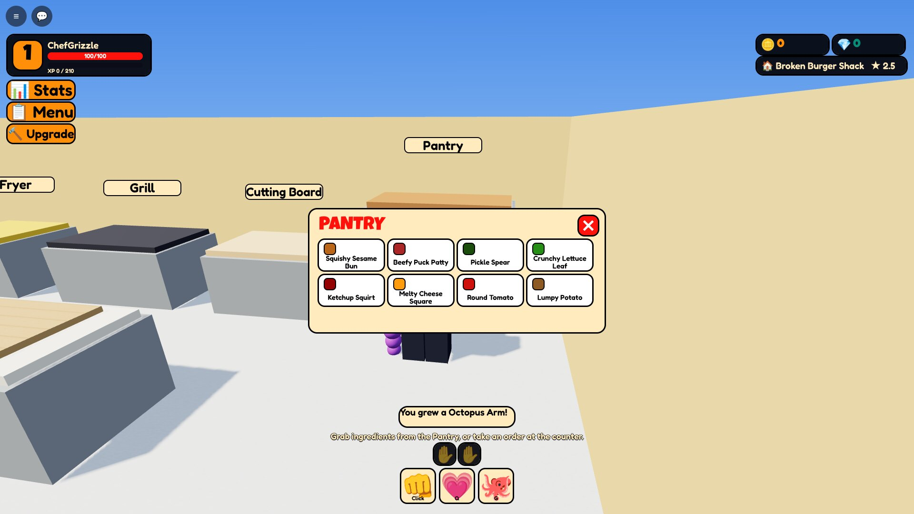

The panel lists every ingredient on the current menu. The purple Octopus Arm is on, and the carry bar shows 2 hands.

### 3. Two patties on the Grill

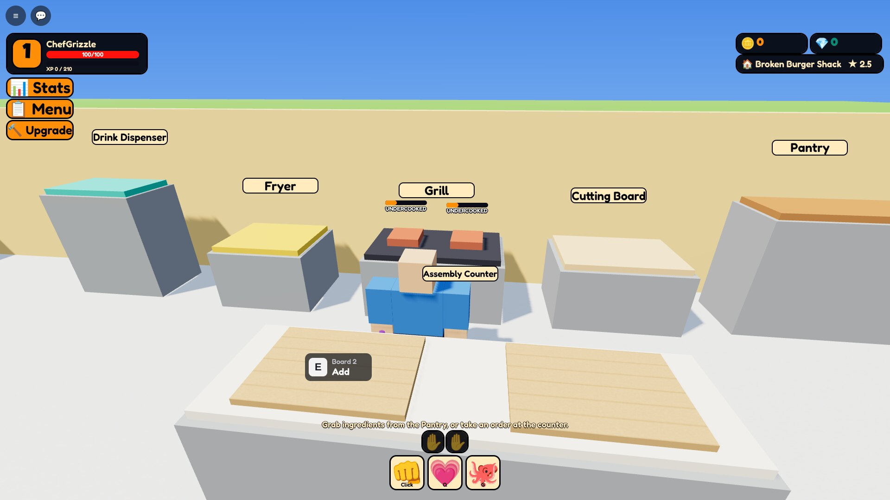

Live doneness bars over each patty: UNDERCOOKED, then PERFECT, then BURNED.

### 4. Chopping lettuce

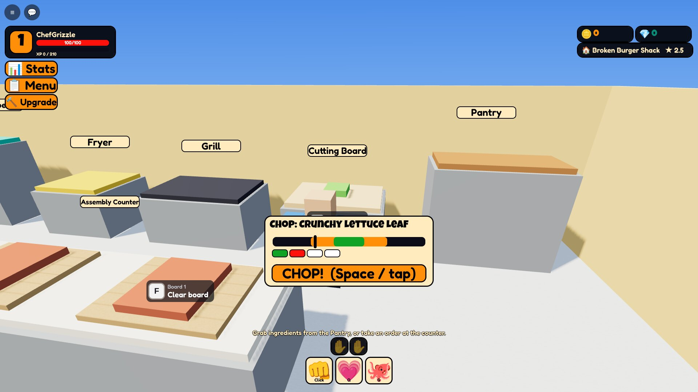

Tap when the marker is in the green. Each pip shows how clean that cut was.

### 5. Building a Basic Burger

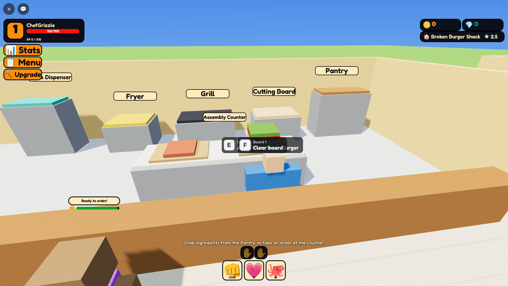

Patty, lettuce, bun, ketchup and pickle stacked on board 1. The prompt names the dish once the stack matches.

### 6. The first customer

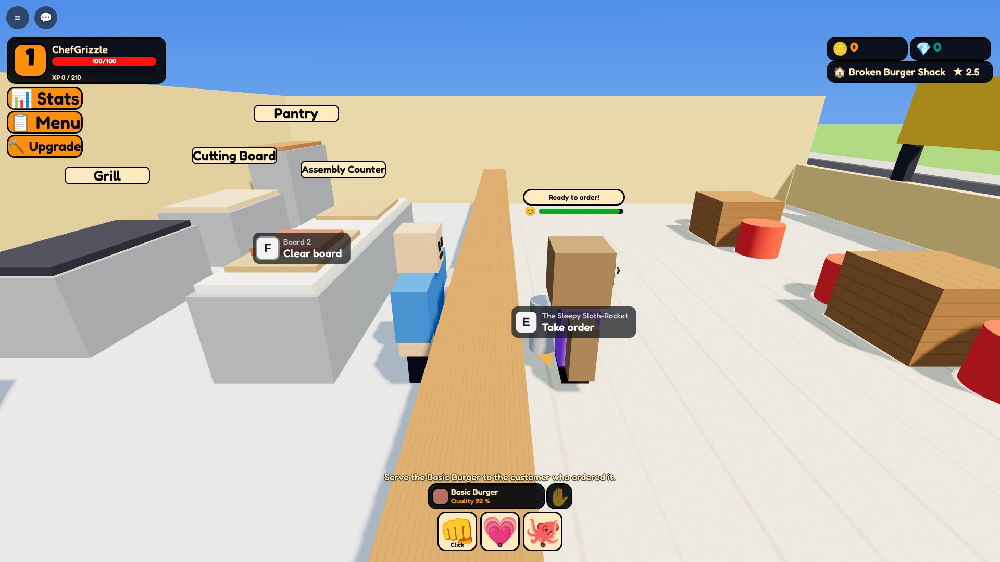

A Sleepy Sloth-Rocket at the counter: "Ready to order!" and the Take order prompt.

### 7. Serving with a special request


The ticket and the bubble both show "Hold the pickles." Cheeseburger in hand, Serve prompt up.

### 8. Paid

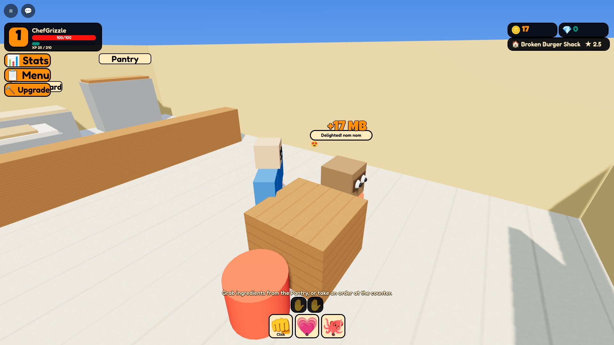

+17 MB and a Delighted customer. Money, XP and reputation all come from the server's satisfaction formula.

### 9. Pouring a Fizzy Soda

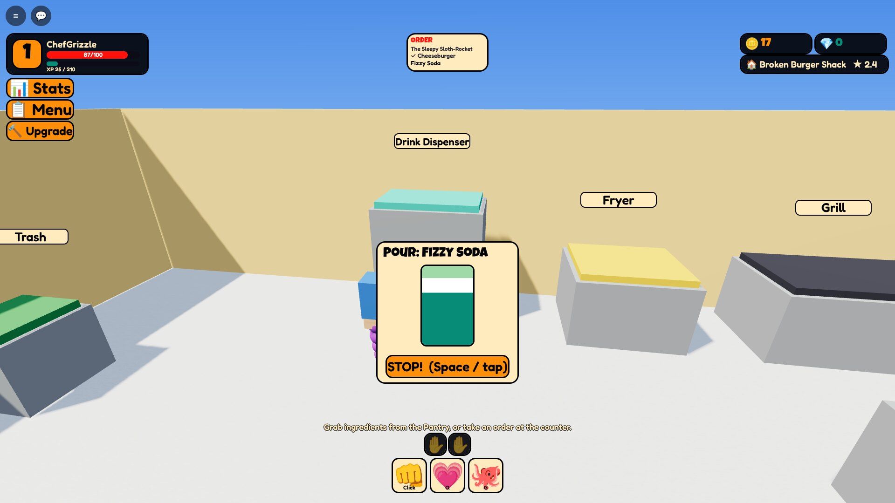

Stop the fill inside the green band for a Perfect drink.

### 10. Lunch rush

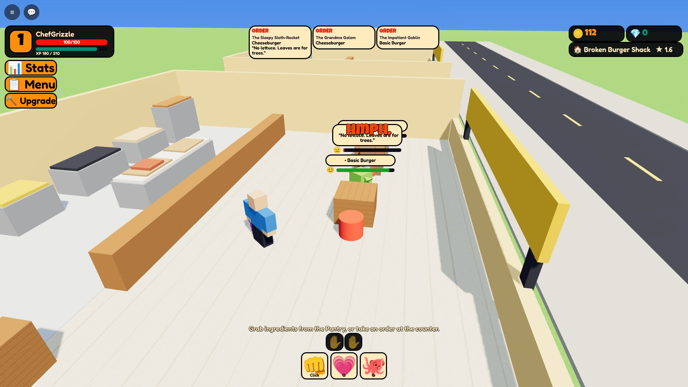

Three orders taken at once. The ticket rail fills up and every table has an order bubble.

### 11. Grill fire

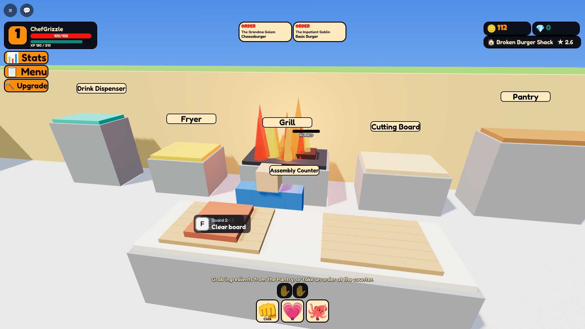

A forgotten patty burned and caught fire. Hold the prompt to put it out.

### 12. Food fight


An Impatient Goblin hits anger level 3 and throws food. The plate is mid-air over the kitchen.

### 13. Fighting back

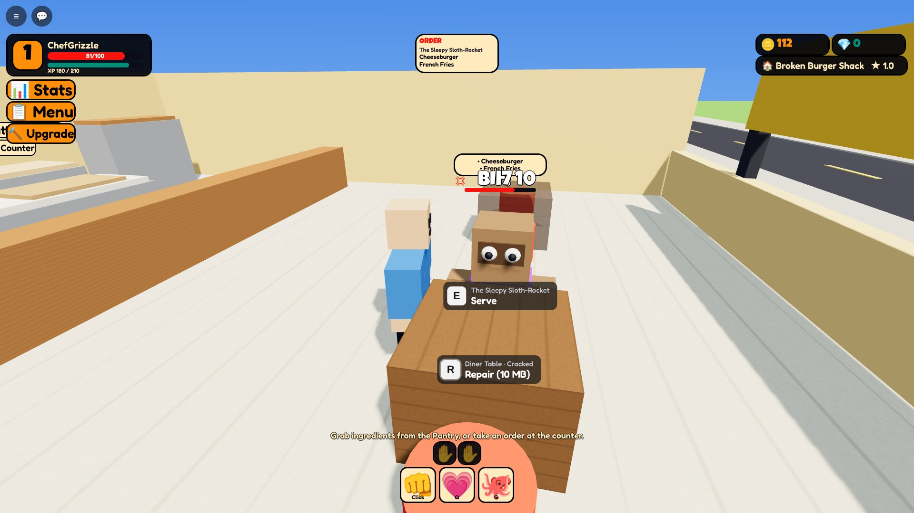

Swipe Combo on a Sleepy Sloth-Rocket at anger level 5 ("BIF!" on the third hit). Its table is already cracked.

### 14. Dizzy

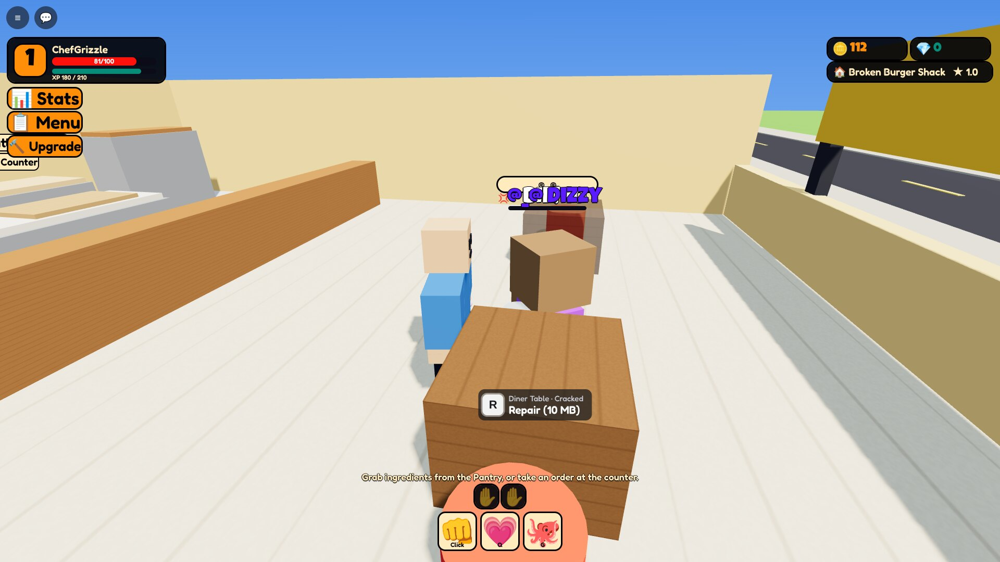

Huff Points gone. The customer pays a 40 % apology and leaves.

### 15. Level 3 stats

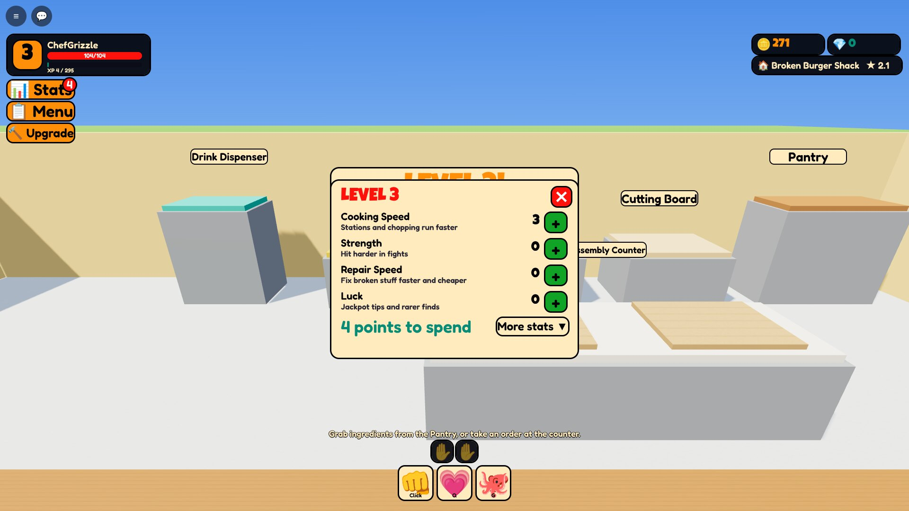

The four headline stats with 4 points to spend. "More stats" opens all nine.

### 16. Repairing a destroyed table

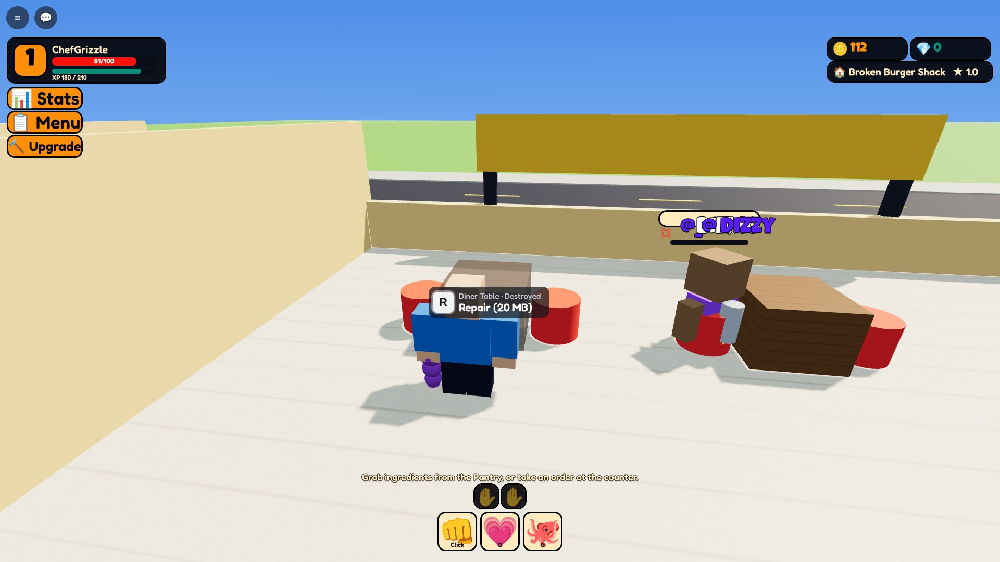

Smashed by an angry customer. Press R to rebuild it for 20 MB.

### 17. Menu editor

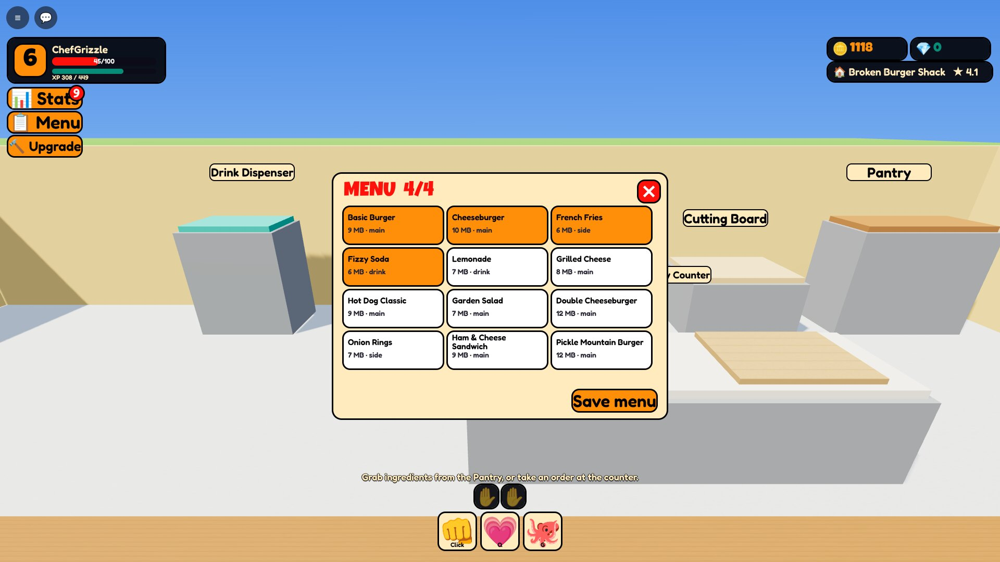

Four menu slots at TIER_01. Recipes unlock by level.

### 18. Upgrade


Level 6 and 1,118 MB earned by the bot: ready to become the Tiny Mutation Diner.

### 19. The Tiny Mutation Diner

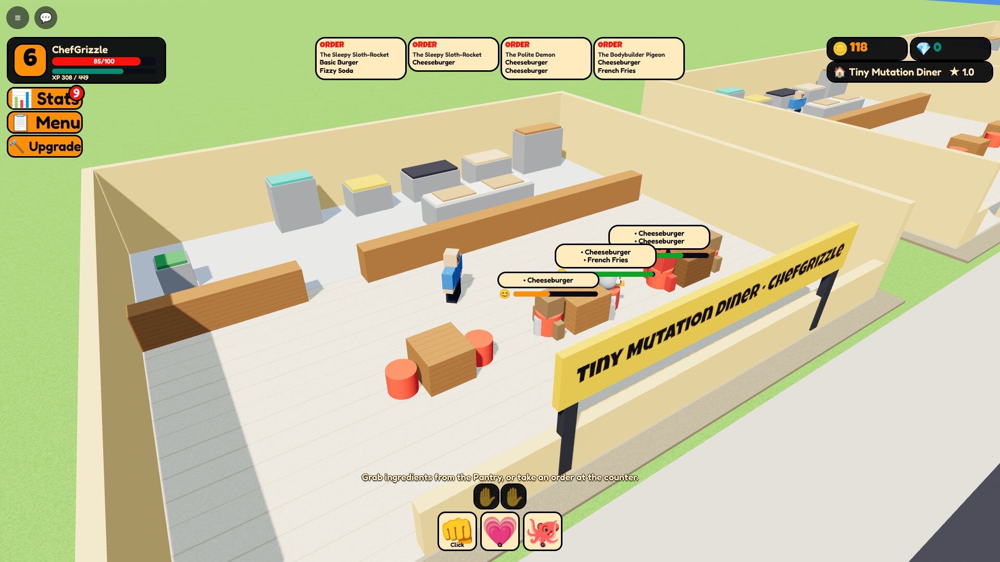

Six seats, five menu slots, and new customer types such as the Bodybuilder Pigeon on the ticket rail.

### 20. Restaurant Row

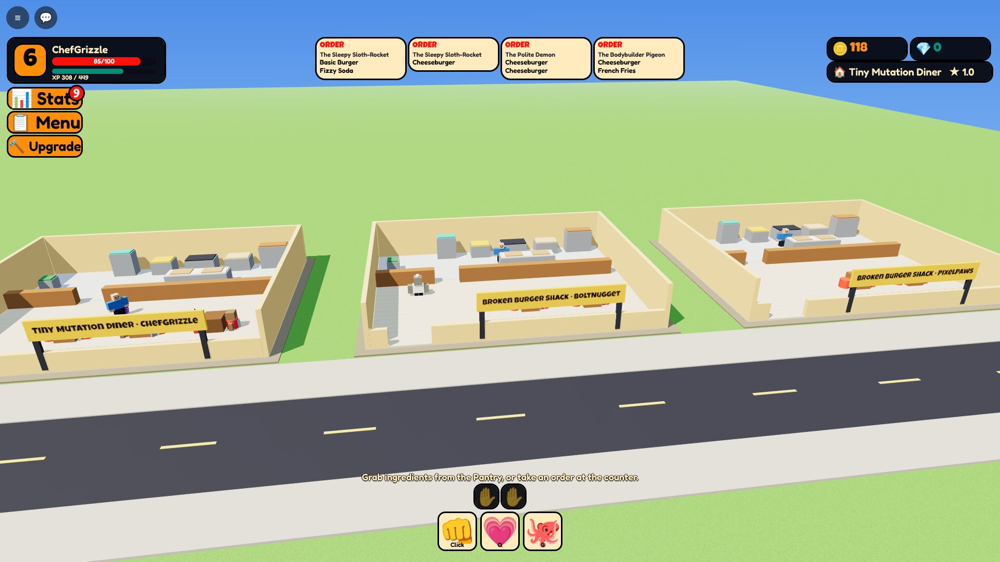

Three players' restaurants on the street: ChefGrizzle's diner, then BoltNugget's and PixelPaws' shacks.
