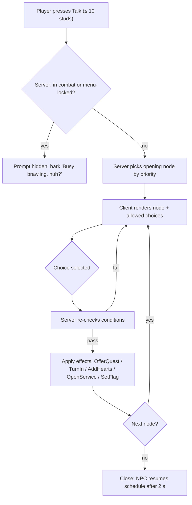

## 19. City NPCs

> Morph City's named residents are the game's living UI. They hand out quests, run shops, gossip, heckle,
> and react to what the player has done. This section covers the **NPC runtime system** (§19.1–§19.8) and the
> **NPC database** (§19.9): **115 named NPCs**, made up of canon `NPC_001`–`NPC_030` plus `NPC_031`–`NPC_115`,
> grouped by district. Quest IDs referenced here are defined in §20. Buildings, districts and events are
> canon (§C16) and are specified in §18 / §36.10 / §36.11.

### 19.1 Purpose

- Make the city feel inhabited and funny. Every named NPC has a distinct silhouette, a voice and a running joke.
- Act as the front end of every city service: shopkeepers open shop UIs, Ms. Hirewell opens hiring, Mayor
  Moosington issues permits.
- Deliver quests (§20) through markers, dialogue and turn-ins, and carry the story campaign's cast.
- Offer an optional, light **Hearts** friendship track (§19.6) that rewards curiosity with cosmetics. It
  never gates core progression.

### 19.2 Rules & Mechanics — the NPC data model

Each named NPC is a single data record (`ReplicatedStorage/Shared/Data/NPCs/<NPC_ID>.lua`, generated from
`gdd/data/npcs.jsonl`). Behavior is entirely data-driven: the runtime ships no per-NPC scripts.

```lua
--!strict
export type NPCDef = {
	id: string,                 -- "NPC_016"
	nameKey: string,            -- "npc.NPC_016.name"
	district: string,           -- "DST_07"
	building: string?,          -- "BLD_14" (nil = street NPC)
	morph: { parts: {string}, signature: {string}, scale: number }, -- MUT ids + NPC-only signature meshes
	role: "SERVICE" | "QUEST" | "AMBIENT" | "STORY" | "BOSS",
	service: string?,           -- UI screen opened by the "Shop"/"Service" option, e.g. "CriticHQ"
	schedule: {ScheduleEntry},  -- §19.5
	dialogueTree: string,       -- "dlg_NPC_016"
	questIds: {string},         -- quests offered or involving this NPC (§20)
	hearts: { enabled: boolean, favoriteCategory: string? }, -- §19.6
	voice: { blipSet: string, pitch: number },               -- gibberish "blip" voice, never real speech
	barkCooldown: number,       -- seconds, default 45 [TUNABLE]
}
```

**Morph rule.** Named NPCs are built by `MorphAssemblyService` from canon mutation parts (`MUT_` ids, §C13.6)
plus, where canon calls for something outside the catalog (a moose head, a vending-machine torso, a news-desk
body), **signature meshes**. These are NPC-only MeshParts authored to the same R15 attachment contract
(§C13.7) and the 24-MeshPart / 6,000-triangle NPC budget. Signature meshes are **never obtainable** and grant no
stats; they keep key characters unique (§25 owns the art). In §19.9 they appear in the morph column as plain
words with no ID.

**Role classes** (tagged in brackets at the start of each NPC's *Interaction behavior* cell in §19.9)

| Role class | Count | Always present? | Moves? | Notes |
|---|---|---|---|---|
| SERVICE | 18 | yes, at the counter | no (idles in place) | opens a building UI; must never be unavailable |
| STORY | 9 | yes (chapter-aware position) | scripted | campaign cast; may appear in the player's restaurant during set pieces |
| QUEST | 80 | while the district is loaded | short wander ≤ 12 studs (PATROL/RIDE NPCs: fixed loops) | gives or is involved in ≥ 1 quest |
| AMBIENT | 7 | district loaded | full schedule | color, barks, hints; still involved in ≥ 1 quest |
| BOSS | 1 | event-driven | event script | King Ratbeard during `EVT_007` (A6/A12 define the fight) |

### 19.3 Dialogue trees (conditions, variables, effects)

A dialogue tree is a graph of nodes. The client renders it. The **server** evaluates conditions and applies
effects, so a client can never pick a branch it isn't entitled to.

```lua
--!strict
export type DialogueNode = {
	id: string,                       -- "greet_day"
	speaker: string,                  -- "NPC_016" or "PLAYER"
	textKey: string,                  -- "npc.NPC_016.greet_day.01"
	conditions: {Condition}?,         -- all must pass
	effects: {Effect}?,               -- applied server-side when the node is shown
	choices: {{ textKey: string, next: string, conditions: {Condition}? }}?,
	next: string?,                    -- auto-advance when there are no choices
}
-- Condition examples:
-- {kind="QuestState", quest="QST_STY_007", state="Active"}   states: Locked|Available|Active|ReadyToTurnIn|Completed
-- {kind="LevelAtLeast", value=10}       {kind="TierAtLeast", value=3}     {kind="Hearts", npc="NPC_016", atLeast=2}
-- {kind="TimeOfDay", phase="Night"}     {kind="EventActive", event="EVT_008"}
-- {kind="HasMutationTag", tag="chef"}   {kind="Flag", name="baron_friend"}  {kind="Chance", p=0.25}
-- Effect examples:
-- {kind="OfferQuest", quest="QST_STY_007"}  {kind="TurnIn", quest="QST_STY_007"}  {kind="TalkObjective", npc="NPC_016"}
-- {kind="SetFlag", name="met_fourchette"}   {kind="AddHearts", npc="NPC_016", amount=5}  {kind="OpenService", screen="CriticHQ"}
```

**Variables** (resolved on the client from replicated state, inserted through `LocalizationTable` format
arguments, never by string concatenation): `{player}` morph nickname, `{restaurant}` restaurant name,
`{tierName}` canon tier name, `{level}`, `{stars}` reputation to one decimal, `{eventName}`, `{favDish}`
(the player's most-served recipe this week), `{hearts}`.

**Opening-line priority** (first match wins):
1. a quest is **ReadyToTurnIn** with this NPC → turn-in line (purple ? marker);
2. a story beat is pending → story line;
3. a quest is **Available** from this NPC → offer line (yellow ! marker);
4. an event in this district is active → event line;
5. Hearts ≥ 3 → friendly line (uses `{player}`);
6. a time-of-day line;
7. a random line from the NPC's pool of 6–10, never repeating any of the last 3 shown to this player.

**Barks.** These are ambient one-liners in a speech bubble when the player passes within 20 studs. Cooldown is
45 s per NPC per player. A client shows at most 2 bubbles at once, and none while the player is In Combat.
Barks react to systemic state such as "Nice Octopus Arm!" (the player has the `tentacle` tag), "Smells like
burnt toast…" (a fire in the last 60 s), or "Your reputation's up to {stars}★!", so humor comes out of play
rather than from scripts alone.



### 19.4 Interaction prompt rules

| Rule | Value [TUNABLE] |
|---|---|
| Prompt type | `ProximityPrompt` on the proxy, `RequiresLineOfSight = false`, `HoldDuration = 0` |
| Range | 10 studs (matches customers, §C3); server re-validates at 12 studs |
| Prompt selection | only the single best prompt shows: the nearest NPC inside a 60° view cone; ties go to quest markers |
| Labels | "Talk", "Shop", "Quest !", "Turn In ?", "Hire", "Permit" |
| Input | E (keyboard) · ButtonX (gamepad) · tap the prompt (mobile, 56 px minimum target) |
| Facing | NPC turns its head/torso toward the player over 0.3 s and pauses its schedule while dialogue is open |
| Auto-close | dialogue closes after 90 s idle, or if the player moves > 16 studs away |
| Combat | prompts hide while the player is In Combat (§C12.1) or targeted by a level-5 customer (E2) |
| Concurrency | any number of players can talk to the same NPC at once. Each sees their own dialogue. The NPC faces the most recent speaker |
| Rate limit | `NPC.Interact` remote: 4 calls/s per player; `NPC.Choose`: 8 calls/s; excess calls are dropped and logged (§29) |

**Quest markers** (shape plus color, so they never rely on color alone, §26.3): yellow **!** = new quest
available · purple **?** = ready to turn in · blue **↻** = daily/weekly poster · gold **★** = story quest ·
gray **…** = quest locked (tooltip gives the requirement, e.g. "Requires L20"). Markers are client-side
BillboardGuis, visible at 80 studs and on the minimap.

### 19.5 Idle schedules & behaviors

The city's cosmetic lighting cycle lasts 24 minutes (§C3), split into four phases: **Dawn** (min 0–4),
**Day** (4–14), **Dusk** (14–18) and **Night** (18–24). Each NPC has 1–4 schedule entries of
`{phase, anchor, behavior}`. Behaviors:

| Behavior | Description | Server cost |
|---|---|---|
| `STATION` | stands at a counter or desk; loops 2–3 idle animations (from §36.14, by role) | static proxy |
| `WANDER` | random waypoints within a radius (default 12 studs) on the district's waypoint graph | 4 Hz CFrame tween |
| `PATROL` | fixed waypoint loop (guards, mall walkers, couriers) | 4 Hz |
| `COMMUTE` | moves between two anchors at phase change, using the Metro platform as a door (despawn/respawn) | 4 Hz while moving |
| `PERFORM` | stage or busker loop with a crowd-cheer trigger when ≥ 3 players are nearby | static + client FX |
| `SIT` / `SLEEP` | bench, café table or hammock; snore bubbles at Night | static |
| `RIDE` | rides a Metro carriage loop (metro riders); can be talked to when the carriage is docked | rides carriage |

**Rules.** SERVICE NPCs are always `STATION` while their building's service is open, and services are open
24/7, so the schedule only changes their idle animation and barks. QUEST NPCs stay within 12 studs
of their anchor, or on a fixed PATROL/RIDE loop of ≤ 60 s drawn on the minimap while they hold a quest marker, so
quest givers stay findable. Only AMBIENT NPCs commute. During city events,
`CityEventService` may override schedules (`EventOverride`): for example, every DST_07 NPC gathers at the
Showcase Stage (`BLD_22`) during `EVT_027` Downtown Dance-Off.

### 19.6 Hearts — optional friendship (Progression · Player Interactions)

**Purpose.** Reward players who chat, help and feed the cast, with cosmetic goodies only.

| Rule | Value [TUNABLE] |
|---|---|
| Friendable NPCs | 60 (every canon NPC except `NPC_020` during `EVT_007`, plus 30 others; marked "♥ fav: CAT" in §19.9) |
| Scale | 0–5 Hearts; Heart points never decay and never go negative |
| Daily chat | +5 for the first conversation per NPC per UTC day |
| Quest | +20 when completing a quest this NPC gives; +10 when the NPC is only involved |
| Gift a dish | +15 (or +25 if it's their favorite category); 1 gift per NPC per UTC day. A gift is *virtual*: choose any recipe you have served at ≥ GOOD in the last 24 h (server-tracked list). It costs nothing and consumes nothing |
| Event together | +10 when you complete an event in which this NPC appears |
| Thresholds | 1♥ 20 · 2♥ 60 · 3♥ 120 · 4♥ 200 · 5♥ 300 points |

| Heart | Reward (canon C17.4 vocabulary only) |
|---|---|
| 1♥ | new dialogue pool; NPC uses your nickname; favorite category revealed |
| 2♥ | an emote themed on the NPC (plain-text cosmetic, e.g. "Monocle Pop") |
| 3♥ | a cosmetic color palette themed on the NPC |
| 4♥ | 10 × T MS (T = your current tier at the moment of unlock) |
| 5♥ | title "<NPC name>'s Best Friend" + 1 Morph Capsule |

**UI.** A heart row sits under the NPC's name in the dialogue header, and the "Friends of Morph City" tab
in the Quest Journal shows every friendable NPC met so far, their favorite (once revealed), and the next
reward. A full-Heart NPC waves when you pass and gives a bonus bark.

**Progression math.** Five Hearts takes about 10–14 days of casual daily chat-and-gift, or less with quests.
At most about 60 Morph Capsules exist across all 60 NPCs, a one-time total that does not compete with the
capsule pity economy (§C4.7). Hearts unlock no stats, recipes, mutations or services.

### 19.7 Roblox Implementation — SPCV placement, streaming, performance

- **Pattern:** Server Proxy + Client Visual (§C3). For each named NPC the server owns one anchored,
  invisible, non-colliding proxy `Part` (2 × 5 × 2 studs) under `Workspace/City/NPCProxies/<DST>`. Its
  attributes are `NpcId`, `State`, `Facing` and `Anim`, plus the `ProximityPrompt`.
  `MorphAssemblyService` (client builder) builds the visual locally when the proxy streams in
  (`StreamingEnabled`, `ModelStreamingMode = Atomic` for the visual container). Beyond 60 studs it swaps to the
  1,500-triangle impostor and destroys the visual at 150 studs.
- **Spawning:** SERVICE and STORY proxies always exist (static, cheap). QUEST and AMBIENT proxies exist
  only for districts with ≥ 1 player inside, plus a 30 s linger after the last player leaves.
- **Budgets [TUNABLE]:** ≤ 115 named-NPC proxies per server (separate from the 160 customer-proxy cap);
  ≤ 14 per district; ≤ 20 moving proxies per district at once; client visual cap 25 named NPCs (nearest
  first). City crowds stay client-only cosmetic (§C3).
- **Movement:** server tweens proxy CFrames along precomputed district waypoint graphs at 4 Hz, and clients
  interpolate. Named NPCs never use runtime `PathfindingService`. If a waypoint is blocked > 3 s, the NPC
  waits, then "poofs" to the next node (cartoon puff, "Pardon my morph!").
- **Services:** an `NPCService` module inside `QuestService`'s domain (§27 may host it as a submodule of
  `QuestService`) owns proxies, schedules and dialogue evaluation. Remotes: `NPC.Interact(npcId)`,
  `NPC.Choose(npcId, nodeId, choiceIndex)`, `NPC.Gift(npcId, recipeId)`. Server→client: `NPC.Dialogue(node)`,
  `NPC.Bark(npcId, key)`.
- **Persistence (§28):** `profile.npc = { hearts = {[npcId] = points}, lastChatDay = {[npcId] = dayIndex},
  lastGiftDay = {...}, flags = {...} }`. Days are UTC day indices computed from server `os.time()`.

### 19.8 Localization-ready dialogue keys

- Every visible string has a key: `npc.<NPC_ID>.name`, `npc.<NPC_ID>.<nodeId>.<nn>`, `npc.<NPC_ID>.bark.<nn>`,
  `npc.<NPC_ID>.role`. Example: `npc.NPC_025.bark.03` = "Back in my day, burgers had ONE patty and we LIKED it."
- English source lines are ≤ 90 characters, leaving about 30 % room for expansion. Placeholders use named
  arguments (`{player}`). Plurals use separate keys (`.one` / `.other`). Jokes that depend on English
  wordplay carry a `context` column note for translators ("pun on 'fork'; free to replace with a local food
  pun").
- Strings ship in a single `LocalizationTable` per domain (`NPC`, `Quest`). The voice is gibberish blips
  (never recorded speech), so localization never needs re-recording.
- Text passes through `TextService:FilterStringAsync` only when it contains player-authored content
  (`{player}` nickname, `{restaurant}`).

### 19.9 NPC database (115 named NPCs)

Column notes: **Morph** lists canon mutation parts by ID plus a short description. Unlisted words are
NPC-only signature meshes (§19.2). **Quest possibilities** is generated from §20: quests this NPC gives or is
involved in. **Interaction behavior** gives the behavior class (§19.5), what the prompt opens, and
"♥ fav: CAT" for friendable NPCs (favorite recipe category code, §C10).
