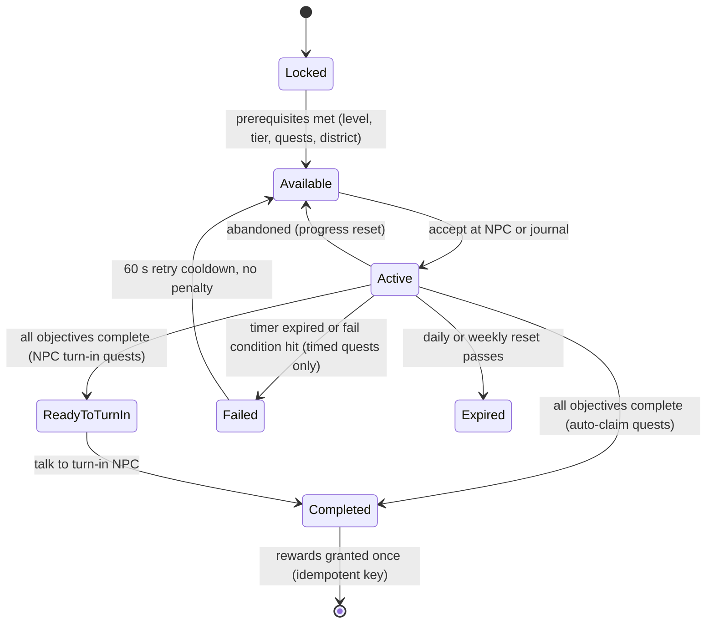

## 20. Quests

> Quests turn "cook, earn, morph" into a guided, funny journey. This section covers the quest runtime (§20.1–§20.7),
> the ten-chapter **story campaign** (§20.8), and the **quest database** (§20.9) of {{QUEST_TOTAL}} fully specified quests.
> NPCs are defined in §19, events in §36.11, tiers in §36.12, recipes in §6 and mutation parts in §36.3. Rewards use
> only the canon C17.4 vocabulary: MB, MS, RT, XP, Morph Capsules, specific `MUT_` parts, `RCP_` recipe unlocks,
> trophies `FRN_901`–`FRN_910`, skill points, stat respec tokens, and plain-text titles, emotes and color palettes.

### 20.1 Purpose

- **Teach** each system at the moment it unlocks (tutorial, district/building access quests, first-hire quests).
- **Pace** progression: every tier has a story chapter, a City Hall permit (TIER_04+), and a handful of challenges.
- **Pull players into the city**: about a third of quests need a city visit, an event, or an NPC conversation.
- **Give every session a goal**: 3 dailies plus 5 weeklies, so a 10-minute session always finishes something.
- **Tell a lighthearted story** about becoming Morph City's greatest restaurateur. The rival is beaten by cooking, never by combat.

### 20.2 Rules & Mechanics — quest types and lifecycle

| Code | Type | Repeatable | Giver / turn-in | Abandon? | Concurrency |
|---|---|---|---|---|---|
| TUT | Tutorial | no | Nana Gristle (`NPC_001`) and the building NPCs named in each row; auto turn-in | no (skip offered, §32) | sequential |
| STY | Story | no | chapter cast; turn in to the giver | no (can untrack) | one chapter at a time, quests in order |
| DLY | Daily | daily pool | Job Board poster NPC (portrait only); auto-claim in journal | no; **reroll** instead | 3 slots |
| WKY | Weekly | weekly pool | Job Board poster NPC; auto-claim | no; weekly reroll | 5 slots |
| CHF | Cooking challenge | no | giver NPC | yes | up to 10 non-story quests active in total |
| CBT | Combat challenge | no | giver NPC | yes | shared cap of 10 |
| RPR | Repair challenge | no | giver NPC | yes | shared cap of 10 |
| EXP | Exploration challenge | no | giver NPC | yes | shared cap of 10 |
| EMP | Employee challenge | no | giver NPC | yes | shared cap of 10 |
| RST | Restaurant expansion (incl. permits) | no | Mayor/Bolt/etc. | permits: no; others: yes | shared cap of 10 |



**Progress rules**

1. **Server-only progress.** Objectives advance only from server-side gameplay signals (§20.3). The client never reports
   progress.
2. **No retroactive counting** for count objectives: progress starts at acceptance. **State objectives** (`ReachLevel`,
   `ReachReputation`, `ReachAtmosphere`, `UpgradeTier`, `OwnEmployees`) are evaluated immediately on accept, so they
   can already be true.
3. **Co-op attribution (§21).** Cook, serve, calm, defeat and repair objectives credit the player who performed the
   action, in any restaurant. `EarnMB`, reputation, atmosphere and staffing objectives count only for the restaurant
   owner. Guests never progress the owner's story quests.
4. **Multi-step objectives** are ordered unless marked "(any order)". The journal shows the current step plus a
   collapsed list.
5. **Recipe Loan rule.** When a STY or CHF objective names a specific `RCP_` the player doesn't know yet, and the player's
   level ≥ that recipe's unlock level, accepting the quest teaches the recipe permanently for free (counts as a C17.4
   recipe-unlock reward). Required stations are never granted. The quest card shows "Needs `STN_…`" with a shortcut to
   Restaurant Supplies (`BLD_03`).
6. **District gates.** A quest whose location is in a locked district stays **Locked** with the tooltip "Unlocks at L*n*"
   (canon §C16.1).

### 20.3 Objective grammar (typed objectives)

Objectives are typed records `{type, params, target, progress}` written in the database as `Type(params, target)`.
`⁺` after a target means it scales with the player's tier at accept time: `round(N × (1 + 0.15 × (T − 1)))` [TUNABLE].
Quality qualifiers: `≥GOOD` / `PERFECT` (§C8). `S≥n` means customer satisfaction ≥ n (§C11.3).

| Objective type | Parameters | Advanced by (server signal) | Validation notes |
|---|---|---|---|
| `TakeOrder` | n | `OrderService.OrderTaken` | tutorial only |
| `CookRecipe` | recipe, n, quality? | `CookingService.DishCompleted` | dish must be plated and served (not just cooked) for count > 1, to stop trash-farming |
| `CookCategory` | category or "distinct k", n, quality? | `CookingService.DishCompleted` | category from the recipe ID (§C10) |
| `CookQuality` | grade, n | `CookingService.DishCompleted` | any recipe |
| `ServeCustomers` | n, condition? | `OrderService.OrderServed` | condition e.g. "S≥80", "table service", "≥ 2 employees assigned" |
| `ServePersonality` | `PER_` or "distinct k", n, S≥? | `CustomerAIService.CustomerPaid` | only rolled or required if the personality is in the player's current spawn table (§9) |
| `AchieveSatisfaction` | threshold, n | `CustomerAIService.CustomerPaid` | uses final S after modifiers |
| `EarnMB` | amount | `EconomyService.Credit` (source ∈ sales, tips, offline) | quest rewards never count toward EarnMB |
| `CalmCustomers` | n, ability? | `CustomerAIService.Deescalated` | a customer counts once per visit |
| `DefeatHostiles` | n, location/event? | `CombatService.TargetDizzied` | hostile customers, event hostiles, training dummies when stated |
| `RepairObjects` | n, state/grade/location? | `RepairService.RepairCompleted` | an object counts once per damage instance (E3 rebuild counts once) |
| `MaintainCleanliness` | value, duration | `RestaurantService.CleanlinessTick` | timer resets if K < value |
| `VisitBuilding` | `BLD_` or "any distinct k" | `NPCService.ZoneEntered` | interior volume trigger, server-checked position |
| `DiscoverSecret` | secret key | `CityService.SecretFound` | secret keys are listed in §18 (story props) or by canon §C13.8 |
| `DiscoverLocation` | kind, n | `CityService.LocationDiscovered` | metro stations, landmarks, exhibits, collectibles |
| `Travel` | mode (Metro / Pigeon Taxi), n distinct districts | `CityService.TravelCompleted` | |
| `TalkToNPC` | `NPC_` or "distinct k" | `NPCService.TalkObjective` | dialogue node must be reached server-side |
| `CompleteEvent` | `EVT_` or "any", stage/score? | `CityEventService.ParticipationAwarded` | Bronze participation or better unless stated |
| `HireEmployee` | role or `EMP_001`, n | `EmployeeService.Hired` | |
| `AssignRole` | role or "distinct k" | `EmployeeService.Assigned` | |
| `TrainEmployee` | n sessions | `EmployeeService.Trained` | |
| `RaiseMorale` | n employees, threshold | `EmployeeService.MoraleChanged` | state check: true at the moment of evaluation |
| `OwnEmployees` | n, filter? | `EmployeeService.RosterChanged` | state objective |
| `UpgradeTier` | `TIER_` | `BuildingService.TierUpgraded` | state objective |
| `UpgradeStation` | level, n | `BuildingService.StationUpgraded` | |
| `PlaceFurniture` | n, category? | `BuildingService.Placed` | placing, removing and re-placing the same item counts once |
| `FillMenu` | n slots, min distinct categories? | `RecipeService.MenuChanged` | state objective; counts only recipes the player can currently cook (not SOLD OUT) |
| `ReachAtmosphere` | value | `RestaurantService.AtmosphereChanged` | state objective |
| `ReachReputation` | stars | `RestaurantService.ReputationChanged` | state objective |
| `PurchaseStock` | `ING_`, crates | `InventoryService.StockPurchased` | special stock only |
| `EquipMutation` | `MUT_` / "k slots" / family | `MutationService.Equipped` | |
| `UpgradeMutation` | part or "any", n | `MutationService.Upgraded` | |
| `UseAbility` | `ABL_` or "any mutation", n, outcome? | `CombatService.AbilityResolved` | outcome e.g. "blocked a hit", "successful dodge" |
| `CollectOffline` | n reports, minHours? | `OfflineEarningsService.Claimed` | idempotent by `reportId` (§C15) |
| `WinArenaMatch` | n, mode? | `MultiplayerService.ArenaResult` | every arena objective also accepts the non-PvP **Bash the Bots** (PvE) and **Cook-Off** race modes (§21), so **PvP is never required** |
| `DeliverOrders` | n, destination? | `OrderService.DeliveryCompleted` | Delivery Depot missions (§18) or quest drop-offs |
| `ReachLevel` | L | `ProgressionService.LevelUp` | state objective |
| `MoveTo` | marker | `NPCService.ZoneEntered` | tutorial only |

### 20.4 UI — journal, tracking, markers

- **Quest Journal** (full-screen; hotkey J / gamepad Select / mobile scroll icon). Tabs: **Story** (chapter cards, art
  thumbnails, "Previously on…" recap read by Nana's hologram), **Daily & Weekly** (slots, reset countdowns in local time,
  reroll button), **Challenges** (filter chips TUT · CHF · CBT · RPR · EXP · EMP · RST), **Completed**, and
  **Friends of Morph City** (§19.6).
- **Quest card:** name, giver portrait, short description, objective checklist with progress bars ("7/10"), timer chip
  for timed quests, rewards row (currency icons + item thumbnails with rarity shape), Track toggle, Abandon (where allowed).
- **HUD tracker:** up to **3** tracked quests (story auto-tracked first). Each shows the current step only. Tapping it
  sets a **waypoint** that draws an arrow-trail on the ground (client-only) and pins the map.
- **Markers:** ! ? ↻ ★ … above NPCs and on the minimap (§19.4). Completed objective = check + chime + a small confetti
  burst (reduced-FX: chime only).
- **Toasts:** "Quest updated" (≤ 1 per 2 s, merged), "Quest complete!" with a reward fly-out into the currency counters.
  Toasts never cover the order queue or the patience meters (§24 safe zones).
- **Accessibility:** every timer has a text countdown, colors are paired with icons, and the "Story Assist" toggle
  (§20.7) is reachable from any failed timed quest.

### 20.5 Daily & weekly rotation and rerolls

| Rule | Daily | Weekly |
|---|---|---|
| Slots | **3** | **5** |
| Reset | 00:00 UTC every day (§C3) | Monday 00:00 UTC |
| Draw | deterministic seeded draw from the eligible pool: `seed = hash(UserId, dayIndex, POOL_VERSION)` | `seed = hash(UserId, weekIndex, POOL_VERSION)` |
| Eligibility | unlock level, district unlocked, required systems (e.g. employees, Arena opt-in), personality in spawn table | same |
| Diversity | ≤ 1 per category tag (cook / serve / combat / repair / explore / staff) per day; no repeats from yesterday | ≤ 2 per category tag; no repeats from last week |
| Free reroll | **1 per UTC day** (any one slot) | **1 per week** |
| Extra rerolls | 0.01 × IncH(T) MB each, max 3 per day [TUNABLE]. MB only, never Robux (§23) | 0.04 × IncH(T) MB, max 1 per week |
| Social exemption | — | co-op/social weeklies (`QST_WKY_013`, `QST_WKY_014`) can be rerolled free at any time by players who prefer solo play |
| Completion bonus | **Daily Trio** — all 3 claimed: 1 Morph Capsule | **Weekly Sweep** — all 5 claimed: 2 Morph Capsules + 1 RT |
| Expiry | unfinished dailies expire at reset (no penalty) | unfinished weeklies expire at reset (no penalty) |

The draw is stored when the player first loads after reset (`profile.quests.daily = {dayIndex, slots, rerollsUsed}`).
Reconnecting the same day restores the same slots and progress, and rerolling replaces one slot's quest ID while
keeping the `dayIndex`.

### 20.6 Variables — reward scaling [TUNABLE]

**Notation.** `IncH(T)` = canon net MB per active hour at tier T (§C4.4). `XPR(L)` = `900 × 1.045^(L−1)` (§C5.1).
Each one-time quest carries a reference tier `t` and level `l`:
`MB = f_MB × IncH(t) × P_MB(t)` and `XP = f_XP × XPR(l) × P_XP(t)`. Values are rounded to friendly numbers
(< 100 → 5, < 1,000 → 10, < 10,000 → 50, < 100,000 → 100, else 1,000). `P_MB` / `P_XP` are **tier pacing factors**
(table below). Tiers 2–4 last only 2–7 hours (§C4.4) yet hold many teaching quests, while tiers 8–10 last 25–80 hours,
so a constant fraction would either flood the early game or starve the late game. Daily and weekly rewards scale with
the player's **current** T and L, snapshotted at accept, so upgrading mid-quest never changes the payout.

| Quest type | f_MB | f_XP | MS | RT | Other |
|---|---|---|---|---|---|
| TUT | fixed per §32.5: 600 MB total (500 MB before `QST_TUT_011`) | fixed per §32.5: ≈ 360–380 XP (`QST_TUT_007` tops up to Level 2) | 10 | — | `MUT_145` / `MUT_144` / `MUT_153` choice; 1 Morph Capsule; 2 titles; 1 emote |
| STY (regular / chapter finale) | 0.15–0.20 / 0.30–0.40 | 0.30 / 0.60 | 2×T to 10×T | from Ch. 3: 1–15 (finale Ch. 10: 50) | finales: 1 skill point; trophies, parts, titles |
| DLY (no P factor) | 0.02 | 0.25 (canon example) | 2 + T | — | Daily Trio bonus: 1 Morph Capsule |
| WKY (no P factor) | 0.08 | 0.50 | 5 × T | 1 + ⌊(T−1)/4⌋ | Weekly Sweep: 2 Morph Capsules + 1 RT |
| CHF / CBT / RPR / EXP / EMP | 0.10–0.25 | 0.20–0.40 | 3 to 60 | late-game: 1–5 | trophies, parts, palettes, titles |
| Legendary Recipe quests (CHF_011–015) | 0.30 | 0.50 | 80–150 | 10–25 | the `RCP_LEG_` recipe |
| RST permits / other RST | 0.15 / 0.10 | 0.50 / 0.20 | 3 × T | — | permit flag (a gate, not a reward item) |

**Daily and weekly reward values by tier** (XP shown at each tier's entry level; generated):

{{SCALE_TABLE}}

**Budget check** (generated from the database). For each tier: total one-time quest MB divided by the income earned
while in that tier (`IncH × hours in tier`, from the cumulative-hours column of §C4.4), and total one-time quest XP
divided by the XP needed to cross the tier's level band (§C5.1). Targets [TUNABLE]:

- `TIER_01` is the tutorial onboarding grant (§32.5), deliberately generous: it pays for the first upgrade and leaves the player at Level 2.
- `TIER_02`–`TIER_04` allow ≤ 25 % MB / ≤ 20 % XP, a deliberate early-session boost.
- `TIER_05`+ allow ≈ 8 % MB / ≈ 12 % XP.
- For a typical 1.5 h/day player, dailies add ≈ 4 % and weeklies ≈ 4 % of income. One-time + repeatable quests
  therefore stay near the canon ~15 % "quests + events" share from mid-game on; events are budgeted in §36.11.

{{BUDGET_TABLE}}

**Skill points.** Quests grant at most **15** skill points in total (§14 budget: levels 99 + achievements 10 + milestones
6 + quests ≤ 15). The database grants {{SP_TOTAL}}: one per story chapter finale, one for the epilogue, and one for
the final Legendary Recipe quest.

### 20.7 Failure, abandon, retry — and Roblox implementation

**Timed quests**

- The timer is server-side (`os.time()`). Shift-style challenges begin when the player presses **Start Challenge** in
  the journal or at the NPC, not on accept, so accepting and walking away is never punished.
- The timer runs only while the player is online and inside the required location (their restaurant, a district, an
  event zone). Leaving pauses it for up to 60 s; staying away longer fails the attempt.
- **Fail** → state `Failed` → 60 s cooldown → `Available`. There is **no currency, item or XP penalty, ever**. Only the
  timed attempt's progress resets; untimed steps already completed in the same quest stay completed.
- **Disconnect / server shutdown** during a timed attempt voids the attempt (no fail count, no cooldown).
- **Story Assist:** after 3 failed attempts of the same STY or TUT step, the player may toggle Story Assist for that step
  (+50 % time, −20 % count targets rounded up, same rewards). The story can always be finished (§26.4).

**Event-dependent quests**

- Non-story event quests (e.g. `QST_EXP_006`) are offered only while their event is active or scheduled within the
  next 24 h. Progress **persists across event occurrences** and they never fail.
- Story quests that need an event (`QST_STY_019`, `QST_STY_022`, `QST_STY_031`, `QST_STY_032`) open a **Story Replay**
  instance if the live event isn't running within 60 min of the player starting the step. Story Replay is a solo or
  party instance of the event's script that grants only the quest objective, not the event's own rewards. A12 provides
  the replay mode per event (§36.11).

**Abandon / retry**

- Challenge quests (CHF/CBT/RPR/EXP/EMP, non-permit RST) can be abandoned from the journal (confirmation dialog).
  Progress resets, and the quest can be re-accepted immediately.
- STY, TUT and permit quests can't be abandoned, only untracked. Dailies and weeklies are rerolled, not abandoned (§20.5).

**Server validation & duplicate-reward prevention**

```lua
--!strict
-- QuestService (server). Rewards come only from server data; clients send IDs, never values.
export type QuestState = {
	id: string, key: string, progress: {number}, acceptedAt: number,
	timerEndsAt: number?, tierSnap: number, levelSnap: number, status: string,
}

local function questKey(def, slotInfo): string
	if def.kind == "DLY" then return ("D:%d:%d:%s"):format(slotInfo.dayIndex, slotInfo.slot, def.id) end
	if def.kind == "WKY" then return ("W:%d:%d:%s"):format(slotInfo.weekIndex, slotInfo.slot, def.id) end
	return def.id                                    -- one-off quests: the ID itself, claimable once forever
end

function QuestService.Claim(player: Player, key: string)
	return PlayerDataService.Update(player, function(profile)  -- session-locked UpdateAsync wrapper (§28)
		local q = profile.quests.active[key]
		if not q or q.status ~= "Completed" then return false, "NotComplete" end
		if profile.quests.claimed[key] then return false, "AlreadyClaimed" end
		local bundle = QuestRewards.Build(QuestDefs[q.id], q.tierSnap, q.levelSnap)  -- §20.6 formulas
		local ok = EconomyService.GrantBundle(profile, bundle, "quest:" .. key)      -- idempotent key, txn log
		if not ok then return false, "GrantFailed" end
		profile.quests.claimed[key] = os.time()   -- one-offs: kept forever; repeatables: ring buffer of last 200
		profile.quests.active[key] = nil
		return true
	end)
end
```

- Remotes (rate-limited per player): `Quest.Accept(questId)` 2/s · `Quest.Claim(key)` 2/s · `Quest.Reroll(slot)` 1/s ·
  `Quest.Track(key, on)` 4/s · `Quest.StartChallenge(key)` 1/s. Server → client: `Quest.State(snapshot)`,
  `Quest.Progress(key, idx, value)` (batched at most every 0.5 s).
- Anti-farm: a customer, dish ticket, damaged object or hostile counts **once** per objective. Self-ordered dishes don't
  exist (orders come from `OrderService`), and trash-binned dishes never count.
- Claims and the profile write are one session-locked update. A reward bundle ≥ 10,000 MB triggers an immediate save
  (canon §C3). `EconomyService` rejects a repeated idempotency key (last 500 kept), so double-taps, reconnects and
  cross-server races can't pay twice (E11-style).
- Content updates: quest IDs are never reused. If a definition's target drops, active progress is clamped and
  re-evaluated. If a quest is retired, active instances with ≥ 50 % progress auto-complete with their rewards; the
  rest are removed with an apology toast and 1 Morph Capsule.
- Analytics (§31): `mmr_quest_accept`, `mmr_quest_progress` (sampled), `mmr_quest_complete {questId, durationS,
  attempts}`, `mmr_quest_fail {questId, reason}`, `mmr_quest_reroll {slot, paid}`, `mmr_story_chapter {chapter}`.

### 20.8 Story campaign — "From Shack to Legendary"

Ten chapters, one per restaurant tier (canon §C17.3). Each chapter opens when the player reaches its tier and
finishes the previous chapter. Chapter quests unlock in order. Finales grant a skill point and a signature reward.
Recurring jokes: the Baron's offers keep getting smaller ("three MB and a coupon" → "a coupon" → "half a coupon"),
Nana's hologram flickers at dramatic moments, and Old Man Pigeon always already knew.

#### Chapter 1 — "Grease Is the Word" (`TIER_01`, L1–4) · `QST_STY_001`–`QST_STY_003`
- **Synopsis:** You inherit Nana Gristle's crumbling shack. Baron Von Bistro makes an insulting offer, you refuse, and he
  "anonymously" tips off the health inspector.
- **Set pieces:** the Baron's contract arrives as a paper airplane that bonks you on the nose. Nana's recipe tin is hidden
  inside the cold fryer, guarded by one very offended pickle. During the inspection, Inspector Grimewell sniffs every
  surface while Sniffles hides in your trash can, sneezing.
- **Cast:** `NPC_001`, `NPC_003`, `NPC_028`, `NPC_022`. **Unlocks:** `RCP_DRK_002` Lemonade; finale skill point.

#### Chapter 2 — "Diner-Mite" (`TIER_02`, L5–9) · `QST_STY_004`–`QST_STY_006`
- **Synopsis:** Le Fancy Fin fires free canapés at your queue from a sample cannon. Meanwhile your crates vanish
  overnight, and tiny crowned footprints lead to a manhole.
- **Set pieces:** canapés splat on customers' faces (they need calming). Old Man Pigeon's informants arrange
  breadcrumbs into a map. Each footprint has a tiny crown imprint.
- **Cast:** `NPC_003`, `NPC_031`, `NPC_033`, `NPC_017`, `NPC_059`, `NPC_025`, `NPC_097`. **Unlocks:** `MUT_235`
  Pigeon Wings; skill point.

#### Chapter 3 — "Café Society" (`TIER_03`, L10–17) · `QST_STY_007`–`QST_STY_010`
- **Synopsis:** Madame Fourchette grants your first official rating. The Baron pays Vlogzilla for a bad review, then
  sends Sniffles to sneeze pepper through your vents. You climb to 3.5★ anyway.
- **Set pieces:** the whole café holds its breath as Fourchette's neck lowers inch by inch toward a fry. Vlogzilla's
  live chat rains thumbs-down icons that flip to flame icons on the first bite. Pepper clouds make customers sneeze
  their soup across the room.
- **Cast:** `NPC_016`, `NPC_082`, `NPC_021`, `NPC_028`, `NPC_003`. **Unlocks:** title "Café Celebrity"; skill point.
  Chapter barks point players to Arena access (`QST_CBT_001`, L12) and Lab access (`QST_EXP_002`, L15).

#### Chapter 4 — "Down the Drain" (`TIER_04`, L18–25) · `QST_STY_011`–`QST_STY_013`
- **Synopsis:** The footprints lead to King Ratbeard, who "borrows" ingredients through the pipes. A Borrowing Treaty
  ends the raids and reveals who has been buying the borrowed crates: the Baron.
- **Set pieces:** a throne room built from upturned colanders. The treaty is signed with a ketchup quill and notarized
  by the Mayor's giant stamp.
- **Cast:** `NPC_026`, `NPC_107`, `NPC_020`, `NPC_100`, `NPC_101`, `NPC_002`. **Requires:** Mystery Market access
  (`QST_EXP_003`, L20). **Unlocks:** `MUT_049` Rat Nose, title "Friend of the Sewer Crown"; skill point.

#### Chapter 5 — "Close Encounters of the Fried Kind" (`TIER_05`, L26–34) · `QST_STY_014`–`QST_STY_017`
- **Synopsis:** Zorp's tour bus parks inside your dining-room wall. The alien tourists find Earth food "too solid",
  so Professor Saucington and Zorp create the **Alien Cuisine course**.
- **Set pieces:** a cartoon crash (only the wall's pride is hurt) followed by aliens photographing the ketchup bottle.
  Zorp's translator glitches and customers order "a medium-rare emotion". Graduation happens in zero gravity, with
  mortarboards floating away.
- **Cast:** `NPC_027`, `NPC_086`, `NPC_023`, `NPC_041`, `NPC_009`. **Unlocks:** Alien Cuisine course (every ALN recipe
  becomes learnable at `BLD_06` at its unlock level, §C10), `RCP_ALN_001`, `MUT_103`; skill point.

#### Chapter 6 — "The Rat King Cometh" (`TIER_06`, L35–44) · `QST_STY_018`–`QST_STY_020`
- **Synopsis:** The Baron opens a kiosk in the Monster Mall food court and stops paying Ratbeard, who blames the whole
  city and storms the surface (`EVT_007`). You end it with an apology feast, not a knockout.
- **Set pieces:** a food-court cook-off with Corndog Cornelius as hype-man. Ratbeard rides a giant rolling cheese wheel
  down the avenue. At the feast he weeps happy cheese tears into a Bread Bowl in a Bread Bowl.
- **Cast:** `NPC_014`, `NPC_071`, `NPC_032`, `NPC_030`, `NPC_026`, `NPC_020`. **Unlocks:** `FRN_902` Rat King's Crown
  Display, `MUT_084` Crystal Ball Eyes (Legendary); Ratbeard becomes an ally; skill point.

#### Chapter 7 — "Five Forks Up" (`TIER_07`, L45–55) · `QST_STY_021`–`QST_STY_023`
- **Synopsis:** The Food Critic Convention comes to town. Undercover inspectors hide among your customers, and
  Fourchette offers her legendary five-course tasting challenge.
- **Set pieces:** every customer wears a fake mustache, so which one is the inspector? Paloma sneezes confetti at
  Perfect dishes. On the last course, Fourchette's neck rises right through a ceiling tile.
- **Cast:** `NPC_022`, `NPC_016`, `NPC_082`, `NPC_083`. **Unlocks:** `FRN_903` Critic's Five-Star Plaque, `MUT_038` Kraken
  Head + `MUT_137` Kraken Core (Legendary); skill point.

#### Chapter 8 — "Poach Perfect" (`TIER_08`, L56–67) · `QST_STY_024`–`QST_STY_026`
- **Synopsis:** The Baron slips glittery job offers into your staff lockers. He fires Sniffles for being too nice, and
  Sniffles switches sides, bringing the Baron's master plan: win the deeds to Restaurant Row in a public cook-off.
- **Set pieces:** a locker-room "poaching" montage, then Sniffles sobbing under a pickle drizzle. The "Mustache Memo"
  is delivered by forty pigeons in formation.
- **Cast:** `NPC_007`, `NPC_028`, `NPC_025`, `NPC_017`, `NPC_030`. **Unlocks:** emote "Sniffles Sneeze", `MUT_037` Phoenix Head +
  `MUT_200` Phoenix Talon Leg (Legendary); skill point.

#### Chapter 9 — "Cook-Off on Restaurant Row" (`TIER_09`, L68–79) · `QST_STY_027`–`QST_STY_029`
- **Synopsis:** The Baron challenges you (with a too-hot oven mitt) to a cook-off judged by Fourchette. He loses, and his
  famous mustache falls off: it was fake all along. A Perfect grilled cheese, his childhood favorite, turns the rival
  into a grumpy friend. Nana reveals she and the Baron's grandmother were bake-off rivals.
- **Set pieces:** all of Restaurant Row watching from rooftops. The mustache falls in slow motion. The Baron "hates"
  every bite of his grilled cheese while asking for seconds.
- **Cast:** `NPC_003`, `NPC_016`, `NPC_002`, `NPC_001`. **Unlocks:** `MUT_178` Golden Chef Hands + `MUT_108` Demon Horns
  (Legendary), `FRN_905` Baron's Defeated Mustache Portrait; the Baron becomes friendable; skill point.

#### Chapter 10 — "Legendary" (`TIER_10`, L80+) · `QST_STY_030`–`QST_STY_032`, epilogue `QST_STY_033`
- **Synopsis:** Chef Supreme Omnivora invites you to the **Legendary Chef Tournament** (`EVT_005`). You clear Saffron's
  qualifiers, and in the finale the Baron, in an apron reading "GRUMPY SOUS-CHEF", cooks at your side. Finishing the
  final at **any** placement completes the story; placements only change the event's own rewards (§36.11).
- **Set pieces:** the invitation appears written in sauce on your window. Omnivora tastes with all eight tentacles at
  once. City-wide confetti cannons fire when the final ends.
- **Epilogue:** at L90 Nana's hologram sends you to the Museum archives for her last recipe page, which unlocks the final
  Legendary Recipe quest (`QST_CHF_015`).
- **Cast:** `NPC_029`, `NPC_087`, `NPC_003`, `NPC_001`, `NPC_018`, `NPC_080`. **Unlocks:** `FRN_910` Omnivora's Signed
  Apron, a Mythic part of your choice (`MUT_039` Golden Burger Head **or** `MUT_242` Phoenix Wings), title "Legendary Chef";
  skill points (finale + epilogue).

### 20.9 Quest database
