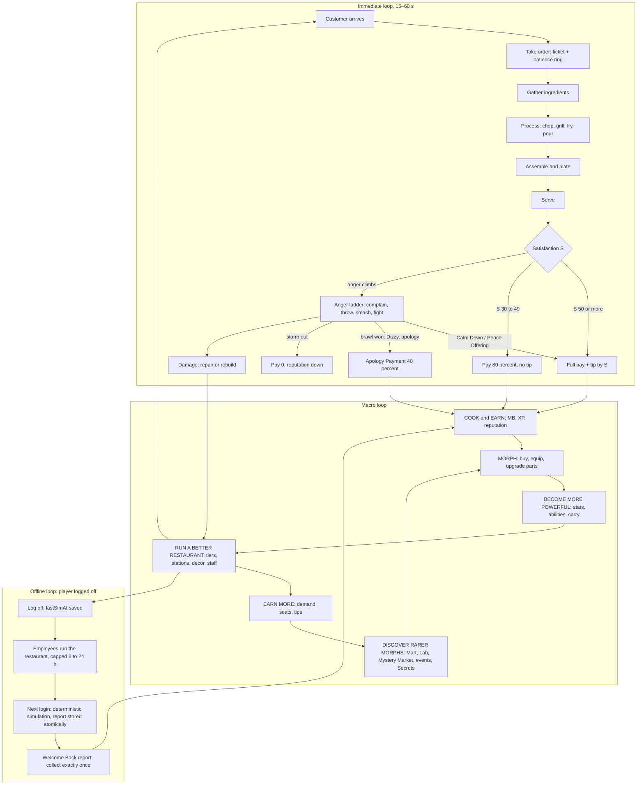
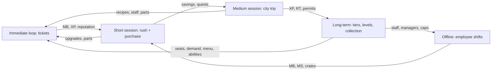

## 4. Core Gameplay Loops

> **Owner:** A1 Vision & Onboarding. This section specifies the game across the five timescales of brief Part 2
> (immediate, short session, medium session, long-term, offline) and how they interlock. It *orchestrates*
> systems owned elsewhere. Station timings live in §5, customer behavior in §8–§10, combat in §11, economy in §22,
> offline formulas in §17. Values quoted from canon are binding. Example-only values are labelled
> *(example)*, and §-owners may refine them without breaking the loop.

| Timescale | Duration | The player's question | Main systems | Primary payoff | Spec |
|---|---|---|---|---|---|
| Immediate | 15–60 s | "Can I get this order out right?" | §5, §6, §8, §10 | MB, XP, a reaction, sometimes a brawl | §4.1 |
| Short session | 5–15 min | "Can I get through this rush and buy something?" | + §11, §15, §20 dailies | an upgrade, mutation progress, a repair | §4.2 |
| Medium session | 15–45 min | "What should I do in the city today?" | + §12, §16, §18, §19, §21 | new recipe, part, hire, event reward | §4.3 |
| Long-term | days to months | "How far can I take this shack, and how weird can I get?" | all, esp. §12, §14, §15 | tiers, levels, collection, story | §4.4 |
| Offline | 2–24 h per absence | "What did my staff earn while I was gone?" | §16, §17 | MB, MS, crates, a funny report | §4.5 |

### 4.1 Immediate Loop (15–60 s)

**Purpose.** This is the minute-to-minute heartbeat: a customer arrives, the player cooks and serves, and the
customer reacts. It must be readable at a glance, satisfying to execute on every device, and able to tip into
chaos.

#### 4.1.1 Rules & Mechanics: the step table

Inputs follow the §24 default bindings (Interact = E / X / contextual button; Drop = G / B / Drop button). Prompts
render the player's live binding. "Server validation" names the authoritative check, owned by the service in
brackets (canon C19).

| # | Step | Player action | KB/M · Controller · Touch | Timer | Animation (canon C21) | Server validation | Success | Failure |
|---|---|---|---|---|---|---|---|---|
| 1 | Arrive | none; watch the door, read the silhouette | — | spawn cadence from `BaseDemand × RepMult × DecorMult × EventMult` (canon C6) | customer `ANM_002` Walk | [CustomerAIService] spawns only if seats + 4 queue spots allow (canon C3); path validated | customer reaches the counter (TIER_01–02) or is seated (TIER_03+, `ANM_040` Customer sit) | path fails twice or stuck > 6 s → "poof" to seat (canon E10) |
| 2 | Order | approach within 10 studs, interact | E · X · tap **ORDER** | ordering phase ≤ 30 s × PersonalityPatienceMult (canon C11.2) | `ANM_041` Read menu → `ANM_042` Order wave | [OrderService] distance ≤ 10 + 2 studs; customer in Place-Order state; player is owner or permitted co-op; order built from menu, stock and modifications (§6.18) | ticket on rail, order bubble, **patience ring starts** | phase times out → customer Annoyed (anger +, §10); may leave |
| 3 | Read ticket | glance at the ticket card or expand the queue | Tab · hold LB · tap mini-ticket | — | — | none (client view of replicated tickets) | player knows the dish, mods and order of assembly | — |
| 4 | Gather | pick each ingredient at Pantry or Fridge | E · X · tap **GRAB** | ≈ 0.5 s per pick | player `ANM_006` Carry item | [CookingService] range ≤ 7 + 2 studs; carry < capacity (1 base, +1 per carry part, max 3, canon C3); special stock > 0 (canon C9) | item in hand | "Hands full!" (drop with G · B · Drop); special SOLD OUT is never ordered (canon E9) |
| 5 | Process | place on station, then time the action (chop taps, remove from grill/fryer in window, pour) | E (per tap) · X · tap **CHOP** / **FLIP** / **POUR** | heat: `T_ready`, Perfect `[T_ready, T_ready + 2.0 s]`, burn at `T_ready + 6 s`, ON_FIRE at `T_burn + 4 s` (canon C8, Lv1) | `ANM_010` Chop, `ANM_011` Grill flip, `ANM_012` Fryer dunk, `ANM_020` Pour drink | [CookingService] server-time timers; per-slot locks (canon E7); grade computed on removal from the server timestamp | PERFECT 1.00 / GOOD 0.80 / OK 0.60 | UNDERCOOKED 0.35 (early), BURNED 0.15, ON_FIRE (extinguish `ANM_030`), MUSHY 0.35 (over-chop) |
| 6 | Assemble | add components at the Assembly Counter in recipe order | E · X · tap **ADD** | ≈ 0.6 s per component (example) | `ANM_017` Assemble stack | [CookingService] components match the ticket recipe; order factor 1.0 / 0.85 (one swap) / 0.7 (worse) (canon C8) | dish built | wrong component → dish ≠ ticket (accuracy A drops); swap → order factor |
| 7 | Plate | plate the dish (Plating Station; the Assembly Counter doubles as one at TIER_01–02) | hold E 0.4 s · hold X · hold **PLATE** | 0.4 s hold (example) | `ANM_018` Plate & garnish | [CookingService] dish complete | plating factor 1.0 | un-plated at TIER_03+ → plating factor 0.9 (canon C8) |
| 8 | Serve | carry to the Serving Window (TIER_01–02) or to the table (TIER_03+), interact | E · X · tap **SERVE** | W clock: 1.0 until 50 % of patience, linear to 0 at 100 % (canon C11.3) | `ANM_007` Carry tray, `ANM_019` Serve (hand-off) | [OrderService] distance; dish matches an open ticket for that customer; wait measured at the **last** item's hand-off | customer takes the dish | wrong customer → "That's not mine!" and the dish stays in hand for the right ticket |
| 9 | Eat & judge | none (optionally start the next ticket) | — | eating ≈ 8–15 s (§8) | `ANM_043` Eat | [CustomerAIService] computes S exactly once at hand-off (canon C11.3) | reaction bubble names the top factor ("Perfect patty!") | low S → anger rises (§10) |
| 10 | Pay & tip | none (coins fly to the MB counter) | — | — | `ANM_044` Pay, `ANM_045` Tip flourish | [EconomyService] `Transact` pay and tip with idempotency key = ticket ID; ingredient cost netted at serve (canon C9) | MB, XP (§14), reputation update | — |
| 11 | Clear | bus the plate to the Dishwasher, trash leftovers | E · X · tap | wash rack 4 plates (canon C7) | `ANM_021` Wash dishes, `ANM_023` Trash toss | [CookingService] / [RepairService] cleanliness K updated | table free, K stays high | dirty tables and trash lower K for every following customer |

**Concurrency.** The loop overlaps: at TIER_01 with 4 seats, a competent player runs 2–3 tickets at once
(grill one patty, pour a drink, take the next order while the patty cooks). Every timer is server-side, so
switching tasks never desynchronizes anything.

#### 4.1.2 Variables

| Variable | Value | Source |
|---|---|---|
| Patience | `(70 + 20 × (items − 1) + 5 × ΣDifficulty) × PersonalityPatienceMult × (1 + 0.004 × CHARM)` s | canon C11.2 |
| Ordering-phase wait | 30 s × PersonalityPatienceMult | canon C11.2 |
| Perfect window / burn / fire (Lv1, 0 stats) | 2.0 s / `T_ready + 6 s` / `T_burn + 4 s` | canon C8 [TUNABLE] |
| Satisfaction weights | A 0.25 · Q 0.20 · C 0.15 · W 0.20 · K 0.10 · M 0.10 | canon C11.3 |
| Pay / tip / Jackpot | PayFactor 1.0 / 0.8 / 0.4 apology / 0; TipRate 0–25 %; Jackpot `0.5 % + 0.1 %·LUCK` ×5 | canon C11.4 |
| Reputation update | `Stars += 0.02 × (S/20 − Stars)`; storm-out −0.03 ★ | canon C11.4 |
| Interaction ranges | 7 studs (stations), 10 (customers), +2 server tolerance | canon C3 |
| Carry capacity | 1 (+1 per carry part, hard max 3) | canon C3 |
| Target loop length | 25–45 s per single-item ticket at TIER_01 for a new player; 15–25 s for a skilled one | [TUNABLE] |

#### 4.1.3 Worked example: Cheeseburger + Fizzy Soda at TIER_01

**Setup.** A new player (Level 1, CHARM 0, starter morph, carry capacity 1) is running the Broken Burger Shack.
Reputation is 2.5 ★ (start, canon C3). Atmosphere is 42, the repaired shack after the tutorial (§15 worked
example). One leftover plate makes cleanliness 90. The customer's personality multipliers are 1.0 and offsets 0 *(example; real values in
§9)*.

**Prices (canon C4.2), shown with 0 % flavor variance.** §6 holds the final prices. Difficulties are *(example)*
until §6 fixes them:

| Item | Unlock L | D | Base `10 × 1.05^(L−1)` | × difficulty `(0.8 + 0.1 D)` | × category | Price |
|---|---|---|---|---|---|---|
| `RCP_BRG_002` Cheeseburger | 1 | 2 | 10.00 | × 1.0 | × 1.0 | **10 MB** |
| `RCP_DRK_001` Fizzy Soda | 1 | 1 | 10.00 | × 0.9 | × 0.7 (Drinks) | 6.3 → **6 MB** |

**Patience.** Items = 2 and ΣDifficulty = 3, so `(70 + 20 × 1 + 5 × 3) × 1.0 × 1.0` = **105 s**. W = 1.0 until 52.5 s
and reaches 0 at 105 s.

**Timeline** (t = 0 when the order is taken; the patty's `T_ready` is 8 s at Lv1, with one flip due at 0.40–0.75 × `T_ready`, §5):

| t (s) | Event |
|---|---|
| 0.0 | Order taken (E). Ticket "Cheeseburger + Fizzy Soda" appears; patience ring starts at 105 s |
| 2.5 | Bun from the Pantry onto the Assembly Counter (`ANM_006`) |
| 5.5 | Patty from the Fridge |
| 8.0 | Patty placed on the Grill. Flip window 11.2–14.0, ready at 16.0, Perfect until 18.0, burns at 22.0, fire at 26.0 (§5) |
| 9.0–11.0 | Fizzy Soda poured at the Drink Dispenser (`ANM_020`) and left on the counter (hands are full of soda, so it waits) |
| 12.0 | Patty flipped (`ANM_011` Grill flip) |
| 13.0–18.5 | The next customer waves (`ANM_042`); the player takes that order (a realistic distraction) |
| 19.1 | Patty removed at cookSec 11.1, 3.1 s after `T_ready` (past the 2.0 s Perfect window, inside GOOD) → **GOOD 0.80** |
| 20.0–24.5 | Assembled bun → patty → cheese → bun in the correct order (`ANM_017`) → order factor 1.0 |
| 24.5–25.0 | Plated (`ANM_018`) out of habit (no penalty for skipping at TIER_01) |
| 28.5 | Burger handed over at the Serving Window (`ANM_019`) |
| 29.0–57.5 | Second trip for the soda, interrupted by a spill clean-up near the door |
| **58.0** | Soda handed over. The wait is measured at the **last** item |

**Satisfaction (canon C11.3).**
- A (accuracy) = 1.00: both dishes are correct, with no modifications.
- Q (quality) = mean of the dish qualities. Cheeseburger = mean(bun 1.00, patty 0.80, cheese 1.00) × 1.0 × 1.0 = 0.933
  (unprocessed components score 1.00, the convention used here and confirmed in §5/§10). Soda = 1.00. Q = **0.967**.
- C (cooking accuracy, heat-cooked components) = patty **0.80**.
- W = 1 − (58.0 − 52.5) / 52.5 = **0.895**.
- K = 90 / 100 = **0.90**; M = 42 / 100 = **0.42**.

`S_base = 100 × (0.25·1.00 + 0.20·0.967 + 0.15·0.80 + 0.20·0.895 + 0.10·0.90 + 0.10·0.42)`
`= 100 × (0.2500 + 0.1933 + 0.1200 + 0.1790 + 0.0900 + 0.0420) = 87.4` → **Happy** (70–89).

**Money.**
- Pay = (10 + 6) × 1.0 = **16 MB**.
- Tip = 16 × 10 % (TipRate for 80–89) × 1.0 = 1.6, rounded half-up to **2 MB** (rounding rule owned by §22).
- Ingredient cost netted at serve (canon C9, target 25–40 % of price): Cheeseburger ≈ 3 MB, soda ≈ 2 MB *(example;
  §6 lists the costs)*.
- **Net to wallet: 16 + 2 − 5 = 13 MB.**

**Reputation.** Stars += 0.02 × (87.4 / 20 − 2.5) = +0.0374, giving 2.537 ★. **XP:** the per-serve amount in §14 (about
0.015 × XPRate(1) ≈ 13 XP *(example)*).

**The perfect variant.** If the patty comes off inside the Perfect window and the soda is handed over by 31 s,
then Q = 1.00, C = 1.00, W = 1.00 and S = 93.2 → **Delighted**. The tip becomes 18 % (2.88 → 3 MB), so net is 14 MB and
Stars +0.043. **Design insight:** at TIER_01, Atmosphere is capped at 55 (§15 TierCap), so with perfect
cleanliness the best possible `S_base` is 95.5. Reaching "Chef's Kiss" (98+, 25 % tip) needs a mutation
satisfaction bonus (≤ +10) or an event modifier, and higher tiers raise the decor cap. That is a deliberate early
hook into the Morph and Build pillars.

#### 4.1.4 The angry branch

**The same order, badly.** The patty BURNED (0.15) and the cheese was forgotten, so the burger is not a
Cheeseburger and counts as the wrong dish (A = 0.5 across the 2 items; the per-item averaging convention is
confirmed in §10). It was served at 96 s.
- Q = mean(burger-as-served mean(1.00, 0.15, 1.00) = 0.717, soda 1.00) = 0.858; C = 0.15;
  W = 1 − (96 − 52.5) / 52.5 = 0.171.
- `S_base = 100 × (0.125 + 0.1717 + 0.0225 + 0.0343 + 0.09 + 0.042) = 48.5` → **Unhappy**.
- Pay = 16 × 0.8 = 12.8 → 13 MB; no tip; net ≈ 8 MB; Stars −0.0015.
- While waiting past 50 % of patience the customer's anger meter climbed (`ANM_046` Impatient foot tap, rate in
  §10). The Unhappy result pushes it further.

**Escalation ladder (canon C11.5).** The player can intervene at every rung. Crossing into levels 3, 4 and 5 each
needs a successful personality escalation roll (`AngerProbability × 100 / (100 + CHARM)`). A failed roll means
the customer sulks, complains or leaves instead.

| Level (anger) | Customer does | Player options | Possible chain reaction |
|---|---|---|---|
| 1 Annoyed (15–29) | grumbles, foot tap `ANM_046` | serve fast; Perfect food at ≤ 2 de-escalates | — |
| 2 Complaining (30–44) | `ANM_047` Complain | `ABL_006` Calm Down!, Peace Offering (free drink or dessert) | `INSTIGATOR` types raise neighbors' anger |
| 3 Throwing food (45–59) | `ANM_048` Throw food, a scripted arc | `ABL_004` Dodge Roll, `ABL_003` Block, Calm Down! | a dodged item hits another customer: **+25 anger × sensitivity** |
| 4 Destroying furniture (60–74) | `ANM_049` Flip table, `ANM_050` Tantrum stomp | intercept; Security Guard; abilities | furniture → Scuffed / Cracked / Broken; nearby diners' K and anger affected |
| 5 Fighting the player (75–89) | attacks per combat style (canon C11.6) | full combat (§11): Swipe `ABL_001`, Wallop `ABL_002`, mutation abilities | stray hits, knockbacks into tables |
| 6 Restaurant-wide chaos (90–100) | ≥ 3 customers at level ≥ 3 at once, or an event | crowd control, Calm Down! chains, Soothing Song `ABL_065` | full brawl |

**Outcomes.** De-escalated → normal pay by S. Defeated (Huff Points 0) → `ANM_052` Dizzy stars → `ANM_053` Apologize
bow → **Apology Payment 40 %**, no tip → `ANM_055` Escorted out. Stormed out (`ANM_054` Flee) → pay 0 and −0.03 ★.
If the player gets KO'd → `ANM_062` Seeing Stars for 4 s → `ANM_063` Respawn poof at 60 % HP with `STS_WOOZY`; the
customer does `ANM_051` Victory dance and leaves without paying (canon C12.1). Every damaged object enters the
repair queue (§15), and repair is the cleanup beat of the loop.

#### 4.1.5 Diagram: the core gameplay loop (macro, including offline)

### 4.2 Short Session (5–15 min)

**Purpose.** A phone-length session must deliver the whole fantasy in miniature: a payout, several personalities,
one memorable chaotic event, a purchase, a repair, and visible mutation progress (brief 2.2, Law L8).

**Rules.**
1. If an offline report is pending, the session opens with it (R-OFF-2).
2. At TIER_01–03, at least one chaotic event (anger ≥ 3 with a chain reaction, or a station fire) is expected per
   10 minutes of active play (brawl cadence §3.2.3) [TUNABLE].
3. At least one purchase costing ≤ 15 minutes of the tier's net income is always available and badged
   "Affordable now" in the Restaurant Hub (§24) [TUNABLE].
4. Post-brawl repairs take ≤ 60 s of player time at the current tier with the starter REPAIR stat [TUNABLE] (§15).
5. A **Next Morph** goal is always visible: a HUD chip showing the funding percentage (MB, and MS/RT where needed)
   toward a pinned part. If nothing is pinned, it auto-suggests the cheapest unowned Uncommon that carries a tag
   matching the player's most-used loadout (pin action in §13, chip in §24) [TUNABLE].
6. The session-end summary (shown when the player opens the menu to leave, or on the next login) lists every bar
   that moved.

#### 4.2.1 Beat sheet: a 12-minute session on Day 2 at TIER_02

**Starting state** *(example)*: Level 6 (1,560 XP; L7 at 1,941), Tiny Mutation Diner (6 seats, 5 menu slots),
3.0 ★, Atmosphere 30, staff Ollie (`EMP_001`, `ROLE_CHEF`) plus one Common Prep Cook (`ROLE_PREP`), Octopus Arm
(`MUT_145`) equipped from the tutorial, balance 210 MB, 18 MS. The player was away 9 h.

| Clock | Beat | What happens (systems) | Δ MB | Δ XP | Balance |
|---|---|---|---|---|---|
| 00:00 | **Welcome Back** | "WELCOME BACK, YOU WEIRDO!" Ran 2 h 00 min (capped; no Manager). 97 customers · revenue 941 · tips 43 · ingredients −388 · wages −54 · incident "Ollie pickled 4 lemonades" −12 → **net 530 MB**, +1 MS discovery (§17 computes; these figures are an example) | +530 | 0 | 740 |
| 00:20 | Login streak | Day-2 reward: 1 Morph Capsule, odds displayed (canon C4.7) → Bear Ears (`MUT_086`, Common, new part) | 0 | 0 | 740 |
| 00:40 | Dailies | Three daily quests appear (§20): "Serve 12 customers", "Calm Down! 2 customers", "Repair 3 objects" | — | — | 740 |
| 01:00–04:00 | Rush 1 | 5 customers, e.g. Grandma Golem (`PER_013`), Impatient Goblin (`PER_005`), Picky Platypus (`PER_014`) who wants "exactly seventeen pickles" (§6.18). Octopus Arm carries 2 plates per trip | +68 | +85 | 808 |
| 04:00–05:00 | **CHAOS** | A satisfied Chaos Gremlin (`PER_007`) flicks a fry at a Bodybuilder Pigeon (`PER_010`): +25 anger × sensitivity, roll succeeds, level 3. The Pigeon hurls his plate; the player Dodge Rolls (`ABL_004`); the plate smashes a chair (Cracked) and splats a Health Nut Hamster (`PER_021`, now Annoyed). The Pigeon's next roll succeeds and he charges: Block (`ABL_003`) → Octo-Flurry (`ABL_012`) → Swipe Combo (`ABL_001`) → Dizzy → Apology Payment 40 % of 10 MB. Calm Down! (`ABL_006`) on the Hamster (daily 1/2) | +4 | +25 | 812 |
| 05:00–05:40 | Repair | Chair Cracked → Pristine, table Scuffed → Pristine (`ANM_060` Hammer repair); cost by §15 *(example 18 MB)*; daily "Repair 3" at 2/3 | −18 | +15 | 794 |
| 05:40–08:30 | Rush 2 | 5 customers; a Complaining Impatient Goblin is calmed (daily "Calm Down! 2" complete) | +72 | +85 | 866 |
| 08:30 | Quest payout | Daily reward: ≈ 60 MB, 0.25 × XPRate(6) ≈ 280 XP (canon C5.1 guidance), 5 MS → **Level 7** toast; stat allocation deferred (canon E14) | +60 | +280 | 926 |
| 09:00 | **Upgrade** | Grill Lv2 "Tuned": process time × 0.90 (canon C4.9: × 1.5 station base price; needs TIER_02) *(example 300 MB)* | −300 | 0 | 626 |
| 10:00 | **Mutation progress** | Equip the new Bear Ears in the Morph menu (instant, out of combat; canon E4). The Next Morph chip shows Kangaroo Leg (`MUT_184`, Uncommon, *example 1,200 MB*) at 52 % funded | 0 | 0 | 626 |
| 10:30–12:00 | Rush 3 | 3 customers; the daily "Repair 3" completes later in the day | +40 | +50 | 666 |
| 12:00 | Session summary | "+226 MB earned · +530 offline · Level 7 · Grill Tuned · 1 new part · 1 brawl won" | | | |

**Consistency check against canon C4.4.** Active net = 68 + 4 − 18 + 72 + 60 + 40 = **226 MB** in 0.2 h, against
the canon 1,080 MB/h × 0.2 h = 216 MB (+4.6 %, within the ±15 % tolerance of Pillar 7). XP is above the hourly
reference because a daily quest landed in this session (dailies are lumpy by design). **TIER_01 variant:** the
same structure yields ≈ 126 MB per 12 minutes (630 MB/h). The "upgrade" beat becomes a decor item or a Common part
(150–400 MB, canon C4.5) on every second session.

### 4.3 Medium Session (15–45 min)

**Purpose.** Medium sessions add the city: shopping, learning, hiring, questing, events and friends. The restaurant
keeps running behind the player (brief 2.3).

#### 4.3.1 Activity menu

Rewards are expressed relative to the player's tier income and XP rate, so the menu stays balanced at every tier.

| Activity | Where | Unlock | Time | Typical reward | Pillar |
|---|---|---|---|---|---|
| Run a shift | own restaurant (`BLD_17`) | start | 10–20 min | tier net/h × time (TIER_03 ≈ 29 MB/min) + XP | Cook · Serve · Earn |
| Collect and manage staff | Employee panel (P / radial) | `QST_TUT_012` | 2–4 min | offline report; +5–15 % efficiency from better assignments and morale (§16) | Earn · Build |
| Job Board quests | Job Board `BLD_10`, `DST_01` | start | 1 min to pick, 5–15 to finish | daily ≈ 0.25 × XPRate(L) XP each, plus MB/MS (§20) | all |
| Learn a recipe | Cooking Academy `BLD_06`, `DST_03` | tutorial step 10 | 2 min | new menu option; costs 5 × price (canon C10) | Cook |
| Buy mutations | Mutation Mart `BLD_01`, `DST_02` | start | 3–5 min | Common 150–400 · Uncommon 800–2,000 · Rare 4,000–10,000 MB + 20 MS (canon C4.5) | Morph |
| Restyle | Body Mods `BLD_02`, `DST_02` | start | 2–5 min | earnable palettes, morph name (§13) | Morph · Social |
| Equipment and crates | Restaurant Supplies `BLD_03`, `DST_01` | start | 2–4 min | stations per the canon C7.1 schedule, upgrades, special crates | Build · Cook |
| Weird produce | Weird Produce Stand `BLD_20`, `DST_02` | start | 2 min | special ingredients for stocked recipes (canon C9) | Cook |
| Hire staff | Recruitment Office `BLD_04`, `DST_03` | tutorial step 10 | 3–5 min | Common hire 200–600 MB (canon C4.8) | Earn · Build |
| Visit or co-op a friend | a friend's restaurant on Restaurant Row | start | 10–20 min | guest rewards (§21); damage covered by Co-op Insurance (canon E12) | Social |
| Monster Mall | `BLD_12`, `DST_05` | L6 | 3–5 min | decorations, cosmetics | Build |
| Deliveries | Delivery Depot `BLD_15`, `DST_04` | L8 | 5–10 min | MB comparable to a shift (§18 tunes) | Earn · Explore |
| Repair Workshop | `BLD_07`, `DST_04` | L8 | 3 min | repair skills, quests (§20) | Build |
| Critic challenges | Food Critic Headquarters `BLD_14`, `DST_07` | L10 | 8–12 min | reputation, MS, RT (§20) | Serve |
| Show off | Showcase Stage `BLD_22`, `DST_07` | L10 | 2–5 min | emotes, social status | Social |
| Training | Training Gym `BLD_05`, `DST_10` | L12 | 5 min | combat practice, combat challenges | Survive |
| Arena (opt-in PvP) | Morph Arena `BLD_08`, `DST_10` | L12 | 5–10 min | MS, RT, seasons (§21) | Survive |
| Lab work | Mutation Laboratory `BLD_11`, `DST_06` | L15 | 3–5 min | fusion, upgrades (canon C4.6) | Morph |
| Collection | Morph Museum `BLD_16`, `DST_06` | L15 | 3 min | collection achievements (§36.16) | Morph · Explore |
| Rare shopping | Mystery Market `BLD_13`, `DST_09` | L20 | 3–5 min | weekly Epic/Legendary rotation (canon C4.5) | Morph |
| City event | anywhere (toast + map ping) | per event | 5–15 min | event rewards (§36.11) | Explore |
| Secret hunting | all districts | varies | open-ended | Secret parts (canon C13.8) | Explore · Morph |

#### 4.3.2 The city-trip loop

**Loop rules (requirements on §15, §16 and §18).**
1. **The restaurant keeps trading while the owner is in the city** only if at least one `ROLE_CHEF` is assigned
   (online employee AI, §16). Otherwise the sign flips to "Back in 5 Minutes!": no new customers are seated, and
   anyone already seated is served by staff or leaves paying 0 *without* reputation loss (mirrors canon E1).
2. **Returning is free:** the Return Door has a 10 s cooldown, and Metro stations are free once discovered (canon
   C16.1). Target: any unlocked building is reachable from Restaurant Row in ≤ 90 s with Metro plus a walk [TUNABLE].
3. **Events pull outward:** a starting event shows a toast and a map ping. Participating for 10 minutes should be
   worth ≥ 10 minutes of the tier's net income [TUNABLE] (§18).
4. **Hostile events at home** (an angry customer reaches level ≥ 4 while the owner is away) raise a "Trouble at the
   diner!" toast with a one-tap Return Door. Security Guards (§16) handle it if the player stays out.

**Worked example: a 35-minute session on Day 4 at TIER_03 (Level 12)** *(example values)*

| Clock | Location | Action | Result |
|---|---|---|---|
| 00:00 | restaurant | Welcome Back: 4 h (Basic Manager) | +2,420 MB offline |
| 00:02–10:00 | restaurant | Shift 1 with table service and waiters | +290 MB, 1 brawl, 2 modifications |
| 10:00 | Job Board (`DST_01`, 20 s walk) | Accept a daily and the current story quest | objectives pinned |
| 11:00 | Metro → Mutation Market (`DST_02`) | Mutation Mart: buy Bee Body (`MUT_126`, Uncommon, chef/speed) for the Chef loadout | −1,100 MB |
| 15:00 | Walk → Downtown (`DST_03`) | Cooking Academy: learn Club Sandwich Stack (`RCP_SAN_004`, L10; price ≈ 17 MB, so 5 × 17 = 85 MB) | −85 MB, new recipe |
| 18:00 | Recruitment Office | Hire a Common waiter (table service, canon C15 `Cap_service`) | −400 MB |
| 21:00 | Downtown | **Downtown Dance-Off** (`EVT_027`) starts nearby; toast + ping | event rewards (§36.11) |
| 27:00 | Return Door | Back home: put the Club Sandwich on the menu (6 slots), assign the waiter, equip the Bee Body | — |
| 28:00–35:00 | restaurant | Shift 2 with the faster Chef loadout | +200 MB |
| 35:00 | summary | +490 MB active + event · −1,585 MB spent · +2,420 offline · 1 part, 1 recipe, 1 hire | |

### 4.4 Long-Term Progression

**Purpose.** This defines what a player should have, know and face at five horizons, so that every system's
pacing can be tested against one shared plan (brief 2.4). Levels follow canon C5.1. Tier *affordability* follows
canon C4.4, but tiers are gated by level, so tiers land at the C5.1 hours (TIER_04 at ≈ 8.5 h, TIER_06 at ≈ 26.6 h,
TIER_09 at ≈ 89.3 h). Surplus MB flows into mutations (Law L1).

**Reference persona (the "engaged median" player) [TUNABLE].** Day 1: 2.5 active hours. Days 2–7: about
55 min/day (8 h cumulative). Days 8–30: about 57 min/day (30 h). Days 31–90: about 1 h/day (90 h). About 1.5 offline
reports collected per day. A casual player (≈ half the hours) hits each row at roughly double the calendar time.

#### 4.4.1 Summary table

| Metric | First Hour | First Day | First Week | First Month | First Three Months |
|---|---|---|---|---|---|
| Cumulative active hours | 1 | 2.5 | 8 | 30 | 90 |
| Player level (canon C5.1) | 4 → 5 at ≈ 60 min (tutorial XP front-loaded) | 8 | 17 | 37 | 68 |
| Restaurant tier | TIER_01; TIER_02 at ≈ 70 min for a saver | TIER_02 (TIER_03 at L10 ≈ 3.3 h) | TIER_03 (TIER_04 at L18 ≈ 8.5 h) | TIER_06 (since ≈ 26.6 h) | TIER_09 (since ≈ 89 h) |
| Cumulative active MB earned (canon C4.4 model) | ≈ 1,100 (incl. 600 tutorial) | ≈ 2,640 | ≈ 11,600 | ≈ 126,000 | ≈ 1,524,000 |
| Cumulative tier spend (canon C6) | 0 | 1,000 | 3,000 | 63,000 | 913,000 |
| Cumulative offline MB, canon-default model (§4.5.4) | 0 | ≈ 600 (first report the next morning) | ≈ 18,000 | ≈ 508,000 | ≈ 8,750,000 |
| Recipes *available* (unlock ≤ level, canon C10) | 19 | 37 | 65 | 113 (ALN after ch. 5) | 145 |
| Recipes *known* (estimate) | 5–6 | 10–12 | 25–30 | 70–80 | 110–125 |
| Menu slots (canon C6) | 4 | 5 | 6 (8 at TIER_04) | 12 | 20 |
| Appliances owned (slot-limited) | 4 starter + STOVE (L2) | 6–8 | 10 | 14–16 incl. Anti-Gravity Wok (L30) | 20–22 incl. Mutagen Infuser (L40) |
| Mutation parts owned, unique (C / U / R / E / L / M / S) | 5 / 1–2 / 0–1 / 0 / 0 / 0 / 0 (≈ 7) | 8 / 2 / 0–1 / 0 / 0 / 0 / 0 (≈ 11) | 16 / 7 / 2 / 0 / 0 / 0 / 0 (≈ 25) | 28 / 20 / 9 / 2 / 0 / 0 / 0 (≈ 59) | 40 / 34 / 22 / 8 / 2 / 0 / 0–1 (≈ 107) |
| Employees (cap) | 1 (2) | 2 (3) | 4–5 (4 → 6) | 8–9 (10) | 14–15 (16) |
| Best manager → offline cap (canon C14.3) | none → 2 h | none → 2 h | Basic → 4 h | Rare → 8 h (+2 h with an Assistant) | Epic + Assistant → 14 h |
| Districts unlocked (canon C16.1) | 4 (`DST_01`–`DST_03`, `DST_08` at L4) | 6 (+`DST_05` L6, `DST_04` L8) | 9 (+`DST_07` L10, `DST_10` L12, `DST_06` L15) | 10 (+`DST_09` L20) | 10 |
| Story chapter (canon C17.3: one per tier) | 1 | 2 | 3 | 6 | 9 |
| Customer difficulty (targets for §8–§10) | scripted first tantrum, then a gentle pool; 1–2 items; ≤ 10 % of orders modified; brawl every 10–12 min | counter service; ~15 % modified; first `INSTIGATOR` and `TRICKSTER` styles | table service from TIER_03; ~25 % modified; parties (`PER_016`); critic visits (`PER_004`) | 2–3 item orders common; ~35 % modified; level 6 chaos possible; Undercover Inspector (`PER_025`) | Legendary dish orders; ~45 % modified; brawl every 5–7 min; long chains |

Parts counts stay within canon totals (63 C, 84 U, 75 R, 36 E, 10 L, 5 M, 7 S). The three-month column assumes
≈ 2 Legendary parts via the weekly Mystery Market or events, with Research Tokens (active-only) as the real gate.

#### 4.4.2 Milestone moments per horizon

| Horizon | "Firsts" the player should experience (design targets) |
|---|---|
| First hour | Tutorial (§32): first order, first tantrum, first repair, first mutation, first hire. First free shift. First Common part (capsule or purchase). L4 opens Residential (`DST_08`, Morph Park `BLD_19`). Saving 1,000 MB for Tiny Mutation Diner |
| First day | First Welcome Back report. Second employee. Monster Mall at L6. Industrial District at L8 (Delivery Depot, Repair Workshop). Story chapter 2. First Grill Lv2 |
| First week | Table service at TIER_03. Entertainment District (L10) and Arena District (L12). Research District at L15 (Lab, Museum). First Rare part (equip level 12). First Manager (4 h). City Hall permit for TIER_04 at L18 |
| First month | Alien Cuisine (chapter 5, Zorp). Sewers and Mystery Market (L20). Anti-Gravity Wok (L30). TIER_06 at L35. First Epic (equip level 25) and first Lv4+ Epic upgrade costing RT. Rare Manager (8 h) |
| First three months | TIER_07–TIER_09. Mutagen Infuser and Mutation Cuisine (L40+). First Legendary (equip level 40). First Legendary Recipe quest (`RCP_LEG_001` at L65). Epic Manager + Assistant (14 h). First Secret part |

### 4.5 Offline Progression (the player's perspective)

**Purpose.** Offline play is a full system, not a bonus (brief 2.5). It gives a reason to return every day, turns
management decisions into visible results, shows off staff personalities through incidents, and lets players with
short play windows keep progressing. Formulas, incidents, the report screen and validation are specified in §17
(canon C15). This subsection defines how offline play *feels* and how it fits the other loops.

#### 4.5.1 The daily rhythm

| Moment | Player does | System does | Feeling |
|---|---|---|---|
| Morning check-in (2–5 min) | Opens the game; Welcome Back; Collect; spends on a part or upgrade; re-assigns tired staff | Simulates the capped interval once, stores the report atomically, claims idempotently (canon C15, E11) | "My restaurant made money while I slept!" |
| Midday / after school (5–15 min) | Short session (§4.2); quick collect if a report is pending | Same; each absence is capped separately | "Quick rush, quick upgrade." |
| Evening (15–45 min) | Medium session (§4.3); before leaving, the **Closing Checklist** in the Restaurant Hub: ≥ 1 chef assigned ✓, offline cap shown ✓, special stock for N hours ✓, repairs done ✓, staff energy ✓ | Saves; `lastSimAt` = save time (canon E1) | "Set up the night shift." |
| Overnight | — | Nothing runs on a server; the next login simulates up to the manager cap | Anticipation |

#### 4.5.2 Caps and what they mean to the player

| Best assigned Manager | Cap (canon C14.3) | Typically reached at | Player message |
|---|---|---|---|
| none | 2 h | TIER_01–02 | "Ollie works for 2 h without a boss. Hire a Manager to keep the shift going longer." |
| Common / Uncommon ("Basic") | 4 h | TIER_03–04 | "Your Manager keeps things running for 4 h." |
| Rare ("Experienced") | 8 h | TIER_05–06 | "A full school day or a full night." |
| Epic ("Elite") | 12 h | TIER_07–09 | — |
| Legendary | 24 h | TIER_09–10 | "Your restaurant never sleeps." |
| + Assistant Manager | +2 h (max 24 h) | TIER_05+ | — |

#### 4.5.3 How much offline is worth (canon C15 target: 35–50 % of active net/h for a well-staffed restaurant)

| # | Tier | Active net MB/h (canon C4.4) | Offline net MB/h (35–50 %) | Typical cap | One capped report |
|---|---|---|---|---|---|
| 1 | TIER_01 | 630 | 220–315 (Ollie alone ≈ 158, §32) | 2 h | 440–630 (≈ 316 with Ollie alone) |
| 2 | TIER_02 | 1,080 | 378–540 | 2 h | 756–1,080 |
| 3 | TIER_03 | 1,730 | 606–865 | 4 h | 2,424–3,460 |
| 4 | TIER_04 | 3,100 | 1,085–1,550 | 4 h | 4,340–6,200 |
| 5 | TIER_05 | 5,400 | 1,890–2,700 | 10 h | 18,900–27,000 |
| 6 | TIER_06 | 9,600 | 3,360–4,800 | 10 h | 33,600–48,000 |
| 7 | TIER_07 | 17,400 | 6,090–8,700 | 14 h | 85,260–121,800 |
| 8 | TIER_08 | 32,800 | 11,480–16,400 | 14 h | 160,720–229,600 |
| 9 | TIER_09 | 63,700 | 22,295–31,850 | 24 h | 535,080–764,400 |
| 10 | TIER_10 | 120,500 | 42,175–60,250 | 24 h | 1,012,200–1,446,000 |

#### 4.5.4 How offline complements active play (and the guardrail)

**Complement rules (binding; Law L5).**
1. Offline produces **MB, MS discoveries, rare ingredient crates and ≤ 1 Morph Capsule per real day**, never XP,
   Research Tokens, recipes, story progress or levels (canon C4.1, C15).
2. Per hour, offline is never better than 60 % of active play at the same tier (canon C15).
3. **Offline cannot outrun the level gate.** Tiers need a level (canon C6), and levels need active XP. Offline MB
   therefore funds mutations, staff and decor, which is exactly the Morph-centered economy of Law L1.
4. Offline needs ≥ 1 `ROLE_CHEF`. With none, the report shows 0 customers and a hint (canon C15).
5. Incidents leave hooks for active play: damaged objects (if there is no Repair Technician), sold-out special
   stock, tired staff, upgrade suggestions (R-OFF-3).
6. **Optional re-engagement ping:** with the player's opt-in, Roblox Experience Notifications (sent through Open
   Cloud) may say "Your staff finished their shift". At most 1 per day, sent only once the cap has actually
   been reached, and never containing amounts [TUNABLE] (§31, §29 policy).

**Forecast under canon defaults, and the guardrail.** Running the reference persona (§4.4) through canon C14.3
caps and the C15 35–50 % rate gives an offline share of MB income of ≈ **19 % on Day 1, ≈ 61 % at D7, ≈ 80 % at D30
and ≈ 85 % at D90**. That is expected for a player who plays about 1 h/day but owns 8–14 h of caps. Rule 3 keeps it
from breaking tier pacing. However, it can over-accelerate mutation collection, and the §1.7 guardrail (D7 ≤ 60 %,
D30 ≤ 70 %) would be breached. **Tuning order:** (1) OFFLINE_DEMAND_FACTOR 0.6 → ≈ 0.35 (halving offline throughput
moves the forecast to ≈ 44 % at D7 and ≈ 67 % at D30); (2) then cap semantics (§17); (3) only then manager caps. §17
and §22 own the final calibration during beta. This forecast is the acceptance fixture for AC-04-08.

### 4.6 Loop Interconnection and Economy Flow

| Loop | MB / MS / RT **sources** | Main **sinks** | Feeds the next loop by… |
|---|---|---|---|
| Immediate | payments, tips, Jackpot Tips, Apology Payments | ingredient costs netted at serve, trash waste, repairs | MB + XP + reputation per ticket |
| Short session | rush income, dailies (≈ 15 % of income, canon C4.4), capsules | station upgrades, decor, Common parts, repairs, wages | a purchase every session; mutation goal progress |
| Medium session | quests, deliveries, events, arena (MS/RT), critic challenges | Mart/Lab purchases, recipe learning (5 × price), hiring, taxi | new verbs, staff, parts that raise immediate-loop yield |
| Long-term | story quests (RT), milestones, achievements, Legendary dish orders | tiers (≈ 50 %), Rare+ parts, Epic+ upgrades (RT), fusion | seats, demand and menu that reshape the immediate loop |
| Offline | offline net, MS discoveries, crates, ≤ 1 capsule/day | wages, ingredients, auto-repairs (inside the sim) | MB for morphs at the start of the next session |

**Loop health signals (watched in §31).**

| Signal | Healthy | Too low means… / lever | Too high means… / lever |
|---|---|---|---|
| Median ticket time ÷ patience | 0.35–0.55 | orders trivial; add modifications (§6.18) | frustration; widen windows, raise patience mult (§9) |
| Brawls per 10 active min (T1–3) | 0.8–1.25 | chaos missing; raise escalation probability (§10) | annoyance; raise CHARM effect, add Calm sources |
| Purchases per session | ≥ 1 | wallet hoarding; surface "Affordable now" | prices too low; inflation check (§22) |
| MB share spent on mutations (D30) | ≥ 40 % | L1 failing; adjust Mart rotations, Next Morph chip | — |
| Offline share of MB (D7 / D30) | ≤ 60 % / ≤ 70 % | — | lower OFFLINE_DEMAND_FACTOR (§4.5.4) |
| Time to next tier ÷ canon interval | 0.8–1.25 | progression too fast; check offline share | grind; check tier costs and active income |

### 4.7 Dependencies, Roblox Implementation and Edge Cases

**Dependencies.** §5 (station timings), §6 / §6.18 (prices, modifications), §8–§10 (spawning, satisfaction, anger),
§11 (combat), §12–§13 (parts, loadouts, Next Morph pin), §14 (XP per action), §15 (repairs, decor, tiers), §16–§17
(staff, offline), §18 (travel, events), §20 (dailies), §22 (rounding, sinks), §24 (HUD, Hub, summaries), §31
(telemetry).

**Roblox implementation (loop orchestration).**
- Each immediate-loop step is owned by exactly one service (step table, §4.1.1). Steps talk through server-side
  signals (`OrderService.TicketOpened`, `CookingService.DishCompleted`, `OrderService.DishServed`,
  `CustomerAIService.SatisfactionResolved`); event names are finalized in §27. The client never reports a grade, a
  wait time or an amount.
- **Ticket idempotency:** the ticket ID is the idempotency key for `EconomyService:Transact` (pay, tip, apology),
  so a re-sent serve can never pay twice (§27 P3).
- **Session summary:** `ProgressionService` accumulates per-session deltas (MB, XP, parts, tiers, repairs) in memory
  and persists only totals. The summary is shown by `UIController` and logged once via
  `AnalyticsService:LogCustomEvent` (event schema in §31).
- **Next Morph chip:** derived client-side from the replicated wallet and the pinned part's price row. The pin is
  stored in the profile (one ID).
- **City-trip trading state:** `RestaurantService` exposes `OpenState ∈ {Open, OwnerAway_Staffed, BackIn5, Closing}`.
  `OwnerAway_Staffed` keeps CustomerAIService spawning while ≥ 1 chef is assigned; `BackIn5` stops spawns.

**Edge cases (loop level).**

| Situation | Behavior |
|---|---|
| Owner disconnects mid-ticket | Canon E1: Closing; staff finish tickets or customers leave paying 0 with no reputation loss |
| Customer turns hostile while a menu is open | Canon E2: menu auto-closes, 1.5 s invulnerability |
| Every menu item sold out | Canon E9: `RCP_BRG_001` auto-added as a fallback |
| Owner walks into the city with no chef assigned | "Back in 5 Minutes!": no new spawns; seated customers leave paying 0 with no reputation loss; a toast reminds the player to assign a chef |
| Level-up mid-rush | Canon E14: toast only; allocation deferred |
| Co-op guest serves the owner's ticket | Allowed (canon E7); pay goes to the owner, the guest receives guest rewards (§21) |
| Two players serve the same ticket simultaneously | First server-validated hand-off wins; the second dish stays in hand ("Already served!") |
| Offline report pending when the player immediately joins a friend's server | The report travels with the profile; it is shown on arrival in the new server and claimed once (canon E11) |
| Player AFK in an open restaurant | After 5 min of no input, the restaurant switches to `BackIn5` unless a chef is assigned; Roblox's idle kick is unchanged [TUNABLE] |

### 4.8 Acceptance Criteria

- **AC-04-01:** Every step of the §4.1.1 table is server-validated by the listed service. A modified client that sends a forged serve, grade or amount gets no MB, XP or reputation (§29 test).
- **AC-04-02:** For the §4.1.3 fixture (prices 10 / 6 MB, patience 105 s, patty GOOD, served at 58 s, K 90, M 42, multipliers 1.0), the server computes S = 87.4 ± 0.1, Pay = 16 MB, Tip = 2 MB, net 13 MB (with the §6 ingredient costs 3 + 2), and Stars +0.0374 ± 0.0001.
- **AC-04-03:** For the §4.1.4 fixture (A 0.5, BURNED, served at 96 s, M 42), S = 48.5 ± 0.1 and Pay = 13 MB with no tip.
- **AC-04-04:** A single-item TIER_01 ticket can be completed by a first-time tester in ≤ 45 s on phone, PC and controller (median of 10 testers per device) [TUNABLE].
- **AC-04-05:** In a scripted 12-minute TIER_02 bot session using the §4.2.1 starting state, active net income is 216 MB ± 15 %, and the session log contains ≥ 1 purchase, ≥ 1 repair, ≥ 1 anger ≥ 3 event and a mutation-goal delta.
- **AC-04-06:** The `core-gameplay-loop` diagram renders in the build, contains the nodes Cook/Earn, Morph, Become More Powerful, Run a Better Restaurant, Earn More, Discover Rarer Morphs and the offline branch.
- **AC-04-07:** With the reference persona replayed through the §22 economy simulator, level and tier land within ±10 % of the §4.4.1 hours (TIER_02 ≈ 1.2 h, TIER_04 ≈ 8.5 h, TIER_06 ≈ 26.6 h, TIER_09 ≈ 89.3 h).
- **AC-04-08:** The offline-share forecast (§4.5.4) is reproduced by the §17 simulator for the reference persona. After calibration, the beta telemetry median meets D7 ≤ 60 % and D30 ≤ 70 %, or a §38 decision documents the exception.
- **AC-04-09:** When the owner leaves the restaurant with ≥ 1 chef assigned, customers keep spawning (`OwnerAway_Staffed`). With 0 chefs, no new customer spawns within 1 s of the owner crossing the door, and no reputation is lost.
- **AC-04-10:** Every session of ≥ 5 minutes in the 100-session beta sample ends with ≥ 1 progress delta recorded in the session summary (Law L8).
