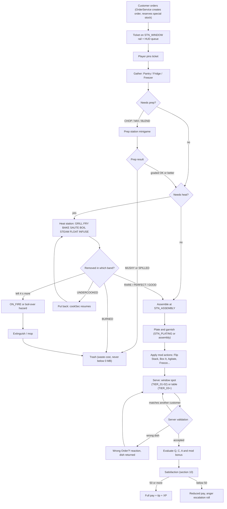
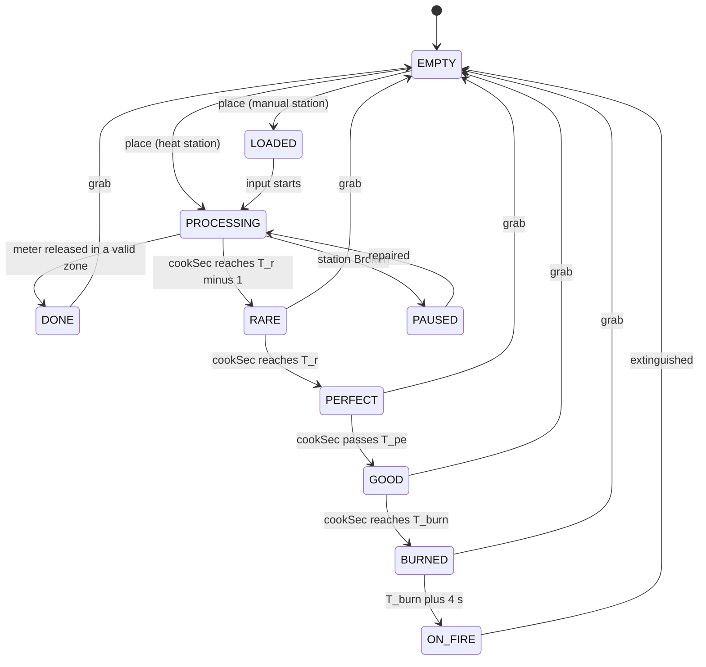

## 5. Cooking Mechanics

> This section is the rulebook for everything that happens between "order taken" and
> "customer evaluates the plate": the interaction model, all 24 kitchen stations (canon §C7), every
> preparation verb (canon §C8), quality scoring, tickets and the server-side **Dish** object, kitchen
> hazards, co-op rules and the `CookingService` implementation. Order modifications live in §6.18, recipe
> rows in §6, ingredient rows in §7, satisfaction/anger in §10, abilities in §36.6, status effects in §36.7.
> All balancing values are **[TUNABLE]** unless they restate a canon constant.

**System template map** (canon §C0.2) — where each required block lives for the Cooking system as a whole:

| Template block | Location in §5 |
|---|---|
| Purpose | this intro + §5.1 |
| Rules & Mechanics | §5.2 (interaction), §5.3 (stations), §5.4 (verbs), §5.7 (hazards), §5.8 (co-op) |
| Variables | §5.3.1 (station constants), §5.4.2 (heat model), §5.5 (quality), each station block |
| UI | §5.2.6, §5.4 (per-verb meters), §5.6 (ticket rail & order queue) |
| Progression | §5.3.1 (unlocks & Lv1–Lv5 upgrades), §5.3.3 (Lv5 gimmicks), mutation Kitchen Affinity |
| Player Interactions | §5.2, §5.8 |
| Dependencies | table below |
| Roblox Implementation | §5.10 (+ "Roblox" row of each station) |
| Edge Cases | §5.11 |
| Acceptance Criteria | §5.12 (`AC-05-01` … `AC-05-26`) |

**Dependencies**

| System | Section | Cooking consumes | Cooking provides |
|---|---|---|---|
| Recipes / ingredients | §6, §7 | component lists, canonical stack order, per-component `T_ready`, bake dial, mix sequence, tags | the station/verb vocabulary recipes must use |
| Order modifications | §6.18 | mod predicates | Dish fields and mod-support actions (§5.4.12) |
| Customers / satisfaction | §8, §10 | order items, patience | per-item `Q`, `C`, `A` at serve time (§5.5) |
| Combat | §11, §36.6, §36.7 | `ABL_` effects, `STS_` effects, KO events | hazards that combat can cause or clear (§5.7) |
| Mutations | §12, §36.3 | equipped parts, tags, families | Kitchen Affinity hooks (§5.3.1) |
| Progression | §14 | `COOK_SPD`, `COOK_QLT`, Chef Tree modifiers | contribution records for cooking XP |
| Restaurant | §15, §36.12, §36.13 | station placement, durability, prices | station operating rules, upgrade effects |
| Employees | §16, §17 | employee actors at stations | the same station API (employees call it server-side) |
| Architecture / security | §27, §29 | remote conventions, rate-limit framework | `CookingService` contract (§5.10) |

---

### 5.1 Design Analysis — Why Kitchen Chaos Is Fun

We studied the *mechanics* (never the assets, names, levels or art) of the genre's reference games.

| Reference | Mechanic that creates the fun | What we keep | What we change for Mystery Morph Restaurant |
|---|---|---|---|
| Overcooked | Two verbs (grab / use) applied to many spatially separated stations: difficulty comes from **routing and timing**, not controls. Several timers run in parallel, so players juggle. Failure is loud and funny (fire) yet recoverable (extinguisher). | Two-button kitchen (**Use**, **Grab**); parallel heat timers; extinguishable fire. | No level timer and no star-score fail screen: the restaurant is persistent, so pressure comes from customer patience (§C11.2) and the tantrum ladder (§C11.5) instead of a countdown. |
| Overcooked 2 | **Throwing** ingredients to teammates or straight onto stations; quick-chat; online co-op. | Throw-to-pass and throw-onto-slot (§5.2.1); call-out pings (§5.8). | Thrown food is a scripted arc (canon §C3); hitting a customer is a real consequence (+25 anger). |
| PlateUp! | The **kitchen layout is the puzzle**; upgrades between shifts change how you play; automation emerges over time. | Station placement matters (distance = seconds); upgrades change the feel of each station (Lv5 gimmicks automate one chore each). | Persistence instead of runs; automation comes from employees (§16) and Lv5 gimmicks, never removes the player's core verbs. |
| Cooking Simulator | **Depth per station** — temperatures, precise doneness, mastery of one appliance. | Oven dial, fryer oil heat, doneness bands (RARE → SCREAMING → BURNED) that mods can target. | Precision is optional: base orders accept a 2 s PERFECT window plus GOOD/OK grades; only mods ask for exact bands. |
| Roblox restaurant sims & tycoons | Instant onboarding, short sessions, visible purchases, social visits, idle income, cosmetic flex. | First dish in < 60 s (§32), every purchase is visible in the kitchen, friends can drop in and cook. | Our twist is the morph: what you *are* changes how you cook (extra arms, toaster head, frost fingers). |

**Adaptation rules for ages 8–16 and mobile** (each is binding for every station below):

| # | Rule | Concrete requirement |
|---|---|---|
| D1 | **Readable stations** | Every station state is shown by **colour + icon shape + sound + progress ring**, never colour alone (green ✓ ring = PERFECT, amber ◆ = GOOD/OK, red ▲ = BURNED, flame glyph = ON_FIRE). Station silhouettes are unique at 40 studs. |
| D2 | **Two-button kitchen** | Every cooking action in §5.4 is executable with only **Use** and **Grab** (plus movement). Abilities and combat are optional layers. |
| D3 | **Juggling that scales** | TIER_01 menus need ≤ 2 simultaneous timers; by TIER_06 a skilled player runs 4–6; Lv5 gimmicks and employees keep TIER_10 humane. |
| D4 | **Fair time pressure** | Base PERFECT window ≥ 2.0 s, good span ≥ 6 s, ignition 4 s after burn (canon §C8). Nothing ignites without ≥ 3 audio/visual warnings. |
| D5 | **Forgiveness** | Five-Second Rule for dropped food; fire never pushes a station below 26 % durability; wasted food never drops the balance below 0 MB (canon §C9); `ABL_066` rescues an item at GOOD; Auto-Rhythm and Toggle-Hold accessibility options. |
| D6 | **Co-op without griefing** | Per-slot locks (canon E7), players do not collide with each other, guests cannot waste stocked ingredients (§5.8). |
| D7 | **Emergent chaos** | Customers' thrown food lands on counters/stations, spills make people slip, fires spread one station at a time — all bounded by hard caps (§5.7). |
| D8 | **Morphs matter** | Each station lists Kitchen Affinity bonuses; extra arms raise carry capacity; a few parts unlock genuinely new verbs (Toaster Head toasts bread in your head). |
| D9 | **Mobile first** | Touch targets ≥ 48 dp, primary buttons ≥ 88 dp, rhythm inputs judged with latency compensation, no input requires two simultaneous fingers on the right side. |
| D10 | **Funny failure** | BURNED food grows a sad face, SCREAMING food squeaks like a kettle, an over-agitated drink pops its lid with a confetti-foam burst — failure is a joke, never a wall. |

---

### 5.2 Interaction Model

#### 5.2.1 Carrying

- **Capacity** (canon §C3): 1 item. +1 per equipped carry part — `MUT_145` Octopus Arm (per arm), `MUT_217` Monkey Tail,
  `MUT_249` Extra Arm Backpack — and +1 while `ABL_061` Extra Hands is active (stacks with the Extra Arm Backpack
  passive). **Hard max 3.** While `ABL_061` is active the player may also **operate 2 stations**: a hold-type channel
  (blend, mix, pour, wash, swirl, agitate, scrub) started on one station keeps running hands-free while the player works a
  second station, as long as both stay within 7 + 2 studs (max 2 concurrent channels; duration per §36.6).
- **Carry stack.** Carried items form an ordered stack; the **active item** is the one shown in front of the character and is
  the one placed/thrown/served. **Swap** rotates the stack (active → back). The HUD carry widget shows all held items as
  icons, active item enlarged.
- **Item classes:** ingredient (any state), dish (plated food, bowl, cup, cone, box), tray, tool prop (fire extinguisher, mop,
  trash bag, ingredient crate). A **tray** is 1 item that holds up to 3 dishes [TUNABLE]; carrying a tray plays `ANM_007`,
  applies WalkSpeed ×0.9 and enables `ABL_008` Tray Shield. A **crate** or **trash bag** is a bulky prop: while carried it
  occupies *all* carry slots.
- **Hands full rule:** while carrying anything except a frying pan or tray, base melee (`ABL_001`, `ABL_002`) is replaced by
  **Throw** on the same input. Block (`ABL_003`) and Dodge (`ABL_004`) remain available.
- **Drop:** places the active item on the floor at the feet. **Five-Second Rule:** food picked up within 5.0 s is unharmed
  (a "Five-Second Rule!" pop-up plays); after 5.0 s it becomes SPILLED (trash). Dropped **dishes** break: the food is SPILLED
  and the plate leaves a *broken plate* hazard (§5.7) — paper-wrapped dishes at TIER_01–02 do not shatter.
- **Throw:** ingredients only (no dishes, pots, trays or props). Scripted parabolic arc, max range 12 studs, flight 0.6 s,
  computed by the server from the thrower's position and aim (canon §C3: raycast arc, not physics). On landing the
  server resolves, in order: (1) a teammate with a free carry slot within 2.5 studs catches it; (2) a station slot within
  2.0 studs that accepts the item receives it (throw a patty straight onto an empty grill slot); (3) a customer hit
  → item SPILLED and the customer gains +25 anger × sensitivity (canon §C11.5); (4) otherwise it lands on the floor
  (Five-Second Rule applies).
- **Involuntary drops** (KO, knockdown, slip): the server drops the active item only; food dropped involuntarily is never
  charged as waste. Parts tagged `sticky` (e.g. `MUT_170` Sticky Gecko Hands) prevent involuntary drops entirely.

#### 5.2.2 Context interaction — decision: custom "Smart Interact", not ProximityPrompt

| Criterion | `ProximityPrompt` | Custom Smart Interact (chosen) |
|---|---|---|
| Dense kitchens (up to 24 stations, multi-slot) | One prompt per object; several overlap within 7 studs; `Exclusivity` picks by distance only | One target chosen by a facing-aware score (§5.2.4), slot-level precision |
| Same key, different meaning (tap vs hold, chop rhythm, flip, dial) | Single `HoldDuration` per prompt; prompt must be re-created to change behaviour | Per-context verb table; tap/hold/rhythm on the same button |
| Preview of the result | Only `ActionText`/`ObjectText` strings | Rich preview chip: "Place Patty → Grill slot 2", ghost item, mod hints |
| Touch layout | Auto-generated prompt buttons float in world space, collide with the thumb zone | One fixed, large context button in the thumb zone that changes icon/label |
| Controller | Fine, but no slot cycling | Shoulder-free cycle input to step through candidate targets |
| Server validation | Prompt triggers still need our validation | Same validation path for players and employees |

**Decision:** the kitchen uses a client `InteractionController` (part of `UIController`) that scores candidates and sends
verbs to `CookingService`. `ProximityPrompt` remains acceptable for non-kitchen world objects (doors, city NPCs — owned by
§18/§19). Kitchen station models set no ProximityPrompts.

#### 5.2.3 Hold vs tap

| Input class | Used for | Rules |
|---|---|---|
| **Tap** (< 0.25 s) | pick up, place, flip, toss, spin, shake basket, dial step, serve, add one counted unit, garnish, nudge | 0.15 s input buffer: a tap pressed up to 0.15 s before an action becomes legal is executed when it becomes legal. |
| **Rhythm tap** | chop, pump (infuser), polish (dishwash) | Each tap judged against a timing ring (§5.4.1). Taps closer than 0.12 s to the previous one are ignored (anti-macro, accidental double taps). |
| **Hold** (channel) | blend, mix, pour, agitate, swirl, wash, extinguish, mop, unload crate, tie trash bag, Flip Stack (0.6 s), Box It (0.5 s), Fold (0.6 s), Flourish Serve (0.8 s) | Releasing early cancels (or stops a meter, for blend/mix/pour/agitate/swirl). Moving > 2 studs away or being hit cancels. **Toggle-Hold** accessibility option: first tap starts, second tap stops; fixed-length channels auto-complete. |
| **Long-press menu** (≥ 0.3 s on Pantry/Fridge/Freezer, ≥ 0.5 s on Cutting Board) | ingredient radial, cut-mode wheel | Release on a wedge to choose; release in the centre cancels. |

#### 5.2.4 Targeting and priority

Every 0.1 s the client gathers interactable **slots** (not models) whose anchor attachment is within 7 studs of the
HumanoidRootPart (customers: 10 studs) and scores each:

```
Score = 1.0·(1 − d/7) + 1.5·max(0, dot(LookFlat, DirFlat)) + Ctx + Sticky + Hover
  Ctx    = +2.0 if the active held item can be placed/processed here
           +1.5 if the slot holds a finished item and the player has a free hand
           +1.0 if the slot is running a minigame this player owns (e.g. a chop in progress)
           −∞   if the slot is locked by another interactor or the station is Broken/Destroyed/ON_FIRE
                (ON_FIRE stations remain targetable only for "Extinguish")
  Sticky = +0.5 for the current target (hysteresis: prevents flicker between neighbours)
  Hover  = +3.0 if the mouse cursor ray hits this slot (keyboard & mouse only)
```

The best-scoring slot gets a `Highlight` outline plus a floating **preview chip** describing the exact result ("Flip
patty", "Take Fries (PERFECT)"). **Cycle Target** steps to the next-best candidate for 2 s. The client sends the chosen
`stationUid` + `slot`; the server re-validates (§5.10.4) but never re-targets, so what the player saw is what happens or is
rejected with a reason.

#### 5.2.5 Control scheme (all actions, all inputs)

This is the kitchen view of the canonical default control map in §24.3.2 (which is authoritative if they ever differ).
Keyboard bindings avoid Roblox-reserved keys (Esc, Tab player list, `/` chat, `` ` `` console). Shift Lock is disabled in the
restaurant interior (`StarterPlayer.EnableMouseLockOption = false`) so Left Shift can be Dodge.

| Action | Keyboard + mouse | Controller (Xbox / PlayStation glyphs) | Touch |
|---|---|---|---|
| Move | WASD / arrow keys | Left stick | Dynamic thumbstick (left 45 % of screen) |
| Camera | Right-mouse drag; wheel zoom (when not locked on) | Right stick | One-finger drag on empty right area; pinch zoom |
| Jump | Space | A / Cross | Jump button |
| **Use / Interact** (context: chop, flip, toss, dial step, take order, serve, extinguish) | E | X / Square | **Context button** (largest, 96 dp; icon + label change with target) |
| Chop (rhythm) | E taps | X / Square taps | Context button becomes **CHOP** (with ring) |
| **Grab: pick up / place** | F | B / Circle (gameplay); B is *Back/Cancel* when a panel or minigame has focus | **Grab** button (88 dp) |
| Drop on floor | G (tap) | D-pad Down | Long-press the carry widget 0.4 s → Drop |
| Throw (hands full) | Left mouse: hold to show arc, aim with cursor, release | RT / R2: hold to show arc, aim with left stick + facing, release | Attack button becomes **Throw**: hold, drag to aim, release |
| Cancel (leave minigame / close overlay) | X or Backspace | B / Circle (context) | ✕ on the minigame / overlay; or walk out of range |
| Serve | E (Use) on customer or window pickup spot | X / Square | Context button ("Serve") |
| Flourish Serve | Hold E 0.8 s on customer | Hold X 0.8 s | Hold context button 0.8 s |
| Swap held item | R | Y / Triangle (tap) | Tap the carry widget |
| Cycle target | Mouse hover override, or C | D-pad Right | Tap the station directly (world tap selects target if in range) |
| Attack: Swipe Combo `ABL_001` / Wallop `ABL_002` | Left mouse tap / hold 0.6 s (hands empty) | RT / R2 tap / hold | Attack button tap / hold |
| Lock-on (combat target) | Middle mouse button; mouse wheel cycles targets while locked | R3 (press right stick); right stick flick cycles | Tap an enemy |
| Block `ABL_003` | Hold Q | Hold LT / L2 | Hold **SHIELD** button |
| Dodge Roll `ABL_004` | Left Shift (Shift Lock disabled) | RB / R1 | Swipe on SHIELD button, or Dodge button |
| Calm Down! `ABL_006` | V | D-pad Up | Speech-bubble button (above Attack) |
| Ability bar slots 1–4 | 1, 2, 3, 4 | Hold LB / L1 + X / Y / B / A | 4 ability buttons (64 u each) in an arc around Attack |
| Open order queue (overlay) | O, or click the ticket strip | Hold Y / Triangle 0.4 s | Tap the ticket strip |
| Pin ticket (drives ghost previews) | Click ticket / 1–6 while queue open | D-pad Left/Right to move, A to pin | Tap ticket |
| Call-out ping (co-op) | Z (wheel on hold) | D-pad Left (wheel on hold) | Ping button (top of cluster) → 6-wedge wheel |

#### 5.2.6 Touch layout, feedback and accessibility

- **Right-thumb cluster** (bottom-right, safe-area aware via `GuiService:GetGuiInset()`): Context (96 dp) at the thumb's
  rest point; Grab (88 dp) up-left of it; Attack/Throw (88 dp) left; Jump (72 dp) below-right; SHIELD/Dodge (64 dp); ability
  arc (4 × 64 u); Ping (48 dp). No two primary buttons closer than 12 dp.
- **Minigame meters** render as world-space `BillboardGui`s on the station (max 1 active per player) *and* mirrored in a
  screen-space strip above the Context button on touch devices so the thumb never covers the meter.
- **Haptics:** `HapticService` small pulse on PERFECT, double pulse on BURNED warning, long pulse on ON_FIRE (controller
  and supported mobile devices); disabled by the Reduced Effects setting.
- **Accessibility settings** (persisted per player): Auto-Rhythm (canon §C8: every chop/pump/polish tap = yellow 0.8),
  Toggle-Hold, Reduced Effects (no screen shake, fire VFX at 30 % particles, no flashing), Colour-blind palettes (status
  shapes stay identical), a separate **Kitchen Alerts** volume slider (drives the `Alerts` SoundGroup, §26) independent of music and SFX, Large Meter mode (+50 % meter size),
  "Fewer Weird Requests" (§6.18).

---

### 5.3 Station Specifications

#### 5.3.1 Common station contract (applies to all 24 stations)

**Slot state machine.** Every station is a set of *slots*; each slot runs the same server-owned state machine.

| Slot state | Meaning | Exits |
|---|---|---|
| `EMPTY` | nothing in the slot | item placed → `LOADED` (manual stations) or `PROCESSING` (heat stations auto-start) |
| `LOADED` | item waiting for player input (cutting board, blender, mixer, drink, dishwash) | input starts → `PROCESSING`; Grab → `EMPTY` |
| `PROCESSING` | timer/meter running; for heat verbs the item's doneness band is derived from accumulated `cookSec` | heat: band transitions (below); non-heat: meter released/complete → `DONE`, over-processing → failure |
| `DONE` | finished non-heat item, quality locked | Grab → `EMPTY` |
| heat bands `RARE` → `PERFECT` → `GOOD` → `BURNED` | see §5.4.2 | Grab locks the band's grade; `BURNED` + 4 s → `ON_FIRE` (pots/steamer: boil-over) |
| `ON_FIRE` | station fire (§5.7): item RUINED, slot unusable | extinguished → `EMPTY` (charcoal item auto-binned, no waste charge) |
| `PAUSED` | station Broken (durability ≤ 25 %): all timers frozen, inputs rejected | repaired → previous state resumes |
| *lock overlay* | `LockUserId ≠ 0` while one interactor runs an input on this slot (canon E7) | released on completion, cancel, > 9 studs away, 1.5 s without input in a rhythm minigame, KO, disconnect |

Heat stations lock a slot only while someone is actively inputting (placing, flipping, tossing); a passively cooking slot is
unlocked, so any co-op player may flip or remove it (items are restaurant-owned — canon E7).

**Upgrade levels** (canon §C4.9, applied per station):

| Level | Cost | Requires | Heat stations (GRILL, FRYER, OVEN, PIZZA_OVEN, STOVE, SOUP_POT, STEAMER, INFUSER, ANTIGRAV) | Non-heat processing (CUT, BLENDER, MIXER, DRINK, ICECREAM, FREEZER) | Utility (PANTRY, FRIDGE, PREP, ASSEMBLY, PLATING, WINDOW, DISHWASH, TRASH, DELIVERY) |
|---|---|---|---|---|---|
| Lv1 Stock | purchase | — | baseline | baseline | baseline |
| Lv2 Tuned | × 1.5 base | TIER_02 | `T_ready` × 0.90 | process time × 0.90 | channel time × 0.90 |
| Lv3 Pro | × 4 | TIER_04 | × 0.80; `W_perfect` × 1.25 | × 0.80; PERFECT/green zone × 1.25 | × 0.80; timing windows (garnish, polish) × 1.25 |
| Lv4 Mutant | × 10 | TIER_06 | × 0.70; `W_perfect` × 1.25; burn grace +3 s | × 0.70; zone × 1.25; failure chance −50 % (over-process margin +50 %) | × 0.70; × 1.25; failure −50 % (e.g. trash capacity +50 %) |
| Lv5 Ridiculous | × 25 | TIER_08 | × 0.60; `W_perfect` × 1.5; burn grace +3 s retained; **gimmick** | × 0.60; zone × 1.5; −50 % retained; **gimmick** | × 0.60; × 1.5; −50 % retained; **gimmick** |

*Interpretation:* canon's "cumulative, replaces previous" means multipliers replace earlier multipliers while the Lv4
additive bonus (burn grace / failure reduction) is kept at Lv5. Upgrading is refused while any slot of that station is
`PROCESSING` ("Finish cooking first!"); the purchase is queued and applied when the station idles.

**Timing stack** (all stations; heat formulas in §5.4.2):
`ProcessTime = Base × LvTime × 1/(1 + 0.006·COOK_SPD) × KA_time`, floored at **0.25 × Base**;
`Window = BaseWindow × LvWindow × (1 + 0.005·COOK_QLT) × KA_window`, capped at **3 × BaseWindow** (heat `W_perfect` ≤ 6.0 s).
`KA_*` = Kitchen Affinity (below). Chef Tree nodes (§14) and synergies (§12.10) plug into the same multiplier slots; when a
global cap in §12.10 is stricter, the stricter cap wins.

**Kitchen Affinity (KA) — mutation hooks for stations.** Each station lists *affinity tags* (canon §C13.5 vocabulary).
Each equipped part carrying one of those tags grants that station's tag bonus once (max **3 parts** counted per station;
default per part −5 % process time *or* +6 % window, as listed). Family/part specials and utility abilities are listed per
station. KA totals are capped at −30 % time and +30 % window per station. KA never changes the canon grade values.

**Durability** (damage states owned by §15/§36.12): Pristine/Scuffed/Cracked stations work normally; **Broken** → `PAUSED`
(timers frozen, nothing burns); **Destroyed** → every item is ejected (basic food discarded at no charge, special
ingredients returned to stock), slot states reset. Fire damages a burning station 2 % durability/s but **never below 26 %**
(fire alone cannot break a station).

**Common Roblox requirements** (every station; specifics in §5.10): server-owned slot state machine in `CookingService`;
station `Model` tagged `MMR_Station` via `CollectionService`; attributes `StationType`, `StationUid`, `Level`, `Durability`,
`StationState`, and per slot `S<n>_State`, `S<n>_Item`, `S<n>_CookSec`, `S<n>_Rate`, `S<n>_Stamp`, `S<n>_Lock`,
`S<n>_Opt` (dial/mode); one `Attachment` named `Slot<n>` per slot (interaction anchor and VFX origin); clients predict VFX
from the attributes and `workspace:GetServerTimeNow()`; the server re-validates every input with range ≤ 7 + 2 studs.

#### 5.3.2 Station summary

Suggested base prices drive upgrade costs; the Furniture & Equipment Catalog (§36.13) is authoritative if it differs.

| Station ID | Name | Verb(s) | Slots (Lv1) | Available (level / tier) | Base duration (Lv1, before stats) | Main failure | Suggested base price (MB) | Lv5 "Ridiculous" gimmick |
|---|---|---|---|---|---|---|---|---|
| `STN_PANTRY` | Ingredient Storage (Pantry Shelf) | dispense | dispenser | 1 / TIER_01 (starter) | 0.3 s per item | special stock empty (SOLD OUT) | 300 | **Snack Catapult** — lobs ingredients to you from 14 studs |
| `STN_FRIDGE` | Refrigerator | dispense chilled, CHILL | dispenser + 2-slot Chill Shelf | 1 / TIER_01 (starter) | 0.3 s; chill 3 s | none (door left open: cosmetic) | 400 | **Fridge Burp** — burps the next chilled ingredient onto a free prep hold when a ticket arrives |
| `STN_FREEZER` | Freezer | FREEZE, dispense frozen | 2 | 5 / TIER_02 | 5 s small, 8 s bowl/cup, 10 s plated | ICE-BLOCKED (left > 20 s) | 2,000 | **Yeti Sneeze** — snow-sneezes out fires within 12 studs |
| `STN_CUT` | Cutting Board | CHOP (+ cut modes) | 1 | 1 / TIER_01 (starter) | 4 taps, 0.8 s ring | MUSHY (> N + 3 taps) | 150 | **Combo Chop** — all-green chop instantly chops the on-deck item |
| `STN_PREP` | Preparation Counter | hold, combine, hand-MIX, strain | 3 holds | 1 / TIER_01 (starter) | combine 0.5 s; hand-mix 9 s | none (holding) | 200 | **Lazy Susan** — spins holds to you, +2 holds, contents stay hot |
| `STN_GRILL` | Grill | GRILL (+ flip, turn) | 2 | 1 / TIER_01 (starter) | patty `T_ready` 8 s | BURNED → ON_FIRE | 400 | **Ghost Spatula** — auto-flips perfectly while you are away |
| `STN_FRYER` | Fryer | FRY (+ shake, skim) | 1 basket | 1 / TIER_01 (starter) | fries `T_ready` 7 s | oil overheating → ON_FIRE | 450 | **Self-Draining Basket** — jumps out at PERFECT and holds it 10 s |
| `STN_OVEN` | Oven | BAKE (dial LOW/MED/HIGH) | 2 | 3 / TIER_01 | 9–14 s by dish | wrong dial, BURNED → ON_FIRE | 900 | **Two-Faced Oven** — independent dial per slot |
| `STN_PIZZA_OVEN` | Pizza Oven | BAKE pizza (+ spin) | 1 | 3 / TIER_01 | 10 s (large 12 s) | unspun, BURNED → ON_FIRE | 1,200 | **Spin Cycle** — auto-spins and gains a 2nd slot |
| `STN_STOVE` | Stovetop | SAUTE (pan), BOIL small (pot) | 2 burners | 2 / TIER_01 | 5–9 s | missed tosses; pan fire / pot boil-over | 600 | **Pan-Demonium** — 3rd burner; pans smoke but never ignite |
| `STN_SOUP_POT` | Soup Pot | BOIL / SIMMER | 1 pot = 4 servings | 4 / TIER_01 | 16 s per pot | missed stirs, scorched, boil-over | 1,000 | **Bottomless Ladle** — 6 servings, no simmer decay |
| `STN_STEAMER` | Steamer | STEAM | 2 | 7 / TIER_02 | 7–10 s | soggy (BURNED), boil-dry | 2,500 | **Sauna Mode** — 3 s nearby grants `STS_INSPIRED` |
| `STN_BLENDER` | Blender | BLEND (bizarre combos) | 1 jar | 5 / TIER_01 | smooth band 4.25–7.0 s | MUSHY sludge, lid pop SPILLED | 1,300 | **Blendzilla** — 2 jars, bizarre combos can roll "Lucky Swirl" |
| `STN_MIXER` | Mixer | MIX (sequence) | 1 bowl | 5 / TIER_02 | 6 s | wrong sequence, over-mixed | 1,800 | **Professor Whisk** — auto-sorts any insertion order |
| `STN_DRINK` | Drink Dispenser | POUR, ice, AGITATE | 1 nozzle | 1 / TIER_01 (starter) | 3 s fill | overflow / exploded SPILLED | 350 | **Twin Burp Nozzles** — 2nd nozzle, one-tap auto-stop pours |
| `STN_ICECREAM` | Ice Cream Machine | SCOOP / SWIRL | 1 | 4 / TIER_01 | 0.6 s per scoop; 1.2 s per swirl tier | drip SPILLED, MELTY | 1,100 | **Soft-Serve Sniper** — swirl auto-stops at the ticket's height; no melt for 60 s |
| `STN_ASSEMBLY` | Food Assembly Counter | ASSEMBLE (+ count, flip stack, box; PLATE at TIER_01–02) | 2 boards | 1 / TIER_01 (starter) | 0.35 s per component | wrong order (factor 0.85 / 0.7) | 300 | **Bun Backflip** — top bun auto-lands on correct stacks; 3rd board |
| `STN_PLATING` | Plating Station | PLATE, garnish, drizzle, advanced presentation | 2 | 5 / TIER_02 | 0.8 s plate; 0.5 s garnish | no clean plates | 1,500 | **Plate Juggler** — conjures 4 emergency clean plates per minute |
| `STN_WINDOW` | Serving Window | hand-off, ticket rail, heat lamp | 4 pickup spots | 1 / TIER_01 (starter) | instant; lamp +20 s HOT | dish cools, wrong spot | 500 | **Bell of Destiny** — operatic bell summons pickups / rushes waiters |
| `STN_DISHWASH` | Dishwashing Station | WASH (+ polish) | 1 rack = 4 plates | 1 / TIER_01 (starter) | 1.5 s per plate | backlog → "No Clean Plates" | 400 | **Bubble Tsunami** — whole rack in one hold; bubbles clean a spill |
| `STN_TRASH` | Trash Disposal | dispose, tie bag | ∞ (bag 20 items) | 1 / TIER_01 (starter) | 0.3 s; tie 1.2 s | overflow → trash piles | 100 | **Chomper Bin** — 3× capacity and walks itself to the dumpster |
| `STN_DELIVERY` | Ingredient Delivery Station | receive & unload crates, dumpster | 1 dock | 1 / TIER_01 (starter) | unload 1.5 s per crate | dock blocked (queue) | 600 | **Pneumatic Tube** — crates shoot straight into pantry stock |
| `STN_INFUSER` | Mutagen Infuser | INFUSE (pump) | 1 | 40 / TIER_06 | 10 s in-band | over-mutated, goo geyser, green fire | 20,000 | **Mad Science Mode** — self-stabilising gauge, 2 slots |
| `STN_ANTIGRAV` | Anti-Gravity Wok | FLOAT (nudge) | 1 | 30 / TIER_05 | 8 s | drift-out SPILLED, plasma fire | 10,000 | **Orbit Mode** — 3 items orbit, no drift |

#### 5.3.3 Per-station specifications

Durations are Lv1 values before stats/KA; all heat items use `W_perfect` 2.0 s, `T_burn = T_ready + 6 s`, ignition
`T_burn + 4 s` (canon §C8) unless stated. Recipes (§6) cite these defaults and may override `T_ready` by ±50 %.

##### `STN_PANTRY` — Pantry Shelf
| Field | Spec |
|---|---|
| Purpose & interaction | Dispenses unlimited **basic** ingredients (non-chilled tags: bread, grain, noodle, sauce, spice, sweet, nut, caffeine, fizzy, liquid) and **stocked special** ingredients (count shown). Tap Use = *Smart Dispense* (next ingredient the pinned ticket still needs); long-press 0.3 s = radial of up to 8 menu-relevant ingredients (paged). Needs a free carry slot. |
| Duration / in → out | 0.3 s · nothing → RAW ingredient. Special stock was already reserved when the order was placed (§5.6). |
| Upgrades | Lv2–Lv4 dispense time per §5.3.1. **Lv5 Snack Catapult:** hold Use from up to 14 studs with line of sight; the ingredient arcs into your hands (0.6 s flight). |
| Failure | Special stock 0 → wedge greyed "SOLD OUT" (canon E9). Hands full → "Hands full!" toast. |
| VFX & audio | Shelf items wiggle on hover; a cork-like *plonk* on dispense; an empty special shelf plays a sad slide-whistle. |
| Co-op | No slot lock (concurrent dispensing). Guests need the owner's *Chef* permission to take special stock (§5.8). |
| Mutations | KA `grabby`, `tall`: +1 stud reach per part (max +2) here. `MUT_143` Noodle Arm: +1.5 studs reach at every station (counts toward the +2 cap). |
| Roblox | Dispensing creates a server item record only; the held item is rendered client-side from the carrier's `CarryStack` attribute (no server Instance). |

##### `STN_FRIDGE` — Refrigerator
| Field | Spec |
|---|---|
| Purpose & interaction | Dispenses unlimited chilled basics (meat, poultry, seafood, cheese, dairy, egg, veg, fruit) and — until a freezer exists — `frozen`-tag basics from its drawer. **Chill Shelf** (2 slots): place any item or dish to make it COLD. Same tap / long-press dispensing as the Pantry. |
| Duration / in → out | Dispense 0.3 s · chill 3 s → `temp = COLD` (+ `frosty` if the dish holds ≥ 2 `ING_ICE`). |
| Upgrades | **Lv5 Fridge Burp:** when a ticket arrives, the fridge burps that order's first chilled ingredient onto a free `STN_PREP` hold within 10 studs (1 per ticket). |
| Failure | None (a door left open only hums louder). |
| VFX & audio | Cold mist on open; frost sparkle when COLD; contented hum; the Lv5 burp is a polite "urp — pardon me". |
| Co-op | Dispenser concurrent; Chill Shelf slots lock only while placing/taking. |
| Mutations | KA `ice`: chill −15 % per part. `MUT_131` Fridge Body: hold Use 3 s with no target to chill the active held item; your carried items never warm or melt. |
| Roblox | Chill Shelf uses a non-heat slot timer; temperature lives on the Dish (§5.6). |

##### `STN_FREEZER` — Freezer
| Field | Spec |
|---|---|
| Purpose & interaction | **FREEZE** items and dishes; dispenses `frozen`-tag ingredients. Grab places (auto-start) and removes. |
| Duration / in → out | 5 s single ingredient · 8 s bowl/cup · 10 s plated dish → FROZEN (ingredient state) or `temp = FROZEN` (dish). Frozen dishes stay FROZEN 45 s outside, then turn COLD. |
| Upgrades | Lv4 over-freeze margin 30 s. **Lv5 Yeti Sneeze:** if any station within 12 studs is ON_FIRE, the freezer sneezes a snow cloud that extinguishes it (45 s cooldown). |
| Failure | Left > 20 s after FROZEN → **ICE-BLOCKED**: unusable until chipped (2 taps at `STN_CUT` or hold Use 1.5 s here). No quality loss. |
| VFX & audio | Frost climbs the door as progress; ice-crackle ticks; "ding-ding" on frozen; an ice-blocked item is a cartoon cube with the food's face squished against it ("mmf!"). |
| Co-op | 2 independent slots. |
| Mutations | KA `ice`: −10 % time per part (`MUT_125`, `MUT_162`, `MUT_262`…). `MUT_176` Frost Fingers → `ABL_067` Freeze Touch: instantly FREEZEs one item (held or in a slot) at GOOD quality — the FREEZE step is recorded with grade 0.80 (§5.5), the trade-off for skipping the timer. |
| Roblox | Non-heat slot timer; `frozenUntil` stored on the Dish. |

##### `STN_CUT` — Cutting Board
| Field | Spec |
|---|---|
| Purpose & interaction | **CHOP** to CHOPPED (§5.4.1). Place item, rhythm-tap Use. Long-press 0.5 s opens the cut-mode wheel: NORMAL, SQUARE, HEART, SPIRAL, HALVE (assembled sandwiches/pizzas). TINY = NORMAL with N + 2 or N + 3 taps. Mode persists on the board (`S1_Opt`). |
| Duration / in → out | N = 4 taps (recipes may set 3–6), ring period 0.8 s (≈ 3.2 s) · RAW or cooked component → CHOPPED with `shape`; HALVE (2 taps) → `cut = HALVED_DIAGONAL`; chips ICE-BLOCKED items (2 taps). Cooked components keep their doneness grade. |
| Upgrades | Ring period × 0.9 / 0.8 / 0.7 / 0.6; green zone × 1.25 (Lv3–4), × 1.5 (Lv5); Lv4 MUSHY threshold N + 5. **Lv5 Combo Chop:** an on-deck spot; finishing an all-green chop instantly chops the on-deck item at the same score and mode. |
| Failure | > N + 3 taps → MUSHY 0.35 (canon §C8). Non-choppable items are refused. |
| VFX & audio | Knife *thunk* rising in pitch per tap; green "Clean cut!" sparkle; amber wobble; MUSHY splat with a sad trombone. Ring shows ✓ / ◆ / ✕ glyph per tap. |
| Co-op | 1 slot, locked during the chop; anyone may take the result. |
| Mutations | KA `chef`: ring period −5 %/part; `claw`: green +6 %/part. Octopus family pair (any 2 of `MUT_029`, `MUT_145`, `MUT_195`) **Eight-Arm Chop**: each tap counts as 2 taps of progress (quality averaged over taps made). `MUT_030` Broccoli Head: veg items need 1 fewer tap (min 2). `MUT_151` Mantis Scythe Arm: first tap of every chop is green. |
| Roblox | Rhythm judged by the server with latency compensation (§5.10.4); debounce 0.12 s. |

##### `STN_PREP` — Preparation Counter
| Field | Spec |
|---|---|
| Purpose & interaction | Holding surface (3 holds) and combining bench. Grab places/takes. Use with a held compatible item on a held item = **Combine** (sauce onto pasta, soup into cereal bowl). **Hand-MIX** before `STN_MIXER` exists: place a bowl, insert ingredients in sequence, hold Use (mixer rules, × 1.5 time — canon §C7.1). |
| Duration / in → out | Combine 0.5 s → merged component list in one container · hand-mix 9 s → MIXED. Items here cool normally. |
| Upgrades | **Lv5 Lazy Susan:** +2 holds (5); empty-hand Use spins the top so the next item faces you; HOT items placed here stay HOT. |
| Failure | None; incompatible combines are refused ("That's... no."). |
| VFX & audio | Wooden *clunk*; combine *schloop*; Lazy Susan plays a game-show spin jingle. |
| Co-op | Each hold locks only during place/take — the natural hand-off point. |
| Mutations | KA `chef`: −5 % combine/hand-mix time per part. Whisk parts (`MUT_167`, `MUT_173`) apply their mixer bonus to hand-mixing. |
| Roblox | Three `HOLD`-type slots; hand-mix reuses the mixer meter code. |

##### `STN_GRILL` — Grill
| Field | Spec |
|---|---|
| Purpose & interaction | **GRILL** (§5.4.3). Place → auto-start. Use in the flip window = **Flip** (`ANM_011`); Use within 1.0 s after a flip = **Turn** (crosshatch marks, mods only). Grab removes and locks the grade. |
| Duration / in → out | `T_ready`: patty 8 s, bacon 6 s, hot dog 6 s, fish fillet 7 s, grilled cheese 6 s, tentacle 9 s, steak 10 s, golden patty 12 s, bun/bread toast 3 s (no flip) · RAW → GRILLED + doneness band. |
| Upgrades | **Lv5 Ghost Spatula:** while no player is within 7 studs, a ghostly spatula performs perfect flips (and waves at customers). |
| Failure | Unflipped / mistimed flip → cap GOOD ("One-sided!"); UNDERCOOKED / BURNED / ON_FIRE per heat model. |
| VFX & audio | Sizzle loudness tracks heat; pulsing flip arrow; PERFECT ✓ flash + bright *ting*; smoke wisps 2 s before burn (*tsss*); BURNED food grows a sad face; SCREAMING band (mods) squeaks like a tea kettle ("EEEE!"); fire = cartoon flames + *whoop* alarm. |
| Co-op | 2 independent slots (canon E7). |
| Mutations | KA `fire`: +6 % `W_perfect`/part; `chef`: −5 % `T_ready`/part. `MUT_156` Spatula Arm: flip window +0.5 s each side. `MUT_010` Toaster Head: Use with no target toasts a held bun/bread *in your head* (3 s, GRILLED, PERFECT if not interrupted). `MUT_031` Dragon Head: burn grace +1 s. `MUT_036` Microwave Head → `ABL_066`. `MUT_254` Fireproof Skin: immune to `STS_TOASTY` here. |
| Roblox | Heat slot; flip window derived from `cookSec`. |

##### `STN_FRYER` — Fryer
| Field | Spec |
|---|---|
| Purpose & interaction | **FRY** (§5.4.4). Place → auto-dunk (`ANM_012`). Use in the shake window = **Shake**. Grab lifts the basket. Empty basket + hold Use 1.5 s = **Skim** (−30 OilHeat). |
| Duration / in → out | Fries 7 s, onion rings 7 s, fried pickles 6 s, fish sticks 8 s, shrimp 7 s, nuggets 8 s, fried ice cream 4 s, fried everything 9 s · RAW/CHOPPED → FRIED (countable portions: fries = 20 pieces). |
| Upgrades | Lv4 OilHeat gain −50 %. **Lv5 Self-Draining Basket:** at the end of PERFECT the basket leaps out yelling "I'M DONE!" and holds the item at PERFECT for 10 s. |
| Failure | No shake → cap GOOD; OilHeat ≥ 70 good span × 0.75; ≥ 90 good span × 0.5 and ignition at `T_burn + 2 s`; 100 → station ON_FIRE. |
| VFX & audio | Bubbling intensity; oil thermometer with a face (calm → sweaty → panicking) plus numeric gauge; *chk-chk* on shake; frantic bubbling and smoke when overheating. |
| Co-op | 1 basket, locked during place/shake/skim. |
| Mutations | KA `fire`: +6 % window/part. `MUT_171` Oven Mitt Hands: shake window +0.4 s. `MUT_254` Fireproof Skin: Skim takes 0.8 s. |
| Roblox | Heat slot + station attributes `OilHeat`, `OilRate`, `OilStamp` (client extrapolates). |

##### `STN_OVEN` — Oven
| Field | Spec |
|---|---|
| Purpose & interaction | **BAKE** with a temperature dial (§5.4.5). Place (`ANM_013`) → auto-start. Use on the dial cycles LOW → MED → HIGH (one dial shared by both slots). Grab removes. |
| Duration / in → out | Cookie 9 s (MED), brownie 11 s (MED), cake slice 12 s (MED), pie 12 s (MED), bread bowl 12 s (MED), cheesecake 13 s (LOW), cloud/meringue 10 s (LOW), lasagna 14 s (HIGH), casserole/meatloaf 14 s (HIGH) · RAW/MIXED → BAKED. |
| Upgrades | **Lv5 Two-Faced Oven:** one dial per slot (the oven grows a second moustache). |
| Failure | Wrong dial (rate/cap table §5.4.5); heat model; fire. |
| VFX & audio | Window glow by dial (blue/yellow/red) *and* dial icon with 1/2/3 flames; rising hum; PERFECT *ding!*; smoke from door seams before burn. |
| Co-op | 2 slots; shared dial — UI warns "Slot 2 wants MED!" when slots disagree. |
| Mutations | KA `fire`: +6 % window/part. `MUT_171` Oven Mitt Hands: burn grace +2 s (also `STN_PIZZA_OVEN`). `MUT_010` Toaster Head: bread-type bakes −15 % time. |
| Roblox | Rate-based `cookSec`; dial change rewrites `S<n>_Rate`/`S<n>_Stamp`. |

##### `STN_PIZZA_OVEN` — Pizza Oven
| Field | Spec |
|---|---|
| Purpose & interaction | **BAKE** pizzas at fixed HIGH. Peel slide (`ANM_026`) on place. Use in the spin window [0.40, 0.70] × `T_ready` = **Spin**. Grab removes. |
| Duration / in → out | 10 s standard; 12 s large (`RCP_PIZ_005`, `RCP_PIZ_013`, `RCP_PIZ_015`); 16 s `RCP_LEG_003` · assembled raw pizza → BAKED. |
| Upgrades | **Lv5 Spin Cycle:** auto-spin plus a 2nd slot. |
| Failure | Unspun → cap GOOD; heat model; fire. |
| VFX & audio | Roaring mouth of flame; cheese bubbles at PERFECT; *whoosh* on spin. |
| Co-op | 1 slot (2 at Lv5). |
| Mutations | KA `fire`: +6 % window/part. `MUT_136` Pizza Box Body: spins auto-succeed, Box It is instant. `MUT_031` Dragon Head: −10 % `T_ready`. |
| Roblox | Heat slot. |

##### `STN_STOVE` — Stovetop
| Field | Spec |
|---|---|
| Purpose & interaction | Each burner holds a **pan** (SAUTE) or a **pot** (BOIL small); pan by default, long-press 0.5 s while placing for pot. SAUTE: **Toss** prompts at 33 % and 66 % of `T_ready` (1.0 s windows); pancakes/omelettes/crêpes use one Flip instead. BOIL: no input. Grab removes. |
| Duration / in → out | Onions 5 s, sauce 8 s, pancake 6 s, fried egg 5 s, omelette 7 s, crêpe 6 s · boil: pasta 9 s, noodles 8 s, egg 7 s, **Warm It** (drink) 4 s · → SAUTEED / BOILED (`temp = HOT` for Warm It). |
| Upgrades | **Lv5 Pan-Demonium:** a 3rd burner pops out; pans stop at BURNED (smoke) and never ignite. |
| Failure | Missed tosses cap the grade (0 → PERFECT, 1 → GOOD, 2 → OK). Pan: BURNED → ON_FIRE. Pot: BURNED ("overboiled") → at `T_burn + 4 s` **Boil-Over** — SPILLED puddle, item RUINED, no flames (ruling for water-based verbs). |
| VFX & audio | Pan sizzle; toss arc with sparkle; pot bubbles get grumpier; boil-over *blorp*. |
| Co-op | Per-burner locks. |
| Mutations | KA `fire`: +6 % window/part. `MUT_156` Spatula Arm: toss/flip windows +0.5 s. Chicken family (`MUT_008`, `MUT_121`, `MUT_141`, `MUT_180`): egg dishes +1 s `W_perfect`. `MUT_145` Octopus Arm: one tap answers toss prompts on both burners. |
| Roblox | Burner slots; vessel type in `S<n>_Opt`. |

##### `STN_SOUP_POT` — Soup Pot
| Field | Spec |
|---|---|
| Purpose & interaction | Batch **BOIL/SIMMER** (4 servings). Grab in the recipe's 2–4 components + base liquid, tap Use "Lid on" to start. **Stir** prompts every 5 s (tap Use, `ANM_014`, 1.5 s windows). At READY tap Use = **Simmer** (locks the grade). **Ladle:** Use while holding a clean empty bowl (0.6 s per serving). |
| Duration / in → out | 16 s to `T_ready` · components → BOILED soup servings, each inheriting the pot grade. |
| Grade rules | Simmer pressed in PERFECT → PERFECT, later → GOOD, etc.; each missed stir caps one step. Simmering holds the grade 60 s, then −1 grade per 20 s down to OK. Not simmered → heat model, then Boil-Over (SPILLED, RUINED). |
| Upgrades | **Lv5 Bottomless Ladle:** 6 servings per pot and no simmer decay. |
| VFX & audio | Bubbles and steam; spoon icon for stir prompts; the pot hums a little tune while simmering; *glorp* on boil-over. |
| Co-op | One slot; anyone may stir or ladle (lock only during input). |
| Mutations | KA `water`: +6 % window/part. `MUT_018` Pumpkin Head: stir windows +0.5 s. `ABL_066` Microwave Zap-Cook finishes the whole pot instantly at GOOD (treated as simmered at GOOD). |
| Roblox | Heat slot + `S1_Servings` attribute. |

##### `STN_STEAMER` — Steamer
| Field | Spec |
|---|---|
| Purpose & interaction | **STEAM**. Place (lid lift `ANM_027`) → auto-start. Use = peek (shows doneness, adds +1 s if before `T_ready`). Grab removes. After a boil-dry, hold Use 1.5 s to refill. |
| Duration / in → out | Veg 7 s, dumplings 9 s, fish 9 s, buns 10 s, rice 10 s · → STEAMED. |
| Upgrades | **Lv5 Sauna Mode:** a player within 4 studs for 3 s gains `STS_INSPIRED` (values per §36.7), 60 s cooldown per player. |
| Failure | Past `T_burn` → BURNED (label "Soggy", 0.15). `T_burn + 4 s` → **Boil-Dry**: item RUINED, dry puff, station `NEEDS_WATER` (no fire). |
| VFX & audio | Steam plumes; lid rattle speeds up toward done; soft *pfff* at PERFECT. |
| Co-op | 2 slots. |
| Mutations | KA `water`, `aquatic`: +6 % window/part. `MUT_056` Faucet Nose refills instantly. |
| Roblox | Heat slot; `StationState = NEEDS_WATER` blocks placement. |

##### `STN_BLENDER` — Blender
| Field | Spec |
|---|---|
| Purpose & interaction | **BLEND** 1–4 ingredients (§5.4.7). Grab ingredients into the jar, hold Use to blend (`ANM_015`), release to stop. Any combination is allowed: a recipe match yields the named component; anything else yields a **Mystery Smoothie** (procedural name and colour, e.g. "Bacon-Strawberry Swirl"). |
| Duration / in → out | Smooth band 4.25–7.0 s of blending · ingredients → BLENDED (in a cup). |
| Upgrades | **Lv5 Blendzilla:** 2 jars; each Mystery Smoothie has a 10 % chance to roll "Lucky Swirl" (counts as PERFECT and sparkles). |
| Failure | Released < 3.0 s → LUMPY (0.35); > 9.0 s → MUSHY sludge (0.35); > 12 s → lid pops, SPILLED puddle. |
| VFX & audio | Swirl vortex in the jar's mixed colour; motor whine pitch tracks progress; at > 9 s the blender growls like a tiny monster; lid-pop *fwump* with harmless foam. |
| Co-op | 1 jar locked while blending; partners can load the jar between uses. |
| Mutations | KA `electric`: −8 % time per part. `MUT_069` Blender Mouth: +25 % blend speed and +1 s smooth band. `MUT_224` Extension Cord Tail: electric appliances within 4 studs of you run 15 % faster ("plugged in"). |
| Roblox | Non-heat hold meter; server integrates hold time between `HoldBegin`/`HoldEnd`. |

##### `STN_MIXER` — Mixer
| Field | Spec |
|---|---|
| Purpose & interaction | **MIX** batters and doughs with a required **ingredient sequence** (§5.4.6). Insert ingredients one by one (Grab), then hold Use to whisk (`ANM_016`), release in the green band. |
| Duration / in → out | 6 s to full mix · flour/egg/milk/sugar/butter etc. → MIXED (batter, dough). |
| Upgrades | **Lv5 Professor Whisk:** auto-sorts any insertion order (no sequence penalty); the mixer wears tiny glasses and says "Ahem. Flour first." |
| Failure | Sequence factor 1.0 / 0.85 (one swap) / 0.7 (worse); under-mix < 0.7 of time → 0.35; > time + W + 3 s → "Tough" (0.35). |
| VFX & audio | Bowl spins; batter visibly smooths; wrong-order insert gives a *bonk* and a lumpy texture; *whirr* rising to a happy chime in the green band. |
| Co-op | 1 bowl; anyone may insert, one whisker at a time. |
| Mutations | KA `electric`, `chef`: −5 % time per part. `MUT_167` Whisk Arm / `MUT_173` Whisk Fingers: +20 % mix speed, green band +0.5 s. |
| Roblox | Non-heat meter + ordered insertion list on the slot. |

##### `STN_DRINK` — Drink Dispenser
| Field | Spec |
|---|---|
| Purpose & interaction | **POUR** drinks (§5.4.8). Place a cup (auto from the cup stack on empty-hand Use). Tap the ice chute to add one `ING_ICE` cube per tap (+4 % fill each). Hold Use to pour (`ANM_020`), release in the fill band. After pouring, hold Use on the cup to **Agitate** (shake meter, drink moods for §6.18). Syrups/teas/coffee/milk chosen by the pinned ticket or the long-press radial. |
| Duration / in → out | Fill 3 s · cup → POURED drink with `mood`. |
| Upgrades | **Lv5 Twin Burp Nozzles:** a 2nd nozzle; one tap pours and auto-stops at 95 % (burps happily). |
| Failure | Overfill > 110 % → SPILLED (sticky puddle); agitation > 95 → EXPLODED (confetti-foam, SPILLED). |
| VFX & audio | Liquid level line with target band; fizz hiss; ice clinks; shaking rattles; the drink's tiny face reacts to its mood. |
| Co-op | 1 nozzle (2 at Lv5); cup on the nozzle is locked to the pourer. |
| Mutations | KA `water`: −5 % pour time per part. `MUT_120` Cow Body: dairy pours and shakes 20 % faster. `MUT_053` Elephant Trunk: ice taps add 2 cubes (hold-free). |
| Roblox | Non-heat hold meter; agitation meter value/peak and history stored on the Dish. |

##### `STN_ICECREAM` — Ice Cream Machine
| Field | Spec |
|---|---|
| Purpose & interaction | **SCOOP** (tap Use per scoop into a cone/bowl, `ANM_025`) or **SWIRL** soft-serve (hold Use, release at a height tier mark). Needs `ING_ICE_CREAM_BASE` loaded (one load = 10 servings, Grab to load). |
| Duration / in → out | 0.6 s per scoop; 1.2 s per swirl tier (tiers 1–3) · → SCOOPED (`temp = FROZEN`). |
| Grade | Swirl released within ±0.25 s of the target tier → PERFECT, ±0.5 s → GOOD, else OK; past tier 3 + 1 s → drip SPILLED. Ice cream out of a freezer for 40 s becomes MELTY (−1 grade). |
| Upgrades | **Lv5 Soft-Serve Sniper:** swirl auto-stops at the pinned ticket's height; servings don't melt for 60 s. |
| VFX & audio | Glossy swirl ribbon; base hopper level gauge; cheerful *squirt* and a jingle-truck chime on PERFECT. |
| Co-op | 1 slot. |
| Mutations | KA `ice`, `sweet`: −5 % time/part. `MUT_120` Cow Body: base loads give 15 servings. `MUT_126` Bee Body: `sweet`-tag desserts −10 % time at any station. |
| Roblox | Non-heat slot; `S1_Base` servings attribute. |

##### `STN_ASSEMBLY` — Food Assembly Counter
| Field | Spec |
|---|---|
| Purpose & interaction | **ASSEMBLE** stacks/combos on 2 boards (§5.4.9). At TIER_01–02, place a clean plate first to assemble *on* it (= plated). Each Grab-place pushes a component; empty-hand Grab pops the top one. **Count Mode** (auto when the pinned ticket has a count mod, or long-press 0.5 s): tap = +1 unit, hold = +5 per 0.4 s, empty-hand Grab = −1. **Count Out** moves single pieces from a portion (fries, shrimp, noodles). **Flip Stack:** hold Use 0.6 s on a finished stack. **Garnish (sprig/candle)**, **Box It** and **Fold** are available here at every tier. **Plating:** at TIER_01–02 a clean plate placed first makes the dish plated (canon: assembly doubles as plating); from TIER_03 the plate stack moves to `STN_PLATING` and only dishes plated there earn plating factor 1.0. |
| Duration / in → out | 0.35 s per component · components → dish with ordered `stack`. |
| Upgrades | **Lv5 Bun Backflip:** when the stack below is in correct order, the top bun backflips onto it automatically; a 3rd board appears. |
| Failure | Assembly-order factor 1.0 / 0.85 / 0.7 (canon §C8) evaluated at serve; un-plated at TIER_03+ → plating factor 0.9. |
| VFX & audio | Ghost stack preview for the pinned ticket (next component glows); satisfying *plap* per layer; counter chip "17/17 ✓"; Flip Stack does a pancake-flip *whoomp*. |
| Co-op | Per-board locks during input; two players can build on two boards. |
| Mutations | KA `chef`, `multi`: −5 % time/part. `MUT_039` Golden Burger Head: one wrong-order swap per burger is forgiven. `MUT_145` Octopus Arm: place 2 components per Grab when holding 2. |
| Roblox | Utility slots holding a Dish; stack array on the server Dish. |

##### `STN_PLATING` — Plating Station
| Field | Spec |
|---|---|
| Purpose & interaction | **PLATE** non-assembled food (steaks, pasta, pancakes) onto a clean plate; **Garnish** (tap one of 3 garnish spots; centre = Chef's Flourish); advanced presentation for §6.18: **Drizzle Art** (Smiley / Zig-Zag: trace on touch, or follow a 3-arrow prompt on keyboard/controller), **Spread Out**, **Tip Over**, **Flip Out**, **Gift Wrap**, **Present Nothing**, plus Box It and Fold. Clean plates stack here from `STN_DISHWASH`. |
| Duration / in → out | Plate 0.8 s; garnish 0.5 s; drizzle 1.2 s; other actions 0.5–0.8 s · food → plated dish with presentation fields. |
| Upgrades | **Lv5 Plate Juggler:** conjures up to 4 emergency clean plates per minute when the stack is empty (plates spin on sticks like a circus act). |
| Failure | No clean plate → "No Clean Plates!" (§5.7); drizzle traced badly → GOOD drizzle (still counts for mods). |
| VFX & audio | Spotlight on the plate; sauce squiggle trails; a tiny audience *ooh* on Chef's Flourish. |
| Co-op | 2 slots. |
| Mutations | KA `charm`, `chef`: +6 % garnish window/part. `MUT_047` Mustache of Destiny: garnish always lands centre. `MUT_178` Golden Chef Hands: 5 % chance per plated dish to upgrade one GOOD component to PERFECT ("Golden Touch"). |
| Roblox | Utility slots; presentation fields written to the Dish. |

##### `STN_WINDOW` — Serving Window
| Field | Spec |
|---|---|
| Purpose & interaction | Ticket rail (§5.6) + 4 pickup spots + heat lamp + bell. **TIER_01–02 counter service:** Grab-place a dish on a spot → the server binds it to the best-matching open order item; that customer walks up to collect it (or Use on a customer at the counter to hand it over). **TIER_03+:** spots are the pass for waiters (§16) and players carrying dishes to tables. **Heat lamp:** a HOT dish on a spot stays HOT up to +20 s. Bell: Use = ring. |
| Duration / in → out | Instant · dish → served/bound. |
| Upgrades | **Lv5 Bell of Destiny:** the operatic bell makes every customer with a bound dish come immediately (counter service) or gives waiters +30 % speed for 10 s (60 s cooldown). |
| Failure | Dish placed when no open item matches → the spot shows "?" and the dish waits unbound; a dish left 60 s unbound cools to WARM. |
| VFX & audio | Ticket printer chatter; lamp glow; matched ticket flips green with a *ding*. |
| Co-op | Each spot locks only during place/take. |
| Mutations | KA `charm`: bound customers walk 10 % faster per part. `MUT_245` Jetpack → `ABL_069` Hover Serve; `MUT_079` Eagle Eyes → `ABL_070` (all patience meters). |
| Roblox | Utility; ticket list replicated by `OrderService` (§5.6). |

##### `STN_DISHWASH` — Dishwashing Station
| Field | Spec |
|---|---|
| Purpose & interaction | **WASH** dirty plates/bowls (rack of 4). Grab dirty dishware into the rack; hold Use to scrub (`ANM_021`). Optional **Sparkle Polish**: 3 rhythm taps on a clean plate (all green → SPARKLING, for §6.18). |
| Duration / in → out | 1.5 s per plate · dirty → clean plates on the `STN_PLATING`/assembly stack. Plate pool = 4 + 2 × seats (TIER_01: 12, TIER_10: 52). Cups, cones and boxes are disposable. |
| Upgrades | **Lv5 Bubble Tsunami:** one 2 s hold washes the whole rack; the bubbles drift off and clean one spill within 6 studs per rack. |
| Failure | No clean plates → plating blocked; dirty stacks > 12 on counters count as clutter (§5.7). |
| VFX & audio | Suds, squeaky scrub, plates *clink* onto the stack. |
| Co-op | 1 rack; one scrubber, others may load. |
| Mutations | KA `water`: −10 % time/part. `MUT_056` Faucet Nose: −30 %. `MUT_053` Elephant Trunk: rinse instantly after scrub. |
| Roblox | Utility; plate pool counters on the restaurant (`CleanPlates`, `DirtyPlates`). |

##### `STN_TRASH` — Trash Disposal
| Field | Spec |
|---|---|
| Purpose & interaction | Grab-place any item to dispose (0.3 s, `ANM_023`). Basic-ingredient waste cost is charged here (canon §C9, never below 0 MB; involuntary drops and orphaned dishes are never charged). Bag holds 20 items; when full, hold Use 1.2 s to tie the bag (bulky prop) and carry it to the dumpster at `STN_DELIVERY`. |
| Duration / in → out | 0.3 s · item → gone. |
| Upgrades | Lv4 bag 30 items. **Lv5 Chomper Bin:** 60 items and, when full, it sprouts legs and waddles to the dumpster by itself. |
| Failure | Disposing into a full bag → the item lands next to the bin as a **trash pile** hazard (§5.7). |
| VFX & audio | Lid flap *chomp*; fullness gauge with a face (happy → stuffed); bag tie *zzip*. |
| Co-op | Unlimited concurrent disposal. |
| Mutations | `MUT_066` Vacuum Mouth: vacuum trash piles/broken plates within 6 studs (hold Use 1 s). `MUT_150` Spider Arm Bundle → `ABL_068` Web Sweep (clean trash in radius). |
| Roblox | Utility; `BagCount` attribute. |

##### `STN_DELIVERY` — Ingredient Delivery Station
| Field | Spec |
|---|---|
| Purpose & interaction | Special-ingredient crates (bought at `BLD_03` Restaurant Supplies or the dock terminal overlay) arrive by cartoon truck 30 s after purchase and sit on the dock. Hold Use 1.5 s to **Unload** (stock added to Pantry inventory) or Grab the crate (bulky) and carry it. Also hosts the dumpster for trash bags. |
| Duration / in → out | 1.5 s per crate · crate → special stock. |
| Upgrades | **Lv5 Pneumatic Tube:** crates shoot straight into pantry stock on arrival (*FWOOMP*); manual unloading becomes optional. |
| Failure | Dock holds 1 crate (queue waits on the truck); nothing spoils. |
| VFX & audio | Truck horn *honk-honk*; crate stamped with ingredient icon; unload *thud*. |
| Co-op | 1 dock slot; guests may unload but stock always belongs to the owner. |
| Mutations | KA `heavy`, `tank`: −10 % unload time/part. |
| Roblox | Utility; stock writes go through `InventoryService` (server only). |

##### `STN_INFUSER` — Mutagen Infuser
| Field | Spec |
|---|---|
| Purpose & interaction | **INFUSE** a cooked component with `ING_MUTAGEN_GOO` (required by MUT recipes, canon §C10). Place component, load goo, then tap Use to **pump** (`ANM_028`): pressure −20/s, +15 per pump; infusion time accrues only while the needle is in the green band 50–75 (50 % rate in amber 35–50 / 75–90). |
| Duration / in → out | 10 s of in-band time · cooked component → INFUSED (heat model on in-band time). |
| Upgrades | **Lv5 Mad Science Mode:** the gauge self-stabilises in green and a 2nd slot appears; the infuser cackles. |
| Failure | Past `T_burn` → "Over-Mutated" (BURNED 0.15; the food grows googly eyes); pressure > 100 → **Goo Geyser** (sticky slime SPILLED, item RUINED); `T_burn + 4 s` → green cartoon flames (ON_FIRE). |
| VFX & audio | Bubbling green tank, pressure needle, glow pulses; pump *ka-chunk*; geyser *SPLORT*. |
| Co-op | 1 slot (2 at Lv5); pump lock while pumping. |
| Mutations | KA `alien`, `glow`: +6 % window/part. `MUT_033` Alien Grey Head: green band widened by 5 each side. |
| Roblox | Heat slot whose rate = band factor (1.0 / 0.5 / 0); pressure simulated on the server at 10 Hz. |

##### `STN_ANTIGRAV` — Anti-Gravity Wok
| Field | Spec |
|---|---|
| Purpose & interaction | **FLOAT**-fry (ALN recipes; "make it fly" mods). Place → item is tossed into the field (`ANM_029`) and spins. It drifts toward the field edge at 0.25 radius/s; tap Use to **Nudge** it back to centre (0.3 s cooldown). |
| Duration / in → out | 8 s · → FLOATED. Floated food hovers for 6 s after removal (`hoverUntil`). |
| Upgrades | **Lv5 Orbit Mode:** up to 3 items orbit like tiny planets and never drift out. |
| Failure | Drift reaches the edge → item flies out, SPILLED on the floor; heat model; `T_burn + 4 s` → purple plasma flames (ON_FIRE). |
| VFX & audio | Shimmering bubble field, starfield sparkles, wobbly theremin hum; nudge *boop*. |
| Co-op | 1 slot (3 at Lv5). |
| Mutations | KA `cosmic`, `alien`, `light`: +6 % window/part. `MUT_168` Cosmic Chef Arm: no drift. `MUT_210` Moon Boots: Nudge cooldown 0.15 s. `MUT_166` Alien Tractor Arm: Nudge from 12 studs. |
| Roblox | Heat slot; drift is a deterministic server function of time since last nudge (seeded per item), so clients predict it exactly. |

---

### 5.4 Preparation Actions

Every canon §C8 verb, at Lv1 with 0 stats. "Mobile" = adaptation on touch; every verb also works with Toggle-Hold.

| Verb | Station(s) | Mechanic | Timing windows (Lv1) | Quality scoring | Mobile adaptation | Failure |
|---|---|---|---|---|---|---|
| CHOP | `STN_CUT` | N rhythm taps (default 4) on a shrinking ring | ring 0.8 s; green ±0.09 s; yellow ±0.23 s | mean of taps (1.0 / 0.8 / 0.6) | Context button becomes CHOP; meter mirrored above thumb; Auto-Rhythm = 0.8 per tap | > N + 3 taps → MUSHY 0.35 |
| GRILL | `STN_GRILL` | auto heat + 1 Flip | flip [0.40, 0.75]·`T_ready`; PERFECT [`T_ready`, +2 s] | heat bands (§5.4.2), cap GOOD if unflipped | flip arrow on item = big tap target | BURNED → ON_FIRE |
| FRY | `STN_FRYER` | auto heat + Shake, OilHeat | shake [0.45, 0.70]·`T_ready` | heat bands, cap GOOD if unshaken | single tap | overheating / fire |
| BAKE | `STN_OVEN`, `STN_PIZZA_OVEN` | dial (oven) or Spin (pizza) | dial correct; spin [0.40, 0.70]·`T_ready` | heat bands × dial cap | dial is one tap per step | wrong dial, fire |
| SAUTE | `STN_STOVE` (pan) | 2 Toss prompts (or 1 Flip) | 33 % / 66 % of `T_ready`, 1.0 s each | heat bands, cap per missed toss | tap | pan fire |
| BOIL | `STN_STOVE` (pot), `STN_SOUP_POT` | auto; soup: Stir + Simmer | stir every 5 s (1.5 s window) | heat bands; simmer holds 60 s | tap | boil-over SPILLED |
| STEAM | `STN_STEAMER` | auto; optional peek | — | heat bands | — | soggy, boil-dry |
| FREEZE | `STN_FREEZER`, `ABL_067` | auto | 5 / 8 / 10 s; ability instant | freezer: no grade (state only); `ABL_067`: graded GOOD 0.80 | — | ICE-BLOCKED |
| MIX | `STN_MIXER`, `STN_PREP` (hand) | ordered inserts + hold whisk | green [0.9·T, T + 2 s], T = 6 s | zone score × sequence factor | hold button | under-mixed / tough |
| BLEND | `STN_BLENDER` | hold meter | smooth [4.25, 7.0] s | zone score | hold button | LUMPY, MUSHY, lid pop |
| POUR | `STN_DRINK` | hold fill + optional Agitate | fill band 90–100 % | fill score | hold; Lv5 one-tap | overflow SPILLED |
| SCOOP | `STN_ICECREAM` | tap per scoop / hold swirl | swirl ±0.25 s of tier | swirl score | tap / hold | drip SPILLED, MELTY |
| ASSEMBLE | `STN_ASSEMBLY` | place components in order | — | order factor 1.0 / 0.85 / 0.7 | ghost stack shows next layer | wrong order |
| PLATE | `STN_PLATING` (`STN_ASSEMBLY` at TIER_01–02) | transfer + optional garnish | garnish 0.5 s | plating factor 1.0 / 0.9 (T3+) | tap | no clean plates |
| SERVE | `STN_WINDOW`, customer | Use on spot / customer | patience (§C11.2) | A, Q, C evaluated (§5.5) | Context "Serve" | wrong dish → returned |
| CLEAN | hazards (§5.7) | hold with mop / extinguisher | 1.0–2.0 s per hazard | — | hold | — |
| WASH | `STN_DISHWASH` | hold scrub; optional polish | 1.5 s per plate | SPARKLING flag | hold | plate backlog |
| INFUSE | `STN_INFUSER` | pump to hold pressure band | green 50–75 | heat bands on in-band time | rhythm taps | geyser, green fire |
| FLOAT | `STN_ANTIGRAV` | nudge drifting item | edge reached 4 s after last nudge | heat bands | tap | drift-out SPILLED, fire |

#### 5.4.1 Chopping rhythm (canon §C8)

```
P  (ring period)       = 0.80 s × LvTime × 1/(1 + 0.006·COOK_SPD) × KA_time      floor 0.45 s
g  (green half-width)  = 0.09 s × LvWindow × (1 + 0.005·COOK_QLT) × KA_window    cap 0.20 s
y  (yellow half-width) = g + 0.14 s
Ring k starts at s_k (chop start, or the previous judged tap); its hit moment is h_k = s_k + P.
Judged tap time t = t_serverReceipt − clamp(oneWayLatency, 0, 0.15 s)
e = |t − h_k| :  e ≤ g → 1.0 "Clean cut!"   e ≤ y → 0.8   otherwise → 0.6 (miss)
No tap by h_k + y → ring silently restarts (s_k += P + y), no penalty (players may pause).
Taps < 0.12 s after the previous tap are ignored (not counted).
CHOPPED quality = mean of the first N tap scores. Total taps T: T ∈ {N+2, N+3} → shape TINY;
T ≥ N+4 → MUSHY 0.35 (Lv4+: T ≥ N+6). Removing the item before N taps resets progress.
Auto-Rhythm: every counted tap scores 0.8, timing ignored.
```

#### 5.4.2 Heat timing model and doneness bands (GRILL, FRY, BAKE, SAUTE, BOIL, STEAM, FLOAT, INFUSE)

Each component on a heat slot accumulates `cookSec` at rate `m` (1.0 normally; oven dial, infuser band and Broken
pause change `m`). A component keeps its `cookSec` when removed, so an UNDERCOOKED item can be put back and resumes.

```
T_r   = T_ready_base × LvTime × 1/(1 + 0.006·COOK_SPD) × KA_time            floor 0.25 × base
W     = 2.0 s × LvWindow × (1 + 0.005·COOK_QLT) × KA_window                cap 6.0 s
G     = max( 6.0 s × (1 + 0.004·COOK_QLT) + LvBurnGrace + KA_grace , W + 2.5 s )
T_pe  = T_r + W                      -- end of PERFECT
T_burn = T_r + G
T_fire = T_burn + 4.0 s              -- fryer with OilHeat ≥ 90: T_burn + 2.0 s
```
(`COOK_QLT` "burn delay +0.4 %/pt" is applied to the 6 s good span; burn grace never scales with speed, so faster
stations are not harsher.)

| Band | `cookSec` range | Default grade | Notes |
|---|---|---|---|
| UNDERCOOKED | < `T_r` − 1.0 | 0.35 | raw-looking, pale |
| RARE | [`T_r` − 1.0, `T_r`) | OK 0.60 | "Just barely!" — PERFECT for rare/al-dente/runny/gooey mods |
| PERFECT | [`T_r`, `T_pe`] | 1.00 | green ✓ ring |
| GOOD | (`T_pe`, `T_burn`) | 0.80 | amber ◆; contains WELL_DONE [`T_pe` + 1.0, `T_burn` − 1.5) and SCREAMING [`T_burn` − 1.5, `T_burn`) sub-bands |
| BURNED | [`T_burn`, `T_fire`) | 0.15 | red ▲, sad face; PERFECT for "burn it" mods |
| ON_FIRE | ≥ `T_fire` | RUINED 0.00 | station fire (pans/grill/oven/fryer/infuser/wok); pots & steamer boil over instead |

*Worked numbers (beef patty, Lv1, stats 0):* PERFECT 8.0–10.0 s · WELL_DONE 11.0–12.5 s · SCREAMING 12.5–14.0 s ·
BURNED 14.0–18.0 s · ON_FIRE 18.0 s. *Same patty at Lv5, COOK_SPD 60, COOK_QLT 60:* `T_r` = 8 × 0.6 / 1.36 = 3.53 s;
`W` = 2 × 1.5 × 1.3 = 3.9 s; `G` = max(6 × 1.24 + 3, 6.4) = 10.44 s → PERFECT 3.53–7.43 s, burn at 13.97 s.

**Grade caps** (one-sided, unshaken, unspun, missed tosses/stirs, wrong dial) clamp the band grade at removal:
`grade = min(bandGrade, cap)`. **Warnings before ignition** (D4): smoke wisps at `T_burn` − 2 s; red ▲ + crackle in BURNED;
flashing flame glyph + alarm beeps + haptic at `T_fire` − 2 s. Leaving heat sets `temp = HOT` for 20 s, then WARM.

#### 5.4.3 Grill flip and turn
Items flagged `needsFlip` (patties, steaks, fillets, grilled sandwiches, tentacles) must be flipped once in
[0.40, 0.75] × `T_r`. Not flipped by `T_r`, or flipped outside the window → cap GOOD. **Turn** (Use ≤ 1.0 s after a valid flip)
sets `gridMarks = CROSSHATCH` for §6.18; it never lowers quality.

#### 5.4.4 Fryer shake and overheating
Shake once in [0.45, 0.70] × `T_r` or cap GOOD. **OilHeat** (0–100, starts 0 each day-open): +15 when a basket is lifted,
+5/s while a batch sits past `T_burn`, −3/s while the basket is empty, −30 per Skim. Thresholds: ≥ 70 Hot Oil (good span
× 0.75), ≥ 90 Overheating (good span × 0.5, ignition `T_burn` + 2 s), 100 → station ON_FIRE. Continuous frying reaches
Hot Oil after about 6 batches — the intended rhythm is "fry, fry, fry, skim". Re-frying an item ≥ GOOD for a second cycle
(`T_r` × 0.5) sets `fryCount = 2` (§6.18).

#### 5.4.5 Oven temperature dial
Each BAKE component declares a correct dial (LOW / MED / HIGH, §6). Dial offset Δ = chosen − correct.

| Δ | Rate `m` | Grade cap | Player read-out |
|---|---|---|---|
| −2 | × 0.5 | OK | "Way too cold!" blue ❄ glyph |
| −1 | × 0.67 | GOOD (lifted by the Low-and-Slow mod) | "A bit cold" |
| 0 | × 1.0 | none | ✓ |
| +1 | × 1.43 (windows pass in 70 % real time) | none | "Hot!" |
| +2 | × 2.0 (windows pass in 50 % real time) | none | "WAY too hot!" flashing flames |

Dial changes take effect immediately; with two slots sharing one dial (Lv1–Lv4), cooking two dishes with different dials is
a deliberate juggling decision.

#### 5.4.6 Mixing sequence
Recipes list the insertion sequence. Sequence factor uses the inversion count `d` between inserted and canonical order:
`d = 0 → 1.0`, `d = 1 → 0.85`, `d ≥ 2 → 0.7` (mirrors canon's assembly factor). Whisk meter (T = 6 s, × 1.5 by hand):
release in [0, 0.7T) → 0.35 · [0.7T, 0.9T) → 0.60 · [0.9T, T + W] → 1.00 (W = 2.0 s × window multipliers) ·
(T + W, T + W + 3 s] → 0.80 · later → "Tough" 0.35. MIXED quality = zone score × sequence factor.

#### 5.4.7 Blending and bizarre combos
Hold to blend; release zones: < 3.0 s LUMPY 0.35 · [3.0, 4.25) CHUNKY 0.60 · [4.25, 7.0] SMOOTH 1.00 · (7.0, 9.0] 0.80 ·
> 9.0 MUSHY 0.35 · > 12 s lid pop SPILLED (all scaled by the timing stack). Output: if the jar's ingredient multiset equals a
BLEND component in §6 → that component; otherwise a **Mystery Smoothie** (`kind = MYSTERY`, colour = average of ingredient
display colours, name = adjective from the first ingredient + noun from the second + "Swirl/Slurp/Sludge"). If the jar
holds exactly the finished components of one recipe, `sourceRecipeId` is recorded ("Burger Smoothie", §6.18). Mystery
Smoothies satisfy only mods that ask for them; served otherwise they are a wrong dish.

#### 5.4.8 Pouring, ice and drink moods
Fill rises 1/3 per second (100 % at 3 s); each ice cube adds 4 % before pouring. Release: [90, 100] % → 1.00 ·
(100, 110] % → 0.80 (drip) · [75, 90) % → 0.60 · < 75 % → 0.35 · > 110 % → SPILLED.
**Agitation meter** (after pouring, hold Use): +25/s while held, −10/s otherwise; the server tracks current value, peak and
time since pour end. Mood is locked when the cup leaves `STN_DRINK`, by priority:

| Mood | Condition at pickup | Drink face (client VFX) |
|---|---|---|
| EXPLODED | meter exceeded 95 at any time → drink SPILLED | lid pops, confetti foam |
| FURIOUS | 88 ≤ meter ≤ 95 (also counts as ANGRY) | steaming, eyebrows on fire (cartoon) |
| ANGRY | 70 ≤ meter ≤ 95 | red foam, angry eyebrows, bubbling |
| CONFUSED | peak ≥ 70 and meter ≤ 15 | spiral eyes, question-mark bubbles |
| HAPPY | 30 ≤ meter ≤ 55 and contains `ING_SUGAR` | smile, sparkles |
| SAD | peak ≤ 15, contains `ING_LEMON` and ≥ 1 `ING_ICE`, rested ≥ 4 s | frown, a single bubble-tear |
| CALM | peak ≤ 15, rested ≥ 4 s | sleepy smile |
| FIZZY | anything else (default, irrelevant unless a mod asks) | neutral |

#### 5.4.9 Assembly stack order and counters
Recipes define a canonical stack bottom → top (`ING_BUN` splits into BOTTOM and TOP halves). At serve the server removes
layers omitted/added by mods, applies mod transforms (e.g. Flip Stack reverses), and computes the inversion count against
the expected order: 0 → 1.0, 1 → 0.85, ≥ 2 → 0.7 (canon §C8). Unordered dishes (bowls, salads) use set matching; pizza
topping order matters only for mods. **Counters:** countable components (pickle slices, pepperoni, ice, scoops, fries,
shrimp, noodles, sugar sprinkles, pancake layers) store `count`; Add places the recipe default count; Count Mode/Count
Out edit it one unit at a time with a live "n/target" chip.

#### 5.4.10 Plating and garnish
At TIER_03+ an un-plated dish scores plating factor 0.9 (canon §C8), and plating happens only at `STN_PLATING` (assembly
doubles as plating at TIER_01–02 only — canon §C7). Garnish (3 spots, centre = Chef's Flourish cosmetic)
sets `garnish`; it does not change `Q` (canon formula) but is read by mods and may be read by personalities (§9).
Drizzle Art: trace a 3-point pattern within 1.5 s (touch) or press the 3 shown directions (keyboard/controller); result
`drizzle = {pattern, ingredient}`.

#### 5.4.11 Serving to the correct customer
TIER_01–02: place on a window pickup spot (server binds it to the best-matching open item) or hand over at the counter.
TIER_03+: carry to the customer and press Use within 10 studs (server tolerance 12). The preview chip states the target
("Serve Table 4 – Karenosaurus"); if the held dish matches none of that customer's open items the chip reads "Not theirs!"
and the input is disabled. **Flourish Serve** (hold 0.8 s) and **Hop Serve** (serve while airborne or ≤ 0.5 s after landing)
are serve variants used by §6.18. Validation: §5.6.4.

#### 5.4.12 Mod-support actions (used by §6.18)

| Action | Station | Input | Time (Lv1) | Dish field set |
|---|---|---|---|---|
| Square / Heart / Spiral Cut | `STN_CUT` (mode wheel) | normal chop | N taps | component `shape` |
| Halve | `STN_CUT` (HALVE mode) on an assembled sandwich/pizza | 2 taps | ≈ 1.6 s | `cut = HALVED_DIAGONAL` |
| Tiny Chop | `STN_CUT` NORMAL | N + 2 or N + 3 taps | ≈ 4.8 s | `shape = TINY` |
| Count Mode / Count Out | `STN_ASSEMBLY`, `STN_PLATING` | tap +1, hold +5, Grab −1 | 0.2 s per unit | component `count` |
| Flip Stack | `STN_ASSEMBLY` | hold Use 0.6 s | 0.6 s | `orientation`, `stack` reversed |
| Turn (crosshatch) | `STN_GRILL` | tap ≤ 1 s after flip | — | `gridMarks` |
| Double Fry | `STN_FRYER` | re-place a ≥ GOOD item | 0.5 × `T_r` | `fryCount` |
| Low-and-Slow | `STN_OVEN` | dial one step low | × 1.5 | `bakeDial`, `dialCorrect` |
| Warm It | `STN_STOVE` pot | place a drink | 4 s | `temp = HOT` |
| Chill | `STN_FRIDGE` Chill Shelf | place | 3 s | `temp = COLD`, `frosty` |
| Freeze | `STN_FREEZER` / `ABL_067` | place | 5–10 s / instant | `temp = FROZEN` |
| Heat Lamp | `STN_WINDOW` spot | place | timed | `lampSec`, keeps HOT |
| Box It (empty or filled) | `STN_PLATING` / `STN_ASSEMBLY` | hold Use 0.5 s on the box stack | 0.5 s | `container = BOX`, `kind`, `boxType` |
| Gift Wrap | `STN_PLATING` | hold 0.8 s on a boxed dish | 0.8 s | `wrapped = true` |
| Fold | `STN_PLATING` / `STN_ASSEMBLY` | hold 0.6 s on a baked pizza | 0.6 s | `fold = FOLDED` |
| Tip Over / Spread Out / Flip Out | `STN_PLATING` | tap action chip | 0.5 s | `orientation` / `layout` / inverted, container PLATE |
| Present Nothing | `STN_PLATING` | clean plate + garnish | 1.0 s | `kind = EMPTY_PLATE` |
| Drizzle Art / Candle | `STN_PLATING` (`STN_ASSEMBLY` for Candle) | trace / tap | 1.2 s / 0.5 s | `drizzle` / `garnish = CANDLE` |
| Agitate / Rest | `STN_DRINK` | hold / wait | variable | `mood`, `moodHistory` |
| Mystery Blend | `STN_BLENDER` | blend non-recipe set | smooth band | `kind = MYSTERY`, `sourceRecipeId` |
| Sparkle Polish | `STN_DISHWASH` | 3 rhythm taps | ≈ 2.4 s | `plateGrade = SPARKLING` |
| Flourish Serve / Hop Serve | customer / window | hold 0.8 s / jump | — | `serve.flourish` / `serve.airborne` |
| Float / Infuse | `STN_ANTIGRAV` / `STN_INFUSER` | normal verb | 8 s / 10 s | `FLOATED` + `hoverUntil` / `INFUSED` |

Cleaning actions are specified with the hazards in §5.7.

---

### 5.5 Quality Scoring

**Variables & formulas** (canon §C8, §C11.3):

```
Graded steps: every heat step (band grade, capped, mod-mapped per §6.18), chop (mean tap score / MUSHY 0.35),
              mix / blend / pour / scoop / swirl (zone score), FREEZE by `ABL_067` (GOOD 0.80) and heat steps finished
              by `ABL_066` (GOOD 0.80). Freezer FREEZE, CHILL, combine, plating: no grade.
score(c)  = mean of the graded steps component c went through; components never processed (bun, cheese slice,
            raw garnish) are pass-through and excluded. If a dish has no graded component, meanScore = 1.0.
            MELTY / simmer decay lower a component one grade step (1.00 → 0.80 → 0.60 → 0.35).
Q (Food Quality)     = mean(score(c)) × orderFactor (1.0 / 0.85 / 0.7) × platingFactor (1.0; 0.9 un-plated at TIER_03+)
C (Cooking accuracy) = mean of heat-step grades of heat-cooked components (1.0 if the dish has none)
A (Order accuracy)   = DishMatch × ModScore            -- defined in §6.18.4
```
Bowls, cups, cones and boxes count as plated. The dish label shows **Chef's Kiss ★★★** (Q ≥ 0.95), **Tasty ★★**
(≥ 0.80), **Fine ★** (≥ 0.60), **Edible? ☆** (< 0.60) — stars plus text, never colour alone.

**Worked example 1 — Cheeseburger `RCP_BRG_002`, TIER_01** (illustrative composition; §6 is authoritative):
bun (pass-through), patty grilled and flipped in window, removed at 9.1 s → PERFECT 1.00; cheese (pass-through); lettuce
taps green-green-yellow-green → 0.95; tomato green-yellow-yellow-green → 0.90. Order correct, counter service (no plate
needed). `Q = mean(1.00, 0.95, 0.90) × 1.0 × 1.0 = 0.95` → Chef's Kiss. `C = 1.00`. Q contributes 0.20 × 0.95 × 100 = 19.0
satisfaction points (§C11.3).

**Worked example 2 — Double Cheeseburger `RCP_BRG_003`, TIER_04, rushed:** patty A PERFECT 1.00; patty B pulled at 12.8 s
(SCREAMING sub-band, no mod) → GOOD 0.80; lettuce with Auto-Rhythm → 0.80; cheese placed above the lettuce (one swap) →
orderFactor 0.85; served without a plate at TIER_04 → 0.9.
`Q = mean(1.00, 0.80, 0.80) × 0.85 × 0.9 = 0.8667 × 0.765 = 0.663` → Fine ★. `C = mean(1.00, 0.80) = 0.90`.

**Worked example 3 — Tomato Soup `RCP_SOP_001` with "I want my soup frozen." (`MOD_043`), TIER_05:** tomato chopped
0.90, onion chopped 0.85; pot simmered 1.2 s after PERFECT ended → GOOD 0.80 (one missed stir caps at GOOD anyway). Each
serving is one component: `score = mean(boil 0.80, chop inputs (0.90 + 0.85)/2 = 0.875) = 0.8375`. Frozen 8 s in
`STN_FREEZER` (no grade change). Bowl = plated. `Q = 0.838` (Tasty ★★), `C = 0.80`, mod satisfied → `A = 1.0`.

**Worked example 4 — Pancake Stack `RCP_BRK_001`, TIER_02, mixer with one sequence swap:** batter released in the green
band (1.00) × sequence 0.85 = 0.85; three pancakes sautéed PERFECT, PERFECT and RARE (0.60, no rare mod). Layer scores:
(0.85 + 1.00)/2 = 0.925, 0.925, (0.85 + 0.60)/2 = 0.725. `Q = mean(0.925, 0.925, 0.725) = 0.858` (Tasty ★★);
`C = mean(1.00, 1.00, 0.60) = 0.867`.

---

### 5.6 Orders & Tickets

#### 5.6.1 Order lifecycle
`OrderService` (owned by §27; rules here) creates an **Order** when a customer orders (§8): `{orderId, customerId,
seatId, items = {{itemId, recipeId, mods = {MOD_…}, hiddenMods}}, createdAt}`. Special ingredients for every item (and
for EXTRA mods) are **reserved** from stock at that moment, so a ticket can never become impossible because stock ran out
mid-cook (released if the order is voided). Item states: `OPEN` → `BOUND` (a dish sits on a window spot for it) →
`SERVED`, or `VOID` (customer left; dish becomes an orphan, §5.11).

#### 5.6.2 Ticket rail at `STN_WINDOW`
A physical rail above the window prints a paper ticket per order (printer chatter sound). Each ticket (world-space
`SurfaceGui`, max 12 visible, oldest on the left) shows: seat label, customer head icon, item icons, **mod chips**
(category icon + ≤ 14-character text, e.g. "×17 PICKLE", "UPSIDE-DOWN", "FROZEN", "SCREAM", "ANGRY", "NO CIRCLES",
"EMPTY BOX"), hidden mods as "???", and a 5-segment patience bar (segments + seconds when < 20 s). Bound items get a
✓ stamp; served tickets slide off with a *shhk*.

#### 5.6.3 Order queue UI (HUD)
- **Ticket strip** (top-right; up to 6 cards on desktop/tablet, 4 on phones, horizontally scrollable): same content as the
  rail; sorted by remaining patience (toggle: arrival order). Teammates' pinned tickets show their avatar dot.
- **Pin:** tapping a card pins it; the pinned ticket drives Smart Dispense, ghost stacks at `STN_ASSEMBLY`, the count
  chip, and mod hint bands on meters (e.g. a purple SCREAM band on the grill bar, the ANGRY band on the shake meter).
- **Order queue overlay** (O / hold Y / tap strip): all tickets with full mod text and the customer's quote; it is an
  overlay, so it stays usable while In Combat (canon E2).
- Patience and anger glyphs use shape + number; `ABL_070` Eagle Eye adds live meters for every customer.

#### 5.6.4 The Dish object (server-authoritative)

```lua
--!strict
-- Lives only in server memory (CookingService); clients see a compact replicated summary.
export type Step = { verb: string, grade: number?, band: string?, actor: number, actorSlots: number, t: number }
export type Component = {
	ing: string,                          -- ING_ id (§C9 core / §7)
	part: ("BOTTOM" | "TOP")?,            -- bun halves
	state: string,                        -- §C8 state: RAW, CHOPPED, GRILLED, ... FROZEN, INFUSED, FLOATED
	steps: { Step },                      -- graded history (actor = UserId or -EmployeeIndex; actorSlots = bitmask of equipped anatomy slots)
	cookSec: number?, shape: string,      -- NORMAL | SQUARE | HEART | SPIRAL | TINY
	count: number,                        -- countables (pickle slices, fries, scoops...), default 1
	gridMarks: string?, fryCount: number?, bakeDial: string?, dialCorrect: boolean?,
	seqInversions: number?, seqReversed: boolean?,
	needsFlip: boolean?, flipped: boolean?, shaken: boolean?, spun: boolean?, -- input flags behind grade caps (§5.4.2)
}
export type Dish = {
	dishId: string, restaurantId: string, createdAt: number, lastHandler: number,
	kind: "FOOD" | "DRINK" | "EMPTY_BOX" | "EMPTY_PLATE" | "MYSTERY",
	container: "PLATE" | "BOWL" | "CUP" | "CONE" | "BOX" | "WRAP" | "NONE",
	components: { Component }, stack: { number },          -- stack = component indices, bottom → top
	orientation: "UPRIGHT" | "INVERTED" | "SIDEWAYS", layout: "STACKED" | "SEPARATED",
	cut: "NONE" | "HALVED_DIAGONAL", fold: boolean, plated: boolean, plateGrade: "CLEAN" | "SPARKLING",
	garnish: "NONE" | "SPRIG" | "CANDLE", drizzle: { pattern: string, ing: string }?,
	boxType: string?, wrapped: boolean,
	temp: "HOT" | "WARM" | "COLD" | "FROZEN", hotUntil: number, frozenUntil: number,
	wasHeated: boolean, frosty: boolean, lampSec: number, meltAt: number?,
	mood: string?, moodPeak: number?, moodHistory: { string }?,
	sourceRecipeId: string?, hoverUntil: number?, boundItemId: string?,
}
```
Replicated summary (attribute `DishSummary` on the slot / carrier, JSON ≤ 400 bytes): kind, recipe guess, component
icons + counts, temp, mood, Q stars and mod check states for the pinned ticket.

#### 5.6.5 Server validation at serve (`Cooking.ServeDish`)
1. Rate limit (≤ 4 serves/s) and sequence de-duplication.
2. Player is alive (not Seeing Stars), inside this restaurant interior, and has serve permission (§5.8).
3. The active carried item is a Dish in the **server** carry stack (clients cannot name arbitrary dishes).
4. Target customer proxy exists, is in the waiting state (§8), and is within 10 + 2 studs (window spot: 7 + 2).
5. For each of that customer's `OPEN` items compute `DishMatch` (§6.18.4). If none is acceptable: if the dish fits
   another customer's open item → soft reject "That's for Table 3!"; otherwise the customer refuses with the
   **"Wrong Order?!"** reaction (anger per §10). Either way the dish returns to the player's hands.
6. Pick the item with the highest A (ties → oldest item).
7. Evaluate `Q`, `C`, every mod predicate (§6.18.4) → `ModScore`, `A`, mod pay bonus.
8. Commit atomically: remove the dish from the carry stack, item → `SERVED`, reserved stock consumed, contribution
   record (actors of all steps) sent to `ProgressionService`, then `OrderService.ItemServed(customerId, itemId,
   {Q, C, A, modResults, bonusPct, servedAt})` → `CustomerAIService` computes satisfaction (§10).
9. Reply `Cooking.Result` with stars and mod ✓/✗ for the UI. No client-sent quality, grade or result is ever read.

---

### 5.7 Kitchen Hazards & Cleaning

| Hazard | Trigger | Effect | Clear method | Clear time (Lv1) | Cleanliness input (§10/§15 aggregate) | Caps |
|---|---|---|---|---|---|---|
| **Station fire** (ON_FIRE) | heat item reaches `T_fire`; fryer OilHeat 100 | item RUINED; station −2 % durability/s (floor 26 %); after 10 s spreads to one adjacent heat appliance/counter within 4 studs every 8 s; customer patience drains × 1.25 while any fire burns; touching flames → `STS_TOASTY` (soot, §36.7) | **Fire extinguisher** prop (hold Use, 6-stud cone), `ABL_028` Trunk Spray, `ABL_067` Freeze Touch (each instantly extinguishes one ON_FIRE station, §36.6), `STN_FREEZER` Lv5, employees | FireHP 100 (+10/s while burning, max 200); extinguish 50 HP/s → 2–4 s | smoke −10 while any fire burns | ≤ 3 simultaneous fires per restaurant; never spreads to utility fixtures except PREP/ASSEMBLY counters |
| **Spill** | overflow, boil-over, exploded drink, dropped soup, goo geyser | 2-stud puddle; anyone *running* across: 35 % slip (slide 3 studs, drop active item, involuntary); walking (< 50 % stick / < 8 studs/s) never slips; soda & goo apply `STS_STICKY` instead of slip; customers slip comically (+5 anger) | **Mop** prop (hold Use), `ABL_068` Web Sweep, `STN_DISHWASH` Lv5 bubbles, `ROLE_CLEANER` | 1.5 s | −6 dining / −3 kitchen | evaporates after 120 s; ≤ 8 puddles |
| **Grease spot** | fryer basket lifted: 10 % (30 % at OilHeat ≥ 70) | `STS_GREASY` (§36.7) on walkers + 35 % slip | Mop | 1.0 s | −2 kitchen | ≤ 4 spots |
| **Broken plate** | dropped/thrown plated dish, customer throws (§11) | shard decal: crunch sound, `STS_SLOW` 1 s; plate pool −1 (spare plate restocked free after 60 s) | Mop, `MUT_066` Vacuum Mouth, `ABL_068` | 1.0 s | −5 dining / −2 kitchen | ≤ 10 shard decals |
| **Trash pile** | disposing into a full bag; leftovers from thrown food or storm-outs | clutter decal | Grab it (goes to the bin) or Mop; `ABL_068`; `MUT_066` | 0.5–1.0 s | −4 dining / −1 kitchen | piles within 2 studs merge; ≤ 10 piles |
| **Dirty dish clutter** | > 12 dirty plates outside the rack | stack teeters (cosmetic) | wash | 1.5 s/plate | −2 per 4 extra | — |

**Tools.** Extinguishers are wall-mounted (1 per 6 appliance slots, min 1), infinite charge, 1 carry slot, respawn on
their mount 2 s after being put down. Mops hang on a rack (1 in the kitchen, 1 in the dining room), 1 carry slot.
**Fire while a menu is open:** a red FIRE banner with a "Go!" button and an alarm cue appear above any full-screen menu;
the menu does not auto-close (canon E2 auto-close is for hostile customers), and because fire cannot break stations or
spread beyond 3 fires, an unattended fire costs time and cleanliness, never progress. **Employees:** `ROLE_CLEANER`
clears spills/piles/shards, `ROLE_CHEF` extinguishes fires at its station, `ROLE_DISH` washes (§16).

---

### 5.8 Co-op Cooking Rules (canon E7, E12)

1. **Per-slot locks** (canon E7): one interactor per slot while inputting; multi-slot stations serve several players at
   once; passive heat slots are unlocked. Simultaneous inputs on one slot: the first processed by the server wins, the
   other gets "Too slow!" with no side effects.
2. **Restaurant-owned items:** anyone may flip, remove, finish, plate or serve anyone's item; the Dish records every actor.
3. **No body-blocking:** players are in the `MMR_Players` collision group, which does not collide with itself inside
   interiors.
4. **Passing:** throw-to-teammate and throw-onto-slot (§5.2.1); call-out wheel (Need ⟨next ingredient⟩!, Behind you!,
   Fire!, Plates!, On it!, Nice!) places a world marker and plays a short gibberish voice, max 1 per 2 s.
5. **Shared queue, separate pins:** each player pins their own ticket; teammates' pins are visible to avoid duplicate work.
6. **Guest permissions** (enforced by `MultiplayerService`, §21): *Helper* (default for friends) — cook, serve, clean,
   basic ingredients only; *Chef* (owner-granted) — also special stock; *Visitor* — no station use. Guests can never buy,
   upgrade, move or sell stations; their waste is never charged; they cannot bin special ingredients (blocked with a toast).
7. **Credit:** at serve, cooking XP for the dish is split between actors by graded-step count (amounts per §14); guest
   rewards per §21.
8. **Safety valve:** a player who causes ≥ 3 station fires within 120 s has heat stations disabled for 60 s ("Take a
   breather, chef!"); the owner can remove guests at any time (§21). Guest-caused damage is covered by Co-op Insurance
   (canon E12).

---

### 5.9 Cooking Workflow Diagram





---

### 5.10 Roblox Implementation

#### 5.10.1 Module layout
| Location | Module | Responsibility |
|---|---|---|
| `ServerScriptService/Services/CookingService/init` | `CookingService` | station registry, slot state machines, sweep loop, verb handlers, locks |
| `…/CookingService/HeatModel` | timings, bands, caps (§5.4.2) | pure functions, unit-tested |
| `…/CookingService/Minigames` | chop ring, meters (blend/mix/pour/agitate/swirl/pump), drift | server-side judging |
| `…/CookingService/Dishes` | Dish creation/mutation, carry stacks, floor items, Five-Second Rule | server memory only |
| `…/CookingService/Hazards` | fire, spills, shards, trash piles, cleanliness inputs | caps from §5.7 |
| `ReplicatedStorage/Shared/Data/StationDefs` | per-station constants (verbs, slots, durations, Lv5 gimmick flags, KA tags) | read by server and client UI |
| `StarterPlayerScripts/Controllers/InteractionController` | targeting score (§5.2.4), preview chip, input → remotes | part of `UIController` |
| `StarterPlayerScripts/Controllers/StationVisuals` | progress rings, meters, VFX/SFX prediction from attributes | client only |

Employees (§16) call the same verb handlers server-side through `CookingService.ActAsEmployee(employeeId, stationUid,
slot, verb)`; they never touch remotes. Whose stats apply: the **placer's** `COOK_SPD`/`COOK_QLT`/KA at placement
time are baked into the slot's timings (co-op partners do not retime a cooking item).

#### 5.10.2 Replication model
- Station models are tagged `MMR_Station` (`CollectionService`) and set `ModelStreamingMode = Atomic` so slot
  attachments stream in together.
- **Timers are never replicated per frame.** On each transition the server writes `S<n>_State`, `S<n>_CookSec`,
  `S<n>_Rate`, `S<n>_Stamp` (server-time epoch), `S<n>_Times` (`Vector3` = `T_r`, `T_pe`, `T_burn`), `S<n>_TFire`,
  `S<n>_Lock`, `S<n>_Opt`; clients compute `cookSec = CookSec + (workspace:GetServerTimeNow() − Stamp) × Rate`.
- Internally the server measures with `os.clock()` (monotonic); `clockToServer = workspace:GetServerTimeNow() −
  os.clock()` is sampled once at start-up to convert stamps for clients.
- Cosmetic bursts (sparkles, "ting", sad trombone) go through an `UnreliableRemoteEvent` to players inside that interior
  only; losing one never changes state.

#### 5.10.3 Remotes
| Remote | Kind | Direction | Payload | Server checks |
|---|---|---|---|---|
| `Cooking.InteractStation` | RemoteEvent | C→S | `stationUid: string, slot: number, verb: string, seq: number` | types, rate, interior, range ≤ 9 studs (+ reach parts ≤ +2), permission, lock, verb legal in state |
| `Cooking.MinigameInput` | RemoteEvent | C→S | `stationUid, slot, input: "Tap" \| "HoldBegin" \| "HoldEnd", seq, clientServerTime: number` | lock owner; tap debounce 0.12 s; judged at receipt − clamp(ping/2, 0, 0.15); `clientServerTime` used only for plausibility (> 0.3 s off → flagged) |
| `Cooking.SetStationOption` | RemoteEvent | C→S | `stationUid, slot, option: "Dial" \| "CutMode" \| "Vessel", value: string` | enum whitelist, permission |
| `Cooking.ItemAction` | RemoteEvent | C→S | `action: "Drop" \| "Throw" \| "Swap" \| "PickupFloor", targetId: string?, aim: Vector3?, seq` | server carry stack; aim normalised, range clamped to 12 studs; arc raycast server-side |
| `Cooking.ServeDish` | RemoteEvent | C→S | `customerId: string, seq, flourish: boolean` | §5.6.5 (all nine steps) |
| `Cooking.InteractHazard` | RemoteEvent | C→S | `hazardId: string, phase: "Begin" \| "End", seq` | tool prop held (extinguisher/mop), range 6 studs |
| `Cooking.PinTicket` | RemoteEvent | C→S | `ticketId: string` | ticket in this restaurant |
| `Cooking.Result` | RemoteEvent | S→C | `seq, ok: boolean, code: string, payload: {}?` | ack/rejection for prediction rollback |
| `Cooking.StationFx` | UnreliableRemoteEvent | S→C | `stationUid, slot, fxCode: string` | cosmetic only |

#### 5.10.4 Anti-exploit checklist
1. Clients send **verbs and selections only** — never grades, timestamps-as-truth, item contents, positions of items or
   prices. All results (bands, grades, Q/C/A, mod outcomes) are computed on the server.
2. Every remote argument is type-checked with `typeof`; strings capped at 64 characters; unknown verbs/options rejected.
3. Token bucket per player: 15 station interactions/s and 10 minigame inputs/s; exceeding the bucket 3 times in 10 s is
   logged to the anti-exploit pipeline (§29) and inputs are dropped silently. Per-remote monotonic `seq` drops replays.
4. Range: `|HRP − slotAttachment| ≤ 7 + 2` studs (customers 10 + 2), using the server's view of the character.
5. Ownership: the station must belong to the interior the player currently occupies; guest permission tiers apply (§5.8).
6. Holds: durations are measured between server receipt of `HoldBegin` and `HoldEnd`; a missing `HoldEnd` simply lets
   the meter run into its failure zone (lid pop, overflow) — never into a better result.
7. Throws: the arc starts at the server HRP position; the client contributes only an aim direction.
8. Movement plausibility (teleport/speed) is owned by §29; a flagged player's cooking inputs are paused, not punished.
9. Kitchen effects of abilities (`ABL_028` and `ABL_067` extinguish, `ABL_066` finish at GOOD, `ABL_067` FREEZE at GOOD,
   `ABL_068` clean, `ABL_061` second station channel) are applied **server-side**: `CombatService` validates the cast
   (§36.6) and calls `CookingService.ApplyAbilityEffect(player, abilityId, targetUid)`, which re-checks range, slot state
   and legality (e.g. X12). No client ever reports an ability's kitchen result.

#### 5.10.5 `CookingService` core (server, excerpt)

```lua
--!strict
-- ServerScriptService/Services/CookingService/init.lua (excerpt)
local Players = game:GetService("Players")
local RunService = game:GetService("RunService")
local ReplicatedStorage = game:GetService("ReplicatedStorage")

local StationDefs = require(ReplicatedStorage.Shared.Data.StationDefs)
local Dishes = require(script.Dishes)        -- carry stacks, Dish mutation
local Hazards = require(script.Hazards)      -- fire / spill spawning (§5.7)
local Services = require(script.Parent.Registry) -- RestaurantService, MultiplayerService, MutationService, CombatService

local Remotes = ReplicatedStorage:WaitForChild("Remotes")
local RInteract = Remotes:WaitForChild("Cooking.InteractStation") :: RemoteEvent
local RResult = Remotes:WaitForChild("Cooking.Result") :: RemoteEvent
local RFx = Remotes:WaitForChild("Cooking.StationFx") :: UnreliableRemoteEvent

type Band = "EMPTY" | "LOADED" | "UNDERCOOKED" | "RARE" | "PERFECT" | "GOOD" | "BURNED" | "ON_FIRE" | "DONE" | "PAUSED"
type Timings = { tReady: number, tPe: number, tBurn: number, tFire: number }
type Slot = {
	index: number, anchor: Attachment, state: Band, item: Dishes.Component?,
	cookBase: number, stamp: number, rate: number, timings: Timings?, cap: number,
	lockUserId: number,
}
type Station = { uid: string, kind: string, model: Model, restaurantId: string, level: number, slots: { Slot }, broken: boolean }

local LV_TIME = { 1.0, 0.9, 0.8, 0.7, 0.6 }
local LV_WINDOW = { 1.0, 1.0, 1.25, 1.25, 1.5 }
local LV_GRACE = { 0, 0, 0, 3, 3 }
local GRADE: { [string]: number } = { UNDERCOOKED = 0.35, RARE = 0.60, PERFECT = 1.00, GOOD = 0.80, BURNED = 0.15, ON_FIRE = 0 }
local RANGE, TOLERANCE, SWEEP_PERIOD = 7, 2, 0.1

local CookingService = {}
local stations: { [string]: Station } = {}
local activeHeat: { [Slot]: Station } = {}
local clockToServer = workspace:GetServerTimeNow() - os.clock()

local function computeTimings(base: number, level: number, cookSpd: number, cookQlt: number, ka: Dishes.KA): Timings
	local tReady = math.max(base * LV_TIME[level] / (1 + 0.006 * cookSpd) * ka.time, 0.25 * base)
	local w = math.min(2.0 * LV_WINDOW[level] * (1 + 0.005 * cookQlt) * ka.window, 6.0)
	local g = math.max(6.0 * (1 + 0.004 * cookQlt) + LV_GRACE[level] + ka.grace, w + 2.5)
	return { tReady = tReady, tPe = tReady + w, tBurn = tReady + g, tFire = tReady + g + 4.0 }
end

local function cookSecNow(slot: Slot, now: number): number
	return slot.cookBase + (now - slot.stamp) * slot.rate
end

local function bandFor(t: Timings, c: number): Band
	if c < t.tReady - 1.0 then return "UNDERCOOKED" end
	if c < t.tReady then return "RARE" end
	if c <= t.tPe then return "PERFECT" end
	if c < t.tBurn then return "GOOD" end
	if c < t.tFire then return "BURNED" end
	return "ON_FIRE"
end

local function publish(st: Station, slot: Slot)
	local p, m = "S" .. slot.index .. "_", st.model
	m:SetAttribute(p .. "State", slot.state)
	m:SetAttribute(p .. "CookSec", slot.cookBase)
	m:SetAttribute(p .. "Rate", slot.rate)
	m:SetAttribute(p .. "Stamp", slot.stamp + clockToServer)
	m:SetAttribute(p .. "Lock", slot.lockUserId)
	local t = slot.timings
	m:SetAttribute(p .. "Times", if t then Vector3.new(t.tReady, t.tPe, t.tBurn) else nil)
	m:SetAttribute(p .. "TFire", if t then t.tFire else nil)
end

local function fx(st: Station, slot: Slot, code: string)
	for _, plr in Services.RestaurantService.GetOccupants(st.restaurantId) do
		RFx:FireClient(plr, st.uid, slot.index, code)
	end
end

-- Authoritative sweep: deadlines checked at 10 Hz; transitions rebase cookSec so attributes stay exact.
local lastSweep, acc = os.clock(), 0
RunService.Heartbeat:Connect(function(dt: number)
	acc += dt
	if acc < SWEEP_PERIOD then return end
	acc = 0
	local now = os.clock()
	local gap = now - lastSweep
	lastSweep = now
	if gap > 0.5 then -- server hitch: nobody should burn food during a frozen server
		for slot, st in activeHeat do
			slot.stamp += gap - 0.5
			publish(st, slot)
		end
	end
	for slot, st in activeHeat do
		local c = cookSecNow(slot, now)
		local band = bandFor(slot.timings :: Timings, c)
		if band ~= slot.state then
			slot.cookBase, slot.stamp, slot.state = c, now, band
			if band == "ON_FIRE" then
				activeHeat[slot] = nil
				Hazards.IgniteSlot(st, slot) -- item RUINED, FireHP, spread timer, boil-over for water verbs
			end
			publish(st, slot)
			fx(st, slot, band)
		end
	end
end)

local Verbs: { [string]: (Player, Station, Slot) -> (boolean, string) } = {}

Verbs.Place = function(player, st, slot)
	if slot.state ~= "EMPTY" then return false, "OCCUPIED" end
	local def = StationDefs[st.kind]
	local item = Dishes.PeekActive(player)
	if not item or not def.Accepts(item) then return false, "WRONG_ITEM" end
	Dishes.PopActive(player)
	slot.item = item
	if def.Heat then
		local stats = Services.MutationService.GetCookStats(player) -- effective COOK_SPD / COOK_QLT + KA for this station
		local now = os.clock()
		slot.timings = computeTimings(def.TReady[item.ing] or def.TReadyDefault, st.level, stats.COOK_SPD, stats.COOK_QLT, stats.KA[st.kind])
		slot.cookBase, slot.stamp, slot.rate, slot.cap = item.cookSec or 0, now, def.RateFor(st, item), 1.0
		slot.state = bandFor(slot.timings :: Timings, slot.cookBase)
		activeHeat[slot] = st
	else
		slot.state = "LOADED"
	end
	publish(st, slot)
	return true, "OK"
end

Verbs.Flip = function(player, st, slot)
	local item, t = slot.item, slot.timings
	if not (item and t and activeHeat[slot] and item.needsFlip and not item.flipped) then return false, "NO_FLIP" end
	local judged = os.clock() - math.clamp(player:GetNetworkPing() * 0.5, 0, 0.15)
	local c = cookSecNow(slot, judged)
	item.flipped = true
	if c < 0.40 * t.tReady or c > 0.75 * t.tReady then slot.cap = math.min(slot.cap, GRADE.GOOD) end
	return true, "FLIPPED"
end

Verbs.Take = function(player, st, slot)
	local item = slot.item
	if not item then return false, "EMPTY" end
	if slot.state == "ON_FIRE" then return false, "ON_FIRE" end
	if not Dishes.HasRoom(player) then return false, "HANDS_FULL" end
	if activeHeat[slot] then
		local now = os.clock()
		local c = cookSecNow(slot, now)
		local band = bandFor(slot.timings :: Timings, c)
		if item.needsFlip and not item.flipped then slot.cap = math.min(slot.cap, GRADE.GOOD) end
		-- re-taking an item that was put back replaces its previous step of the same verb
		Dishes.RecordHeatStep(item, StationDefs[st.kind].Verb, band, math.min(GRADE[band], slot.cap), player, c)
		activeHeat[slot] = nil
		if band ~= "UNDERCOOKED" then Dishes.SetHot(item, 20) end
	end
	Dishes.Push(player, item)
	slot.item, slot.state, slot.timings, slot.rate, slot.lockUserId = nil, "EMPTY", nil, 0, 0
	publish(st, slot)
	return true, "OK"
end

local buckets: { [Player]: { tokens: number, t: number, seq: number } } = {}
local function allow(player: Player, seq: number): boolean
	local b = buckets[player]
	local now = os.clock()
	if not b then b = { tokens = 15, t = now, seq = -1 }; buckets[player] = b end
	b.tokens = math.min(15, b.tokens + (now - b.t) * 15)
	b.t = now
	if seq <= b.seq or b.tokens < 1 then return false end
	b.tokens -= 1
	b.seq = seq
	return true
end
Players.PlayerRemoving:Connect(function(p) buckets[p] = nil; CookingService.ReleaseLocks(p) end)

RInteract.OnServerEvent:Connect(function(player: Player, stationUid: unknown, slotIndex: unknown, verb: unknown, seq: unknown)
	if typeof(stationUid) ~= "string" or typeof(slotIndex) ~= "number" or typeof(verb) ~= "string" or typeof(seq) ~= "number" then return end
	if #stationUid > 64 or #verb > 32 or not allow(player, seq) then return end
	local function reply(ok: boolean, code: string) RResult:FireClient(player, seq, ok, code) end
	local st = stations[stationUid]
	if not st or Services.RestaurantService.InteriorOf(player) ~= st.restaurantId then return reply(false, "NO_STATION") end
	local slot = st.slots[slotIndex]
	if not slot then return reply(false, "NO_SLOT") end
	if st.broken then return reply(false, "BROKEN") end
	local char = player.Character
	local hrp = char and char:FindFirstChild("HumanoidRootPart") :: BasePart?
	local reach = RANGE + TOLERANCE + Services.MutationService.GetReachBonus(player) -- ≤ +2
	if not hrp or (hrp.Position - slot.anchor.WorldPosition).Magnitude > reach then return reply(false, "OUT_OF_RANGE") end
	if Services.CombatService.IsKnockedOut(player) then return reply(false, "KO") end
	if not Services.MultiplayerService.CanUseStation(player, st.restaurantId, verb) then return reply(false, "NO_PERMISSION") end
	if slot.lockUserId ~= 0 and slot.lockUserId ~= player.UserId then return reply(false, "BUSY") end
	local handler = Verbs[verb]
	if not handler then return reply(false, "BAD_VERB") end
	reply(handler(player, st, slot))
end)

return CookingService
```

#### 5.10.6 Client prediction (excerpt)

```lua
--!strict
-- StarterPlayerScripts/Controllers/StationVisuals (excerpt): rings are computed locally from replicated stamps.
local RunService = game:GetService("RunService")
local Meter = require(script.Parent.Meter)
local Visible = require(script.Parent.VisibleStations)

local function cookSec(model: Model, i: number): (number, Vector3?)
	local base = (model:GetAttribute(`S{i}_CookSec`) :: number?) or 0
	local rate = (model:GetAttribute(`S{i}_Rate`) :: number?) or 0
	local stamp = (model:GetAttribute(`S{i}_Stamp`) :: number?) or workspace:GetServerTimeNow()
	return base + (workspace:GetServerTimeNow() - stamp) * rate, model:GetAttribute(`S{i}_Times`) :: Vector3?
end

RunService.RenderStepped:Connect(function()
	for _, model in Visible.Get() do
		for i = 1, (model:GetAttribute("SlotCount") :: number?) or 0 do
			local c, times = cookSec(model, i)
			if times then Meter.SetHeat(model, i, c, times.X, times.Y, times.Z) end
		end
	end
end)
```
On input the client immediately plays the animation, SFX and a predicted item on the slot; when the authoritative
attributes arrive (≈ 1 RTT) it blends to them within 0.15 s; a `Cooking.Result` with `ok = false` rolls the prediction
back and plays a soft "bonk" with the reason ("Busy!", "Too far!").

#### 5.10.7 Performance budgets
- Sweep: ≤ 0.3 ms per interior per 10 Hz tick with 24 stations / ≤ 40 active slots; ≤ 8 attribute publishes per cooked
  item lifetime (place, band changes, take).
- No server Instances for held or slotted food (client-rendered from attributes); floor items are anchored invisible
  proxies counted against the ≤ 30 loose props per interior (canon §C3); when full, the oldest floor item despawns
  (basic food uncharged, special ingredients returned to stock).
- Station VFX use pre-placed `ParticleEmitter`s toggled by the client; Reduced Effects scales `Rate` to 30 %.
- Analytics (§31): `mmr_dish_served` {recipeId, Q, C, A, modIds, tier}, `mmr_station_fire` {stationType},
  `mmr_mod_result` {modId, satisfied}, `mmr_wrong_order` {recipeId}, `mmr_chop_result` {avgScore, autoRhythm}.

---

### 5.11 Edge Cases

| # | Situation | Ruling |
|---|---|---|
| E1 | Owner disconnects while cooking | Canon E1: the restaurant enters **Closing** — online employees finish current tickets; otherwise seated customers leave paying 0 ("Closed for the day!", no reputation loss). `CookingService.CloseRestaurant` stops every heat slot, extinguishes fires, clears hazards; in-progress basic food is discarded at no charge; special ingredients in stations and reserved stock return to stock; guests' carry stacks are cleared and guests are moved to the street. |
| E7 | Two players use the same station | Canon E7: locks are per slot (§5.3.1, §5.8); multi-slot stations serve several players; items are restaurant-owned and anyone may finish them. |
| E9 | No ingredients | Canon E9: basic ingredients are unlimited (cost netted at serve); special-ingredient recipes go SOLD OUT and are not ordered; stock is reserved at order time so accepted orders stay completable; if every menu item is sold out, `RCP_BRG_001` is auto-added (starter stations only). |
| X1 | Guest disconnects mid-cook | Their locks are released; their carried items are placed on the nearest free hold within 7 studs, else dropped (involuntary, never charged); their items on stations keep cooking. |
| X2 | Station becomes Broken mid-cook | Slots go `PAUSED` (rate 0): nothing burns; repairing resumes exactly where it stopped. A station that breaks while ON_FIRE goes out with a soot puff. |
| X3 | Station Destroyed mid-cook | Items are ejected: basic food discarded free, special ingredients returned to stock; tickets stay open; §6.18 mods that need that station are waived (no penalty, no bonus). |
| X4 | Fire starts while a player is in a full-screen menu | FIRE banner + "Go!" button + alarm above the menu; no auto-close (canon E2 covers hostile customers); fire is capped (§5.7) and cannot break stations. |
| X5 | Carrying items when KO'd ("Seeing Stars") | All carried items drop at the KO spot as involuntary drops (never charged). Plated dishes do **not** shatter: they rest intact for 5 s (a teammate may grab them), then the food is SPILLED and the plate returns to the dirty pool. Tools return to their mounts; crates return to the dock. |
| X6 | Two players grab the same finished item in the same frame | First request processed wins; the other gets "Too slow!" and nothing else changes. |
| X7 | Customer leaves while their dish is cooking or bound | Items become `VOID`; dishes become orphans that may be bound/served to any open item they match (mods re-evaluated for the new item); binning an orphan is never charged. |
| X8 | Dish served to the wrong customer | §5.6.5 step 5: soft reject if it fits another customer, "Wrong Order?!" if it fits nobody; the dish always returns to the player. |
| X9 | Station upgrade purchased mid-cook | Upgrade queued until every slot idles (§5.3.1); no timing changes mid-item. |
| X10 | Moving or storing a station with items in it (build mode, §15) | Blocked with "Empty it first!" — `BuildingService` checks `CookingService.IsIdle(stationUid)`. |
| X11 | Carry capacity drops while holding extra items (part unequipped, `ABL_061` expires) | Excess items (from the back of the stack) are placed on the nearest free hold within 7 studs, else dropped (involuntary, uncharged), within 1 s. |
| X12 | `ABL_066` Microwave Zap-Cook timing | Instantly **finishes** one heat item at GOOD (0.80): its heat step is recorded at GOOD, the slot's rate drops to 0 (it can no longer burn) and it waits for pickup. Valid only while the item is UNDERCOOKED or RARE (it would never improve a PERFECT item); used on PERFECT or later, non-heat items or ON_FIRE slots it is rejected with no cooldown consumed. A finished-at-GOOD item never satisfies a band-specific doneness mod (RARE, WELL_DONE, SCREAMING, BURNED — §6.18). |
| X13 | Server hitch (frame gap > 0.5 s) | Stamps of all active slots shift forward by `gap − 0.5 s` (§5.10.5): no food burns during a server freeze. |
| X14 | Player levels up or changes stats mid-cook (canon E14) | Toast only; items already on stations keep the placer's timings from placement time. |
| X15 | Thrown item lands on an occupied slot or a burning station | Occupied → bounces to the floor (Five-Second Rule). Burning → item RUINED (charged as waste only if thrown by the owner; guest waste is never charged). |
| X16 | Loose-prop cap (30 per interior) reached | Oldest floor item despawns; basic food uncharged, special ingredients returned to stock. |
| X17 | Player walks out of the restaurant door holding food | Food cannot leave the interior: carried food is placed on the nearest free counter inside (or binned, uncharged); tools return to mounts. |
| X18 | A player is KO'd while holding a chop lock | Lock released; the item stays on the board with its taps so far and anyone may continue the chop. |
| X19 | `EVT_009` Blackout Night | Station rings, meters and ticket rail remain self-illuminated (readability); `glow`-tagged parts light up a 10-stud radius as a bonus. |

---

### 5.12 Acceptance Criteria

- **AC-05-01** — All 24 station types in §5.3.2 exist as `StationDefs` entries with server state machines; an automated test
  places a valid item in every slot type and observes the documented state sequence with no unhandled states.
- **AC-05-02** — At Lv1 with `COOK_QLT` 0, every heat item's PERFECT window measures 2.0 s ± 0.1 s of server time and is shown
  with a green ring plus ✓ glyph; `T_burn = T_ready + 6.0 s` ± 0.1 s; ignition at `T_burn + 4.0 s` ± 0.1 s (fryer at
  OilHeat ≥ 90: + 2.0 s).
- **AC-05-03** — A beef patty's `T_ready` measures 8.0 / 7.2 / 6.4 / 5.6 / 4.8 s at station Lv1–Lv5 (stats 0) ± 0.1 s; each Lv5
  gimmick activates only at Lv5 in a TIER_08+ restaurant.
- **AC-05-04** — Fuzz test over 10,000 random loadouts (stats, upgrades, KA parts): no `T_ready` below 0.25 × base and no
  `W_perfect` above 6.0 s.
- **AC-05-05** — Chopping: N = 4 counted taps; taps < 0.12 s apart are ignored; the (N + 4)th tap yields MUSHY (0.35);
  green/yellow/miss score 1.0/0.8/0.6 and are averaged; with Auto-Rhythm every tap scores 0.8.
- **AC-05-06** — Under a simulated 200 ms RTT, a tap pressed on the client exactly at the ring's hit moment is graded green in
  ≥ 95 % of 1,000 trials.
- **AC-05-07** — Station interactions are rejected beyond 9.0 studs and accepted within 9.0 studs (no reach parts); serving is
  accepted within 12.0 studs of the customer.
- **AC-05-08** — Two players operate grill slots 1 and 2 simultaneously without rejection; an input on a slot locked by another
  player is rejected with "Busy!" within 250 ms; a passively cooking slot accepts flips/removal from any co-op player.
- **AC-05-09** — No Cooking remote accepts a grade, quality, result, price or item-content argument; a fuzzing client sending
  forged or extra arguments cannot change any Dish field (penetration test log clean).
- **AC-05-10** — Every action in §5.2.5 is bound for keyboard + mouse, controller and touch (automated
  `ContextActionService` binding audit); primary touch buttons ≥ 88 dp, all others ≥ 48 dp.
- **AC-05-11** — Every verb in §5.4 can be completed using only Use and Grab (plus movement) on all three input types
  (scripted playtest checklist, 19/19 verbs).
- **AC-05-12** — The highlighted slot is the slot the server acts on in 100 % of accepted interactions; standing still between
  two equidistant slots causes ≤ 1 target switch per second.
- **AC-05-13** — Server-computed `Q` and `C` reproduce §5.5 worked examples 1–4 to ± 0.001 in unit tests.
- **AC-05-14** — Serving a non-matching dish never removes it from the player's hands; "Wrong Order?!" fires only when the dish
  matches no open item in the restaurant.
- **AC-05-15** — Fire: ignition is always preceded by the three warnings of §5.4.2; ≤ 3 simultaneous fires per restaurant;
  fire alone never lowers durability below 26 %; one extinguisher clears a fresh fire in 2.0 s ± 0.1 s.
- **AC-05-16** — Pots and steamers reaching `T_burn + 4 s` produce a boil-over (SPILLED) or boil-dry (`NEEDS_WATER`), never
  ON_FIRE.
- **AC-05-17** — Food picked up ≤ 5.0 s after a drop keeps all components and grades; after 5.0 s it is SPILLED; involuntary
  drops are never charged (economy log shows 0 MB).
- **AC-05-18** — Carry capacity never exceeds 3 for any part/ability combination; reducing capacity places or drops the excess
  within 1 s.
- **AC-05-19** — Canon E1: within 2 s of the owner disconnecting mid-cook, all heat slots stop, special ingredients in stations
  return to stock (inventory delta verified) and basic food is discarded with a 0 MB charge.
- **AC-05-20** — Canon E9: a simulation of 10,000 orders with random special-stock depletion produces 0 impossible tickets.
- **AC-05-21** — ≤ 8 attribute publishes per cooked item lifetime; client progress rings stay within 0.1 s of server state at
  250 ms RTT.
- **AC-05-22** — `CookingService` sweep costs ≤ 0.3 ms per interior per tick with 24 stations and 40 active slots
  (MicroProfiler capture on the reference server profile).
- **AC-05-23** — Injecting a 2.0 s server freeze advances no slot's `cookSec` by more than 0.5 s.
- **AC-05-24** — Lv1 patty classification: removal at 7.5 s → RARE, 9.0 s → PERFECT, 11.5 s → GOOD (WELL_DONE), 13.0 s → GOOD
  (SCREAMING), 15.0 s → BURNED.
- **AC-05-25** — The eight scripted agitation profiles of §5.4.8 (including EXPLODED) yield the documented drink mood in 100 %
  of runs.
- **AC-05-26** — Every station status is conveyed by colour + shape + text or sound; with each colour-blind palette ≥ 95 % of
  test players correctly identify PERFECT, BURNED and ON_FIRE from screenshots.
