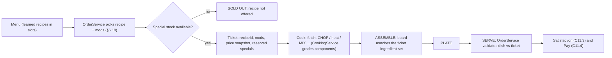

## 6. Recipe Database

> **Data-backed:** every table and number in §6, §7 and §36.2 is generated by `python3 gdd/tools/render_recipes.py` from `gdd/data/ingredients*.json` and `gdd/data/recipes*.json`, which validates the data against the canon (150 recipes with fixed IDs, names and unlock levels; C9 tag vocabulary and core ingredient IDs; C7.1 station availability; C8 actions and states; C4.2 price curve). Edit the JSON, never the markdown. Ingredient rows live in §7; the one-line-per-recipe index is §36.2.

Mystery Morph Restaurant ships **150 recipes in 15 categories** (BRG 15, PIZ 15, TAC 10, SAN 10, SOP 10, PST 10, BRK 10, DES 15, DRK 15, SEA 10, SAL 5, FRI 5, ALN 10, MUT 5, LEG 5). Every recipe is a small, deterministic program — ingredients in required states, an ordered list of canon actions at canon stations, timed heat components — wrapped in a ridiculous costume. 167 ingredients feed them (§7): 115 unlimited BASIC and 52 stocked SPECIAL.

### 6.1 Recipe System Rules

#### Purpose

Recipes convert player skill (chop rhythm, heat timing, assembly order, multitasking) into Morph Bucks. They are the main *content* ladder of the restaurant pillar: each level-up unlocks something new to cook, each restaurant tier gives more menu slots to show it off, and high-difficulty dishes pay more per second of effort, funding the mutation loop (Cook → Earn → Morph).

#### Rules & Mechanics

##### 6.1.1 Recipe data schema

| Field | Type | Source | Meaning |
|---|---|---|---|
| `id` | string | canon C10 | `RCP_<CAT>_<NNN>`, stable forever |
| `name` | string | canon C10 | display name (localization key = id) |
| `category` | enum | derived from id | BRG PIZ TAC SAN SOP PST BRK DES DRK SEA SAL FRI ALN MUT LEG |
| `unlock` | int 1–95 | canon C10 | level at which the recipe becomes learnable |
| `d` | int 1–5 | data | difficulty (6.1.5); feeds price factor and customer patience (C11.2) |
| `var` | float 0.85–1.15 | data | fixed per-recipe flavor variance multiplier in the price |
| `prep` | int s | data | base preparation time: one competent player, Lv1 stations, no stats, heat steps run in parallel; used by offline `PrepSec_avg` (C15) and employee cook time |
| `ing[]` | {ingId, qty, state} | data | required ingredients, quantity and the C8 state they must be in when the dish is assembled |
| `steps[]` | {action, station, text, tReady?, opts?} | data | ordered canon actions at canon stations; heat actions carry `tReady` (s, Lv1 baseline) and options: component, `flip` (GRILL; default true for proteins and sandwiches), `dial` LOW/MED/HIGH (BAKE at `STN_OVEN`; default MED), `w` Perfect window override; MIX steps list ingredients in canonical insertion sequence (§5.4.6) |
| `stack[]` | ING ids | derived | canonical ASSEMBLE order bottom → top = mention order in the final ASSEMBLE step (a repeated bread = bottom/top halves); `set: true` marks unordered dishes (§5.4.9) |
| `core[]` | ING ids | data | components whose absence makes a wrong dish (DishMatch 0) instead of a missing non-core component (§6.18.4) |
| `counts{}` | {ING: [n, unit]} | data / §7 default | default counts of countable components (pickle slices, pepperoni coins, ice cubes, fries, scoops, pancake layers…) used by COUNT mods |
| `container` | enum | data / category default | PLATE, BOWL, CUP, CONE, BOX or WRAP (Dish.container, §5.6.4); bowls, cups, cones and boxes count as plated |
| `stations[]` | STN ids | derived | storage used + step stations + `STN_WINDOW` |
| `heat[]` | {component, action, station, tReady} | derived | graded heat components (6.1.6) |
| `price` / `cost` / `margin` | MB / MB / % | derived | 6.2 formula; cost = Σ qty × unit cost |
| `learnCost` | MB | derived | 5 × price (0 for L1 recipes) |
| `specials[]` | ING ids | derived | stocked ingredients → SOLD OUT logic |
| `loves[]` / `hates[]` | PER ids | data | personality dish modifiers (6.1.8) |
| `cx[]`, `look`, `anim`, `vfx`, `mut` | strings | data | complaints, visual, animation, effects, mutation notes |

##### 6.1.2 Learning recipes

L1 recipes (`RCP_BRG_001`, `RCP_BRG_002`, `RCP_DRK_001`, `RCP_FRI_001`) are known from the start. Every other recipe becomes *learnable* at its unlock level and is learned at the **Cooking Academy** (`BLD_06`, dean Professor Saucington `NPC_009`) for **5 × its base price** in MB, or is granted free by a quest (recipe unlocks are a C17.4 reward type). Learning is permanent and account-wide. A learned recipe can be put on the menu only when every station in its station list is owned and placed (exception: `STN_PLATING` steps use `STN_ASSEMBLY` at TIER_01–02).

| Category | Recipes | Unlock range | Extra gate |
|---|---|---|---|
| BRG Burgers | 15 | L1–L60 | — |
| PIZ Pizza | 15 | L3–L55 | — |
| TAC Tacos & Mexican-Inspired | 10 | L5–L48 | — |
| SAN Sandwiches | 10 | L2–L42 | — |
| SOP Soups | 10 | L4–L52 | — |
| PST Pasta | 10 | L2–L47 | — |
| BRK Breakfast | 10 | L2–L41 | — |
| DES Desserts | 15 | L3–L58 | — |
| DRK Drinks & Smoothies | 15 | L1–L49 | — |
| SEA Seafood | 10 | L7–L54 | — |
| SAL Salads | 5 | L3–L32 | — |
| FRI Fried Foods | 5 | L1–L43 | — |
| ALN Alien Cuisine | 10 | L30–L62 | Alien Cuisine course — story chapter 5 (Zorp `NPC_027`); no ALN recipe can be bought before it |
| MUT Mutation Cuisine | 5 | L42–L70 | must own an `STN_INFUSER` (L40, TIER_06) before learning; every MUT dish INFUSEs |
| LEG Legendary Dishes | 5 | L65–L95 | a Legendary Recipe quest per dish (`QST_CHF_011`–`QST_CHF_015`, §20); never sold at the Academy |

##### 6.1.3 Menu slots

The menu is the set of learned recipes the restaurant currently offers; drinks, sides and desserts use slots like mains. Menu edits are made at the Menu Board (part of `STN_WINDOW`) at any time and affect only *new* orders. If every menu item is SOLD OUT, `RCP_BRG_001` is auto-added without using a slot (C22 E9).

| Entry level | Tier | Menu slots | Recipes learnable at entry level |
|---|---|---|---|
| L1 | `TIER_01` Broken Burger Shack | 4 | 4 |
| L5 | `TIER_02` Tiny Mutation Diner | 5 | 24 |
| L10 | `TIER_03` Neighborhood Freak Café | 6 | 45 |
| L18 | `TIER_04` Morph City Grill | 8 | 68 |
| L26 | `TIER_05` Mutant Family Restaurant | 10 | 91 |
| L35 | `TIER_06` Monster Food Court | 12 | 110 |
| L45 | `TIER_07` Mutation Megadiner | 14 | 127 |
| L56 | `TIER_08` Luxury Freak Restaurant | 16 | 139 |
| L68 | `TIER_09` Morph City Food Palace | 20 | 145 |
| L80 | `TIER_10` Legendary Mutation Restaurant | 24 | 148 |

##### 6.1.4 From recipe to ticket to dish to validation



1. **Order.** When a customer orders, `OrderService` draws a recipe from the menu with weight 1.0, ×2.0 for recipes the personality *loves*, ×0.25 for recipes it *hates* [TUNABLE]; recipes that are SOLD OUT or need a Broken/Destroyed station are excluded. Modifications are rolled per §6.18.
2. **Ticket.** `{ticketId, recipeId, mods[], expectedSet, priceSnapshot, customerId, createdAt}`. `expectedSet` = the recipe's ingredient multiset adjusted by the mods (e.g. "no cheese" removes `ING_CHEESE`, COUNT mods change a countable's target). One unit of every SPECIAL ingredient in `expectedSet` is **reserved** from stock at order creation (§5.6.1); reservations are released if the order is voided.
3. **Cook.** Taking an ingredient from storage spawns an item in state RAW; every step changes its state (C8). `CookingService` stores a grade per graded component: chop quality, heat grade (6.1.6), blend/pour/scoop result.
4. **Assemble.** Components placed on an `STN_ASSEMBLY` board build the server-side **Dish** object (§5.6.4); the recipe's `stack` is the canonical bottom → top order graded by the assembly-order factor (C8), and the ghost stack shows the next layer for the pinned ticket. *Bake-after-assembly* recipes (pizzas, lasagnas, casseroles, pies) are assembled raw and then baked as one heat component, which sets every assembled component to BAKED. No two recipes share an identical (ingredient, qty, state) multiset (validated by the renderer), so recipe recognition is unambiguous.
5. **Plate** at `STN_PLATING`; `STN_ASSEMBLY` doubles as plating only at TIER_01–02, so from TIER_03 a dish counts as plated only via `STN_PLATING` (un-plated → 0.9 plating factor, C8). Dishes whose container is a BOWL, CUP, CONE or BOX count as plated (§5.5).
6. **Serve.** `OrderService` validates server-side (§5.6.5): `A = DishMatch × ModScore` per §6.18.4 — a missing **core** component makes it a wrong dish, each missing non-core component or unrequested extra costs 0.15 (floor 0.4). Q and C come from the stored grades (§5.5, C8). Pay = price × (1 + mod bonus) × PayFactor (§6.18.5, C11.4); tips use menu prices only.

##### 6.1.5 Difficulty model

| Diff | Numbered steps | Heat components (data) | Precision demands | Prep band s | Patience (C11.2) | Cost-ratio target | Recipes | Avg prep | Avg cost ratio |
|---|---|---|---|---|---|---|---|---|---|
| D1 | 2–4 | 0–2 | short stacks; chop N = 4 taps; heat steps never need to overlap | 15–30 | +5 s | 33–40 % | 16 | 20 s | 36.4 % |
| D2 | 3–5 | 0–2 | short ordered stacks or one MIX sequence; two heat steps may overlap | 20–45 | +10 s | 31–38 % | 28 | 35 s | 34.0 % |
| D3 | 4–7 | 0–4 | longer stacks or a two-stage chain (e.g. BOIL → BLEND → FREEZE); overlapping timers | 35–80 | +15 s | 29–35 % | 53 | 54 s | 31.1 % |
| D4 | 5–9 | 0–4 | three or more stations busy at once; multi-stage chains; tight ordered builds | 55–125 | +20 s | 27–33 % | 30 | 84 s | 29.6 % |
| D5 | 6–12 | 1–6 | four or more stations, long chains (e.g. CHOP → FRY → INFUSE), big ordered builds, 4+ timers | 80–150 | +25 s | 25–30 % | 23 | 149 s | 27.2 % |

Legendary dishes ignore the step band (they are multi-station showpieces of 9–13 steps) and use a 150–240 s prep band. The difficulty price factor is `0.8 + 0.1 × D` (C4.2), so a D5 dish earns 44 % more than a D1 dish of the same level.

##### 6.1.6 Ideal cooking time (heat components)

Each heat step (GRILL, FRY, BAKE, SAUTE, BOIL, STEAM, FLOAT, INFUSE) is a graded component with an authored `T_ready` at Lv1 with no stats. Canon C8 then fixes: **Perfect** `[T_ready, T_ready + 2.0 s]`, **Good** until `T_burn = T_ready + 6 s`, **BURNED** after, **ON_FIRE** at `T_burn + 4 s` on fire-capable stations (GRILL, FRY, BAKE, SAUTE, FLOAT and INFUSE — the infuser's cartoon green fire); pots and the steamer (BOIL, STEAM) boil over instead (§5.4.2). UNDERCOOKED before `T_ready`. Effective values: `T_ready_eff = T_ready × StationTimeMult (C4.9) / (1 + 0.006 × COOK_SPD)` and `W_eff = 2.0 × StationWindowMult × (1 + 0.005 × COOK_QLT)`; §5.4.2 owns the full stack (burn grace, mutation affinity multipliers, RARE/WELL_DONE/SCREAMING sub-bands). Each detail block also lists the input the station expects: GRILL flip window `[0.40, 0.75] × T_ready` (or *no flip* for buns and veg), FRY shake `[0.45, 0.70] × T_ready`, oven dial LOW/MED/HIGH, pizza-oven spin `[0.40, 0.70] × T_ready`, SAUTE tosses at ⅓ and ⅔, soup-pot stirs, INFUSE pressure band, FLOAT nudges (§5.4.3–5.4.5). Non-heat components (CHOP, MIX, BLEND, POUR, SCOOP, FREEZE) are graded by §5's minigames.

##### 6.1.7 Ingredient supply, stock and SOLD OUT

Per C9, **BASIC** ingredients (unlock ≤ L20, no special tag) are unlimited: their cost is netted from the sale at serve, and wasted basic food is charged at `STN_TRASH` (never below 0 MB). **SPECIAL** ingredients (tags alien, mutagen, legendary, gold, glowing — or unlock > L20, which this database always flags as rarity stock) are bought as crates (§7), stored in `STN_PANTRY`/`STN_FRIDGE`/`STN_FREEZER` stock and consumed per unit. 67 of 150 recipes use at least one SPECIAL ingredient (marked ★); the first appears at L21. When any SPECIAL ingredient of a recipe has 0 unreserved units, the recipe shows **SOLD OUT** on the menu board and in the Recipe Book and cannot be ordered; it returns automatically when stock arrives.

##### 6.1.8 Customer satisfaction modifiers

Dish modifiers are added inside the `P_offset` term of the C11.3 satisfaction formula as a **dish offset**, clamped to −15…+15 in total: **Perfect Plate +5** when every graded component is PERFECT; **Loves +8** and **Hates −8** for the listed personalities (C11.1; §9 may list further preferences, which stack inside the same clamp). Mutation Cuisine applies the C10 rule: +10 "Whoa!" as the `MutationBonus` term plus a 60 s client-only cosmetic mutation part. Complaint lines are barks played at *Inspect food* (§8) when a component grades below GOOD or a *hates* modifier fires.

##### 6.1.9 Mutation affinity hooks

Recipes expose *hooks* — properties that equipped mutation parts react to through their C13.5 tags. The defaults below apply automatically to every equipped part carrying the tag; §12 passives and §36.4 synergies multiply on top within their own caps. Each recipe lists the hooks that apply to it; the signature line names the parts and abilities that make that dish shine.

| Hook | Part tag / ability | Applies to | Default effect [TUNABLE] | Stack cap |
|---|---|---|---|---|
| Hot Hands | `fire` | GRILL / FRY / BAKE / SAUTE steps | T_ready ×0.92 per part | 2 parts (×0.85) |
| Cold Snap | `ice` | FREEZE steps | freeze time ×0.6; `ABL_067` Freeze Touch completes one FREEZE step instantly | 1 part |
| Zap-Cook | `ABL_066` (`MUT_036`) | any one running heat component | finishes it instantly at GOOD (forfeits Perfect Plate) | cooldown per §36.6 |
| Many Hands | `tentacle` or `multi` | ASSEMBLE steps | each input places 2 layers; `ABL_061` Extra Hands runs 2 stations | 1 part |
| Kitchen Pro | `chef` | all heat components | Perfect window +0.2 s per part | 3 parts (+0.6 s) |
| Spark Blend | `electric` | BLEND / MIX steps | process time ×0.85 | 1 part |
| Steam Team | `water` | BOIL / STEAM steps | T_ready ×0.9; `ANM_030` extinguish 50 % faster | 1 part |
| Pincer Prep | `claw` | CHOP of meat / poultry / seafood / tentacle items | taps -1 (min 2) | 1 part |
| Green Thumb | `plant` | CHOP of veg / fruit / plant items | green timing zone +20 % width | 1 part |
| Space Chef | `alien` or `cosmic` | INFUSE / FLOAT steps; CHOP of alien items | Perfect window +0.5 s; alien CHOP taps -1 | 1 part |
| Sweet Tooth | `sweet` | SCOOP / POUR / MIX on dishes with a sweet item | process time ×0.85 | 1 part |
| Sticky Grip | `sticky` | carrying a soup or drink | never SPILLED when bumped | 1 part |
| Sea Legs | `aquatic` | seafood / tentacle heat components | T_burn +1 s | 1 part |
| Glow Guide | `glow` | glowing-item components | Perfect window +0.25 s | 1 part |

##### 6.1.10 How to read a recipe block (6.3–6.17)

| Line | Contents |
|---|---|
| quote | description (flavour text shown in the Recipe Book) |
| Spec | category · unlock level · difficulty D1–D5 · base prep time · **base selling price** · ingredient cost · profit margin · learn cost (5 × price; ALN/MUT/LEG gates per 6.1.2) |
| Ingredients | ID ×qty and the state required at assembly; ★ = SPECIAL stock (6.1.7) |
| Stations | processing and assembly stations in step order; the storage fixture of each ingredient (§7) and `STN_WINDOW` (SERVE) are always implied |
| Steps | numbered canon actions at canon stations. MIX steps name ingredients in their canonical insertion sequence (§5.4.6). The **final ASSEMBLE step names the layers bottom → top: that order is the canonical stack** graded by the assembly-order factor (a repeated bread is the bottom/top halves). Ingredients are fetched from storage before their first step |
| Cook times | per heat component: T_ready, Perfect window, burn and fire/boil-over times at Lv1 with no stats, plus the station input (flip window, shake window, oven dial, pizza spin, tosses, stirs, pressure, nudges) — 6.1.6 |
| Build | core components (omission = wrong dish, §6.18.4) · container · ordered stack or set match · default counts of countable components |
| Satisfaction | dish offsets: Perfect Plate +5 always applies; loves +8 / hates −8 by personality ID; Mutation Cuisine Whoa! bonus |
| Complaints | barks used at Inspect food (§8) on a sub-GOOD component or a *hates* match |
| Visual / FX | blocky Roblox look of the plated dish and its kid-safe effects (Reduced Effects variant noted where it matters) |
| Animation | core animation IDs (C21) for the station actions, then dish-specific notes. Every dish also uses `ANM_019` Serve (hand-off) and `ANM_043` Eat; dishes with open-heat steps add `ANM_030` Extinguish fire as their failure recovery; FREEZE uses `ANM_006` Carry item |
| Mutations | signature mutation interaction (canon `MUT_`/`ABL_` IDs), then the 6.1.9 hooks that apply |

**Personality legend (C11.1):** `PER_001` The Karenosaurus · `PER_002` The Hungry Hippo-Spider · `PER_003` The Polite Demon · `PER_004` The Food Critic · `PER_005` The Impatient Goblin · `PER_006` The Sleepy Sloth-Rocket · `PER_007` The Chaos Gremlin · `PER_008` The Rich Mutant · `PER_009` The Influencer · `PER_010` The Bodybuilder Pigeon · `PER_011` The Conspiracy Moth · `PER_012` The Nervous Newt · `PER_013` The Grandma Golem · `PER_014` The Picky Platypus · `PER_015` The Robot Accountant · `PER_016` The Party Pack · `PER_017` The Pirate Crab · `PER_018` The Drama Llama · `PER_019` The Mime Mantis · `PER_020` The Toddler Titan · `PER_021` The Health Nut Hamster · `PER_022` The Spicy Salamander · `PER_023` The Frozen Yeti-Fish · `PER_024` The Time-Traveler Tortoise · `PER_025` The Undercover Inspector · `PER_026` The Speedrunner Squirrel · `PER_027` The Lovebird Jellyfish Couple · `PER_028` The Haunted Toaster · `PER_029` The Alien Tourist · `PER_030` The Retired Wrestler Walrus · `PER_031` The Birthday Beast · `PER_032` The Mystery Mutant.

**Animation legend (C21):** `ANM_006` Carry item (upper body) · `ANM_010` Chop · `ANM_011` Grill flip · `ANM_012` Fryer dunk · `ANM_013` Oven load · `ANM_014` Stir pot · `ANM_015` Blend (hold lid) · `ANM_016` Mix bowl · `ANM_017` Assemble stack · `ANM_018` Plate & garnish · `ANM_019` Serve (hand-off) · `ANM_020` Pour drink · `ANM_024` Sauté pan toss · `ANM_025` Scoop ice cream · `ANM_026` Pizza peel slide · `ANM_027` Steamer lid lift · `ANM_028` Infuse (mutagen pump) · `ANM_029` Anti-grav toss.

#### Variables

| Variable | Value | Notes |
|---|---|---|
| Learn cost multiplier | 5 × price [canon] | L1 recipes free |
| Perfect window `W_perfect` | 2.0 s [canon TUNABLE] | per heat component, Lv1 |
| Burn offset | T_ready + 6 s [canon TUNABLE] | ON_FIRE 4 s later on open heat |
| Perfect Plate bonus | +5 [TUNABLE] | dish offset |
| Love / hate modifier | +8 / −8 [TUNABLE] | dish offset |
| Dish offset clamp | −15…+15 [TUNABLE] | inside `P_offset` |
| Order weight love / hate | ×2.0 / ×0.25 [TUNABLE] | menu draw |
| Hand-mix penalty | 1.5 × MIX time [canon] | MIX at `STN_PREP` before `STN_MIXER` |
| Mod pay bonus | per mod 5–25 %, cap +40 % per item [§6.18.5] | 6.2.4 |
| Cost-ratio target band | 25–40 % [canon] | per difficulty in 6.1.5 |
| Variance multiplier | 0.85–1.15 [canon] | fixed per recipe, stored in data |

#### UI

- **Recipe Book** (Cooking Academy counter and the restaurant's Menu Board): a grid of recipe cards — isometric dish render, name, category icon, difficulty shown as *D3* text **and** three pips (never colour-only), price, ingredient cost, margin bar, station icons (greyed with a lock if not owned), ★ special-stock counter, SOLD OUT stamp, and a LEARN button showing 5 × price. Filters: category, learnable, on menu, needs station.
- **Ticket card** (ticket rail at `STN_WINDOW` and the HUD order queue): recipe icon, customer patience ring, modification text, and a component checklist where each component shows its target state icon (e.g. a flame for GRILLED) and fills with its live grade.
- **Station overlay** (§5): the heat bar shows the Perfect band in green **with** a ✓ notch and the burn zone with a ✗ notch; the ideal times in each recipe's detail block are exactly what this bar draws at Lv1.

#### Progression

| Level band | New recipes | Categories | Price range MB | With SPECIAL stock |
|---|---|---|---|---|
| L1–L10 | 45 | BRG, PIZ, TAC, SAN, SOP, PST, BRK, DES, DRK, SEA, SAL, FRI | 6–19 | 0 |
| L11–L20 | 29 | BRG, PIZ, TAC, SAN, SOP, PST, BRK, DES, DRK, SEA, SAL | 11–28 | 0 |
| L21–L30 | 26 | BRG, PIZ, TAC, SAN, SOP, PST, BRK, DES, DRK, SEA, SAL, FRI, ALN | 17–50 | 18 |
| L31–L40 | 19 | BRG, PIZ, TAC, SAN, SOP, PST, BRK, DES, DRK, SEA, SAL, ALN | 33–80 | 18 |
| L41–L50 | 15 | BRG, PIZ, TAC, SAN, PST, BRK, DES, DRK, FRI, ALN, MUT | 65–142 | 15 |
| L51–L60 | 8 | BRG, PIZ, SOP, DES, SEA, ALN, MUT | 152–213 | 8 |
| L61–L70 | 4 | ALN, MUT, LEG | 255–738 | 4 |
| L71–L80 | 2 | LEG | 1,038–1,503 | 2 |
| L81–L95 | 2 | LEG | 2,085–3,189 | 2 |

Roughly one new recipe per level through L60 keeps every level-up exciting; the sparse L60+ tail is reserved for Mutation and Legendary showpieces that pair with RT-gated mutation upgrades (§22).

#### Player Interactions

- **Co-op (§21):** items are restaurant-owned, so any co-op player may perform any step of any ticket (C22 E7); station slots lock per interactor.
- **Employees (§16):** a `ROLE_CHEF` cooks a recipe only if `D ≤ 1 + floor(CookingSkill / 25)` (C15); `ROLE_PREP` performs CHOP and MIX steps and stages items at `STN_PREP`; `ROLE_STOCKER` re-buys SPECIAL crates (§7).
- **Customers:** personalities pick favourites by the love/hate lists; dish complaints feed anger (§10).

#### Dependencies

§5 Cooking Mechanics (station timing, minigames, failure states) · §6.18 Order Modifications · §7 Ingredients · §8–§10 customer evaluation · §12 / §36.4 mutation passives and synergies · §14 XP per dish · §16–§17 employees and offline `PrepSec_avg`/`AvgTicket` · §20 quests granting recipes · §22 economy · §27 `RecipeService`/`OrderService`/`CookingService` · §28 recipe-unlock persistence.

#### Roblox Implementation

The renderer's JSON is also exported (build step) to `ReplicatedStorage.Shared.Data.RecipeDefs` as a frozen Luau table; `RecipeService` owns learning and menus, `OrderService` builds tickets, `CookingService` grades components. Clients only *display* prices and timings; the server recomputes every grade and payment.

```lua
--!strict
export type IngredientReq = { id: string, qty: number, state: string }
export type Step = { action: string, station: string, tReady: number?, component: string?,
  flip: boolean?, dial: ("LOW" | "MED" | "HIGH")?, window: number?, sequence: { string }? }
export type RecipeDef = {
  id: string, category: string, unlock: number, difficulty: number,
  prepSec: number, price: number, cost: number, ingredients: { IngredientReq },
  steps: { Step }, stack: { string }, core: { string }, counts: { [string]: number }, container: string,
  stations: { string }, specials: { string }, loves: { string }, hates: { string },
}
local RecipeDefs: { [string]: RecipeDef } = table.freeze({
  RCP_BRG_001 = table.freeze({
    id = "RCP_BRG_001", category = "BRG", unlock = 1, difficulty = 1,
    prepSec = 20, price = 9, cost = 3,
    ingredients = { { id = "ING_BUN", qty = 1, state = "RAW" }, { id = "ING_BEEF_PATTY", qty = 1, state = "GRILLED" }, { id = "ING_PICKLE", qty = 1, state = "CHOPPED" }, --[[ ... ]] },
    steps = { { action = "GRILL", station = "STN_GRILL", tReady = 8, component = "ING_BEEF_PATTY", flip = true }, --[[ ... ]] },
    stack = { "ING_BUN", "ING_BEEF_PATTY", "ING_PICKLE", "ING_LETTUCE", "ING_KETCHUP", "ING_BUN" },
    core = { "ING_BUN", "ING_BEEF_PATTY" }, counts = { ING_PICKLE = 3 }, container = "PLATE",
    stations = { "STN_PANTRY", "STN_FRIDGE", "STN_CUT", "STN_GRILL", "STN_ASSEMBLY", "STN_WINDOW" },
    specials = {}, loves = { "PER_014", "PER_020", "PER_026" }, hates = { "PER_004" },
  }),
})

-- Server-side dish check used by OrderService at SERVE.
local function matchesTicket(dishSet: { [string]: { qty: number, state: string } },
    expected: { IngredientReq }): boolean
  local count = 0
  for _, req in expected do
    local got = dishSet[req.id]
    if not got or got.qty ~= req.qty or got.state ~= req.state then return false end
    count += 1
  end
  for _ in dishSet do count -= 1 end
  return count == 0 -- no extra ingredients
end
```

#### Edge Cases

- **Stock runs out mid-rush:** units already reserved by open tickets are untouchable; only *new* orders see SOLD OUT. Cancelled tickets release unreserved units.
- **Recipe removed from the menu with open tickets:** open tickets stay valid and pay their snapshot price.
- **Station destroyed mid-cook:** the item pops out onto the nearest free `STN_PREP` hold with its current state and timer frozen; tickets needing that station hide from new orders until repaired.
- **MUT dish served to a customer who already wears a cosmetic part:** the new 60 s part replaces it; the +10 bonus applies once per customer visit.
- **Owner disconnects (C22 E1):** in-progress basic food is discarded free; SPECIAL items return to stock.
- **Two players finish the same ticket:** the first validated SERVE wins; the duplicate dish becomes a *spare* that may satisfy another ticket of the same recipe within 60 s, else it is trashed at cost.
- **Modification removes a SPECIAL ingredient:** that unit is not reserved, so the dish can be ordered even while the ingredient is SOLD OUT.

#### Acceptance Criteria

- **AC-06-01:** All 150 canon recipes exist with IDs, names and unlock levels exactly matching C10; the renderer exits 0.
- **AC-06-02:** Every recipe's base price equals `round(10 × 1.05^(L−1) × (0.8 + 0.1·D) × CategoryFactor × var)` with `var` in 0.85–1.15.
- **AC-06-03:** Every recipe's ingredient cost ratio is within 25–40 % and the mean ratio falls as difficulty rises.
- **AC-06-04:** No recipe uses a station before that station's C7.1 availability level.
- **AC-06-05:** Every non-RAW required ingredient state is produced by a step of the matching action.
- **AC-06-06:** A recipe whose SPECIAL ingredient has 0 unreserved units is never offered by `OrderService` and shows SOLD OUT within 1 s.
- **AC-06-07:** Learning a recipe at `BLD_06` deducts exactly 5 × price MB and persists across sessions.
- **AC-06-08:** ALN recipes cannot be learned before the Alien Cuisine course, MUT recipes before an owned `STN_INFUSER`, LEG recipes except via their Legendary Recipe quest.
- **AC-06-09:** A heat component removed inside its Perfect window grades PERFECT (1.00) and the ticket checklist shows it within 0.2 s.
- **AC-06-10:** Serving a dish whose multiset differs from the ticket `expectedSet` yields A = 0 server-side regardless of client claims.
- **AC-06-11:** A menu shows at most the C6 menu-slot count for the current tier.
- **AC-06-12:** Eating a MUT dish shows a cosmetic part on the customer for 60 s ± 0.5 s and adds +10 satisfaction.

### 6.2 Pricing & Profitability

#### 6.2.1 Price formula (canon C4.2)

```text
BasePrice  = 10 × 1.05^(L − 1)                  L = recipe unlock level
Price      = round_half_up( BasePrice × (0.8 + 0.1 × D) × CategoryFactor × var )
CategoryFactor: DRK, FRI, SAL ×0.7 · DES ×0.8 · LEG ×2.5 · all others ×1.0
var        = fixed per-recipe flavor variance, 0.85–1.15, stored in the recipe data
Cost       = Σ qty × ingredient unit cost (§7)  ·  Margin = (Price − Cost) / Price
```

| L | 10 × 1.05^(L−1) | Canon reference | Recipes unlocking at L |
|---|---|---|---|
| 1 | 10.00 | ≈ 10 | `RCP_BRG_001`, `RCP_BRG_002`, `RCP_DRK_001`, `RCP_FRI_001` |
| 10 | 15.51 | ≈ 16 | `RCP_PIZ_011`, `RCP_SAN_004`, `RCP_DES_006`, `RCP_SEA_002` |
| 20 | 25.27 | ≈ 25 | `RCP_BRG_009`, `RCP_SOP_005`, `RCP_DRK_010` |
| 30 | 41.16 | ≈ 41 | `RCP_BRG_011`, `RCP_DES_012`, `RCP_ALN_001` |
| 40 | 67.05 | ≈ 67 | `RCP_BRG_012`, `RCP_ALN_004` |
| 50 | 109.21 | ≈ 109 | `RCP_BRG_014`, `RCP_ALN_007` |
| 60 | 177.90 | ≈ 177 | `RCP_BRG_015` |
| 70 | 289.78 | ≈ 288 | `RCP_MUT_005` |
| 80 | 472.01 | ≈ 469 | `RCP_LEG_003` |
| 90 | 768.86 | ≈ 764 | — |
| 95 | 981.28 | ≈ 975 | `RCP_LEG_005` |

The formula is authoritative: canon's rounded reference values drift by up to 0.7 % at L80+ (e.g. L80 ≈ 469 vs 472.01 computed).

#### 6.2.2 Worked examples

- **RCP_BRG_001 Basic Burger** (L1, D1, BRG): `10 × 1.05^0 = 10.00` × difficulty `0.9` × category `1.0` × variance `1.00` = 9.00 → **9 MB**. Cost = 1×0.5 + 1×1 + 1×0.5 + 1×0.5 + 1×0.5 = **3 MB** → ratio 33.3 %, margin **66.7 %**.
- **RCP_PIZ_008 Lava Pizza** (L34, D4, PIZ): `10 × 1.05^33 = 50.03` × difficulty `1.2` × category `1.0` × variance `1.00` = 60.04 → **60 MB**. Cost = 1×1 + 2×6 + 2×0.6 + 2×2 + 2×0.6 = **19.4 MB** → ratio 32.3 %, margin **67.7 %**.
- **RCP_DRK_005 Bubble Tea** (L8, D2, DRK): `10 × 1.05^7 = 14.07` × difficulty `1.0` × category `0.7` × variance `1.00` = 9.85 → **10 MB**. Cost = 1×0.6 + 2×0.8 + 1×0.5 + 1×0.5 + 1×0.5 = **3.7 MB** → ratio 37.0 %, margin **63.0 %**.
- **RCP_ALN_007 Comet Kebab** (L50, D5, ALN): `10 × 1.05^49 = 109.21` × difficulty `1.3` × category `1.0` × variance `1.00` = 141.98 → **142 MB**. Cost = 2×14 + 1×0.5 + 1×0.5 + 1×0.5 + 1×0.8 + 1×10 + 1×0.5 = **40.8 MB** → ratio 28.7 %, margin **71.3 %**.
- **RCP_LEG_005 The Mystery Morph Meal** (L95, D5, LEG): `10 × 1.05^94 = 981.28` × difficulty `1.3` × category `2.5` × variance `1.00` = 3189.17 → **3,189 MB**. Cost = 1×320 + 1×140 + 2×30 + 1×30 + 1×60 + 2×12 + 1×110 + 2×10 + 1×45 + 2×12 = **833 MB** → ratio 26.1 %, margin **73.9 %**.

#### 6.2.3 Margin targets and actuals

Ingredient cost targets 25–40 % of price (C4.2), falling with difficulty so that hard dishes reward skill with both a higher price factor *and* a fatter margin. Actual values below are computed from the data.

| Diff | Recipes | Target ratio | Min ratio | Mean ratio | Max ratio | Mean margin |
|---|---|---|---|---|---|---|
| D1 | 16 | 33–40 % | 33.3 % | 36.4 % | 38.8 % | 63.6 % |
| D2 | 28 | 31–38 % | 31.0 % | 34.0 % | 37.5 % | 66.0 % |
| D3 | 53 | 29–35 % | 29.0 % | 31.1 % | 34.6 % | 68.9 % |
| D4 | 30 | 27–33 % | 27.0 % | 29.6 % | 32.4 % | 70.4 % |
| D5 | 23 | 25–30 % | 25.5 % | 27.2 % | 30.0 % | 72.8 % |

| Category | Recipes | Cat. factor | Price MB | Mean margin | Mean prep s | Mean profit MB per prep-second |
|---|---|---|---|---|---|---|
| BRG Burgers | 15 | ×1.0 | 9–213 | 68.4 % | 57 | 0.42 |
| PIZ Pizza | 15 | ×1.0 | 10–167 | 68.7 % | 61 | 0.37 |
| TAC Tacos & Mexican-Inspired | 10 | ×1.0 | 9–129 | 68.5 % | 59 | 0.36 |
| SAN Sandwiches | 10 | ×1.0 | 8–75 | 67.3 % | 48 | 0.34 |
| SOP Soups | 10 | ×1.0 | 10–157 | 69.4 % | 68 | 0.36 |
| PST Pasta | 10 | ×1.0 | 8–123 | 68.5 % | 74 | 0.41 |
| BRK Breakfast | 10 | ×1.0 | 8–92 | 67.7 % | 57 | 0.31 |
| DES Desserts | 15 | ×0.8 | 7–159 | 68.1 % | 57 | 0.34 |
| DRK Drinks & Smoothies | 15 | ×0.7 | 6–95 | 67.0 % | 44 | 0.33 |
| SEA Seafood | 10 | ×1.0 | 11–173 | 70.3 % | 69 | 0.41 |
| SAL Salads | 5 | ×0.7 | 7–33 | 66.5 % | 42 | 0.26 |
| FRI Fried Foods | 5 | ×0.7 | 6–65 | 66.4 % | 47 | 0.25 |
| ALN Alien Cuisine | 10 | ×1.0 | 41–255 | 71.2 % | 96 | 0.83 |
| MUT Mutation Cuisine | 5 | ×1.0 | 89–377 | 71.9 % | 119 | 1.16 |
| LEG Legendary Dishes | 5 | ×2.5 | 738–3,189 | 73.9 % | 216 | 5.65 |

Drinks, fried sides and salads are priced at ×0.7 but are quick: they exist to raise the C4.3 average ticket (1.4 items per customer) and to be the cheap "Peace Offering" freebie of C11.5.

#### 6.2.4 How modifications add pay

Modifications are owned by §6.18; recipes only supply the inputs (core components, stack, countables, sequences). Pay per item = `round(Price × (1 + ModBonusPct)) × PayFactor`, where `ModBonusPct = min(0.40, Σ b_j)` over satisfied mods (each `b_j` 5–25 %, §6.18.5); tips use the menu price only. Ingredients that a mod *adds* are netted at their §7 unit cost; ingredients a mod *removes* are not charged and do not discount the price. Example: `RCP_BRG_002` (10 MB, default 0 pickle slices) with an 18 % COUNT mod satisfied pays round(10 × 1.18) = 12 MB; each extra `ING_PICKLE` unit (3 slices) nets 0.5 MB.

#### 6.2.5 Learning payback

Learn cost is 5 × price, so a recipe repays itself after `5 / margin` servings — about 7–8 orders. Examples:

| Recipe | ID | Learn MB | Profit per serving MB | Servings to repay |
|---|---|---|---|---|
| Cheese Pizza | `RCP_PIZ_001` | 50 | 6.80 | 7.4 |
| Nacho Avalanche | `RCP_TAC_005` | 100 | 13.70 | 7.3 |
| Sushi Roll Block | `RCP_SEA_003` | 85 | 11.70 | 7.3 |
| Tentacle Burger | `RCP_BRG_011` | 225 | 30.50 | 7.4 |
| The Infinite Noodle | `RCP_PST_008` | 345 | 48.70 | 7.1 |
| Galaxy Cheesecake | `RCP_DES_014` | 465 | 65.10 | 7.1 |

#### 6.2.6 Economy hooks

- Customer pay and tips use the ticket price (C11.4). Ingredient cost is reduced by player EFFICIENCY (`× (1 − 0.0015 × S)`, C5) and, for SPECIAL crates, by the Ingredient Stocker discount (5–15 %, §7).
- Offline simulation (C15) uses each menu recipe's `price` (AvgTicket), `cost` (AvgIngredientCost), `prep` (PrepSec_avg) and `d` (chef skill gate); SOLD OUT recipes drop out of the offline menu.
- Menu-weighted average item price at each tier's entry level is the input for §22's pacing simulation.

### 6.3 Burgers (15)

The shack's backbone: burgers teach GRILL timing and stack order on day one, then mutate into fire, ice, tentacles and the frankly unreasonable. Every burger is a stacked dish, so the canonical bottom → top order below is graded.

| ID | Name | Unlock L | Diff | Prep s | Price MB | Cost MB | Margin | Special | Learn MB |
|---|---|---|---|---|---|---|---|---|---|
| `RCP_BRG_001` | Basic Burger | 1 | 1 | 20 | 9 | 3 | 66.7 % | — | known |
| `RCP_BRG_002` | Cheeseburger | 1 | 1 | 22 | 10 | 3.5 | 65.0 % | — | known |
| `RCP_BRG_003` | Double Cheeseburger | 4 | 2 | 30 | 12 | 4.5 | 62.5 % | — | 60 |
| `RCP_BRG_004` | Triple Stack Burger | 9 | 3 | 50 | 19 | 6 | 68.4 % | — | 95 |
| `RCP_BRG_005` | Bacon Monster Burger | 7 | 3 | 45 | 16 | 4.9 | 69.4 % | — | 80 |
| `RCP_BRG_006` | Pickle Mountain Burger | 5 | 2 | 32 | 12 | 4.5 | 62.5 % | — | 60 |
| `RCP_BRG_007` | Volcano Burger | 15 | 3 | 55 | 21 | 7 | 66.7 % | — | 105 |
| `RCP_BRG_008` | Frozen Burger | 12 | 3 | 55 | 17 | 5 | 70.6 % | — | 85 |
| `RCP_BRG_009` | Rainbow Burger | 20 | 3 | 60 | 26 | 8 | 69.2 % | — | 130 |
| `RCP_BRG_010` | Mystery Meat Burger | 25 | 3 | 65 | 32 | 9.5 | 70.3 % | ★ | 160 |
| `RCP_BRG_011` | Tentacle Burger | 30 | 3 | 55 | 45 | 14.5 | 67.8 % | ★ | 225 |
| `RCP_BRG_012` | Exploding Burger | 40 | 4 | 80 | 72 | 20 | 72.2 % | ★ | 360 |
| `RCP_BRG_013` | Upside-Down Burger | 18 | 3 | 60 | 21 | 6.5 | 69.0 % | — | 105 |
| `RCP_BRG_014` | Invisible Burger | 50 | 4 | 85 | 125 | 35.5 | 71.6 % | ★ | 625 |
| `RCP_BRG_015` | The Unreasonably Large Burger | 60 | 5 | 140 | 213 | 56.6 | 73.4 % | ★ | 1,065 |

#### RCP_BRG_001 — Basic Burger

> The burger every newcomer to Morph City is legally required to try once. Bun, beef, pickle, lettuce, ketchup — so normal it is practically suspicious.

- **Spec:** BRG · unlock L1 · D1 · prep 20 s · **9 MB** · cost 3 MB · margin 66.7 % · learn known
- **Ingredients:** ING_BUN×1 RAW, ING_BEEF_PATTY×1 GRILLED, ING_PICKLE×1 CHOPPED, ING_LETTUCE×1 CHOPPED, ING_KETCHUP×1 RAW
- **Stations:** STN_CUT, STN_GRILL, STN_ASSEMBLY
- **Steps:**
  1. CHOP @ STN_CUT: Shred ING_LETTUCE, then slice ING_PICKLE into 3 coins (4 taps each).
  2. GRILL @ STN_GRILL: Sear ING_BEEF_PATTY; flip once when it squeaks.
  3. ASSEMBLE @ STN_ASSEMBLY: ING_BUN heel, ING_BEEF_PATTY, ING_PICKLE, ING_LETTUCE, ING_KETCHUP, ING_BUN crown.
  4. PLATE @ STN_ASSEMBLY: Slide it onto a plate.
  5. SERVE @ STN_WINDOW.
- **Cook times:** ING_BEEF_PATTY GRILL 8 s (Perfect 8–10, burn 14, fire 18; flip 3.2–6)
- **Build:** core ING_BUN, ING_BEEF_PATTY · PLATE · ordered stack · counts ING_PICKLE 3 slices
- **Satisfaction:** loves PER_014, PER_020, PER_026 · hates PER_004
- **Complaints:** "Is this... just a burger? Where's the twist?" · "My lettuce looks as tired as I feel."
- **Visual:** Chunky 5-layer stack: tan dome bun with white sesame studs, brown puck patty, three green pickle coins, zig-zag lettuce frill, glossy ketchup drip. **FX:** Small square grill sparks, one steam puff when plated.
- **Animation:** ANM_010, ANM_011, ANM_017, ANM_018 — Patty squeaks and hops 0.2 studs at the flip cue; the plated burger idles with a tiny bounce (prop tween).
- **Mutations:** The tutorial dish (`QST_TUT_003`): `MUT_145` Octopus Arm, the Chef tutorial pick, lets a brand-new cook chop while the patty grills. Hooks: Hot Hands, Zap-Cook, Many Hands, Kitchen Pro, Green Thumb.

#### RCP_BRG_002 — Cheeseburger

> A Basic Burger that discovered cheese and never looked back. The cheese square is contractually obliged to hang off one corner.

- **Spec:** BRG · unlock L1 · D1 · prep 22 s · **10 MB** · cost 3.5 MB · margin 65.0 % · learn known
- **Ingredients:** ING_BUN×1 RAW, ING_BEEF_PATTY×1 GRILLED, ING_CHEESE×1 RAW, ING_TOMATO×1 CHOPPED, ING_LETTUCE×1 CHOPPED, ING_KETCHUP×1 RAW
- **Stations:** STN_CUT, STN_GRILL, STN_ASSEMBLY
- **Steps:**
  1. CHOP @ STN_CUT: Slice ING_TOMATO into rounds, shred ING_LETTUCE.
  2. GRILL @ STN_GRILL: Grill ING_BEEF_PATTY; flip at the chime.
  3. ASSEMBLE @ STN_ASSEMBLY: ING_BUN heel, ING_BEEF_PATTY, ING_CHEESE draped while hot, ING_TOMATO, ING_LETTUCE, ING_KETCHUP, ING_BUN crown.
  4. PLATE @ STN_ASSEMBLY: Plate with the droopy cheese corner facing the customer.
  5. SERVE @ STN_WINDOW.
- **Cook times:** ING_BEEF_PATTY GRILL 8 s (Perfect 8–10, burn 14, fire 18; flip 3.2–6)
- **Build:** core ING_BUN, ING_BEEF_PATTY, ING_CHEESE · PLATE · ordered stack
- **Satisfaction:** loves PER_020, PER_016 · hates PER_021
- **Complaints:** "The cheese isn't hanging off the corner. Is it even trying?" · "I asked for a CHEESEburger, not a cheese suggestion."
- **Visual:** Classic stack with a bright yellow cheese square melted into a single dramatic drip over one edge. **FX:** A tiny golden 'melt' sparkle as the cheese lands on the patty.
- **Animation:** ANM_010, ANM_011, ANM_017, ANM_018 — Cheese corner sags in a slow 0.5 s droop when placed on the hot patty (prop morph).
- **Mutations:** `MUT_171` Oven Mitt Hands (fire) shave grill time; `MUT_102` Chef Hat Crest (chef) widens the patty's Perfect window. Hooks: Hot Hands, Zap-Cook, Many Hands, Kitchen Pro, Green Thumb.

#### RCP_BRG_003 — Double Cheeseburger

> Two patties, two cheeses, one bun pretending it can handle the pressure. Structural engineers have been consulted.

- **Spec:** BRG · unlock L4 · D2 · prep 30 s · **12 MB** · cost 4.5 MB · margin 62.5 % · learn 60 MB
- **Ingredients:** ING_BUN×1 RAW, ING_BEEF_PATTY×2 GRILLED, ING_CHEESE×2 RAW, ING_LETTUCE×1 CHOPPED, ING_KETCHUP×1 RAW
- **Stations:** STN_CUT, STN_GRILL, STN_ASSEMBLY
- **Steps:**
  1. CHOP @ STN_CUT: Shred ING_LETTUCE.
  2. GRILL @ STN_GRILL: Grill both ING_BEEF_PATTY pucks side by side (both slots); flip each in its window.
  3. ASSEMBLE @ STN_ASSEMBLY: ING_BUN heel, ING_BEEF_PATTY, ING_CHEESE, ING_LETTUCE, ING_BEEF_PATTY, ING_CHEESE, ING_KETCHUP, ING_BUN crown.
  4. PLATE @ STN_ASSEMBLY: Plate it before it leans.
  5. SERVE @ STN_WINDOW.
- **Cook times:** ING_BEEF_PATTY GRILL 8 s (Perfect 8–10, burn 14, fire 18; flip 3.2–6)
- **Build:** core ING_BUN, ING_BEEF_PATTY, ING_CHEESE · PLATE · ordered stack
- **Satisfaction:** loves PER_010, PER_002 · hates PER_021
- **Complaints:** "One of these patties is clearly the favourite child." · "It leaned. It LEANED at me."
- **Visual:** Tall 8-layer stack with two cheese drips on opposite sides, slightly tilted like it's thinking. **FX:** Double sizzle sparks on the grill; a crumb puff when the crown bun lands.
- **Animation:** ANM_010, ANM_011, ANM_017, ANM_018 — Stack wobbles left-right once when set down, then settles (prop tween).
- **Mutations:** `MUT_156` Spatula Arm (chef) widens both patties' windows; `ABL_061` Extra Hands lets you build the stack while both patties finish. Hooks: Hot Hands, Zap-Cook, Many Hands, Kitchen Pro, Green Thumb.

#### RCP_BRG_004 — Triple Stack Burger

> Three patties stacked so high the top bun files its own weather report. Eat from the top down, or call a ladder.

- **Spec:** BRG · unlock L9 · D3 · prep 50 s · **19 MB** · cost 6 MB · margin 68.4 % · learn 95 MB
- **Ingredients:** ING_BUN×1 RAW, ING_BEEF_PATTY×3 GRILLED, ING_CHEESE×3 RAW, ING_PICKLE×1 CHOPPED, ING_KETCHUP×1 RAW
- **Stations:** STN_CUT, STN_GRILL, STN_ASSEMBLY, STN_PLATING
- **Steps:**
  1. CHOP @ STN_CUT: Slice ING_PICKLE into coins.
  2. GRILL @ STN_GRILL: Round 1: grill two ING_BEEF_PATTY pucks.
  3. GRILL @ STN_GRILL: Round 2: grill the third ING_BEEF_PATTY while you start the stack.
  4. ASSEMBLE @ STN_ASSEMBLY: ING_BUN heel, ING_BEEF_PATTY, ING_CHEESE, ING_BEEF_PATTY, ING_CHEESE, ING_PICKLE, ING_BEEF_PATTY, ING_CHEESE, ING_KETCHUP, ING_BUN crown.
  5. PLATE @ STN_PLATING: Plate and plant a toothpick flag in the top.
  6. SERVE @ STN_WINDOW.
- **Cook times:** ING_BEEF_PATTY GRILL 8 s (Perfect 8–10, burn 14, fire 18; flip 3.2–6) · ING_BEEF_PATTY GRILL 8 s (Perfect 8–10, burn 14, fire 18; flip 3.2–6)
- **Build:** core ING_BUN, ING_BEEF_PATTY · PLATE · ordered stack · counts ING_PICKLE 3 slices
- **Satisfaction:** loves PER_002, PER_010, PER_030 · hates PER_021, PER_012
- **Complaints:** "The middle patty is lonely. You can tell." · "I need a step stool to start this."
- **Visual:** A 10-layer tower about 1.5 studs tall with a tiny toothpick flag reading 'TRIPLE' on top. **FX:** Toothpick flag flutters; three-part cheese drip shimmer.
- **Animation:** ANM_010, ANM_011, ANM_017, ANM_018 — Customer uses ANM_043 Eat with a stretched jaw (morph-scale 1.4) on the first bite; the tower sways while carried.
- **Mutations:** `MUT_249` Extra Arm Backpack (`ABL_061`) is the triple-stack enabler: grill round 2 while stacking round 1. Carry-boosting parts keep it upright. Hooks: Hot Hands, Zap-Cook, Many Hands, Kitchen Pro, Green Thumb.

#### RCP_BRG_005 — Bacon Monster Burger

> Four crispy bacon strips arranged as monster fangs around a BBQ-glazed patty. It growls when you set it down. It's the bun settling. Probably.

- **Spec:** BRG · unlock L7 · D3 · prep 45 s · **16 MB** · cost 4.9 MB · margin 69.4 % · learn 80 MB
- **Ingredients:** ING_BUN×1 RAW, ING_BEEF_PATTY×1 GRILLED, ING_BACON×4 FRIED, ING_CHEESE×1 RAW, ING_BBQ_SAUCE×1 RAW
- **Stations:** STN_FRYER, STN_GRILL, STN_ASSEMBLY, STN_PLATING
- **Steps:**
  1. FRY @ STN_FRYER: Fry four ING_BACON strips crisp; shake once.
  2. GRILL @ STN_GRILL: Grill ING_BEEF_PATTY.
  3. ASSEMBLE @ STN_ASSEMBLY: ING_BUN heel, ING_BEEF_PATTY, ING_BBQ_SAUCE, ING_CHEESE, ING_BACON fangs poking out, ING_BUN crown.
  4. PLATE @ STN_PLATING: Plate with the fangs facing out.
  5. SERVE @ STN_WINDOW.
- **Cook times:** ING_BACON FRY 5 s (Perfect 5–7, burn 11, fire 15; shake 2.2–3.5) · ING_BEEF_PATTY GRILL 8 s (Perfect 8–10, burn 14, fire 18; flip 3.2–6)
- **Build:** core ING_BUN, ING_BEEF_PATTY, ING_BACON · PLATE · ordered stack · counts ING_BACON 4 strips
- **Satisfaction:** loves PER_030, PER_010, PER_031 · hates PER_021, PER_012
- **Complaints:** "My burger had fewer fangs than advertised. I count THREE." · "It's supposed to look scary. It looks shy."
- **Visual:** Burger with four bacon strips curled out like fangs and two olive-sized cheese 'eyes' melted on the crown bun. **FX:** Small brown grease-free 'crisp' sparkles; a comic growl text bubble 'grr'.
- **Animation:** ANM_012, ANM_011, ANM_017, ANM_018 — Bacon fangs flex open-shut once on plating (prop bone), timed to a cartoon growl.
- **Mutations:** Fire-tagged parts (e.g. `MUT_163` Lava Fist Arm) shave fryer and grill time; `MUT_120` Cow Body chefs get a 'no comment' bark from the patty. Hooks: Hot Hands, Zap-Cook, Many Hands, Kitchen Pro.

#### RCP_BRG_006 — Pickle Mountain Burger

> A burger buried under a landslide of twelve pickle coins. Mountaineers have planted three flags on it. Two were pickles.

- **Spec:** BRG · unlock L5 · D2 · prep 32 s · **12 MB** · cost 4.5 MB · margin 62.5 % · learn 60 MB
- **Ingredients:** ING_BUN×1 RAW, ING_BEEF_PATTY×1 GRILLED, ING_PICKLE×4 CHOPPED, ING_CHEESE×1 RAW, ING_MUSTARD×1 RAW
- **Stations:** STN_CUT, STN_GRILL, STN_ASSEMBLY, STN_PLATING
- **Steps:**
  1. CHOP @ STN_CUT: Slice four ING_PICKLE spears into 12 coins.
  2. GRILL @ STN_GRILL: Grill ING_BEEF_PATTY.
  3. ASSEMBLE @ STN_ASSEMBLY: ING_BUN heel, ING_BEEF_PATTY, ING_CHEESE, ING_MUSTARD, ING_PICKLE mountain, ING_BUN crown balanced on top.
  4. PLATE @ STN_PLATING: Plate; any pickle that rolls off must go back on the summit.
  5. SERVE @ STN_WINDOW.
- **Cook times:** ING_BEEF_PATTY GRILL 8 s (Perfect 8–10, burn 14, fire 18; flip 3.2–6)
- **Build:** core ING_BUN, ING_BEEF_PATTY, ING_PICKLE · PLATE · ordered stack · counts ING_PICKLE 12 slices
- **Satisfaction:** loves PER_014, PER_017 · hates PER_001
- **Complaints:** "This is a pickle HILL at best." · "Exactly how many pickles is a mountain? Not THIS many."
- **Visual:** A cone of 12 green pickle coins piled between patty and a bun crown perched at a jaunty angle. **FX:** Green sparkle 'brine twinkle' around the pile; tiny flag icon on top.
- **Animation:** ANM_010, ANM_011, ANM_017, ANM_018 — One pickle coin rolls off and back on (prop physics-free tween) when served.
- **Mutations:** `MUT_058` Truffle Pig Super-Snout (`ABL_064`) reveals hidden COUNT mods ('exactly seventeen pickles') before you chop. Hooks: Hot Hands, Zap-Cook, Many Hands, Kitchen Pro, Green Thumb.

#### RCP_BRG_007 — Volcano Burger

> Grilled Lava Peppers erupt from a cheese caldera while hot sauce flows down the bun like a tiny, delicious disaster movie.

- **Spec:** BRG · unlock L15 · D3 · prep 55 s · **21 MB** · cost 7 MB · margin 66.7 % · learn 105 MB
- **Ingredients:** ING_BUN×1 RAW, ING_BEEF_PATTY×1 GRILLED, ING_LAVA_PEPPER×2 GRILLED, ING_HOT_SAUCE×1 RAW, ING_CHEESE×1 RAW, ING_JALAPENO×1 CHOPPED
- **Stations:** STN_CUT, STN_GRILL, STN_ASSEMBLY, STN_PLATING
- **Steps:**
  1. CHOP @ STN_CUT: Slice ING_JALAPENO into rings.
  2. GRILL @ STN_GRILL: Grill ING_BEEF_PATTY.
  3. GRILL @ STN_GRILL: Blister two ING_LAVA_PEPPER on the second slot (no flip).
  4. ASSEMBLE @ STN_ASSEMBLY: ING_BUN heel, ING_BEEF_PATTY, ING_CHEESE crater, ING_LAVA_PEPPER, ING_JALAPENO, ING_HOT_SAUCE lava flow, ING_BUN crown.
  5. PLATE @ STN_PLATING: Plate and let the sauce 'erupt' down one side.
  6. SERVE @ STN_WINDOW.
- **Cook times:** ING_BEEF_PATTY GRILL 8 s (Perfect 8–10, burn 14, fire 18; flip 3.2–6) · ING_LAVA_PEPPER GRILL 5 s (Perfect 5–7, burn 11, fire 15; no flip)
- **Build:** core ING_BUN, ING_BEEF_PATTY, ING_LAVA_PEPPER · PLATE · ordered stack · counts ING_JALAPENO 4 rings
- **Satisfaction:** loves PER_022, PER_003 · hates PER_023, PER_012, PER_020
- **Complaints:** "Where's the eruption? I was promised geology." · "Too hot! I mean — not hot ENOUGH! I mean — WATER!"
- **Visual:** Bun crown with a crater hole; orange-red peppers poke out the top and a glossy red sauce flow runs down one side. **FX:** Cartoon steam puffs and orange 'heat shimmer' sprites (no flames on characters).
- **Animation:** ANM_010, ANM_011, ANM_017, ANM_018 — Peppers puff a smoke ring on plating; customer plays ANM_043 then a cartoon fan-face (steam ears).
- **Mutations:** `MUT_254` Fireproof Skin and `MUT_034` Lava Rock Head (fire) shave both grill steps; `MUT_273` Flame Aura chefs get a 'hot hands' sparkle. Hooks: Hot Hands, Zap-Cook, Many Hands, Kitchen Pro, Green Thumb.

#### RCP_BRG_008 — Frozen Burger

> Grilled to perfection, then frozen solid, then topped with ice. Served with a straw and a sense of betrayal. Yeti-Fish adore it.

- **Spec:** BRG · unlock L12 · D3 · prep 55 s · **17 MB** · cost 5 MB · margin 70.6 % · learn 85 MB
- **Ingredients:** ING_BUN×1 RAW, ING_BEEF_PATTY×1 FROZEN, ING_CHEESE×2 FROZEN, ING_ICE×3 RAW, ING_LETTUCE×1 CHOPPED, ING_WHIPPED_CREAM×1 RAW
- **Stations:** STN_GRILL, STN_CUT, STN_ASSEMBLY, STN_PLATING
- **Steps:**
  1. GRILL @ STN_GRILL: Grill ING_BEEF_PATTY first — it must be cooked before it's frozen.
  2. FREEZE @ STN_FREEZER: Freeze ING_BEEF_PATTY with ING_CHEESE on top (8 s) until frosty.
  3. CHOP @ STN_CUT: Shred ING_LETTUCE.
  4. ASSEMBLE @ STN_ASSEMBLY: ING_BUN heel, ING_BEEF_PATTY, ING_CHEESE, ING_LETTUCE, ING_ICE cubes, ING_WHIPPED_CREAM snowcap, ING_BUN crown.
  5. PLATE @ STN_PLATING: Plate on a frosty plate; serve before the snowcap slumps.
  6. SERVE @ STN_WINDOW.
- **Cook times:** ING_BEEF_PATTY GRILL 8 s (Perfect 8–10, burn 14, fire 18; flip 3.2–6)
- **Build:** core ING_BUN, ING_BEEF_PATTY · PLATE · ordered stack · counts ING_ICE 9 cubes
- **Satisfaction:** loves PER_023, PER_011 · hates PER_003, PER_022
- **Complaints:** "It's not frozen, it's 'mildly chilly'. Unacceptable." · "My teeth are cold and my heart is colder."
- **Visual:** Burger glazed in pale blue frost with ice-cube 'toppings' and a whipped-cream snowcap. **FX:** Drifting snowflake particles and a cold-breath puff (client-only).
- **Animation:** ANM_011, ANM_006, ANM_010, ANM_017, ANM_018 — Customer taps the burger with a fork (ANM_043 variant), it clinks; frost cracks off in flakes.
- **Mutations:** `ABL_067` Freeze Touch (`MUT_176` Frost Fingers) skips the freezer; `MUT_131` Fridge Body and `MUT_162` Ice Crystal Arm (ice) cut freeze time. Hooks: Hot Hands, Cold Snap, Zap-Cook, Many Hands, Kitchen Pro, Green Thumb.

#### RCP_BRG_009 — Rainbow Burger

> Seven colours, one burger, zero restraint. The Influencer has photographed this 4,000 times and eaten it twice.

- **Spec:** BRG · unlock L20 · D3 · prep 60 s · **26 MB** · cost 8 MB · margin 69.2 % · learn 130 MB
- **Ingredients:** ING_BUN×1 RAW, ING_BEEF_PATTY×1 GRILLED, ING_TOMATO×1 CHOPPED, ING_CHEESE×1 RAW, ING_LETTUCE×1 CHOPPED, ING_PURPLE_CABBAGE×1 CHOPPED, ING_RAINBOW_SYRUP×2 MIXED, ING_MAYO×1 MIXED, ING_SPRINKLES×1 RAW
- **Stations:** STN_CUT, STN_GRILL, STN_MIXER, STN_ASSEMBLY, STN_PLATING
- **Steps:**
  1. CHOP @ STN_CUT: Slice ING_TOMATO, shred ING_LETTUCE and ING_PURPLE_CABBAGE.
  2. GRILL @ STN_GRILL: Grill ING_BEEF_PATTY.
  3. MIX @ STN_MIXER: Swirl ING_MAYO then ING_RAINBOW_SYRUP into Rainbow Mayo (don't over-mix the bands).
  4. ASSEMBLE @ STN_ASSEMBLY: ING_BUN heel, ING_BEEF_PATTY, ING_TOMATO red, ING_CHEESE yellow, ING_LETTUCE green, ING_PURPLE_CABBAGE violet, ING_RAINBOW_SYRUP mayo with ING_MAYO, ING_SPRINKLES, ING_BUN crown.
  5. PLATE @ STN_PLATING: Plate on the white plate so the colours pop.
  6. SERVE @ STN_WINDOW.
- **Cook times:** ING_BEEF_PATTY GRILL 8 s (Perfect 8–10, burn 14, fire 18; flip 3.2–6)
- **Build:** core ING_BUN, ING_BEEF_PATTY, ING_RAINBOW_SYRUP · PLATE · ordered stack · counts ING_SPRINKLES 20 sprinkles
- **Satisfaction:** loves PER_009, PER_031, PER_020 · hates PER_014
- **Complaints:** "The rainbow is out of order. Red goes FIRST." · "Where's indigo? Nobody ever remembers indigo."
- **Visual:** Burger with visibly separated colour bands in each layer and a sprinkle-dusted crown; a faint rainbow arc hovers above it. **FX:** Short rainbow arc decal over the plate (client-only, 2 s) and sparkle bursts.
- **Animation:** ANM_010, ANM_011, ANM_016, ANM_017, ANM_018 — Influencer-type customers play a camera-pose before ANM_043 (uses ANM_042 Order wave held as a selfie pose).
- **Mutations:** `MUT_270` Rainbow Holo Scales (glow) add a free shimmer to the plate; plant-tagged parts (`MUT_093` Leaf Ears) widen the chop zone for all three veg. Hooks: Hot Hands, Zap-Cook, Many Hands, Kitchen Pro, Spark Blend, Green Thumb, Sweet Tooth.

#### RCP_BRG_010 — Mystery Meat Burger

> What's in the Mystery Meat? The label says '?'. The supplier says '?'. Professor Saucington says 'it's beef' and then winks for nine seconds.

- **Spec:** BRG · unlock L25 · D3 · prep 65 s · **32 MB** · cost 9.5 MB · margin 70.3 % · learn 160 MB
- **Ingredients:** ING_BUN×1 RAW, ING_MYSTERY_MEAT★×1 GRILLED, ING_CHEESE×1 RAW, ING_ONION×1 GRILLED, ING_KETCHUP×1 MIXED, ING_MUSTARD×1 MIXED, ING_MAYO×1 MIXED, ING_PICKLE×1 CHOPPED
- **Stations:** STN_CUT, STN_GRILL, STN_MIXER, STN_ASSEMBLY, STN_PLATING
- **Steps:**
  1. CHOP @ STN_CUT: Slice ING_PICKLE and ING_ONION.
  2. GRILL @ STN_GRILL: Grill ING_MYSTERY_MEAT; it flips itself if you wait (don't wait).
  3. GRILL @ STN_GRILL: Char ING_ONION slices on the other slot (no flip).
  4. MIX @ STN_MIXER: Mystery Sauce: ING_KETCHUP, then ING_MUSTARD, then ING_MAYO.
  5. ASSEMBLE @ STN_ASSEMBLY: ING_BUN heel, ING_MYSTERY_MEAT, ING_CHEESE, ING_ONION, ING_PICKLE, ING_KETCHUP sauce blend with ING_MUSTARD and ING_MAYO, ING_BUN crown.
  6. PLATE @ STN_PLATING: Plate under a cloche; lift it dramatically.
  7. SERVE @ STN_WINDOW.
- **Cook times:** ING_MYSTERY_MEAT GRILL 9 s (Perfect 9–11, burn 15, fire 19; flip 3.6–6.8) · ING_ONION GRILL 5 s (Perfect 5–7, burn 11, fire 15; no flip)
- **Build:** core ING_BUN, ING_MYSTERY_MEAT · PLATE · ordered stack · counts ING_PICKLE 3 slices
- **Satisfaction:** loves PER_032, PER_011, PER_007 · hates PER_025, PER_014
- **Complaints:** "I solved the mystery and I'm disappointed. It's beef." · "Was it supposed to wink at me?"
- **Visual:** Grey-brown patty stamped with a glowing '?' brand, under a little silver cloche. **FX:** Puff of purple question-mark particles when the cloche lifts.
- **Animation:** ANM_010, ANM_011, ANM_016, ANM_017, ANM_018 — Cloche-lift flourish on PLATE (ANM_018); the '?' brand blinks once (decal flipbook).
- **Mutations:** `ABL_064` Super Sniff (`MUT_058`) 'reveals' the secret: it is beef (joke reveal). `MUT_050` Pig Snout chefs earn a suspicious side-eye from the patty. Hooks: Hot Hands, Zap-Cook, Many Hands, Kitchen Pro, Spark Blend, Green Thumb, Sweet Tooth.

#### RCP_BRG_011 — Tentacle Burger

> Two grilled squishy tentacles curl out of the bun and wave politely at passing customers. Tartar sauce keeps them calm.

- **Spec:** BRG · unlock L30 · D3 · prep 55 s · **45 MB** · cost 14.5 MB · margin 67.8 % · learn 225 MB
- **Ingredients:** ING_BUN×1 RAW, ING_TENTACLE★×2 GRILLED, ING_LETTUCE×1 CHOPPED, ING_TOMATO×1 CHOPPED, ING_TARTAR_SAUCE×1 RAW, ING_CHEESE×1 RAW
- **Stations:** STN_CUT, STN_GRILL, STN_ASSEMBLY, STN_PLATING
- **Steps:**
  1. CHOP @ STN_CUT: Shred ING_LETTUCE, slice ING_TOMATO.
  2. GRILL @ STN_GRILL: Grill both ING_TENTACLE; flip as they curl.
  3. ASSEMBLE @ STN_ASSEMBLY: ING_BUN heel, ING_TARTAR_SAUCE, ING_TENTACLE pair curling outward, ING_CHEESE, ING_TOMATO, ING_LETTUCE, ING_BUN crown.
  4. PLATE @ STN_PLATING: Plate with both tentacles waving toward the customer.
  5. SERVE @ STN_WINDOW.
- **Cook times:** ING_TENTACLE GRILL 7 s (Perfect 7–9, burn 13, fire 17; flip 2.8–5.2)
- **Build:** core ING_BUN, ING_TENTACLE · PLATE · ordered stack · counts ING_TENTACLE 2 tentacles
- **Satisfaction:** loves PER_017, PER_029, PER_002 · hates PER_027, PER_012
- **Complaints:** "It waved at me. I didn't wave back. Now it's awkward." · "Only two tentacles? My cousin has eight."
- **Visual:** Purple tentacles with cute suckers curl out of both sides of a sesame bun like a hug. **FX:** Tiny bubble particles from the suckers; a 'hi!' text bubble on serve.
- **Animation:** ANM_010, ANM_011, ANM_017, ANM_018 — Tentacle tips wave in a slow loop (prop bones) and curl shut when bitten.
- **Mutations:** Tentacle-tagged parts (`MUT_145` Octopus Arm, `MUT_146` Squid Tentacle Arm) build two layers per input; Sea Legs adds burn grace; customers wearing `MUT_137` Kraken Core give a knowing nod. Hooks: Hot Hands, Zap-Cook, Many Hands, Kitchen Pro, Green Thumb, Sea Legs.

#### RCP_BRG_012 — Exploding Burger

> Kaboom Crystals in the ketchup make every bite pop with harmless crackles and a confetti burst. Customers flinch, then order another.

- **Spec:** BRG · unlock L40 · D4 · prep 80 s · **72 MB** · cost 20 MB · margin 72.2 % · learn 360 MB
- **Ingredients:** ING_BUN×1 RAW, ING_BEEF_PATTY×2 GRILLED, ING_KABOOM_CRYSTALS★×3 MIXED, ING_KETCHUP×1 MIXED, ING_CHEESE×2 RAW, ING_PICKLE×1 CHOPPED, ING_ONION×1 FRIED
- **Stations:** STN_CUT, STN_FRYER, STN_GRILL, STN_MIXER, STN_ASSEMBLY, STN_PLATING
- **Steps:**
  1. CHOP @ STN_CUT: Slice ING_PICKLE; cut ING_ONION into a long 'fuse' strip.
  2. FRY @ STN_FRYER: Fry the ING_ONION fuse crisp.
  3. GRILL @ STN_GRILL: Grill both ING_BEEF_PATTY.
  4. MIX @ STN_MIXER: Kaboom Ketchup: ING_KETCHUP first, ING_KABOOM_CRYSTALS last (or they pop early).
  5. ASSEMBLE @ STN_ASSEMBLY: ING_BUN heel, ING_BEEF_PATTY, ING_CHEESE, ING_KETCHUP kaboom sauce with ING_KABOOM_CRYSTALS, ING_BEEF_PATTY, ING_CHEESE, ING_PICKLE, ING_BUN crown, ING_ONION fuse on top.
  6. PLATE @ STN_PLATING: Plate with the fuse pointing up; never point it at a Nervous Newt.
  7. SERVE @ STN_WINDOW.
- **Cook times:** ING_ONION FRY 6 s (Perfect 6–8, burn 12, fire 16; shake 2.7–4.2) · ING_BEEF_PATTY GRILL 8 s (Perfect 8–10, burn 14, fire 18; flip 3.2–6)
- **Build:** core ING_BUN, ING_BEEF_PATTY, ING_KABOOM_CRYSTALS · PLATE · ordered stack · counts ING_PICKLE 3 slices, ING_ONION 3 rings
- **Satisfaction:** loves PER_007, PER_018, PER_031 · hates PER_012, PER_025
- **Complaints:** "It didn't explode. I want a refund of my excitement." · "It exploded RIGHT AWAY. I wasn't READY."
- **Visual:** Double burger with a crispy onion 'fuse' sticking out of the crown and red-speckled crackling sauce. **FX:** Kid-safe confetti burst and comic 'POP!' text; small cartoon smoke puff, no fire.
- **Animation:** ANM_010, ANM_012, ANM_011, ANM_016, ANM_017, ANM_018 — On the customer's first ANM_043 bite the burger 'pops': bun lifts 0.5 studs and lands back (prop tween).
- **Mutations:** `ABL_066` Microwave Zap-Cook finishes the patties instantly but the crystals still need the MIX; `MUT_068` Megaphone Mouth (loud) makes the POP louder (cosmetic). Hooks: Hot Hands, Zap-Cook, Many Hands, Kitchen Pro, Spark Blend, Green Thumb, Sweet Tooth.

#### RCP_BRG_013 — Upside-Down Burger

> Built crown-first, served heel-up, eaten by customers who insist gravity is 'just a suggestion'. Comes with a fried egg on the bottom, which is now the top.

- **Spec:** BRG · unlock L18 · D3 · prep 60 s · **21 MB** · cost 6.5 MB · margin 69.0 % · learn 105 MB
- **Ingredients:** ING_BUN×1 GRILLED, ING_BEEF_PATTY×1 GRILLED, ING_CHEESE×1 RAW, ING_LETTUCE×1 CHOPPED, ING_TOMATO×1 CHOPPED, ING_BACON×2 FRIED, ING_AVOCADO×1 CHOPPED, ING_EGG×1 FRIED, ING_ONION×1 CHOPPED, ING_KETCHUP×1 RAW
- **Stations:** STN_CUT, STN_GRILL, STN_FRYER, STN_ASSEMBLY, STN_PLATING
- **Steps:**
  1. CHOP @ STN_CUT: Shred ING_LETTUCE; slice ING_TOMATO, ING_AVOCADO and ING_ONION.
  2. GRILL @ STN_GRILL: Toast the ING_BUN halves face-down (no flip).
  3. GRILL @ STN_GRILL: Grill ING_BEEF_PATTY.
  4. FRY @ STN_FRYER: Fry ING_BACON and ING_EGG together in one basket; shake once.
  5. ASSEMBLE @ STN_ASSEMBLY: Upside down: ING_BUN crown, ING_KETCHUP, ING_EGG, ING_BACON, ING_AVOCADO, ING_ONION, ING_TOMATO, ING_LETTUCE, ING_CHEESE, ING_BEEF_PATTY, ING_BUN heel.
  6. PLATE @ STN_PLATING: Plate it exactly as built — do NOT flip it 'right'.
  7. SERVE @ STN_WINDOW.
- **Cook times:** ING_BUN GRILL 3 s (Perfect 3–5, burn 9, fire 13; no flip) · ING_BEEF_PATTY GRILL 8 s (Perfect 8–10, burn 14, fire 18; flip 3.2–6) · ING_BACON FRY 5 s (Perfect 5–7, burn 11, fire 15; shake 2.2–3.5)
- **Build:** core ING_BUN, ING_BEEF_PATTY, ING_EGG · PLATE · ordered stack · counts ING_BACON 2 strips
- **Satisfaction:** loves PER_024, PER_011, PER_007 · hates PER_001, PER_015
- **Complaints:** "This is right-side up. You flipped it. I can TELL." · "The egg should be looking at the ceiling."
- **Visual:** Burger with the domed crown at the bottom (resting in a little ring stand) and the flat heel on top, fried egg peeking out underneath. **FX:** A tiny 'gravity optional' swirl glyph spins above the plate for 1.5 s.
- **Animation:** ANM_010, ANM_011, ANM_012, ANM_017, ANM_018 — Customer tilts head 180° (neck morph) before ANM_043; the burger rocks on its dome.
- **Mutations:** Many Hands builds the reversed stack faster; `ABL_069` Hover Serve (`MUT_245` Jetpack) carries it inverted with no topple risk. Hooks: Hot Hands, Zap-Cook, Many Hands, Kitchen Pro, Green Thumb.

#### RCP_BRG_014 — Invisible Burger

> A patty infused with Invisi-Mist so it can't be seen, only tasted. Customers pay full price for a bun that seems to be floating. Trust the process.

- **Spec:** BRG · unlock L50 · D4 · prep 85 s · **125 MB** · cost 35.5 MB · margin 71.6 % · learn 625 MB
- **Ingredients:** ING_BUN×1 RAW, ING_BEEF_PATTY×1 INFUSED, ING_INVISI_MIST★×1 INFUSED, ING_CHEESE×1 RAW, ING_LETTUCE×1 CHOPPED, ING_TOMATO×1 CHOPPED, ING_KETCHUP×1 RAW
- **Stations:** STN_CUT, STN_GRILL, STN_INFUSER, STN_ASSEMBLY, STN_PLATING
- **Steps:**
  1. CHOP @ STN_CUT: Shred ING_LETTUCE, slice ING_TOMATO.
  2. GRILL @ STN_GRILL: Grill ING_BEEF_PATTY to Perfect.
  3. INFUSE @ STN_INFUSER: Infuse the grilled ING_BEEF_PATTY with ING_INVISI_MIST; hold pressure 50–75 until it fades from view.
  4. ASSEMBLE @ STN_ASSEMBLY: ING_BUN heel, ING_BEEF_PATTY (invisible), ING_CHEESE, ING_TOMATO, ING_LETTUCE, ING_KETCHUP, ING_BUN crown.
  5. PLATE @ STN_PLATING: Plate it; the ghost outline guide shows where the patty is.
  6. SERVE @ STN_WINDOW.
- **Cook times:** ING_BEEF_PATTY GRILL 8 s (Perfect 8–10, burn 14, fire 18; flip 3.2–6) · ING_BEEF_PATTY INFUSE 10 s (Perfect 10–12, burn 16, fire 20; pressure 50–75)
- **Build:** core ING_BUN, ING_BEEF_PATTY, ING_INVISI_MIST · PLATE · ordered stack
- **Satisfaction:** loves PER_019, PER_011, PER_028 · hates PER_009, PER_015
- **Complaints:** "I can still see a faint shimmer. Do it again." · "How do I know there's a patty? Because I paid for it?"
- **Visual:** Bun, cheese and veggies floating with a perfectly patty-shaped gap; a faint shimmer outlines the invisible patty. **FX:** Shimmer distortion ring (client-only; Reduced Effects shows a dotted outline instead).
- **Animation:** ANM_010, ANM_011, ANM_028, ANM_017, ANM_018 — Customer pokes the gap (finger tap anim on ANM_043 lead-in) and reacts with a double-take.
- **Mutations:** `MUT_252` Ghost Sheet Cape chefs see the patty outline clearly; `ABL_070` Eagle Eye highlights it on the plate; Space Chef widens the INFUSE window. Hooks: Hot Hands, Zap-Cook, Many Hands, Kitchen Pro, Green Thumb, Space Chef.

#### RCP_BRG_015 — The Unreasonably Large Burger

> Eight patties, eight cheeses, six bacon strips and a bun the size of a beanbag chair. Health inspectors measure it in floors.

- **Spec:** BRG · unlock L60 · D5 · prep 140 s · **213 MB** · cost 56.6 MB · margin 73.4 % · learn 1,065 MB
- **Ingredients:** ING_GIANT_BUN★×1 BAKED, ING_BEEF_PATTY×8 GRILLED, ING_CHEESE×8 RAW, ING_BACON×6 FRIED, ING_LETTUCE×2 CHOPPED, ING_TOMATO×2 CHOPPED, ING_ONION×2 CHOPPED, ING_PICKLE×4 CHOPPED, ING_KETCHUP×2 RAW, ING_MUSTARD×2 RAW
- **Stations:** STN_OVEN, STN_CUT, STN_FRYER, STN_GRILL, STN_ASSEMBLY, STN_PLATING
- **Steps:**
  1. BAKE @ STN_OVEN: Bake ING_GIANT_BUN on HIGH; it barely fits.
  2. CHOP @ STN_CUT: Shred ING_LETTUCE; slice ING_TOMATO, ING_ONION and ING_PICKLE.
  3. FRY @ STN_FRYER: Fry six ING_BACON strips.
  4. GRILL @ STN_GRILL: Rounds 1–2: grill four ING_BEEF_PATTY.
  5. GRILL @ STN_GRILL: Rounds 3–4: grill the last four ING_BEEF_PATTY.
  6. ASSEMBLE @ STN_ASSEMBLY: ING_GIANT_BUN heel, ING_BEEF_PATTY, ING_CHEESE, ING_BACON, ING_PICKLE, ING_ONION, ING_TOMATO, ING_LETTUCE, ING_KETCHUP, ING_MUSTARD, ING_GIANT_BUN crown (each patty+cheese pair repeats ×8).
  7. PLATE @ STN_PLATING: Plate on the serving platter; two-handed carry recommended.
  8. SERVE @ STN_WINDOW.
- **Cook times:** ING_GIANT_BUN BAKE 14 s (Perfect 14–16, burn 20, fire 24; dial HIGH) · ING_BACON FRY 5 s (Perfect 5–7, burn 11, fire 15; shake 2.2–3.5) · ING_BEEF_PATTY GRILL 8 s (Perfect 8–10, burn 14, fire 18; flip 3.2–6) · ING_BEEF_PATTY GRILL 8 s (Perfect 8–10, burn 14, fire 18; flip 3.2–6)
- **Build:** core ING_GIANT_BUN, ING_BEEF_PATTY · PLATE · ordered stack · counts ING_BEEF_PATTY 8 patties, ING_BACON 6 strips, ING_PICKLE 12 slices
- **Satisfaction:** loves PER_002, PER_030, PER_016 · hates PER_021, PER_026
- **Complaints:** "It's only REASONABLY large." · "I can't see the people on the other side of the table."
- **Visual:** A burger 3 studs tall on a platter, flags on toothpicks at every second patty, cheese cascading like a waterfall. **FX:** Ground-shake dust puff when the platter lands; comic 'THUD' text.
- **Animation:** ANM_013, ANM_010, ANM_012, ANM_011, ANM_017, ANM_018 — Carrier uses ANM_007 Carry tray with an overloaded wobble; the customer climbs onto the chair to reach the top (ANM_040 variant).
- **Mutations:** Carry-boosting parts (`MUT_249` Extra Arm Backpack, `MUT_217` Monkey Tail) make the platter one-hand carryable; heavy-tagged `MUT_148` Gorilla Arm earns a 'lift with your legs' bark. Hooks: Hot Hands, Zap-Cook, Many Hands, Kitchen Pro, Green Thumb.

### 6.4 Pizza (15)

Pizzas are bake-after-assembly dishes: build raw on the board, then one BAKE at `STN_PIZZA_OVEN` (spin to bake evenly) sets every topping to BAKED. Topping order only matters for mods, so the stack lists sauce-up order for the ghost guide.

| ID | Name | Unlock L | Diff | Prep s | Price MB | Cost MB | Margin | Special | Learn MB |
|---|---|---|---|---|---|---|---|---|---|
| `RCP_PIZ_001` | Cheese Pizza | 3 | 2 | 35 | 10 | 3.2 | 68.0 % | — | 50 |
| `RCP_PIZ_002` | Pepperoni Pizza | 3 | 2 | 38 | 12 | 3.9 | 67.5 % | — | 60 |
| `RCP_PIZ_003` | Veggie Pizza | 6 | 2 | 42 | 13 | 4.7 | 63.8 % | — | 65 |
| `RCP_PIZ_004` | Pineapple Pizza (Controversial) | 8 | 2 | 40 | 13 | 4.2 | 67.7 % | — | 65 |
| `RCP_PIZ_005` | Meat Mountain Pizza | 11 | 3 | 55 | 20 | 6.6 | 67.0 % | — | 100 |
| `RCP_PIZ_006` | Eyeball Pizza | 16 | 3 | 55 | 25 | 8 | 68.0 % | — | 125 |
| `RCP_PIZ_007` | Tentacle Supreme | 28 | 4 | 70 | 50 | 16.2 | 67.6 % | ★ | 250 |
| `RCP_PIZ_008` | Lava Pizza | 34 | 4 | 75 | 60 | 19.4 | 67.7 % | ★ | 300 |
| `RCP_PIZ_009` | Screaming Cheese Pizza | 22 | 3 | 58 | 29 | 8.6 | 70.3 % | ★ | 145 |
| `RCP_PIZ_010` | Pizza With No Crust | 14 | 3 | 50 | 18 | 5.5 | 69.4 % | — | 90 |
| `RCP_PIZ_011` | Pizza With Only Crust | 10 | 2 | 38 | 13 | 4.3 | 66.9 % | — | 65 |
| `RCP_PIZ_012` | Backwards Pizza | 26 | 3 | 60 | 37 | 10.9 | 70.5 % | ★ | 185 |
| `RCP_PIZ_013` | Pizza Inside Another Pizza | 45 | 5 | 120 | 106 | 28.2 | 73.4 % | ★ | 530 |
| `RCP_PIZ_014` | Square Circle Pizza | 19 | 3 | 55 | 24 | 7.1 | 70.4 % | — | 120 |
| `RCP_PIZ_015` | Galaxy Pizza | 55 | 5 | 130 | 167 | 45.9 | 72.5 % | ★★ | 835 |

#### RCP_PIZ_001 — Cheese Pizza

> Dough, sauce, two cheeses and nothing else. The pizza equivalent of a plain white T-shirt, and twice as popular.

- **Spec:** PIZ · unlock L3 · D2 · prep 35 s · **10 MB** · cost 3.2 MB · margin 68.0 % · learn 50 MB
- **Ingredients:** ING_DOUGH×1 BAKED, ING_TOMATO_SAUCE×1 BAKED, ING_MOZZARELLA×2 BAKED, ING_CHEESE×1 BAKED
- **Stations:** STN_ASSEMBLY, STN_PIZZA_OVEN, STN_CUT
- **Steps:**
  1. ASSEMBLE @ STN_ASSEMBLY: ING_DOUGH stretched flat, ING_TOMATO_SAUCE spiral, ING_MOZZARELLA, ING_CHEESE.
  2. BAKE @ STN_PIZZA_OVEN: Bake ING_DOUGH with ING_TOMATO_SAUCE, ING_MOZZARELLA and ING_CHEESE; spin the peel once.
  3. CHOP @ STN_CUT: Slice into 6 wedges (3 taps).
  4. PLATE @ STN_ASSEMBLY: Plate on a pizza tray.
  5. SERVE @ STN_WINDOW.
- **Cook times:** ING_DOUGH BAKE 12 s (Perfect 12–14, burn 18, fire 22; spin 4.8–8.4)
- **Build:** core ING_DOUGH, ING_MOZZARELLA · PLATE · ordered stack
- **Satisfaction:** loves PER_014, PER_020, PER_016 · hates PER_004
- **Complaints:** "The cheese pull is only 1 stud long. Pathetic." · "One wedge is bigger. That's my wedge. Wait, it's not."
- **Visual:** Round golden pie with bubbly white-and-yellow cheese blisters, cut in 6 tidy wedges. **FX:** Steam wisps rising from the cut lines; cheese-blister pop sparkles.
- **Animation:** ANM_017, ANM_026, ANM_010, ANM_018 — Cheese strings stretch from the lifted wedge during ANM_043 (prop beam).
- **Mutations:** `MUT_136` Pizza Box Body (chef) adds a 'family resemblance' bark; Hot Hands shortens the bake for fire-tagged chefs. Hooks: Hot Hands, Zap-Cook, Many Hands, Kitchen Pro.

#### RCP_PIZ_002 — Pepperoni Pizza

> Cheese pizza wearing eight spicy coins like a pirate's treasure. Pirates have tried to bury it. It was delicious.

- **Spec:** PIZ · unlock L3 · D2 · prep 38 s · **12 MB** · cost 3.9 MB · margin 67.5 % · learn 60 MB
- **Ingredients:** ING_DOUGH×1 BAKED, ING_TOMATO_SAUCE×1 BAKED, ING_MOZZARELLA×2 BAKED, ING_PEPPERONI×2 BAKED
- **Stations:** STN_CUT, STN_ASSEMBLY, STN_PIZZA_OVEN
- **Steps:**
  1. CHOP @ STN_CUT: Slice the ING_PEPPERONI stick into 8 coins.
  2. ASSEMBLE @ STN_ASSEMBLY: ING_DOUGH, ING_TOMATO_SAUCE, ING_MOZZARELLA, ING_PEPPERONI coins in a ring.
  3. BAKE @ STN_PIZZA_OVEN: Bake ING_DOUGH with ING_TOMATO_SAUCE, ING_MOZZARELLA and ING_PEPPERONI until the coins cup.
  4. PLATE @ STN_ASSEMBLY: Slice and plate.
  5. SERVE @ STN_WINDOW.
- **Cook times:** ING_DOUGH BAKE 12 s (Perfect 12–14, burn 18, fire 22; spin 4.8–8.4)
- **Build:** core ING_DOUGH, ING_MOZZARELLA, ING_PEPPERONI · PLATE · ordered stack · counts ING_PEPPERONI 8 coins
- **Satisfaction:** loves PER_016, PER_017, PER_027 · hates PER_021
- **Complaints:** "Seven coins. SEVEN. Where is my eighth coin?" · "The pepperoni isn't curly. I need curly."
- **Visual:** Classic pie with eight cupped red coins, each holding a tiny shiny sheen pool. **FX:** Spice-fleck sparkles; small steam puffs.
- **Animation:** ANM_010, ANM_017, ANM_026, ANM_018 — Pepperoni coins curl up in the oven (prop morph over the bake).
- **Mutations:** `ABL_064` Super Sniff reveals hidden COUNT mods on the coins; `MUT_017` Lizard Head chefs flick a coin into place (cosmetic). Hooks: Hot Hands, Zap-Cook, Many Hands, Kitchen Pro, Pincer Prep.

#### RCP_PIZ_003 — Veggie Pizza

> Four vegetables walk onto a pizza. That's it, that's the joke. The Health Nut Hamster laughs every single time.

- **Spec:** PIZ · unlock L6 · D2 · prep 42 s · **13 MB** · cost 4.7 MB · margin 63.8 % · learn 65 MB
- **Ingredients:** ING_DOUGH×1 BAKED, ING_TOMATO_SAUCE×1 BAKED, ING_MOZZARELLA×2 BAKED, ING_BELL_PEPPER×1 BAKED, ING_MUSHROOM×1 BAKED, ING_OLIVE×1 BAKED, ING_ONION×1 BAKED
- **Stations:** STN_CUT, STN_ASSEMBLY, STN_PIZZA_OVEN, STN_PLATING
- **Steps:**
  1. CHOP @ STN_CUT: Slice ING_BELL_PEPPER, ING_MUSHROOM, ING_OLIVE and ING_ONION.
  2. ASSEMBLE @ STN_ASSEMBLY: ING_DOUGH, ING_TOMATO_SAUCE, ING_MOZZARELLA, ING_BELL_PEPPER, ING_MUSHROOM, ING_OLIVE, ING_ONION.
  3. BAKE @ STN_PIZZA_OVEN: Bake ING_DOUGH with ING_TOMATO_SAUCE, ING_MOZZARELLA, ING_BELL_PEPPER, ING_MUSHROOM, ING_OLIVE and ING_ONION.
  4. PLATE @ STN_PLATING: Slice and plate.
  5. SERVE @ STN_WINDOW.
- **Cook times:** ING_DOUGH BAKE 12 s (Perfect 12–14, burn 18, fire 22; spin 4.8–8.4)
- **Build:** core ING_DOUGH, ING_MOZZARELLA · PLATE · set match · counts ING_OLIVE 4 rings
- **Satisfaction:** loves PER_021, PER_013 · hates PER_010, PER_020
- **Complaints:** "Is that mushroom smiling at me?" · "I can taste the vitamins and I don't like it."
- **Visual:** Colourful confetti of green, red, black and brown pieces over a golden cheese sea. **FX:** Green leafy sparkle on plating.
- **Animation:** ANM_010, ANM_017, ANM_026, ANM_018 — Mushrooms boing once when placed (prop squash-stretch).
- **Mutations:** Plant-tagged parts (`MUT_158` Vine Arm, `MUT_177` Leaf Hands) widen the chop zone for all four vegetables (Green Thumb). Hooks: Hot Hands, Zap-Cook, Many Hands, Kitchen Pro, Green Thumb.

#### RCP_PIZ_004 — Pineapple Pizza (Controversial)

> Ham and pineapple on a pizza. Half of Morph City loves it, half have started a petition, and the Karenosaurus has started three.

- **Spec:** PIZ · unlock L8 · D2 · prep 40 s · **13 MB** · cost 4.2 MB · margin 67.7 % · learn 65 MB
- **Ingredients:** ING_DOUGH×1 BAKED, ING_TOMATO_SAUCE×1 BAKED, ING_MOZZARELLA×2 BAKED, ING_PINEAPPLE×1 BAKED, ING_HAM×1 BAKED
- **Stations:** STN_CUT, STN_ASSEMBLY, STN_PIZZA_OVEN, STN_PLATING
- **Steps:**
  1. CHOP @ STN_CUT: Dice ING_PINEAPPLE and ING_HAM.
  2. ASSEMBLE @ STN_ASSEMBLY: ING_DOUGH, ING_TOMATO_SAUCE, ING_MOZZARELLA, ING_HAM, ING_PINEAPPLE.
  3. BAKE @ STN_PIZZA_OVEN: Bake ING_DOUGH with ING_TOMATO_SAUCE, ING_MOZZARELLA, ING_HAM and ING_PINEAPPLE.
  4. PLATE @ STN_PLATING: Slice and plate; brace for opinions.
  5. SERVE @ STN_WINDOW.
- **Cook times:** ING_DOUGH BAKE 12 s (Perfect 12–14, burn 18, fire 22; spin 4.8–8.4)
- **Build:** core ING_DOUGH, ING_PINEAPPLE · PLATE · ordered stack
- **Satisfaction:** loves PER_024, PER_007, PER_009 · hates PER_001, PER_004
- **Complaints:** "Fruit. On. Pizza. I'm calling my lawyer." · "Not ENOUGH pineapple. Controversially."
- **Visual:** Pie with yellow pineapple cubes and pink ham squares; a tiny protest sign pokes out of one slice. **FX:** Split-screen spark burst: half hearts, half grumpy clouds.
- **Animation:** ANM_010, ANM_017, ANM_026, ANM_018 — A tiny 'YES'/'NO' sign flips when the plate is set down (prop flip).
- **Mutations:** `MUT_063` Toucan Beak (chef) gets a tropical bark; `MUT_018` Pumpkin Head chefs are 'neutral on the issue'. Hooks: Hot Hands, Zap-Cook, Many Hands, Kitchen Pro, Pincer Prep, Green Thumb.

#### RCP_PIZ_005 — Meat Mountain Pizza

> Pepperoni, bacon, ham and sausage piled so high the cheese needs a map. Vegetables were invited and declined.

- **Spec:** PIZ · unlock L11 · D3 · prep 55 s · **20 MB** · cost 6.6 MB · margin 67.0 % · learn 100 MB
- **Ingredients:** ING_DOUGH×1 BAKED, ING_TOMATO_SAUCE×1 BAKED, ING_MOZZARELLA×2 BAKED, ING_PEPPERONI×2 BAKED, ING_BACON×2 BAKED, ING_HAM×1 BAKED, ING_SAUSAGE×1 BAKED
- **Stations:** STN_CUT, STN_STOVE, STN_ASSEMBLY, STN_PIZZA_OVEN, STN_PLATING
- **Steps:**
  1. CHOP @ STN_CUT: Chop ING_BACON, ING_HAM and ING_SAUSAGE; coin the ING_PEPPERONI.
  2. SAUTE @ STN_STOVE: Pre-crisp ING_SAUSAGE and ING_BACON in the pan; toss twice.
  3. ASSEMBLE @ STN_ASSEMBLY: ING_DOUGH, ING_TOMATO_SAUCE, ING_MOZZARELLA, ING_SAUSAGE, ING_BACON, ING_HAM, ING_PEPPERONI peak.
  4. BAKE @ STN_PIZZA_OVEN: Bake ING_DOUGH with ING_TOMATO_SAUCE, ING_MOZZARELLA, ING_SAUSAGE, ING_BACON, ING_HAM and ING_PEPPERONI.
  5. PLATE @ STN_PLATING: Slice and plate with a tiny summit flag.
  6. SERVE @ STN_WINDOW.
- **Cook times:** ING_SAUSAGE SAUTE 5 s (Perfect 5–7, burn 11, fire 15; toss 1.7/3.3) · ING_DOUGH BAKE 13 s (Perfect 13–15, burn 19, fire 23; spin 5.2–9.1)
- **Build:** core ING_DOUGH, ING_PEPPERONI, ING_SAUSAGE · PLATE · ordered stack · counts ING_PEPPERONI 8 coins, ING_BACON 2 strips
- **Satisfaction:** loves PER_010, PER_030, PER_002 · hates PER_021
- **Complaints:** "I can see cheese. That means not enough meat." · "The summit flag is missing. Did someone climb it?"
- **Visual:** A heap of meat in the centre of the pie, peaking at 0.75 studs, with a tiny summit flag. **FX:** Small rockslide of crumbs when a wedge is lifted.
- **Animation:** ANM_010, ANM_024, ANM_017, ANM_026, ANM_018 — Customer leans back with ANM_043 'food coma' hold for 1 s after eating.
- **Mutations:** Hot Hands applies to both the SAUTE and the BAKE; `MUT_050` Pig Snout chefs get a respectful nod from the ham. Hooks: Hot Hands, Zap-Cook, Many Hands, Kitchen Pro, Pincer Prep.

#### RCP_PIZ_006 — Eyeball Pizza

> Four gummy eyeballs with olive pupils stare up from a cheesy pie. They follow you around the room. Delicious, and slightly judgmental.

- **Spec:** PIZ · unlock L16 · D3 · prep 55 s · **25 MB** · cost 8 MB · margin 68.0 % · learn 125 MB
- **Ingredients:** ING_DOUGH×1 BAKED, ING_TOMATO_SAUCE×1 BAKED, ING_MOZZARELLA×2 BAKED, ING_GUMMY_EYEBALL×4 BAKED, ING_OLIVE×1 BAKED
- **Stations:** STN_CUT, STN_ASSEMBLY, STN_PIZZA_OVEN, STN_PLATING
- **Steps:**
  1. CHOP @ STN_CUT: Cut ING_OLIVE into 4 pupil rings.
  2. ASSEMBLE @ STN_ASSEMBLY: ING_DOUGH, ING_TOMATO_SAUCE, ING_MOZZARELLA, ING_GUMMY_EYEBALL ×4, ING_OLIVE pupils.
  3. BAKE @ STN_PIZZA_OVEN: Bake ING_DOUGH with ING_TOMATO_SAUCE, ING_MOZZARELLA, ING_GUMMY_EYEBALL and ING_OLIVE; spin so every eye faces up.
  4. PLATE @ STN_PLATING: Plate with the eyes facing the customer.
  5. SERVE @ STN_WINDOW.
- **Cook times:** ING_DOUGH BAKE 12 s (Perfect 12–14, burn 18, fire 22; spin 4.8–8.4)
- **Build:** core ING_DOUGH, ING_GUMMY_EYEBALL · PLATE · ordered stack · counts ING_GUMMY_EYEBALL 4 eyeballs, ING_OLIVE 4 rings
- **Satisfaction:** loves PER_028, PER_007, PER_029 · hates PER_012, PER_014
- **Complaints:** "That one blinked. Is it allowed to blink?" · "They're not looking AT me. Rude."
- **Visual:** Cheese pizza with four big jelly eyeballs whose olive pupils track the nearest player. **FX:** Comic 'stare lines' around the pie for 2 s.
- **Animation:** ANM_010, ANM_017, ANM_026, ANM_018 — Eyeballs blink in sequence (decal flipbook) and track the customer's head (client look-at).
- **Mutations:** `MUT_071` Googly Eyes and `MUT_077` Chameleon Eyes chefs get a staring contest bark; Kitchen Pro widens the bake window. Hooks: Hot Hands, Zap-Cook, Many Hands, Kitchen Pro, Green Thumb.

#### RCP_PIZ_007 — Tentacle Supreme

> Pre-seared tentacles sprawl across a supreme pie like a friendly octopus giving it a hug. Eight-arm service, one-arm prices.

- **Spec:** PIZ · unlock L28 · D4 · prep 70 s · **50 MB** · cost 16.2 MB · margin 67.6 % · learn 250 MB
- **Ingredients:** ING_DOUGH×1 BAKED, ING_TOMATO_SAUCE×1 BAKED, ING_MOZZARELLA×2 BAKED, ING_TENTACLE★×2 BAKED, ING_BELL_PEPPER×1 BAKED, ING_OLIVE×1 BAKED, ING_ONION×1 BAKED
- **Stations:** STN_CUT, STN_GRILL, STN_ASSEMBLY, STN_PIZZA_OVEN, STN_PLATING
- **Steps:**
  1. CHOP @ STN_CUT: Slice ING_BELL_PEPPER, ING_OLIVE and ING_ONION.
  2. GRILL @ STN_GRILL: Pre-sear both ING_TENTACLE; flip as they curl.
  3. ASSEMBLE @ STN_ASSEMBLY: ING_DOUGH, ING_TOMATO_SAUCE, ING_MOZZARELLA, ING_BELL_PEPPER, ING_OLIVE, ING_ONION, ING_TENTACLE pair hugging the rim.
  4. BAKE @ STN_PIZZA_OVEN: Bake ING_DOUGH with ING_TOMATO_SAUCE, ING_MOZZARELLA, ING_BELL_PEPPER, ING_OLIVE, ING_ONION and ING_TENTACLE.
  5. PLATE @ STN_PLATING: Slice around the tentacles and plate.
  6. SERVE @ STN_WINDOW.
- **Cook times:** ING_TENTACLE GRILL 5 s (Perfect 5–7, burn 11, fire 15; flip 2–3.8) · ING_DOUGH BAKE 13 s (Perfect 13–15, burn 19, fire 23; spin 5.2–9.1)
- **Build:** core ING_DOUGH, ING_TENTACLE · PLATE · ordered stack · counts ING_TENTACLE 2 tentacles, ING_OLIVE 4 rings
- **Satisfaction:** loves PER_017, PER_029, PER_016 · hates PER_027, PER_014
- **Complaints:** "Supreme? It's barely Above Average." · "The tentacle hugged my slice and won't let go."
- **Visual:** Supreme pizza with two purple tentacles curling around the rim like arms around a friend. **FX:** Bubble trail along the tentacles; heart-shaped steam puff.
- **Animation:** ANM_010, ANM_011, ANM_017, ANM_026, ANM_018 — Tentacles give the pie a squeeze (prop bones) when it's set down.
- **Mutations:** Tentacle parts (`MUT_195` Octopus Tentacle Legs, `MUT_165` Kraken Tentacle Arm): Many Hands on the assembly; Sea Legs on the sear. Hooks: Hot Hands, Zap-Cook, Many Hands, Kitchen Pro, Green Thumb, Sea Legs.

#### RCP_PIZ_008 — Lava Pizza

> Glowing Lava Sauce, blistered Lava Peppers and pepperoni 'rocks'. It doesn't burn the mouth — it just makes your ears whistle like a kettle.

- **Spec:** PIZ · unlock L34 · D4 · prep 75 s · **60 MB** · cost 19.4 MB · margin 67.7 % · learn 300 MB
- **Ingredients:** ING_DOUGH×1 BAKED, ING_LAVA_SAUCE★×2 BAKED, ING_MOZZARELLA×2 BAKED, ING_LAVA_PEPPER×2 BAKED, ING_PEPPERONI×2 BAKED
- **Stations:** STN_CUT, STN_STOVE, STN_ASSEMBLY, STN_PIZZA_OVEN, STN_PLATING
- **Steps:**
  1. CHOP @ STN_CUT: Slice ING_LAVA_PEPPER into rings; coin the ING_PEPPERONI.
  2. SAUTE @ STN_STOVE: Wake the ING_LAVA_PEPPER rings in a dry pan; two tosses.
  3. ASSEMBLE @ STN_ASSEMBLY: ING_DOUGH, ING_LAVA_SAUCE river, ING_MOZZARELLA, ING_PEPPERONI rocks, ING_LAVA_PEPPER.
  4. BAKE @ STN_PIZZA_OVEN: Bake ING_DOUGH with ING_LAVA_SAUCE, ING_MOZZARELLA, ING_PEPPERONI and ING_LAVA_PEPPER until the sauce glows.
  5. PLATE @ STN_PLATING: Plate on the black volcanic-stone tray.
  6. SERVE @ STN_WINDOW.
- **Cook times:** ING_LAVA_PEPPER SAUTE 4 s (Perfect 4–6, burn 10, fire 14; toss 1.3/2.7) · ING_DOUGH BAKE 14 s (Perfect 14–16, burn 20, fire 24; spin 5.6–9.8)
- **Build:** core ING_DOUGH, ING_LAVA_SAUCE · PLATE · ordered stack · counts ING_PEPPERONI 8 coins
- **Satisfaction:** loves PER_022, PER_003, PER_007 · hates PER_023, PER_012, PER_020
- **Complaints:** "My ears are whistling in the WRONG key." · "It's not lava, it's mildly warm magma."
- **Visual:** Dark crust with glowing orange 'lava rivers' between cheese 'islands' and pepperoni rocks. **FX:** Pulsing orange glow (PointLight) on the sauce; cartoon steam whistles from ears (kid-safe, no flames).
- **Animation:** ANM_010, ANM_024, ANM_017, ANM_026, ANM_018 — Customer's ears emit a kettle-whistle steam jet (FX attachment) after ANM_043.
- **Mutations:** `MUT_034` Lava Rock Head and `MUT_163` Lava Fist Arm (fire): Hot Hands on SAUTE and BAKE; `MUT_254` Fireproof Skin makes the glow tray safe to carry (cosmetic). Hooks: Hot Hands, Zap-Cook, Many Hands, Kitchen Pro, Pincer Prep, Green Thumb, Glow Guide.

#### RCP_PIZ_009 — Screaming Cheese Pizza

> Topped with Screaming Cheese, which shrieks a tiny 'AAAA!' every time it's cut, baked or bitten. Mimes hate it. Toddlers demand it.

- **Spec:** PIZ · unlock L22 · D3 · prep 58 s · **29 MB** · cost 8.6 MB · margin 70.3 % · learn 145 MB
- **Ingredients:** ING_DOUGH×1 BAKED, ING_TOMATO_SAUCE×1 BAKED, ING_SCREAMING_CHEESE★×1 BAKED, ING_MOZZARELLA×1 BAKED, ING_HERBS×1 BAKED
- **Stations:** STN_CUT, STN_ASSEMBLY, STN_PIZZA_OVEN, STN_PLATING
- **Steps:**
  1. CHOP @ STN_CUT: Cube ING_SCREAMING_CHEESE (it screams each tap) and chop ING_HERBS.
  2. ASSEMBLE @ STN_ASSEMBLY: ING_DOUGH, ING_TOMATO_SAUCE, ING_MOZZARELLA, ING_SCREAMING_CHEESE, ING_HERBS.
  3. BAKE @ STN_PIZZA_OVEN: Bake ING_DOUGH with ING_TOMATO_SAUCE, ING_MOZZARELLA, ING_SCREAMING_CHEESE and ING_HERBS; the scream rises in pitch at Perfect.
  4. PLATE @ STN_PLATING: Plate quickly before it screams itself hoarse.
  5. SERVE @ STN_WINDOW.
- **Cook times:** ING_DOUGH BAKE 12 s (Perfect 12–14, burn 18, fire 22; spin 4.8–8.4)
- **Build:** core ING_DOUGH, ING_SCREAMING_CHEESE · PLATE · ordered stack
- **Satisfaction:** loves PER_020, PER_018, PER_007 · hates PER_019, PER_012
- **Complaints:** "It screamed in a minor key. I wanted major." · "It stopped screaming. Is it OK?"
- **Visual:** Pizza dotted with orange cheese cubes, each with a tiny open-mouth hole. **FX:** Comic 'AAA!' text bubbles pop off the pie for 2 s (Reduced Effects: one bubble).
- **Animation:** ANM_010, ANM_017, ANM_026, ANM_018 — Cheese cubes bob up and down while 'screaming' (prop tween synced to audio).
- **Mutations:** `MUT_068` Megaphone Mouth customers scream back (cosmetic duet); the scream's pitch is the audio cue for Perfect, so loud-tagged chefs see a louder cue. Hooks: Hot Hands, Zap-Cook, Many Hands, Kitchen Pro, Green Thumb.

#### RCP_PIZ_010 — Pizza With No Crust

> A crisp disc of baked cheese pretending to be a crust, topped like a real pizza. The crust filed a missing-person report.

- **Spec:** PIZ · unlock L14 · D3 · prep 50 s · **18 MB** · cost 5.5 MB · margin 69.4 % · learn 90 MB
- **Ingredients:** ING_MOZZARELLA×3 BAKED, ING_CHEESE×2 BAKED, ING_TOMATO_SAUCE×1 BAKED, ING_PEPPERONI×2 BAKED, ING_MUSHROOM×1 BAKED, ING_OLIVE×1 BAKED
- **Stations:** STN_CUT, STN_ASSEMBLY, STN_PIZZA_OVEN, STN_PLATING
- **Steps:**
  1. CHOP @ STN_CUT: Coin ING_PEPPERONI; slice ING_MUSHROOM and ING_OLIVE.
  2. ASSEMBLE @ STN_ASSEMBLY: ING_MOZZARELLA and ING_CHEESE pressed into a disc base, ING_TOMATO_SAUCE, ING_PEPPERONI, ING_MUSHROOM, ING_OLIVE.
  3. BAKE @ STN_PIZZA_OVEN: Bake ING_MOZZARELLA disc with ING_CHEESE, ING_TOMATO_SAUCE, ING_PEPPERONI, ING_MUSHROOM and ING_OLIVE until lacy-crisp.
  4. PLATE @ STN_PLATING: Slide off the peel without cracking the cheese 'crust'.
  5. SERVE @ STN_WINDOW.
- **Cook times:** ING_MOZZARELLA BAKE 10 s (Perfect 10–12, burn 16, fire 20; spin 4–7)
- **Build:** core ING_MOZZARELLA, ING_CHEESE · PLATE · ordered stack · counts ING_PEPPERONI 8 coins, ING_OLIVE 4 rings
- **Satisfaction:** loves PER_010, PER_021 · hates PER_028, PER_004
- **Complaints:** "I found a crumb of crust. A CRUMB. This is a crust pizza now." · "It's floppy. Crustless doesn't mean spineless."
- **Visual:** Lacy golden cheese disc with bubbles and browned edges, toppings on top, no bread anywhere. **FX:** Cheese-lace sparkle; small 'crunch' text on bite.
- **Animation:** ANM_010, ANM_017, ANM_026, ANM_018 — Disc crackles and holds stiff when lifted (prop rigid).
- **Mutations:** `MUT_102` Chef Hat Crest (chef) widens the very short bake window; `ABL_066` Microwave Zap-Cook saves an almost-burned disc at GOOD. Hooks: Hot Hands, Zap-Cook, Many Hands, Kitchen Pro, Pincer Prep, Green Thumb.

#### RCP_PIZ_011 — Pizza With Only Crust

> All crust, no pizza: a stuffed crust ring brushed with garlic butter and parmesan. For people who eat the crust first and the pizza never.

- **Spec:** PIZ · unlock L10 · D2 · prep 38 s · **13 MB** · cost 4.3 MB · margin 66.9 % · learn 65 MB
- **Ingredients:** ING_DOUGH×2 BAKED, ING_BUTTER×1 BAKED, ING_GARLIC×1 BAKED, ING_HERBS×1 BAKED, ING_PARMESAN×1 BAKED
- **Stations:** STN_CUT, STN_ASSEMBLY, STN_PIZZA_OVEN, STN_PLATING
- **Steps:**
  1. CHOP @ STN_CUT: Mince ING_GARLIC and ING_HERBS; grate ING_PARMESAN.
  2. ASSEMBLE @ STN_ASSEMBLY: ING_DOUGH ring, ING_DOUGH rope rolled in as stuffed crust, ING_BUTTER brushed with ING_GARLIC and ING_HERBS, ING_PARMESAN.
  3. BAKE @ STN_PIZZA_OVEN: Bake the ING_DOUGH ring with ING_BUTTER, ING_GARLIC, ING_HERBS and ING_PARMESAN.
  4. PLATE @ STN_PLATING: Plate with the hole in the middle, proudly empty.
  5. SERVE @ STN_WINDOW.
- **Cook times:** ING_DOUGH BAKE 11 s (Perfect 11–13, burn 17, fire 21; spin 4.4–7.7)
- **Build:** core ING_DOUGH · PLATE · ordered stack
- **Satisfaction:** loves PER_028, PER_026, PER_005 · hates PER_004, PER_002
- **Complaints:** "There's a hole in my pizza. Oh. That's the point." · "Not crusty enough. Needs more crust on the crust."
- **Visual:** A thick golden ring of crust with a parmesan dusting and an empty centre showing the plate. **FX:** Garlic-butter shimmer and herb flecks.
- **Animation:** ANM_010, ANM_017, ANM_026, ANM_018 — Customer looks through the hole like a telescope before ANM_043.
- **Mutations:** `MUT_143` Noodle Arm and `MUT_116` Noodle Neck (tall) chefs get a bark about 'rings'; Kitchen Pro widens the bake window. Hooks: Hot Hands, Zap-Cook, Many Hands, Kitchen Pro, Green Thumb.

#### RCP_PIZ_012 — Backwards Pizza

> Toppings on the bottom, crust on top, brushed with Rewind Glaze so it bakes in reverse. It tastes like a pizza you will have eaten tomorrow.

- **Spec:** PIZ · unlock L26 · D3 · prep 60 s · **37 MB** · cost 10.9 MB · margin 70.5 % · learn 185 MB
- **Ingredients:** ING_DOUGH×1 BAKED, ING_TOMATO_SAUCE×1 BAKED, ING_MOZZARELLA×2 BAKED, ING_PEPPERONI×2 BAKED, ING_REWIND_GLAZE★×1 BAKED
- **Stations:** STN_CUT, STN_ASSEMBLY, STN_PIZZA_OVEN, STN_PLATING
- **Steps:**
  1. CHOP @ STN_CUT: Coin ING_PEPPERONI.
  2. ASSEMBLE @ STN_ASSEMBLY: Backwards: ING_PEPPERONI on the peel, ING_MOZZARELLA, ING_TOMATO_SAUCE, ING_DOUGH on top, ING_REWIND_GLAZE brushed over.
  3. BAKE @ STN_PIZZA_OVEN: Bake ING_DOUGH with ING_PEPPERONI, ING_MOZZARELLA, ING_TOMATO_SAUCE and ING_REWIND_GLAZE; the oven clock runs backwards.
  4. PLATE @ STN_PLATING: Plate crust-side up; slice from the back.
  5. SERVE @ STN_WINDOW.
- **Cook times:** ING_DOUGH BAKE 12 s (Perfect 12–14, burn 18, fire 22; spin 4.8–8.4)
- **Build:** core ING_DOUGH, ING_REWIND_GLAZE · PLATE · ordered stack · counts ING_PEPPERONI 8 coins
- **Satisfaction:** loves PER_024, PER_011, PER_007 · hates PER_001, PER_015
- **Complaints:** "It's pointing FORWARDS. I can tell." · "I ate it before I ordered it and now I'm confused."
- **Visual:** Smooth glazed crust dome on top, toppings peeking out underneath, a tiny backwards clock decal. **FX:** Rewind swirl particles spinning counter-clockwise.
- **Animation:** ANM_010, ANM_017, ANM_026, ANM_018 — Customer eats it starting from the crust edge with a reversed ANM_043 (played backwards).
- **Mutations:** Customers wearing `MUT_040` Glitch Head love it (glitch-flavour bark); Many Hands builds the inverted stack faster. Hooks: Hot Hands, Zap-Cook, Many Hands, Kitchen Pro, Pincer Prep.

#### RCP_PIZ_013 — Pizza Inside Another Pizza

> A baked mini pepperoni pizza sealed inside a larger fancy-cheese pizza. Cut it open to reveal the pizza within. Pizza-ception is now a word.

- **Spec:** PIZ · unlock L45 · D5 · prep 120 s · **106 MB** · cost 28.2 MB · margin 73.4 % · learn 530 MB
- **Ingredients:** ING_DOUGH×2 BAKED, ING_TOMATO_SAUCE×2 BAKED, ING_MOZZARELLA×4 BAKED, ING_PEPPERONI×3 BAKED, ING_FANCY_FROMAGE★×2 BAKED, ING_MUSHROOM×1 BAKED, ING_BELL_PEPPER×1 BAKED
- **Stations:** STN_CUT, STN_ASSEMBLY, STN_PIZZA_OVEN, STN_PLATING
- **Steps:**
  1. CHOP @ STN_CUT: Coin ING_PEPPERONI; slice ING_MUSHROOM and ING_BELL_PEPPER; wedge ING_FANCY_FROMAGE.
  2. ASSEMBLE @ STN_ASSEMBLY: Inner: small ING_DOUGH, ING_TOMATO_SAUCE, ING_MOZZARELLA, ING_PEPPERONI.
  3. BAKE @ STN_PIZZA_OVEN: Bake the inner ING_DOUGH pizza with its ING_TOMATO_SAUCE, ING_MOZZARELLA and ING_PEPPERONI.
  4. ASSEMBLE @ STN_ASSEMBLY: Outer: big ING_DOUGH, ING_TOMATO_SAUCE, ING_FANCY_FROMAGE, the baked inner pizza, ING_MOZZARELLA, ING_PEPPERONI, ING_MUSHROOM, ING_BELL_PEPPER, sealed edges.
  5. BAKE @ STN_PIZZA_OVEN: Bake the outer ING_DOUGH with ING_FANCY_FROMAGE, ING_MUSHROOM and ING_BELL_PEPPER; spin twice.
  6. CHOP @ STN_CUT: Cut the reveal slice (2 taps) so the inner pizza shows.
  7. PLATE @ STN_PLATING: Plate with the reveal slice pulled out 0.5 studs.
  8. SERVE @ STN_WINDOW.
- **Cook times:** ING_DOUGH BAKE 9 s (Perfect 9–11, burn 15, fire 19; spin 3.6–6.3) · ING_DOUGH BAKE 14 s (Perfect 14–16, burn 20, fire 24; spin 5.6–9.8)
- **Build:** core ING_DOUGH, ING_FANCY_FROMAGE, ING_PEPPERONI · PLATE · ordered stack · counts ING_PEPPERONI 12 coins
- **Satisfaction:** loves PER_016, PER_004, PER_002 · hates PER_015, PER_026
- **Complaints:** "I found only ONE pizza inside. I was promised infinite recursion." · "Which pizza do I eat first? I'm frozen with choice."
- **Visual:** A tall domed pizza with a wedge pulled out revealing a smaller pizza inside, cheese strings bridging the two. **FX:** Sparkle burst and 'WHOA' text when the reveal slice is pulled.
- **Animation:** ANM_010, ANM_017, ANM_026, ANM_018 — Reveal slice slides out with a drawer-like tween; customer does a double-take before ANM_043.
- **Mutations:** `ABL_061` Extra Hands runs both bakes at once; Robot Accountant customers (`PER_015`) throw a recursion-error bark (cosmetic). Hooks: Hot Hands, Zap-Cook, Many Hands, Kitchen Pro, Pincer Prep, Green Thumb.

#### RCP_PIZ_014 — Square Circle Pizza

> A square pizza with circle toppings, sliced into triangles to upset every shape equally. Customers allergic to circles should order it without them.

- **Spec:** PIZ · unlock L19 · D3 · prep 55 s · **24 MB** · cost 7.1 MB · margin 70.4 % · learn 120 MB
- **Ingredients:** ING_DOUGH×1 BAKED, ING_TOMATO_SAUCE×1 BAKED, ING_MOZZARELLA×2 BAKED, ING_CHEESE×1 BAKED, ING_PEPPERONI×4 BAKED, ING_OLIVE×2 BAKED, ING_TOMATO×1 BAKED
- **Stations:** STN_CUT, STN_ASSEMBLY, STN_PIZZA_OVEN, STN_PLATING
- **Steps:**
  1. CHOP @ STN_CUT: Square-cut ING_CHEESE; coin ING_PEPPERONI; ring ING_OLIVE; round ING_TOMATO.
  2. ASSEMBLE @ STN_ASSEMBLY: ING_DOUGH pressed square, ING_TOMATO_SAUCE, ING_MOZZARELLA, ING_CHEESE squares, ING_PEPPERONI circles, ING_OLIVE circles, ING_TOMATO circles.
  3. BAKE @ STN_PIZZA_OVEN: Bake the square ING_DOUGH with ING_TOMATO_SAUCE, ING_MOZZARELLA, ING_CHEESE, ING_PEPPERONI, ING_OLIVE and ING_TOMATO.
  4. CHOP @ STN_CUT: Slice into 8 triangles (4 taps).
  5. PLATE @ STN_PLATING: Plate on a round tray, for maximum geometry.
  6. SERVE @ STN_WINDOW.
- **Cook times:** ING_DOUGH BAKE 12 s (Perfect 12–14, burn 18, fire 22; spin 4.8–8.4)
- **Build:** core ING_DOUGH, ING_PEPPERONI · PLATE · ordered stack · counts ING_PEPPERONI 16 coins, ING_OLIVE 8 rings
- **Satisfaction:** loves PER_015, PER_011 · hates PER_001, PER_014
- **Complaints:** "The circles are slightly oval. I measured." · "Triangles?! I ordered SHAPES, not THIS."
- **Visual:** Square crust in a checkerboard of cheese squares, polka-dotted with pepperoni, olive and tomato circles. **FX:** Geometric sparkle (squares, circles, triangles) burst.
- **Animation:** ANM_010, ANM_017, ANM_026, ANM_018 — Shapes on the pie spin 90° once when served (prop decal tween).
- **Mutations:** Square Cut / Spiral Cut chop modes (§5.4.12) are fastest for `claw` chefs on the meat (Pincer Prep); `MUT_022` Robot Head chefs see a measuring overlay (cosmetic). Hooks: Hot Hands, Zap-Cook, Many Hands, Kitchen Pro, Pincer Prep, Green Thumb.

#### RCP_PIZ_015 — Galaxy Pizza

> A deep-space pie: Galaxy Glaze nebula swirls, Moon Cheese crescents and blueberry planets, finished with sprinkle stars. Gravity sold separately.

- **Spec:** PIZ · unlock L55 · D5 · prep 130 s · **167 MB** · cost 45.9 MB · margin 72.5 % · learn 835 MB
- **Ingredients:** ING_DOUGH×1 BAKED, ING_GALAXY_GLAZE★×2 BAKED, ING_MOON_CHEESE★×2 BAKED, ING_MOZZARELLA×2 BAKED, ING_BLUEBERRY×2 BAKED, ING_SPRINKLES×1 BAKED
- **Stations:** STN_CUT, STN_MIXER, STN_ASSEMBLY, STN_PIZZA_OVEN, STN_PLATING
- **Steps:**
  1. CHOP @ STN_CUT: Cut ING_MOON_CHEESE into crescents.
  2. MIX @ STN_MIXER: Nebula sauce: ING_GALAXY_GLAZE first, then fold in ING_BLUEBERRY planets.
  3. ASSEMBLE @ STN_ASSEMBLY: ING_DOUGH, ING_GALAXY_GLAZE nebula with ING_BLUEBERRY, ING_MOZZARELLA, ING_MOON_CHEESE crescents, ING_SPRINKLES stars.
  4. BAKE @ STN_PIZZA_OVEN: Bake ING_DOUGH with ING_GALAXY_GLAZE, ING_BLUEBERRY, ING_MOZZARELLA, ING_MOON_CHEESE and ING_SPRINKLES; spin twice to swirl the nebula.
  5. CHOP @ STN_CUT: Slice into 8 'planet' wedges.
  6. PLATE @ STN_PLATING: Plate on the black starfield tray and give it a spin.
  7. SERVE @ STN_WINDOW.
- **Cook times:** ING_DOUGH BAKE 14 s (Perfect 14–16, burn 20, fire 24; spin 5.6–9.8)
- **Build:** core ING_DOUGH, ING_GALAXY_GLAZE, ING_MOON_CHEESE · PLATE · ordered stack · counts ING_BLUEBERRY 8 berries, ING_SPRINKLES 20 sprinkles
- **Satisfaction:** loves PER_009, PER_029, PER_008 · hates PER_014
- **Complaints:** "The nebula is swirling clockwise. Space is ANTI-clockwise." · "I counted the stars. You owe me four."
- **Visual:** Deep purple-blue glaze with swirling galaxy arms, pale moon crescents and blue planet berries, twinkling sprinkle stars. **FX:** Twinkling star particles and a soft purple glow (Reduced Effects: static twinkle decal).
- **Animation:** ANM_010, ANM_016, ANM_017, ANM_026, ANM_018 — The glaze swirl slowly rotates on the plate (texture scroll) while the customer eats.
- **Mutations:** `MUT_279` Tiny Moons and `MUT_138` Cosmic Nebula Body (cosmic): Space Chef bonus on the alien cheese chop; Glow Guide on the glaze. Hooks: Hot Hands, Zap-Cook, Many Hands, Kitchen Pro, Spark Blend, Space Chef, Sweet Tooth, Glow Guide.

### 6.5 Tacos & Mexican-Inspired (10)

Tacos and Mexican-inspired dishes are fast, colourful and modular — shells, tortillas and chips around SAUTE-cooked fillings — and scale up into spice challenges for `PER_022` fans.

| ID | Name | Unlock L | Diff | Prep s | Price MB | Cost MB | Margin | Special | Learn MB |
|---|---|---|---|---|---|---|---|---|---|
| `RCP_TAC_001` | Basic Taco | 5 | 1 | 22 | 9 | 3.3 | 63.3 % | — | 45 |
| `RCP_TAC_002` | Crunchy Cheese Taco | 6 | 2 | 30 | 11 | 3.8 | 65.5 % | — | 55 |
| `RCP_TAC_003` | Burrito Blob | 9 | 2 | 40 | 13 | 4.6 | 64.6 % | — | 65 |
| `RCP_TAC_004` | Quesadilla Squish | 8 | 2 | 32 | 12 | 4 | 66.7 % | — | 60 |
| `RCP_TAC_005` | Nacho Avalanche | 13 | 3 | 50 | 20 | 6.3 | 68.5 % | — | 100 |
| `RCP_TAC_006` | Fish Taco of Destiny | 17 | 3 | 55 | 20 | 5.8 | 71.0 % | — | 100 |
| `RCP_TAC_007` | Inside-Out Taco | 24 | 3 | 60 | 30 | 8.9 | 70.3 % | — | 150 |
| `RCP_TAC_008` | Hot Sauce Volcano Burrito | 32 | 4 | 85 | 54 | 14.6 | 73.0 % | ★ | 270 |
| `RCP_TAC_009` | Ghost Pepper Ghost Taco | 38 | 4 | 85 | 69 | 21.9 | 68.3 % | ★ | 345 |
| `RCP_TAC_010` | Mega Taco Tower | 48 | 5 | 135 | 129 | 33.4 | 74.1 % | ★★ | 645 |

#### RCP_TAC_001 — Basic Taco

> Crunchy shell, seasoned crumble, cheese, lettuce, tomato and salsa. It's a taco. It's fine. It's GREAT, actually, and it knows it.

- **Spec:** TAC · unlock L5 · D1 · prep 22 s · **9 MB** · cost 3.3 MB · margin 63.3 % · learn 45 MB
- **Ingredients:** ING_TACO_SHELL×1 RAW, ING_TACO_MEAT×1 SAUTEED, ING_CHEESE×1 RAW, ING_LETTUCE×1 CHOPPED, ING_TOMATO×1 CHOPPED, ING_SALSA×1 RAW
- **Stations:** STN_CUT, STN_STOVE, STN_ASSEMBLY, STN_PLATING
- **Steps:**
  1. CHOP @ STN_CUT: Shred ING_LETTUCE, dice ING_TOMATO.
  2. SAUTE @ STN_STOVE: Sauté ING_TACO_MEAT; two tosses.
  3. ASSEMBLE @ STN_ASSEMBLY: ING_TACO_SHELL, ING_TACO_MEAT, ING_CHEESE, ING_LETTUCE, ING_TOMATO, ING_SALSA.
  4. PLATE @ STN_PLATING: Stand it in the taco holder.
  5. SERVE @ STN_WINDOW.
- **Cook times:** ING_TACO_MEAT SAUTE 5 s (Perfect 5–7, burn 11, fire 15; toss 1.7/3.3)
- **Build:** core ING_TACO_SHELL, ING_TACO_MEAT · PLATE · ordered stack · counts ING_TACO_SHELL 1 shells
- **Satisfaction:** loves PER_026, PER_005, PER_016 · hates PER_004
- **Complaints:** "The shell cracked before I even bit it. Betrayal." · "Taco Tuesday is a lifestyle. This is a Taco Wednesday."
- **Visual:** Yellow U-shell standing in a holder, brown crumble, yellow cheese shreds, green lettuce, red tomato dots. **FX:** Crunch shard sprites on the first bite.
- **Animation:** ANM_010, ANM_024, ANM_017, ANM_018 — Shell cracks in two on the first ANM_043 bite (prop swap) — always, by design.
- **Mutations:** Kitchen Pro widens the sauté window; `MUT_167` Whisk Arm chefs toss with flair (cosmetic). Hooks: Hot Hands, Zap-Cook, Many Hands, Kitchen Pro, Green Thumb.

#### RCP_TAC_002 — Crunchy Cheese Taco

> A regular taco wrapped in a lacy shell of grilled cheese, so it's crunchy twice. Double crunch, single regret: none.

- **Spec:** TAC · unlock L6 · D2 · prep 30 s · **11 MB** · cost 3.8 MB · margin 65.5 % · learn 55 MB
- **Ingredients:** ING_TACO_SHELL×1 RAW, ING_TACO_MEAT×1 SAUTEED, ING_CHEESE×2 GRILLED, ING_SALSA×1 RAW, ING_ONION×1 CHOPPED, ING_JALAPENO×1 CHOPPED
- **Stations:** STN_CUT, STN_STOVE, STN_GRILL, STN_ASSEMBLY, STN_PLATING
- **Steps:**
  1. CHOP @ STN_CUT: Dice ING_ONION; ring ING_JALAPENO.
  2. SAUTE @ STN_STOVE: Sauté ING_TACO_MEAT.
  3. GRILL @ STN_GRILL: Melt ING_CHEESE flat into a lacy crisp (no flip).
  4. ASSEMBLE @ STN_ASSEMBLY: ING_CHEESE crisp wrapped around ING_TACO_SHELL, ING_TACO_MEAT, ING_ONION, ING_JALAPENO, ING_SALSA.
  5. PLATE @ STN_PLATING: Plate in the holder.
  6. SERVE @ STN_WINDOW.
- **Cook times:** ING_TACO_MEAT SAUTE 5 s (Perfect 5–7, burn 11, fire 15; toss 1.7/3.3) · ING_CHEESE GRILL 4 s (Perfect 4–6, burn 10, fire 14; no flip)
- **Build:** core ING_TACO_SHELL, ING_CHEESE · PLATE · ordered stack · counts ING_TACO_SHELL 1 shells, ING_JALAPENO 4 rings
- **Satisfaction:** loves PER_022, PER_020, PER_010 · hates PER_021
- **Complaints:** "Only ONE crunch? I heard rumours of two." · "The cheese shell is floppy. Floppy is not a texture."
- **Visual:** Taco hugged by a golden, holey cheese lattice with jalapeño rings poking out. **FX:** Golden lattice glint when plated.
- **Animation:** ANM_010, ANM_024, ANM_011, ANM_017, ANM_018 — Two-stage crunch on ANM_043 (two shard bursts).
- **Mutations:** Hot Hands speeds the cheese crisp; `MUT_171` Oven Mitt Hands chefs can peel the crisp without a pause (cosmetic). Hooks: Hot Hands, Zap-Cook, Many Hands, Kitchen Pro, Green Thumb.

#### RCP_TAC_003 — Burrito Blob

> Rice, beans, crumble, cheese, avocado, salsa and sour cream, wrapped into a lovable blob that refuses to be a cylinder.

- **Spec:** TAC · unlock L9 · D2 · prep 40 s · **13 MB** · cost 4.6 MB · margin 64.6 % · learn 65 MB
- **Ingredients:** ING_TORTILLA×1 RAW, ING_RICE×1 BOILED, ING_BEANS×1 BOILED, ING_TACO_MEAT×1 SAUTEED, ING_CHEESE×1 RAW, ING_AVOCADO×1 CHOPPED, ING_SALSA×1 RAW, ING_SOUR_CREAM×1 RAW
- **Stations:** STN_STOVE, STN_CUT, STN_ASSEMBLY, STN_PLATING
- **Steps:**
  1. BOIL @ STN_STOVE: Boil ING_RICE and ING_BEANS in one pot.
  2. SAUTE @ STN_STOVE: Sauté ING_TACO_MEAT on the other burner.
  3. CHOP @ STN_CUT: Dice ING_AVOCADO.
  4. ASSEMBLE @ STN_ASSEMBLY: ING_TORTILLA, ING_RICE, ING_BEANS, ING_TACO_MEAT, ING_CHEESE, ING_AVOCADO, ING_SALSA, ING_SOUR_CREAM, then roll into a blob.
  5. PLATE @ STN_PLATING: Plate seam-side down so it can't escape.
  6. SERVE @ STN_WINDOW.
- **Cook times:** ING_RICE BOIL 9 s (Perfect 9–11, burn 15, boil-over 19) · ING_TACO_MEAT SAUTE 5 s (Perfect 5–7, burn 11, fire 15; toss 1.7/3.3)
- **Build:** core ING_TORTILLA, ING_RICE, ING_TACO_MEAT · WRAP · ordered stack
- **Satisfaction:** loves PER_002, PER_006, PER_016 · hates PER_025
- **Complaints:** "It's not blobby enough. I wanted a BLOB." · "It rolled off the table. Is that a feature?"
- **Visual:** A round-ish foil-wrapped blob with a cheerful face sticker and filling peeking from the top. **FX:** Small steam puff from the open top.
- **Animation:** ANM_014, ANM_024, ANM_010, ANM_017, ANM_018 — Blob wobbles like jelly when set down (prop squash-stretch).
- **Mutations:** `ABL_061` Extra Hands runs both stove burners at once; tentacle parts roll the blob in one input (Many Hands). Hooks: Hot Hands, Zap-Cook, Many Hands, Kitchen Pro, Steam Team, Green Thumb.

#### RCP_TAC_004 — Quesadilla Squish

> Two tortillas squish chicken, peppers and double cheese into a melty sandwich-disc, then get squished again on the grill for good measure.

- **Spec:** TAC · unlock L8 · D2 · prep 32 s · **12 MB** · cost 4 MB · margin 66.7 % · learn 60 MB
- **Ingredients:** ING_TORTILLA×2 GRILLED, ING_CHEESE×2 GRILLED, ING_CHICKEN×1 GRILLED, ING_BELL_PEPPER×1 CHOPPED, ING_SOUR_CREAM×1 RAW
- **Stations:** STN_GRILL, STN_CUT, STN_ASSEMBLY, STN_PLATING
- **Steps:**
  1. GRILL @ STN_GRILL: Grill ING_CHICKEN; flip once.
  2. CHOP @ STN_CUT: Slice the grilled ING_CHICKEN and ING_BELL_PEPPER.
  3. ASSEMBLE @ STN_ASSEMBLY: ING_TORTILLA, ING_CHEESE, ING_CHICKEN, ING_BELL_PEPPER, ING_CHEESE, ING_TORTILLA.
  4. GRILL @ STN_GRILL: Squish-grill the stacked ING_TORTILLA disc so the ING_CHEESE melts; flip once.
  5. PLATE @ STN_PLATING: Cut into 4 wedges; add the ING_SOUR_CREAM dip.
  6. SERVE @ STN_WINDOW.
- **Cook times:** ING_CHICKEN GRILL 9 s (Perfect 9–11, burn 15, fire 19; flip 3.6–6.8) · ING_TORTILLA GRILL 5 s (Perfect 5–7, burn 11, fire 15; flip 2–3.8)
- **Build:** core ING_TORTILLA, ING_CHEESE · PLATE · ordered stack
- **Satisfaction:** loves PER_020, PER_026, PER_027 · hates PER_004
- **Complaints:** "Not squished enough. I want it flatter. FLATTER." · "The cheese escaped out the side and now it's on my lap."
- **Visual:** Golden grill-striped disc cut into four wedges with stretchy cheese bridges and a sour-cream cup. **FX:** Cheese-string sparkle when wedges are pulled apart.
- **Animation:** ANM_011, ANM_010, ANM_017, ANM_018 — A cartoon 'squish' press animation on the grill (prop scale 1.0 → 0.6 height).
- **Mutations:** `MUT_148` Gorilla Arm (heavy) squishes in one press (cosmetic bark); Hot Hands applies to both grill steps. Hooks: Hot Hands, Zap-Cook, Many Hands, Kitchen Pro, Pincer Prep, Green Thumb.

#### RCP_TAC_005 — Nacho Avalanche

> A mountain of warm chips buried by a cheese-sauce avalanche, beans, crumble, jalapeños, salsa and sour cream. Dig in. Literally — it comes with a tiny shovel.

- **Spec:** TAC · unlock L13 · D3 · prep 50 s · **20 MB** · cost 6.3 MB · margin 68.5 % · learn 100 MB
- **Ingredients:** ING_TORTILLA_CHIPS×3 BAKED, ING_CHEESE_SAUCE×2 BOILED, ING_TACO_MEAT×1 SAUTEED, ING_BEANS×1 BOILED, ING_JALAPENO×1 CHOPPED, ING_SALSA×1 RAW, ING_SOUR_CREAM×1 RAW
- **Stations:** STN_OVEN, STN_STOVE, STN_CUT, STN_ASSEMBLY, STN_PLATING
- **Steps:**
  1. BAKE @ STN_OVEN: Warm ING_TORTILLA_CHIPS on MED.
  2. BOIL @ STN_STOVE: Heat ING_CHEESE_SAUCE and ING_BEANS in a pot until bubbling.
  3. SAUTE @ STN_STOVE: Sauté ING_TACO_MEAT.
  4. CHOP @ STN_CUT: Ring ING_JALAPENO.
  5. ASSEMBLE @ STN_ASSEMBLY: Pile ING_TORTILLA_CHIPS, ING_BEANS, ING_TACO_MEAT, ING_CHEESE_SAUCE avalanche, ING_JALAPENO, ING_SALSA, ING_SOUR_CREAM.
  6. PLATE @ STN_PLATING: Plate with the tiny shovel.
  7. SERVE @ STN_WINDOW.
- **Cook times:** ING_TORTILLA_CHIPS BAKE 6 s (Perfect 6–8, burn 12, fire 16; dial MED) · ING_CHEESE_SAUCE BOIL 8 s (Perfect 8–10, burn 14, boil-over 18) · ING_TACO_MEAT SAUTE 5 s (Perfect 5–7, burn 11, fire 15; toss 1.7/3.3)
- **Build:** core ING_TORTILLA_CHIPS, ING_CHEESE_SAUCE · PLATE · set match · counts ING_TORTILLA_CHIPS 24 chips, ING_JALAPENO 4 rings
- **Satisfaction:** loves PER_016, PER_002, PER_007 · hates PER_021, PER_025
- **Complaints:** "Some chips have no cheese. Unacceptable avalanche coverage." · "The avalanche is too gentle. I wanted a disaster."
- **Visual:** A tall cone of triangle chips with orange cheese sauce cascading down like a snow slide; tiny shovel stuck in the top. **FX:** Cheesy 'rumble' dust puff; comic 'AVALANCHE!' text on serve.
- **Animation:** ANM_013, ANM_014, ANM_024, ANM_010, ANM_017, ANM_018 — Cheese sauce flows down the pile when plated (texture scroll); customer digs with the shovel prop.
- **Mutations:** Many Hands piles two layers per input; `ABL_061` Extra Hands runs the pot and the pan together. Hooks: Hot Hands, Zap-Cook, Many Hands, Kitchen Pro, Steam Team, Green Thumb.

#### RCP_TAC_006 — Fish Taco of Destiny

> Crispy panko fish, purple slaw, avocado and lemon in a warm tortilla — served with a tiny paper flag that predicts your future. It's always 'more tacos'.

- **Spec:** TAC · unlock L17 · D3 · prep 55 s · **20 MB** · cost 5.8 MB · margin 71.0 % · learn 100 MB
- **Ingredients:** ING_TORTILLA×1 GRILLED, ING_FISH_FILLET×2 FRIED, ING_PANKO×1 FRIED, ING_PURPLE_CABBAGE×1 CHOPPED, ING_AVOCADO×1 CHOPPED, ING_LEMON×1 CHOPPED, ING_TARTAR_SAUCE×1 RAW
- **Stations:** STN_CUT, STN_FRYER, STN_GRILL, STN_ASSEMBLY, STN_PLATING
- **Steps:**
  1. CHOP @ STN_CUT: Cut ING_FISH_FILLET into strips; shred ING_PURPLE_CABBAGE; slice ING_AVOCADO and ING_LEMON.
  2. FRY @ STN_FRYER: Dredge ING_FISH_FILLET in ING_PANKO and fry; shake once.
  3. GRILL @ STN_GRILL: Warm ING_TORTILLA; quick flip.
  4. ASSEMBLE @ STN_ASSEMBLY: ING_TORTILLA, ING_PURPLE_CABBAGE, ING_FISH_FILLET, ING_AVOCADO, ING_TARTAR_SAUCE, ING_LEMON wedge.
  5. PLATE @ STN_PLATING: Plate and plant the destiny flag.
  6. SERVE @ STN_WINDOW.
- **Cook times:** ING_FISH_FILLET FRY 7 s (Perfect 7–9, burn 13, fire 17; shake 3.1–4.9) · ING_TORTILLA GRILL 3 s (Perfect 3–5, burn 9, fire 13; flip 1.2–2.2)
- **Build:** core ING_TORTILLA, ING_FISH_FILLET · PLATE · ordered stack
- **Satisfaction:** loves PER_017, PER_024, PER_021 · hates PER_014
- **Complaints:** "My destiny said 'meh'. Was that the flag or the taco?" · "The fish is soggy. My destiny is soggy."
- **Visual:** Open tortilla with golden fish strips, violet slaw, green avocado and a paper flag reading a fortune. **FX:** Sparkle when the flag is read; random fortune text bubble.
- **Animation:** ANM_010, ANM_012, ANM_011, ANM_017, ANM_018 — Customer reads the flag (ANM_041 Read menu variant) before eating.
- **Mutations:** `MUT_009` Fish Head chefs get an awkward bark; aquatic parts add Sea Legs burn grace to the fry; `claw` parts cut the fish faster (Pincer Prep). Hooks: Hot Hands, Zap-Cook, Many Hands, Kitchen Pro, Pincer Prep, Green Thumb, Sea Legs.

#### RCP_TAC_007 — Inside-Out Taco

> The shell is crumbled inside, the filling is outside, and the whole thing is held together by a grilled cheese crust and sheer willpower.

- **Spec:** TAC · unlock L24 · D3 · prep 60 s · **30 MB** · cost 8.9 MB · margin 70.3 % · learn 150 MB
- **Ingredients:** ING_TACO_SHELL×2 CHOPPED, ING_TACO_MEAT×2 SAUTEED, ING_CHEESE×3 GRILLED, ING_LETTUCE×1 CHOPPED, ING_TOMATO×1 CHOPPED, ING_AVOCADO×1 CHOPPED, ING_SALSA×1 RAW, ING_SOUR_CREAM×1 RAW, ING_CHEESE_SAUCE×2 BOILED
- **Stations:** STN_CUT, STN_STOVE, STN_GRILL, STN_ASSEMBLY, STN_PLATING
- **Steps:**
  1. CHOP @ STN_CUT: Crush ING_TACO_SHELL; shred ING_LETTUCE; dice ING_TOMATO and ING_AVOCADO.
  2. SAUTE @ STN_STOVE: Sauté ING_TACO_MEAT.
  3. GRILL @ STN_GRILL: Grill ING_CHEESE into a large lacy wrap (no flip).
  4. BOIL @ STN_STOVE: Warm ING_CHEESE_SAUCE in a small pot.
  5. ASSEMBLE @ STN_ASSEMBLY: ING_CHEESE wrap outside, ING_CHEESE_SAUCE glue, ING_TACO_MEAT, ING_LETTUCE, ING_TOMATO, ING_AVOCADO, ING_SALSA, ING_SOUR_CREAM, ING_TACO_SHELL crumbs in the very centre.
  6. PLATE @ STN_PLATING: Plate and point it the wrong way.
  7. SERVE @ STN_WINDOW.
- **Cook times:** ING_TACO_MEAT SAUTE 5 s (Perfect 5–7, burn 11, fire 15; toss 1.7/3.3) · ING_CHEESE GRILL 4 s (Perfect 4–6, burn 10, fire 14; no flip) · ING_CHEESE_SAUCE BOIL 6 s (Perfect 6–8, burn 12, boil-over 16)
- **Build:** core ING_TACO_SHELL, ING_TACO_MEAT, ING_CHEESE · PLATE · ordered stack · counts ING_TACO_SHELL 2 shells
- **Satisfaction:** loves PER_024, PER_007, PER_011 · hates PER_014, PER_025
- **Complaints:** "The inside is outside but the outside is ALSO outside. Explain." · "I bit it and found a taco. Inside my taco."
- **Visual:** A cheese-lattice taco shape with lettuce and tomato on the outside and a glimpse of crunchy shell crumbs inside. **FX:** Swirl sparkle on the flip.
- **Animation:** ANM_010, ANM_024, ANM_011, ANM_014, ANM_017, ANM_018 — Taco turns itself inside-out on the plate once (prop flip with a 'boing').
- **Mutations:** Many Hands builds the wrap; `MUT_077` Chameleon Eyes customers see it 'both ways' (bark). Hooks: Hot Hands, Zap-Cook, Many Hands, Kitchen Pro, Steam Team, Green Thumb.

#### RCP_TAC_008 — Hot Sauce Volcano Burrito

> A seared burrito packed with rice, beans, crumble and blistered Lava Peppers, with an eruption sauce core. Every bite releases a puff of cartoon steam.

- **Spec:** TAC · unlock L32 · D4 · prep 85 s · **54 MB** · cost 14.6 MB · margin 73.0 % · learn 270 MB
- **Ingredients:** ING_TORTILLA×1 GRILLED, ING_RICE×1 BOILED, ING_BEANS×2 BOILED, ING_TACO_MEAT×2 SAUTEED, ING_LAVA_PEPPER×2 GRILLED, ING_HOT_SAUCE×1 MIXED, ING_LAVA_SAUCE★×1 MIXED, ING_CHEESE×1 RAW
- **Stations:** STN_STOVE, STN_GRILL, STN_MIXER, STN_ASSEMBLY, STN_PLATING
- **Steps:**
  1. BOIL @ STN_STOVE: Boil ING_RICE and ING_BEANS.
  2. SAUTE @ STN_STOVE: Sauté ING_TACO_MEAT on the second burner.
  3. GRILL @ STN_GRILL: Blister ING_LAVA_PEPPER (no flip).
  4. MIX @ STN_MIXER: Eruption sauce: ING_HOT_SAUCE, then ING_LAVA_SAUCE.
  5. ASSEMBLE @ STN_ASSEMBLY: ING_TORTILLA, ING_RICE, ING_BEANS, ING_TACO_MEAT, ING_LAVA_PEPPER, ING_CHEESE, ING_HOT_SAUCE eruption core with ING_LAVA_SAUCE, rolled tight.
  6. GRILL @ STN_GRILL: Sear the rolled ING_TORTILLA; flip once.
  7. PLATE @ STN_PLATING: Plate standing upright like a volcano.
  8. SERVE @ STN_WINDOW.
- **Cook times:** ING_RICE BOIL 9 s (Perfect 9–11, burn 15, boil-over 19) · ING_TACO_MEAT SAUTE 5 s (Perfect 5–7, burn 11, fire 15; toss 1.7/3.3) · ING_LAVA_PEPPER GRILL 5 s (Perfect 5–7, burn 11, fire 15; no flip) · ING_TORTILLA GRILL 4 s (Perfect 4–6, burn 10, fire 14; flip 1.6–3)
- **Build:** core ING_TORTILLA, ING_LAVA_SAUCE, ING_TACO_MEAT · WRAP · ordered stack
- **Satisfaction:** loves PER_022, PER_003, PER_030 · hates PER_023, PER_012, PER_020
- **Complaints:** "It erupted on the wrong side. The volcano is facing AWAY from me." · "Spicy level: suspiciously mild. I want my ears to whistle."
- **Visual:** Upright seared burrito with a red-orange sauce 'crater' at the top and a steam plume. **FX:** Cartoon steam plume and orange glow (no flames on bodies).
- **Animation:** ANM_014, ANM_024, ANM_011, ANM_016, ANM_017, ANM_018 — On ANM_043, a steam jet erupts from the top (FX) and the customer fans their mouth.
- **Mutations:** Fire parts (Hot Hands) speed the pepper blister and the sear; `MUT_031` Dragon Head customers request extra eruption (bark). Hooks: Hot Hands, Zap-Cook, Many Hands, Kitchen Pro, Spark Blend, Steam Team, Glow Guide.

#### RCP_TAC_009 — Ghost Pepper Ghost Taco

> Grilled ghost peppers and chicken under a sour-cream ghost with gummy eyes. It says 'boo' when served and is legally a little bit haunted.

- **Spec:** TAC · unlock L38 · D4 · prep 85 s · **69 MB** · cost 21.9 MB · margin 68.3 % · learn 345 MB
- **Ingredients:** ING_TACO_SHELL×1 RAW, ING_GHOST_PEPPER★×2 GRILLED, ING_CHICKEN×1 GRILLED, ING_CHEESE×1 RAW, ING_LETTUCE×1 CHOPPED, ING_SOUR_CREAM×2 RAW, ING_GUMMY_EYEBALL×2 RAW
- **Stations:** STN_GRILL, STN_CUT, STN_ASSEMBLY, STN_PLATING
- **Steps:**
  1. GRILL @ STN_GRILL: Grill ING_CHICKEN; flip once.
  2. GRILL @ STN_GRILL: Char ING_GHOST_PEPPER on the second slot (no flip); it giggles at Perfect.
  3. CHOP @ STN_CUT: Slice the grilled ING_CHICKEN; shred ING_LETTUCE.
  4. ASSEMBLE @ STN_ASSEMBLY: ING_TACO_SHELL, ING_CHICKEN, ING_GHOST_PEPPER, ING_CHEESE, ING_LETTUCE, ING_SOUR_CREAM ghost, ING_GUMMY_EYEBALL eyes.
  5. PLATE @ STN_PLATING: Plate in the dark corner of the tray for atmosphere.
  6. SERVE @ STN_WINDOW.
- **Cook times:** ING_CHICKEN GRILL 9 s (Perfect 9–11, burn 15, fire 19; flip 3.6–6.8) · ING_GHOST_PEPPER GRILL 5 s (Perfect 5–7, burn 11, fire 15; no flip)
- **Build:** core ING_TACO_SHELL, ING_GHOST_PEPPER · PLATE · ordered stack · counts ING_TACO_SHELL 1 shells, ING_GUMMY_EYEBALL 2 eyeballs
- **Satisfaction:** loves PER_022, PER_028, PER_018 · hates PER_012, PER_020, PER_023
- **Complaints:** "It said 'boo' but without conviction." · "Not haunted enough. I've been more scared by a muffin."
- **Visual:** Taco topped with a sour-cream ghost shape wearing two gummy eyes; translucent white pepper strips peek out. **FX:** Wispy white ghost particles; spooky purple tint for 1 s (Reduced Effects: tint only).
- **Animation:** ANM_011, ANM_010, ANM_017, ANM_018 — The sour-cream ghost wobbles up 0.3 studs and back down with a 'boo' (prop tween).
- **Mutations:** `MUT_252` Ghost Sheet Cape chefs make it extra spooky (cosmetic); Hot Hands on both grill steps. Hooks: Hot Hands, Zap-Cook, Many Hands, Kitchen Pro, Pincer Prep, Green Thumb.

#### RCP_TAC_010 — Mega Taco Tower

> Six fully loaded tacos stacked into a leaning tower, crowned with a fancy-cheese crisp and a single ghost pepper flag. Engineers weep. Customers cheer.

- **Spec:** TAC · unlock L48 · D5 · prep 135 s · **129 MB** · cost 33.4 MB · margin 74.1 % · learn 645 MB
- **Ingredients:** ING_TACO_SHELL×6 BAKED, ING_TACO_MEAT×6 SAUTEED, ING_CHEESE×4 RAW, ING_LETTUCE×2 CHOPPED, ING_TOMATO×2 CHOPPED, ING_AVOCADO×2 CHOPPED, ING_SALSA×2 RAW, ING_SOUR_CREAM×2 RAW, ING_GHOST_PEPPER★×1 GRILLED, ING_FANCY_FROMAGE★×1 GRILLED
- **Stations:** STN_CUT, STN_OVEN, STN_STOVE, STN_GRILL, STN_ASSEMBLY, STN_PLATING
- **Steps:**
  1. CHOP @ STN_CUT: Shred ING_LETTUCE; dice ING_TOMATO and ING_AVOCADO.
  2. BAKE @ STN_OVEN: Warm six ING_TACO_SHELL on MED so they hold weight.
  3. SAUTE @ STN_STOVE: Batch 1: sauté half the ING_TACO_MEAT.
  4. SAUTE @ STN_STOVE: Batch 2: sauté the rest of the ING_TACO_MEAT.
  5. GRILL @ STN_GRILL: Grill ING_FANCY_FROMAGE into a crown crisp (no flip).
  6. GRILL @ STN_GRILL: Char ING_GHOST_PEPPER (no flip).
  7. ASSEMBLE @ STN_ASSEMBLY: Per tier ×6: ING_TACO_SHELL, ING_TACO_MEAT, ING_CHEESE, ING_LETTUCE, ING_TOMATO, ING_AVOCADO, ING_SALSA, ING_SOUR_CREAM; crown with ING_FANCY_FROMAGE and the ING_GHOST_PEPPER flag.
  8. PLATE @ STN_PLATING: Plate on the tower stand; carry with two hands.
  9. SERVE @ STN_WINDOW.
- **Cook times:** ING_TACO_SHELL BAKE 5 s (Perfect 5–7, burn 11, fire 15; dial MED) · ING_TACO_MEAT SAUTE 6 s (Perfect 6–8, burn 12, fire 16; toss 2/4) · ING_TACO_MEAT SAUTE 6 s (Perfect 6–8, burn 12, fire 16; toss 2/4) · ING_FANCY_FROMAGE GRILL 4 s (Perfect 4–6, burn 10, fire 14; no flip) · ING_GHOST_PEPPER GRILL 5 s (Perfect 5–7, burn 11, fire 15; no flip)
- **Build:** core ING_TACO_SHELL, ING_TACO_MEAT · PLATE · ordered stack · counts ING_TACO_SHELL 6 tacos
- **Satisfaction:** loves PER_002, PER_016, PER_030 · hates PER_025, PER_021
- **Complaints:** "It's leaning to the left. I lean RIGHT." · "Only six tacos tall? I can see over it."
- **Visual:** Six tacos stacked in a zig-zag tower on a stand, cheese crown and a white pepper flag on top. **FX:** Crumb shower on each bite; cheer confetti when finished.
- **Animation:** ANM_010, ANM_013, ANM_024, ANM_011, ANM_017, ANM_018 — Tower sways when carried (ANM_007 Carry tray, wobble layer); customer eats top-down with ANM_043 loop ×6.
- **Mutations:** Carry-boosting parts keep the tower steady; `MUT_115` Frill Lizard Collar customers cheer loudly (bark); Many Hands builds two tiers per input. Hooks: Hot Hands, Zap-Cook, Many Hands, Kitchen Pro, Green Thumb.

### 6.6 Sandwiches (10)

Sandwiches are cold-or-toasted stacks: cheap, quick and order-sensitive, then increasingly architectural (bread in the middle, sandwiches made of sandwiches).

| ID | Name | Unlock L | Diff | Prep s | Price MB | Cost MB | Margin | Special | Learn MB |
|---|---|---|---|---|---|---|---|---|---|
| `RCP_SAN_001` | Grilled Cheese | 2 | 1 | 20 | 8 | 3 | 62.5 % | — | 40 |
| `RCP_SAN_002` | Ham & Cheese Sandwich | 4 | 1 | 22 | 9 | 3.4 | 62.2 % | — | 45 |
| `RCP_SAN_003` | Hot Dog Classic | 3 | 1 | 20 | 9 | 3.2 | 64.4 % | — | 45 |
| `RCP_SAN_004` | Club Sandwich Stack | 10 | 3 | 50 | 19 | 5.8 | 69.5 % | — | 95 |
| `RCP_SAN_005` | Peanut Butter & Jellyfish | 12 | 2 | 30 | 15 | 5.2 | 65.3 % | — | 75 |
| `RCP_SAN_006` | Chili Dog Disaster | 14 | 3 | 50 | 19 | 5.6 | 70.5 % | — | 95 |
| `RCP_SAN_007` | BLT (Bacon Lettuce Tentacle) | 21 | 3 | 55 | 29 | 9.8 | 66.2 % | ★ | 145 |
| `RCP_SAN_008` | Sandwich With Bread in the Middle | 23 | 3 | 55 | 27 | 8.2 | 69.6 % | — | 135 |
| `RCP_SAN_009` | Sub of Unreasonable Length | 33 | 4 | 85 | 57 | 16.7 | 70.7 % | ★ | 285 |
| `RCP_SAN_010` | The Sandwich Sandwich | 42 | 4 | 95 | 75 | 21.3 | 71.6 % | ★ | 375 |

#### RCP_SAN_001 — Grilled Cheese

> Three cheese squares melted between two buttery toasted slices. Simple, golden and emotionally supportive.

- **Spec:** SAN · unlock L2 · D1 · prep 20 s · **8 MB** · cost 3 MB · margin 62.5 % · learn 40 MB
- **Ingredients:** ING_BREAD_SLICE×2 GRILLED, ING_CHEESE×3 GRILLED, ING_BUTTER×1 GRILLED
- **Stations:** STN_ASSEMBLY, STN_GRILL, STN_CUT
- **Steps:**
  1. ASSEMBLE @ STN_ASSEMBLY: ING_BREAD_SLICE, ING_CHEESE ×3, ING_BREAD_SLICE.
  2. GRILL @ STN_GRILL: Butter the outsides with ING_BUTTER and grill the ING_BREAD_SLICE sandwich so the ING_CHEESE melts; flip once.
  3. CHOP @ STN_CUT: Halve it diagonally (2 taps).
  4. PLATE @ STN_ASSEMBLY: Plate the halves leaning on each other.
  5. SERVE @ STN_WINDOW.
- **Cook times:** ING_BUTTER GRILL 6 s (Perfect 6–8, burn 12, fire 16; flip 2.4–4.5)
- **Build:** core ING_BREAD_SLICE, ING_CHEESE · PLATE · ordered stack
- **Satisfaction:** loves PER_012, PER_028, PER_020 · hates PER_008
- **Complaints:** "The cheese didn't ooze. A grilled cheese must OOZE." · "You cut it in rectangles. I'm not a monster."
- **Visual:** Two golden-brown triangles with a thick yellow cheese ooze leaning together like friends. **FX:** Butter shimmer and a small golden steam puff.
- **Animation:** ANM_017, ANM_011, ANM_010, ANM_018 — Cheese stretches between the halves when pulled apart (prop beam).
- **Mutations:** `MUT_010` Toaster Head (fire) gives Hot Hands on the grill and earns a professional nod from Haunted Toaster customers (`PER_028`). Hooks: Hot Hands, Zap-Cook, Many Hands, Kitchen Pro.

#### RCP_SAN_002 — Ham & Cheese Sandwich

> Shaved ham, cheese and a mustard zig-zag between square bread. The sandwich that packs its own lunch.

- **Spec:** SAN · unlock L4 · D1 · prep 22 s · **9 MB** · cost 3.4 MB · margin 62.2 % · learn 45 MB
- **Ingredients:** ING_BREAD_SLICE×2 RAW, ING_HAM×2 CHOPPED, ING_CHEESE×1 RAW, ING_MUSTARD×1 RAW
- **Stations:** STN_CUT, STN_ASSEMBLY
- **Steps:**
  1. CHOP @ STN_CUT: Shave ING_HAM into thin folds.
  2. ASSEMBLE @ STN_ASSEMBLY: ING_BREAD_SLICE, ING_MUSTARD, ING_HAM, ING_CHEESE, ING_BREAD_SLICE.
  3. CHOP @ STN_CUT: Halve diagonally.
  4. PLATE @ STN_ASSEMBLY: Plate it.
  5. SERVE @ STN_WINDOW.
- **Cook times:** none (no heat component)
- **Build:** core ING_BREAD_SLICE, ING_HAM · PLATE · ordered stack
- **Satisfaction:** loves PER_013, PER_015, PER_026 · hates PER_018
- **Complaints:** "The ham is folded. I wanted it pleated." · "Mustard should zig. This zags."
- **Visual:** Neat square sandwich halved into triangles, pink ham ruffles peeking out, yellow mustard zig-zag. **FX:** Tiny sparkle on the mustard zig-zag.
- **Animation:** ANM_010, ANM_017, ANM_018 — Ham ruffles flutter as the plate lands (prop tween).
- **Mutations:** `claw` parts (`MUT_144` Crab Claw Arm) shave the ham in fewer taps (Pincer Prep). Hooks: Many Hands, Pincer Prep.

#### RCP_SAN_003 — Hot Dog Classic

> A snappy grilled dog in a Long Boi Bun with ketchup, mustard, onion and pickle relish. Barks optional.

- **Spec:** SAN · unlock L3 · D1 · prep 20 s · **9 MB** · cost 3.2 MB · margin 64.4 % · learn 45 MB
- **Ingredients:** ING_HOTDOG_BUN×1 RAW, ING_HOTDOG×1 GRILLED, ING_KETCHUP×1 RAW, ING_MUSTARD×1 RAW, ING_ONION×1 CHOPPED, ING_PICKLE×1 CHOPPED
- **Stations:** STN_CUT, STN_GRILL, STN_ASSEMBLY
- **Steps:**
  1. CHOP @ STN_CUT: Dice ING_ONION and ING_PICKLE into relish.
  2. GRILL @ STN_GRILL: Grill ING_HOTDOG; roll it over once.
  3. ASSEMBLE @ STN_ASSEMBLY: ING_HOTDOG_BUN, ING_HOTDOG, ING_KETCHUP, ING_MUSTARD, ING_ONION, ING_PICKLE.
  4. PLATE @ STN_ASSEMBLY: Plate in the paper boat.
  5. SERVE @ STN_WINDOW.
- **Cook times:** ING_HOTDOG GRILL 6 s (Perfect 6–8, burn 12, fire 16; flip 2.4–4.5)
- **Build:** core ING_HOTDOG_BUN, ING_HOTDOG · PLATE · ordered stack · counts ING_PICKLE 3 slices
- **Satisfaction:** loves PER_026, PER_005, PER_016 · hates PER_021
- **Complaints:** "The hot dog is longer than the bun. Classic betrayal." · "Ketchup AND mustard? Pick a side!"
- **Visual:** Grill-striped hot dog poking out both ends of the bun, red and yellow zig-zags, green relish confetti. **FX:** Snap 'crack' text; grill-stripe sparkle.
- **Animation:** ANM_010, ANM_011, ANM_017, ANM_018 — Hot dog does a tiny 'snap' wiggle on the first ANM_043 bite.
- **Mutations:** `MUT_003` Dog Head customers find it 'awkward' (bark); `MUT_212` Dog Tail wags faster near it (cosmetic). Hooks: Hot Hands, Zap-Cook, Many Hands, Kitchen Pro, Green Thumb.

#### RCP_SAN_004 — Club Sandwich Stack

> Three toasted slices, turkey, crispy bacon, lettuce and tomato, quartered and speared with toothpicks. Members only (members = anyone with 19 MB).

- **Spec:** SAN · unlock L10 · D3 · prep 50 s · **19 MB** · cost 5.8 MB · margin 69.5 % · learn 95 MB
- **Ingredients:** ING_BREAD_SLICE×3 GRILLED, ING_TURKEY×2 CHOPPED, ING_BACON×2 FRIED, ING_LETTUCE×1 CHOPPED, ING_TOMATO×1 CHOPPED, ING_MAYO×1 RAW
- **Stations:** STN_GRILL, STN_FRYER, STN_CUT, STN_ASSEMBLY, STN_PLATING
- **Steps:**
  1. GRILL @ STN_GRILL: Toast three ING_BREAD_SLICE; flip once.
  2. FRY @ STN_FRYER: Fry ING_BACON.
  3. CHOP @ STN_CUT: Fold-slice ING_TURKEY; shred ING_LETTUCE; slice ING_TOMATO.
  4. ASSEMBLE @ STN_ASSEMBLY: ING_BREAD_SLICE, ING_MAYO, ING_TURKEY, ING_LETTUCE, ING_BREAD_SLICE, ING_BACON, ING_TOMATO, ING_BREAD_SLICE.
  5. CHOP @ STN_CUT: Quarter into 4 triangles (4 taps).
  6. PLATE @ STN_PLATING: Spear each quarter with a frilly toothpick.
  7. SERVE @ STN_WINDOW.
- **Cook times:** ING_BREAD_SLICE GRILL 3 s (Perfect 3–5, burn 9, fire 13; flip 1.2–2.2) · ING_BACON FRY 5 s (Perfect 5–7, burn 11, fire 15; shake 2.2–3.5)
- **Build:** core ING_BREAD_SLICE, ING_TURKEY, ING_BACON · PLATE · ordered stack · counts ING_BACON 2 strips
- **Satisfaction:** loves PER_025, PER_013, PER_008 · hates PER_020
- **Complaints:** "The toothpick frill is beige. I asked for CELEBRATION." · "Three slices of bread and you couldn't find a fourth?"
- **Visual:** Four tall triangle quarters with visible double-decker layers and frilly toothpicks. **FX:** Toothpick frills sparkle; crumb puff on cut.
- **Animation:** ANM_011, ANM_012, ANM_010, ANM_017, ANM_018 — Quarters fan out on the plate in a 4-step tween when plated.
- **Mutations:** `ABL_061` Extra Hands lets you toast and fry at once; Many Hands builds the double-decker in fewer inputs. Hooks: Hot Hands, Zap-Cook, Many Hands, Kitchen Pro, Pincer Prep, Green Thumb.

#### RCP_SAN_005 — Peanut Butter & Jellyfish

> Peanut butter and chopped jellyfish gummies on soft bread. It's the classic PB&J, if J stood for 'jiggles and has tendrils'.

- **Spec:** SAN · unlock L12 · D2 · prep 30 s · **15 MB** · cost 5.2 MB · margin 65.3 % · learn 75 MB
- **Ingredients:** ING_BREAD_SLICE×2 RAW, ING_PEANUT_BUTTER×2 RAW, ING_JELLYFISH_GUMMY×3 CHOPPED
- **Stations:** STN_CUT, STN_ASSEMBLY, STN_PLATING
- **Steps:**
  1. CHOP @ STN_CUT: Chop three ING_JELLYFISH_GUMMY into wobbly pieces.
  2. ASSEMBLE @ STN_ASSEMBLY: ING_BREAD_SLICE, ING_PEANUT_BUTTER, ING_JELLYFISH_GUMMY, ING_BREAD_SLICE.
  3. CHOP @ STN_CUT: Cut the crusts off (4 taps) — non-negotiable.
  4. PLATE @ STN_PLATING: Plate it with one gummy tendril dangling out.
  5. SERVE @ STN_WINDOW.
- **Cook times:** none (no heat component)
- **Build:** core ING_BREAD_SLICE, ING_PEANUT_BUTTER, ING_JELLYFISH_GUMMY · PLATE · ordered stack
- **Satisfaction:** loves PER_020, PER_017, PER_012 · hates PER_027, PER_004
- **Complaints:** "The jellyfish is NOT jiggling. Did you upset it?" · "Crusts. I see CRUSTS."
- **Visual:** Crustless square sandwich with translucent pink jelly tendrils peeking out the sides. **FX:** Pink jiggle sparkles.
- **Animation:** ANM_010, ANM_017, ANM_018 — Gummy tendrils wiggle when the plate is bumped (prop bones).
- **Mutations:** `MUT_130` Jellyfish Body customers react with an offended gasp (bark, no anger); tentacle parts stack in one input. Hooks: Many Hands, Pincer Prep.

#### RCP_SAN_006 — Chili Dog Disaster

> A hot dog buried under chili, cheese sauce, onion and jalapeño until it becomes a delicious structural failure. Napkins sold separately (they're free).

- **Spec:** SAN · unlock L14 · D3 · prep 50 s · **19 MB** · cost 5.6 MB · margin 70.5 % · learn 95 MB
- **Ingredients:** ING_HOTDOG_BUN×1 RAW, ING_HOTDOG×1 GRILLED, ING_CHILI×2 BOILED, ING_CHEESE_SAUCE×1 BOILED, ING_ONION×1 CHOPPED, ING_JALAPENO×1 CHOPPED
- **Stations:** STN_CUT, STN_GRILL, STN_STOVE, STN_ASSEMBLY, STN_PLATING
- **Steps:**
  1. CHOP @ STN_CUT: Dice ING_ONION; ring ING_JALAPENO.
  2. GRILL @ STN_GRILL: Grill ING_HOTDOG; roll once.
  3. BOIL @ STN_STOVE: Simmer ING_CHILI in a pot.
  4. BOIL @ STN_STOVE: Warm ING_CHEESE_SAUCE on the second burner.
  5. ASSEMBLE @ STN_ASSEMBLY: ING_HOTDOG_BUN, ING_HOTDOG, ING_CHILI landslide, ING_CHEESE_SAUCE, ING_ONION, ING_JALAPENO.
  6. PLATE @ STN_PLATING: Plate in a boat with a fork stuck in it (you'll need it).
  7. SERVE @ STN_WINDOW.
- **Cook times:** ING_HOTDOG GRILL 6 s (Perfect 6–8, burn 12, fire 16; flip 2.4–4.5) · ING_CHILI BOIL 8 s (Perfect 8–10, burn 14, boil-over 18) · ING_CHEESE_SAUCE BOIL 6 s (Perfect 6–8, burn 12, boil-over 16)
- **Build:** core ING_HOTDOG_BUN, ING_HOTDOG, ING_CHILI · PLATE · ordered stack · counts ING_JALAPENO 4 rings
- **Satisfaction:** loves PER_007, PER_002, PER_022 · hates PER_025, PER_014
- **Complaints:** "It's not a disaster, it's a mild inconvenience." · "I can SEE the hot dog. Bury it deeper."
- **Visual:** Hot dog boat overflowing with red-brown chili and orange cheese sauce, the dog barely visible. **FX:** Comic 'SPLORT' text and sauce-splat decals on the tray (cosmetic only, never on the floor).
- **Animation:** ANM_010, ANM_011, ANM_014, ANM_017, ANM_018 — Chili slops over the boat edge when plated (texture-scroll drip); customer uses fork prop.
- **Mutations:** `sticky` parts (`MUT_170` Sticky Gecko Hands) earn a 'no-drip' bark when carrying the overloaded boat; Steam Team speeds both pots. Hooks: Hot Hands, Zap-Cook, Many Hands, Kitchen Pro, Steam Team, Green Thumb.

#### RCP_SAN_007 — BLT (Bacon Lettuce Tentacle)

> Bacon, lettuce and a grilled squishy tentacle on toast. Every time someone asks 'where's the tomato?' the tentacle waves.

- **Spec:** SAN · unlock L21 · D3 · prep 55 s · **29 MB** · cost 9.8 MB · margin 66.2 % · learn 145 MB
- **Ingredients:** ING_BREAD_SLICE×2 GRILLED, ING_BACON×3 FRIED, ING_LETTUCE×1 CHOPPED, ING_TENTACLE★×1 GRILLED, ING_MAYO×1 RAW
- **Stations:** STN_GRILL, STN_FRYER, STN_CUT, STN_ASSEMBLY, STN_PLATING
- **Steps:**
  1. GRILL @ STN_GRILL: Toast two ING_BREAD_SLICE; flip once.
  2. FRY @ STN_FRYER: Fry three ING_BACON strips.
  3. GRILL @ STN_GRILL: Grill ING_TENTACLE; flip as it curls.
  4. CHOP @ STN_CUT: Shred ING_LETTUCE.
  5. ASSEMBLE @ STN_ASSEMBLY: ING_BREAD_SLICE, ING_MAYO, ING_LETTUCE, ING_BACON, ING_TENTACLE, ING_BREAD_SLICE.
  6. PLATE @ STN_PLATING: Plate with the tentacle tip waving out the side.
  7. SERVE @ STN_WINDOW.
- **Cook times:** ING_BREAD_SLICE GRILL 3 s (Perfect 3–5, burn 9, fire 13; flip 1.2–2.2) · ING_BACON FRY 5 s (Perfect 5–7, burn 11, fire 15; shake 2.2–3.5) · ING_TENTACLE GRILL 6 s (Perfect 6–8, burn 12, fire 16; flip 2.4–4.5)
- **Build:** core ING_BREAD_SLICE, ING_BACON, ING_TENTACLE · PLATE · ordered stack · counts ING_BACON 3 strips, ING_TENTACLE 1 tentacles
- **Satisfaction:** loves PER_017, PER_030, PER_029 · hates PER_001, PER_027
- **Complaints:** "Where's the tomato? ...Oh. OH." · "The tentacle waved at my date."
- **Visual:** Toasted sandwich with crispy bacon and a purple tentacle tip curling out one side. **FX:** Small bubble pops from the tentacle.
- **Animation:** ANM_011, ANM_012, ANM_010, ANM_017, ANM_018 — Tentacle tip waves twice when the customer reads it (prop bones).
- **Mutations:** Tentacle parts get a 'cousin' bark; Sea Legs on the tentacle grill; `MUT_029` Octopus Head chefs grill it with feeling (cosmetic). Hooks: Hot Hands, Zap-Cook, Many Hands, Kitchen Pro, Green Thumb, Sea Legs.

#### RCP_SAN_008 — Sandwich With Bread in the Middle

> Lettuce on the outside, toast in the middle, fillings everywhere else. The sandwich turned inside-out and then sideways.

- **Spec:** SAN · unlock L23 · D3 · prep 55 s · **27 MB** · cost 8.2 MB · margin 69.6 % · learn 135 MB
- **Ingredients:** ING_LETTUCE×2 RAW, ING_BREAD_SLICE×1 GRILLED, ING_HAM×2 CHOPPED, ING_TURKEY×2 CHOPPED, ING_CHEESE×2 RAW, ING_BACON×2 FRIED, ING_TOMATO×1 CHOPPED, ING_PICKLE×1 CHOPPED, ING_MAYO×1 RAW
- **Stations:** STN_GRILL, STN_FRYER, STN_CUT, STN_ASSEMBLY, STN_PLATING
- **Steps:**
  1. GRILL @ STN_GRILL: Toast the single ING_BREAD_SLICE; flip once.
  2. FRY @ STN_FRYER: Fry ING_BACON.
  3. CHOP @ STN_CUT: Fold ING_HAM and ING_TURKEY; slice ING_TOMATO and ING_PICKLE.
  4. ASSEMBLE @ STN_ASSEMBLY: ING_LETTUCE leaf, ING_MAYO, ING_HAM, ING_CHEESE, ING_BACON, ING_BREAD_SLICE in the middle, ING_TURKEY, ING_CHEESE, ING_TOMATO, ING_PICKLE, ING_LETTUCE leaf.
  5. PLATE @ STN_PLATING: Plate it and refuse to explain.
  6. SERVE @ STN_WINDOW.
- **Cook times:** ING_BREAD_SLICE GRILL 3 s (Perfect 3–5, burn 9, fire 13; flip 1.2–2.2) · ING_BACON FRY 5 s (Perfect 5–7, burn 11, fire 15; shake 2.2–3.5)
- **Build:** core ING_BREAD_SLICE, ING_LETTUCE · PLATE · ordered stack · counts ING_BACON 2 strips, ING_PICKLE 3 slices
- **Satisfaction:** loves PER_028, PER_024, PER_021 · hates PER_014, PER_001
- **Complaints:** "The bread is slightly off-centre. The MIDDLE, I said." · "Where is the outside bread? Oh. It's lettuce. Hmm."
- **Visual:** Tall stack wrapped top and bottom in big lettuce leaves with a single golden toast slice right in the middle. **FX:** Leafy green sparkle on plating.
- **Animation:** ANM_011, ANM_012, ANM_010, ANM_017, ANM_018 — Customer peeks into the side of the stack (head tilt) before ANM_043.
- **Mutations:** Customers with `MUT_073` Fly Compound Eyes see 'all the breads' (bark); Many Hands handles the 11-layer stack. Hooks: Hot Hands, Zap-Cook, Many Hands, Kitchen Pro, Pincer Prep, Green Thumb.

#### RCP_SAN_009 — Sub of Unreasonable Length

> A Ten-Foot Baguette (actually six studs) loaded end-to-end with ham, turkey, pepperoni, cheese and salad. It hangs off the tray, the table and the laws of portion control.

- **Spec:** SAN · unlock L33 · D4 · prep 85 s · **57 MB** · cost 16.7 MB · margin 70.7 % · learn 285 MB
- **Ingredients:** ING_MEGA_BAGUETTE★×1 BAKED, ING_HAM×2 CHOPPED, ING_TURKEY×2 CHOPPED, ING_PEPPERONI×2 CHOPPED, ING_CHEESE×3 RAW, ING_LETTUCE×2 CHOPPED, ING_TOMATO×2 CHOPPED, ING_ONION×1 CHOPPED, ING_MAYO×1 RAW
- **Stations:** STN_OVEN, STN_CUT, STN_ASSEMBLY, STN_PLATING
- **Steps:**
  1. BAKE @ STN_OVEN: Warm ING_MEGA_BAGUETTE on MED (it sticks out of the door).
  2. CHOP @ STN_CUT: Split ING_MEGA_BAGUETTE lengthwise (4 taps).
  3. CHOP @ STN_CUT: Slice ING_HAM, ING_TURKEY and ING_PEPPERONI.
  4. CHOP @ STN_CUT: Shred ING_LETTUCE; slice ING_TOMATO and ING_ONION.
  5. ASSEMBLE @ STN_ASSEMBLY: ING_MEGA_BAGUETTE base, ING_MAYO, ING_LETTUCE, ING_HAM, ING_TURKEY, ING_PEPPERONI, ING_CHEESE, ING_TOMATO, ING_ONION, ING_MEGA_BAGUETTE lid.
  6. PLATE @ STN_PLATING: Plate on the long tray; it overhangs by 2 studs.
  7. SERVE @ STN_WINDOW.
- **Cook times:** ING_MEGA_BAGUETTE BAKE 10 s (Perfect 10–12, burn 16, fire 20; dial MED)
- **Build:** core ING_MEGA_BAGUETTE, ING_HAM, ING_TURKEY · PLATE · ordered stack · counts ING_PEPPERONI 8 coins
- **Satisfaction:** loves PER_002, PER_016, PER_030 · hates PER_026, PER_021
- **Complaints:** "It's only Somewhat Unreasonable." · "I need a second table for the other end."
- **Visual:** A 6-stud sub on a long tray with fillings visible along its whole length and toothpick flags every stud. **FX:** Comic measuring-tape decal flashes '6 STUDS!' on serve.
- **Animation:** ANM_013, ANM_010, ANM_017, ANM_018 — Two customers can eat from opposite ends (party ANM_043 sync); the carrier uses ANM_007 with a balancing wobble.
- **Mutations:** `MUT_110` Giraffe Neck and `MUT_114` Brachiosaurus Neck (tall) chefs reach both ends without walking (bark); carry-boost parts carry it one-handed. Hooks: Hot Hands, Zap-Cook, Many Hands, Kitchen Pro, Pincer Prep, Green Thumb.

#### RCP_SAN_010 — The Sandwich Sandwich

> A club sandwich, a fancy grilled cheese and a PB&Jellyfish, all stacked between two more slices of bread. It's sandwiches all the way down.

- **Spec:** SAN · unlock L42 · D4 · prep 95 s · **75 MB** · cost 21.3 MB · margin 71.6 % · learn 375 MB
- **Ingredients:** ING_BREAD_SLICE×6 GRILLED, ING_CHEESE×3 GRILLED, ING_FANCY_FROMAGE★×1 GRILLED, ING_TURKEY×2 CHOPPED, ING_HAM×2 CHOPPED, ING_BACON×2 FRIED, ING_PEANUT_BUTTER×1 RAW, ING_JELLYFISH_GUMMY×1 CHOPPED, ING_LETTUCE×1 CHOPPED, ING_MAYO×1 RAW
- **Stations:** STN_GRILL, STN_FRYER, STN_CUT, STN_ASSEMBLY, STN_PLATING
- **Steps:**
  1. GRILL @ STN_GRILL: Grill the inner cheese sandwich: two ING_BREAD_SLICE around ING_CHEESE and ING_FANCY_FROMAGE; flip once.
  2. GRILL @ STN_GRILL: Toast the other four ING_BREAD_SLICE; flip once.
  3. FRY @ STN_FRYER: Fry ING_BACON.
  4. CHOP @ STN_CUT: Slice ING_TURKEY and ING_HAM; shred ING_LETTUCE; chop ING_JELLYFISH_GUMMY.
  5. ASSEMBLE @ STN_ASSEMBLY: ING_BREAD_SLICE, ING_MAYO, ING_LETTUCE, ING_TURKEY, ING_HAM, ING_BACON, the grilled ING_CHEESE + ING_FANCY_FROMAGE sandwich, ING_PEANUT_BUTTER, ING_JELLYFISH_GUMMY, ING_BREAD_SLICE.
  6. CHOP @ STN_CUT: Halve the whole tower (2 taps) to show the cross-section.
  7. PLATE @ STN_PLATING: Plate cut-side out so everyone can see the sandwiches inside.
  8. SERVE @ STN_WINDOW.
- **Cook times:** ING_BREAD_SLICE GRILL 6 s (Perfect 6–8, burn 12, fire 16; flip 2.4–4.5) · ING_BREAD_SLICE GRILL 3 s (Perfect 3–5, burn 9, fire 13; flip 1.2–2.2) · ING_BACON FRY 5 s (Perfect 5–7, burn 11, fire 15; shake 2.2–3.5)
- **Build:** core ING_BREAD_SLICE, ING_FANCY_FROMAGE, ING_PEANUT_BUTTER · PLATE · ordered stack · counts ING_BACON 2 strips
- **Satisfaction:** loves PER_028, PER_002, PER_004 · hates PER_015, PER_021
- **Complaints:** "I count three sandwiches. The menu implied infinity." · "Which sandwich do I bite? All of them? At once?"
- **Visual:** A towering cross-section showing three distinct sandwich layers (club, grilled cheese, PB&Jellyfish) between outer toast. **FX:** Labelled pop-up tags ('club!', 'cheese!', 'jelly!') for 2 s.
- **Animation:** ANM_011, ANM_012, ANM_010, ANM_017, ANM_018 — Cross-section slides apart like a book on the plate (prop tween).
- **Mutations:** `ABL_061` Extra Hands grills and fries together; Haunted Toaster customers (`PER_028`) salute it (bark). Hooks: Hot Hands, Zap-Cook, Many Hands, Kitchen Pro, Pincer Prep, Green Thumb.

### 6.7 Soups (10)

Soups use the `STN_SOUP_POT` (one pot = 4 servings, stir to keep it Perfect) and serve in bowls, so they are always plated. Later soups freeze, scream, glow and refuse to end.

| ID | Name | Unlock L | Diff | Prep s | Price MB | Cost MB | Margin | Special | Learn MB |
|---|---|---|---|---|---|---|---|---|---|
| `RCP_SOP_001` | Tomato Soup | 4 | 2 | 35 | 10 | 3.5 | 65.0 % | — | 50 |
| `RCP_SOP_002` | Chicken Noodle-ish Soup | 7 | 2 | 40 | 11 | 3.5 | 68.2 % | — | 55 |
| `RCP_SOP_003` | Soupsicle (Frozen Soup) | 13 | 3 | 60 | 17 | 5 | 70.6 % | — | 85 |
| `RCP_SOP_004` | Alphabet Grumble Soup | 16 | 3 | 55 | 19 | 6 | 68.4 % | — | 95 |
| `RCP_SOP_005` | Eyeball Broth | 20 | 3 | 55 | 25 | 7.4 | 70.4 % | — | 125 |
| `RCP_SOP_006` | Pumpkin Screamer Soup | 24 | 3 | 60 | 37 | 12.5 | 66.2 % | ★ | 185 |
| `RCP_SOP_007` | Swamp Stew | 27 | 3 | 65 | 35 | 10.4 | 70.3 % | ★ | 175 |
| `RCP_SOP_008` | Lava Lentil Soup | 29 | 4 | 80 | 47 | 14 | 70.2 % | ★ | 235 |
| `RCP_SOP_009` | Bread Bowl in a Bread Bowl | 37 | 4 | 95 | 64 | 18.3 | 71.4 % | ★ | 320 |
| `RCP_SOP_010` | Bottomless Soup | 52 | 5 | 140 | 157 | 41.2 | 73.8 % | ★ | 785 |

#### RCP_SOP_001 — Tomato Soup

> Velvety tomato soup with a grilled bread soldier for dunking. Grandma Golem's favourite; she rates it 'acceptable', which is her highest score.

- **Spec:** SOP · unlock L4 · D2 · prep 35 s · **10 MB** · cost 3.5 MB · margin 65.0 % · learn 50 MB
- **Ingredients:** ING_TOMATO×3 BOILED, ING_ONION×1 BOILED, ING_BROTH×1 BOILED, ING_MILK×1 BOILED, ING_BREAD_SLICE×1 GRILLED
- **Stations:** STN_CUT, STN_SOUP_POT, STN_GRILL, STN_ASSEMBLY
- **Steps:**
  1. CHOP @ STN_CUT: Chop ING_TOMATO and ING_ONION.
  2. BOIL @ STN_SOUP_POT: Simmer ING_TOMATO, ING_ONION, ING_BROTH and ING_MILK; stir every 5 s.
  3. GRILL @ STN_GRILL: Toast ING_BREAD_SLICE into a dunking soldier; flip once.
  4. ASSEMBLE @ STN_ASSEMBLY: Ladle a bowl of ING_TOMATO soup; lay the ING_BREAD_SLICE soldier across the rim.
  5. SERVE @ STN_WINDOW.
- **Cook times:** ING_TOMATO BOIL 15 s (Perfect 15–17, burn 21, boil-over 25; stir/5 s) · ING_BREAD_SLICE GRILL 3 s (Perfect 3–5, burn 9, fire 13; flip 1.2–2.2)
- **Build:** core ING_TOMATO, ING_BROTH · BOWL · set match
- **Satisfaction:** loves PER_013, PER_012, PER_006 · hates PER_023
- **Complaints:** "The soldier is soggy. He has abandoned his post." · "It's red. Fine. But is it RED red?"
- **Visual:** Deep red soup in a round bowl with a cream swirl and a golden bread soldier across the rim. **FX:** Gentle steam wisps; cream swirl spins slowly.
- **Animation:** ANM_010, ANM_014, ANM_011, ANM_017 — Bread soldier salutes (tilts up) when the bowl lands (prop tween).
- **Mutations:** Steam Team (`water` parts such as `MUT_019` Fire Hydrant Head) speeds the simmer; Sticky Grip prevents spills on the walk. Hooks: Hot Hands, Zap-Cook, Many Hands, Kitchen Pro, Steam Team, Green Thumb, Sticky Grip.

#### RCP_SOP_002 — Chicken Noodle-ish Soup

> Chicken, carrots, celery and Noodle-ish Noodles, which are legally distinct from noodles in every way except shape, taste and being noodles.

- **Spec:** SOP · unlock L7 · D2 · prep 40 s · **11 MB** · cost 3.5 MB · margin 68.2 % · learn 55 MB
- **Ingredients:** ING_CHICKEN×1 BOILED, ING_EGG_NOODLES×1 BOILED, ING_CARROT×1 BOILED, ING_CELERY×1 BOILED, ING_ONION×1 BOILED, ING_BROTH×1 BOILED
- **Stations:** STN_CUT, STN_SOUP_POT, STN_STOVE, STN_ASSEMBLY
- **Steps:**
  1. CHOP @ STN_CUT: Dice ING_CHICKEN, ING_CARROT, ING_CELERY and ING_ONION.
  2. BOIL @ STN_SOUP_POT: Simmer ING_CHICKEN, ING_CARROT, ING_CELERY, ING_ONION in ING_BROTH; stir.
  3. BOIL @ STN_STOVE: Boil ING_EGG_NOODLES separately so they stay -ish.
  4. ASSEMBLE @ STN_ASSEMBLY: Bowl: ING_EGG_NOODLES, then ING_CHICKEN soup over the top.
  5. SERVE @ STN_WINDOW.
- **Cook times:** ING_CHICKEN BOIL 15 s (Perfect 15–17, burn 21, boil-over 25; stir/5 s) · ING_EGG_NOODLES BOIL 8 s (Perfect 8–10, burn 14, boil-over 18)
- **Build:** core ING_CHICKEN, ING_EGG_NOODLES · BOWL · set match · counts ING_EGG_NOODLES 12 noodles
- **Satisfaction:** loves PER_013, PER_006, PER_012 · hates PER_004
- **Complaints:** "These noodles are too noodle. I ordered noodle-ISH." · "My soup didn't hug me back."
- **Visual:** Golden broth bowl with orange carrot coins, green celery moons and wavy ribbon noodles. **FX:** Cosy steam curls shaped like little hearts.
- **Animation:** ANM_010, ANM_014, ANM_017 — A single noodle slurps up out of the bowl on the first spoonful (ANM_043 + prop tween).
- **Mutations:** `ABL_061` Extra Hands runs the pot and the stove together; Steam Team speeds both boils. Hooks: Zap-Cook, Many Hands, Kitchen Pro, Steam Team, Pincer Prep, Green Thumb, Sticky Grip.

#### RCP_SOP_003 — Soupsicle (Frozen Soup)

> Tomato-carrot soup simmered, blended smooth and frozen on a stick. Lick it, bite it, or warm it up and feel like you've wasted everyone's time.

- **Spec:** SOP · unlock L13 · D3 · prep 60 s · **17 MB** · cost 5 MB · margin 70.6 % · learn 85 MB
- **Ingredients:** ING_TOMATO×4 FROZEN, ING_CARROT×2 FROZEN, ING_BROTH×2 FROZEN, ING_MILK×1 FROZEN, ING_HERBS×1 CHOPPED
- **Stations:** STN_CUT, STN_SOUP_POT, STN_BLENDER, STN_PLATING
- **Steps:**
  1. CHOP @ STN_CUT: Chop ING_TOMATO, ING_CARROT and ING_HERBS.
  2. BOIL @ STN_SOUP_POT: Simmer ING_TOMATO and ING_CARROT in ING_BROTH with ING_MILK.
  3. BLEND @ STN_BLENDER: Blend ING_TOMATO, ING_CARROT and ING_MILK until smooth.
  4. FREEZE @ STN_FREEZER: Pour into the stick mould and freeze ING_TOMATO, ING_CARROT, ING_BROTH and ING_MILK (10 s).
  5. PLATE @ STN_PLATING: Unmould onto a plate and dust with ING_HERBS.
  6. SERVE @ STN_WINDOW.
- **Cook times:** ING_TOMATO BOIL 14 s (Perfect 14–16, burn 20, boil-over 24; stir/5 s)
- **Build:** core ING_TOMATO, ING_BROTH · PLATE · set match
- **Satisfaction:** loves PER_023, PER_020, PER_024 · hates PER_013, PER_003
- **Complaints:** "It's melting! Soup is escaping!" · "Frozen soup? That's just a cold opinion."
- **Visual:** Red-orange ice pop on a wooden stick with herb flecks frozen inside, frost sparkles on the surface. **FX:** Cold frost sparkles and a drip particle after 20 s (cosmetic melt).
- **Animation:** ANM_010, ANM_014, ANM_015, ANM_006, ANM_018 — Customer licks it (ANM_043 lick variant); a drip forms and is caught.
- **Mutations:** `ABL_067` Freeze Touch skips the freezer; `MUT_125` Penguin Body and `MUT_207` Ice Skates (ice) cut freeze time (Cold Snap). Hooks: Cold Snap, Zap-Cook, Kitchen Pro, Spark Blend, Steam Team, Green Thumb, Sticky Grip.

#### RCP_SOP_004 — Alphabet Grumble Soup

> Tomato-vegetable soup with letter pasta that grumbles complaints while it cooks. Read the bowl: it's usually 'HOT' or 'EAT ME' or 'WHY'.

- **Spec:** SOP · unlock L16 · D3 · prep 55 s · **19 MB** · cost 6 MB · margin 68.4 % · learn 95 MB
- **Ingredients:** ING_ALPHABET_PASTA×2 BOILED, ING_TOMATO×2 BOILED, ING_BROTH×1 BOILED, ING_CARROT×1 BOILED, ING_CELERY×1 BOILED, ING_ONION×1 BOILED, ING_CROUTON×2 RAW
- **Stations:** STN_CUT, STN_SOUP_POT, STN_STOVE, STN_ASSEMBLY
- **Steps:**
  1. CHOP @ STN_CUT: Dice ING_TOMATO, ING_CARROT, ING_CELERY and ING_ONION.
  2. BOIL @ STN_SOUP_POT: Simmer ING_TOMATO, ING_CARROT, ING_CELERY, ING_ONION in ING_BROTH.
  3. BOIL @ STN_STOVE: Boil ING_ALPHABET_PASTA; the letters mutter until done.
  4. ASSEMBLE @ STN_ASSEMBLY: Bowl: ING_ALPHABET_PASTA, ING_TOMATO soup, ING_CROUTON garnish.
  5. SERVE @ STN_WINDOW.
- **Cook times:** ING_TOMATO BOIL 15 s (Perfect 15–17, burn 21, boil-over 25; stir/5 s) · ING_ALPHABET_PASTA BOIL 7 s (Perfect 7–9, burn 13, boil-over 17)
- **Build:** core ING_ALPHABET_PASTA, ING_TOMATO · BOWL · set match · counts ING_CROUTON 8 croutons
- **Satisfaction:** loves PER_011, PER_015, PER_020 · hates PER_019
- **Complaints:** "My soup spelled 'MEH'. Was that a review?" · "There are no vowels in this bowl. I counted."
- **Visual:** Red soup bowl with floating letter pasta that arranges into a short random word. **FX:** Tiny speech-bubble 'grumble' particles from the bowl.
- **Animation:** ANM_010, ANM_014, ANM_017 — Letters drift to spell a word from a whitelist (client-side, kid-safe list) while the customer reads it.
- **Mutations:** `MUT_016` Owl Head customers read the soup aloud (bark); `MUT_095` Headphone Ears chefs hear the grumble cue louder (cosmetic). Hooks: Zap-Cook, Many Hands, Kitchen Pro, Steam Team, Green Thumb, Sticky Grip.

#### RCP_SOP_005 — Eyeball Broth

> Clear vegetable broth with noodles, and three gummy eyeballs bobbing on top that blink at the spoon. They're candy. They're watching. They're candy.

- **Spec:** SOP · unlock L20 · D3 · prep 55 s · **25 MB** · cost 7.4 MB · margin 70.4 % · learn 125 MB
- **Ingredients:** ING_BROTH×2 BOILED, ING_GUMMY_EYEBALL×3 RAW, ING_EGG_NOODLES×1 BOILED, ING_SPINACH×1 BOILED, ING_MUSHROOM×1 BOILED, ING_CARROT×1 BOILED, ING_ONION×1 BOILED
- **Stations:** STN_CUT, STN_SOUP_POT, STN_STOVE, STN_ASSEMBLY
- **Steps:**
  1. CHOP @ STN_CUT: Chop ING_SPINACH, ING_MUSHROOM, ING_CARROT and ING_ONION.
  2. BOIL @ STN_SOUP_POT: Simmer ING_BROTH with ING_SPINACH, ING_MUSHROOM, ING_CARROT and ING_ONION.
  3. BOIL @ STN_STOVE: Boil ING_EGG_NOODLES.
  4. ASSEMBLE @ STN_ASSEMBLY: Bowl: ING_EGG_NOODLES, ING_BROTH soup, then float ING_GUMMY_EYEBALL ×3 last so they don't melt.
  5. SERVE @ STN_WINDOW.
- **Cook times:** ING_BROTH BOIL 15 s (Perfect 15–17, burn 21, boil-over 25; stir/5 s) · ING_EGG_NOODLES BOIL 8 s (Perfect 8–10, burn 14, boil-over 18)
- **Build:** core ING_BROTH, ING_GUMMY_EYEBALL · BOWL · set match · counts ING_GUMMY_EYEBALL 3 eyeballs, ING_EGG_NOODLES 12 noodles
- **Satisfaction:** loves PER_028, PER_029, PER_032 · hates PER_012, PER_014
- **Complaints:** "Only three eyes? My broth is half-blind." · "One of them winked. I'm flattered and disturbed."
- **Visual:** Clear green-gold broth with noodles below and three jelly eyeballs bobbing on top. **FX:** Comic 'stare lines' for 1 s on serve.
- **Animation:** ANM_010, ANM_014, ANM_017 — Eyeballs bob and track the spoon (client look-at), blinking every 3 s.
- **Mutations:** `MUT_082` Alien Eye-Stalk Trio customers wave back at the eyeballs (bark); Steam Team on both boils. Hooks: Zap-Cook, Many Hands, Kitchen Pro, Steam Team, Green Thumb, Sticky Grip.

#### RCP_SOP_006 — Pumpkin Screamer Soup

> Silky whistling-pumpkin soup with a Screaming Cheese swirl that shrieks when stirred. The spookiest comfort food in Morph City.

- **Spec:** SOP · unlock L24 · D3 · prep 60 s · **37 MB** · cost 12.5 MB · margin 66.2 % · learn 185 MB
- **Ingredients:** ING_PUMPKIN×2 BLENDED, ING_BROTH×1 BOILED, ING_MILK×1 BLENDED, ING_CINNAMON×1 BOILED, ING_SCREAMING_CHEESE★×1 CHOPPED
- **Stations:** STN_CUT, STN_SOUP_POT, STN_BLENDER, STN_ASSEMBLY
- **Steps:**
  1. CHOP @ STN_CUT: Cube ING_PUMPKIN (it whistles); crumble ING_SCREAMING_CHEESE (it screams).
  2. BOIL @ STN_SOUP_POT: Simmer ING_PUMPKIN in ING_BROTH with ING_MILK and ING_CINNAMON.
  3. BLEND @ STN_BLENDER: Blend ING_PUMPKIN and ING_MILK silky smooth.
  4. ASSEMBLE @ STN_ASSEMBLY: Bowl of ING_PUMPKIN soup topped with an ING_SCREAMING_CHEESE swirl.
  5. SERVE @ STN_WINDOW.
- **Cook times:** ING_PUMPKIN BOIL 15 s (Perfect 15–17, burn 21, boil-over 25; stir/5 s)
- **Build:** core ING_PUMPKIN, ING_SCREAMING_CHEESE · BOWL · set match
- **Satisfaction:** loves PER_018, PER_028, PER_013 · hates PER_019, PER_012
- **Complaints:** "It only screamed once. I paid for a full scream." · "Too spooky. Not spooky enough. I can't decide and it's your fault."
- **Visual:** Bright orange soup in a mini pumpkin-shaped bowl with a white cheese swirl shaped like an open mouth. **FX:** Comic 'EEEK!' text and a puff of orange leaves (Reduced Effects: text only).
- **Animation:** ANM_010, ANM_014, ANM_015, ANM_017 — The cheese swirl 'screams' (mouth shape widens) when the spoon touches it (decal flipbook).
- **Mutations:** `MUT_018` Pumpkin Head customers are delighted/offended in equal measure (bark); Spark Blend speeds the blend. Hooks: Zap-Cook, Many Hands, Kitchen Pro, Spark Blend, Steam Team, Green Thumb, Sticky Grip.

#### RCP_SOP_007 — Swamp Stew

> Burbling green stew of Bog Moss and spinach with potato and carrot, topped with gummy worms and candy Bug Crunch. It's 100 % swamp and 0 % actual swamp.

- **Spec:** SOP · unlock L27 · D3 · prep 65 s · **35 MB** · cost 10.4 MB · margin 70.3 % · learn 175 MB
- **Ingredients:** ING_BOG_MOSS★×1 BLENDED, ING_SPINACH×1 BLENDED, ING_GUMMY_WORM×2 RAW, ING_BROTH×1 BOILED, ING_POTATO×1 BOILED, ING_CARROT×1 BOILED, ING_BUG_CRUNCH×1 RAW
- **Stations:** STN_CUT, STN_SOUP_POT, STN_BLENDER, STN_ASSEMBLY
- **Steps:**
  1. CHOP @ STN_CUT: Chop ING_BOG_MOSS, ING_SPINACH, ING_POTATO and ING_CARROT.
  2. BOIL @ STN_SOUP_POT: Simmer ING_BOG_MOSS, ING_SPINACH, ING_POTATO and ING_CARROT in ING_BROTH; it burbles.
  3. BLEND @ STN_BLENDER: Blend a ladle of ING_BOG_MOSS and ING_SPINACH back in for swampy texture.
  4. ASSEMBLE @ STN_ASSEMBLY: Bowl of ING_BOG_MOSS stew, ING_GUMMY_WORM ×2 wriggling, ING_BUG_CRUNCH sprinkle.
  5. SERVE @ STN_WINDOW.
- **Cook times:** ING_BOG_MOSS BOIL 16 s (Perfect 16–18, burn 22, boil-over 26; stir/5 s)
- **Build:** core ING_BOG_MOSS, ING_BROTH · BOWL · set match
- **Satisfaction:** loves PER_032, PER_011, PER_007 · hates PER_014, PER_025, PER_008
- **Complaints:** "Not swampy enough. Where's the mysterious bubble?" · "A worm looked at me. A GUMMY worm, sure, but still."
- **Visual:** Murky green stew with bubbles, two wriggling gummy worms and crunchy candy beetles on top. **FX:** Green bubble particles with comic 'blorp' text.
- **Animation:** ANM_010, ANM_014, ANM_015, ANM_017 — Bubbles rise and pop in the bowl; gummy worms wriggle on a loop (prop bones).
- **Mutations:** `MUT_256` Frog Slime Skin and `MUT_134` Slime Body customers feel at home (bark); plant parts speed the chop (Green Thumb). Hooks: Zap-Cook, Many Hands, Kitchen Pro, Spark Blend, Steam Team, Green Thumb, Sticky Grip.

#### RCP_SOP_008 — Lava Lentil Soup

> Hearty lentils simmered with glowing Lava Sauce, crowned with sautéed Lava Peppers. Warm enough to melt a Yeti-Fish's frown.

- **Spec:** SOP · unlock L29 · D4 · prep 80 s · **47 MB** · cost 14 MB · margin 70.2 % · learn 235 MB
- **Ingredients:** ING_LENTILS×2 BOILED, ING_LAVA_SAUCE★×1 BOILED, ING_LAVA_PEPPER×2 SAUTEED, ING_TOMATO×2 BLENDED, ING_BROTH×1 BOILED, ING_ONION×1 SAUTEED, ING_GARLIC×1 SAUTEED, ING_CARROT×1 BLENDED
- **Stations:** STN_CUT, STN_STOVE, STN_SOUP_POT, STN_BLENDER, STN_ASSEMBLY
- **Steps:**
  1. CHOP @ STN_CUT: Chop ING_LAVA_PEPPER, ING_TOMATO, ING_ONION, ING_GARLIC and ING_CARROT.
  2. SAUTE @ STN_STOVE: Sauté ING_LAVA_PEPPER, ING_ONION and ING_GARLIC; two tosses.
  3. BOIL @ STN_SOUP_POT: Simmer ING_LENTILS, ING_LAVA_SAUCE, ING_TOMATO and ING_CARROT in ING_BROTH.
  4. BLEND @ STN_BLENDER: Blend part of the ING_TOMATO and ING_CARROT base for body.
  5. ASSEMBLE @ STN_ASSEMBLY: Bowl of ING_LENTILS soup topped with sautéed ING_LAVA_PEPPER, ING_ONION and ING_GARLIC.
  6. SERVE @ STN_WINDOW.
- **Cook times:** ING_LAVA_PEPPER SAUTE 5 s (Perfect 5–7, burn 11, fire 15; toss 1.7/3.3) · ING_LENTILS BOIL 16 s (Perfect 16–18, burn 22, boil-over 26; stir/5 s)
- **Build:** core ING_LENTILS, ING_LAVA_SAUCE · BOWL · set match
- **Satisfaction:** loves PER_022, PER_003, PER_021 · hates PER_023, PER_020
- **Complaints:** "My eyebrows are fine. That means it isn't hot enough." · "Lentils are just beans that gave up. Hot ones, though."
- **Visual:** Thick orange-red soup glowing faintly, with a crown of glossy red pepper rings. **FX:** Soft orange PointLight glow and steam puffs (no flames).
- **Animation:** ANM_010, ANM_024, ANM_014, ANM_015, ANM_017 — Customer's ears puff cartoon steam after ANM_043; bowl glow pulses.
- **Mutations:** Hot Hands on the sauté; Steam Team on the simmer; `MUT_034` Lava Rock Head customers call it 'mild' (bark). Hooks: Hot Hands, Zap-Cook, Many Hands, Kitchen Pro, Spark Blend, Steam Team, Green Thumb, Sticky Grip, Glow Guide.

#### RCP_SOP_009 — Bread Bowl in a Bread Bowl

> Cheesy potato chowder served in a bread bowl, which is served in a bigger bread bowl. Finish the soup, eat bowl one, panic, eat bowl two.

- **Spec:** SOP · unlock L37 · D4 · prep 95 s · **64 MB** · cost 18.3 MB · margin 71.4 % · learn 320 MB
- **Ingredients:** ING_BREAD_BOWL★×2 BAKED, ING_POTATO×2 BOILED, ING_CHEESE×2 BOILED, ING_MILK×1 BOILED, ING_BROTH×1 BOILED, ING_ONION×1 BOILED, ING_BACON×1 FRIED
- **Stations:** STN_OVEN, STN_CUT, STN_SOUP_POT, STN_FRYER, STN_ASSEMBLY, STN_PLATING
- **Steps:**
  1. BAKE @ STN_OVEN: Bake both ING_BREAD_BOWL on HIGH until crusty.
  2. CHOP @ STN_CUT: Dice ING_POTATO, ING_ONION and ING_BACON.
  3. BOIL @ STN_SOUP_POT: Simmer ING_POTATO, ING_ONION, ING_CHEESE and ING_MILK in ING_BROTH; stir.
  4. FRY @ STN_FRYER: Fry ING_BACON bits.
  5. ASSEMBLE @ STN_ASSEMBLY: Big ING_BREAD_BOWL, small ING_BREAD_BOWL nested inside, ING_POTATO chowder, ING_BACON bits.
  6. PLATE @ STN_PLATING: Put the bread lids on at a jaunty angle.
  7. SERVE @ STN_WINDOW.
- **Cook times:** ING_BREAD_BOWL BAKE 12 s (Perfect 12–14, burn 18, fire 22; dial HIGH) · ING_POTATO BOIL 15 s (Perfect 15–17, burn 21, boil-over 25; stir/5 s) · ING_BACON FRY 4 s (Perfect 4–6, burn 10, fire 14; shake 1.8–2.8)
- **Build:** core ING_BREAD_BOWL, ING_POTATO · BOWL · ordered stack · counts ING_BACON 1 strips
- **Satisfaction:** loves PER_028, PER_013, PER_002 · hates PER_021, PER_015
- **Complaints:** "Two bowls? Where's the third? It's bowls all the way down, right?" · "I ate the inner bowl first. Now the soup is in the outer bowl. Help."
- **Visual:** A large round loaf hollowed into a bowl holding a smaller loaf-bowl full of creamy chowder and bacon bits, two bread lids tilted on top. **FX:** Steam escapes in two puffs (one per bowl).
- **Animation:** ANM_013, ANM_010, ANM_014, ANM_012, ANM_017, ANM_018 — Lids hop off with a 'pop' when served (prop tween); customer peers into nested bowls.
- **Mutations:** `ABL_061` Extra Hands bakes and simmers in parallel; Steam Team on the chowder. Hooks: Hot Hands, Zap-Cook, Many Hands, Kitchen Pro, Steam Team, Pincer Prep, Green Thumb, Sticky Grip.

#### RCP_SOP_010 — Bottomless Soup

> Chicken-vegetable soup built on a Bottomless Broth Cube: the bowl refills itself three times at the table. The fourth time it just burps politely.

- **Spec:** SOP · unlock L52 · D5 · prep 140 s · **157 MB** · cost 41.2 MB · margin 73.8 % · learn 785 MB
- **Ingredients:** ING_BOTTOMLESS_BROTH★×1 BOILED, ING_CHICKEN×2 BOILED, ING_EGG_NOODLES×2 BOILED, ING_CARROT×2 BOILED, ING_CELERY×2 BOILED, ING_POTATO×2 BOILED, ING_ONION×1 BOILED, ING_HERBS×1 CHOPPED
- **Stations:** STN_CUT, STN_SOUP_POT, STN_STOVE, STN_ASSEMBLY
- **Steps:**
  1. CHOP @ STN_CUT: Dice ING_CHICKEN, ING_CARROT, ING_CELERY, ING_POTATO and ING_ONION.
  2. BOIL @ STN_SOUP_POT: Activate the ING_BOTTOMLESS_BROTH cube in the empty pot; stir until it starts refilling.
  3. BOIL @ STN_SOUP_POT: Add ING_CHICKEN, ING_CARROT, ING_CELERY, ING_POTATO and ING_ONION; simmer and stir.
  4. BOIL @ STN_STOVE: Boil ING_EGG_NOODLES.
  5. CHOP @ STN_CUT: Chop ING_HERBS fine for the garnish.
  6. ASSEMBLE @ STN_ASSEMBLY: Bowl: ING_EGG_NOODLES, ING_BOTTOMLESS_BROTH soup with ING_CHICKEN, ING_HERBS on top.
  7. SERVE @ STN_WINDOW.
- **Cook times:** ING_BOTTOMLESS_BROTH BOIL 10 s (Perfect 10–12, burn 16, boil-over 20; stir/5 s) · ING_CHICKEN BOIL 16 s (Perfect 16–18, burn 22, boil-over 26; stir/5 s) · ING_EGG_NOODLES BOIL 8 s (Perfect 8–10, burn 14, boil-over 18)
- **Build:** core ING_BOTTOMLESS_BROTH, ING_CHICKEN · BOWL · set match · counts ING_EGG_NOODLES 24 noodles
- **Satisfaction:** loves PER_002, PER_013, PER_006 · hates PER_026, PER_015, PER_005 · Patience refill: while the bowl refills, the customer's wait factor W cannot fall (they're busy eating)
- **Complaints:** "It stopped refilling. Bottomless my foot." · "I've been here three hours. The soup won't let me leave."
- **Visual:** A deep bowl with a gold-foil cube glinting at the bottom; the level visibly rises again after each spoonful. **FX:** Golden shimmer at the bottom of the bowl; comic 'refill!' text ×3.
- **Animation:** ANM_010, ANM_014, ANM_017 — Bowl refill bubble-up (texture + mesh scale) after each ANM_043 loop, three times, then a polite burp puff.
- **Mutations:** Steam Team speeds all three boils; Sticky Grip matters — the bowl is heavy and sloshy. `MUT_066` Vacuum Mouth customers finish it in one go (bark). Hooks: Zap-Cook, Many Hands, Kitchen Pro, Steam Team, Pincer Prep, Green Thumb, Sticky Grip.

### 6.8 Pasta (10)

Pasta is BOIL timing plus SAUTE sauces; lasagnas are bake-after-assembly. The late pasta line is where the weird gets clever (mimic dough, infinite noodles).

| ID | Name | Unlock L | Diff | Prep s | Price MB | Cost MB | Margin | Special | Learn MB |
|---|---|---|---|---|---|---|---|---|---|
| `RCP_PST_001` | Butter Noodles | 2 | 1 | 20 | 8 | 3 | 62.5 % | — | 40 |
| `RCP_PST_002` | Mac & Cheese | 5 | 2 | 35 | 11 | 3.5 | 68.2 % | — | 55 |
| `RCP_PST_003` | Spaghetti & Meatballs | 6 | 2 | 42 | 13 | 4.5 | 65.4 % | — | 65 |
| `RCP_PST_004` | Lasagna Tower | 18 | 4 | 90 | 28 | 8.7 | 68.9 % | — | 140 |
| `RCP_PST_005` | Spaghetti Tornado | 23 | 3 | 60 | 27 | 8.3 | 69.3 % | — | 135 |
| `RCP_PST_006` | Tentacle Carbonara | 31 | 4 | 75 | 52 | 15.4 | 70.4 % | ★ | 260 |
| `RCP_PST_007` | Glow-in-the-Dark Ravioli | 35 | 4 | 80 | 63 | 20.2 | 67.9 % | ★ | 315 |
| `RCP_PST_008` | The Infinite Noodle | 39 | 4 | 90 | 69 | 20.3 | 70.6 % | ★ | 345 |
| `RCP_PST_009` | Pasta Shaped Like the Customer | 44 | 5 | 120 | 106 | 31.5 | 70.3 % | ★★ | 530 |
| `RCP_PST_010` | Spicy Lava Lasagna | 47 | 5 | 130 | 123 | 34.8 | 71.7 % | ★★ | 615 |

#### RCP_PST_001 — Butter Noodles

> Boiled noodles tossed in melted butter with a little cheese on top. The comfort food of every Nervous Newt and every chef who forgot to buy groceries.

- **Spec:** PST · unlock L2 · D1 · prep 20 s · **8 MB** · cost 3 MB · margin 62.5 % · learn 40 MB
- **Ingredients:** ING_PASTA×3 BOILED, ING_BUTTER×2 SAUTEED, ING_CHEESE×1 RAW
- **Stations:** STN_STOVE, STN_ASSEMBLY
- **Steps:**
  1. BOIL @ STN_STOVE: Boil ING_PASTA until it stops wiggling.
  2. SAUTE @ STN_STOVE: Toss the drained ING_PASTA in melted ING_BUTTER; two tosses.
  3. PLATE @ STN_ASSEMBLY: Bowl it and shower with ING_CHEESE.
  4. SERVE @ STN_WINDOW.
- **Cook times:** ING_PASTA BOIL 9 s (Perfect 9–11, burn 15, boil-over 19) · ING_BUTTER SAUTE 4 s (Perfect 4–6, burn 10, fire 14; toss 1.3/2.7)
- **Build:** core ING_PASTA, ING_BUTTER · BOWL · set match · counts ING_PASTA 36 noodles
- **Satisfaction:** loves PER_012, PER_020, PER_013 · hates PER_022, PER_008
- **Complaints:** "Too much butter. Wait, no such thing. Forget I spoke." · "It's... beige. I wanted a slightly more exciting beige."
- **Visual:** Glossy yellow noodle nest in a bowl, cheese flakes on top, a butter pat sliding down the side. **FX:** Butter shimmer sparkles; a calm little steam curl.
- **Animation:** ANM_014, ANM_024, ANM_018 — Butter pat slides around the bowl rim once (prop tween).
- **Mutations:** Kitchen Pro widens the boil window; `MUT_143` Noodle Arm chefs toss with an extra flourish (cosmetic). Hooks: Hot Hands, Zap-Cook, Kitchen Pro, Steam Team.

#### RCP_PST_002 — Mac & Cheese

> Elbow pasta folded into a bubbling three-cheese sauce. Toddler Titans have been known to calm down mid-stomp for one spoonful.

- **Spec:** PST · unlock L5 · D2 · prep 35 s · **11 MB** · cost 3.5 MB · margin 68.2 % · learn 55 MB
- **Ingredients:** ING_PASTA×2 BOILED, ING_CHEESE×3 SAUTEED, ING_MILK×1 SAUTEED, ING_BUTTER×1 SAUTEED
- **Stations:** STN_STOVE, STN_ASSEMBLY
- **Steps:**
  1. BOIL @ STN_STOVE: Boil ING_PASTA elbows.
  2. SAUTE @ STN_STOVE: Melt ING_BUTTER, add ING_MILK and ING_CHEESE; stir-toss into a sauce.
  3. ASSEMBLE @ STN_ASSEMBLY: Bowl: ING_PASTA folded into the ING_CHEESE sauce.
  4. SERVE @ STN_WINDOW.
- **Cook times:** ING_PASTA BOIL 9 s (Perfect 9–11, burn 15, boil-over 19) · ING_CHEESE SAUTE 5 s (Perfect 5–7, burn 11, fire 15; toss 1.7/3.3)
- **Build:** core ING_PASTA, ING_CHEESE · BOWL · set match · counts ING_PASTA 24 noodles
- **Satisfaction:** loves PER_020, PER_031, PER_012 · hates PER_021
- **Complaints:** "The cheese pull is weak. I demand a cheese SUSPENSION BRIDGE." · "Is this from a box? It tastes like it's from a box. I love it. I'm still complaining."
- **Visual:** Bright orange bowl of elbows with a stretchy cheese pull on the spoon. **FX:** Bubbly cheese pop sparkles.
- **Animation:** ANM_014, ANM_024, ANM_017 — Spoon lifts with a long cheese string (prop beam) during ANM_043.
- **Mutations:** Spark Blend has no effect here, but `MUT_069` Blender Mouth customers ask for it blended (bark); Kitchen Pro on both heat steps. Hooks: Hot Hands, Zap-Cook, Many Hands, Kitchen Pro, Steam Team.

#### RCP_PST_003 — Spaghetti & Meatballs

> Spaghetti twirled under bouncy meatballs in garlic tomato sauce. Two meatballs, because three would be showing off.

- **Spec:** PST · unlock L6 · D2 · prep 42 s · **13 MB** · cost 4.5 MB · margin 65.4 % · learn 65 MB
- **Ingredients:** ING_PASTA×2 BOILED, ING_MEATBALL×2 SAUTEED, ING_TOMATO_SAUCE×1 SAUTEED, ING_GARLIC×1 SAUTEED, ING_HERBS×1 CHOPPED
- **Stations:** STN_STOVE, STN_CUT, STN_PLATING
- **Steps:**
  1. BOIL @ STN_STOVE: Boil ING_PASTA.
  2. CHOP @ STN_CUT: Mince ING_GARLIC and ING_HERBS.
  3. SAUTE @ STN_STOVE: Brown ING_MEATBALL in ING_TOMATO_SAUCE with ING_GARLIC; two tosses (they bounce).
  4. PLATE @ STN_PLATING: Twirl the ING_PASTA nest, top with ING_MEATBALL and sauce, scatter ING_HERBS.
  5. SERVE @ STN_WINDOW.
- **Cook times:** ING_PASTA BOIL 9 s (Perfect 9–11, burn 15, boil-over 19) · ING_MEATBALL SAUTE 6 s (Perfect 6–8, burn 12, fire 16; toss 2/4)
- **Build:** core ING_PASTA, ING_MEATBALL · PLATE · set match · counts ING_PASTA 24 noodles, ING_MEATBALL 2 meatballs
- **Satisfaction:** loves PER_027, PER_013, PER_010 · hates PER_021
- **Complaints:** "One meatball bounced away. I saw it. It's under table four." · "Two meatballs? I have two hands, so... fair."
- **Visual:** Spaghetti nest with two glossy meatballs, red sauce and green herb flecks. **FX:** A tiny heart puff when two customers share; otherwise a steam curl.
- **Animation:** ANM_014, ANM_010, ANM_024, ANM_018 — Lovebird couples share one noodle (ANM_043 pair variant, meeting in the middle).
- **Mutations:** `MUT_277` Orbiting Meatballs customers try to add their own (bark); Hot Hands on the sauté. Hooks: Hot Hands, Zap-Cook, Kitchen Pro, Steam Team, Green Thumb.

#### RCP_PST_004 — Lasagna Tower

> Ten layers of pasta sheet, meat sauce and cheese baked into a tower so tall it has its own elevator music.

- **Spec:** PST · unlock L18 · D4 · prep 90 s · **28 MB** · cost 8.7 MB · margin 68.9 % · learn 140 MB
- **Ingredients:** ING_LASAGNA_SHEET×3 BAKED, ING_TOMATO_SAUCE×2 BAKED, ING_MEATBALL×2 BAKED, ING_MOZZARELLA×2 BAKED, ING_CREAM_CHEESE×1 BAKED, ING_HERBS×1 BAKED
- **Stations:** STN_STOVE, STN_CUT, STN_ASSEMBLY, STN_OVEN, STN_PLATING
- **Steps:**
  1. BOIL @ STN_STOVE: Par-boil ING_LASAGNA_SHEET.
  2. CHOP @ STN_CUT: Crumble ING_MEATBALL; chop ING_HERBS.
  3. ASSEMBLE @ STN_ASSEMBLY: ING_LASAGNA_SHEET, ING_TOMATO_SAUCE, ING_MEATBALL, ING_CREAM_CHEESE, ING_LASAGNA_SHEET, ING_TOMATO_SAUCE, ING_MOZZARELLA, ING_LASAGNA_SHEET, ING_MOZZARELLA, ING_HERBS.
  4. BAKE @ STN_OVEN: Bake the ING_LASAGNA_SHEET tower with ING_TOMATO_SAUCE, ING_MEATBALL, ING_CREAM_CHEESE, ING_MOZZARELLA and ING_HERBS on MED.
  5. CHOP @ STN_CUT: Cut one tall slice (2 taps) without toppling it.
  6. PLATE @ STN_PLATING: Plate standing up.
  7. SERVE @ STN_WINDOW.
- **Cook times:** ING_LASAGNA_SHEET BOIL 8 s (Perfect 8–10, burn 14, boil-over 18) · ING_LASAGNA_SHEET BAKE 14 s (Perfect 14–16, burn 20, fire 24; dial MED)
- **Build:** core ING_LASAGNA_SHEET, ING_TOMATO_SAUCE, ING_MOZZARELLA · PLATE · ordered stack · counts ING_MEATBALL 2 meatballs
- **Satisfaction:** loves PER_004, PER_013, PER_002 · hates PER_026, PER_005
- **Complaints:** "The layers are uneven. Layer six is clearly lazy." · "It fell over. Now it's Lasagna Rubble."
- **Visual:** A tall upright slice showing ten stripes of pasta, red sauce, white and golden cheese, herbs on top. **FX:** Cheese-crisp sparkle on the top layer.
- **Animation:** ANM_014, ANM_010, ANM_017, ANM_013, ANM_018 — Slice wobbles when plated, then stands proud (prop tween).
- **Mutations:** `MUT_110` Giraffe Neck (tall) chefs get a 'the view from up here' bark; Many Hands builds two layers per input. Hooks: Hot Hands, Zap-Cook, Many Hands, Kitchen Pro, Steam Team, Pincer Prep, Green Thumb.

#### RCP_PST_005 — Spaghetti Tornado

> Spaghetti tossed into a spinning funnel cloud with flying meatballs. Served still swirling. Do not stand downwind.

- **Spec:** PST · unlock L23 · D3 · prep 60 s · **27 MB** · cost 8.3 MB · margin 69.3 % · learn 135 MB
- **Ingredients:** ING_PASTA×5 BOILED, ING_MEATBALL×3 SAUTEED, ING_TOMATO_SAUCE×2 SAUTEED, ING_PARMESAN×1 CHOPPED, ING_GARLIC×1 SAUTEED, ING_HERBS×1 CHOPPED
- **Stations:** STN_STOVE, STN_CUT, STN_PLATING
- **Steps:**
  1. BOIL @ STN_STOVE: Boil a big batch of ING_PASTA.
  2. CHOP @ STN_CUT: Mince ING_GARLIC and ING_HERBS; grate ING_PARMESAN.
  3. SAUTE @ STN_STOVE: Brown ING_MEATBALL in ING_TOMATO_SAUCE with ING_GARLIC.
  4. SAUTE @ STN_STOVE: Tornado toss: spin the ING_PASTA through the sauce; two big tosses.
  5. PLATE @ STN_PLATING: Twirl into a funnel, launch ING_MEATBALL into orbit, rain ING_PARMESAN and ING_HERBS.
  6. SERVE @ STN_WINDOW.
- **Cook times:** ING_PASTA BOIL 9 s (Perfect 9–11, burn 15, boil-over 19) · ING_MEATBALL SAUTE 6 s (Perfect 6–8, burn 12, fire 16; toss 2/4) · ING_PASTA SAUTE 3 s (Perfect 3–5, burn 9, fire 13; toss 1/2)
- **Build:** core ING_PASTA, ING_MEATBALL · PLATE · set match · counts ING_PASTA 60 noodles, ING_MEATBALL 3 meatballs
- **Satisfaction:** loves PER_007, PER_018, PER_016 · hates PER_025, PER_012
- **Complaints:** "It's barely a breeze. I want a CATEGORY FIVE." · "A meatball hit me. Good aim, honestly."
- **Visual:** Spaghetti twisted into a spiralling cone with meatballs orbiting on noodle strands. **FX:** Swirl lines and a few flying parmesan flakes (Reduced Effects: static swirl decal).
- **Animation:** ANM_014, ANM_010, ANM_024, ANM_018 — The cone keeps spinning on the plate for 3 s (prop rotation tween); meatballs orbit.
- **Mutations:** Customers wearing `MUT_197` Cloud Leg or `MUT_274` Storm Cloud Hat cheer the weather (bark); `MUT_277` Orbiting Meatballs chefs get a free extra orbit (cosmetic). Hooks: Hot Hands, Zap-Cook, Kitchen Pro, Steam Team, Green Thumb.

#### RCP_PST_006 — Tentacle Carbonara

> Creamy egg-and-parmesan carbonara with sautéed tentacle rings and crispy bacon. Silky, squishy, and slightly cephalopod.

- **Spec:** PST · unlock L31 · D4 · prep 75 s · **52 MB** · cost 15.4 MB · margin 70.4 % · learn 260 MB
- **Ingredients:** ING_PASTA×2 BOILED, ING_TENTACLE★×2 SAUTEED, ING_EGG×2 MIXED, ING_PARMESAN×1 MIXED, ING_BACON×1 SAUTEED
- **Stations:** STN_STOVE, STN_CUT, STN_MIXER, STN_ASSEMBLY
- **Steps:**
  1. BOIL @ STN_STOVE: Boil ING_PASTA.
  2. CHOP @ STN_CUT: Slice ING_TENTACLE into rings; dice ING_BACON.
  3. SAUTE @ STN_STOVE: Sauté ING_TENTACLE and ING_BACON; two tosses.
  4. MIX @ STN_MIXER: Carbonara cream: ING_EGG first, then ING_PARMESAN.
  5. ASSEMBLE @ STN_ASSEMBLY: Bowl: ING_PASTA tossed in the ING_EGG cream, ING_TENTACLE rings, ING_BACON, extra ING_PARMESAN.
  6. SERVE @ STN_WINDOW.
- **Cook times:** ING_PASTA BOIL 9 s (Perfect 9–11, burn 15, boil-over 19) · ING_TENTACLE SAUTE 5 s (Perfect 5–7, burn 11, fire 15; toss 1.7/3.3)
- **Build:** core ING_PASTA, ING_TENTACLE, ING_EGG · BOWL · set match · counts ING_PASTA 24 noodles, ING_TENTACLE 2 tentacles, ING_BACON 1 strips
- **Satisfaction:** loves PER_017, PER_004, PER_029 · hates PER_027, PER_014
- **Complaints:** "The sauce scrambled. I wanted silk, not breakfast." · "Not enough tentacle per noodle. I want a 1:1 ratio."
- **Visual:** Creamy pale-gold pasta in a bowl with purple tentacle rings and bacon bits. **FX:** Silky sheen highlight on the sauce.
- **Animation:** ANM_014, ANM_010, ANM_024, ANM_016, ANM_017 — A tentacle ring wiggles on the fork before being eaten (prop tween).
- **Mutations:** Tentacle parts give Many Hands; Sea Legs on the sauté; `MUT_029` Octopus Head chefs politely look away (bark). Hooks: Hot Hands, Zap-Cook, Many Hands, Kitchen Pro, Spark Blend, Steam Team, Pincer Prep, Sea Legs.

#### RCP_PST_007 — Glow-in-the-Dark Ravioli

> Ravioli tossed in Glowshroom butter that glows cyan in dim light. Turn off the lights, and your dinner becomes a nightlight.

- **Spec:** PST · unlock L35 · D4 · prep 80 s · **63 MB** · cost 20.2 MB · margin 67.9 % · learn 315 MB
- **Ingredients:** ING_RAVIOLI×3 BOILED, ING_GLOWSHROOM★×2 SAUTEED, ING_BUTTER×1 SAUTEED, ING_PARMESAN×1 CHOPPED, ING_HERBS×1 CHOPPED
- **Stations:** STN_CUT, STN_STOVE, STN_ASSEMBLY, STN_PLATING
- **Steps:**
  1. CHOP @ STN_CUT: Slice ING_GLOWSHROOM; grate ING_PARMESAN; chop ING_HERBS.
  2. BOIL @ STN_STOVE: Boil ING_RAVIOLI until they float.
  3. SAUTE @ STN_STOVE: Sauté ING_GLOWSHROOM in ING_BUTTER until it glows; two tosses.
  4. ASSEMBLE @ STN_ASSEMBLY: ING_RAVIOLI, ING_GLOWSHROOM butter, ING_PARMESAN, ING_HERBS.
  5. PLATE @ STN_PLATING: Plate on the black plate so the glow pops.
  6. SERVE @ STN_WINDOW.
- **Cook times:** ING_RAVIOLI BOIL 8 s (Perfect 8–10, burn 14, boil-over 18) · ING_GLOWSHROOM SAUTE 5 s (Perfect 5–7, burn 11, fire 15; toss 1.7/3.3)
- **Build:** core ING_RAVIOLI, ING_GLOWSHROOM · PLATE · set match
- **Satisfaction:** loves PER_028, PER_009, PER_029 · hates PER_006, PER_012
- **Complaints:** "It's glowing at me. It's TOO bright. Dim it." · "It stopped glowing! Is it broken? Is it sad?"
- **Visual:** Square ravioli in cyan-glowing butter with glowing mushroom slices, bright against a black plate. **FX:** Cyan PointLight on the plate (Reduced Effects: emissive texture only).
- **Animation:** ANM_010, ANM_014, ANM_024, ANM_017, ANM_018 — Glow pulses slowly; brighter when the restaurant lights are dim (client-side light check).
- **Mutations:** Glow Guide (`MUT_083` Firefly Glow Eyes, `MUT_233` Moth Wings) widens the sauté window; moth-family customers circle the plate (bark). Hooks: Hot Hands, Zap-Cook, Many Hands, Kitchen Pro, Steam Team, Green Thumb, Glow Guide.

#### RCP_PST_008 — The Infinite Noodle

> A single noodle with no visible end, coiled into a garlic-butter tomato nest. Serve it Perfect ten times and something very long happens to your neck.

- **Spec:** PST · unlock L39 · D4 · prep 90 s · **69 MB** · cost 20.3 MB · margin 70.6 % · learn 345 MB
- **Ingredients:** ING_INFINITE_NOODLE★×2 BOILED, ING_BUTTER×1 SAUTEED, ING_GARLIC×1 SAUTEED, ING_PARMESAN×1 CHOPPED, ING_TOMATO_SAUCE×1 SAUTEED
- **Stations:** STN_STOVE, STN_CUT, STN_ASSEMBLY, STN_PLATING
- **Steps:**
  1. BOIL @ STN_STOVE: Boil ING_INFINITE_NOODLE; feed the spool in as it softens.
  2. CHOP @ STN_CUT: Mince ING_GARLIC; grate ING_PARMESAN.
  3. SAUTE @ STN_STOVE: Sauté ING_GARLIC in ING_BUTTER with ING_TOMATO_SAUCE.
  4. ASSEMBLE @ STN_ASSEMBLY: Coil ING_INFINITE_NOODLE into a nest, ING_TOMATO_SAUCE, ING_PARMESAN.
  5. PLATE @ STN_PLATING: Plate with the noodle end hanging off the table (it has no end).
  6. SERVE @ STN_WINDOW.
- **Cook times:** ING_INFINITE_NOODLE BOIL 10 s (Perfect 10–12, burn 16, boil-over 20) · ING_TOMATO_SAUCE SAUTE 5 s (Perfect 5–7, burn 11, fire 15; toss 1.7/3.3)
- **Build:** core ING_INFINITE_NOODLE · PLATE · ordered stack · counts ING_INFINITE_NOODLE 2 noodle
- **Satisfaction:** loves PER_002, PER_011, PER_006 · hates PER_026, PER_005, PER_015 · Secret hook: 10 PERFECT servings unlock `MUT_116` Noodle Neck (C13.8)
- **Complaints:** "I found the end. Just kidding. I'm still eating." · "It's been an hour. Is this noodle legally a rope?"
- **Visual:** One impossibly long noodle coiled high on a plate, one strand trailing off the table and out of sight. **FX:** Infinity-symbol sparkle when served Perfect; counter badge 'x/10' for the secret (UI, not world).
- **Animation:** ANM_014, ANM_010, ANM_024, ANM_017, ANM_018 — Customer slurps continuously (ANM_043 loop) while the strand scrolls toward them (texture scroll).
- **Mutations:** Serving this Perfect 10 times reveals `MUT_116` Noodle Neck (secret, C13.8). `MUT_143` Noodle Arm chefs wind the spool in half the time (bark). Hooks: Hot Hands, Zap-Cook, Many Hands, Kitchen Pro, Steam Team, Green Thumb.

#### RCP_PST_009 — Pasta Shaped Like the Customer

> Mimic Pasta studies the customer's portrait on the ticket and boils into a noodle sculpture of their exact morph. Eating yourself has never been so flattering.

- **Spec:** PST · unlock L44 · D5 · prep 120 s · **106 MB** · cost 31.5 MB · margin 70.3 % · learn 530 MB
- **Ingredients:** ING_MIMIC_PASTA★×2 BOILED, ING_FANCY_FROMAGE★×1 MIXED, ING_HERBS×1 MIXED, ING_TOMATO_SAUCE×1 SAUTEED, ING_BUTTER×1 SAUTEED, ING_MEATBALL×2 SAUTEED
- **Stations:** STN_CUT, STN_MIXER, STN_STOVE, STN_ASSEMBLY, STN_PLATING
- **Steps:**
  1. CHOP @ STN_CUT: Chop ING_HERBS.
  2. MIX @ STN_MIXER: Knead ING_MIMIC_PASTA while it studies the ticket portrait.
  3. BOIL @ STN_STOVE: Boil the shaped ING_MIMIC_PASTA gently so it keeps the likeness.
  4. SAUTE @ STN_STOVE: Sauté ING_MEATBALL in ING_TOMATO_SAUCE and ING_BUTTER.
  5. MIX @ STN_MIXER: Fromage cream: ING_FANCY_FROMAGE, then ING_HERBS.
  6. ASSEMBLE @ STN_ASSEMBLY: ING_TOMATO_SAUCE canvas, ING_MIMIC_PASTA sculpture, ING_FANCY_FROMAGE cream outline, ING_MEATBALL eyes.
  7. PLATE @ STN_PLATING: Plate facing the customer so they can admire themselves.
  8. SERVE @ STN_WINDOW.
- **Cook times:** ING_MIMIC_PASTA BOIL 9 s (Perfect 9–11, burn 15, boil-over 19) · ING_MEATBALL SAUTE 6 s (Perfect 6–8, burn 12, fire 16; toss 2/4)
- **Build:** core ING_MIMIC_PASTA, ING_FANCY_FROMAGE · PLATE · ordered stack · counts ING_MEATBALL 2 meatballs
- **Satisfaction:** loves PER_009, PER_018, PER_008 · hates PER_012, PER_019 · Likeness bonus: the pasta reads the customer's visible parts, so it always matches — Picky customers count it as 'personalised' (+0, flavour only)
- **Complaints:** "My pasta has a better chin than me. Rude." · "You gave me the wrong tail. I have a FLUFFY tail."
- **Visual:** A flat noodle sculpture on red sauce that copies the customer's head, ears, horns and tail silhouettes in pasta, with meatball eyes. **FX:** Sparkle outline traces the silhouette once on serve.
- **Animation:** ANM_010, ANM_016, ANM_014, ANM_024, ANM_017, ANM_018 — The sculpture copies the customer's last emote frame (client builds the pasta silhouette from the customer's visible MUT parts — SPCV-safe).
- **Mutations:** Built procedurally from the customer's visible parts (head, ears, horns, tail slots, §12); `MUT_021` TV Head customers get a static-noise noodle (cosmetic). Hooks: Hot Hands, Zap-Cook, Many Hands, Kitchen Pro, Spark Blend, Steam Team, Green Thumb.

#### RCP_PST_010 — Spicy Lava Lasagna

> Lasagna layered with glowing Lava Sauce, sautéed Lava Peppers and fancy cheese, baked until the top crust cracks like cooling magma.

- **Spec:** PST · unlock L47 · D5 · prep 130 s · **123 MB** · cost 34.8 MB · margin 71.7 % · learn 615 MB
- **Ingredients:** ING_LASAGNA_SHEET×4 BAKED, ING_LAVA_SAUCE★×2 BAKED, ING_LAVA_PEPPER×2 BAKED, ING_MOZZARELLA×3 BAKED, ING_MEATBALL×2 BAKED, ING_CREAM_CHEESE×1 BAKED, ING_FANCY_FROMAGE★×1 BAKED
- **Stations:** STN_STOVE, STN_CUT, STN_ASSEMBLY, STN_OVEN, STN_PLATING
- **Steps:**
  1. BOIL @ STN_STOVE: Par-boil ING_LASAGNA_SHEET.
  2. CHOP @ STN_CUT: Slice ING_LAVA_PEPPER; crumble ING_MEATBALL; cube ING_FANCY_FROMAGE.
  3. SAUTE @ STN_STOVE: Sear ING_LAVA_PEPPER briefly; two tosses.
  4. ASSEMBLE @ STN_ASSEMBLY: ING_LASAGNA_SHEET, ING_LAVA_SAUCE, ING_MEATBALL, ING_CREAM_CHEESE, ING_LASAGNA_SHEET, ING_LAVA_PEPPER, ING_MOZZARELLA, ING_LASAGNA_SHEET, ING_LAVA_SAUCE, ING_FANCY_FROMAGE, ING_LASAGNA_SHEET, ING_MOZZARELLA.
  5. BAKE @ STN_OVEN: Bake the ING_LASAGNA_SHEET stack with ING_LAVA_SAUCE, ING_LAVA_PEPPER, ING_MEATBALL, ING_CREAM_CHEESE, ING_MOZZARELLA and ING_FANCY_FROMAGE on HIGH.
  6. CHOP @ STN_CUT: Cut a square (2 taps); lava oozes from the cut.
  7. PLATE @ STN_PLATING: Plate on the volcanic-stone tray.
  8. SERVE @ STN_WINDOW.
- **Cook times:** ING_LASAGNA_SHEET BOIL 8 s (Perfect 8–10, burn 14, boil-over 18) · ING_LAVA_PEPPER SAUTE 4 s (Perfect 4–6, burn 10, fire 14; toss 1.3/2.7) · ING_LASAGNA_SHEET BAKE 15 s (Perfect 15–17, burn 21, fire 25; dial HIGH)
- **Build:** core ING_LASAGNA_SHEET, ING_LAVA_SAUCE · PLATE · ordered stack · counts ING_MEATBALL 2 meatballs
- **Satisfaction:** loves PER_022, PER_003, PER_004 · hates PER_023, PER_012, PER_020
- **Complaints:** "The magma crust didn't crack. Geology has failed me." · "Spicy level: polite. I wanted rude."
- **Visual:** A dark-crusted lasagna square with glowing orange cracks and lava sauce oozing between the layers. **FX:** Orange glow and steam vents (no flames).
- **Animation:** ANM_014, ANM_010, ANM_024, ANM_017, ANM_013, ANM_018 — Crust crack lines glow brighter when the fork goes in (decal flipbook).
- **Mutations:** `MUT_163` Lava Fist Arm and `MUT_034` Lava Rock Head (fire): Hot Hands on the sear and bake; Dragon-family customers ask for seconds (bark). Hooks: Hot Hands, Zap-Cook, Many Hands, Kitchen Pro, Steam Team, Pincer Prep, Green Thumb, Glow Guide.

### 6.9 Breakfast (10)

Breakfast dishes are pancake-and-egg juggling acts — batter MIX sequences, SAUTE tosses and lots of countable layers for COUNT mods.

| ID | Name | Unlock L | Diff | Prep s | Price MB | Cost MB | Margin | Special | Learn MB |
|---|---|---|---|---|---|---|---|---|---|
| `RCP_BRK_001` | Pancake Stack | 2 | 1 | 25 | 8 | 3 | 62.5 % | — | 40 |
| `RCP_BRK_002` | Fried Egg Plate | 3 | 1 | 20 | 8 | 3.1 | 61.3 % | — | 40 |
| `RCP_BRK_003` | Waffles | 5 | 2 | 35 | 10 | 3.5 | 65.0 % | — | 50 |
| `RCP_BRK_004` | Breakfast Burrito | 11 | 2 | 40 | 14 | 4.4 | 68.6 % | — | 70 |
| `RCP_BRK_005` | Upside-Down Pancakes | 15 | 3 | 55 | 20 | 6.2 | 69.0 % | — | 100 |
| `RCP_BRK_006` | Omelette of Questionable Origin | 19 | 3 | 55 | 23 | 6.7 | 70.9 % | — | 115 |
| `RCP_BRK_007` | Cereal With Soup Instead of Milk | 22 | 3 | 55 | 26 | 7.6 | 70.8 % | — | 130 |
| `RCP_BRK_008` | Bacon Waterfall | 26 | 3 | 65 | 32 | 10 | 68.8 % | — | 160 |
| `RCP_BRK_009` | Breakfast-for-Dinner-for-Breakfast | 36 | 4 | 100 | 66 | 20.4 | 69.1 % | ★ | 330 |
| `RCP_BRK_010` | Dragon Egg Benedict | 41 | 5 | 120 | 92 | 26.7 | 71.0 % | ★ | 460 |

#### RCP_BRK_001 — Pancake Stack

> Three fluffy pancakes, a butter pat and a syrup waterfall. The breakfast that tastes like a hug from a sleepy cloud.

- **Spec:** BRK · unlock L2 · D1 · prep 25 s · **8 MB** · cost 3 MB · margin 62.5 % · learn 40 MB
- **Ingredients:** ING_FLOUR×1 SAUTEED, ING_EGG×1 SAUTEED, ING_MILK×1 SAUTEED, ING_SUGAR×1 SAUTEED, ING_BUTTER×1 RAW, ING_SYRUP×1 RAW
- **Stations:** STN_PREP, STN_STOVE, STN_ASSEMBLY
- **Steps:**
  1. MIX @ STN_PREP: Batter by hand: ING_FLOUR, ING_EGG, ING_MILK, ING_SUGAR.
  2. SAUTE @ STN_STOVE: Cook three pancakes from the ING_FLOUR batter (with ING_EGG, ING_MILK, ING_SUGAR); flip each once.
  3. ASSEMBLE @ STN_ASSEMBLY: ING_FLOUR pancakes ×3, ING_BUTTER pat, ING_SYRUP.
  4. PLATE @ STN_ASSEMBLY: Plate with the syrup still running.
  5. SERVE @ STN_WINDOW.
- **Cook times:** ING_FLOUR SAUTE 6 s (Perfect 6–8, burn 12, fire 16; toss 2/4)
- **Build:** core ING_FLOUR, ING_SYRUP · PLATE · ordered stack · counts ING_FLOUR 3 pancakes
- **Satisfaction:** loves PER_006, PER_013, PER_020 · hates PER_021
- **Complaints:** "Only three? My stomach has a fourth-pancake-shaped hole." · "The butter is sliding off. Catch it!"
- **Visual:** Three golden pancakes stacked with a butter cube on top and an amber syrup waterfall down the sides. **FX:** Warm steam curl; syrup glint.
- **Animation:** ANM_016, ANM_024, ANM_017, ANM_018 — Butter pat slides slowly down the stack (prop tween); syrup drips (texture scroll).
- **Mutations:** `MUT_167` Whisk Arm and `MUT_173` Whisk Fingers (chef) — Kitchen Pro on the pancakes and a faster hand-mix bark. Hooks: Hot Hands, Zap-Cook, Many Hands, Kitchen Pro, Spark Blend, Sweet Tooth.

#### RCP_BRK_002 — Fried Egg Plate

> Two fryer-crisped eggs with lacy edges, grilled bacon, a toasted slice and a grilled tomato. The sunniest plate in the shack.

- **Spec:** BRK · unlock L3 · D1 · prep 20 s · **8 MB** · cost 3.1 MB · margin 61.3 % · learn 40 MB
- **Ingredients:** ING_EGG×2 FRIED, ING_BREAD_SLICE×1 GRILLED, ING_BACON×1 GRILLED, ING_TOMATO×1 GRILLED, ING_BUTTER×1 RAW
- **Stations:** STN_FRYER, STN_GRILL, STN_ASSEMBLY
- **Steps:**
  1. FRY @ STN_FRYER: Fry two ING_EGG in the basket until lacy; shake once.
  2. GRILL @ STN_GRILL: Grill ING_BACON alongside the ING_BREAD_SLICE toast and a halved ING_TOMATO; flip the bacon.
  3. PLATE @ STN_ASSEMBLY: Arrange on a plate with ING_BUTTER on the toast.
  4. SERVE @ STN_WINDOW.
- **Cook times:** ING_EGG FRY 4 s (Perfect 4–6, burn 10, fire 14; shake 1.8–2.8) · ING_BACON GRILL 5 s (Perfect 5–7, burn 11, fire 15; flip 2–3.8)
- **Build:** core ING_EGG · PLATE · set match · counts ING_BACON 1 strips
- **Satisfaction:** loves PER_010, PER_006, PER_013 · hates PER_023
- **Complaints:** "The yolk is shy. I want a BOLD yolk." · "One egg is looking at the other egg. It's weird."
- **Visual:** Two sunny eggs with frilly golden edges, a crispy bacon strip, toast and a charred tomato half. **FX:** Small sunny sparkle over the yolks.
- **Animation:** ANM_012, ANM_011, ANM_018 — Yolks wobble when the plate lands (prop jiggle).
- **Mutations:** `MUT_008` Chicken Head and `MUT_121` Chicken Body customers find it 'complicated' (bark); Hot Hands on fry and grill. Hooks: Hot Hands, Zap-Cook, Kitchen Pro.

#### RCP_BRK_003 — Waffles

> Crispy golden waffles baked in the oven's waffle iron, with butter pooling in every square. Robot Accountants appreciate the grid.

- **Spec:** BRK · unlock L5 · D2 · prep 35 s · **10 MB** · cost 3.5 MB · margin 65.0 % · learn 50 MB
- **Ingredients:** ING_FLOUR×1 BAKED, ING_EGG×1 BAKED, ING_MILK×1 BAKED, ING_SUGAR×1 BAKED, ING_BUTTER×2 BAKED, ING_SYRUP×1 RAW
- **Stations:** STN_MIXER, STN_OVEN, STN_PLATING
- **Steps:**
  1. MIX @ STN_MIXER: Batter: ING_FLOUR, ING_EGG, ING_MILK, ING_SUGAR, ING_BUTTER.
  2. BAKE @ STN_OVEN: Bake the ING_FLOUR batter (ING_EGG, ING_MILK, ING_SUGAR, ING_BUTTER) in the waffle iron insert on MED.
  3. PLATE @ STN_PLATING: Plate two waffles; pour ING_SYRUP into every square.
  4. SERVE @ STN_WINDOW.
- **Cook times:** ING_FLOUR BAKE 8 s (Perfect 8–10, burn 14, fire 18; dial MED)
- **Build:** core ING_FLOUR · PLATE · set match · counts ING_FLOUR 2 waffles
- **Satisfaction:** loves PER_015, PER_006, PER_020 · hates PER_021
- **Complaints:** "The syrup missed square 14. I counted." · "Too crispy. Wait. Not crispy enough. Wait..."
- **Visual:** Two thick grid waffles with a butter pat and syrup filling the squares like tiny pools. **FX:** Grid sparkle sweep across the waffle.
- **Animation:** ANM_016, ANM_013, ANM_018 — Syrup fills squares one by one (texture flipbook) when plated.
- **Mutations:** Spark Blend speeds the mixer for `electric` parts (`MUT_159` Electric Eel Arm); Kitchen Pro on the bake. Hooks: Hot Hands, Zap-Cook, Kitchen Pro, Spark Blend, Sweet Tooth.

#### RCP_BRK_004 — Breakfast Burrito

> Scrambled egg, sausage, crispy hash cubes, peppers, cheese and salsa rolled into a portable morning. Eat it while running late — it was designed for that.

- **Spec:** BRK · unlock L11 · D2 · prep 40 s · **14 MB** · cost 4.4 MB · margin 68.6 % · learn 70 MB
- **Ingredients:** ING_TORTILLA×1 RAW, ING_EGG×2 SAUTEED, ING_SAUSAGE×1 SAUTEED, ING_POTATO×1 FRIED, ING_BELL_PEPPER×1 CHOPPED, ING_CHEESE×1 RAW, ING_SALSA×1 RAW
- **Stations:** STN_CUT, STN_FRYER, STN_STOVE, STN_ASSEMBLY, STN_PLATING
- **Steps:**
  1. CHOP @ STN_CUT: Cube ING_POTATO; dice ING_BELL_PEPPER and ING_SAUSAGE.
  2. FRY @ STN_FRYER: Fry ING_POTATO hash cubes; shake once.
  3. SAUTE @ STN_STOVE: Scramble ING_EGG with ING_SAUSAGE; two tosses.
  4. ASSEMBLE @ STN_ASSEMBLY: ING_TORTILLA, ING_EGG, ING_SAUSAGE, ING_POTATO, ING_BELL_PEPPER, ING_CHEESE, ING_SALSA, rolled.
  5. PLATE @ STN_PLATING: Plate cut on the bias.
  6. SERVE @ STN_WINDOW.
- **Cook times:** ING_POTATO FRY 6 s (Perfect 6–8, burn 12, fire 16; shake 2.7–4.2) · ING_EGG SAUTE 5 s (Perfect 5–7, burn 11, fire 15; toss 1.7/3.3)
- **Build:** core ING_TORTILLA, ING_EGG · WRAP · ordered stack · counts ING_POTATO 10 fries
- **Satisfaction:** loves PER_026, PER_005, PER_010 · hates PER_004
- **Complaints:** "It unrolled in my hand. Like my morning." · "The potatoes aren't crispy. My life isn't crispy."
- **Visual:** A plump burrito cut diagonally showing yellow egg, sausage, golden cubes and red pepper. **FX:** Small steam puff from the cut end.
- **Animation:** ANM_010, ANM_012, ANM_024, ANM_017, ANM_018 — Speedrunner customers eat it in one gulp (ANM_043 at 3× speed).
- **Mutations:** `ABL_061` Extra Hands runs fryer and pan together; Many Hands rolls it in one input. Hooks: Hot Hands, Zap-Cook, Many Hands, Kitchen Pro, Pincer Prep, Green Thumb.

#### RCP_BRK_005 — Upside-Down Pancakes

> Blueberries go in the pan first, batter on top, then the whole stack is served toppings-down on a pool of syrup. Time-travellers say it's how pancakes will be eaten in 3024.

- **Spec:** BRK · unlock L15 · D3 · prep 55 s · **20 MB** · cost 6.2 MB · margin 69.0 % · learn 100 MB
- **Ingredients:** ING_FLOUR×2 SAUTEED, ING_EGG×1 SAUTEED, ING_MILK×1 SAUTEED, ING_SUGAR×1 SAUTEED, ING_BLUEBERRY×2 SAUTEED, ING_BANANA×1 CHOPPED, ING_BUTTER×1 RAW, ING_SYRUP×1 RAW, ING_WHIPPED_CREAM×1 RAW, ING_CHERRY×1 RAW
- **Stations:** STN_MIXER, STN_CUT, STN_STOVE, STN_ASSEMBLY, STN_PLATING
- **Steps:**
  1. MIX @ STN_MIXER: Batter: ING_FLOUR, ING_EGG, ING_MILK, ING_SUGAR.
  2. CHOP @ STN_CUT: Slice ING_BANANA.
  3. SAUTE @ STN_STOVE: ING_BLUEBERRY into the pan first, then pour the ING_FLOUR batter over (with ING_EGG, ING_MILK, ING_SUGAR); flip each pancake once.
  4. ASSEMBLE @ STN_ASSEMBLY: Upside down: ING_SYRUP pool, ING_CHERRY, ING_WHIPPED_CREAM, ING_BANANA, ING_FLOUR pancakes berry-side down, ING_BUTTER on top.
  5. PLATE @ STN_PLATING: Plate as built; never flip it 'back'.
  6. SERVE @ STN_WINDOW.
- **Cook times:** ING_FLOUR SAUTE 7 s (Perfect 7–9, burn 13, fire 17; toss 2.3/4.7)
- **Build:** core ING_FLOUR, ING_BLUEBERRY · PLATE · ordered stack · counts ING_FLOUR 4 pancakes, ING_BLUEBERRY 8 berries, ING_CHERRY 1 cherries
- **Satisfaction:** loves PER_024, PER_007, PER_011 · hates PER_001, PER_014
- **Complaints:** "The cherry should be at the BOTTOM. Of the top. You know what I mean." · "Gravity is winning. I paid for gravity to lose."
- **Visual:** A pancake stack with a cherry and whipped cream squashed underneath, berries studding the bottom of each pancake, butter on top. **FX:** Counter-clockwise sparkle swirl.
- **Animation:** ANM_016, ANM_010, ANM_024, ANM_017, ANM_018 — Customer eats from the bottom up (ANM_043 with head under the stack, neck morph).
- **Mutations:** `ABL_069` Hover Serve carries it inverted with no topple; Kitchen Pro on the pancakes. Hooks: Hot Hands, Zap-Cook, Many Hands, Kitchen Pro, Spark Blend, Green Thumb, Sweet Tooth.

#### RCP_BRK_006 — Omelette of Questionable Origin

> A fluffy folded omelette of ham, mushroom, pepper and spinach — with one gummy eyeball garnish and a hot-sauce dot nobody ordered. Where did it come from? Don't ask.

- **Spec:** BRK · unlock L19 · D3 · prep 55 s · **23 MB** · cost 6.7 MB · margin 70.9 % · learn 115 MB
- **Ingredients:** ING_EGG×3 SAUTEED, ING_MILK×1 SAUTEED, ING_CHEESE×1 SAUTEED, ING_HAM×1 SAUTEED, ING_MUSHROOM×1 SAUTEED, ING_BELL_PEPPER×1 SAUTEED, ING_SPINACH×1 SAUTEED, ING_GUMMY_EYEBALL×1 RAW, ING_HOT_SAUCE×1 RAW
- **Stations:** STN_CUT, STN_MIXER, STN_STOVE, STN_PLATING
- **Steps:**
  1. CHOP @ STN_CUT: Dice ING_HAM, ING_MUSHROOM, ING_BELL_PEPPER and ING_SPINACH.
  2. MIX @ STN_MIXER: Whisk ING_EGG, then ING_MILK.
  3. SAUTE @ STN_STOVE: Sauté the filling: ING_HAM, ING_MUSHROOM, ING_BELL_PEPPER, ING_SPINACH.
  4. SAUTE @ STN_STOVE: Pour ING_EGG and ING_MILK into the pan, add ING_CHEESE and the filling, fold; one flip.
  5. PLATE @ STN_PLATING: Plate with an ING_GUMMY_EYEBALL garnish and a mysterious ING_HOT_SAUCE dot.
  6. SERVE @ STN_WINDOW.
- **Cook times:** ING_HAM SAUTE 4 s (Perfect 4–6, burn 10, fire 14; toss 1.3/2.7) · ING_EGG SAUTE 6 s (Perfect 6–8, burn 12, fire 16; toss 2/4)
- **Build:** core ING_EGG, ING_CHEESE · PLATE · set match · counts ING_GUMMY_EYEBALL 1 eyeballs
- **Satisfaction:** loves PER_032, PER_011, PER_010 · hates PER_025, PER_014
- **Complaints:** "Questionable? This is DEFINITELY a question." · "The eyeball garnish blinked first. I lost."
- **Visual:** Half-moon golden omelette bulging with colourful filling, a gummy eyeball on top and a single red sauce dot. **FX:** A floating '?' particle appears for 1 s on serve.
- **Animation:** ANM_010, ANM_016, ANM_024, ANM_018 — The garnish eyeball follows the customer's fork (client look-at).
- **Mutations:** `ABL_064` Super Sniff reveals the origin is... a normal kitchen (joke reveal). `MUT_008` Chicken Head customers refuse to comment (bark). Hooks: Hot Hands, Zap-Cook, Kitchen Pro, Spark Blend, Pincer Prep, Green Thumb, Sweet Tooth.

#### RCP_BRK_007 — Cereal With Soup Instead of Milk

> Rainbow cereal, croutons and marshmallows drowned in hot tomato-chicken soup. It's breakfast. It's lunch. It's a cry for help, and it's delicious.

- **Spec:** BRK · unlock L22 · D3 · prep 55 s · **26 MB** · cost 7.6 MB · margin 70.8 % · learn 130 MB
- **Ingredients:** ING_CEREAL×2 RAW, ING_TOMATO×2 BOILED, ING_BROTH×1 BOILED, ING_CHEESE×1 BOILED, ING_CHICKEN×1 BOILED, ING_CARROT×1 BOILED, ING_EGG_NOODLES×1 BOILED, ING_MARSHMALLOW×2 RAW, ING_CROUTON×2 RAW
- **Stations:** STN_CUT, STN_SOUP_POT, STN_STOVE, STN_ASSEMBLY
- **Steps:**
  1. CHOP @ STN_CUT: Dice ING_TOMATO, ING_CHICKEN and ING_CARROT.
  2. BOIL @ STN_SOUP_POT: Simmer ING_TOMATO, ING_CHICKEN and ING_CARROT in ING_BROTH with ING_CHEESE.
  3. BOIL @ STN_STOVE: Boil ING_EGG_NOODLES.
  4. ASSEMBLE @ STN_ASSEMBLY: Bowl: ING_CEREAL, ING_CROUTON, ING_MARSHMALLOW, ING_EGG_NOODLES, then pour the ING_TOMATO soup over.
  5. SERVE @ STN_WINDOW.
- **Cook times:** ING_TOMATO BOIL 14 s (Perfect 14–16, burn 20, boil-over 24; stir/5 s) · ING_EGG_NOODLES BOIL 7 s (Perfect 7–9, burn 13, boil-over 17)
- **Build:** core ING_CEREAL, ING_TOMATO · BOWL · set match · counts ING_EGG_NOODLES 12 noodles, ING_MARSHMALLOW 6 marshmallows, ING_CROUTON 8 croutons
- **Satisfaction:** loves PER_007, PER_024, PER_020 · hates PER_028, PER_013, PER_004
- **Complaints:** "The cereal got soggy. In SOUP. Who could have predicted this." · "Too logical. I want a SILLIER breakfast."
- **Visual:** A cereal bowl of rainbow loops floating in red soup with marshmallows and croutons bobbing among them. **FX:** Rainbow loops spin in the soup (texture scroll); confused '?' bubble.
- **Animation:** ANM_010, ANM_014, ANM_017 — Customer pours the soup from a carton prop at the table (ANM_020 Pour drink reused as a table pour).
- **Mutations:** Sticky Grip keeps the brimming bowl from sloshing; `MUT_027` Fly Head customers rate it 'gourmet' (bark). Hooks: Zap-Cook, Many Hands, Kitchen Pro, Steam Team, Pincer Prep, Green Thumb.

#### RCP_BRK_008 — Bacon Waterfall

> Ten strips of crispy bacon cascade off a pancake cliff into a caramel river and a syrup pool. Swimming is not permitted. Eating is mandatory.

- **Spec:** BRK · unlock L26 · D3 · prep 65 s · **32 MB** · cost 10 MB · margin 68.8 % · learn 160 MB
- **Ingredients:** ING_BACON×10 FRIED, ING_SYRUP×2 RAW, ING_FLOUR×1 SAUTEED, ING_EGG×1 SAUTEED, ING_MILK×1 SAUTEED, ING_BUTTER×1 RAW, ING_WHIPPED_CREAM×1 RAW, ING_CARAMEL×1 BOILED
- **Stations:** STN_FRYER, STN_MIXER, STN_STOVE, STN_ASSEMBLY, STN_PLATING
- **Steps:**
  1. FRY @ STN_FRYER: Batch 1: fry five ING_BACON strips.
  2. FRY @ STN_FRYER: Batch 2: fry five more ING_BACON strips; skim first if the oil is Hot.
  3. MIX @ STN_MIXER: Batter: ING_FLOUR, ING_EGG, ING_MILK.
  4. SAUTE @ STN_STOVE: Cook a thick ING_FLOUR pancake cliff (with ING_EGG and ING_MILK); one flip.
  5. BOIL @ STN_STOVE: Warm ING_CARAMEL into a pourable river.
  6. ASSEMBLE @ STN_ASSEMBLY: ING_SYRUP pool, ING_FLOUR pancake cliff, ING_BUTTER, ING_BACON waterfall cascading down, ING_CARAMEL river, ING_WHIPPED_CREAM foam.
  7. PLATE @ STN_PLATING: Plate on the tilted waterfall stand.
  8. SERVE @ STN_WINDOW.
- **Cook times:** ING_BACON FRY 5 s (Perfect 5–7, burn 11, fire 15; shake 2.2–3.5) · ING_BACON FRY 5 s (Perfect 5–7, burn 11, fire 15; shake 2.2–3.5) · ING_FLOUR SAUTE 6 s (Perfect 6–8, burn 12, fire 16; toss 2/4) · ING_CARAMEL BOIL 5 s (Perfect 5–7, burn 11, boil-over 15)
- **Build:** core ING_BACON, ING_FLOUR · PLATE · ordered stack · counts ING_BACON 10 strips
- **Satisfaction:** loves PER_010, PER_030, PER_002 · hates PER_021, PER_025
- **Complaints:** "The waterfall is more of a trickle. I count NINE strips." · "There's a bacon drought on the left side."
- **Visual:** A pancake 'cliff' with ten bacon strips cascading in a fan down into a glossy caramel-and-syrup pool topped with cream 'foam'. **FX:** Tiny mist puffs at the 'base' of the waterfall (white sparkles).
- **Animation:** ANM_012, ANM_016, ANM_024, ANM_014, ANM_017, ANM_018 — Caramel river flows (texture scroll); bacon strips sway gently like a waterfall.
- **Mutations:** Hot Hands on both fry batches; carry-boost parts keep the tilted stand level. Hooks: Hot Hands, Zap-Cook, Many Hands, Kitchen Pro, Spark Blend, Steam Team, Sweet Tooth.

#### RCP_BRK_009 — Breakfast-for-Dinner-for-Breakfast

> A clock-face plate: pancake (breakfast), burger patty and roast potatoes (dinner), then eggs and bacon (breakfast again), all brushed with Rewind Glaze so it's always the right meal.

- **Spec:** BRK · unlock L36 · D4 · prep 100 s · **66 MB** · cost 20.4 MB · margin 69.1 % · learn 330 MB
- **Ingredients:** ING_EGG×2 FRIED, ING_BACON×2 FRIED, ING_BEEF_PATTY×1 GRILLED, ING_CORN×1 GRILLED, ING_POTATO×2 BAKED, ING_FLOUR×1 SAUTEED, ING_MILK×1 SAUTEED, ING_REWIND_GLAZE★×2 SAUTEED, ING_SYRUP×1 RAW
- **Stations:** STN_OVEN, STN_GRILL, STN_FRYER, STN_MIXER, STN_STOVE, STN_ASSEMBLY, STN_PLATING
- **Steps:**
  1. BAKE @ STN_OVEN: Roast ING_POTATO on HIGH.
  2. GRILL @ STN_GRILL: Grill ING_BEEF_PATTY and an ING_CORN cob side by side.
  3. FRY @ STN_FRYER: Fry ING_EGG and ING_BACON together; shake once.
  4. MIX @ STN_MIXER: Batter: ING_FLOUR, ING_MILK.
  5. SAUTE @ STN_STOVE: Cook the ING_FLOUR pancake (with ING_MILK) glazed with ING_REWIND_GLAZE; one flip.
  6. ASSEMBLE @ STN_ASSEMBLY: Clockwise: ING_FLOUR pancake, ING_BEEF_PATTY, ING_POTATO, ING_CORN, ING_EGG, ING_BACON, ING_SYRUP drizzle.
  7. PLATE @ STN_PLATING: Plate with the clock hand pointing at 'whenever'.
  8. SERVE @ STN_WINDOW.
- **Cook times:** ING_POTATO BAKE 12 s (Perfect 12–14, burn 18, fire 22; dial HIGH) · ING_BEEF_PATTY GRILL 8 s (Perfect 8–10, burn 14, fire 18; flip 3.2–6) · ING_EGG FRY 5 s (Perfect 5–7, burn 11, fire 15; shake 2.2–3.5) · ING_FLOUR SAUTE 6 s (Perfect 6–8, burn 12, fire 16; toss 2/4)
- **Build:** core ING_FLOUR, ING_BEEF_PATTY, ING_EGG · PLATE · set match · counts ING_BACON 2 strips
- **Satisfaction:** loves PER_024, PER_006, PER_002 · hates PER_015, PER_001
- **Complaints:** "It's 3 pm. Which meal am I eating? WHICH ONE?" · "You put dinner at 6 o'clock. Dinner is at 7 o'clock."
- **Visual:** A round plate painted like a clock with each food at an 'hour', a tiny clock hand spinning in the centre. **FX:** Rewind swirl particles; tiny 'tick-tock' text.
- **Animation:** ANM_013, ANM_011, ANM_012, ANM_016, ANM_024, ANM_017, ANM_018 — The clock hand spins backwards once (prop rotation) when served.
- **Mutations:** `ABL_061` Extra Hands is near-essential (four heat stations); Many Hands places two plate items per input. Hooks: Hot Hands, Zap-Cook, Many Hands, Kitchen Pro, Spark Blend, Sweet Tooth.

#### RCP_BRK_010 — Dragon Egg Benedict

> Steam-poached Dragon Eggs on toasted bun halves with ham, spinach and warm Holland-Daze sauce, finished with lava pepper and chili confetti. Each yolk puffs a little smoke ring.

- **Spec:** BRK · unlock L41 · D5 · prep 120 s · **92 MB** · cost 26.7 MB · margin 71.0 % · learn 460 MB
- **Ingredients:** ING_DRAGON_EGG★×2 STEAMED, ING_BUN×1 GRILLED, ING_HAM×2 GRILLED, ING_HOLLANDAISE×1 SAUTEED, ING_SPINACH×1 SAUTEED, ING_LAVA_PEPPER×1 CHOPPED, ING_CHILI_FLAKES×1 RAW
- **Stations:** STN_STEAMER, STN_GRILL, STN_STOVE, STN_CUT, STN_ASSEMBLY, STN_PLATING
- **Steps:**
  1. STEAM @ STN_STEAMER: Poach both ING_DRAGON_EGG in the steamer cups.
  2. GRILL @ STN_GRILL: Toast ING_BUN halves (no flip).
  3. GRILL @ STN_GRILL: Grill ING_HAM; flip once.
  4. SAUTE @ STN_STOVE: Wilt ING_SPINACH; two tosses.
  5. SAUTE @ STN_STOVE: Gently warm ING_HOLLANDAISE (don't split it!).
  6. CHOP @ STN_CUT: Mince ING_LAVA_PEPPER.
  7. ASSEMBLE @ STN_ASSEMBLY: ING_BUN, ING_SPINACH, ING_HAM, ING_DRAGON_EGG, ING_HOLLANDAISE, ING_LAVA_PEPPER, ING_CHILI_FLAKES.
  8. PLATE @ STN_PLATING: Plate two benedicts side by side.
  9. SERVE @ STN_WINDOW.
- **Cook times:** ING_DRAGON_EGG STEAM 9 s (Perfect 9–11, burn 15, boil-over 19) · ING_BUN GRILL 3 s (Perfect 3–5, burn 9, fire 13; no flip) · ING_HAM GRILL 5 s (Perfect 5–7, burn 11, fire 15; flip 2–3.8) · ING_SPINACH SAUTE 4 s (Perfect 4–6, burn 10, fire 14; toss 1.3/2.7) · ING_HOLLANDAISE SAUTE 3 s (Perfect 3–5, burn 9, fire 13; toss 1/2)
- **Build:** core ING_DRAGON_EGG, ING_BUN, ING_HOLLANDAISE · PLATE · ordered stack
- **Satisfaction:** loves PER_004, PER_008, PER_022 · hates PER_023, PER_012
- **Complaints:** "The smoke ring was oval. Dragons blow ROUND rings." · "The sauce split. Like my heart."
- **Visual:** Two towers of toasted bun, spinach, ham and a red-speckled poached egg under golden sauce, with tiny smoke rings rising. **FX:** Small grey cartoon smoke rings and ember-coloured sparkles (no flames).
- **Animation:** ANM_027, ANM_011, ANM_024, ANM_010, ANM_017, ANM_018 — Each egg puffs a smoke ring every 4 s (FX); customer flinches then grins.
- **Mutations:** `MUT_031` Dragon Head and `MUT_096` Dragon Fin Ears customers call it 'a family recipe' (bark); Steam Team on the poach; Hot Hands on grills and pans. Hooks: Hot Hands, Zap-Cook, Many Hands, Kitchen Pro, Steam Team, Green Thumb.

### 6.10 Desserts (15)

Desserts (price ×0.8) cover cookies to cakes to things that bite back. Many are the perfect C11.5 "Peace Offering" because they are fast and cheap.

| ID | Name | Unlock L | Diff | Prep s | Price MB | Cost MB | Margin | Special | Learn MB |
|---|---|---|---|---|---|---|---|---|---|
| `RCP_DES_001` | Chocolate Chip Cookie | 3 | 1 | 25 | 7 | 2.6 | 62.9 % | — | 35 |
| `RCP_DES_002` | Vanilla Ice Cream | 4 | 1 | 15 | 7 | 2.6 | 62.9 % | — | 35 |
| `RCP_DES_003` | Donut Ring | 6 | 2 | 32 | 10 | 3.1 | 69.0 % | — | 50 |
| `RCP_DES_004` | Strawberry Sundae | 7 | 2 | 30 | 11 | 3.8 | 65.5 % | — | 55 |
| `RCP_DES_005` | Brownie Brick | 9 | 2 | 40 | 11 | 3.7 | 66.4 % | — | 55 |
| `RCP_DES_006` | Birthday Cake Slice | 10 | 3 | 55 | 14 | 4.5 | 67.9 % | — | 70 |
| `RCP_DES_007` | Pie in the Face (Edible) | 14 | 3 | 55 | 15 | 4.8 | 68.0 % | — | 75 |
| `RCP_DES_008` | Rainbow Slime Jelly | 17 | 3 | 45 | 21 | 6.4 | 69.5 % | — | 105 |
| `RCP_DES_009` | Exploding Cupcake | 21 | 3 | 55 | 26 | 8 | 69.2 % | ★ | 130 |
| `RCP_DES_010` | Bug Brittle | 25 | 3 | 55 | 24 | 7.5 | 68.8 % | — | 120 |
| `RCP_DES_011` | Frozen Lava Cake | 27 | 4 | 80 | 34 | 10 | 70.6 % | ★ | 170 |
| `RCP_DES_012` | Cloud Cotton Candy | 30 | 3 | 45 | 31 | 9.5 | 69.4 % | ★ | 155 |
| `RCP_DES_013` | Screaming Sorbet | 34 | 4 | 70 | 48 | 15.5 | 67.7 % | ★ | 240 |
| `RCP_DES_014` | Galaxy Cheesecake | 46 | 5 | 125 | 93 | 27.9 | 70.0 % | ★ | 465 |
| `RCP_DES_015` | The Dessert That Bites Back | 58 | 5 | 135 | 159 | 42.5 | 73.3 % | ★ | 795 |

#### RCP_DES_001 — Chocolate Chip Cookie

> One big, chewy cookie studded with hand-chopped chocolate chips. Warm, gooey and the reason the Toddler Titan stopped stomping in the tutorial.

- **Spec:** DES · unlock L3 · D1 · prep 25 s · **7 MB** · cost 2.6 MB · margin 62.9 % · learn 35 MB
- **Ingredients:** ING_FLOUR×1 BAKED, ING_BUTTER×1 BAKED, ING_SUGAR×1 BAKED, ING_CHOCOLATE×1 BAKED, ING_EGG×1 BAKED
- **Stations:** STN_CUT, STN_PREP, STN_OVEN, STN_ASSEMBLY
- **Steps:**
  1. CHOP @ STN_CUT: Chop ING_CHOCOLATE into chips.
  2. MIX @ STN_PREP: Dough by hand: ING_BUTTER, ING_SUGAR, ING_EGG, ING_FLOUR, ING_CHOCOLATE.
  3. BAKE @ STN_OVEN: Bake the ING_FLOUR dough ball (with ING_BUTTER, ING_SUGAR, ING_EGG, ING_CHOCOLATE) on MED.
  4. PLATE @ STN_ASSEMBLY: Plate it warm.
  5. SERVE @ STN_WINDOW.
- **Cook times:** ING_FLOUR BAKE 10 s (Perfect 10–12, burn 16, fire 20; dial MED)
- **Build:** core ING_FLOUR, ING_CHOCOLATE · PLATE · set match
- **Satisfaction:** loves PER_020, PER_013, PER_031 · hates PER_021
- **Complaints:** "I count six chips. A cookie needs SEVEN chips minimum." · "It's not warm. A cookie must be warm. It's the law."
- **Visual:** A large golden cookie with big chocolate chunks and a slightly gooey centre. **FX:** Warm steam curl; crumbs on the plate.
- **Animation:** ANM_010, ANM_016, ANM_013, ANM_018 — Cookie breaks in two with a chocolate string during ANM_043 (prop swap + beam).
- **Mutations:** Classic Peace Offering dessert (C11.5). `MUT_178` Golden Chef Hands chefs get a 'golden-brown' bark; Kitchen Pro on the bake. Hooks: Hot Hands, Zap-Cook, Kitchen Pro, Spark Blend, Sweet Tooth.

#### RCP_DES_002 — Vanilla Ice Cream

> Two swirled scoops of vanilla in a waffle cone. The plainest thing on the menu, and somehow always the first to sell out of smiles.

- **Spec:** DES · unlock L4 · D1 · prep 15 s · **7 MB** · cost 2.6 MB · margin 62.9 % · learn 35 MB
- **Ingredients:** ING_ICE_CREAM_BASE×2 SCOOPED, ING_VANILLA×1 MIXED, ING_WAFFLE_CONE×1 RAW
- **Stations:** STN_PREP, STN_ICECREAM, STN_ASSEMBLY
- **Steps:**
  1. MIX @ STN_PREP: Stir ING_ICE_CREAM_BASE with ING_VANILLA.
  2. SCOOP @ STN_ICECREAM: Swirl two scoops of ING_ICE_CREAM_BASE.
  3. PLATE @ STN_ASSEMBLY: Seat the scoops in the ING_WAFFLE_CONE and stand it in the holder.
  4. SERVE @ STN_WINDOW.
- **Cook times:** none (no heat component)
- **Build:** core ING_ICE_CREAM_BASE, ING_WAFFLE_CONE · CONE · set match · counts ING_ICE_CREAM_BASE 2 scoops
- **Satisfaction:** loves PER_012, PER_020, PER_023 · hates PER_022
- **Complaints:** "The second scoop is leaning. It's going to fall. I'm going to cry." · "Vanilla? I said VANILLA. This is... yes, fine, this is vanilla."
- **Visual:** Waffle cone with two pale-cream swirl scoops and a tiny curl on top. **FX:** Cold sparkle; a drip particle after 30 s.
- **Animation:** ANM_016, ANM_025, ANM_018 — Customer licks (ANM_043 lick variant); scoop wobbles.
- **Mutations:** Sweet Tooth speeds the scoop for `sweet`-tagged chefs (`MUT_080` Gummy Bear Eyes); Peace Offering classic. Hooks: Cold Snap, Spark Blend, Sweet Tooth.

#### RCP_DES_003 — Donut Ring

> A fried dough ring dunked in chocolate frosting and sprinkled into a rainbow. The hole is free.

- **Spec:** DES · unlock L6 · D2 · prep 32 s · **10 MB** · cost 3.1 MB · margin 69.0 % · learn 50 MB
- **Ingredients:** ING_DOUGH×1 FRIED, ING_FROSTING×1 MIXED, ING_CHOCOLATE×1 MIXED, ING_SPRINKLES×1 RAW, ING_SUGAR×1 RAW
- **Stations:** STN_CUT, STN_FRYER, STN_MIXER, STN_ASSEMBLY, STN_PLATING
- **Steps:**
  1. CHOP @ STN_CUT: Punch the hole in ING_DOUGH (2 taps).
  2. FRY @ STN_FRYER: Fry the ING_DOUGH ring; shake once.
  3. MIX @ STN_MIXER: Glaze: ING_FROSTING, then ING_CHOCOLATE.
  4. ASSEMBLE @ STN_ASSEMBLY: ING_DOUGH ring, ING_SUGAR dust, ING_FROSTING chocolate glaze, ING_SPRINKLES.
  5. PLATE @ STN_PLATING: Plate it.
  6. SERVE @ STN_WINDOW.
- **Cook times:** ING_DOUGH FRY 6 s (Perfect 6–8, burn 12, fire 16; shake 2.7–4.2)
- **Build:** core ING_DOUGH, ING_FROSTING · PLATE · ordered stack · counts ING_SPRINKLES 20 sprinkles
- **Satisfaction:** loves PER_031, PER_020, PER_026 · hates PER_021
- **Complaints:** "The hole is too small. I paid for a full hole." · "Sprinkle distribution: 70/30. Unbalanced."
- **Visual:** Golden ring with a glossy chocolate glaze and rainbow sprinkles, perfect round hole. **FX:** Sprinkle twinkles.
- **Animation:** ANM_010, ANM_012, ANM_016, ANM_017, ANM_018 — Customer peers through the hole (ANM_041 variant) before eating.
- **Mutations:** Hot Hands on the fry; `MUT_051` Clown Nose customers wear it as a nose (cosmetic bark). Hooks: Hot Hands, Zap-Cook, Many Hands, Kitchen Pro, Spark Blend, Sweet Tooth.

#### RCP_DES_004 — Strawberry Sundae

> Two scoops crowned with chopped strawberries, whipped cream and a cherry. Lovebird couples order one with two spoons and then argue over the cherry.

- **Spec:** DES · unlock L7 · D2 · prep 30 s · **11 MB** · cost 3.8 MB · margin 65.5 % · learn 55 MB
- **Ingredients:** ING_ICE_CREAM_BASE×2 SCOOPED, ING_STRAWBERRY×2 CHOPPED, ING_WHIPPED_CREAM×1 RAW, ING_CHERRY×1 RAW
- **Stations:** STN_CUT, STN_ICECREAM, STN_ASSEMBLY
- **Steps:**
  1. CHOP @ STN_CUT: Chop ING_STRAWBERRY.
  2. SCOOP @ STN_ICECREAM: Two scoops of ING_ICE_CREAM_BASE into the sundae glass.
  3. ASSEMBLE @ STN_ASSEMBLY: ING_ICE_CREAM_BASE, ING_STRAWBERRY, ING_WHIPPED_CREAM, ING_CHERRY.
  4. SERVE @ STN_WINDOW.
- **Cook times:** none (no heat component)
- **Build:** core ING_ICE_CREAM_BASE, ING_STRAWBERRY · BOWL · ordered stack · counts ING_ICE_CREAM_BASE 2 scoops, ING_CHERRY 1 cherries
- **Satisfaction:** loves PER_027, PER_020, PER_031 · hates PER_021
- **Complaints:** "The cherry is off-centre. Love is about balance." · "Too much cream. I can't find the strawberries. Send help."
- **Visual:** Tall glass with pink-and-cream scoops, red strawberry chunks, a whipped-cream swirl and a glossy cherry. **FX:** Pink heart sparkles for couples.
- **Animation:** ANM_010, ANM_025, ANM_017 — Cherry boings on its stem when served (prop spring).
- **Mutations:** Sweet Tooth on the scoop; plant parts widen the strawberry chop zone. Hooks: Cold Snap, Many Hands, Green Thumb, Sweet Tooth.

#### RCP_DES_005 — Brownie Brick

> A dense, fudgy brownie cut into a perfect brick and drizzled with caramel. Builders have used it as a load-bearing dessert.

- **Spec:** DES · unlock L9 · D2 · prep 40 s · **11 MB** · cost 3.7 MB · margin 66.4 % · learn 55 MB
- **Ingredients:** ING_FLOUR×1 BAKED, ING_CHOCOLATE×2 BAKED, ING_EGG×1 BAKED, ING_BUTTER×1 BAKED, ING_SUGAR×1 BAKED, ING_CARAMEL×1 RAW
- **Stations:** STN_CUT, STN_MIXER, STN_OVEN, STN_PLATING
- **Steps:**
  1. CHOP @ STN_CUT: Chop ING_CHOCOLATE.
  2. MIX @ STN_MIXER: Batter: ING_BUTTER, ING_SUGAR, ING_EGG, ING_CHOCOLATE, ING_FLOUR.
  3. BAKE @ STN_OVEN: Bake the ING_FLOUR batter (ING_BUTTER, ING_SUGAR, ING_EGG, ING_CHOCOLATE) on MED.
  4. CHOP @ STN_CUT: Cut one perfect brick (2 taps).
  5. PLATE @ STN_PLATING: Plate and drizzle ING_CARAMEL.
  6. SERVE @ STN_WINDOW.
- **Cook times:** ING_FLOUR BAKE 12 s (Perfect 12–14, burn 18, fire 22; dial MED)
- **Build:** core ING_FLOUR, ING_CHOCOLATE · PLATE · set match
- **Satisfaction:** loves PER_015, PER_010, PER_020 · hates PER_021
- **Complaints:** "This brick isn't square. It's a rhombus. I'm furious." · "Too fudgy. I can't build with this."
- **Visual:** A dark rectangular brownie block with a crackly top and caramel zig-zag. **FX:** Small crumb dust puff on the knock.
- **Animation:** ANM_010, ANM_016, ANM_013, ANM_018 — Customer knocks on it like a door (ANM_043 lead-in) — it goes 'thunk'.
- **Mutations:** `MUT_060` Beaver Teeth and `MUT_218` Beaver Tail (repair) customers try to build a dam with it (bark). Hooks: Hot Hands, Zap-Cook, Kitchen Pro, Spark Blend, Sweet Tooth.

#### RCP_DES_006 — Birthday Cake Slice

> A tall vanilla sponge wedge with fluffy frosting, rainbow sprinkles and a candle that relights itself every time someone sings. Birthday Beasts demand it daily.

- **Spec:** DES · unlock L10 · D3 · prep 55 s · **14 MB** · cost 4.5 MB · margin 67.9 % · learn 70 MB
- **Ingredients:** ING_FLOUR×1 BAKED, ING_EGG×1 BAKED, ING_SUGAR×1 BAKED, ING_MILK×1 BAKED, ING_BUTTER×1 BAKED, ING_VANILLA×1 BAKED, ING_FROSTING×2 MIXED, ING_SPRINKLES×1 RAW
- **Stations:** STN_MIXER, STN_OVEN, STN_CUT, STN_ASSEMBLY, STN_PLATING
- **Steps:**
  1. MIX @ STN_MIXER: Batter: ING_BUTTER, ING_SUGAR, ING_EGG, ING_VANILLA, ING_MILK, ING_FLOUR.
  2. BAKE @ STN_OVEN: Bake the ING_FLOUR sponge (ING_BUTTER, ING_SUGAR, ING_EGG, ING_VANILLA, ING_MILK) on LOW.
  3. MIX @ STN_MIXER: Whip ING_FROSTING fluffy.
  4. CHOP @ STN_CUT: Cut a fat wedge (3 taps).
  5. ASSEMBLE @ STN_ASSEMBLY: ING_FLOUR sponge, ING_FROSTING, ING_SPRINKLES.
  6. PLATE @ STN_PLATING: Add the self-relighting candle (Candle garnish).
  7. SERVE @ STN_WINDOW.
- **Cook times:** ING_FLOUR BAKE 14 s (Perfect 14–16, burn 20, fire 24; dial LOW)
- **Build:** core ING_FLOUR, ING_FROSTING · PLATE · ordered stack · counts ING_SPRINKLES 20 sprinkles
- **Satisfaction:** loves PER_031, PER_016, PER_020 · hates PER_021, PER_006
- **Complaints:** "Nobody sang. Is it even my birthday if nobody sings?" · "The candle relit four times. I'm out of wishes."
- **Visual:** Tall white-frosted wedge with rainbow sprinkles, visible sponge layers and a striped candle with a cartoon flame. **FX:** Cartoon candle flame (prop, not on any character) and confetti puff.
- **Animation:** ANM_016, ANM_013, ANM_010, ANM_017, ANM_018 — Candle flickers and relights after the customer blows it out (ANM_043 blow variant); nearby customers clap.
- **Mutations:** Party customers (`PER_016`) trigger a table-wide cheer; Kitchen Pro on the low bake; `MUT_272` Sparkle Aura chefs add free extra sparkle. Hooks: Hot Hands, Zap-Cook, Many Hands, Kitchen Pro, Spark Blend, Sweet Tooth.

#### RCP_DES_007 — Pie in the Face (Edible)

> A banana cream pie built for slapstick: a cloud of whipped cream so tall the customer may choose to faceplant into it. It is 100 % edible and 100 % voluntary.

- **Spec:** DES · unlock L14 · D3 · prep 55 s · **15 MB** · cost 4.8 MB · margin 68.0 % · learn 75 MB
- **Ingredients:** ING_PIE_CRUST×1 BAKED, ING_WHIPPED_CREAM×3 MIXED, ING_SUGAR×1 MIXED, ING_VANILLA×1 MIXED, ING_BANANA×1 CHOPPED, ING_MILK×1 BOILED, ING_EGG×1 BOILED
- **Stations:** STN_OVEN, STN_STOVE, STN_CUT, STN_MIXER, STN_ASSEMBLY, STN_PLATING
- **Steps:**
  1. BAKE @ STN_OVEN: Blind-bake ING_PIE_CRUST on MED.
  2. BOIL @ STN_STOVE: Cook custard: ING_MILK with ING_EGG, stirring.
  3. CHOP @ STN_CUT: Slice ING_BANANA.
  4. MIX @ STN_MIXER: Cream cloud: ING_WHIPPED_CREAM, ING_SUGAR, ING_VANILLA.
  5. ASSEMBLE @ STN_ASSEMBLY: ING_PIE_CRUST, ING_MILK custard with ING_EGG, ING_BANANA, ING_WHIPPED_CREAM cloud.
  6. PLATE @ STN_PLATING: Plate with a napkin. Just in case.
  7. SERVE @ STN_WINDOW.
- **Cook times:** ING_PIE_CRUST BAKE 9 s (Perfect 9–11, burn 15, fire 19; dial MED) · ING_MILK BOIL 6 s (Perfect 6–8, burn 12, boil-over 16)
- **Build:** core ING_PIE_CRUST, ING_WHIPPED_CREAM · PLATE · ordered stack
- **Satisfaction:** loves PER_018, PER_007, PER_020 · hates PER_025, PER_008 · Faceplant option: customers who love it may playfully dunk their face (cosmetic, no anger, no cleanliness penalty)
- **Complaints:** "The cream wasn't tall enough to faceplant. I'm devastated." · "I didn't want to faceplant but now I feel left out."
- **Visual:** A golden crust brimming with custard and banana under a towering white cream cloud. **FX:** Cream splat 'POOF' (white puff, comic stars of joy).
- **Animation:** ANM_013, ANM_014, ANM_010, ANM_016, ANM_017, ANM_018 — Optional faceplant: customer leans in, comes up with a cream beard and a big grin (ANM_043 variant).
- **Mutations:** `MUT_051` Clown Nose customers always choose the faceplant (bark); Kitchen Pro on the crust bake and Spark Blend on the cream cloud. Hooks: Hot Hands, Zap-Cook, Many Hands, Kitchen Pro, Spark Blend, Steam Team, Green Thumb, Sweet Tooth.

#### RCP_DES_008 — Rainbow Slime Jelly

> Seven bands of fruit slime jelly set into a jiggling tower and topped with cream. It burbles happily when the table is bumped.

- **Spec:** DES · unlock L17 · D3 · prep 45 s · **21 MB** · cost 6.4 MB · margin 69.5 % · learn 105 MB
- **Ingredients:** ING_SLIME_JELLY×2 FROZEN, ING_RAINBOW_SYRUP×2 MIXED, ING_SUGAR×1 MIXED, ING_WHIPPED_CREAM×1 RAW
- **Stations:** STN_MIXER, STN_ASSEMBLY, STN_PLATING
- **Steps:**
  1. MIX @ STN_MIXER: Layer by layer: ING_SLIME_JELLY, ING_RAINBOW_SYRUP, ING_SUGAR (seven colour bands).
  2. FREEZE @ STN_FREEZER: Set the ING_SLIME_JELLY tower in the freezer (8 s).
  3. ASSEMBLE @ STN_ASSEMBLY: ING_SLIME_JELLY tower, ING_WHIPPED_CREAM cap.
  4. PLATE @ STN_PLATING: Unmould onto the plate with one confident shake.
  5. SERVE @ STN_WINDOW.
- **Cook times:** none (no heat component)
- **Build:** core ING_SLIME_JELLY, ING_RAINBOW_SYRUP · PLATE · ordered stack
- **Satisfaction:** loves PER_020, PER_009, PER_031 · hates PER_014, PER_025
- **Complaints:** "It's not jiggling. Jelly that doesn't jiggle is just a rock." · "The orange band is fatter than the green band. Favouritism."
- **Visual:** A translucent seven-colour jelly tower that jiggles and burbles, with a cream cap. **FX:** Bubbles rising inside the jelly; rainbow glints.
- **Animation:** ANM_016, ANM_006, ANM_017, ANM_018 — Tower jiggles on any nearby bump (prop jiggle bone) and burbles.
- **Mutations:** Cold Snap on the set; `MUT_134` Slime Body customers wave at it like a relative (bark). Hooks: Cold Snap, Many Hands, Spark Blend, Sweet Tooth.

#### RCP_DES_009 — Exploding Cupcake

> A cupcake whose frosting is laced with Kaboom Crystals: the first bite pops with crackles and a burst of confetti. Kid-safe, ear-safe, and very, very loud.

- **Spec:** DES · unlock L21 · D3 · prep 55 s · **26 MB** · cost 8 MB · margin 69.2 % · learn 130 MB
- **Ingredients:** ING_FLOUR×1 BAKED, ING_EGG×1 BAKED, ING_SUGAR×1 BAKED, ING_BUTTER×1 BAKED, ING_KABOOM_CRYSTALS★×1 MIXED, ING_FROSTING×1 MIXED, ING_SPRINKLES×1 RAW
- **Stations:** STN_MIXER, STN_OVEN, STN_ASSEMBLY, STN_PLATING
- **Steps:**
  1. MIX @ STN_MIXER: Batter: ING_BUTTER, ING_SUGAR, ING_EGG, ING_FLOUR.
  2. BAKE @ STN_OVEN: Bake the ING_FLOUR cupcake (ING_BUTTER, ING_SUGAR, ING_EGG) on MED.
  3. MIX @ STN_MIXER: Kaboom frosting: ING_FROSTING first, ING_KABOOM_CRYSTALS last.
  4. ASSEMBLE @ STN_ASSEMBLY: ING_FLOUR cupcake, ING_FROSTING kaboom swirl, ING_SPRINKLES.
  5. PLATE @ STN_PLATING: Plate pointing away from anyone nervous.
  6. SERVE @ STN_WINDOW.
- **Cook times:** ING_FLOUR BAKE 10 s (Perfect 10–12, burn 16, fire 20; dial MED)
- **Build:** core ING_FLOUR, ING_KABOOM_CRYSTALS · PLATE · ordered stack · counts ING_SPRINKLES 20 sprinkles
- **Satisfaction:** loves PER_031, PER_007, PER_018 · hates PER_012, PER_019
- **Complaints:** "It fizzled. I wanted a KA-BOOM, not a ka-pfft." · "Too loud! My antennae are ringing!"
- **Visual:** Tall swirl-frosted cupcake with crackling crystals glinting in the frosting and a striped paper wrapper. **FX:** Confetti burst and comic 'POP!' text (Reduced Effects: text only, no screen shake).
- **Animation:** ANM_016, ANM_013, ANM_017, ANM_018 — On the first ANM_043 bite the frosting pops up and the customer's hair/feathers puff out (cartoon).
- **Mutations:** `MUT_068` Megaphone Mouth customers out-pop the cupcake (bark); Kitchen Pro on the bake. Hooks: Hot Hands, Zap-Cook, Many Hands, Kitchen Pro, Spark Blend, Sweet Tooth.

#### RCP_DES_010 — Bug Brittle

> Glassy caramel brittle packed with candy Bug Crunch and candied nuts, snapped into shards. Every beetle is chocolate and caramel. Every crunch is legendary.

- **Spec:** DES · unlock L25 · D3 · prep 55 s · **24 MB** · cost 7.5 MB · margin 68.8 % · learn 120 MB
- **Ingredients:** ING_BUG_CRUNCH×4 MIXED, ING_SUGAR×2 BOILED, ING_BUTTER×1 BOILED, ING_CARAMEL×1 BOILED, ING_CANDIED_NUTS×1 MIXED
- **Stations:** STN_STOVE, STN_MIXER, STN_CUT, STN_PLATING
- **Steps:**
  1. BOIL @ STN_STOVE: Cook ING_SUGAR, ING_BUTTER and ING_CARAMEL to hard-crack.
  2. MIX @ STN_MIXER: Fold fast: ING_CARAMEL candy, ING_BUG_CRUNCH, ING_CANDIED_NUTS.
  3. FREEZE @ STN_FREEZER: Set the slab (6 s).
  4. CHOP @ STN_CUT: Snap into shards (3 taps).
  5. PLATE @ STN_PLATING: Plate the shards in a jagged fan.
  6. SERVE @ STN_WINDOW.
- **Cook times:** ING_SUGAR BOIL 7 s (Perfect 7–9, burn 13, boil-over 17)
- **Build:** core ING_BUG_CRUNCH, ING_SUGAR · PLATE · set match
- **Satisfaction:** loves PER_032, PER_007, PER_020 · hates PER_014, PER_008
- **Complaints:** "Only candy bugs? I wanted to meet the real... no. No, I didn't." · "The brittle bent. Brittle must SNAP."
- **Visual:** Amber glass-like shards studded with shiny candy beetles and nuts. **FX:** Amber glints; tiny 'CRACK!' text.
- **Animation:** ANM_014, ANM_016, ANM_006, ANM_010, ANM_018 — Shards snap with a satisfying crack during ANM_043.
- **Mutations:** Customers wearing `MUT_027` Fly Head or `MUT_126` Bee Body react with delight (bark); Cold Snap speeds the set. Hooks: Cold Snap, Zap-Cook, Kitchen Pro, Spark Blend, Steam Team, Sweet Tooth.

#### RCP_DES_011 — Frozen Lava Cake

> A chocolate cake with a molten Lava Sauce core, baked hot then flash-frozen on the outside. Cold shell, hot heart, confused tongue.

- **Spec:** DES · unlock L27 · D4 · prep 80 s · **34 MB** · cost 10 MB · margin 70.6 % · learn 170 MB
- **Ingredients:** ING_FLOUR×1 BAKED, ING_CHOCOLATE×2 BAKED, ING_EGG×1 BAKED, ING_BUTTER×1 BAKED, ING_SUGAR×1 BAKED, ING_LAVA_SAUCE★×1 BAKED, ING_ICE_CREAM_BASE×1 SCOOPED
- **Stations:** STN_CUT, STN_MIXER, STN_ASSEMBLY, STN_OVEN, STN_ICECREAM, STN_PLATING
- **Steps:**
  1. CHOP @ STN_CUT: Chop ING_CHOCOLATE.
  2. MIX @ STN_MIXER: Batter: ING_BUTTER, ING_SUGAR, ING_EGG, ING_CHOCOLATE, ING_FLOUR.
  3. ASSEMBLE @ STN_ASSEMBLY: Ramekin: ING_FLOUR batter, ING_LAVA_SAUCE core, ING_CHOCOLATE top.
  4. BAKE @ STN_OVEN: Bake the ING_FLOUR cake with its ING_LAVA_SAUCE core (ING_BUTTER, ING_SUGAR, ING_EGG, ING_CHOCOLATE) on HIGH, briefly.
  5. FREEZE @ STN_FREEZER: Flash-freeze the outside shell (5 s) — the core stays molten.
  6. SCOOP @ STN_ICECREAM: One scoop of ING_ICE_CREAM_BASE on the side.
  7. PLATE @ STN_PLATING: Plate; the first spoon releases the lava.
  8. SERVE @ STN_WINDOW.
- **Cook times:** ING_FLOUR BAKE 9 s (Perfect 9–11, burn 15, fire 19; dial HIGH)
- **Build:** core ING_FLOUR, ING_LAVA_SAUCE · PLATE · ordered stack · counts ING_ICE_CREAM_BASE 1 scoops
- **Satisfaction:** loves PER_023, PER_003, PER_004 · hates PER_012
- **Complaints:** "The lava didn't flow. Dormant volcano. One star." · "Cold outside, cold inside. This is just a Frozen Cake."
- **Visual:** Frosty dark-chocolate dome dusted with frost sparkles; when cut, glowing orange sauce flows out beside a vanilla scoop. **FX:** Frost sparkles meeting orange glow; a steam-and-snowflake puff.
- **Animation:** ANM_010, ANM_016, ANM_017, ANM_013, ANM_006, ANM_025, ANM_018 — Lava ooze flows out when the spoon cuts in (texture scroll + mesh).
- **Mutations:** `ABL_067` Freeze Touch replaces the freezer step; fire parts speed the bake: perfect for `MUT_262` Yeti Frost Fur + `MUT_254` Fireproof Skin chefs. Hooks: Hot Hands, Cold Snap, Zap-Cook, Many Hands, Kitchen Pro, Spark Blend, Sweet Tooth, Glow Guide.

#### RCP_DES_012 — Cloud Cotton Candy

> Spun from a real tiny Cloud Fluff and rainbow sugar. It drizzles a few sugar raindrops on the table and occasionally rumbles with distant, adorable thunder.

- **Spec:** DES · unlock L30 · D3 · prep 45 s · **31 MB** · cost 9.5 MB · margin 69.4 % · learn 155 MB
- **Ingredients:** ING_CLOUD_FLUFF★×1 BLENDED, ING_SUGAR×2 BLENDED, ING_RAINBOW_SYRUP×1 MIXED
- **Stations:** STN_MIXER, STN_BLENDER, STN_ASSEMBLY, STN_PLATING
- **Steps:**
  1. MIX @ STN_MIXER: Tint ING_SUGAR with ING_RAINBOW_SYRUP.
  2. BLEND @ STN_BLENDER: Spin ING_CLOUD_FLUFF with the tinted ING_SUGAR until it puffs out of the lid (stop before lid-pop).
  3. ASSEMBLE @ STN_ASSEMBLY: Twirl the ING_CLOUD_FLUFF candy onto a paper cone.
  4. PLATE @ STN_PLATING: Stand it in the cone holder; it floats slightly.
  5. SERVE @ STN_WINDOW.
- **Cook times:** none (no heat component)
- **Build:** core ING_CLOUD_FLUFF · CONE · ordered stack
- **Satisfaction:** loves PER_009, PER_020, PER_031 · hates PER_010, PER_021
- **Complaints:** "It rained on my shoes. Sugar rain, sure, but still." · "It's a small cloud. I wanted a cumulonimbus."
- **Visual:** A huge pastel rainbow puff on a paper cone with a faint drizzle of sparkly raindrops underneath. **FX:** Sparkly sugar-rain particles and a tiny cartoon lightning glyph (Reduced Effects: no lightning).
- **Animation:** ANM_016, ANM_015, ANM_017, ANM_018 — Cloud bobs gently and rumbles (prop tween + scale pulse).
- **Mutations:** `MUT_197` Cloud Leg and `MUT_274` Storm Cloud Hat chefs make it rumble in harmony (bark); Spark Blend speeds the spin. Hooks: Many Hands, Spark Blend, Sweet Tooth.

#### RCP_DES_013 — Screaming Sorbet

> Scream Berries blended with lemon and frozen into a sorbet that lets out a tiny delighted shriek with every scoop. Brain freeze not included (the scream warns you).

- **Spec:** DES · unlock L34 · D4 · prep 70 s · **48 MB** · cost 15.5 MB · margin 67.7 % · learn 240 MB
- **Ingredients:** ING_SCREAM_BERRY★×2 SCOOPED, ING_SUGAR×1 BLENDED, ING_LEMON×1 BLENDED, ING_ICE×1 BLENDED
- **Stations:** STN_CUT, STN_BLENDER, STN_ICECREAM, STN_PLATING
- **Steps:**
  1. CHOP @ STN_CUT: Halve ING_LEMON and ING_SCREAM_BERRY (they yelp).
  2. BLEND @ STN_BLENDER: Blend ING_SCREAM_BERRY, ING_SUGAR, ING_LEMON and ING_ICE smooth.
  3. FREEZE @ STN_FREEZER: Freeze the ING_SCREAM_BERRY base (10 s).
  4. SCOOP @ STN_ICECREAM: Scoop two shrieking balls of ING_SCREAM_BERRY sorbet.
  5. PLATE @ STN_PLATING: Plate in a frosty bowl.
  6. SERVE @ STN_WINDOW.
- **Cook times:** none (no heat component)
- **Build:** core ING_SCREAM_BERRY · BOWL · set match · counts ING_ICE 3 cubes
- **Satisfaction:** loves PER_023, PER_018, PER_020 · hates PER_019, PER_012
- **Complaints:** "It screamed at the wrong pitch. I'm a trained singer." · "Not cold enough to scream properly."
- **Visual:** Two violet sorbet balls with tiny open-mouth dimples, frosted bowl, lemon twist. **FX:** Comic 'eek!' text and frost sparkles.
- **Animation:** ANM_010, ANM_015, ANM_006, ANM_025, ANM_018 — Each scoop 'screams' (mouth dimple widens) when the spoon touches it.
- **Mutations:** Cold Snap / `ABL_067` Freeze Touch skips the freezer; `MUT_068` Megaphone Mouth customers duet with it (bark). Hooks: Cold Snap, Spark Blend, Green Thumb, Sweet Tooth.

#### RCP_DES_014 — Galaxy Cheesecake

> Creamy baked cheesecake under a swirling Galaxy Glaze nebula with blueberry planets and sprinkle stars. Food critics have described it as 'astronomically smug'.

- **Spec:** DES · unlock L46 · D5 · prep 125 s · **93 MB** · cost 27.9 MB · margin 70.0 % · learn 465 MB
- **Ingredients:** ING_PIE_CRUST×1 BAKED, ING_CREAM_CHEESE×3 BAKED, ING_SUGAR×1 BAKED, ING_EGG×1 BAKED, ING_GALAXY_GLAZE★×2 MIXED, ING_BLUEBERRY×1 MIXED, ING_SPRINKLES×1 RAW
- **Stations:** STN_MIXER, STN_ASSEMBLY, STN_OVEN, STN_CUT, STN_PLATING
- **Steps:**
  1. MIX @ STN_MIXER: Filling: ING_CREAM_CHEESE, ING_SUGAR, ING_EGG.
  2. ASSEMBLE @ STN_ASSEMBLY: Fill ING_PIE_CRUST with the ING_CREAM_CHEESE mix.
  3. BAKE @ STN_OVEN: Bake ING_PIE_CRUST with the ING_CREAM_CHEESE, ING_SUGAR and ING_EGG filling on LOW.
  4. FREEZE @ STN_FREEZER: Chill the cheesecake (8 s) so the glaze sets.
  5. MIX @ STN_MIXER: Nebula glaze: ING_GALAXY_GLAZE, then ING_BLUEBERRY.
  6. ASSEMBLE @ STN_ASSEMBLY: ING_PIE_CRUST, ING_CREAM_CHEESE, ING_GALAXY_GLAZE swirl, ING_BLUEBERRY planets, ING_SPRINKLES stars.
  7. CHOP @ STN_CUT: Cut a clean wedge (2 taps) without smudging the galaxy.
  8. PLATE @ STN_PLATING: Plate on the starfield plate.
  9. SERVE @ STN_WINDOW.
- **Cook times:** ING_PIE_CRUST BAKE 15 s (Perfect 15–17, burn 21, fire 25; dial LOW)
- **Build:** core ING_CREAM_CHEESE, ING_GALAXY_GLAZE · PLATE · ordered stack · counts ING_BLUEBERRY 4 berries, ING_SPRINKLES 20 sprinkles
- **Satisfaction:** loves PER_004, PER_009, PER_008, PER_029 · hates PER_014
- **Complaints:** "Your galaxy has a typo. That star is in the wrong constellation." · "Too beautiful to eat. I'm eating it anyway. I'm upset about it."
- **Visual:** Pale cream wedge topped with a deep purple-blue swirling glaze, glossy blueberry planets and glittering stars. **FX:** Twinkle particles and soft purple glow.
- **Animation:** ANM_016, ANM_017, ANM_013, ANM_006, ANM_010, ANM_018 — Glaze slowly rotates (texture scroll); a tiny comet streaks across the top every 5 s.
- **Mutations:** Glow Guide on the glaze; `MUT_138` Cosmic Nebula Body customers get a 'mirror selfie' bark. Hooks: Hot Hands, Cold Snap, Zap-Cook, Many Hands, Kitchen Pro, Spark Blend, Sweet Tooth, Glow Guide.

#### RCP_DES_015 — The Dessert That Bites Back

> Chocolate cake, cream and berries guarded by sleepy Chomp-Chomp Gummy Jaws that playfully nibble the spoon (never the customer) before being eaten in revenge.

- **Spec:** DES · unlock L58 · D5 · prep 135 s · **159 MB** · cost 42.5 MB · margin 73.3 % · learn 795 MB
- **Ingredients:** ING_CHOMP_GUMMY★×2 FROZEN, ING_CHOCOLATE×3 BAKED, ING_FLOUR×1 BAKED, ING_EGG×1 BAKED, ING_SUGAR×1 BAKED, ING_WHIPPED_CREAM×2 MIXED, ING_CHERRY×2 RAW, ING_STRAWBERRY×2 CHOPPED
- **Stations:** STN_CUT, STN_MIXER, STN_OVEN, STN_ASSEMBLY, STN_PLATING
- **Steps:**
  1. CHOP @ STN_CUT: Chop ING_CHOCOLATE and ING_STRAWBERRY.
  2. MIX @ STN_MIXER: Batter: ING_SUGAR, ING_EGG, ING_CHOCOLATE, ING_FLOUR.
  3. BAKE @ STN_OVEN: Bake the ING_FLOUR chocolate cake (ING_SUGAR, ING_EGG, ING_CHOCOLATE) on MED.
  4. FREEZE @ STN_FREEZER: Keep ING_CHOMP_GUMMY jaws sleepy in the freezer (8 s).
  5. MIX @ STN_MIXER: Whip ING_WHIPPED_CREAM.
  6. ASSEMBLE @ STN_ASSEMBLY: ING_FLOUR cake, ING_WHIPPED_CREAM, ING_STRAWBERRY, ING_CHOMP_GUMMY jaws, ING_CHERRY eyes.
  7. PLATE @ STN_PLATING: Plate quickly — they wake up in 20 s.
  8. SERVE @ STN_WINDOW.
- **Cook times:** ING_FLOUR BAKE 12 s (Perfect 12–14, burn 18, fire 22; dial MED)
- **Build:** core ING_CHOMP_GUMMY, ING_CHOCOLATE · PLATE · ordered stack · counts ING_CHERRY 2 cherries
- **Satisfaction:** loves PER_007, PER_018, PER_030 · hates PER_012, PER_020, PER_013
- **Complaints:** "It didn't bite back. I wanted a rivalry." · "It nibbled my spoon and I've never felt so seen."
- **Visual:** A chocolate cake dome with a pink gummy jaw on top, cherry eyes, strawberry 'tongue' and a cream ruff. **FX:** Comic 'chomp chomp' text and cartoon motion lines (no teeth marks on anyone).
- **Animation:** ANM_010, ANM_016, ANM_013, ANM_006, ANM_017, ANM_018 — Gummy jaw chomps the air and nibbles the spoon prop twice (prop bones) before the customer eats it with a triumphant ANM_043.
- **Mutations:** Cold Snap keeps the jaws asleep longer (the 20 s wake timer doubles while frozen-tagged); `MUT_062` Shark Jaws customers have a friendly staring contest with it (bark). Hooks: Hot Hands, Cold Snap, Zap-Cook, Many Hands, Kitchen Pro, Spark Blend, Green Thumb, Sweet Tooth.

### 6.11 Drinks & Smoothies (15)

Drinks (price ×0.7) are quick add-ons that lift the average ticket. All are served in cups (always plated), and POUR drinks can carry a drink mood for §6.18.

| ID | Name | Unlock L | Diff | Prep s | Price MB | Cost MB | Margin | Special | Learn MB |
|---|---|---|---|---|---|---|---|---|---|
| `RCP_DRK_001` | Fizzy Soda | 1 | 1 | 15 | 6 | 2 | 66.7 % | — | known |
| `RCP_DRK_002` | Lemonade | 2 | 1 | 18 | 7 | 2.5 | 64.3 % | — | 35 |
| `RCP_DRK_003` | Chocolate Milkshake | 5 | 2 | 28 | 8 | 2.7 | 66.2 % | — | 40 |
| `RCP_DRK_004` | Strawberry Smoothie | 6 | 2 | 28 | 9 | 2.8 | 68.9 % | — | 45 |
| `RCP_DRK_005` | Bubble Tea | 8 | 2 | 40 | 10 | 3.7 | 63.0 % | — | 50 |
| `RCP_DRK_006` | Rainbow Slushie | 11 | 2 | 35 | 11 | 4 | 63.6 % | — | 55 |
| `RCP_DRK_007` | Angry Coffee | 13 | 3 | 45 | 14 | 4.5 | 67.9 % | — | 70 |
| `RCP_DRK_008` | Swamp Water Smoothie | 16 | 3 | 45 | 16 | 4.9 | 69.4 % | — | 80 |
| `RCP_DRK_009` | Ice Ice Smoothie | 18 | 3 | 45 | 19 | 6.4 | 66.3 % | — | 95 |
| `RCP_DRK_010` | Hot Sauce Latte | 20 | 3 | 50 | 21 | 6.9 | 67.1 % | — | 105 |
| `RCP_DRK_011` | Tentacle Tea | 24 | 3 | 50 | 26 | 9 | 65.4 % | ★ | 130 |
| `RCP_DRK_012` | Volcano Float | 29 | 3 | 50 | 27 | 8.3 | 69.3 % | ★ | 135 |
| `RCP_DRK_013` | Glowing Mutagen Juice | 33 | 3 | 50 | 41 | 14 | 65.9 % | ★ | 205 |
| `RCP_DRK_014` | Cloud Juice | 38 | 4 | 65 | 54 | 16.6 | 69.3 % | ★ | 270 |
| `RCP_DRK_015` | Liquid Lightning | 49 | 5 | 90 | 95 | 26.6 | 72.0 % | ★ | 475 |

#### RCP_DRK_001 — Fizzy Soda

> Fizz Syrup and ice, poured to the line. It burps politely when you open the lid, which is more than most customers do.

- **Spec:** DRK · unlock L1 · D1 · prep 15 s · **6 MB** · cost 2 MB · margin 66.7 % · learn known
- **Ingredients:** ING_SODA_SYRUP×1 POURED, ING_ICE×2 POURED
- **Stations:** STN_DRINK
- **Steps:**
  1. POUR @ STN_DRINK: Drop ING_ICE into the cup (6 cubes).
  2. POUR @ STN_DRINK: Hold to fill ING_SODA_SYRUP with fizz water to the 90–100 % band.
  3. SERVE @ STN_WINDOW.
- **Cook times:** none (no heat component)
- **Build:** core ING_SODA_SYRUP · CUP · set match · counts ING_ICE 6 cubes
- **Satisfaction:** loves PER_026, PER_005, PER_020 · hates PER_021
- **Complaints:** "It's flat. Like my personality, according to my mum." · "Too much ice. I'm drinking a glacier."
- **Visual:** Tall striped cup with a domed lid, bubbles visibly rising, a bendy straw. **FX:** Rising bubble particles; a tiny 'burp!' text.
- **Animation:** ANM_020 — Cup burps a bubble out of the straw when picked up (prop tween).
- **Mutations:** A Peace Offering staple. Sweet Tooth speeds the pour; agitating it changes its drink mood (§5.4.8) for §6.18 mods. Hooks: Cold Snap, Sweet Tooth, Sticky Grip.

#### RCP_DRK_002 — Lemonade

> Hand-squeezed lemons, sugar and ice. Left to rest without stirring, it becomes a SAD lemonade and quietly sheds a single bubble-tear.

- **Spec:** DRK · unlock L2 · D1 · prep 18 s · **7 MB** · cost 2.5 MB · margin 64.3 % · learn 35 MB
- **Ingredients:** ING_LEMON×2 POURED, ING_SUGAR×1 POURED, ING_ICE×2 POURED
- **Stations:** STN_CUT, STN_PREP, STN_DRINK
- **Steps:**
  1. CHOP @ STN_CUT: Halve ING_LEMON (2 taps each).
  2. MIX @ STN_PREP: Squeeze and stir by hand: ING_LEMON, then ING_SUGAR.
  3. POUR @ STN_DRINK: Pour the ING_LEMON mix with ING_SUGAR over ING_ICE and top with water to the line.
  4. SERVE @ STN_WINDOW.
- **Cook times:** none (no heat component)
- **Build:** core ING_LEMON, ING_SUGAR · CUP · set match · counts ING_ICE 6 cubes
- **Satisfaction:** loves PER_021, PER_013, PER_027 · hates PER_022
- **Complaints:** "Too sour! My face folded in half." · "Too sweet! My teeth are filing a complaint."
- **Visual:** Pale-yellow glass with lemon wheels, ice cubes and a striped paper straw. **FX:** Small citrus sparkle; SAD mood shows a bubble-tear (§5.4.8).
- **Animation:** ANM_010, ANM_016, ANM_020 — Customer puckers dramatically on the first sip (face morph).
- **Mutations:** Contains `ING_LEMON` + `ING_ICE`, so it can reach the SAD mood if rested (§5.4.8); plant parts speed the lemon chop. Hooks: Cold Snap, Spark Blend, Green Thumb, Sweet Tooth, Sticky Grip.

#### RCP_DRK_003 — Chocolate Milkshake

> Two scoops of ice cream, milk and chopped chocolate blended thick enough to stand a straw upright. The straw has never been prouder.

- **Spec:** DRK · unlock L5 · D2 · prep 28 s · **8 MB** · cost 2.7 MB · margin 66.2 % · learn 40 MB
- **Ingredients:** ING_ICE_CREAM_BASE×2 BLENDED, ING_MILK×1 BLENDED, ING_CHOCOLATE×1 BLENDED
- **Stations:** STN_CUT, STN_ICECREAM, STN_BLENDER
- **Steps:**
  1. CHOP @ STN_CUT: Chop ING_CHOCOLATE.
  2. SCOOP @ STN_ICECREAM: Two scoops of ING_ICE_CREAM_BASE into the blender jar.
  3. BLEND @ STN_BLENDER: Blend ING_ICE_CREAM_BASE, ING_MILK and ING_CHOCOLATE to the smooth band.
  4. SERVE @ STN_WINDOW.
- **Cook times:** none (no heat component)
- **Build:** core ING_ICE_CREAM_BASE, ING_CHOCOLATE · CUP · set match · counts ING_ICE_CREAM_BASE 2 scoops
- **Satisfaction:** loves PER_020, PER_031, PER_027 · hates PER_021
- **Complaints:** "The straw fell over. That means it's not thick enough." · "Too thick. I've been sucking for a minute and nothing's happened."
- **Visual:** Tall glass of thick brown shake with chocolate flecks and a straw standing perfectly upright. **FX:** Chocolate swirl highlight.
- **Animation:** ANM_010, ANM_025, ANM_015 — Customer's cheeks cave in on the first sip (face morph) — classic thick-shake gag.
- **Mutations:** Spark Blend (`MUT_081` Lightning Eyes, `MUT_253` Electric Eel Skin) speeds the blend; Sweet Tooth on the scoop. Hooks: Cold Snap, Spark Blend, Sweet Tooth, Sticky Grip.

#### RCP_DRK_004 — Strawberry Smoothie

> Strawberries, banana, yogurt and ice blended pink and frothy. The Health Nut Hamster drinks four a day and vibrates slightly.

- **Spec:** DRK · unlock L6 · D2 · prep 28 s · **9 MB** · cost 2.8 MB · margin 68.9 % · learn 45 MB
- **Ingredients:** ING_STRAWBERRY×2 BLENDED, ING_BANANA×1 BLENDED, ING_YOGURT×1 BLENDED, ING_ICE×1 BLENDED
- **Stations:** STN_CUT, STN_BLENDER, STN_ASSEMBLY
- **Steps:**
  1. CHOP @ STN_CUT: Hull ING_STRAWBERRY and slice ING_BANANA.
  2. BLEND @ STN_BLENDER: Blend ING_STRAWBERRY, ING_BANANA, ING_YOGURT and ING_ICE.
  3. ASSEMBLE @ STN_ASSEMBLY: Pour the ING_STRAWBERRY smoothie into the cup and add a berry on the rim.
  4. SERVE @ STN_WINDOW.
- **Cook times:** none (no heat component)
- **Build:** core ING_STRAWBERRY · CUP · set match · counts ING_ICE 3 cubes
- **Satisfaction:** loves PER_021, PER_009, PER_027 · hates PER_010
- **Complaints:** "Lumpy. A smoothie should be SMOOTH. It's in the name." · "Too pink. I asked for 'blush', not 'flamingo'."
- **Visual:** Frothy pink smoothie in a clear cup with a strawberry on the rim. **FX:** Pink sparkle bubbles.
- **Animation:** ANM_010, ANM_015, ANM_017 — Froth fizzes up when the straw goes in (prop tween).
- **Mutations:** Spark Blend speeds the blend; plant parts widen the strawberry chop zone. Hooks: Cold Snap, Many Hands, Spark Blend, Green Thumb, Sticky Grip.

#### RCP_DRK_005 — Bubble Tea

> Sweet milk tea over chewy tapioca pearls that bounce up the fat straw like tiny happy basketballs.

- **Spec:** DRK · unlock L8 · D2 · prep 40 s · **10 MB** · cost 3.7 MB · margin 63.0 % · learn 50 MB
- **Ingredients:** ING_TEA×1 POURED, ING_TAPIOCA×2 BOILED, ING_MILK×1 POURED, ING_SUGAR×1 POURED, ING_ICE×1 POURED
- **Stations:** STN_STOVE, STN_DRINK, STN_ASSEMBLY
- **Steps:**
  1. BOIL @ STN_STOVE: Boil ING_TAPIOCA pearls until chewy.
  2. BOIL @ STN_STOVE: Brew ING_TEA on the second burner.
  3. POUR @ STN_DRINK: Pour ING_TEA with ING_MILK, ING_SUGAR and ING_ICE; shake gently.
  4. ASSEMBLE @ STN_ASSEMBLY: Cup: ING_TAPIOCA pearls first, then the ING_TEA milk tea; seal and add the fat straw.
  5. SERVE @ STN_WINDOW.
- **Cook times:** ING_TAPIOCA BOIL 8 s (Perfect 8–10, burn 14, boil-over 18) · ING_TEA BOIL 6 s (Perfect 6–8, burn 12, boil-over 16)
- **Build:** core ING_TEA, ING_TAPIOCA · CUP · ordered stack · counts ING_TAPIOCA 16 pearls, ING_ICE 3 cubes
- **Satisfaction:** loves PER_009, PER_027, PER_020 · hates PER_015
- **Complaints:** "A pearl got stuck in the straw. We're both trapped now." · "Not enough pearls. I count fifteen. FIFTEEN."
- **Visual:** Sealed cup of beige milk tea with black pearls at the bottom and a fat striped straw. **FX:** Little 'boing' sparkles when pearls bounce.
- **Animation:** ANM_014, ANM_020, ANM_017 — Pearls zoom up the straw on each sip (prop tween).
- **Mutations:** `ABL_061` Extra Hands runs both burners; Sticky Grip prevents spilled pearls; Sweet Tooth on the pour. Hooks: Cold Snap, Zap-Cook, Many Hands, Kitchen Pro, Steam Team, Sweet Tooth, Sticky Grip.

#### RCP_DRK_006 — Rainbow Slushie

> Fizzy slush with Rainbow Syrup poured in seven perfect bands. Drink it fast and you get a rainbow brain-freeze.

- **Spec:** DRK · unlock L11 · D2 · prep 35 s · **11 MB** · cost 4 MB · margin 63.6 % · learn 55 MB
- **Ingredients:** ING_ICE×3 BLENDED, ING_SODA_SYRUP×1 BLENDED, ING_RAINBOW_SYRUP×1 POURED
- **Stations:** STN_BLENDER, STN_DRINK, STN_PLATING
- **Steps:**
  1. BLEND @ STN_BLENDER: Blend ING_ICE with ING_SODA_SYRUP into slush.
  2. POUR @ STN_DRINK: Layer ING_RAINBOW_SYRUP in seven bands as you fill (hold steady).
  3. PLATE @ STN_PLATING: Dome lid and a spoon-straw.
  4. SERVE @ STN_WINDOW.
- **Cook times:** none (no heat component)
- **Build:** core ING_ICE, ING_RAINBOW_SYRUP · CUP · set match · counts ING_ICE 9 cubes
- **Satisfaction:** loves PER_009, PER_020, PER_031 · hates PER_013, PER_014
- **Complaints:** "The bands blurred. It's a sunset now, not a rainbow." · "My brain froze in only ONE colour."
- **Visual:** Clear dome cup showing seven distinct colour bands of slush. **FX:** Rainbow shimmer and frost sparkles.
- **Animation:** ANM_015, ANM_020, ANM_018 — Customer clutches head in a cartoon brain-freeze (ANM_047 Complain variant, no anger).
- **Mutations:** Cold-tagged chefs (`MUT_131` Fridge Body) and Sweet Tooth speed the pour; Spark Blend speeds the slush. Hooks: Cold Snap, Spark Blend, Sweet Tooth, Sticky Grip.

#### RCP_DRK_007 — Angry Coffee

> Ground-to-order beans, steamed milk, a splash of hot sauce and some chocolate — then agitated until it is genuinely furious. It glares at you from the cup.

- **Spec:** DRK · unlock L13 · D3 · prep 45 s · **14 MB** · cost 4.5 MB · margin 67.9 % · learn 70 MB
- **Ingredients:** ING_COFFEE_BEANS×2 BOILED, ING_MILK×1 STEAMED, ING_SUGAR×1 POURED, ING_HOT_SAUCE×1 POURED, ING_CHOCOLATE×1 BLENDED
- **Stations:** STN_BLENDER, STN_STOVE, STN_STEAMER, STN_DRINK
- **Steps:**
  1. BLEND @ STN_BLENDER: Grind ING_COFFEE_BEANS with ING_CHOCOLATE.
  2. BOIL @ STN_STOVE: Brew the ground ING_COFFEE_BEANS.
  3. STEAM @ STN_STEAMER: Steam ING_MILK into foam.
  4. POUR @ STN_DRINK: Combine coffee with ING_SUGAR and ING_HOT_SAUCE, then Agitate to 70–95 for the ANGRY mood.
  5. SERVE @ STN_WINDOW.
- **Cook times:** ING_COFFEE_BEANS BOIL 7 s (Perfect 7–9, burn 13, boil-over 17) · ING_MILK STEAM 5 s (Perfect 5–7, burn 11, boil-over 15)
- **Build:** core ING_COFFEE_BEANS, ING_HOT_SAUCE · CUP · set match
- **Satisfaction:** loves PER_006, PER_022, PER_018 · hates PER_012, PER_027 · Served ANGRY by default (§5.4.8); if a ticket mod asks for another mood, the mod wins
- **Complaints:** "It's not angry. It's mildly irritated at best." · "It yelled at me. I asked for angry, not abusive!"
- **Visual:** Dark mug with red foam, angry cartoon eyebrows drawn in the foam and a steam plume. **FX:** Steam puffs shaped like little storm clouds (no flames).
- **Animation:** ANM_015, ANM_014, ANM_027, ANM_020 — Foam eyebrows furrow and the mug rattles on the saucer (prop shake).
- **Mutations:** `MUT_081` Lightning Eyes chefs (electric) blend faster; Steam Team on the brew and steam; agitating parts with `loud` make it louder (cosmetic). Hooks: Zap-Cook, Kitchen Pro, Spark Blend, Steam Team, Sweet Tooth, Sticky Grip.

#### RCP_DRK_008 — Swamp Water Smoothie

> Spinach, apple, banana and slime jelly blended swamp-green, with gummy-worm ribbons swirled through. Tastes like a fruit salad wearing camouflage.

- **Spec:** DRK · unlock L16 · D3 · prep 45 s · **16 MB** · cost 4.9 MB · margin 69.4 % · learn 80 MB
- **Ingredients:** ING_SPINACH×2 BLENDED, ING_SLIME_JELLY×1 BLENDED, ING_BANANA×1 BLENDED, ING_APPLE×1 BLENDED, ING_YOGURT×1 BLENDED, ING_GUMMY_WORM×1 MIXED
- **Stations:** STN_CUT, STN_BLENDER, STN_MIXER, STN_ASSEMBLY
- **Steps:**
  1. CHOP @ STN_CUT: Chop ING_SPINACH, ING_BANANA and ING_APPLE.
  2. BLEND @ STN_BLENDER: Blend ING_SPINACH, ING_SLIME_JELLY, ING_BANANA, ING_APPLE and ING_YOGURT.
  3. MIX @ STN_MIXER: Swamp ribbons: ING_SLIME_JELLY swirl, then ING_GUMMY_WORM bits.
  4. ASSEMBLE @ STN_ASSEMBLY: Cup of ING_SPINACH smoothie with an ING_GUMMY_WORM hanging over the rim.
  5. SERVE @ STN_WINDOW.
- **Cook times:** none (no heat component)
- **Build:** core ING_SPINACH, ING_SLIME_JELLY · CUP · set match
- **Satisfaction:** loves PER_021, PER_032, PER_007 · hates PER_014, PER_008
- **Complaints:** "It's not swampy enough. I want to see a frog." · "There's a worm on my cup. A candy worm. I'm fine. I'm FINE."
- **Visual:** Murky green smoothie with jelly ribbons and a gummy worm draped over the rim. **FX:** Green bubble 'blorp' particles.
- **Animation:** ANM_010, ANM_015, ANM_016, ANM_017 — Gummy worm wriggles on the rim (prop bones).
- **Mutations:** `MUT_005` Frog Head and `MUT_061` Frog Tongue customers try to snatch the worm (bark); Spark Blend speeds both blend and mix. Hooks: Many Hands, Spark Blend, Green Thumb, Sweet Tooth, Sticky Grip.

#### RCP_DRK_009 — Ice Ice Smoothie

> Mango, watermelon and yogurt blended with twelve ice cubes and crowned with a frozen ice-cream crown. So cold it hums a song about itself.

- **Spec:** DRK · unlock L18 · D3 · prep 45 s · **19 MB** · cost 6.4 MB · margin 66.3 % · learn 95 MB
- **Ingredients:** ING_ICE×4 BLENDED, ING_MANGO×1 BLENDED, ING_WATERMELON×1 BLENDED, ING_YOGURT×1 BLENDED, ING_ICE_CREAM_BASE×1 FROZEN
- **Stations:** STN_CUT, STN_BLENDER, STN_ASSEMBLY
- **Steps:**
  1. CHOP @ STN_CUT: Cube ING_MANGO and ING_WATERMELON.
  2. BLEND @ STN_BLENDER: Blend ING_ICE, ING_MANGO, ING_WATERMELON and ING_YOGURT.
  3. FREEZE @ STN_FREEZER: Freeze ING_ICE_CREAM_BASE into a crown mould (6 s).
  4. ASSEMBLE @ STN_ASSEMBLY: Cup of ING_ICE smoothie, ING_ICE_CREAM_BASE crown on top.
  5. SERVE @ STN_WINDOW.
- **Cook times:** none (no heat component)
- **Build:** core ING_ICE, ING_MANGO · CUP · set match · counts ING_ICE 12 cubes, ING_ICE_CREAM_BASE 1 scoops
- **Satisfaction:** loves PER_023, PER_009, PER_020 · hates PER_003, PER_022
- **Complaints:** "It's only ice. I wanted ice ICE." · "Too cold. My tongue is skating."
- **Visual:** Frosted orange-pink smoothie with an icy crown of frozen cream and frost crystals on the cup. **FX:** Frost crystals and cold-breath puffs.
- **Animation:** ANM_010, ANM_015, ANM_006, ANM_017 — Cup hums a tiny tune (audio) and frosts the table where it stands (decal).
- **Mutations:** Cold Snap / `ABL_067` Freeze Touch handles the crown instantly; `MUT_162` Ice Crystal Arm chefs get a 'brrr-illiant' bark. Hooks: Cold Snap, Many Hands, Spark Blend, Green Thumb, Sticky Grip.

#### RCP_DRK_010 — Hot Sauce Latte

> Espresso, steamed milk and a cinnamon hot-sauce syrup, topped with a single floating Lava Pepper ring. Wakes you up and then politely sets your eyebrows to 'surprised'.

- **Spec:** DRK · unlock L20 · D3 · prep 50 s · **21 MB** · cost 6.9 MB · margin 67.1 % · learn 105 MB
- **Ingredients:** ING_COFFEE_BEANS×2 BOILED, ING_MILK×2 STEAMED, ING_HOT_SAUCE×2 MIXED, ING_CINNAMON×1 MIXED, ING_LAVA_PEPPER×1 CHOPPED
- **Stations:** STN_BLENDER, STN_STOVE, STN_STEAMER, STN_MIXER, STN_CUT, STN_ASSEMBLY
- **Steps:**
  1. BLEND @ STN_BLENDER: Grind ING_COFFEE_BEANS.
  2. BOIL @ STN_STOVE: Brew ING_COFFEE_BEANS strong.
  3. STEAM @ STN_STEAMER: Steam ING_MILK into foam.
  4. MIX @ STN_MIXER: Spice syrup: ING_HOT_SAUCE, then ING_CINNAMON.
  5. CHOP @ STN_CUT: Cut one ING_LAVA_PEPPER ring.
  6. ASSEMBLE @ STN_ASSEMBLY: Mug: ING_COFFEE_BEANS espresso, ING_HOT_SAUCE syrup, ING_MILK foam, ING_LAVA_PEPPER ring floating.
  7. SERVE @ STN_WINDOW.
- **Cook times:** ING_COFFEE_BEANS BOIL 7 s (Perfect 7–9, burn 13, boil-over 17) · ING_MILK STEAM 5 s (Perfect 5–7, burn 11, boil-over 15)
- **Build:** core ING_COFFEE_BEANS, ING_HOT_SAUCE · CUP · ordered stack
- **Satisfaction:** loves PER_022, PER_006, PER_003 · hates PER_023, PER_012
- **Complaints:** "My eyebrows stayed where they were. Not spicy." · "Latte art should be a heart, not a flame emoji."
- **Visual:** Tall mug with red-tinted foam, latte art shaped like a little flame and a red pepper ring floating. **FX:** Cartoon steam puffs and warm orange shimmer.
- **Animation:** ANM_015, ANM_014, ANM_027, ANM_016, ANM_010, ANM_017 — Customer's eyebrows shoot up after the first sip (face morph); steam ears.
- **Mutations:** Steam Team on the brew and steam; Hot Hands has no heat step here, but `fire` customers (`MUT_273` Flame Aura) tip with a wink (bark). Hooks: Zap-Cook, Many Hands, Kitchen Pro, Spark Blend, Steam Team, Green Thumb, Sweet Tooth, Sticky Grip.

#### RCP_DRK_011 — Tentacle Tea

> Milk tea steeped with a squishy tentacle stirrer and tapioca pearls. The tentacle stirs for you. Politely. Clockwise.

- **Spec:** DRK · unlock L24 · D3 · prep 50 s · **26 MB** · cost 9 MB · margin 65.4 % · learn 130 MB
- **Ingredients:** ING_TEA×2 BOILED, ING_TENTACLE★×1 BOILED, ING_TAPIOCA×1 BOILED, ING_MILK×1 POURED, ING_SUGAR×1 POURED
- **Stations:** STN_STOVE, STN_DRINK, STN_ASSEMBLY
- **Steps:**
  1. BOIL @ STN_STOVE: Steep ING_TEA with ING_TENTACLE in the pot.
  2. BOIL @ STN_STOVE: Boil ING_TAPIOCA on the other burner.
  3. POUR @ STN_DRINK: Top with ING_MILK and ING_SUGAR to the line.
  4. ASSEMBLE @ STN_ASSEMBLY: Cup: ING_TAPIOCA, ING_TEA, ING_TENTACLE stirrer curled over the rim.
  5. SERVE @ STN_WINDOW.
- **Cook times:** ING_TENTACLE BOIL 7 s (Perfect 7–9, burn 13, boil-over 17) · ING_TAPIOCA BOIL 8 s (Perfect 8–10, burn 14, boil-over 18)
- **Build:** core ING_TEA, ING_TENTACLE · CUP · ordered stack · counts ING_TENTACLE 1 tentacles, ING_TAPIOCA 8 pearls
- **Satisfaction:** loves PER_017, PER_029, PER_024 · hates PER_027, PER_014
- **Complaints:** "It stirred anti-clockwise. That's how you summon things." · "The tentacle stopped stirring. Is it on break?"
- **Visual:** Milk tea with pearls and a purple tentacle curling up out of the cup, tip gently stirring. **FX:** Tiny bubble rings from the stirring.
- **Animation:** ANM_014, ANM_020, ANM_017 — Tentacle stirs in slow clockwise circles (prop bones loop).
- **Mutations:** Tentacle parts give a 'cousin' bark; Sea Legs on the steep; `ABL_061` Extra Hands runs both burners. Hooks: Zap-Cook, Many Hands, Kitchen Pro, Steam Team, Sweet Tooth, Sticky Grip, Sea Legs.

#### RCP_DRK_012 — Volcano Float

> Fizzy soda with an ice-cream iceberg, then Lava Sauce poured over until it 'erupts' in harmless red fizz. Do not shake. Do NOT shake.

- **Spec:** DRK · unlock L29 · D3 · prep 50 s · **27 MB** · cost 8.3 MB · margin 69.3 % · learn 135 MB
- **Ingredients:** ING_SODA_SYRUP×1 POURED, ING_ICE×1 POURED, ING_LAVA_SAUCE★×1 POURED, ING_ICE_CREAM_BASE×1 SCOOPED
- **Stations:** STN_DRINK, STN_ICECREAM, STN_ASSEMBLY
- **Steps:**
  1. POUR @ STN_DRINK: Pour ING_ICE and ING_SODA_SYRUP fizz to 90 %.
  2. SCOOP @ STN_ICECREAM: Float one scoop of ING_ICE_CREAM_BASE on top.
  3. POUR @ STN_DRINK: Drizzle ING_LAVA_SAUCE over the scoop until it erupts.
  4. ASSEMBLE @ STN_ASSEMBLY: Cup: ING_ICE, ING_SODA_SYRUP, ING_ICE_CREAM_BASE, ING_LAVA_SAUCE; add a long spoon.
  5. SERVE @ STN_WINDOW.
- **Cook times:** none (no heat component)
- **Build:** core ING_SODA_SYRUP, ING_LAVA_SAUCE, ING_ICE_CREAM_BASE · CUP · ordered stack · counts ING_ICE 3 cubes, ING_ICE_CREAM_BASE 1 scoops
- **Satisfaction:** loves PER_003, PER_007, PER_022 · hates PER_023, PER_025
- **Complaints:** "It didn't erupt. Dormant float. Zero stars." · "It erupted onto my lap. Five stars."
- **Visual:** Tall glass of fizzing soda with a white scoop 'island' and glowing red sauce lava dripping down it. **FX:** Red fizz eruption particles (kid-safe), orange glow; agitating it risks the EXPLODED mood (§5.4.8).
- **Animation:** ANM_020, ANM_025, ANM_017 — Red foam bubbles over the rim once on serve (texture + mesh), then settles.
- **Mutations:** Sweet Tooth on the pours and scoop; `MUT_034` Lava Rock Head customers order two (bark). Hooks: Cold Snap, Many Hands, Sweet Tooth, Sticky Grip, Glow Guide.

#### RCP_DRK_013 — Glowing Mutagen Juice

> Lime-flavoured Mutagen Goo blended with apple, lemon and ice into a neon juice that glows in the dark. It does not mutate you. It just makes your teeth glow for a minute.

- **Spec:** DRK · unlock L33 · D3 · prep 50 s · **41 MB** · cost 14 MB · margin 65.9 % · learn 205 MB
- **Ingredients:** ING_MUTAGEN_GOO★×1 BLENDED, ING_LEMON×1 BLENDED, ING_APPLE×1 BLENDED, ING_ICE×1 BLENDED, ING_SUGAR×1 BLENDED
- **Stations:** STN_CUT, STN_BLENDER, STN_ASSEMBLY, STN_PLATING
- **Steps:**
  1. CHOP @ STN_CUT: Chop ING_LEMON and ING_APPLE.
  2. BLEND @ STN_BLENDER: Blend ING_MUTAGEN_GOO, ING_LEMON, ING_APPLE, ING_ICE and ING_SUGAR (lid tight!).
  3. ASSEMBLE @ STN_ASSEMBLY: Pour the ING_MUTAGEN_GOO juice into the beaker cup.
  4. PLATE @ STN_PLATING: Seal with a glowing straw lid.
  5. SERVE @ STN_WINDOW.
- **Cook times:** none (no heat component)
- **Build:** core ING_MUTAGEN_GOO · CUP · set match · counts ING_ICE 3 cubes
- **Satisfaction:** loves PER_032, PER_029, PER_009 · hates PER_014, PER_013 · Not Mutation Cuisine: no cosmetic part and no Whoa! bonus — customers sometimes complain about exactly that
- **Complaints:** "I didn't grow a single tentacle. False advertising!" · "It's glowing at the wrong frequency."
- **Visual:** Neon-green juice in a lab-beaker cup that glows, bubbles rising, a radioactive-free smiley sticker. **FX:** Green PointLight glow and bubbles (Reduced Effects: emissive only).
- **Animation:** ANM_010, ANM_015, ANM_017, ANM_018 — Customer's teeth glow green for 5 s after drinking (face texture swap).
- **Mutations:** Glow Guide and Space Chef-adjacent parts love it; it teases Mutation Cuisine (`MUT_134` Slime Body customers ask 'is this the good stuff?'). Hooks: Cold Snap, Many Hands, Spark Blend, Green Thumb, Sticky Grip, Glow Guide.

#### RCP_DRK_014 — Cloud Juice

> Two Cloud Fluffs blended with milk, blueberries and ice into a drink so light it floats a little cloud cap above the cup. Hold on to the cup. Firmly.

- **Spec:** DRK · unlock L38 · D4 · prep 65 s · **54 MB** · cost 16.6 MB · margin 69.3 % · learn 270 MB
- **Ingredients:** ING_CLOUD_FLUFF★×2 BLENDED, ING_MILK×1 BLENDED, ING_ICE×2 BLENDED, ING_BLUEBERRY×1 BLENDED, ING_SUGAR×1 BLENDED
- **Stations:** STN_BLENDER, STN_ASSEMBLY, STN_PLATING
- **Steps:**
  1. BLEND @ STN_BLENDER: Fluff ING_CLOUD_FLUFF with ING_SUGAR (short pulse).
  2. BLEND @ STN_BLENDER: Blend ING_MILK, ING_ICE and ING_BLUEBERRY into the base.
  3. FREEZE @ STN_FREEZER: Frost the cup (5 s) so the cloud sticks.
  4. ASSEMBLE @ STN_ASSEMBLY: Cup: ING_MILK juice base, ING_CLOUD_FLUFF cap floating above.
  5. PLATE @ STN_PLATING: Tether the cloud with a paper umbrella.
  6. SERVE @ STN_WINDOW.
- **Cook times:** none (no heat component)
- **Build:** core ING_CLOUD_FLUFF, ING_MILK · CUP · ordered stack · counts ING_ICE 6 cubes, ING_BLUEBERRY 4 berries
- **Satisfaction:** loves PER_009, PER_006, PER_027 · hates PER_010, PER_030
- **Complaints:** "My cloud drifted to the next table. Get it back." · "It's a cirrus. I ordered cumulus."
- **Visual:** Pale-lavender drink with a fluffy white cloud hovering 0.3 studs above the cup, tethered by a paper umbrella. **FX:** Soft cloud puffs and sugar-rain sparkles.
- **Animation:** ANM_015, ANM_006, ANM_017, ANM_018 — Cloud bobs and occasionally drizzles a few sparkly drops into the cup.
- **Mutations:** `MUT_197` Cloud Leg chefs earn a 'family reunion' bark; Spark Blend on both blends. Hooks: Cold Snap, Many Hands, Spark Blend, Sticky Grip.

#### RCP_DRK_015 — Liquid Lightning

> Lightning Soda charged in the Mutagen Infuser and poured over a blueberry storm syrup. It crackles, it sparks, it gives Sleepy Sloth-Rockets the zoomies for ten whole seconds.

- **Spec:** DRK · unlock L49 · D5 · prep 90 s · **95 MB** · cost 26.6 MB · margin 72.0 % · learn 475 MB
- **Ingredients:** ING_LIGHTNING_SODA★×2 INFUSED, ING_ICE×2 POURED, ING_LEMON×1 CHOPPED, ING_BLUEBERRY×1 BLENDED, ING_SUGAR×1 BLENDED
- **Stations:** STN_CUT, STN_BLENDER, STN_INFUSER, STN_DRINK, STN_ASSEMBLY, STN_PLATING
- **Steps:**
  1. CHOP @ STN_CUT: Cut ING_LEMON into a lightning-bolt twist.
  2. BLEND @ STN_BLENDER: Storm syrup: blend ING_BLUEBERRY with ING_SUGAR.
  3. INFUSE @ STN_INFUSER: Charge ING_LIGHTNING_SODA; hold pressure 50–75 until it crackles.
  4. POUR @ STN_DRINK: Pour ING_ICE, then the charged ING_LIGHTNING_SODA over the syrup.
  5. ASSEMBLE @ STN_ASSEMBLY: Cup: ING_ICE, ING_BLUEBERRY storm syrup, ING_LIGHTNING_SODA, ING_LEMON bolt garnish.
  6. PLATE @ STN_PLATING: Insulated lid — it zaps the straw otherwise.
  7. SERVE @ STN_WINDOW.
- **Cook times:** ING_LIGHTNING_SODA INFUSE 10 s (Perfect 10–12, burn 16, fire 20; pressure 50–75)
- **Build:** core ING_LIGHTNING_SODA · CUP · ordered stack · counts ING_ICE 6 cubes, ING_BLUEBERRY 4 berries
- **Satisfaction:** loves PER_006, PER_026, PER_018 · hates PER_024, PER_012, PER_013
- **Complaints:** "It only sparked twice. I wanted a thunderstorm." · "My fur is standing up. ALL of it."
- **Visual:** Electric-yellow drink with a purple storm layer at the bottom, tiny arcs of light crackling across the surface. **FX:** Small cartoon spark arcs and zig-zag light (Reduced Effects: static bolt decal, no flashing).
- **Animation:** ANM_010, ANM_015, ANM_028, ANM_020, ANM_017, ANM_018 — Customer's hair/fur/feathers stand on end for 3 s (puff morph) and they zip around the seat (ANM_003 Run in place, comedic).
- **Mutations:** Space Chef (`alien`/`cosmic` parts) widens the INFUSE window; electric parts (`MUT_159` Electric Eel Arm, `MUT_230` Lightning Tail) crackle in harmony with it (bark). Hooks: Cold Snap, Zap-Cook, Many Hands, Kitchen Pro, Spark Blend, Green Thumb, Space Chef, Sweet Tooth, Sticky Grip, Glow Guide.

### 6.12 Seafood (10)

Seafood brings FRY breading chains, STEAM and the first SPECIAL-stock dishes; everything fishy is cartoon-friendly (googly eyes are gummy, tentacles are squishy calamari).

| ID | Name | Unlock L | Diff | Prep s | Price MB | Cost MB | Margin | Special | Learn MB |
|---|---|---|---|---|---|---|---|---|---|
| `RCP_SEA_001` | Fish Sticks | 7 | 2 | 35 | 11 | 3.5 | 68.2 % | — | 55 |
| `RCP_SEA_002` | Fried Shrimp Basket | 10 | 2 | 40 | 16 | 5.7 | 64.4 % | — | 80 |
| `RCP_SEA_003` | Sushi Roll Block | 12 | 3 | 60 | 17 | 5.3 | 68.8 % | — | 85 |
| `RCP_SEA_004` | Lobster-ish Roll | 19 | 3 | 55 | 24 | 7 | 70.8 % | — | 120 |
| `RCP_SEA_005` | Waving Calamari Rings | 22 | 3 | 55 | 29 | 8.5 | 70.7 % | ★ | 145 |
| `RCP_SEA_006` | Crab Cake Kerfuffle | 25 | 3 | 60 | 34 | 10 | 70.6 % | ★ | 170 |
| `RCP_SEA_007` | Fish That's Still Looking At You | 28 | 4 | 80 | 45 | 12.2 | 72.9 % | ★ | 225 |
| `RCP_SEA_008` | Jellyfish Jiggle Bowl | 31 | 4 | 75 | 52 | 15.1 | 71.0 % | ★ | 260 |
| `RCP_SEA_009` | Sea Monster Steak | 37 | 4 | 85 | 70 | 19.2 | 72.6 % | ★ | 350 |
| `RCP_SEA_010` | Kraken Platter | 54 | 5 | 145 | 173 | 45.8 | 73.5 % | ★★ | 865 |

#### RCP_SEA_001 — Fish Sticks

> Five golden panko-crusted fish sticks with tartar dip and a lemon wedge. The fish volunteered. (It didn't. But it's a cartoon fish.)

- **Spec:** SEA · unlock L7 · D2 · prep 35 s · **11 MB** · cost 3.5 MB · margin 68.2 % · learn 55 MB
- **Ingredients:** ING_FISH_FILLET×1 FRIED, ING_PANKO×1 FRIED, ING_FLOUR×1 FRIED, ING_EGG×1 FRIED, ING_TARTAR_SAUCE×1 RAW, ING_LEMON×1 CHOPPED
- **Stations:** STN_CUT, STN_MIXER, STN_FRYER, STN_PLATING
- **Steps:**
  1. CHOP @ STN_CUT: Cut ING_FISH_FILLET into 5 sticks; wedge ING_LEMON.
  2. MIX @ STN_MIXER: Breading station: ING_FLOUR, ING_EGG, ING_PANKO.
  3. FRY @ STN_FRYER: Coat ING_FISH_FILLET sticks in ING_FLOUR, ING_EGG and ING_PANKO; fry and shake once.
  4. PLATE @ STN_PLATING: Plate with ING_TARTAR_SAUCE and the lemon wedge.
  5. SERVE @ STN_WINDOW.
- **Cook times:** ING_FISH_FILLET FRY 7 s (Perfect 7–9, burn 13, fire 17; shake 3.1–4.9)
- **Build:** core ING_FISH_FILLET, ING_PANKO · PLATE · set match · counts ING_FISH_FILLET 5 sticks
- **Satisfaction:** loves PER_020, PER_017, PER_013 · hates PER_004
- **Complaints:** "Four sticks. I can count to five, you know." · "The breading fell off. Now it's just a naked fish."
- **Visual:** Five rectangular golden sticks fanned on a plate with a tartar cup and a lemon wedge. **FX:** Golden crunch sparkles.
- **Animation:** ANM_010, ANM_016, ANM_012, ANM_018 — Sticks stack themselves into a little log pile on serve (prop tween).
- **Mutations:** `claw` parts cut sticks faster (Pincer Prep); Sea Legs adds burn grace on the fry; `MUT_009` Fish Head customers stay quiet about it (bark). Hooks: Hot Hands, Zap-Cook, Kitchen Pro, Spark Blend, Pincer Prep, Green Thumb, Sea Legs.

#### RCP_SEA_002 — Fried Shrimp Basket

> Three crispy battered shrimp on a bed of fries with tartar sauce, served in a paper basket that is legally not a boat.

- **Spec:** SEA · unlock L10 · D2 · prep 40 s · **16 MB** · cost 5.7 MB · margin 64.4 % · learn 80 MB
- **Ingredients:** ING_SHRIMP×3 FRIED, ING_FLOUR×1 FRIED, ING_EGG×1 FRIED, ING_POTATO×1 FRIED, ING_TARTAR_SAUCE×1 RAW
- **Stations:** STN_CUT, STN_MIXER, STN_FRYER, STN_ASSEMBLY
- **Steps:**
  1. CHOP @ STN_CUT: Cut ING_POTATO into fries.
  2. MIX @ STN_MIXER: Batter: ING_FLOUR, ING_EGG.
  3. FRY @ STN_FRYER: Batter and fry ING_SHRIMP with ING_FLOUR and ING_EGG; shake once.
  4. FRY @ STN_FRYER: Fry the ING_POTATO fries; shake once.
  5. ASSEMBLE @ STN_ASSEMBLY: Basket: ING_POTATO fries, ING_SHRIMP on top, ING_TARTAR_SAUCE cup.
  6. SERVE @ STN_WINDOW.
- **Cook times:** ING_SHRIMP FRY 5 s (Perfect 5–7, burn 11, fire 15; shake 2.2–3.5) · ING_POTATO FRY 7 s (Perfect 7–9, burn 13, fire 17; shake 3.1–4.9)
- **Build:** core ING_SHRIMP · BOX · ordered stack · counts ING_SHRIMP 3 shrimp, ING_POTATO 10 fries
- **Satisfaction:** loves PER_017, PER_016, PER_030 · hates PER_021
- **Complaints:** "Only three shrimp? Shrimp come in fours. It's science." · "My fries are crispier than my shrimp. Hierarchy is broken."
- **Visual:** Red-checked paper basket with golden fries and three curled battered shrimp. **FX:** Crunch sparkles; small steam wisps.
- **Animation:** ANM_010, ANM_016, ANM_012, ANM_017 — Shrimp curl tighter as the customer reaches for them (prop morph).
- **Mutations:** Sea Legs on the shrimp fry; `MUT_144` Crab Claw Arm customers eye the shrimp suspiciously (bark). Hooks: Hot Hands, Zap-Cook, Many Hands, Kitchen Pro, Spark Blend, Green Thumb, Sea Legs.

#### RCP_SEA_003 — Sushi Roll Block

> Steamed fish, cucumber, avocado and cream cheese rolled in rice and seaweed, cut into six perfect cubes. Robot Accountants weep at the right angles.

- **Spec:** SEA · unlock L12 · D3 · prep 60 s · **17 MB** · cost 5.3 MB · margin 68.8 % · learn 85 MB
- **Ingredients:** ING_RICE×2 STEAMED, ING_SEAWEED×1 RAW, ING_FISH_FILLET×1 CHOPPED, ING_CUCUMBER×1 CHOPPED, ING_AVOCADO×1 CHOPPED, ING_CREAM_CHEESE×1 RAW, ING_SOY_SAUCE×1 RAW
- **Stations:** STN_STEAMER, STN_CUT, STN_ASSEMBLY, STN_PLATING
- **Steps:**
  1. STEAM @ STN_STEAMER: Steam ING_RICE sticky.
  2. STEAM @ STN_STEAMER: Steam ING_FISH_FILLET on the second tray (fully cooked, kid-friendly).
  3. CHOP @ STN_CUT: Slice ING_FISH_FILLET, ING_CUCUMBER and ING_AVOCADO into strips.
  4. ASSEMBLE @ STN_ASSEMBLY: ING_SEAWEED, ING_RICE, ING_FISH_FILLET, ING_CUCUMBER, ING_AVOCADO, ING_CREAM_CHEESE; roll square.
  5. CHOP @ STN_CUT: Cut the roll into 6 cubes (Square Cut, 6 taps).
  6. PLATE @ STN_PLATING: Plate in a neat grid with ING_SOY_SAUCE.
  7. SERVE @ STN_WINDOW.
- **Cook times:** ING_RICE STEAM 10 s (Perfect 10–12, burn 16, boil-over 20) · ING_FISH_FILLET STEAM 6 s (Perfect 6–8, burn 12, boil-over 16)
- **Build:** core ING_RICE, ING_SEAWEED, ING_FISH_FILLET · PLATE · ordered stack · counts ING_SEAWEED 6 pieces
- **Satisfaction:** loves PER_015, PER_025, PER_004 · hates PER_014
- **Complaints:** "One cube is a rectangle. I can feel it." · "Square sushi? Sushi has always been round. Except now."
- **Visual:** Six perfect square sushi blocks in a 2×3 grid with green, orange and white centres and a soy dish. **FX:** Tidy grid sparkle sweep.
- **Animation:** ANM_027, ANM_010, ANM_017, ANM_018 — Blocks click into alignment on the plate (prop snap tween).
- **Mutations:** Steam Team speeds both trays; `claw` parts cut the fish faster; `MUT_022` Robot Head customers approve with a beep (bark). Hooks: Zap-Cook, Many Hands, Kitchen Pro, Steam Team, Pincer Prep, Green Thumb, Sea Legs.

#### RCP_SEA_004 — Lobster-ish Roll

> Lobster-ish chunks tossed in lemony mayo with crunchy celery, piled into a butter-toasted Long Boi Bun. It's probably lobster. The tub says 'probably'.

- **Spec:** SEA · unlock L19 · D3 · prep 55 s · **24 MB** · cost 7 MB · margin 70.8 % · learn 120 MB
- **Ingredients:** ING_HOTDOG_BUN×1 GRILLED, ING_LOBSTERISH×1 MIXED, ING_MAYO×1 MIXED, ING_CELERY×1 MIXED, ING_LEMON×1 MIXED, ING_BUTTER×1 GRILLED
- **Stations:** STN_STOVE, STN_CUT, STN_MIXER, STN_GRILL, STN_ASSEMBLY, STN_PLATING
- **Steps:**
  1. BOIL @ STN_STOVE: Boil ING_LOBSTERISH chunks.
  2. CHOP @ STN_CUT: Chop ING_LOBSTERISH, ING_CELERY and ING_LEMON.
  3. MIX @ STN_MIXER: Toss ING_LOBSTERISH, ING_MAYO, ING_CELERY, ING_LEMON.
  4. GRILL @ STN_GRILL: Toast ING_HOTDOG_BUN in ING_BUTTER (no flip).
  5. ASSEMBLE @ STN_ASSEMBLY: ING_HOTDOG_BUN, ING_LOBSTERISH filling.
  6. PLATE @ STN_PLATING: Plate with a paper lobster bib.
  7. SERVE @ STN_WINDOW.
- **Cook times:** ING_LOBSTERISH BOIL 8 s (Perfect 8–10, burn 14, boil-over 18) · ING_HOTDOG_BUN GRILL 3 s (Perfect 3–5, burn 9, fire 13; no flip)
- **Build:** core ING_HOTDOG_BUN, ING_LOBSTERISH · PLATE · ordered stack
- **Satisfaction:** loves PER_008, PER_017, PER_030 · hates PER_011
- **Complaints:** "Is it lobster or not? I need closure." · "Too much -ish. Not enough lobster."
- **Visual:** A split-top golden bun overflowing with pink-and-white chunks, celery flecks and a lemon slice. **FX:** Butter shimmer; a tiny '?' floats above the filling.
- **Animation:** ANM_014, ANM_010, ANM_016, ANM_011, ANM_017, ANM_018 — Customer wears the paper bib (prop attach) before ANM_043.
- **Mutations:** `MUT_152` Lobster Crusher Arm customers have Questions (bark); Steam Team on the boil; Spark Blend on the toss. Hooks: Hot Hands, Zap-Cook, Many Hands, Kitchen Pro, Spark Blend, Steam Team, Pincer Prep, Green Thumb, Sea Legs.

#### RCP_SEA_005 — Waving Calamari Rings

> Squishy tentacle sliced into rings, battered and fried golden. Each ring does a tiny wave before you eat it. It's rude not to wave back.

- **Spec:** SEA · unlock L22 · D3 · prep 55 s · **29 MB** · cost 8.5 MB · margin 70.7 % · learn 145 MB
- **Ingredients:** ING_TENTACLE★×1 FRIED, ING_FLOUR×1 FRIED, ING_EGG×1 FRIED, ING_PANKO×1 FRIED, ING_LEMON×1 CHOPPED, ING_TARTAR_SAUCE×1 RAW
- **Stations:** STN_CUT, STN_MIXER, STN_FRYER, STN_PLATING
- **Steps:**
  1. CHOP @ STN_CUT: Slice ING_TENTACLE into 8 rings; wedge ING_LEMON.
  2. MIX @ STN_MIXER: Batter: ING_FLOUR, ING_EGG, ING_PANKO.
  3. FRY @ STN_FRYER: Coat ING_TENTACLE rings in ING_FLOUR, ING_EGG and ING_PANKO; fry and shake once.
  4. PLATE @ STN_PLATING: Plate in a ring with ING_TARTAR_SAUCE and the lemon.
  5. SERVE @ STN_WINDOW.
- **Cook times:** ING_TENTACLE FRY 5 s (Perfect 5–7, burn 11, fire 15; shake 2.2–3.5)
- **Build:** core ING_TENTACLE · PLATE · set match · counts ING_TENTACLE 8 rings
- **Satisfaction:** loves PER_017, PER_016, PER_029 · hates PER_027, PER_012
- **Complaints:** "Only seven waved. One ring is clearly shy." · "It waved goodbye. Before I even ate it. Hurtful."
- **Visual:** Golden rings piled on a plate, each with a little wiggly tentacle tip, lemon and tartar cup. **FX:** Tiny 'hi!' bubbles over the rings.
- **Animation:** ANM_010, ANM_016, ANM_012, ANM_018 — Rings wave in a Mexican-wave sequence when served (prop bones).
- **Mutations:** Tentacle parts get a 'cousin' bark; `claw` parts slice rings faster (Pincer Prep); Sea Legs on the fry. Hooks: Hot Hands, Zap-Cook, Kitchen Pro, Spark Blend, Pincer Prep, Green Thumb, Sea Legs.

#### RCP_SEA_006 — Crab Cake Kerfuffle

> Crab cakes so packed with Kerfuffle Crab Meat that they bicker on the plate about who's crispier. Mayo calms them down.

- **Spec:** SEA · unlock L25 · D3 · prep 60 s · **34 MB** · cost 10 MB · margin 70.6 % · learn 170 MB
- **Ingredients:** ING_CRAB_MEAT★×1 FRIED, ING_PANKO×1 FRIED, ING_EGG×1 FRIED, ING_CELERY×1 MIXED, ING_HERBS×1 MIXED, ING_LEMON×1 CHOPPED, ING_MAYO×1 RAW
- **Stations:** STN_CUT, STN_MIXER, STN_FRYER, STN_PLATING
- **Steps:**
  1. CHOP @ STN_CUT: Mince ING_CELERY and ING_HERBS; wedge ING_LEMON.
  2. MIX @ STN_MIXER: Cake mix: ING_CRAB_MEAT, ING_EGG, ING_PANKO, ING_CELERY, ING_HERBS.
  3. FRY @ STN_FRYER: Fry the ING_CRAB_MEAT cakes (bound with ING_EGG and ING_PANKO); shake once.
  4. PLATE @ STN_PLATING: Plate two cakes apart (they argue) with ING_MAYO and lemon.
  5. SERVE @ STN_WINDOW.
- **Cook times:** ING_CRAB_MEAT FRY 6 s (Perfect 6–8, burn 12, fire 16; shake 2.7–4.2)
- **Build:** core ING_CRAB_MEAT · PLATE · set match
- **Satisfaction:** loves PER_008, PER_004, PER_030 · hates PER_017, PER_014
- **Complaints:** "That's my cousin Gary!" · "The cakes stopped arguing. Now it's awkward."
- **Visual:** Two golden crab cakes with crisp edges, a dollop of mayo between them like a referee, lemon wedge. **FX:** Comic squiggle 'argument' lines between the cakes.
- **Animation:** ANM_010, ANM_016, ANM_012, ANM_018 — Cakes hop toward each other then back (prop tween) as if squabbling.
- **Mutations:** `MUT_127` Crab Shell Torso and `MUT_144` Crab Claw Arm customers refuse it, with a polite bow (bark); Spark Blend on the mix. Hooks: Hot Hands, Zap-Cook, Kitchen Pro, Spark Blend, Green Thumb, Sea Legs.

#### RCP_SEA_007 — Fish That's Still Looking At You

> A whole roasted Staring Fish on roast potatoes with garlic-herb butter. Its gummy googly eyes follow you everywhere. Eat fast; it judges slow eaters.

- **Spec:** SEA · unlock L28 · D4 · prep 80 s · **45 MB** · cost 12.2 MB · margin 72.9 % · learn 225 MB
- **Ingredients:** ING_STARE_FISH★×1 BAKED, ING_POTATO×2 BAKED, ING_BUTTER×1 BAKED, ING_GARLIC×1 BAKED, ING_HERBS×1 BAKED, ING_LEMON×1 CHOPPED
- **Stations:** STN_CUT, STN_OVEN, STN_ASSEMBLY, STN_PLATING
- **Steps:**
  1. CHOP @ STN_CUT: Cube ING_POTATO; mince ING_GARLIC and ING_HERBS; slice ING_LEMON.
  2. BAKE @ STN_OVEN: Roast ING_POTATO on HIGH.
  3. ASSEMBLE @ STN_ASSEMBLY: Tray: ING_POTATO bed, ING_STARE_FISH, ING_BUTTER, ING_GARLIC, ING_HERBS.
  4. BAKE @ STN_OVEN: Roast ING_STARE_FISH with ING_BUTTER, ING_GARLIC and ING_HERBS on MED.
  5. PLATE @ STN_PLATING: Plate with lemon slices; eyes facing the customer.
  6. SERVE @ STN_WINDOW.
- **Cook times:** ING_POTATO BAKE 10 s (Perfect 10–12, burn 16, fire 20; dial HIGH) · ING_STARE_FISH BAKE 12 s (Perfect 12–14, burn 18, fire 22; dial MED)
- **Build:** core ING_STARE_FISH · PLATE · ordered stack
- **Satisfaction:** loves PER_017, PER_004, PER_030 · hates PER_012, PER_020, PER_014
- **Complaints:** "It's NOT looking at me. It's looking at HIM." · "It blinked first. I win. I'm still eating it."
- **Visual:** Whole cartoon fish, golden-roasted, with big gummy googly eyes, on a bed of crispy potato cubes and lemon slices. **FX:** Comic 'stare' lines for 2 s; herb-butter shimmer.
- **Animation:** ANM_010, ANM_013, ANM_017, ANM_018 — Googly eyes track the nearest player (client look-at) and wobble when the plate moves.
- **Mutations:** `MUT_071` Googly Eyes chefs start a staring contest (bark); Kitchen Pro on both roasts; Sea Legs on the fish. Hooks: Hot Hands, Zap-Cook, Many Hands, Kitchen Pro, Green Thumb, Sea Legs.

#### RCP_SEA_008 — Jellyfish Jiggle Bowl

> Steamed rice bowl topped with steamed tentacle and shrimp, cool cucumber and chilled jellyfish gummies that jiggle with every heartbeat of the restaurant.

- **Spec:** SEA · unlock L31 · D4 · prep 75 s · **52 MB** · cost 15.1 MB · margin 71.0 % · learn 260 MB
- **Ingredients:** ING_JELLYFISH_GUMMY×3 FROZEN, ING_RICE×2 STEAMED, ING_TENTACLE★×1 STEAMED, ING_SHRIMP×2 STEAMED, ING_SEAWEED×1 RAW, ING_CUCUMBER×1 CHOPPED, ING_SOY_SAUCE×1 RAW, ING_SLIME_JELLY×1 FROZEN
- **Stations:** STN_STEAMER, STN_CUT, STN_ASSEMBLY
- **Steps:**
  1. STEAM @ STN_STEAMER: Steam ING_RICE.
  2. STEAM @ STN_STEAMER: Steam ING_TENTACLE and ING_SHRIMP on the second tray.
  3. FREEZE @ STN_FREEZER: Chill ING_JELLYFISH_GUMMY and ING_SLIME_JELLY until jiggly (6 s).
  4. CHOP @ STN_CUT: Slice ING_CUCUMBER.
  5. ASSEMBLE @ STN_ASSEMBLY: Bowl: ING_RICE, ING_SEAWEED, ING_CUCUMBER, ING_SHRIMP, ING_TENTACLE, ING_SLIME_JELLY, ING_JELLYFISH_GUMMY, ING_SOY_SAUCE.
  6. SERVE @ STN_WINDOW.
- **Cook times:** ING_RICE STEAM 10 s (Perfect 10–12, burn 16, boil-over 20) · ING_TENTACLE STEAM 6 s (Perfect 6–8, burn 12, boil-over 16)
- **Build:** core ING_RICE, ING_JELLYFISH_GUMMY · BOWL · set match · counts ING_TENTACLE 1 tentacles, ING_SHRIMP 2 shrimp
- **Satisfaction:** loves PER_009, PER_029, PER_017 · hates PER_027, PER_014
- **Complaints:** "The jiggle is out of sync with the music." · "Not enough jiggle. I want a JIGGLE, not a wobble."
- **Visual:** Rice bowl topped with translucent pink jellyfish gummies, purple tentacle slices, pink shrimp and green cucumber. **FX:** Soft pink bubbles and jiggle sparkles.
- **Animation:** ANM_027, ANM_006, ANM_010, ANM_017 — Jellies jiggle in time with the restaurant music (client beat sync, cosmetic).
- **Mutations:** Cold Snap / `ABL_067` Freeze Touch chills the jellies instantly; `MUT_130` Jellyfish Body customers find it 'a bit much' (bark). Hooks: Cold Snap, Zap-Cook, Many Hands, Kitchen Pro, Steam Team, Green Thumb, Sea Legs.

#### RCP_SEA_009 — Sea Monster Steak

> A teal-marbled kelp-and-cod steak shaped like a friendly sea monster, crosshatch-grilled and bathed in garlic butter, with chunky fries.

- **Spec:** SEA · unlock L37 · D4 · prep 85 s · **70 MB** · cost 19.2 MB · margin 72.6 % · learn 350 MB
- **Ingredients:** ING_SEA_MONSTER_STEAK★×1 GRILLED, ING_BUTTER×1 SAUTEED, ING_GARLIC×1 SAUTEED, ING_HERBS×1 CHOPPED, ING_POTATO×2 FRIED, ING_LEMON×1 CHOPPED
- **Stations:** STN_CUT, STN_FRYER, STN_GRILL, STN_STOVE, STN_PLATING
- **Steps:**
  1. CHOP @ STN_CUT: Cut ING_POTATO into chunky fries; mince ING_GARLIC and ING_HERBS; wedge ING_LEMON.
  2. FRY @ STN_FRYER: Fry ING_POTATO; shake once.
  3. GRILL @ STN_GRILL: Grill ING_SEA_MONSTER_STEAK; flip and turn for crosshatch marks.
  4. SAUTE @ STN_STOVE: Garlic butter: sauté ING_GARLIC in ING_BUTTER.
  5. PLATE @ STN_PLATING: Plate the steak, pour the butter, scatter ING_HERBS, fries on the side.
  6. SERVE @ STN_WINDOW.
- **Cook times:** ING_POTATO FRY 7 s (Perfect 7–9, burn 13, fire 17; shake 3.1–4.9) · ING_SEA_MONSTER_STEAK GRILL 10 s (Perfect 10–12, burn 16, fire 20; flip 4–7.5) · ING_BUTTER SAUTE 4 s (Perfect 4–6, burn 10, fire 14; toss 1.3/2.7)
- **Build:** core ING_SEA_MONSTER_STEAK · PLATE · set match · counts ING_POTATO 20 fries
- **Satisfaction:** loves PER_030, PER_017, PER_002 · hates PER_027, PER_012
- **Complaints:** "It's a sea MONSTER. Why is it smiling?" · "No crosshatch? I want a tic-tac-toe board on my steak."
- **Visual:** A wavy teal-and-white steak with little fin bumps and crosshatch grill marks, golden butter pooling, chunky fries. **FX:** Grill-mark glints; butter shimmer.
- **Animation:** ANM_010, ANM_012, ANM_011, ANM_024, ANM_018 — The steak's little fin flaps once on serve (prop bone).
- **Mutations:** Sea Legs + Hot Hands on the grill; `MUT_038` Kraken Head customers ask if it's a relative (bark). Hooks: Hot Hands, Zap-Cook, Kitchen Pro, Green Thumb, Sea Legs.

#### RCP_SEA_010 — Kraken Platter

> A grilled Kraken Tentacle the length of the table, surrounded by fried shrimp, fish, calamari rings and fries. It waves at the whole restaurant. The whole restaurant waves back.

- **Spec:** SEA · unlock L54 · D5 · prep 145 s · **173 MB** · cost 45.8 MB · margin 73.5 % · learn 865 MB
- **Ingredients:** ING_KRAKEN_TENTACLE★×1 GRILLED, ING_SHRIMP×3 FRIED, ING_FISH_FILLET×2 FRIED, ING_TENTACLE★×1 FRIED, ING_FLOUR×1 FRIED, ING_EGG×1 FRIED, ING_LEMON×2 CHOPPED, ING_TARTAR_SAUCE×2 RAW, ING_POTATO×2 FRIED
- **Stations:** STN_CUT, STN_MIXER, STN_GRILL, STN_FRYER, STN_ASSEMBLY, STN_PLATING
- **Steps:**
  1. CHOP @ STN_CUT: Cut ING_FISH_FILLET into strips, ING_TENTACLE into rings, ING_POTATO into fries; wedge ING_LEMON.
  2. MIX @ STN_MIXER: Batter: ING_FLOUR, ING_EGG.
  3. GRILL @ STN_GRILL: Grill the ING_KRAKEN_TENTACLE across both slots; flip once.
  4. FRY @ STN_FRYER: Round 1: batter and fry ING_SHRIMP and ING_TENTACLE rings with ING_FLOUR and ING_EGG.
  5. FRY @ STN_FRYER: Round 2: batter and fry ING_FISH_FILLET strips with ING_FLOUR and ING_EGG.
  6. FRY @ STN_FRYER: Round 3: fry ING_POTATO; skim the oil first if it's Hot.
  7. ASSEMBLE @ STN_ASSEMBLY: Platter: ING_KRAKEN_TENTACLE centrepiece, ING_SHRIMP, ING_FISH_FILLET, ING_TENTACLE rings, ING_POTATO, ING_TARTAR_SAUCE cups, ING_LEMON.
  8. PLATE @ STN_PLATING: Plate on the giant platter; two hands.
  9. SERVE @ STN_WINDOW.
- **Cook times:** ING_KRAKEN_TENTACLE GRILL 12 s (Perfect 12–14, burn 18, fire 22; flip 4.8–9) · ING_SHRIMP FRY 5 s (Perfect 5–7, burn 11, fire 15; shake 2.2–3.5) · ING_FISH_FILLET FRY 7 s (Perfect 7–9, burn 13, fire 17; shake 3.1–4.9) · ING_POTATO FRY 7 s (Perfect 7–9, burn 13, fire 17; shake 3.1–4.9)
- **Build:** core ING_KRAKEN_TENTACLE · PLATE · set match · counts ING_SHRIMP 3 shrimp, ING_TENTACLE 1 tentacles, ING_POTATO 20 fries
- **Satisfaction:** loves PER_017, PER_030, PER_016 · hates PER_027, PER_021
- **Complaints:** "The kraken waved at the OTHER table first." · "Not enough platter for this much kraken."
- **Visual:** A huge violet tentacle with gold-rimmed suckers arcing over a platter of golden fried seafood and fries. **FX:** Bubble trail and gold sucker glints.
- **Animation:** ANM_010, ANM_016, ANM_011, ANM_012, ANM_017, ANM_018 — The kraken tentacle waves slowly over the table (prop bones); parties do a group wave (ANM_042 synced).
- **Mutations:** `MUT_165` Kraken Tentacle Arm (`ABL_060` is combat-only) and `MUT_137` Kraken Core chefs earn a regal bark and Many Hands on the platter; Sea Legs on every fry. Hooks: Hot Hands, Zap-Cook, Many Hands, Kitchen Pro, Spark Blend, Pincer Prep, Green Thumb, Sea Legs.

### 6.13 Salads (5)

Salads (price ×0.7) are CHOP-rhythm dishes served in bowls with set matching — fast, cheap, and very important to `PER_021`.

| ID | Name | Unlock L | Diff | Prep s | Price MB | Cost MB | Margin | Special | Learn MB |
|---|---|---|---|---|---|---|---|---|---|
| `RCP_SAL_001` | Garden Salad | 3 | 1 | 20 | 7 | 2.5 | 64.3 % | — | 35 |
| `RCP_SAL_002` | Caesar Salad With Tiny Crown | 9 | 2 | 35 | 11 | 3.9 | 64.5 % | — | 55 |
| `RCP_SAL_003` | Fruit Salad Explosion | 15 | 3 | 45 | 15 | 5.1 | 66.0 % | — | 75 |
| `RCP_SAL_004` | Salad With No Lettuce | 23 | 3 | 45 | 21 | 6.6 | 68.6 % | — | 105 |
| `RCP_SAL_005` | Carnivore "Salad" | 32 | 3 | 65 | 33 | 10.2 | 69.1 % | — | 165 |

#### RCP_SAL_001 — Garden Salad

> Lettuce, tomato and cucumber tossed with ranch. Fresh, crunchy and completely unbothered by everything happening around it.

- **Spec:** SAL · unlock L3 · D1 · prep 20 s · **7 MB** · cost 2.5 MB · margin 64.3 % · learn 35 MB
- **Ingredients:** ING_LETTUCE×2 CHOPPED, ING_TOMATO×1 CHOPPED, ING_CUCUMBER×1 CHOPPED, ING_RANCH×1 RAW
- **Stations:** STN_CUT, STN_ASSEMBLY
- **Steps:**
  1. CHOP @ STN_CUT: Chop ING_LETTUCE.
  2. CHOP @ STN_CUT: Slice ING_TOMATO and ING_CUCUMBER.
  3. ASSEMBLE @ STN_ASSEMBLY: Toss ING_LETTUCE, ING_TOMATO, ING_CUCUMBER with ING_RANCH in the bowl.
  4. SERVE @ STN_WINDOW.
- **Cook times:** none (no heat component)
- **Build:** core ING_LETTUCE · BOWL · set match
- **Satisfaction:** loves PER_021, PER_025, PER_013 · hates PER_007, PER_020, PER_010
- **Complaints:** "It's... a salad. I was hoping for chaos." · "The cucumber is wearing sunglasses. Why?"
- **Visual:** Bowl of green lettuce frills with red tomato wedges, cucumber coins and a ranch drizzle. **FX:** Fresh green sparkle.
- **Animation:** ANM_010, ANM_017 — Leaves toss themselves once in the bowl (prop tween).
- **Mutations:** Green Thumb (`MUT_093` Leaf Ears, `MUT_177` Leaf Hands) widens all chop zones; Health Nut customers tip happily. Hooks: Many Hands, Green Thumb.

#### RCP_SAL_002 — Caesar Salad With Tiny Crown

> Romaine-style lettuce, grilled chicken, parmesan and royal dressing, finished with a crouton carved into a tiny crown. All hail the salad.

- **Spec:** SAL · unlock L9 · D2 · prep 35 s · **11 MB** · cost 3.9 MB · margin 64.5 % · learn 55 MB
- **Ingredients:** ING_LETTUCE×2 CHOPPED, ING_CHICKEN×1 GRILLED, ING_PARMESAN×1 CHOPPED, ING_CAESAR_DRESSING×1 MIXED, ING_CROUTON×1 CHOPPED
- **Stations:** STN_GRILL, STN_CUT, STN_MIXER, STN_ASSEMBLY
- **Steps:**
  1. GRILL @ STN_GRILL: Grill ING_CHICKEN; flip once.
  2. CHOP @ STN_CUT: Chop ING_LETTUCE, slice the grilled ING_CHICKEN, shave ING_PARMESAN, carve ING_CROUTON into a crown.
  3. MIX @ STN_MIXER: Royal dressing: ING_CAESAR_DRESSING, then ING_PARMESAN.
  4. ASSEMBLE @ STN_ASSEMBLY: Bowl: ING_LETTUCE, ING_CHICKEN, ING_CAESAR_DRESSING, ING_PARMESAN, ING_CROUTON crown on top.
  5. SERVE @ STN_WINDOW.
- **Cook times:** ING_CHICKEN GRILL 9 s (Perfect 9–11, burn 15, fire 19; flip 3.6–6.8)
- **Build:** core ING_LETTUCE, ING_CROUTON · BOWL · set match · counts ING_CROUTON 4 croutons
- **Satisfaction:** loves PER_008, PER_004, PER_021 · hates PER_030, PER_002
- **Complaints:** "The crown is crooked. This salad cannot rule." · "The crown is too small. I'm a BIG customer."
- **Visual:** Bowl of green leaves with chicken slices and parmesan curls, topped by a golden crouton shaped like a tiny crown. **FX:** Tiny regal sparkle and a 'ta-da' trumpet note (audio only).
- **Animation:** ANM_011, ANM_010, ANM_016, ANM_017 — The crouton crown tips its 'hat' (tilts) when served.
- **Mutations:** `MUT_047` Mustache of Destiny customers bow to it (bark); Kitchen Pro on the chicken; `claw` parts slice the chicken faster. Hooks: Hot Hands, Zap-Cook, Many Hands, Kitchen Pro, Spark Blend, Pincer Prep, Green Thumb.

#### RCP_SAL_003 — Fruit Salad Explosion

> Six fruits chopped into a rainbow and folded into blueberry yogurt, served with a confetti popper that 'explodes' the salad into the bowl. Very vitamin. Very loud.

- **Spec:** SAL · unlock L15 · D3 · prep 45 s · **15 MB** · cost 5.1 MB · margin 66.0 % · learn 75 MB
- **Ingredients:** ING_WATERMELON×1 CHOPPED, ING_PINEAPPLE×1 CHOPPED, ING_GRAPE×1 CHOPPED, ING_STRAWBERRY×1 CHOPPED, ING_APPLE×1 CHOPPED, ING_YOGURT×1 MIXED, ING_BLUEBERRY×1 MIXED
- **Stations:** STN_CUT, STN_MIXER, STN_ASSEMBLY
- **Steps:**
  1. CHOP @ STN_CUT: Cube ING_WATERMELON and ING_PINEAPPLE.
  2. CHOP @ STN_CUT: Halve ING_GRAPE, slice ING_STRAWBERRY, dice ING_APPLE.
  3. MIX @ STN_MIXER: Dressing: ING_YOGURT, then ING_BLUEBERRY.
  4. ASSEMBLE @ STN_ASSEMBLY: Bowl: ING_WATERMELON, ING_PINEAPPLE, ING_GRAPE, ING_STRAWBERRY, ING_APPLE, ING_YOGURT dressing.
  5. SERVE @ STN_WINDOW.
- **Cook times:** none (no heat component)
- **Build:** core ING_WATERMELON, ING_PINEAPPLE · BOWL · set match · counts ING_BLUEBERRY 4 berries
- **Satisfaction:** loves PER_021, PER_020, PER_018 · hates PER_010, PER_012
- **Complaints:** "It didn't explode. It merely sat there being fruit." · "Too explosive. A grape hit my eye. Gently."
- **Visual:** A rainbow bowl of fruit cubes with a purple yogurt swirl and a paper confetti popper stuck in the top. **FX:** Kid-safe confetti burst and comic 'POP!'.
- **Animation:** ANM_010, ANM_016, ANM_017 — Customer pulls the popper (hand prop) — fruit 'jumps' 0.3 studs in the bowl and lands back.
- **Mutations:** Green Thumb on both chop steps; Sweet Tooth on the mix; `MUT_063` Toucan Beak customers order two (bark). Hooks: Many Hands, Spark Blend, Green Thumb, Sweet Tooth.

#### RCP_SAL_004 — Salad With No Lettuce

> Spinach, purple cabbage, cucumber, tomato, carrot, avocado, croutons and candied nuts. Every green except THE green. Lettuce has been notified.

- **Spec:** SAL · unlock L23 · D3 · prep 45 s · **21 MB** · cost 6.6 MB · margin 68.6 % · learn 105 MB
- **Ingredients:** ING_SPINACH×1 CHOPPED, ING_PURPLE_CABBAGE×1 CHOPPED, ING_CUCUMBER×1 CHOPPED, ING_TOMATO×1 CHOPPED, ING_CARROT×1 CHOPPED, ING_AVOCADO×1 CHOPPED, ING_CROUTON×1 CHOPPED, ING_CANDIED_NUTS×1 RAW, ING_RANCH×1 RAW
- **Stations:** STN_CUT, STN_ASSEMBLY
- **Steps:**
  1. CHOP @ STN_CUT: Chop ING_SPINACH and shred ING_PURPLE_CABBAGE.
  2. CHOP @ STN_CUT: Slice ING_CUCUMBER, ING_TOMATO, ING_CARROT and ING_AVOCADO.
  3. CHOP @ STN_CUT: Crumble ING_CROUTON into tiny cubes (Tiny Chop).
  4. ASSEMBLE @ STN_ASSEMBLY: Bowl: ING_SPINACH, ING_PURPLE_CABBAGE, ING_CUCUMBER, ING_TOMATO, ING_CARROT, ING_AVOCADO, ING_CROUTON, ING_CANDIED_NUTS, ING_RANCH.
  5. SERVE @ STN_WINDOW.
- **Cook times:** none (no heat component)
- **Build:** core ING_SPINACH, ING_PURPLE_CABBAGE · BOWL · set match · counts ING_CROUTON 4 croutons
- **Satisfaction:** loves PER_021, PER_011, PER_024 · hates PER_001, PER_014
- **Complaints:** "I found a lettuce molecule. One. I have sensitive leaves." · "Where's the lettuce? Oh. Right. Hmm."
- **Visual:** Bowl of dark greens and violet cabbage with orange, red and green confetti, croutons and glossy nuts — no pale lettuce anywhere. **FX:** Leafy sparkle; a lettuce-crossed-out glyph flashes once.
- **Animation:** ANM_010, ANM_017 — A tiny 'NO LETTUCE' flag pops up from the bowl (prop tween).
- **Mutations:** Green Thumb on all chops; Spinach-loving `MUT_030` Broccoli Head customers nod approvingly (bark). Hooks: Many Hands, Green Thumb.

#### RCP_SAL_005 — Carnivore "Salad"

> Bacon, ham, turkey, grilled chicken, a crumbled patty and meatballs tossed in ranch, with exactly one lettuce leaf 'for legal reasons'. The quotation marks are load-bearing.

- **Spec:** SAL · unlock L32 · D3 · prep 65 s · **33 MB** · cost 10.2 MB · margin 69.1 % · learn 165 MB
- **Ingredients:** ING_BACON×2 FRIED, ING_HAM×2 CHOPPED, ING_TURKEY×2 CHOPPED, ING_CHICKEN×2 GRILLED, ING_BEEF_PATTY×1 GRILLED, ING_MEATBALL×2 SAUTEED, ING_RANCH×1 RAW, ING_LETTUCE×1 RAW
- **Stations:** STN_FRYER, STN_GRILL, STN_STOVE, STN_CUT, STN_ASSEMBLY
- **Steps:**
  1. FRY @ STN_FRYER: Fry ING_BACON.
  2. GRILL @ STN_GRILL: Grill ING_CHICKEN and ING_BEEF_PATTY side by side; flip each once.
  3. SAUTE @ STN_STOVE: Sauté ING_MEATBALL; two tosses.
  4. CHOP @ STN_CUT: Slice ING_HAM, ING_TURKEY and the grilled ING_CHICKEN; crumble ING_BEEF_PATTY.
  5. ASSEMBLE @ STN_ASSEMBLY: Bowl: ING_LETTUCE leaf, ING_HAM, ING_TURKEY, ING_CHICKEN, ING_BEEF_PATTY, ING_MEATBALL, ING_BACON, ING_RANCH.
  6. SERVE @ STN_WINDOW.
- **Cook times:** ING_BACON FRY 5 s (Perfect 5–7, burn 11, fire 15; shake 2.2–3.5) · ING_CHICKEN GRILL 9 s (Perfect 9–11, burn 15, fire 19; flip 3.6–6.8) · ING_MEATBALL SAUTE 6 s (Perfect 6–8, burn 12, fire 16; toss 2/4)
- **Build:** core ING_BACON, ING_CHICKEN, ING_LETTUCE · BOWL · set match · counts ING_BACON 2 strips, ING_MEATBALL 2 meatballs
- **Satisfaction:** loves PER_010, PER_030, PER_002 · hates PER_021, PER_025
- **Complaints:** "There's a lettuce leaf in my salad. Unacceptable." · "Only six meats? It's basically a garden."
- **Visual:** Bowl heaped with assorted meats, a ranch drizzle and a single lonely lettuce leaf on top like a flag. **FX:** Tiny 'legally a salad' stamp decal flashes on serve.
- **Animation:** ANM_012, ANM_011, ANM_024, ANM_010, ANM_017 — The lonely lettuce leaf droops sadly when the customer flicks it off (prop tween).
- **Mutations:** `ABL_061` Extra Hands runs fryer, grill and pan together; `claw` parts slice the meats faster (Pincer Prep). Hooks: Hot Hands, Zap-Cook, Many Hands, Kitchen Pro, Pincer Prep.

### 6.14 Fried Foods (5)

Fried foods (price ×0.7) are fryer rhythm: shake inside the window, watch OilHeat, skim between batches (§5.4.4).

| ID | Name | Unlock L | Diff | Prep s | Price MB | Cost MB | Margin | Special | Learn MB |
|---|---|---|---|---|---|---|---|---|---|
| `RCP_FRI_001` | French Fries | 1 | 1 | 18 | 6 | 2.3 | 61.7 % | — | known |
| `RCP_FRI_002` | Onion Rings | 4 | 1 | 22 | 7 | 2.5 | 64.3 % | — | 35 |
| `RCP_FRI_003` | Fried Pickles | 8 | 2 | 30 | 9 | 3 | 66.7 % | — | 45 |
| `RCP_FRI_004` | Fried Ice Cream | 21 | 3 | 55 | 17 | 5.5 | 67.6 % | — | 85 |
| `RCP_FRI_005` | Fried Everything Basket | 43 | 4 | 110 | 65 | 18.3 | 71.8 % | ★ | 325 |

#### RCP_FRI_001 — French Fries

> Thirty golden fries in a paper box with a ketchup cup. The most-ordered side in Morph City, and the most-stolen off other people's plates.

- **Spec:** FRI · unlock L1 · D1 · prep 18 s · **6 MB** · cost 2.3 MB · margin 61.7 % · learn known
- **Ingredients:** ING_POTATO×3 FRIED, ING_KETCHUP×1 RAW
- **Stations:** STN_CUT, STN_FRYER, STN_ASSEMBLY
- **Steps:**
  1. CHOP @ STN_CUT: Cut ING_POTATO into fries (4 taps each).
  2. FRY @ STN_FRYER: Fry ING_POTATO; shake once.
  3. PLATE @ STN_ASSEMBLY: Box them with a ING_KETCHUP cup.
  4. SERVE @ STN_WINDOW.
- **Cook times:** ING_POTATO FRY 7 s (Perfect 7–9, burn 13, fire 17; shake 3.1–4.9)
- **Build:** core ING_POTATO · BOX · set match · counts ING_POTATO 30 fries
- **Satisfaction:** loves PER_026, PER_005, PER_020, PER_016 · hates PER_021
- **Complaints:** "Twenty-nine fries. I counted. Twice." · "Soggy! A fry must CRUNCH."
- **Visual:** Red-and-white paper box overflowing with golden fries and a small ketchup cup. **FX:** Salt-sparkle twinkles.
- **Animation:** ANM_010, ANM_012, ANM_018 — One fry hops out of the box when served (prop tween).
- **Mutations:** The canon starter side. Hot Hands shortens the fry; countable for 'exactly N fries' COUNT mods (§5.4.9). Hooks: Hot Hands, Zap-Cook, Kitchen Pro, Green Thumb.

#### RCP_FRI_002 — Onion Rings

> Thick onion rings in crunchy batter with a mustard dip. Each ring is a tiny edible halo for a very greasy angel.

- **Spec:** FRI · unlock L4 · D1 · prep 22 s · **7 MB** · cost 2.5 MB · margin 64.3 % · learn 35 MB
- **Ingredients:** ING_ONION×2 FRIED, ING_FLOUR×1 FRIED, ING_EGG×1 FRIED, ING_MUSTARD×1 RAW
- **Stations:** STN_CUT, STN_PREP, STN_FRYER, STN_ASSEMBLY
- **Steps:**
  1. CHOP @ STN_CUT: Slice ING_ONION into rings (tears included).
  2. MIX @ STN_PREP: Batter by hand: ING_FLOUR, ING_EGG.
  3. FRY @ STN_FRYER: Dip ING_ONION rings in the ING_FLOUR and ING_EGG batter; fry and shake once.
  4. PLATE @ STN_ASSEMBLY: Stack the rings on a stick with a ING_MUSTARD cup.
  5. SERVE @ STN_WINDOW.
- **Cook times:** ING_ONION FRY 6 s (Perfect 6–8, burn 12, fire 16; shake 2.7–4.2)
- **Build:** core ING_ONION · BOX · set match · counts ING_ONION 6 rings
- **Satisfaction:** loves PER_005, PER_016, PER_028 · hates PER_021, PER_027
- **Complaints:** "This ring is an oval. I can't wear it as a crown." · "My breath now smells like a decision I regret."
- **Visual:** A stack of golden rings on a wooden skewer with a yellow mustard cup. **FX:** Crunch sparkles; cartoon tear-drop on the chopping step.
- **Animation:** ANM_010, ANM_016, ANM_012, ANM_018 — Customer wears one ring as a monocle before eating it (prop attach).
- **Mutations:** `MUT_051` Clown Nose customers wear one (bark); Hot Hands on the fry. Hooks: Hot Hands, Zap-Cook, Kitchen Pro, Spark Blend, Green Thumb.

#### RCP_FRI_003 — Fried Pickles

> Nine pickle chips in crunchy batter with ranch. Sour, salty, crispy — like a pickle that went to finishing school.

- **Spec:** FRI · unlock L8 · D2 · prep 30 s · **9 MB** · cost 3 MB · margin 66.7 % · learn 45 MB
- **Ingredients:** ING_PICKLE×3 FRIED, ING_FLOUR×1 FRIED, ING_EGG×1 FRIED, ING_RANCH×1 RAW
- **Stations:** STN_CUT, STN_MIXER, STN_FRYER, STN_PLATING
- **Steps:**
  1. CHOP @ STN_CUT: Slice ING_PICKLE into 9 chips.
  2. MIX @ STN_MIXER: Batter: ING_FLOUR, ING_EGG.
  3. FRY @ STN_FRYER: Batter ING_PICKLE chips in ING_FLOUR and ING_EGG; fry and shake once.
  4. PLATE @ STN_PLATING: Plate with ING_RANCH.
  5. SERVE @ STN_WINDOW.
- **Cook times:** ING_PICKLE FRY 5 s (Perfect 5–7, burn 11, fire 15; shake 2.2–3.5)
- **Build:** core ING_PICKLE · BOX · set match · counts ING_PICKLE 9 slices
- **Satisfaction:** loves PER_014, PER_017, PER_022 · hates PER_021
- **Complaints:** "Eight chips. Where's number nine? I named it." · "Too crispy — I can't taste the pickle's personality."
- **Visual:** Basket of golden round chips with green edges peeking out, ranch cup. **FX:** Green brine sparkle inside golden crunch sparkles.
- **Animation:** ANM_010, ANM_016, ANM_012, ANM_018 — Chips sizzle-hop on the plate for 1 s (prop tween).
- **Mutations:** Countable for COUNT mods (9 slices default); `ABL_064` Super Sniff reveals hidden pickle-count mods. Hooks: Hot Hands, Zap-Cook, Kitchen Pro, Spark Blend, Green Thumb.

#### RCP_FRI_004 — Fried Ice Cream

> Two hard-frozen scoops rolled in egg wash and cereal, flash-fried for three seconds and drizzled with caramel. Hot outside, cold inside, confused all over.

- **Spec:** FRI · unlock L21 · D3 · prep 55 s · **17 MB** · cost 5.5 MB · margin 67.6 % · learn 85 MB
- **Ingredients:** ING_ICE_CREAM_BASE×2 FRIED, ING_CEREAL×1 FRIED, ING_EGG×1 FRIED, ING_CINNAMON×1 MIXED, ING_CHOCOLATE×1 BOILED, ING_CARAMEL×1 RAW, ING_WHIPPED_CREAM×1 RAW, ING_CHERRY×1 RAW
- **Stations:** STN_ICECREAM, STN_MIXER, STN_FRYER, STN_STOVE, STN_PLATING
- **Steps:**
  1. SCOOP @ STN_ICECREAM: Scoop two tight balls of ING_ICE_CREAM_BASE.
  2. FREEZE @ STN_FREEZER: Hard-freeze the ING_ICE_CREAM_BASE balls (8 s).
  3. MIX @ STN_MIXER: Egg wash: ING_EGG, then ING_CINNAMON.
  4. FRY @ STN_FRYER: Roll ING_ICE_CREAM_BASE in the ING_EGG wash and ING_CEREAL; flash-fry — the window is only 1 s!
  5. BOIL @ STN_STOVE: Melt ING_CHOCOLATE into a warm sauce.
  6. PLATE @ STN_PLATING: Plate with ING_CHOCOLATE sauce, ING_CARAMEL drizzle, ING_WHIPPED_CREAM and a ING_CHERRY.
  7. SERVE @ STN_WINDOW.
- **Cook times:** ING_ICE_CREAM_BASE FRY 3 s (Perfect 3–4, burn 9, fire 13; shake 1.4–2.1) · ING_CHOCOLATE BOIL 4 s (Perfect 4–6, burn 10, boil-over 14)
- **Build:** core ING_ICE_CREAM_BASE, ING_CEREAL · PLATE · set match · counts ING_ICE_CREAM_BASE 2 scoops, ING_CHERRY 1 cherries
- **Satisfaction:** loves PER_023, PER_003, PER_020 · hates PER_021, PER_025
- **Complaints:** "It melted inside. That's just fried soup." · "Too cold inside. Is that the point? I'm conflicted."
- **Visual:** Two golden crunchy spheres in a bowl of chocolate and caramel, cream swirl and a cherry, wisps of both steam and frost. **FX:** Simultaneous steam and frost particles.
- **Animation:** ANM_025, ANM_006, ANM_016, ANM_012, ANM_014, ANM_018 — Customer's face flips between 'hot' and 'cold' expressions (face swap) on the first bite.
- **Mutations:** `ABL_067` Freeze Touch replaces the freezer step; `ABL_066` Microwave Zap-Cook is a lifesaver on the 1 s fry window (GOOD, no Perfect Plate). Hooks: Hot Hands, Cold Snap, Zap-Cook, Kitchen Pro, Spark Blend, Steam Team, Sweet Tooth.

#### RCP_FRI_005 — Fried Everything Basket

> Fries, onion rings, pickles, shrimp, chicken, mozzarella sticks, calamari and candy Bug Crunch — all battered, all fried, all in one heroic basket. The fryer needs a holiday afterwards.

- **Spec:** FRI · unlock L43 · D4 · prep 110 s · **65 MB** · cost 18.3 MB · margin 71.8 % · learn 325 MB
- **Ingredients:** ING_POTATO×2 FRIED, ING_ONION×1 FRIED, ING_PICKLE×2 FRIED, ING_SHRIMP×2 FRIED, ING_CHICKEN×2 FRIED, ING_MOZZARELLA×2 FRIED, ING_TENTACLE★×1 FRIED, ING_FLOUR×2 FRIED, ING_EGG×2 FRIED, ING_BUG_CRUNCH×1 FRIED, ING_KETCHUP×1 RAW, ING_RANCH×1 RAW
- **Stations:** STN_CUT, STN_MIXER, STN_FRYER, STN_ASSEMBLY
- **Steps:**
  1. CHOP @ STN_CUT: Cut ING_POTATO, ING_ONION, ING_PICKLE, ING_CHICKEN, ING_MOZZARELLA and ING_TENTACLE into bite pieces.
  2. MIX @ STN_MIXER: Batter: ING_FLOUR, ING_EGG.
  3. FRY @ STN_FRYER: Round 1: fry ING_POTATO; shake.
  4. FRY @ STN_FRYER: Round 2: batter ING_SHRIMP, ING_TENTACLE and ING_ONION in ING_FLOUR and ING_EGG; fry.
  5. FRY @ STN_FRYER: Round 3: batter ING_CHICKEN, ING_PICKLE and ING_MOZZARELLA; fry (skim first if Hot).
  6. FRY @ STN_FRYER: Round 4: flash-fry ING_BUG_CRUNCH for a candy crackle.
  7. ASSEMBLE @ STN_ASSEMBLY: Basket: ING_POTATO, ING_ONION, ING_PICKLE, ING_SHRIMP, ING_CHICKEN, ING_MOZZARELLA, ING_TENTACLE, ING_BUG_CRUNCH, ING_KETCHUP and ING_RANCH cups.
  8. SERVE @ STN_WINDOW.
- **Cook times:** ING_POTATO FRY 7 s (Perfect 7–9, burn 13, fire 17; shake 3.1–4.9) · ING_SHRIMP FRY 5 s (Perfect 5–7, burn 11, fire 15; shake 2.2–3.5) · ING_CHICKEN FRY 6 s (Perfect 6–8, burn 12, fire 16; shake 2.7–4.2) · ING_BUG_CRUNCH FRY 2 s (Perfect 2–3.5, burn 8, fire 12; shake 0.9–1.4)
- **Build:** core ING_POTATO, ING_CHICKEN, ING_SHRIMP · BOX · set match · counts ING_POTATO 20 fries, ING_ONION 3 rings, ING_PICKLE 6 slices, ING_SHRIMP 2 shrimp, ING_TENTACLE 1 tentacles
- **Satisfaction:** loves PER_002, PER_007, PER_016 · hates PER_021, PER_025, PER_013
- **Complaints:** "You missed one thing. You didn't fry the basket." · "Everything? Where's the fried ice cream? EVERYTHING means EVERYTHING."
- **Visual:** An overflowing basket with a golden mountain of assorted fried shapes, two dip cups and candy beetles on top. **FX:** Golden crunch sparkles and a comic 'FRY-UMPH!' text.
- **Animation:** ANM_010, ANM_016, ANM_012, ANM_017 — Basket overflows a little when set down (a few pieces tumble back in, prop tween).
- **Mutations:** The ultimate OilHeat juggling test (§5.4.4): `water` parts help extinguish, Hot Hands shortens every round, `ABL_061` Extra Hands lets you chop while frying. Hooks: Hot Hands, Zap-Cook, Many Hands, Kitchen Pro, Spark Blend, Pincer Prep, Green Thumb, Sweet Tooth, Sea Legs.

### 6.15 Alien Cuisine (10)

Alien Cuisine unlocks with the Alien Cuisine course (story chapter 5, Zorp `NPC_027`). Every dish uses at least one alien-tagged SPECIAL ingredient and most use `STN_ANTIGRAV` FLOAT-frying.

| ID | Name | Unlock L | Diff | Prep s | Price MB | Cost MB | Margin | Special | Learn MB |
|---|---|---|---|---|---|---|---|---|---|
| `RCP_ALN_001` | Moon Cheese Nuggets | 30 | 3 | 55 | 41 | 12 | 70.7 % | ★ | 205 |
| `RCP_ALN_002` | Zero-Gravity Noodles | 35 | 4 | 75 | 63 | 20 | 68.3 % | ★ | 315 |
| `RCP_ALN_003` | Crater Crêpes | 38 | 4 | 80 | 73 | 21.3 | 70.8 % | ★★ | 365 |
| `RCP_ALN_004` | Martian Meatloaf | 40 | 4 | 95 | 80 | 25.7 | 67.9 % | ★ | 400 |
| `RCP_ALN_005` | Nebula Nachos | 43 | 4 | 85 | 84 | 24 | 71.4 % | ★★ | 420 |
| `RCP_ALN_006` | UFO Saucer Pancakes | 45 | 4 | 90 | 92 | 25.7 | 72.1 % | ★ | 460 |
| `RCP_ALN_007` | Comet Kebab | 50 | 5 | 125 | 142 | 40.8 | 71.3 % | ★★ | 710 |
| `RCP_ALN_008` | Asteroid Rock Candy | 53 | 4 | 85 | 152 | 41.5 | 72.7 % | ★ | 760 |
| `RCP_ALN_009` | Glorp Stew | 57 | 5 | 135 | 200 | 53.7 | 73.2 % | ★★★ | 1,000 |
| `RCP_ALN_010` | Black Hole Bagel | 62 | 5 | 140 | 255 | 68 | 73.3 % | ★★ | 1,275 |

#### RCP_ALN_001 — Moon Cheese Nuggets

> Six cratered Moon Cheese nuggets, breaded and fried until they glow faintly, with a ranch 'crater dip'. One small bite for a customer, one giant leap for snacks.

- **Spec:** ALN · unlock L30 · D3 · prep 55 s · **41 MB** · cost 12 MB · margin 70.7 % · learn 205 MB + Alien Cuisine course (`QST_STY_017`)
- **Ingredients:** ING_MOON_CHEESE★×1 FRIED, ING_FLOUR×1 FRIED, ING_EGG×1 FRIED, ING_PANKO×1 FRIED, ING_RANCH×1 RAW
- **Stations:** STN_CUT, STN_MIXER, STN_FRYER, STN_PLATING
- **Steps:**
  1. CHOP @ STN_CUT: Cut ING_MOON_CHEESE into 6 cratered nuggets.
  2. MIX @ STN_MIXER: Breading: ING_FLOUR, ING_EGG, ING_PANKO.
  3. FRY @ STN_FRYER: Bread ING_MOON_CHEESE in ING_FLOUR, ING_EGG and ING_PANKO; fry and shake once (it floats a little).
  4. PLATE @ STN_PLATING: Plate around a ING_RANCH crater dip.
  5. SERVE @ STN_WINDOW.
- **Cook times:** ING_MOON_CHEESE FRY 5 s (Perfect 5–7, burn 11, fire 15; shake 2.2–3.5)
- **Build:** core ING_MOON_CHEESE · PLATE · set match · counts ING_MOON_CHEESE 6 nuggets
- **Satisfaction:** loves PER_029, PER_011, PER_020 · hates PER_014
- **Complaints:** "The craters are too shallow. The moon has DEEP craters." · "It's not glowing. Did you buy Earth cheese?"
- **Visual:** Six golden nuggets with crater dimples and a faint pale-yellow glow around a ranch dip shaped like a crater. **FX:** Faint lunar glow and tiny star twinkles.
- **Animation:** ANM_010, ANM_016, ANM_012, ANM_018 — Nuggets drift upward 0.1 studs and settle (low-gravity bob, prop tween).
- **Mutations:** Space Chef cuts alien CHOP taps by 1 for `alien`/`cosmic` chefs (`MUT_033` Alien Grey Head, `MUT_210` Moon Boots); Kitchen Pro on the fry. Hooks: Hot Hands, Zap-Cook, Kitchen Pro, Spark Blend, Space Chef.

#### RCP_ALN_002 — Zero-Gravity Noodles

> Silver noodles float-fried in the Anti-Gravity Wok and served hovering above the bowl with soy-sautéed vegetables. Chopsticks optional; a net is recommended.

- **Spec:** ALN · unlock L35 · D4 · prep 75 s · **63 MB** · cost 20 MB · margin 68.3 % · learn 315 MB + Alien Cuisine course (`QST_STY_017`)
- **Ingredients:** ING_ZERO_G_NOODLES★×2 FLOATED, ING_SOY_SAUCE×1 SAUTEED, ING_GARLIC×1 SAUTEED, ING_BELL_PEPPER×1 SAUTEED, ING_MUSHROOM×1 SAUTEED
- **Stations:** STN_CUT, STN_STOVE, STN_ANTIGRAV, STN_ASSEMBLY
- **Steps:**
  1. CHOP @ STN_CUT: Slice ING_GARLIC, ING_BELL_PEPPER and ING_MUSHROOM.
  2. BOIL @ STN_STOVE: Par-boil ING_ZERO_G_NOODLES (hold them down).
  3. SAUTE @ STN_STOVE: Sauté ING_GARLIC, ING_BELL_PEPPER and ING_MUSHROOM with ING_SOY_SAUCE.
  4. FLOAT @ STN_ANTIGRAV: Float-fry ING_ZERO_G_NOODLES; nudge them back before they drift out.
  5. ASSEMBLE @ STN_ASSEMBLY: Bowl: ING_ZERO_G_NOODLES hovering over ING_BELL_PEPPER, ING_MUSHROOM and ING_GARLIC with ING_SOY_SAUCE.
  6. SERVE @ STN_WINDOW.
- **Cook times:** ING_ZERO_G_NOODLES BOIL 6 s (Perfect 6–8, burn 12, boil-over 16) · ING_BELL_PEPPER SAUTE 5 s (Perfect 5–7, burn 11, fire 15; toss 1.7/3.3) · ING_ZERO_G_NOODLES FLOAT 8 s (Perfect 8–10, burn 14, fire 18; nudge)
- **Build:** core ING_ZERO_G_NOODLES · BOWL · set match
- **Satisfaction:** loves PER_029, PER_026, PER_009 · hates PER_013, PER_015
- **Complaints:** "My noodles floated to table six. They're happier there." · "Not zero gravity — LOW gravity. I can tell."
- **Visual:** A bowl with shimmering silver noodles hovering 0.3 studs above it in a loose swirl, veggies below. **FX:** Sparkle trail around the floating noodles (Reduced Effects: static hover).
- **Animation:** ANM_010, ANM_014, ANM_024, ANM_029, ANM_017 — Noodles drift in a slow orbit; customer slurps them out of the air (ANM_043 upward variant).
- **Mutations:** Space Chef widens the FLOAT window; `ABL_069` Hover Serve carries it without the noodles escaping; `MUT_210` Moon Boots chefs get a 'feels like home' bark. Hooks: Hot Hands, Zap-Cook, Many Hands, Kitchen Pro, Steam Team, Green Thumb, Space Chef.

#### RCP_ALN_003 — Crater Crêpes

> Paper-thin crêpes of Crater Flour that bubble into little craters as they cook, folded around Moon Cheese, strawberries and chocolate.

- **Spec:** ALN · unlock L38 · D4 · prep 80 s · **73 MB** · cost 21.3 MB · margin 70.8 % · learn 365 MB + Alien Cuisine course (`QST_STY_017`)
- **Ingredients:** ING_CRATER_FLOUR★×1 SAUTEED, ING_EGG×1 SAUTEED, ING_MILK×1 SAUTEED, ING_MOON_CHEESE★×1 CHOPPED, ING_STRAWBERRY×2 CHOPPED, ING_CHOCOLATE×1 BOILED, ING_WHIPPED_CREAM×1 RAW
- **Stations:** STN_MIXER, STN_STOVE, STN_CUT, STN_ASSEMBLY, STN_PLATING
- **Steps:**
  1. MIX @ STN_MIXER: Batter: ING_CRATER_FLOUR, ING_EGG, ING_MILK.
  2. SAUTE @ STN_STOVE: Swirl thin ING_CRATER_FLOUR crêpes (with ING_EGG and ING_MILK) until they crater; one flip.
  3. CHOP @ STN_CUT: Crumble ING_MOON_CHEESE; slice ING_STRAWBERRY.
  4. BOIL @ STN_STOVE: Melt ING_CHOCOLATE into a sauce.
  5. ASSEMBLE @ STN_ASSEMBLY: ING_CRATER_FLOUR crêpe, ING_MOON_CHEESE, ING_STRAWBERRY, ING_CHOCOLATE, ING_WHIPPED_CREAM; fold into a moon-quarter.
  6. PLATE @ STN_PLATING: Plate two moon-quarters as a half moon.
  7. SERVE @ STN_WINDOW.
- **Cook times:** ING_CRATER_FLOUR SAUTE 5 s (Perfect 5–7, burn 11, fire 15; toss 1.7/3.3) · ING_CHOCOLATE BOIL 4 s (Perfect 4–6, burn 10, boil-over 14)
- **Build:** core ING_CRATER_FLOUR, ING_MOON_CHEESE · PLATE · ordered stack
- **Satisfaction:** loves PER_029, PER_008, PER_004 · hates PER_010
- **Complaints:** "These craters are man-made. I can tell." · "The crêpe is too thick. A crêpe should be see-through."
- **Visual:** Grey-gold crêpes with tiny bubble craters, folded into quarters, oozing strawberry and chocolate, a cream 'cloud'. **FX:** Moon-dust puff when plated.
- **Animation:** ANM_016, ANM_024, ANM_010, ANM_014, ANM_017, ANM_018 — Crater bubbles pop on the crêpe surface during the sauté (decal flipbook).
- **Mutations:** Kitchen Pro on the delicate crêpe; Space Chef on the alien cheese chop; `MUT_279` Tiny Moons customers point at it proudly (bark). Hooks: Hot Hands, Zap-Cook, Many Hands, Kitchen Pro, Spark Blend, Steam Team, Green Thumb, Space Chef, Sweet Tooth.

#### RCP_ALN_004 — Martian Meatloaf

> Rusty-red Martian Mince meatloaf with a ketchup glaze, served on a mashed-potato 'red planet' with a tiny flag. Planted, claimed, devoured.

- **Spec:** ALN · unlock L40 · D4 · prep 95 s · **80 MB** · cost 25.7 MB · margin 67.9 % · learn 400 MB + Alien Cuisine course (`QST_STY_017`)
- **Ingredients:** ING_MARTIAN_MINCE★×2 BAKED, ING_EGG×1 BAKED, ING_PANKO×1 BAKED, ING_ONION×1 BAKED, ING_KETCHUP×1 BAKED, ING_POTATO×2 MIXED, ING_BUTTER×1 MIXED
- **Stations:** STN_CUT, STN_MIXER, STN_ASSEMBLY, STN_OVEN, STN_STOVE, STN_PLATING
- **Steps:**
  1. CHOP @ STN_CUT: Dice ING_ONION; cube ING_POTATO.
  2. MIX @ STN_MIXER: Loaf: ING_MARTIAN_MINCE, ING_EGG, ING_PANKO, ING_ONION.
  3. ASSEMBLE @ STN_ASSEMBLY: Loaf pan: ING_MARTIAN_MINCE loaf, ING_KETCHUP glaze.
  4. BAKE @ STN_OVEN: Bake the ING_MARTIAN_MINCE loaf (ING_EGG, ING_PANKO, ING_ONION, ING_KETCHUP glaze) on MED.
  5. BOIL @ STN_STOVE: Boil ING_POTATO.
  6. MIX @ STN_MIXER: Mash: ING_POTATO, then ING_BUTTER.
  7. PLATE @ STN_PLATING: Mash planet, loaf slice on top, tiny flag planted.
  8. SERVE @ STN_WINDOW.
- **Cook times:** ING_MARTIAN_MINCE BAKE 14 s (Perfect 14–16, burn 20, fire 24; dial MED) · ING_POTATO BOIL 9 s (Perfect 9–11, burn 15, boil-over 19)
- **Build:** core ING_MARTIAN_MINCE, ING_POTATO · PLATE · ordered stack
- **Satisfaction:** loves PER_029, PER_013, PER_030 · hates PER_014, PER_021
- **Complaints:** "The flag is upside down. Mars will hear about this." · "Grandma's meatloaf was redder. And she was from Venus."
- **Visual:** A thick rusty-red slice with a glossy glaze on a dome of mashed potato, a tiny flag stuck in the top. **FX:** Red dust puff on plating.
- **Animation:** ANM_010, ANM_016, ANM_017, ANM_013, ANM_014, ANM_018 — The flag waves although there's no wind (cosmetic loop).
- **Mutations:** Space Chef helps the alien mince prep; Spark Blend on both mixes; `MUT_033` Alien Grey Head customers hum the anthem of Mars (bark). Hooks: Hot Hands, Zap-Cook, Many Hands, Kitchen Pro, Spark Blend, Steam Team, Green Thumb, Sweet Tooth.

#### RCP_ALN_005 — Nebula Nachos

> Chips baked under melted Moon Cheese, smothered in cheese sauce and swirled with glowing Nebula Salsa. Every chip is a tiny galaxy; every crunch is a supernova.

- **Spec:** ALN · unlock L43 · D4 · prep 85 s · **84 MB** · cost 24 MB · margin 71.4 % · learn 420 MB + Alien Cuisine course (`QST_STY_017`)
- **Ingredients:** ING_TORTILLA_CHIPS×3 BAKED, ING_NEBULA_SALSA★×1 RAW, ING_MOON_CHEESE★×1 BAKED, ING_CHEESE_SAUCE×1 BOILED, ING_BEANS×1 BOILED, ING_JALAPENO×1 CHOPPED, ING_SOUR_CREAM×1 RAW
- **Stations:** STN_CUT, STN_STOVE, STN_OVEN, STN_ASSEMBLY, STN_PLATING
- **Steps:**
  1. CHOP @ STN_CUT: Grate ING_MOON_CHEESE; ring ING_JALAPENO.
  2. BOIL @ STN_STOVE: Heat ING_CHEESE_SAUCE with ING_BEANS.
  3. BAKE @ STN_OVEN: Bake ING_TORTILLA_CHIPS under ING_MOON_CHEESE on MED until it glows.
  4. ASSEMBLE @ STN_ASSEMBLY: Platter: ING_TORTILLA_CHIPS with ING_MOON_CHEESE, ING_BEANS, ING_CHEESE_SAUCE, ING_NEBULA_SALSA swirl, ING_JALAPENO, ING_SOUR_CREAM.
  5. PLATE @ STN_PLATING: Plate on the starfield tray.
  6. SERVE @ STN_WINDOW.
- **Cook times:** ING_CHEESE_SAUCE BOIL 7 s (Perfect 7–9, burn 13, boil-over 17) · ING_TORTILLA_CHIPS BAKE 6 s (Perfect 6–8, burn 12, fire 16; dial MED)
- **Build:** core ING_TORTILLA_CHIPS, ING_NEBULA_SALSA · PLATE · set match · counts ING_TORTILLA_CHIPS 24 chips, ING_JALAPENO 4 rings
- **Satisfaction:** loves PER_029, PER_016, PER_009 · hates PER_014, PER_025
- **Complaints:** "The nebula is too small. Nebulae are VAST." · "My chip went supernova all over my shirt."
- **Visual:** Triangle chips under pale glowing cheese with swirls of purple-blue twinkling salsa like a galaxy. **FX:** Glow Guide shimmer on the salsa; star particles.
- **Animation:** ANM_010, ANM_014, ANM_013, ANM_017, ANM_018 — Salsa swirl slowly rotates (texture scroll); twinkles pulse.
- **Mutations:** Glow Guide (`glow` parts) on the glowing salsa; Space Chef on the alien chop; `MUT_138` Cosmic Nebula Body customers see their reflection (bark). Hooks: Hot Hands, Zap-Cook, Many Hands, Kitchen Pro, Steam Team, Green Thumb, Space Chef, Glow Guide.

#### RCP_ALN_006 — UFO Saucer Pancakes

> Two pancakes float-cooked in the Anti-Gravity Wok into perfect flying saucers with blueberry 'landing lights', drizzled with syrup that falls UP.

- **Spec:** ALN · unlock L45 · D4 · prep 90 s · **92 MB** · cost 25.7 MB · margin 72.1 % · learn 460 MB + Alien Cuisine course (`QST_STY_017`)
- **Ingredients:** ING_FLOUR×2 FLOATED, ING_EGG×1 FLOATED, ING_MILK×1 FLOATED, ING_BLUEBERRY×2 FLOATED, ING_ANTIGRAV_SYRUP★×2 MIXED, ING_BUTTER×1 MIXED
- **Stations:** STN_MIXER, STN_ANTIGRAV, STN_ASSEMBLY, STN_PLATING
- **Steps:**
  1. MIX @ STN_MIXER: Batter: ING_FLOUR, ING_EGG, ING_MILK, ING_BLUEBERRY.
  2. FLOAT @ STN_ANTIGRAV: Float-cook the ING_FLOUR saucers (with ING_EGG, ING_MILK, ING_BLUEBERRY); nudge them into a slow spin.
  3. MIX @ STN_MIXER: Up-syrup: ING_ANTIGRAV_SYRUP, then ING_BUTTER.
  4. ASSEMBLE @ STN_ASSEMBLY: ING_FLOUR saucer, ING_BLUEBERRY landing lights, ING_FLOUR saucer, ING_ANTIGRAV_SYRUP drizzled upward.
  5. PLATE @ STN_PLATING: Plate hovering 0.2 studs above the plate.
  6. SERVE @ STN_WINDOW.
- **Cook times:** ING_FLOUR FLOAT 8 s (Perfect 8–10, burn 14, fire 18; nudge)
- **Build:** core ING_FLOUR, ING_ANTIGRAV_SYRUP · PLATE · ordered stack · counts ING_FLOUR 2 saucers, ING_BLUEBERRY 8 berries
- **Satisfaction:** loves PER_029, PER_011, PER_006 · hates PER_013, PER_014
- **Complaints:** "The syrup fell DOWN. That's just regular syrup!" · "These saucers aren't flying, they're hovering. Different licence."
- **Visual:** Two stacked domed pancakes shaped like flying saucers with a ring of blue berry lights and amber syrup streaming upward. **FX:** Small tractor-beam cone of light under the plate (Reduced Effects: static glow).
- **Animation:** ANM_016, ANM_029, ANM_017, ANM_018 — Saucers hover and rotate slowly; syrup strands rise (inverted drip, texture scroll).
- **Mutations:** `MUT_166` Alien Tractor Arm chefs earn a 'nice beam' bark; Space Chef widens the FLOAT window; Sweet Tooth on the syrup mix. Hooks: Zap-Cook, Many Hands, Kitchen Pro, Spark Blend, Space Chef, Sweet Tooth.

#### RCP_ALN_007 — Comet Kebab

> Icy Comet Chunks skewered with peppers, onion, mushroom and pineapple, grilled and then float-spun in the Anti-Gravity Wok so the skewer trails a sparkling tail across the table.

- **Spec:** ALN · unlock L50 · D5 · prep 125 s · **142 MB** · cost 40.8 MB · margin 71.3 % · learn 710 MB + Alien Cuisine course (`QST_STY_017`)
- **Ingredients:** ING_COMET_MEAT★×2 FLOATED, ING_BELL_PEPPER×1 GRILLED, ING_ONION×1 GRILLED, ING_MUSHROOM×1 GRILLED, ING_PINEAPPLE×1 GRILLED, ING_NEBULA_SALSA★×1 RAW, ING_RICE×1 STEAMED
- **Stations:** STN_CUT, STN_ASSEMBLY, STN_GRILL, STN_ANTIGRAV, STN_STEAMER, STN_PLATING
- **Steps:**
  1. CHOP @ STN_CUT: Cut ING_COMET_MEAT into chunks; cube ING_BELL_PEPPER, ING_ONION, ING_MUSHROOM and ING_PINEAPPLE.
  2. ASSEMBLE @ STN_ASSEMBLY: Skewer: ING_COMET_MEAT, ING_BELL_PEPPER, ING_ONION, ING_COMET_MEAT, ING_MUSHROOM, ING_PINEAPPLE.
  3. GRILL @ STN_GRILL: Grill the ING_COMET_MEAT skewer with its ING_BELL_PEPPER, ING_ONION, ING_MUSHROOM and ING_PINEAPPLE; turn once.
  4. FLOAT @ STN_ANTIGRAV: Float-spin the ING_COMET_MEAT skewer until the tail sparkles; nudge it straight.
  5. STEAM @ STN_STEAMER: Steam ING_RICE.
  6. PLATE @ STN_PLATING: Plate on rice with a ING_NEBULA_SALSA streak.
  7. SERVE @ STN_WINDOW.
- **Cook times:** ING_COMET_MEAT GRILL 9 s (Perfect 9–11, burn 15, fire 19; flip 3.6–6.8) · ING_COMET_MEAT FLOAT 6 s (Perfect 6–8, burn 12, fire 16; nudge) · ING_RICE STEAM 10 s (Perfect 10–12, burn 16, boil-over 20)
- **Build:** core ING_COMET_MEAT · PLATE · ordered stack
- **Satisfaction:** loves PER_029, PER_026, PER_030 · hates PER_013, PER_012
- **Complaints:** "The tail is short. My comet needs a LONG tail." · "It melted a little. Comets are supposed to be icy!"
- **Visual:** A long skewer of glowing blue chunks and colourful veg trailing a sparkle tail, on white rice with a purple salsa streak. **FX:** Sparkle trail (Beam/Trail) — Reduced Effects: short static tail.
- **Animation:** ANM_010, ANM_017, ANM_011, ANM_029, ANM_027, ANM_018 — Skewer hovers and its sparkle tail follows it when carried (Trail on the prop).
- **Mutations:** `MUT_228` Comet Tail (`ABL_046` Comet Blink is combat-only) chefs get a 'family' bark; Space Chef on FLOAT and the alien chop; Hot Hands on the grill. Hooks: Hot Hands, Zap-Cook, Many Hands, Kitchen Pro, Steam Team, Pincer Prep, Green Thumb, Space Chef, Glow Guide.

#### RCP_ALN_008 — Asteroid Rock Candy

> Asteroid Sugar cooked into a candy syrup with a rainbow streak, then crystallised into a lumpy cluster of edible space rocks. Mostly crunchy. Entirely legal.

- **Spec:** ALN · unlock L53 · D4 · prep 85 s · **152 MB** · cost 41.5 MB · margin 72.7 % · learn 760 MB + Alien Cuisine course (`QST_STY_017`)
- **Ingredients:** ING_ASTEROID_SUGAR★×3 FROZEN, ING_SUGAR×2 BOILED, ING_RAINBOW_SYRUP×1 MIXED
- **Stations:** STN_STOVE, STN_MIXER, STN_CUT, STN_PLATING
- **Steps:**
  1. BOIL @ STN_STOVE: Cook ING_SUGAR with ING_ASTEROID_SUGAR to the crystal point.
  2. MIX @ STN_MIXER: Streak: ING_ASTEROID_SUGAR syrup, then ING_RAINBOW_SYRUP (two folds only).
  3. FREEZE @ STN_FREEZER: Crystallise the ING_ASTEROID_SUGAR cluster (10 s).
  4. CHOP @ STN_CUT: Break into meteor chunks (3 taps).
  5. PLATE @ STN_PLATING: Plate the meteor cluster on sticks.
  6. SERVE @ STN_WINDOW.
- **Cook times:** ING_ASTEROID_SUGAR BOIL 8 s (Perfect 8–10, burn 14, boil-over 18)
- **Build:** core ING_ASTEROID_SUGAR · PLATE · set match
- **Satisfaction:** loves PER_029, PER_020, PER_031 · hates PER_013, PER_021
- **Complaints:** "This asteroid wouldn't even scratch a planet." · "Too crunchy! My jaw has left orbit."
- **Visual:** Lumpy grey-violet crystal clusters with a rainbow vein, on wooden sticks, glittering. **FX:** Crystal glints and a tiny meteor streak on serve.
- **Animation:** ANM_014, ANM_016, ANM_006, ANM_010, ANM_018 — Crystals slowly rotate on their sticks (prop tween).
- **Mutations:** Cold Snap / `ABL_067` Freeze Touch crystallises it instantly; `MUT_135` Golem Rock Body customers ask if it's a cousin (bark). Hooks: Cold Snap, Zap-Cook, Kitchen Pro, Spark Blend, Steam Team, Sweet Tooth.

#### RCP_ALN_009 — Glorp Stew

> Teal Glorp simmered with Martian Mince, Glowshrooms and root vegetables. It says 'glorp' when stirred and 'GLORP!' when perfect. Zorp's grandmother's recipe, allegedly.

- **Spec:** ALN · unlock L57 · D5 · prep 135 s · **200 MB** · cost 53.7 MB · margin 73.2 % · learn 1,000 MB + Alien Cuisine course (`QST_STY_017`)
- **Ingredients:** ING_GLORP★×2 BOILED, ING_MARTIAN_MINCE★×1 SAUTEED, ING_GLOWSHROOM★×1 SAUTEED, ING_POTATO×2 BOILED, ING_CARROT×1 BOILED, ING_BROTH×1 BOILED, ING_HERBS×1 CHOPPED
- **Stations:** STN_CUT, STN_MIXER, STN_STOVE, STN_SOUP_POT, STN_ASSEMBLY
- **Steps:**
  1. CHOP @ STN_CUT: Cube ING_POTATO and ING_CARROT; slice ING_GLOWSHROOM.
  2. CHOP @ STN_CUT: Chop ING_HERBS for garnish.
  3. MIX @ STN_MIXER: Wake the ING_GLORP (gentle stir until it says 'glorp').
  4. SAUTE @ STN_STOVE: Brown ING_MARTIAN_MINCE with ING_GLOWSHROOM; two tosses.
  5. BOIL @ STN_SOUP_POT: Simmer ING_GLORP with ING_POTATO and ING_CARROT in ING_BROTH; stir — listen for 'GLORP!' at Perfect.
  6. ASSEMBLE @ STN_ASSEMBLY: Bowl: ING_GLORP stew, ING_MARTIAN_MINCE and ING_GLOWSHROOM, ING_HERBS on top.
  7. SERVE @ STN_WINDOW.
- **Cook times:** ING_MARTIAN_MINCE SAUTE 6 s (Perfect 6–8, burn 12, fire 16; toss 2/4) · ING_GLORP BOIL 16 s (Perfect 16–18, burn 22, boil-over 26; stir/5 s)
- **Build:** core ING_GLORP, ING_MARTIAN_MINCE · BOWL · set match
- **Satisfaction:** loves PER_029, PER_032, PER_013 · hates PER_014, PER_025
- **Complaints:** "It said 'glorp', not 'GLORP'. Undercooked." · "My grandmother's glorp glorped louder."
- **Visual:** A deep bowl of teal, gently glowing stew with cyan mushrooms, orange carrot cubes and mince, bubbles forming 'glorp' text. **FX:** Teal glow and bubble particles.
- **Animation:** ANM_010, ANM_016, ANM_024, ANM_014, ANM_017 — Bubbles rise and pop with 'glorp' speech bubbles (decal flipbook).
- **Mutations:** Steam Team on the simmer; Glow Guide on the glowshroom; `MUT_134` Slime Body customers say 'glorp' back (bark). Hooks: Hot Hands, Zap-Cook, Many Hands, Kitchen Pro, Spark Blend, Steam Team, Green Thumb, Glow Guide.

#### RCP_ALN_010 — Black Hole Bagel

> A boiled bagel baked under Black Hole Seeds, then spun in the Anti-Gravity Wok until its hole becomes an event horizon. The galaxy cream cheese swirls toward the middle and never quite falls in.

- **Spec:** ALN · unlock L62 · D5 · prep 140 s · **255 MB** · cost 68 MB · margin 73.3 % · learn 1,275 MB + Alien Cuisine course (`QST_STY_017`)
- **Ingredients:** ING_BAGEL×1 FLOATED, ING_VOID_SEEDS★×3 BAKED, ING_CREAM_CHEESE×2 MIXED, ING_GALAXY_GLAZE★×1 MIXED
- **Stations:** STN_STOVE, STN_OVEN, STN_ANTIGRAV, STN_MIXER, STN_CUT, STN_ASSEMBLY, STN_PLATING
- **Steps:**
  1. BOIL @ STN_STOVE: Boil ING_BAGEL briefly.
  2. BAKE @ STN_OVEN: Bake ING_BAGEL crusted with ING_VOID_SEEDS on HIGH.
  3. FLOAT @ STN_ANTIGRAV: Spin ING_BAGEL in the wok until the hole turns into an event horizon; nudge it centred.
  4. MIX @ STN_MIXER: Galaxy schmear: ING_CREAM_CHEESE, then ING_GALAXY_GLAZE.
  5. CHOP @ STN_CUT: Slice ING_BAGEL in half (2 taps) — carefully, it pulls.
  6. ASSEMBLE @ STN_ASSEMBLY: ING_BAGEL heel, ING_CREAM_CHEESE galaxy schmear with ING_GALAXY_GLAZE, ING_BAGEL top.
  7. PLATE @ STN_PLATING: Plate; crumbs drift toward the hole.
  8. SERVE @ STN_WINDOW.
- **Cook times:** ING_BAGEL BOIL 5 s (Perfect 5–7, burn 11, boil-over 15) · ING_BAGEL BAKE 10 s (Perfect 10–12, burn 16, fire 20; dial HIGH) · ING_BAGEL FLOAT 8 s (Perfect 8–10, burn 14, fire 18; nudge)
- **Build:** core ING_BAGEL, ING_VOID_SEEDS · PLATE · ordered stack
- **Satisfaction:** loves PER_029, PER_011, PER_004 · hates PER_015, PER_012
- **Complaints:** "The hole isn't infinitely deep. I checked with my finger." · "It ate my napkin. And my spoon. Can I have my spoon back?"
- **Visual:** A dark bagel studded with black glinting seeds, a swirling purple cream spiral spinning toward a jet-black hole that bends the light around it. **FX:** Lensing ripple around the hole (Reduced Effects: dark ring decal).
- **Animation:** ANM_014, ANM_013, ANM_029, ANM_016, ANM_010, ANM_017, ANM_018 — Crumbs and nearby napkin props drift toward the bagel's hole (cosmetic client tween), then pop back.
- **Mutations:** `MUT_070` Black Hole Mouth customers consider it a rival (bark); Space Chef widens the FLOAT window; Glow Guide on the seeds. Hooks: Hot Hands, Zap-Cook, Many Hands, Kitchen Pro, Spark Blend, Steam Team, Space Chef, Sweet Tooth, Glow Guide.

### 6.16 Mutation Cuisine (5)

Mutation Cuisine needs an owned `STN_INFUSER`; every dish INFUSEs mutagen. Canon C10 rule: the customer who eats it sprouts a random cosmetic mutation part for 60 s (client-visual only) and gains +10 "Whoa!" satisfaction.

| ID | Name | Unlock L | Diff | Prep s | Price MB | Cost MB | Margin | Special | Learn MB |
|---|---|---|---|---|---|---|---|---|---|
| `RCP_MUT_001` | Mutagen Meatballs | 42 | 4 | 95 | 89 | 26.3 | 70.4 % | ★★ | 445 |
| `RCP_MUT_002` | Morph Smoothie | 48 | 4 | 80 | 113 | 32.1 | 71.6 % | ★★ | 565 |
| `RCP_MUT_003` | Shapeshifter Sushi | 55 | 5 | 125 | 172 | 45.3 | 73.7 % | ★★ | 860 |
| `RCP_MUT_004` | Chimera Casserole | 63 | 5 | 145 | 268 | 72.2 | 73.1 % | ★★ | 1,340 |
| `RCP_MUT_005` | Evolution Burrito | 70 | 5 | 150 | 377 | 110.8 | 70.6 % | ★★★ | 1,885 |

#### RCP_MUT_001 — Mutagen Meatballs

> Four meatballs sautéed with Glowshrooms, then pumped full of lime Mutagen Goo in the Infuser. One bite and the customer sprouts a random cosmetic mutation for a minute. Whoa.

- **Spec:** MUT · unlock L42 · D4 · prep 95 s · **89 MB** · cost 26.3 MB · margin 70.4 % · learn 445 MB + owned STN_INFUSER
- **Ingredients:** ING_MEATBALL×4 INFUSED, ING_MUTAGEN_GOO★×1 INFUSED, ING_GLOWSHROOM★×1 SAUTEED, ING_TOMATO_SAUCE×2 SAUTEED, ING_PASTA×1 BOILED, ING_PARMESAN×1 CHOPPED
- **Stations:** STN_CUT, STN_STOVE, STN_INFUSER, STN_ASSEMBLY, STN_PLATING
- **Steps:**
  1. CHOP @ STN_CUT: Slice ING_GLOWSHROOM; grate ING_PARMESAN.
  2. BOIL @ STN_STOVE: Boil ING_PASTA.
  3. SAUTE @ STN_STOVE: Brown ING_MEATBALL in ING_TOMATO_SAUCE with ING_GLOWSHROOM.
  4. INFUSE @ STN_INFUSER: Infuse ING_MEATBALL with ING_MUTAGEN_GOO; keep pressure 50–75 until they glow green.
  5. ASSEMBLE @ STN_ASSEMBLY: Bowl: ING_PASTA, ING_TOMATO_SAUCE, ING_MEATBALL, ING_PARMESAN.
  6. PLATE @ STN_PLATING: Plate with a 'may cause whoa' sticker.
  7. SERVE @ STN_WINDOW.
- **Cook times:** ING_PASTA BOIL 9 s (Perfect 9–11, burn 15, boil-over 19) · ING_MEATBALL SAUTE 6 s (Perfect 6–8, burn 12, fire 16; toss 2/4) · ING_MEATBALL INFUSE 10 s (Perfect 10–12, burn 16, fire 20; pressure 50–75)
- **Build:** core ING_MEATBALL, ING_MUTAGEN_GOO · PLATE · ordered stack · counts ING_MEATBALL 4 meatballs, ING_PASTA 12 noodles
- **Satisfaction:** Whoa! +10 + 60 s cosmetic part · loves PER_032, PER_007, PER_029 · hates PER_014, PER_012
- **Complaints:** "I got Bunny Ears. I wanted Dragon Wings. Again!" · "The mutation wore off. Can I have another meatball? For science?"
- **Visual:** Four neon-green-glowing meatballs on spaghetti in red sauce with glowing mushroom slices. **FX:** Green swirl poof on the customer when the part appears (Reduced Effects: small poof).
- **Animation:** ANM_010, ANM_014, ANM_024, ANM_028, ANM_017, ANM_018 — After ANM_043 the customer plays ANM_065 Mutation equip flex as a random cosmetic part pops on (client-only, 60 s).
- **Mutations:** C10 rule: random cosmetic part for 60 s + Whoa! bonus. Space Chef widens the INFUSE window; `MUT_277` Orbiting Meatballs chefs add a fifth orbiting meatball (cosmetic). Hooks: Hot Hands, Zap-Cook, Many Hands, Kitchen Pro, Steam Team, Green Thumb, Space Chef, Glow Guide.

#### RCP_MUT_002 — Morph Smoothie

> A colour-cycling Morph Berry smoothie infused with Mutagen Goo. Drink it and watch your own ears turn into something else for sixty glorious seconds.

- **Spec:** MUT · unlock L48 · D4 · prep 80 s · **113 MB** · cost 32.1 MB · margin 71.6 % · learn 565 MB + owned STN_INFUSER
- **Ingredients:** ING_MORPH_BERRY★×1 INFUSED, ING_MUTAGEN_GOO★×1 INFUSED, ING_YOGURT×1 BLENDED, ING_BANANA×1 BLENDED, ING_ICE×2 BLENDED
- **Stations:** STN_CUT, STN_BLENDER, STN_INFUSER, STN_ASSEMBLY, STN_PLATING
- **Steps:**
  1. CHOP @ STN_CUT: Slice ING_BANANA.
  2. BLEND @ STN_BLENDER: Blend ING_MORPH_BERRY, ING_YOGURT, ING_BANANA and ING_ICE.
  3. INFUSE @ STN_INFUSER: Infuse the ING_MORPH_BERRY smoothie with ING_MUTAGEN_GOO until it cycles colours.
  4. ASSEMBLE @ STN_ASSEMBLY: Pour the ING_MORPH_BERRY smoothie into the beaker cup.
  5. PLATE @ STN_PLATING: Seal with a twisty straw.
  6. SERVE @ STN_WINDOW.
- **Cook times:** ING_MORPH_BERRY INFUSE 10 s (Perfect 10–12, burn 16, fire 20; pressure 50–75)
- **Build:** core ING_MORPH_BERRY, ING_MUTAGEN_GOO · CUP · set match · counts ING_ICE 6 cubes
- **Satisfaction:** Whoa! +10 + 60 s cosmetic part · loves PER_032, PER_009, PER_018 · hates PER_014, PER_013
- **Complaints:** "It turned me into a fish for a minute. Ten out of ten. Do it again." · "The colours stopped cycling. Is it broken or just tired?"
- **Visual:** A tall beaker cup whose smoothie cycles purple → green → orange, with a twisty straw. **FX:** Colour-cycling glow on the cup; poof on the customer.
- **Animation:** ANM_010, ANM_015, ANM_028, ANM_017, ANM_018 — Customer sips, freezes, then ANM_065 flex as a cosmetic part appears.
- **Mutations:** C10 rule: random cosmetic part for 60 s + Whoa! bonus. Spark Blend speeds the blend; Space Chef on INFUSE. Hooks: Cold Snap, Zap-Cook, Many Hands, Kitchen Pro, Spark Blend, Green Thumb, Space Chef, Glow Guide.

#### RCP_MUT_003 — Shapeshifter Sushi

> Steamed Shapeshift Fish infused with mutagen and rolled with rice: every piece morphs into a different silhouette on the plate. So does the customer, briefly.

- **Spec:** MUT · unlock L55 · D5 · prep 125 s · **172 MB** · cost 45.3 MB · margin 73.7 % · learn 860 MB + owned STN_INFUSER
- **Ingredients:** ING_SHAPESHIFT_FISH★×1 INFUSED, ING_MUTAGEN_GOO★×1 INFUSED, ING_RICE×2 STEAMED, ING_SEAWEED×1 RAW, ING_AVOCADO×1 CHOPPED, ING_CUCUMBER×1 CHOPPED, ING_SOY_SAUCE×1 RAW
- **Stations:** STN_STEAMER, STN_CUT, STN_INFUSER, STN_ASSEMBLY, STN_PLATING
- **Steps:**
  1. STEAM @ STN_STEAMER: Steam ING_RICE.
  2. STEAM @ STN_STEAMER: Steam ING_SHAPESHIFT_FISH on the second tray.
  3. CHOP @ STN_CUT: Slice ING_SHAPESHIFT_FISH, ING_AVOCADO and ING_CUCUMBER into strips.
  4. INFUSE @ STN_INFUSER: Infuse the ING_SHAPESHIFT_FISH strips with ING_MUTAGEN_GOO.
  5. ASSEMBLE @ STN_ASSEMBLY: ING_SEAWEED, ING_RICE, ING_SHAPESHIFT_FISH, ING_AVOCADO, ING_CUCUMBER; roll.
  6. CHOP @ STN_CUT: Cut into 8 pieces (each picks a new shape).
  7. PLATE @ STN_PLATING: Plate in a circle with ING_SOY_SAUCE.
  8. SERVE @ STN_WINDOW.
- **Cook times:** ING_RICE STEAM 10 s (Perfect 10–12, burn 16, boil-over 20) · ING_SHAPESHIFT_FISH STEAM 6 s (Perfect 6–8, burn 12, boil-over 16) · ING_SHAPESHIFT_FISH INFUSE 10 s (Perfect 10–12, burn 16, fire 20; pressure 50–75)
- **Build:** core ING_SHAPESHIFT_FISH, ING_MUTAGEN_GOO · PLATE · ordered stack · counts ING_SEAWEED 8 pieces
- **Satisfaction:** Whoa! +10 + 60 s cosmetic part · loves PER_032, PER_004, PER_029 · hates PER_015, PER_014
- **Complaints:** "Piece four turned into a square. Piece four was supposed to be a star." · "I grew gills for a minute. Fantastic. Where's my refund for the gills?"
- **Visual:** Eight sushi pieces that slowly morph between star, heart, fish and cube silhouettes on a round plate. **FX:** Shimmer between morphs; green poof on the customer.
- **Animation:** ANM_027, ANM_010, ANM_028, ANM_017, ANM_018 — Pieces morph silhouettes every 2 s (mesh swap tween); customer ANM_065 flex on the mutation pop.
- **Mutations:** C10 rule: random cosmetic part for 60 s + Whoa! bonus. `MUT_077` Chameleon Eyes and `MUT_255` Chameleon Skin customers morph in sync (bark); Steam Team on both trays. Hooks: Zap-Cook, Many Hands, Kitchen Pro, Steam Team, Pincer Prep, Green Thumb, Space Chef, Sea Legs, Glow Guide.

#### RCP_MUT_004 — Chimera Casserole

> Patchwork Chimera Chunks (part beef, part chicken, part fish, all delicious) infused with mutagen and baked under potatoes and cheese. Every forkful is a different animal; every customer becomes a slightly different one.

- **Spec:** MUT · unlock L63 · D5 · prep 145 s · **268 MB** · cost 72.2 MB · margin 73.1 % · learn 1,340 MB + owned STN_INFUSER
- **Ingredients:** ING_CHIMERA_CHUNKS★×2 BAKED, ING_MUTAGEN_GOO★×1 INFUSED, ING_POTATO×2 BAKED, ING_CHEESE×2 BAKED, ING_ONION×1 SAUTEED, ING_MUSHROOM×1 SAUTEED, ING_CORN×1 BAKED, ING_MILK×1 BAKED
- **Stations:** STN_CUT, STN_STOVE, STN_INFUSER, STN_ASSEMBLY, STN_OVEN, STN_PLATING
- **Steps:**
  1. CHOP @ STN_CUT: Cube ING_CHIMERA_CHUNKS and ING_POTATO; slice ING_ONION and ING_MUSHROOM.
  2. SAUTE @ STN_STOVE: Brown ING_CHIMERA_CHUNKS with ING_ONION and ING_MUSHROOM.
  3. INFUSE @ STN_INFUSER: Infuse ING_CHIMERA_CHUNKS with ING_MUTAGEN_GOO.
  4. ASSEMBLE @ STN_ASSEMBLY: Casserole dish: ING_POTATO, ING_CHIMERA_CHUNKS, ING_ONION, ING_MUSHROOM, ING_CORN, ING_MILK, ING_CHEESE crust.
  5. BAKE @ STN_OVEN: Bake ING_POTATO, ING_CHIMERA_CHUNKS, ING_CORN, ING_MILK and ING_CHEESE on MED.
  6. CHOP @ STN_CUT: Cut a square portion (2 taps).
  7. PLATE @ STN_PLATING: Plate the square, layers showing.
  8. SERVE @ STN_WINDOW.
- **Cook times:** ING_CHIMERA_CHUNKS SAUTE 6 s (Perfect 6–8, burn 12, fire 16; toss 2/4) · ING_CHIMERA_CHUNKS INFUSE 10 s (Perfect 10–12, burn 16, fire 20; pressure 50–75) · ING_POTATO BAKE 15 s (Perfect 15–17, burn 21, fire 25; dial MED)
- **Build:** core ING_CHIMERA_CHUNKS, ING_MUTAGEN_GOO · PLATE · ordered stack
- **Satisfaction:** Whoa! +10 + 60 s cosmetic part · loves PER_032, PER_013, PER_002 · hates PER_014, PER_021, PER_025
- **Complaints:** "My bite was chicken, then fish, then confusion." · "I got a Scorpion Tail. I'm keeping it. (I can't keep it.)"
- **Visual:** A golden-crusted casserole square with visible patchwork layers (beef-red, chicken-cream, fish-white stripes) and green glints. **FX:** Green swirl poof; patchwork shimmer on the layers.
- **Animation:** ANM_010, ANM_024, ANM_028, ANM_017, ANM_013, ANM_018 — Customer ANM_065 flex as a random cosmetic part appears; the casserole crust crackles.
- **Mutations:** C10 rule: random cosmetic part for 60 s + Whoa! bonus. Customers whose morph mixes four or more categories (§12) get a 'relatable' bark; `ABL_061` Extra Hands bridges four stations. Hooks: Hot Hands, Zap-Cook, Many Hands, Kitchen Pro, Pincer Prep, Green Thumb, Space Chef, Sea Legs, Glow Guide.

#### RCP_MUT_005 — Evolution Burrito

> Evolution Beans boiled, then infused until they sprout tiny legs, wrapped with Chimera Chunks, rice and fixings, and seared shut. It evolves while you eat it. So do you, cosmetically, for exactly one minute.

- **Spec:** MUT · unlock L70 · D5 · prep 150 s · **377 MB** · cost 110.8 MB · margin 70.6 % · learn 1,885 MB + owned STN_INFUSER
- **Ingredients:** ING_EVOLUTION_BEANS★×2 INFUSED, ING_MUTAGEN_GOO★×1 INFUSED, ING_TORTILLA×1 GRILLED, ING_RICE×1 BOILED, ING_CHIMERA_CHUNKS★×1 SAUTEED, ING_CHEESE×1 RAW, ING_SALSA×1 RAW, ING_AVOCADO×1 CHOPPED
- **Stations:** STN_STOVE, STN_INFUSER, STN_CUT, STN_ASSEMBLY, STN_GRILL, STN_PLATING
- **Steps:**
  1. BOIL @ STN_STOVE: Boil ING_EVOLUTION_BEANS until they twitch.
  2. INFUSE @ STN_INFUSER: Infuse ING_EVOLUTION_BEANS with ING_MUTAGEN_GOO until they sprout bow ties.
  3. BOIL @ STN_STOVE: Boil ING_RICE.
  4. SAUTE @ STN_STOVE: Sauté ING_CHIMERA_CHUNKS.
  5. CHOP @ STN_CUT: Dice ING_AVOCADO.
  6. ASSEMBLE @ STN_ASSEMBLY: ING_TORTILLA, ING_RICE, ING_EVOLUTION_BEANS, ING_CHIMERA_CHUNKS, ING_AVOCADO, ING_CHEESE, ING_SALSA; roll.
  7. GRILL @ STN_GRILL: Sear the ING_TORTILLA roll shut; flip once.
  8. PLATE @ STN_PLATING: Plate seam-down; it wiggles.
  9. SERVE @ STN_WINDOW.
- **Cook times:** ING_EVOLUTION_BEANS BOIL 8 s (Perfect 8–10, burn 14, boil-over 18) · ING_EVOLUTION_BEANS INFUSE 12 s (Perfect 12–14, burn 18, fire 22; pressure 50–75) · ING_RICE BOIL 9 s (Perfect 9–11, burn 15, boil-over 19) · ING_CHIMERA_CHUNKS SAUTE 6 s (Perfect 6–8, burn 12, fire 16; toss 2/4) · ING_TORTILLA GRILL 4 s (Perfect 4–6, burn 10, fire 14; flip 1.6–3)
- **Build:** core ING_EVOLUTION_BEANS, ING_MUTAGEN_GOO, ING_TORTILLA · WRAP · ordered stack
- **Satisfaction:** Whoa! +10 + 60 s cosmetic part · loves PER_032, PER_002, PER_007 · hates PER_014, PER_024
- **Complaints:** "It evolved into a quesadilla halfway through. I ordered a BURRITO." · "I got Moth Wings. Moth Wings! I've never been happier and I'm furious it ends."
- **Visual:** A seared burrito with tiny bean legs poking out of the ends, wiggling; green glow seams. **FX:** Evolution sparkle spiral; green poof on the customer.
- **Animation:** ANM_014, ANM_028, ANM_024, ANM_010, ANM_017, ANM_011, ANM_018 — Burrito changes silhouette three times while eaten (taco → burrito → wrap, prop swap); customer ANM_065 flex on the mutation pop.
- **Mutations:** C10 rule: random cosmetic part for 60 s + Whoa! bonus. Space Chef on INFUSE; Hot Hands on the sear; `ABL_061` Extra Hands handles the double boil. Hooks: Hot Hands, Zap-Cook, Many Hands, Kitchen Pro, Steam Team, Green Thumb, Space Chef, Sea Legs, Glow Guide.

### 6.17 Legendary Dishes (5)

Legendary Dishes (price ×2.5) are granted only by Legendary Recipe quests (see §20), use legendary SPECIAL ingredients and span at least four processing stations — they are co-op showpieces designed for TIER_08+ kitchens.

| ID | Name | Unlock L | Diff | Prep s | Price MB | Cost MB | Margin | Special | Learn MB |
|---|---|---|---|---|---|---|---|---|---|
| `RCP_LEG_001` | The Golden Patty Supreme | 65 | 5 | 180 | 738 | 196.2 | 73.4 % | ★★★★ | 3,690 |
| `RCP_LEG_002` | Dragon Feast | 72 | 5 | 210 | 1,038 | 270.2 | 74.0 % | ★★★★★ | 5,190 |
| `RCP_LEG_003` | Infinity Pizza | 80 | 5 | 220 | 1,503 | 384 | 74.5 % | ★★★★★★ | 7,515 |
| `RCP_LEG_004` | Kraken King Banquet | 88 | 5 | 230 | 2,085 | 551.7 | 73.5 % | ★★★★★★ | 10,425 |
| `RCP_LEG_005` | The Mystery Morph Meal | 95 | 5 | 240 | 3,189 | 833 | 73.9 % | ★★★★★★★★★★ | 15,945 |

#### RCP_LEG_001 — The Golden Patty Supreme

> A Golden Patty grilled with a crosshatch and infused with Stardust until it hums like a choir, stacked with Moon Cheese, crispy bacon and gold leaf in a toasted bun. Restaurants have been named after less.

- **Spec:** LEG · unlock L65 · D5 · prep 180 s · **738 MB** · cost 196.2 MB · margin 73.4 % · learn Legendary Recipe quest `QST_CHF_011` only
- **Ingredients:** ING_GOLDEN_PATTY★×1 INFUSED, ING_STARDUST★×1 INFUSED, ING_GOLD_LEAF★×1 RAW, ING_BUN×1 GRILLED, ING_MOON_CHEESE★×1 GRILLED, ING_BACON×2 FRIED, ING_ONION×1 FRIED, ING_LETTUCE×1 CHOPPED, ING_TOMATO×1 CHOPPED, ING_KETCHUP×1 MIXED, ING_MAYO×1 MIXED
- **Stations:** STN_CUT, STN_FRYER, STN_GRILL, STN_INFUSER, STN_MIXER, STN_ASSEMBLY, STN_PLATING
- **Steps:**
  1. CHOP @ STN_CUT: Shred ING_LETTUCE; slice ING_TOMATO and ING_ONION rings.
  2. FRY @ STN_FRYER: Fry ING_BACON and ING_ONION rings together; shake once.
  3. GRILL @ STN_GRILL: Toast ING_BUN halves (no flip).
  4. GRILL @ STN_GRILL: Grill ING_GOLDEN_PATTY; flip and Turn for crosshatch.
  5. GRILL @ STN_GRILL: Crisp ING_MOON_CHEESE into a lacy disc (no flip).
  6. INFUSE @ STN_INFUSER: Infuse ING_GOLDEN_PATTY with ING_STARDUST; hold 50–75 until the choir hums.
  7. MIX @ STN_MIXER: Golden sauce: ING_KETCHUP, then ING_MAYO.
  8. ASSEMBLE @ STN_ASSEMBLY: ING_BUN heel, ING_KETCHUP golden sauce with ING_MAYO, ING_LETTUCE, ING_TOMATO, ING_GOLDEN_PATTY, ING_MOON_CHEESE, ING_BACON, ING_ONION, ING_GOLD_LEAF, ING_BUN crown.
  9. PLATE @ STN_PLATING: Plate under the golden cloche; lift on arrival.
  10. SERVE @ STN_WINDOW.
- **Cook times:** ING_BACON FRY 5 s (Perfect 5–7, burn 11, fire 15; shake 2.2–3.5) · ING_BUN GRILL 3 s (Perfect 3–5, burn 9, fire 13; no flip) · ING_GOLDEN_PATTY GRILL 10 s (Perfect 10–12, burn 16, fire 20; flip 4–7.5) · ING_MOON_CHEESE GRILL 4 s (Perfect 4–6, burn 10, fire 14; no flip) · ING_GOLDEN_PATTY INFUSE 12 s (Perfect 12–14, burn 18, fire 22; pressure 50–75)
- **Build:** core ING_GOLDEN_PATTY, ING_BUN · PLATE · ordered stack · counts ING_BACON 2 strips, ING_ONION 3 rings
- **Satisfaction:** loves PER_008, PER_004, PER_010, PER_009 · hates PER_021 · Legendary dish order: awards RT on serve (C4.1; amount per §22)
- **Complaints:** "The choir hummed slightly flat. I have perfect pitch." · "The gold leaf is crooked. Do you know who I am? I'm a customer!"
- **Visual:** A tall burger with a gleaming gold patty, lacy pale cheese, bacon, gold-leaf crown and a soft sparkle halo, revealed under a gold cloche. **FX:** Golden sparkle halo and a choir 'aaah' (audio); Reduced Effects: static halo.
- **Animation:** ANM_010, ANM_012, ANM_011, ANM_028, ANM_016, ANM_017, ANM_018 — Cloche lift with a spotlight beam; nearby customers turn heads (ANM_041 glance) and some clap.
- **Mutations:** `MUT_039` Golden Burger Head, `MUT_178` Golden Chef Hands and `MUT_258` Golden Skin (gold) chefs get a royal bark; Kitchen Pro and Hot Hands on three grill steps; Space Chef on INFUSE. Hooks: Hot Hands, Zap-Cook, Many Hands, Kitchen Pro, Spark Blend, Green Thumb, Space Chef, Sweet Tooth, Glow Guide.

#### RCP_LEG_002 — Dragon Feast

> A feast fit for a dragon (no dragons were harmed — they were invited): Phoenix Ember Rice, a crosshatched Sea Monster Steak, grilled chicken and corn, Stardust-roasted potatoes, Dragon Pepper ember glaze and a Royal Dragonfruit sauce.

- **Spec:** LEG · unlock L72 · D5 · prep 210 s · **1,038 MB** · cost 270.2 MB · margin 74.0 % · learn Legendary Recipe quest `QST_CHF_012` only
- **Ingredients:** ING_DRAGON_PEPPER★×1 SAUTEED, ING_DRAGONFRUIT_ROYALE★×1 BLENDED, ING_PHOENIX_RICE★×2 STEAMED, ING_SEA_MONSTER_STEAK★×1 GRILLED, ING_CHICKEN×2 GRILLED, ING_CORN×2 GRILLED, ING_STARDUST★×1 BAKED, ING_POTATO×2 BAKED
- **Stations:** STN_CUT, STN_OVEN, STN_STEAMER, STN_GRILL, STN_STOVE, STN_BLENDER, STN_ASSEMBLY, STN_PLATING
- **Steps:**
  1. CHOP @ STN_CUT: Cube ING_POTATO; slice ING_DRAGON_PEPPER (it puffs smoke rings); cube ING_DRAGONFRUIT_ROYALE.
  2. BAKE @ STN_OVEN: Roast ING_POTATO dusted with ING_STARDUST on HIGH.
  3. STEAM @ STN_STEAMER: Steam ING_PHOENIX_RICE until it flickers like embers.
  4. GRILL @ STN_GRILL: Grill ING_SEA_MONSTER_STEAK; flip and Turn.
  5. GRILL @ STN_GRILL: Grill ING_CHICKEN and ING_CORN; flip the chicken.
  6. SAUTE @ STN_STOVE: Ember glaze: sauté ING_DRAGON_PEPPER; two tosses.
  7. BLEND @ STN_BLENDER: Blend ING_DRAGONFRUIT_ROYALE into a glowing sauce.
  8. ASSEMBLE @ STN_ASSEMBLY: Feast platter: ING_PHOENIX_RICE, ING_SEA_MONSTER_STEAK, ING_CHICKEN, ING_CORN, ING_POTATO, ING_DRAGON_PEPPER glaze, ING_DRAGONFRUIT_ROYALE sauce.
  9. PLATE @ STN_PLATING: Plate on the dragon-scale platter; two hands, deep breath.
  10. SERVE @ STN_WINDOW.
- **Cook times:** ING_POTATO BAKE 12 s (Perfect 12–14, burn 18, fire 22; dial HIGH) · ING_PHOENIX_RICE STEAM 10 s (Perfect 10–12, burn 16, boil-over 20) · ING_SEA_MONSTER_STEAK GRILL 10 s (Perfect 10–12, burn 16, fire 20; flip 4–7.5) · ING_CHICKEN GRILL 9 s (Perfect 9–11, burn 15, fire 19; flip 3.6–6.8) · ING_DRAGON_PEPPER SAUTE 5 s (Perfect 5–7, burn 11, fire 15; toss 1.7/3.3)
- **Build:** core ING_DRAGON_PEPPER, ING_PHOENIX_RICE, ING_SEA_MONSTER_STEAK · PLATE · set match
- **Satisfaction:** loves PER_008, PER_022, PER_030, PER_002 · hates PER_023, PER_012 · Legendary dish order: awards RT on serve (C4.1; amount per §22)
- **Complaints:** "Not enough smoke rings. A dragon would be ashamed." · "I'm only one dragon. This is a feast for at least four dragons. I'll manage."
- **Visual:** A huge dragon-scale platter: ember-flickering golden rice mound, crosshatched teal steak, grilled chicken and corn, sparkly potatoes, glossy red pepper glaze and a glowing magenta sauce. **FX:** Ember sparkles (no flames), smoke rings, magenta glow; Reduced Effects: fewer particles.
- **Animation:** ANM_010, ANM_013, ANM_027, ANM_011, ANM_024, ANM_015, ANM_017, ANM_018 — Smoke rings puff from the pepper glaze (FX loop); party customers do a synced cheer (ANM_064 Level-up celebrate repurposed as a cheer).
- **Mutations:** `MUT_031` Dragon Head, `MUT_238` Dragon Wings and `MUT_037` Phoenix Head chefs earn a 'family dinner' bark; Hot Hands on six heat steps; `ABL_061` Extra Hands is near-essential. Hooks: Hot Hands, Zap-Cook, Many Hands, Kitchen Pro, Spark Blend, Steam Team, Green Thumb, Sea Legs, Glow Guide.

#### RCP_LEG_003 — Infinity Pizza

> Infinity Flour dough float-stretched into a figure-eight, layered with galaxy glaze, three cheeses from two planets, pepperoni and charged Stardust, baked into a pizza with no beginning and no end. Every slice leads to the next slice.

- **Spec:** LEG · unlock L80 · D5 · prep 220 s · **1,503 MB** · cost 384 MB · margin 74.5 % · learn Legendary Recipe quest `QST_CHF_013` only
- **Ingredients:** ING_INFINITY_FLOUR★×2 BAKED, ING_STARDUST★×2 BAKED, ING_MOON_CHEESE★×3 BAKED, ING_GALAXY_GLAZE★×2 BAKED, ING_FANCY_FROMAGE★×2 BAKED, ING_PEPPERONI×6 BAKED, ING_MOZZARELLA×4 BAKED, ING_TOMATO_SAUCE×2 BAKED, ING_MUSHROOM×2 BAKED, ING_GOLD_LEAF★×2 RAW
- **Stations:** STN_MIXER, STN_ANTIGRAV, STN_INFUSER, STN_CUT, STN_ASSEMBLY, STN_PIZZA_OVEN, STN_PLATING
- **Steps:**
  1. MIX @ STN_MIXER: Infinity dough: ING_INFINITY_FLOUR, then ING_STARDUST.
  2. FLOAT @ STN_ANTIGRAV: Float-stretch the ING_INFINITY_FLOUR dough into a figure-eight; nudge it level.
  3. INFUSE @ STN_INFUSER: Charge the remaining ING_STARDUST until it twinkles.
  4. CHOP @ STN_CUT: Coin ING_PEPPERONI; slice ING_MUSHROOM; cube ING_MOON_CHEESE and ING_FANCY_FROMAGE.
  5. ASSEMBLE @ STN_ASSEMBLY: ING_INFINITY_FLOUR figure-eight, ING_TOMATO_SAUCE, ING_GALAXY_GLAZE, ING_MOZZARELLA, ING_FANCY_FROMAGE, ING_MOON_CHEESE, ING_PEPPERONI, ING_MUSHROOM, ING_STARDUST sparkle.
  6. BAKE @ STN_PIZZA_OVEN: Bake the ING_INFINITY_FLOUR pizza with ING_TOMATO_SAUCE, ING_GALAXY_GLAZE, ING_MOZZARELLA, ING_FANCY_FROMAGE, ING_MOON_CHEESE, ING_PEPPERONI, ING_MUSHROOM and ING_STARDUST; spin twice.
  7. CHOP @ STN_CUT: Slice along the loop into 8 endless slices (4 taps).
  8. PLATE @ STN_PLATING: Plate on the infinity tray and lay the ING_GOLD_LEAF at the crossover.
  9. SERVE @ STN_WINDOW.
- **Cook times:** ING_INFINITY_FLOUR FLOAT 8 s (Perfect 8–10, burn 14, fire 18; nudge) · ING_STARDUST INFUSE 10 s (Perfect 10–12, burn 16, fire 20; pressure 50–75) · ING_INFINITY_FLOUR BAKE 16 s (Perfect 16–18, burn 22, fire 26; spin 6.4–11.2)
- **Build:** core ING_INFINITY_FLOUR, ING_STARDUST, ING_MOON_CHEESE · PLATE · set match · counts ING_PEPPERONI 24 coins
- **Satisfaction:** loves PER_016, PER_008, PER_009, PER_004 · hates PER_015, PER_026 · Legendary dish order: awards RT on serve (C4.1; amount per §22)
- **Complaints:** "I reached the end. There shouldn't BE an end." · "I've been eating for an hour and I'm on slice one. Is that the point?"
- **Visual:** A figure-eight pizza with a deep-space glaze, pale moon-cheese crescents, pepperoni planets, twinkling stardust and gold leaf at the loop's crossing. **FX:** Infinity sparkle running along the loop; star twinkles (Reduced Effects: static).
- **Animation:** ANM_016, ANM_029, ANM_028, ANM_010, ANM_017, ANM_026, ANM_018 — Slices seem to regrow at the loop crossing (texture scroll illusion) while the customer eats.
- **Mutations:** `MUT_138` Cosmic Nebula Body and `MUT_168` Cosmic Chef Arm (cosmic) chefs: Space Chef on FLOAT and INFUSE; Many Hands on the 9-layer build. Hooks: Hot Hands, Zap-Cook, Many Hands, Kitchen Pro, Spark Blend, Pincer Prep, Green Thumb, Space Chef, Sweet Tooth, Glow Guide.

#### RCP_LEG_004 — Kraken King Banquet

> Three grilled Kraken Tentacles crowned with a Royal Pearl glaze over ink-black Kraken rice, surrounded by lobster-ish, steamed shrimp and fish, and crispy calamari. The tentacles wave; the whole restaurant bows.

- **Spec:** LEG · unlock L88 · D5 · prep 230 s · **2,085 MB** · cost 551.7 MB · margin 73.5 % · learn Legendary Recipe quest `QST_CHF_014` only
- **Ingredients:** ING_KRAKEN_TENTACLE★×3 GRILLED, ING_KRAKEN_INK★×1 BOILED, ING_ROYAL_PEARL★×1 MIXED, ING_SHRIMP×6 STEAMED, ING_FISH_FILLET×4 STEAMED, ING_LOBSTERISH×4 BOILED, ING_TENTACLE★×4 FRIED, ING_RICE×3 BOILED, ING_STARDUST★×2 MIXED, ING_GOLD_LEAF★×2 RAW, ING_LEMON×3 CHOPPED, ING_BUTTER×3 SAUTEED
- **Stations:** STN_CUT, STN_GRILL, STN_SOUP_POT, STN_STOVE, STN_STEAMER, STN_FRYER, STN_MIXER, STN_ASSEMBLY, STN_PLATING
- **Steps:**
  1. CHOP @ STN_CUT: Slice ING_TENTACLE into rings; wedge ING_LEMON.
  2. GRILL @ STN_GRILL: Grill three ING_KRAKEN_TENTACLE across both slots; flip and Turn.
  3. BOIL @ STN_SOUP_POT: Boil ING_LOBSTERISH; stir.
  4. BOIL @ STN_STOVE: Cook ING_RICE in ING_KRAKEN_INK until midnight-black.
  5. STEAM @ STN_STEAMER: Steam ING_SHRIMP and ING_FISH_FILLET.
  6. FRY @ STN_FRYER: Fry ING_TENTACLE rings; shake once.
  7. SAUTE @ STN_STOVE: Royal butter: sauté ING_BUTTER until nutty.
  8. MIX @ STN_MIXER: Pearl glaze: melt ING_ROYAL_PEARL, then fold in ING_STARDUST.
  9. ASSEMBLE @ STN_ASSEMBLY: Banquet: ING_RICE, ING_KRAKEN_TENTACLE crown, ING_ROYAL_PEARL glaze, ING_LOBSTERISH, ING_SHRIMP, ING_FISH_FILLET, ING_TENTACLE rings, ING_BUTTER, ING_GOLD_LEAF, ING_LEMON.
  10. PLATE @ STN_PLATING: Plate on the throne platter; requires two carriers or a carry-boosted chef.
  11. SERVE @ STN_WINDOW.
- **Cook times:** ING_KRAKEN_TENTACLE GRILL 12 s (Perfect 12–14, burn 18, fire 22; flip 4.8–9) · ING_LOBSTERISH BOIL 8 s (Perfect 8–10, burn 14, boil-over 18; stir/5 s) · ING_RICE BOIL 10 s (Perfect 10–12, burn 16, boil-over 20) · ING_SHRIMP STEAM 7 s (Perfect 7–9, burn 13, boil-over 17) · ING_TENTACLE FRY 5 s (Perfect 5–7, burn 11, fire 15; shake 2.2–3.5) · ING_BUTTER SAUTE 4 s (Perfect 4–6, burn 10, fire 14; toss 1.3/2.7)
- **Build:** core ING_KRAKEN_TENTACLE, ING_KRAKEN_INK, ING_ROYAL_PEARL · PLATE · set match · counts ING_SHRIMP 6 shrimp, ING_TENTACLE 4 tentacles
- **Satisfaction:** loves PER_017, PER_030, PER_008, PER_016 · hates PER_027 · Legendary dish order: awards RT on serve (C4.1; amount per §22)
- **Complaints:** "Only three tentacles? A king has EIGHT." · "The pearl glaze is merely magnificent. I expected transcendent."
- **Visual:** A throne-shaped platter: midnight-black rice mound, three gold-rimmed violet tentacles arching into a crown with pearl glaze, ringed by pink shrimp, white fish, lobster-ish chunks and golden calamari, gold leaf and lemons. **FX:** Pearl shimmer, gold sparkles and bubble trails (Reduced Effects: shimmer only).
- **Animation:** ANM_010, ANM_011, ANM_014, ANM_027, ANM_012, ANM_024, ANM_016, ANM_017, ANM_018 — Three tentacles wave in a royal sequence (prop bones); party customers bow (ANM_053 Apologize bow reused as a bow of respect).
- **Mutations:** `MUT_038` Kraken Head, `MUT_137` Kraken Core and `MUT_165` Kraken Tentacle Arm chefs earn a 'long live the king' bark; carry-boost parts carry it solo; Sea Legs on every seafood heat step. Hooks: Hot Hands, Zap-Cook, Many Hands, Kitchen Pro, Spark Blend, Steam Team, Pincer Prep, Green Thumb, Sweet Tooth, Sea Legs, Glow Guide.

#### RCP_LEG_005 — The Mystery Morph Meal

> Morph City's final dish: a Golden Patty in an Infinity Flour bun with Dragon Pepper, a float-spun Kraken Tentacle, Phoenix rice crunch and Moon Cheese fondue, all brought together by a Mystery Morph Essence sauce. Nobody knows what it tastes like. Everybody agrees it tastes like winning.

- **Spec:** LEG · unlock L95 · D5 · prep 240 s · **3,189 MB** · cost 833 MB · margin 73.9 % · learn Legendary Recipe quest `QST_CHF_015` only
- **Ingredients:** ING_MYSTERY_ESSENCE★×1 INFUSED, ING_GOLDEN_PATTY★×1 GRILLED, ING_STARDUST★×2 MIXED, ING_KRAKEN_TENTACLE★×1 FLOATED, ING_DRAGON_PEPPER★×1 GRILLED, ING_MUTAGEN_GOO★×2 INFUSED, ING_INFINITY_FLOUR★×1 BAKED, ING_MOON_CHEESE★×2 MIXED, ING_PHOENIX_RICE★×1 FRIED, ING_GOLD_LEAF★×2 RAW
- **Stations:** STN_MIXER, STN_OVEN, STN_GRILL, STN_ANTIGRAV, STN_FRYER, STN_INFUSER, STN_ASSEMBLY, STN_PLATING
- **Steps:**
  1. MIX @ STN_MIXER: Bun dough: ING_INFINITY_FLOUR, then ING_STARDUST.
  2. BAKE @ STN_OVEN: Bake the ING_INFINITY_FLOUR bun on HIGH.
  3. GRILL @ STN_GRILL: Grill ING_GOLDEN_PATTY; flip and Turn.
  4. GRILL @ STN_GRILL: Char ING_DRAGON_PEPPER (no flip).
  5. FLOAT @ STN_ANTIGRAV: Float-spin ING_KRAKEN_TENTACLE until it curls into a crown; nudge it centred.
  6. FRY @ STN_FRYER: Flash-fry ING_PHOENIX_RICE into ember crunch.
  7. MIX @ STN_MIXER: Fondue: ING_MOON_CHEESE, then a pinch of ING_STARDUST.
  8. INFUSE @ STN_INFUSER: Mystery sauce: infuse ING_MYSTERY_ESSENCE with ING_MUTAGEN_GOO; hold 50–75 while it changes colour.
  9. ASSEMBLE @ STN_ASSEMBLY: ING_INFINITY_FLOUR bun heel, ING_MYSTERY_ESSENCE sauce, ING_GOLDEN_PATTY, ING_MOON_CHEESE fondue, ING_DRAGON_PEPPER, ING_PHOENIX_RICE crunch, ING_KRAKEN_TENTACLE crown, ING_GOLD_LEAF, ING_INFINITY_FLOUR bun crown.
  10. PLATE @ STN_PLATING: Plate under the question-mark cloche; reveal with a drumroll.
  11. SERVE @ STN_WINDOW.
- **Cook times:** ING_INFINITY_FLOUR BAKE 12 s (Perfect 12–14, burn 18, fire 22; dial HIGH) · ING_GOLDEN_PATTY GRILL 10 s (Perfect 10–12, burn 16, fire 20; flip 4–7.5) · ING_DRAGON_PEPPER GRILL 5 s (Perfect 5–7, burn 11, fire 15; no flip) · ING_KRAKEN_TENTACLE FLOAT 8 s (Perfect 8–10, burn 14, fire 18; nudge) · ING_PHOENIX_RICE FRY 5 s (Perfect 5–7, burn 11, fire 15; shake 2.2–3.5) · ING_MYSTERY_ESSENCE INFUSE 12 s (Perfect 12–14, burn 18, fire 22; pressure 50–75)
- **Build:** core ING_MYSTERY_ESSENCE, ING_GOLDEN_PATTY, ING_INFINITY_FLOUR · PLATE · ordered stack
- **Satisfaction:** loves PER_032, PER_008, PER_004, PER_029 · hates PER_014 · Legendary dish order: awards RT on serve (C4.1; amount per §22); the finale dish of the Legendary Chef Tournament storyline (`EVT_005`, §20)
- **Complaints:** "It tasted like... everything? I wanted SOMETHING." · "I'll need to order it again to be sure. And again."
- **Visual:** A towering burger-like masterpiece: shimmering bun, gold patty, molten moon-cheese, crimson pepper, a violet tentacle crown and colour-shifting sauce dripping down, under a question-mark cloche. **FX:** Colour-cycling aura, gold sparkle, question-mark confetti (Reduced Effects: aura only).
- **Animation:** ANM_016, ANM_013, ANM_011, ANM_029, ANM_012, ANM_028, ANM_017, ANM_018 — Cloche reveal with drumroll; the whole dining room pauses (customers ANM_041 glance) then cheers; Chef Supreme Omnivora (`NPC_029`) cameo bark when served during `EVT_005`.
- **Mutations:** `MUT_280` Mystery Fog and `MUT_040` Glitch Head (secret) wearers get a unique 'it knows me' bark; Space Chef, Hot Hands, Kitchen Pro and Many Hands all apply — this is the kitchen's final exam. Hooks: Hot Hands, Zap-Cook, Many Hands, Kitchen Pro, Spark Blend, Space Chef, Sweet Tooth, Sea Legs, Glow Guide.
