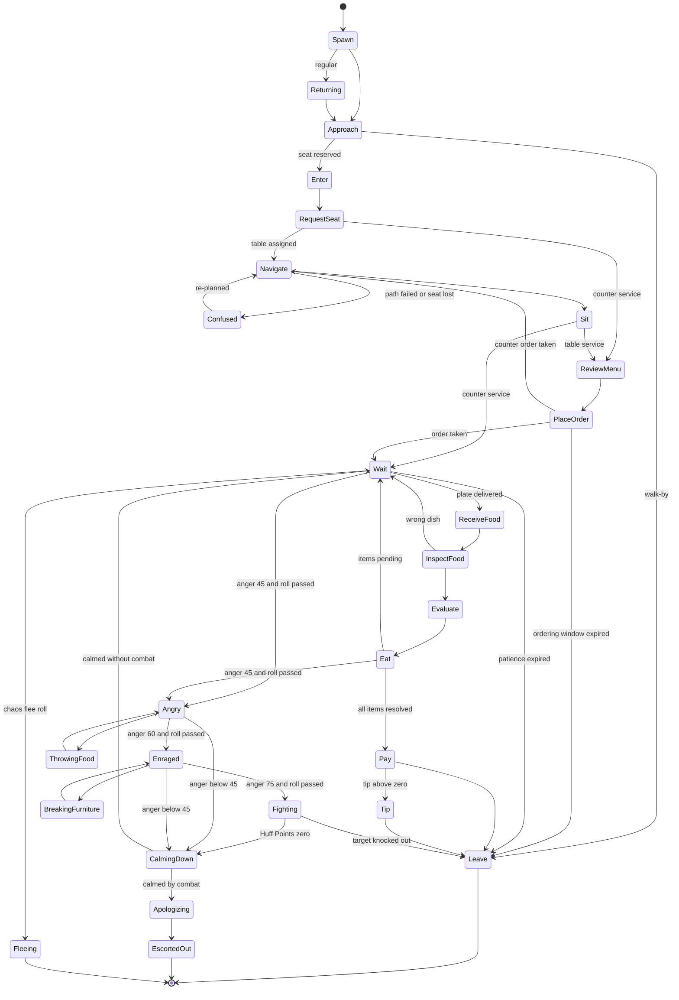

## 8. Customer AI

> **Owner:** A5 Customers. **Runtime:** `CustomerAIService` (server) with the client-side builder of
> `MorphAssemblyService`. **Companion sections:** personality data lives in §9; the satisfaction, anger,
> chain-reaction and chaos math lives in §10. Order generation and dish validation are executed by
> `OrderService` using the weighting rules defined here. Values marked **[TUNABLE]** are balancing
> assumptions; all other values are requirements.

### 8.1 Purpose

Customers are the engine of Mystery Morph Restaurant. Every 15–60 s loop starts with one walking through the
door, and every memorable brawl starts with one losing their temper. The customer AI must deliver:

1. **Instant readability.** A glance at any customer tells you what they want (order bubble), how long they
   will wait (patience ring) and how close they are to a tantrum (anger icon), without relying on color.
2. **A new creature every time.** Bodies are procedurally assembled from the 280 canon mutation parts
   (§C13.6); personalities (§9) layer behavior on top. Tens of thousands of distinct customers, zero
   hand-built models.
3. **Rigor under the silliness.** Server-authoritative, seed-deterministic and replayable for QA: the same
   session seed reproduces the same arrivals, bodies, names, orders and rolls.
4. **Cheapness.** Up to 160 customer proxies per server, brains ticked at 4 Hz, inside a server budget of
   ≤ 1.5 ms average / ≤ 3.0 ms p95 per frame across all 8 restaurants, with visuals built only by clients standing
   inside that interior.
5. **Emergence.** The state machine exposes hooks (thrown-food hits, splash, auras, furniture knock-ons) that
   §10 uses to turn one bad burger into a restaurant-wide brawl — within strict fairness caps.

**Architecture at a glance**

| Layer | Owner | Runs on | Responsibility |
|---|---|---|---|
| Arrival Scheduler | `CustomerAIService` | server, one per open restaurant | demand → arrivals, jitter, parties, queue, personality pick |
| Customer Brain | `CustomerAIService` | server, 4 Hz batched tick | state machine, patience, anger, targeting, seating requests |
| Proxy | `CustomerAIService` | server `Part` (anchored, invisible) | hitbox for combat raycasts + replicated Attributes |
| Visual | `MorphAssemblyService` (client builder) | each client inside the interior | morph model from seed, animations, bubbles, VFX |
| Orders | `OrderService` | server | menu choice, modifications, tickets, dish validation |
| Combat | `CombatService` | server | Huff Points, abilities, hits, statuses (§11) |

**Layered state model.** Each customer runs three layers at once: the **Core** layer (the 16 service states,
which own patience and the order), the **Mood overlay** (`IMPATIENT`, `COMPLAINING` — cosmetic + anger
bookkeeping, never pauses the Core), and the **Action layer** (hostile, fleeing and recovery states that
*suspend* the Core and remember a `resumeState`). This keeps service logic simple while letting tantrums
interrupt anything.

### 8.2 Rules & Mechanics — Spawning and Arrival

#### 8.2.1 Demand → arrival rate

Online demand uses the canon formula (§C6):

```
Customers/h  = BaseDemand[tier] × RepMult × DecorMult × EventMult
RepMult      = 0.5 + 0.25 × Stars                       -- §C11.4
DecorMult    = 0.9 + 0.003 × Atmosphere                 -- §C11.4, Atmosphere from §15
EventMult    = product of active event demand multipliers (§36.11; 1.0 when none)
Parties/h    = Customers/h ÷ E[PartySize(band)]         -- §8.2.4
MeanInterval = 3600 ÷ Parties/h   (seconds between party arrivals)
```

| Example | BaseDemand | Stars → RepMult | Atmosphere → DecorMult | Customers/h | E[party] | Mean party interval |
|---|---|---|---|---|---|---|
| New shack, `TIER_01` | 50 | 2.5 → 1.125 | 30 → 0.99 | 55.7 | 1.15 | 74.3 s |
| Mid game, `TIER_05` | 110 | 3.6 → 1.40 | 60 → 1.08 | 166.3 | 1.82 | 39.4 s |
| Late game, `TIER_10` | 190 | 4.6 → 1.65 | 90 → 1.17 | 366.8 | 2.02 | 19.8 s |

Seats cap concurrency (§C6), so demand above seat throughput turns into a fuller outside queue and more
walk-bys, never into extra customers inside.

#### 8.2.2 Arrival scheduler with deterministic jitter

One scheduler runs per open restaurant. It is a pure function of a session seed plus an arrival index, so QA
can replay any session exactly.

```
SessionSeed  = hash(OwnerUserId, game.JobId, sessionOpenedAt)        -- 32-bit
rng          = Random.new(SessionSeed)                              -- one stream per restaurant
Rush(t)      = 1 + 0.20 × sin(2π·t / 360 + φ),  φ = rng:NextNumber(0, 2π)   -- 6-min rush/lull rhythm
interval_k   = MeanInterval × (0.65 + 0.70 × rng:NextNumber()) ÷ Rush(t_now)
t_next       = t_now + interval_k
```

- **Jitter band:** every interval lands in [0.65, 1.35] × mean, so arrivals never feel metronomic. [TUNABLE]
- **Rush waves:** ±20 % with a 360 s period give each short session at least one mini-rush. [TUNABLE]
- **Lull guarantee:** if the restaurant is Open with no seated customer and an empty queue for 20 s, the next
  arrival is pulled forward to `now + 3 s`. Dead air is the enemy. [TUNABLE]
- **Determinism rule:** every random draw for a customer (party size, personality, appearance, name, order,
  escalation rolls) comes from a per-customer `Random.new(CustomerSeed)`, where
  `CustomerSeed = bit32.bxor(SessionSeed, (ArrivalIndex × 2654435761) % 2^32)`. The scheduler stream only
  decides *when*; the customer stream decides *who*.

#### 8.2.3 Gating, reservation and the outside queue

A scheduled arrival spawns only if all gates pass; otherwise it is converted as shown.

| Gate | Pass condition | If it fails |
|---|---|---|
| Restaurant Open | state is `Open` (not `Closing` per E1, not `AwayPaused`) | arrival discarded silently |
| Away Mode | an owner/co-op player has been inside the interior within 30 s, **or** ≥ 1 `ROLE_CHEF` employee is on shift (§16) | restaurant becomes `AwayPaused` ("Back in 5!" sign); scheduler sleeps — no penalty |
| Chaos | no level-6 chaos active (§10) | arrival held: party waits in the queue with queue patience paused |
| Server cap | server proxies + party size ≤ the fair-share cap below | arrival discarded silently |
| Queue space | outside queue has room for the whole party (max **4 customers**, counted per member) | **Walk-by**: the party glances at the line, shrugs, leaves. No reputation effect; logs `mmr_customer_walkby` |

**Reservation.** Customers spawn on the Restaurant Row sidewalk (2 spawn nodes per plot), walk to the façade
door (≈ 25–35 studs) and request a reservation: counter service (`TIER_01`–`TIER_02`) needs N free stools
(adjacent preferred); table service (`TIER_03`+) needs one whole table with seats ≥ party size — strangers never
share a table. A reserved seat is held for that party only. No reservation → join the outside queue.

**Outside queue.** Up to 4 customers on the velvet-rope spots by the door. Queue patience = 60 s × the lowest
PatienceMult in the party [TUNABLE]; expiry is a walk-by (no reputation effect). Queued customers advance
first-come-first-served; PER_005 may cut the line (§9). The HUD shows a `Queue 2/4` chip while you are inside.

**Server fair share.** Hard cap 160 proxies per server (§C3). Each restaurant's cap is `Seats + 4`; if the sum
across open restaurants exceeds 160, each cap becomes `floor(160 × (Seats_r + 4) / Σ(Seats + 4))`, removing queue
spots first, **and every restaurant's arrival rate is throttled by the same factor**
`f = 160 / Σ(Seats + 4)` (MeanInterval ÷ f), so no plot starves while another floods. Example: 8 restaurants at
`TIER_10` → Σ = 224, f = 0.714, 20 proxies each (16 seated + 4 queued) and arrivals at 71 % of demand.

#### 8.2.4 Party size by tier band

Tier bands are used throughout §8–§10: **A** = `TIER_01`–`TIER_02`, **B** = `TIER_03`–`TIER_04`,
**C** = `TIER_05`–`TIER_06`, **D** = `TIER_07`–`TIER_08`, **E** = `TIER_09`–`TIER_10`.

| Band | Service | P(1) | P(2) | P(3) | P(4) | E[party size] | Notes |
|---|---|---|---|---|---|---|---|
| A | counter | 85 % | 15 % | — | — | 1.15 | pairs take adjacent stools |
| B | table | 55 % | 30 % | 10 % | 5 % | 1.65 | |
| C | table | 48 % | 30 % | 14 % | 8 % | 1.82 | |
| D | table | 44 % | 30 % | 16 % | 10 % | 1.92 | |
| E | table | 40 % | 30 % | 18 % | 12 % | 2.02 | |

**Roll order:** (1) party size; (2) the leader's personality from §8.2.5; (3) if the leader is a fixed-party
personality (PER_016 always 3 mini-mutants, PER_027 always 2), the size is overridden; (4) each extra member
rolls a personality from the same table, excluding PER_004, PER_016, PER_025, PER_027 and PER_032 (critics,
inspectors and mysteries arrive alone). All E[party] values are [TUNABLE].

#### 8.2.5 Personality spawn weights by tier band

A personality is eligible when the restaurant tier ≥ its unlock tier; inside a band, an entry whose unlock
tier is the band's second tier is eligible only at that tier. The pick is a weighted draw over eligible rows.
Weights are relative, not percentages. The band-C column equals the "Base wt" column of §9.3.

| Personality | ID | Unlock | A | B | C | D | E | Weight notes |
|---|---|---|---|---|---|---|---|---|
| The Karenosaurus | `PER_001` | `TIER_01` | 3 | 6 | 6 | 6 | 6 | scripted in QST_TUT_006; kept rare in band A |
| The Hungry Hippo-Spider | `PER_002` | `TIER_02` | 4 | 5 | 5 | 5 | 5 | |
| The Polite Demon | `PER_003` | `TIER_01` | 6 | 6 | 6 | 5 | 5 | |
| The Food Critic | `PER_004` | `TIER_03` | 0 | 2 | 2 | 3 | 3 | extra scheduled visits during `EVT_008` (§36.11) |
| The Impatient Goblin | `PER_005` | `TIER_01` | 4 | 7 | 7 | 7 | 7 | halved in band A (new-player comfort) |
| The Sleepy Sloth-Rocket | `PER_006` | `TIER_01` | 7 | 6 | 6 | 5 | 5 | |
| The Chaos Gremlin | `PER_007` | `TIER_02` | 3 | 5 | 5 | 6 | 6 | |
| The Rich Mutant | `PER_008` | `TIER_03` | 0 | 2 | 3 | 4 | 5 | |
| The Influencer | `PER_009` | `TIER_02` | 2 | 3 | 3 | 4 | 4 | |
| The Bodybuilder Pigeon | `PER_010` | `TIER_02` | 3 | 5 | 5 | 5 | 5 | |
| The Conspiracy Moth | `PER_011` | `TIER_03` | 0 | 4 | 4 | 4 | 4 | |
| The Nervous Newt | `PER_012` | `TIER_01` | 8 | 6 | 5 | 4 | 4 | the gentle starter customer |
| The Grandma Golem | `PER_013` | `TIER_01` | 7 | 5 | 5 | 4 | 4 | |
| The Picky Platypus | `PER_014` | `TIER_01` | 6 | 6 | 6 | 6 | 6 | |
| The Robot Accountant | `PER_015` | `TIER_02` | 3 | 4 | 4 | 4 | 4 | ×3 during `EVT_017` Polite Robot Uprising |
| The Party Pack | `PER_016` | `TIER_03` | 0 | 3 | 3 | 4 | 4 | one draw = a party of 3 |
| The Pirate Crab | `PER_017` | `TIER_02` | 3 | 4 | 4 | 4 | 4 | |
| The Drama Llama | `PER_018` | `TIER_02` | 3 | 4 | 4 | 4 | 4 | |
| The Mime Mantis | `PER_019` | `TIER_03` | 0 | 3 | 3 | 3 | 3 | |
| The Toddler Titan | `PER_020` | `TIER_02` | 3 | 4 | 4 | 4 | 4 | |
| The Health Nut Hamster | `PER_021` | `TIER_02` | 4 | 4 | 4 | 4 | 4 | ×3 during `EVT_031` Spring Sprout Bloom |
| The Spicy Salamander | `PER_022` | `TIER_03` | 0 | 4 | 4 | 4 | 4 | ×3 during `EVT_019` Hot Sauce Heatwave |
| The Frozen Yeti-Fish | `PER_023` | `TIER_03` | 0 | 4 | 4 | 4 | 4 | ×3 during `EVT_020` Frozen Snap |
| The Time-Traveler Tortoise | `PER_024` | `TIER_04` | 0 | 2 | 2 | 3 | 3 | |
| The Undercover Inspector | `PER_025` | `TIER_03` | 0 | 2 | 2 | 2 | 2 | unchanged during `EVT_026` (`NPC_022` inspects instead) |
| The Speedrunner Squirrel | `PER_026` | `TIER_04` | 0 | 3 | 3 | 3 | 3 | |
| The Lovebird Jellyfish Couple | `PER_027` | `TIER_03` | 0 | 3 | 3 | 3 | 3 | one draw = a party of 2 |
| The Haunted Toaster | `PER_028` | `TIER_04` | 0 | 3 | 3 | 3 | 3 | ×4 during `EVT_029` Haunted Kitchen Night |
| The Alien Tourist | `PER_029` | `TIER_05` | 0 | 0 | 3 | 3 | 4 | ×4 during `EVT_018` Alien Tourist Season |
| The Retired Wrestler Walrus | `PER_030` | `TIER_05` | 0 | 0 | 3 | 3 | 3 | |
| The Birthday Beast | `PER_031` | `TIER_03` | 0 | 3 | 3 | 3 | 3 | |
| The Mystery Mutant | `PER_032` | `TIER_06` | 0 | 0 | 2 | 3 | 3 | reveals a random personality (§9) |

**Eligible weight totals:** `TIER_01` 41 · `TIER_02` 69 · `TIER_03` 110 · `TIER_04` 118 · `TIER_05` 124 ·
`TIER_06` 126 · `TIER_07`–`TIER_08` 129 · `TIER_09`–`TIER_10` 131. Example: at `TIER_01` a non-tutorial arrival is a
Nervous Newt with probability 8/41 = 19.5 % and a Karenosaurus with 3/41 = 7.3 %.

**Weight modifiers (multiplicative, applied before the draw):**
- **Events:** as noted in the table. During `EVT_017`, procedural bodies also roll ROBOT-category HEAD/TORSO parts
  ×3 as often (§36.11 "ROBOT-category customers ×3"). `EVT_004` Angry Customer Invasion spawns its own invader
  waves (§36.11) on top of normal arrivals. Event schedules and rules are owned by §36.11.
- **Rough Patch pity** (§10): `PACIFIST` personalities ×2 for 2 min.
- **Regular injection:** before the draw, a 12 % roll (Regulars unlocked, ≥ 1 Regular not already present)
  replaces the arrival with a stored Regular (§8.12). [TUNABLE]
- **Tutorial override:** while QST_TUT_002–QST_TUT_007 are active, arrivals are scripted by §32 (PER_013 Grandma
  Golem, then PER_003 Polite Demon, then the scripted PER_001).

#### 8.2.6 Items per customer (canon average 1.4)

Each personality has an item range `[min, max]` (§9.3). Item count = `min + Binomial(max − min, p_extra)`. The
server solves `p_extra(tier)` at startup by bisection so that the weight-averaged items per customer over the
eligible pool (party members counted individually, PER_002 "Seconds!" included) equals **1.4** (§C4.3). The first
item is always a **main** (BRG, PIZ, TAC, SAN, SOP, PST, BRK, SEA, ALN, MUT, LEG); extra items are **sides/drinks/
desserts** (DRK, FRI, DES, SAL) when the menu has any, otherwise another main.

| Tier | 1 | 2 | 3 | 4 | 5–8 | 9–10 |
|---|---|---|---|---|---|---|
| Reference `p_extra` [TUNABLE, auto-solved] | 0.57 | 0.31 | 0.32 | 0.34 | 0.32 | 0.31 |

### 8.3 Rules & Mechanics — Procedural Appearance and Names

#### 8.3.1 Assembly algorithm

The client builds every customer locally from `CustomerSeed`, `PersonalityId` and `Band` (all replicated as
Attributes, §8.18) using a shared deterministic module, so no part list is ever sent over the network.

1. `rng = Random.new(CustomerSeed)`. Draw order is fixed (slot table order below) so every client agrees.
2. Apply the **personality signature parts** (§9.4) first; those slots are locked.
3. For each remaining slot, roll its fill chance; if filled, roll a rarity from the band table, then pick a
   part uniformly among canon parts of that slot code and rarity (re-roll one rarity step down if empty).
4. Enforce compatibility: `FUR` and `SCALES` are mutually exclusive over `SKIN`; `ARM` rolls 70 % matched pair /
   30 % mismatched; `LEG` 80 % matched / 20 % mismatched (mismatched legs play `ANM_008` Wobbly gait).
5. Enforce budgets (§C13.7): ≤ 24 MeshParts and ≤ 6,000 triangles; when exceeded, drop optional slots in reverse
   table order (FX first) until within budget. Impostor LOD beyond 60 studs.
6. Body scale: 1.0 (PER_016 minis 0.6; PER_020 1.35). Height follows the LEG `LegLength` attribute.

| Slot | Fill chance | Slot | Fill chance | Slot | Fill chance |
|---|---|---|---|---|---|
| HEAD | 100 % | EARS | 45 % | TAIL | 45 % |
| TORSO | 100 % | EYES | 50 % | WINGS | 15 % |
| ARM_L / ARM_R | 100 % | NOSE | 35 % | BACK | 15 % |
| LEG_L / LEG_R | 100 % | MOUTH | 35 % | SKIN / FUR / SCALES (one) | 35 % |
| FEET | 40 % | FACE | 15 % | FX | 0 % in A–B, 8 % in C–E |
| HANDS | 25 % | HORNS | 20 % | NECK | 15 % |

#### 8.3.2 Rarity weights by band (procedural slots only)

| Band | Common | Uncommon | Rare | Epic | Legendary | Mythic | Secret |
|---|---|---|---|---|---|---|---|
| A | 80 | 18 | 2 | 0 | 0 | 0 | 0 |
| B | 65 | 27 | 7 | 1 | 0 | 0 | 0 |
| C | 50 | 30 | 14 | 5 | 1 | 0 | 0 |
| D | 40 | 30 | 18 | 9 | 2.5 | 0.5 | 0 |
| E | 30 | 30 | 22 | 12 | 5 | 1 | 0 |

**Secret parts never appear on customers** (they would spoil §C13.8 discoveries). Signature parts ignore the
table (e.g. PER_008's Legendary `MUT_258` Golden Skin appears from `TIER_03`). Customers' parts are cosmetic for
the player — no drops — but they drive combat abilities (§9.2) and name roots (§8.3.4).

#### 8.3.3 Showcase customers (mockup combos)

To keep the marketing sheet's "Example Customers" alive in game, 1 arrival in 50 [TUNABLE] (non-signature
personalities only) replaces its procedural body with one of these fixed combos; other slots still roll.

| Showcase | Fixed parts |
|---|---|
| Giraffe-Squid | `MUT_015` Giraffe Head, `MUT_110` Giraffe Neck, `MUT_146` Squid Tentacle Arm ×2 |
| TV-Moth | `MUT_021` TV Head, `MUT_094` Moth Feather Antennae, `MUT_233` Moth Wings |
| Shark-Spider | `MUT_011` Shark Head, `MUT_185` Spider Leg Cluster ×2 |
| Pigeon-Muscle | `MUT_004` Pigeon Head, `MUT_124` Muscle Torso, `MUT_160` Bodybuilder Arm ×2 |
| Axolotl-Cow | `MUT_014` Axolotl Head, `MUT_120` Cow Body |
| Bear-Scorpion | `MUT_001` Bear Head, `MUT_118` Bear Body, `MUT_216` Scorpion Tail |
| Snake-Rabbit | `MUT_020` Snake Head, `MUT_085` Bunny Ears, `MUT_265` Snake Scales |
| Deer-Plant | `MUT_013` Deer Head, `MUT_107` Sprout Antlers, `MUT_263` Moss Fur |
| Frog-Robot | `MUT_005` Frog Head, `MUT_123` Robot Body |
| Cat-Fish | `MUT_002` Cat Head, `MUT_119` Fish Body, `MUT_214` Fish Tail |

#### 8.3.4 Customer name generator

Names are generated from fixed tables (never player text), seeded by `CustomerSeed`, shown on the order ticket,
the receipt and above Regulars.

```
Name    = [Title] + FirstName + " " + Root(HEAD family) + Suffix
Title   = 10 % chance: Sir, Dame, Dr., Professor, Captain, Auntie, Uncle, Little, Big, Coach
First   = Gary, Brenda, Doris, Melvin, Petunia, Norbert, Gladys, Rupert, Bingo, Tilly, Mabel, Ziggy,
          Bertha, Clyde, Fern, Otis, Pearl, Sprocket, Noodle, Biscuit, Wanda, Percy, Hilda, Bob
Root    = family root of the HEAD part: bear→Grizzle, cat→Whisker, dog→Barkley, pigeon→Coo, frog→Ribbit,
          rat→Squeak, goat→Bleat, chicken→Cluck, fish→Gill, toaster→Crumb, shark→Chomp, owl→Hoot,
          robot→Bolt, alien_grey→Glorp, trex→Rex, dragon→Scorch, octopus→Inky, broccoli→Floret;
          any other family → its family name capitalized (pumpkin→Pumpkin)
Suffix  = -bottom, -worth, -wick, -ington, -stein, -flap, -noodle, -paddle, -muffin, -bean, -whistle,
          -sprocket, -wobble, -berry, -snoot, -toes
```

Examples: "Gladys Coobottom", "Dr. Otis Glorpington", "Little Bingo Ribbitwobble". **Personality overrides:**
PER_017 always "Cap'n"; PER_013 always "Granny"; PER_015 appends "-3000"; PER_029 uses alien syllables
(Zib, Blorp, Quix, Vork) + "-ington"; PER_025 is always "Totally Normal" + Root + Suffix; PER_032 shows "???" until
revealed. Every generated name is checked against a curated deny-list of accidental real-brand or rude
combinations; a hit re-rolls the suffix from the same stream (deterministic).

### 8.4 Rules & Mechanics — The Customer State Machine

#### 8.4.1 States

| # | State | Layer | Default duration [TUNABLE] | What the customer does |
|---|---|---|---|---|
| 1 | `SPAWN` | Core | 0.5 s | proxy created on the sidewalk; cartoon poof-in |
| 2 | `APPROACH` | Core | walk (≈ 3 s) | walks to the façade door; may wait in the outside queue |
| 3 | `ENTER` | Core | 1.0 s | door swing; proxy CFrame jumps to the interior door node |
| 4 | `REQUEST_SEAT` | Core | until seated | table service: waits at the host podium; counter service: joins the counter line |
| 5 | `NAVIGATE` | Core | path length ÷ speed | walks the waypoint path to the reserved seat |
| 6 | `SIT` | Core | 1.2 s | `ANM_040` Customer sit |
| 7 | `REVIEW_MENU` | Core | 6 s × MenuMult | `ANM_041` Read menu (menu board at the counter in band A) |
| 8 | `PLACE_ORDER` | Core | ≤ 30 s × PatienceMult | `ANM_042` Order wave until someone takes the order |
| 9 | `WAIT` | Core | ≤ Patience (§C11.2) | patience ring drains; eats already-delivered items meanwhile |
| 10 | `RECEIVE_FOOD` | Core | 0.8 s | reaches for the plate (server plays `ANM_019` on the deliverer) |
| 11 | `INSPECT_FOOD` | Core | 1.5 s × InspectMult | sniff-and-squint inspect (A16 assigns the ID in §36.14) |
| 12 | `EVALUATE` | Core | 0.6 s | computes S for the item (§10); shows the reaction emote |
| 13 | `EAT` | Core | (10 + 3·D) s × EatMult per item | `ANM_043` Eat |
| 14 | `PAY` | Core | 1.5 s | `ANM_044` Pay; spawns the Cash Stack (§8.11) |
| 15 | `TIP` | Core | 1.0 s | `ANM_045` Tip flourish (skipped when tip = 0) |
| 16 | `LEAVE` | Core | walk | walks out; despawns 2 s after crossing the door |
| C1 | `CONFUSED` | Action | 2–4 s | "?" bubble, looks around, re-plans (path fail, seat lost, pictogram mix-up) |
| C2 | `IMPATIENT` | Mood | while condition holds | `ANM_046` Impatient foot tap; patience ring pulses |
| C3 | `COMPLAINING` | Mood | while anger level = 2 | `ANM_047` Complain; small anger aura (§10) |
| C4 | `ANGRY` | Action | while level = 3 | hostile hub: picks a level-3 action every ActionTick (§10) |
| C5 | `ENRAGED` | Action | while level = 4 | hostile hub for level 4; "aggressive form" visual (steam puffs, wings/tails/spines flare); the ×1.15 "Rage Puff" swell plays on entering level 5 (§11.2.1) |
| C6 | `THROWING_FOOD` | Action | 1.2 s | `ANM_048` Throw food; scripted arc (§10.8) |
| C7 | `BREAKING_FURNITURE` | Action | 2.0 s | `ANM_049` Flip table or `ANM_050` Tantrum stomp on a target object |
| C8 | `FIGHTING` | Action | while level ≥ 5 | combat AI of its style (§11), Huff Points active |
| C9 | `FLEEING` | Action | run to door | `ANM_054` Flee; pays 0; no reputation update |
| C10 | `APOLOGIZING` | Action | 2.0 s | `ANM_053` Apologize bow; Apology Payment 40 % (§C11.4) |
| C11 | `CALMING_DOWN` | Action | 2.5 s (+3 s `STS_DIZZY` after a KO) | `ANM_052` Dizzy stars, deep breaths |
| C12 | `ESCORTED_OUT` | Action | walk | `ANM_055` Escorted out; a Security Guard walks alongside if present |
| C13 | `RETURNING` | Core entry | 2 s | a Regular's greeting at spawn; loads favorites and grudges (§8.12) |

**Service variants.** Table service runs 4 → 5 → 6 → 7 → 8 → 9. Counter service (band A) runs
4 (counter line) → 7 (menu board) → 8 (order at the counter) → 5 → 6 → 9: the customer orders standing, then sits
at the reserved stool to wait.

#### 8.4.2 Transition table

Guards are evaluated in row order each 4 Hz tick; the first matching row fires. "Any Core" means states 2–16.
Anger thresholds and escalation rolls are specified in §10.7.

| From | Trigger / Guard | To | Timeout | Notes |
|---|---|---|---|---|
| `SPAWN` | spawned as a Regular | `RETURNING` | 0.5 s | loads memory record |
| `SPAWN` | otherwise | `APPROACH` | 0.5 s | |
| `RETURNING` | greeting finished | `APPROACH` | 2 s | grudge sets starting anger (§8.12) |
| `APPROACH` | at door, reservation granted | `ENTER` | — | seat/table held for the party |
| `APPROACH` | at door, no reservation, queue has room | `APPROACH` (queued) | 60 s × PatMult | queue patience paused during chaos |
| `APPROACH` | queue full on arrival, or queue patience expired | `LEAVE` (walk-by) | — | no pay, no reputation effect |
| `ENTER` | door transition done | `REQUEST_SEAT` | 1 s | |
| `REQUEST_SEAT` | table service: seated by waiter, player or Auto-Seat | `NAVIGATE` | — | §8.6 |
| `REQUEST_SEAT` | table service: unseated > 10 s | `REQUEST_SEAT` + `IMPATIENT` | — | "long seat wait" anger (§10.6) |
| `REQUEST_SEAT` | counter service: reached the counter front | `REVIEW_MENU` | — | |
| `NAVIGATE` | reached the seat node | `SIT` | — | |
| `NAVIGATE` | path failed once, or reserved seat Broken / taken | `CONFUSED` | 2 s | re-path or re-assign |
| `NAVIGATE` | path failed twice, or stuck > 6 s | `SIT` (poof) | — | E10: puff + "Pardon me!" |
| `SIT` | table service | `REVIEW_MENU` | 1.2 s | |
| `SIT` | counter service (order already placed) | `WAIT` | 1.2 s | |
| `REVIEW_MENU` | timer elapsed | `PLACE_ORDER` | 6 s × MenuMult | |
| `PLACE_ORDER` | order taken (player interaction or waiter) | `WAIT` (table) / `NAVIGATE` (counter) | 30 s × PatMult | ticket created; **patience starts** |
| `PLACE_ORDER` | ordering window expired | `PLACE_ORDER` + `IMPATIENT` | +15 s × PatMult | last-chance window, anger accrues |
| `PLACE_ORDER` | last-chance window expired | `LEAVE` (storm-out) | — | pays 0, −0.03 ★ (§10.5) |
| `WAIT` | a plate placed on the table / pickup spot / handed over | `RECEIVE_FOOD` | — | W timestamp = placement time |
| `WAIT` | elapsed ≥ 50 % of Patience | `WAIT` + `IMPATIENT` | — | patience-pressure anger starts |
| `WAIT` | elapsed ≥ Patience, nothing delivered | `LEAVE` (storm-out) | — | pays 0 |
| `WAIT` | elapsed ≥ Patience, ≥ 1 item delivered | `PAY` (after current `EAT`) | — | undelivered items scored as failed (§10.2) |
| `RECEIVE_FOOD` | hand-off done | `INSPECT_FOOD` | 0.8 s | |
| `INSPECT_FOOD` | wrong dish (OrderService mismatch) | `WAIT` | 1.5 s × InspectMult | plate rejected to the nearest free table edge; anger +20 × sens |
| `INSPECT_FOOD` | correct dish | `EVALUATE` | 1.5 s × InspectMult | defects (burned, missing mod) add anger here |
| `EVALUATE` | S computed | `EAT` | 0.6 s | reaction emote |
| `EAT` | item finished, items still pending | `WAIT` | EatTime | |
| `EAT` | item finished, nothing pending, PER_002 "Seconds!" roll | `PLACE_ORDER` | EatTime | new ticket, fresh patience |
| `EAT` | all items resolved | `PAY` | EatTime | |
| `PAY` | tip > 0 | `TIP` | 1.5 s | |
| `PAY` | tip = 0 | `LEAVE` | 1.5 s | |
| `TIP` | flourish done | `LEAVE` | 1.0 s | |
| `LEAVE` | crossed the door | despawn | 2 s | seat freed; table becomes dirty |
| Any Core | anger level ≥ 1 (or patience ≥ 50 %) | + `IMPATIENT` overlay | — | overlay only |
| Any Core | anger level = 2 | + `COMPLAINING` overlay | — | overlay only |
| Any Core | anger crosses 45 and escalation roll succeeds | `ANGRY` | — | `resumeState` saved |
| Any Core | escalation roll fails | sulk / `COMPLAINING` / `LEAVE` | — | fallback table §10.7 |
| `ANGRY` | ActionTick picks "throw" | `THROWING_FOOD` | 1.2 s | back to `ANGRY` |
| `ANGRY` | anger crosses 60, roll succeeds | `ENRAGED` | — | |
| `ANGRY` / `ENRAGED` / `FIGHTING` | anger drops below 45 | `CALMING_DOWN` | — | |
| `ENRAGED` | ActionTick picks "break" | `BREAKING_FURNITURE` | 2.0 s | back to `ENRAGED` |
| `ENRAGED` | anger crosses 75, roll succeeds, fighter cap free | `FIGHTING` | — | |
| `ENRAGED` | anger drops to 45–59 | `ANGRY` | — | |
| `FIGHTING` | anger drops to 60–74 | `ENRAGED` | — | |
| `FIGHTING` | Huff Points reach 0 | `CALMING_DOWN` | 3 s Dizzy + 2.5 s | defeated (§11.10.1) |
| `FIGHTING` | its target is KO'd, no chaos active | `LEAVE` | — | `ANM_051` Victory dance; pays 0 (§C12.1) |
| `FIGHTING` | talked down by `ABL_006` / `ABL_065` (§11.10.1) | `CALMING_DOWN` | — | drops to level 2 |
| Hostile (C4–C8) | Security intercept / talk-down succeeds (§11.10.6) | `CALMING_DOWN` | — | always counts as calmed by combat |
| `CALMING_DOWN` | calmed by combat: Huff reached 0, took player/employee damage this episode, or stopped by Security | `APOLOGIZING` | 2.5 s | |
| `CALMING_DOWN` | calmed without combat (no damage taken this episode) | `resumeState` | 2.5 s | returns to its seat; "Sheepish" 30 s; pays & tips by S (§10.5) |
| `APOLOGIZING` | bow done | `ESCORTED_OUT` | 2 s | Apology Payment 40 %, no tip |
| `ESCORTED_OUT` | crossed the door | despawn | — | |
| Any | chaos starts and the customer's chaos roll = flee | `FLEEING` | — | §10.9 |
| `FLEEING` | crossed the door | despawn | — | pays 0, no reputation update |
| `CONFUSED` | timer elapsed | previous state (re-planned) | 2–4 s | |
| Any | restaurant enters `Closing` (E1) or server shutdown (E13) | `LEAVE` (closed) | — | pays 0, no reputation loss |

#### 8.4.3 Diagram



### 8.5 Rules & Mechanics — Interruption Handling

Interruptions are queued as events on the customer and resolved at the start of the next tick in priority
order (highest first). An interruption that invalidates a lower one discards it; otherwise the lower one is
resolved on the same tick if still valid.

| Priority | Interruption | Applies to | Resolution |
|---|---|---|---|
| 100 | Owner disconnect / `Closing` (E1), server shutdown (E13) | all customers | `LEAVE` (closed): pay 0, no reputation change, "Closed for the day!" sign; seated food discarded at no charge |
| 90 | Restaurant-wide chaos starts (level 6) | all inside | each customer resolves its chaos reaction (join / hide / flee, §10.9); queue frozen; arrivals held |
| 80 | Huff Points reach 0 | fighting customers | `CALMING_DOWN` (3 s `STS_DIZZY`), then `APOLOGIZING` |
| 70 | Hit by thrown food / ability / grabbed object | any | anger +25 × sens (thrown) per §10.6; 0.6 s flinch unless hostile; hostile customers retarget the thrower for 10 s |
| 60 | Fire: a station is `ON_FIRE` | customers within 30 studs | anger source (§10.6); customers within 10 studs of the fire step away (`CONFUSED` 2 s); `PACIFIST` customers flee if the fire lasts > 20 s |
| 50 | Table destroyed / seat Broken mid-meal | seated customers at that object | dish counts as finished if eat progress ≥ 50 %, else it is re-queued on the ticket as a free remake with a fresh 0.5 × Patience window; anger +15 × sens; `CONFUSED` 2 s → re-seat at a free seat, else eat standing at a "Standing Room Only" node |
| 45 | Wrong food served | `WAIT`/`INSPECT_FOOD` | rejected at inspect; anger +20 × sens; waits on (patience keeps running) |
| 40 | Seat taken (poof collision, co-op player sitting, knock-on displacement) | `NAVIGATE`/`SIT` | `CONFUSED` 2 s; host logic assigns the best free seat; anger +10 × sens |
| 30 | Player in a full-screen menu becomes this customer's target (E2) | hostile customers | the menu auto-closes for that player, who gets 1.5 s invulnerability; this customer's first attack on them is delayed 1.5 s |
| 20 | Patience expiry | `WAIT`/`PLACE_ORDER` | `LEAVE` per the transition table |

Interruptions never stack the same type twice in one tick (two food hits in one tick = two anger adds, one
flinch). Hostile customers ignore priorities 40 and 20 (they are not waiting any more).

### 8.6 Rules & Mechanics — Seating and Host Logic

**Counter service (`TIER_01`–`TIER_02`, §C6).** No host. Customers queue at the counter (max = seats), order to a
player standing within 10 studs of the counter (QST_TUT_002 teaches this), then walk to their reserved stool.
Food is either **placed on a `STN_WINDOW` pickup spot** tagged with their ticket — the bell dings "Order up,
<Name>!", the customer walks over, collects and returns to the stool — or **handed directly** to the seated
customer (Serve interaction, 10 studs). W stops the moment the plate touches the pickup spot, so a long walk
never costs the cook.

**Table service (`TIER_03`+).** Parties wait at the host podium inside the door. Seating happens by:
1. a `ROLE_WAITER` employee (§16) — automatic, within the waiter's assigned section;
2. a player — tap the party, then tap a highlighted free table (or press **Seat** to accept the host's pick);
3. **Auto-Seat** (restaurant setting, default ON) — if neither acts within 8 s, the party seats itself at the
   host's pick. Auto-Seat never chooses a dirty table.

Order taking at table service is done by the waiter or any player interacting with the waving customer; food
is delivered by whoever carries the plate. MutationBonus (§10.3) uses the parts of whoever *delivered* the item.

**Host scoring** (highest wins; ties broken by the customer's RNG):

| Term | Value [TUNABLE] |
|---|---|
| Fit | −2 per empty seat left at the table |
| Clean | +3 if bussed; a dirty table is not eligible (the party waits — long seat wait, §10.6) |
| Waiter balance | +2 if the table's waiter section has the fewest active parties |
| Local décor | + local Atmosphere / 25 (§15) |
| Personality preference | PER_023 near the door +3; PER_012 corner seat +3; PER_009 highest-décor table +3; PER_022 nearest the kitchen +2; PER_020 booth or table for 2+ (occupies 2 seats) |

### 8.7 Rules & Mechanics — Navigation

- **Bake.** `CustomerAIService` keeps a per-interior occupancy grid of 2 × 2-stud cells over the walkable floor.
  Furniture footprints from `BuildingService` mark cells blocked. Nodes = free cells plus named nodes (door,
  podium, queue spots, counter front, window pickup spots, seat-approach nodes). Paths from the door to every
  seat node (and seat → window, seat → door) are precomputed with A* (8-neighbour, octile heuristic) and cached.
- **Rebake.** Any furniture placement, move, removal or Destroyed/rubble state change triggers a debounced
  rebake (0.5 s after the last change), budgeted ≤ 8 ms per rebake for the largest interior (`TIER_10`,
  ≤ 6,400 cells), spread over frames with `task.defer` if larger. Customers mid-path switch to the new path at
  their next node. Placement validation (§15, E10) already rejects layouts that disconnect the door from any seat.
- **Local avoidance.** Each tick a customer reserves the next cell on its path. If another customer holds it,
  wait up to 1 s, then side-step to a free neighbour cell and re-path from there. Clients add a ±0.6-stud lateral
  smoothing offset so crowds do not look like trains.
- **Speed.** 10 studs/s base × personality WalkMult (§9.4); `FLEEING` ×1.4; `ESCORTED_OUT` ×0.7; hostile chase
  speeds per §11.8.1. [TUNABLE]
- **Hostile paths.** `CustomerAIService` answers the §11.8.1 chase-path requests (≤ 1 per second per hostile) from
  the same cached graph; `PathfindingService` is used only by `BuildingService` for placement validation.
- **Stuck handling (E10).** A path request that fails twice, or a customer whose position has not advanced
  ≥ 1 stud for 6 s, "poofs" (cartoon puff, "Pardon me!") to its seat node — or, if leaving, to the door.
  Poofs are logged (`mmr_customer_poof`) so level designers can find bad layouts.

### 8.8 Rules & Mechanics — Ordering

`OrderService:GenerateOrder(customer)` builds the ticket at `PLACE_ORDER` using these rules.

**Menu choice weight** for each eligible recipe r on the menu (not SOLD OUT, station present):

```
w(r) = Pref(r) × (Price(r) / AvgMenuPrice) ^ γ × Novelty(r) × Fatigue(r) × EventBoost(r)
Pref     = 3.0 preferred recipe · 1.8 preferred category · 1.0 neutral · 0 disliked (§9.4)
γ        = personality price bias (PER_008 +1.5, PER_015 −0.5, PER_002 +0.5, default 0)
Novelty  = 1.5 if the recipe joined the menu in the last 10 min
Fatigue  = 0.7 if one of the last 3 tickets in this restaurant was the same recipe
EventBoost = 1.5 for recipes an active event favours (§10.3 event table)
```

If every eligible weight is 0 (e.g. only disliked dishes on the menu), the customer orders the
highest-weighted neutral-ised dish anyway (Pref treated as 0.25) and its P_offset loses 5 (§10.3). Item count
follows §8.2.6. E9 applies: if everything is SOLD OUT, `RCP_BRG_001` is auto-added.

**Modifications (§6.18).** `OrderService` rolls modifications per item exactly as §6.18.3 specifies (owned by A2):
per-tier probabilities and maximums, joke share, hidden-mod chance, conflict groups, and the personality
`ModAffinity` multipliers listed in §9.4. Two rules matter for customers:
- **Time budget:** a modification is only generated if `EstPrep(item) + Σ ExtraTime(mod) ≤ 0.6 × Patience(item)`,
  so patience (§C11.2) needs no per-modification term and no customer ever asks for something that cannot be made
  in time.
- **Achievability:** every station a modification needs must be owned, placed and usable now; PER_019 shows its
  modifications as pictogram chips only.

### 8.9 Rules & Mechanics — Waiting and Patience

- **Patience** (§C11.2): `P = (70 + 20 × (items − 1) + 5 × ΣDifficulty) × PatienceMult × (1 + 0.004 × CHARM)`.
  CHARM is the highest effective CHARM among players inside the interior (rewards co-op charm builds). An event
  patience multiplier stated by §36.11 (e.g. `EVT_003` ×1.15) multiplies the result. Patience starts when the
  ticket is created and stops when the last item is delivered.
- **Ordering window:** 30 s × PatienceMult, then a 15 s × PatienceMult last-chance window (anger accrues).
- **Per-item wait factor** (§10.2): W = 1 until 50 % of P, then linear to 0 at 100 %.
- **Eat-while-waiting:** items arrive independently; the customer eats item 1 while item 2's clock keeps
  running. Plates delivered during `EAT` are placed on the table and inspected when the current item finishes,
  but their W timestamp is the placement time.
- **Pauses:** patience pauses only during chaos (customers are busy hiding), while the customer itself is hostile
  (levels 3–6), during `CONFUSED` caused by the restaurant (seat lost, table destroyed) and while PER_006 is asleep
  (max 15 s per visit). A hostile customer cannot be served ("Can't serve an angry customer!") except with a Peace
  Offering (§10.10).

| Example | Items | ΣD | Mult | CHARM | Patience |
|---|---|---|---|---|---|
| PER_012, one easy burger | 1 | 1 | 1.1 | 0 | 82.5 s |
| PER_005, one easy burger | 1 | 1 | 0.55 | 0 | 41.3 s |
| PER_002, 4 items | 4 | 10 | 1.2 | 40 | 278.4 s |

### 8.10 Rules & Mechanics — Receiving, Inspecting, Eating

1. **Delivery.** A player or waiter carrying a plate interacts with the customer (10 studs; server re-validates
   at 12) or places it on the customer's table / pickup spot. `OrderService:ValidateServe(plate, ticket)` returns
   `{match, recipeId, A, Q, C, defects}` — the plate is matched to any pending item on that customer's ticket.
2. **Inspect.** 1.5 s × InspectMult: sniff, squint, poke (PER_004 uses a magnifying glass for 3 s; PER_014 picks at
   it for 3 s). Defects found here add anger immediately (§10.6): wrong dish, burned/undercooked components,
   missing modifications, MUSHY/SPILLED components.
3. **Evaluate.** `S_item` per §10.2; the reaction emote shows the band label and icon (§10.13).
4. **Eat.** EatTime = (10 + 3 × D) s × EatMult (D = recipe difficulty). Eating reduces anger 1.0/s at levels ≤ 2.
   Mutation Cuisine items additionally give the 60 s cosmetic random part (§C10, client-only).

### 8.11 Rules & Mechanics — Paying, Tipping, Leaving

- **Final satisfaction** S = price-weighted mean of `S_item` over all ordered items (undelivered items are
  scored as failed, §10.2). Pay, tip, Jackpot and reputation follow §C11.4, detailed in §10.5.
- **Cash Stack.** Payment + tip appear as a bouncing Cash Stack on the table (counter in band A). Any player
  collects it by walking within 10 studs or tapping it (QST_TUT_009); a `ROLE_CASHIER` collects instantly;
  uncollected stacks auto-deposit after 30 s. Money is credited by `EconomyService` at payment time — the stack
  is presentation only, so nothing can be lost or duplicated.
- **Leaving.** The customer walks out; the table becomes **dirty** (plates to bus) until a player, waiter or
  `ROLE_CLEANER` clears it (dirty tables cost cleanliness, §10.2). Reputation updates on despawn.

### 8.12 Rules & Mechanics — Regulars

Regulars are named repeat customers who remember you. Unlocks at `TIER_02`.

- **Promotion.** A solo customer finishing with S ≥ 90 has an 8 % chance to ask "Can I come back?" and becomes a
  Regular (auto-accepted; toast "<Name> is now a Regular!"). Maximum **20 Regulars** per restaurant; when full,
  the Regular with the lowest Loyalty is replaced only if the newcomer's S ≥ 95.
- **Stored record** (profile, owned by §28; ≈ 120 bytes each):
  `{ id, name, seed, personalityId, favoriteRecipe, visits, loyalty, grudge, grudgeCause, lastVisit }`.
  `seed` reproduces the exact body; PER_032 stores its revealed personality.
- **Arrival.** 12 % of arrivals are Regulars (§8.2.5), chosen by weight `1 + Loyalty/25`. They enter through
  `RETURNING` with a name tag and a personal greeting.
- **Favorite dish.** 50 % chance they order `favoriteRecipe` if on the menu (else normal ordering). The favorite
  is updated to the recipe of their highest-S visit.
- **Loyalty** (0–100): +8 for S ≥ 90, +4 for 70–89, 0 for 50–69, −6 for 30–49, −12 for S < 30 or storm-out.

| Loyalty tier | Threshold | Perk [TUNABLE] |
|---|---|---|
| Friendly | ≥ 25 | Patience ×1.10 |
| Loyal | ≥ 50 | TipMult +0.10 |
| Superfan | ≥ 80 | Chill aura: −0.3 anger/s to customers within 8 studs; 25 % chance to bring a +1 friend |

- **Grudges** (0–3). A Regular who storms out or finishes with S < 30 gains Grudge +1 and remembers the cause
  (`"burned RCP_BRG_002"`, `"waited too long"`, `"hit by food"`). Next visits start at anger 15 × Grudge and
  P_offset −5 × Grudge. Serving the grudge cause PERFECT (or simply S ≥ 90 for wait/food-fight causes) clears the
  grudge with "Fine. You're forgiven." At Loyalty 0 with Grudge 3 the Regular leaves forever ("I'm seeing another
  restaurant.").

### 8.13 Variables

| Variable | Value [TUNABLE] | Where used |
|---|---|---|
| Brain tick rate | 4 Hz (0.25 s) | §8.18 |
| Proxy movement replication | 10 Hz moving/fighting · 2 Hz seated/stationary · 1 Hz when no player is inside the interior | §8.18 |
| Arrival jitter band | 0.65–1.35 × mean | §8.2.2 |
| Rush wave | ±20 %, 360 s period | §8.2.2 |
| Lull guarantee | 20 s idle → arrival in 3 s | §8.2.2 |
| Outside queue | 4 customers; patience 60 s × PatMult | §8.2.3 |
| Away Mode delay | 30 s without a player inside (and no chef on shift) | §8.2.3 |
| Regular arrival share / promotion | 12 % / 8 % at S ≥ 90; cap 20 | §8.12 |
| Showcase body chance | 1 in 50 | §8.3.3 |
| Walk speed | 10 studs/s × WalkMult | §8.7 |
| Ordering window | 30 s × PatMult + 15 s × PatMult last chance | §8.9 |
| Auto-Seat delay | 8 s | §8.6 |
| Stuck poof | 2 path failures or 6 s without 1 stud progress | §8.7 |
| Inspect / eat | 1.5 s × InspectMult / (10 + 3·D) s × EatMult | §8.10 |
| Cash Stack auto-deposit | 30 s | §8.11 |

### 8.14 UI

- **Overhead widget** (`BillboardGui`, `AlwaysOnTop = false`, `MaxDistance = 60`): order bubble (recipe icon +
  mod pictograms; text on hover/long-press), **patience ring** that empties clockwise and gains notches at 50 % and
  a pulsing hourglass glyph at 75 %, **anger icon** (shape + glyph + text label per level, §10.13), Huff bar only
  while `FIGHTING`, name tag for Regulars (★ glyph), "?" for `CONFUSED`.
- **Ticket rail** (HUD order queue, §24): one card per ticket — customer name, portrait snapshot, items, mods,
  patience bar mirrored from the ring, table number. Cards sort by remaining patience.
- **Reaction pop-ups** at `EVALUATE`: band label + icon (WOW!, Nice, Meh, Ugh, FURIOUS) and, for PER_015, the
  itemized A/Q/C/W/K/M receipt (§9.4) — the in-game satisfaction tutor.
- **Door chips:** `Queue 2/4`, `Walk-bys: 3` (last 5 min) and `AwayPaused` banner. Eagle Eye (`ABL_070`) shows all
  patience and anger meters through walls for its duration.
- All widgets respect the reduced-effects setting (no pulsing; static outlines).

### 8.15 Progression

| Band | What customers add |
|---|---|
| A (`TIER_01`–`TIER_02`) | counter service, 1–2 customers per party, 7 → 16 personalities, ≤ 1 mod per ticket, mostly Common bodies, Regulars from `TIER_02` |
| B (`TIER_03`–`TIER_04`) | table service + host podium, parties up to 4, critics/inspectors/couples/mimes, up to 3 mods per ticket |
| C (`TIER_05`–`TIER_06`) | aliens, wrestlers, the Mystery Mutant, FX auras on bodies, Legendary parts begin to appear |
| D–E (`TIER_07`+) | Mythic parts, larger parties, 4–5 mods per ticket, higher hostile caps (§10.11) |

### 8.16 Player Interactions

Take order (10 studs, hold 0.3 s on mobile) · Seat party (tap party → tap table) · Serve plate (interact or place on
table/pickup spot) · Collect Cash Stack · Bus table · Peace Offering (serve an off-ticket dessert/drink, §10.10) ·
`ABL_006` Calm Down! · combat (§11) · `ABL_064` Super Sniff reveals hidden preferences and pictogram text ·
`ABL_070` Eagle Eye. Co-op guests may do all of these with owner permission (§21).

### 8.17 Dependencies

§5 (plate quality data), §6/§6.18 (recipes, modifications), §9 (personality parameters), §10 (satisfaction,
anger, chaos), §11 (NPC combat AI per style, Huff Points), §12/§36.3 (parts for bodies), §13 (morph assembly
contract §C13.7), §15 (layout, Atmosphere, damage states), §16 (waiter/cleaner/security/cashier AI), §17 (offline
demand uses the same Stars/DecorMult), §21 (co-op permissions), §24 (HUD), §26/§36.14 (animations), §27
(services, remotes), §28 (Regulars persistence), §30 (budgets), §31 (analytics).

### 8.18 Roblox Implementation

**Server proxy.** An anchored, invisible `Part` (2.5 × 5 × 2.5 studs × body scale; `CanCollide = false`,
`CanTouch = false`, `CanQuery = true` so `CombatService` raycasts hit it) parented to
`Workspace.Interiors.<PlotId>.Customers` (or the plot's street folder while outside), tagged `MMR_Customer` with
`CollectionService`. Interiors sit ≥ 2,000 studs apart with `Workspace.StreamingEnabled = true`, so only clients
near that interior receive its proxies and attribute changes.

**Rates.** Brains (state machine, patience, anger) evaluate at a 4 Hz baseline. Proxy **movement** is flushed
separately: 10 Hz while the customer is walking, fleeing or fighting, 2 Hz while seated or otherwise stationary,
and 1 Hz for every proxy of an interior with no player inside. Clients interpolate between flushes.

**Replicated Attributes** (written only when the value changes; the names below are canonical and centralized in
`ReplicatedStorage/Shared/Npc/ProxyAttributes`, which §27 also references):

| Attribute | Type | Purpose on the client |
|---|---|---|
| `CustomerId`, `PartyId`, `TicketId`, `SeatId` | string | lookup, party grouping, ticket card link |
| `Seed`, `Band`, `PersonalityId` | number / string / string | deterministic body, name, personality animation set (PER_032 changes `PersonalityId` at reveal) |
| `State`, `StateT0` | string / number | animation selection and sync (`workspace:GetServerTimeNow()` clock) |
| `PatienceTotal`, `PatienceT0`, `PatiencePaused` | number / number / bool | client computes the ring locally — no per-frame replication |
| `Anger`, `AngerLevel` | int / int | anger icon; `Anger` written only when its floor changes |
| `Huff`, `HuffMax` | int | Huff bar while fighting |
| `MoveSpeed`, `Emote`, `ItemS`, `RegularName` | number / string / number / string | extrapolation, dialogue bubble code, reaction pop-up, name tag |

**Remotes** (`<Domain>.<Action>`, validated server-side for range, ownership and state): `Customer.TakeOrder`,
`Customer.SeatParty`, `Customer.ServePlate`, `Customer.CollectCash`, `Customer.BusTable`,
`Customer.PeaceOffering`. Dialogue lines are chosen client-side from the `Emote` code so no strings travel.

```lua
--!strict
-- ServerScriptService/CustomerAI/StateMachine.lua : table-driven core layer
local StateMachine = {}

export type Customer = {
	id: string, proxy: BasePart, state: string, stateT0: number, resumeState: string?,
	patience: number, patienceT0: number?, delivered: number, pending: number, eatTime: number,
	pendingPlate: any?, anger: number, rng: Random, flags: { [string]: boolean },
}
type Transition = { guard: (Customer, number) -> boolean, to: string, flag: string? }
type StateDef = { enter: ((Customer, number) -> ())?, transitions: { Transition } }

local DEFS: { [string]: StateDef } = {
	WAIT = {
		transitions = {
			{ guard = function(c) return c.pendingPlate ~= nil end, to = "RECEIVE_FOOD" },
			{ guard = function(c, now)
				return c.patienceT0 ~= nil and now - c.patienceT0 >= c.patience and c.delivered == 0
			end, to = "LEAVE", flag = "stormOut" },
		},
	},
	EAT = {
		transitions = {
			{ guard = function(c, now) return now - c.stateT0 >= c.eatTime and c.pending > 0 end, to = "WAIT" },
			{ guard = function(c, now) return now - c.stateT0 >= c.eatTime and c.pending == 0 end, to = "PAY" },
		},
	},
}

local function setAttr(p: Instance, key: string, value: any)
	if p:GetAttribute(key) ~= value then p:SetAttribute(key, value) end
end

function StateMachine.enter(c: Customer, to: string, now: number)
	c.state, c.stateT0 = to, now
	setAttr(c.proxy, "State", to)
	setAttr(c.proxy, "StateT0", now)
	local def = DEFS[to]
	if def and def.enter then def.enter(c, now) end
end

function StateMachine.step(c: Customer, now: number)
	local def = DEFS[c.state]
	if not def then return end
	for _, t in def.transitions do
		if t.guard(c, now) then
			if t.flag then c.flags[t.flag] = true end
			StateMachine.enter(c, t.to, now)
			return
		end
	end
end

return StateMachine
```

```lua
--!strict
-- ServerScriptService/CustomerAI/Tick.server.lua : 4 Hz brains spread across frames + rate-limited movement flush
local RunService = game:GetService("RunService")
local Brain = require(script.Parent.Brain)      -- interruptions → anger (§10) → StateMachine.step → path advance
local BRAIN_TICK = 0.25
local MOVE_INTERVAL = { moving = 0.1, stationary = 0.5, emptyInterior = 1.0 } -- 10 / 2 / 1 Hz (§27 ruling)
local customers: { any } = {}
local cursor = 1

local function moveInterval(c): number
	if not c.restaurant.hasPlayerInside then return MOVE_INTERVAL.emptyInterior end
	return if c.isMoving or c.isFighting then MOVE_INTERVAL.moving else MOVE_INTERVAL.stationary
end

RunService.Heartbeat:Connect(function(dt: number)
	local n = #customers
	if n == 0 then return end
	local now = workspace:GetServerTimeNow()
	local budget = math.min(n, math.ceil(n * dt / BRAIN_TICK)) -- each brain ≈ every 0.25 s
	for _ = 1, budget do
		if cursor > n then cursor = 1 end
		local c = customers[cursor]
		cursor += 1
		Brain.step(c, now, now - (c.lastStep or now))
		c.lastStep = now
	end
	local parts, cframes = {}, {}
	for _, c in customers do                        -- cheap check; only due, dirty proxies are moved
		if c.cfDirty and now >= (c.nextMoveAt or 0) then
			table.insert(parts, c.proxy)
			table.insert(cframes, c.cf)
			c.cfDirty = false
			c.nextMoveAt = now + moveInterval(c)
		end
	end
	if #parts > 0 then
		workspace:BulkMoveTo(parts, cframes, Enum.BulkMoveMode.FireCFrameChanged)
	end
end)
```

```lua
--!strict
-- StarterPlayerScripts/CustomerVisuals.client.lua : build from seed, follow the proxy smoothly
local CollectionService = game:GetService("CollectionService")
local RunService = game:GetService("RunService")
local Builder = require(game.ReplicatedStorage.Shared.CustomerAppearance) -- same module the QA tools use
local visuals: { [BasePart]: Model } = {}

local function onAdded(proxy: Instance)
	if not proxy:IsA("BasePart") then return end
	local model = Builder.build(proxy:GetAttribute("Seed"), proxy:GetAttribute("PersonalityId"),
		proxy:GetAttribute("Band"))                 -- pooled R15 rig, Humanoid.EvaluateStateMachine = false
	model:PivotTo(proxy.CFrame)
	model.Parent = workspace.ClientVisuals
	visuals[proxy] = model
end
CollectionService:GetInstanceAddedSignal("MMR_Customer"):Connect(onAdded)
CollectionService:GetInstanceRemovedSignal("MMR_Customer"):Connect(function(proxy)
	local m = visuals[proxy :: BasePart]
	if m then Builder.release(m) visuals[proxy :: BasePart] = nil end
end)
for _, p in CollectionService:GetTagged("MMR_Customer") do onAdded(p) end

RunService.RenderStepped:Connect(function(dt: number)
	local alpha = math.min(1, dt * 10)
	for proxy, model in visuals do
		model:PivotTo(model:GetPivot():Lerp(proxy.CFrame, alpha)) -- 4 Hz server steps → smooth motion
	end
end)
```

**Performance budget** (§C3, §30):

| Budget | Limit |
|---|---|
| Customer proxies | seats (≤ 24) + 4 queue per restaurant; 160 per server (fair share §8.2.3) |
| Server time | `CustomerAIService` ≤ 1.5 ms average and ≤ 3.0 ms p95 per frame across all 8 restaurants at 160 proxies; rebake ≤ 8 ms, debounced 0.5 s |
| Network | proxy CFrames flushed via `BulkMoveTo` at 10 Hz moving/fighting, 2 Hz stationary, 1 Hz in empty interiors; ≤ 2 attribute writes per customer per second on average |
| Client visuals | built only inside the interior (street visuals for the queue); pooled rigs; ≤ 24 MeshParts / 6,000 triangles each; 1,500-triangle impostor beyond 60 studs; rigs beyond 40 studs stop non-locomotion tracks |
| Thrown food | scripted arcs per §11.6.2, ≤ 12 concurrent projectiles per restaurant (§11.7); debris client-only, despawns in 4 s |

### 8.19 Edge Cases

| # | Situation | Ruling |
|---|---|---|
| 1 | A plate matching another customer's pending item is served to the wrong customer | Accepted if it matches a pending item on the receiver's ticket (recipe + mods); the intended customer keeps waiting |
| 2 | Two players deliver the same item in the same tick | First validated delivery wins; the second plate stays in hand |
| 3 | A party member storms out | Members pay individually; the leaver's items go unpaid; remaining members gain anger +10 × sens |
| 4 | Reserved table destroyed before the party arrives | Re-reserve; if none fits, the party returns to the podium with a 5 s anger grace |
| 5 | Seat removed by redecorating mid-walk | Rebake + reassign; if no seat exists the customer leaves politely ("Oh, you're redecorating!") — no reputation change |
| 6 | Restaurant enters `AwayPaused` with customers inside | Customers without a delivered item leave politely (no reputation change); customers already eating finish and pay |
| 7 | Tier upgrade / renovation while open | Handled as `Closing` (E1): no reputation loss, eaten items paid |
| 8 | Influencer followers would exceed the proxy cap | Followers are bonus arrivals and are dropped silently |
| 9 | Mystery Mutant never interacted with | Leaves unrevealed; its record is not eligible to become a Regular |
| 10 | Customer hit by food during `SIT` | Flinch deferred until seated; anger applies immediately |
| 11 | Regular's favorite recipe is no longer on the menu | Orders normally; favorite kept for later |
| 12 | Owner levels up mid-rush (E14) | No customer effect |
| 13 | Ticket references a recipe that goes SOLD OUT after ordering | The order stands (ingredients reserved at ticket time); E9 only affects new orders |

### 8.20 Acceptance Criteria

- **AC-08-01:** With a fixed session seed, two server runs produce identical first-50 arrivals (time ± 0.01 s,
  party size, personality, `CustomerSeed`).
- **AC-08-02:** A simulated 10-hour `TIER_05` session (3.6 ★, Atmosphere 60, unlimited seats) averages
  166.3 customers/h ± 3 %.
- **AC-08-03:** Every arrival interval lies within [0.65, 1.35] × MeanInterval ÷ Rush(t).
- **AC-08-04:** The outside queue never exceeds 4 customers; an arrival without room logs a walk-by and changes no
  reputation.
- **AC-08-05:** Over 100,000 simulated draws per tier, personality frequencies match §8.2.5 within ± 0.5
  percentage points and no personality appears below its unlock tier.
- **AC-08-06:** Over 100,000 simulated tickets per tier, mean items per customer is 1.40 ± 0.03.
- **AC-08-07:** Two clients render byte-identical part lists for the same proxy; across 1,000,000 generated
  customers no Secret part appears and every visual is ≤ 24 MeshParts and ≤ 6,000 triangles.
- **AC-08-08:** All 29 states are reached and every row of §8.4.2 is exercised by a passing automated scenario.
- **AC-08-09:** A customer with two path failures or 6 s without progress is at its seat node ≤ 0.5 s later.
- **AC-08-10:** A furniture change on a `TIER_10` interior completes its rebake in ≤ 8 ms server time (median of
  100 placements).
- **AC-08-11:** Server patience equals the §8.9 examples to ± 0.1 s.
- **AC-08-12:** When a customer turns hostile on a player inside a full-screen menu, the menu closes within one
  frame and the player takes 0 damage for 1.5 s.
- **AC-08-13:** On owner disconnect every seated customer enters `LEAVE` within 0.25 s, with no payment and no
  reputation change recorded.
- **AC-08-14:** With 160 proxies across 8 restaurants, `CustomerAIService` averages ≤ 1.5 ms and stays ≤ 3.0 ms at
  p95 per server frame; attribute writes average ≤ 2 per customer per second; moving proxies flush at 10 Hz,
  seated ones at 2 Hz and proxies of empty interiors at 1 Hz (± 10 %).
- **AC-08-15:** A Regular renders identically on every visit, and a profile never stores more than 20 Regulars.
- **AC-08-16:** In counter service, W stops at the server timestamp when the plate touches the pickup spot, even if
  the customer needs 8 s to walk to the window.
