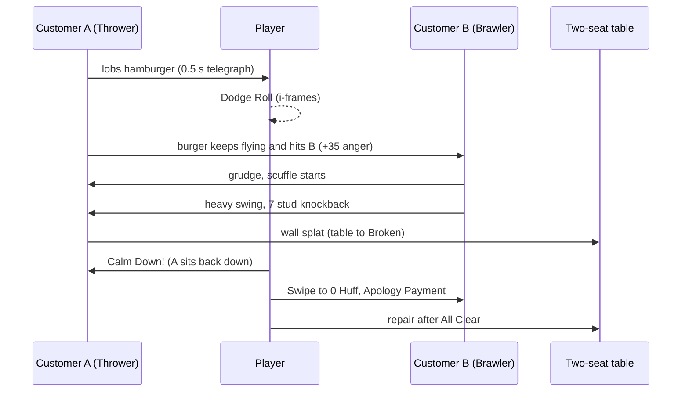
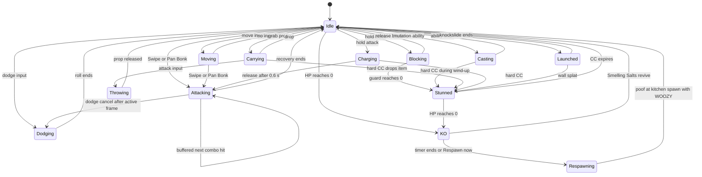

## 11. Combat System

> **Combat is the spice, not the meal.** Mystery Morph Restaurant is a restaurant game first. Combat exists
> so that a furious Karenosaurus is *funny and consequential* instead of a sad animation, so that mutation
> parts have loud, show-off-able powers, and so that one flying hamburger can snowball into a restaurant-wide
> brawl that players tell their friends about. It must never stop players from cooking, never take away
> anything they own, and always end quickly. Ability data lives in **§36.6**, status effects in **§36.7**.

### 11.1 Purpose & Design Goals

**Purpose.** Turn customer anger (§10, canon C11.5) into short, readable, slapstick encounters; give every
active mutation part a distinct combat or utility verb; generate emergent chain reactions out of simple,
simulated rules (projectiles keep flying, knockback hits furniture, bystanders get grumpy) rather than scripts.

| # | Goal | Rule(s) that enforce it | Measurable target [TUNABLE] |
|---|---|---|---|
| G1 | Encounters are short | Huff bands + tier DEF scaling (§11.5.2), Winded state (§11.8.1), apology flow (§11.10.1) | Median encounter 8–20 s; 95th percentile ≤ 45 s |
| G2 | Combat is occasional | Frequency is driven by service quality (§10); caps on simultaneous fighters (§11.8.1) | ≤ 15 % of active restaurant time "In Combat" for the median player; ≤ 5 % for players holding ≥ 4.0 ★ |
| G3 | Failure is funny, never devastating | No loss of mutations/items/currency on KO (canon C12.1); repairs are the only cost (§11.10.4) | KO costs ≤ 10 s of play; combat-caused repair spend ≤ 8 % of gross income at matched tier |
| G4 | Always readable | Every NPC attack is telegraphed ≥ 0.4 s with a "!" indicator (§11.8.1) | 100 % of NPC attacks telegraphed; telegraphs visible with Reduced VFX on |
| G5 | Fair on every device | Soft lock + auto-target on touch/controller (§11.4); identical server rules | Time-to-calm within ±10 % across KB/M, controller, touch in playtests |
| G6 | Emergent chaos | Projectiles are not consumed by dodges, bystander anger, NPC grudges, wall-splat furniture damage (§11.6) | The brief's hamburger chain (§11.6.5) reproduces from rules alone in a sandbox test |
| G7 | A non-violent path always exists | Winded + `ABL_006` Calm Down!, `ABL_065` Soothing Song, Security employees (§11.10.6) | Any hostile customer can be resolved with 0 damage dealt (QA scripted test) |
| G8 | Cheap to run | Server-authoritative, budgeted spatial queries, scripted arcs, client-only debris (§11.7) | Combat server cost ≤ 1.5 ms per Heartbeat per restaurant at 6 hostiles |

**Non-goals.** No PvP inside restaurants (Arena only, §11.11, §21). No death, blood, or permanent loss.
No random crits or damage variance. No combat farming: combat never pays Morph Bucks except the canon
Apology Payment (40 %), which is always worse than a happy customer's payment.

---

### 11.2 Who Fights Whom (Hostility Model)

**Combatant kinds:** *Player*, *Customer* (SPCV proxy, canon C3), *Employee* (SPCV proxy), and *Event boss*
(city events in §18 reuse this framework with boss-scaled numbers).

#### 11.2.1 Anger level → combat behavior (A5 owns escalation triggers; this table owns the fight)

| Anger level (canon C11.5) | Hostile flag | Combat behavior |
|---|---|---|
| 0 Happy · 1 Annoyed · 2 Complaining | No (bystander) | Never attacks; can be hit by stray projectiles (anger rules below) |
| 3 Throwing food | For 6 s after it throws at a player, and while it is in a scuffle (§11.6.4) | Throws its own food/plate/cup at its grievance target: 1 throw per 6 s (THROWER style 1 per 2.5 s). Projectile rules §11.6.2 |
| 4 Destroying furniture | Yes | Smashes nearby furniture (values §11.6.3); flips tables (TANK/CHARGER, `ANM_049`); does not chase players |
| 5 Fighting the player | Yes | Full style AI (§11.8) including its Signature Move (§11.8.3); entering level 5 plays a 0.4 s "Rage Puff" roar (morph visual swells 1.15×, steam puffs from ears — cosmetic) |
| 6 Restaurant-wide chaos | Yes, for every customer at level ≥ 3 | Caps raised (§11.8.1), "CHAOS!" banner, chaos music sting (§26) |
| Any level, style `PACIFIST` | Never | Sulks, cries dramatically (`ANM_047`), flees (`ANM_054`) or storms out per §10 |

#### 11.2.2 Damage relationship matrix

| Attacker → Target | Result |
|---|---|
| Player → Hostile customer | Full damage (§11.5.1) |
| Player → non-hostile customer (bystander) | **0 damage.** Melee/area contact: +8 anger × personality sensitivity and a 0.3 s flinch. Thrown object: +25 anger × sensitivity (canon thrown-food rule, extended to every thrown prop). Soft lock and auto-target never select bystanders. |
| Player ↔ Player (co-op, guests, visitors) | No damage, knockback or status — friendly fire is **off** in restaurants and the city. Arena only (§11.11). |
| Customer → Player | Full NPC damage (§11.5.1) |
| Customer → Customer | ×0.5 damage; starts a grudge/scuffle (§11.6.4) |
| Customer → Employee | Employees have no HP: a hit "Bonks" them (`STS_DIZZY` 2 s, drops carried item; max once per 8 s per employee). `ROLE_SECURITY` uses Guard HP instead (§11.10.6). |
| Player → Employee | No effect |
| Anything → furniture/appliances | Durability damage per §11.6.3 (canon C6 damage states) |

---

### 11.3 Controls & Input (per device)

The canonical default map is **§24.3.2** (built on §5's kitchen scheme); this table repeats the combat subset
and must stay identical to it. All bindings are rebindable (§24 Settings). Input mode switches automatically on
the last input type (`UserInputService.LastInputTypeChanged`); HUD glyphs update instantly. **Shift Lock is
disabled** (LeftShift is Dodge); lock-on replaces it for camera-relative fighting.

| Action | Ability | Keyboard & Mouse | Controller | Touch (phone / tablet) |
|---|---|---|---|---|
| Move / camera | — | WASD or arrows / RMB-drag, wheel zoom | Left stick / right stick | Dynamic thumbstick (left 45 %) / drag right area, pinch |
| Swipe Combo | `ABL_001` | LMB tap (each tap = next hit) | RT tap | ATTACK tap (auto-target) |
| Wallop | `ABL_002` | Hold LMB ≥ 0.6 s, release | Hold RT ≥ 0.6 s, release | Hold ATTACK (charge ring fills), release |
| Block | `ABL_003` | Hold Q | Hold LT | Hold SHIELD (Settings: tap-to-toggle) |
| Dodge Roll | `ABL_004` | LeftShift (direction = WASD; none = backward) | RB | Swipe on SHIELD in a direction, or the DODGE button (direction = thumbstick) |
| Grab / pick up a prop | `ABL_005` | F | B | GRAB button |
| Throw carried prop (hands full) | — | LMB hold = arc, release | RT hold = arc, release | ATTACK becomes THROW: hold, drag to aim, release |
| Drop carried item | — | G | D-pad Down | Long-press the carry widget 0.4 s |
| Calm Down! | `ABL_006` | V | D-pad Up | Speech-bubble CALM button |
| Mutation slots 1–4 | — | 1 / 2 / 3 / 4 | Hold LB + X / Y / B / A (radial overlay shows icons on face-button glyphs) | Four 64 u buttons in an arc around ATTACK; tap = auto-aim, drag = aim, drag back to centre = cancel |
| Lock-on / cycle | — | MMB toggles; mouse wheel cycles while locked | R3 toggles; flick right stick to cycle | Tap an enemy; tap again to release |
| Jump | — | Space | A | JUMP button |
| Revive ally (Smelling Salts) | — | Hold E 2 s | Hold X 2 s | Hold Context button 2 s |

**Contextual swaps.** Holding a frying pan replaces Swipe/Wallop with `ABL_007` Pan Bonk; holding an empty
tray replaces Block with `ABL_008` Tray Shield. Carrying any prop turns ATTACK into THROW. Hold-type
abilities (channels such as `ABL_032`) channel while the key is held, up to their maximum. Input buffer: the
next combat input pressed ≤ 0.25 s before the current action can accept it is queued (one queued input max).
Touch layout keeps every combat button ≥ 64 u (§24 layout units) and inside the thumb arc; the
order-queue overlay stays tappable during combat.

---

### 11.4 Targeting

| Mode | Default on | Rules |
|---|---|---|
| **Free aim** | KB/M | Melee faces the lock-on target when locked, otherwise movement direction (Shift Lock is disabled). Aimed abilities fire at the mouse ground point (raycast from camera), clamped to max range. |
| **Soft lock** | Touch, controller (optional on KB/M) | Candidates: Hostile combatants within 18 studs with line of sight. Score = `1.0 × (1 − d/18) + 0.8 × facingDot + 0.6 (if it is targeting you) + 0.3 (if it was your last target)`. Re-evaluated every 0.2 s and on every attack press; switches only if a candidate beats the current by ≥ 0.25 (hysteresis). |
| **Auto-target** (touch; controller optional) | Touch | ATTACK turns you toward the soft-lock target (≤ 0.1 s turn) if it is within 12 studs; melee lunge-assist closes up to 1.5 studs; aimed abilities aim at the target centre, projectiles lead by `targetVelocity × travelTime` (lead capped at 4 studs). Drag-from-button overrides with manual aim. |
| **Hard lock** (lock-on) | Any (opt-in: MMB / R3 / tap enemy) | Camera keeps the target framed and melee/abilities face it. Breaks at > 30 studs, after 1.5 s without line of sight, or on target defeat. |
| **Aim assist** (controller) | Controller | 30 % camera slowdown inside a 4-stud bubble around soft-lock target; never snaps. |

**Never-target list:** bystanders (anger ≤ 2 and not flagged Hostile), `PACIFIST` customers, defeated
(Defeat-Dizzy) customers, allies, employees. Manual free aim *can* still hit bystanders with thrown props —
that risk is deliberate and is the source of many chain reactions.

---

### 11.5 Core Combat Rules

#### 11.5.1 Damage formula (no random crits, no variance)

```
Damage   = round( Base × StrMult × AbilityMult × 100 / (100 + DEF_target) × BlockMult ),  minimum 1
Base     = the ability's listed damage (§36.6) or prop throw damage (§11.6.1)
StrMult  = 1 + 0.008 × STR                     (players; STR cap 150 → ×2.2, canon C5)
         = TierScale × PersonalityDamageMult    (NPCs; PersonalityDamageMult from §9, default 1.0)
TierScale = 1 + 0.25 × (TierIndex − 1)          (TIER_01 ×1.00 … TIER_05 ×2.00 … TIER_10 ×3.25)
AbilityMult = min(2.0, LevelScale × ComboMult × InteractionMult × SynergyMult × ModeMult)
  LevelScale      = 1 + 0.05 × (PartLevel − 1)  (base kit & utensils: 1 + 0.002 × player Level, max 1.2)
  ComboMult       = 1.10 on a Combo Link hit (§11.5.5), else 1.0
  InteractionMult = status interactions (§11.5.7), e.g. Zap Combo 1.5, Shatter 1.5, Wake-up 1.25, Winded 1.25
  SynergyMult     = 1 + Σ synergy damage bonuses (§12, §36.4), capped at 1.25
  ModeMult        = PvP 0.7 · NPC-vs-NPC 0.5 · incoming damage to a Gentle Mode player 0.75 · otherwise 1.0
BlockMult = 0.30 when blocked (−70 %, canon C12.1) · 0.10 behind a raised Tray Shield · 0 on Perfect Block
DEF_target (player)   = DEF stat (cap 200 → ×0.333, canon C5)
DEF_target (customer) = PersonalityDEF (§9, 0–40) + 8 × (TierIndex − 1)
```

Customer Huff Points stay inside the canon 40–300 band at every tier; tier toughness comes from the DEF term,
and tier threat comes from TierScale. Rounding is half-up after all multipliers.

| # | Scenario | Calculation | Result |
|---|---|---|---|
| A | L1 player (STR 0), Swipe hit 1 (Base 8) vs TIER_01 customer with PersonalityDEF 10 | 8 × 1.00 × 1.00 × 100/110 | **7** (combo 7 + 7 + 11 = 25) |
| B | L40 player, STR 60, `ABL_010` Bear Slam (Base 22) at part Lv3, vs TIER_06 customer PersonalityDEF 30 (DEF 70) | 22 × 1.48 × 1.10 × 100/170 | **21** |
| C | TIER_06 BRAWLER combo hit (NPC Base 4) vs player DEF 30 | 4 × 2.25 × 1.0 × 100/130 | **7** |
| D | Same as C but blocked | 6.92 × 0.30 (rounded once at the end) | **2**, guard −9 (4 × 2.25) |
| E | PvP: `ABL_019` Shark Chomp (Base 16), arena template STR 60, part treated as Lv3, DEF 60 | 16 × 1.48 × (1.10 × 0.7) × 100/160 | **11** (§36.6 shows the arena Base 16 × 0.7 ≈ 11; ModeMult is applied once) |

#### 11.5.2 Health, Huff Points and time-to-calm targets

- **Player HP** = `100 + 2 × (Level − 1) + mutation HP bonuses` (canon C5). No regeneration while In Combat;
  out of combat, 10 % Max HP per second beginning 3 s after the In Combat flag clears ("Shake it off!").
- **Customer Huff** (canon 40–300) is assigned per personality by §9. Recommended bands per combat style
  [TUNABLE]: `PACIFIST` 40–80, `THROWER` 60–120, `TRICKSTER` 60–110, `INSTIGATOR` 60–100, `BRAWLER` 100–180,
  `CHARGER` 110–200, `TANK` 200–300. Huff does not regenerate while hostile; it resets when calmed.
- **Targets** [TUNABLE]: a player with tier-appropriate stats (STR ≈ 30 at L35) calms a 120-Huff BRAWLER in
  6–10 s and a 260-Huff TANK in 14–20 s using the base kit plus one on-tier ability; a single NPC BRAWLER
  needs ≥ 15 s of *unblocked* hits (combo + heavy) to KO a tier-appropriate player (two attackers ≥ 8 s).

#### 11.5.3 Knockback formula and caps

```
KB_dist = BaseKB × (1 + 0.004 × STR_attacker) × (1 − KBResist_target) × StateMult × ModeKB
          clamped to 0 … 18 studs (restaurant interiors) or 0 … 22 studs (city & arena)
KBResist: default 0 · TANK style 0.6 · +0.1 per equipped `heavy`-tag part (max +0.3) · SHIELDED via ABL_025 = immune
StateMult: blocking 0.3 · FLOATING 1.5 · GREASY 1.3 · airborne 1.2 (multiplicative)
ModeKB: PvP 0.8 · otherwise 1.0           NPC StrMult term uses TierScale^0.5 instead of STR (keeps late-tier KB sane)
Vertical pop ≤ 4 studs · travel time = 0.15 + 0.02 × KB_dist s · 0.5 s knockback immunity after it ends
```

**Wall splat.** The server sweeps the knockback path (`workspace:Blockcast`). If a wall, counter or furniture
stops the target with ≥ 2 studs of travel remaining, the target is "splatted" (cartoon flatten + stars):
`STS_STUN` 0.5 s, and the object struck takes impact damage `4 + 1.5 × remainingStuds` % durability
(clamped 4–20 %, §11.6.3). This single rule is what makes "someone crashes into a table" happen.
Players are moved by their own client (server sends `Combat.Knockback`; the client drives a `LinearVelocity`
for the travel time; the server verifies displacement, §29). NPC proxies are moved by a server CFrame tween.

#### 11.5.4 Defense, stun and invulnerability (canon C12.1)

| Rule | Value [TUNABLE] |
|---|---|
| Block (base kit) | `ABL_003`: −70 % damage from a frontal 120° arc; move speed ×0.5; cannot block while carrying a Heavy prop |
| Guard meter | 60 (Arena 80). Guard damage = Base × StrMult × GuardMult (default 1.0; heavy attacks 1.5; CHARGER rush 2.0), before DEF. Regenerates 20/s after 2 s without guard damage |
| Guard break | Guard reaches 0 → `STS_STUN` 1.0 s; guard refills to 30 afterwards |
| Perfect Block | Block raised ≤ 0.15 s before the hit lands → 0 damage, 0 guard damage, "TINK!" sparkle |
| Dodge Roll (base kit) | `ABL_004`: 0.4 s roll, 8 studs, invulnerable 0.05–0.30 s (0.25 s), 1.2 s cooldown. Projectiles pass through and **keep flying** |
| Flinch (hitstun) | Light hits 0.3 s, heavy hits 0.5 s; interrupts wind-ups and channels; not a status, not DR-counted. TANK NPCs ignore light-hit flinch |
| Hard-CC diminishing returns | `STS_STUN`, `STS_FROZEN`, `STS_SLEEPY`, `STS_CHARMED`, `STS_KNOCKDOWN`, `STS_FLOATING`, non-defeat `STS_DIZZY` on the same target within 8 s: 100 % → 50 % → 25 % → 4 s immunity ("Not again!" shield icon) |
| Player CC protection | Any single NPC-applied hard CC on a player ≤ 1.5 s (≤ 1.0 s at TIER_01–02). ≥ 2.5 s of hard CC within 6 s → 3 s "Shake-Off" immunity |
| Get-up | After `STS_KNOCKDOWN`, a 0.3 s get-up with invulnerability (no wake-up loops) |
| Interrupted ability | Flinch/CC during wind-up (before the active frame) → cooldown set to 2.0 s (or the remaining cooldown if lower). Channels interrupted after the first tick refund 50 % of the unused fraction |

**Invulnerability windows** (overlaps do not add; the latest end time wins): Dodge 0.25 s · E2 menu
auto-close 1.5 s · respawn protection 3.0 s (ends early if you attack) · Smelling Salts revive 2.0 s ·
`ABL_046` Comet Blink 0.2 s · `ABL_059` Ghost Phase 1.5 s (intangible) · knockdown get-up 0.3 s.

#### 11.5.5 Combo rules

- **Swipe chain** (`ABL_001`): hits at 0.35 s cadence, 8 / 8 / 12 (hit 3 is the finisher: 4-stud knockback).
  The chain resets after 0.8 s without input.
- **Wallop** (`ABL_002`): minimum charge 0.6 s (Base 20, 8-stud knockback); full charge 1.2 s (Base 30,
  12 studs). Releasing before 0.6 s performs Swipe hit 1. Charging has no armor: any flinch cancels it.
- **Dodge-cancel:** a dodge may cancel any action after its active frame (never during a heavy wind-up).
- **Combo Link:** casting a mutation ability ≤ 0.25 s after Swipe hit 2 or 3 connects gives that ability's
  first hit ComboMult 1.10 and a "LINK!" pop.
- **Launch & juggle:** a launched target (e.g. `ABL_052` Horn Toss) can take exactly one juggle hit, then is
  juggle-immune until it lands.
- **Combo Fatigue:** a single target that takes 8 hits within 3 s gains 1.0 s of Poise (no flinch, still
  takes damage). There are no combo-count rewards (nothing to farm).
- **Global cooldown:** 0.25 s between any two mutation-ability casts (Swipe/Block/Dodge exempt).

#### 11.5.6 Ability bar and cooldowns

- **Base kit** `ABL_001`–`ABL_006` is always bound. Held utensils override as in §11.3 (`ABL_007`, `ABL_008`).
- **Four mutation slots** (canon C12.1): filled only from abilities granted by currently equipped parts
  (source parts fixed in canon C13.6 and §36.6). If more than four are granted, the player chooses in the
  Morph menu's *Ability Bar* tab (§13); default auto-fill by slot priority HEAD → ARM_R → ARM_L → TAIL →
  legs → BACK → WINGS → others. The arrangement is saved per loadout.
- **Paired parts** (both arms or both legs the same part) grant the ability once, with its *paired bonus*
  (§36.6 Balance notes; canon C13.4).
- **Cooldown authority:** the server owns `readyAt[abilityId]`; the client shows a predicted cooldown on
  press and is corrected by `Combat.CooldownSync`. Cooldown starts at cast confirm (start of wind-up).
- **Cooldown reduction:** part level −2 % per level above 1 (Mythic Lv10 = −18 %); `STS_INSPIRED` +20 %
  recovery rate; synergies ≤ −20 % total; absolute floor 50 % of the listed cooldown. Base kit cooldowns are
  only affected by `STS_INSPIRED`.
- **Where usable:** own or co-op restaurant interiors, city event combat zones (§18), the Arena (§21).
  Disabled in shop interiors and cutscenes. Utility abilities `ABL_061`–`ABL_070` work in and out of combat.

#### 11.5.7 Status-effect interactions

| Interaction | Statuses | Trigger | Result |
|---|---|---|---|
| Zap Combo | `STS_SOAKED` + `STS_SHOCKED` | Shock applied to a soaked target | **Zap Combo:** `STS_STUN` 1.0 s, the triggering hit ×1.5, SOAKED consumed, giant "ZZAP!" text |
| Steam-off | `STS_SOAKED` vs `STS_TOASTY` | Soak applied | TOASTY cleansed; while SOAKED, TOASTY cannot apply (a harmless steam puff plays instead) |
| Deep Freeze | `STS_SOAKED` + `STS_FROZEN` | Freeze applied to a soaked target | FROZEN duration ×1.5; SOAKED consumed |
| Thaw | `STS_TOASTY` ↔ `STS_FROZEN` | Either applied while the other is active | "Thaw": the older one is removed and the new one lasts half as long |
| Shatter | `STS_FROZEN` + heavy hit | `ABL_002`, `ABL_007` Big Bonk, `ABL_010`, `ABL_021` centre, `ABL_054` | "Shatter": FROZEN ends, hit ×1.5, ice-cube confetti |
| Slick-n-Stick | `STS_STICKY` ↔ `STS_GREASY` | Either applied while the other is active | Both removed ("Slick-n-Stick") |
| Butter Slide | `STS_GREASY` + knockback | Any knockback | Distance ×1.3 |
| Wake-up Bonk | `STS_SLEEPY` + damage | Any damage | Target wakes; that hit ×1.25 |
| Up and Away | `STS_FLOATING` | Knockback / ground effects | Knockback ×1.5; immune to ground-only effects (`ABL_021`, `ABL_043`, `ABL_048`, `ABL_039`) |
| "Ew, no." | `STS_STINKY` + `STS_CHARMED` | Charm applied to a stinky target | Charm fails ("Ew, no.") |
| Mix-up | `STS_CONFUSED` (NPC) | Each 0.2 s decision tick | 40 % chance to target the nearest other combatant — can start NPC scuffles (§11.6.4) |
| Bubble Guard | `STS_SHIELDED` | Any damage | Shield absorbs first; `ABL_026` and `ABL_015` quills deal ×1.5 to shields |
| Speed vs Slow | `STS_HYPED` + `STS_SLOW` | Movement | Multiplicative (e.g. 1.15 × 0.7) |

#### 11.5.8 "In Combat" flag and menus (canon C12.1, E2, E4)

- **In Combat** = dealt or took damage within the last 6 s, or targeted by a level-5 customer. It blocks
  loadout swaps (E4), full-screen menus (E2: "Can't shop during a brawl!"), fast-travel (Morph Metro, Pigeon
  Taxi, Return Door) and out-of-combat HP regeneration. Overlay panels (order queue, map) stay usable.
- If a customer turns hostile while a full-screen menu is open, the menu auto-closes and the player gets
  1.5 s of invulnerability (canon E2).
- An **encounter** starts when any combatant in the interior is flagged Hostile and ends ("All Clear!") when
  no Hostile combatant has existed for 10 s; the Aftermath step then runs (§11.6.3).

#### 11.5.9 Core combat variables (all [TUNABLE]; canon values marked C12.1/C5/C3)

| Variable | Value | Notes |
|---|---|---|
| Swipe damage / cadence / reset | 8 · 8 · 12 / 0.35 s / 0.8 s | C12.1 (8 dmg, 3 hits, 0.35 s) |
| Wallop min / full charge | 20 @ 0.6 s / 30 @ 1.2 s | C12.1 (20 dmg, 0.6 s) |
| Block reduction / arc / guard / regen | 70 % / 120° / 60 / 20 per s after 2 s | C12.1 |
| Guard-break stun | 1.0 s `STS_STUN` | C12.1 |
| Perfect Block window | 0.15 s | |
| Dodge roll / invulnerability / cooldown / distance | 0.4 s / 0.25 s / 1.2 s / 8 studs | C12.1 |
| In Combat window | 6 s | C12.1 |
| Encounter end ("All Clear!") | 10 s with no Hostile | |
| Input buffer / Combo Link window | 0.25 s / 0.25 s | |
| Global ability cooldown | 0.25 s | |
| AbilityMult cap · SynergyMult cap | 2.0 · 1.25 | |
| Cooldown floor | 50 % of listed | |
| TierScale per tier | +0.25 | NPC threat |
| Customer DEF per tier | +8 | Customer toughness |
| Knockback cap (interior / city & arena) | 18 / 22 studs | |
| Knockback immunity after KB | 0.5 s | |
| Wall-splat stun / impact damage | 0.5 s / 4 + 1.5 × remaining studs % (4–20 %) | |
| Hard-CC DR window / steps / immunity | 8 s / 100-50-25 % / 4 s | |
| NPC hard-CC cap on players | 1.5 s (1.0 s at TIER_01–02) | |
| Shake-Off trigger / immunity | ≥ 2.5 s CC in 6 s / 3 s | |
| Out-of-combat HP regen | 10 % Max HP/s after 3 s | |
| Soft-lock radius / auto-target radius / hard-lock break | 18 / 12 / 30 studs | |
| Server hit tolerance | +2 studs (C3) + attacker speed × min(ping, 0.2 s) | §11.16 |
| Bystander anger (melee/area · thrown) | +8 · +25 × sensitivity | thrown rule from C11.5 |

---

### 11.6 Environmental Combat

**Purpose.** The restaurant *is* the arena. Furniture, dishes and utensils are weapons, shields and
casualties, which keeps fights funny and ties combat back into repair (§15) and cleanliness K (canon C11.3).

#### 11.6.1 Props table

Throw damage uses the §11.5.1 formula with the Base below. Durability values are percentages of the object's
maximum durability (A10 converts to its own units in §15); canon C6 damage states apply. `PropClass` is the
attribute `CombatService` reads on the object's model.

| Prop class (`PropClass`) | Weight · pickup time | Who can lift | Throw Base dmg · range | Effect on hit | Self-damage to the prop | Damage to objects it hits | NPC users |
|---|---|---|---|---|---|---|---|
| Chair / stool (`"Chair"`) | Medium · 0.6 s | Players; `BRAWLER`, `TANK` | 12 · 16 studs | Knockback 6 studs | −20 % per throw; −10 % per melee swing | −8 % | `BRAWLER` swings it (NPC Base 6, 2 swings then drops it) or throws it; `TANK` throws |
| Small table, ≤ 2 seats (`"TableSmall"`) | Heavy · 1.0 s | Players with STR ≥ 30, a `heavy` or `grabby` tag part, or via `ABL_017`/`ABL_045`; `TANK` | 20 · 12 studs | `STS_KNOCKDOWN` 0.6 s; items on it spill first | −25 % | −12 % | `TANK` at level 4 flips it (`ANM_049`) instead of throwing |
| Large table / booth / counter (`"TableLarge"`) | Fixed | Nobody lifts | — | Can be flipped by `TANK`/`CHARGER` at level 4 (`ANM_049`): items on it spill | −15 % per flip | — | `TANK`, `CHARGER` |
| Empty serving tray (`"Tray"`) | Light · 0.3 s | Anyone | 6 · 14 studs (Tray Toss frisbee via `ABL_008`: 8) | Flinch | −5 % per hit | — | `TRICKSTER` steals; `INSTIGATOR` bangs it (noise only) |
| Empty or dirty plate (`"Plate"`) | Light · 0.3 s | Anyone | 6 · 14 studs | Flinch | Breaks into cartoon shards → broken-dish trash (cleaning, §5) | — | `THROWER` |
| Food / plated dish (`"Food"`) | Light · 0.3 s | Anyone (a co-op ally's carried item cannot be taken) | 6 · 16 studs | By ingredient tag (canon C9): `liquid` → `STS_SOAKED` 3 s · `sauce`/`slime` → `STS_STICKY` 1.5 s · `spicy` → `STS_TOASTY` 2 s · `frozen` → `STS_SLOW` 2 s · otherwise "SPLAT!" | Consumed → spill trash; a wasted order dish is charged at the trash (canon C9) | — | `THROWER` core move; every non-`PACIFIST` style at anger level 3 |
| Cup / drink (`"Cup"`) | Light · 0.2 s | Anyone | 4 · 14 studs | `STS_SOAKED` 3 s | Consumed → spill | — | `THROWER` |
| Condiment bottle (`"Condiment"`) | Light · 0.3 s | Anyone | 4 · 12 studs | Oil → `STS_GREASY` 3 s; ketchup/mustard → `STS_STICKY` 1.5 s | None (auto-refills, homes back) | — | `TRICKSTER` |
| Small trash can (`"TrashCan"`) | Medium · 0.6 s | Players; `BRAWLER`, `TANK` | 12 · 14 studs | Spills 2 trash piles at the impact point + `STS_STINKY` 3 s | −15 % | −6 % | `BRAWLER` kicks it over at level 4 |
| Frying pan (`"Pan"`) | Light (utensil) · 0.3 s | Players; `BRAWLER` | Held → `ABL_007`; thrown 10 · 14 studs | Thrown: "BONK!" `STS_STUN` 0.3 s | −5 % per hit; never breaks below Scuffed | — | `BRAWLER` grabs one within 6 studs (50 % chance) |
| Other utensils: ladle, rolling pin, whisk, spatula (`"Utensil"`) | Light · 0.3 s | Anyone | 6 · 14 studs | Flinch | None (homes back) | — | `THROWER`, `BRAWLER` |
| Mop & bucket (`"MopBucket"`) | Medium · 0.6 s | Players; `TRICKSTER` | 8 · 12 studs | `STS_SOAKED` 5 s + a 3-stud puddle for 4 s (`STS_SOAKED` 2 s to anyone crossing; extinguishes `STS_TOASTY`) | None | — | `TRICKSTER` |
| Broken furniture piece: leg, plank (`"Debris"`) | Light · 0.3 s | Anyone | 8 · 14 studs | Flinch | Poofs on impact and returns to its rubble pile | — | `BRAWLER` |
| Small decoration flagged `Throwable` (`"DecorSmall"`: potted plant, mini statue, menu stand) | Light/Medium · 0.4 s | Anyone | 8 · 14 studs | Potted plant: soil puff `STS_BLINDED` 1 s; others flinch | −20 % | −6 % | `TRICKSTER` |
| Large decoration / aquarium / wall decor (`"DecorLarge"`) | Fixed | Nobody | — | Takes collateral from wall splats, charges and area attacks | — | — | `CHARGER` smashes in its path |
| Kitchen appliance / station (`"Station"`) | Fixed | Nobody | — | Collateral only, at ×0.5; never targeted by player abilities | — | — | `CHARGER`/`TANK` level-4 smashes (only if no furniture within 12 studs) |

#### 11.6.2 Pickup, carry and throw rules

1. **Lifting** uses `ABL_005` and the canon carry capacity (1 item; +1 per carry-boosting part; hard max 3,
   canon C3). Heavy props occupy all carry slots. Pickup range 6 studs; pickup time per table above
   (interrupted by flinch). Furniture with a seated customer, owner-locked trophies (`FRN_901`–`FRN_910`) and
   anything not flagged `Throwable` cannot be lifted.
2. **Carrying** a Medium prop: WalkSpeed ×0.85; Heavy: ×0.7, no Block, and Dodge becomes a 4-stud stumble
   with no invulnerability.
3. **Throwing** is a scripted parabolic arc (canon C3), never Roblox physics: launch speed 45 studs/s, fake
   gravity 60 studs/s², apex ≤ 6 studs, range per prop. Throw cooldown 0.8 s. Holding Attack shows the arc and landing
   reticle (pre-aimed at the soft lock on touch/controller, at the cursor on KB/M); release throws.
4. **A projectile is never consumed by an invulnerable target.** A dodged, phased or mis-aimed projectile
   keeps flying along its arc and can hit whoever is next on the path — including bystanders.
5. **Interception:** `ABL_008` Tray Shield and `ABL_036` Umbrella Parry reflect thrown projectiles; `ABL_035`
   Vacuum Suck inhales them; `ABL_053` Tail Spin destroys them; Block reduces them by 70 %.
6. **Dropping on CC:** `STS_KNOCKDOWN`, `STS_FROZEN`, `STS_SLEEPY`, KO, or any hit while `STS_GREASY` drops
   the carried item. A dropped *plated dish* lands upright ("Plate Save!") and stays pickable for 10 s at
   quality ×0.9 ("Floor Fluff"), then becomes spill trash. A dropped special ingredient returns to Pantry
   stock after 10 s if nobody picks it up (spirit of canon E1). Dropped props stay where they land.
7. **Furniture Homing:** at All Clear + 10 s, every moved but unbroken furniture prop waddles back to its grid
   cell (1.5 s client tween, server snaps the CFrame); broken ones become repair markers at their home cell.
   Layouts are never permanently scrambled by a brawl.

#### 11.6.3 Combat damage to furniture and appliances

| Source | Durability damage [TUNABLE] |
|---|---|
| Wall splat (any knockback) | 4 + 1.5 × remaining studs %, clamped 4–20 % |
| Thrown prop impact | per §11.6.1 "Damage to objects" column |
| `CHARGER` rush through an object | 18 % per object (max 3 objects per rush) |
| Level-4 smash: `BRAWLER` / `TANK` slam / `CHARGER` crash | 10 % per hit every 1.5 s / 20 % every 3 s / 18 % per crash |
| Table flip | 15 % + everything on top spills (`ANM_049`) |
| Player abilities | Only the abilities that say so in §36.6 (e.g. `ABL_013` Rhino Charge: 15 % per object; `ABL_027`: 5 % per bump) |
| Appliances (`"Station"`) | ×0.5 of the above; an appliance at **Broken** stops processing (canon C6) |

**Step limit:** a single combat hit lowers an object by at most one canon C6 damage state (Pristine → Scuffed
→ Cracked → Broken → Destroyed). Destroyed objects become a cartoon rubble pile with the auto-rebuild offer
(≤ 25 % of item price, canon C6) — nothing is ever permanently lost. Damage from guests and from customers
during co-op is covered by Co-op Insurance (canon E12).

**Aftermath** (runs at All Clear): Furniture Homing, a summary toast ("Brawl over! 2 tables need fixing ·
Apology payments +18 MB"), repair markers on every object below Pristine, and a cleanliness K recalculation
for spills (§10). Repairs are performed by players or `ROLE_REPAIR` employees through `RepairService` (§15);
an object damaged while being repaired follows canon E3.

#### 11.6.4 Bystanders, grudges and NPC scuffles

1. **Stray hits on customers** apply the anger amounts in §11.2.2 (×personality sensitivity from §9). If
   that pushes a customer across an anger threshold, the normal escalation roll of canon C11.5 applies.
2. **Grudge:** when an NPC's attack or projectile hits another customer B, B records a grudge against the
   *source* NPC. If B is (or becomes) anger level ≥ 3 and passes its escalation roll, B starts a **scuffle**
   with the source using its own style AI — even below level 5, because the target is an NPC.
3. **Scuffle rules:** both scufflers are flagged Hostile while the scuffle lasts (so players can step in);
   NPC-vs-NPC damage ×0.5; a scuffle lasts ≤ 12 s, then both sulk unless re-provoked;
   every scuffle hit adds +3 anger to customers within 10 studs ("Ooh, a fight!"); `PACIFIST` customers
   never scuffle (they flee). A scuffler reduced to 0 Huff goes through the normal defeat flow (§11.10.1)
   and still pays the Apology Payment.
4. **Player involvement:** a player can Calm Down! either scuffler; a scuffler that is hit twice by a player
   switches its target to that player (and becomes Hostile).
5. **Food theft:** a `THROWER` with nothing to throw may grab food from another customer's table (that
   customer +15 anger) — another chain starter.
6. **Chaos:** canon level 6 ignites when ≥ 3 customers are at level ≥ 3 simultaneously (or by event); it ends
   when fewer than 2 are at level ≥ 3 for 8 s.

#### 11.6.5 Walkthrough — the brief's chain reaction, produced by rules only

Setting: a TIER_03 table-service café, 7 seated customers, one player cooking. Nothing below is scripted.

| Step | What happens | Rule that causes it |
|---|---|---|
| 1 | Customer **A** (a `THROWER`-style personality, burger served late) is at anger 48 → level 3 and lobs its half-eaten hamburger at the player. A "!" appears above A for 0.5 s and a landing reticle shows on the floor. | §11.2.1 level 3; telegraph §11.8.1; scripted arc §11.6.2-3 |
| 2 | The player presses Dodge just before impact and rolls under the arc. | Dodge 0.25 s invulnerability §11.5.4 |
| 3 | The burger is **not consumed**; it continues along its arc and lands on customer **B**, seated two tables behind (anger 20, Annoyed). | §11.6.2-4 |
| 4 | B is hit by thrown food: +25 × sensitivity 1.4 = +35 → anger 55 → crosses into level 3; escalation roll `0.6 × 100/(100 + CHARM 20)` = 50 % → succeeds. B records a grudge against A. | canon C11.5; §11.6.4-1/2 |
| 5 | B (a `BRAWLER`) stomps over and starts a scuffle with A. Nearby diners gain +3 anger per hit. | §11.6.4-3 |
| 6 | B's heavy swing (NPC Base 12, BaseKB 6) knocks A back 6 × √1.5 ≈ 7.3 studs; 2.3 studs into the slide, A hits a two-seat table. | Knockback §11.5.3 (NPC term √TierScale) |
| 7 | Wall splat (5 studs of travel remaining): A is stunned 0.5 s; the table (already Cracked at 34 % from an earlier spill) takes 4 + 1.5 × 5 = 11.5 % → 22.5 % → **Broken**. Its plates slide off → spill trash; its two seats become unusable. | Wall splat §11.5.3; §11.6.3; canon C6 |
| 8 | Two more diners pass level 3 from the spectacle → three customers at level ≥ 3 → **chaos (level 6)**. | §11.6.4-6 |
| 9 | The player Calms Down! A (level 3 → 2: it stops scuffling and sits back down), then swipes B (Hostile while scuffling) to 0 Huff → B is Defeat-Dizzy → apologizes → Apology Payment 40 % → escorted out. The other two cool off when the player serves their food Perfect. | `ABL_006` (§36.6.2); §11.6.4-3; §11.10.1 |
| 10 | All Clear → Aftermath: the table shows a repair marker; the player repairs it (repair cost only). | §11.6.3; §15 |



---

### 11.7 Physics Limits & Performance Safeguards

All combat movement is scripted; nothing in combat relies on unanchored Roblox physics (canon C3).

| Budget (per restaurant interior unless noted) | Limit [TUNABLE] | Overflow behavior |
|---|---|---|
| Loose props (thrown, dropped, debris pieces) | ≤ 30 (canon C3) | The oldest loose prop "poofs" into confetti and returns home (debris returns to its rubble pile) |
| Concurrent projectiles | ≤ 12 | Player projectiles always spawn; the oldest NPC projectile fizzles in a puff; NPC throw requests wait (the NPC keeps its wind-up pose up to 1 s, then cancels) |
| Projectile simulation | Server steps each arc at 30 Hz with `workspace:Spherecast` between successive points; max lifetime 2.0 s | Clients render the same arc from `{origin, velocity, gravity, serverStartTime}` — no per-frame replication |
| Knockback tweens | ≤ 16 concurrent; NPC proxies only (players drive their own) | New knockbacks on an already-moving proxy replace the old tween |
| Debris & impact VFX | Client-only; despawn in 4 s (canon C3); ≤ 40 debris pieces per client | Oldest debris removed first |
| Combat ParticleEmitters (per client) | ≤ 8 active emitters, ≤ 250 particles; mobile/Reduced VFX halves both | Lowest-priority effects (dust, crumbs) skipped first; telegraphs are never skipped |
| Damage numbers / "BONK!" text | Pooled BillboardGuis: 24 per client | Oldest recycled |
| Spatial queries | ≤ 40 hit queries per Heartbeat per restaurant; one `OverlapParams` per restaurant reused | Excess hits queued to the next frame (≤ 1 frame delay) |
| Hostile AI decision tick | 5 Hz per hostile NPC, staggered; total combat AI ≤ 1.0 ms per Heartbeat per server | Ticks for NPCs farther than 40 studs from every player drop to 2 Hz |
| Remote traffic | `Combat.HitConfirm` batched per Heartbeat per interior (one table payload) | — |
| Simultaneous Fighting customers (level 5) | 6 per restaurant (8 during chaos) | Further escalations to level 5 are deferred: the customer stays at level 4 (smashing) |

Proxies remain anchored at all times; knockback is a short `CFrame` tween (§11.5.3). Characters are never
ragdolled; KO uses an authored animation (`ANM_062`).

### 11.8 NPC Combat AI

#### 11.8.1 Shared framework (all styles in canon C11.6)

- **Perception & aggro.** Each hostile keeps an aggro list: `threat = damage received from X + 30 (X is its
  grievance target) + 10 per hit X landed in the last 6 s − 0.5 × distance`. Target = highest threat with a
  path; re-evaluated each decision tick (0.2 s) with a 20 % switch hysteresis.
- **Aggression budget (attack tokens).** Each player has **2 tokens**: at most **2 NPCs may attack one player
  at the same time** (melee and ranged combined). An NPC must hold a token to begin a wind-up and releases it
  after its recovery or after 4 s. Token-less hostiles **circle and taunt** at 8–12 studs (`ANM_050`), or,
  after 3 s without a token, 40 % chance to smash a nearby object instead (level-4 behavior, §11.6.3).
- **Telegraphs.** Every NPC attack has a wind-up ≥ 0.4 s (values in §36.6 "NPC use") shown by a "!" above
  the head: yellow "!" = blockable, red "!!" = unblockable (grabs, charges), plus ground decals for areas and
  lines. +0.2 s at TIER_01–02 and for Gentle Mode players. **Latency fairness:** a wind-up aimed at player P
  is extended by `clamp(P.ping/2 − 0.05, 0, 0.2)` s.
- **Winded.** After 3 of its attacks are blocked, dodged or whiffed within 10 s (`TANK`: 4), an NPC pants for
  2.5 s (sweat drops). During Winded, `ABL_006` Calm Down! auto-succeeds and hits deal ×1.25 — the
  non-violent route is "defend, then talk".
- **Retreat.** Style-specific (table below); every hostile below 25 % Huff with no token backs off 3 s once.
- **Leash.** Hostiles never leave the interior to chase; if every player leaves the interior, hostiles sulk
  (level 4 → 3) for 20 s, then storm out paying 0 (canon pay rules) if nobody returns.
- **Movement.** Base walk 12 studs/s, hostile chase 14 (`TANK` 10, `TRICKSTER` flee 17); pathfinding via
  `PathfindingService` waypoints computed by `CustomerAIService`, refreshed ≤ 1 per second per NPC.
- **Restaurant caps.** 6 Fighting customers (8 in chaos), §11.7.

#### 11.8.2 Style decision tables (evaluated top-down each 0.2 s tick; first valid row runs)

| Style | Priority-ordered decisions (condition → action · telegraph · cooldown) | Retreat / special rules |
|---|---|---|
| `PACIFIST` | 1 Hit by anything → cry dramatically (`ANM_047`) and flee 8 studs (`ANM_054`), +10 anger · — · — 2 Level 3–5 → sulk, cry or storm out (§10) 3 Chaos → hide under the nearest table (crouch) | Never attacks, never holds tokens, never targeted by soft lock |
| `THROWER` | 1 Player within 6 studs → backpedal to 12 studs; if cornered, slap (NPC Base 3, 0.4 s) 2 Holding a throwable + token + line of sight → lob (`ANM_048`; NPC Base food 6 / plate 6 / cup 4) · 0.5 s "!" + landing reticle · 2.5 s 3 Signature Move ready (§11.8.3) → use it 4 No throwable → fetch the nearest food/plate/cup within 15 studs (may steal from another table, §11.6.4-5) | Keeps 12–18 studs; below 30 % Huff hides behind furniture for 4 s. Aim error ±10 % of distance; never homing |
| `BRAWLER` | 1 In 4 studs + token → 3-hit combo (NPC Base 4 / 4 / 6) · 0.4 s "!" · 1.5 s 2 Every 6 s → heavy swing (NPC Base 12, 6-stud knockback) · 0.7 s "!" — or Signature Move 3 Pan/chair within 6 studs and empty-handed → 50 % pick it up (pan: `ABL_007` NPC version) 4 Otherwise chase target | Below 30 % Huff: 35 % chance per 3 s to back off and taunt for 3 s |
| `CHARGER` | 1 Target 8–20 studs + line of sight + token → rush (30 studs/s, 20 studs; NPC Base 12, 10-stud knockback, guard damage ×2, smashes up to 3 objects 18 % each) · 0.8 s hoof-scrape + red "!!" + lane decal · 5 s 2 Rush ends in a wall → self `STS_STUN` 1.2 s ("Dazed": takes ×1.25) 3 In 4 studs → shove (NPC Base 6, 5-stud knockback) · 0.5 s "!" · 2 s 4 Otherwise reposition to 10–14 studs | Never retreats while a rush is ready; otherwise as shared rule |
| `TANK` | 1 Target in 7 studs + token → ground slam (NPC Base 11 centre / 6 edge, 7-stud radius, `STS_KNOCKDOWN` inner 3 studs — same numbers as the `ABL_021` NPC version; a TANK whose Signature Move is `ABL_021` slams every 4 s) · 0.9 s ring decal "!" · 6 s 2 In 4 studs → backhand (NPC Base 10, 8-stud knockback) · 0.6 s "!" · 2.5 s 3 Player charging Wallop in front → raise arms and Block 1.5 s 4 Level 4 → flip a table (`ANM_049`) | KBResist 0.6, ignores light flinch, Winded after 4 misses, never retreats |
| `TRICKSTER` | 1 A plated dish is unattended at `STN_WINDOW` or a table → steal it and run (17 studs/s), return in 6 s 2 Debuff ready → condiment throw (`STS_STICKY`/`STS_GREASY`) or Signature debuff · 0.5 s "!" · 6 s 3 Targeted by a player within 6 studs → hop back 4 studs (no invulnerability), then flee 8 s 4 Adjacent + token → poke (NPC Base 4) · 0.4 s "!" | At ≤ 25 % Huff surrenders (Calm Down! auto-succeeds). Stolen dish is dropped (Plate Save rule) when hit or CC'd |
| `INSTIGATOR` | 1 Not attacked → climb a chair and yell (`ANM_050`): +4 anger every 2 s to customers within 12 studs (max +20 per customer per yelling session) · 0.5 s megaphone pose "!" 2 Hit twice → slap (NPC Base 4) then flee 6 s 3 Signature Move only if it is a debuff | Yelling is silenced for 5 s by any hit, `STS_STINKY`, `STS_BLINDED`, `STS_CONFUSED`, `STS_SLEEPY` or `ABL_023`; Calm Down! on an Instigator counts double |

#### 11.8.3 Signature Moves — NPCs using their own parts' abilities (canon C11.6)

1. At spawn, `CustomerAIService` lists the customer's **visible** parts that grant an active ability (canon
   C13.6). The first one (slot priority HEAD → ARM → TAIL → LEG → BACK → others) whose §36.6 "NPC use" entry
   includes the customer's style becomes its single **Signature Move**; no match → none.
2. **When (aligned with §9):** at anger level ≥ 4 and in scuffles — at level 4 only against a player within 6
   studs who hit it in the last 6 s, or to clear furniture in its path; `TRICKSTER` and `INSTIGATOR` debuff/aura
   Signature Moves may be used from level 3. `PACIFIST` customers use only non-damaging escape actives (the
   §36.6 rows that list `PACIFIST`). Utility abilities `ABL_061`–`ABL_070` are never used by customers, except
   the `ABL_063` flee variant listed in §36.6.
3. **NPC tuning** (already applied to §36.6 "NPC use" values): damage ≈ 0.6 × player Base before TierScale;
   cooldown ≥ 1.5 × player cooldown; wind-up = max(0.4 s, listed); CC on players ≤ the §11.5.4 cap; no
   paired bonuses; area radius ×0.8.
4. `ABL_060` Kraken Grasp is disabled on customers below TIER_07 (NPC version: 1 target, 1.0 s hold).
5. Employees with ability-granting parts use the NPC version only when assigned `ROLE_SECURITY` (§11.10.6).

---

### 11.9 Mutation-Based Combat

- **Abilities come only from equipped parts** (canon C12.1). Each `ABL_009`–`ABL_070` has exactly one source
  part fixed in canon C13.6 and repeated in §36.6; `ABL_001`–`ABL_006` are the base kit; `ABL_007`/`ABL_008`
  come from held utensils. The brief's examples map 1:1: Scorpion Tail → `ABL_009`, Bear Arm → `ABL_010`,
  Kangaroo Leg → `ABL_011`, Octopus Arm → `ABL_012`, Rhino Horn → `ABL_013`, Electric Eel Skin → `ABL_014`,
  Porcupine Spines → `ABL_015`, Frog Tongue → `ABL_016`, Crab Claw Arm → `ABL_017`, Dragon Head → `ABL_018`.
- **Power curve:** part upgrade level raises LevelScale (+5 % damage/level) and lowers cooldown (−2 %/level);
  CC durations never scale with level (no lock-down creep). Passives and stat budgets are §12 (A7).
- **Synergies** (§12, §36.4) may modify combat numbers but `CombatService` clamps the totals: damage +25 %,
  cooldown −20 %, CC duration +20 %, knockback +30 %.
- **Swapping (canon E4):** blocked while In Combat; otherwise a loadout swap is a 3 s channel interrupted by
  damage with a 10 s cooldown; single-part equips in the Morph menu are instant (the menu is unavailable in
  combat). Abilities granted by a removed part leave the bar immediately; their cooldowns persist for 30 s
  (re-equipping cannot reset a cooldown).
- **Archetype examples** (canon parts only): *Scorpion-Bear Bouncer* — `MUT_140` ×2 (paired `ABL_010`),
  `MUT_216` (`ABL_009`), `MUT_099` (`ABL_013`); *Soggy Sparky* — `MUT_053` (`ABL_028`) + `MUT_253`
  (`ABL_014`) for Zap Combos; *Kitchen Fixer* — `MUT_153`, `MUT_150`, `MUT_036`, `MUT_249` (four utilities,
  zero combat actives: still fully viable thanks to the base kit and Calm Down!).

---

### 11.10 Defeat & Recovery

#### 11.10.1 Customer defeat (canon C12.1, C11.4)

0 Huff → **Defeat-Dizzy** (`STS_DIZZY` 3 s, `ANM_052`; untargetable, immune) → *Calming down* →
*Apologizing* (`ANM_053`) → **Apology Payment 40 %** of its bill, no tip → *Escorted out* (`ANM_055`).
**Talked down** instead (`ABL_006` on a level-5 customer that is Winded or ≤ 50 % Huff — `TRICKSTER` ≤ 25 % —
or `ABL_065` on a level-5 customer at ≤ 70 % Huff; levels 3–4 simply lose anger, §36.6.2): the fight ends at
once and the customer drops to level 2. Payment follows §10's outcome table: if it took **no damage** this
episode (the "defend until Winded, then talk" route) it returns to its seat and pays and tips by satisfaction
("calmed without combat"); if it took damage, it apologizes and pays the 40 % Apology Payment ("calmed by
combat"). De-escalating without hitting is therefore the economically smart play.

#### 11.10.2 Player KO ("Seeing Stars") and respawn

| Step | Rule [TUNABLE where not canon] |
|---|---|
| KO | HP 0 → `ANM_062` Seeing Stars, 4 s (canon). Carried item dropped (Plate Save rule, §11.6.2). Cooldowns keep running. |
| KO'er reaction | The customer who KO'd you plays `ANM_051` victory dance and leaves without paying, unless chaos level 6 continues (canon). |
| Respawn | `ANM_063` respawn poof at the kitchen spawn with 60 % HP and `STS_WOOZY` (−15 % move, 10 s) (canon); 3 s respawn protection (ends if you attack). |
| Never lost | Mutations, items, currency, XP, loadouts — **nothing** (canon). Recovery costs are only repairs. |
| Second Wind | A second KO within 3 min respawns at 80 % HP with 5 s `STS_WOOZY`. |
| Mercy Rule | 3 KOs within 10 min → "Closing Bell": every currently hostile customer apologizes and leaves paying 0, and no customer can reach level 5 for 60 s. |

#### 11.10.3 The restaurant while you are KO'd

Hostiles retarget in this order: another player in the interior → a `ROLE_SECURITY` employee → level-4
smashing. While the owner is KO'd, customer furniture damage is ×0.5 and each target-less hostile performs at
most 3 smashes before sulking. Kitchen timers keep running (food can burn — the comedic price of a KO), and
online employees keep working unless Bonked.

#### 11.10.4 Recovery costs

Only repairs via `RepairService` (§15) at normal repair prices (REPAIR stat discounts apply, canon C5);
Destroyed objects use the canon C6 rebuild offer. No fines, no wage penalties, no reputation loss for being
KO'd (storm-outs still follow §10 rules).

#### 11.10.5 Protective upgrades (generic; owned by §15 and §36.12)

Combat exposes four multipliers that restaurant upgrades may modify (bounded here): `FurnitureCombatDamageMult`
(sturdier/padded furniture, ≥ 0.5), `SecurityResponseMult` (alarm/bell upgrades: Security reaction time,
≥ 0.5), `WoozyDurationMult` (comfy break-room style upgrades, ≥ 0.3), and `EscalationDampener` (calming decor
or music; applied by §10 to escalation rolls). §15 names the upgrades and prices; `CombatService` reads the
restaurant attributes.

#### 11.10.6 Employee intervention (`ROLE_SECURITY`)

| Behavior | Rule [TUNABLE] (Combat Strength `CS` 1–100, canon C14.2) |
|---|---|
| Detection | Responds to any customer at anger level ≥ 4 within 30 studs; reaction delay `2.0 − 0.012 × CS` s × `SecurityResponseMult` |
| Interpose | Moves between the hostile and its target; occupies one of the target player's attack tokens (so only one NPC can attack that player) |
| Guard HP | `50 + 2 × CS`; at 0 the guard is Bonked (`STS_DIZZY` 3 s) then resumes |
| Bouncer Hug | Holds a hostile 2.5 s (`STS_STUN`, DR applies), cooldown 10 s |
| Calm Damage | `6 + 0.2 × CS` Huff damage every 1.2 s while engaged; may use its own part's Signature Move (NPC version) |
| Talk-down | Every 4 s: success chance `0.25 + 0.006 × CS` (doubled if Winded) → fight ends; a Security intercept always counts as "calmed by combat" (40 % Apology Payment, §10) |
| Escort | Escorts defeated customers out (`ANM_055`) so players can go back to cooking |
| KO response | When a player is KO'd, Security prioritizes the KO'er |

Other roles never fight: they flee to the kitchen (`ANM_054`), then resume work at All Clear.

#### 11.10.7 Co-op revive — "Smelling Salts"

A teammate within 4 studs holds the Revive input (E / pad X / touch Context) for 2 s on a KO'd player. While any ally is within 20 studs of a
KO'd player, Seeing Stars extends to up to 10 s with a "Hang in there!" bubble (the KO'd player may tap
"Respawn now" at any time). Success: the player stands up in place with 50 % HP, `STS_WOOZY` 5 s and 2.0 s
invulnerability. The hold is interrupted if the reviver takes damage or moves > 4 studs. A player can be
revived at most once per 60 s; reviving grants the reviver a small XP bonus (§11.14).

---

### 11.11 Co-op & PvP Adjustments

**Co-op restaurants (§21).** Friendly fire off; each player has their own 2 attack tokens; Calm credit (XP,
quest progress) goes to every player who damaged, blocked or calmed the customer in the last 10 s; guests
follow canon E12 (Co-op Insurance repairs their damage free; guests cannot spend owner currency). Revive
per §11.10.7.

**Arena PvP (opt-in only, `BLD_08` in `DST_10`; match rules, matchmaking and rewards in §21).** Restaurant
customers always remain NPCs; PvP never happens anywhere else.

| Rule | Arena value [TUNABLE] |
|---|---|
| Stats | Normalized template for every player: HP 300, STR 60, DEF 60, MOVE 50; all other stats ignored |
| Part levels | Every equipped part treated as its rarity's Lv3 (LevelScale 1.10) — collection breadth matters, grind does not |
| Damage · CC duration · knockback | ×0.7 · ×0.6 · ×0.8 (§36.6 "PvP tuning" column lists final values) |
| Guard meter | 80 |
| Hard-CC DR | 100 % → 40 % → immune 5 s |
| Ultimate | `ABL_060` cooldown 60 s |
| Utilities | Disabled except `ABL_063` and `ABL_070` (PvP variants in §36.6); `ABL_006` becomes a harmless "Hug it out" emote |
| Props | Arena-placed props only; no restaurant furniture |
| KO | Eliminated from the round ("Seeing Stars" pose, then spectate); no `STS_WOOZY` |
| Anti-cheat | Same server validation as §11.16 plus per-match damage audit (§29) |

---

### 11.12 Combat State Machine



| State | Allowed actions | Exits |
|---|---|---|
| Idle / Moving | everything | any action input, CC, knockback, KO |
| Attacking | buffer next hit, dodge-cancel after active frame, Combo Link | recovery end, flinch, CC |
| Charging (Wallop) | move ×0.6, release | release, flinch cancels to Idle, CC |
| Blocking | move ×0.5, Perfect Block, release | release, guard break → Stunned |
| Dodging | none (0.25 s invulnerable) | roll end |
| Casting (wind-up / channel) | channel steering where §36.6 allows; recast for two-press abilities | end, interruption (cooldown rules §11.5.4) |
| Carrying / Throwing | move (weight penalty), throw, drop, Dodge (Light/Medium) | throw, drop, CC drop |
| Stunned (any hard CC) | mash to shorten FROZEN only (each input −0.1 s, max −50 %) | expiry |
| Launched | none; wall splat check | slide end, wall splat |
| KO | "Respawn now" button, receive revive | timer, revive |
| Respawning | — (camera poof) | spawn, 3 s protection |

---

### 11.13 UI & Feedback

- **Ability bar** (bottom-centre on desktop, right thumb arc on touch): four small base-kit icons
  (Swipe/Wallop, Block, Dodge, Calm), four large mutation slots with keybind/glyph labels, and a contextual
  slot that shows the held utensil or carried prop. Each icon: rarity border colour **and** shape (canon
  C13.3), radial clockwise cooldown sweep, whole-second countdown (tenths below 1 s), "ready" pop + soft chime,
  grey + lock badge when unusable (carrying, stunned, menu), red flash when the server rejects a cast.
- **Guard meter:** a curved bar around the Block icon; flashes and shows a cracked-plate icon below 20.
- **Status row** above the HP bar: icon (unique silhouette per §36.7), radial timer, stack pip; never colour
  alone. Buffs in rounded frames, debuffs in spiky frames.
- **Telegraphs:** "!" BillboardGui above NPCs (yellow blockable, red "!!" unblockable), ground decals
  (rings, lanes, cones) rendered client-side from `Combat.Telegraph`; an optional audio "boop" per telegraph.
- **Hit feedback:** client hit-stop 0.05 s on confirmed hits, cartoon words ("BONK!", "SPLAT!", "BIF!") for
  hits ≥ 15 damage, small numbers otherwise; Huff bar appears over hostile customers only.
- **Encounter frame:** subtle red vignette pulse while In Combat; "CHAOS!" banner at level 6; "All Clear!"
  toast plus Aftermath summary.
- **Accessibility (§24):** Reduced VFX, Reduced Flash (replaces `STS_BLINDED` white-out with a dark polka-dot
  vignette), screen-shake toggle, hold/toggle Block, auto-target on any device, **Gentle Mode** (incoming NPC
  damage ×0.75, telegraphs +0.2 s; no reward penalty because combat is not a reward source).

---

### 11.14 Progression & Rewards Hooks

- **XP** (canon C5.1 relative units): calming a hostile through combat `0.005 × XPRate(L)`; talking one down
  `0.008 × XPRate(L)`; a successful revive `0.004 × XPRate(L)`; combat XP is capped at `0.10 × XPRate(L)` per
  rolling hour so provoking customers is never worth it.
- **Combat Tree** (§14) nodes may raise STR/DEF, guard, dodge cooldown, Calm Down! power, throw damage; this
  section's floors and caps (§11.5.9) always clamp the result.
- **Quests & achievements:** `QST_TUT_007` "Defend the Diner" teaches block, dodge, swipe and Calm Down! —
  during it incoming damage is ×0.5 and the player's HP cannot drop below 1; combat challenges (`CBT` type)
  live in §20; combat achievements in §36.16; analytics in §11.16.4.

---

### 11.15 Dependencies

| Depends on | For |
|---|---|
| canon C5, C11, C12, C13.6, C21, C22 | stats, anger levels, combat constants, ability sources, animation IDs, edge rulings |
| §8 / §10 (`CustomerAIService`) | customer state machine, anger meter, escalation rolls, pay/tip, Hostile flag source |
| §9 | personality Huff, PersonalityDEF, PersonalityDamageMult, sensitivity, combat style per personality |
| §12 / §36.3 / §36.4 (`MutationService`) | equipped parts, part levels, paired detection, passives, synergy modifiers |
| §13 | Ability Bar tab, loadouts, swap channel UI |
| §15 / §36.12 / §36.13 (`BuildingService`, `RepairService`) | durability, damage states, `Throwable` flags, home cells, protective upgrade multipliers |
| §16 (`EmployeeService`) | `ROLE_SECURITY` stats and assignment |
| §21 (`MultiplayerService`) | co-op permissions, arena matches |
| §24 (`UIController`) | HUD, touch layout, settings |
| §26 / §36.14 / §36.15 | `ANM_301`–`ANM_370` and core animations; combat sounds (described in words here) |
| §27 / §29 / §30 | service architecture, anti-exploit strikes, performance budgets |
| Provides to others | `IsInCombat(player)`, `ApplyHit`, `RequestAttackToken`, signals `CustomerDefeated`, `PlayerKO`, `ObjectImpacted`, `EncounterEnded` |

---

### 11.16 Roblox Implementation

#### 11.16.1 Layout

- `ServerScriptService/Services/CombatService` — validation, hit resolution, damage, statuses, KO/respawn,
  attack tokens, encounter tracking (canon C19). Hostile *decision-making* runs inside `CustomerAIService`,
  which calls `CombatService:RequestAttackToken`, `:Telegraph` and `:ApplyHit`.
- `ReplicatedStorage/Shared/Combat/AbilityDefs` (generated from §36.6), `StatusDefs` (from §36.7),
  `CombatConfig` (§11.5.9), `ArcMath` (shared projectile parabola so server and clients agree).
- `StarterPlayerScripts/Controllers/CombatController` — input via `ContextActionService:BindActionAtPriority`,
  soft lock, predicted animation/VFX, telegraph rendering, knockback driver (`LinearVelocity`).
- Each interior has folders `StaticGeometry`, `Furniture`, `CombatProxies` (anchored, `CanCollide=false`,
  `CanTouch=false`, `CanQuery=true`, `Transparency=1`, attribute `CombatantId`). Players get a server-created
  `CombatHitbox` part welded to `HumanoidRootPart` and parented into the current interior's `CombatProxies`.

#### 11.16.2 Remotes (convention `<Domain>.<Action>`)

| Remote | Kind · direction | Payload | Server validation |
|---|---|---|---|
| `Combat.UseAbility` | RemoteEvent · C→S | abilityId, seq, aimDir, targetId? | token bucket (8 burst, 6/s), types, ownership via `MutationService`, state, cooldown (−0.1 s tolerance), range + LOS |
| `Combat.BlockState` | RemoteEvent · C→S | isBlocking, seq | ≤ 10/s; block start = receive time − min(ping/2, 0.1 s) |
| `Combat.Dodge` | RemoteEvent · C→S | dir, seq | cooldown 1.1 s minimum; invulnerability starts at receive − min(ping/2, 0.15 s) ("dodge grace") |
| `Combat.Grab` / `Combat.Throw` | RemoteEvent · C→S | propId / aimDir, charge | range 6 + 2 studs, `Throwable`, carry capacity; throw cooldown 0.8 s |
| `Combat.Revive` | RemoteEvent · C→S | targetUserId, begin/cancel | range 4, KO state; the 2 s hold is timed on the server |
| `Combat.HitConfirm` | UnreliableRemoteEvent · S→C | batched hit list per Heartbeat per interior | cosmetic only — HP/Huff/guard replicate as attributes |
| `Combat.Telegraph` | RemoteEvent · S→C | npcId, abilityId, shape, serverStart, windup | — |
| `Combat.Knockback` | RemoteEvent · S→C (victim) | displacement vector, duration | server audits resulting position (§29) |
| `Combat.CooldownSync` | RemoteEvent · S→C | seq, reason, readyAt | — |

Statuses replicate as attributes on the character/proxy (`STS_STUN` = server expiry time) so late joiners
and streaming clients render them without extra traffic.

#### 11.16.3 Hit validation and damage pipeline (excerpt)

```lua
--!strict
-- ServerScriptService/Services/CombatService (excerpt): request validation + damage pipeline
local ReplicatedStorage = game:GetService("ReplicatedStorage")
local ServerScriptService = game:GetService("ServerScriptService")
local TweenService = game:GetService("TweenService")
local Workspace = game:GetService("Workspace")

local CombatShared = ReplicatedStorage:WaitForChild("Shared"):WaitForChild("Combat")
local AbilityDefs = require(CombatShared:WaitForChild("AbilityDefs") :: ModuleScript) -- generated from §36.6
local Config = require(CombatShared:WaitForChild("CombatConfig") :: ModuleScript)     -- §11.5.9 values
local AntiExploit = require(ServerScriptService:WaitForChild("Services"):WaitForChild("AntiExploit") :: ModuleScript) -- §29

local RemoteFolder = ReplicatedStorage:WaitForChild("Remotes"):WaitForChild("Combat") -- "Combat.<Action>"
local UseAbilityRemote = RemoteFolder:WaitForChild("UseAbility") :: RemoteEvent
local CooldownSyncRemote = RemoteFolder:WaitForChild("CooldownSync") :: RemoteEvent
local KnockbackRemote = RemoteFolder:WaitForChild("Knockback") :: RemoteEvent

export type Combatant = {
	id: string, kind: "Player" | "Customer" | "Employee", player: Player?,
	proxy: BasePart, interior: Model, state: string, castToken: number,
	hp: number, def: number, strMult: number, hostile: boolean,
	iframeUntil: number, blockSince: number?, guard: number, lastGuardHit: number,
	readyAt: {[string]: number}, lastCombatAt: number,
}
export type HitSpec = {
	base: number, abilityMult: number, guardMult: number, unblockable: boolean,
	thrown: boolean, kb: number, statuses: {{id: string, dur: number}},
}

local CombatService = {}
local combatants: {[string]: Combatant} = {}
local buckets: {[Player]: {tokens: number, t: number}} = {}
local losCache: {[Model]: RaycastParams} = {}
local MutationService: any, CustomerAIService: any, RepairService: any -- injected by Init()
-- Helpers defined elsewhere in this module (not shown): CanAct, EffectiveCooldown, IsFacing, InteractionMult,
-- AbsorbShield, ApplyStatus (hard-CC DR + player caps), Confirm (batched HitConfirm), KO, DefeatCustomer,
-- KbMultiplier (§11.5.3 terms), SweepParams (per-interior RaycastParams: StaticGeometry + Furniture).

local function now(): number
	return Workspace:GetServerTimeNow()
end

local function takeToken(plr: Player): boolean -- token bucket rate limit
	local t = os.clock()
	local b = buckets[plr] or { tokens = Config.bucketBurst, t = t }
	buckets[plr] = b
	b.tokens = math.min(Config.bucketBurst, b.tokens + (t - b.t) * Config.bucketPerSecond)
	b.t = t
	if b.tokens < 1 then return false end
	b.tokens -= 1
	return true
end

local function hasLineOfSight(interior: Model, from: Vector3, to: Vector3): boolean
	local p = losCache[interior]
	if not p then
		p = RaycastParams.new()
		p.FilterType = Enum.RaycastFilterType.Include
		p.FilterDescendantsInstances = { interior:WaitForChild("StaticGeometry") }
		losCache[interior] = p
	end
	return Workspace:Raycast(from, to - from, p) == nil
end

local function reject(plr: Player, seq: number, reason: string, readyAt: number?)
	CooldownSyncRemote:FireClient(plr, seq, reason, readyAt) -- client un-predicts
	AntiExploit.Strike(plr, "combat_" .. reason)                -- silent; thresholds in §29
end

local function onUseAbility(plr: Player, abilityId: unknown, seq: unknown, aim: unknown, targetId: unknown)
	if typeof(abilityId) ~= "string" or typeof(seq) ~= "number" or typeof(aim) ~= "Vector3" then return end
	local s = seq :: number
	if not takeToken(plr) then return reject(plr, s, "rate") end
	local def = AbilityDefs[abilityId :: string]
	local c = combatants["P" .. plr.UserId]
	if def == nil or c == nil then return end
	if not CombatService.CanAct(c) then return reject(plr, s, "state") end
	-- Ownership: base kit, held utensil, or a slotted ability granted by an equipped part (canon C13.6)
	if not MutationService:IsAbilityUsable(plr, def.id) then return reject(plr, s, "notOwned") end
	local t = now()
	local readyAt = c.readyAt[def.id] or 0
	if t < readyAt - Config.cooldownTolerance then return reject(plr, s, "cooldown", readyAt) end
	local dir = aim :: Vector3
	local flatAim = dir * Vector3.new(1, 0, 1)
	if math.abs(dir.Magnitude - 1) > 0.1 or flatAim.Magnitude < 0.1 then return reject(plr, s, "aim") end
	dir = flatAim.Unit
	local target = if typeof(targetId) == "string" then combatants[targetId :: string] else nil
	if target then
		local reach = def.range + target.proxy.Size.X * 0.5 + Config.rangeTolerance
			+ c.proxy.AssemblyLinearVelocity.Magnitude * math.min(plr:GetNetworkPing(), 0.2)
		local origin, goal = c.proxy.Position, target.proxy.Position
		if (goal - origin).Magnitude > reach or not hasLineOfSight(c.interior, origin, goal) then
			return reject(plr, s, "range")
		end
	end
	c.readyAt[def.id] = t + CombatService.EffectiveCooldown(c, def) -- cooldown authority lives here
	c.castToken += 1
	local token = c.castToken
	c.state = "Casting"
	task.delay(def.windup, function()
		if c.castToken ~= token or c.state ~= "Casting" then -- interrupted in wind-up (§11.5.4)
			c.readyAt[def.id] = math.min(c.readyAt[def.id], now() + Config.interruptCooldown)
			return
		end
		for _, victim in CombatService.QueryArc(c, def, dir) do
			CombatService.ApplyHit(c, victim, def.hit)
		end
		c.state = "Idle"
	end)
end

function CombatService.QueryArc(c: Combatant, def: any, dir: Vector3): {Combatant}
	local params = OverlapParams.new()
	params.FilterType = Enum.RaycastFilterType.Include
	params.FilterDescendantsInstances = { c.interior:WaitForChild("CombatProxies") }
	params.MaxParts = 24
	local origin = c.proxy.Position
	local cosHalf = math.cos(math.rad(def.arcDeg * 0.5))
	local found: {Combatant} = {}
	for _, part in Workspace:GetPartBoundsInRadius(origin, def.range + Config.proxyTolerance, params) do
		local victim = combatants[part:GetAttribute("CombatantId") :: string]
		if victim and victim ~= c then
			local flat = (part.Position - origin) * Vector3.new(1, 0, 1)
			if (flat.Magnitude < 1 or flat.Unit:Dot(dir) >= cosHalf)
				and hasLineOfSight(c.interior, origin, part.Position) then
				table.insert(found, victim)
			end
		end
	end
	table.sort(found, function(a, b)
		return (a.proxy.Position - origin).Magnitude < (b.proxy.Position - origin).Magnitude
	end)
	while #found > def.maxTargets do table.remove(found) end
	return found
end

function CombatService.ApplyHit(a: Combatant, v: Combatant, hit: HitSpec): string
	local t = now()
	if a.kind == "Player" and (v.kind == "Player" or v.kind == "Employee") then return "friendly" end
	if a.kind == "Player" and v.kind == "Customer" and not v.hostile then -- bystander (§11.2.2)
		CustomerAIService:AddAnger(v.id, if hit.thrown then 25 else 8, "bystander") -- × sensitivity inside
		return "bystander"
	end
	if t < v.iframeUntil then return "iframes" end
	local blockMult = 1
	if v.blockSince and not hit.unblockable and CombatService.IsFacing(v, a.proxy.Position, 120) then
		if t - v.blockSince <= Config.perfectBlockWindow then
			CombatService.Confirm(a, v, 0, "perfect")
			return "perfect"
		end
		blockMult = 1 - Config.blockReduction
		v.guard -= hit.base * a.strMult * hit.guardMult -- pre-DEF guard damage
		v.lastGuardHit = t
		if v.guard <= 0 then -- guard break (canon C12.1)
			v.guard, v.blockSince = Config.guardRefill, nil
			CombatService.ApplyStatus(v, "STS_STUN", Config.guardBreakStun, a)
		end
	end
	local mult = math.min(Config.abilityMultCap, hit.abilityMult * CombatService.InteractionMult(v, hit))
	local raw = hit.base * a.strMult * mult * 100 / (100 + math.min(v.def, 200)) * blockMult
	local dmg = CombatService.AbsorbShield(v, math.max(1, math.floor(raw + 0.5))) -- STS_SHIELDED first
	v.hp = math.max(0, v.hp - dmg)
	v.proxy:SetAttribute("HP", v.hp)
	a.lastCombatAt, v.lastCombatAt = t, t
	for _, st in hit.statuses do
		CombatService.ApplyStatus(v, st.id, st.dur, a) -- applies hard-CC DR and player CC caps
	end
	if hit.kb > 0 then
		CombatService.Knockback(a, v, hit.kb * (if blockMult < 1 then 0.3 else 1))
	end
	CombatService.Confirm(a, v, dmg, "hit")
	if v.hp == 0 then
		if v.kind == "Player" then CombatService.KO(v, a) else CombatService.DefeatCustomer(v, a) end
	end
	return "hit"
end

function CombatService.Knockback(a: Combatant, v: Combatant, baseKb: number)
	local dist = math.clamp(baseKb * CombatService.KbMultiplier(a, v), 0, Config.kbCapInterior)
	if dist <= 0 then return end
	local flat = (v.proxy.Position - a.proxy.Position) * Vector3.new(1, 0, 1)
	local dir = if flat.Magnitude > 0.01 then flat.Unit else a.proxy.CFrame.LookVector
	if v.kind == "Player" then -- players own their physics: the victim client drives a LinearVelocity
		KnockbackRemote:FireClient(v.player :: Player, dir * dist, 0.15 + 0.02 * dist)
		return
	end
	local p = CombatService.SweepParams(v.interior) -- Include StaticGeometry + Furniture
	local result = Workspace:Blockcast(v.proxy.CFrame, v.proxy.Size * 0.9, dir * dist, p)
	local travel = if result then math.max(0, result.Distance - 0.25) else dist
	local duration = 0.15 + 0.02 * travel
	TweenService:Create(v.proxy, TweenInfo.new(duration, Enum.EasingStyle.Quad, Enum.EasingDirection.Out),
		{ CFrame = v.proxy.CFrame + dir * travel }):Play()
	local remaining = dist - travel
	if result and remaining >= 2 then -- wall splat (§11.5.3)
		task.delay(duration, function()
			CombatService.ApplyStatus(v, "STS_STUN", 0.5, a)
			local model = result.Instance:FindFirstAncestorWhichIsA("Model")
			if model and model:GetAttribute("Durability") ~= nil then
				RepairService:ApplyCombatDamage(model, math.clamp(4 + 1.5 * remaining, 4, 20), "WallSplat")
			end
		end)
	end
end

UseAbilityRemote.OnServerEvent:Connect(onUseAbility)
return CombatService
```

Projectiles reuse `ArcMath.PositionAt(origin, velocity, gravity, t)` on both sides; the server steps at 30 Hz
with `Workspace:Spherecast(prev, radius, next − prev, params)` and calls `ApplyHit` on the first proxy hit;
invulnerable victims are skipped and the arc continues (§11.6.2-4).

#### 11.16.4 Analytics (canon C20, `AnalyticsService:LogCustomEvent` + internal schema)

`mmr_combat_encounter_start` (tier, trigger, hostiles) · `mmr_combat_encounter_end` (duration_s, hostiles,
player_kos, calmed_by {combat, talk, security}, durability_lost_pct) · `mmr_player_ko` (tier, killer_style,
had_security) · `mmr_customer_calmed` (method, personality) · `mmr_ability_used` (abilityId, context;
10 % sampled) · `mmr_prop_thrown` (propClass, hit_kind; 10 % sampled). Balancing use: if median encounter
> 20 s or KO rate > 1 per 20 min at a tier, lower TierScale or Huff bands for that tier; if `talk` share
< 20 %, widen Winded or Calm Down! power.

---

### 11.17 Edge Cases

| # | Situation | Ruling |
|---|---|---|
| 1 | Customer attacks while the player is in a menu (canon E2) | Full-screen menus cannot open while In Combat or while targeted by a level-5 customer ("Can't shop during a brawl!"). If a customer turns hostile with a menu open, it auto-closes and the player gets 1.5 s invulnerability. NPC attacks that land during the grace whiff; the NPC releases its token and must re-telegraph. |
| 2 | Changing mutations during combat (canon E4) | Blocked while In Combat. Out of combat: 3 s swap channel interrupted by damage, 10 s cooldown. A removed part's ability keeps its cooldown for 30 s, so swapping cannot reset cooldowns. |
| 3 | KO while carrying | Item dropped: plated dish → Plate Save (10 s, quality ×0.9); special ingredient → back to stock after 10 s; utensil → homes to its hook; Heavy prop lands in place and homes at All Clear. |
| 4 | Ability interrupted by stun | Before the active frame → cooldown becomes 2.0 s. Channel interrupted after its first tick → 50 % of the unused fraction refunded. A stunned `ABL_060` caster releases every grasped target at once. |
| 5 | High latency | Range tolerance +2 studs + speed × min(ping, 0.2 s); dodge grace ≤ 0.15 s; telegraph extension ≤ 0.2 s. A player whose ping stays > 600 ms for 3 s is not chosen for new NPC wind-ups (NPCs circle) until it recovers. Damage numbers only appear on server confirm, never on prediction. |
| 6 | Friendly fire in co-op | Off. Area abilities pass through allies, grabs/pulls cannot select allies, a knocked-back NPC passing an ally does not hurt them. |
| 7 | Customer knocked out of bounds | Knockback sweeps stop at walls. If a proxy ends outside the interior bounds, off the navmesh, or inside geometry, it poofs to the nearest valid point ("Pardon me!", like canon E10). Knockback through the door trigger never counts as leaving. |
| 8 | Hits during spawn/menu grace | Invulnerability windows (§11.5.4) make those hits whiff; projectiles continue; no anger is generated against the invulnerable player. |
| 9 | Owner disconnects mid-fight (canon E1) | Restaurant enters Closing: hostiles leave immediately paying 0 (no reputation loss), guests are moved to the street, combat state is discarded. |
| 10 | Player leaves the interior mid-fight | Hostiles leash (§11.8.1); In Combat still runs its 6 s (no fast-travel). If nobody returns within 20 s, hostiles storm out paying 0. |
| 11 | Player and customer reach 0 on the same frame | Both resolve: the customer is calmed (no victory dance, Apology Payment paid) and the player is KO'd normally. |
| 12 | Two players defeat the same customer on the same frame | Huff floors at 0; `DefeatCustomer` is idempotent by customer state; calm credit is shared (§11.11). |
| 13 | Projectile or loose-prop cap reached | Overflow rules in §11.7 (player projectiles always spawn; oldest NPC projectile fizzles; oldest loose prop poofs home). |
| 14 | Level-up mid-combat (canon E14) | Toast only; Max HP rises and current HP rises by the same amount; stat allocation waits for the menu. |
| 15 | Server shutdown mid-fight (canon E13) | Combat state discarded; furniture damage already applied persists; players are teleported. |
| 16 | Guest breaks the owner's furniture (canon E12) | Damage repaired free by Co-op Insurance after the visit; guests can throw props but cannot store, sell or move them permanently (Furniture Homing returns them). |
| 17 | Area ability used next to calm diners (e.g. `ABL_024`) | Diners take 0 damage but receive bystander anger and cleanliness effects listed in §36.6 — a deliberate risk the player controls. |
| 18 | Prop thrown through the front door or out of the interior | Despawns in a poof and homes to its cell immediately; it never appears in the city. |
| 19 | Tutorial `QST_TUT_007` | Incoming damage ×0.5, player HP floor 1 (no KO possible), Winded after 2 misses so Calm Down! is learned. |
| 20 | Customer defeated while holding a stolen dish | Dish drops with the Plate Save rule; its original owner's anger −10 when it is re-served. |

---

### 11.18 Acceptance Criteria

- **AC-11-01:** `ABL_001` lands three hits at a 0.35 s cadence for Base 8 / 8 / 12, and the chain resets after 0.8 s without input (frame log, ±1 frame at 60 FPS).
- **AC-11-02:** With STR 60, Base 22, LevelScale 1.10 and target DEF 70 the server applies exactly 21 damage on every one of 1,000 trials (no variance, no crits).
- **AC-11-03:** Block reduces frontal (≤ 60° off-axis) damage by 70 %; 60 guard damage triggers `STS_STUN` for 1.0 s; guard regenerates 20/s starting 2.0 s after the last guard hit.
- **AC-11-04:** Dodge grants 0.25 s invulnerability with a 1.2 s cooldown; a dodged projectile continues and hits a second combatant on its arc in 100 % of 50 sandbox trials.
- **AC-11-05:** Every NPC attack displays its "!" ≥ 0.40 s before the active frame (automated log of ≥ 500 attacks across all seven styles).
- **AC-11-06:** No player is ever attacked by more than 2 NPCs at once during a 10-minute chaos soak test with 8 hostile customers (token audit log).
- **AC-11-07:** Knockback never exceeds 18 studs inside interiors; a wall splat applies `STS_STUN` 0.5 s and 4–20 % durability damage to the struck object, lowering it at most one damage state.
- **AC-11-08:** Per interior, loose props never exceed 30 and concurrent projectiles never exceed 12; debris exists only on clients and despawns within 4 s.
- **AC-11-09:** The server rejects 100 % of fuzzed `Combat.UseAbility` requests for abilities not granted by the base kit, a held utensil, or a slotted ability of an equipped part, and every request arriving > 0.1 s before `readyAt`.
- **AC-11-10:** Requests above 8 burst / 6 per second are dropped, while a recorded maximum-speed legitimate play session never triggers the limiter.
- **AC-11-11:** A KO plays `ANM_062` for 4 s, respawns with `ANM_063` at the kitchen spawn with 60 % HP and `STS_WOOZY` (−15 % move, 10 s); MB, MS, RT, mutations, items and XP are identical before and after (snapshot diff).
- **AC-11-12:** Smelling Salts: a 2.0 s hold within 4 studs revives with 50 % HP and 2.0 s invulnerability; damage to the reviver cancels the hold.
- **AC-11-13:** Canon E2: a hostile turn while a full-screen menu is open closes the menu on the same frame the client receives the event and applies 1.5 s invulnerability.
- **AC-11-14:** Canon E4: loadout swaps are refused while In Combat; out of combat the swap is a 3 s channel cancelled by damage, with a 10 s cooldown.
- **AC-11-15:** A customer at 0 Huff enters `STS_DIZZY` for 3 s, apologizes, pays exactly 40 % of its bill (rounded to whole MB) with no tip, and is escorted out.
- **AC-11-16:** `ABL_006` used on a Winded customer succeeds 100 % of the time; a talked-down customer that took no damage this episode returns to its seat and pays and tips by satisfaction, while one that took damage pays exactly the 40 % Apology Payment (§10).
- **AC-11-17:** Soft lock and auto-target never select a bystander, `PACIFIST`, defeated customer, ally or employee in 200 automated presses across crowded scenarios.
- **AC-11-18:** Touch: every combat button is ≥ 64 u (§24.3.2 layout units); auto-target turns the player to the target within 0.1 s; playtest median time-to-calm on touch is within ±10 % of KB/M.
- **AC-11-19:** The third hard CC of the same family within 8 s lasts 25 % of its base duration; no NPC-applied hard CC on a player exceeds 1.5 s (1.0 s at TIER_01–02).
- **AC-11-20:** With 6 hostiles in one restaurant, `CombatService` uses ≤ 1.5 ms per Heartbeat for that restaurant and combat AI ≤ 1.0 ms per Heartbeat per server (MicroProfiler capture on a mid-range phone-hosted test).
- **AC-11-21:** The §11.6.5 hamburger chain reproduces in a sandbox using only scripted player inputs and default rules (no special-case code paths).
- **AC-11-22:** In the Arena, damage is ×0.7, CC durations ×0.6 and knockback ×0.8 relative to the normalized template; no player-vs-player damage can occur outside `BLD_08`.
- **AC-11-23:** At All Clear + 10 s, every moved unbroken furniture prop is back on its home cell within a further 2 s; broken ones show a repair marker at home.
- **AC-11-24:** For each of the six fighting styles, QA resolves a level-5 customer with 0 damage dealt using only Block/Dodge (to cause Winded) and `ABL_006`.
