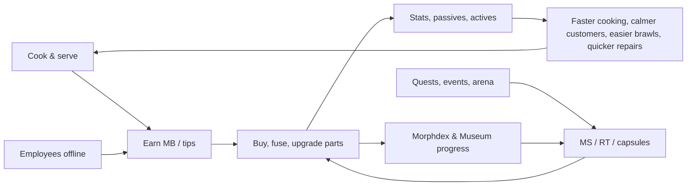

## 12. Mutation System

The Mutation System turns money into a stranger, stronger body. It owns the **280 mutation parts** (database in §36.3),
the 22 anatomy slots and their compatibility rules, the way parts are bolted onto Roblox R15 rigs, rarities and
acquisition, upgrades, the procedural generator that dresses every customer, employee and NPC, and the balance caps that
keep it all fair. Morph combinations and synergy rules continue in §12.9–§12.10 (synergy rows in §36.4, combination
examples in §36.5); the Morph customization screen is §13; abilities are §36.6 and status effects §36.7. Runtime owners:
`MutationService` (ownership, equip rules, stats, upgrades, fusion, capsules) and `MorphAssemblyService` (building morph
models) — interfaces in §27, persistence in §28.

### 12.1 Overview

**Purpose.** The restaurant is how players earn; mutations are what they want to spend it on. A restaurant has a finite
list of meaningful upgrades, but the slot system below produces more than 10^25 distinct loadouts from 280 authored parts
(§12.7). Every part does something useful in the kitchen, the dining room, a brawl or a repair job, so the core loop the
Creative Director asked for is mechanically true: **Cook → Earn → Morph → Become More Powerful → Run a Better Restaurant
→ Earn More → Discover Rarer Morphs**, while employees keep earning (and occasionally finding capsules, §17) offline.

**What a part does.** Every part is defined by the same five layers, so code never special-cases an individual part:

| Layer | Rule | Example (`MUT_031` Dragon Head) |
|---|---|---|
| Stats | Points in the nine player stats (§14), budget `round(BaseBudget[rarity] × SlotWeight)` at Lv1, +12 % of that per upgrade level; capped per stat (§12.8) | COOK_SPD +5, COOK_QLT +2, STR +7, LUCK +2 (Epic, major slot = 16) |
| Passive | Exactly one per part, mapped to one of 48 engineering keys with a combined cap (§12.8) | *Furnace Breath:* heat stations −12 % process time, burn delay −0.5 s |
| Active | At most one per part (62 parts have one); up to 4 on the ability bar; NPC-tuned versions for customers (§36.6) | `ABL_018` Dragon Breath |
| Synergy hooks | Family, category, slot and tags; synergies match these, never single IDs (§12.10, §36.4) | family `dragon`; tags fire, fighter, chef |
| Rig & look | Attachment, LOD meshes, compatibility flags, procedural motion (§12.2–§12.3) | jaw Motor6D for the breath clip; 1,350 tris Hi / 540 NPC |

**A morph-centric economy.** Canon pacing (§22) sends about half of all income to tiers and expansion and half to
mutations, furniture, staff and upgrades. Mutation prices are set so that, at every tier, the *next* rarity costs a few
hours of active play and the *current* rarity's upgrades cost a few more — there is always a morph goal one session away:

| Tier on entry | Net MB / active h | Typical next purchase | Active hours | Mutation upgrade goal | Active hours |
|---|---|---|---|---|---|
| `TIER_01` (Lv1) | 630 | Common major part (330–400 MB) | 0.5–0.6 | first Uncommon at Lv5 (1,040–2,000 MB) | 1.7–3.2 |
| `TIER_03` (Lv10) | 1,730 | Uncommon part | 0.6–1.2 | first Rare at Lv12 (5,200–10,000 MB + 20 MS) | 3.0–5.8 |
| `TIER_05` (Lv26) | 5,400 | Rare part | 1.0–1.9 | Rare Lv1 → 7 (18,703 MB) or first Epic | 3.5 / 5.9–11.1 |
| `TIER_07` (Lv45) | 17,400 | Epic part | 1.8–3.4 | Epic Lv1 → 8 (96,516 MB) or first Legendary | 5.5 / 11.5–23 |
| `TIER_09` (Lv68) | 63,700 | Legendary part | 3.1–6.3 | Legendary Lv1 → 9 (492,578 MB) | 7.7 |
| `TIER_10` (Lv80) | 120,500 | Mythic fusion inputs | — | Mythic Lv1 → 10 (2,246,602 MB) | 18.6 |

**Collection meta — the Morphdex.** Every part has a Morphdex entry with four states: **Unknown** (silhouette) →
**Seen** (name, sources and odds revealed) → **Owned** → **Mastered** (max level). *Seen* is granted server-side when you
serve a customer wearing the part, hire or interview an employee wearing it, talk to a named NPC whose morph uses it,
or use *Inspect* on another player — so watching the weird customers in your own dining room is how you learn what to
chase next. Collection milestones pay out only in canon reward types:

| Milestone (distinct parts owned) | Reward |
|---|---|
| 10 | 1 Morph Capsule |
| 25 | `MUT_272` Sparkle Aura |
| 50 | `MUT_277` Orbiting Meatballs |
| 75 | 2 Morph Capsules + 150 MS |
| 100 | the Morph Museum's "Empty Exhibit" becomes inspectable (the `MUT_048` condition) + title "Morphologist" |
| 150 | `MUT_279` Tiny Moons |
| 200 | `MUT_258` Golden Skin |
| 250 | 10 RT + title "Mostly Mutant" |
| 273 (every non-Secret part) | cosmetic palette "Prismatic" + title "Morphologist Supreme" |
| Each category complete (16) | 3 Morph Capsules + that category's cosmetic palette |
| 10 / 50 parts Mastered | 300 MS / 5 RT |

The **Morph Museum** (`BLD_16`, curator `NPC_018`) displays every part you own on rotating mannequins grouped by
category, shows your featured morph to visiting players, and hosts the Empty Exhibit. §14 may mirror these milestones as
achievements in §36.16; the rewards above are granted once, whichever system fires first.

**UI.** All interaction happens in the Morph screen (§13): slot groups, inventory, stat preview with MAXED markers,
upgrade and fusion buttons, Morphdex tab and the always-visible capsule odds panel.

**Dependencies.** §14 stats and levels · §10 satisfaction (MutationBonus cap) · §11 and §36.6 combat and actives · §15
furniture repair states · §16 employees (generated morphs) · §18 shops and Lab · §22 economy · §23 cosmetics-only
monetization · §27 services · §28 profile schema · §30 performance budgets.

### 12.2 Anatomy Slots and Compatibility

**Rules & Mechanics.** A morph is a map from the 22 anatomy slots to part IDs. Ownership is per part ID: one owned copy
can fill both slots of a pair (a part is a blueprint, not a limb), and upgrading it upgrades both sides. **Core slots**
(HEAD, TORSO, ARM_L, ARM_R, LEG_L, LEG_R) are never empty: unequipping a torso, arm or leg reverts it to the
always-owned Plain Human part (`MUT_117`, `MUT_139`, `MUT_179`); a HEAD can only be swapped. All other slots may be empty.

| Slot | UI group | Part code (parts) | Slot weight | Host rig part → attachment | Rules and constraints |
|---|---|---|---|---|---|
| HEAD | Head | HEAD (40) | 1.0 | Head → `MMR_HeadCore` | core, swap-only; 5 faceLocked heads; each head ships optional built-in eyes/nose/mouth/ears submeshes shown only while that sub-slot is empty |
| FACE | Head | FACE (8) | 0.5 | Head → `MMR_FaceFront` | hidden by faceLocked heads; `MUT_044` hides EYES, `MUT_048` hides NOSE/MOUTH/EYES |
| NOSE | Head | NOSE (10) | 0.5 | Head → `MMR_Nose` | replaces the head's built-in nose |
| MOUTH | Head | MOUTH (12) | 0.5 | Head → `MMR_Mouth` | replaces the built-in mouth; jaw parts carry Motor6D `MMR_Jaw` |
| EYES | Eyes | EYES (14) | 0.5 | Head → `MMR_Eyes` | drives facial expressions (texture swaps); hidden by faceLocked heads |
| EARS | Ears | EARS (12) | 0.5 | Head → `MMR_EarL`, `MMR_EarR` | always visible, even on a TV head (bunny ears become antennae) |
| HORNS | Ears | HORNS (12) | 0.5 | Head → `MMR_HeadTop` | added height counts toward the morph height clamp |
| NECK | Extras | NECK (8) | 0.5 | UpperTorso → `MMR_Neck` | `NeckLength` 0–2.5 studs raises the head via the Neck joint |
| TORSO | Extras | TORSO (22) | 1.0 | UpperTorso, LowerTorso → `MMR_TorsoCore`, `MMR_Hips` | core; shells and plates push BACK parts outward 0.25–0.5 stud |
| ARM_L | Arms | ARM (30) | 1.0 | LeftUpperArm, LeftLowerArm, LeftHand → `MMR_ArmL_Upper/Lower/Hand` | core; 19 handsLocked arms; matched pair +25 % stats |
| ARM_R | Arms | ARM (30) | 1.0 | right side, mirrored assets | as ARM_L |
| HANDS | Arms | HANDS (10) | 0.5 | LeftHand, RightHand → `MMR_HandL`, `MMR_HandR` | one part covers both hands; hidden on any handsLocked side |
| LEG_L | Legs | LEG (22) | 0.5 | LeftUpperLeg, LeftLowerLeg → `MMR_LegL_Upper/Lower` | core; `LegLength` 1.4–3.0 sets HipHeight; matched pair +25 % |
| LEG_R | Legs | LEG (22) | 0.5 | right side, mirrored assets | mismatched legs play `ANM_008` Wobbly gait (no penalty) |
| FEET | Legs | FEET (10) | 0.5 | LeftFoot, RightFoot → `MMR_FootL`, `MMR_FootR` | hidden on footless legs (`MUT_183`, `MUT_191`, `MUT_192`, `MUT_195`, `MUT_197`) |
| TAIL | Tails | TAIL (20) | 1.0 | LowerTorso → `MMR_TailBase` | spring-chain motion; counts toward the huge-part limit |
| WINGS | Extras | WINGS (12) | 1.0 | UpperTorso → `MMR_WingL`, `MMR_WingR` | cannot coexist with a blocksWings BACK part; no sustained flight |
| BACK | Extras | BACK (10) | 1.0 | UpperTorso → `MMR_Back` | 5 parts are blocksWings |
| SKIN | Extras | SKIN (6) | 0.5 | all organic visual parts (surface) | base surface; always stays under FUR/SCALES and keeps its stats |
| FUR | Extras | FUR (6) | 0.5 | surface + ≤ 3 shell meshes (Hi LOD) | **FUR ⊕ SCALES** (mutually exclusive) |
| SCALES | Extras | SCALES (6) | 0.5 | surface | **FUR ⊕ SCALES** |
| FX | Extras | FX (10) | 0.0 | HumanoidRootPart → `MMR_FXRoot` | emitters/trails only; flavor passive, no stats |

**Compatibility flags.** The golden rule is **hidden ≠ disabled**: visual rules never delete stats, passives or actives.
Only two rules are mechanical exclusions (marked ✱).

| Flag | Parts | Effect |
|---|---|---|
| faceLocked | `MUT_018`, `MUT_021`, `MUT_022`, `MUT_036`, `MUT_040` | FACE, NOSE, MOUTH and EYES meshes are not built; the head shows a **screen-emote** (8–12 decal expressions driven by the same emotion state as faces, plus pixel icons of the equipped EYES/MOUTH). Hidden parts keep their stats and passives; their ability VFX spawn from the screen. The NPC generator never fills face slots under these heads. |
| hides | `MUT_044` (EYES), `MUT_048` (NOSE, MOUTH, EYES), footless legs (FEET on that side) | Same visual-only rule. |
| handsLocked | 19 arms: `MUT_141`, `MUT_144`–`MUT_146`, `MUT_150`–`MUT_159`, `MUT_163`–`MUT_167` | The HANDS mesh on that side is not built; the arm supplies its own `MMR_Grip` attachment for plates, trays and the pan/tray utensils (`ABL_007`, `ABL_008`). |
| ✱ blocksWings | `MUT_244`, `MUT_245`, `MUT_246`, `MUT_249`, `MUT_251` | Cannot be worn with any WINGS part. Equipping one prompts "Swap out your wings?"; the server rejects loadouts containing both (`CONFLICT_WINGS`). Capes (`MUT_252`) and spines do not block. |
| ✱ FUR ⊕ SCALES | all FUR and SCALES parts | One covering at a time (`CONFLICT_COVERING`); SKIN stays underneath. |
| Size class | huge: 18 parts (e.g. `MUT_032`, `MUT_135`, `MUT_238`); tiny: `MUT_161`, `MUT_213`, `MUT_231` | At most **2 huge** parts render huge; a third renders at ×0.7 scale with the toast "Squished to fit!". Size never changes collision. |
| Length & height | NECK `NeckLength`, LEG `LegLength`, HORNS height | Morph height (sole to top) ≤ **9.5 studs** so every door works: NeckLength compresses first, then HORNS sink up to 0.5 stud. |
| Matched pair | identical part in ARM_L+ARM_R or LEG_L+LEG_R | +25 % to that pair's stats; the part's active gains its paired bonus (§36.6); its passive still applies once. |

Morph visuals **never** change collision, hitboxes or interaction origins: the R15 base rig keeps its standard
HumanoidRootPart and limb sizes, which keeps combat fair (§11) and pathfinding stable (§8). Customers, employees and NPCs
use the same rules through the same shared `MorphRules` module (§12.7).

**Variables [TUNABLE].** `MAX_MORPH_HEIGHT = 9.5` studs · `HUGE_LIMIT = 2` · `HUGE_OVERFLOW_SCALE = 0.7` ·
`TINY_SCALE` authored into the mesh (≈ 0.6 of slot volume) · `PAIR_BONUS = 0.25` · `LEG_LENGTH ∈ [1.4, 3.0]` ·
`NECK_LENGTH ∈ [0, 2.5]` · `HORN_SINK_MAX = 0.5` stud.
