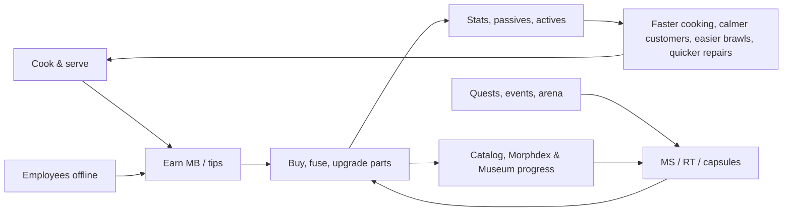

## 12. Mutation System

The Mutation System turns money into a stranger, stronger body. It owns the **280 mutation parts** (database in §36.3),
the 22 anatomy slots and their compatibility rules, the way parts are bolted onto Roblox R15 rigs, rarities and
acquisition, upgrades, the procedural generator that dresses every customer, employee and NPC, and the balance caps that
keep it all fair. Morph combinations and synergy rules continue in §12.9–§12.10 (synergy rows in §36.4, combination
examples in §36.5); the Morph customization screen is §13; abilities are §36.6 and status effects §36.7. Runtime owners:
`MutationService` (ownership, equip rules, stats, upgrades, fusion, capsules) and `MorphAssemblyService` (building morph
models) — interfaces in §27, persistence in §28.

### 12.1 Overview

**Purpose.** The restaurant is how players earn; mutations are what they want to spend it on. A restaurant has a finite
list of meaningful upgrades, but the slot system below produces more than 2 × 10^24 distinct loadouts from 280 authored parts
(§12.7). Every part does something useful in the kitchen, the dining room, a brawl or a repair job, so the core loop the
Creative Director asked for is mechanically true: **Cook → Earn → Morph → Become More Powerful → Run a Better Restaurant
→ Earn More → Discover Rarer Morphs**, while employees keep earning (and occasionally finding capsules, §17) offline.

**What a part does.** Every part is defined by the same five layers, so code never special-cases an individual part:

| Layer | Rule | Example (`MUT_031` Dragon Head) |
|---|---|---|
| Stats | Points in the nine player stats (§14), budget `round(BaseBudget[rarity] × SlotWeight)` at Lv1, +12 % of that per upgrade level; capped per stat (§12.8) | COOK_SPD +5, COOK_QLT +2, STR +7, LUCK +2 (Epic, major slot = 16) |
| Passive | Exactly one per part, mapped to one of 48 engineering keys with a combined cap (§12.8) | *Furnace Breath:* heat stations −12 % process time, burn delay −0.5 s |
| Active | At most one per part (62 parts have one); up to 4 on the ability bar; NPC-tuned versions for customers (§36.6) | `ABL_018` Dragon Breath |
| Synergy hooks | Family, category, slot and tags; synergies match these, never single IDs (§12.10, §36.4) | family `dragon`; tags fire, fighter, chef |
| Rig & look | Attachment, LOD meshes, compatibility flags, procedural motion (§12.2–§12.3) | jaw Motor6D for the breath clip; 1,350 tris Hi / 540 NPC |

**A morph-centric economy.** Canon pacing (§22) sends about half of all income to tiers and expansion and half to
mutations, furniture, staff and upgrades. Mutation prices are set so that, at every tier, the *next* rarity costs a few
hours of active play and the *current* rarity's upgrades cost a few more — there is always a morph goal one session away:

| Tier on entry | Net MB / active h | Typical next purchase | Active hours | Mutation upgrade goal | Active hours |
|---|---|---|---|---|---|
| `TIER_01` (Lv1) | 630 | Common major part (330–400 MB) | 0.5–0.6 | first Uncommon at Lv5 (1,040–2,000 MB) | 1.7–3.2 |
| `TIER_03` (Lv10) | 1,730 | Uncommon part | 0.6–1.2 | first Rare at Lv12 (5,200–10,000 MB + 20 MS) | 3.0–5.8 |
| `TIER_05` (Lv26) | 5,400 | Rare part | 1.0–1.9 | Rare Lv1 → 7 (18,703 MB) or first Epic | 3.5 / 5.9–11.1 |
| `TIER_07` (Lv45) | 17,400 | Epic part | 1.8–3.4 | Epic Lv1 → 8 (96,516 MB) or first Legendary | 5.5 / 11.5–23 |
| `TIER_09` (Lv68) | 63,700 | Legendary part | 3.1–6.3 | Legendary Lv1 → 9 (492,578 MB) | 7.7 |
| `TIER_10` (Lv80) | 120,500 | Mythic fusion inputs | — | Mythic Lv1 → 10 (2,246,602 MB) | 18.6 |



**Collection meta — the Mutation Catalog.** Every part has a Catalog entry with four states: **Unknown** (silhouette)
→ **Seen** (name, sources and odds revealed) → **Owned** → **Mastered** (max level). *Seen* is granted server-side when you
serve, fight or calm a customer wearing the part, hire or interview an employee wearing it, talk to a named NPC whose
morph uses it, or *Inspect* another player — so watching the weird customers in your own dining room is how you learn
what to chase next. (The combination-level **Morphdex** of head-family × dominant-family keys, with its own Museum
rewards, is §12.9.4; the Catalog tracks individual parts.) Catalog milestones pay out only in canon reward types and
deliberately skip the 10- and 50-part thresholds that §14's achievements already reward, so nothing pays twice:

| Catalog milestone (distinct parts owned) | Reward |
|---|---|
| 25 | `MUT_272` Sparkle Aura |
| 75 | `MUT_277` Orbiting Meatballs |
| 100 | the Morph Museum's "Empty Exhibit" becomes inspectable (the `MUT_048` condition) + title "Morphologist" |
| 150 | `MUT_279` Tiny Moons |
| 200 | `MUT_258` Golden Skin |
| 250 | 10 RT + title "Mostly Mutant" |
| 273 (every non-Secret part) | cosmetic palette "Prismatic" + title "Morphologist Supreme" |
| Each category complete (16) | 3 Morph Capsules + that category's cosmetic palette |
| 10 / 50 parts Mastered | 300 MS / 5 RT |

The **Morph Museum** (`BLD_16`, curator `NPC_018`) displays every part you own on rotating mannequins grouped by
category, shows your featured morph to visiting players, hosts the Empty Exhibit and pays the Morphdex rewards of §12.9.4.

**UI.** All interaction happens in the Morph screen (§13): slot groups, inventory, stat preview with MAXED markers,
upgrade and fusion buttons, the Catalog tab and the always-visible capsule odds panel.

**Dependencies.** §14 stats and levels · §10 satisfaction (MutationBonus cap) · §11 and §36.6 combat and actives · §15
furniture repair states · §16 employees (generated morphs) · §18 shops and Lab · §22 economy · §23 cosmetics-only
monetization · §27 services · §28 profile schema · §30 performance budgets.

### 12.2 Anatomy Slots and Compatibility

**Rules & Mechanics.** A morph is a map from the 22 anatomy slots to part IDs. Ownership is per part ID: one owned copy
can fill both slots of a pair (a part is a blueprint, not a limb), and upgrading it upgrades both sides. **Core slots**
(HEAD, TORSO, ARM_L, ARM_R, LEG_L, LEG_R) are never empty: unequipping a torso, arm or leg reverts it to the
always-owned Plain Human part (`MUT_117`, `MUT_139`, `MUT_179`); a HEAD can only be swapped. All other slots may be empty.

| Slot | UI group | Part code (parts) | Slot weight | Host rig part → attachment | Rules and constraints |
|---|---|---|---|---|---|
| HEAD | Head | HEAD (40) | 1.0 | Head → `MMR_HeadCore` | core, swap-only; 5 faceLocked heads; each head ships optional built-in eyes/nose/mouth/ears submeshes shown only while that sub-slot is empty |
| FACE | Head | FACE (8) | 0.5 | Head → `MMR_FaceFront` | hidden by faceLocked heads; `MUT_044` hides EYES, `MUT_048` hides NOSE/MOUTH/EYES |
| NOSE | Head | NOSE (10) | 0.5 | Head → `MMR_Nose` | replaces the head's built-in nose |
| MOUTH | Head | MOUTH (12) | 0.5 | Head → `MMR_Mouth` | replaces the built-in mouth; jaw parts carry Motor6D `MMR_Jaw` |
| EYES | Eyes | EYES (14) | 0.5 | Head → `MMR_Eyes` | drives facial expressions (texture swaps); hidden by faceLocked heads |
| EARS | Ears | EARS (12) | 0.5 | Head → `MMR_EarL`, `MMR_EarR` | always visible, even on a TV head (bunny ears become antennae) |
| HORNS | Ears | HORNS (12) | 0.5 | Head → `MMR_HeadTop` | added height counts toward the morph height clamp |
| NECK | Extras | NECK (8) | 0.5 | UpperTorso → `MMR_Neck` | `NeckLength` 0–2.5 studs raises the head via the Neck joint |
| TORSO | Extras | TORSO (22) | 1.0 | UpperTorso, LowerTorso → `MMR_TorsoCore`, `MMR_Hips` | core; shells and plates push BACK parts outward 0.25–0.5 stud |
| ARM_L | Arms | ARM (30) | 1.0 | LeftUpperArm, LeftLowerArm, LeftHand → `MMR_ArmL_Upper/Lower/Hand` | core; 19 handsLocked arms; matched pair +25 % stats |
| ARM_R | Arms | ARM (30) | 1.0 | right side, mirrored assets | as ARM_L |
| HANDS | Arms | HANDS (10) | 0.5 | LeftHand, RightHand → `MMR_HandL`, `MMR_HandR` | one part covers both hands; hidden on any handsLocked side |
| LEG_L | Legs | LEG (22) | 0.5 | LeftUpperLeg, LeftLowerLeg → `MMR_LegL_Upper/Lower` | core; `LegLength` 1.4–3.0 sets HipHeight; matched pair +25 % |
| LEG_R | Legs | LEG (22) | 0.5 | right side, mirrored assets | mismatched legs play `ANM_008` Wobbly gait (no penalty) |
| FEET | Legs | FEET (10) | 0.5 | LeftFoot, RightFoot → `MMR_FootL`, `MMR_FootR` | hidden on footless legs (`MUT_183`, `MUT_191`, `MUT_192`, `MUT_195`, `MUT_197`) |
| TAIL | Tails | TAIL (20) | 1.0 | LowerTorso → `MMR_TailBase` | spring-chain motion; counts toward the huge-part limit |
| WINGS | Extras | WINGS (12) | 1.0 | UpperTorso → `MMR_WingL`, `MMR_WingR` | cannot coexist with a blocksWings BACK part; no sustained flight |
| BACK | Extras | BACK (10) | 1.0 | UpperTorso → `MMR_Back` | 5 parts are blocksWings |
| SKIN | Extras | SKIN (6) | 0.5 | all organic visual parts (surface) | base surface; always stays under FUR/SCALES and keeps its stats |
| FUR | Extras | FUR (6) | 0.5 | surface + ≤ 3 shell meshes (Hi LOD) | **FUR ⊕ SCALES** (mutually exclusive) |
| SCALES | Extras | SCALES (6) | 0.5 | surface | **FUR ⊕ SCALES** |
| FX | Extras | FX (10) | 0.0 | HumanoidRootPart → `MMR_FXRoot` | emitters/trails only; flavor passive, no stats |

**Compatibility flags.** The golden rule is **hidden ≠ disabled**: visual rules never delete stats, passives or actives.
Only two rules are mechanical exclusions (marked ✱).

| Flag | Parts | Effect |
|---|---|---|
| faceLocked | `MUT_018`, `MUT_021`, `MUT_022`, `MUT_036`, `MUT_040` | FACE, NOSE, MOUTH and EYES meshes are not built; the head shows a **screen-emote** (8–12 decal expressions driven by the same emotion state as faces, plus pixel icons of the equipped EYES/MOUTH). Hidden parts keep their stats and passives; their ability VFX spawn from the screen. The NPC generator never fills face slots under these heads. |
| hides | `MUT_044` (EYES), `MUT_048` (NOSE, MOUTH, EYES), footless legs (FEET on that side) | Same visual-only rule. |
| handsLocked | 19 arms: `MUT_141`, `MUT_144`–`MUT_146`, `MUT_150`–`MUT_159`, `MUT_163`–`MUT_167` | The HANDS mesh on that side is not built; the arm supplies its own `MMR_Grip` attachment for plates, trays and the pan/tray utensils (`ABL_007`, `ABL_008`). |
| ✱ blocksWings | `MUT_244`, `MUT_245`, `MUT_246`, `MUT_249`, `MUT_251` | Cannot be worn with any WINGS part. Equipping one prompts "Swap out your wings?"; the server rejects loadouts containing both (`CONFLICT_WINGS`). Capes (`MUT_252`) and spines do not block. |
| ✱ FUR ⊕ SCALES | all FUR and SCALES parts | One covering at a time (`CONFLICT_COVERING`); SKIN stays underneath. |
| Size class | huge: 17 parts (e.g. `MUT_032`, `MUT_135`, `MUT_238`); tiny: `MUT_161`, `MUT_213`, `MUT_231` | At most **2 huge** parts render huge; a third renders at ×0.7 scale with the toast "Squished to fit!". Size never changes collision. |
| Length & height | NECK `NeckLength`, LEG `LegLength`, HORNS height | Morph height (sole to top) ≤ **9.5 studs** so every door works: NeckLength compresses first, then HORNS sink up to 0.5 stud. |
| Matched pair | identical part in ARM_L+ARM_R or LEG_L+LEG_R | +25 % to that pair's stats; the part's active gains its paired bonus (§36.6); its passive still applies once. |

Morph visuals **never** change collision, hitboxes or interaction origins: the R15 base rig keeps its standard
HumanoidRootPart and limb sizes, which keeps combat fair (§11) and pathfinding stable (§8). Customers, employees and NPCs
use the same rules through the same shared `MorphRules` module (§12.7).

**Variables [TUNABLE].** `MAX_MORPH_HEIGHT = 9.5` studs · `HUGE_LIMIT = 2` · `HUGE_OVERFLOW_SCALE = 0.7` ·
`TINY_SCALE` authored into the mesh (≈ 0.6 of slot volume) · `PAIR_BONUS = 0.25` · `LEG_LENGTH ∈ [1.4, 3.0]` ·
`NECK_LENGTH ∈ [0, 2.5]` · `HORN_SINK_MAX = 0.5` stud.

### 12.3 Attaching Parts to Roblox R15 Rigs

**Purpose.** One assembly path builds every body in the game — players, customers, employees, named NPCs — from a part
list, on any device, inside fixed budgets (the "skin-over-rig" contract).

**Base rig.** `StarterPlayer.StarterCharacter` is `MMR_BaseRig`: a standard R15 rig at scale 1.0 (5.5 studs tall),
`Humanoid.AutomaticScalingEnabled = false`, default body MeshParts kept for joints and hit tests but set to
`Transparency = 1`, Roblox avatar accessories and HumanoidDescription not applied. `MorphAssemblyService` inserts the
canon attachments (`MMR_HeadCore` … `MMR_FXRoot`, plus `MMR_Grip` in each hand) once, and stores every leg/neck
Motor6D's original `C0`/`C1` as CFrame attributes (`BaseC0`, `BaseC1`) so builds are repeatable.

**Asset format.** `ReplicatedStorage/MorphParts/<SLOT>/<PartId>` (e.g. `MorphParts/HEAD/MUT_031`) is a Model with LOD folders `Hi` (players) and
`Lo` (customers/employees within 60 studs); HEAD parts add an `L2` folder with a ≤ 300-triangle head silhouette that is
combined with the pre-baked body-plan impostor beyond 60 studs (§30.13). Each MeshPart has a child Attachment `Mount` and attributes `Host` (canon attachment name),
`Side` (`L`/`R`/nil — Roblox cannot mirror meshes at runtime, so paired parts ship authored L and R meshes), `Tris`,
optional `JointName` (animatable sub-part) and `MMR_Skin = true` on organic surfaces. Model attributes mirror the JSON:
`Slot`, `LegLength`, `NeckLength`, `SizeClass`, `FaceLocked`, `HandsLocked`, `Hides`, `BlocksWings`, `Motion`. Parts are
authored on a 0.25-stud grid at R15 standard scale, textures ≤ 512² (§30.13), imported with `CollisionFidelity = Box`
(not settable at runtime); organic surfaces use uniform texel density so tiling covering materials line up across parts. The generated `MutationDefs` module (from `gdd/data/mutations.json`) is the only place
code reads part data.

**Assembly algorithm** (`MorphAssemblyService.Build(rig, loadout, opts)`; identical shared code builds NPC visuals on clients):

1. **Resolve** the loadout through `MorphRules.Resolve`: validate slots and exclusions, compute the visibility set
   (faceLocked, hides, handsLocked), apply the huge-part limit and the 9.5-stud height clamp, and produce a build order:
   TORSO → LEG_L/R → NECK → HEAD → EYES/MOUTH/NOSE/FACE → EARS/HORNS → ARM_L/R → HANDS → FEET → TAIL → BACK → WINGS → FX.
   The order doubles as trim priority.
2. **Release** the previous `MMR_Visual` folder (players: destroy; NPC visuals: return MeshParts to a per-part, per-LOD pool).
3. **Clone** each visible MeshPart of the chosen LOD (and matching `Side`) and set `Anchored = false`, `Massless = true`,
   `CanCollide = false`, `CanTouch = false`, `CanQuery = false`, `CastShadow = (lod == "Hi")`, `CollisionGroup = "MMR_Visual"`.
4. **Align & join**: `part.CFrame = host.WorldCFrame * mount.CFrame:Inverse()`; join with a `WeldConstraint` (Part0 =
   host's rig part), or — if the mesh has `JointName` — rename the part to that joint name and join it with a `Motor6D`
   (`C0 = host.CFrame`, `C1 = mount.CFrame`) so animation poses named `MMR_Jaw`, `MMR_TailTip`, `MMR_WingL` … can drive it.
5. **Legs**: scale the Y offsets of Hip/Knee/Ankle `C0`/`C1` by `LegLength / 2.0` per side; set
   `Humanoid.HipHeight = BASE_HIP_HEIGHT + (max(LegLength_L, LegLength_R) − 2.0)`; the shorter leg of a mismatched pair
   dangles and the client plays `ANM_008`. Reversed-knee legs flip the Knee `C0` rotation.
6. **Neck**: `Neck.C0 = BaseC0 * CFrame.new(0, NeckLength_clamped, 0)`; the neck mesh spans the gap; long necks are bone chains.
7. **Surface pass**: on every MeshPart with `MMR_Skin`, SKIN sets `Color` and `Material`/`MaterialVariant`; FUR or SCALES
   then override the `MaterialVariant` (e.g. `MMR_Fur_Shaggy`, `MMR_Scales_Dragon`; 18 variants total in MaterialService);
   FUR adds ≤ 3 alpha shell meshes on Hi LOD only. On LOW/MID graphics and on NPC visuals the covering falls back to
   `Color` + base `Material` over the category atlas (§30.13). Object/robot parts use SurfaceAppearance and are never
   furred ("toasters don't grow fur"); only `MUT_258` tints them through `SurfaceAppearance.Color`.
8. **Palette pass**: primary color → `MeshPart.Color` under SurfaceAppearance `AlphaMode = Overlay` regions and skin;
   secondary/accent → texture-variant index (4 variants per part).
9. **FX**: clone emitters/trails under `MMR_FXRoot`; `Rate × QualityFactor`, ×0.5 under "Reduced Effects"; NPC Lo FX at
   ×0.5 within 40 studs, off beyond; FX never parented to body skin (cartoon flames orbit, never burn).
10. **Motion registration**: tag spring Bones `MMR_Spring` and flap/rotor parts `MMR_Motion` via CollectionService.
11. **Budget check**: count MeshParts and `Tris`; anything over budget is skipped in reverse build order and logged
    (`mmr_morph_budget_trim`). Set `MMR_MorphCode` and `MMR_BuildVersion` attributes, fire `MorphBuilt`.

| Joint type | Used for | Why |
|---|---|---|
| `WeldConstraint` | rigid visual mounts (most parts) | cheapest; keeps the aligned offset; no animation |
| `Motor6D` (named per asset) | jaws, pincers, scythe folds, tail tips, wing roots, fans, lids | driven by ability/emote clips (§36.14) through the Animator |
| Skinned MeshPart + `Bone` chain | tails, tentacles, trunks, long necks, cloth capes, hoses | procedural client motion; no network cost |
| none (surface swap) | SKIN, FUR, SCALES | `Color` + `MaterialVariant` only |

**Who builds what.** Player characters are built **on the server** (welds replicate; all clients see the same body; the
hit rig is unchanged). Customers, employees and named NPCs follow SPCV: the server owns an anchored, invisible proxy with
the attribute `MMR_MorphCode`, and **each client's `MorphVisualController` builds the visual locally** (≤ 1 build per
frame, ≤ 2 ms each, pooled MeshParts) for proxies in its interior or within 120 studs. Beyond 60 studs a visual becomes
its body-plan impostor (biped, tall-neck, winged, tentacle-leg … — `MorphRules` derives the class from the flags) tinted
with the morph's three dominant colors plus the head's `L2` silhouette; beyond 120 studs it is culled (§30). After a rebuild, the client re-loads ability animation tracks so new Motor6Ds bind.

**Procedural secondary motion (client only).** `SecondaryMotionController` simulates tagged Bone chains with damped
springs (stiffness/damping per part attribute): player characters at 30 Hz within 40 studs and 15 Hz to 80 studs; NPC
chains only within 30 studs (beyond that NPCs play primary tracks only, §30); at most 40 chains per client, nearest
first; your own character is always simulated. Wings idle-flutter procedurally and flap through
Motor6D clips; ears and antennae use 1–2-bone springs; prehensile tails and tentacles lerp bone angles toward
`MMR_Grip` targets to "hold" carried items. The server never simulates cosmetic motion.

**Budgets** (per part; totals equal the canon limits — player ≤ 40 MeshParts / 15,000 tris, NPC ≤ 24 / 6,000, impostor ≤ 1,500):

| Slot | Max MP (player) | Hi tris | NPC Lo tris |
|---|---|---|---|
| HEAD (incl. built-in features) | 3 | 1,500 | 600 (+ `L2` silhouette ≤ 300) |
| FACE / NOSE / MOUTH / EYES | 1 / 1 / 1 / 2 | 300 / 250 / 350 / 300 | 100 / 80 / 120 / 100 |
| EARS / HORNS / NECK | 2 / 2 / 1 | 400 / 400 / 500 | 150 / 150 / 180 |
| TORSO | 2 | 2,000 | 800 |
| ARM (each side) | 3 | 1,100 | 400 |
| HANDS (pair) / FEET (pair) | 2 / 2 | 600 / 500 | 150 / 150 |
| LEG (each side) | 2 | 1,000 | 350 |
| TAIL / WINGS (pair) / BACK | 1 / 2 / 3 | 900 / 1,200 / 900 | 350 / 450 / 320 |
| FUR or SCALES shells | 3 | 500 | 0 (material only) |
| FX | 1 | 200 | 0 |
| **Full 22-slot total** | **39** (+1 for a held utensil) | **15,000** | **5,200**; impostor = body plan ≤ 1,200 + head ≤ 300 |

NPC Lo assets merge paired meshes that share a host (eyes, ears, horns, wings) into one MeshPart, so a fully filled NPC
needs exactly 24; the generator's fill rates (§12.7) average 14–16 per NPC.

```lua
--!strict
-- ReplicatedStorage/Shared/MorphBuilder (used by MorphAssemblyService on the server and the NPC visual builder on clients)
local ReplicatedStorage = game:GetService("ReplicatedStorage")
local CollectionService = game:GetService("CollectionService")
local MorphRules = require(ReplicatedStorage.Shared.MorphRules)
local PartLib = ReplicatedStorage:WaitForChild("MorphParts")

export type BuildOpts = { lod: "Hi" | "Lo" | "L2", pool: any? }
local BASE_HIP_HEIGHT = 2.0 -- MMR_BaseRig at LegLength 2.0 [TUNABLE]
local BUDGET = { Hi = { mp = 40, tris = 15000 }, Lo = { mp = 24, tris = 6000 }, L2 = { mp = 2, tris = 1500 } }

local MorphBuilder = {}

local function hostOf(rig: Model, name: string): Attachment
	local a = rig:FindFirstChild(name, true)
	assert(a ~= nil and a:IsA("Attachment"), "rig is missing attachment " .. name)
	return a
end

local function mount(rig: Model, visual: Folder, src: MeshPart, opts: BuildOpts): MeshPart
	local part = if opts.pool then opts.pool:Take(src) else src:Clone()
	part.Anchored, part.Massless = false, true
	part.CanCollide, part.CanTouch, part.CanQuery = false, false, false
	part.CastShadow = opts.lod == "Hi"
	part.CollisionGroup = "MMR_Visual"
	local m = part:FindFirstChild("Mount") :: Attachment
	local host = hostOf(rig, part:GetAttribute("Host") :: string)
	local hostPart = host.Parent :: BasePart
	part.CFrame = host.WorldCFrame * m.CFrame:Inverse()
	local jointName = part:GetAttribute("JointName") :: string?
	if jointName then
		part.Name = jointName -- animation poses address the Part1 name
		local j = Instance.new("Motor6D")
		j.Name, j.Part0, j.Part1, j.C0, j.C1 = jointName, hostPart, part, host.CFrame, m.CFrame
		j.Parent = part
	else
		local w = Instance.new("WeldConstraint")
		w.Part0, w.Part1 = hostPart, part
		w.Parent = part
	end
	part.Parent = visual
	return part
end

local function scaleJointY(joint: Motor6D, k: number)
	local c0, c1 = joint:GetAttribute("BaseC0") :: CFrame, joint:GetAttribute("BaseC1") :: CFrame
	joint.C0 = CFrame.new(c0.X, c0.Y * k, c0.Z) * c0.Rotation
	joint.C1 = CFrame.new(c1.X, c1.Y * k, c1.Z) * c1.Rotation
end

function MorphBuilder.Build(rig: Model, loadout: { [string]: string }, opts: BuildOpts)
	local hum = rig:FindFirstChildOfClass("Humanoid") :: Humanoid
	local plan = MorphRules.Resolve(loadout) -- validated, visibility + clamps applied, ordered by trim priority
	local old = rig:FindFirstChild("MMR_Visual")
	if old then MorphBuilder.Release(old, opts) end
	local visual = Instance.new("Folder")
	visual.Name = "MMR_Visual"
	local mp, tris, budget = 0, 0, BUDGET[opts.lod]
	if opts.lod == "L2" then -- body-plan impostor (≤ 1,200 tris, §30.13); only the HEAD contributes an L2 mesh below
		MorphBuilder.AttachImpostor(rig, visual, plan.bodyPlan, plan.palette)
		mp, tris = 1, 1200
	end
	for _, e in plan.order do
		if not e.visible then continue end
		local lodFolder = PartLib[e.slotCode][e.id]:FindFirstChild(opts.lod)
		if not lodFolder then continue end -- only HEAD parts ship an L2 silhouette
		for _, src in lodFolder:GetChildren() do
			if not src:IsA("MeshPart") then continue end
			local side = src:GetAttribute("Side")
			if side ~= nil and side ~= e.side then continue end
			local cost = (src:GetAttribute("Tris") :: number?) or 0
			if mp + 1 > budget.mp or tris + cost > budget.tris then
				plan.trimmed += 1
				continue
			end
			local p = mount(rig, visual, src, opts)
			if e.scale ~= 1 then MorphBuilder.Rescale(p, e.scale) end
			mp += 1
			tris += cost
		end
	end
	for side, ll in { Left = plan.legLengthL, Right = plan.legLengthR } do
		for _, jn in { side .. "Hip", side .. "Knee", side .. "Ankle" } do
			local j = rig:FindFirstChild(jn, true)
			if j and j:IsA("Motor6D") then scaleJointY(j, ll / 2.0) end
		end
	end
	hum.HipHeight = BASE_HIP_HEIGHT + (math.max(plan.legLengthL, plan.legLengthR) - 2.0)
	local neck = rig:FindFirstChild("Neck", true) :: Motor6D
	neck.C0 = (neck:GetAttribute("BaseC0") :: CFrame) * CFrame.new(0, plan.neckLength, 0)
	MorphBuilder.ApplySurface(visual, plan.skin, plan.covering, opts.lod)
	MorphBuilder.ApplyPalette(visual, plan.palette)
	MorphBuilder.AttachFX(rig, plan.fx, opts)
	for _, d in visual:GetDescendants() do
		if d:IsA("Bone") and d:GetAttribute("Spring") then CollectionService:AddTag(d, "MMR_Spring") end
	end
	visual.Parent = rig
	rig:SetAttribute("MMR_MorphCode", plan.morphCode)
	return plan
end

return MorphBuilder
```

**Edge handling inside the builder.** A missing asset (content failed to load) mounts a grey 1-stud "Loading…" placeholder
from `MorphParts/_Placeholder` and retries via `ContentProvider:PreloadAsync` after 5 s; stats are unaffected because the
server never reads visuals. Server builds are rate-limited to one per player per 0.5 s (rapid equips coalesce into the
latest loadout). A rebuild during an ability keeps the old Motor6D until the clip ends (≤ 1.5 s), then swaps.

### 12.4 The 16 Mutation Categories

Categories give art a shared visual language and give synergies (§36.4) and Lab fusion (§12.5) something to group by.
Stat leanings come from each part's tags plus a small category bias, so a FOOD arm still leans "chef".

| Category | Visual language | Stat leanings | Typical passives |
|---|---|---|---|
| MAMMAL | soft fur, round cartoon shapes, big friendly eyes | STR, DEF, CHARM | knockback resist, tips, patience, jump |
| BIRD | feathers, beaks, bright plumage, constant bobbing | MOVE, LUCK, CHARM | glide, reveal, rare-drop weight |
| REPTILE | glossy scales, frills, slit pupils, lazy blinks | DEF, MOVE | status resist, directional damage reduction |
| AMPHIBIAN | wet gloss, bulging eyes, stretchy limbs | MOVE, EFFICIENCY | jump, long-tongue reach, sticky resist |
| FISH | fins, iridescent scales, bubble eyes | MOVE, DEF (seafood COOK_QLT) | sewer swimming, soaked resist |
| INSECT | chitin plates, antennae, compound eyes, buzzing | MOVE, EFFICIENCY | dodge, action-flow speed, jump |
| ARACHNID | fuzzy multi-limbs, eight bead eyes, webs | REPAIR, EFFICIENCY, STR | sticky procs, repair speed, sticky-floor immunity |
| MARINE | tentacles, suckers, barnacles, shells | COOK_SPD, DEF, EFFICIENCY | carry, reach, seafood speed, max HP |
| DINOSAUR | chunky silhouettes, plates, frills, tiny arms | STR, DEF | knockback, thrown-damage reduction, intimidation |
| MYTHOLOGICAL | glow, gold trim, flame-shaped (never burning) feathers | LUCK, CHARM (+ fire) | revive, jackpot, auras, calm |
| ROBOT | tin plates, bolts, Neon lights, visor screens | REPAIR, EFFICIENCY | repair speed/cost, information HUDs |
| OBJECT | household objects with cartoon faces; chrome/plastic SurfaceAppearance, never furred | EFFICIENCY, REPAIR, cooking | station-specific cooking, fire safety, cleanup |
| FOOD | glossy edible-looking (no sauce drips on skin) | COOK_QLT, CHARM | dish quality, noodle speed, jackpot |
| PLANT | leaves, bark, petals, gentle sway | EFFICIENCY, DEF, CHARM | regeneration, reach, thorns |
| ALIEN | smooth grey/green skin, glow, cosmic scrolling textures | LUCK, EFFICIENCY | forecasts, beam reach, auto-clean |
| ELEMENTAL | emissive crystal, lava, storm and cloud materials | STR, COOK_SPD | status procs and immunities, temperature stations |

Part counts by category × rarity are tabulated in §36.3.2; MAMMAL (64) and OBJECT (30) are the broad "everyday" pools, while MYTHOLOGICAL and ALIEN hold most Legendary, Mythic and Secret parts.

### 12.5 Rarities and Acquisition

**Rules & Mechanics.** Rarity sets the stat budget, price, equip level, max level and sources. Rarity is always shown as
color **and** shape (§24 accessibility).

| Rarity | Parts | Equip Lv | Shop price (MB) + extra | Capsule odds | Max Lv | Sources (codes) |
|---|---|---|---|---|---|---|
| ● Common (gray) | 63 | 1 | 150–400 | 55 % | 5 | STARTER, SHOP_MART, CAPSULE, OFFLINE_FIND, EVENT |
| ▲ Uncommon (green) | 84 | 5 | 800–2,000 | 27 % | 6 | SHOP_MART, CAPSULE, QUEST (Job Board, tutorial), EVENT, ARENA, OFFLINE_FIND |
| ■ Rare (blue) | 75 | 12 | 4,000–10,000 + 20 MS | 12 % | 7 | SHOP_MART rotation, CAPSULE, QUEST, LAB_FUSION, EVENT, ARENA |
| ⬟ Epic (purple) | 36 | 25 | 25,000–60,000 + 80 MS | 4.5 % | 8 | SHOP_ROTATION, LAB_FUSION, EVENT, ARENA, CAPSULE |
| ★ Legendary (orange) | 10 | 40 | 150,000–400,000 + 250 MS + 10 RT | 1.3 % | 9 | SHOP_ROTATION weekly, LAB_FUSION, QUEST (story ch. 6–9), EVENT, CAPSULE |
| ⬢ Mythic (magenta) | 5 | 60 | not sold | 0.2 % | 10 | LAB_FUSION route, QUEST (story finale), EVENT top rewards, CAPSULE |
| ? Secret (rainbow on black) | 7 | on discovery | not sold | 0 % | 10 | SECRET conditions only (listed in §36.3) |

**Prices.** Within the canon range, `Price = Min + (Max − Min) × PriceFactor`, PriceFactor = 0.2 (minor slot), 0.7
(major slot), +0.3 if the part has an active (max 1.0), 0.0 for FX; rounded to 10 MB (Common/Uncommon), 100 (Rare), 500
(Epic), 5,000 (Legendary). Resulting price points [TUNABLE]:

<!-- BEGIN GENERATED: price-points -->
| Rarity | Canon range (MB) | Extra cost | Minor slot | Minor + active | Major slot | Major + active | FX (cosmetic) | Parts sold |
|---|---|---|---|---|---|---|---|---|
| ● Common | 150–400 | — | 200 | 280 | 330 | 400 | 150 | 63 |
| ▲ Uncommon | 800–2,000 | — | 1,040 | 1,400 | 1,640 | 2,000 | 800 | 84 |
| ■ Rare | 4,000–10,000 | 20 MS | 5,200 | 7,000 | 8,200 | 10,000 | 4,000 | 75 |
| ⬟ Epic | 25,000–60,000 | 80 MS | 32,000 | 42,500 | 49,500 | 60,000 | 25,000 | 36 |
| ★ Legendary | 150,000–400,000 | 250 MS + 10 RT | 200,000 | · | 325,000 | 400,000 | · | 10 |
| ⬢ Mythic | not sold | Lab fusion: 3 Legendary parts from one fusion route (MYTHOLOGICAL / MARINE / OBJECT routes, see §12.5) + 600 MS + 40 RT | · | · | · | · | · | 0 |
| ? Secret | not sold | hidden discovery condition | · | · | · | · | · | 0 |
<!-- END GENERATED: price-points -->

**Sources in detail.**
- **Mutation Mart** (`BLD_01`, `DST_02`; opens at `QST_TUT_010`): every Common and Uncommon whose equip level ≤ player
  level + 5 is always in stock; **Rare rotation** of 6 slots (visible from Lv10) refreshes every 4 h at 00/04/08/12/16/20 UTC.
- **Mystery Market** (`BLD_13`, `DST_09`, Lv20): 4 Epic slots refresh daily at 00:00 UTC; 1 Legendary slot weekly (Monday
  00:00 UTC). Stock is **personal** (seeded by UserId + date) and the weekly Legendary is always one you do not own while
  any remain; `EVT_024` adds 2 Epic slots. Prices never discount below the canon range.
- **Lab fusion** (`BLD_11`, `DST_06`, Lv15): 3 parts of one rarity **from the same category** + cost → **one part of the
  next rarity that you choose** from that category (falls back to next-rarity parts sharing a tag with an input when the
  category has none). Inputs must be unequipped; a last copy above Lv1 cannot be consumed. Recipes [TUNABLE]: Rare ← 3
  Uncommon + 40 MS + 1,000 MB; Epic ← 3 Rare + 150 MS + 5,000 MB; Legendary ← 3 Epic + 400 MS + 8 RT + 20,000 MB; Mythic ←
  3 Legendary + 600 MS + 40 RT (canon) via the routes below. Fusion is deterministic: no random outcome.
- **Morph Capsules** (earned only; odds printed on every capsule): rarity is rolled with the disclosed odds; the part
  is uniform within the tier with **×2 weight for parts you do not own**, ×3 for the featured parts of a running event,
  ×3 for OFFLINE_FIND parts in offline-discovery capsules. **Pity:** an Epic-or-better is guaranteed on the 40th capsule
  without one (counter persists, shown in the UI). Duplicates auto-convert to MS (§12.6) unless "Keep copies for upgrades"
  is on; copies beyond what max level needs always convert.
- **Quests / events / arena / achievements:** Job Board quests (`BLD_10`) grant Uncommons; district chains grant Rares;
  story chapters grant the Legendaries and Mythics named in §36.3; each city event features 3–8 parts on its reward track
  and in its capsule pool; Arena seasons (§21) grant fighter parts; Catalog milestones (§12.1) grant FX and `MUT_258`.
- **Tutorial & starter:** every profile starts with `MUT_117`, `MUT_139` (both arms), `MUT_179` (both legs) and one random
  starter head; `QST_TUT_010` grants one of `MUT_145` (Chef), `MUT_144` (Fighter), `MUT_153` (Repair), equippable at Lv1.

**Mythic fusion routes.** Canon requires 3 Legendary parts of the same category, but only MYTHOLOGICAL, MARINE and
OBJECT have Legendary parts, and the Mythics belong to FOOD, ALIEN and MYTHOLOGICAL. The route table resolves this; the
player chooses the output:

| Route | Inputs (any 3 copies, duplicates allowed) + 600 MS + 40 RT | Output choices |
|---|---|---|
| Mythological route | `MUT_037`, `MUT_084`, `MUT_108`, `MUT_200`, `MUT_229` | `MUT_242` Phoenix Wings or `MUT_138` Cosmic Nebula Body |
| Marine route | `MUT_038`, `MUT_137`, `MUT_165` | `MUT_070` Black Hole Mouth or `MUT_168` Cosmic Chef Arm |
| Object route | `MUT_178`, `MUT_258` | `MUT_039` Golden Burger Head |

**Progression requirements.** Mart from `QST_TUT_010`; Arena rewards from Lv12 (`DST_10`); Lab and Museum from Lv15
(`DST_06`); Mystery Market from Lv20 (`DST_09`). Parts may be *owned* below their equip level (a lucky capsule shows
"Unlocks at Lv25") and may be upgraded early, but not equipped.

**Anti-predatory rules (binding, §23).**
1. Robux never buys parts (FX included), stats, MS, RT, capsules, upgrades, fusions, pity progress, shop refreshes or
   rerolls. Robux cosmetics may only recolor parts the player already owns.
2. No paid random rewards; capsules are earned only, and their odds and pity counter are always one tap away.
3. Duplicates are always useful: upgrade copies, MS conversion, or fusion inputs.
4. No permanent exclusivity: every event, arena or achievement part stays capsule-eligible at its tier, and event parts
   return to the Mystery Market rotation within 90 days.
5. No energy, timers-to-skip or losses: KO never removes parts (§11), and absence never decays them (§17).
6. No near-miss theatrics: the capsule reveal shows the result directly and is skippable; no countdown pop-ups on shops.
7. No trading or gifting of parts (removes scam and pressure vectors); parts are profile-bound.

### 12.6 Upgrades

**Rules & Mechanics.** Upgrades happen instantly from the Morph screen (§13) anywhere outside combat, or at the Lab.
Upgrading a part from level `L` to `L + 1` costs (canon): `MB = BaseMB[r] × 1.5^(L−1)`, `MS = BaseMS[r] × L`,
`RT = RTBase[r] × (L − 3)` for Epic and above when `L ≥ 4` (Secret counts as Epic-and-above), **plus one duplicate copy**
of the part or `DupeSubstituteMS[r]`. MB results round half-up to whole MB (MS and RT are whole by construction). Secret parts never duplicate and always
pay the substitute.

- **Stat growth:** `Budget(L) = round(BaseBudget[r] × SlotWeight × (1 + 0.12 × (L − 1)))` to the nearest point (the only
  exact ties, Lv1 Uncommon/Rare minor budgets of 3.5 and 5.5, round up to 4 and 6), distributed over the part's Lv1
  stat split by largest remainder (ties in canon stat order), so a part never changes identity as it grows. Small
  budgets grow in steps (a Common minor part reaches its 3rd point at Lv4), so their passive growth carries more weight.
- **Passive growth:** numeric magnitudes scale ×(1 + 0.05 × (L − 1)) — Common Lv5 ×1.20, Mythic Lv10 ×1.45 — while ICDs,
  durations, radii, counts (carry +1, +1 target) and flat triggers never scale; combined caps (§12.8) never move.
- **Active growth:** `MutationService` passes the part level to `CombatService`; potency per level is defined in §36.6.
- Levels are permanent (no downgrade, no refund). A part at max level is **Mastered** (gold frame, Catalog milestone).
- Example: `MUT_031` Dragon Head Lv1 → 8 costs 96,516 MB + 420 MS + 10 RT + 7 copies (or 1,120 MS) and grows its budget
  from 16 to 29 points.

**Stat budget by level [TUNABLE]:**

<!-- BEGIN GENERATED: budget-growth -->
Total stat points per part, shown as **major / minor** slot (major = HEAD, TORSO, each ARM, TAIL, WINGS, BACK; minor = FACE, NOSE, MOUTH, EYES, EARS, HORNS, NECK, HANDS, each LEG, FEET, SKIN, FUR, SCALES; FX = 0 at every level):

| Level | Multiplier | ● Common | ▲ Uncommon | ■ Rare | ⬟ Epic | ★ Legendary | ⬢ Mythic | ? Secret |
|---|---|---|---|---|---|---|---|---|
| Lv1 | ×1.00 | 4 / 2 | 7 / 4 | 11 / 6 | 16 / 8 | 22 / 11 | 28 / 14 | 24 / 12 |
| Lv2 | ×1.12 | 4 / 2 | 8 / 4 | 12 / 6 | 18 / 9 | 25 / 12 | 31 / 16 | 27 / 13 |
| Lv3 | ×1.24 | 5 / 2 | 9 / 4 | 14 / 7 | 20 / 10 | 27 / 14 | 35 / 17 | 30 / 15 |
| Lv4 | ×1.36 | 5 / 3 | 10 / 5 | 15 / 7 | 22 / 11 | 30 / 15 | 38 / 19 | 33 / 16 |
| Lv5 | ×1.48 | 6 / 3 | 10 / 5 | 16 / 8 | 24 / 12 | 33 / 16 | 41 / 21 | 36 / 18 |
| Lv6 | ×1.60 | — | 11 / 6 | 18 / 9 | 26 / 13 | 35 / 18 | 45 / 22 | 38 / 19 |
| Lv7 | ×1.72 | — | — | 19 / 9 | 28 / 14 | 38 / 19 | 48 / 24 | 41 / 21 |
| Lv8 | ×1.84 | — | — | — | 29 / 15 | 40 / 20 | 52 / 26 | 44 / 22 |
| Lv9 | ×1.96 | — | — | — | — | 43 / 22 | 55 / 27 | 47 / 24 |
| Lv10 | ×2.08 | — | — | — | — | — | 58 / 29 | 50 / 25 |
<!-- END GENERATED: budget-growth -->

**Upgrade cost tables (computed from the canon formula):**

<!-- BEGIN GENERATED: upgrade-costs -->
| Rarity | Max Lv | Total MB to max | Total MS to max | Total RT to max | Copies used (or extra MS) | Spare copy → MS |
|---|---|---|---|---|---|---|
| ● Common | 5 | 813 | 20 | — | 4 copies or 40 MS | 5 MS |
| ▲ Uncommon | 6 | 3,957 | 60 | — | 5 copies or 125 MS | 12 MS |
| ■ Rare | 7 | 18,703 | 168 | — | 6 copies or 360 MS | 30 MS |
| ⬟ Epic | 8 | 96,516 | 420 | 10 | 7 copies or 1,120 MS | 80 MS |
| ★ Legendary | 9 | 492,578 | 1,080 | 30 | 8 copies or 3,200 MS | 200 MS |
| ⬢ Mythic | 10 | 2,246,602 | 2,250 | 84 | 9 copies or 9,000 MS | 500 MS |
| ? Secret | 10 | 1,123,301 | 1,800 | 63 | no copies: 5,400 MS | — (cannot duplicate) |

Per-step cost of upgrading **Lv L → L+1** (cell = MB · MS · RT; every step also consumes the duplicate shown in the last row):

| Step | ● Common | ▲ Uncommon | ■ Rare | ⬟ Epic | ★ Legendary | ⬢ Mythic | ? Secret |
|---|---|---|---|---|---|---|---|
| Lv1 → 2 | 100 MB · 2 MS | 300 MB · 4 MS | 900 MB · 8 MS | 3,000 MB · 15 MS | 10,000 MB · 30 MS | 30,000 MB · 50 MS | 15,000 MB · 40 MS |
| Lv2 → 3 | 150 MB · 4 MS | 450 MB · 8 MS | 1,350 MB · 16 MS | 4,500 MB · 30 MS | 15,000 MB · 60 MS | 45,000 MB · 100 MS | 22,500 MB · 80 MS |
| Lv3 → 4 | 225 MB · 6 MS | 675 MB · 12 MS | 2,025 MB · 24 MS | 6,750 MB · 45 MS | 22,500 MB · 90 MS | 67,500 MB · 150 MS | 33,750 MB · 120 MS |
| Lv4 → 5 | 338 MB · 8 MS | 1,013 MB · 16 MS | 3,038 MB · 32 MS | 10,125 MB · 60 MS · 1 RT | 33,750 MB · 120 MS · 2 RT | 101,250 MB · 200 MS · 4 RT | 50,625 MB · 160 MS · 3 RT |
| Lv5 → 6 | — | 1,519 MB · 20 MS | 4,556 MB · 40 MS | 15,188 MB · 75 MS · 2 RT | 50,625 MB · 150 MS · 4 RT | 151,875 MB · 250 MS · 8 RT | 75,938 MB · 200 MS · 6 RT |
| Lv6 → 7 | — | — | 6,834 MB · 48 MS | 22,781 MB · 90 MS · 3 RT | 75,938 MB · 180 MS · 6 RT | 227,813 MB · 300 MS · 12 RT | 113,906 MB · 240 MS · 9 RT |
| Lv7 → 8 | — | — | — | 34,172 MB · 105 MS · 4 RT | 113,906 MB · 210 MS · 8 RT | 341,719 MB · 350 MS · 16 RT | 170,859 MB · 280 MS · 12 RT |
| Lv8 → 9 | — | — | — | — | 170,859 MB · 240 MS · 10 RT | 512,578 MB · 400 MS · 20 RT | 256,289 MB · 320 MS · 15 RT |
| Lv9 → 10 | — | — | — | — | — | 768,867 MB · 450 MS · 24 RT | 384,434 MB · 360 MS · 18 RT |
| **Duplicate per step** | 1 copy or 10 MS | 1 copy or 25 MS | 1 copy or 60 MS | 1 copy or 160 MS | 1 copy or 400 MS | 1 copy or 1,000 MS | 600 MS (no copies) |
<!-- END GENERATED: upgrade-costs -->

### 12.7 Procedural Generation and the Combination System

**Purpose.** Every customer, employee and background citizen is assembled from the same 280 parts by one seeded generator,
so the city never runs out of new weirdos and art never authors a whole creature.

**Generator** (`MorphGenerator.Generate(seed, context) → plan`, server-side; output encoded as a MorphCode):
1. `rng = Random.new(seed)` with `seed = hash(restaurantId, customerSerial, utcDay)` for customers,
   `hash(UserId, candidateIndex, utcDay)` for recruitment candidates (§16) and `hash(npcId)` for city extras.
   Named NPCs and `EMP_` archetypes may pin slots (e.g. `PER_010` always wears `MUT_004`; signature looks per §9 and §36.8).
2. **Families:** family A = a family drawn by rarity weight for the HEAD; family B = a second family with parts in ≥ 3
   slots (robot, bear, fish, frog, dragon, plant, chicken, spider, octopus …). Each filled slot draws from A (35 %),
   B (35 %) or any family (30 %) when A/B has a part there — this yields readable two-family hybrids like the mockup's
   Giraffe-Squid, Shark-Spider and Axolotl-Cow.
3. **Slot fill and rarity** by restaurant tier band (tables below). Core slots always fill; arms match 60 % of the time,
   legs 75 %. If the drawn rarity has no part in that slot, step down one rarity (then up). Secret parts never generate.
4. **Compatibility solver** (`MorphRules`): fill in build order; reject a candidate that breaks FUR ⊕ SCALES, blocksWings,
   the huge limit, the height clamp or the NPC 24-MeshPart budget, and redraw (max 8 tries, then leave the slot empty).
   Face slots are skipped under faceLocked heads.
5. **Palette:** one of 24 palettes (primary/secondary/accent triplets) weighted by HEAD category (MAMMAL earthy, ALIEN neon,
   ROBOT metallic …).
6. **Context hooks:** role biases for employees (`ROLE_CHEF` ×3 weight on chef-tag parts, `ROLE_SECURITY` on fighter/tank,
   `ROLE_REPAIR` on repair, `ROLE_WAITER` on speed/charm); event weight overrides published by §18 (e.g. `EVT_018` ALIEN
   ×3, `EVT_032` INSECT ×3, `EVT_015`/`EVT_016` whole-body scale ×0.6/×1.4, cosmetic only).
7. **Name hook:** `MorphNames.Generate(plan, rng)` (rules in §12.9) turns the dominant families into the display name.
8. **Encode** the plan as a 49-character **MorphCode**: `M1` + 22 slots × 2 base-36 digits in canon slot order (`00` = empty,
   else the part number) + palette (2 digits) + scale flag (`n`/`t`/`g`). Example Giraffe-Squid (`MUT_015` head, `MUT_075`
   eyes, `MUT_110` neck, `MUT_117` torso, `MUT_146` both arms, `MUT_179` both legs, palette 7):
   `M10F00000023000032394242004Z4Z000000000000000007n`. The server stores it on the SPCV proxy; clients only decode it,
   so every client shows the identical creature. A customer may use the active of one of its *visible* parts (§36.6).

| Optional slot fill % by tier band [TUNABLE] | T1–2 | T3–4 | T5–6 | T7–8 | T9–10 |
|---|---|---|---|---|---|
| FACE / HORNS | 15 | 20 | 25 | 30 | 35 |
| NOSE / MOUTH / FEET | 30 | 35 | 40 | 45 | 50 |
| EYES | 50 | 55 | 60 | 65 | 70 |
| EARS / TAIL | 40 | 45 | 50 | 55 | 60 |
| HANDS | 25 | 30 | 35 | 40 | 45 |
| NECK / WINGS / BACK | 10 | 12 | 15 | 18 | 20 |
| SKIN | 15 | 20 | 25 | 30 | 35 |
| Covering (FUR or SCALES) | 20 | 22 | 25 | 28 | 30 |
| FX | 0 | 3 | 5 | 8 | 10 |

| Rarity weights by tier band [TUNABLE] | Common | Uncommon | Rare | Epic | Legendary | Mythic |
|---|---|---|---|---|---|---|
| T1–2 | 70 | 25 | 5 | 0 | 0 | 0 |
| T3–4 | 55 | 30 | 12 | 3 | 0 | 0 |
| T5–6 | 40 | 32 | 20 | 7 | 1 | 0 |
| T7–8 | 30 | 30 | 25 | 12 | 3 | 0 |
| T9–10 | 22 | 28 | 28 | 16 | 5 | 1 |

Rarer customers are a visible sign of progress — and since serving them marks their parts as *Seen*, they double as a
shop window for the Mutation Catalog.

**The combination space.** The counts below are computed by the renderer from the canon slot counts and flags:

<!-- BEGIN GENERATED: combination-math -->
| Scope | How it is counted | Distinct combinations |
|---|---|---|
| Matched core body | HEAD × TORSO × (one ARM part on both sides) × (one LEG part on both sides) = 40 × 22 × 30 × 22 | 580,800 |
| Core body | HEAD × TORSO × ARM_L × ARM_R × LEG_L × LEG_R = 40 × 22 × 30² × 22² | 383,328,000 |
| Silhouette | core × TAIL (20 + empty) × WINGS/BACK pairs that respect blocksWings (83) | 668,140,704,000 |
| Full loadout | silhouette × optional FACE, NOSE, MOUTH, EYES, EARS, HORNS, NECK, HANDS, FEET, SKIN, FX (each + empty) × covering (FUR 6 ⊕ SCALES 6 ⊕ none) | 2,376,218,638,994,599,919,520,000 (≈ 2.38e+24) |
| Visually distinct | full loadout, collapsing face-group choices under the 5 faceLocked heads | 2,079,206,695,151,348,450,688,000 (≈ 2.08e+24) |
| With palettes | visually distinct × 24 palettes (§12.7) | ≈ 4.99e+25 |

Art builds **280** parts (of which 8 are emitter-only FX and 18 are surface swaps), yet matched pairs alone yield 580,800 core bodies, free pairing 383,328,000, and the full space exceeds 2 × 10^24. No combination is ever authored by hand.
<!-- END GENERATED: combination-math -->

### 12.8 Balance Limits

**Stat caps** (formulas in §14). Effective stat = level-up allocation + skill nodes + Σ mutation points (pairs ×1.25),
rounded, then capped; the Morph screen shows the overflow as wasted "MAXED" points so players can rebalance.

| Stat | COOK_SPD | COOK_QLT | STR | DEF | REPAIR | MOVE | LUCK | CHARM | EFFICIENCY |
|---|---|---|---|---|---|---|---|---|---|
| Cap | 150 | 150 | 150 | 200 | 150 | 100 | 150 | 150 | 150 |
| At cap | process ×0.526 | Perfect ×1.75 | damage ×2.2 | damage taken ×0.333 | repair ×2.5 | WalkSpeed 20.8 | rare drops ×1.6 | patience ×1.6 | ingredients ×0.775 |

**Structural rules.**
- One part per slot; **at most one passive and one active per part** (canon). A passive applies once per character even
  if its part fills both slots of a pair.
- **Ability bar:** 4 mutation actives plus the fixed base kit (§11). Parts with actives beyond four keep their stats and
  passives; the player picks which four are slotted. Hidden parts' actives count toward the four.
- **Synergies** add on top of passives but are capped separately — synergy caps and stacking live in §12.10 and §36.4.
- **Loadouts** (§13): equips are blocked while In Combat (6 s); a saved-loadout swap is a 3 s channel interrupted by
  damage, then a 10 s cooldown; single-part equips in the Morph screen are instant.
- **Movement & carry:** WalkSpeed is clamped to 20.8 studs/s (the MOVE-cap value) outside active abilities (server check every 0.5 s, §29);
  airtime ≤ 1.5 s outside `ABL_022`/`ABL_069`, no part gains altitude while gliding, max one extra jump; carry capacity
  is 1 + one per distinct carry part (`MUT_145`, `MUT_217`, `MUT_249`), hard max **3**; reach never works through walls
  (server line-of-sight raycast) and stays within the server's +2-stud tolerance.
- **Passive caps** — every passive maps to one key; equipped sources of the same key add up to the cap below
  (Lv-scaled values included, synergies excluded):

<!-- BEGIN GENERATED: passive-caps -->
| Passive key (group) | Effect | Combined cap / stacking [TUNABLE] | Parts |
|---|---|---|---|
| `station_speed` (cooking) | Process/action time −X % at named stations, tagged ingredients or recipe categories | −25 % per station (multiplies with COOK_SPD and station level) | 15 |
| `perfect_window` (cooking) | Perfect window +X s | +0.8 s per station | 3 |
| `burn_grace` (cooking) | Burn delay +X s | +2.0 s per station | 1 |
| `chop` (cooking) | Fewer chop taps | −2 taps; minimum 2 taps; timing ring always kept | 1 |
| `ingredient_save` (cooking) | Chance an ingredient is not consumed / cost refunded | 15 % | 2 |
| `dish_quality` (cooking) | +Food Quality on matching dishes, Golden-dish chance | +0.10 Q (Q ≤ 1.00) | 4 |
| `plating` (cooking) | Plating & garnish time | −40 % time | 1 |
| `cleanup` (cooking) | Trash / spill / debris cleaning speed or auto-clean | −40 % time; auto-clean interval ≥ 2 s | 4 |
| `fire_safety` (cooking) | Station-fire extinguish speed / range | −60 % extinguish time | 3 |
| `service_speed` (service) | Order-taking and hand-off time | −40 % time | 2 |
| `patience` (service) | Customer patience +X % (after CHARM) | +25 % | 8 |
| `tip_bonus` (service) | Tips × (1 + X) | +30 % | 5 |
| `satisfaction` (service) | +N satisfaction on serve | shares the MutationBonus cap of +10 (§10) | 6 |
| `reputation` (service) | Reputation gain multiplier | +50 % | 1 |
| `anger_resist` (service) | Anger gain / escalation-roll multiplier | combined multiplier floor ×0.70 | 3 |
| `calm_bonus` (service) | Calm Down! range/cooldown/targets; passive anger removal | range +3 studs; cooldown −20 %; +1 target; 1 removal per customer per 30 s | 6 |
| `reveal` (service) | Information & telegraphs (UI only) | binary; telegraph leads never stack (longest wins) | 17 |
| `employee_boost` (service) | Efficiency of nearby employees | +10 %; online only | 1 |
| `damage_bonus` (combat) | +X % damage (often conditional) | +30 % combined, applied before STR | 13 |
| `attack_speed` (combat) | Swipe Combo hit interval | −10 % | 1 |
| `cleave` (combat) | Extra targets on a hit | +1 target | 1 |
| `damage_reduction` (combat) | −X % damage taken (typed or directional) | 35 % combined, applied before DEF | 12 |
| `knockback_resist` (combat) | Knockback received −X % | 60 %; immunity only from conditional parts | 9 |
| `knockback_bonus` (combat) | Knockback dealt +X % | +40 % | 8 |
| `throw_power` (combat) | Grab & Throw range / damage / knockback | +30 % | 3 |
| `on_hit_status` (combat) | Status applied on hit (chance or conditional) | max 2 proc sources active; each ICD ≥ 4 s | 9 |
| `thorns` (combat) | Damage or status returned to melee attackers | 8 damage per hit; ICD ≥ 1.5 s; status thorns use an on-hit proc slot | 7 |
| `status_resist` (combat) | Status duration −X % or immunity | −60 % per status; immunity only where listed | 17 |
| `guard` (combat) | Block guard meter / block reduction | +20 guard; block reduction ≤ 80 % | 3 |
| `dodge` (combat) | Dodge cooldown / i-frames / distance; projectile miss | cooldown ≥ 0.9 s; i-frames ≤ 0.40 s; distance +25 %; miss 25 % | 8 |
| `regen` (combat) | HP regeneration | 3 HP/s combined | 10 |
| `max_hp` (combat) | +max HP | +60 | 4 |
| `revive` (combat) | KO prevention / faster KO recovery | one trigger per KO; 180 s shared cooldown; off in ranked Arena | 2 |
| `aggro` (combat) | Targeting priority / stealth | binary | 2 |
| `aura` (combat) | Area effect on hostile customers | same-type auras never stack (strongest wins) | 3 |
| `repair_speed` (repair) | Repair speed +X % | +40 % (multiplies with REPAIR) | 10 |
| `repair_cost` (repair) | Repair material cost −X % | −15 % (≤ −40 % together with REPAIR) | 2 |
| `sprint` (movement) | +MOVE while running or under a condition | +8 MOVE; MOVE cap 100; WalkSpeed ≤ 20.8 | 8 |
| `jump` (movement) | Jump height / extra jump | +40 % height; max 1 extra jump | 9 |
| `glide` (movement) | Fall-speed reduction, glide, apex hover | −60 % fall speed; no sustained flight | 10 |
| `swim` (movement) | Sewer-water speed / soaked penalty | +30 % | 5 |
| `move_terrain` (movement) | Immunity to floor slowdowns (spills, sticky, greasy) | binary per terrain | 5 |
| `reach` (movement) | +studs interaction or pickup range | +2 studs stations/customers; +4 studs pickup; server re-validates | 9 |
| `grip` (movement) | Keep carried item when knocked back | 100 %; KO always drops | 2 |
| `carry` (movement) | +1 carry capacity | hard max 3 items (§12.8) | 3 |
| `drop_luck` (luck) | Rare-drop weight / finds | +30 %; never changes Morph Capsule odds | 8 |
| `jackpot` (luck) | Jackpot Tip chance +pp | +2.0 pp | 4 |
| `cosmetic` (cosmetic) | FX flavor only | no stats, no gameplay effect | 10 |
<!-- END GENERATED: passive-caps -->

**Where passive keys plug in.** `MutationService` publishes one `PassiveTotals` table per character (keys summed, capped,
level-scaled) and each consumer reads only its keys: **CombatService** multiplies `damage_bonus` into §11's AbilityMult as
`PassiveMult = 1 + Σ damage_bonus` (the AbilityMult ×2.0 ceiling still holds), applies `damage_reduction` as
`× (1 − Σ, ≥ 0.65)` before the DEF term, and shortens incoming statuses by `status_resist` after §36.7's own rules;
**CustomerAIService** applies `patience` after CHARM and adds `satisfaction` into §10's MutationBonus pool (+10 cap);
**CookingService** multiplies `station_speed` with COOK_SPD and station level and adds `perfect_window`/`burn_grace`
seconds after all multipliers; **RepairService** multiplies `repair_speed` with REPAIR; movement keys set Humanoid
properties server-side (WalkSpeed from MOVE + `sprint`, JumpHeight from `jump`), with glides simulated client-side and
validated by the server's movement checks (§29).

**PvP normalization (Arena, §21).** Inside Arena matches every equipped part's stats are recomputed as if it were **Rare
at Lv4** (`round(11 × SlotWeight × 1.36)`), keeping its own stat split; passives use Lv1 magnitudes; status immunities
become −60 % duration; on-hit status durations are halved; `MUT_216`'s stun becomes `STS_SLOW`; revive passives are off in
ranked and once per match in casual; `MUT_237` gliding is off. Collection breadth matters in the Arena, grinding does not.

**Banned interactions.**
1. No proc chains: passives trigger only from player actions or incoming hits, never from another passive or synergy.
2. Thorns never reflect thorns; damage reflection never triggers on-hit procs.
3. Currency-finding passives obey their server-side hourly caps (`MUT_004`: 30 MB/h); `MUT_040` never duplicates MB, RT or parts.
4. `drop_luck` and LUCK never change Morph Capsule odds, pity or Lab fusion outcomes.
5. Mutation passives are online-only; the offline simulation (§17) reads only the EFFICIENCY stat through its canon formula.
6. Customer-facing passives cannot make a PACIFIST customer attack, push anger below 0, or force a storm-out.
7. Damage dealt to customers never exceeds their Huff Points path (§11): bonuses speed up "Dizzy", they never skip Apologizing.

```lua
--!strict
-- ServerScriptService/Services/MutationService (excerpt): equip validation and stat computation
local ReplicatedStorage = game:GetService("ReplicatedStorage")
local Defs = require(ReplicatedStorage.Shared.MutationDefs) -- generated from gdd/data/mutations.json
local MorphRules = require(ReplicatedStorage.Shared.MorphRules)
local CombatService = require(script.Parent.CombatService)

local STAT_CAP = { COOK_SPD = 150, COOK_QLT = 150, STR = 150, DEF = 200, REPAIR = 150, MOVE = 100, LUCK = 150, CHARM = 150, EFFICIENCY = 150 }
local BASE_BUDGET = { Common = 4, Uncommon = 7, Rare = 11, Epic = 16, Legendary = 22, Mythic = 28, Secret = 24 }
local STAT_ORDER = { "COOK_SPD", "COOK_QLT", "STR", "DEF", "REPAIR", "MOVE", "LUCK", "CHARM", "EFFICIENCY" }

local MutationService = {}

function MutationService.ValidateEquip(player: Player, profile, slot: string, partId: string): (boolean, string?)
	local def = Defs[partId]
	if def == nil then return false, "UNKNOWN_PART" end
	local owned = profile.Mutations.Owned[partId]
	if owned == nil then return false, "NOT_OWNED" end
	if not MorphRules.SlotAccepts(slot, def.slot) then return false, "WRONG_SLOT" end -- ARM fits ARM_L/ARM_R, LEG fits LEG_L/LEG_R
	local required = if owned.tutorialCopy then 1 else def.equipLevel
	if required ~= nil and profile.Level < required then return false, "LEVEL_TOO_LOW" end
	if CombatService.IsInCombat(player) then return false, "IN_COMBAT" end
	local proposed = table.clone(profile.Mutations.Equipped)
	proposed[slot] = partId
	local ok, conflict = MorphRules.CheckExclusions(proposed) -- CONFLICT_WINGS, CONFLICT_COVERING
	if not ok then return false, conflict end
	if MorphRules.CarryCapacity(proposed) < profile.Runtime.carriedCount then return false, "PUT_SOMETHING_DOWN" end
	return true, nil
end

-- Points of one part at a level: canon budget, distributed over the Lv1 split by largest remainder.
function MutationService.PartStats(def, level: number): { [string]: number }
	local lv1 = 0
	for _, v in def.stats do lv1 += v end
	if lv1 == 0 then return {} end
	local target = math.floor(BASE_BUDGET[def.rarity] * def.slotWeight * (1 + 0.12 * (level - 1)) + 0.5)
	local out, rema, given = {}, {}, 0
	for idx, s in STAT_ORDER do
		local v = def.stats[s]
		if v then
			local exact = v * target / lv1
			out[s] = math.floor(exact)
			given += out[s]
			table.insert(rema, { s = s, r = exact - out[s], i = idx })
		end
	end
	table.sort(rema, function(a, b) -- largest remainder first; ties in canon stat order
		if a.r ~= b.r then return a.r > b.r end
		return a.i < b.i
	end)
	for k = 1, target - given do out[rema[k].s] += 1 end
	return out
end

function MutationService.ComputeStats(profile): ({ [string]: number }, { [string]: number })
	local raw: { [string]: number } = {}
	for s, v in profile.Stats.Allocated do raw[s] = v end
	for s, v in profile.Stats.FromSkills do raw[s] = (raw[s] or 0) + v end
	local eq = profile.Mutations.Equipped
	for slot, partId in eq do
		local pts = MutationService.PartStats(Defs[partId], profile.Mutations.Owned[partId].level)
		local pair = ((slot == "ARM_L" or slot == "ARM_R") and eq.ARM_L == eq.ARM_R)
			or ((slot == "LEG_L" or slot == "LEG_R") and eq.LEG_L == eq.LEG_R)
		local mult = if pair then 1.25 else 1
		for s, v in pts do raw[s] = (raw[s] or 0) + v * mult end
	end
	local eff, wasted = {}, {}
	for _, s in STAT_ORDER do
		local v = math.floor((raw[s] or 0) + 0.5)
		eff[s] = math.min(v, STAT_CAP[s])
		wasted[s] = math.max(0, v - STAT_CAP[s]) -- shown as MAXED in the Morph screen
	end
	return eff, wasted
end

return MutationService
```

**Edge Cases.**

| # | Situation | Ruling |
|---|---|---|
| 1 | A faceLocked head is equipped over FACE/NOSE/MOUTH/EYES parts | Those meshes are not built; stats, passives and actives stay; toast "Face parts hidden — still working!"; their VFX spawn from the screen. |
| 2 | WINGS equipped while a blocksWings BACK is worn (or FUR over SCALES) | Swap prompt in the UI; a crafted remote with both is rejected (`CONFLICT_WINGS` / `CONFLICT_COVERING`) and logged (§29). |
| 3 | A saved loadout references a part later consumed by fusion | The slot loads as Plain Human (core) or empty (optional) with a "missing part" badge; nothing else changes. |
| 4 | Capsule grants a part above the player's equip level | Owned and upgradable, shows "Unlocks at LvX", cannot be equipped; counts for the Catalog immediately. |
| 5 | Unequipping a carry part while holding 3 items | Rejected (`PUT_SOMETHING_DOWN`) until the hands hold no more than the new capacity; items are never dropped by an equip. |
| 6 | Station timers running when stats change (loadout swap mid-cook) | Remaining time is rescaled `remaining × oldMult / newMult` at the moment of change — never retroactive, never instant-complete. |
| 7 | Mismatched legs with different LegLength | HipHeight follows the longer leg; the shorter dangles; `ANM_008` plays; stats unaffected. |
| 8 | Ostrich legs + Brachiosaurus neck + antlers exceed 9.5 studs | NeckLength compresses to fit, then horns sink ≤ 0.5 stud; stats and reach bonuses unchanged. |
| 9 | A Secret condition is completed again | "Already discovered" — no duplicate, no reward (Secrets cannot duplicate; prevents farming). |
| 10 | Duplicate arrives while the part is Mastered | Auto-converts to MS regardless of the "keep copies" toggle. |
| 11 | Generated NPC would exceed 24 MeshParts | Solver redraws; at build time the lowest-priority slots (FX, shells, horns, face) are trimmed and logged. |
| 12 | Player enters the Arena with Mythic Lv10 parts | Stats normalized to Rare Lv4 equivalents on entry, restored on exit (§21). |
| 13 | Two upgrade requests for the same part arrive together (double-tap, lag) | Each request carries the expected current level; `MutationService` applies the first inside the profile's update and rejects the stale one (`LEVEL_CHANGED`) — never double-charged (§28). |

**Acceptance Criteria.**
- **AC-12-01:** `python3 gdd/tools/render_mutations.py` exits 0 with 280 parts; every part's Lv1 stat sum equals
  `round(BaseBudget × SlotWeight)`, and the generated `MutationDefs` module has the same 280 entries.
- **AC-12-02:** With `MUT_021` and `MUT_078` equipped, no EYES mesh exists under `MMR_Visual`, the TV screen shows an emote,
  the stat panel includes `MUT_078`'s points, and `ABL_032` fires from the screen origin.
- **AC-12-03:** The server rejects 100 % of loadouts containing a blocksWings BACK part with any WINGS part, or FUR with
  SCALES (fuzz test: 10,000 random remote payloads, 0 accepted).
- **AC-12-04:** A full 22-slot player morph builds with ≤ 40 MeshParts and ≤ 15,000 triangles in ≤ 2 ms (p95, reference
  hardware, §30); an NPC visual builds with ≤ 24 MeshParts / ≤ 6,000 tris, at most one build per frame, and swaps to its
  body-plan impostor + head silhouette (≤ 1,500 tris) beyond 60 studs.
- **AC-12-05:** Every `MMR_Visual` descendant BasePart has CanCollide, CanTouch and CanQuery false and Massless true, and
  the HumanoidRootPart size is identical for all 280 parts (automated scan).
- **AC-12-06:** `Humanoid.HipHeight = 2.0 + (max LegLength − 2.0)` ± 0.01 for all 22 LEG parts, and a downward raycast from
  each visible foot sole finds the floor within 0.15 stud while idle.
- **AC-12-07:** Upgrade charges match the §12.6 tables for all 48 rarity × level steps, and post-upgrade stats match the
  budget-by-level table (unit tests).
- **AC-12-08:** 1,000,000 simulated capsule openings land within ±0.1 percentage point of the disclosed odds, and no
  sequence of 40 capsules lacks an Epic-or-better.
- **AC-12-09:** The Robux catalog audit finds 0 developer products or passes that grant parts, stats, MS, RT, capsules,
  upgrades or fusions.
- **AC-12-10:** No effective stat exceeds its cap; excess appears as MAXED; MOVE at cap gives WalkSpeed 20.8, and no part
  combination yields WalkSpeed > 20.8 outside an active ability.
- **AC-12-11:** Equipping `MUT_145` on both arms with `MUT_217` and `MUT_249` gives carry capacity exactly 3; any two of
  them give 3; one gives 2.
- **AC-12-12:** Four `station_speed` sources totalling −37 % at one station apply −25 %; two `revive` parts trigger at
  most once per KO and once per 180 s.
- **AC-12-13:** The same MorphCode renders the same parts, palette and scale on the server proxy and on 3 clients
  (screenshot hash per slot); 10,000 generated customers show 0 rule violations and 0 Secret parts.
- **AC-12-14:** Equips are refused while In Combat; a loadout swap takes 3 s, is cancelled by damage, and starts a 10 s cooldown.
- **AC-12-15:** Serving a customer whose MorphCode contains an unseen part flips it to *Seen* in the Mutation Catalog within 1 s;
  reaching 100 owned parts makes the Museum's Empty Exhibit inspectable.
- **AC-12-16:** Lab fusion with 3 same-category inputs always yields the chosen output (0 random outcomes in 1,000 tests) and
  refuses equipped inputs and last copies above Lv1.
