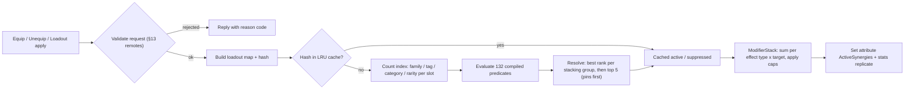

### 12.9 Morph Combinations

> Contributor: A8 (Morph UI & combination systems). Parts are referenced only by canon `MUT_` IDs; their stats,
> passives and acquisition live in §12.1–12.8 and §36.3. Synergies are listed in §36.4, combination examples in §36.5.

**Purpose.** A morph is more fun to show off when the game *notices* it. Every morph a player wears, and every customer,
employee or NPC they meet, gets a readable name ("Scorpion Bear"), a collectible **Morphdex key** ("Bear-Scorpion"),
and possibly a set of synergies. None of this is hand-authored per combination. It all comes from the metadata every
part already carries in canon (slot, category, rarity, family, tags), so the 280 launch parts give thousands of
named combinations, and any part added later joins in automatically.

#### 12.9.1 The Combination Concept

| Term | Definition |
|---|---|
| Loadout | The part (or nothing) in each of the 22 anatomy slots (`HEAD` … `FX`). `ARM` parts may fill `ARM_L` and/or `ARM_R`, `LEG` parts `LEG_L` and/or `LEG_R`. `FUR` and `SCALES` are mutually exclusive. |
| Mandatory slots | `HEAD`, `TORSO`, `ARM_L`, `ARM_R`, `LEG_L`, `LEG_R` are never empty. Unequipping a torso/arm/leg reverts it to the Plain Human default (`MUT_117` / `MUT_139` / `MUT_179`); a head can only be swapped (§13). |
| Lead family | The family of the `HEAD` part. It always supplies the first word of the key. |
| Dominant family | The non-lead family that is most visible on the body, scored by the Name-o-Matic (12.9.2). |
| Morphdex key | `<Lead word>-<Dominant word>`, e.g. `Bear-Scorpion`. This is the form shown on the mockup's customer cards. |
| Display name | The spoken form, e.g. "Scorpion Bear". A matching signature rule replaces it with a title, e.g. "Kitchen Kaiju". |
| Synergy set | Synergies whose requirements the loadout meets, resolved by the 12.10 stacking rules. Up to 5 can be active. |

**Scale (computed by `gdd/tools/check_synergies.py --stats`):** 40 head families × 132 nameable families
(families with at least one non-head, non-FX part, minus the neutral `human`) give **5,292 Morphdex keys**
(5,252 two-word keys plus 40 "Just a …" keys). The number of legal loadouts from the 280 parts is about
**4.1 × 10²⁴**. A combination is *derived*, never stored. The only per-combination data that exists is the
Morphdex bitset (12.9.4).

#### 12.9.2 Naming Rules (the "Name-o-Matic")

**Rules & Mechanics.** `MorphNaming.Compute(loadout)` is deterministic and runs in the shared module on both the
server (authoritative, for Morphdex and nameplates) and the client (for previews):

1. **Lead** = family of the `HEAD` part.
2. For every other equipped part except `FX`: skip it if its family equals the lead family or is neutral (`human`).
   Otherwise add `NameDominance[slot] + NameBonus[rarity]` to that family's score. Two arms of the same family
   therefore score twice, which is why squid tentacle arms out-shout a giraffe neck.
3. **Dominant** = the highest-scoring family. Ties go to the family with the rarer single part (higher
   `NameBonus`), then to the earliest slot in the tie-break order, then to the alphabetically first family id.
4. **Key** = `<Lead word>-<Dominant word>`. If no family scored, the key is just `<Lead word>` and the display name
   is "Just a(n) <Lead word>" (e.g. an all-robot morph is "Just a Robot").
5. **Display name** = "<Lead word> <Dominant word>", unless the dominant family is a **Loud Prefix** family and the
   lead family is not. Then the dominant word goes first: Bear-Scorpion is spoken "Scorpion Bear", Pigeon-Muscle
   is spoken "Muscle Pigeon".
6. **Signature override:** the signature rules below are checked top to bottom. The first match replaces the display
   name with its title. The key does not change, and the title is also logged in the Morphdex.
7. A player's **custom morph name** (§13) replaces the display name on their own nameplate only. The generated name
   stays visible as a subtitle and is what the Morphdex records.

| Slot | Name dominance | Why |
|---|---|---|
| TORSO, WINGS | 5 | biggest silhouette pieces |
| TAIL | 4 | moves constantly, reads from far away |
| BACK, NECK | 3 | changes the outline |
| ARM | 3 | per arm, so a matched pair scores 6 |
| LEG | 2 | per leg, so a matched pair scores 4 |
| HORNS, FUR, SCALES | 2 | big but secondary |
| SKIN, EARS, FACE, NOSE, MOUTH, EYES, HANDS, FEET | 1 | accents |
| HEAD, FX | 0 | the head is always the lead word; FX is never named |

| Rarity | Name bonus |
|---|---|
| Common | 0 |
| Uncommon | 0.5 |
| Rare | 1 |
| Epic | 1.5 |
| Legendary | 2 |
| Mythic | 2.5 |
| Secret | 2 |

| Tie-break slot order |
|---|
| TORSO > ARM > WINGS > TAIL > LEG > BACK > NECK > HORNS > FUR > SCALES > SKIN > EARS > FACE > NOSE > MOUTH > EYES > HANDS > FEET |

**Family name words.** By default a family's word is its id in Title Case (`spider` → "Spider"). The exceptions and
the Loud Prefix flags are below. Loud Prefix families are the adjective-like or headline families that sound right
in front ("Golden Rat", "Frosty Penguin", "Dragon Cat").

| Family | Name word | Loud prefix |
|---|---|---|
| `alien_grey` | Alien | no |
| `fox_spirit` | Ninetail | no |
| `trex` | T-Rex | no |
| `tv` | TV | no |
| `seaslug` | Sea-Slug | no |
| `headphones` | Headphone | no |
| `skate` | Skater | no |
| `wheel` | Unicycle | no |
| `cord` | Plug | no |
| `boxing` | Boxer | no |
| `human` | — | neutral (never named) |
| `fire` | Blazing | yes |
| `ice` | Frosty | yes |
| `storm` | Stormy | yes |
| `lava` | Lava | yes |
| `gold` | Golden | yes |
| `muscle` | Muscle | yes |
| `scorpion` | Scorpion | yes |
| `kraken` | Kraken | yes |
| `dragon` | Dragon | yes |
| `phoenix` | Phoenix | yes |
| `ghost` | Ghost | yes |
| `glitch` | Glitchy | yes |
| `nebula` | Cosmic | yes |
| `void` | Void | yes |
| `holo` | Holo | yes |
| `rubber` | Rubber | yes |
| `slime` | Slimy | yes |
| `paper` | Paper | yes |
| `mustache` | Mustache | yes |
| `pizza` | Pizza | yes |
| `fairy` | Fairy | yes |
| `demon` | Demon | yes |
| `cloud` | Cloud | yes |

**Worked examples (the brief's list).**

| Parts (non-default) | Scores | Key | Display |
|---|---|---|---|
| Bear Head `MUT_001` + Scorpion Tail `MUT_216` | scorpion 4 + 1 = 5 | Bear-Scorpion | Scorpion Bear (scorpion is loud) |
| Shark Head `MUT_011` + Spider Leg Cluster `MUT_185` ×2 | spider 2 × (2 + 0.5) = 5 | Shark-Spider | Shark Spider |
| Giraffe Head `MUT_015` + Giraffe Neck `MUT_110` + Squid Tentacle Arm `MUT_146` ×2 | neck skipped (lead family); squid 2 × 3.5 = 7 | Giraffe-Squid | Giraffe Squid |
| TV Head `MUT_021` + Moth Fuzz Face `MUT_045` + Moth Wings `MUT_233` | moth 1.5 + 5.5 = 7 | TV-Moth | TV Moth |
| Pigeon Head `MUT_004` + Bodybuilder Arm `MUT_160` ×2 | muscle 2 × 4 = 8 | Pigeon-Muscle | Muscle Pigeon |
| Snake Head `MUT_020` + Bunny Ears `MUT_085` + Bunny Slippers `MUT_202` | rabbit 1 + 1 = 2 | Snake-Rabbit | Snake Rabbit |

**Signature titles.** These hand-picked silhouettes deserve a title. The rules use the same grammar as synergies
(12.10.2) and are checked in table order; the first match wins.

| Signature title | Rule (grammar) | Example | Why it is special |
|---|---|---|---|
| Kitchen Kaiju | `family:dragon@HEAD AND family:kraken@ARM>=2` | `CMB_012` | Chef Supreme Omnivora's look (`NPC_029`); copying it is a rite of passage |
| The Full Kraken | `family:kraken>=3` | `CMB_122` | three Legendary kraken pieces at once |
| His Royal Snackness | `family:burger@HEAD AND family:gold>=2` | `CMB_040` | Mythic burger head dripping in gold |
| Accidental Platypus | `family:duck@MOUTH AND family:beaver@TAIL` | `CMB_061` | nature already did this one |
| Turtducken | `family:turtle>=1 AND family:duck>=1 AND family:chicken>=1` | `CMB_062` | three animals, one questionable sandwich |
| Kitchen Chimera | `family:cat@HEAD AND family:goat>=1 AND family:snake@TAIL` | `CMB_063` | the classic myth, with an apron |
| Discount Griffin | `family:cat@HEAD AND family:eagle>=1 AND tag:flying@WINGS` | `CMB_064` | close enough |
| Ninetail Maître d' | `family:fox_spirit@TAIL AND family:fox@EARS` | `CMB_115` | matching fox set |
| Sir Hoots-a-Lot | `family:owl@HEAD AND family:owl@EYES AND family:mustache@FACE` | `CMB_026` | a very distinguished owl |
| Ceiling Inspector | `tag:tall>=4` | `CMB_066` | doorframes fear this morph |
| Literally a Hot Dog | `family:dog@HEAD AND tag:fire@SKIN` | `CMB_118` | the pun was mandatory |
| Sewer Royalty | `family:rat@HEAD AND family:crab@ARM>=2` | `CMB_017` | King Ratbeard's look (`NPC_020`) |
| Le Fancy Fin | `family:shark@HEAD AND family:peacock@TAIL` | `CMB_013` | Baron Von Bistro's look (`NPC_003`) |
| Mer-Waiter | `family:mermaid@TAIL AND family:human@TORSO` | `CMB_065` | classic silhouette, now taking orders |
| Absolute Mystery | `distinct:category>=10` | `CMB_124` | ten categories on one body |
| Beep Boop Supreme | `category:ROBOT>=8` | `CMB_022` | more robot than robot |
| Walking Salad Bar | `category:PLANT>=6` | `CMB_125` | customers keep asking for dressing |

**Variables [TUNABLE].** Slot dominance, rarity bonus, loud-prefix flags and the signature list are data
(`ReplicatedStorage/Shared/Morph/NamingRules`). Tuning goal: across live customer spawns, ≥ 90 % of keys should name
the part a playtester points at first when asked "what is that creature?" (sampled in §35 playtests).

#### 12.9.3 Why Thousands of Combinations Need Zero Hand-Authoring

1. **Geometry.** Every part attaches to the fixed R15 attachment contract (`MMR_HeadCore`, `MMR_ArmL_Upper`, … per
   §12 and §25), so any part fits any body. `LegLength` / `NeckLength` attributes fix hip and head height
   automatically.
2. **Identity.** Key, display name and title are computed from family, slot and rarity (12.9.2).
3. **Behavior.** Synergies (12.10) are written against families, tags, categories and slots, never against a single
   part ID. A new tentacle part counts toward Tentacle Tango (`SYN_031`) the day it ships.
4. **Content pipeline.** Adding a part means adding one data row (§36.3) plus its mesh and icon. Its family word
   defaults to Title Case. If its family is new, the family registry appends one index, which creates 40 new
   Morphdex keys with no further work.
5. **Validation.** `python3 gdd/tools/check_synergies.py` re-proves that every synergy is still satisfiable and that
   every documented combination still names and resolves correctly (see §36.4 and §36.5).

#### 12.9.4 The Morphdex (Discovery Tracking & Museum Rewards)

**Purpose.** This is the "gotta catch 'em all" layer of the combo system: it turns *looking at weird customers* into
progress and gives players a reason to try odd builds.

**Rules & Mechanics.**
- Each key has two discovery states:
  - **Spotted.** A server-known morph with that key was served, fought or calmed in your restaurant, was hired by
    you, or was inspected by you in the city. Inspect means holding the Inspect prompt on an NPC or player for
    2 s within 12 studs. City crowds are client-only cosmetics (§18) and never give credit.
  - **Worn.** You wore the key for ≥ 60 s outside the Morph menu, or completed one order, fight or repair while
    wearing it. This stops players registering keys by flicking parts in the menu.
- Signature titles have their own page (17 at launch). The first time you **wear** a title, it is also added as a
  selectable nameplate title (titles are part of the C17.4 reward vocabulary).
- The Morphdex screen is a grid with one row per head family (40) and one cell per dominant family. Unseen cells show
  a "?" silhouette; Spotted cells show a gray silhouette plus "Spotted at <place>"; Worn cells show a full-color
  thumbnail rendered from the player's own morph. Filters: head family, category of the dominant family,
  Spotted / Worn / missing.
- **Storage (§28):** each family has a permanent, append-only index (head families 0–39, dominant families 0–255).
  `keyIndex = headIdx × 256 + domIdx`, and two bitsets (`spotted`, `worn`) of 40 × 256 bits = 1,280 bytes each are
  stored base64-encoded (≈ 3.4 KB total). "Just a …" keys use `domIdx = 255`. Titles are a 32-bit mask.

**Variables [TUNABLE] — Museum reward ladder** (claimed from Curator Fossilbottom `NPC_018` at the Morph Museum
`BLD_16`; reward types follow canon C17.4):

| Tier | Requirement | Reward |
|---|---|---|
| 1 | 10 Spotted | 50 MS · title "Morph Spotter" |
| 2 | 25 Spotted | 1 Morph Capsule · palette "Museum Pastels" |
| 3 | 50 Spotted, 10 Worn | 150 MS · emote "Curator Bow" |
| 4 | 100 Spotted, 25 Worn | 2 Morph Capsules · palette "Fossil Tones" · unlocks loadout slot 5 (§13) |
| 5 | 250 Spotted, 50 Worn | 300 MS + 5 RT · title "Chimera Scholar" |
| 6 | 500 Spotted, 100 Worn | 3 Morph Capsules · palette "Neon Specimen" |
| 7 | 1,000 Spotted, 200 Worn | 15 RT · title "Living Encyclopedia" · emote "Specimen Pose" |
| Signature | First time wearing each signature title | 25 MS · that title |

**Pacing check.** A TIER_03–05 restaurant serves about 80–110 customers per active hour (canon demand table). With
4–7 visible parts per customer (12.9.5), about 35 % of a session's customers show a key the player hasn't spotted
yet in the first 10 hours, falling to about 8 % by 60 hours. Tier 4 (100 Spotted) therefore arrives around 6–9
active hours, and tier 7 (1,000 Spotted) is a 150+ hour collector goal.

**Player Interactions.** A "NEW!" toast with a 1.2 s silhouette reveal fires on each new Spotted key (at most one
toast per 5 s; extras are queued into the Morphdex badge counter). Friends can open each other's Morphdex
read-only from the profile card.

**Dependencies.** §8 (customer spawns call `MorphNaming`), §16 (hire screen badge), §18 (Museum building), §28
(bitset persistence), §31 (analytics `mmr_morphdex_spotted`, `mmr_morphdex_worn`, `mmr_signature_unlocked`).

#### 12.9.5 How Customers, NPCs, Employees and Players Display Combos

**Customer morph recipe** (used by `CustomerAIService` when it spawns a proxy; visuals are built client-side under
the SPCV pattern):

1. **Head:** drawn from the personality's family weights. §9 may lock a signature look; for example `PER_010` The
   Bodybuilder Pigeon always has a pigeon head.
2. **Dominant feature:** exactly one of TORSO, an ARM pair, WINGS, TAIL or a LEG pair, from a family other than the
   head's. This guarantees a readable two-word key.
3. **Accents:** 0–4 extra parts in other slots, picked from the tier pool below. Plain Human defaults fill the rest.
4. **Budget:** ≤ 9 non-default parts, ≤ 24 MeshParts and ≤ 6,000 triangles (canon C13.7). Secret parts never
   appear on customers, so secrets stay secret.
5. **Seed:** `hash(restaurantId, customerSerial)`. A repeat customer (§8) re-uses their seed and so their look.

| Restaurant tier band | Common | Uncommon | Rare | Epic | Legendary | Mythic | Non-default parts |
|---|---|---|---|---|---|---|---|
| `TIER_01`–`TIER_02` | 70 % | 25 % | 5 % | 0 % | 0 % | 0 % | 3–5 |
| `TIER_03`–`TIER_04` | 55 % | 30 % | 12 % | 3 % | 0 % | 0 % | 4–6 |
| `TIER_05`–`TIER_06` | 40 % | 32 % | 18 % | 8 % | 2 % | 0 % | 4–7 |
| `TIER_07`–`TIER_08` | 30 % | 30 % | 24 % | 12 % | 3.5 % | 0.5 % | 5–8 |
| `TIER_09`–`TIER_10` | 22 % | 28 % | 26 % | 16 % | 6 % | 2 % | 5–9 |

**Display rules.**

| Who | Where the combo shows | Format |
|---|---|---|
| Customer | Nameplate (on hover/target only, to keep the dining room readable), order ticket, Welcome Back report | **Scorpion Bear** · The Karenosaurus; ticket: "Bear-Scorpion · Table 4". A ✦ icon shows when its parts would trigger a synergy (cosmetic only, 12.10.6) |
| Employee | Roster card, hire screen, offline report lines | "Octopus Chef (Chef)". Hire candidates with an unspotted key get a "Morphdex: NEW!" badge |
| Named NPC | Dialogue header, inspect card | Fixed looks from §19. Looks built from canon parts produce real keys and titles (e.g. `NPC_029` → Kitchen Kaiju). NPC-only props (monocle, crown, lab coat) never count |
| Player | Overhead nameplate, inspect card, Showcase Stage `BLD_22` | Custom name (filtered, §13) in bold, generated name as subtitle, rarity-colored pedestal icon; the inspect card lists parts, key and active synergies |

#### 12.9.6 Edge Cases (12.9)

| Situation | Ruling |
|---|---|
| Two families tie exactly on score and rarity | Slot tie-break order, then alphabetical family id. Fully deterministic, so the server and every client agree. |
| Head swapped to the same family as the dominant part (cat head + cat tail) | The cat tail is skipped as lead family; the next family takes over, or "Just a Cat". |
| Signature rule and a custom name both apply | Nameplate: custom name, subtitle: signature title. Morphdex records both the key and the title. |
| Part data hot-fix changes a family | Morphdex bits are keyed by family index, so existing discoveries stay valid. The new key becomes discoverable. |
| Customer visual fails to load a mesh (asset throttling) | The proxy keeps its key. The client shows the 1,500-triangle impostor and retries in 10 s; credit is unaffected. |
| Player flicks parts in the Morph menu to farm Worn | Worn needs 60 s outside the menu or one completed activity. A rate cap of 30 Worn registrations per hour [TUNABLE] stops macro farming. |
| City crowd NPC inspected | No credit, because crowds are client-only. The prompt says "Just passing through!". |

### 12.10 Mutation Synergy Rules

**Purpose.** Synergies reward *combining* parts that belong together (octopus arms in a chef build, bear arms with a
rhino horn) without letting stacked bonuses break the canon stat caps. They are the "one more part" hook of the
morph economy: a build is worth more than the sum of its parts, but only a little more, and always visibly.

#### 12.10.1 Detection Algorithm (evaluated on equip, cached)

1. **Trigger.** `MutationService` re-evaluates a player's synergies whenever their loadout changes: a single-part
   equip or unequip, a loadout apply, a part upgrade (no effect on matching, but the stat totals are rebuilt), a
   pin change, or entering/leaving the Arena ruleset. Nothing is evaluated per frame.
2. **Hash.** `loadoutHash = "HEAD=MUT_001;TORSO=MUT_117;…|pins=SYN_014,…"` (slot instances in canon order,
   sorted pins). If the hash is in the 512-entry result cache (flushed when full; shared by everyone on the server, since identical
   loadouts resolve identically), the cached result is reused.
3. **Count index.** One pass over the ≤ 21 occupied non-FX slot instances (FX is indexed separately) builds counts
   per family, tag, category and rarity-rank for every slot instance.
4. **Match.** Each synergy's requirement was compiled into a predicate tree at server start (§36.4 data →
   `SynergyDefs`). All 132 are evaluated: ≤ 132 × 5 atoms × 21 slots ≈ 14k cheap checks, under 0.2 ms on a server
   core.
5. **Resolve.** Stacking groups and the 5-slot limit (12.10.3) produce `active` and `suppressed` lists.
6. **Apply.** Active effects are pushed into the player's `ModifierStack`, keyed by effect type × target, which
   `CookingService`, `CombatService`, `RepairService` and the movement controller read. The stack applies the caps.
   The active list is replicated as the player attribute `ActiveSynergies` (comma-separated IDs) for nameplates,
   the HUD and inspect cards.
7. **Client preview.** The Morph menu runs the same shared module on hypothetical loadouts to show "would activate
   / would deactivate" (§13). Clients never send synergy results; the server always recomputes.



#### 12.10.2 Requirement Grammar

```
Requirement := Clause { " OR " Clause }          -- OR binds loosest
Clause      := Term { " AND " Term }
Term        := Atom | "(" Requirement ")"
Atom        := Kind ":" Values [ "@" Scope ] [ Cmp Count ]
Kind        := "family" | "tag" | "category" | "rarity" | "slot" | "pair" | "distinct"
Values      := Name { "+" Name }                 -- all values must hold on the SAME part
Cmp         := ">=" | "<="                       -- default ">=1"
Count       := 0..21
```

| Atom form | Counts / tests | Example |
|---|---|---|
| `family:F[@S][>=n]` | parts in scope S whose canon Family is F | `family:octopus@ARM` (≥ 1 octopus arm) |
| `tag:T[+T2][@S][>=n]` | parts in S carrying every listed tag | `tag:repair+claw@ARM` (one arm that is both repair and claw) |
| `category:C[@S][>=n]` | parts in S of canon Category C | `category:PLANT>=4` |
| `rarity:R[@S][>=n]` | parts in S whose rarity is ≥ R (Secret counts as Legendary) | `rarity:Epic>=3` |
| `slot:S[>=n]` | occupied slot instances in scope S | `slot:ANY>=8` |
| `pair:ARM` / `pair:LEG` | both sides hold the same part ID (canon matched pair) | `pair:LEG AND family:raptor@LEG>=2` |
| `distinct:family\|category[@S][cmp n]` | number of different families or categories in S (the neutral `human` family is ignored) | `distinct:category>=8` |

| Scope | Slot instances |
|---|---|
| *(omitted)* = `ANY` | all 21 non-FX instances |
| any anatomy slot code | that slot (`ARM_L`, `LEG_R` … also accepted) |
| `ARM` / `LEG` | both sides |
| `COVER` | SKIN, FUR, SCALES |
| `G_HEAD`, `G_EARS`, `G_EYES`, `G_ARMS`, `G_LEGS`, `G_TAILS`, `G_EXTRAS` | the canon UI groups (G_EXTRAS without FX) |
| `FX` | the FX slot only |

**Counting rules.** Every slot instance counts once, so two octopus arms give `family:octopus@ARM` a count of 2.
**Plain Human defaults are neutral filler.** `MUT_117`/`MUT_139`/`MUT_179` are ignored by every atom (tags,
categories, rarity, `slot`, `distinct`, `pair`) except an explicit `family:human` atom, and they are never named.
Canon gives them the `charm` tag, so without this rule every starter morph would already hold five charm parts and
trivially trigger charm-count synergies. Synergies must be earned with mutations. **FX parts count only for atoms scoped `@FX`**, and a
synergy with any FX atom must be `social`-only (cosmetic), because FX parts carry no stats (canon C13.4).
Secret parts count normally.

#### 12.10.3 Stacking Rules & Caps

1. **Stacking groups.** Every synergy belongs to one stacking group (`SG_…`) and has a rank r1–r3 inside it. Only
   the highest-ranked qualifying synergy of a group is active; on equal rank, the lower ID wins. Example: Dragon
   Head + Fireproof Skin qualifies for both `SYN_004` Dragon's Own Kitchen (r3) and `SYN_006` Oven Mitts Optional (r1) in `SG_HEATCOOK`, so only `SYN_004` Dragon's Own Kitchen
   applies.
2. **At most 5 active synergies** [TUNABLE]. If more than 5 groups have a winner, the player's pinned synergies
   (up to 5, chosen in §13) go first, then higher rank, then lower ID. The rest are listed as *suppressed* (grey).
3. **Per-stat cap:** the `STAT` effects of all active synergies add at most **+25 points per stat** [TUNABLE]. The
   canon stat caps (§14) still apply on top, and any excess shows "MAXED".
4. **Per-effect-type cap:** percentage effects of the same type are summed additively, then capped at **30 % per
   effect type** [TUNABLE]. When the type names a target (a station, ability, status or repair class), the cap
   applies per target. Example: `PROC_TIME` −12 % (all stations) + −10 % (`STN_GRILL`) = −22 % on the grill. Flat
   effects have the caps in the table below. The capped synergy layer then multiplies with stats, skill nodes and
   station levels in the owning system's formula (§5, §11, §15).
5. **Drawbacks** (e.g. the +10 % damage taken of `SYN_060` Glass Cannon) are fixed, never capped and never cancelled by other
   synergies, so a trade-off stays a trade-off.
6. **No scaling with upgrades.** Synergy magnitudes do not grow with part upgrade level, which keeps them easy to
   read. Upgrades raise part stat budgets instead (canon C13.4).

| Effect type | Meaning | Synergy cap |
|---|---|---|
| `PROC_TIME` | Station process-time reduction (all stations, or the stations/recipe categories named) | −30 % per station |
| `INTERACT` | Manual interaction time reduction (chop, mix-by-hand, assemble, plate, wash, clean, extinguish) | −30 % per action |
| `CHOP_ZONE` | Width of the green "Clean cut" zone on chop rings | +30 % |
| `PERFECT_WIN` | Perfect-window width (multiplies with COOK_QLT and station level) | +30 % per station |
| `BURN_GRACE` | Extra seconds before BURNED (and before ON_FIRE) | +3 s total |
| `SAT_BONUS` | Satisfaction points paid through the MutationBonus term of §10 | shares the MutationBonus cap of +10 |
| `TIP` | Tip amount multiplier | +30 % |
| `JACKPOT` | Jackpot Tip chance, in percentage points | +1.0 pp |
| `STAT` | Flat stat points (the 9 stats of §14); stat caps still apply | +25 points per stat |
| `HP` | Flat max HP | +40 HP |
| `REGEN` | HP per second while the In Combat flag is clear | 3 HP/s |
| `REVIVE` | Better KO recovery (respawn HP / Woozy length) | one source only |
| `KNOCKBACK` | Knockback dealt | +30 % |
| `KB_RESIST` | Knockback received reduction | −30 % |
| `MELEE_DMG` | Damage of base melee (ABL_001, ABL_002, ABL_007) | +30 % |
| `ABILITY_DMG` | Damage of the named ability | +30 % per ability |
| `COOLDOWN` | Cooldown reduction of the named ability | −30 % per ability |
| `ABILITY_RANGE` | Range or radius of the named ability | +30 % per ability |
| `ABILITY_MOD` | Behavior change of the named ability (extra target / projectile / hits / duration) | +1 target or projectile, +2 hits, +0.5 s, −0.15 s charge per ability |
| `STATUS_DUR` | Duration of statuses you inflict | +30 % per status |
| `STATUS_ADD` | Rider status applied on hit | 1 rider, ≤ 1 s |
| `STATUS_IMMUNE` | Immunity to the named status | boolean |
| `STATUS_RESIST` | Shorter duration of the named status on you | −50 % per status |
| `THORNS` | Cartoon-poke damage to melee attackers | ≤ 4 per contact, 0.5 s internal cooldown |
| `GUARD` | Block guard-meter size | +30 % |
| `DMG_TAKEN` | Damage-taken reduction (drawbacks are fixed, never capped) | −30 % |
| `MOVE_CTX` | WalkSpeed % while a condition holds | +30 %, and absolute WalkSpeed ≤ 21 studs/s |
| `JUMP` | JumpPower % | +30 % |
| `GLIDE` | Fall-speed reduction while airborne | −40 % |
| `REPAIR_SPD` | Repair speed % (all repairs, or the named target class) | +30 % per target class |
| `REPAIR_COST` | Repair-material cost reduction | −10 % (≤ −30 % together with the REPAIR stat) |
| `FURN_SAFE` | Less damage dealt to your own restaurant objects | −50 % |
| `PATIENCE` | Customer patience % | +30 % |
| `ORDER_WAIT` | Ordering-phase wait window % | +30 % |
| `ANGER` | Anger gain or escalation-roll reduction | −30 % |
| `REVEAL` | Information highlight (no numbers change) | boolean |
| `QOL` | Convenience rule change (no numbers change) | boolean |
| `SOCIAL` | Cosmetic only; never changes a number | none |

#### 12.10.4 UI Display

- **Morph menu (§13):** the Synergies panel lists each synergy as a chip with a context icon (pan = cook,
  fist = combat, wrench = repair, shoe = move, heart = social), its name, rank pips (●●○ = r2) and a state:
  **Active**, **Suppressed: same group** (names the winner), **Suppressed: limit 5**, **Would activate** or
  **Would deactivate** (during previews). State is never shown by color alone; every state has a word and an icon.
- **Pins:** tapping the pin on a chip reserves one of the 5 active slots for it (max 5 pins).
- **HUD:** a strip of up to 5 synergy icons sits beside the ability bar; hover, long-press or the controller's
  D-pad-down shows the effect text with live numbers ("Grill −22 % (cap 30 %)").
- **Activation toast:** "SYNERGY! Eight-Arm Kitchen Nightmare", 1.5 s, at most one every 3 s. With reduced motion,
  a static banner replaces the slide.
- **Inspect card (players):** the target's active synergies (names only) under their combo key.
- **Synergy Codex:** every requirement is always readable (no hidden recipes for kids to look up). The first
  activation stamps the synergy "Discovered". The titles "Synergist" (25 discovered), "Combo Chef" (60) and
  "Grand Synergizer" (all) are cosmetic rewards.

#### 12.10.5 PvP Normalization (Morph Arena `BLD_08`)

| Rule | Value [TUNABLE] |
|---|---|
| Contexts that apply | `combat` and `move` only; `cook`, `repair` and the non-cosmetic parts of `social` are inert (`SOCIAL` cosmetics still show) |
| Magnitude | × 0.5 for every numeric effect (round half up to 0.1 %, or to whole points for `STAT`) |
| Per-stat synergy cap | +10 (instead of +25) |
| Active synergies | max 3 (pins honored, then rank, then ID), locked when the match is accepted |
| `ABILITY_MOD` extra targets / projectiles | disabled; duration and charge changes halved |
| `REVIVE` | disabled (Arena KO rules, §21) |
| `STATUS_IMMUNE` | becomes `STATUS_RESIST` −50 % |
| Information | the versus card shows both fighters' active synergies and their halved numbers |

Opt-in Arena play is the only place where players hit each other (§21). Restaurant customers stay NPCs, so normal
synergies never affect another player.

#### 12.10.6 NPCs (Customers, Employees, City NPCs)

Synergies change numbers **only for players**. Customer balance belongs to §8–§10 and employee output to §16.
For readability, the client still evaluates the shared module on NPC part lists. A customer or employee whose parts
would trigger a synergy shows a ✦ on its nameplate, and the inspect card says, for example, "Natural synergy:
Tentacle Tango". This is purely cosmetic and great for "look at that guy" moments. An employee archetype may *copy* a
synergy's idea as its own trait (e.g. Ollie's "Eight Arms, One Brain Cell", `EMP_001`), but that trait is defined
in §16, not here.

#### 12.10.7 Roblox Implementation

**Modules.** `ReplicatedStorage/Shared/Morph/` holds `PartDefs` (generated from §36.3), `SynergyDefs` (generated
from §36.4; requirements are pre-compiled into the node tables below by the build script), `NamingRules`,
`MorphNaming` and `SynergyEvaluator`. `ServerScriptService/Services/MutationService` calls the evaluator, owns the
`ModifierStack`, and sets the `ActiveSynergies` attribute. The client UI requires the same modules for previews only.

```lua
--!strict
-- ReplicatedStorage/Shared/Morph/SynergyEvaluator.lua
-- Shared: authoritative on the server (MutationService), preview-only on the client (Morph menu).
local PartDefs = require(script.Parent.PartDefs)       -- id -> { family, category, rarityRank, tagSet }
local SynergyDefs = require(script.Parent.SynergyDefs) -- array of { id, group, rank, req: Node }

export type Loadout = { [string]: string }             -- slot instance ("ARM_L") -> part id ("MUT_145")
type Atom = { kind: string, values: { string }, scope: { string }, cmp: string, n: number }
type Node = { op: string, atom: Atom?, kids: { Node }? }
export type Result = { active: { string }, suppressed: { string } }

local MAX_ACTIVE = 5
local CACHE_LIMIT = 512
local RARITY_RANK = { Common = 1, Uncommon = 2, Rare = 3, Epic = 4, Legendary = 5, Mythic = 6, Secret = 5 }
local SLOT_ORDER = { "HEAD", "FACE", "NOSE", "MOUTH", "EYES", "EARS", "HORNS", "NECK", "TORSO", "ARM_L", "ARM_R",
	"HANDS", "LEG_L", "LEG_R", "FEET", "TAIL", "WINGS", "BACK", "SKIN", "FUR", "SCALES", "FX" }

local Evaluator = {}

local function partMatches(atom: Atom, part: any): boolean
	local kind = atom.kind
	if kind == "family" then
		return part.family == atom.values[1]
	elseif kind == "category" then
		return part.category == atom.values[1]
	elseif kind == "rarity" then
		return part.rarityRank >= RARITY_RANK[atom.values[1]]
	elseif kind == "tag" then
		for _, tag in atom.values do
			if not part.tagSet[tag] then
				return false
			end
		end
		return true
	end
	return true -- slot / distinct: any occupant counts
end

local function isNeutral(atom: Atom, part: any): boolean
	return part.family == "human" and not (atom.kind == "family" and atom.values[1] == "human")
end

local function atomValue(atom: Atom, loadout: Loadout): number
	if atom.kind == "pair" then
		local left, right = loadout[atom.scope[1]], loadout[atom.scope[2]]
		local paired = left ~= nil and left == right and not isNeutral(atom, PartDefs[left])
		return if paired then 1 else 0
	end
	local count, seen = 0, {}
	for _, slot in atom.scope do -- scope arrays never contain FX unless the atom is scoped @FX
		local id = loadout[slot]
		local part = if id then PartDefs[id] else nil
		if part and isNeutral(atom, part) then
			part = nil -- Plain Human filler is invisible to synergies (12.10.2)
		end
		if part then
			if atom.kind == "distinct" then
				local value = if atom.values[1] == "family" then part.family else part.category
				if not seen[value] then
					seen[value] = true
					count += 1
				end
			elseif partMatches(atom, part) then
				count += 1
			end
		end
	end
	return count
end

local function holds(node: Node, loadout: Loadout): boolean
	if node.op == "atom" then
		local atom = node.atom :: Atom
		local value = atomValue(atom, loadout)
		return if atom.cmp == ">=" then value >= atom.n else value <= atom.n
	end
	local kids = node.kids :: { Node }
	if node.op == "and" then
		for _, kid in kids do
			if not holds(kid, loadout) then
				return false
			end
		end
		return true
	end
	for _, kid in kids do -- "or"
		if holds(kid, loadout) then
			return true
		end
	end
	return false
end

local cache: { [string]: Result } = {}
local cacheCount = 0

local function hashOf(loadout: Loadout, pins: { string }): string
	local pieces = table.create(#SLOT_ORDER)
	for _, slot in SLOT_ORDER do
		table.insert(pieces, slot .. "=" .. (loadout[slot] or "-"))
	end
	local sortedPins = table.clone(pins)
	table.sort(sortedPins)
	return table.concat(pieces, ";") .. "|" .. table.concat(sortedPins, ",")
end

function Evaluator.Resolve(loadout: Loadout, pins: { string }?): Result
	local pinList = pins or {}
	local key = hashOf(loadout, pinList)
	local hit = cache[key]
	if hit then
		return hit
	end
	local pinned = {}
	for _, id in pinList do
		pinned[id] = true
	end

	local best: { [string]: any } = {}
	local suppressed = {}
	for _, def in SynergyDefs do
		if holds(def.req, loadout) then
			local current = best[def.group]
			if current == nil or def.rank > current.rank or (def.rank == current.rank and def.id < current.id) then
				if current then
					table.insert(suppressed, current.id)
				end
				best[def.group] = def
			else
				table.insert(suppressed, def.id)
			end
		end
	end

	local winners = {}
	for _, def in best do
		table.insert(winners, def)
	end
	table.sort(winners, function(a, b)
		local pa, pb = pinned[a.id] == true, pinned[b.id] == true
		if pa ~= pb then
			return pa
		end
		if a.rank ~= b.rank then
			return a.rank > b.rank
		end
		return a.id < b.id
	end)

	local active = {}
	for index, def in winners do
		table.insert(if index <= MAX_ACTIVE then active else suppressed, def.id)
	end
	table.sort(active)
	table.sort(suppressed)

	local result: Result = table.freeze({ active = table.freeze(active), suppressed = table.freeze(suppressed) })
	if cacheCount >= CACHE_LIMIT then
		table.clear(cache)
		cacheCount = 0
	end
	cache[key] = result
	cacheCount += 1
	return result
end

return Evaluator
```

```lua
-- ServerScriptService/Services/MutationService.lua (excerpt)
function MutationService:_refreshSynergies(player: Player, profile)
	local result = SynergyEvaluator.Resolve(profile.morph.equipped, profile.morph.pinnedSynergies)
	if ArenaRuleset.IsInMatch(player) then
		result = ArenaRuleset.Normalize(result) -- 12.10.5: contexts, x0.5, max 3, stat cap +10
	end
	ModifierStack.Rebuild(player, result.active) -- sums per (effect type, target) and applies the 12.10.3 caps
	player:SetAttribute("ActiveSynergies", table.concat(result.active, ","))
	player:SetAttribute("SuppressedSynergies", table.concat(result.suppressed, ","))
end
```

`ModifierStack.Rebuild` caps each (type, target) pool when it is built, so gameplay services read final
multipliers with one table lookup (e.g. `ModifierStack.Get(player, "PROC_TIME", "STN_GRILL") → 0.78`).
Contextual effects (`MOVE_CTX` "damaged object within 25 studs", heat-station radius) are evaluated by their owning
service at 4 Hz with 0.5 s hysteresis, not by the evaluator.

#### 12.10.8 Edge Cases (12.10)

| Situation | Ruling |
|---|---|
| Loadout changes while an ability is mid-cast | The cast finishes with the old modifiers. New modifiers apply from the next action; statuses already inflicted keep their duration. |
| A synergy modifies an ability that is not on the 4-slot ability bar (canon C12.1) | The modifier is stored but inert. The chip reads "needs `ABL_064` on your bar". |
| A pinned synergy stops qualifying | The pin is kept but marked "Pinned (inactive)"; the freed slot goes to the next winner. |
| Two `ABILITY_MOD` synergies add targets to the same ability | Capped at +1 extra target or projectile per ability. |
| Part data or synergy data hot-fix | The `SynergyDefs` version is bumped, every server flushes its cache and re-evaluates each player within 5 s (staggered). |
| Context flicker (damaged object moves in and out of range) | 0.5 s hysteresis; the WalkSpeed change eases over 0.25 s so the camera never jitters. |
| Guest cooking in a friend's restaurant (§21) | Cook, repair and move synergies apply to any restaurant where the guest has work permission. |
| `SAT_BONUS` together with other mutation satisfaction bonuses (§12) | All share the canon MutationBonus cap of +10 per customer. |
| Morph swapped by an event (`EVT_021` Morph Swap Hour) | The temporary morph is evaluated like any loadout. When the event ends, the saved loadout and its synergies return. |

#### 12.10.9 Acceptance Criteria (12.9 and 12.10)

- **AC-12-80:** `MorphNaming.Compute` gives identical key, display name and title on the server and on every client
  for 100 % of the §36.5 combinations and of 10,000 random legal loadouts in the test harness.
- **AC-12-81:** `python3 gdd/tools/check_synergies.py` exits with code 0 ("RESULT: CLEAN"). It proves every
  synergy (and every OR-branch) satisfiable, every example valid, and every §36.5 combination slot-valid, correctly
  named and correctly resolved.
- **AC-12-82:** A newly Spotted key shows its toast within 0.5 s of the triggering event, with at most one toast per 5 s.
- **AC-12-83:** Worn credit is never granted for a loadout kept < 60 s outside the menu without a completed order,
  fight or repair, and is always granted otherwise (20 scripted test cases).
- **AC-12-84:** A profile with all 5,292 keys Spotted and Worn serializes its Morphdex in ≤ 4 KB.
- **AC-12-85:** In 100,000 simulated customer spawns, `TIER_01`–`TIER_02` customers have 0 Epic+ parts, and no
  customer at any tier has a Secret part.
- **AC-12-86:** A synergy cache miss takes ≤ 0.5 ms (p99) on a live server, and the evaluator runs 0 times during a
  10-minute session with no loadout changes.
- **AC-12-87:** With more than 5 qualifying stacking groups, exactly 5 synergies are active, chosen pinned → rank →
  ID, and the others are listed as suppressed with a reason.
- **AC-12-88:** Synergy `STAT` totals never exceed +25 per stat, and no (effect type × target) pool exceeds its
  cap. A test loadout triggering every cooking `PROC_TIME` synergy shows exactly −30 % at `STN_GRILL`.
- **AC-12-89:** Equipping or removing an FX part changes no number in the stat snapshot (only `SOCIAL` effects).
- **AC-12-90:** In an Arena match, only `combat`/`move` synergies apply, at 50 % magnitude, with at most 3 active,
  and both fighters' lists show on the versus card.
- **AC-12-91:** WalkSpeed from stats and synergies never exceeds 21 studs/s outside dash and dodge abilities.
- **AC-12-92:** A customer's ✦ synergy icon changes no customer value (satisfaction distributions with and without
  icons are identical in a 10,000-customer simulation).
