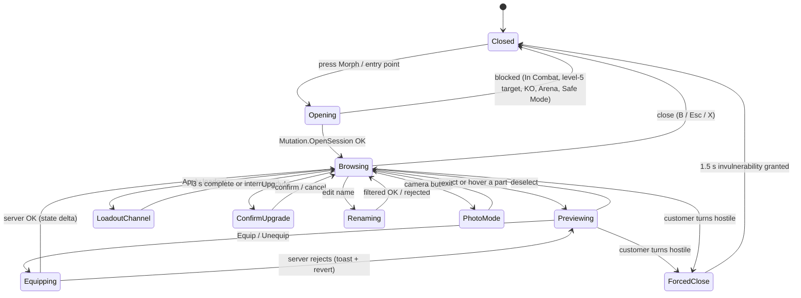

## 13. Morph Customization

> Contributor: A8 (UI/UX + morph customization systems). This section specifies the **Customize Your Morph** screen
> from the mockup (left category list, center 3D preview on a glowing pedestal, right inventory grid) and every rule
> behind it: equipping, loadouts, naming, tints, upgrades, and the doors to Lab fusion and Body Mods. Part data is in
> §12 / §36.3, combination naming and synergies in §12.9–12.10 / §36.4 / §36.5, abilities in §36.6, and the
> generic UI framework in §24.

### 13.1 Purpose & Design Goals

**Purpose.** The morph is the centerpiece of the economy: the restaurant earns the money, and this screen is where
it turns into a ridiculous creature worth showing off. The screen must make three things effortless: **seeing**
the morph (a big rotatable pedestal preview), **deciding** (honest stat deltas and synergy previews before every
equip), and **switching** (saved loadouts for Chef / Fighter / Repair work).

| # | Goal | Measured by |
|---|---|---|
| G1 | Equip any owned part in ≤ 2 taps/clicks from opening the screen | AC-13-01 |
| G2 | No decision without information: every equip shows stat, ability and synergy changes first | AC-13-04, AC-13-05 |
| G3 | Fun to show off: pedestal, preview animations, photo mode, custom name | AC-13-09 |
| G4 | Identical capability on desktop, mobile (landscape and portrait), tablet and controller | AC-13-11 |
| G5 | Server-authoritative: the client only previews; every change is validated by `MutationService` | AC-13-12 |

### 13.2 Entry Points, Blocking Rules & Screen States

**Rules & Mechanics.**

| Entry point | Opens on | Notes |
|---|---|---|
| HUD quick-access "Morph" button (keyboard `M`, mobile button, controller View button) | Parts tab, last category used | Main entry |
| "Equip now" after a Mutation Mart (`BLD_01`) purchase, capsule reveal or quest reward | Parts tab with the new part selected | Shows the equip preview immediately |
| Body Mods (`BLD_02`), talking to stylist Glamtrax (`NPC_005`) | Style tab in **Salon mode** (palette shop, Looks, photo booth) | 13.16 |
| Mutation Laboratory (`BLD_11`), talking to Dr. Splice (`NPC_013`) | Upgrade tab in **Lab mode** (fusion enabled) | 13.16 |
| Morphdex cell "Try this look" (§12.9.4) | Parts tab, filtered to owned parts of the two families | Builds a preview loadout |
| Inspect card "Copy look" on another player | Preview loadout from the parts you own; missing parts listed with where-to-get | 13.17 |
| Tutorial `QST_TUT_010` Your First Mutation | Arms category, the three starter arms highlighted | Guided, other tabs locked until complete |

- **Cannot open** while In Combat (dealt or took damage in the last 6 s), while a level-5 customer targets you,
  while Seeing Stars, during an Arena match, or in Safe Mode (canon E2, E4, E6). The button greys out and a toast
  says "Can't change outfits during a brawl!" (or the matching reason).
- **Auto-close:** if a customer turns hostile toward you while the screen is open, it closes at once and you get
  1.5 s of invulnerability (canon E2). Equips are applied the moment the server accepts them, so nothing is lost.
  An unsent tint draft or a half-typed name is kept locally and restored next time.
- **The world keeps running.** The Morph screen is a full-screen menu over the live game; customers keep waiting.
  A thin **order alert strip** (an overlay panel, allowed by E2) at the top of the screen flashes when any customer
  drops below 30 % patience, with a "Back to work" button.



### 13.3 Layouts & Wireframes

All layouts share one component tree (13.4). `UIController` picks a **layout profile** from the viewport size and
the last input type (`UserInputService.LastInputTypeChanged`) and re-parents panels; nothing is duplicated.

| Profile | Trigger | Reference resolution | Grid columns | Detail panel |
|---|---|---|---|---|
| Desktop | viewport width ≥ 1,100 px and last input mouse/keyboard | 1920 × 1080 (scales 1280 × 720 → 2560 × 1440) | 4 | docked right, under the grid |
| Mobile landscape | touch, width > height, height < 600 px | 844 × 390 | 3 | bottom sheet |
| Mobile portrait | touch, height > width | 390 × 844 | 4 (smaller cards) | bottom sheet |
| Tablet | touch, shortest side ≥ 600 px | 1180 × 820 | 4 | docked right (desktop-like, larger hit areas) |
| Console / 10-foot | last input gamepad, or `GuiService:IsTenFootInterface()` | 1920 × 1080 inside a 90 % safe area | 4 (large cards) | docked right |

**Portrait support.** Gameplay locks phones to landscape. While the Morph screen is open the client sets
`PlayerGui.ScreenOrientation = Enum.ScreenOrientation.Sensor`, so a phone can be turned upright for a tall
"dressing-room" view, and restores `LandscapeSensor` on close.

#### 13.3.1 Desktop (1920 × 1080)

```text
+------------------------------------------------------------------------------------------------------------+
| CUSTOMIZE YOUR MORPH  "Sir Snacks-a-Lot" [edit]  Scorpion Bear (Bear-Scorpion)    12,450 MB  320 MS  8 RT [X]|
| ! Table 4 is getting impatient                                                         [Back to work]       |
+----------------+-----------------------------------------------+--------------------------------------------+
| CATEGORIES     |  [Idle] [Cook] [Fight] [Emote]        [Photo] | [Parts] [Equipped] [Loadouts] [Style] [Upg] |
| > All      12  |                                               | (Search parts, tags, abilities...) [Filter] |
| > Head      3* |                 .-""""-.                      | Sort: Recommended v   [x] Owned  [ ] Locked |
| > Ears         |                (  o  o  )                     | +------+ +------+ +------+ +------+         |
| > Eyes      1* |                 \  ^^  /     3D PREVIEW       | |O     | |^   L | |#     | |@  LK |         |
| > Arms         |              .--/      \--.  (ViewportFrame)  | | icon | | icon | | icon | | Lv25 |         |
| > Legs         |              |   BODY     |~~~ tail           | | Lv 2 | | Lv 4 | | Lv 1 | |      |         |
| > Tails        |               \_/      \_/                    | +------+ +------+ +------+ +------+         |
| > Extras    2* |        ===========================            | +------+ +------+ +------+ +------+  ...    |
|                |         ~ glowing pedestal (rarity color) ~   | (virtualized grid, 40 pooled cards)         |
| SUB-SLOTS      |      drag = rotate  wheel = zoom  R = reset   +--------------------------------------------+
| [L Arm][R Arm] +-----------------------+-----------------------+ DETAIL: Octopus Arm  ^ Uncommon  Lv 2/6    |
| [Hands]        | STATS (preview)       | SYNERGIES  3/5 active | MARINE - octopus - tentacle, chef, multi   |
|                | Cook Speed  64  ^ +6  | * Eight-Arm Kitchen.. | Ability: Octo-Flurry          On bar 2/4   |
|                | Strength    42  v -4  | + Tentacle Tango NEW  | Passive: (from 12) carry +1                |
|                | Movement   100  MAXED | - Battering Ram       | [EQUIP: BOTH  * pair +25%] [Left] [Right]  |
|                | [More stats v]        | [Pins 1/5]            | [Upgrade 1,013 MB + 16 MS + dupe]          |
+----------------+-----------------------+-----------------------+--------------------------------------------+
| LOADOUTS: [Chef *] [Fighter] [Repair] [4: Lv 20] [5: Morphdex 100]   Look: [Default v]   [Save] [Undo]   |
+------------------------------------------------------------------------------------------------------------+
  Legend: O = Common circle, ^ = Uncommon triangle, # = Rare square, @ = Epic pentagon (real UI draws the C13.3
  glyphs), L = equipped left, LK = level-locked, * = NEW items in category.
```

#### 13.3.2 Mobile Landscape (844 × 390)

```text
+----+---------------------------------+------------------------------+
|Head|   [Idle][Cook][Fight][Emote] [X]| [Parts][Eqp][Load][Style][Up]|
|Ears|                                 | (search)            [Filter] |
|Eyes|          .-""-.                 | +-----+ +-----+ +-----+      |
|Arms|         ( o  o )   PREVIEW      | |  ^  | |  #  | |  O  |      |
|Legs|        /|  ^^  |\               | | Lv2 | | Lv1 | | Lv3 |      |
|Tail|         |______|~~              | +-----+ +-----+ +-----+      |
|Xtra|     ===============             | +-----+ +-----+ +-----+      |
| *  |  [Stats] [Synergies]  (toggle)  | (3 columns, 88 x 108 cards)  |
+----+---------------------------------+------------------------------+
| BOTTOM SHEET (slides up on select): Octopus Arm ^ Lv 2/6 | Cook Spd ^+6 | [BOTH*] [L] [R] [More] |
+---------------------------------------------------------------------------------------------------+
  Category rail = 56 px icon column with text labels under icons; touch targets >= 48 px.
  One-finger drag on the preview rotates; pinch zooms; double-tap resets the camera.
```

#### 13.3.3 Mobile Portrait (390 × 844)

```text
+-----------------------------------------+
| < Back   Scorpion Bear       [Photo][..]|
|                                         |
|              .-""-.                     |
|             ( o  o )     PREVIEW (42%)  |
|            /|  ^^  |\                   |
|             |______|~~                  |
|         ===================             |
| [Idle][Cook][Fight][Emote]  Stats|Syn > |
+-----------------------------------------+
| (Head)(Ears)(Eyes)(Arms)(Legs)(Tails)>> |  <- horizontal chip scroller
| (search parts...)           [Filter]    |
| +----+ +----+ +----+ +----+             |
| | ^  | | #  | | O  | | @  |  4 columns  |
| |Lv2 | |Lv1 | |Lv3 | |LK25|  76 x 96    |
| +----+ +----+ +----+ +----+             |
| ...                                     |
+-----------------------------------------+
| [Chef*][Fighter][Repair][+]   [EQUIP]   |  <- sticky bar; EQUIP = selected part
+-----------------------------------------+
```

#### 13.3.4 Console / 10-Foot (1920 × 1080, 90 % safe area)

```text
+--------------------------------------------------------------------------------------------+
|  (LB) Head  Ears  Eyes  [ARMS]  Legs  Tails  Extras (RB)          Scorpion Bear   12,450 MB |
+------------------------------------------+-------------------------------------------------+
|                                          |  +--------+ +--------+ +--------+ +--------+    |
|               .-""-.                     |  |   ^    | |   #    | |   O    | |   @    |    |
|              ( o  o )                    |  |  icon  | |  icon  | |  icon  | | LK 25  |    |
|             /|  ^^  |\     PREVIEW       |  |  Lv 2  | |  Lv 1  | |  Lv 3  | |        |    |
|              |______|~~                  |  +--------+ +--------+ +--------+ +--------+    |
|          ==================              |  DETAIL: Octopus Arm  ^ Uncommon  Lv 2/6       |
|  (RS) rotate  (LT/RT) zoom  (R3) reset   |  Cook Speed 64 ^+6   Strength 42 v-4            |
|  STATS | SYNERGIES  (L3 toggles)         |  + Tentacle Tango   - Battering Ram             |
+------------------------------------------+-------------------------------------------------+
| (A) Select  (X) Equip both  (Y) Compare  (B) Back  (View) Loadouts  (Menu) Style/Upgrade    |
+--------------------------------------------------------------------------------------------+
  Cards 128 x 156 px; focus ring = 4 px glow + 1.06x scale; text >= 24 px at 1080p.
```
