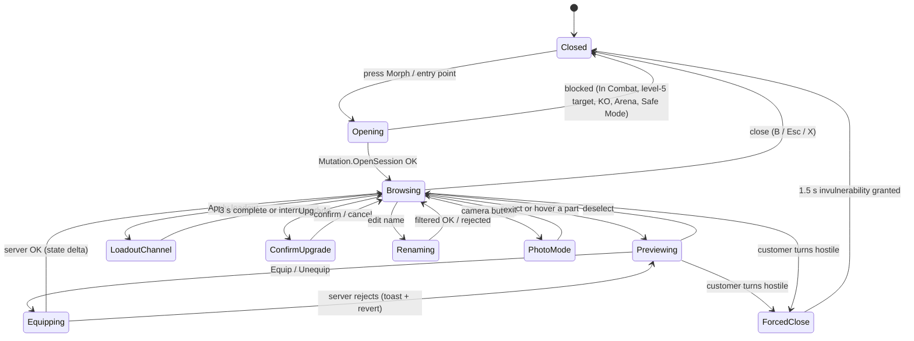

## 13. Morph Customization

> Contributor: A8 (UI/UX + morph customization systems). This section specifies the **Customize Your Morph** screen
> from the mockup (left category list, center 3D preview on a glowing pedestal, right inventory grid) and every rule
> behind it: equipping, loadouts, naming, tints, upgrades, and the doors to Lab fusion and Body Mods. Part data is in
> §12 / §36.3, combination naming and synergies in §12.9–12.10 / §36.4 / §36.5, abilities in §36.6, and the
> generic UI framework in §24.

### 13.1 Purpose & Design Goals

**Purpose.** The morph is the centerpiece of the economy: the restaurant earns the money, and this screen is where
it turns into a ridiculous creature worth showing off. The screen must make three things effortless: **seeing**
the morph (a big rotatable pedestal preview), **deciding** (honest stat deltas and synergy previews before every
equip), and **switching** (saved loadouts for Chef / Fighter / Repair work).

| # | Goal | Measured by |
|---|---|---|
| G1 | Equip any owned part in ≤ 2 taps/clicks from opening the screen | AC-13-01 |
| G2 | No decision without information: every equip shows stat, ability and synergy changes first | AC-13-04, AC-13-05 |
| G3 | Fun to show off: pedestal, preview animations, photo mode, custom name | AC-13-09 |
| G4 | Identical capability on desktop, mobile (landscape and portrait), tablet and controller | AC-13-11 |
| G5 | Server-authoritative: the client only previews; every change is validated by `MutationService` | AC-13-12 |

### 13.2 Entry Points, Blocking Rules & Screen States

**Rules & Mechanics.**

| Entry point | Opens on | Notes |
|---|---|---|
| HUD quick-access "Morph" button (keyboard `M`, mobile button, controller View button) | Parts tab, last category used | Main entry |
| "Equip now" after a Mutation Mart (`BLD_01`) purchase, capsule reveal or quest reward | Parts tab with the new part selected | Shows the equip preview immediately |
| Body Mods (`BLD_02`), talking to stylist Glamtrax (`NPC_005`) | Style tab in **Salon mode** (palette shop, Looks, photo booth) | 13.16 |
| Mutation Laboratory (`BLD_11`), talking to Dr. Splice (`NPC_013`) | Upgrade tab in **Lab mode** (fusion enabled) | 13.16 |
| Morphdex cell "Try this look" (§12.9.4) | Parts tab, filtered to owned parts of the two families | Builds a preview loadout |
| Inspect card "Copy look" on another player | Preview loadout from the parts you own; missing parts listed with where-to-get | 13.17 |
| Tutorial `QST_TUT_010` Your First Mutation | Arms category, the three starter arms highlighted | Guided, other tabs locked until complete |

- **Cannot open** while In Combat (dealt or took damage in the last 6 s), while a level-5 customer targets you,
  while Seeing Stars, during an Arena match, or in Safe Mode (canon E2, E4, E6). The button greys out and a toast
  says "Can't change outfits during a brawl!" (or the matching reason).
- **Auto-close:** if a customer turns hostile toward you while the screen is open, it closes at once and you get
  1.5 s of invulnerability (canon E2). Equips are applied the moment the server accepts them, so nothing is lost.
  An unsent tint draft or a half-typed name is kept locally and restored next time.
- **The world keeps running.** The Morph screen is a full-screen menu over the live game; customers keep waiting.
  A thin **order alert strip** (an overlay panel, allowed by E2) at the top of the screen flashes when any customer
  drops below 30 % patience, with a "Back to work" button.



### 13.3 Layouts & Wireframes

All layouts share one component tree (13.4). `UIController` picks a **layout profile** from the viewport size and
the last input type (`UserInputService.LastInputTypeChanged`) and re-parents panels; nothing is duplicated.

| Profile | Trigger | Reference resolution | Grid columns | Detail panel |
|---|---|---|---|---|
| Desktop | viewport width ≥ 1,100 px and last input mouse/keyboard | 1920 × 1080 (scales 1280 × 720 → 2560 × 1440) | 4 | docked right, under the grid |
| Mobile landscape | touch, width > height, height < 600 px | 844 × 390 | 3 | bottom sheet |
| Mobile portrait | touch, height > width | 390 × 844 | 4 (smaller cards) | bottom sheet |
| Tablet | touch, shortest side ≥ 600 px | 1180 × 820 | 4 | docked right (desktop-like, larger hit areas) |
| Console / 10-foot | last input gamepad, or `GuiService:IsTenFootInterface()` | 1920 × 1080 inside a 90 % safe area | 4 (large cards) | docked right |

**Portrait support.** Gameplay locks phones to landscape. While the Morph screen is open the client sets
`PlayerGui.ScreenOrientation = Enum.ScreenOrientation.Sensor`, so a phone can be turned upright for a tall
"dressing-room" view, and restores `LandscapeSensor` on close.

#### 13.3.1 Desktop (1920 × 1080)

```text
+------------------------------------------------------------------------------------------------------------+
| CUSTOMIZE YOUR MORPH  "Sir Snacks-a-Lot" [edit]  Scorpion Bear (Bear-Scorpion)    12,450 MB  320 MS  8 RT [X]|
| ! Table 4 is getting impatient                                                         [Back to work]       |
+----------------+-----------------------------------------------+--------------------------------------------+
| CATEGORIES     |  [Idle] [Cook] [Fight] [Emote]        [Photo] | [Parts] [Equipped] [Loadouts] [Style] [Upg] |
| > All      12  |                                               | (Search parts, tags, abilities...) [Filter] |
| > Head      3* |                 .-""""-.                      | Sort: Recommended v   [x] Owned  [ ] Locked |
| > Ears         |                (  o  o  )                     | +------+ +------+ +------+ +------+         |
| > Eyes      1* |                 \  ^^  /     3D PREVIEW       | |O     | |^   L | |#     | |@  LK |         |
| > Arms         |              .--/      \--.  (ViewportFrame)  | | icon | | icon | | icon | | Lv25 |         |
| > Legs         |              |   BODY     |~~~ tail           | | Lv 2 | | Lv 4 | | Lv 1 | |      |         |
| > Tails        |               \_/      \_/                    | +------+ +------+ +------+ +------+         |
| > Extras    2* |        ===========================            | +------+ +------+ +------+ +------+  ...    |
|                |         ~ glowing pedestal (rarity color) ~   | (virtualized grid, 40 pooled cards)         |
| SUB-SLOTS      |      drag = rotate  wheel = zoom  R = reset   +--------------------------------------------+
| [L Arm][R Arm] +-----------------------+-----------------------+ DETAIL: Octopus Arm  ^ Uncommon  Lv 2/6    |
| [Hands]        | STATS (preview)       | SYNERGIES  3/5 active | MARINE - octopus - tentacle, chef, multi   |
|                | Cook Speed  64  ^ +6  | * Eight-Arm Kitchen.. | Ability: Octo-Flurry          On bar 2/4   |
|                | Strength    42  v -4  | + Tentacle Tango NEW  | Passive: (from 12) carry +1                |
|                | Movement   100  MAXED | - Battering Ram       | [EQUIP: BOTH  * pair +25%] [Left] [Right]  |
|                | [More stats v]        | [Pins 1/5]            | [Upgrade 450 MB + 8 MS + dupe]             |
+----------------+-----------------------+-----------------------+--------------------------------------------+
| LOADOUTS: [Chef *] [Fighter] [Repair] [4: Lv 20] [5: Morphdex 100]   Look: [Default v]   [Save] [Undo]   |
+------------------------------------------------------------------------------------------------------------+
  Legend: O = Common circle, ^ = Uncommon triangle, # = Rare square, @ = Epic pentagon (real UI draws the C13.3
  glyphs), L = equipped left, LK = level-locked, * = NEW items in category.
```

#### 13.3.2 Mobile Landscape (844 × 390)

```text
+----+---------------------------------+------------------------------+
|Head|   [Idle][Cook][Fight][Emote] [X]| [Parts][Eqp][Load][Style][Up]|
|Ears|                                 | (search)            [Filter] |
|Eyes|          .-""-.                 | +-----+ +-----+ +-----+      |
|Arms|         ( o  o )   PREVIEW      | |  ^  | |  #  | |  O  |      |
|Legs|        /|  ^^  |\               | | Lv2 | | Lv1 | | Lv3 |      |
|Tail|         |______|~~              | +-----+ +-----+ +-----+      |
|Xtra|     ===============             | +-----+ +-----+ +-----+      |
| *  |  [Stats] [Synergies]  (toggle)  | (3 columns, 88 x 108 cards)  |
+----+---------------------------------+------------------------------+
| BOTTOM SHEET (slides up on select): Octopus Arm ^ Lv 2/6 | Cook Spd ^+6 | [BOTH*] [L] [R] [More] |
+---------------------------------------------------------------------------------------------------+
  Category rail = 56 px icon column with text labels under icons; touch targets >= 48 px.
  One-finger drag on the preview rotates; pinch zooms; double-tap resets the camera.
```

#### 13.3.3 Mobile Portrait (390 × 844)

```text
+-----------------------------------------+
| < Back   Scorpion Bear       [Photo][..]|
|                                         |
|              .-""-.                     |
|             ( o  o )     PREVIEW (42%)  |
|            /|  ^^  |\                   |
|             |______|~~                  |
|         ===================             |
| [Idle][Cook][Fight][Emote]  Stats|Syn > |
+-----------------------------------------+
| (Head)(Ears)(Eyes)(Arms)(Legs)(Tails)>> |  <- horizontal chip scroller
| (search parts...)           [Filter]    |
| +----+ +----+ +----+ +----+             |
| | ^  | | #  | | O  | | @  |  4 columns  |
| |Lv2 | |Lv1 | |Lv3 | |LK25|  76 x 96    |
| +----+ +----+ +----+ +----+             |
| ...                                     |
+-----------------------------------------+
| [Chef*][Fighter][Repair][+]   [EQUIP]   |  <- sticky bar; EQUIP = selected part
+-----------------------------------------+
```

#### 13.3.4 Console / 10-Foot (1920 × 1080, 90 % safe area)

```text
+--------------------------------------------------------------------------------------------+
|  (LB) Head  Ears  Eyes  [ARMS]  Legs  Tails  Extras (RB)          Scorpion Bear   12,450 MB |
+------------------------------------------+-------------------------------------------------+
|                                          |  +--------+ +--------+ +--------+ +--------+    |
|               .-""-.                     |  |   ^    | |   #    | |   O    | |   @    |    |
|              ( o  o )                    |  |  icon  | |  icon  | |  icon  | | LK 25  |    |
|             /|  ^^  |\     PREVIEW       |  |  Lv 2  | |  Lv 1  | |  Lv 3  | |        |    |
|              |______|~~                  |  +--------+ +--------+ +--------+ +--------+    |
|          ==================              |  DETAIL: Octopus Arm  ^ Uncommon  Lv 2/6       |
|  (RS) rotate  (LT/RT) zoom  (R3) reset   |  Cook Speed 64 ^+6   Strength 42 v-4            |
|  STATS | SYNERGIES  (L3 toggles)         |  + Tentacle Tango   - Battering Ram             |
+------------------------------------------+-------------------------------------------------+
| (A) Select  (X) Equip both  (Y) Compare  (B) Back  (View) Loadouts  (Menu) Style/Upgrade    |
+--------------------------------------------------------------------------------------------+
  Cards 128 x 156 px; focus ring = 4 px glow + 1.06x scale; text >= 24 px at 1080p.
```

### 13.4 ScreenGui Component Hierarchy

One `ScreenGui` (built from a template in `ReplicatedStorage/UI/MorphScreen`, cloned into `PlayerGui` on first open
and then kept but disabled). Names are the instance names used in code.

```text
MorphScreen (ScreenGui: IgnoreGuiInset=true, ResetOnSpawn=false, DisplayOrder=20, ZIndexBehavior=Sibling, Enabled=false)
└─ Root (Frame, 1x1 scale)  + UIScale "TextScale"  + UIAspectRatioConstraint (desktop only)
   ├─ TopBar (Frame)
   │  ├─ TitleLabel ("CUSTOMIZE YOUR MORPH")
   │  ├─ MorphNameButton (TextButton -> RenameModal)   ├─ GeneratedNameLabel ("Scorpion Bear (Bear-Scorpion)")
   │  ├─ CurrencyStrip (MB / MS / RT labels)          ├─ CloseButton
   │  └─ OrderAlertStrip (Frame, hidden until a customer < 30 % patience) └─ BackToWorkButton
   ├─ CategoryRail (ScrollingFrame + UIListLayout)
   │  ├─ CategoryButton_All, _Head, _Ears, _Eyes, _Arms, _Legs, _Tails, _Extras (ImageButton + Label + NewBadge)
   │  └─ SubSlotChips (Frame + UIListLayout) └─ Chip_<SLOT> (e.g. Chip_ARM_L, Chip_HANDS)
   ├─ PreviewPanel (Frame)
   │  ├─ PedestalGlow (ImageLabel radial sprite + UIGradient; tinted by best equipped rarity)
   │  ├─ PreviewViewport (ViewportFrame: Ambient, LightColor, LightDirection set in 13.5)
   │  │  ├─ PreviewCamera (Camera; ViewportFrame.CurrentCamera)
   │  │  └─ WorldModel
   │  │     ├─ Pedestal (MeshPart, anchored)
   │  │     └─ PreviewRig (Model: R15 rig + Humanoid + Animator + welded mutation MeshParts)
   │  ├─ FXOverlay (ImageLabel flipbook for FX-slot previews)  ├─ ChannelRing (loadout swap progress)
   │  ├─ AnimButtons (Frame) └─ AnimIdle, AnimCook, AnimFight, AnimEmote
   │  ├─ CameraHint ("drag to rotate")  ├─ ZoomSlider (desktop/tablet)  └─ PhotoButton
   ├─ InfoPanels (Frame; tabs on mobile)
   │  ├─ StatsPanel └─ StatRow_<CODE> x9 (Icon, Name, Value, CapBar, Delta, MaxedTag) + DerivedList
   │  └─ SynergyPanel └─ SynergyChip template (ContextIcon, Name, RankPips, StateLabel, PinButton)
   ├─ RightPanel (Frame)
   │  ├─ TabBar └─ Tab_Parts, Tab_Equipped, Tab_Loadouts, Tab_Style, Tab_Upgrade
   │  ├─ PartsPage
   │  │  ├─ FilterBar └─ SearchBox (TextBox), FilterButton, SortDropdown, OwnedToggle, LockedToggle
   │  │  ├─ FilterSheet (category / rarity / tag / ability / upgradeable toggles)
   │  │  └─ InventoryGrid (ScrollingFrame, manual virtualization) └─ PartCard x40 (pooled)
   │  │        PartCard: Icon (ImageRectOffset into atlas), RarityFrame, RarityGlyph, LevelPips,
   │  │                  EquippedBadge (L/R/both), NewDot, LockOverlay, AbilityIcon, DupeCount
   │  ├─ EquippedPage └─ SlotRow_<SLOT> x22 (grouped by UI group headers)
   │  ├─ LoadoutsPage └─ LoadoutCard_1..5, LookCard_1..10, SaveButton, ApplyButton
   │  ├─ StylePage └─ ChannelToggle (Primary/Accent), SwatchGrid, PaletteTabs, ApplyScope, Randomize, Reset
   │  └─ UpgradePage └─ LevelBar, BudgetPreview, CostBreakdown, DupeToggle, UpgradeButton, ConvertDupes, FusionButton
   ├─ DetailDrawer (docked or bottom sheet)
   │  └─ PartIcon, NameLabel, RarityBadge, MetaLine, StatDeltaList, AbilityCard, PassiveCard,
   │     SynergyPreviewList, EquipBothButton, EquipLeftButton, EquipRightButton, UnequipButton, UpgradeShortcut
   ├─ LoadoutBar (bottom strip: 5 slots + Look dropdown + Save + Undo)
   ├─ Modals
   │  └─ ConfirmUpgradeModal, RenameModal, ReplaceAbilityModal, PairPrompt, ConfirmOverwriteModal, ConvertDupesModal
   ├─ Toasts (UIListLayout, max 3 visible)
   └─ ControllerHints (bottom bar; glyphs from UserInputService:GetImageForKeyCode)
```

### 13.5 Rotatable 3D Preview (ViewportFrame + WorldModel)

**Rules & Mechanics.**
- **Build.** On open, the client-side builder of `MorphAssemblyService` clones `ReplicatedStorage/MorphRigs/R15Base`
  into `WorldModel` and welds the equipped mutation MeshParts to the canon attachments (`MMR_HeadCore`,
  `MMR_ArmL_Upper`, …). This is the same code that builds SPCV customer visuals, so the preview always matches the
  in-world morph. The `WorldModel` is what lets the `Humanoid`'s `Animator` play animations inside a ViewportFrame.
  A preview equip swaps only the affected slot's MeshParts (≤ 4 instances), never the whole rig.
- **Camera.** `PreviewCamera` (FieldOfView 30°) orbits the rig's bounding-box center (`Model:GetBoundingBox()`).
  Yaw is free over 360°, pitch is clamped −10° to +35°, and distance runs 6–18 studs. Auto-fit sets distance
  `d = (h / 2) / tan(15°) / 0.8`, so tall morphs (a Brachiosaurus neck, `MUT_114`) still fill 80 % of the viewport
  height.
- **Input.**

| Input | Rotate | Zoom | Reset |
|---|---|---|---|
| Mouse | left-drag: 0.4°/px yaw, 0.25°/px pitch | wheel: 1.0 stud per notch | `R` or double-click |
| Touch | one-finger drag (same rates × 1.5) | `UserInputService.TouchPinch` (scale delta → distance) | double-tap |
| Gamepad | right stick: 180°/s yaw, 90°/s pitch at full deflection, dead zone 0.15 | `LT` out / `RT` in: 6 studs/s × trigger depth | `R3` |

- **Feel [TUNABLE].** Release inertia decays at e^(−6t). After 4 s without input the morph idle-spins at 12°/s.
  Selecting a category eases the camera over 0.35 s (Quad Out) to frame it: Head/Ears/Eyes 5-stud close-up of the
  head; Arms waist-up front view; Legs lower body; Tails rear three-quarter view (yaw +150°); Extras full body.
  **Reduced motion** turns off inertia, idle spin and eased framing (instant cuts).
- **Preview animation buttons:**

| Button | Plays | Notes |
|---|---|---|
| Idle | `ANM_001` | default loop; mismatched legs use `ANM_008` Wobbly gait when walking in Photo mode |
| Cook | `ANM_011` Grill flip, then `ANM_010` Chop, alternating | props (spatula, board) are preview-only MeshParts |
| Fight | the ability animations of the equipped bar abilities in order (`ANM_3xx` ↔ `ABL_0xx`, canon C21); with no actives: `ANM_301` Swipe Combo | a cartoon target dummy appears; no damage numbers |
| Emote | `ANM_065` Mutation equip flex, then `ANM_051` Victory dance | `ANM_065` also plays once after every successful equip |

- **Lighting.** `Ambient` (140, 140, 160), `LightColor` (255, 244, 230), `LightDirection` (−1, −1.2, −0.6).
  ViewportFrames have no shadows, bloom or post-processing, so the **glowing pedestal** is a 2D radial-gradient
  `PedestalGlow` behind the viewport. It is tinted with the color of the best rarity equipped (C13.3) and pulses
  between 0.6 and 0.9 transparency at 0.5 Hz (static with reduced motion). Secret parts give a slowly rotating
  rainbow `UIGradient`.
- **FX-slot limitation.** ParticleEmitters, Beams and Trails do not render inside a ViewportFrame. FX parts are
  previewed by `FXOverlay`, an 8 × 8-frame sprite-sheet flipbook at 24 fps layered over the viewport. A **"See it
  live"** button (unavailable during combat) hides the screen for 6 s of **Mirror mode**: the world camera orbits
  the real character with the UI hidden, then the screen returns.
- **Cost control.** There is exactly one ViewportFrame. The rig respects canon C13.7 (≤ 40 MeshParts, ≤ 15,000
  triangles). Animation tracks stop when the screen is hidden, and the `WorldModel` is cleared 30 s after close.
  If the client's frame time stays above 25 ms for 3 s, the preview drops to **Static mode** (idle pose, no
  animation, 30° rotation steps) and says so in the corner.

### 13.6 Body-Part Categories (canon C13.1 UI groups)

| Category (mockup label) | Slots inside | Sub-slot chips | Camera framing | Empty-slot behavior |
|---|---|---|---|---|
| All | every slot | — | full body | — |
| Head | `HEAD`, `FACE`, `NOSE`, `MOUTH` | Head · Face · Nose · Mouth | head close-up | `HEAD` cannot be emptied; the others show "+ Add" |
| Ears | `EARS`, `HORNS` | Ears · Horns | head close-up, top angle | "+ Add" |
| Eyes | `EYES` | — | face close-up | "+ Add" |
| Arms | `ARM_L`, `ARM_R`, `HANDS` | Left Arm · Right Arm · Hands | waist-up | arms revert to Plain Human (`MUT_139`); hands "+ Add" |
| Legs | `LEG_L`, `LEG_R`, `FEET` | Left Leg · Right Leg · Feet | lower body | legs revert to Plain Human (`MUT_179`); feet "+ Add" |
| Tails | `TAIL` | — | rear three-quarter | "+ Add" |
| Extras | `NECK`, `TORSO`, `WINGS`, `BACK`, `SKIN`, `FUR`, `SCALES`, `FX` | Neck · Torso · Wings · Back · Skin · Fur/Scales · FX | full body | torso reverts to Plain Human (`MUT_117`); others "+ Add" |

- Each category button shows a **NEW** badge with the count of owned parts the player has not opened yet. The
  badge clears when the card scrolls into view for ≥ 1 s.
- Picking a sub-slot chip filters the grid to parts that fit it; an `ARM` part fits both arm chips.
- `FUR` and `SCALES` share one chip, "Fur/Scales", because they are mutually exclusive (13.8).

### 13.7 Mutation Inventory Grid

**Card anatomy** (desktop 112 × 136 px, mobile 88 × 108 px / 76 × 96 px portrait, console 128 × 156 px):

| Element | Position | Content |
|---|---|---|
| Icon | center | atlas sprite (13.22), 3/4 view on a transparent background |
| Rarity frame + glyph | border + top-left | canon color **and** shape (13.9) |
| Level pips | bottom | "Lv 3/7", pips filled per level |
| Equipped badge | top-right | `L`, `R`, `L+R` or ✓ |
| NEW dot | top-right (under badge) | unseen part |
| Lock overlay | full card, 60 % dark | "Lv 25" equip requirement (C13.3), or a padlock + source icon for unowned parts |
| Ability icon | bottom-right | the part's active ability, if it has one |
| Duplicate count | bottom-left | "+2" duplicates owned (upgrade fuel) |

**Filters** (combinable; the active filter count shows on `FilterButton`):

| Filter | Options | Default |
|---|---|---|
| Slot | the sub-slot chips of the category (13.6) | category's all |
| Category | the 16 canon categories, each with an icon | all |
| Rarity | Common … Secret, 7 toggles with glyphs | all |
| Tag | the 33 canon synergy tags as chips (`chef`, `fighter`, `repair` …) | none |
| Ownership | Owned · Locked (seen in shops, Morphdex or capsule odds but not owned) · All | Owned |
| Has active ability | on/off | off |
| Upgradeable now | on/off (enough currency + duplicate or substitute MS) | off |

**Sorting:** *Recommended* (default: equipped first, then parts that would activate a new synergy, then rarity
high→low, then level), Rarity, Level, Power (stat budget per C13.4), Newest, Name A–Z, or by any single stat
(e.g. "COOK_SPD high→low").

**Search** (`SearchBox`): matches part name, family, category, tags and ability name, case- and accent-insensitive.
Tokens are ANDed ("tentacle chef" → Octopus Arm, Octopus Head). Results update after a 150 ms debounce. Search text
stays on the device and is never shown to anyone else, so it needs no text filtering.

**Locked and secret parts.** Locked cards show a silhouette, rarity and source ("Mutation Mart", "Capsule",
"Event", per §12 acquisition codes). Pressing **Where to get?** sets a map waypoint. Undiscovered Secret parts show
only a "?" card with a riddle hint once the player has found the hint location (canon C13.8). They are never
silhouetted, so secrets stay secret.

**Virtualization.** The grid keeps a pool of 40 `PartCard` instances. `CanvasSize` is set from the row count, and
on `CanvasPosition` changes the visible row range is recomputed and pooled cards are re-bound (icon rect, labels).
No card is created or destroyed while scrolling.

### 13.8 Equipped Panel, Equip / Unequip Controls & Slot Rules

**Equipped panel.** A "paper-doll" list of all 22 slots, grouped under the seven UI-group headers. Each row shows
icon, name, level and rarity glyph. Selecting a row selects that slot's chip and filters the grid. Empty optional
slots read "+ Add"; mandatory slots show their Plain Human default in grey.

**Ownership rule.** Owning a part ID once lets you wear it on *both* sides. `ARM` and `LEG` parts are mirrored
automatically (canon C13.1), so a matched pair never needs a second copy. Extra copies are **duplicates**: upgrade
fuel or MS conversion (13.15). The starter morph's "×2" arms and legs are one owned part worn on both sides.

**Controls.**

| Action | Mouse/keyboard | Touch | Gamepad |
|---|---|---|---|
| Select part | click card | tap card (opens bottom sheet) | D-pad / left stick + `A` |
| Equip (single-slot part) | double-click card, or `E`, or EQUIP button | EQUIP in sheet or sticky bar | `A` on EQUIP, or `X` quick-equip |
| Equip ARM/LEG to both sides | EQUIP BOTH (default button) | EQUIP BOTH | `X` |
| Equip to one side | Left / Right buttons, or `Shift`+click = left, `Ctrl`+click = right | Left / Right buttons | `A` → choose side |
| Unequip | right-click equipped card → Unequip, or `Del` | UNEQUIP in sheet | `Y` → Unequip |
| Undo last change (10 deep) | `Ctrl+Z` or Undo | Undo | hold `B` 0.5 s |

**Slot rules (all re-checked by the server, 13.20).**

1. **One part per anatomy slot.** Equipping into an occupied slot replaces the part; there is no confirmation
   because Undo exists.
2. **Arms.** An `ARM` part may go to `ARM_L`, `ARM_R` or both. The default button is **Both** when the other arm is
   Plain Human or already the same part; otherwise it is the side selected in the chips. Both arms with the same
   part show the canon **matched pair** bonus as "★ Pair: +25 % to this pair's stats" plus the part's paired
   ability bonus (§36.6).
3. **Legs.** Same as arms. If the legs end up mismatched, the drawer shows "Wobbly gait (no penalty)" and plays
   `ANM_008` in the preview once, with a "Make a pair (+25 %)" shortcut.
4. **Fur ⊕ Scales.** Equipping a `FUR` part while `SCALES` is worn, or the reverse, removes the other and shows
   "Swapped Scales for Fur" with a 5 s Undo. `SKIN` is independent and stays under either covering.
5. **Mandatory slots.** Unequipping a torso, arm or leg reverts it to the Plain Human default. `HEAD` can only be
   swapped; its Unequip button is disabled with the tooltip "Every morph needs a head. Probably."
6. **Level requirement.** Parts above the player's level (canon C13.3 / C4.5: Common 1, Uncommon 5, Rare 12,
   Epic 25, Legendary 40, Mythic 60, Secret by condition) show the lock overlay and "Reach Lv 25 to equip". They
   can still be previewed on the pedestal ("Try on") but not equipped.
7. **Ability bar (max 4 active abilities, canon C12.1).** If a new part brings an active ability and the bar is
   full, `ReplaceAbilityModal` asks which ability to drop, or "Keep on bench". Benched abilities are inactive until
   swapped onto the bar.
8. **Carry capacity (canon C3).** If the change would leave you carrying more items than your new capacity
   (e.g. removing an Octopus Arm while holding 2 plates), the equip is refused with "Put something down first!"
   (code `CARRY_OVER`).
9. **Height changes.** `LEG` and `NECK` parts change `Humanoid.HipHeight` and head offset (C13.7). The server
   re-seats the character on the floor and, indoors, ensures the new height does not clip through a ceiling; if it
   would, the character is nudged ≤ 2 studs to open space.

**Instant, optimistic, authoritative.** Single-part equips are instant (canon E4). The client applies the change
to the preview right away and sends `Mutation.Equip`. On rejection, the preview reverts and a toast explains why.
On success, the real character updates through `MorphAssemblyService` and the screen receives the new stats and
synergy snapshot.

### 13.9 Rarity Indicators (canon C13.3)

Rarity is always shown by **color + shape + text**, never by color alone.

| Rarity | Color | Glyph | Frame pattern (second cue) | Pedestal glow |
|---|---|---|---|---|
| Common | gray `#9AA0A6` | ● circle | plain 2 px border | soft gray |
| Uncommon | green `#3DDC84` | ▲ triangle | dotted border | green |
| Rare | blue `#3A8DFF` | ■ square | double border | blue |
| Epic | purple `#A15CFF` | ⬟ pentagon | notched corners | purple |
| Legendary | orange `#FF9F1C` | ★ star | star corner studs | orange, slow shimmer |
| Mythic | magenta `#FF3EA5` | ⬢ hexagon | hex-tiled border (animated unless reduced motion) | magenta, shimmer |
| Secret | rainbow shimmer on black | ? glyph | black card, rainbow edge | rotating rainbow |

The detail drawer always spells out the rarity name ("Uncommon"). Tints (13.14) never change rarity frames.

### 13.10 Stats Panel & Compare Deltas

**Rules & Mechanics.** The panel shows the nine canon stats with their effective values. Each value is the sum of
level-up allocation, part budgets (C13.4, including the matched-pair +25 %), skill nodes (§14) and synergy `STAT`
effects (capped at +25 per stat, §12.10.3), then clamped to the canon cap. The same shared module `StatCalc` that
the server uses computes the numbers, so a preview always equals the post-equip result.

| Row element | Normal | While previewing a change |
|---|---|---|
| Value | "64" | "64 → 70" |
| Delta | — | **▲ +6** (green `#3DDC84`, up arrow) / **▼ −4** (orange-red `#FF6B4A`, down arrow) / "= 0" (gray). The arrow and sign are always present. Colorblind modes switch to blue `#3A8DFF` / orange `#FF9F1C`. |
| Cap bar | fill = value / cap | ghost segment shows the change |
| MAXED | value ≥ cap: bar full, label **MAXED** | "MAXED (+7 wasted)" in gray italics when a change would overflow the cap |

The default view shows the mockup's four headline stats (Cooking, Strength, Repair, Luck; canon C5). **More stats**
expands all nine plus a derived block in plain numbers:

| Derived line | Formula (canon C5) | Example |
|---|---|---|
| WalkSpeed | `16 × (1 + 0.003 · MOVE)`, max 21 studs/s including synergies | "17.4 → 18.1 studs/s" |
| Cooking time | `× 1 / (1 + 0.006 · COOK_SPD)` | "× 0.72 → × 0.70" |
| Perfect window | `× (1 + 0.005 · COOK_QLT)` | "× 1.30 → × 1.33" |
| Damage | `× (1 + 0.008 · STR)` | "× 1.34 → × 1.31" |
| Damage taken | `× 100 / (100 + DEF)` | "× 0.77" |
| Repair speed | `× (1 + 0.01 · REPAIR)` | "× 1.45" |
| Max HP | `100 + 2 × (Level − 1) + mutation HP` | "142 → 162" |
| Carry capacity | 1 + carry parts, hard max 3 | "2 → 3" |

### 13.11 Ability Descriptions & Synergy Preview

- **Ability card:** icon, player-facing name (never the ID), type (melee / ranged / utility), cooldown, one-line
  description from §36.6, state ("On bar 2/4" or "On bench"), and **Try it**, which plays the ability's
  `ANM_3xx` animation on the pedestal against the cartoon dummy.
- **Passive card:** the part's passive from §12, with numbers at the current level and "Next level:" in gray.
- **Synergy preview.** When a card is selected, the shared `SynergyEvaluator` (§12.10.7) runs on the hypothetical
  loadout and the Synergy panel shows the differences:

| Line | Meaning | Look |
|---|---|---|
| `+ Would activate: Tentacle Tango` | a new winner enters the active 5 | green plus sign + text |
| `− Would deactivate: Battering Ram` | an active synergy stops qualifying | red minus sign + text |
| `⇄ Would replace: Oven Mitts Optional → Dragon's Own Kitchen` | same stacking group, higher rank takes over | swap arrows |
| `… Would be suppressed (limit 5): Glow Up` | qualifies but does not fit in the 5 slots | gray, with a "Pin" shortcut |

- **Synergy Hunt.** In the Synergies tab, choosing any §36.4 synergy filters the grid to owned parts that move
  you toward it and shows progress ("chef parts 3/5"), with the missing pieces' sources for unowned parts.
- **Pins.** Up to 5 synergies can be pinned; pins decide which synergies win when more than 5 qualify
  (§12.10.3). Pins are saved per loadout.

### 13.12 Saved Loadouts & Switching Rules

**Loadout slots.**

| Slot | Default name & icon | Unlock | Cost |
|---|---|---|---|
| 1 | Chef Loadout (pan) | from the start (pre-filled with the current morph after `QST_TUT_010`) | free |
| 2 | Fighter Loadout (fist) | from the start | free |
| 3 | Repair Loadout (wrench) | from the start | free |
| 4 | Custom (star) | player level 20 | free (earnable) |
| 5 | Custom (star) | Morphdex tier 4: 100 Spotted + 25 Worn (§12.9.4) | free (earnable) |
| Looks 1–2 | "Natural", "Party" | from the start | free |
| Looks 3–10 | cosmetic loadouts | §23 (Robux, cosmetic only), or 1 extra Look from an event reward | — |

- A **functional loadout** stores per-slot part IDs, per-slot tints, the 4-slot ability bar order, synergy pins,
  an optional loadout name and a linked Look. Names, icons and order are editable.
- A **Look** (cosmetic loadout) stores *appearance only*: tints, FX visibility, nameplate title, pedestal style and
  Photo-mode pose. It can be applied on top of any functional loadout. Looks never store parts, so buying Look
  slots can never change stats. This keeps §23 strictly non-pay-to-win.
- **Save:** "Save to slot" snapshots the current morph; overwriting a non-empty slot asks for confirmation.
  "Revert" restores the slot's saved state into the preview.

**Switching restrictions (canon E4).**

| Situation | Rule [TUNABLE values from canon] |
|---|---|
| Single-part equip inside the Morph screen | instant |
| Applying a whole loadout (from the screen, or from the HUD quick-swap wheel: hold `Q`, long-press the mobile Morph button, or hold D-pad up) | **3 s channel**, then a **10 s cooldown** that starts when the channel completes |
| During the channel | walk at 50 % speed; interacting, attacking, or taking damage **interrupts** it (no cooldown consumed). A cartoon "costume-change" dust cloud plays (client FX), with `ANM_065` on completion |
| In Combat (6 s flag), Seeing Stars, a level-5 customer targeting you | channel cannot start; the wheel shows "Can't change outfits during a brawl!" |
| Arena (`BLD_08`) | the loadout is locked when the match is accepted; it can be changed in the lobby under the same channel rules |
| Carrying items | allowed only if the target loadout's carry capacity ≥ items carried |
| Loadout contains a part no longer owned (converted to MS) or above your level | that slot keeps its current part; the card shows "1 part missing" with a fix-up shortcut |
| Applying a Look | instant, no cooldown (purely cosmetic), not during combat |

### 13.13 Morph Naming

- **Rules.** 3–20 characters after trimming (counted with `utf8.len`), letters (including accented Latin),
  digits, space and `- ' ! ? .`. No line breaks, no rich-text tags (nameplates use `RichText = false`), and runs of
  spaces collapse to one. An empty name means "use the generated display name" (§12.9.2).
- **Input.** `RenameModal` has a `TextBox` (`ClearTextOnFocus = false`) with a live counter ("12/20"). Over-long
  input is trimmed on `GetPropertyChangedSignal("Text")`, because Roblox TextBoxes have no max-length property.
- **Server flow (`Mutation.RenameMorph`).**
  1. Validate type, length and character set.
  2. Rate limit: 1 attempt per 30 s and 10 per 24 h per player [TUNABLE]. Every attempt counts, so the filter
     cannot be brute-forced.
  3. If `TextChatService:CanUserChatAsync(userId)` is false, custom names are disabled for that account: the
     nameplate shows the generated name and the button explains why.
  4. `TextService:FilterStringAsync(text, player.UserId, Enum.TextFilterContext.PublicChat)` inside `pcall`, then
     `:GetNonChatStringForBroadcastAsync()`. If the result differs from the input (characters replaced by `#`), the
     name is rejected: "The filter scrambled that one. Try another!". If the filter service errors, the name is
     rejected with "Name service is busy, try again soon" and the attempt is not counted.
  5. Store `rawName` (owner's audit only, never displayed) and `filteredName`. Everyone, including the owner, sees
     `filteredName`.
  6. **Re-filter on every join:** filter rules change, so the saved name is filtered again at session start. If it
     now comes back scrambled, it resets to the generated name and the player gets a notice.
- **Where names appear:** the overhead nameplate (`BillboardGui`, MaxDistance 60 studs), the inspect card, the
  Showcase Stage (`BLD_22`) and co-op guest lists. Each loadout may carry its own name ("Chef Loadout" can be
  "Sir Saucelot").

### 13.14 Cosmetic Color Selection (Style tab)

- **Channels.** Each mutation part has a **Primary** tint (its `MeshPart.Color`, shown through the
  `SurfaceAppearance` color map's alpha, `AlphaMode = Overlay`) and an **Accent** tint (the `Color` of its `Accent`
  child MeshPart). Coverings (`SKIN` / `FUR` / `SCALES`) have one tint applied to the covering shell. Untintable
  details (eyes' pupils, Secret shimmer) are masked out.
- **Palettes.**

| Palette source | Examples | How to get |
|---|---|---|
| Starter (16 swatches) | Ketchup Red, Mustard, Pickle, Blueberry, Cream, Charcoal… | free |
| Earnable (canon C17.4 reward type) | "Museum Pastels", "Fossil Tones", "Neon Specimen" (§12.9.4); quest, achievement, milestone and event palettes from §14, §18, §20 | rewards |
| Body Mods shop (earnable cosmetics, canon C4.1) | "Sewer Chic", "Diner Neon", "Critic's Choice" | 2,500–25,000 MB each at `BLD_02` [TUNABLE] |
| Cosmetic packs | themed palettes | §23 (Robux, cosmetic only) |

- **Controls.** Swatch grid (8 per row), Primary/Accent toggle, and an **apply scope**: this part / this category /
  everything. Also **Match** (copy another part's tint), **Randomize** (undoable) and **Reset to natural**.
  Changes preview instantly and are batched to the server after 0.5 s of inactivity (`Mutation.SetTints`, ≤ 22
  entries per call).
- **Readability rules.** The rainbow shimmer stays reserved for Secret parts (never offered as a tint). Tints never
  touch UI rarity frames. Tints are stored per loadout and slot as compact swatch codes
  (`paletteId × 32 + swatchIndex`), and the server checks palette ownership. With **Keep colors** on (default), a
  part swapped into a slot inherits that slot's tint.

### 13.15 Mutation Upgrade Controls (Upgrade tab)

**Rules & Mechanics** (canon C4.6 and C13.4).
- Upgrading level `L → L+1` costs `MB = BaseMB × 1.5^(L−1)` (rounded half up to whole MB), `MS = BaseMS × L`,
  `RT = RTBase × (L − 3)` for Epic+ from L ≥ 4, **plus one duplicate** of the part **or** `DupeSubstituteMS` extra
  MS (Common 10, Uncommon 25, Rare 60, Epic 160, Legendary 400, Mythic 1,000, Secret 600; Secrets can never
  duplicate, so they always pay the substitute).
- The page shows: level bar ("Lv 3 / 7"); the stat budget now and next (`Budget × (1 + 0.12 × (L − 1))`: Lv1 ×1.00
  → Lv2 ×1.12 → … → Lv10 ×2.08), with the per-stat result in the Stats panel as ▲ deltas; the cost breakdown with
  owned amounts (missing amounts in red with a ✗ glyph); the **Use duplicate (owned: 2)** / **Pay +60 MS instead**
  toggle; and **UPGRADE**.
- **Confirmation.** Every upgrade opens `ConfirmUpgradeModal` with the exact costs. Costs ≥ 10,000 MB or any RT need
  **hold to confirm** for 0.8 s (accessibility option: "tap twice instead"). The request carries `expectedLevel`,
  so a double-tap or a network retry can never upgrade twice.
- **Duplicates.** The duplicates list shows each part with spare copies, **Convert to MS** at the canon rate
  (Common 5, Uncommon 12, Rare 30, Epic 80, Legendary 200, Mythic 500), and a **Keep for upgrades** toggle.
  Capsule duplicates auto-convert unless it is on (canon C4.7).
- **Max level** shows "MAX" with a sparkle, and the button becomes "Fully upgraded!".

**Upgrade cost per step (MB / MS / RT; plus one duplicate or the substitute MS) [TUNABLE, from canon C4.6]:**

| Step | Common | Uncommon | Rare | Epic | Legendary | Mythic | Secret |
|---|---|---|---|---|---|---|---|
| Lv1→2 | 100 / 2 | 300 / 4 | 900 / 8 | 3,000 / 15 | 10,000 / 30 | 30,000 / 50 | 15,000 / 40 |
| Lv2→3 | 150 / 4 | 450 / 8 | 1,350 / 16 | 4,500 / 30 | 15,000 / 60 | 45,000 / 100 | 22,500 / 80 |
| Lv3→4 | 225 / 6 | 675 / 12 | 2,025 / 24 | 6,750 / 45 | 22,500 / 90 | 67,500 / 150 | 33,750 / 120 |
| Lv4→5 | 338 / 8 | 1,013 / 16 | 3,038 / 32 | 10,125 / 60 / 1 RT | 33,750 / 120 / 2 RT | 101,250 / 200 / 4 RT | 50,625 / 160 / 3 RT |
| Lv5→6 | — | 1,519 / 20 | 4,556 / 40 | 15,188 / 75 / 2 RT | 50,625 / 150 / 4 RT | 151,875 / 250 / 8 RT | 75,938 / 200 / 6 RT |
| Lv6→7 | — | — | 6,834 / 48 | 22,781 / 90 / 3 RT | 75,938 / 180 / 6 RT | 227,813 / 300 / 12 RT | 113,906 / 240 / 9 RT |
| Lv7→8 | — | — | — | 34,172 / 105 / 4 RT | 113,906 / 210 / 8 RT | 341,719 / 350 / 16 RT | 170,859 / 280 / 12 RT |
| Lv8→9 | — | — | — | — | 170,859 / 240 / 10 RT | 512,578 / 400 / 20 RT | 256,289 / 320 / 15 RT |
| Lv9→10 | — | — | — | — | — | 768,867 / 450 / 24 RT | 384,434 / 360 / 18 RT |
| **Total to max** | **813 / 20** | **3,957 / 60** | **18,703 / 168** | **96,516 / 420 / 10 RT** | **492,578 / 1,080 / 30 RT** | **2,246,602 / 2,250 / 84 RT** | **1,123,301 / 1,800 / 63 RT** |

Worked check: a Rare part from Lv1 to Lv7 costs 18,703 MB + 168 MS + 6 duplicates (or 360 extra MS). At TIER_04
income (3,100 MB per active hour), that is about 6 active hours of income, in line with canon's 50 % "mutations,
furniture, staff" spending share.

### 13.16 Entry to Lab Fusion (`BLD_11`) and Body Mods (`BLD_02`)

| Button (location) | Inside the building | Elsewhere |
|---|---|---|
| **Fusion** (Upgrade tab) | Opens the Fusion sub-panel in Lab mode: pick inputs from the grid. Mythic fusion = 3 Legendary parts of the same category + 600 MS + 40 RT (canon C4.5); other fusion recipes per §12. Inputs show their stat loss and the preview shows the result silhouette | Shows "Visit Dr. Splice at the Mutation Laboratory (Mutation Research District, `DST_06`)" with **Set waypoint** and **Morph Metro** (if that station is discovered) |
| **Get more palettes** (Style tab) | Salon mode: Palette Shop (MB purchases), Look slot management, Photo Booth backdrops, a free rename (skips the 30 s cooldown once per visit) | Waypoint to Body Mods (Mutation Market, `DST_02`) |
| **Where to get?** (locked card) | — | Waypoint to the source building (Mutation Mart `BLD_01`, Mystery Market `BLD_13`, Lab, quest giver) |

Fusion and shop transactions are owned by `MutationService` and `EconomyService` (§12, §18, §22). This screen only
hosts their UI and shows the result on the pedestal.

### 13.17 Show-Off Features

- **Photo mode** (camera button): hides all UI, offers poses (Idle, Flex `ANM_065`, Victory `ANM_051`, any
  equipped ability pose), backdrops (Restaurant, Neon City, Museum, Plain) and a frame with the display name, key
  and rarity glyphs. On supported platforms it uses `CaptureService:CaptureScreenshot`, then
  `CaptureService:PromptSaveCapturesToGallery`, or the platform share prompt where available. Elsewhere it shows a
  "screenshot now!" pose timer.
- **Inspect card** (hold Inspect 2 s on a player or NPC within 12 studs): display name, key, parts (icons),
  active synergies, and the **Morphdex Spotted** credit (§12.9.4). For players, **Copy look** builds a preview
  loadout from the parts you own, listing the missing ones with where-to-get.
- **Showcase Stage (`BLD_22`):** the Morph screen's current loadout is what struts the runway. Legendary-rarity
  synergies such as [[Museum Piece]] add the special entrance.
