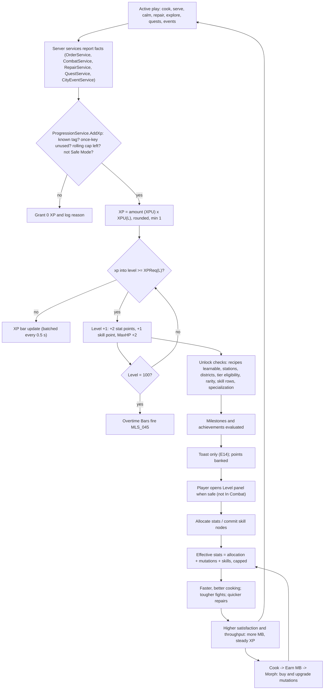

## 14. Player Progression

> **Binding inputs:** canon §C5 (stats), §C5.1 (XP curve), §C4.4 (pacing), §C6 (tiers),
> §C7.1 (stations), §C10 (recipe unlock levels), §C16.1 (districts), §C17.4 (reward vocabulary), §C18 (skill trees),
> §C22 E14. Tables between `BEGIN/END GENERATED` markers are produced from the canon formulas by
> `python3 gdd/tools/render_progression.py` (run `--check` to validate this section, §36.16 and §36.17). Do not hand-edit them.

### 14.1 Purpose and Progression Philosophy

**Purpose.** Progression is the glue of the creative director's loop **Cook → Earn → Morph → Become More Powerful →
Run a Better Restaurant → Earn More → Discover Rarer Morphs**. Cooking pays twice: **XP** (which *unlocks possibility*:
recipes become learnable, districts open, tiers become eligible, rarer mutations become equippable, skill rows open) and
**MB/MS/RT** (which *buy actuality*: learning, parts, upgrades, staff). Neither alone is enough — a rich Level-10 player
cannot run a `TIER_05` restaurant, and a Level-80 player with no Morph Bucks still owns a shack.

**Design principles (all binding for every section that grants progress):**

1. **Every session progresses something** (brief 26.5). The end-of-session **Recap card** always shows ≥ 3 moved bars
   (XP, MB, a quest or achievement counter) and the next unlock ("2 levels until the Arena District!").
2. **The morph is the star.** Allocated stats are deliberately small (≤ 50 per stat, 198 points total) so identity comes
   from mutations (§12) and skills. Reference split of a Level-60 player's effective stat points: ≈ 30 % allocation,
   ≈ 55 % mutations, ≈ 15 % skills [TUNABLE].
3. **Choices, not chores.** 198 stat points vs 450 allocatable (9 × 50) means a player can max at most ~4 stats; the
   skill trees cost **222 points** against at most **130 obtainable** (§14.14). Respecs are cheap enough to experiment.
4. **Never lose progress.** XP never decreases, levels never drop, KOs ("Seeing Stars") cost no XP (§C12.1), and nothing
   decays while away (§C22 E5).
5. **Active play levels you; offline play pays you.** XP is earned only online. The offline simulation (§17, §C15) yields
   MB, MS finds and capsules, never XP — returning players want to *play* with what their staff earned.
6. **No pay-to-win.** No XP boosters, paid skill points or paid respecs exist for Robux (§23). XP multiplier events are
   limited to the `EVENT` allowance in §14.5 and never exceed ×1.25 on `DISH` XP [TUNABLE].

**Session progress guarantee (competent play, any level)** [TUNABLE]:

| Session | XP (in XPU, §14.3) | Other guaranteed movement |
|---|---|---|
| 5 min | ≥ 8 XPU (≥ 34 % of a Level-1 level, ≥ 2.3 % of a Level-99 level) | ≥ 1 achievement/quest counter advanced; MB earned |
| 15 min | ≈ 25 XPU (more than all of Level 1; one daily-quest equivalent) | ≥ 1 daily-quest objective; a purchasable upgrade step at T1–T4 |
| 45 min | ≈ 75 XPU (one full level up to L16) | a daily quest completed; a mutation or station purchase typical |

### 14.2 Progression Layers

| Layer | Grows by | Gate | Detailed in |
|---|---|---|---|
| Player level 1–100 | XP from active play (§14.5) | — | §14.3–14.4 |
| Player statistics (9) | 2 points/level + mutations + skill nodes | max 50 allocated per stat; per-stat caps | §14.7, §12 |
| Skill trees (3 primary + 2 specializations) | 1 point/level from L2 + milestone/achievement/quest grants | row level gates and points-in-tree gates | §14.9–14.15 |
| Morph collection | MB/MS/RT purchases, capsules, quests, events | rarity equip level (Common 1 · Uncommon 5 · Rare 12 · Epic 25 · Legendary 40 · Mythic 60) | §12, §13 |
| Recipes | MB at the Cooking Academy `BLD_06` (5 × price) or quests | recipe unlock level (§C10) | §6 |
| Restaurant tier | MB (+ City Hall permit at `TIER_04`+) | required level (§C6) | §15 |
| Kitchen stations | MB at Restaurant Supplies `BLD_03` | availability level + minimum tier (§C7.1) | §5 |
| Morph City | walking, Morph Metro, Pigeon Taxi | district unlock level (§C16.1) | §18 |
| Staff | MB (hire, wages) | tier employee cap | §16 |
| Mastery & collection | achievements, milestones | — | §36.16, §36.17 |

### 14.3 Level System

**Purpose.** A single, readable number ("Level 12" on the mockup) that paces content unlocks across ≈ 185 active hours.

**Rules & Mechanics.**

- Levels run **1 → 100** (§C3 cap). XP needed to go from level L to L+1 (canon §C5.1, verbatim):
  **`XPReq(L) = round((180 + 30·L) × 1.045^(L−1))`**.
- Reference XP rate of a competent player at level L (canon §C5.1, verbatim): **`XPRate(L) = 900 × 1.045^(L−1)` XP per
  active hour**, ≈ 75 % from cooking/serving and 25 % from quests, combat, repairs, exploration and events.
- **XP Unit.** This section defines **`XPU(L) = XPRate(L) / 100 = 9 × 1.045^(L−1)` XP** — "one percent of a competent
  hour". Every XP source in the game is specified in XPU and converted at the player's level *at the moment of the grant*
  (rounded to the nearest whole XP, minimum 1). Example: XPU(1) = 9 XP, XPU(12) = 14.6 XP, XPU(30) = 32.3 XP, XPU(90) = 452 XP.
- **Consequence (closed form).** `XPReq(L) / XPU(L) ≈ 20 + 10·L/3` XPU, so level L takes **≈ 0.2 + L/30 active hours**
  (L1 0.23 h · L10 0.53 h · L30 1.2 h · L60 2.2 h · L99 3.5 h) no matter how big the raw XP numbers get. Live-ops can retune
  activity values without breaking pacing as long as a competent hour still totals ≈ 100 XPU (§14.5.3).
- XP overflow carries over; one grant may produce several level-ups (processed in order, one combined toast).
- **Per level gained:** +2 stat points (§C5), +1 skill point (from L2, §C18), Max HP +2 (§14.8), plus every unlock listed
  in the level table (§14.4). Points are **banked** until the player chooses to spend them (§C22 E14).
- **Level 100.** The XP bar becomes an **Overtime Bar** of `XPReq(99)` = 235,346 XP; each full bar fires milestone
  `MLS_045` (repeatable). Total XP keeps counting for leaderboards.
- **Display.** HUD chip "Lv 12" with an XP bar (`xp / XPReq(L)`, `xp` = XP into the current level), a gold "+" badge while points are unspent, and a
  tooltip naming the next two unlocks from §14.4.

**Variables.**

| Variable | Value | Notes |
|---|---|---|
| `LEVEL_CAP` | 100 | §C3 |
| `XP_BASE`, `XP_SLOPE`, `XP_GROWTH` | 180, 30, 1.045 | §C5.1 [TUNABLE] (canon-owned: change only via canon) |
| `XPRATE_BASE` | 900 XP/h at L1 | §C5.1 [TUNABLE] |
| `XPU(L)` | `XPRate(L) / 100` | defined here |
| `STAT_POINTS_PER_LEVEL` | 2 | §C5 |
| `SKILL_POINTS_PER_LEVEL` | 1 (from L2) | §C18 |
| `OVERTIME_BAR_XP` | `XPReq(99)` = 235,346 | [TUNABLE] |
| `LEVELUP_SAVE_THROTTLE` | 60 s | a level-up requests a profile save at most once per 60 s [TUNABLE] |

### 14.4 Level Table (1–100)

Columns: **XP to next** = `XPReq(L)`; **Cumulative XP** = total XP to *reach* L; **≈ Cum. active h** = `Σ XPReq(k)/XPRate(k)`
for k < L (a competent player earning 100 XPU/h); **Stat pts / Skill pts** = cumulative points granted by levels alone
(bonus skill points from level milestones are flagged in the Unlocks column; achievement and quest grants are not shown).
**Unlocks** lists what becomes *available*: listed recipes become **learnable** (bought at `BLD_06`), stations become
**purchasable**, tiers become **eligible** (MB still required), districts open. Canon reference values reproduced exactly:
XPReq(10) = 713, XPReq(45) = 10,612, cumulative L26 = 28,402, L80 = 1,365,697, L100 = 4,319,405.

<!-- BEGIN GENERATED: levels -->
| Level | XP to next | Cumulative XP | ≈ Cum. active h | Stat pts (cum.) | Skill pts (cum.) | Unlocks at this level |
|---|---|---|---|---|---|---|
| 1 | 210 | 0 | 0.0 | 0 | 0 | Start: Broken Burger Shack, 12-station starter kit, `DST_01`/`DST_02` (+`DST_03` at tutorial step 10), Common mutations, free starter part (`QST_TUT_010`) · **Recipes known (4):** `RCP_BRG_001`, `RCP_BRG_002`, `RCP_DRK_001`, `RCP_FRI_001` |
| 2 | 251 | 210 | 0.2 | 2 | 1 | Skill points begin (1/level) · skill Row 1 of every primary tree · **Stations:** `STN_STOVE` · **Recipes (4):** `RCP_BRK_001`, `RCP_DRK_002`, `RCP_PST_001`, `RCP_SAN_001` · `MLS_014` |
| 3 | 295 | 461 | 0.5 | 4 | 2 | **Stations:** `STN_OVEN`, `STN_PIZZA_OVEN` · **Recipes (6):** `RCP_BRK_002`, `RCP_DES_001`, `RCP_PIZ_001`, `RCP_PIZ_002`, `RCP_SAL_001`, `RCP_SAN_003` |
| 4 | 342 | 756 | 0.8 | 6 | 3 | **District:** `DST_08` Residential District · **Stations:** `STN_SOUP_POT`, `STN_ICECREAM` · **Recipes (5):** `RCP_BRG_003`, `RCP_DES_002`, `RCP_FRI_002`, `RCP_SAN_002`, `RCP_SOP_001` |
| 5 | 394 | 1,098 | 1.1 | 8 | 4 | Uncommon mutations equippable · skill Row 2 · **Tier:** `TIER_02` Tiny Mutation Diner eligible · **Stations:** `STN_BLENDER`; `STN_MIXER`, `STN_FREEZER`, `STN_PLATING` (needs `TIER_02`) · **Recipes (5):** `RCP_BRG_006`, `RCP_BRK_003`, `RCP_DRK_003`, `RCP_PST_002`, `RCP_TAC_001` · `MLS_032` |
| 6 | 449 | 1,492 | 1.5 | 10 | 5 | **District:** `DST_05` Monster Mall · **Recipes (5):** `RCP_DES_003`, `RCP_DRK_004`, `RCP_PIZ_003`, `RCP_PST_003`, `RCP_TAC_002` |
| 7 | 508 | 1,941 | 1.9 | 12 | 6 | **Stations:** `STN_STEAMER` (needs `TIER_02`) · **Recipes (4):** `RCP_BRG_005`, `RCP_DES_004`, `RCP_SEA_001`, `RCP_SOP_002` |
| 8 | 572 | 2,449 | 2.3 | 14 | 7 | **District:** `DST_04` Industrial District · **Recipes (4):** `RCP_DRK_005`, `RCP_FRI_003`, `RCP_PIZ_004`, `RCP_TAC_004` |
| 9 | 640 | 3,021 | 2.8 | 16 | 8 | **Recipes (4):** `RCP_BRG_004`, `RCP_DES_005`, `RCP_SAL_002`, `RCP_TAC_003` |
| 10 | 713 | 3,661 | 3.3 | 18 | 9 | Skill Row 3 · **Tier:** `TIER_03` Neighborhood Freak Café eligible · **District:** `DST_07` Entertainment District · **Recipes (4):** `RCP_DES_006`, `RCP_PIZ_011`, `RCP_SAN_004`, `RCP_SEA_002` · `MLS_033` (+1 bonus skill point) |
| 11 | 792 | 4,374 | 3.8 | 20 | 10 | **Recipes (3):** `RCP_BRK_004`, `RCP_DRK_006`, `RCP_PIZ_005` |
| 12 | 876 | 5,166 | 4.4 | 22 | 11 | Rare mutations · Morph Arena `BLD_08` (opt-in PvP) & Training Gym `BLD_05` · **District:** `DST_10` Arena District · **Recipes (3):** `RCP_BRG_008`, `RCP_SAN_005`, `RCP_SEA_003` · `MLS_034` |
| 13 | 967 | 6,042 | 5.0 | 24 | 12 | **Recipes (3):** `RCP_DRK_007`, `RCP_SOP_003`, `RCP_TAC_005` |
| 14 | 1,063 | 7,009 | 5.6 | 26 | 13 | **Recipes (3):** `RCP_DES_007`, `RCP_PIZ_010`, `RCP_SAN_006` |
| 15 | 1,167 | 8,072 | 6.3 | 28 | 14 | Mutation Laboratory `BLD_11` (fusion) & Morph Museum `BLD_16` · **District:** `DST_06` Mutation Research District · **Recipes (3):** `RCP_BRG_007`, `RCP_BRK_005`, `RCP_SAL_003` · `MLS_035` |
| 16 | 1,277 | 9,239 | 7.0 | 30 | 15 | **Recipes (3):** `RCP_DRK_008`, `RCP_PIZ_006`, `RCP_SOP_004` |
| 17 | 1,395 | 10,516 | 7.7 | 32 | 16 | **Recipes (2):** `RCP_DES_008`, `RCP_TAC_006` |
| 18 | 1,522 | 11,911 | 8.5 | 34 | 17 | Skill Row 4 · **Tier:** `TIER_04` Morph City Grill eligible · **Recipes (3):** `RCP_BRG_013`, `RCP_DRK_009`, `RCP_PST_004` |
| 19 | 1,656 | 13,433 | 9.3 | 36 | 18 | **Recipes (3):** `RCP_BRK_006`, `RCP_PIZ_014`, `RCP_SEA_004` |
| 20 | 1,800 | 15,089 | 10.1 | 38 | 19 | **1st specialization** (pick SVC or MGMT; spec Row S1) · Mystery Market `BLD_13` · **District:** `DST_09` Underground Mutation Sewers · **Recipes (3):** `RCP_BRG_009`, `RCP_DRK_010`, `RCP_SOP_005` · `MLS_036` |
| 21 | 1,953 | 16,889 | 11.0 | 40 | 20 | **Recipes (3):** `RCP_DES_009`, `RCP_FRI_004`, `RCP_SAN_007` |
| 22 | 2,117 | 18,842 | 11.9 | 42 | 21 | **Recipes (3):** `RCP_BRK_007`, `RCP_PIZ_009`, `RCP_SEA_005` |
| 23 | 2,291 | 20,959 | 12.8 | 44 | 22 | **Recipes (3):** `RCP_PST_005`, `RCP_SAL_004`, `RCP_SAN_008` |
| 24 | 2,477 | 23,250 | 13.8 | 46 | 23 | **Recipes (3):** `RCP_DRK_011`, `RCP_SOP_006`, `RCP_TAC_007` |
| 25 | 2,675 | 25,727 | 14.8 | 48 | 24 | Epic mutations · **Recipes (3):** `RCP_BRG_010`, `RCP_DES_010`, `RCP_SEA_006` · `MLS_037` (+1 bonus skill point) |
| 26 | 2,885 | 28,402 | 15.8 | 50 | 25 | Skill Row 5 · spec Row S2 · **Tier:** `TIER_05` Mutant Family Restaurant eligible · **Recipes (2):** `RCP_BRK_008`, `RCP_PIZ_012` |
| 27 | 3,109 | 31,287 | 16.9 | 52 | 26 | **Recipes (2):** `RCP_DES_011`, `RCP_SOP_007` |
| 28 | 3,348 | 34,396 | 18.0 | 54 | 27 | **Recipes (2):** `RCP_PIZ_007`, `RCP_SEA_007` |
| 29 | 3,601 | 37,744 | 19.1 | 56 | 28 | **Recipes (2):** `RCP_DRK_012`, `RCP_SOP_008` |
| 30 | 3,871 | 41,345 | 20.3 | 58 | 29 | **Stations:** `STN_ANTIGRAV` (needs `TIER_05`) · **Recipes (3):** `RCP_ALN_001`, `RCP_BRG_011`, `RCP_DES_012` (ALN needs the Ch.5 Alien Cuisine course) · `MLS_038` |
| 31 | 4,157 | 45,216 | 21.5 | 60 | 30 | **Recipes (2):** `RCP_PST_006`, `RCP_SEA_008` |
| 32 | 4,462 | 49,373 | 22.7 | 62 | 31 | **Recipes (2):** `RCP_SAL_005`, `RCP_TAC_008` |
| 33 | 4,785 | 53,835 | 24.0 | 64 | 32 | **Recipes (2):** `RCP_DRK_013`, `RCP_SAN_009` |
| 34 | 5,129 | 58,620 | 25.3 | 66 | 33 | **Recipes (2):** `RCP_DES_013`, `RCP_PIZ_008` |
| 35 | 5,494 | 63,749 | 26.6 | 68 | 34 | Skill Row 6 · spec Row S3 · **Tier:** `TIER_06` Monster Food Court eligible · **Recipes (2):** `RCP_ALN_002`, `RCP_PST_007` (ALN needs the Ch.5 Alien Cuisine course) |
| 36 | 5,881 | 69,243 | 28.0 | 70 | 35 | **Recipes (1):** `RCP_BRK_009` |
| 37 | 6,292 | 75,124 | 29.4 | 72 | 36 | **Recipes (2):** `RCP_SEA_009`, `RCP_SOP_009` |
| 38 | 6,728 | 81,416 | 30.8 | 74 | 37 | **Recipes (3):** `RCP_ALN_003`, `RCP_DRK_014`, `RCP_TAC_009` (ALN needs the Ch.5 Alien Cuisine course) |
| 39 | 7,190 | 88,144 | 32.3 | 76 | 38 | **Recipes (1):** `RCP_PST_008` |
| 40 | 7,681 | 95,334 | 33.8 | 78 | 39 | Legendary mutations · **Stations:** `STN_INFUSER` (needs `TIER_06`) · **Recipes (2):** `RCP_ALN_004`, `RCP_BRG_012` (ALN needs the Ch.5 Alien Cuisine course) · `MLS_039` |
| 41 | 8,201 | 103,015 | 35.3 | 80 | 40 | **Recipes (1):** `RCP_BRK_010` |
| 42 | 8,752 | 111,216 | 36.9 | 82 | 41 | **Recipes (2):** `RCP_MUT_001`, `RCP_SAN_010` (MUT needs `STN_INFUSER`) |
| 43 | 9,337 | 119,968 | 38.5 | 84 | 42 | **Recipes (2):** `RCP_ALN_005`, `RCP_FRI_005` (ALN needs the Ch.5 Alien Cuisine course) |
| 44 | 9,956 | 129,305 | 40.1 | 86 | 43 | **Recipes (1):** `RCP_PST_009` |
| 45 | 10,612 | 139,261 | 41.8 | 88 | 44 | Skill Row 7 · spec Row S4 · **Tier:** `TIER_07` Mutation Megadiner eligible · **Recipes (2):** `RCP_ALN_006`, `RCP_PIZ_013` (ALN needs the Ch.5 Alien Cuisine course) |
| 46 | 11,307 | 149,873 | 43.5 | 90 | 45 | **Recipes (1):** `RCP_DES_014` |
| 47 | 12,043 | 161,180 | 45.2 | 92 | 46 | **Recipes (1):** `RCP_PST_010` |
| 48 | 12,823 | 173,223 | 47.0 | 94 | 47 | **Recipes (2):** `RCP_MUT_002`, `RCP_TAC_010` (MUT needs `STN_INFUSER`) |
| 49 | 13,648 | 186,046 | 48.8 | 96 | 48 | **Recipes (1):** `RCP_DRK_015` |
| 50 | 14,521 | 199,694 | 50.6 | 98 | 49 | **2nd specialization** auto-unlocks (the one you did not pick) · **Recipes (2):** `RCP_ALN_007`, `RCP_BRG_014` (ALN needs the Ch.5 Alien Cuisine course) · `MLS_040` (+1 bonus skill point) |
| 51 | 15,446 | 214,215 | 52.5 | 100 | 50 | — |
| 52 | 16,424 | 229,661 | 54.4 | 102 | 51 | **Recipes (1):** `RCP_SOP_010` |
| 53 | 17,459 | 246,085 | 56.3 | 104 | 52 | **Recipes (1):** `RCP_ALN_008` (ALN needs the Ch.5 Alien Cuisine course) |
| 54 | 18,554 | 263,544 | 58.3 | 106 | 53 | **Recipes (1):** `RCP_SEA_010` |
| 55 | 19,712 | 282,098 | 60.3 | 108 | 54 | **Recipes (2):** `RCP_MUT_003`, `RCP_PIZ_015` (MUT needs `STN_INFUSER`) |
| 56 | 20,937 | 301,810 | 62.3 | 110 | 55 | **Tier:** `TIER_08` Luxury Freak Restaurant eligible |
| 57 | 22,232 | 322,747 | 64.4 | 112 | 56 | **Recipes (1):** `RCP_ALN_009` (ALN needs the Ch.5 Alien Cuisine course) |
| 58 | 23,601 | 344,979 | 66.5 | 114 | 57 | **Recipes (1):** `RCP_DES_015` |
| 59 | 25,048 | 368,580 | 68.6 | 116 | 58 | — |
| 60 | 26,578 | 393,628 | 70.8 | 118 | 59 | Mythic mutations · Row 8 capstones · spec Row S5 capstones · **Recipes (1):** `RCP_BRG_015` · `MLS_041` |
| 61 | 28,195 | 420,206 | 73.0 | 120 | 60 | — |
| 62 | 29,904 | 448,401 | 75.2 | 122 | 61 | **Recipes (1):** `RCP_ALN_010` (ALN needs the Ch.5 Alien Cuisine course) |
| 63 | 31,709 | 478,305 | 77.5 | 124 | 62 | **Recipes (1):** `RCP_MUT_004` (MUT needs `STN_INFUSER`) |
| 64 | 33,616 | 510,014 | 79.8 | 126 | 63 | — |
| 65 | 35,631 | 543,630 | 82.1 | 128 | 64 | **Recipes (1):** `RCP_LEG_001` (LEG needs its Legendary Recipe quest) |
| 66 | 37,758 | 579,261 | 84.5 | 130 | 65 | — |
| 67 | 40,005 | 617,019 | 86.9 | 132 | 66 | — |
| 68 | 42,378 | 657,024 | 89.3 | 134 | 67 | **Tier:** `TIER_09` Morph City Food Palace eligible |
| 69 | 44,884 | 699,402 | 91.8 | 136 | 68 | — |
| 70 | 47,529 | 744,286 | 94.3 | 138 | 69 | **Recipes (1):** `RCP_MUT_005` (MUT needs `STN_INFUSER`) |
| 71 | 50,321 | 791,815 | 96.8 | 140 | 70 | — |
| 72 | 53,269 | 842,136 | 99.4 | 142 | 71 | **Recipes (1):** `RCP_LEG_002` (LEG needs its Legendary Recipe quest) |
| 73 | 56,380 | 895,405 | 102.0 | 144 | 72 | — |
| 74 | 59,662 | 951,785 | 104.6 | 146 | 73 | — |
| 75 | 63,127 | 1,011,447 | 107.3 | 148 | 74 | `MLS_042` (+1 bonus skill point) |
| 76 | 66,782 | 1,074,574 | 110.0 | 150 | 75 | — |
| 77 | 70,638 | 1,141,356 | 112.7 | 152 | 76 | — |
| 78 | 74,706 | 1,211,994 | 115.5 | 154 | 77 | — |
| 79 | 78,997 | 1,286,700 | 118.3 | 156 | 78 | — |
| 80 | 83,523 | 1,365,697 | 121.1 | 158 | 79 | **Tier:** `TIER_10` Legendary Mutation Restaurant eligible · **Recipes (1):** `RCP_LEG_003` (LEG needs its Legendary Recipe quest) |
| 81 | 88,297 | 1,449,220 | 124.0 | 160 | 80 | — |
| 82 | 93,330 | 1,537,517 | 126.9 | 162 | 81 | — |
| 83 | 98,639 | 1,630,847 | 129.8 | 164 | 82 | — |
| 84 | 104,236 | 1,729,486 | 132.8 | 166 | 83 | — |
| 85 | 110,136 | 1,833,722 | 135.8 | 168 | 84 | — |
| 86 | 116,357 | 1,943,858 | 138.8 | 170 | 85 | — |
| 87 | 122,915 | 2,060,215 | 141.9 | 172 | 86 | — |
| 88 | 129,827 | 2,183,130 | 145.0 | 174 | 87 | **Recipes (1):** `RCP_LEG_004` (LEG needs its Legendary Recipe quest) |
| 89 | 137,113 | 2,312,957 | 148.1 | 176 | 88 | — |
| 90 | 144,791 | 2,450,070 | 151.3 | 178 | 89 | `MLS_043` |
| 91 | 152,883 | 2,594,861 | 154.5 | 180 | 90 | — |
| 92 | 161,410 | 2,747,744 | 157.7 | 182 | 91 | — |
| 93 | 170,394 | 2,909,154 | 161.0 | 184 | 92 | — |
| 94 | 179,861 | 3,079,548 | 164.3 | 186 | 93 | — |
| 95 | 189,834 | 3,259,409 | 167.6 | 188 | 94 | **Recipes (1):** `RCP_LEG_005` (LEG needs its Legendary Recipe quest) |
| 96 | 200,341 | 3,449,243 | 171.0 | 190 | 95 | — |
| 97 | 211,408 | 3,649,584 | 174.4 | 192 | 96 | — |
| 98 | 223,067 | 3,860,992 | 177.8 | 194 | 97 | — |
| 99 | 235,346 | 4,084,059 | 181.3 | 196 | 98 | — |
| 100 | — (cap) | 4,319,405 | 184.8 | 198 | 99 | **Level cap.** Further XP fills repeatable Overtime Bars (`MLS_045`) · `MLS_044` (+1 bonus skill point) |
<!-- END GENERATED: levels -->

### 14.5 XP Sources

**Purpose.** Reward every pillar (Cook, Serve, Survive, Build, Explore) while keeping a competent hour at ≈ 100 XPU so the
canon pacing holds.

#### 14.5.1 Credit rules (who gets the XP)

- **Hands-on rule.** `DISH` XP goes to each player who performed ≥ 1 processing step on that dish (CHOP, any heat action,
  MIX, BLEND, POUR, SCOOP, FREEZE, INFUSE, FLOAT, ASSEMBLE, PLATE) *and* only when the dish is served to its customer.
  With several contributors, each gets `DISH × max(0.5, ownSteps / totalSteps)` (co-op cooking is never worse than 50 %).
- **Serve credit.** `SERVE` XP goes to the player who performed the SERVE hand-off; if an employee served, it goes to the
  player who cooked the dish's main component.
- **Employees and offline.** Dishes made and served entirely by employees grant **no XP** to anyone; offline simulation
  grants no XP (§17). Employees make money, players make progress.
- **Guests** (co-op, §21) earn XP in the host's restaurant at *their own* XPU, under the same caps; the host earns only for
  their own actions. Guests never earn XP from the host's employees.
- **Combat credit** (`CALM_*`) goes to every player who damaged, blocked or calmed that customer in the last 10 s (§11.11).
- **Arena** (opt-in, L12+) XP is outside the reference mix and capped per day so PvP is never required to level.

#### 14.5.2 Source table

All values are multiples of **XPU(L)** at grant time. "Once" sources are idempotent by key (see §14.18).

| Tag | Activity | XP granted (× XPU(L)) | Limits / anti-farm [TUNABLE] | Ref. share of 100 XPU/h |
|---|---|---|---|---|
| `DISH` | Dish served with you hands-on | `1.4 × DiffMult(D) × Fresh(Lr, L) × Grade(Q) × Cat` — `DiffMult = 0.5 + 0.25·D` (D1 0.75 … D5 1.75); `Fresh = max(0.6, 1 − 0.01·(L − Lr))` with Lr = recipe unlock level (§C10); `Grade` = 1.25 if Q ≥ 0.95, 1.0 if Q ≥ 0.75, 0.8 if Q ≥ 0.5, 0.4 below, **0** for a wrong dish (A = 0); `Cat` = 1.5 for LEG recipes, else 1.0 | rolling cap 110 XPU/h | 56–64 |
| `SERVE` | Customer pays (you served / cooked their main) | `SatXP(S)`: 0 (S < 30) · 0.1 (30–49) · 0.25 (50–69) · 0.5 (70–89) · 0.8 (90–97) · 1.0 Chef's Kiss (98–100) | rolling cap 40 XPU/h | 14–17 |
| `CALM_FIGHT` | Hostile customer calmed through combat (reaches Apologizing; §11) | 0.5 (= 0.005 × XPRate, §11.14) | **0** if you instigated (you hit or threw food at that customer while its anger was < 45); shares the combat cap below | 1–2 |
| `CALM_TALK` | De-escalation without combat: `ABL_006`, a Peace Offering, `ABL_065`, or a PERFECT order at anger ≤ 2 that lowers anger by ≥ 15 | 0.8 (= 0.008 × XPRate, §11.14) | 1 per customer visit; shares the combat cap | 1.5–3 |
| `REVIVE` | Co-op revive of a KO'd teammate (§11) | 0.4 (§11.14) | target revivable once per 60 s; shares the combat cap | — |
| *(combat cap)* | `CALM_FIGHT` + `CALM_TALK` + `REVIVE` | — | ≤ 10 XPU per rolling hour (= 0.10 × XPRate, §11.14) — provoking customers never pays | 3–5 |
| `REPAIR` | Object restored by you | `0.5 × statesCrossed` (Scuffed→Pristine 1 … Destroyed→Pristine 4) | same object ≤ 2 grants per 10 min; damage you caused yourself (e.g. `ABL_005` throws) grants 0; cap 20 XPU/h | 2 |
| `CLEAN` | Trash, spill or broken dish cleaned | 0.1 | cap 6 XPU/h | 0.5 |
| `FIRE` | Station fire extinguished | 0.5 | cap 3 XPU/h | 0.5 |
| `LEARN` | Recipe learned (Academy or quest) | 5 | once per recipe | one-time |
| `FIRST_PERFECT` | First PERFECT dish (Q ≥ 0.95) of each recipe | 3 | once per recipe | one-time |
| `DISCOVER` | First entry to a district / Metro station / hidden secret spot | 15 / 5 / 10 | once per location key | one-time |
| `NPC_MEET` | First conversation with each named NPC | 1 | once per NPC | one-time |
| `QUEST` | Quest completed (§19–§20 picks the value inside the band) | TUT 2–3 each (≤ 35 for all twelve) · DLY ≈ 25 (canon: 0.25 × XPRate) · WKY ≈ 150 · STY 60–120 · CHF/CBT/RPR/EXP/EMP/RST 30–60 | once per quest instance | 11–14 |
| `UPGRADE` | Tier upgrade · first purchase of each restaurant upgrade · station reaches Lv n (once per station type and level) · first copy of each mutation part · part upgraded to a new level · first activation of each synergy · first hire per role | 40 · 5 · 3 × n · 2 · 2 · 3 · 5 | once per key | 4–7 (with `DISCOVER`, `EVENT`, `LEARN`) |
| `EVENT` | City event reward band reached (§18: Participation / Success / Top) | `XPF × 100` with the event's listed XPF (highest band only, typically 15–45) | idempotent per event slot (`<EVT>@<slot>`, §18) | (inside the 4–7) |
| `CITY` | City micro-activities and secret spots priced in XPF by §18 (props, races, litter, secrets) | `XPF × 100` as listed in §18 (e.g. a secret 0.1 → 10) | §18 daily caps; rolling cap 10 XPU/h | (inside the 4–7) |
| `ARENA` | Arena match completed (opt-in) | 4, +4 on a win | first 10 matches per UTC day | outside mix |
| `ACH` / `MLS` | Achievement / milestone reward | as listed in §36.16 / §36.17 | once per ID | — |
| `ADMIN` | Live-ops / support grant | any | audited (ticket id, operator) | — |

**Worked example (Level 12).** XPU(12) = 14.6 XP. A PERFECT-plated `RCP_BRG_005` Bacon Monster Burger (Lr 7; D = 3 taken
as illustrative — §6 owns D) served Delighted (S = 92): `DISH` = 14.6 × 1.4 × 1.25 × 0.95 × 1.25 = **30 XP**;
`SERVE` = 14.6 × 0.8 = **12 XP**. XPReq(12) = 876, so ≈ 21 such orders fill the level.

#### 14.5.3 Calibration by tier (expected XP per active hour)

Reference activity mix of a competent player [TUNABLE]: hands-on dishes fall slightly as staff take over basic dishes,
while recipe difficulty rises. SERVE assumes 1.4 items per customer (§C4.3) and an average `SatXP` of 0.55 (≈ 55 % Happy,
30 % Delighted, 5 % Chef's Kiss). Because every source is in XPU, **Total XPU/h ≈ 100 ⇔ XP/h ≈ XPRate(L)**.

<!-- BEGIN GENERATED: calibration -->
| Tier (ref. level) | Hands-on dishes/h | Avg D | Avg Fresh | DISH XPU | SERVE XPU | Calm XPU | Repair/clean XPU | Quest XPU | Discovery/event/one-time XPU | **Total XPU/h** | Cook+serve share | XP/h at ref. level (= Total × XPU) | XPRate(L) |
|---|---|---|---|---|---|---|---|---|---|---|---|---|---|
| 1 Broken Burger Shack (L3) | 44 | 1.5 | 1.00 | 56.3 | 17.3 | 3.0 | 3.0 | 14.0 | 7.0 | **100.6** | 73% | 989 | 983 |
| 2 Tiny Mutation Diner (L7) | 43 | 1.8 | 0.97 | 58.0 | 16.9 | 3.5 | 3.0 | 12.0 | 6.5 | **99.9** | 75% | 1,170 | 1,172 |
| 3 Neighborhood Freak Café (L14) | 42 | 2.1 | 0.94 | 59.2 | 16.5 | 4.0 | 3.0 | 11.0 | 6.0 | **99.7** | 76% | 1,590 | 1,595 |
| 4 Morph City Grill (L22) | 41 | 2.4 | 0.92 | 60.7 | 16.1 | 4.5 | 3.0 | 11.0 | 5.0 | **100.3** | 77% | 2,275 | 2,268 |
| 5 Mutant Family Restaurant (L30) | 40 | 2.7 | 0.90 | 61.9 | 15.7 | 5.0 | 3.0 | 11.0 | 4.5 | **101.1** | 77% | 3,261 | 3,226 |
| 6 Monster Food Court (L40) | 39 | 3.0 | 0.88 | 62.8 | 15.3 | 5.0 | 3.0 | 11.0 | 4.0 | **101.1** | 77% | 5,064 | 5,009 |
| 7 Mutation Megadiner (L50) | 38 | 3.2 | 0.86 | 62.2 | 14.9 | 5.0 | 3.0 | 11.0 | 4.0 | **100.1** | 77% | 7,786 | 7,779 |
| 8 Luxury Freak Restaurant (L62) | 37 | 3.4 | 0.84 | 61.4 | 14.5 | 5.0 | 3.0 | 11.0 | 4.0 | **98.9** | 77% | 13,050 | 13,193 |
| 9 Morph City Food Palace (L74) | 37 | 3.6 | 0.82 | 62.8 | 14.5 | 5.0 | 3.0 | 11.0 | 4.0 | **100.3** | 77% | 22,440 | 22,373 |
| 10 Legendary Mutation Restaurant (L90) | 36 | 3.8 | 0.80 | 62.6 | 14.1 | 5.0 | 3.0 | 11.0 | 4.0 | **99.8** | 77% | 45,141 | 45,247 |
<!-- END GENERATED: calibration -->

#### 14.5.4 Pacing proof

The level table's hours equal canon §C5.1 by construction (100 XPU/h); the "mix-weighted" column integrates the tier mix
above level by level and stays within ±0.3 h of canon.

<!-- BEGIN GENERATED: pacing -->
| Level | Canon §C5.1 pacing (h) | This table (h, 100 XPU/h) | Δ | Mix-weighted (h, §14.5.3 mix) | Canon §C4.4 tier-entry h | Cumulative XP (this table) |
|---|---|---|---|---|---|---|
| 5 | 1.1 | 1.1 | +0.0 | 1.1 | 1 (`TIER_02`) | 1,098 |
| 10 | 3.3 | 3.3 | +0.0 | 3.3 | 3 (`TIER_03`) | 3,661 |
| 18 | 8.5 | 8.5 | +0.0 | 8.5 | 8 (`TIER_04`) | 11,911 |
| 26 | 15.8 | 15.8 | +0.0 | 15.8 | 14 (`TIER_05`) | 28,402 |
| 35 | 26.6 | 26.6 | +0.0 | 26.6 | 25 (`TIER_06`) | 63,749 |
| 45 | 41.8 | 41.8 | +0.0 | 41.6 | 40 (`TIER_07`) | 139,261 |
| 56 | 62 | 62.3 | +0.3 | 62.0 | 60 (`TIER_08`) | 301,810 |
| 68 | 89 | 89.3 | +0.3 | 89.1 | 85 (`TIER_09`) | 657,024 |
| 80 | 121 | 121.1 | +0.1 | 121.0 | 120 (`TIER_10`) | 1,365,697 |
| 100 | 185 | 184.8 | -0.2 | 184.7 | — | 4,319,405 |
<!-- END GENERATED: pacing -->

**Reconciling §C4.4.** The §C4.4 "cum. active hours to reach" a tier runs 0–4 h *ahead* of the level gate (e.g. `TIER_04`
7 h vs L18 at 8.5 h). A tier upgrade needs both the level (§C6) and the MB, so effective entry is
`max(level time, MB time)` ≈ the level time above; §C4.4 hours are read as "MB affordable by". Players below the
competent rate (≈ 70–90 XPU/h) reach L100 in ≈ 200–260 h, matching §C4.4's "Level 100 ≈ 200 active hours" for a typical player.

**Tuning levers (in order of preference):** (1) the `QUEST` bands (cheapest, no code), (2) `DiffMult` slope,
(3) `SatXP` table, (4) rolling caps. Never touch the canon curve without a canon change. Watch `mmr_xp_session_summary`
(§14.18) — if the median XPU per active hour by tier leaves 85–115, retune.

### 14.6 Long-Term Pacing (brief 2.4)

Horizons use the cumulative active hours of §4.4.1 (1 / 2.5 / 8 / 30 / 90 h); levels follow §14.4. A casual player at half
the hours reaches each row at about double the calendar time.

| Horizon | Active hours | Level | Restaurant | What progression delivers |
|---|---|---|---|---|
| First hour | 1 | 4 → 5 | `TIER_01`; `TIER_02` eligible at L5 | tutorial `QST_TUT_001`–`QST_TUT_012`, first tantrum, first mutation, Ollie `EMP_001`, Residential District (L4), Uncommon parts (L5), skill Row 2 |
| First day | 2.5 | 8 | `TIER_02` | Monster Mall (L6), Steamer (L7), Industrial District (L8), ≈ 37 recipes available |
| First week | 8 | 17 | `TIER_03` (`TIER_04` at L18 ≈ 8.5 h) | Entertainment District (L10), Arena District + opt-in arena and Rare parts (L12), Lab & Museum (L15) |
| First month | 30 | 37 | `TIER_06` (since L35 ≈ 26.6 h) | first specialization + Sewers + Mystery Market (L20), Epic parts (L25), Anti-Gravity Wok (L30), skill Row 6 (L35) |
| First three months | 90 | 68 | `TIER_09` (since L68 ≈ 89 h) | Legendary parts + Mutagen Infuser (L40), second specialization (L50), Mythic parts + capstones (L60), `RCP_LEG_001` (L65) |
| Long tail | 121 / 185 | 80 / 100 | `TIER_10` at L80 | `RCP_LEG_003`–`RCP_LEG_005` (L80–L95), Overtime Bars (`MLS_045`), collection and secret achievements |

Customer difficulty rises with tier (more modifications, harsher personalities, more simultaneous seats; §8–§10), so the
player's growing stats meet a growing challenge rather than trivializing it.

### 14.7 Player Statistics

**Purpose.** Nine numbers that turn mutations, skills and level-ups into felt power in cooking, fighting, repairing and
running the business (brief 9.1). Formulas and caps are canon §C5; this subsection specifies allocation, aggregation, UI.

#### 14.7.1 The nine statistics

| Stat | Name (UI) | Effect formula (canon §C5) | Cap | At S = 50 | At cap |
|---|---|---|---|---|---|
| `COOK_SPD` | Cooking Speed | process & chop time × `1 / (1 + 0.006·S)` | 150 | × 0.769 | × 0.526 |
| `COOK_QLT` | Cooking Quality | Perfect window × `(1 + 0.005·S)`; burn delay +0.4 %/pt | 150 | × 1.25; +20 % | × 1.75; +60 % |
| `STR` | Strength | damage × `(1 + 0.008·S)`; knockback +0.4 %/pt | 150 | × 1.40 | × 2.20 |
| `DEF` | Defense | damage taken × `100 / (100 + S)` | 200 | × 0.667 | × 0.333 |
| `REPAIR` | Repair Speed | repair speed × `(1 + 0.01·S)`; material cost −0.2 %/pt (max −30 %) | 150 | × 1.5; −10 % | × 2.5; −30 % |
| `MOVE` | Movement Speed | WalkSpeed `16 × (1 + 0.003·S)` | 100 | 18.4 | 20.8 |
| `LUCK` | Luck | rare-drop weight × `(1 + 0.004·S)`; Jackpot Tip chance +0.1 %/pt | 150 | × 1.2; 5.5 % | × 1.6; 15.5 % |
| `CHARM` | Customer Charm | patience × `(1 + 0.004·S)`; anger-escalation chance × `100 / (100 + S)` | 150 | × 1.2; × 0.667 | × 1.6; × 0.4 |
| `EFFICIENCY` | Restaurant Efficiency | ingredient cost × `(1 − 0.0015·S)`; employee output +0.1 %/pt | 150 | × 0.925; +5 % | × 0.775; +15 % |

#### 14.7.2 Sources and aggregation

`S_eff = min(Cap, Alloc + Σ MutationStats + Σ SkillStats + Σ Conditional)`.

- **Allocation** — level-up points (below). **Mutations** — every equipped part's stat budget
  `BaseBudget[rarity] × SlotWeight × (1 + 0.12 × (UpgradeLevel − 1))`, matched pairs +25 % (§C13.4; per-part split by §12/§36.3).
  **Skills** — flat stat nodes in §14.10–14.13. **Conditional** — temporary skill bonuses (e.g. `SKL_CHEF_20` during a rush).
- Sums are kept **unrounded**; formulas use the unrounded value, the UI shows the nearest integer.
- Points above the cap are wasted and the stat row shows **MAXED** (gold text + a crown glyph, never color alone).
- Effective stats recompute on: allocation, respec, part equip/unequip/upgrade, loadout swap (§13, §C22 E4), node unlock,
  conditional start/stop. Recompute is O(9 × parts) on the server and replicated through the profile replica (§14.18).

#### 14.7.3 Allocation rules

- +2 stat points per level gained (198 by L100). Points can be banked forever.
- At most **50 allocated points per stat** (§C5); the "+" for that stat shows `50/50` and disables.
- **Mockup headline view:** the Level panel shows **Cooking, Strength, Repair, Luck** with "+" buttons; "More Stats"
  expands all nine. The **Cooking** "+" puts 1 point into whichever of `COOK_SPD`/`COOK_QLT` has fewer allocated points
  (tie → `COOK_SPD`), producing strict alternation; its row displays the mean of the two effective values with a split bar.
- Allocating into a stat that is currently MAXED by mutations is allowed after a warning ("Wasted right now — your Fighter
  loadout may need it later. Keep?") because loadouts change.
- Edits are **staged** client-side and committed on **Apply** or panel close as `Progression.AllocateStat` calls (§14.18).
- Allocation never interrupts cooking: level-ups only toast (§C22 E14); the panel is a full-screen menu and is unavailable
  while In Combat (§C22 E2).

#### 14.7.4 Respec (stats)

Full reset only — free once per rolling 24 h, else 500 MB × Level or one stat respec token (§14.15).

#### 14.7.5 UI — "Level Up & Get Stronger" panel (mockup)

```
+------------------- LEVEL UP & GET STRONGER -------------------+
|  LEVEL 12            [##############..........]  612 / 876 XP |
|  Stat points: 2                        Skill points: 1  (+)   |
|  [pan]    Cooking    24  (SPD 26 | QLT 22)        [ + ]       |
|  [fist]   Strength    9                           [ + ]       |
|  [wrench] Repair      7                           [ + ]       |
|  [clover] Luck        5                           [ + ]       |
|  v More Stats (9): Defense 4 · Move 8 · Charm 3 · Efficiency 2 |
|  [Skill Trees]     [Respec: free in 03:12:44]     [Apply]     |
+---------------------------------------------------------------+
```

Component hierarchy: `LevelPanel` (ScreenGui child Frame) → `Header` (level, XP bar) → `PointsRow` → `HeadlineStats`
(4 × `StatRow`: icon, label, value, MAXED badge, "+" button, tooltip with formula result e.g. "Cook time × 0.739") →
`MoreStats` (collapsible, 9 rows) → `Footer` (Skill Trees, Respec, Apply). Gamepad: D-pad moves rows, A = "+", X = Apply;
mobile: 64 px touch targets; screen-reader labels state value, cap and MAXED.

#### 14.7.6 Composition order for cooking modifiers

So that §5, §12 and §14 agree, cooking timers compose in this order (all multiplicative unless marked "flat"):

- **Process / chop time** = base × station-level multiplier (§C4.9) × `1/(1 + 0.006·COOK_SPD)` × `SKL_CHEF_11` streak multiplier.
- **Perfect window** = 2.0 s × station-level multiplier × `(1 + 0.005·COOK_QLT)` + flat skill seconds (`SKL_CHEF_14`, `SKL_CHEF_15`, `SKL_CHEF_19`).
- **Good band** (`T_burn − T_ready`) = 6 s × `(1 + 0.004·COOK_QLT)` + flat `SKL_CHEF_04` seconds + flat station Lv4+ burn grace 3 s.

#### 14.7.7 Worked example — a Level-30 "Chef Loadout"

**Points available at L30:** 58 stat points; 29 level skill points + 1 each from `MLS_033` (L10) and `MLS_037` (L25) = **31**.

**Allocation (58):** Cooking "+" × 36 (→ `COOK_SPD` 18, `COOK_QLT` 18), Strength 10, Repair 6, Luck 6.

**Skills (31 points):** `SKL_CHEF_01` ×3, `SKL_CHEF_02` ×3, `SKL_CHEF_03` ×2, `SKL_CHEF_04` ×3, `SKL_CHEF_05`, `SKL_CHEF_06` ×1,
`SKL_CHEF_07`, `SKL_CHEF_08` ×1, `SKL_CHEF_09`, `SKL_CHEF_10` ×2, `SKL_CHEF_11`, `SKL_CHEF_13` ×2, `SKL_CHEF_16` ×2 (27 Chef points;
Row 5 gate of 14 met), `SKL_CMBT_01` ×2, `SKL_CMBT_02` ×1, `SKL_RPR_01` ×1. Stat yield: `COOK_SPD` +13, `COOK_QLT` +17, `MOVE` +8,
`STR` +6, `DEF` +4, `REPAIR` +4.

**Mutations** (budgets per §C13.4; the per-stat split is *illustrative* — §36.3 is authoritative):

| Slot | Part | Rarity · level | Budget | Illustrative split |
|---|---|---|---|---|
| HEAD | `MUT_036` Microwave Head (grants `ABL_066`) | Epic · Lv1 (equip L25 ✓) | 16 × 1.0 = 16 | COOK_SPD 8, COOK_QLT 6, REPAIR 2 |
| ARM ×2 | `MUT_145` Octopus Arm (matched pair) | Uncommon · Lv2 | 7 × 1.0 × 1.12 × 1.25 = 9.8 each → 19.6 | COOK_SPD 10, COOK_QLT 6, EFFICIENCY 3.6 |
| TORSO | `MUT_126` Bee Body | Uncommon · Lv1 | 7 | COOK_SPD 3, MOVE 4 |
| BACK | `MUT_249` Extra Arm Backpack (grants `ABL_061`) | Rare · Lv1 | 11 | COOK_SPD 5, EFFICIENCY 6 |
| TAIL | `MUT_217` Monkey Tail | Uncommon · Lv1 | 7 | COOK_QLT 3, LUCK 4 |
| HANDS | `MUT_173` Whisk Fingers | Uncommon · Lv1 | 7 × 0.5 = 3.5 | COOK_SPD 2, COOK_QLT 1.5 |
| LEG ×2 | `MUT_179` Plain Human Leg (matched pair) | Common · Lv1 | 4 × 0.5 × 1.25 = 2.5 each → 5 | MOVE 3, CHARM 2 |
| EYES | `MUT_072` Cat Eyes | Common · Lv1 | 2 | LUCK 2 |
| NOSE | `MUT_050` Pig Snout | Common · Lv1 | 2 | COOK_QLT 2 |
| FX | `MUT_277` Orbiting Meatballs | Rare | 0 (FX is cosmetic) | — |

Carry capacity: 1 + Octopus Arm ×2 + Monkey Tail + Extra Arm Backpack = 5 → **hard max 3** (§C3).

| Stat | Alloc | Skills | Mutations | **Effective** | Result |
|---|---|---|---|---|---|
| `COOK_SPD` | 18 | 13 | 28 | **59** | times × 0.739; a 10 s grill item on a Lv2 grill: 10 × 0.90 × 0.739 = **6.6 s** |
| `COOK_QLT` | 18 | 17 | 18.5 | **53.5** | Perfect window 2.0 → **2.54 s**; Good band 6 × 1.214 + 3 (`SKL_CHEF_04` ×3) = **10.3 s** |
| `STR` | 10 | 6 | 0 | **16** | `ABL_001` 8 → 9.0 per hit; `ABL_002` 20 → 22.6 |
| `DEF` | 0 | 4 | 0 | **4** | damage taken × 0.962 |
| `REPAIR` | 6 | 4 | 2 | **12** | repair speed × 1.12; material −2.4 % |
| `MOVE` | 0 | 8 | 7 | **15** | WalkSpeed 16.7 |
| `LUCK` | 6 | 0 | 6 | **12** | rare weight × 1.048; Jackpot Tip 0.5 % + 1.2 % = **1.7 %** |
| `CHARM` | 0 | 0 | 2 | **2** | patience × 1.008; escalation × 0.980 |
| `EFFICIENCY` | 0 | 0 | 9.6 | **9.6** | ingredient cost × 0.986; employee output +0.96 % |

Headline view shows **Cooking 56 · Strength 16 · Repair 12 · Luck 12**; HP = 100 + 2 × 29 = **158** (no HP parts equipped).

### 14.8 Health (HP)

**`MaxHP = 100 + 2 × (Level − 1) + mutation HP bonuses`** (canon §C5): L1 100 · L30 158 · L60 218 · L100 298, plus part
bonuses from §12 (`SKL_CMBT_19` multiplies the mutation term by 1.25). On level-up MaxHP and current HP both rise by 2
(no full heal — levelling mid-fight is not a heal exploit). KO ("Seeing Stars", `ANM_062`) respawns at 60 % HP with
`STS_WOOZY` (§C12.1; 80 % and 5 s with `SKL_CMBT_14`). The server sets `Humanoid.MaxHealth`; clients never write it.

### 14.9 Skill Trees — Rules & Mechanics

**Purpose.** Let players specialize *how* they play (brief 9.2): the Chef tree (faster prep, less burning, quality,
multitasking), Combat tree (strength, defense, mobility, mutation effectiveness), Repair tree (faster/cheaper repairs,
sturdier furniture, disaster recovery), plus two optional specializations — Customer Service (`SVC`) and Employee Management (`MGMT`).

- **Points.** 1 skill point per level from L2 (99 by L100, §C18) + grants: 6 from milestones (§36.17), 10 from achievements
  (§36.16), and at most 15 from quests (§20; design ceiling handed to §19–§20) [TUNABLE] → **130 maximum**.
- **Buying a rank** requires: (a) enough unspent points (Cost is *per rank*); (b) every listed prerequisite owned at ≥ 1 rank
  ("or" = any one); (c) the node's level requirement; (d) the row gate — points already spent *in that tree*:

| Primary row | 1 | 2 | 3 | 4 | 5 | 6 | 7 | 8 (capstone) |
|---|---|---|---|---|---|---|---|---|
| Level gate | 2 | 5 | 10 | 18 | 26 | 35 | 45 | 60 |
| Points spent in tree | 0 | 2 | 5 | 9 | 14 | 20 | 26 | 32 |

| Specialization row | S1 | S2 | S3 | S4 | S5 (capstone) |
|---|---|---|---|---|---|
| Level gate | 20 | 26 | 35 | 45 | 60 |
| Points spent in spec | 0 | 3 | 7 | 11 | 16 |

- **Specializations.** At **L20** the player picks one (SVC or MGMT) in a one-time choice dialog; at **L50** the other
  unlocks automatically [TUNABLE]. The choice changes only through a full skill respec (§14.15).
- **Commit model.** Node purchases are staged in the Skill Tree screen and sent in dependency order as `Progression.UnlockSkill`
  calls (§14.18); once accepted, points return only through a full respec (no orphaned prerequisites are possible).
- **Stacking.** Flat stat nodes add to `S_eff` (capped, §14.7.2); percentage modifiers multiply each other and the stat
  effect unless stated; cooldowns never drop below the §11.5.9 floor (50 % of the listed value) whatever the sources. Ability-specific nodes work only
  while a part granting that ability is equipped (the node shows "inactive — no source part").

### 14.10 Chef Tree (`SKL_CHEF_`)

| ID | Name | Row | Cost | Prereqs | Level req | Max ranks | Effect |
|---|---|---|---|---|---|---|---|
| `SKL_CHEF_01` | Spatula Basics | 1 | 1 | — | L2 | 3 | +3 `COOK_SPD` per rank. |
| `SKL_CHEF_02` | Don't Panic, It's Just Grease | 1 | 1 | — | L2 | 3 | +3 `COOK_QLT` per rank. |
| `SKL_CHEF_03` | Knife Rhythm | 1 | 1 | — | L2 | 2 | Chop green zone +15 % wider per rank; rank 2 raises the over-chop limit from N+3 to N+4 taps. |
| `SKL_CHEF_04` | Burn Insurance | 2 | 1 | `SKL_CHEF_02` | L5 | 3 | Good band (`T_burn`) +1.0 s per rank (flat, §14.7.6). |
| `SKL_CHEF_05` | Mise en Place | 2 | 2 | `SKL_CHEF_01` | L5 | 1 | `STN_PREP` holds 4 items (not 3); MIX-by-hand penalty 1.5× → 1.25×. |
| `SKL_CHEF_06` | Ticket Tetris | 2 | 1 | `SKL_CHEF_03` | L5 | 2 | +1 pinned ticket on the HUD order rail per rank (3 → 5); modification icons 25 % larger. |
| `SKL_CHEF_07` | Two-Pan Tango | 3 | 2 | `SKL_CHEF_05` | L10 | 1 | Hold-interact 0.5 s on `STN_GRILL`, `STN_STOVE`, `STN_OVEN` or `STN_STEAMER` fills every free slot with copies of your held basic item (special stock is consumed per copy). |
| `SKL_CHEF_08` | Fire Drill | 3 | 1 | `SKL_CHEF_04` | L10 | 2 | ON_FIRE starts at `T_burn` + 6 s (r1) / + 8 s (r2) instead of + 4 s; extinguish time −25 % per rank. |
| `SKL_CHEF_09` | Assembly Line | 3 | 2 | `SKL_CHEF_06` | L10 | 1 | Assembly-order factor for exactly one swap 0.85 → 0.95 (§C8). |
| `SKL_CHEF_10` | Station Sprinter | 3 | 1 | — | L10 | 2 | +4 `MOVE` per rank. |
| `SKL_CHEF_11` | Perfect Streak | 4 | 2 | `SKL_CHEF_08` | L18 | 1 | Each consecutive PERFECT heat component: process time × 0.98, max 5 stacks (× 0.904); a BURNED or UNDERCOOKED component clears stacks. |
| `SKL_CHEF_12` | Garnish Genius | 4 | 2 | `SKL_CHEF_09` | L18 | 1 | PLATE action −40 % time; garnish taps on `STN_PLATING` always grade clean. |
| `SKL_CHEF_13` | Recipe Scholar | 4 | 1 | — | L18 | 2 | Cooking Academy learning price 5× → 4.5× (r1) → 4× (r2) the menu price. |
| `SKL_CHEF_14` | Multitask Maestro | 4 | 3 | `SKL_CHEF_07` | L18 | 1 | While ≥ 2 stations you started are running, each new item gets Perfect window +0.5 s (flat). |
| `SKL_CHEF_15` | Anti-Grav Ace | 5 | 2 | — | L30 | 1 | `STN_ANTIGRAV` FLOAT Perfect window +1.0 s; floated items cannot become SPILLED. |
| `SKL_CHEF_16` | Sauce Boss | 5 | 1 | `SKL_CHEF_01` | L26 | 3 | +2 `COOK_SPD` and +4 `COOK_QLT` per rank. |
| `SKL_CHEF_17` | Microwave Mindset | 5 | 2 | — | L26 | 1 | `ABL_066` cooldown −15 % and 30 % of its results are PERFECT instead of GOOD; `ABL_061` duration +3 s. |
| `SKL_CHEF_18` | Kitchen Accountant | 6 | 1 | — | L35 | 3 | +4 `EFFICIENCY` per rank. |
| `SKL_CHEF_19` | Infuser Initiate | 6 | 2 | — | L40 | 1 | `STN_INFUSER` process time × 0.85; INFUSE Perfect window +0.5 s (flat). |
| `SKL_CHEF_20` | Rush Hour Hero | 7 | 3 | `SKL_CHEF_11` or `SKL_CHEF_14` | L45 | 1 | While ≥ 6 tickets are open: +15 conditional `COOK_SPD` (counts toward the 150 cap). |
| `SKL_CHEF_21` | Legendary Line Cook | 7 | 3 | — | L65 | 1 | LEG recipe components: Perfect window × 1.2; one BURNED special ingredient per LEG dish refunds 50 % of its stock. |
| `SKL_CHEF_22` | Michelin't Star | 8 | 5 | `SKL_CHEF_20` | L60 | 1 | **Capstone:** every 90 s, the next dish you plate upgrades all its GOOD components to PERFECT (gold sparkle on the plate). |

```
CHEF TREE   (Cnn = SKL_CHEF_nn; [ranks x cost])
Row1 L2   C01 Spatula[3x1]      C02 Grease[3x1]        C03 Knife[2x1]
            |      \               |                      |
Row2 L5   C05 Mise[1x2]          C04 BurnIns[3x1]       C06 Tickets[2x1]
            |                      |                      |
Row3 L10  C07 TwoPan[1x2]        C08 FireDrill[2x1]     C09 Assembly[1x2]     C10 Sprinter[2x1]
            |                      |                      |
Row4 L18  C14 Multitask[1x3]     C11 Streak[1x2]        C12 Garnish[1x2]      C13 Scholar[2x1]
             \____________________/
Row5 L26  C16 SauceBoss[3x1] (needs C01)   C15 AntiGrav[1x2] (L30)   C17 Microwave[1x2]
Row6 L35  C18 Accountant[3x1]   C19 Infuser[1x2] (L40)
Row7 L45  C20 RushHour[1x3] (C11 or C14)   C21 LegendLine[1x3] (L65)
Row8 L60  C22 Michelin't Star[1x5] (needs C20)
```

### 14.11 Combat Tree (`SKL_CMBT_`)

| ID | Name | Row | Cost | Prereqs | Level req | Max ranks | Effect |
|---|---|---|---|---|---|---|---|
| `SKL_CMBT_01` | Knuckle Sandwich | 1 | 1 | — | L2 | 3 | +3 `STR` per rank. |
| `SKL_CMBT_02` | Thick Apron | 1 | 1 | — | L2 | 3 | +4 `DEF` per rank. |
| `SKL_CMBT_03` | Inside Voice | 1 | 1 | — | L2 | 2 | `ABL_006` Calm Down! range +2 studs and channel −0.2 s per rank. |
| `SKL_CMBT_04` | Combo Finisher | 2 | 1 | `SKL_CMBT_01` | L5 | 2 | `ABL_001` third hit +20 % damage per rank. |
| `SKL_CMBT_05` | Guard Up | 2 | 1 | `SKL_CMBT_02` | L5 | 2 | `ABL_003` Guard meter +15 per rank (60 → 90); rank 2: guard regen starts after 1.5 s (not 2 s). |
| `SKL_CMBT_06` | Light Feet | 2 | 1 | — | L5 | 2 | +3 `MOVE` per rank. |
| `SKL_CMBT_07` | Wallop Windup | 3 | 2 | `SKL_CMBT_04` | L10 | 1 | `ABL_002` charge 0.6 s → 0.45 s. |
| `SKL_CMBT_08` | Roll With It | 3 | 2 | `SKL_CMBT_06` | L10 | 1 | `ABL_004` cooldown 1.2 s → 0.9 s; invulnerability 0.25 s → 0.30 s. |
| `SKL_CMBT_09` | Pan Handler | 3 | 1 | — | L10 | 2 | `ABL_007` Pan Bonk damage +15 % per rank; rank 2: the 3rd consecutive bonk on one target applies 0.5 s `STS_STUN`. |
| `SKL_CMBT_10` | Bouncer Training | 3 | 2 | `SKL_CMBT_03` | L10 | 1 | Apology Payment from customers you calm through combat 40 % → 50 % of the bill (§C11.4). |
| `SKL_CMBT_11` | Mutation Mastery I | 4 | 2 | — | L18 | 2 | Cooldowns of equipped mutation combat abilities (`ABL_009`–`ABL_060`) −5 % per rank. |
| `SKL_CMBT_12` | Throw Arm | 4 | 1 | — | L18 | 2 | `ABL_005` thrown-prop damage +20 % and aim-assist cone +5° per rank. |
| `SKL_CMBT_13` | Shrug It Off | 4 | 2 | `SKL_CMBT_05` | L18 | 1 | `STS_STUN`, `STS_SLOW`, `STS_STICKY`, `STS_CONFUSED`, `STS_STINKY`, `STS_SOAKED` on you last 25 % shorter. |
| `SKL_CMBT_14` | Stars, Shmars | 5 | 2 | — | L26 | 1 | After a KO you respawn with 80 % HP (not 60 %); `STS_WOOZY` lasts 5 s (not 10 s). |
| `SKL_CMBT_15` | Heavyweight Chef | 5 | 1 | `SKL_CMBT_01` | L26 | 3 | +4 `STR` and +4 `DEF` per rank. |
| `SKL_CMBT_16` | Crowd Control | 5 | 3 | `SKL_CMBT_07` | L26 | 1 | `ABL_002` hits every hostile in a 4-stud frontal arc; secondary targets take 70 %. |
| `SKL_CMBT_17` | Mutation Mastery II | 6 | 3 | `SKL_CMBT_11` | L35 | 1 | Damage and status durations of equipped mutation abilities +10 %. |
| `SKL_CMBT_18` | Tray Wall | 6 | 2 | `SKL_CMBT_13` | L35 | 1 | `ABL_008` catches thrown plates and food arcs: caught plates don't break and splats don't land (cleanliness unaffected). |
| `SKL_CMBT_19` | Thick Skull | 6 | 2 | — | L35 | 1 | Mutation HP bonuses × 1.25 (the mutation term of the HP formula, §14.8). |
| `SKL_CMBT_20` | Chaos Wrangler | 7 | 3 | `SKL_CMBT_16` | L45 | 1 | During anger level 6 (restaurant-wide chaos): damage taken −15 % and `ABL_006` cooldown −30 %. |
| `SKL_CMBT_21` | Second Wind | 7 | 3 | `SKL_CMBT_14` | L45 | 1 | Once per 120 s, a hit that would KO you leaves you at 1 HP and applies `STS_SHIELDED` for 2 s. |
| `SKL_CMBT_22` | Main Character Energy | 8 | 5 | `SKL_CMBT_20` or `SKL_CMBT_21` | L60 | 1 | **Capstone:** when your hit drops a customer into `STS_DIZZY`, gain `STS_HYPED` for 6 s (internal cooldown 20 s). |

```
COMBAT TREE   (Knn = SKL_CMBT_nn)
Row1 L2   K01 Knuckle[3x1]     K02 Apron[3x1]       K03 InsideVoice[2x1]
            |                    |                     |
Row2 L5   K04 Combo[2x1]       K05 GuardUp[2x1]     K06 LightFeet[2x1]
            |                    |                     |        \
Row3 L10  K07 Wallop[1x2]        |    K09 Pan[2x1]  K08 Roll[1x2]  K10 Bouncer[1x2] (needs K03)
            |                    |
Row4 L18    |    K11 Mastery1[2x2]  K12 Throw[2x1]  K13 Shrug[1x2] (needs K05)
Row5 L26  K16 Crowd[1x3]  K15 Heavyweight[3x1] (needs K01)  K14 Stars[1x2]
Row6 L35  K17 Mastery2[1x3] (K11)  K18 TrayWall[1x2] (K13)  K19 ThickSkull[1x2]
Row7 L45  K20 ChaosWrangler[1x3] (K16)          K21 SecondWind[1x3] (K14)
Row8 L60  K22 Main Character Energy[1x5] (K20 or K21)
```

### 14.12 Repair Tree (`SKL_RPR_`)

| ID | Name | Row | Cost | Prereqs | Level req | Max ranks | Effect |
|---|---|---|---|---|---|---|---|
| `SKL_RPR_01` | Duct Tape Devotee | 1 | 1 | — | L2 | 3 | +4 `REPAIR` per rank. |
| `SKL_RPR_02` | Penny-Pincher Pliers | 1 | 1 | — | L2 | 2 | Repair material cost −5 % per rank, applied after the `REPAIR` discount (combined discount cap 45 %). |
| `SKL_RPR_03` | Mop Hustle | 1 | 1 | — | L2 | 2 | CLEAN (trash, spills, broken dishes) time −25 % per rank. |
| `SKL_RPR_04` | Sturdy Screws | 2 | 1 | `SKL_RPR_01` | L5 | 3 | Durability lost by your restaurant's furniture and appliances −8 % per rank. |
| `SKL_RPR_05` | Fire Marshal | 2 | 2 | `SKL_RPR_03` | L5 | 1 | Extinguish time −50 %; while you are within 10 studs a station fire cannot spread. |
| `SKL_RPR_06` | Toolbelt Sprint | 2 | 1 | — | L5 | 2 | +3 `MOVE` per rank. |
| `SKL_RPR_07` | Multi-Fix | 3 | 2 | `SKL_RPR_04` | L10 | 1 | While you repair, other damaged objects within 6 studs repair at 50 % of your rate. |
| `SKL_RPR_08` | Rebuild Rush | 3 | 2 | `SKL_RPR_02` | L10 | 1 | Destroyed-object rebuild costs 15 % (not 25 %) of item price; rebuild time −30 %. |
| `SKL_RPR_09` | Hammer Time | 3 | 1 | — | L10 | 2 | Timing zones of the repair interaction (§15) +15 % wider per rank. |
| `SKL_RPR_10` | Burst Booster | 4 | 2 | — | L18 | 1 | `ABL_062` Repair Burst restores +30 % durability; cooldown −15 %. |
| `SKL_RPR_11` | Mentor Mechanic | 4 | 2 | — | L18 | 1 | `ROLE_REPAIR` employees +10 effective Repair Skill (cap 100) while you are in the restaurant. |
| `SKL_RPR_12` | Spare Parts | 4 | 1 | `SKL_RPR_08` | L18 | 2 | Repairs from Broken or Destroyed refund 5 % of that repair's MB cost per rank. |
| `SKL_RPR_13` | Tool Hoarder | 4 | 1 | — | L18 | 2 | +3 `REPAIR` per rank. |
| `SKL_RPR_14` | Reinforced Everything | 5 | 3 | `SKL_RPR_04` | L26 | 1 | A single hit removes at most 25 % durability from your furniture and appliances (no Pristine-to-Broken one-shots). |
| `SKL_RPR_15` | Scrap Savant | 5 | 1 | — | L26 | 3 | +5 `REPAIR` and +2 `EFFICIENCY` per rank. |
| `SKL_RPR_16` | Disaster Drill | 5 | 2 | `SKL_RPR_05` | L26 | 1 | When an anger-level-6 chaos episode ends, every Scuffed object in your restaurant returns to Pristine. |
| `SKL_RPR_17` | Morning-After Crew | 6 | 2 | — | L35 | 1 | For 10 min after collecting an offline report, repairs of offline damage run 50 % faster. |
| `SKL_RPR_18` | Station Surgeon | 6 | 2 | `SKL_RPR_07` | L35 | 1 | Appliance repairs take −25 % time and −10 % material. |
| `SKL_RPR_19` | Fireproof Fixtures | 6 | 2 | `SKL_RPR_05` | L35 | 1 | Fire damage to appliances −50 %. |
| `SKL_RPR_20` | Quake-Proof Kitchen | 7 | 3 | `SKL_RPR_14` | L45 | 1 | Appliances take −30 % damage from customer attacks and thrown props. |
| `SKL_RPR_21` | Unflinching Wrench | 7 | 3 | `SKL_RPR_10` | L45 | 1 | Your repairs are not interrupted by hits dealing < 10 % of your MaxHP. |
| `SKL_RPR_22` | Good As New-ish | 8 | 5 | `SKL_RPR_20` or `SKL_RPR_21` | L60 | 1 | **Capstone:** once per 180 s, a 1 s hold fully restores one object in any state (incl. Destroyed); material cost still charged. |

```
REPAIR TREE   (Rnn = SKL_RPR_nn)
Row1 L2   R01 DuctTape[3x1]    R02 Pliers[2x1]      R03 Mop[2x1]
            |                    |                    |
Row2 L5   R04 Screws[3x1]        |    R06 Toolbelt[2x1]  R05 FireMarshal[1x2]
            |      \             |                    |          \
Row3 L10  R07 MultiFix[1x2]  R08 Rebuild[1x2]   R09 Hammer[2x1]   \
Row4 L18  R10 Burst[1x2]  R11 Mentor[1x2]  R12 SpareParts[2x1] (R08)  R13 Hoarder[2x1]
Row5 L26  R14 Reinforced[1x3] (R04)  R15 Scrap[3x1]  R16 DisasterDrill[1x2] (R05)
Row6 L35  R17 MorningAfter[1x2]  R18 Surgeon[1x2] (R07)  R19 Fireproof[1x2] (R05)
Row7 L45  R20 QuakeProof[1x3] (R14)          R21 Unflinching[1x3] (R10)
Row8 L60  R22 Good As New-ish[1x5] (R20 or R21)
```

### 14.13 Specializations — Customer Service (`SKL_SVC_`) and Employee Management (`SKL_MGMT_`)

| ID | Name | Row | Cost | Prereqs | Level req | Max ranks | Effect |
|---|---|---|---|---|---|---|---|
| `SKL_SVC_01` | Winning Smile | S1 | 1 | — | L20 | 3 | +4 `CHARM` per rank. |
| `SKL_SVC_02` | Speed Greeter | S1 | 1 | — | L20 | 2 | Order-taking −20 % time per rank; ordering-phase wait (30 s × personality multiplier) +5 s per rank. |
| `SKL_SVC_03` | Menu Whisperer | S1 | 2 | — | L20 | 1 | Taking an order has a 30 % chance to reveal one hidden preference or modification (as `ABL_064`). |
| `SKL_SVC_04` | Peace Offering Pro | S2 | 2 | `SKL_SVC_01` | L26 | 1 | A free dessert/drink Peace Offering removes 15 extra anger points. |
| `SKL_SVC_05` | Queue Comedian | S2 | 2 | `SKL_SVC_02` | L26 | 1 | Customers waiting in the queue lose patience 25 % slower. |
| `SKL_SVC_06` | Tip Jar Charisma | S2 | 1 | — | L26 | 2 | Jackpot Tip chance +0.5 percentage points per rank (§C11.4 formula, additive). |
| `SKL_SVC_07` | Critic Radar | S3 | 2 | `SKL_SVC_03` | L35 | 1 | `PER_004`, `PER_025` and `PER_009` get a gold ★ marker on arrival and × 1.15 patience. |
| `SKL_SVC_08` | Reputation Guardian | S3 | 2 | — | L35 | 1 | Storm-out extra reputation penalty −0.03 ★ → −0.015 ★. |
| `SKL_SVC_09` | Party Planner | S3 | 2 | `SKL_SVC_05` | L35 | 1 | `PER_016` and `PER_031` groups keep wait factor W = 1.0 up to 60 % (not 50 %) of patience. |
| `SKL_SVC_10` | Soothing Presence | S4 | 3 | `SKL_SVC_04` | L45 | 1 | Customers within 10 studs of you gain anger 20 % slower (does not stack between players). |
| `SKL_SVC_11` | Regulars Club | S4 | 2 | — | L45 | 1 | Returning repeat customers arrive with × 1.10 patience. |
| `SKL_SVC_12` | Five-Star Host | S5 | 5 | `SKL_SVC_10` | L60 | 1 | **Capstone:** once per 300 s, "Reset the Evening" on one seated customer at anger ≤ 4: anger → 0, wait timer restarts at 50 % patience. |
| `SKL_MGMT_01` | Clipboard Confidence | S1 | 1 | — | L20 | 3 | +4 `EFFICIENCY` per rank. |
| `SKL_MGMT_02` | Recruiter's Eye | S1 | 1 | — | L20 | 2 | Recruitment Office `BLD_04`: +1 candidate per refresh and hiring cost −5 % per rank. |
| `SKL_MGMT_03` | Pep Talk | S1 | 2 | — | L20 | 1 | Interact with an employee: +10 Morale (once per employee per 10 min). |
| `SKL_MGMT_04` | Break Room Planner | S2 | 2 | `SKL_MGMT_03` | L26 | 1 | Employees' online Energy drain −20 %. |
| `SKL_MGMT_05` | Payroll Wizard | S2 | 2 | — | L26 | 1 | During an Unpaid Break (§C22 E8) Morale loss −5/h → −2/h. |
| `SKL_MGMT_06` | Training Montage | S2 | 1 | `SKL_MGMT_02` | L26 | 2 | Employee training cost and time −10 % per rank (§16). |
| `SKL_MGMT_07` | Shift Lead | S3 | 2 | `SKL_MGMT_04` | L35 | 1 | While you are in the restaurant, employees count +10 Morale (cap 100) in the §C14.2 Efficiency formula. |
| `SKL_MGMT_08` | Tuck-In Ritual | S3 | 2 | `SKL_MGMT_04` | L35 | 1 | On log-off each assigned employee's Energy is raised to ≥ 80 % before the offline simulation starts (an input only; §C15 is unchanged). |
| `SKL_MGMT_09` | Security Briefing | S3 | 2 | — | L35 | 1 | `ROLE_SECURITY` employees +10 effective Combat Strength while you are in the restaurant. |
| `SKL_MGMT_10` | Open-Door Policy | S4 | 3 | `SKL_MGMT_07` | L45 | 1 | During online shifts employee Morale cannot fall below 40. |
| `SKL_MGMT_11` | Delegation Station | S4 | 2 | — | L45 | 1 | Assigned `ROLE_MANAGER` and `ROLE_ASST_MGR` employees +10 to every stat their role uses (cap 100). |
| `SKL_MGMT_12` | Empire Builder | S5 | 5 | `SKL_MGMT_10` | L60 | 1 | **Capstone:** +10 `EFFICIENCY`; employees at Morale ≥ 90 get +5 to their role stats (cap 100). |

```
CUSTOMER SERVICE (Snn = SKL_SVC_nn)              EMPLOYEE MANAGEMENT (Mnn = SKL_MGMT_nn)
S1 L20  S01 Smile[3x1] S02 Greeter[2x1] S03 Whisper[1x2]   M01 Clipboard[3x1] M02 Recruit[2x1] M03 PepTalk[1x2]
          |              |              |                    |                  |               |
S2 L26  S04 Peace[1x2]  S05 Queue[1x2]  |  S06 Tips[2x1]     M05 Payroll[1x2]   M06 Training    M04 BreakRoom[1x2]
          |              |              |                                       [2x1]          /         \
S3 L35    |            S09 Party[1x2] S07 Critic[1x2] S08 Rep  M09 Security[1x2]          M07 ShiftLead  M08 TuckIn
S4 L45  S10 Soothing[1x3] (S04)   S11 Regulars[1x2]         M10 OpenDoor[1x3] (M07)   M11 Delegation[1x2]
S5 L60  S12 Five-Star Host[1x5] (S10)                       M12 Empire Builder[1x5] (M10)
```

### 14.14 Skill-Point Economy (choices are mandatory)

Totals are parsed from the node tables above and the reward columns of §36.16/§36.17 by the renderer.

<!-- BEGIN GENERATED: economy -->
| Tree | Nodes | Total ranks | Cost to max (points) |
|---|---|---|---|
| Chef | 22 | 37 | 55 |
| Combat | 22 | 35 | 56 |
| Repair | 22 | 34 | 53 |
| Customer Service (spec) | 12 | 16 | 29 |
| Employee Management (spec) | 12 | 16 | 29 |
| **All trees** | **90** | **138** | **222** |

| Skill-point source | Points |
|---|---|
| Levels (1 per level from L2) | 99 |
| Achievements (§36.16, rows granting a skill point) | 10 |
| Milestones (§36.17, rows granting a skill point) | 6 |
| Quests (§20) — design ceiling [TUNABLE] | 15 |
| **Maximum obtainable** | **130** |
| **Total node cost ÷ maximum obtainable** | **1.71×** (a maxed player owns at most 59% of all ranks) |
<!-- END GENERATED: economy -->

**Reading the numbers.** Maxing one primary tree costs ≈ 53–56 points; at L60 (59 level points + 3 milestone points + a few
grants) a player can complete *one* tree plus a partial second; even with every grant at L100, a player owns ≈ 59 % of all
ranks — e.g. full Chef (55) + full Customer Service (29) + 46 Combat points, or full Repair (53) + full MGMT (29) + 48 Chef
points. Capstones are a commitment: the cheapest path to a primary capstone is 37 points (row gate 32 + 5) and to a spec
capstone 21, so a character can own at most 4 of the 5 capstones (all five would need 153).

### 14.15 Respec Rules

| Respec | Scope | Free | Otherwise | Restrictions |
|---|---|---|---|---|
| Stats | all allocated points refunded | once per rolling 24 h (§C5) | 500 MB × Level, or 1 stat respec token | not In Combat; not during a Level-5 targeting (§C22 E2) |
| Skills | every node in all trees refunded, incl. bonus points; specialization choice reset (at L ≥ 50 both remain) | once per rolling 7 days (§C18) | 1,000 MB × Level [TUNABLE] | not In Combat; staged-but-uncommitted edits are discarded |
| Staged edits | uncommitted "+" or node picks | always free (Undo/Reset in the screen) | — | lost if the menu auto-closes (§C22 E2) |

Respecs never refund MB spent on anything else, never touch mutations, and log `mmr_respec {kind, paid, cost, level}`.

### 14.16 Progression Flow (diagram)



### 14.17 Player Interactions and Dependencies

**Player Interactions.** Nameplates (BillboardGui) show `Lv N` + the equipped title (a fixed, pre-approved list from §36.16/§36.17). Co-op guests earn their own XP (§14.5.1) and
see the host's level on the restaurant sign. Arena matchmaking (§21) brackets by level band (±10) and mutation power,
never by skill points. The Showcase Stage `BLD_22` displays a player's headline stats on request (opt-in).

**Dependencies.** §5 (cooking timers consume `COOK_SPD`/`COOK_QLT`; composition order §14.7.6) · §6 (recipe D, unlock
levels) · §8–§10 (`CHARM`, satisfaction for `SERVE` XP, anger thresholds for `CALM_*`) · §11 (`STR`/`DEF`, HP, KO, combat XP
values and cap §11.14) · §12/§36.3 (per-part stat splits, HP bonuses) · §13 (morph screen previews effective stats) ·
§15 (repair math, tier gates) · §16 (employee stats for MGMT nodes) · §17 (no XP offline) · §18 (district gates, XPF event/city XP) ·
§20 (quest XP bands, ≤ 15 skill points total) · §22 (MB sinks: respecs, learning) · §24 (HUD level chip, toasts) ·
§26 (`ANM_064` Level-up celebrate) · §27 (`ProgressionService`) · §28 (profile schema) · §29 (anti-exploit) · §31 (analytics).

### 14.18 Roblox Implementation

**Modules.** `ServerScriptService/Services/ProgressionService` (§27.8.19; server authority for XP, levels, stats, skills,
achievements, milestones) with children `XPRules` (source-tag registry and caps, §14.5.2) and `AchievementTracker`
(counter → ACH/MLS evaluation); `ReplicatedStorage/Shared/Config/ProgressionConfig` (curve constants, stat caps, node
data) so the client can preview costs; client UI in `UIController` (`LevelPanel`, `SkillTreeScreen`, toasts, §24).

**Server API.** The network and service contract is §27.8.19; §14 fixes the semantics:

| Function (§27.8.19) | §14 semantics |
|---|---|
| `AddXp(player, amount, source, eventKey?)` | `amount` is in **XPU**, never raw XP; `source` must be a registered tag (§14.5.2); optional `eventKey` makes the grant idempotent (`"L:RCP_BRG_003"`, an order ticket id, a quest instance id); applies rolling caps; converts with `XPU(L)` at grant time; returns nothing, fires `XpGained` |
| `AllocateStat(player, stat, points)` | §14.7.3 rules; `stat` ∈ the nine canon codes; the Cooking button is resolved client-side into the two cooking stats before sending |
| `UnlockSkill(player, skillId)` | buys **one rank**; checks cost, prerequisites, level, row gate; the first `SKL_SVC_`/`SKL_MGMT_` purchase at L20–49 with no specialization chosen *is* the specialization choice (one-time confirm dialog) |
| `Respec(player, kind, key)` | `"Stats"`/`"Skills"`; payment chosen server-side in order Free → token (stats only) → MB, at the price shown in the hold-to-confirm modal (§24); `key` = idempotency key |
| `GetEffectiveStats(player)` | `S_eff` per §14.7.2, cached, recomputed on `MutationService.EquipChanged`, allocation, node purchase, respec |
| `UnlockAchievement(player, id)` | called by `AchievementTracker`; grants §36.16 rewards through `EconomyService` (currency), `MutationService` (parts), `RecipeService` (recipes), idempotent by ID |
| Signals `XpGained`, `LevelUp`, `StatsChanged`, `AchievementUnlocked`, `MilestoneReached` | consumed by HUD, quests, analytics |

Internal helpers (not remotes): `IncrementCounter(player, counter, n)` and `SetFlag(player, flag)` used by other
services to feed `progression.achievements.counters` (§28.9.3).

**Remotes** (§27.8.19 names and rate limits; validation per §14):

| Remote | Kind | §14 validation |
|---|---|---|
| `Progression.AllocateStat` | RF C2S `{stat, points 1..10}` | canon stat code; `points` integer 1–10; ≤ unspent; `statAlloc[stat] + points ≤ 50`; not In Combat. The Level panel stages edits and on **Apply** sends one call per changed stat (chunks of ≤ 10), queued at the §27 rate; on any failure the queue stops and the panel re-syncs from the replica |
| `Progression.UnlockSkill` | RF C2S `{skillId}` | one rank per call; staged picks are sent in dependency order; a refused call cancels the rest of the queue (no partial orphan state is possible because prerequisites are re-checked per call) |
| `Progression.Respec` | RF C2S `{kind, idempotencyKey}` | §14.15 cooldowns from server time; balance or token checked before debit |
| `Progression.LevelUp` | Event S2C `{level, statPoints, skillPoints}` | toast only (E14); one event per grant, carrying the final level |
| `Progression.AchievementUnlocked` | Event S2C `{achievementId}` | toast + journal badge |

XP bar, points, counters and milestone cards update through the replicated profile view (`PlayerData.Delta`, ≤ 10 Hz,
§27). The server also sets `Humanoid.WalkSpeed = 16 × (1 + 0.003 × MOVE)` (status effects from §11 apply on top) and
`Humanoid.MaxHealth` (§14.8); clients never write either.

**Profile.** Field names follow §28.9.3 `progression` (`level`, `xp` = XP into the current level, `totalXp`, `statAlloc`,
`unspentStatPoints`, `lastFreeStatRespecAt`, `respecTokens`, `skillNodes` (node ID → rank, e.g. `skillNodes["SKL_CHEF_01"] = 3`),
`specs`, `bonusSkillPoints`, `unspentSkillPoints`, `lastFreeSkillRespecAt`, `overtimeXp`, `xpOnceKeys`, `titles`, `emotes`)
with achievements and milestones in `progression.achievements` (`unlocked`, `milestones`, `counters`). Cosmetic palettes
live in `morph` (§28.9.6) and the equipped title in `social.titleEquipped` (§28.9.12). Rolling-cap windows live
in server memory only (reset on rejoin — bounded by the caps themselves).

```lua
--!strict
-- ProgressionService.AddXp (excerpt). amount is in XPU; called only by server services.
local XPRules = require(script.XPRules)            -- [tag] = { capPerHour: number?, capGroup: string? }
local MAX_LEVEL, GROWTH = 100, 1.045

local function xpReq(level: number): number return math.round((180 + 30 * level) * GROWTH ^ (level - 1)) end
local function xpu(level: number): number return 9 * GROWTH ^ (level - 1) end

function ProgressionService.AddXp(player: Player, amount: number, source: string, eventKey: string?)
	local rule = XPRules[source]
	local prof = PlayerDataService:GetProfile(player)
	if not rule or not prof or prof.SafeMode or amount <= 0 then return end
	local p = prof.Data.progression
	if eventKey then                                   -- idempotency: once-sources, tickets, quests
		if p.xpOnceKeys[eventKey] then return end
		p.xpOnceKeys[eventKey] = true
	end
	local group = rule.capGroup or source              -- e.g. CALM_FIGHT/CALM_TALK/REVIVE share "COMBAT"
	local cap = rule.capPerHour
	if cap then
		amount = math.min(amount, math.max(0, cap - Window.sum(player, group, 3600)))
		if amount <= 0 then Telemetry.capHit(player, source) return end
		Window.add(player, group, amount)
	end
	local xp = math.max(1, math.round(amount * xpu(p.level)))
	local before = p.level
	p.totalXp += xp
	if p.level < MAX_LEVEL then
		p.xp += xp
		while p.level < MAX_LEVEL and p.xp >= xpReq(p.level) do
			p.xp -= xpReq(p.level)
			p.level += 1
			p.unspentStatPoints += 2
			p.unspentSkillPoints += 1
		end
		if p.level == MAX_LEVEL then p.overtimeXp += p.xp; p.xp = 0 end
	else
		p.overtimeXp += xp
	end
	while p.overtimeXp >= xpReq(99) do p.overtimeXp -= xpReq(99); Milestones.fire(player, "MLS_045") end
	ProgressionService.XpGained:Fire(player, xp, source)
	if p.level > before then ProgressionService.LevelUp:Fire(player, before, p.level) end
end
```

Order-ticket keys are pruned after 24 h; permanent once-keys use compact prefixes (`L:` learn, `P:` first perfect,
`D:` discover, `N:` NPC, `U:` upgrade, `S:` synergy). **Anti-exploit** (§29): no client→server XP path exists (§27 P1);
`CALM_FIGHT` checks the server-side instigator flag; `REPAIR` ignores damage the repairer caused; repeatable XP above
180 XPU in any rolling hour (1.8× reference) raises `mmr_xp_anomaly` for review (no auto-ban); `ADMIN` grants require
an operator id. **Analytics:** `AnalyticsService:LogProgressionEvent(player, "PlayerLevel",
Enum.AnalyticsProgressionType.Complete, level)` per level; internal `mmr_level_up {level, hours_active}`,
`mmr_stat_allocated`, `mmr_skill_node_unlocked {node, rank}`, `mmr_respec`, and `mmr_xp_session_summary {xpu_by_tag}`
on session end (feeds the §14.5.4 tuning check). **Performance:** one stat recompute per change, replica deltas only
for changed fields, XP toasts batched.

### 14.19 Edge Cases

| ID | Situation | Ruling |
|---|---|---|
| EC-14-01 | Player levels up mid-rush (§C22 **E14**) | Level-up **toast only** plus the HUD "+" badge; no modal, no input capture, no camera change. `ANM_064` plays at the next idle moment (no carried item, no station interaction, not In Combat) within 10 s, else is skipped. Stat/skill allocation waits until the player opens the panel. |
| EC-14-02 | One grant crosses several levels (big quest) | Levels are applied in order with carry-over; one combined toast ("Level 14 → 16!"); every crossed level's unlocks, milestones and points are granted. |
| EC-14-03 | XP at the cap | XP flows into the Overtime Bar; a single grant can fill several bars (each fires `MLS_045` once). |
| EC-14-04 | Level-up during combat | MaxHP and current HP +2 only (no heal); the panel stays locked until In Combat clears (6 s). |
| EC-14-05 | Allocating into a stat that is MAXED by mutations | Allowed after the "wasted right now" confirm; server accepts if `alloc ≤ 50`. |
| EC-14-06 | Loadout swap lowers a stat below its cap (or above) | Effective stats recompute at swap completion (3 s channel, §C22 E4); MAXED badges update; conditional bonuses re-evaluate. |
| EC-14-07 | Respec requested In Combat, mid-staging, or without funds | Rejected with a reason toast; staged edits discarded only on a successful respec; balance never goes negative (`EconomyService` checks first). |
| EC-14-08 | Player provokes customers to farm combat XP | Instigator flag → `CALM_FIGHT` grants 0 for that customer; Apology Payment still follows §C11.4. |
| EC-14-09 | Player breaks own furniture to farm repairs | Damage attributed to the player grants 0 `REPAIR` XP; the same object grants at most 2 times per 10 min. |
| EC-14-10 | Guest farms a friend's employees' dishes | No XP (employee-only dishes grant nothing); guest hands-on dishes earn at the guest's XPU under the guest's caps. |
| EC-14-11 | DataStore failure / Safe Mode (§C22 E6) | `AddXp` grants nothing in Safe Mode (no earning); nothing is queued to avoid duplicate grants on recovery. |
| EC-14-12 | Disconnect or shutdown right after a level-up (§C22 E1, E13) | Level-up requests a save (throttled 60 s); worst case loss = autosave interval; once-keys and levels are saved atomically with currency in the same profile write, so rewards are never granted twice. |
| EC-14-13 | Curve retune in a future version (schema migration) | Players keep their level; `xpInLevel` is rescaled proportionally to the new `XPReq(L)`; nobody ever loses a level. |
| EC-14-14 | Specialization or prerequisite chain after a skill respec | Full respec only, so no orphaned nodes; spec choice reopens (L ≥ 50 keeps both). |
| EC-14-15 | Malformed remote payloads (negative points, unknown stat, 10,000 calls) | Rejected server-side, counted toward the §29 remote-abuse score; rate limits drop excess calls. |
| EC-14-16 | Reward grants a recipe below its unlock level or already known | Stored as a voucher that auto-learns when the level is reached; if already known, refunded as 5 × price MB. |

### 14.20 Acceptance Criteria

- **AC-14-01:** For every level 1–99, the server's `XPReq(L)` equals `round((180 + 30·L) × 1.045^(L−1))` and the §14.4 table (verified by `render_progression.py --check`), incl. XPReq(10) = 713 and cumulative L100 = 4,319,405.
- **AC-14-02:** A scripted competent bot following the §14.5.3 mix earns 95–105 XPU per active hour at reference levels 3, 30 and 90 (± 5 %).
- **AC-14-03:** Reaching L10 takes 3.3 h ± 10 % and L45 takes 41.8 h ± 10 % of simulated competent play.
- **AC-14-04:** Each level gained adds exactly +2 unspent stat points and (from L2) +1 skill point; at L100 lifetime level grants total 198 stat and 99 skill points.
- **AC-14-05:** A level-up during an active cooking interaction shows only a toast (≤ 2.5 s, no input capture); 0 cooking inputs are dropped in a 50-trial test (E14).
- **AC-14-06:** The server rejects any allocation that would make a stat's allocated points exceed 50 or spend more than the unspent pool, and leaves the profile unchanged.
- **AC-14-07:** An effective stat above its cap displays "MAXED" with the crown glyph and the gameplay value equals the capped formula (e.g. `COOK_SPD` 180 → time × 0.526).
- **AC-14-08:** The Cooking "+" alternates `COOK_SPD`/`COOK_QLT`: 10 presses from 0/0 yield 5/5; from 7/4 the next 3 presses go to `COOK_QLT`.
- **AC-14-09:** The Level panel shows Cooking, Strength, Repair and Luck rows with "+" buttons and a "More Stats" expander listing all 9 stats, on desktop, mobile (touch targets ≥ 64 px) and gamepad.
- **AC-14-10:** A free stat respec is available once per rolling 24 h; a second within 24 h costs exactly 500 MB × Level or one token; respecs are refused while In Combat.
- **AC-14-11:** A free skill respec is available once per rolling 7 days; after any skill respec 100 % of spent skill points (incl. bonus points) are unspent.
- **AC-14-12:** `Progression.UnlockSkill` refuses a rank whose cost, prerequisite, level requirement or row gate is unmet and leaves the profile unchanged; a refused call cancels the rest of the staged queue.
- **AC-14-13:** Total skill-node cost (222) exceeds the maximum obtainable skill points (130) as reported by the renderer; every tree has ≥ 20 (primary) or ≥ 10 (specialization) nodes.
- **AC-14-14:** No RemoteEvent/RemoteFunction accepts an XP amount; fuzzing all `Progression.*` remotes for 10 min grants 0 XP and 0 points.
- **AC-14-15:** Repeating the same once-key (`LEARN`, `DISCOVER`, quest id, order ticket) grants XP exactly once, across rejoin and server change.
- **AC-14-16:** Rolling caps hold: farming one tag for 2 h never yields more than its cap per rolling hour (e.g. `REPAIR` ≤ 20 XPU/h), and repeatable XP above 180 XPU/h emits `mmr_xp_anomaly`.
- **AC-14-17:** Instigated fights grant 0 `CALM_FIGHT` XP, and self-caused damage grants 0 `REPAIR` XP, in 20/20 scripted attempts each.
- **AC-14-18:** On level-up the player's `Humanoid.MaxHealth` equals `100 + 2 × (Level − 1) + mutation HP bonuses` and current HP rises by exactly 2.
- **AC-14-19:** Satisfying an achievement's condition twice (including across rejoin and server change) records it once and grants its §36.16 reward once; hidden achievements display "???" plus category until unlocked.
- **AC-14-20:** Each §36.17 milestone fires its analytics event exactly once per account (`MLS_045` once per bar), and `MLS_001`–`MLS_013` log `LogFunnelStepEvent` steps 1–13 of the `mmr_first_session` funnel in ID order (the single onboarding funnel belongs to the tutorial, §31.8).
- **AC-14-21:** Every unlock in the §14.4 table becomes available exactly at its level: the Cooking Academy refuses a recipe one level early and offers it at its §C10 level; districts open at their §C16.1 level; tier upgrades below the §C6 level are refused.
