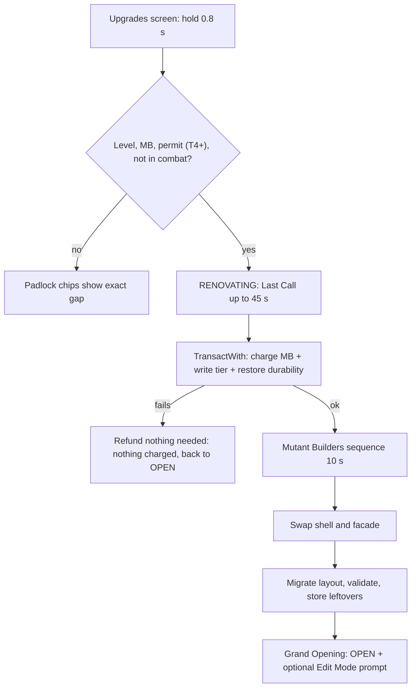

## 15. Restaurant Building

> Owner: A10 (tycoon/building systems + environment art). This section specifies the **Build** pillar:
> how the restaurant grows from Nana Gristle's shabby shack to a neon monster palace with an aquarium wall
> ("Upgrade Your Restaurant: **Basic → Expand → Go Wild**"), how players place furniture, how atmosphere and
> cleanliness are scored, and how everything breaks hilariously and gets fixed again. Databases live in
> §36.12 (tiers + 72 upgrades) and §36.13 (214 purchasable items + 10 trophies); both are generated by
> `python3 gdd/tools/render_restaurant.py` from `gdd/data/furniture.json`, which also refreshes the two AUTO
> tables in this section. Every number marked **[TUNABLE]** is a balancing assumption.

| Template block (§C0) | Where |
|---|---|
| Purpose | §15.1 |
| Rules & Mechanics | §15.2–§15.10 |
| Variables | tables inside each subsection, collected in §15.12.6 |
| UI | §15.11 (screens themselves: §24.22–§24.24) |
| Progression | §15.2, §15.3, §15.8, §15.10 |
| Player Interactions | §15.5, §15.9, §15.4 (visiting) |
| Dependencies | §15.13 |
| Roblox Implementation | §15.12 |
| Edge Cases | §15.14 |
| Acceptance Criteria | §15.15 |

### 15.1 Purpose and Design Goals

The restaurant is **how players earn**; mutations are **what they spend on** (creative director note). The
restaurant therefore has a finite, legible set of meaningful upgrades — 10 tiers, 24 station paths, 48 other
upgrades, ~200 furniture pieces — that each change how a shift *feels*, while never competing with the morph
collection as the long-term chase.

| # | Goal | Design rule that delivers it |
|---|---|---|
| G1 | Growth you can see from the street | Every tier swaps the façade on Restaurant Row and grows the instanced interior; the mockup's Basic (T1–T3) → Expand (T4–T7) → Go Wild (T8–T10) is the visual spine. |
| G2 | Destruction is funny, never devastating (brief 26.4) | Objects are **never permanently lost** (canon §C6): rubble piles, cheap rebuilds, a free "Elbow Grease" rebuild when broke, free full restore on every tier upgrade, Co-op Insurance (E12). |
| G3 | The layout is a light puzzle | PlateUp-style "distance = seconds" in the kitchen, seat placement vs. atmosphere in the dining room — but validation makes it impossible to save a broken layout (E10). |
| G4 | Mobile-first building | 2-stud grid, 90° rotations, drag-to-place with an offset ghost, every action reachable with one thumb. |
| G5 | Server-authoritative and cheap | One occupancy grid per restaurant is the single truth for placement, connectivity, customer pathing (§8.7) and repair access; BFS < 1 ms. |
| G6 | Atmosphere matters, but cooking matters more | Atmosphere feeds only `M` (10 % of satisfaction) and `DecorMult` (×0.9–×1.2 demand), per canon §C11. |

### 15.2 Restaurant Tier Progression

All ten canon tiers (§C6) with A10's physical and economic detail. Canon columns (cost, level, seats,
appliance slots, menu, staff cap, base demand) are verbatim; floor plans, throughput and offline potential are
defined here. Online throughput is the planning estimate `min(BaseDemand × RepMult × DecorMult, Seats × 3600 /
240 s)` at the tier's typical reputation and atmosphere (§36.12.3); offline values use canon §C15 exactly.

<!-- AUTO:render_restaurant:tier-summary BEGIN -->
(generated)
<!-- AUTO:render_restaurant:tier-summary END -->

**Service style.** `TIER_01`–`TIER_02` are counter service: customers order at the Serving Window's dining
side and sit on attached stools/booth seats (§8.6). From `TIER_03` the restaurant is table service: a Host
Podium (`FRN_396`, granted free with `TIER_03`) is the party wait node and waiters become useful.

**Seats are a hard cap.** A layout may contain at most the tier's canon Seats in *attached* seats (§15.5.6);
the purchase of extra chairs is allowed (they wait in storage), placement is not.

#### 15.2.1 Tier profiles (interior, façade, Grand Opening Kit)

Interiors are W×D studs with the front door centred on the front wall (z = 0), kitchen along the back wall,
and the optional patio (`UPG_031` Patio Permit, `TIER_03`+) off the dining room's left wall. Each tier upgrade
grants a **Grand Opening Kit** into storage so the new seats are usable immediately.

| # | Interior layout (kitchen · dining · extras) | Exterior façade (plot footprint) | Grand Opening Kit (free) |
|---|---|---|---|
| 1 | Counter service. 32×12 kitchen strip holds the 12-fixture starter kit (4 of 6 slots used); Ding! window on the divider; 32×14 dining room with a 6×4 lobby. Starter dining: 2 Wobbly Card Tables, 2 Crooked Stools, 2 Folding Chairs (4 seats), 1 Bare Bulb, 2 windows. Pre-damaged for the tutorial: one card table **Broken** (`QST_TUT_008`), bulb and both windows **Cracked**, door Scuffed. | Crooked plywood shack, patched tin roof, sign missing letters ("BRO EN BURG R SHA K"), one flickering bulb (28×18) | — (starter layout) |
| 2 | Counter service with a snack-bar row; kitchen 40×12 gains room for freezer/mixer/plating; dining 40×18 fits a booth plus a two-top or a counter. | Mint paint, striped awning, small neon DINER sign with a winking mutant eye (34×22) | `FRN_061` Diner Two-Top + 2× `FRN_102` |
| 3 | First table-service floor: kitchen 48×14 with a swinging staff door; dining 48×20 (two four-tops + lobby podium); optional 24×12 patio. | Corner café, chalkboard easel, window boxes of snapping flytraps, two patio umbrellas (40×24) | `FRN_396` Host Podium + `FRN_061` + 2× `FRN_101` |
| 4 | Two dining wings around a central aisle; kitchen 56×14 fits 12 appliances in two facing lines; second pass possible (`UPG_029`). | Red-brick grill house, chimney puffing burger-shaped smoke rings, City Hall permit plaque (48×28) | `FRN_064` Barrel Table + 2× `FRN_104` |
| 5 | Family hall: long-table centre row, booths along both walls, kids corner by the lobby; kitchen 64×16. | Two-storey family front (the upper floor is a painted fake), big waving mascot board (56×30) | `FRN_064` + 2× `FRN_104` + `FRN_365` |
| 6 | Food-court plan: up to three serving windows (`UPG_030`) feed three dining pods around a shared centre; kitchen 72×18. | Arcade of three mini storefront arches under one roof, giant crossed fork and spoon on top (70×34) | `FRN_068` Beaker Table + 2× `FRN_106` |
| 7 | Long diner hall with a horseshoe of booths and a karaoke corner; kitchen runs the full 80 studs. | Chrome streamline megadiner, giant rotating burger on the roof, neon racing stripes (80×36) | `FRN_068` + 2× `FRN_107` + `FRN_368` |
| 8 | Fine-dining salon with a ramped VIP ring, dessert bar, 44×18 terrace patio; kitchen 88×20. | Marble columns, red carpet, gold awning, cardboard valet waving (88×40) | 2× `FRN_108` Velvet Throne + `FRN_064` |
| 9 | Banquet hall plus 48×20 garden patio; two staff doors; kitchen 96×22 with an island line. | Palace with cloche-shaped domes, twin sauce fountains, sweeping searchlights (96×44) | `FRN_072` Palace Round Table + 2× `FRN_110` |
| 10 | Showpiece hall wrapped around a 16-stud aquarium wall, glass-floor aisle, 56×24 courtyard patio; kitchen 112×24. | **Go Wild:** a giant neon monster building whose open mouth is the entrance, tentacles on the roof holding neon signs, the aquarium visible from the street, fireworks at 4.5 ★ (104×50) | `FRN_073` Kraken-Arm Table + 4× `FRN_110` |

**Kitchen capacity.** Canon appliance slots count only the 14 slot-using appliances (cut, grill, fryer, oven,
pizza oven, stove, soup pot, steamer, blender, mixer, drink, ice cream, infuser, anti-grav wok). The 10 utility
fixtures are slot-free but need floor space; the kitchen floor of every tier fits its full slot count plus one
of each utility with ≥ 2-cell aisles (verified by the tier template layouts, §15.12.5).

**Available equipment and decor per tier** (station unlocks follow canon §C7.1; full lists in §36.12.1):
T1 starter kit + STOVE (L2), OVEN/PIZZA_OVEN (L3), SOUP_POT/ICECREAM (L4), BLENDER (L5) · T2 MIXER, FREEZER,
PLATING (L5), STEAMER (L7), station Lv2 · T3 premium variants, patio, Host Podium · T4 station Lv3, second pass ·
T5 ANTIGRAV (L30) · T6 INFUSER (L40), station Lv4, third pass · T8 station Lv5 · T9–T10 palace and legendary
showpieces. Decor themes unlock with their set tier (§15.8).

#### 15.2.2 Offline earning potential (canon §C15, shown briefly)

For each tier the full tier-typical crew (§36.12.3: stats at the middle of the canon §C4.8 rarity band,
Morale 80, average Energy over the manager's cap) gives the following canon §C15 values per offline hour
(before incidents and auto-repairs):

<!-- AUTO:render_restaurant:offline-calc BEGIN -->
(generated)
<!-- AUTO:render_restaurant:offline-calc END -->

`P` (menu-weighted mean item price) is calibrated per tier so the online model reproduces canon §C4.4 net
income; `q = min(0.95, 0.70 + 0.25 × chef accuracy / 100)`; tips use `(0.04 + 0.04 × waiter service / 100)`.
From `TIER_06` a well-staffed restaurant returns ≈ 32–39 % of active income per offline hour (canon target
35–50 %, ceiling 60 %); early tiers sit at ≈ 24–29 % because low chef accuracy caps `q` and, from `TIER_03`,
waiters bind `Cap_service` while staff caps are tiny — offline is a teaser until the player can staff
properly. Lean crews (1 chef + 1 waiter, no manager) earn roughly a fifth to a half of the full-crew value
(§36.12.3). §17 owns the simulation; this table is A10's capacity check that every tier can feed it.

### 15.3 Tier Upgrade Flow

**Requirements** (all checked server-side by `BuildingService.UpgradeTier`, target = current + 1 only):

| # | Requirement | Source | Failure text (padlock chip, §24.22) |
|---|---|---|---|
| 1 | Player level ≥ tier's Req. level | canon §C6 | "Reach Level 18" |
| 2 | Wallet ≥ upgrade cost (MB) | canon §C6 | "Need 1,230 more MB" |
| 3 | `TIER_04`+: City Hall Expansion Permit held for that tier (quest-gated formality at `BLD_09` with `NPC_002`; permit fee is inside the canon price) | canon §C6, §20 | "Get your permit at City Hall" |
| 4 | Owner present in the interior or at their façade; not In Combat; no anger-level-6 chaos | canon E2 | "Can't renovate during a brawl!" |
| 5 | No other Renovation, Edit Mode session or blueprint swap in progress | §15.5 | "Finish editing first" |

**Flow.** The Upgrades screen uses hold-to-confirm 0.8 s (§24.22). Then:

1. **Last Call (≤ 45 s [TUNABLE]).** The restaurant enters `RENOVATING`: arrivals stop, the outside queue walks
   by (no reputation effect), customers already eating finish, unserved customers leave paying 0 with **no
   reputation loss** behind a "Closed for renovation!" sign (same courtesy as E1). The modal shows a countdown;
   "Skip Last Call" ends it immediately with the same no-penalty rule. Station timers freeze (nothing burns).
2. **Commit.** One `EconomyService.TransactWith` call deducts the MB, writes `restaurant.tier`, clears
   `pendingRebuilds`, restores every object to 100 % durability and stamps `layoutMigratedFor = newTier = false`,
   all inside the profile's session-locked update (idempotency key from the client, §28). Nothing is charged if
   any later step fails; a crash after commit simply re-runs migration on next load (deterministic).
3. **Mutant Builders sequence (10.0 s; 3.0 s short version after the first view; skippable for others).**
4. **Migration** of the layout into the new shell (below), Grand Opening Kit added to storage.
5. **Grand Opening.** Doors reopen in `OPEN`; a confetti burst, an XP grant per §14, and the prompt "New space!
   Arrange it now?" (enters Edit Mode, optional).

**Mutant Builders sequence (cartoon, kid-safe, no NPC IDs: the crew is a client-only cosmetic built from random
Common mutation parts).** Camera cuts to the exterior.

| t (s) | Beat | Visual / audio (described; IDs by §26) |
|---|---|---|
| 0.0 | Fade to exterior | old façade, "CLOSED FOR RENOVATION" banner unrolls |
| 0.5 | Crew of 6 builders pours out of a tiny van (clown-car gag) | hard hats on every head shape, one on a tail |
| 1.5–7.0 | Scaffolding pops up; hammering loops (`ANM_060`), a crane lifts the new sign, dust clouds hide the swap | rhythmic hammer chorus, one builder hits their own thumb (cartoon stars) |
| 7.0 | Dust clears: new façade (tier model swap under the cloud) | "ta-da" sting, confetti |
| 8.0–9.5 | Builders celebrate (`ANM_064`), sign lights up letter by letter | neon buzz |
| 10.0 | Door opens; fade back inside | interior already migrated |

**What carries over (everything):** placed and stored furniture, trophies, station-type upgrade levels, all
purchased `UPG_` upgrades (kitchen expansion and patio re-apply to the new shell), employees and assignments,
menu (new menu slots start empty), reputation, special stock, blueprints (re-validated on first use), theme-set
progress, restaurant name. Damage does **not** carry over: Mutant Builders "fix everything while they're at it"
(all objects → Pristine, rubble rebuilt, insurance ledger cleared; active repair jobs cancelled with no charge).

**Layout migration algorithm** (deterministic; the floor plan only ever grows):

1. Compute offsets in cells: dining/lobby `dx = (Wc_new − Wc_old) / 2` (door stays centred), `dz = 0`;
   kitchen `dx` as dining, `dz = Dc_new − Dc_old` (anchored to the back wall); patio anchored to the patio door.
2. Translate every floor/ceiling item by its zone offset; items on the divider (serving windows, staff doors)
   snap to the new divider row at the same relative x; wall items keep their wall side and relative position.
3. Validate each item in a deterministic order (essentials, appliances, seats, surfaces, decor). A failing item
   tries a spiral search of radius ≤ 6 cells in the same zone, first at its rotation, then the other three.
4. Still failing → moved to storage with a "Needs a home" badge (never lost, never sold).
5. Run connectivity (§15.5.9). If it fails, store the blocking decor with the lowest atmosphere points first
   until it passes; seats and essentials are never auto-stored if any decor could be stored instead.
6. Toast: "Moved 41 items · 2 need a home". Analytics `mmr_tier_upgraded` logs counts (§31).

### 15.4 Plot and Instanced Interior Model

**Restaurant Row (`DST_01`, `BLD_17`).** 8 plots per server (canon §C3), one per player. A plot is a 120 × 90-stud
lot: the façade footprint grows per tier (§15.2.1, from 28×18 to 104×50; heights 16 → 70 studs) behind a
120 × 14-stud **curb strip** that holds curb sockets (4 → 16 by tier), the door approach lane (6 studs wide,
always clear) and the **outside queue** of 4 velvet-rope spots by the door (§8.2.3). Curb items are cosmetic,
indestructible and visible to everyone walking the Row; they count at ×0.5 for atmosphere.

**Instanced interior (canon §C3, §C16.4).** The playable restaurant is an interior shell spawned by
`RestaurantService` in the far-off `Workspace.Interiors` region at `(6,000 + 400 × plotIndex, 0, 6,000)` — more
than 2,000 studs from the city and 400 studs from each other, so streaming never overlaps. It is bigger on the
inside than the façade ("Morph City zoning is weird," says the City Hall clerk). Entering the façade door:
0.35 s fade → `Player:RequestStreamAroundAsync(interiorDoor, 5)` → `PivotTo` the interior spawn; leaving
reverses it. Customers are spawned at the interior door directly while cosmetic client-only walkers enter the
façade so the street looks busy (§8). The façade shows live state: windows lit when OPEN, a renovation banner
when `RENOVATING`, and flickering silhouettes plus a "Uh-oh!" sign wobble when chaos is happening inside — a
free advert for passers-by.

| Interior folder | Contents |
|---|---|
| `Shell` | tier model (walls, sockets, divider, doors, patio shell), zone volumes, spawn points |
| `Stations` | appliance and utility fixture models (tag `MMR_Station`, `MMR_Destructible`) |
| `Furniture` | all other placed items (tags `MMR_Destructible`, `MMR_Seat` where relevant) |
| `Rubble` | generic rubble piles for Destroyed objects (6 sizes, tinted to the item) |
| `CombatProxies`, `Messes` | owned by §11 and RepairService respectively |

**Visiting.** Same-server visitors walk in through the door; cross-server friends join via the friends list
(`TeleportService`, §21). Guests follow the owner's co-op settings (§21, `restaurant.coop`): they may cook,
serve, clean and repair if allowed, but can never sell, move or store owner furniture, enter Edit Mode, or
spend owner currency (canon E12). **Restaurant name:** 3–24 characters chosen by the owner, filtered with
`TextService:FilterStringAsync` and shown via `GetNonChatStringForBroadcastAsync` on the façade sign
(`TIER_02`+) and the Monster Marquee.
