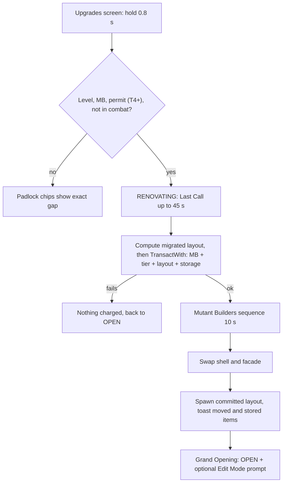
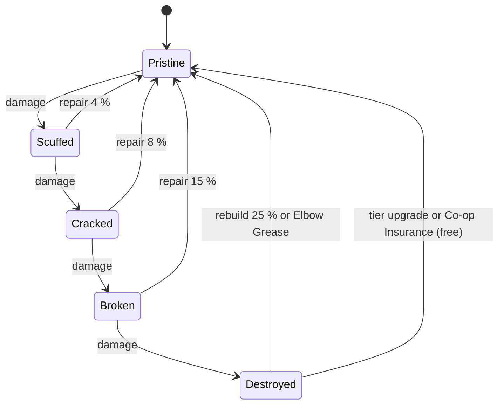
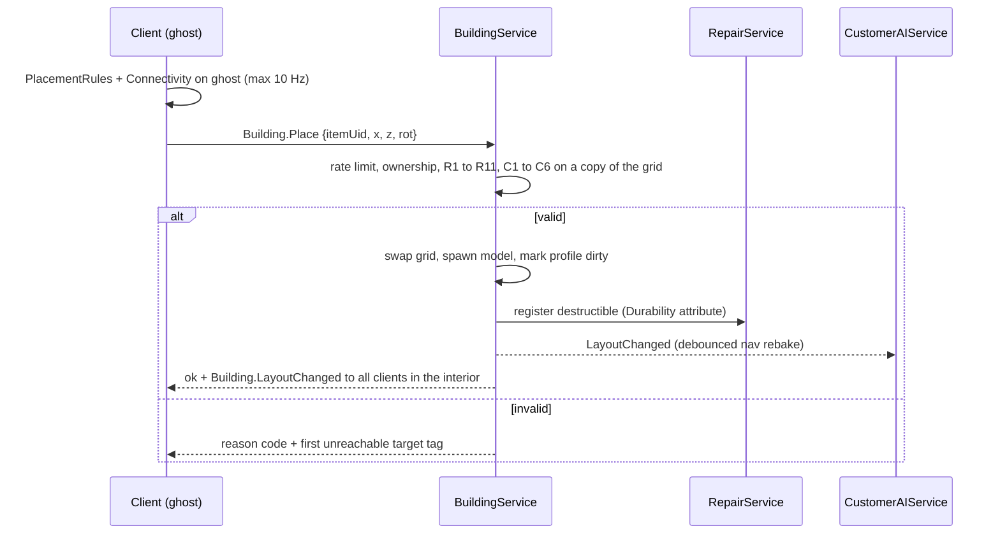

## 15. Restaurant Building

> Owner: A10 (tycoon/building systems + environment art). This section specifies the **Build** pillar:
> how the restaurant grows from Nana Gristle's shabby shack to a neon monster palace with an aquarium wall
> ("Upgrade Your Restaurant: **Basic → Expand → Go Wild**"), how players place furniture, how atmosphere and
> cleanliness are scored, and how everything breaks hilariously and gets fixed again. Databases live in
> §36.12 (tiers + 72 upgrades) and §36.13 (214 purchasable items + 10 trophies); both are generated by
> `python3 gdd/tools/render_restaurant.py` from `gdd/data/furniture.json`, which also refreshes the two AUTO
> tables in this section. Every number marked **[TUNABLE]** is a balancing assumption.

Template map (§C0): Purpose §15.1 · Rules & Mechanics §15.2–§15.10 · Variables in each subsection · UI §15.11 · Progression §15.2/§15.3/§15.8/§15.10 · Player Interactions §15.4/§15.5/§15.9 · Dependencies §15.13 · Roblox Implementation §15.12 · Edge Cases §15.14 · Acceptance Criteria §15.15.

### 15.1 Purpose and Design Goals

The restaurant is **how players earn**; mutations are **what they spend on** (creative director note). The
restaurant therefore has a finite, legible set of meaningful upgrades — 10 tiers, 24 station paths, 48 other
upgrades, ~200 furniture pieces — that each change how a shift *feels*, while never competing with the morph
collection as the long-term chase.

| # | Goal | Design rule that delivers it |
|---|---|---|
| G1 | Growth you can see from the street | Every tier swaps the façade on Restaurant Row and grows the instanced interior; the mockup's Basic (T1–T3) → Expand (T4–T7) → Go Wild (T8–T10) is the visual spine. |
| G2 | Destruction is funny, never devastating (brief 26.4) | Objects are **never permanently lost** (canon §C6): rubble piles, cheap rebuilds, a free "Elbow Grease" rebuild when broke, free full restore on every tier upgrade, Co-op Insurance (E12). |
| G3 | The layout is a light puzzle | PlateUp-style "distance = seconds" in the kitchen, seat placement vs. atmosphere in the dining room — but validation makes it impossible to save a broken layout (E10). |
| G4 | Mobile-first building | 2-stud grid, 90° rotations, drag-to-place with an offset ghost, every action reachable with one thumb. |
| G5 | Server-authoritative and cheap | One occupancy grid per restaurant is the single truth for placement, connectivity, customer pathing (§8.7) and repair access; BFS < 1 ms. |
| G6 | Atmosphere matters, but cooking matters more | Atmosphere feeds only `M` (10 % of satisfaction) and `DecorMult` (×0.9–×1.2 demand), per canon §C11. |

### 15.2 Restaurant Tier Progression

All ten canon tiers (§C6) with A10's physical and economic detail. Canon columns (cost, level, seats,
appliance slots, menu, staff cap, base demand) are verbatim; floor plans, throughput and offline potential are
defined here. Online throughput is the planning estimate `min(BaseDemand × RepMult × DecorMult, Seats × 3600 /
240 s)` at the tier's typical reputation and atmosphere (§36.12.3); offline values use canon §C15 exactly.

<!-- AUTO:render_restaurant:tier-summary BEGIN -->
| # | Tier | Cost (MB) | Level | Permit | Interior W×D (sq studs) | Patio | Seats | Appliance slots | Kitchen area | Menu | Staff cap | Base demand | Online throughput | Offline net/h lean–full | Max offline session |
|---|---|---|---|---|---|---|---|---|---|---|---|---|---|---|---|
| 1 | `TIER_01` Broken Burger Shack | 0 | 1 | no | 32×26 (832) | — | 4 | 6 | 32×12 | 4 | 2 | 50 | ≈ 56/h | 149–185 | 370 (2 h) |
| 2 | `TIER_02` Tiny Mutation Diner | 1,000 | 5 | no | 40×30 (1,200) | — | 6 | 8 | 40×12 | 5 | 3 | 65 | ≈ 79/h | 171–303 | 1,210 (4 h) |
| 3 | `TIER_03` Neighborhood Freak Café | 2,000 | 10 | no | 48×34 (1,632) | 24×12 | 8 | 10 | 48×14 | 6 | 4 | 80 | ≈ 104/h | 246–410 | 820 (2 h) |
| 4 | `TIER_04` Morph City Grill | 5,000 | 18 | yes | 56×38 (2,128) | 28×12 | 10 | 12 | 56×14 | 8 | 6 | 95 | ≈ 130/h | 281–760 | 3,038 (4 h) |
| 5 | `TIER_05` Mutant Family Restaurant | 15,000 | 26 | yes | 64×42 (2,688) | 32×14 | 12 | 14 | 64×16 | 10 | 8 | 110 | ≈ 158/h | 503–1,587 | 12,693 (8 h) |
| 6 | `TIER_06` Monster Food Court | 40,000 | 35 | yes | 72×48 (3,456) | 36×16 | 14 | 16 | 72×18 | 12 | 10 | 125 | ≈ 189/h | 762–3,119 | 24,951 (8 h) |
| 7 | `TIER_07` Mutation Megadiner | 100,000 | 45 | yes | 80×52 (4,160) | 40×16 | 16 | 18 | 80×18 | 14 | 12 | 140 | ≈ 222/h | 1,374–5,607 | 67,289 (12 h) |
| 8 | `TIER_08` Luxury Freak Restaurant | 225,000 | 56 | yes | 88×58 (5,104) | 44×18 | 18 | 20 | 88×20 | 16 | 14 | 155 | ≈ 259/h | 2,263–12,101 | 145,211 (12 h) |
| 9 | `TIER_09` Morph City Food Palace | 525,000 | 68 | yes | 96×64 (6,144) | 48×20 | 20 | 22 | 96×22 | 20 | 16 | 170 | ≈ 300/h | 3,969–23,915 | 573,962 (24 h) |
| 10 | `TIER_10` Legendary Mutation Restaurant | 1,500,000 | 80 | yes | 112×72 (8,064) | 56×24 | 24 | 24 | 112×24 | 24 | 20 | 190 | ≈ 359/h | 6,183–47,477 | 1,139,443 (24 h) |
<!-- AUTO:render_restaurant:tier-summary END -->

**Service style.** `TIER_01`–`TIER_02` are counter service: customers order at the Serving Window's dining
side and sit on attached stools/booth seats (§8.6). From `TIER_03` the restaurant is table service: a Host
Podium (`FRN_396`, granted free with `TIER_03`) is the party wait node and waiters become useful.

**Seats are a hard cap.** A layout may contain at most the tier's canon Seats in *attached* seats (§15.5.6);
the purchase of extra chairs is allowed (they wait in storage), placement is not.

#### 15.2.1 Tier profiles (interior, façade, Grand Opening Kit)

Interiors are W×D studs with the front door centred on the front wall (z = 0), kitchen along the back wall,
and the optional patio (`UPG_031` Patio Permit, `TIER_03`+) off the dining room's left wall. Each tier upgrade
grants a **Grand Opening Kit** into storage so the new seats are usable immediately.

| # | Interior layout (kitchen · dining · extras) | Exterior façade (plot footprint) | Grand Opening Kit (free) |
|---|---|---|---|
| 1 | Counter service. 32×12 kitchen strip holds the 12-fixture starter kit (4 of 6 slots used); Ding! window on the divider; 32×14 dining room with a 6×4 lobby. Starter dining: 2 Wobbly Card Tables, 2 Crooked Stools, 2 Folding Chairs (4 seats), 1 Bare Bulb, 2 windows. Pre-damaged for the tutorial: one card table **Broken** (`QST_TUT_008`), bulb and both windows **Cracked**, door Scuffed. | Crooked plywood shack, patched tin roof, sign missing letters ("BRO EN BURG R SHA K"), one flickering bulb (28×18) | — (starter layout) |
| 2 | Counter service with a snack-bar row; kitchen 40×12 gains room for freezer/mixer/plating; dining 40×18 fits a booth plus a two-top or a counter. | Mint paint, striped awning, small neon DINER sign with a winking mutant eye (34×22) | `FRN_061` Diner Two-Top + 2× `FRN_102` |
| 3 | First table-service floor: kitchen 48×14 with a swinging staff door; dining 48×20 (two four-tops + lobby podium); optional 24×12 patio. | Corner café, chalkboard easel, window boxes of snapping flytraps, two patio umbrellas (40×24) | `FRN_396` Host Podium + `FRN_061` + 2× `FRN_101` |
| 4 | Two dining wings around a central aisle; kitchen 56×14 fits 12 appliances in two facing lines; second pass possible (`UPG_029`). | Red-brick grill house, chimney puffing burger-shaped smoke rings, City Hall permit plaque (48×28) | `FRN_064` Barrel Table + 2× `FRN_104` |
| 5 | Family hall: long-table centre row, booths along both walls, kids corner by the lobby; kitchen 64×16. | Two-storey family front (the upper floor is a painted fake), big waving mascot board (56×30) | `FRN_064` + 2× `FRN_104` + `FRN_365` |
| 6 | Food-court plan: up to three serving windows (`UPG_030`) feed three dining pods around a shared centre; kitchen 72×18. | Arcade of three mini storefront arches under one roof, giant crossed fork and spoon on top (70×34) | `FRN_068` Beaker Table + 2× `FRN_106` |
| 7 | Long diner hall with a horseshoe of booths and a karaoke corner; kitchen runs the full 80 studs. | Chrome streamline megadiner, giant rotating burger on the roof, neon racing stripes (80×36) | `FRN_068` + 2× `FRN_107` + `FRN_368` |
| 8 | Fine-dining salon with a ramped VIP ring, dessert bar, 44×18 terrace patio; kitchen 88×20. | Marble columns, red carpet, gold awning, cardboard valet waving (88×40) | 2× `FRN_108` Velvet Throne + `FRN_064` |
| 9 | Banquet hall plus 48×20 garden patio; two staff doors; kitchen 96×22 with an island line. | Palace with cloche-shaped domes, twin sauce fountains, sweeping searchlights (96×44) | `FRN_072` Palace Round Table + 2× `FRN_110` |
| 10 | Showpiece hall wrapped around a 16-stud aquarium wall, glass-floor aisle, 56×24 courtyard patio; kitchen 112×24. | **Go Wild:** a giant neon monster building whose open mouth is the entrance, tentacles on the roof holding neon signs, the aquarium visible from the street, fireworks at 4.5 ★ (104×50) | `FRN_073` Kraken-Arm Table + 4× `FRN_110` |

**Kitchen capacity.** Canon appliance slots count only the 14 slot-using appliances (cut, grill, fryer, oven,
pizza oven, stove, soup pot, steamer, blender, mixer, drink, ice cream, infuser, anti-grav wok). The 10 utility
fixtures are slot-free but need floor space; the kitchen floor of every tier fits its full slot count plus one
of each utility with ≥ 2-cell aisles (verified by the tier template layouts, §15.12.5).

**Available equipment and decor per tier** (station unlocks follow canon §C7.1; full lists in §36.12.1):
T1 starter kit + STOVE (L2), OVEN/PIZZA_OVEN (L3), SOUP_POT/ICECREAM (L4), BLENDER (L5) · T2 MIXER, FREEZER,
PLATING (L5), STEAMER (L7), station Lv2 · T3 premium variants, patio, Host Podium · T4 station Lv3, second pass ·
T5 ANTIGRAV (L30) · T6 INFUSER (L40), station Lv4, third pass · T8 station Lv5 · T9–T10 palace and legendary
showpieces. Decor themes unlock with their set tier (§15.8).

#### 15.2.2 Offline earning potential (canon §C15, shown briefly)

For each tier the full tier-typical crew (§36.12.3: stats at the middle of the canon §C4.8 rarity band,
Morale 80, average Energy over the manager's cap) gives the following canon §C15 values per offline hour
(before incidents and auto-repairs):

<!-- AUTO:render_restaurant:offline-calc BEGIN -->
| # | Full crew | Demand_off = Base × Rep × Decor × 0.6 | min(Cap_seat, Cap_kitchen, Cap_service) | Q | Revenue = Q × 1.4P × q | + Tips − Ingredients − Wages | Net / h (% of active) |
|---|---|---|---|---|---|---|---|
| 1 | Ollie (EMP_001), 1×Chef (C) | 50 × 1.125 × 0.990 × 0.6 = 33.4 | 48, 48.3, 48.3 | 33.4 | 33.4 × 13.3 × 0.77 = 343 | +14 −142 −30 | **185** (29 %) |
| 2 | Ollie (EMP_001), 1×Chef (C), 1×Manager (C) | 65 × 1.200 × 1.014 × 0.6 = 47.5 | 72, 45.1, 45.1 | 45.1 | 45.1 × 16.0 × 0.77 = 558 | +22 −230 −48 | **303** (28 %) |
| 3 | Ollie (EMP_001), 1×Chef (U), 2×Waiter (U) | 80 × 1.250 × 1.035 × 0.6 = 62.1 | 96, 53.2, 65.2 | 53.2 | 53.2 × 20.6 × 0.79 = 869 | +50 −347 −162 | **410** (24 %) |
| 4 | 3×Chef (U), 2×Waiter (U), 1×Manager (U) | 95 × 1.300 × 1.050 × 0.6 = 77.8 | 120, 69.8, 65.2 | 65.2 | 65.2 × 29.2 × 0.81 = 1,548 | +90 −578 −300 | **760** (25 %) |
| 5 | 3×Chef (R), 3×Waiter (R), 1×Dish (C), 1×Manager (R) | 110 × 1.350 × 1.065 × 0.6 = 94.9 | 144, 103.9, 122.8 | 94.9 | 94.9 × 45.6 × 0.84 = 3,654 | +231 −1,300 −998 | **1,587** (29 %) |
| 6 | 4×Chef (R), 3×Waiter (R), 1×Dish (C), 1×Security (R), 1×Manager (R) | 125 × 1.400 × 1.080 × 0.6 = 113.4 | 168, 129.4, 123.8 | 113.4 | 113.4 × 64.5 × 0.84 = 6,178 | +390 −2,171 −1,278 | **3,119** (32 %) |
| 7 | 4×Chef (E), 3×Waiter (E), 1×Cashier (R), 1×Dish (U), 1×Security (R), 1×Repair (R), 1×Manager (E) | 140 × 1.450 × 1.095 × 0.6 = 133.4 | 192, 146.0, 164.9 | 133.4 | 133.4 × 105.7 × 0.88 = 12,408 | +871 −4,002 −3,670 | **5,607** (32 %) |
| 8 | 5×Chef (E), 3×Waiter (E), 1×Cashier (R), 1×Dish (U), 1×Security (R), 1×Repair (R), 1×Manager (E) | 155 × 1.500 × 1.116 × 0.6 = 155.7 | 216, 172.2, 166.1 | 155.7 | 155.7 × 157.0 × 0.88 = 21,511 | +1,510 −6,849 −4,070 | **12,101** (37 %) |
| 9 | 6×Chef (E), 4×Waiter (E), 1×Cashier (E), 1×Dish (R), 1×Security (R), 1×Repair (R), 1×Manager (L), 1×Asst Mgr (E) | 170 × 1.550 × 1.140 × 0.6 = 180.2 | 240, 176.3, 201.1 | 176.3 | 176.3 × 256.7 × 0.88 = 39,832 | +2,823 −12,520 −6,220 | **23,915** (38 %) |
| 10 | 6×Chef (E), 1×Chef (L), 5×Waiter (E), 1×Cashier (E), 1×Dish (R), 1×Security (E), 1×Repair (E), 1×Stocker (R), 1×Manager (L), 1×Asst Mgr (E) | 190 × 1.625 × 1.164 × 0.6 = 215.6 | 288, 201.7, 253.3 | 201.7 | 201.7 × 393.3 × 0.89 = 70,270 | +4,980 −19,493 −8,280 | **47,477** (39 %) |
<!-- AUTO:render_restaurant:offline-calc END -->

`P` (menu-weighted mean item price) is calibrated so the online model reproduces canon §C4.4 (§36.12.3). From
`TIER_06` a well-staffed restaurant returns ≈ 32–39 % of active income per offline hour (canon target 35–50 %,
ceiling 60 %); `TIER_01`–`TIER_05` sit at ≈ 24–29 % because low chef accuracy caps `q` and, from `TIER_03`,
waiters bind `Cap_service` while staff caps are tiny — offline is a teaser until the player can staff properly.
§17 owns the simulation; this is A10's capacity check that every tier can feed it.

### 15.3 Tier Upgrade Flow

**Requirements** (checked server-side by `BuildingService.UpgradeTier`; target = current + 1 only; each failure
shows a padlock chip with the exact gap, §24.22): (1) player level ≥ the tier's canon level ("Reach Level 18");
(2) wallet ≥ canon cost ("Need 1,230 more MB"); (3) `TIER_04`+: the City Hall Expansion Permit for that tier — a
quest-gated formality with `NPC_002` at `BLD_09`, fee included in the canon price (§20); (4) not In Combat, no
level-6 chaos (canon E2: "Can't renovate during a brawl!"); (5) no Edit Mode session or blueprint swap running.

**Flow.** The Upgrades screen uses hold-to-confirm 0.8 s (§24.22). Then:

1. **Last Call (≤ 45 s [TUNABLE]).** The restaurant enters `RENOVATING`: arrivals stop, the outside queue walks
   by (no reputation effect), customers already eating finish, unserved customers leave paying 0 with **no
   reputation loss** behind a "Closed for renovation!" sign (same courtesy as E1). The modal shows a countdown;
   "Skip Last Call" ends it immediately with the same no-penalty rule. Station timers freeze (nothing burns).
2. **Commit.** The server first computes the migrated layout (pure grid math, below — no instances needed), then
   one `EconomyService.TransactWith` call deducts the MB and writes `restaurant.tier`, the new `layoutPacked`
   (every object at 100 %), the updated `storage` (Grand Opening Kit + "Needs a home" items) and an empty
   `pendingRebuilds`, all in the profile's session-locked update with the client's idempotency key (§28). Either
   everything is written or nothing is charged.
3. **Mutant Builders sequence (10.0 s; 3.0 s short version after the first view; skippable for others).** Purely
   presentational: during it `RestaurantService` swaps the shell and façade and `BuildingService` spawns the
   already-committed layout.
4. **Migration result** shown as a toast and in the storage tab.
5. **Grand Opening.** Doors reopen in `OPEN`; a confetti burst, an XP grant per §14, and the prompt "New space!
   Arrange it now?" (enters Edit Mode, optional).



**Mutant Builders sequence** (cartoon, kid-safe; the crew is a client-only cosmetic built from random Common
mutation parts, no NPC IDs). 0.0 s fade to the exterior, "CLOSED FOR RENOVATION" banner unrolls · 0.5 s six
builders pour out of a tiny van (clown-car gag), hard hats on every head shape (one on a tail) · 1.5–7.0 s
scaffolding pops up, hammering loops (`ANM_060`), a crane lifts the new sign, one builder bonks their own thumb
(cartoon stars), dust clouds hide the swap · 7.0 s dust clears on the new façade with a "ta-da" and confetti ·
8.0–9.5 s builders celebrate (`ANM_064`) while the sign lights letter by letter · 10.0 s door opens, fade back
inside to the already-migrated interior.

**What carries over (everything):** placed and stored furniture, trophies, station-type upgrade levels, all
purchased `UPG_` upgrades (kitchen expansion and patio re-apply to the new shell), employees and assignments,
menu (new menu slots start empty), reputation, special stock, blueprints (re-validated on first use), theme-set
progress, restaurant name. Damage does **not** carry over: Mutant Builders "fix everything while they're at it"
(all objects → Pristine, rubble rebuilt, insurance ledger cleared; active repair jobs cancelled with no charge).

**Layout migration algorithm** (deterministic; the floor plan only ever grows):

1. Compute offsets in cells: dining/lobby `dx = (Wc_new − Wc_old) / 2` (door stays centred), `dz = 0`;
   kitchen `dx` as dining, `dz = Dc_new − Dc_old` (anchored to the back wall); patio anchored to the patio door.
2. Translate every floor/ceiling item by its zone offset; items on the divider (serving windows, staff doors)
   snap to the new divider row at the same relative x; wall items keep their wall side and relative position.
3. Validate each item in a deterministic order (essentials, appliances, seats, surfaces, decor). A failing item
   tries a spiral search of radius ≤ 6 cells in the same zone, first at its rotation, then the other three.
4. Still failing → moved to storage with a "Needs a home" badge (never lost, never sold).
5. Run connectivity (§15.5.9). If it fails, store the blocking decor with the lowest atmosphere points first
   until it passes; seats and essentials are never auto-stored if any decor could be stored instead.
6. Toast: "Moved 41 items · 2 need a home". Analytics `mmr_tier_upgraded` logs counts (§31).

### 15.4 Plot and Instanced Interior Model

**Restaurant Row (`DST_01`, `BLD_17`).** 8 plots per server (canon §C3), one per player. A plot is a 120 × 90-stud
lot: the façade footprint grows per tier (§15.2.1, from 28×18 to 104×50; heights 16 → 70 studs) behind a
120 × 14-stud **curb strip** that holds curb sockets (4 → 16 by tier), the door approach lane (6 studs wide,
always clear) and the **outside queue** of 4 velvet-rope spots by the door (§8.2.3). Curb items are cosmetic,
indestructible and visible to everyone walking the Row; they count at ×0.5 for atmosphere.

**Instanced interior (canon §C3, §C16.4).** The playable restaurant is an interior shell spawned by
`RestaurantService` in the far-off `Workspace.Interiors` region at `(6,000 + 400 × plotIndex, 0, 6,000)` — more
than 2,000 studs from the city and 400 studs from each other, so streaming never overlaps. It is bigger on the
inside than the façade ("Morph City zoning is weird," says the City Hall clerk). Entering the façade door:
0.35 s fade → `Player:RequestStreamAroundAsync(interiorDoor, 5)` → `PivotTo` the interior spawn; leaving
reverses it. Customers are spawned at the interior door directly while cosmetic client-only walkers enter the
façade so the street looks busy (§8). The façade shows live state: windows lit when OPEN, a renovation banner
when `RENOVATING`, and flickering silhouettes plus a "Uh-oh!" sign wobble when chaos is happening inside — a
free advert for passers-by.

Interior folders: `Shell` (tier model, sockets, zone volumes, spawns), `Stations` (tags `MMR_Station`,
`MMR_Destructible`), `Furniture` (`MMR_Destructible`, `MMR_Seat`), `Rubble` (6 shared tinted piles), plus
`CombatProxies` (§11) and `Messes` (RepairService).

**Visiting.** Same-server visitors walk in through the door; cross-server friends join via the friends list
(`TeleportService`, §21). Guests follow the owner's co-op settings (§21, `restaurant.coop`): they may cook,
serve, clean and repair if allowed, but can never sell, move or store owner furniture, enter Edit Mode, or
spend owner currency (canon E12). **Restaurant name:** 3–24 characters chosen by the owner, filtered with
`TextService:FilterStringAsync` and shown via `GetNonChatStringForBroadcastAsync` on the façade sign
(`TIER_02`+) and the Monster Marquee.

### 15.5 Building Placement System

**Purpose.** Let players arrange kitchen and dining with zero ambiguity on every device, while guaranteeing that
every saved layout is cookable, servable, repairable and walkable.

#### 15.5.1 Grid and rotation decision

| Option | Pros | Cons | Verdict |
|---|---|---|---|
| 1-stud grid, free rotation | maximum freedom | fiddly on touch; nav grid mismatch; float drift in saves | rejected |
| **2-stud grid, 90° rotation** | matches the 2×2-stud nav cells of §8.7, integer saves, chair = 1 cell, thumb-friendly | less freedom for decorators | **chosen** |
| 4-stud grid | trivial on mobile | chairs and aisles too coarse; small interiors waste space | rejected |

Every footprint is an even number of studs; rotation is 0/90/180/270 (stored 0–3). Ceiling and wall items
snap to the same 2-stud rhythm along their surface.

#### 15.5.2 Layers and zones

| Layer | Blocks floor cells? | Holds |
|---|---|---|
| FLOOR | yes | appliances, fixtures, tables, seats, decor, floor lamps |
| WALKABLE | no | rugs (`FRN_495`) — placed over free floor, removable in one tap |
| CEILING | no | ceiling lights, hanging plants, smoke detector (one per cell) |
| WALL | no | windows, wall art, wall lights, signs, Morph Mirror, Trophy Shelf (wall sockets per tier) |
| DOOR | no | front door (1), staff doors (1–2), patio door, back door (sockets fixed by the shell) |
| ZONE FINISH | no | one floor finish + one wall finish per zone |
| CURB | no (exterior) | façade-side decor in curb sockets |

| Zone | Purpose | Accepts | Fixed features kept clear |
|---|---|---|---|
| KITCHEN | staff only; customers never path here | appliances, utility fixtures, safety items, kitchen decor | staff spawn 2×2 cells, back door + delivery dock socket |
| DINING | seats and their surfaces | tables, counters, chairs, booths, decor, lights, aquariums, interactive | divider pickup side of each serving window (1×2 cells) |
| LOBBY | inside the door: waiting and ordering | podium, decor, interactive, signs (no seats) | **door clearance 3×3 cells**; party wait spots (4 cells beside the podium); counter line (counter service) |
| OUTSIDE | patio (`UPG_031`), always fully lit | Outside-rated tables/chairs, Patio items, plants, sculptures | patio door 2×2 cells |
| CURB | exterior plot (cosmetic) | curb signs, planters, gnomes, valet podium, Bouncer Rope | door approach lane, 4 queue spots |

#### 15.5.3 Edit Mode rules

- **Who:** the owner, or a co-owner whose co-op settings grant Build (§21). One editor at a time per restaurant
  (edit lock); other co-owners see a "Pardon our dust" view. Guests never.
- **When:** not In Combat and no level-6 chaos (canon E2), **and** zero customers inside (seated, walking,
  waiting at the podium or in the counter line). If customers are inside, the button becomes **Pause Service**:
  arrivals stop and the button counts down "Waiting for 3 customers to finish…". **Last Call** (optional) applies
  the Renovation no-penalty rule to unserved customers. Queued customers outside keep waiting (queue patience
  paused) or walk by.
- **While editing:** restaurant state `EDITING` holds arrivals, freezes every station timer (no burning, §5),
  sends employees to idle at the staff spawn, and blocks guests from interacting with furniture. Ops commit one
  at a time on the server (§15.12), so a disconnect never loses work and never leaves an invalid layout.
- **Exit:** always allowed (every committed op already passed validation); restores the previous state (OPEN or
  PAUSED). Auto-exit after 10 min without input [TUNABLE].

#### 15.5.4 Placement rules

Checked in this order (cheapest first) for every Place/Move/Rotate; the first failure returns its reason code
(§15.11).

| # | Rule | Reason code |
|---|---|---|
| R1 | Actor may build; restaurant in `EDITING`; item owned and unplaced (Place) or placed and movable (Move) | `NO_PERMISSION` / `NOT_EDITING` |
| R2 | Item's tier ≤ current tier; station's canon unlock level ≤ player level (§C7.1) | `TIER_LOCKED` / `LEVEL_LOCKED` |
| R3 | Footprint inside the shell, entirely in an accepting zone (or socket of the right type) | `OUT_OF_BOUNDS` / `WRONG_ZONE` |
| R4 | No overlap with other FLOOR footprints, walls, fixed features or clearance cells | `OVERLAP` / `KEEP_CLEAR` |
| R5 | Access cells free: ≥ 1 free side/rear neighbour per chair (its access cell), station operator cell(s), door swing, window pickup side | `ACCESS_BLOCKED` |
| R6 | Appliance slots used ≤ tier slots (canon §C6); serving windows ≤ 1/2/3 (`UPG_029`/`UPG_030`) | `SLOTS_FULL` / `WINDOWS_FULL` |
| R7 | Attached seats ≤ tier Seats (§15.5.6) | `SEAT_CAP` |
| R8 | Placed items ≤ tier Max placed items (60 → 400, §36.12.2; trophies, rugs and finishes exempt) and per-item max counts (catalog notes) | `ITEM_CAP` |
| R9 | Essentials remain: ≥ 1 each of PANTRY, FRIDGE, PREP, ASSEMBLY, WINDOW, DISHWASH, TRASH, DELIVERY, ≥ 1 slot-using appliance, and (T3+) the Host Podium | `ESSENTIAL` |
| R10 | Connectivity C1–C6 still holds (§15.5.9) | `PATH_BLOCKED_*` |
| R11 | Object is not Destroyed and not occupied (seated customer or proxy on it) | `IS_RUBBLE` / `OCCUPIED` |

**Store** requires R1, R9, R11 and **Pristine** durability (≥ 76 %): damaged objects must be repaired first, so
store-and-replace can never heal anything. **Sell** (from storage only): 50 % of price, or 100 % if bought ≤ 5 min
ago and never placed ("Changed my mind") [TUNABLE]; trophies cannot be sold. Stations holding food can be moved
(contents move with them) but not stored.

#### 15.5.5 Collisions

Placement uses the server's integer **occupancy grid**, never physics. Placed models are `Anchored`; tables,
counters, booths and appliances use collision group `MMR_Furniture` (collides with players); chairs and decor
are `CanCollide = false` for players so nobody gets wedged. NPC proxies are anchored and follow grid paths
(§8.7), so furniture never shoves them. A player standing inside a target footprint does not block placement:
they are nudged 2 studs out on commit.

#### 15.5.6 Seats and surfaces

- A **chair** is a seat only if the cell it faces belongs to a **surface** (table, counter, booth table) that
  still has capacity ("serves N"); its **access cell** is any free side or rear neighbour (the §8.7
  seat-approach node). Unattached chairs are allowed only in the LOBBY as waiting benches (0 seats, decor).
- A **booth** provides its built-in seats and table. **Counters** take stools along their long side(s).
- **Counter service (T1–T2):** the counter line forms on the dining side of the serving window: as many cells as
  Seats must be free in a straight or L-shaped line from the window front (§8.6).
- Seat count shown live in Build Mode ("Seats 6/6"); a surface with a Broken/Destroyed state disables its
  attached seats until repaired.

#### 15.5.7 Appliance slots and utilities (canon §C6)

Slot-using appliances (14 station types, any variant) cost 1 slot each, duplicates included (two grills = 2
slots). Utility fixtures (PANTRY, FRIDGE, FREEZER, PREP, ASSEMBLY, PLATING, WINDOW, DISHWASH, TRASH, DELIVERY)
never use slots. The starter kit uses 4 of `TIER_01`'s 6 slots, leaving the canon "choose two of STOVE / OVEN /
PIZZA_OVEN / SOUP_POT / ICECREAM / BLENDER" decision. Removing the last instance of a station type used by a
menu recipe asks for confirmation and flags those recipes "Missing station" (§6); it is never silently allowed.

#### 15.5.8 Undo, redo and blueprints

- The client keeps a stack of **inverse ops** (≤ 50 per edit session). Undo/redo sends the inverse as a normal
  Place/Move/Store/Rotate and the server validates it like any op; if the world changed ("Can't undo: that spot
  is taken"), the entry is dropped. Purchases are not undoable (use "Changed my mind").
- **Blueprints** (`UPG_070`/`UPG_071`): save the current layout to a slot; applying one stores everything
  not in the blueprint, then places the blueprint items in a deterministic order; items you no longer own are
  listed as "missing" and skipped. The applied result must pass R1–R11, otherwise the swap is rolled back.

#### 15.5.9 Path connectivity validation (canon E10)

Validation runs a 4-neighbour flood fill on the occupancy grid (free floor and WALKABLE cells are passable).
4-neighbour reachability is stricter than the 8-neighbour A* customers use (§8.7), so any layout that passes is
walkable by customers and staff. Aisles may be 1 cell (2 studs); routes narrower than 2 cells show an amber
"Tight squeeze" hint but are legal.

| Check | Sources | Every one of these must be reachable |
|---|---|---|
| C1 Customers | front door cell | an access cell of every attached seat (chair side/rear neighbour, booth opening) |
| C2 Ordering | front door cell | podium wait spots (T3+) or the full counter line (T1–T2); patio door if a patio exists |
| C3 Kitchen | staff spawn + staff door(s) | every station operator cell and the kitchen side of every serving window |
| C4 Service (T3+) | staff door(s) | every seat access cell and every window pickup side (waiters) |
| C5 Repair access | front door ∪ staff spawn | ≥ 1 neighbouring cell of every destructible object (incl. decor and lights' floor cell) |
| C6 Deliveries | back door | the delivery dock's unload cell |

Cost: the largest grid (`TIER_10` + Elbow Room III + Patio Sprawl ≈ 2,900 cells) floods in ≈ 0.2 ms. The client
runs the same shared module on the ghost at ≤ 10 Hz to show the red route preview and reason text before the
player taps Place.

```lua
--!strict
-- ReplicatedStorage/Shared/Building/Connectivity.lua  (shared: server validation + client ghost preview)
export type Grid = { w: number, h: number, x0: number, blocked: buffer } -- 1 byte per cell, 1 = blocked
export type Target = { cell: Vector2int16, tag: string }

local DIRS = { Vector2int16.new(1, 0), Vector2int16.new(-1, 0), Vector2int16.new(0, 1), Vector2int16.new(0, -1) }
local Connectivity = {}

local function index(g: Grid, x: number, z: number): number? -- x may be negative (patio)
	local col = x - g.x0
	if col < 0 or col >= g.w or z < 0 or z >= g.h then return nil end
	return z * g.w + col
end

function Connectivity.flood(g: Grid, sources: { Vector2int16 }): buffer
	local seen = buffer.create(g.w * g.h)
	local queue: { number } = table.create(g.w * g.h)
	local head, tail = 1, 0
	for _, s in sources do
		local i = index(g, s.X, s.Y)
		if i and buffer.readu8(g.blocked, i) == 0 and buffer.readu8(seen, i) == 0 then
			buffer.writeu8(seen, i, 1); tail += 1; queue[tail] = i
		end
	end
	while head <= tail do
		local i = queue[head]; head += 1
		local x, z = (i % g.w) + g.x0, i // g.w
		for _, d in DIRS do
			local j = index(g, x + d.X, z + d.Y)
			if j and buffer.readu8(seen, j) == 0 and buffer.readu8(g.blocked, j) == 0 then
				buffer.writeu8(seen, j, 1); tail += 1; queue[tail] = j
			end
		end
	end
	return seen
end

-- Returns nil if every target is reachable, otherwise the tag of the first unreachable target
-- (e.g. "seat:17" -> reason PATH_BLOCKED_SEAT, highlights seat uid 17 in red).
function Connectivity.firstUnreachable(g: Grid, sources: { Vector2int16 }, targets: { Target }): string?
	local seen = Connectivity.flood(g, sources)
	for _, t in targets do
		local i = index(g, t.cell.X, t.cell.Y)
		if not i or buffer.readu8(seen, i) == 0 then return t.tag end
	end
	return nil
end

return Connectivity
```

**Runtime fallback (canon E10).** If a customer's path fails twice or they are stuck > 6 s, they poof to the seat
(§8.7). Rubble keeps its object's footprint, so destruction never changes connectivity mid-shift; Broken doors
never block.

| Variable | Value [TUNABLE] |
|---|---|
| Grid cell | 2 studs |
| Rotations | 4 (90° steps) |
| Door clearance | 3 × 3 cells |
| Undo stack | 50 ops per session |
| Edit Mode auto-exit | 10 min idle |
| Sell-back | 50 % (100 % within 5 min, never placed) |
| Client path preview rate | ≤ 10 Hz |
| Server op rate | 4 ops/s, burst 8 (§27.8.17) |

### 15.6 Atmosphere Score (feeds `M` and `DecorMult`)

`Atmosphere` is an integer 0–100 per restaurant, recomputed by `BuildingService` on every layout op, durability
state change or light change (debounced 1 s), and replicated as the restaurant attribute `Atmosphere`. It feeds
canon §C11: `M = Atmosphere / 100` in satisfaction (weight 0.10) and `DecorMult = 0.9 + 0.003 × Atmosphere`
in demand (online and offline; offline uses the value saved at logout).

```text
Eff_i       = AtmospherePts_i × StateFactor_i × ZoneFactor_i × DupFactor_i
              StateFactor: Pristine 1.0 · Scuffed 0.75 · Cracked 0.5 · Broken 0 · Destroyed 0
              ZoneFactor:  Dining/Lobby/Outside/Wall 1.0 · Kitchen 0.25 (seen through the pass) · Curb 0.5
              DupFactor:   k-th copy of the same FRN item counts max(0.3, 0.85^(k−1))
              Zone finishes count once per zone; shelved trophies ×1.2
A_furn      = 55 × min(1, Σ Eff_i / PtsTarget[tier])                     -- 0..55
A_variety   = min(15, 1.5 × #categories with Σ Eff ≥ 1)                 -- 0..15 (10 categories max it)
A_theme     = min(15, Σ sets: complete (≥ 6 countable pieces) first +10, others +5; partial (3–5) +3)
A_light     = 15 × Coverage                                              -- 0..15
              Coverage = share of DINING+LOBBY+OUTSIDE cells within radius r of a working light
              (Pristine/Scuffed lights count fully; windows count at 0.5 unless Broken; OUTSIDE is always lit;
               UPG_035 Mood Lighting Dimmer: all radii ×1.25)
A_penalty   = min(40, 1 × Cracked + 3 × Broken + 5 × Destroyed)          -- customer-side objects; kitchen ×0.5
Atmosphere  = clamp(round(A_furn + A_variety + A_theme + A_light − A_penalty), 0, TierCap[tier])
```

| Tier | 1 | 2 | 3 | 4 | 5 | 6 | 7 | 8 | 9 | 10 |
|---|---|---|---|---|---|---|---|---|---|---|
| PtsTarget (Σ Eff for full A_furn) | 30 | 50 | 75 | 100 | 130 | 170 | 215 | 265 | 320 | 400 |
| TierCap (max Atmosphere) | 55 | 60 | 65 | 70 | 75 | 80 | 85 | 90 | 95 | 100 |

**Worked example — the starter shack.** Pre-damaged starter layout: Σ Eff = 6.3 → A_furn 11.5; categories
with ≥ 1 pt: chairs, tables → A_variety 3; Greasy Spoon Classic is already a complete set (7 countable pieces —
"Congratulations, consistently shabby!") → +10; the Cracked bulb gives no light, Cracked windows give 0.25
coverage → 3.8; penalty 3 Cracked + 1 Broken = 6. **Atmosphere 22** (DecorMult ×0.966). After the tutorial
repairs (`QST_TUT_008`) the bulb lights (+0.45 coverage), penalties vanish and variety grows: **Atmosphere 42**
(×1.026) — the first lesson that fixing things pays.

**Local atmosphere** (host scoring term in §8.6): `LocalAtmosphere(table) = clamp(Atmosphere + 20 × (D_t −
D_avg) / max(D_avg, 1), 0, 100)` where `D_t` is Σ Eff of decor within 12 studs of the table centre and `D_avg`
the mean over all tables. **UI:** Build Mode top bar "Atmosphere 41 (+3)" previews the delta of the ghost before
placing (§24.23); the restaurant panel shows the five terms as bars with labels and numbers.

### 15.7 Cleanliness (`K`)

`RepairService` owns messes (§27.8.18) and computes `K` (0–100) event-driven on every mess spawn/clean or
object state change; customers sample it when they evaluate satisfaction (`K/100`, weight 0.10, canon §C11.3).

```text
K = clamp(100 − 4·Trash − 6·Spills − 3·DirtyTables − 4·BrokenDishes
              − 2·Cracked − 5·Broken − 8·Destroyed − 10·KitchenFires, 0, 100)
    Trash/Spills/BrokenDishes/DirtyTables: counted in DINING, LOBBY and OUTSIDE (kitchen messes count ×0.5)
    Cracked/Broken/Destroyed: customer-side destructible objects; KitchenFires: stations currently ON_FIRE (smoke)
```

| Mitigation | Effect |
|---|---|
| `FRN_431` Wet Floor Sign | spills within 6 studs count half |
| `FRN_437` Dining Trash Bin | 30 % of trash spawned within 8 studs is auto-binned |
| `UPG_056`/`UPG_057` Robo-Mop | removes 1 mess per 30 s / 15 s |
| `UPG_058` Bus-Bot | clears one dirty table per 25 s |
| `FRN_185` Lab Rubber Tiles, `FRN_190` Anti-Slip Mats | spills in that zone dry faster |
| `ROLE_CLEANER`, `UPG_040` Janitor Closet Pro, `SKL_RPR_03` | faster cleaning (§16, §14) |

The HUD shows K as "Condition 82" next to Atmosphere (§24). K is not part of the offline formula (canon §C15).

### 15.8 Themes and Sets

Nine earnable theme sets (members and counts in §36.13): **Greasy Spoon Classic** (T1, Basic), **Chrome Comet
Diner** (T2, Expand), **Swamp Bistro** (T3), **Tentacle Tavern** (T4, nautical + fish tanks), **Neon Monster**
and **Mad Lab Lunchroom** (T6, Go Wild), **Space Saucer** (T7), **Royal Ridiculous** (T8) and **Legendary
Menagerie** (T9–T10, aquariums and kraken arms). Rules:

- A set piece counts if placed, distinct, and Pristine or Scuffed. ≥ 6 pieces = complete, 3–5 = partial
  (A_theme above). Mixing is allowed and encouraged: the theme term caps at 15.
- Completing a set unlocks its façade skin for `UPG_060` Facade Facelift; the façade then matches the inside.
- Premium kitchen variants belong to sets, so a themed kitchen also counts (at its ZoneFactor for points, fully
  for set counting).
- Robux restaurant themes (§23) are **re-skins** of earnable items with identical stats; they never add
  atmosphere, slots or durability (no pay-for-income).

### 15.9 Damage and Repair

**Purpose.** Brawls (§11), kitchen fires (§5), offline incidents (§36.9) and events break things in loud,
cartoon ways; fixing them is a satisfying 3–15 s beat and a modest MB sink — never a progress loss.

#### 15.9.1 Durability model and damage intake

Every destructible object (tag `MMR_Destructible`) has **MaxDur** points (§36.13: chairs 40–120, tables 60–300,
booths 140–340, appliances 120–420, aquariums 40–400) and a saved durability **percentage** 0–100 (§28 codec);
the canon state is derived from the percentage. Floors, wall finishes, curb items, rugs and trophies are
indestructible.

**Conversion of quoted damage.** §5, §11, §36.9 and event rules quote damage as "% durability" calibrated for a
**100-point reference object**. `RepairService` converts:
`ΔPct = Quoted × (100 / MaxDur_eff) × Protect`, where `MaxDur_eff` includes Reinforced upgrades and `Protect` is the
product of applicable damage multipliers (§15.9.11). Sturdy pieces therefore shrug off hits that wreck a folding
chair. Bounds: combined combat protection is never below **0.5 × the unprotected ΔPct** (`FurnitureCombatDamageMult
≥ 0.5`, §11.10.5); one combat hit lowers an object by **at most one state** (§11.6.3); fire burns 2 quoted %/s but
never below 26 % (§5).

| `PropClass` for §11 | Catalog items |
|---|---|
| `Chair` | all chairs (`FRN_100`–`FRN_111`) |
| `TableSmall` | tables that serve ≤ 2 (incl. `FRN_460`) |
| `TableLarge` | tables serving ≥ 4, counters, booths (fixed; can be flipped unless `UPG_033`) |
| `DecorSmall` (Throwable) | 2×2 plants, accessories, 2×2 sculptures, chalkboard sign |
| `DecorLarge` | aquariums, larger sculptures, interactive pieces, floor lamps, wall and ceiling items |
| `Station` | all appliances and utility fixtures (collateral ×0.5, §11) |
| `TrashCan` | `FRN_437` Dining Trash Bin |

#### 15.9.2 Damage states and gameplay effects (canon §C6 bands)

| State | Durability | Seats & surfaces | Appliances & fixtures | Lights · windows · doors | Atmosphere factor | K | Look |
|---|---|---|---|---|---|---|---|
| Pristine | 100–76 % | normal | normal | normal | 1.0 | 0 | clean |
| Scuffed | 75–51 % | normal | normal | normal | 0.75 | 0 | scuff decals, a "fix me?" sticky note |
| Cracked | 50–26 % | usable (wobble emote, no penalty beyond K/M) | normal (§5) | lights stop counting for coverage; windows still do | 0.5 | −2 | crack decals, 3° tilt, bandage |
| Broken | 25–1 % | **unusable**; a Broken surface disables its attached seats (canon) | **PAUSED**: timers frozen, nothing burns (§5) | light off · window boarded with cartoon planks · door hangs from one hinge (still passable) | 0 | −5 | slumped "broken pose" (artist-authored per model, fallback 12° tilt + popped leg) |
| Destroyed | 0 % | rubble pile on the same footprint; seats gone until rebuilt | contents ejected (basic food free, specials to stock, §5) | rubble / empty frame | 0 | −8 | poof into a tinted rubble pile; rebuild offer |



#### 15.9.3 Repair requirements, costs and durations

A repair always restores to **Pristine 100 %**. Requirements: an actor within 7 (+2) studs (player with repair
permission, or `ROLE_REPAIR`), the object not on fire, and MB charged **once at completion** for the worst state
reached during the job (canon E3). If charging fails, the object is still repaired and the cost becomes a
debt-free "owner pays later" entry (§27.8.18) — never a negative balance.

| Worst state | Cost (% of price) [TUNABLE] | Diner Two-Top (120) | Sizzle Grill (400) | Grand Aquarium Wall (300,000) |
|---|---|---|---|---|
| Scuffed | 4 % | 5 MB | 16 MB | 12,000 MB |
| Cracked | 8 % | 10 MB | 32 MB | 24,000 MB |
| Broken | 15 % | 18 MB | 60 MB | 45,000 MB |
| Destroyed (Rebuild) | 25 % (canon cap) | 30 MB | 100 MB | 75,000 MB |

Discounts: player `REPAIR` −0.2 %/pt (max −30 %, canon §C5) plus `SKL_RPR_02` (combined cap −45 %, §14);
`SKL_RPR_08` makes rebuilds 15 %; `ROLE_REPAIR` jobs use the technician discount `RepairSkill / 200` instead
(canon §C15, max −50 %). Minimum 1 MB. **Elbow Grease:** when the wallet cannot cover a rebuild, the owner may
rebuild for 0 MB by hand at ×2 duration — nobody is ever stuck with rubble.

**Size classes** (footprint cells; wall items use wall-studs / 2) and **base durations** at `REPAIR` 0, divided by
`1 + 0.01 × REPAIR` (cap ×2.5):

| Class | Cells | Examples | Scuffed | Cracked | Broken | Rebuild |
|---|---|---|---|---|---|---|
| S | ≤ 2 | chair (1), plant (1), cutting board (2), 4-stud window (2) | 2.0 s | 3.5 s | 5.0 s | 8 s |
| M | 3–6 | two-top (4), grill (4), 8×2 counter (4), pizza oven (6) | 3.0 s | 5.0 s | 7.5 s | 11 s |
| L | 7–15 | booth (9), four-top (9), long table (10), karaoke stage (12) | 4.0 s | 6.5 s | 10.0 s | 15 s |
| XL | ≥ 16 | 8×8 tables (16), Grand Aquarium Wall (8 × 2 = 16), Grand Tentacle Booth (20) | 5.0 s | 8.0 s | 12.5 s | 19 s |

`SKL_RPR_18` (appliances −25 %), `SKL_RPR_08` (rebuild −30 %) and `SKL_RPR_07` (Multi-Fix) stack
multiplicatively. A typical post-brawl cleanup (a Cracked chair, a Scuffed table, a Cracked booth, a Scuffed
grill) is ≈ 18 s of hands-on time with the starter stat — inside §4's ≤ 60 s target.

```lua
--!strict
-- ServerScriptService/Server/Services/RepairService/RepairMath.lua
local FLOOR = { Pristine = 51, Scuffed = 26, Cracked = 1, Broken = 0, Destroyed = 0 } -- step limit targets

local RepairMath = {}

function RepairMath.state(pct: number): string
	if pct >= 76 then return "Pristine" elseif pct >= 51 then return "Scuffed"
	elseif pct >= 26 then return "Cracked" elseif pct >= 1 then return "Broken" end
	return "Destroyed"
end

-- quoted: "% durability" from §5/§11/§36.9 (100-point reference); protect already floored at 0.5 for combat
function RepairMath.applyDamage(pct: number, quoted: number, maxDurEff: number, protect: number, isCombatHit: boolean): number
	local new = pct - quoted * (100 / maxDurEff) * protect
	if isCombatHit then new = math.max(new, FLOOR[RepairMath.state(pct)]) end -- one state per hit
	return math.clamp(math.floor(new + 0.5), 0, 100)
end

-- cost(price, worstState, discount) and duration(sizeClass, worstState, REPAIR) implement the two tables above.

return RepairMath
```

#### 15.9.4 The repair minigame: "Fix-It Ring"

Rendered by the §24.24 widget; `RepairService` picks the mode and the values below.

| | **Whack** (furniture, decor, windows: `ANM_060` hammer) | **Hold** (appliances, fixtures, aquariums: `ANM_061` weld/bolt) |
|---|---|---|
| Base progress | ring fills passively at 0.6 × base rate while the player stays in range | holding the button fills at 1.0 × base rate |
| Rhythm | a sweet-spot pip crosses the target every 0.9 s; tap: **Perfect** (±0.12 s) +0.9 s of progress, **Good** (±0.22 s) +0.5 s, Miss 0 (cartoon thumb-bonk, no penalty) | every 25 % of progress a "Tighten!" pip appears; re-press inside 0.35 s: +8 % progress |
| Result range | all Perfect ≈ 0.62 × base time · all Good ≈ 0.86 × · no taps ≈ 1.67 × | all pips ≈ 0.76 × base time · none 1.0 × |

- **Never fails.** Leaving range or being hit pauses the job; progress is kept 30 s (`SKL_RPR_21` ignores small hits).
- **Mobile:** one large FIX button above Interact (≥ 96 × 96 px), pips sized ≥ 44 px; **controller** X/A; **keyboard**
  E or Space. **Auto-Fix** accessibility toggle turns every job into Hold with automatic Good pips.
- `SKL_RPR_09` widens timing windows 15 % per rank; `ABL_062` Repair Burst calls `RepairService` to add its
  instant percentage (§36.6). Two players may **Team Fix** one object (second player at 60 % contribution).
- **XP:** `XPRate(L) / 3600` per second of base repair time (canon §C5.1 relative rule), ×1.25 if ≥ 80 % Perfect.
- **Server validation:** pip schedule is seeded per `jobId`; `Repair.Input` tap times are checked against
  `workspace:GetServerTimeNow()` with latency tolerance (as §27.8.5 chopping); a job can never complete faster than
  0.6 × its base time.

#### 15.9.5 Destruction and restoration presentation

All debris is client-only and despawns within 4 s (canon §C3); reduced-VFX settings halve particles and drop
screen shake.

| Event | Animation and effects (kid-safe) |
|---|---|
| Damaged (any hit) | object jiggles 0.2 s, "CRACK!"/"BONK!" comic text, 6–10 cartoon stars or feathers, sauce splat decal if food hit it |
| Becomes Broken | slumps into its broken pose, a leg or knob pops off and bounces, soot puff for appliances, appliance face (if any) gets dizzy spirals |
| Destroyed | "poof": dust cloud, bouncing bolts and springs, then a tinted rubble pile with a tiny white flag; aquariums drop their fish into a bucket ("We're fine!"); goldfish Chef gives a thumbs-up fin |
| Restored ("Good as new!") | sparkle burst (30 particles), scale tween 0.9 → 1.1 → 1.0 over 0.4 s (`TweenService`), a shine sweep across the model, floating text "Good as new!", ding |
| Co-op Insurance sweep | a sparkle wave travels from the front door through every insured object (1.5 s) |
| Tier upgrade | Mutant Builders sequence (§15.3) |

#### 15.9.6 Employee repair (`ROLE_REPAIR`)

Players can always delegate: every damaged object's prompt has **Assign to Repair Tech**, and the Repair panel
has **Repair All** (queues every damaged object). Technicians skip the minigame and work from a priority queue:
(1) Broken appliance needed by an open ticket · (2) Broken seat/surface while customers wait · (3) Destroyed
objects if the owner's "Auto-rebuild" toggle is on (default off) · (4) other Broken · (5) Cracked customer-side ·
(6) Cracked kitchen · (7) Scuffed, only if "Polish scuffs" is on. Duration = base × `(1.5 − RepairSkill / 200)`
× trait multipliers (§36.8, e.g. *Live Wire* appliance ×1.3 speed); cost uses the technician discount and an
owner-set hourly repair budget (default 10 % of last hour's income). Canon E3 applies: new damage during a job
grows its remaining work, Destroyed converts the job to Rebuild, the cost is charged once at completion.

#### 15.9.7 Offline damage (canon §C15)

`OfflineEarningsService` passes the report's damage events (from §36.9 incidents) to `RepairService`, which picks
targets with the report's seeded RNG (customer-side furniture 60 %, appliances 25 %, decor 15 %) and applies them
with the §15.9.1 conversion. Fairness rules [TUNABLE]: offline damage **never Destroys** (floor 1 %, Broken); at
most `min(6, 1 + floor(H / 2))` objects per report; trophies, finishes, curb items and rugs are immune. With a
Repair Tech, each technician repairs up to 4 objects per simulated hour inside the sim at the state cost ×
`(1 − RepairSkill / 200)`, shown as **Repairs** in the report, and those objects come back Pristine. Without one,
objects wait for the player (cheaper than replacing; atmosphere lower next session) and the Welcome Back screen's
**Restaurant Damage** button lists them with a Repair All total. `SKL_RPR_17` speeds those repairs for 10 min.

#### 15.9.8 Co-op Insurance (canon E12)

Every damage event is tagged with its source. Damage dealt by **guests**, and by **customers while at least one
guest is present**, accrues as `insuredPct` on the object (owner-alone sessions are not insured). When the visit
ends (`MultiplayerService.GuestLeft` with no guests left, or the owner leaving), the insurance sweep restores each
object by its insured share for free (insured share ≥ the damage → Pristine; mixed damage → only the uninsured
part remains to pay). Repairs done during the visit on insured damage cost 0 MB and still award XP. Guests may
repair (if allowed) but can never sell, move or store owner furniture or spend owner currency.

#### 15.9.9 "Never permanently lost" rules

1. Destroyed objects stay placed as rubble (`restaurant.pendingRebuilds`, §28) with a rebuild offer of ≤ 25 %.
2. Elbow Grease rebuilds for free when the wallet cannot pay.
3. Every tier upgrade restores everything to Pristine for free.
4. Migration and content changes move items to storage, never delete them; sells are always player-initiated.
5. Trophies (`FRN_901`–`FRN_910`) are indestructible and unsellable.
6. Offline damage cannot Destroy; Co-op Insurance repays guest-time damage.

#### 15.9.10 Protective upgrades and combat hooks

| Upgrade / item | Effect | Hook it feeds |
|---|---|---|
| `UPG_049`–`UPG_051` Reinforced Furniture | seating/surface MaxDur +25/50/100 % | MaxDur_eff (counts toward the 0.5 floor) |
| `UPG_052`/`UPG_053` Reinforced Appliances | appliance MaxDur +25/50 % | MaxDur_eff |
| `UPG_033` Booth Bolt-Downs | no flips; tables/booths ×0.6 damage | `FurnitureCombatDamageMult` (§11.10.5) |
| `UPG_054` Bumper Pads | wall-splat damage ×0.5 | `FurnitureCombatDamageMult` |
| `UPG_044` Riot-Proof Ribbon | ×0.7 during level-6 chaos | `FurnitureCombatDamageMult` |
| `UPG_048` Shatterproof Glass | glass ×0.4 | Protect (glass) |
| `UPG_042` Anti-Throw Netting | wall items/glass immune to thrown food | Protect |
| `UPG_045`/`UPG_046` Sprinklers, `UPG_047` Fire-Retardant | auto-extinguish 3 s / 1 s; fire ×0.5 | §5 fire |
| `FRN_430` Extinguisher Cabinet, `FRN_432` Smoke Detector Pigeon | extinguish −50 % in 12 studs; 2 s fire warning | §5 fire |
| `FRN_435` Owl Camera, `UPG_041` Owl Eye Network, `FRN_436` Security Booth, `UPG_043` Training Mats | warning markers; guard −1 s, −1 s; +4 / +3 studs radius | `SecurityResponseMult` (≥ 0.5), §16 |
| `FRN_146`, `FRN_434` Chill Aura items | anger gain −10 % / −15 % in radius (strongest only) | canon §C11.5 Chill Aura, §10 |
| `FRN_214` Soothing Seafoam Paint | zone-wide escalation dampening 0.05 | `EscalationDampener` (§10) |
| `UPG_055` Nap Nook Respawn Pad | `STS_WOOZY` ×0.6 | `WoozyDurationMult` (≥ 0.3) |
| `FRN_433` Bouncer Rope, `UPG_034` Curbside Benches | queue patience ×1.15 / ×1.2 (cap ×1.4), no line-cutting | `QueuePatienceMult` (§8.2.3) |

### 15.10 Station Upgrades (canon §C4.9)

The 24 path rows `UPG_001`–`UPG_024` (§36.12) implement canon §C4.9 for every station, with §5's heat /
process / utility interpretation and Lv5 gimmicks. **Scope decision: levels belong to the station type**, not
to individual instances: buying Grill Lv3 upgrades every grill you own now or later, premium variants included,
priced from the stock item (`cost = multiplier × stock FRN price`). This keeps storage simple (no hidden levels
on stored items), makes second copies immediately useful, and is generous on purpose — station levels are a
side sink beside mutations. Persistence: `restaurant.upgrades` holds `"UPG_006#3"`-style entries (path + level);
the §28 codec's per-object `lvl` mirrors the type level for `CookingService`. A purchase made while any instance
is `PROCESSING` is queued and applied as each instance idles (§5). No recipe ever requires above Lv1.

### 15.11 UI

Screens are specified in §24 (Upgrades §24.22, Build Mode §24.23, Repair widget §24.24); §15 supplies their data
and rules. Build Mode additions: zone tint overlay (pattern + label per zone, not colour alone), live counters
"Slots 6/8 · Seats 6/6 · Items 54/60", the red route preview to the first unreachable target, an amber "Tight
squeeze" hint, and a "Needs a home" storage tab after migrations. Every rejection shows ✕ + one of these texts:

| Code | Text | Code | Text |
|---|---|---|---|
| `WRONG_ZONE` | "Appliances live in the kitchen!" | `SEAT_CAP` | "Fire marshal says 6 seats max!" |
| `OVERLAP` | "Something's already there." | `ITEM_CAP` | "Only 1 Jukebox fits the vibe." |
| `KEEP_CLEAR` | "Keep the doorway clear!" | `ESSENTIAL` | "You need at least one Pantry!" |
| `ACCESS_BLOCKED` | "Nobody can reach the front of that." | `LEVEL_LOCKED` | "Unlocks at Level 5." |
| `SLOTS_FULL` | "All 8 appliance slots used." | `TIER_LOCKED` | "Needs Tier 6." |
| `WINDOWS_FULL` | "One pass is plenty (for now)." | `IS_RUBBLE` | "Rebuild it before moving it." |
| `PATH_BLOCKED_SEAT` | "Blocks the path to a seat!" | `OCCUPIED` | "Someone's sitting there!" |
| `PATH_BLOCKED_STATION` | "Your cooks can't reach that station!" | `DAMAGED_STORE` | "Repair it before storing it." |

Inputs follow §24.23 (KB/M: mouse ghost, R rotate, LMB/E place, X store, Ctrl+Z undo, Ctrl+Y redo · gamepad: stick
cursor 8 cells/s, LB/RB rotate, A place, Y move, X store, B exit · touch: drag ghost drawn 1.5 cells above the
finger, Rotate/Place/Store/Undo buttons ≥ 56 u).

### 15.12 Roblox Implementation

#### 15.12.1 Services (names fixed by canon §C19; APIs per §27.8.17–18)

| Service | §15 responsibilities |
|---|---|
| `BuildingService` | occupancy grid per interior; rules R1–R11; connectivity C1–C6; Place/Move/Store/Rotate ops; blueprints; atmosphere and local atmosphere; tier upgrade validation, Mutant Builders cue, layout migration; Grand Opening Kits; `LayoutChanged`, `TierUpgraded`, `AtmosphereChanged` signals; publishes nav-blocked cells to `CustomerAIService` (§8.7 rebake) |
| `RepairService` | durability attributes `Durability`/`DamageState`; damage intake and conversion; repair jobs (Fix-It Ring sessions, technician jobs, E3 merging); costs via `EconomyService`; rebuild/Elbow Grease; insurance ledger; offline damage application; messes and K |
| `RestaurantService` | interior lifecycle and operating state (table below), shell spawning per tier, plot façade swap |
| `InventoryService` / `EconomyService` | storage counts and purchases (`Inventory.BuyFurniture`), the only currency mutations |

| Operating state | Arrivals | Station timers | Notes |
|---|---|---|---|
| `OPEN` | yes | run | normal service |
| `PAUSED` | no | run | Pause Service; customers inside finish |
| `EDITING` | held | frozen | 0 customers inside (§15.5.3) |
| `RENOVATING` | no | frozen | Last Call then Mutant Builders (§15.3) |
| `AWAY` (owner in the city, same server) | staffed: yes · unstaffed: no ("Out to Lunch", or "Event Break" during city events) | heat stations paused (no fires while away) | per §18: seated customers finish or leave politely with no reputation loss; anger escalation above level 2 is suppressed unless a Security Guard is on shift, so level-4 smashing (and furniture damage from it) cannot happen in an unguarded restaurant |
| `CLOSING` | no | finish/discard | canon E1 on owner disconnect |

#### 15.12.2 Layout serialization (DataStore)

Logical record per placed object: **`{itemId, x, z, rot, durability}`** plus the restaurant-unique `uid`
(home cell for §11 Furniture Homing). Physical encoding is §28.11's 10-byte packed record
(`kind, num, uid, x, z, rotLvl, dur`, Base64): every A10 item uses `kind = 0` (FRN, `num` = numeric ID, so
`FRN_006` → 6); appliances are FRN items whose station type comes from the catalog; `rotLvl = rot + 4 × (typeLevel
− 1)` mirrors the station-type level. `x`/`z` are **2-stud cell indices** (§15.5.1). Non-floor layers use reserved
`z` ranges so no schema change is needed:

| Layer | `x` | `z` | `rot` |
|---|---|---|---|
| FLOOR / WALKABLE | cell column (patio = negative x) | cell row 0–511 | 0–3 |
| CEILING | cell column | row + 2048 | 0–3 |
| WALL socket | socket index | −1 | wall side 0–3 |
| DOOR socket | 0 front · 1–2 staff · 3 patio · 4 back | −2 | 0 |
| ZONE finish | 0 kitchen · 1 dining · 2 lobby · 3 outside | −3 | 0 floor · 1 wall |
| CURB socket | socket index | −4 | 0–3 |

Budget: 400 objects × 14 Base64 chars ≈ 5.6 KB (§28 allots 9 KB to `restaurant`). Storage = `{FRN → count}` of
Pristine items only (§15.5.4), so counts suffice. On load, a record that fails validation (content change) is
moved to storage and logged (§27.8.17); connectivity repair follows §15.3 step 5.

#### 15.12.3 Server validation and client ghost



- **Shared rules module** `ReplicatedStorage.Shared.Building.PlacementRules` (pure Luau, no instances) is required by
  both sides, so the ghost shows exactly what the server will decide; the server never trusts client results.
- **Ghost:** the client clones the item from `ReplicatedStorage.Assets.Furniture/<id>`, sets parts to 0.5
  transparency with `CanCollide/CanQuery = false`, adds a `Highlight` (valid ✓ green outline / invalid ✕ red with a
  diagonal-stripe `Decal` for colour-blind players), and positions it each `RunService.RenderStepped` from
  `Camera:ViewportPointToRay` + `workspace:Raycast` (whitelist: the interior floor), snapped to the grid.
  `ContextActionService` binds rotate/place/store/undo per input type.
- **Atomicity:** each op is validated on a copy of the grid and swapped in only if all rules pass; purchases
  go through `EconomyService` with idempotency keys; tier upgrades are one session-locked transaction (§15.3).
- **Anti-exploit:** ops ≤ 4/s (burst 8); integer cells inside the shell only; item counts reconciled against
  ownership on every load (placed + stored ≤ owned); durability is server-only; repair completion floored at
  0.6 × base time (§29 owns the general framework).

#### 15.12.4 Performance budgets [TUNABLE]

Furniture models ≤ 12 parts / 2,000 triangles (showpieces such as `FRN_345`, `FRN_267`, `FRN_288` ≤ 40 parts /
8,000 triangles); a `TIER_10` interior ≤ 3,500 parts and ≤ 150,000 triangles; furniture uses
`ModelStreamingMode.Atomic`; damage states are decal/`SurfaceAppearance` swaps plus one optional broken pose (no
extra models); rubble uses 6 shared meshes; animated decor (fish, fireflies, murals) runs client-side only within
60 studs. Atmosphere recompute < 0.5 ms; connectivity < 0.3 ms; offline damage application < 1 ms.

#### 15.12.5 Content pipeline

`render_restaurant.py` validates the catalog (unique IDs, all 24 canon stations covered, trophies exactly
`FRN_901`–`FRN_910` with canon names, every set ≥ 6 pieces, sequential `UPG_` IDs and prereqs) and the
generated read-only `Furniture`/`Tiers`/`Upgrades` Luau modules (§27.5) are built from the same JSON. Each tier
ships a **template layout** (the Grand Opening default) that must pass R1–R11 with every slot filled — the proof
that each kitchen fits its canon slot count.

#### 15.12.6 Analytics

`mmr_furniture_purchased` (item, price, tier), `mmr_layout_op` (op, reason code if rejected), `mmr_tier_upgraded`
(tier, migrated, stored), `mmr_object_damaged` / `mmr_object_destroyed` (item, source), `mmr_repair_completed`
(item, worst state, cost, actor, minigame grade), `mmr_insurance_settled`, plus `LogEconomyEvent` sinks for
purchases, repairs, rebuilds and upgrades (§31).

### 15.13 Dependencies

| Depends on | For | Provides to | What |
|---|---|---|---|
| canon §C3, §C4, §C6, §C7, §C15, §C16.4, E3/E10/E12 | binding values | §5 Cooking | station footprints, durability, PAUSED/eject triggers, station-type levels |
| §5 | station verbs, gimmicks, fire rules | §8 Customer AI | seat/surface nodes, nav-blocked cells, local atmosphere, podium, counter line |
| §8, §10 | arrivals, queue, escalation | §10 / §C11 | `M` (Atmosphere), `K` (Cleanliness), `DecorMult` |
| §11 | combat damage events, PropClass use | §11 | PropClass mapping, durability conversion, protective multipliers |
| §14 | REPAIR stat, `SKL_RPR_` nodes | §16 / §17 | repair jobs for `ROLE_REPAIR`, offline damage rules, capacity check per tier |
| §16 / §17 | technicians, offline report | §20 | City Hall permit gate (`TIER_04`+), repair objectives |
| §21 | co-op permissions, guests | §24 | data for §24.22–24 screens, reason texts |
| §27 / §28 | services, codec | §27 / §28 | layout record meaning, reserved z ranges |

### 15.14 Edge Cases

| # | Situation | Ruling |
|---|---|---|
| 1 | Damage lands on an object while an employee or player repairs it (canon **E3**) | job absorbs it (remaining work grows, ring drops, "More damage!"); Destroyed converts the job to Rebuild; cost charged once at completion at the worst state reached |
| 2 | A layout would disconnect the door from a seat (canon **E10**) | the op is rejected with `PATH_BLOCKED_SEAT` and the route preview; at runtime, stuck customers poof (§8.7) |
| 3 | A guest (or a customer during co-op) breaks the owner's furniture (canon **E12**) | insured share repaired free at visit end; guests can't sell/move/store or spend |
| 4 | Owner tries to place furniture while a customer is seated | Edit Mode cannot open while customers are inside (Pause Service/Last Call first); an occupied seat can never be moved or stored (`OCCUPIED`) |
| 5 | Tier upgrade with damaged or Destroyed items | Mutant Builders restore all to Pristine and rebuild rubble for free; active repair jobs are cancelled with no charge |
| 6 | Tier upgrade requested mid-brawl or during chaos | refused ("Can't renovate during a brawl!"), nothing charged |
| 7 | Owner disconnects during Edit Mode | every committed op was already valid; restaurant goes to E1 Closing; next session opens normally |
| 8 | Server dies during the builders sequence | tier, migrated layout and charge were one transaction: on rejoin the new shell loads with the migrated layout; a retried request with the same idempotency key is a no-op (no double charge) |
| 9 | Player tries to store/sell the last Pantry (or the podium at T3+) | `ESSENTIAL`; sell is storage-only anyway |
| 10 | A station breaks mid-cook / is destroyed | Broken → PAUSED, timers frozen; Destroyed → contents ejected per §5; no burn, no charge |
| 11 | Wallet too low to rebuild | Elbow Grease: free manual rebuild at ×2 time |
| 12 | Store a damaged item to "heal" it | refused (`DAMAGED_STORE`); durability lives on the placed uid |
| 13 | Content update makes a saved item invalid (new footprint, tier change) | item moves to storage with a "Needs a home" badge; connectivity repair stores lowest-value blockers |
| 14 | Two co-owners try to edit at once | single edit lock; the second sees a read-only view with the editor's name |
| 15 | Offline damage hits an object with a paused repair job | merged by E3; offline damage never Destroys (floor 1 %) |
| 16 | Sprinkler and a player extinguish the same fire | first completion wins; one puddle at most; no double effects |
| 17 | Seat cap reached but the player buys more chairs | purchase allowed (goes to storage); placement refused with `SEAT_CAP` |
| 18 | Restaurant left unstaffed while the owner explores the city | `AWAY` "Out to Lunch": no arrivals, heat timers paused, escalation capped at level 2 without security — nothing burns or gets smashed (§15.12.1) |

### 15.15 Acceptance Criteria

- **AC-15-01:** All 10 tiers load with canon §C6 values; an upgrade with insufficient level, MB or (T4+) permit is
  refused with the exact gap shown and charges 0 MB.
- **AC-15-02:** A tier upgrade from `OPEN` completes in ≤ 45 s Last Call + 10.0 s ± 0.2 s builders sequence (3.0 s
  short version after the first view) and no customer loses reputation because of it.
- **AC-15-03:** After any tier upgrade, 100 % of previously owned items exist (placed or in storage), every object
  is Pristine, and the migrated layout passes R1–R11.
- **AC-15-04:** Every placement op is answered by the server in ≤ 250 ms on a 150 ms-latency client, and the client
  ghost's verdict matches the server's in 100 % of 10,000 randomized fixture placements.
- **AC-15-05:** No saved layout ever disconnects the front door from any attached seat; a fuzz test of 5,000 random
  op sequences produces 0 invalid committed layouts.
- **AC-15-06:** Connectivity validation of the largest interior (≈ 2,900 cells) takes ≤ 1 ms on the server.
- **AC-15-07:** Appliance slot use never exceeds canon slots; utility fixtures never consume a slot; the starter
  kit uses exactly 4 of 6 slots at `TIER_01`.
- **AC-15-08:** Attached seats never exceed tier Seats; a Broken surface disables its seats within one server tick.
- **AC-15-09:** Atmosphere is an integer 0–TierCap, recomputed ≤ 1 s after a change, and `DecorMult = 0.9 + 0.003 ×
  Atmosphere` is what `CustomerAIService` reads; the starter shack reads 22 before and 42 after the tutorial repairs.
- **AC-15-10:** Cleanliness K drops by exactly 4 per dining trash item and 6 per spill (fixtures), recovers when
  they are cleaned, and is clamped to 0–100.
- **AC-15-11:** Durability is stored as an integer 0–100 per object; states derive from canon bands (76/51/26/1/0)
  and a single combat hit never lowers an object by more than one state.
- **AC-15-12:** Repair cost equals 4/8/15/25 % of price for Scuffed/Cracked/Broken/Destroyed (± 1 MB rounding,
  before discounts) and is charged exactly once per job even if damage occurs during the job (E3).
- **AC-15-13:** With `REPAIR` 0, a Small Cracked object repairs in 3.5 s ± 0.1 s in Hold mode without pips; no job
  completes faster than 0.6 × its base time.
- **AC-15-14:** The Fix-It Ring is fully playable with one thumb on a 5-inch phone (FIX button ≥ 96 × 96 px) and
  with Auto-Fix enabled requires no timing input.
- **AC-15-15:** A Destroyed object always offers Rebuild at ≤ 25 % of price, or Elbow Grease at 0 MB when the wallet
  is short; no code path deletes a placed object without a player sell action.
- **AC-15-16:** Damage caused by guests, or by customers while a guest is present, is fully repaired at 0 MB within
  2 s of the last guest leaving (E12).
- **AC-15-17:** Offline reports never Destroy objects, damage at most `min(6, 1 + floor(H/2))` objects, and identical
  inputs reproduce identical damaged-object lists (seeded).
- **AC-15-18:** With a Repair Tech, offline-damaged objects are Pristine on return and the report's Repairs line
  equals the state costs × (1 − RepairSkill / 200), ± 1 MB.
- **AC-15-19:** Store is refused for any object below 76 % durability; storage holds only Pristine items.
- **AC-15-20:** A `TIER_10` interior with 400 placed items stays within 3,500 parts and 150,000 triangles, and
  destruction debris despawns within 4 s.
- **AC-15-21:** Buying a station path level upgrades every owned instance of that type (including premium variants
  and copies bought later) and costs ×1.5/×4/×10/×25 of the stock item price.
- **AC-15-22:** While the restaurant is `AWAY` and unstaffed, no new customers arrive, no station reaches ON_FIRE,
  and no customer exceeds anger level 2 without a Security Guard on shift.
