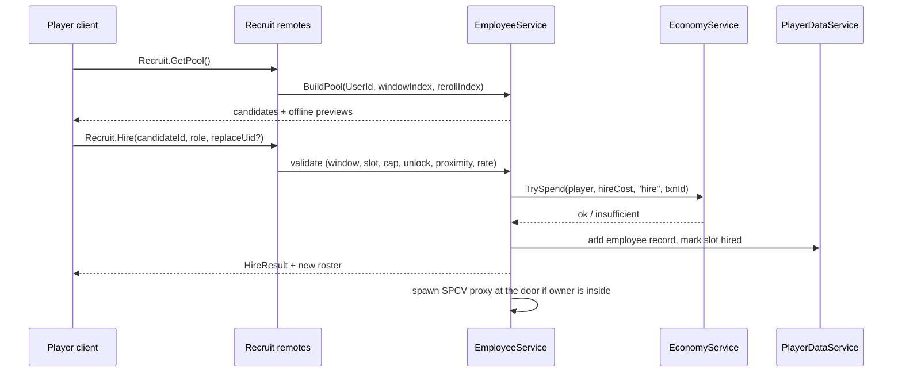
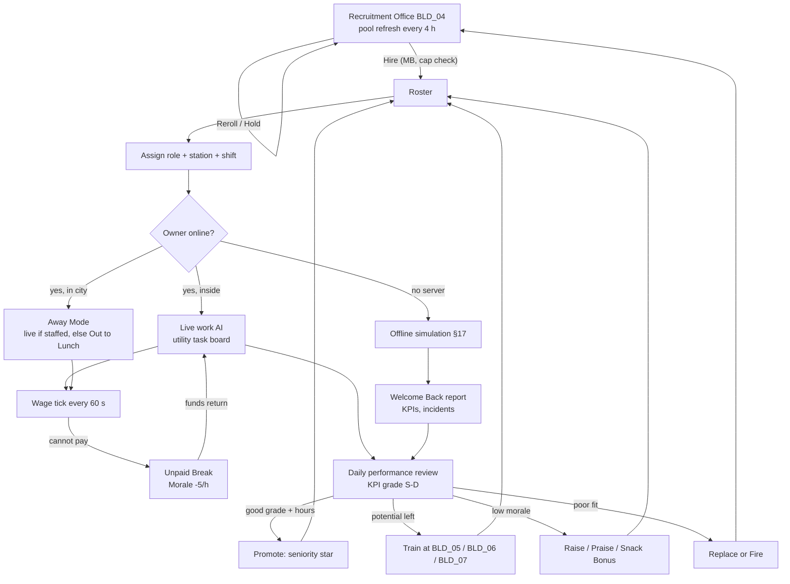

## 16. Employee Management

> Owner: A11 (Employees). Binding inputs: canon §C14 (roles, statistics, offline caps, `EMP_001`), §C4.8 (rarity
> bands), §C6 (employee cap per tier), §C22 E8 (wages). The offline half of this system is specified in §17; the
> archetype database is §36.8 and the offline incident database is §36.9. Every value marked **[TUNABLE]** is a
> balancing assumption that the systems in §17 and §22 already agree on.

### 16.1 Purpose

**Purpose.** Employees are the second engine of Mystery Morph Restaurant. While the player is online they absorb the
repetitive half of the restaurant (washing, re-stocking, seating, standard tickets), so the player can chase the
fun half: tricky orders, brawls, repairs, the city. While the player is offline they keep the restaurant open and
turn hours away into a **Welcome Back** report (§17) — the single strongest daily-return driver in the game. The
brief calls this "a major gameplay system"; we design it as a full management sim layered on top of the action game,
never as a passive bonus.

Design rules (they settle every later trade-off):

1. **Offline complements, never replaces.** A well-staffed restaurant earns 35–50 % of active net per hour offline
   (canon §C15; proven in §17.9). Research Tokens, recipe learning, quests, combat, skill points and most XP stay
   active-only.
2. **Every hire is a decision.** A candidate always trades something: wage vs output, a great trait vs a funny
   drawback (the Dragon Chef burns 6 % of grill items), rarity vs the employee cap of the tier. There is no "best
   employee" for every restaurant — the bottleneck decides (§16.9 ROI table).
3. **Employees are morphs.** Their mutations are canon parts (§12, §36.3) and those parts *are* their abilities:
   an octopus cooks two things at once, a cheetah delivers fast, a rhino stops brawls. The same family/tag system that
   drives player synergies drives employee traits (§16.5), so new mutation parts automatically create new employees.
4. **Earnable only.** Hiring, rerolls, training and raises cost MB; nothing in this system is sold for Robux and
   offline earnings never depend on purchases (§23).
5. **Failure is funny, not devastating.** Bad staffing produces sulky cartoon moments and smaller reports, never
   debt: balances cannot go negative (E8) and the Manager closes early instead of losing money (§17).

### 16.2 Employee Roles

**Rules & Mechanics.** Each employee has a *native role* (from its archetype, §36.8) and an *assigned role* (default =
native). An employee can be assigned any unlocked role; off-native assignments use that role's stat weights and an
**Unfamiliar ×0.85** penalty to RoleStatAvg until a Cross-Training course (§16.7.4) removes it. Roles unlock by tier;
the employee cap is canon §C6. Only one Manager and one Assistant Manager may be assigned at a time.

| ID | Role | Unlock | RoleStatAvg weights | Online responsibilities (task types, §16.3) | Offline contribution (canon §C14.1, formulas §17.4) | Limit |
|---|---|---|---|---|---|---|
| `ROLE_CHEF` | Chef | `TIER_01` | 0.6 Cook + 0.3 Accuracy + 0.1 Reliability | `CookTicket` at assigned station group: claims a station slot, fetches, cooks, assembles, plates to `STN_WINDOW`; at `TIER_01`–`TIER_02` also hands food over the counter | Kitchen capacity: Σ (3600 / PrepSec_avg) × Contribution / 1.4. **Required** — no Chef, no offline customers | — |
| `ROLE_PREP` | Prep Cook | `TIER_01` | 0.4 Cook + 0.4 Service + 0.2 Accuracy | `PrepComponent`: chops, mixes and pre-cooks components into the `STN_PREP` holds the chefs pull from; washes produce | +15 % kitchen capacity per prep (Multi-Tasker prep counts 1.25, `EMP_021` counts 1.5), max +45 % | 3 counted |
| `ROLE_WAITER` | Waiter | `TIER_03` | 0.6 Service + 0.3 Accuracy + 0.1 Reliability | `SeatParty`, `TakeOrder`, `DeliverPlate`, bussing; carries 1 tray (+1 Grabby, max 3) | Service capacity Σ (3600 / 45) × Contribution × (1 + 0.10 × cashiers); needed at `TIER_03`+ (else 30 % of kitchen) | — |
| `ROLE_CASHIER` | Cashier | `TIER_01` | 0.5 Accuracy + 0.4 Service + 0.1 Reliability | `ProcessPayment` at the register (`ANM_066`); at `TIER_01`–`TIER_02` also `TakeOrder` at the counter | +10 % service capacity each (max 3 counted); tips × (1 + 0.01 × floor(cashierSkill / 20)) | 3 counted |
| `ROLE_DISH` | Dishwasher | `TIER_01` | 0.5 Service + 0.5 Reliability | `WashRack` at `STN_DISHWASH` (`ANM_021`); keeps ≥ 4 clean plates ready | Prevents "No Clean Plates": without one, kitchen capacity × 0.80 at `TIER_04`+ | — |
| `ROLE_CLEANER` | Cleaner | `TIER_01` | 0.5 Service + 0.3 Reliability + 0.2 Accuracy | `CleanMess` (trash, spills, broken plates; `ANM_022`, `ANM_023`); keeps cleanliness K high | Without one, offline quality q × 0.95 (`TIER_04`–`TIER_06`) / × 0.92 (`TIER_07`+); enables passing inspections (§36.9) | — |
| `ROLE_REPAIR` | Repair Technician | `TIER_02` | 0.7 Repair + 0.2 Reliability + 0.1 Service | `RepairObject` jobs from `RepairService` (`ANM_060`, `ANM_061`); `ExtinguishFire` | Auto-repairs offline damage at −(Repair / 200) discount (+10 pp Wall Crawler, max 60 %) | — |
| `ROLE_SECURITY` | Security Guard | `TIER_03` | 0.6 Combat + 0.2 Reliability + 0.2 Service | `InterceptHostile`: calms or subdues customers at anger level ≥ 3 (§16.3.3) | Security Mitigation SM = Σ (0.25 × Contribution + 0.10 Bouncer + 0.05 Heavyweight), max 0.60: incident count × (1 − SM) | — |
| `ROLE_MANAGER` | Restaurant Manager | `TIER_02` | 0.4 Reliability + 0.3 Service + 0.3 Accuracy | `Coordinate` aura: team Morale baseline +5 (+10 Epic+), schedules breaks, takes over `SeatParty` when idle | Sets the offline cap by rarity (canon §C14.3); Energy decay 5 %/h instead of 8; coordination +3–10 % capacity | 1 |
| `ROLE_DELIVERY` | Delivery Worker | `TIER_04` | 0.6 Service + 0.3 Reliability + 0.1 Combat | `RunDelivery`: carries bagged orders from `STN_WINDOW` to city doorsteps (cosmetic run; revenue on hand-off) | Delivery revenue = Revenue × min(15 %, Σ 0.06 × Contribution), limited by spare kitchen capacity | — |
| `ROLE_STOCKER` | Ingredient Stocker | `TIER_04` | 0.5 Accuracy + 0.3 Reliability + 0.2 Service | `Restock`: unloads `STN_DELIVERY` crates, refills Pantry, warns before SOLD OUT | Ingredient discount 5–15 % (0.05 + 0.10 × Contribution); auto-buys special stock within the player's budget | — |
| `ROLE_ASST_MGR` | Assistant Manager | `TIER_05` | 0.4 Reliability + 0.3 Service + 0.3 Accuracy | Covers Manager tasks when the Manager is on break; settles staff arguments | +2 h offline cap (requires a Manager; absolute max 24 h), −20 % incident losses, coordination +2–5 % | 1 |

**Role behavior notes (online).**

- **Chef.** Works only recipes whose difficulty D ≤ 1 + floor(Cooking / 25) (canon skill gate) and whose stations
  exist; anything harder stays on the ticket rail for the player, highlighted "Chef can't do this one!". A chef never
  starts a ticket the player has already claimed (§16.3.1 reservation).
- **Waiter.** Seats in arrival order except Rich/celebrity personalities (`PER_008`, `PER_009`) who are seated first;
  delivers to the ticket's seat; on a missed modification the customer gets the normal Accuracy penalty (§10).
- **Security Guard.** Patrols an assigned post (Door / Dining / Kitchen). Never attacks a customer below anger 45.
- **Manager.** Never cooks; while the owner is in the city (Away Mode, §16.3.4) the Manager is the one who flips the sign to "Out to Lunch" if every Chef goes on break or unpaid break.

### 16.3 Online Work AI

#### 16.3.1 Task board and utility scoring

Other services post **tasks** to a per-restaurant `TaskBoard`; each idle or re-evaluating employee picks the task with
the highest utility. Tasks are *reserved* by one actor (player or employee) — players always win a reservation
conflict, and an employee whose task is claimed by a player drops it within 0.25 s.

```
U(task, emp) = RoleFit(task, emp.role) × (Base + Urgency) × (0.5 + Contribution) × ZoneBonus
               − 0.02 × pathDistanceStuds − SwitchPenalty
RoleFit   : 1.0 native task of the role, listed secondary fit (0.3–0.6), else 0 (never chosen)
ZoneBonus : 1.3 inside the employee's assigned workstation/zone, else 1.0
SwitchPenalty : 15 if the employee would abandon an in-progress task, else 0
Contribution  : Efficiency/100 × trait multiplier (§16.4), recomputed every 10 s
```

| Task type | Posted by | Roles (RoleFit) | Base | Urgency term |
|---|---|---|---|---|
| `CookTicket` | `OrderService` | Chef 1.0, Prep 0.4 | 50 | + 40 × (oldest ticket wait ÷ its patience) |
| `PrepComponent` | `CookingService` | Prep 1.0, Chef 0.5 | 40 | + 20 × queued components ÷ 3 |
| `SeatParty` | `CustomerAIService` | Waiter 1.0, Manager 0.5 | 45 | + 30 × queue wait ÷ 30 s |
| `TakeOrder` | `CustomerAIService` | Waiter 1.0, Cashier 0.4 (1.0 at `TIER_01`–`TIER_02`) | 55 | + 45 × ordering-patience used |
| `DeliverPlate` | `CookingService` (window) | Waiter 1.0, any role 0.3 | 60 | + 50 × patience used |
| `ProcessPayment` | `CustomerAIService` | Cashier 1.0, Waiter 0.5 | 40 | + 20 |
| `WashRack` | `CookingService` | Dishwasher 1.0, Prep 0.3 | 30 | + 50 if clean plates < 4 |
| `CleanMess` | `RepairService` (mess list) | Cleaner 1.0, Dishwasher 0.3 | 25 | + 3 per point of cleanliness below 90 |
| `RepairObject` | `RepairService` | Repair 1.0, Cleaner 0.3 | 35 | + 40 if Broken, + 20 if Cracked |
| `ExtinguishFire` | `CookingService` | any 1.0 (Splash Zone ×2) | 95 | — |
| `InterceptHostile` | `CustomerAIService` | Security 1.0, Manager 0.3 | 80 | + 15 × anger level |
| `Restock` | `InventoryService` | Stocker 1.0 | 30 | + 60 if a menu recipe goes SOLD OUT within 5 min |
| `RunDelivery` | `OrderService` | Delivery 1.0 | 40 | + 30 × order age ÷ 120 s |
| `Break` | `EmployeeService` | self | 70 if Energy < 25 % (forced < 10 %) | — |
| `IdleTidy` | `EmployeeService` | any | 5 | — (wipes tables, poses, hums) |

**Scheduler.** One `EmployeeBrain` loop per restaurant runs at **4 Hz** [TUNABLE], staggered by plot index
(offset 0.03 s × plotIndex) so 8 restaurants never tick on the same frame. Each tick re-evaluates at most 5
employees round-robin plus any employee whose task just finished or failed; interruptible tasks are re-scored every
1.5 s. A task that fails twice (path blocked, station destroyed) is released with a 5 s cooldown for that employee.

#### 16.3.2 Action timing and quality

| Quantity | Formula [TUNABLE] | Notes |
|---|---|---|
| Walk speed (studs/s) | `(12 + 0.06 × Service) × move` (Speedster 1.35, Heavyweight 0.9, Unhurried 0.6), max 21 | Players walk 16–21 (§C3) |
| Floor handling time (seat, order entry, hand-off, payment) | `Base × 1 / (0.6 + 0.8 × Service/100)` | Calculator Brain payment 0.5 s flat |
| Kitchen handling time (fetch, assemble, plate) | `Base × 1 / (0.6 + 0.8 × Cook/100)` | Station process time is physical (§5, §C4.9) and identical for everyone |
| Heat item grade | P(PERFECT) = 0.05 + 0.55·Acc/100 + 0.15·Cook/100; P(BURNED) = max(0.01, 0.12 − 0.10·Acc/100) + trait burn chance; P(UNDERCOOKED) = max(0.01, 0.08 − 0.07·Cook/100); else GOOD | Ember adds 6 % burn; Toastmaster Tim halves burns |
| Chop grade | Clean cut chance 0.2 + 0.7·Acc/100, else yellow (0.8) | never MUSHY |
| Order mistake (waiter/cashier) | `0.10 × (1 − Acc/100) × (1.5 − Rel/100)` per order | wrong table or a dropped modification |
| Wander-off (Reliability) | `0.2 × (1 − Rel/100)` per online hour: 2 min idle "daydream" | shown as a thought bubble |
| Order-modification success (chef, per mod, §6.18) | `P = clamp(0.5 + (Skill − 10 × difficulty) / 100, 0.30, 0.98)`; Skill = Accuracy, or (Accuracy + Cooking) / 2 for `DONENESS` and `TEMP` mods; difficulty from §6.18.2 (OMIT/EXTRA 1, most categories 2, JOKE 3) | rolled once per mod when the employee finishes the item; a failed mod counts as missed for order accuracy A (§10); JOKE mods always use the Play Along action on success, otherwise the Straight Answer (never anger) |

Examples: Ollie (Accuracy 28) succeeds on an OMIT 68 % of the time and on a JOKE 48 %; a Legendary chef (Accuracy 90)
hits 98 % / 98 %. A ticket whose mod needs a TAIL actor or another morph condition (§6.18) is only auto-claimed by an
employee who satisfies it. **Offline, modifications are not simulated per order:** their effect is already folded
into the aggregate quality q (avg chef Accuracy) and order-accuracy assumptions of canon §C15 (§17.4).

A typical Uncommon chef produces Food Quality around 0.75–0.80 and a Legendary one around 0.92 — a skilled player at
PERFECT timing (1.00) stays the best cook in the building, by design.

#### 16.3.3 Customers, combat and repairs

- **Interception (Security).** Trigger: a customer reaches anger ≥ 45 (level 3) within 30 studs of the guard's post
  (anywhere if no post). The guard walks over and channels **Calm Talk** for 2.0 s:
  `P(calm) = clamp(0.25 + 0.6 × Combat/100 + 0.25 [Bouncer] − 0.10 × (angerLevel − 3), 0.10, 0.95)`. Success: anger
  −40 and the customer enters *Calming down*. Failure: the guard **subdues** — 4 + Combat/10 Huff Points per hit every
  1.2 s until the customer is `STS_DIZZY` and is escorted out with the canon Apology Payment (40 %, no tip). At
  level 6 chaos guards target the angriest customer first.
- **Staff safety.** Employee HP = 60 + Combat. At 0 the employee plays Seeing Stars (`ANM_062`) for 8 s and returns
  at 50 % HP and −5 Morale — never removed, never "lost". Non-guard staff within 8 studs of a hostile customer flee
  (`ANM_054`) and resume after 4 s; a thrown item that hits a carrying employee drops the plate 50 % of the time
  (0 % with Sticky Grip). Employees never damage customers except guards subduing a level ≥ 3 customer.
- **Repairs.** Repair Technicians take `RepairService` jobs; repair rate = base × (0.5 + Repair/100) × traits (Electric
  appliances ×1.3, Wall Crawler travel ×0.6). Material cost × (1 − Repair/400). A job absorbs new damage and converts to
  Rebuild if the object reaches Destroyed; cost is charged once at completion (canon E3).
- **Co-op.** Guests' actions reserve tasks like the owner's; employees obey the owner's assignments only.

#### 16.3.4 Away Mode (owner online, exploring the city) — consistent with §18

Away Mode is **not** the offline simulation. While the owner is online on the same server but outside the interior,
a **staffed** restaurant (≥ 1 Chef on an Always or Online Only shift) keeps running **live**: the same online AI of
this section, the same SPCV customers, normal online wages (§16.7.11) and normal income. Two safety rules from §18
apply while the owner is away: anger escalation beyond level 2 is suppressed unless a Security Guard is on shift
(customers sulk or leave instead), and heat-station timers pause so unattended items never burn. An **unstaffed**
restaurant goes "Out to Lunch" / "Event Break": no new customers, no reputation loss, no wages. The §17 offline
simulation covers **only** time when the player is in no server at all, starting from the `lastSimAt` written by the
last save (PlayerRemoving / BindToClose, canon E1/E13); an idle player removed by Roblox's idle kick simply becomes
offline from that save. Staffing therefore pays twice: it lets the player explore Morph City without closing, and it
earns while they are logged off.

### 16.4 Employee Statistics

All statistics of canon §C14.2. The six *trainable* stats live on the 1–100 scale; at hire they sit inside the rarity
band of §C4.8 (Common 15–40 … Legendary 75–100) and training can raise them to the **potential cap** (rarity cap
55 / 70 / 82 / 92 / 100, +3 per seniority star, max 100).

| Stat | Range | Online effect (§16.3.2) | Offline effect (§17.4) | Raised by |
|---|---|---|---|---|
| Cooking Skill | 1–100 | kitchen handling speed, PERFECT/UNDERCOOKED odds, recipe skill gate D ≤ 1 + floor(Cook/25) | best chef's Cook sets the offline menu gate; RoleStatAvg of Chef/Prep | Cooking Academy course (`BLD_06`) |
| Service Speed | 1–100 | walk speed, floor handling speed | RoleStatAvg of Waiter/Cashier/Dish/Cleaner/Delivery; avg waiter Service raises tip rate | Training Gym course (`BLD_05`) |
| Accuracy | 1–100 | PERFECT and BURNED odds, order mistakes | avg chef Accuracy sets quality q = min(0.95, 0.70 + 0.25 × Acc/100) | Cooking Academy course |
| Repair Skill | 1–100 | repair rate, material discount | auto-repair discount Repair/200 | Repair Workshop course (`BLD_07`) |
| Combat Strength | 1–100 | calm chance, subdue damage, staff HP | Security Mitigation via Contribution | Training Gym course |
| Reliability | 1–100 | mistake multiplier, wander-off chance | weight in most roles; staff-mistake incident odds | Repair Workshop course |
| Energy | 0–100 % | at < 25 % takes a break; Efficiency × (0.7 + 0.3·E/100) | −8 %/h (−5 %/h with Manager) per simulated hour | breaks, Off Duty, closed hours |
| Morale | 0–100 | Efficiency × (0.6 + 0.4·M/100); < 25 = Sulking | −1/h offline | raises, stars, praise, snacks, good days |
| Salary | MB/h | paid every 60 s while on shift (E8) | Σ wage × hours worked | raises (+10 %), stars (+5 %) |
| Efficiency | derived | drives utility and speed | drives every capacity | all of the above |
| Special Abilities | traits | §16.5 | §16.5 | promotions (star 3 upgrades the signature) |

**Efficiency (canon §C14.2, exact).**

```
RoleStatAvg = Σ weight_role(stat) × stat            (weights in §16.2; × 0.85 if off-native role and not cross-trained;
                                                     Calculator Brain counts Reliability +5)
Efficiency  = RoleStatAvg × (0.6 + 0.4 × Morale/100) × (0.7 + 0.3 × Energy/100) × (1 + 0.001 × player EFFICIENCY)
Eff         = Efficiency / 100                       (0–1.15; the form used by every capacity formula)
Contribution = Eff × TraitMult(role)                 (TraitMult = product of applicable trait multipliers, max ×1.5)
```

Example: Ollie (`EMP_001`, Cook 30 / Acc 28 / Rel 40) → RoleStatAvg 30.4; at Morale 90, Energy 100, player EFFICIENCY 0
→ Efficiency 29.2 → Eff 0.292 → Contribution 0.292 × 1.25 (Multi-Tasker) = **0.365** (§17.9 Example A).

### 16.5 How Employee Mutations Shape Performance

**Derivation rule.** A trait is derived when the employee's parts contain one of its **key families** (any part) or
**≥ 2 parts carrying its key tag** (a matched pair counts as two parts). Families and tags are the canon vocabulary of
§C13.5/§C13.6, so every future mutation part automatically produces employees with sensible traits. An employee shows
at most **two derived traits** (designer-picked per archetype; the procedural generator keeps the two most relevant to
the native role) plus one **signature ability** unique to the archetype (§36.8). Per-employee trait multipliers cap at
×1.5; restaurant-wide bonuses have their own caps (listed).

| Trait | Derived from | Online effect | Offline effect | Drawback |
|---|---|---|---|---|
| Multi-Tasker | families octopus, kraken, squid; or an ARM/BACK part tagged `multi` | works 2 station slots / 2 racks / 2 repair jobs at once (80 % speed each) | Chef, Dish, Repair, Cleaner Contribution ×1.25 (kraken ×1.35); a Multi-Tasker prep counts 1.25 preps | — |
| Speedster | families cheetah, ostrich, raptor, wheel, skate, grasshopper, kangaroo; or ≥ 2 `speed` | walk speed ×1.35 | Waiter, Delivery, Cleaner ×1.20 | 1 % chance per delivery to overshoot the table (comedy only) |
| Bouncer | families rhino, bull, triceratops; or ≥ 2 `horn` | calm chance +25 %; charges to split two brawlers | Security Mitigation +0.10 per guard | knocks over 1 chair per charge (Scuffed) |
| Wall Crawler | families spider, gecko | repairs walls/ceilings without a ladder; travel between jobs ×0.6 | auto-repair discount +10 pp (max 60 %); "Sauce on the Ceiling" weight ×0.5 | — |
| Calculator Brain | family robot; or ≥ 2 `robotic` | payments 0.5 s; order-entry mistakes −80 % | cashier skill ×1.5 for the tip bonus; Reliability +5 in RoleStatAvg | speaks only in beeps |
| Unhurried | family turtle; or ≥ 2 `tank` and no `speed` | action speed ×0.6; Energy drain ×0.5; immune to rush stress | capacity roles ×0.6; *presence* roles (Dish, Cleaner, Repair existence checks) count fully; Energy decay ×0.5 | slow |
| Grill Master | families dragon, lava, phoenix; or ≥ 2 `fire` | GRILL/FRY/BAKE handling ×0.8 (dragon ×0.7), PERFECT +10 % | Chef ×1.15; offline quality q −0.02 per Grill Master chef (max −0.04) | 4 % burn chance per heat item (dragon 6 %) |
| Ice Hands | families ice, yeti, penguin; or ≥ 2 `ice` | FREEZE/BLEND/SCOOP ×0.75 | Chef ×1.05 if ≥ 25 % of the menu is drinks/desserts, ×1.10 if ≥ 50 % | — |
| Charmer | ≥ 2 `charm` | customer patience +8 % within 10 studs; tips +5 % on their tables | tip multiplier +0.05 per Charmer waiter/cashier (max +0.10) | — |
| Loudmouth | ≥ 2 `loud` | shouts tickets: chefs within 15 studs +5 % speed | coordination +2 pp (Manager/Assistant) | nearby customers −2 satisfaction |
| Sniffer | families pig, dog, mole, rat | spots messes and SOLD OUT risks 2× sooner | stocker discount +2 pp; discovery chances ×1.10 (once per restaurant) | — |
| Lucky Charm | ≥ 2 `luck` | +0.5 % Jackpot Tip chance on their tables | discovery chances ×1.15 (once; combined discovery boost max ×1.25) | — |
| Tough Shell | ≥ 2 `armored` | damage taken −40 %, cannot be knocked down | as a guard: customer-incident losses ×0.9 | — |
| Heavyweight | families bear, gorilla, golem, elephant, muscle; or ≥ 2 `heavy` | immune to knockback; carries 2 trays | as a guard: Security Mitigation +0.05 | walk speed ×0.9 |
| Grabby | ≥ 2 `grabby` | carry +1 (max 3, §C3) | Waiter ×1.10; breakage incidents ×0.3 | — |
| Glow-Up | ≥ 2 `glow` | Atmosphere +2 while on shift | DecorMult +0.006 each (max +0.02) | — |
| Splash Zone | families elephant, faucet, hydrant, extinguisher; or ≥ 2 `water`/`aquatic` | extinguishes ON_FIRE instantly; racks ×1.25 | fire incidents ×0.3; Dish ×1.10 | leaves puddles (CleanMess task) |
| Sticky Grip | ≥ 2 `sticky` | never drops plates or trays | breakage incidents ×0.3 | leaves faint footprints |
| Regenerator | ≥ 2 `regen` | Energy drain ×0.75 | Energy decay ×0.75 | — |
| Electric | ≥ 2 `electric` | appliance repairs ×1.3 | as Repair Tech: equipment incidents ×0.7 | 2 %/h chance to trip a breaker (10 s stall) |
| Flying | any part tagged `flying` | Hover Serve over tables (path ×0.8) | Waiter, Delivery ×1.15 | — |
| Golden Touch | any part tagged `gold` | tips +10 % on their tables | tip multiplier +0.10 (once per restaurant) | — |
| Chef's Instinct | ≥ 2 `chef` | PERFECT +10 % | offline q +0.02 per such chef (max +0.03) | — |
| Cosmic Intuition | ≥ 2 `cosmic` | sees anger spikes 3 s early (meter flashes) | as Manager/Assistant: positive incident weights ×1.15 | — |

The brief's examples map exactly: Octopus Chef → Multi-Tasker (`EMP_005`), Cheetah Waiter → Speedster (`EMP_028`),
Rhino Security Guard → Bouncer (`EMP_066`), Spider Repair Technician → Wall Crawler (`EMP_058`), Robot Cashier →
Calculator Brain (`EMP_034`), Sloth Dishwasher → Unhurried and the band-minimum wage (`EMP_039`), Dragon Chef → Grill
Master with burns (`EMP_009`).

**Employee personalities** (one per archetype; small, readable effects; they also flavor report lines).

| Personality | Effect [TUNABLE] |
|---|---|
| Eager Beaver | Morale baseline +5; online Energy drain ×1.1 |
| Zen Noodle | all Morale changes ×0.5 (offline −0.5/h) |
| Drama Royalty | all Morale changes ×1.5; report lines are extra dramatic |
| Perfectionist | Accuracy +5 effective online; handling ×1.05 slower |
| Chatterbox | customer patience +5 % near them; online Energy drain ×1.05 |
| Grump | Morale baseline −10; no Morale loss from being hit by food |
| Clumsy Sweetheart | mistake chance ×1.5; Morale baseline +10 |
| Overachiever | training gain +1; online Energy drain ×1.1 |
| Snack Goblin | Morale baseline +5; enables "Snack Break Became a Picnic" (`INC_024`) |
| Night Owl | offline Energy decay −2 %/h; online drain ×1.1; boosts midnight incidents |
| Show-Off | tips +3 % on their tables; mistake chance ×1.2 |
| Shy Genius | customer-facing tasks ×0.9 speed; kitchen tasks ×1.05 |
| Loyal Lump | Morale floor 40; coworkers lose double Morale if this employee is fired |
| Daydreamer | wander-off chance ×1.5; discovery report lines more often |

### 16.6 Hiring System

**Where.** The Recruitment Office (`BLD_04`, Downtown `DST_03`), staffed by **Ms. Hirewell** (`NPC_007`, owl head,
filing-cabinet torso). From `TIER_06` the **Hirewell Hotline** button in the Employee menu allows remote hiring for a
+10 % fee, so late-game players are not forced to commute, while early players learn the city.

#### 16.6.1 Candidate pool

| Rule | Value [TUNABLE] |
|---|---|
| Refresh | every 4 h on UTC windows (00:00, 04:00, … 20:00); `windowIndex = floor(os.time() / 14400)` |
| Seed | `hash(UserId, windowIndex, rerollIndex)` → `Random.new(seed)`; rejoining or server-hopping shows the same pool |
| Pool size by tier | T1 3 · T2 3 · T3 4 · T4 4 · T5 5 · T6 5 · T7 6 · T8 6 · T9 7 · T10 8 |
| Slot 1 "Hirewell's Pick" | role-gap fill: no Chef → Chef; else the role behind the last offline report's bottleneck (Kitchen → Chef/Prep, Service → Waiter/Cashier, cap reached → Manager/Assistant, SOLD OUT → Stocker) |
| Archetype pick | roll rarity (table below) → uniform among archetypes of that rarity with `min_tier ≤ tier`; archetypes already employed weigh ×0.5 |
| Rerolls | first reroll per window free; then `50 × tier × 2^(n−1)` MB for paid reroll n = 1..3 (T5: 250 / 500 / 1,000) |
| Hold | pin one candidate into the next window for 5 % of its hire cost (non-refundable) |
| Pity | at `TIER_05`+, 12 windows without a Rare-or-better candidate → next pool has one; at `TIER_08`+, 24 windows without Epic+ → next pool has one (counters persist, reset on sight) |
| Disclosure | the rarity odds below are shown in the UI (ⓘ button); rerolls cost MB only and are never sold for Robux |

| Tier | ● Common | ▲ Uncommon | ■ Rare | ⬟ Epic | ★ Legendary |
|---|---|---|---|---|---|
| `TIER_01` | 90 % | 10 % | 0 % | 0 % | 0 % |
| `TIER_02` | 78 % | 22 % | 0 % | 0 % | 0 % |
| `TIER_03` | 60 % | 36 % | 4 % | 0 % | 0 % |
| `TIER_04` | 42 % | 46 % | 12 % | 0 % | 0 % |
| `TIER_05` | 28 % | 44 % | 25 % | 3 % | 0 % |
| `TIER_06` | 18 % | 38 % | 34 % | 10 % | 0 % |
| `TIER_07` | 10 % | 30 % | 38 % | 20 % | 2 % |
| `TIER_08` | 6 % | 22 % | 38 % | 28 % | 6 % |
| `TIER_09` | 4 % | 16 % | 34 % | 34 % | 12 % |
| `TIER_10` | 2 % | 12 % | 30 % | 36 % | 20 % |

#### 16.6.2 What each candidate has

| Field | Generation rule |
|---|---|
| Name & morph | archetype name; parts from §36.8 (client visual, ≤ 24 MeshParts) |
| Rarity | rolled per 16.6.1; color + shape icon (§C13.3) so it is never color-only |
| Stats | archetype values ± up to 3 (seeded), clamped to the rarity band |
| Hire cost | archetype hire × U(0.9, 1.1), rounded (50 MB under Rare, 500 Rare, 1,000 Epic, 5,000 Legendary), clamped to band |
| Wage | archetype wage × U(0.9, 1.1), clamped to band |
| Traits & signature | archetype's; procedural candidates (future) derive traits from parts by the §16.5 rule |
| Personality | archetype's |
| Training potential | grade S/A/B/C/D (gain ×1.5/1.3/1.15/1.0/0.75) and cap (rarity cap + 3 per star) |
| Quirk line | 1 of 24 cosmetic lines ("Hums the city anthem while chopping", "Afraid of round plates") |
| Offline impact preview | Δ offline MB/h if hired into the suggested role, computed by the §17 model with expected values (no RNG) |

#### 16.6.3 Recruitment interface

```
┌─ RECRUITMENT OFFICE ─ Ms. Hirewell ─────────────────── Pool refreshes in 02:41:13 ── [X] ┐
│ Staff 5/8 ▸ Wages 498 MB/h ▸ Bottleneck: SERVICE              [Reroll: FREE] [ⓘ Odds]    │
├──────────────┬──────────────┬──────────────┬──────────────┬──────────────────────────────┤
│ ★ HIREWELL'S │ ■ RARE       │ ▲ UNCOMMON   │ ● COMMON     │  ┌ CANDIDATE DETAIL ───────┐  │
│   PICK       │              │              │              │  │ [ rotating 3D morph ]   │  │
│ [3D bust]    │ [3D bust]    │ [3D bust]    │ [3D bust]    │  │ "Chet Speedwell"        │  │
│ Chet         │ Rocco        │ Skates       │ Sloane       │  │ ■ Rare · Waiter         │  │
│ Waiter       │ Security     │ Waiter       │ Dishwasher   │  │ Svc ███████░ 68 ...     │  │
│ 12,000 MB    │ 12,500 MB    │ 2,300 MB     │ 200 MB       │  │ Speedster · Zoomies     │  │
│ 165 MB/h     │ 170 MB/h     │ 55 MB/h      │ 10 MB/h      │  │ Show-Off · Potential A  │  │
│ +812 MB/h ▲  │ +0 MB/h      │ +434 MB/h ▲  │ +288 MB/h ▲  │  │ Offline: +812 MB/h      │  │
│ [HOLD 5%]    │ [HOLD 5%]    │ [HOLD 5%]    │ [HOLD 5%]    │  │ [ HIRE AS: Waiter ▾ ]   │  │
└──────────────┴──────────────┴──────────────┴──────────────┴──└─────────────────────────┘──┘
```

Component hierarchy: `RecruitScreen` → `HeaderBar` (staff count / cap, wages per hour, bottleneck chip, refresh
timer, `RerollButton` showing price, `OddsButton`) → `CandidateRow` (`CandidateCard` × poolSize: bust viewport, rarity
badge with shape, name, role icon, hire cost, wage, offline-impact delta with ▲/▼ arrow, `HoldButton`) →
`CandidateDetail` (ViewportFrame morph preview with idle work animation, stat bars with potential ghost bar, trait
chips with tooltips, signature ability, personality, quirk, `RoleDropdown`, `HireButton`, `ReplaceToggle` when at cap).
Input: mouse/touch tap cards; controller D-pad moves focus, A selects, X rerolls, Y holds, B closes; mobile cards
scroll horizontally with 88 px minimum touch targets. Hire buttons are disabled (with reason text) when funds, cap or
role unlock fail — the server still re-validates.

#### 16.6.4 Hiring workflow



Server validation for `Recruit.Hire` (any failure returns a reason code and changes nothing):

1. Rate limit 1 hire request per 2 s per player; profile loaded and not in Safe Mode (E6).
2. `candidateId` = `windowIndex:slot` belongs to the *current* window (or the held candidate) and the slot is not yet
   hired; stats/costs are regenerated server-side from the seed — the client never sends a price.
3. Player is within 12 studs of Ms. Hirewell's ProximityPrompt, or uses the Hotline at `TIER_06`+ (fee applied).
4. Not In Combat and no full-screen menu restriction (canon E2).
5. `#employees < EmployeeCap[tier]` (canon §C6), unless `replaceUid` is given (that employee is fired first, §16.7.7,
   atomically in the same transaction).
6. The requested role is unlocked at the current tier; Manager/Assistant uniqueness respected.
7. `EconomyService:TrySpend` succeeds with idempotency key `hire:<UserId>:<windowIndex>:<slot>` (a retried request
   cannot double-charge).
8. The employee record is written to the profile and the profile is saved immediately if the cost is ≥ 10,000 MB
   (canon autosave rule) — otherwise at the next autosave.

The first hire is scripted by `QST_TUT_012` "Hire Help": Ms. Hirewell gifts Ollie (`EMP_001`, cost 0) and the
screen shows the **Offline Forecast** ("If you log off now, Ollie earns about 270 MB/h for up to 2 h").

### 16.7 Employee Management

#### 16.7.1 Roster screen (Employee menu, HUD quick-access, usable anywhere)

```
┌─ MY STAFF ── 8/8 ── Wages 498 MB/h ── Offline cap 8 h (Mister Mustache ■) ── Forecast 2,180 MB/h ─ [X] ┐
│ [All][Kitchen][Floor][Support]    Sort: Role ▾      [Night Menu] [Auto-buy budget] [Wage priority]    │
├────────────────────────────────────────────────────────────────────────────────────────────────────┤
│ ● Sloane  Dish   ▮▮▮▮▮▮▮▮▮▮ E 100%  ☺ 90  KPI B  10 MB/h  Always   "washed 486 plates"     [ ▸ ]    │
│ ▲ Octavia Chef   ▮▮▮▮▮▮▮▮░░ E 90%   ☺ 80  KPI A  50 MB/h  Always   GRILL LINE  ⏳ —        [ ▸ ]    │
│ ■ Chet    Waiter ▮▮▮▮▮▮▮░░░ E 88%   ☺ 80  KPI S  165 MB/h Always   Zone A       ★☆☆       [ ▸ ]    │
├────────────────────────────────── DETAIL: Octavia ──────────────────────────────────────────────────┤
│ [3D morph]  Role [Chef ▾]  Station [Grill line ▾]  Shift [Always ▾]  Cook 58/70 ▮▮▮▮▮▮▮░ Acc 52/70 …  │
│ Traits: Multi-Tasker · Tentacle Tornado     Personality: Overachiever   Potential A   Stars ★☆☆     │
│ Last 24 h: 412 dishes · avg Q 0.81 · 3 burns · KPI 84 (A) · value 3.1× wage                           │
│ [Train ▸] [Raise +10%] [Promote ★] [Praise] [Snack Bonus] [Replace] [Fire]                            │
└────────────────────────────────────────────────────────────────────────────────────────────────────┘
```

Hierarchy: `StaffScreen` → `StaffHeader` (count/cap, wages/h, offline cap with the manager's rarity icon, Offline
Forecast MB/h) → `FilterTabs` + `SettingsButtons` (Night Menu, Auto-buy budget, Wage priority) → `RosterList`
(`EmployeeRow`: rarity icon, name, role icon, Energy bar, Morale face + number, KPI grade letter, wage, shift chip,
station/zone, training timer, stars) → `EmployeeDetail` (viewport, assignment dropdowns, stat bars with potential cap
marker, traits, KPIs, action buttons). Every action button shows its MB price; destructive actions (Fire, Replace)
open a confirm dialog. Controller: LB/RB switch tabs, D-pad rows, A open detail, X Praise, Y Train.

#### 16.7.2 Assign roles and change workstations

- **Role**: any unlocked role; off-native roles show "Unfamiliar ×0.85" until cross-trained. Changing role is free,
  takes effect after the current task, and has a 60 s cooldown per employee.
- **Workstation / zone** (ZoneBonus ×1.3 in §16.3.1): Chef → station group (Grill line, Fry line, Bake line,
  Drinks & Desserts, Any); Prep → board/counter; Waiter/Cleaner → dining zone A/B/C or Any (zones auto-split by
  table count); Security → Door / Dining / Kitchen post; Repair → Kitchen-first / Dining-first priority.
  Idle employees still help outside their zone after 5 s without a zone task.

#### 16.7.3 Shifts and rest

| Shift mode | Online | Offline (§17) | Wage | Energy |
|---|---|---|---|---|
| Always (default) | works | works | paid both | drains online and offline |
| Online Only | works | rests | online only | recovers +10 %/h offline |
| Offline Only | rests at home | works | offline only | recovers +10 %/h while you play |
| Off Duty ("vacation") | — | — | none | +10 %/h; Morale +2/h up to baseline |

Breaks are automatic (§16.7.10). The restaurant always keeps the last Chef working when breaks overlap, unless his
Energy is < 10 %.

#### 16.7.4 Training

Courses run in the city — **Cooking Academy** (`BLD_06`): Cooking, Accuracy; **Training Gym** (`BLD_05`): Service,
Combat; **Repair Workshop** (`BLD_07`): Repair, Reliability — and are bought from the roster (no commute). The trainee
leaves for the course in real time (it continues while you are offline), does not work and is not paid during it,
but still counts toward the employee cap.

| Rule | Formula [TUNABLE] | Example |
|---|---|---|
| Gain | `round(4 × GradeMult)` points (D 3, C 4, B 5, A 5, S 6; Overachiever +1), never above the effective cap | Ollie (B): +5 Cooking |
| Effective cap | `min(100, RarityCap + 3 × stars)` (55 / 70 / 82 / 92 / 100) | Ollie with 2 stars: 61 |
| Cost | `0.04 × ArchetypeHire × 1.08^(stat − bandMin)` MB (`EMP_001` uses 400 as its hire basis) | Ollie Cooking 30: 51 MB · Captain Calamari Cook 96: ≈ 77,000 MB |
| Duration | `min(240, 20 + 3 × (stat − bandMin))` minutes | Ollie: 65 min · Captain: 83 min |
| Concurrent trainees | 1 (`TIER_01`–`TIER_03`), 2 (`TIER_04`–`TIER_07`), 3 (`TIER_08`+) | — |
| Cross-Training | `0.10 × ArchetypeHire` MB, 60 min: removes Unfamiliar for one chosen role | Octavia → Prep: 210 MB |
| Completion | Morale +5; report line "Graduated with honors (and a tiny hat)" | — |

Training is the long-term sink that keeps old favorites relevant: a trained Uncommon can match an untrained Rare at a
fraction of the wage (Example C trains Octavia to Cook 58 / Accuracy 52).

#### 16.7.5 Salary raises

`Raise` sets wage × 1.10 (max 3 raises, +33 %): Morale +10 now and Morale baseline +5 per raise. An employee whose
Morale stays < 40 for 24 h of shift time *asks* for a raise (notification); ignoring it for 72 h lowers the baseline
by 5 until a raise is given. Raised wages may exceed the hire band (bands apply at hire, §C4.8).

#### 16.7.6 Promotions ("seniority stars")

| Star | Requires | Fee | Effects |
|---|---|---|---|
| ★ Senior | 10 h worked (online + offline) and last review ≥ B | 25 % × ArchetypeHire (min 100 MB) | potential cap +3, primary stat +2, Morale baseline +5, wage +5 % |
| ★★ Veteran | 40 h worked, review ≥ B | 50 % × ArchetypeHire | same again |
| ★★★ Legend of the Kitchen | 120 h worked, review ≥ A | 75 % × ArchetypeHire | same again + signature upgrade (e.g. Multi-Tasker ×1.30, Grill Master burn 4 % → 2 %) and a celebration (`ANM_064`) |

#### 16.7.7 Replace or fire

- **Fire**: confirm dialog → the employee waves goodbye with a cardboard box (client-only animation) and is removed.
  Within 15 min of hiring ("probation") the player gets 50 % of the hire cost back; afterwards the employee receives
  a severance of 2 h wage. Coworkers lose 3 Morale (8 if the fired employee had ≥ 2 stars or ≥ 7 days of tenure;
  doubled by Loyal Lump). An employee in training must have the course cancelled first (no refund). The individual
  can never be re-hired; the archetype can reappear in pools.
- **Replace**: from the roster, opens the Recruitment pool filtered to that role (at `BLD_04`, or Hotline at
  `TIER_06`+). Hire + fire happen in one transaction; the newcomer inherits role, station, shift and zone; the
  coworker Morale hit is halved.

#### 16.7.8 Hiring managers

Managers are hired like anyone else; their **rarity** sets the offline cap (canon §C14.3: none 2 h, Common/Uncommon
"Basic" 4 h, Rare "Experienced" 8 h, Epic "Elite" 12 h, Legendary 24 h; Assistant +2 h, max 24 h). Online the
Manager raises team Morale baseline (+5, +10 at Epic+), schedules breaks so two employees of the same role never
rest together, and adds coordination (`min(0.10, 0.03 + 0.07 × Contribution)`, +2 pp for Loudmouth or `EMP_072`).
The Assistant Manager covers the Manager's breaks, adds +2–5 pp coordination and −20 % incident losses offline.

#### 16.7.9 Performance reviews

Each employee gets a **KPI score** (0–100) over the rolling 24 h of shift time (online and offline), shown as a grade:
S ≥ 90, A ≥ 75, B ≥ 60, C ≥ 40, D < 40. "Employee of the Day" (best score, ≥ 3 employees) gets Morale +10.

| Role | KPI components (each normalized to its expected value at the employee's tier) |
|---|---|
| Chef | 40 % dishes/h · 40 % average Food Quality · 20 % burn-free rate |
| Prep | 60 % components/h · 40 % clean-cut rate |
| Waiter | 40 % deliveries/h · 40 % average wait factor W of served customers · 20 % mistake-free orders |
| Cashier | 50 % transactions/h · 50 % tip uplift |
| Dishwasher | 60 % plates/h · 40 % minutes without a "No Clean Plates" stall |
| Cleaner | 50 % messes cleaned · 50 % average cleanliness K |
| Repair Technician | 60 % durability restored/h · 40 % average time objects stayed Broken |
| Security Guard | 40 % intercepts · 40 % calm rate · 20 % damage prevented |
| Manager / Assistant | 50 % team average Morale · 50 % team average KPI |
| Delivery Worker | 60 % runs/h · 40 % on-time rate |
| Stocker | 50 % SOLD OUT minutes avoided · 50 % discount saved |

The review panel also shows **value vs wage**: MB attributed to the employee (their share of dishes, deliveries,
tips, losses avoided, offline marginal net) ÷ wage paid. Review actions: **Praise** (free, once per employee per day,
Morale +5), **Pep Talk** (free, once per day, whole team +3), **Snack Bonus** (costs 1 h of that wage, Morale +15,
12 h cooldown).

#### 16.7.10 Morale and energy

```
Morale baseline B = 60 + 5·raises + 5·stars + personality (Grump −10, Clumsy Sweetheart +10, Eager Beaver +5,
                    Snack Goblin +5) + Manager aura (+5; +10 Epic/Legendary)                         [clamp 0–100]
Online: Morale drifts toward B at 4 points/h, plus events:
   +1 per Delighted customer they served (max +6/h) · −2 hit by thrown food (Grump 0) · −5 Seeing Stars ·
   −5/h on Unpaid Break · −2/h while Energy < 20 % · +5 training done · +10 raise · +15 promotion ·
   +5 Praise · +3 Pep Talk · +15 Snack Bonus · −3/−8 coworker fired · +10 Employee of the Day
Offline (§17): −1/h (Zen Noodle −0.5/h); morale events from incidents (§36.9)
Morale < 25 = "Sulking": 20 % chance per online hour of a 3-min sulk break (raincloud VFX)

Energy (online) drain = 10 %/h × RoleDrain × personality × traits
   RoleDrain: Chef 1.2 · Prep 1.1 · Waiter 1.15 · Dish 1.2 · Cleaner 1.0 · Repair 1.0 · Security 0.8 · Cashier 0.8 ·
              Manager 0.6 · Delivery 1.2 · Stocker 0.9 · Assistant 0.6; Regenerator ×0.75; Unhurried ×0.5
Break: at Energy < 25 % if another employee of the role is working or the player is present (forced at < 10 %):
   4 min, +6 %/min (×1.5 if the restaurant owns a staff-room upgrade from §15), returns ≥ 49 %
Off Duty / Online Only while offline / closed hours beyond the offline cap: +10 %/h
Offline: −8 %/h, −5 %/h with a Manager; never below 3 %/h after bonuses (§17.4)
```

#### 16.7.11 Online wages (canon E8)

Every **60 s** while the restaurant is open (live or Away Mode) `EmployeeService` pays `Σ wage/60` for every employee
on shift (working or on a normal break; not Off Duty, not training, not on Unpaid Break) through
`EconomyService:TrySpend(…, "wages")`. If the balance cannot cover the whole tick, employees are paid **in wage
priority order** (default Manager → Chefs → Waiters → everyone else; player-reorderable) and the unpaid ones go on
**Unpaid Break**: they stop working, show a "💤 waiting for payday" bubble and lose 5 Morale/h; they resume
automatically on the first tick that can pay them. The balance never goes negative. Offline wages follow §17 (net is
floored at 0 and the Manager closes early instead of running a loss).

#### 16.7.12 Equipment, Night Menu and auto-buy budget

- **Equipment upgrades** are bought in §15; for staff they matter through the canon station levels (§C4.9): online
  station process time is shared with players, and offline `PrepSec_eff = PrepSec × (1 − 0.5 × (1 − levelMult))`
  (half of a dish's base time is station processing). Lv5 stations make a kitchen ~20 % faster offline.
- **Night Menu**: an optional subset of known recipes used for offline time (default = the day menu). The screen
  compares the Forecast for both menus and warns when a dish fails the chef skill gate or lacks special stock. A one-chef
  kitchen often earns more with fast D2 dishes (§17.9 Example B).
- **Auto-buy budget**: MB per offline report the Stocker may spend to top up special stock (default 0 = off, slider up
  to 2 h of the tier's active net). Purchases are paid from the interval's own income, never from the wallet (§17.4).



### 16.8 Variables [TUNABLE]

| Variable | Default | Used in |
|---|---|---|
| `UnfamiliarPenalty` | ×0.85 RoleStatAvg | off-native role |
| `BrainHz` / `BrainMaxPerTick` | 4 Hz / 5 employees | scheduler |
| `ZoneBonus` / `SwitchPenalty` / `DistanceCost` | 1.3 / 15 / 0.02 per stud | utility |
| `PoolWindowSeconds` | 14,400 (4 h) | candidate pool |
| `PoolSize[tier]` | 3,3,4,4,5,5,6,6,7,8 | candidate pool |
| `RerollBase` | 50 × tier MB, doubling, 3 paid per window | rerolls |
| `HoldFee` | 5 % of hire | hold |
| `PityRareWindows` / `PityEpicWindows` | 12 (T5+) / 24 (T8+) | pity |
| `HotlineFee` | +10 %, from `TIER_06` | remote hiring |
| `TrainGainBase` / `TrainCostFactor` / `TrainCostGrowth` | 4 / 0.04 × hire / 1.08 per point | training |
| `TrainMinutes` | min(240, 20 + 3 × points above band min) | training |
| `CrossTrainCost` | 0.10 × hire, 60 min | training |
| `RaiseStep` / `MaxRaises` | +10 % / 3 | raises |
| `StarHours` / `StarFee` | 10 / 40 / 120 h · 25 / 50 / 75 % of hire | promotions |
| `ProbationMinutes` / `ProbationRefund` / `Severance` | 15 / 50 % / 2 h wage | firing |
| `MoraleDrift` / `MoraleBaseline` | 4 /h / 60 + modifiers | morale |
| `EnergyDrainBase` / `BreakThreshold` / `BreakRecovery` | 10 %/h / 25 % / +6 %/min for 4 min | energy |
| `WageTickSeconds` | 60 | wages |
| `RepairMaterialDiscount` | Repair / 400 | repairs |
| `GuardCalmBase` / `GuardCalmPerCombat` | 0.25 / 0.6 | interception |
| `StaffHP` / `StaffKOSeconds` | 60 + Combat / 8 s | combat |

The Employee Management skill tree (`SKL_MGMT_01`–`SKL_MGMT_10`, §14) may only modify the variables above, within
±25 %, and never the canon offline caps or bands.

### 16.9 Progression and return on investment

| Tier band | What opens up | Typical staff (cap) | Offline cap |
|---|---|---|---|
| `TIER_01`–`TIER_02` | Ollie (tutorial), Commons; Manager & Repair at T2 | Chef + Cashier/Prep (2–3) | 2 h → 4 h with a Basic Manager |
| `TIER_03`–`TIER_04` | Waiters & Security (table service), first Rares; Delivery & Stocker at T4 | Chef, 2 Waiters, Manager (4–6) | 4 h |
| `TIER_05`–`TIER_06` | Assistant Manager, first Epics, Hotline at T6, Rare pity | 2 Chefs, 3 Waiters, Dish, Cleaner, Rare Manager (8–10) | 8 h (+2 h) |
| `TIER_07`–`TIER_08` | first Legendaries, Epic pity | full line, Elite Manager (12–14) | 12 h (+2 h) |
| `TIER_09`–`TIER_10` | Legendary pool 12–20 % | 16–20 specialists, Legendary Manager | 24 h |

**Employee ROI.** `Payback hours = HireCost ÷ (ΔNet_offline/h + ΔNet_online/h)`. The table measures the offline part
with the §17 reference model by removing one employee from a §17.9 example roster (base economy, no incidents):

| Example roster | Employee | Hire (MB) | Wage (MB/h) | Δ offline net / h | Offline payback |
|---|---|---|---|---|---|
| B (`TIER_03`) | Benny Bun, Common Waiter | 400 | 18 | +316 | 1.3 h |
| B (`TIER_03`) | Skates McGee, Uncommon Waiter | 2,300 | 55 | +434 | 5.3 h |
| C (`TIER_05`) | Octavia, Uncommon Chef (trained) | 2,100 | 50 | +1,217 | 1.7 h |
| C (`TIER_05`) | Sloane, Common Dishwasher | 200 | 10 | +288 | 0.7 h |
| C (`TIER_05`) | Dusty, Common Cleaner | 400 | 18 | +191 | 2.1 h |
| C (`TIER_05`) | Chet Speedwell, Rare Waiter | 12,000 | 165 | +812 | 14.8 h |
| D (`TIER_07`) | Rocco, Rare Security Guard | 12,500 | 170 | −170 (not a bottleneck) | online / insurance only |
| E (`TIER_10`) | Tractor Trixie, Epic Stocker | 57,000 | 440 | +4,764 (auto-buy keeps special dishes live) | 12 h |
| E (`TIER_10`) | Comet Carla, Epic Courier | 61,000 | 465 | +492 | 124 h |

Lessons the UI teaches through the Forecast and the Upgrade Suggestions: hire into the **bottleneck** (cheap
presence roles like Dishwasher and Cleaner pay back in minutes once their penalty applies), Security Guards earn their
wage online (brawls, reputation) and as offline insurance, and luxury hires are mutation-collection flexes rather
than economic necessities — which is exactly where we want the late-game sink.

### 16.10 Player interactions

- **Owner only** can hire, fire, train, raise, promote and change settings; co-op guests (§21) see the staff, may
  work alongside them and can *Praise* (cosmetic emote, no Morale effect) but cannot change anything.
- Employees greet the owner (`ANM_042` wave) on entry, celebrate milestones, and appear in friends' visits.
- Employee management challenges (quest type EMP, §20) and achievements (§36.16) may read the analytics events
  of §16.12 (e.g. "train an employee to their potential cap").

### 16.11 Dependencies

`EmployeeService` (owner of this section) depends on `PlayerDataService` (profile, session lock), `EconomyService`
(all MB movements, idempotency keys), `OrderService`, `CookingService`, `CustomerAIService`, `RepairService`,
`InventoryService` (task producers), `MorphAssemblyService` (client visuals), `RestaurantService` (tier, cap, open
state), `OfflineEarningsService` (§17, reads roster/settings and writes Energy/Morale/KPIs), `QuestService`
(`QST_TUT_012`), `UIController`. Data: §36.8 archetypes, §36.9 incidents, §C6 caps, §C4.8 bands.

### 16.12 Roblox implementation

**Modules.** `ServerScriptService/Services/EmployeeService/` → `init.lua` (public API), `CandidatePool.lua`
(deterministic generation), `TaskBoard.lua`, `EmployeeBrain.lua` (utility AI), `WageLedger.lua`, `MoraleEnergy.lua`,
`Reviews.lua`, `ProxyController.lua` (SPCV). Static data `ReplicatedStorage/Shared/Data/EmployeeArchetypes.lua`,
`EmployeeTraits.lua`, `OfflineIncidents.lua` are generated from `gdd/data/*.json` by the build pipeline.

```lua
--!strict
export type EmployeeRecord = {
    uid: string, archetype: string, role: string, nativeRole: string,
    stats: { cook: number, svc: number, acc: number, rep: number, cmb: number, rel: number },
    energy: number, morale: number, wage: number, raises: number, stars: number,
    hoursWorked: number, hiredAt: number, shift: "Always" | "OnlineOnly" | "OfflineOnly" | "OffDuty",
    station: string?, zone: string?, crossTrained: { [string]: boolean },
    training: { stat: string, endsAt: number }?, kpi24h: { [string]: number }, quirk: number,
}
-- profile.staff = { employees = {[uid]=EmployeeRecord}, wagePriority = {uid}, nightMenu = {string}?,
--                   autoBuyBudget = number, recruit = { windowIndex = number, rerolls = number,
--                   hiredSlots = {number}, held = string?, pityRare = number, pityEpic = number } }

local EmployeeService = {}
function EmployeeService:Hire(player: Player, candidateId: string, role: string, replaceUid: string?): (boolean, string)
function EmployeeService:Fire(player: Player, uid: string, confirmToken: string): (boolean, string)
function EmployeeService:Assign(player: Player, uid: string, role: string, station: string?): (boolean, string)
function EmployeeService:Forecast(player: Player): { mbPerHour: number, capHours: number, bottleneck: string }
```

**Remotes** (`<Domain>.<Action>`; every handler checks profile loaded, owner of the restaurant, not Safe Mode):

| Remote | Kind | Payload | Server validation | Rate limit |
|---|---|---|---|---|
| `Recruit.GetPool` | RemoteFunction | — | regenerates the pool from the seed | 2/s |
| `Recruit.Reroll` | RemoteFunction | — | price from server counter; `TrySpend`; window unchanged | 1/s |
| `Recruit.Hold` | RemoteFunction | slot | one hold per window; fee via `TrySpend` | 1/s |
| `Recruit.Hire` | RemoteFunction | candidateId, role, replaceUid? | §16.6.4 checklist | 1 per 2 s |
| `Employee.GetRoster` | RemoteFunction | — | — | 2/s |
| `Employee.Assign` | RemoteFunction | uid, role, station? | role unlocked, uniqueness, 60 s cooldown | 4/s |
| `Employee.SetShift` | RemoteFunction | uid, mode | enum | 4/s |
| `Employee.Train` / `Employee.CancelTraining` | RemoteFunction | uid, stat | below cap, trainee slots, `TrySpend` | 1/s |
| `Employee.Raise` / `Employee.Promote` | RemoteFunction | uid | max raises; hours + grade + fee | 1/s |
| `Employee.Fire` | RemoteFunction | uid, confirmToken | token issued by a prior confirm call (10 s TTL); not training | 1 per 2 s |
| `Employee.ReviewAction` | RemoteFunction | uid, action | daily limits, cooldowns | 2/s |
| `Employee.SetWagePriority` / `SetNightMenu` / `SetAutoBuyBudget` | RemoteFunction | list / list / number | known uids; known recipes, ≥ 1 cookable; 0 ≤ budget ≤ 2 × active net | 1/s |
| `Employee.Forecast` | RemoteFunction | — | §17 model, expected values | 1/s |

**SPCV staff.** Each employee is a server proxy (anchored, invisible, 2 × 5 × 1 studs, CanCollide false) with
attributes `EmpUid`, `Archetype`, `Role`, `State`, `AnimKey`, `CarryItem`, `MoveFrom`, `MoveTo`, `MoveT0`, `MoveSpeed`.
The server moves the proxy logically along a **precomputed navigation graph** of the interior (nodes at stations,
tables, doors; rebuilt by `BuildingService` on layout change; A* over ≤ 200 nodes) and only writes segment
attributes; clients interpolate and build the morph from §36.8 parts (cached per archetype, LOD impostor beyond 60
studs). Work animations reuse core IDs: `ANM_010` chop, `ANM_011` grill, `ANM_012` fryer, `ANM_017` assemble,
`ANM_018` plate, `ANM_019` serve, `ANM_007` tray, `ANM_021` wash, `ANM_022` mop, `ANM_060`/`ANM_061` repair,
`ANM_066` register, `ANM_030` extinguish, `ANM_054` flee, `ANM_062` Seeing Stars, `ANM_008` wobbly gait for
mismatched legs. Budget: ≤ 20 staff per restaurant, ≤ 160 per server, brain cost ≤ 0.05 ms per employee per tick.

**Analytics** (`AnalyticsService` + internal `mmr_` events): `mmr_employee_hired` {archetype, rarity, role, cost,
tier, source pool/hotline/tutorial, slot}, `mmr_candidate_reroll` {n, cost}, `mmr_candidate_hold`,
`mmr_employee_fired` {tenure_h, stars, probation}, `mmr_employee_trained` {stat, gain, cost}, `mmr_employee_promoted`,
`mmr_employee_raise`, `mmr_unpaid_break` {employees, minutes}, `mmr_review_action`; hire/train/raise/wage spends via
`LogEconomyEvent` (sink). First hire is an onboarding funnel step owned by §31.

### 16.13 Edge cases

| # | Situation | Expected behavior |
|---|---|---|
| 1 | Pool window rolls over while the Recruitment UI is open | `Recruit.Hire` with a stale `candidateId` returns "This candidate took another job!"; UI refreshes; a held candidate stays valid |
| 2 | Player rejoins or server-hops to get a new pool | Seed = (UserId, windowIndex, rerollIndex) and `rerolls` is persisted → identical pool |
| 3 | Hire request retried after a timeout | Idempotency key `hire:<UserId>:<window>:<slot>`; the slot is already hired → returns the existing employee, no second charge |
| 4 | At employee cap | Hire buttons switch to "Replace…"; hire + fire are one atomic transaction (§16.7.7) |
| 5 | Firing the only Chef | Warning "No Chef = no offline income and Away Mode closes"; allowed after confirm |
| 6 | Manager fired while an offline report is pending | The report was computed at join with the old cap and stays valid; the next interval uses the new cap (§17) |
| 7 | Training finishes during offline time | The course `endsAt` is checked per simulated step; the employee works from the following step (§17.4) |
| 8 | Employee KO'd while carrying a plate | Plate drops unless Sticky Grip; the dish is remade (ticket re-posted); employee back after 8 s |
| 9 | Station destroyed mid-task / object repaired by player mid-job | Task fails and is released; repair cost charged once (canon E3) |
| 10 | Wage tick with insufficient MB | Priority payment, Unpaid Break for the rest, balance never negative (canon E8) |
| 11 | Fire/Train during combat | Full-screen menus blocked while In Combat (canon E2); quick actions queue until combat ends |
| 12 | Co-op guest calls an Employee remote | Rejected: owner only |
| 13 | Archetype removed or rebalanced in a patch | IDs are never reused; existing employees keep their stored stats; missing data falls back to the archetype's last shipped values |
| 14 | Employee cap lowered by a future tuning patch | Excess employees go "On Leave" (no work, no wage) until slots free; nobody is deleted |
| 15 | Two employees target the same station slot | Slot locks are per slot (canon E7); the loser re-scores tasks next tick |

### 16.14 Acceptance criteria

- **AC-16-01:** A new player completing `QST_TUT_012` owns exactly one employee, `EMP_001` Ollie, with Cooking 30,
  Service 15, Accuracy 28, Reliability 40, wage 12 MB/h and hire cost 0, and the screen shows an Offline Forecast.
- **AC-16-02:** The candidate pool size equals `PoolSize[tier]`, refreshes exactly at 4-hour UTC boundaries, and two
  sessions in the same window (any server) show identical candidates and prices.
- **AC-16-03:** Over 10,000 simulated pool rolls per tier, each rarity's frequency is within ±1 percentage point of the
  §16.6.1 odds table, and the odds are reachable from the UI in one tap.
- **AC-16-04:** Every generated candidate's hire cost, wage and six stats lie inside its rarity band (§C4.8);
  validated in a unit test over all archetypes × 1,000 seeds.
- **AC-16-05:** `Recruit.Hire` rejects (no MB moved, no record created) each of: stale window, already-hired slot,
  cap reached without replace, locked role, insufficient MB, In Combat, distance > 12 studs without Hotline.
- **AC-16-06:** Firing within 15 min refunds exactly 50 % of the hire cost; afterwards exactly 2 h of wage is paid as
  severance and every coworker's Morale drops by 3 (8 for a 2-star or 7-day employee).
- **AC-16-07:** A training course raises the chosen stat by `round(4 × GradeMult)` capped at the effective cap, costs
  and lasts exactly per §16.7.4, and completes while the player is offline.
- **AC-16-08:** With Morale 80 and Energy 100, an employee's displayed Efficiency equals the §16.4 formula to 0.1, and
  an off-native assignment shows the ×0.85 penalty until cross-trained.
- **AC-16-09:** A wage tick that cannot be fully covered pays employees in wage-priority order, puts the rest on Unpaid
  Break (Morale −5/h) and leaves the MB balance ≥ 0; they resume on the first payable tick.
- **AC-16-10:** A Security Guard reaches and starts Calm Talk on a level-3 customer within 30 studs in ≤ 4 s, and the
  measured calm success rate over 500 trials is within ±3 pp of the formula.
- **AC-16-11:** An employee never takes a station slot or ticket reserved by a player; when a player claims an
  employee's task the employee releases it within 0.25 s.
- **AC-16-12:** With 8 restaurants × 20 employees on a test server, `EmployeeBrain` uses ≤ 1.5 ms per frame on
  average (MicroProfiler) and staff visuals stay within 24 MeshParts / 6,000 triangles each.
- **AC-16-13:** Each derived trait listed in §36.8 is reproduced by the derivation rule from the employee's canon part
  families/tags (`render_employees.py` validation passes with 0 errors).
- **AC-16-14:** While the owner is in the city, a staffed restaurant keeps serving with live AI and pays online wages;
  an unstaffed one shows "Out to Lunch", takes no new customers and loses no reputation; no offline report is created
  for that time.
- **AC-16-15:** All employee remotes enforce their rate limits (excess calls return `RateLimited` and change nothing)
  and reject calls from non-owners.
