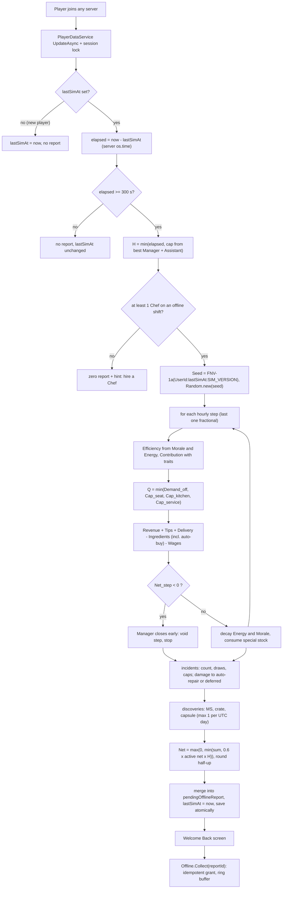

## 17. Offline Restaurant Simulation

> Owner: A11 (Employees). Binding inputs: canon §C15 (model, persistence, idempotency), §C14.3 (caps), §C4.4 (active
> net per hour), §C22 E5 / E8 / E11. Staff, traits and management live in §16; archetypes in §36.8; incidents in §36.9.
> The reference implementation is `gdd/tools/offline_sim_examples.py` (Python 3 stdlib), which produced every number
> in §17.9 and is the golden source for the Luau `OfflineEarningsService` tests.

### 17.1 Purpose and principles

**Purpose.** When the player is in **no server at all**, their staffed restaurant keeps "operating" and they come back
to a Welcome Back report with real money, funny employee stories and a list of things to improve — the reason to
return every day (brief Part 2.5, 11, 26.8). Time spent online in the city is *not* offline time: that is Away Mode,
which runs live (§16.3.4, §18).

| Principle | How it is guaranteed |
|---|---|
| No server needs to stay running | Nothing is simulated while the player is away; the whole interval is computed once, on the next join, from persisted state |
| Server-authoritative | Only `os.time()` on a game server and the saved profile are inputs; the client sends nothing but a `reportId` to collect |
| Timestamp-based | `H_elapsed = max(0, now − lastSimAt) / 3600`; `lastSimAt` is written by every save while online and at leave (canon E1) |
| Deterministic | `Seed = FNV-1a-32("<UserId>:<lastSimAt>:<SIM_VERSION>")` → `Random.new(seed)`; fixed draw order (§17.5); money kept as fractions, rounded half-up only at payout (canon C0) |
| Capped | interval cap from the best Manager (canon §C14.3); incident caps 10 % / 15 %; hard ceiling 60 % of the tier's active net per hour |
| Idempotent | the report and `lastSimAt` are written in one session-locked `UpdateAsync`; Collect is keyed by `reportId` with a 20-entry `claimedReportIds` ring (canon E11) |
| Complements active play | target 35–50 % of active net/hour for a well-staffed restaurant (proved in §17.9); no XP, no Research Tokens, no recipes or quests offline |

### 17.2 The return procedure

The brief's 13 steps (Part 11.6) mapped onto the canon model. Steps 1–12 run inside one pure function executed in the
profile-load `UpdateAsync` transform (no yields); step 13 is the client screen.

| # | Brief step | Server action | Canon §C15 term |
|---|---|---|---|
| 1 | Retrieve last saved logout/simulation timestamp | read `profile.lastSimAt` (unset → set to `now`, no report) | `lastSimAt` |
| 2 | Determine elapsed offline time | `elapsed = now − lastSimAt`; < 0 → 0 + `mmr_offline_clock_skew`; < 300 s → no report, `lastSimAt` unchanged | `H_elapsed` |
| 3 | Apply the offline earnings cap | `H = min(H_elapsed, CapHours(best Manager, Assistant))`; hours beyond the cap are forfeited | `H`, §C14.3 |
| 4 | Calculate employee productivity | per step: RoleStatAvg → Efficiency(Morale, Energy, EFFICIENCY) → `Eff = Efficiency/100` → Contribution = Eff × TraitMult | §C14.2 |
| 5 | Estimate customer throughput | `Q = min(Demand_off, Cap_seat, Cap_kitchen, Cap_service)`; N via fractional accumulator | `Q`, `N_step` |
| 6 | Calculate revenue | `N × AvgTicket × q` (+ tips, + delivery) on the live menu (skill gate, stations, special stock) | `Revenue`, `Tips` |
| 7 | Deduct ingredient costs | basic ingredients netted per dish; special stock consumed; Stocker auto-buy inside the step | `IngredientCost` |
| 8 | Deduct employee wages | `Σ wage × hours worked` (only employees on Always/Offline Only, not training) | `Wages` |
| 9 | Apply equipment and mutation bonuses | station levels (§C4.9), traits & signatures (§16.5), Manager coordination, Glow-Up decor | elaboration |
| 10 | Calculate incidents and operational losses | incident count & draws (§36.9), caps, damage → auto-repair or deferred | `Incidents`, `Repairs` |
| 11 | Determine net profit | `Net = max(0, Σ Net_step)` with close-early rule and the 60 % ceiling | `Net_step`, `Net` |
| 12 | Save the resulting state | write `pendingOfflineReport` (merged if one exists), Energy/Morale/hours, stock, damage, `lastSimAt = now` — same `UpdateAsync` | persistence |
| 13 | Present an offline earnings report | client receives `Offline.ReportReady` → Welcome Back screen (§17.10) → `Offline.Collect(reportId)` | Collect |



### 17.3 Variables [TUNABLE]

| Variable | Default | Meaning |
|---|---|---|
| `SIM_VERSION` | 1 | bumped whenever any formula or table below changes; part of the seed and `reportId` |
| `MIN_OFFLINE_SECONDS` | 300 | shorter absences produce no report (server hops, teleports) |
| `OFFLINE_DEMAND_FACTOR` | 0.6 (canon) | offline share of online demand |
| `VISIT_SECONDS_OFFLINE` | 300 (canon) | seat turnover; Cap_seat = Seats × 12 /h |
| `WAITER_SECONDS` | 45 (canon) | per waiter: 80 customers/h at Contribution 1.0 |
| `ITEMS_PER_CUSTOMER` | 1.4 (canon §C4.3) | dishes per customer |
| `PREP_BONUS` / `MAX_PREPS` | 0.15 / 3 (canon) | kitchen bonus per prep |
| `CASHIER_BONUS` / `MAX_CASHIERS` | 0.10 / 3 | service bonus per cashier (`EMP_038` counts 2) |
| `NO_WAITER_FACTOR` | 0.30 (canon) | service at `TIER_03`+ without waiters |
| `DISH_FACTOR_ABSENT` | 0.80 at `TIER_04`+ (canon) | no dishwasher |
| `CLEAN_FACTOR_ABSENT` | 0.95 (`TIER_04`–`TIER_06`), 0.92 (`TIER_07`+) | no cleaner (multiplies q) |
| `Q_BASE` / `Q_SLOPE` / `Q_MAX` | 0.70 / 0.25 / 0.95 (canon) | quality from avg chef Accuracy |
| `TIP_BASE` / `TIP_SLOPE` | 0.04 / 0.04 (canon) | tip rate from avg waiter Service |
| `PROCESS_SHARE` | 0.5 | share of a dish's base time spent in station processing (station level applies to it) |
| `STATION_MULT` | Lv1 1.0 · Lv2 0.9 · Lv3 0.8 · Lv4 0.7 · Lv5 0.6 (canon §C4.9) | process-time multiplier |
| `UNFAMILIAR_PENALTY` | 0.85 | off-native role |
| `TRAIT_MULT_CAP` | 1.5 | per employee |
| `COORD_MANAGER` | min(0.10, 0.03 + 0.07 × Contribution) (+0.02 Loudmouth / `EMP_072`) | capacity multiplier |
| `COORD_ASSISTANT` | min(0.05, 0.02 + 0.03 × Contribution); total ≤ 0.15 | capacity multiplier |
| `DELIVERY_PER_COURIER` / `DELIVERY_CAP` | 0.06 × Contribution / 0.15 (+0.02 `EMP_084`) | share of revenue, limited by kitchen headroom |
| `STOCKER_DISCOUNT` | 0.05 + 0.10 × min(1, Contribution) (+0.02 Sniffer, +0.02 `EMP_088`/`EMP_090`), max 0.15 | ingredient discount |
| `SPECIAL_BASIC_SHARE` | 0.6 | part of a special recipe's ingredient cost netted per dish (the rest is pre-paid stock) |
| `ENERGY_DECAY` / `ENERGY_DECAY_MGR` / `ENERGY_DECAY_FLOOR` | 8 / 5 / 3 %/h (canon + floor) | per simulated hour |
| `MORALE_DECAY` | 1 /h (canon) | Zen Noodle 0.5 |
| `CLOSED_HOURS_ENERGY_RECOVERY` | +10 %/h | for elapsed hours beyond the cap |
| `INCIDENT_RATE` | 0.6 /h (canon) | before Security Mitigation |
| `SECURITY_MITIGATION` | Σ (0.25 × Contribution + 0.10 Bouncer + 0.05 Heavyweight), max 0.60 | incident count reduction |
| `NEG_CAP` / `POS_CAP` | 10 % / 15 % of Revenue + Tips (canon) | incident caps |
| `MAX_SAME_INCIDENT` | 2 per report | variety |
| `ASST_LOSS_MULT` | 0.8 (canon −20 %) | negative incident magnitudes |
| `COST_PER_DAMAGE_POINT` | T1 1 · T2 1.5 · T3 2.5 · T4 4 · T5 7 · T6 12 · T7 20 · T8 35 · T9 60 · T10 100 MB | damage points shown on objects |
| `REPAIR_DISCOUNT` | min(0.60, bestRepair/200 + 0.10 Wall Crawler) (canon base) | auto-repair |
| `MS_CHANCE` / `CRATE_CHANCE` / `CAPSULE_CHANCE` | 8 % / 1 % / 5 % per simulated hour (first two canon) | discoveries |
| `DISCOVERY_BOOST_CAP` | ×1.25 | Sniffer ×1.10, Lucky Charm ×1.15 |
| `OFFLINE_CEILING_SHARE` | 0.60 of §C4.4 active net/h × H | hard clamp (canon "never above 60 %") |
| `CAP_HOURS` | none 2 · Basic 4 · Experienced 8 · Elite 12 · Legendary 24; Assistant +2; max 24 (canon) | interval cap |
| `CLAIMED_RING` | 20 (canon) | idempotency ring buffer |
| `WELCOME_BACK_CRATE_DAYS` | 7 (canon E5) | absence for the crate |

### 17.4 The model in detail (A11 elaborations of canon §C15)

**Snapshot.** Everything is read from the profile as saved at `lastSimAt`: tier, reputation ★, Atmosphere, station
levels, menu (or Night Menu), special stock, roster with stats/Energy/Morale/shift/training, auto-buy budget, player
EFFICIENCY. Nothing that happened online after that time can leak in, and the snapshot never changes mid-interval.

**Who works.** Employees on *Always* or *Offline Only* shifts and not in training; a course whose `endsAt` falls inside
the interval adds the employee from the next step. No working `ROLE_CHEF` → zero report with the hint "Hire a Chef!".

**Per step k** (step length h = 1, last one fractional):

```
Eff_i          = RoleStatAvg_i × (0.6 + 0.4·M_i/100) × (0.7 + 0.3·E_i/100) × (1 + 0.001·EFFICIENCY) / 100
Contribution_i = Eff_i × TraitMult_i(role)                     (§16.5, max ×1.5)
live menu      = recipes with D ≤ 1 + floor(bestChefCook/25), stations owned, special stock ≥ 1
PrepSec_avg    = mean over live menu of PrepSec_base × (1 − PROCESS_SHARE × (1 − STATION_MULT[level]))
AvgTicket      = 1.4 × mean live price;  AvgIngredientCost = 1.4 × mean live netted ingredient cost
Coord          = COORD_MANAGER + COORD_ASSISTANT (≤ 0.15)
Demand_off     = BaseDemand × (0.5 + 0.25·★) × (0.9 + 0.003·Atmosphere + GlowUp) × 0.6
Cap_seat       = Seats × 3600 / 300
Cap_kitchen    = Σ_chefs 3600/PrepSec_avg × Contribution_c / 1.4 × (1 + 0.15·min(3, preps)) × DishFactor × (1 + Coord)
Cap_service    = tier ≤ 2 ? Cap_kitchen : waiters ≥ 1 ? Σ 80 × Contribution_w × (1 + 0.10·min(3, cashiers)) × (1 + Coord)
                                        : 0.30 × Cap_kitchen
Q              = min(Demand_off, Cap_seat, Cap_kitchen, Cap_service);  N = floor(carry + Q·h); carry keeps the fraction
q              = min(0.95, 0.70 + 0.25·avgChefAcc/100 + ChefsInstinct − GrillMaster) × CleanFactor
Revenue        = N × AvgTicket × q
Tips           = Revenue × (0.04 + 0.04·avgWaiterService/100) × (1 + 0.01·floor(cashierSkill/20)) × TipTraitMult (≤ 1.25)
Delivery       = Revenue × min(DELIVERY_CAP, Σ 0.06·Contribution_d, Cap_kitchen/Q − 1)
Ingredients    = (N + N_delivery) × AvgIngredientCost × (1 − StockerDiscount) × (1 − 0.0015·EFFICIENCY) + AutoBuy_k
Wages          = Σ wage_i × h
Net_step       = Revenue + Tips + Delivery − Ingredients − Wages
if Net_step < 0: the Manager closes early — the step is voided (no customers, no wages, its auto-buy rolled back), stop
Energy_i      −= decay_i × h   (8 %/h, 5 %/h with a Manager, minus signature/Night Owl bonuses, floor 3 %/h;
                                 Regenerator ×0.75, Unhurried ×0.5);   Morale_i −= 1 × h
special stock −= (N + N_delivery) × 1.4 × (users of that ingredient / live recipes)
```

- **Special stock and auto-buy.** At the start of each step, if a Stocker works and budget remains, each special pool is
  topped up to that step's expected need at `unit = mean(price × ratio(D) × 0.4)` × (1 − discount); the cost lands in that
  step's Ingredients, so it can never push the wallet negative (a voided step rolls it back). When a pool hits 0, every
  recipe using it is **SOLD OUT** from the next step and PrepSec_avg / AvgTicket are recomputed (§17.9 Examples D, E).
- **Incidents** (after the step loop, over operated hours H_op): `λ = H_op × 0.6 × (1 − SM)`,
  `count = floor(λ) + (rng < frac(λ))`; each draw picks an eligible §36.9 row by effective weight, a step uniformly, and
  `{n}`. Effects are fractions of `Rh` (interval Revenue+Tips+Delivery per operated hour); negatives (MB + damage
  value) are scaled to ≤ 10 % of Revenue+Tips, positives to ≤ 15 %. They are booked into their step for the report but
  do not feed the close-early test (the caps depend on the interval total, so the test uses the operating result).
- **Repairs.** Damage value → points = ceil(value / CostPerPoint[tier]) on random destructible objects (never past
  Broken). With a Repair Technician it is auto-paid at `value × (1 − discount)`; otherwise it stays visible and costs
  nothing until the player repairs (cheaper manual repair, §15).
- **Discoveries** per operated step: MS `rng < 0.08 × boost × h` → 1–3 MS; crate `rng < 0.01 × h` (×1.5 `EMP_091`) →
  5–15 units of a special ingredient the restaurant can use; capsule `rng < 0.05 × h`, at most **one per report and one
  per UTC day** (`lastOfflineCapsuleDay`).
- **Totals.** `Net = max(0, Σ Net_step + incidents − auto-repairs)`, clamped to `0.60 × ActiveNet[tier] × H_op`
  (`mmr_offline_ceiling_hit`), then rounded half-up to whole MB — the only money rounding (canon C0).
- **Closed hours.** For `elapsed − H` beyond the cap employees recover Energy +10 %/h (staff went home); Morale is
  unchanged.

### 17.5 Deterministic RNG and hourly stepping

```lua
--!strict
local function fnv1a32(s: string): number
    local h = 2166136261
    for i = 1, #s do
        h = bit32.bxor(h, string.byte(s, i))
        h = (bit32.lshift(h, 24) + h * 403) % 4294967296   -- h * 16777619 mod 2^32 without float overflow
    end
    return h
end
local seed = fnv1a32(string.format("%d:%d:%d", userId, profile.lastSimAt, SIM_VERSION))
local rng = Random.new(seed)
```

Draw order is fixed and part of `SIM_VERSION`: (1) incident extra roll, (2) per incident: row pick, step, `{n}`,
(3) per operated step in order: MS roll (+ amount), crate roll (+ units), capsule roll. Every roll is consumed even when
its result is unused (e.g. zero operated hours), so adding an incident row changes only weights, never the alignment
of later draws within a version. The deterministic economy (steps 4–9, 11) uses no RNG at all; the Python reference
reproduces it to the MB, while its incident/discovery draws use Python's generator with the same seed (different
numbers, same distribution).

### 17.6 Caps and the tuning plan

The cap ladder (canon §C14.3) is the progression spine of management: a Basic Manager doubles a newcomer's offline
income per absence, an Experienced one covers a school day, an Elite one an evening + night, a Legendary one a full
day. Tuning uses §31 telemetry, always changes **one variable at a time** behind a server config flag, bumps
`SIM_VERSION`, and is A/B tested on new cohorts for ≥ 14 days.

| Signal (§31) | Healthy band | If too low | If too high |
|---|---|---|---|
| D1 / D7 retention of players who hired ≥ 1 employee vs not | hired cohort ≥ +5 pp D7 | make the first Manager cheaper/earlier (Common Manager in `TIER_02` pools 1.5× weight); Forecast more prominent | — |
| Share of returns that hit the cap | 30–60 % | caps feel generous — keep | > 70 % for 7 days: raise the Basic cap 4 → 5 h in a test cohort, or add Assistant earlier |
| Median hours between sessions vs cap | median ≤ cap | — | median ≫ cap and falling D7: test +2 h for Basic/Experienced |
| Report collect rate (collected within 24 h) | ≥ 90 % | simplify the screen; auto-collect on Continue (already) | — |
| Offline ÷ active net per hour (per tier, logged per report) | 35–50 % | raise `OFFLINE_DEMAND_FACTOR` 0.6 → 0.65 | lower it to 0.55; ceiling hits > 1 % of reports → investigate |
| Offline share of all MB earned (T5+) | 25–40 % | as above | > 45 %: lower demand factor or raise `ENERGY_DECAY` 8 → 9 |
| Inflation: median wallet ÷ next-tier cost (§C4.4) | ≤ 1.5 for 7 days | — | > 3: raise sinks (training growth 1.08 → 1.10) before touching caps |
| Closed-early reports | < 5 % | — | > 10 %: stronger Forecast warnings and "you are paying for idle staff" suggestions |
| Incident net / R | −3 % … +3 % | soften negative weights | raise negative weights or lower positives |

### 17.7 Persistence and idempotency (canon §C15, E11)

**Profile fields** (schema owned by §28; A11 defines the contents):

```lua
--!strict
export type OfflineReport = {
    reportId: string,            -- "<UserId>:<firstFromTs>:<lastToTs>:v<SIM_VERSION>"
    simVersion: number, segments: { { fromTs: number, toTs: number, simulatedSec: number, capHours: number,
                                      capped: boolean, tier: number, closedEarlyStep: number? } },
    customers: number, revenue: number, tips: number, delivery: number, ingredients: number,
    wages: number, autoRepairs: number, incidentNet: number, net: number,          -- fractions kept
    ms: number, capsules: number, crates: { { ing: string, units: number } },
    damage: { { objectId: string, points: number } }, deferredRepairMB: number,
    incidents: { { id: string, step: number, mb: number, employeeUid: string?, n: number } },  -- ≤ 20 kept
    employeeLines: { { uid: string, kpi: { [string]: number } } }, soldOut: { { rcp: string, step: number } },
    suggestions: { string }, welcomeBackCrate: boolean,
}
-- profile.lastSimAt: number            profile.lastLogoutAt: number     profile.lastOfflineCapsuleDay: number
-- profile.pendingOfflineReport: OfflineReport?                          profile.claimedReportIds: { string } (≤ 20)
```

**Simulate on join** — runs inside the session-locked load (`PlayerDataService`), as a pure function: no yields, no
remote calls, no analytics until the write succeeds (an `UpdateAsync` transform may run more than once).

```lua
--!strict
local OfflineEarningsService = {}
local SIM_VERSION, MIN_OFFLINE, RING = 1, 300, 20

-- called by PlayerDataService inside DataStore:UpdateAsync(key, function(old) ... end) after the lock is acquired
function OfflineEarningsService.SimulateOnJoin(data: any, userId: number, now: number): any
    if data.lastSimAt == nil then data.lastSimAt = now; return nil end
    local elapsed = now - data.lastSimAt
    if elapsed < 0 then data._flags.clockSkew = elapsed; elapsed = 0 end   -- negative → 0, flagged (canon)
    if elapsed < MIN_OFFLINE then return nil end                            -- lastSimAt untouched
    local capSec = OfflineModel.CapHours(data.staff) * 3600
    local simSec = math.min(elapsed, capSec)
    local rng = Random.new(fnv1a32(string.format("%d:%d:%d", userId, data.lastSimAt, SIM_VERSION)))
    local seg = OfflineModel.Run(OfflineModel.Snapshot(data), simSec, rng, now)  -- §17.4, deterministic
    OfflineModel.ApplyState(data, seg, elapsed - simSec)  -- Energy/Morale/hours, stock, damage, ★, capsule day
    local fromTs = data.lastSimAt
    data.pendingOfflineReport = OfflineEarningsService.Merge(data.pendingOfflineReport, seg, userId, fromTs, now)
    if now - (data.lastLogoutAt or now) >= 7 * 86400 then data.pendingOfflineReport.welcomeBackCrate = true end
    data.lastSimAt = now                                     -- toTs = now: forfeited hours are never re-simulated
    return data.pendingOfflineReport
end

function OfflineEarningsService.Merge(old: any?, seg: any, userId: number, fromTs: number, toTs: number): any
    local r = old or OfflineModel.EmptyReport()
    local first = (old and old.segments[1].fromTs) or fromTs
    OfflineModel.AddTotals(r, seg)                           -- sums; each segment was capped on its own
    table.insert(r.segments, seg.summary)
    r.reportId = string.format("%d:%d:%d:v%d", userId, first, toTs, SIM_VERSION)
    r.net = math.max(0, r.net)
    return r
end

-- RemoteFunction Offline.Collect(reportId): the only way money from offline time reaches the wallet
function OfflineEarningsService.Collect(player: Player, reportId: string)
    if not RateLimiter:Allow(player, "Offline.Collect", 1) then return { ok = false, reason = "RateLimited" } end
    local profile = PlayerDataService:Get(player)
    if not profile or profile.safeMode then return { ok = false, reason = "NotLoaded" } end
    local data = profile.data
    if typeof(reportId) ~= "string" or #reportId > 64 then return { ok = false, reason = "Bad" } end
    if table.find(data.claimedReportIds, reportId) then return { ok = true, alreadyClaimed = true } end
    local r = data.pendingOfflineReport
    if not r or r.reportId ~= reportId then return { ok = false, reason = "Stale", current = r and r.reportId } end
    -- one synchronous block: grant + ring + clear mutate the same in-memory profile, then one save
    local mb = math.floor(r.net + 0.5)                        -- canon C0: round half-up at payout only
    EconomyService:Grant(player, "MB", mb, "offline_report", reportId)
    if r.ms > 0 then EconomyService:Grant(player, "MS", r.ms, "offline_report", reportId .. ":ms") end
    for _, c in r.crates do InventoryService:AddStock(player, c.ing, c.units, "offline_find") end
    if r.capsules > 0 then MutationService:GrantCapsules(player, r.capsules, "OFFLINE_FIND") end
    if r.welcomeBackCrate then MutationService:GrantCapsules(player, 1, "welcome_back")
        EconomyService:Grant(player, "MS", 50, "welcome_back", reportId .. ":wb") end
    table.insert(data.claimedReportIds, reportId)
    if #data.claimedReportIds > RING then table.remove(data.claimedReportIds, 1) end
    data.pendingOfflineReport = nil
    PlayerDataService:SaveNow(player, "offline_collect")       -- retried with backoff (canon E6)
    Analytics:Log("mmr_offline_collected", { reportId = reportId, mb = mb })
    return { ok = true, mb = mb }
end
```

Why it cannot pay twice (canon E11): (1) the report and `lastSimAt = now` are written in the same `UpdateAsync`, so an
interval can never be simulated twice; (2) a second server cannot load the profile while it is locked; (3) Collect
grants, appends the `reportId` to the ring and clears the pending report in one synchronous block of the same
in-memory profile that `SaveNow` writes — if the server dies before the save, the DataStore still holds the unpaid
pending report and no grant (nothing lost, nothing doubled); (4) if a stale copy ever resurfaced with an
already-claimed report, the ring rejects it; (5) `EconomyService` also refuses a repeated idempotency key. Reconnects
reload the same pending report; nothing is recomputed. If a pending report exists when a new interval is simulated
(the player left without collecting), the new segment is merged into it with a new `reportId`; old IDs were never
paid, so nothing is lost.

**While online**, every autosave (120 s) and every save writes `lastSimAt = now`, so a crash without
`PlayerRemoving` starts offline time at most one autosave interval early (accepted; ≤ 2 min of overlap with Away
Mode/live play). `PlayerRemoving` and `BindToClose` write `lastSimAt` and `lastLogoutAt` (canon E1, E13).

### 17.8 Anti-exploit

| Threat | Defense |
|---|---|
| Client-supplied time or earnings | Only server `os.time()` and persisted data are inputs; `Offline.Collect` accepts a `reportId` string and nothing else; amounts come from the stored report |
| Device clock changes | Irrelevant — the client clock is never read |
| Server clock skew between servers | Negative elapsed → 0 and `mmr_offline_clock_skew`; elapsed is clamped to ≤ 30 days before capping; any skew is bounded by the cap and the 60 % ceiling |
| Multiple servers / two devices | Session lock: one server owns the profile; the second join waits or is kicked with a friendly message; only the lock owner simulates |
| Rejoin spam / server hopping | `MIN_OFFLINE_SECONDS` = 300; leaving to earn offline pays 35–50 % of staying, so there is no incentive; teleports between servers produce no report |
| Collect replay or double-click | `claimedReportIds` ring (20) + `EconomyService` idempotency key; Collect rate-limited 1/s |
| Hire-before-logout, fire-for-refund | Probation refund only within 15 real minutes of hiring; payroll for the interval is already paid |
| Roster or menu edits during the screen | The report was computed from the snapshot at `lastSimAt`; later edits only affect the next interval |
| Forged remote spam on Welcome Back buttons | Every button maps to a validated server action (§17.10); tabs read the already-sent report |
| Inflating via Away Mode then crashing | Away Mode pays live and writes `lastSimAt` every autosave; the overlap is ≤ 1 autosave |
| Data rollback to an older save | `lastSimAt` rolls back with it, so the restored interval is simulated once; claimed IDs in the ring block replays of the same report |
