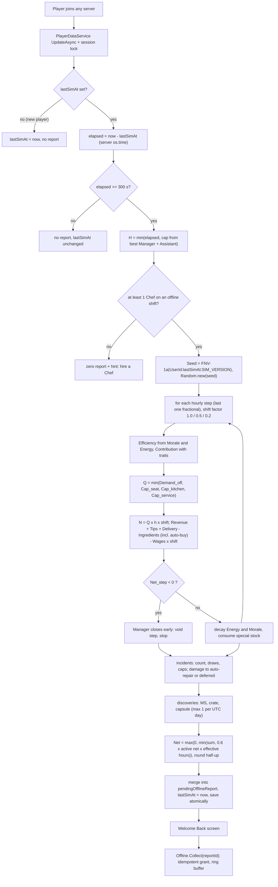
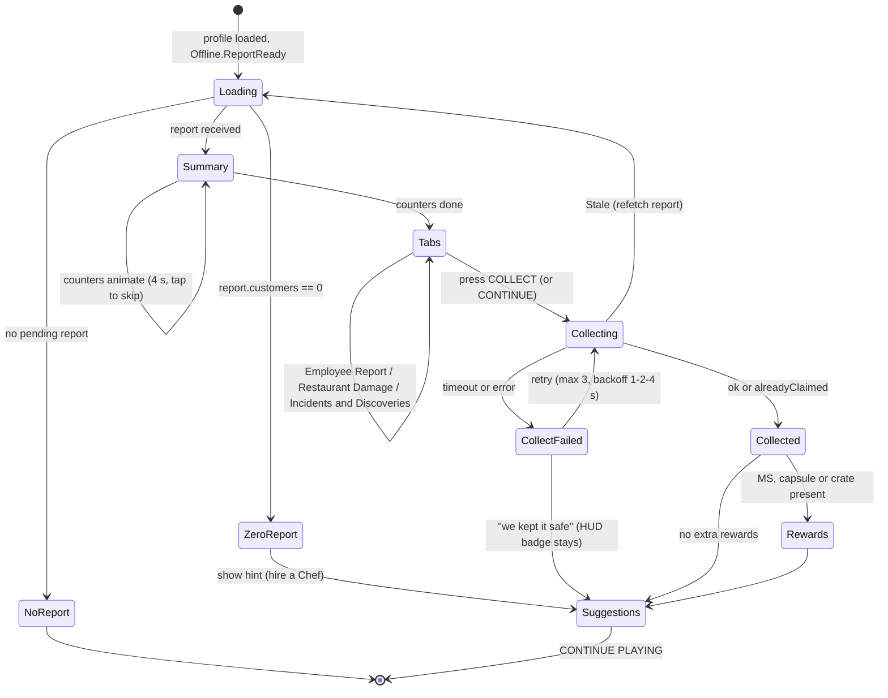

## 17. Offline Restaurant Simulation

> Binding inputs: canon §C15 (model, persistence, idempotency), §C14.3 (caps), §C4.4 (active
> net per hour), §C22 E5 / E8 / E11. Staff, traits and management live in §16; archetypes in §36.8; incidents in §36.9.
> The reference implementation is `gdd/tools/offline_sim_examples.py` (Python 3 stdlib), which produced every number
> in §17.9 and is the golden source for the Luau `OfflineEarningsService` tests.

### 17.1 Purpose and principles

**Purpose.** When the player is in **no server at all**, their staffed restaurant keeps "operating" and they come back
to a Welcome Back report with real money, funny employee stories and a list of things to improve — the reason to
return every day (brief Part 2.5, 11, 26.8). Time spent online in the city is *not* offline time: that is Away Mode,
which runs live (§16.3.4, §18).

| Principle | How it is guaranteed |
|---|---|
| No server needs to stay running | Nothing is simulated while the player is away; the whole interval is computed once, on the next join, from persisted state |
| Server-authoritative | Only `os.time()` on a game server and the saved profile are inputs; the client sends nothing but a `reportId` to collect |
| Timestamp-based | `H_elapsed = max(0, now − lastSimAt) / 3600`; `lastSimAt` is written by every save while online and at leave (canon E1) |
| Deterministic | `Seed = FNV-1a-32("<UserId>:<lastSimAt>:<SIM_VERSION>")` → `Random.new(seed)`; fixed draw order (§17.5); money kept as fractions, rounded half-up only at payout (canon C0) |
| Capped | interval cap from the best Manager (canon §C14.3); incident caps 10 % / 15 %; hard ceiling 60 % of the tier's active net per hour |
| Idempotent | the report and `lastSimAt` are written in one session-locked `UpdateAsync`; Collect is keyed by `reportId` with a 20-entry `claimedReportIds` ring (canon E11) |
| Complements active play | 35–50 % of active net/hour during the **first 2 offline hours** of a well-staffed restaurant, then a long-absence taper (×0.5 for hours 2–8, ×0.2 for hours 8–24): a full 24 h Legendary interval ≈ 3 active hours (proved in §17.9); no XP, no Research Tokens, no recipes or quests offline; guardrail KPI in §17.6 |

### 17.2 The return procedure

The brief's 13 steps (Part 11.6) mapped onto the canon model. Steps 1–12 run inside one pure function executed in the
profile-load `UpdateAsync` transform (no yields); step 13 is the client screen.

| # | Brief step | Server action | Canon §C15 term |
|---|---|---|---|
| 1 | Retrieve last saved logout/simulation timestamp | read `profile.lastSimAt` (unset → set to `now`, no report) | `lastSimAt` |
| 2 | Determine elapsed offline time | `elapsed = now − lastSimAt`; < 0 → 0 + `mmr_offline_clock_skew`; < 300 s → no report, `lastSimAt` unchanged | `H_elapsed` |
| 3 | Apply the offline earnings cap | `H = min(H_elapsed, CapHours(best Manager, Assistant))`; hours beyond the cap are forfeited; each hourly step gets its shift factor from the long-absence taper (×1.0 / ×0.5 / ×0.2) | `H`, §C14.3, taper |
| 4 | Calculate employee productivity | per step: RoleStatAvg → Efficiency(Morale, Energy, EFFICIENCY) → `Eff = Efficiency/100` → Contribution = Eff × TraitMult | §C14.2 |
| 5 | Estimate customer throughput | `Q = min(Demand_off, Cap_seat, Cap_kitchen, Cap_service)`; N via fractional accumulator | `Q`, `N_step` |
| 6 | Calculate revenue | `N × AvgTicket × q` (+ tips, + delivery) on the live menu (skill gate, stations, special stock) | `Revenue`, `Tips` |
| 7 | Deduct ingredient costs | basic ingredients netted per dish; special stock consumed; Stocker auto-buy inside the step | `IngredientCost` |
| 8 | Deduct employee wages | `Σ wage × hours worked × shift factor` (only employees on Always/Offline Only, not training) | `Wages` |
| 9 | Apply equipment and mutation bonuses | station levels (§C4.9), traits & signatures (§16.5), Manager coordination, Glow-Up decor | elaboration |
| 10 | Calculate incidents and operational losses | incident count & draws (§36.9), caps, damage → auto-repair or deferred | `Incidents`, `Repairs` |
| 11 | Determine net profit | `Net = max(0, Σ Net_step)` with close-early rule and the 60 % ceiling | `Net_step`, `Net` |
| 12 | Save the resulting state | write `pendingOfflineReport` (merged if one exists), Energy/Morale/hours, stock, damage, `lastSimAt = now` — same `UpdateAsync` | persistence |
| 13 | Present an offline earnings report | client receives `Offline.ReportReady` → Welcome Back screen (§17.10) → `Offline.Collect(reportId)` | Collect |



### 17.3 Variables [TUNABLE]

| Variable | Default | Meaning |
|---|---|---|
| `SIM_VERSION` | 1 | bumped whenever any formula or table below changes; part of the seed and `reportId` |
| `MIN_OFFLINE_SECONDS` | 300 | shorter absences produce no report (server hops, teleports) |
| `OFFLINE_DEMAND_FACTOR` | 0.6 (canon) | offline share of online demand |
| `VISIT_SECONDS_OFFLINE` | 300 (canon) | seat turnover; Cap_seat = Seats × 12 /h |
| `WAITER_SECONDS` | 45 (canon) | per waiter: 80 customers/h at Contribution 1.0 |
| `ITEMS_PER_CUSTOMER` | 1.4 (canon §C4.3) | dishes per customer |
| `PREP_BONUS` / `MAX_PREPS` | 0.15 / 3 (canon) | kitchen bonus per prep |
| `CASHIER_BONUS` / `MAX_CASHIERS` | 0.10 / 3 | service bonus per cashier (`EMP_038` counts 2) |
| `NO_WAITER_FACTOR` | 0.30 (canon) | service at `TIER_03`+ without waiters |
| `DISH_FACTOR_ABSENT` | 0.80 at `TIER_04`+ (canon) | no dishwasher |
| `CLEAN_FACTOR_ABSENT` | 0.95 (`TIER_04`–`TIER_06`), 0.92 (`TIER_07`+) | no cleaner (multiplies q) |
| `Q_BASE` / `Q_SLOPE` / `Q_MAX` | 0.70 / 0.25 / 0.95 (canon) | quality from avg chef Accuracy |
| `TIP_BASE` / `TIP_SLOPE` | 0.04 / 0.04 (canon) | tip rate from avg waiter Service |
| `PROCESS_SHARE` | 0.5 | share of a dish's base time spent in station processing (station level applies to it) |
| `STATION_MULT` | Lv1 1.0 · Lv2 0.9 · Lv3 0.8 · Lv4 0.7 · Lv5 0.6 (canon §C4.9) | process-time multiplier |
| `UNFAMILIAR_PENALTY` | 0.85 | off-native role |
| `TRAIT_MULT_CAP` | 1.5 | per employee |
| `COORD_MANAGER` | min(0.10, 0.03 + 0.07 × Contribution) (+0.02 Loudmouth / `EMP_072`) | capacity multiplier |
| `COORD_ASSISTANT` | min(0.05, 0.02 + 0.03 × Contribution); total ≤ 0.15 | capacity multiplier |
| `DELIVERY_PER_COURIER` / `DELIVERY_CAP` | 0.06 × Contribution / 0.15 (+0.02 `EMP_084`) | share of revenue, limited by kitchen headroom |
| `STOCKER_DISCOUNT` | 0.05 + 0.10 × min(1, Contribution) (+0.02 Sniffer, +0.02 `EMP_088`/`EMP_090`), max 0.15 | ingredient discount |
| `SPECIAL_BASIC_SHARE` | 0.6 | part of a special recipe's ingredient cost netted per dish (the rest is pre-paid stock) |
| `ENERGY_DECAY` / `ENERGY_DECAY_MGR` / `ENERGY_DECAY_FLOOR` | 8 / 5 / 3 %/h (canon + floor) | per simulated hour |
| `MORALE_DECAY` | 1 /h (canon) | Zen Noodle 0.5 |
| `CLOSED_HOURS_ENERGY_RECOVERY` | +10 %/h | for elapsed hours beyond the cap |
| `INCIDENT_RATE` | 0.6 /h (canon) | before Security Mitigation |
| `SECURITY_MITIGATION` | Σ (0.25 × Contribution + 0.10 Bouncer + 0.05 Heavyweight), max 0.60 | incident count reduction |
| `NEG_CAP` / `POS_CAP` | 10 % / 15 % of Revenue + Tips (canon) | incident caps |
| `MAX_SAME_INCIDENT` | 2 per report | variety |
| `ASST_LOSS_MULT` | 0.8 (canon −20 %) | negative incident magnitudes |
| `COST_PER_DAMAGE_POINT` | T1 1 · T2 1.5 · T3 2.5 · T4 4 · T5 7 · T6 12 · T7 20 · T8 35 · T9 60 · T10 100 MB | damage points shown on objects |
| `REPAIR_DISCOUNT` | min(0.60, bestRepair/200 + 0.10 Wall Crawler) (canon base) | auto-repair |
| `MS_CHANCE` / `CRATE_CHANCE` / `CAPSULE_CHANCE` | 8 % / 1 % / 5 % per simulated hour (first two canon) | discoveries |
| `DISCOVERY_BOOST_CAP` | ×1.25 | Sniffer ×1.10, Lucky Charm ×1.15 |
| `OFFLINE_CEILING_SHARE` | 0.60 of §C4.4 active net/h × effective hours | hard clamp (canon "never above 60 %") |
| `TAPER_BANDS` | hours 0–2 ×1.0 ("Full Shift") · 2–8 ×0.5 ("Late Shift") · 8–24 ×0.2 ("Skeleton Shift") | long-absence taper (integrator policy); scales the whole operation of the step |
| `TAPER_CLOCK` | `interval` | hour index counted from `lastSimAt`; fallback `rolling24h` counts offline hours already simulated in the last 24 h (§17.6 lever) |
| `CAP_HOURS` | none 2 · Basic 4 · Experienced 8 · Elite 12 · Legendary 24; Assistant +2; max 24 (canon) | interval cap |
| `CLAIMED_RING` | 20 (canon) | idempotency ring buffer |
| `WELCOME_BACK_CRATE_DAYS` | 7 (canon E5) | absence for the crate |

### 17.4 The model in detail (elaborations of canon §C15) [TUNABLE]

**Snapshot.** Everything is read from the profile as saved at `lastSimAt`: tier, reputation ★, Atmosphere, station
levels, menu (or Night Menu), special stock, roster with stats/Energy/Morale/shift/training, auto-buy budget, player
EFFICIENCY. Nothing that happened online after that time can leak in, and the snapshot never changes mid-interval.

**Who works.** Employees on *Always* or *Offline Only* shifts and not in training; a course whose `endsAt` falls inside
the interval adds the employee from the next step. No working `ROLE_CHEF` → zero report with the hint "Hire a Chef!".

**Long-absence taper [TUNABLE].** Step k (starting at hour k) runs a shift with factor `S_k` = 1.0 for k < 2, 0.5 for
2 ≤ k < 8, 0.2 for k ≥ 8: only that share of the restaurant operates ("Late Shift": half the tables, half the staff on
the clock; "Skeleton Shift": a fifth). Customers, revenue, tips, delivery, ingredients **and paid wages** all scale
by `S_k`, so a long absence never flips a step negative and longer caps still add value; Energy and Morale keep
decaying at the canon rates (the taper sits on top of energy decay). `H_eff = Σ h × S_k` is the interval's effective
hours (Example E: 24 h → 8.2 effective h).

**Per step k** (step length h = 1, last one fractional):

```
Eff_i          = RoleStatAvg_i × (0.6 + 0.4·M_i/100) × (0.7 + 0.3·E_i/100) × (1 + 0.001·EFFICIENCY) / 100
Contribution_i = Eff_i × TraitMult_i(role)                     (§16.5, max ×1.5)
live menu      = recipes with D ≤ 1 + floor(bestChefCook/25), stations owned, special stock ≥ 1
PrepSec_avg    = mean over live menu of PrepSec_base × (1 − PROCESS_SHARE × (1 − STATION_MULT[level]))
AvgTicket      = 1.4 × mean live price;  AvgIngredientCost = 1.4 × mean live netted ingredient cost
Coord          = COORD_MANAGER + COORD_ASSISTANT (≤ 0.15)
Demand_off     = BaseDemand × (0.5 + 0.25·★) × (0.9 + 0.003·Atmosphere + GlowUp) × 0.6
Cap_seat       = Seats × 3600 / 300
Cap_kitchen    = Σ_chefs 3600/PrepSec_avg × Contribution_c / 1.4 × (1 + 0.15·min(3, preps)) × DishFactor × (1 + Coord)
Cap_service    = tier ≤ 2 ? Cap_kitchen : waiters ≥ 1 ? Σ 80 × Contribution_w × (1 + 0.10·min(3, cashiers)) × (1 + Coord)
                                        : 0.30 × Cap_kitchen
Q              = min(Demand_off, Cap_seat, Cap_kitchen, Cap_service);  N = floor(carry + Q·h·S_k); carry keeps the fraction
q              = min(0.95, 0.70 + 0.25·avgChefAcc/100 + ChefsInstinct − GrillMaster) × CleanFactor
Revenue        = N × AvgTicket × q
Tips           = Revenue × (0.04 + 0.04·avgWaiterService/100) × (1 + 0.01·floor(cashierSkill/20)) × TipTraitMult (≤ 1.25)
Delivery       = Revenue × min(DELIVERY_CAP, Σ 0.06·Contribution_d, Cap_kitchen/Q − 1)
Ingredients    = (N + N_delivery) × AvgIngredientCost × (1 − StockerDiscount) × (1 − 0.0015·EFFICIENCY) + AutoBuy_k
Wages          = Σ wage_i × h × S_k
Net_step       = Revenue + Tips + Delivery − Ingredients − Wages
if Net_step < 0: the Manager closes early — the step is voided (no customers, no wages, its auto-buy rolled back), stop
Energy_i      −= decay_i × h   (8 %/h, 5 %/h with a Manager, minus signature/Night Owl bonuses, floor 3 %/h;
                                 Regenerator ×0.75, Unhurried ×0.5);   Morale_i −= 1 × h
special stock −= (N + N_delivery) × 1.4 × (users of that ingredient / live recipes)
```

- **Special stock and auto-buy.** At the start of each step, if a Stocker works and budget remains, each special pool is
  topped up to that step's expected need at `unit = mean(price × ratio(D) × 0.4)` × (1 − discount); the cost lands in that
  step's Ingredients, so it can never push the wallet negative (a voided step rolls it back). When a pool hits 0, every
  recipe using it is **SOLD OUT** from the next step and PrepSec_avg / AvgTicket are recomputed (§17.9 Examples D, E).
- **Incidents** (after the step loop, over effective hours H_eff): `λ = H_eff × 0.6 × (1 − SM)`,
  `count = floor(λ) + (rng < frac(λ))`; each draw picks an eligible §36.9 row by effective weight, a step uniformly, and
  `{n}`. Effects are fractions of `Rh` (interval Revenue+Tips+Delivery per effective hour); negatives (MB + damage
  value) are scaled to ≤ 10 % of Revenue+Tips, positives to ≤ 15 %. They are booked into their step for the report but
  do not feed the close-early test (the caps depend on the interval total, so the test uses the operating result).
- **Repairs.** Damage value → points = ceil(value / CostPerPoint[tier]) on random destructible objects (never past
  Broken). With a Repair Technician it is auto-paid at `value × (1 − discount)`; otherwise it stays visible and costs
  nothing until the player repairs (cheaper manual repair, §15).
- **Discoveries** per operated step: MS `rng < 0.08 × boost × h × S_k` → 1–3 MS; crate `rng < 0.01 × h × S_k` (×1.5 `EMP_091`) →
  5–15 units of a special ingredient the restaurant can use; capsule `rng < 0.05 × h × S_k`, at most **one per report and one
  per UTC day** (`lastOfflineCapsuleDay`).
- **Totals.** `Net = max(0, Σ Net_step + incidents − auto-repairs)`, clamped to `0.60 × ActiveNet[tier] × H_eff`
  (`mmr_offline_ceiling_hit`), then rounded half-up to whole MB — the only money rounding (canon C0).
- **Closed hours.** For `elapsed − H` beyond the cap employees recover Energy +10 %/h (staff went home); Morale is
  unchanged.

### 17.5 Deterministic RNG and hourly stepping

```lua
--!strict
local function fnv1a32(s: string): number
    local h = 2166136261
    for i = 1, #s do
        h = bit32.bxor(h, string.byte(s, i))
        h = (bit32.lshift(h, 24) + h * 403) % 4294967296   -- h * 16777619 mod 2^32 without float overflow
    end
    return h
end
local seed = fnv1a32(string.format("%d:%d:%d", userId, profile.lastSimAt, SIM_VERSION))
local rng = Random.new(seed)
```

Draw order is fixed and part of `SIM_VERSION`: (1) incident extra roll, (2) per incident: row pick, step, `{n}`,
(3) per operated step in order: MS roll (+ amount), crate roll (+ units), capsule roll. Every roll is consumed even when
its result is unused (e.g. zero operated hours), so adding an incident row changes only weights, never the alignment
of later draws within a version. The deterministic economy (steps 4–9, 11) uses no RNG at all; the Python reference
reproduces it to the MB, while its incident/discovery draws use Python's generator with the same seed (different
numbers, same distribution).

### 17.6 Caps and the tuning plan [TUNABLE]

The cap ladder (canon §C14.3) is the progression spine of management: a Basic Manager doubles a newcomer's offline
window, an Experienced one covers a school day, an Elite one an evening + night, a Legendary one a full day. With the
taper, the *first* hours are worth the most, so returning 2–3 times a day is rewarded, while a longer cap still adds
total value (Examples C–E: 8 h ≈ 2.0, 12 h ≈ 2.5, 24 h ≈ 3.1 active hours). Tuning uses §31 telemetry, always changes **one variable at a time** behind a server config flag, bumps
`SIM_VERSION`, and is A/B tested on new cohorts for ≥ 14 days.

| Signal (§31) | Healthy band | If too low | If too high |
|---|---|---|---|
| D1 / D7 retention of players who hired ≥ 1 employee vs not | hired cohort ≥ +5 pp D7 | make the first Manager cheaper/earlier (Common Manager in `TIER_02` pools 1.5× weight); Forecast more prominent | — |
| Share of returns that hit the cap | 30–60 % | caps feel generous — keep | > 70 % for 7 days: raise the Basic cap 4 → 5 h in a test cohort, or add Assistant earlier |
| Median hours between sessions vs cap | median ≤ cap | — | median ≫ cap and falling D7: test +2 h for Basic/Experienced |
| Report collect rate (collected within 24 h) | ≥ 90 % | simplify the screen; auto-collect on Continue (already) | — |
| **Guardrail: median player's offline share of all MB earned** | **≤ 60 % at D7, ≤ 70 % at D30** | — | lower the taper factors first (Late 0.5 → 0.4, Skeleton 0.2 → 0.15); if driven by many short check-ins per day, switch `TAPER_CLOCK` to `rolling24h`; only then touch caps or demand |
| First-2-h offline ÷ active net per hour (per tier, logged per report) | 35–50 % | raise `OFFLINE_DEMAND_FACTOR` 0.6 → 0.65 | lower it to 0.55; ceiling hits > 1 % of reports → investigate |
| Value of a full capped absence (MB ÷ active net/h) | Basic ≈ 1–1.5, Experienced ≈ 2, Elite ≈ 2.5, Legendary ≈ 3 active hours | raise the Late Shift factor | lower the Skeleton Shift factor |
| Offline share of all MB earned (T5+, players with ≥ 2 h active/day) | 25–40 % | as above | > 45 %: lower taper factors before demand |
| Inflation: median wallet ÷ next-tier cost (§C4.4) | ≤ 1.5 for 7 days | — | > 3: raise sinks (training growth 1.08 → 1.10) before touching caps |
| Closed-early reports | < 5 % | — | > 10 %: stronger Forecast warnings and "you are paying for idle staff" suggestions |
| Incident net / R | −3 % … +3 % | soften negative weights | raise negative weights or lower positives |

### 17.7 Persistence and idempotency (canon §C15, E11)

**Profile fields** (schema owned by §28; §16–§17 defines the contents):

```lua
--!strict
export type OfflineReport = {
    reportId: string,            -- "<UserId>:<firstFromTs>:<lastToTs>:v<SIM_VERSION>"
    simVersion: number, segments: { { fromTs: number, toTs: number, simulatedSec: number, capHours: number,
                                      capped: boolean, tier: number, closedEarlyStep: number? } },
    customers: number, revenue: number, tips: number, delivery: number, ingredients: number,
    wages: number, autoRepairs: number, incidentNet: number, net: number,          -- fractions kept
    ms: number, capsules: number, crates: { { ing: string, units: number } },
    damage: { { objectId: string, points: number } }, deferredRepairMB: number,
    incidents: { { id: string, step: number, mb: number, employeeUid: string?, n: number } },  -- ≤ 20 kept
    employeeLines: { { uid: string, kpi: { [string]: number } } }, soldOut: { { rcp: string, step: number } },
    suggestions: { string }, welcomeBackCrate: boolean,
}
-- profile.lastSimAt: number            profile.lastLogoutAt: number     profile.lastOfflineCapsuleDay: number
-- profile.pendingOfflineReport: OfflineReport?                          profile.claimedReportIds: { string } (≤ 20)
```

**Simulate on join** — `SimulateTransform` runs inside the session-locked load (`PlayerDataService`, §28), as a pure function: no yields, no
remote calls, no analytics until the write succeeds (an `UpdateAsync` transform may run more than once).

```lua
--!strict
local OfflineEarningsService = {}
local SIM_VERSION, MIN_OFFLINE, RING = 1, 300, 20

-- registered with PlayerDataService:RegisterLoadTransform (§27, §28): runs inside the session-locked UpdateAsync
function OfflineEarningsService.SimulateTransform(data: any, ctx: { userId: number, now: number }): any
    local userId, now = ctx.userId, ctx.now
    if data.lastSimAt == nil then data.lastSimAt = now; return nil end
    local elapsed = now - data.lastSimAt
    if elapsed < 0 then data._flags.clockSkew = elapsed; elapsed = 0 end   -- negative → 0, flagged (canon)
    if elapsed < MIN_OFFLINE then return nil end                            -- lastSimAt untouched
    local capSec = OfflineModel.CapHours(data.staff) * 3600
    local simSec = math.min(elapsed, capSec)
    local rng = Random.new(fnv1a32(string.format("%d:%d:%d", userId, data.lastSimAt, SIM_VERSION)))
    local seg = OfflineModel.Run(OfflineModel.Snapshot(data), simSec, rng, now)  -- §17.4, deterministic
    OfflineModel.ApplyState(data, seg, elapsed - simSec)  -- Energy/Morale/hours, stock, damage, ★, capsule day
    local fromTs = data.lastSimAt
    data.pendingOfflineReport = OfflineEarningsService.Merge(data.pendingOfflineReport, seg, userId, fromTs, now)
    if now - (data.lastLogoutAt or now) >= 7 * 86400 then data.pendingOfflineReport.welcomeBackCrate = true end
    data.lastSimAt = now                                     -- toTs = now: forfeited hours are never re-simulated
    return data.pendingOfflineReport
end

function OfflineEarningsService.Merge(old: any?, seg: any, userId: number, fromTs: number, toTs: number): any
    local r = old or OfflineModel.EmptyReport()
    local first = (old and old.segments[1].fromTs) or fromTs
    OfflineModel.AddTotals(r, seg)                           -- sums; each segment was capped on its own
    table.insert(r.segments, seg.summary)
    r.reportId = string.format("%d:%d:%d:v%d", userId, first, toTs, SIM_VERSION)
    r.net = math.max(0, r.net)
    return r
end

-- RemoteFunction Offline.Collect(reportId): the only way money from offline time reaches the wallet
function OfflineEarningsService.Collect(player: Player, reportId: string)
    if not RateLimiter:Allow(player, "Offline.Collect", 1) then return { ok = false, reason = "RateLimited" } end
    local profile = PlayerDataService:Get(player)
    if not profile or profile.safeMode then return { ok = false, reason = "NotLoaded" } end
    local data = profile.data
    if typeof(reportId) ~= "string" or #reportId > 64 then return { ok = false, reason = "Bad" } end
    if table.find(data.claimedReportIds, reportId) then return { ok = true, alreadyClaimed = true } end
    local r = data.pendingOfflineReport
    if not r or r.reportId ~= reportId then return { ok = false, reason = "Stale", current = r and r.reportId } end
    -- one synchronous block: grant + ring + clear mutate the same in-memory profile, then one save
    local mb = math.floor(r.net + 0.5)                        -- canon C0: round half-up at payout only
    local ms = r.ms + (r.welcomeBackCrate and 50 or 0)        -- Welcome Back Crate MS (canon E5) rides the same txn
    -- single-writer economy (§27 P3): one idempotent transaction, reason code `offline_collect` (§22/§31),
    -- key `offline:<reportId>` (§28); non-currency grants run inside the same non-yielding step
    local res = EconomyService:TransactWith(player, { id = `offline:{reportId}`, deltas = { MB = mb, MS = ms },
        src = "offline_collect", ref = reportId }, function()
        for _, c in r.crates do InventoryService:AddStock(player, c.ing, c.units, "offline_find") end
        if r.capsules > 0 then MutationService:GrantCapsules(player, r.capsules, "OFFLINE_FIND") end
        if r.welcomeBackCrate then MutationService:GrantCapsules(player, 1, "welcome_back") end
    end)
    if not res.ok and res.reason ~= "duplicate" then return res end
    table.insert(data.claimedReportIds, reportId)
    if #data.claimedReportIds > RING then table.remove(data.claimedReportIds, 1) end
    data.pendingOfflineReport = nil
    PlayerDataService:SaveNow(player, "offline_collect")       -- retried with backoff (canon E6)
    Analytics:Log("mmr_offline_collected", { reportId = reportId, mb = mb })
    return { ok = true, mb = mb }
end
```

Why it cannot pay twice (canon E11): (1) the report and `lastSimAt = now` are written in the same `UpdateAsync`, so an
interval can never be simulated twice; (2) a second server cannot load the profile while it is locked; (3) Collect
grants, appends the `reportId` to the ring and clears the pending report in one synchronous block of the same
in-memory profile that `SaveNow` writes — if the server dies before the save, the DataStore still holds the unpaid
pending report and no grant (nothing lost, nothing doubled); (4) if a stale copy ever resurfaced with an
already-claimed report, the ring rejects it; (5) `EconomyService` also refuses a repeated idempotency key. Reconnects
reload the same pending report; nothing is recomputed. If a pending report exists when a new interval is simulated
(the player left without collecting), the new segment is merged into it with a new `reportId`; old IDs were never
paid, so nothing is lost.

**While online**, every autosave (120 s) and every save writes `lastSimAt = now`, so a crash without
`PlayerRemoving` starts offline time at most one autosave interval early (accepted; ≤ 2 min of overlap with Away
Mode/live play). `PlayerRemoving` and `BindToClose` write `lastSimAt` and `lastLogoutAt` (canon E1, E13).

### 17.8 Anti-exploit

| Threat | Defense |
|---|---|
| Client-supplied time or earnings | Only server `os.time()` and persisted data are inputs; `Offline.Collect` accepts a `reportId` string and nothing else; amounts come from the stored report |
| Device clock changes | Irrelevant — the client clock is never read |
| Server clock skew between servers | Negative elapsed → 0 and `mmr_offline_clock_skew`; elapsed is clamped to ≤ 30 days before capping; any skew is bounded by the cap and the 60 % ceiling |
| Multiple servers / two devices | Session lock: one server owns the profile; the second join waits or is kicked with a friendly message; only the lock owner simulates |
| Rejoin spam / server hopping | `MIN_OFFLINE_SECONDS` = 300; leaving to earn offline pays 35–50 % of staying, so there is no incentive; teleports between servers produce no report |
| Collect replay or double-click | `claimedReportIds` ring (20) + `EconomyService` idempotency key; Collect rate-limited 1/s |
| Hire-before-logout, fire-for-refund | Probation refund only within 15 real minutes of hiring; payroll for the interval is already paid |
| Roster or menu edits during the screen | The report was computed from the snapshot at `lastSimAt`; later edits only affect the next interval |
| Forged remote spam on Welcome Back buttons | Every button maps to a validated server action (§17.10); tabs read the already-sent report |
| Inflating via Away Mode then crashing | Away Mode pays live and writes `lastSimAt` every autosave; the overlap is ≤ 1 autosave |
| Data rollback to an older save | `lastSimAt` rolls back with it, so the restored interval is simulated once; claimed IDs in the ring block replays of the same report |

### 17.9 Worked examples

Generated by `python3 gdd/tools/offline_sim_examples.py` (stdlib only; `--check` asserts that every well-staffed
example's **first-2-hour rate** is 35–50 % of the tier's §C4.4 active net/hour). Five well-staffed restaurants at
different progression points plus one deliberately bad roster; every example shows the taper column ("Shift") and the
value of the whole absence in active hours. Shared assumptions, so each example only lists what differs:

- **Canon §C15 constants unchanged**, plus the long-absence taper (§17.4) and the §16–§17 elaborations exactly as
  §17.3–§17.4. Employees use their §36.8 values (trained stats listed under the roster).
- **Menus** use real recipe IDs from §C10 with prices from the canon curve (§C4.2, no flavor variance). Difficulty D,
  base prep seconds (mains 10 + 7D, desserts/fried/salads 8 + 5D, drinks 4 + 3D, legendary 20 + 10D) and ingredient
  ratios (D1 36 % … D5 26 %, inside the canon 25–40 % band) are *assumed for the examples*; the live game reads §6.
  Special-ingredient mappings (alien → `ING_MOON_CHEESE` / `ING_STARDUST`, mutation → `ING_MUTAGEN_GOO`, legendary →
  `ING_GOLDEN_PATTY`) are assumptions too; §7 owns them.
- **Reputation / Atmosphere** are typical for a competent player at that tier; player EFFICIENCY grows with level.
- **Incident and discovery draws** come from the Python generator with the real seed; the economy columns are what
  the Luau service must reproduce exactly. "Base economy" in the result is the run without incidents.

#### 17.9.1 Example A — TIER_01 — Ollie alone, back after 9 h (cap 2 h)

**Inputs**

| Parameter | Value | Derivation |
|---|---|---|
| Tier | `TIER_01` Broken Burger Shack | seats 4, base demand 50/h, employee cap 2 (§C6) |
| Player | level 4, EFFICIENCY 0 | Efficiency × 1.000; ingredient cost × 1.0000 |
| Reputation | 3.8 ★ | RepMult = 0.5 + 0.25 × 3.8 = 1.450 |
| Atmosphere | 45 | DecorMult = 0.9 + 0.003 × 45 = 1.035 |
| Stations | starter kit, all Lv1 | PrepSec × (1 − 0.5 × (1 − 1.00)) = × 1.000 |
| Offline cap | 2 h | no Manager → 2 h |
| Elapsed / simulated | 9 h 00 min / **2 h 00 min** (capped) | H = min(H_elapsed, cap) |
| Long-absence taper | 2.00 effective h | Full Shift h0–2 ×1.0 · Late Shift h2–8 ×0.5 · Skeleton Shift h8–24 ×0.2 |
| Seed | `0xDD6C3873` | FNV-1a-32("81234567:1760131800:1") |

**Roster**

| Employee | Archetype | Role | Rarity | RoleStatAvg | Morale₀ / Energy₀ | Efficiency (step 1) | Trait mult | Contribution | Wage (MB/h) |
|---|---|---|---|---|---|---|---|---|---|
| Ollie | `EMP_001` | Chef | Common | 30.4 | 90 / 100 | 29.2 | ×1.25 | 0.365 | 12 |

**Menu** (skill gate: D ≤ 1 + floor(30 / 25) = 2)

| Recipe | ID | L | D | Price (MB) | Ingredients/item (MB) | PrepSec base → eff (s) | Offline? |
|---|---|---|---|---|---|---|---|
| Double Cheeseburger | `RCP_BRG_003` | 4 | 2 | 12 | 3.96 | 24 → 24.0 | yes |
| Ham & Cheese Sandwich | `RCP_SAN_002` | 4 | 2 | 12 | 3.96 | 24 → 24.0 | yes |
| Cheeseburger | `RCP_BRG_002` | 1 | 1 | 9 | 3.24 | 17 → 17.0 | yes |
| Lemonade | `RCP_DRK_002` | 2 | 1 | 7 | 2.52 | 7 → 7.0 | yes |

**Interval constants**

- Demand_off = 50 × 1.450 × 1.035 × 0.6 = **45.0 customers/h**; Cap_seat = 4 × 3600 / 300 = **48/h**.
- Step-1 PrepSec_avg = 18.00 s; AvgTicket = 1.4 × mean price = 14.00 MB; q = min(0.95, 0.70 + 0.25 × avgChefAcc/100 +0.00) × CleanFactor 1.00 = 0.770.
- Preps counted 0.00 (+0 %), cashiers counted 0, DishFactor 1.00, Manager/Assistant coordination +0.0 %, stocker discount 0.0 %, delivery share 0.0 %, tip trait multiplier ×1.00.

**Hourly steps**

| Step | h | Shift | Avg Energy % | Cap_kitchen | Cap_service | Q | Limit | N | Revenue | Tips | Delivery | Ingredients | Wages | Net_step |
|---|---|---|---|---|---|---|---|---|---|---|---|---|---|---|
| 1 | 1.00 | ×1.0 | 100.0 | 52.1 | 52.1 | 45.0 | Demand | 45 | 485 | 19 | 0 | 215 | 12 | 277 |
| 2 | 1.00 | ×1.0 | 92.0 | 50.7 | 50.7 | 45.0 | Demand | 45 | 485 | 19 | 0 | 215 | 12 | 277 |
| **Σ** | 2.00 | 2.00 eff. | | | | | | **90** | **970** | **39** | **0** | **431** | **24** | **554** |

**Incidents & discoveries**

- Security Mitigation SM = 0.000; λ = 2.00 effective h × 0.6 × (1 − SM) = 1.200 → count = floor(λ) + roll(0.200) = **1**; eligible pool 21 incidents; Rh = 505 MB per effective hour.
- Caps: negatives 15 ≤ 10 % of R (101) → scale ×1.00; positives 0 ≤ 15 % of R (151) → scale ×1.00.

| # | Step | Incident | MB effect | Damage value | Report line |
|---|---|---|---|---|---|
| 1 | 1 | `INC_032` Bun Shortage | −15 | — | We ran out of buns. Ollie served 5 burgers between two slices of pizza. Reviews: mixed. |

- Discoveries (MS chance 8.0 %/h after trait boost ×1.00; crate 1 %/h; capsule 5 %/h, ≤ 1 per UTC day): none this time.

**Result**

| Customers | Revenue | Tips | Delivery | Ingredients | Wages | Auto-repairs | Incidents | **Net** | First-2-h rate (MB/h) | C4.4 active net / h | First-2-h ÷ active | Interval worth |
|---|---|---|---|---|---|---|---|---|---|---|---|---|
| 90 | 970 | 39 | 0 | −431 | −24 | 0 | −15 | **539** | 277 | 630 | **44.0 %** | 0.86 active h |

#### 17.9.2 Example B — TIER_03 — basic staff + Basic Manager, 4 h

**Inputs**

| Parameter | Value | Derivation |
|---|---|---|
| Tier | `TIER_03` Neighborhood Freak Café | seats 8, base demand 80/h, employee cap 4 (§C6) |
| Player | level 12, EFFICIENCY 10 | Efficiency × 1.010; ingredient cost × 0.9850 |
| Reputation | 3.9 ★ | RepMult = 0.5 + 0.25 × 3.9 = 1.475 |
| Atmosphere | 50 | DecorMult = 0.9 + 0.003 × 50 = 1.050 |
| Stations | all Lv2 Tuned | PrepSec × (1 − 0.5 × (1 − 0.90)) = × 0.950 |
| Offline cap | 4 h | Barnaby Hoot (Common) → 4 h |
| Elapsed / simulated | 5 h 20 min / **4 h 00 min** (capped) | H = min(H_elapsed, cap) |
| Long-absence taper | 3.00 effective h | Full Shift h0–2 ×1.0 · Late Shift h2–8 ×0.5 · Skeleton Shift h8–24 ×0.2 |
| Seed | `0x9D1F42EB` | FNV-1a-32("81234567:1760380200:1") |

**Roster**

| Employee | Archetype | Role | Rarity | RoleStatAvg | Morale₀ / Energy₀ | Efficiency (step 1) | Trait mult | Contribution | Wage (MB/h) |
|---|---|---|---|---|---|---|---|---|---|
| Octavia | `EMP_005` | Chef | Uncommon | 49.2 | 82 / 92 | 45.0 | ×1.25 | 0.563 | 50 |
| Skates McGee | `EMP_026` | Waiter | Uncommon | 48.6 | 80 / 90 | 43.8 | ×1.20 | 0.526 | 55 |
| Benny Bun | `EMP_023` | Waiter | Common | 32.9 | 85 / 95 | 30.8 | ×1.20 | 0.369 | 18 |
| Barnaby Hoot | `EMP_070` | Manager | Common | 30.7 | 80 / 95 | 28.1 | ×1.00 | 0.281 | 17 |

**Menu** (skill gate: D ≤ 1 + floor(52 / 25) = 3)

| Recipe | ID | L | D | Price (MB) | Ingredients/item (MB) | PrepSec base → eff (s) | Offline? |
|---|---|---|---|---|---|---|---|
| Sushi Roll Block | `RCP_SEA_003` | 12 | 2 | 17 | 5.61 | 24 → 22.8 | yes |
| Club Sandwich Stack | `RCP_SAN_004` | 10 | 2 | 16 | 5.28 | 24 → 22.8 | yes |
| Meat Mountain Pizza | `RCP_PIZ_005` | 11 | 2 | 16 | 5.28 | 24 → 22.8 | yes |
| Fried Shrimp Basket | `RCP_SEA_002` | 10 | 2 | 16 | 5.28 | 24 → 22.8 | yes |
| Breakfast Burrito | `RCP_BRK_004` | 11 | 2 | 16 | 5.28 | 24 → 22.8 | yes |
| Rainbow Slushie | `RCP_DRK_006` | 11 | 2 | 11 | 3.63 | 10 → 9.5 | yes |

**Interval constants**

- Demand_off = 80 × 1.475 × 1.050 × 0.6 = **74.3 customers/h**; Cap_seat = 8 × 3600 / 300 = **96/h**.
- Step-1 PrepSec_avg = 20.58 s; AvgTicket = 1.4 × mean price = 21.47 MB; q = min(0.95, 0.70 + 0.25 × avgChefAcc/100 +0.00) × CleanFactor 1.00 = 0.815.
- Preps counted 0.00 (+0 %), cashiers counted 0, DishFactor 1.00, Manager/Assistant coordination +5.0 %, stocker discount 0.0 %, delivery share 0.0 %, tip trait multiplier ×1.10.

**Hourly steps**

| Step | h | Shift | Avg Energy % | Cap_kitchen | Cap_service | Q | Limit | N | Revenue | Tips | Delivery | Ingredients | Wages | Net_step |
|---|---|---|---|---|---|---|---|---|---|---|---|---|---|---|
| 1 | 1.00 | ×1.0 | 93.0 | 73.8 | 75.1 | 73.8 | Kitchen | 73 | 1,277 | 82 | 0 | 509 | 140 | 710 |
| 2 | 1.00 | ×1.0 | 89.2 | 72.5 | 73.9 | 72.5 | Kitchen | 73 | 1,277 | 82 | 0 | 509 | 140 | 710 |
| 3 | 1.00 | ×0.5 | 85.5 | 71.3 | 72.6 | 71.3 | Kitchen | 35 | 612 | 39 | 0 | 244 | 70 | 337 |
| 4 | 1.00 | ×0.5 | 81.8 | 70.1 | 71.4 | 70.1 | Kitchen | 36 | 630 | 40 | 0 | 251 | 70 | 349 |
| **Σ** | 4.00 | 3.00 eff. | | | | | | **217** | **3,796** | **243** | **0** | **1,514** | **420** | **2,105** |

**Incidents & discoveries**

- Security Mitigation SM = 0.000; λ = 3.00 effective h × 0.6 × (1 − SM) = 1.800 → count = floor(λ) + roll(0.800) = **1**; eligible pool 38 incidents; Rh = 1,347 MB per effective hour.
- Caps: negatives 40 ≤ 10 % of R (404) → scale ×1.00; positives 0 ≤ 15 % of R (606) → scale ×1.00.

| # | Step | Incident | MB effect | Damage value | Report line |
|---|---|---|---|---|---|
| 1 | 1 | `INC_006` Drama Llama Monologue | −40 | — | A Drama Llama performed a monologue about lukewarm soup. 3 customers left before the second act. |

- Discoveries (MS chance 9.2 %/h after trait boost ×1.15; crate 1 %/h; capsule 5 %/h, ≤ 1 per UTC day): step 1: +3 MS.

**Result**

| Customers | Revenue | Tips | Delivery | Ingredients | Wages | Auto-repairs | Incidents | **Net** | First-2-h rate (MB/h) | C4.4 active net / h | First-2-h ÷ active | Interval worth |
|---|---|---|---|---|---|---|---|---|---|---|---|---|
| 217 | 3,796 | 243 | 0 | −1,514 | −420 | 0 | −40 | **2,065** | 710 | 1,730 | **41.0 %** | 1.19 active h |

#### 17.9.3 Example C — TIER_05 — Experienced Manager, 8 h

**Inputs**

| Parameter | Value | Derivation |
|---|---|---|
| Tier | `TIER_05` Mutant Family Restaurant | seats 12, base demand 110/h, employee cap 8 (§C6) |
| Player | level 28, EFFICIENCY 25 | Efficiency × 1.025; ingredient cost × 0.9625 |
| Reputation | 4.1 ★ | RepMult = 0.5 + 0.25 × 4.1 = 1.525 |
| Atmosphere | 60 | DecorMult = 0.9 + 0.003 × 60 = 1.080 |
| Stations | mix of Lv2 and Lv3 (mean process multiplier 0.85) | PrepSec × (1 − 0.5 × (1 − 0.85)) = × 0.925 |
| Offline cap | 8 h | Mister Mustache (Rare) → 8 h |
| Elapsed / simulated | 8 h 00 min / **8 h 00 min** | H = min(H_elapsed, cap) |
| Long-absence taper | 5.00 effective h | Full Shift h0–2 ×1.0 · Late Shift h2–8 ×0.5 · Skeleton Shift h8–24 ×0.2 |
| Seed | `0x8B08E0D0` | FNV-1a-32("81234567:1761085800:1") |

**Roster**

| Employee | Archetype | Role | Rarity | RoleStatAvg | Morale₀ / Energy₀ | Efficiency (step 1) | Trait mult | Contribution | Wage (MB/h) |
|---|---|---|---|---|---|---|---|---|---|
| Mister Mustache | `EMP_073` | Manager | Rare | 63.2 | 80 / 95 | 58.7 | ×1.00 | 0.587 | 160 |
| Sir Loin | `EMP_008` | Chef | Rare | 64.9 | 78 / 90 | 58.8 | ×1.00 | 0.588 | 160 |
| Octavia | `EMP_005` | Chef | Uncommon | 54.6 | 80 / 90 | 49.9 | ×1.25 | 0.624 | 50 |
| Benny Bun | `EMP_023` | Waiter | Common | 32.9 | 85 / 92 | 30.9 | ×1.20 | 0.371 | 18 |
| Chet Speedwell | `EMP_028` | Waiter | Rare | 63.5 | 80 / 88 | 57.7 | ×1.20 | 0.693 | 165 |
| Skates McGee | `EMP_026` | Waiter | Uncommon | 48.6 | 78 / 90 | 44.1 | ×1.20 | 0.529 | 55 |
| Sloane | `EMP_039` | Dish | Common | 27.5 | 90 / 100 | 27.1 | ×0.60 | 0.162 | 10 |
| Dusty | `EMP_048` | Cleaner | Common | 32.5 | 75 / 90 | 29.1 | ×1.20 | 0.349 | 18 |

Trained above the §36.8 values (within the potential cap, §16.7.4): Octavia Cooking 58, Accuracy 52.

**Menu** (skill gate: D ≤ 1 + floor(67 / 25) = 3)

| Recipe | ID | L | D | Price (MB) | Ingredients/item (MB) | PrepSec base → eff (s) | Offline? |
|---|---|---|---|---|---|---|---|
| Upside-Down Burger | `RCP_BRG_013` | 18 | 3 | 25 | 7.50 | 31 → 28.7 | yes |
| Square Circle Pizza | `RCP_PIZ_014` | 19 | 3 | 26 | 7.80 | 31 → 28.7 | yes |
| Inside-Out Taco | `RCP_TAC_007` | 24 | 3 | 34 | 10.20 | 31 → 28.7 | yes |
| Sandwich With Bread in the Middle | `RCP_SAN_008` | 23 | 3 | 32 | 9.60 | 31 → 28.7 | yes |
| Spaghetti Tornado | `RCP_PST_005` | 23 | 3 | 32 | 9.60 | 31 → 28.7 | yes |
| Crab Cake Kerfuffle | `RCP_SEA_006` | 25 | 3 | 35 | 10.50 | 31 → 28.7 | yes |
| Bacon Waterfall | `RCP_BRK_008` | 26 | 3 | 37 | 11.10 | 31 → 28.7 | yes |
| Exploding Cupcake | `RCP_DES_009` | 21 | 2 | 21 | 6.93 | 18 → 16.7 | yes |
| Tentacle Tea | `RCP_DRK_011` | 24 | 2 | 22 | 7.26 | 10 → 9.2 | yes |
| Pumpkin Screamer Soup | `RCP_SOP_006` | 24 | 3 | 34 | 10.20 | 31 → 28.7 | yes |

**Interval constants**

- Demand_off = 110 × 1.525 × 1.080 × 0.6 = **108.7 customers/h**; Cap_seat = 12 × 3600 / 300 = **144/h**.
- Step-1 PrepSec_avg = 25.53 s; AvgTicket = 1.4 × mean price = 41.72 MB; q = min(0.95, 0.70 + 0.25 × avgChefAcc/100 +0.02) × CleanFactor 1.00 = 0.862.
- Preps counted 0.00 (+0 %), cashiers counted 0, DishFactor 1.00, Manager/Assistant coordination +7.1 %, stocker discount 0.0 %, delivery share 0.0 %, tip trait multiplier ×1.10.

**Hourly steps**

| Step | h | Shift | Avg Energy % | Cap_kitchen | Cap_service | Q | Limit | N | Revenue | Tips | Delivery | Ingredients | Wages | Net_step |
|---|---|---|---|---|---|---|---|---|---|---|---|---|---|---|
| 1 | 1.00 | ×1.0 | 91.9 | 130.8 | 136.5 | 108.7 | Demand | 108 | 3,886 | 262 | 0 | 1,320 | 636 | 2,192 |
| 2 | 1.00 | ×1.0 | 87.4 | 128.2 | 133.7 | 108.7 | Demand | 109 | 3,922 | 264 | 0 | 1,332 | 636 | 2,218 |
| 3 | 1.00 | ×0.5 | 83.0 | 125.5 | 130.9 | 108.7 | Demand | 54 | 1,943 | 131 | 0 | 660 | 318 | 1,096 |
| 4 | 1.00 | ×0.5 | 78.6 | 122.9 | 128.2 | 108.7 | Demand | 55 | 1,979 | 133 | 0 | 672 | 318 | 1,122 |
| 5 | 1.00 | ×0.5 | 74.1 | 120.3 | 125.5 | 108.7 | Demand | 54 | 1,943 | 131 | 0 | 660 | 318 | 1,096 |
| 6 | 1.00 | ×0.5 | 69.7 | 117.7 | 122.8 | 108.7 | Demand | 54 | 1,943 | 131 | 0 | 660 | 318 | 1,096 |
| 7 | 1.00 | ×0.5 | 65.2 | 115.1 | 120.1 | 108.7 | Demand | 55 | 1,979 | 133 | 0 | 672 | 318 | 1,122 |
| 8 | 1.00 | ×0.5 | 60.8 | 112.6 | 117.4 | 108.7 | Demand | 54 | 1,943 | 131 | 0 | 660 | 318 | 1,096 |
| **Σ** | 8.00 | 5.00 eff. | | | | | | **543** | **19,539** | **1,315** | **0** | **6,636** | **3,180** | **11,039** |

**Incidents & discoveries**

- Security Mitigation SM = 0.000; λ = 5.00 effective h × 0.6 × (1 − SM) = 3.000 → count = floor(λ) + roll(0.000) = **3**; eligible pool 47 incidents; Rh = 4,171 MB per effective hour.
- Caps: negatives 459 ≤ 10 % of R (2,085) → scale ×1.00; positives 209 ≤ 15 % of R (3,128) → scale ×1.00.

| # | Step | Incident | MB effect | Damage value | Report line |
|---|---|---|---|---|---|
| 1 | 5 | `INC_008` Wrong Table Waltz | −125 | — | Chet Speedwell delivered 8 orders to the wrong table. The wrong tables said thank you. |
| 2 | 4 | `INC_049` Rich Mutant Big Tipper | 209 | — | A Rich Mutant tipped 268 shiny coins and a monocle. We kept the coins. |
| 3 | 8 | `INC_002` Meatball Food Fight | −167 | 167 | One meatball was thrown. Then 12 meatballs were thrown. Dusty is still finding them. |

- Damage value 167 MB (24 damage points) is **left for the player** (no Repair Technician): shown in the Restaurant Damage tab, not deducted.
- Discoveries (MS chance 9.2 %/h after trait boost ×1.15; crate 1 %/h; capsule 5 %/h, ≤ 1 per UTC day): none this time.

**Result**

| Customers | Revenue | Tips | Delivery | Ingredients | Wages | Auto-repairs | Incidents | **Net** | First-2-h rate (MB/h) | C4.4 active net / h | First-2-h ÷ active | Interval worth |
|---|---|---|---|---|---|---|---|---|---|---|---|---|
| 543 | 19,539 | 1,315 | 0 | −6,636 | −3,180 | 0 | −83 | **10,955** | 2,205 | 5,400 | **40.8 %** | 2.03 active h |

#### 17.9.4 Example D — TIER_07 — Elite Manager, 12 h, special stock runs out

**Inputs**

| Parameter | Value | Derivation |
|---|---|---|
| Tier | `TIER_07` Mutation Megadiner | seats 16, base demand 140/h, employee cap 12 (§C6) |
| Player | level 48, EFFICIENCY 45 | Efficiency × 1.045; ingredient cost × 0.9325 |
| Reputation | 4.3 ★ | RepMult = 0.5 + 0.25 × 4.3 = 1.575 |
| Atmosphere | 70 | DecorMult = 0.9 + 0.003 × 70 + Glow-Up = 1.116 |
| Stations | mostly Lv3–Lv4 (mean process multiplier 0.75) | PrepSec × (1 − 0.5 × (1 − 0.75)) = × 0.875 |
| Offline cap | 12 h | Megaphone Maxine (Epic) → 12 h |
| Elapsed / simulated | 14 h 30 min / **12 h 00 min** (capped) | H = min(H_elapsed, cap) |
| Long-absence taper | 5.80 effective h | Full Shift h0–2 ×1.0 · Late Shift h2–8 ×0.5 · Skeleton Shift h8–24 ×0.2 |
| Seed | `0x52BD87E4` | FNV-1a-32("81234567:1762378200:1") |
| Special stock at logout | `ING_MOON_CHEESE` × 70, `ING_MUTAGEN_GOO` × 400 | consumed 1 unit per special dish |

**Roster**

| Employee | Archetype | Role | Rarity | RoleStatAvg | Morale₀ / Energy₀ | Efficiency (step 1) | Trait mult | Contribution | Wage (MB/h) |
|---|---|---|---|---|---|---|---|---|---|
| Megaphone Maxine | `EMP_075` | Manager | Epic | 76.3 | 80 / 95 | 72.3 | ×1.00 | 0.723 | 500 |
| Ember | `EMP_009` | Chef | Epic | 76.4 | 75 / 90 | 69.7 | ×1.15 | 0.802 | 515 |
| Frostina | `EMP_007` | Chef | Rare | 59.6 | 80 / 92 | 55.9 | ×1.00 | 0.559 | 135 |
| Sir Loin | `EMP_008` | Chef | Rare | 64.9 | 80 / 90 | 60.5 | ×1.00 | 0.605 | 160 |
| Mantis Mandy | `EMP_019` | Prep | Rare | 63.8 | 80 / 90 | 59.5 | ×1.00 | 0.595 | 155 |
| Twinkle Thistlewing | `EMP_030` | Waiter | Epic | 79.4 | 85 / 95 | 76.8 | ×1.00 | 0.768 | 500 |
| Chet Speedwell | `EMP_028` | Waiter | Rare | 63.5 | 80 / 90 | 59.2 | ×1.20 | 0.711 | 165 |
| Ozzie | `EMP_029` | Waiter | Rare | 61.6 | 80 / 90 | 57.4 | ×1.20 | 0.689 | 135 |
| Cassie Cassette | `EMP_036` | Cashier | Rare | 64.3 | 80 / 95 | 60.9 | ×1.00 | 0.609 | 160 |
| Drippy | `EMP_043` | Dish | Rare | 63.0 | 80 / 95 | 59.7 | ×1.10 | 0.656 | 145 |
| Vacuuma Vera | `EMP_051` | Cleaner | Rare | 62.1 | 80 / 92 | 58.3 | ×1.20 | 0.699 | 155 |
| Rocco | `EMP_066` | Security | Rare | 65.6 | 85 / 95 | 63.5 | ×1.00 | 0.635 | 170 |

**Menu** (skill gate: D ≤ 1 + floor(84 / 25) = 4)

| Recipe | ID | L | D | Price (MB) | Ingredients/item (MB) | PrepSec base → eff (s) | Offline? |
|---|---|---|---|---|---|---|---|
| Exploding Burger | `RCP_BRG_012` | 40 | 4 | 80 | 22.40 | 38 → 33.2 | yes |
| Pizza Inside Another Pizza | `RCP_PIZ_013` | 45 | 4 | 103 | 28.84 | 38 → 33.2 | yes |
| Mega Taco Tower | `RCP_TAC_010` | 48 | 4 | 119 | 33.32 | 38 → 33.2 | yes |
| The Sandwich Sandwich | `RCP_SAN_010` | 42 | 3 | 81 | 24.30 | 31 → 27.1 | yes |
| Pasta Shaped Like the Customer | `RCP_PST_009` | 44 | 3 | 90 | 27.00 | 31 → 27.1 | yes |
| Sea Monster Steak | `RCP_SEA_009` | 37 | 3 | 64 | 19.20 | 31 → 27.1 | yes |
| Dragon Egg Benedict | `RCP_BRK_010` | 41 | 3 | 77 | 23.10 | 31 → 27.1 | yes |
| Galaxy Cheesecake | `RCP_DES_014` | 46 | 3 | 79 | 23.70 | 23 → 20.1 | yes |
| Glowing Mutagen Juice | `RCP_DRK_013` | 33 | 3 | 37 | 6.66 | 13 → 11.4 | yes · stock `ING_MUTAGEN_GOO` |
| Bread Bowl in a Bread Bowl | `RCP_SOP_009` | 37 | 3 | 64 | 19.20 | 31 → 27.1 | yes |
| Fried Everything Basket | `RCP_FRI_005` | 43 | 3 | 60 | 18.00 | 23 → 20.1 | yes |
| Mutagen Meatballs | `RCP_MUT_001` | 42 | 3 | 81 | 14.58 | 31 → 27.1 | yes · stock `ING_MUTAGEN_GOO` |
| Martian Meatloaf | `RCP_ALN_004` | 40 | 3 | 74 | 13.32 | 31 → 27.1 | yes · stock `ING_MOON_CHEESE` |
| Moon Cheese Nuggets | `RCP_ALN_001` | 30 | 2 | 41 | 8.12 | 24 → 21.0 | yes · stock `ING_MOON_CHEESE` |

**Interval constants**

- Demand_off = 140 × 1.575 × 1.116 × 0.6 = **147.6 customers/h**; Cap_seat = 16 × 3600 / 300 = **192/h**.
- Step-1 PrepSec_avg = 25.88 s; AvgTicket = 1.4 × mean price = 105.00 MB; q = min(0.95, 0.70 + 0.25 × avgChefAcc/100 +0.00) × CleanFactor 1.00 = 0.849.
- Preps counted 1.00 (+15 %), cashiers counted 1, DishFactor 1.00, Manager/Assistant coordination +10.1 %, stocker discount 0.0 %, delivery share 0.0 %, tip trait multiplier ×1.10.

**Hourly steps**

| Step | h | Shift | Avg Energy % | Cap_kitchen | Cap_service | Q | Limit | N | Revenue | Tips | Delivery | Ingredients | Wages | Net_step |
|---|---|---|---|---|---|---|---|---|---|---|---|---|---|---|
| 1 | 1.00 | ×1.0 | 92.4 | 247.3 | 210.0 | 147.6 | Demand | 147 | 13,107 | 1,030 | 0 | 3,862 | 2,895 | 7,380 |
| 2 | 1.00 | ×1.0 | 87.4 | 242.2 | 205.8 | 147.6 | Demand | 148 | 13,196 | 1,037 | 0 | 3,888 | 2,895 | 7,449 |
| 3 | 1.00 | ×0.5 | 82.4 | 237.1 | 201.7 | 147.6 | Demand | 74 | 6,598 | 518 | 0 | 1,944 | 1,448 | 3,725 |
| 4 | 1.00 | ×0.5 | 77.4 | 229.4 | 197.6 | 147.6 | Demand | 73 | 6,762 | 531 | 0 | 2,067 | 1,448 | 3,778 |
| 5 | 1.00 | ×0.5 | 72.4 | 224.5 | 193.6 | 147.6 | Demand | 74 | 6,855 | 538 | 0 | 2,096 | 1,448 | 3,850 |
| 6 | 1.00 | ×0.5 | 67.4 | 219.6 | 189.6 | 147.6 | Demand | 74 | 6,855 | 538 | 0 | 2,096 | 1,448 | 3,850 |
| 7 | 1.00 | ×0.5 | 62.4 | 214.8 | 185.6 | 147.6 | Demand | 74 | 6,855 | 538 | 0 | 2,096 | 1,448 | 3,850 |
| 8 | 1.00 | ×0.5 | 57.4 | 210.0 | 181.6 | 147.6 | Demand | 74 | 6,855 | 538 | 0 | 2,096 | 1,448 | 3,850 |
| 9 | 1.00 | ×0.2 | 52.4 | 205.3 | 177.7 | 147.6 | Demand | 29 | 2,686 | 211 | 0 | 821 | 579 | 1,497 |
| 10 | 1.00 | ×0.2 | 47.4 | 200.6 | 173.8 | 147.6 | Demand | 30 | 2,779 | 218 | 0 | 850 | 579 | 1,569 |
| 11 | 1.00 | ×0.2 | 42.4 | 195.9 | 169.9 | 147.6 | Demand | 29 | 2,686 | 211 | 0 | 821 | 579 | 1,497 |
| 12 | 1.00 | ×0.2 | 37.4 | 191.3 | 166.0 | 147.6 | Demand | 30 | 2,779 | 218 | 0 | 850 | 579 | 1,569 |
| **Σ** | 12.00 | 5.80 eff. | | | | | | **856** | **78,012** | **6,128** | **0** | **23,485** | **16,791** | **43,863** |

Special stock used: `ING_MOON_CHEESE` 70, `ING_MUTAGEN_GOO` 187 (left: 0, 213). **SOLD OUT** from step 4: `RCP_ALN_004`, `RCP_ALN_001` — later steps recompute PrepSec_avg and AvgTicket without those dishes.

**Incidents & discoveries**

- Security Mitigation SM = 0.309; λ = 5.80 effective h × 0.6 × (1 − SM) = 2.406 → count = floor(λ) + roll(0.406) = **2**; eligible pool 52 incidents; Rh = 14,507 MB per effective hour.
- Caps: negatives 580 ≤ 10 % of R (8,414) → scale ×1.00; positives 725 ≤ 15 % of R (12,621) → scale ×1.00.

| # | Step | Incident | MB effect | Damage value | Report line |
|---|---|---|---|---|---|
| 1 | 12 | `INC_051` Brawl Stopped Cold | 725 | — | Rocco stopped 2 angry customers with one very stern eyebrow. |
| 2 | 10 | `INC_003` Goblin Dine-and-Dash | −580 | — | 2 Impatient Goblins sprinted out before paying. Twinkle Thistlewing chased them to the corner, then waved. |

- Discoveries (MS chance 8.0 %/h after trait boost ×1.00; crate 1 %/h; capsule 5 %/h, ≤ 1 per UTC day): none this time.

**Result**

| Customers | Revenue | Tips | Delivery | Ingredients | Wages | Auto-repairs | Incidents | **Net** | First-2-h rate (MB/h) | C4.4 active net / h | First-2-h ÷ active | Interval worth |
|---|---|---|---|---|---|---|---|---|---|---|---|---|
| 856 | 78,012 | 6,128 | 0 | −23,485 | −16,791 | 0 | +145 | **44,009** | 7,414 | 17,400 | **42.6 %** | 2.53 active h |

#### 17.9.5 Example E — TIER_10 — Legendary Manager, 24 h

**Inputs**

| Parameter | Value | Derivation |
|---|---|---|
| Tier | `TIER_10` Legendary Mutation Restaurant | seats 24, base demand 190/h, employee cap 20 (§C6) |
| Player | level 85, EFFICIENCY 80 | Efficiency × 1.080; ingredient cost × 0.8800 |
| Reputation | 4.6 ★ | RepMult = 0.5 + 0.25 × 4.6 = 1.650 |
| Atmosphere | 85 | DecorMult = 0.9 + 0.003 × 85 + Glow-Up = 1.173 |
| Stations | mostly Lv4–Lv5 (mean process multiplier 0.65) | PrepSec × (1 − 0.5 × (1 − 0.65)) = × 0.825 |
| Offline cap | 24 h | The Oracle of Orders (Legendary) → 24 h (+2 h Assistant, absolute max 24 h) |
| Elapsed / simulated | 31 h 00 min / **24 h 00 min** (capped) | H = min(H_elapsed, cap) |
| Long-absence taper | 8.20 effective h | Full Shift h0–2 ×1.0 · Late Shift h2–8 ×0.5 · Skeleton Shift h8–24 ×0.2 |
| Seed | `0x00F61938` | FNV-1a-32("81234567:1764970200:1") |
| Special stock at logout | `ING_GOLDEN_PATTY` × 200, `ING_MUTAGEN_GOO` × 300, `ING_STARDUST` × 300 | consumed 1 unit per special dish |

**Roster**

| Employee | Archetype | Role | Rarity | RoleStatAvg | Morale₀ / Energy₀ | Efficiency (step 1) | Trait mult | Contribution | Wage (MB/h) |
|---|---|---|---|---|---|---|---|---|---|
| The Oracle of Orders | `EMP_076` | Manager | Legendary | 91.4 | 85 / 95 | 91.4 | ×1.00 | 0.914 | 1,480 |
| Lady Luckfeather | `EMP_097` | Asst Mgr | Legendary | 92.8 | 85 / 95 | 92.8 | ×1.00 | 0.928 | 1,410 |
| Captain Calamari | `EMP_011` | Chef | Legendary | 95.8 | 85 / 95 | 95.8 | ×1.35 | 1.293 | 1,480 |
| Goldie Gourmand | `EMP_012` | Chef | Legendary | 93.3 | 85 / 95 | 93.3 | ×1.00 | 0.933 | 1,340 |
| Ember | `EMP_009` | Chef | Epic | 76.4 | 80 / 95 | 74.8 | ×1.15 | 0.860 | 515 |
| Professor Dice | `EMP_021` | Prep | Epic | 78.6 | 80 / 95 | 76.9 | ×1.00 | 0.769 | 500 |
| Hoverina | `EMP_031` | Waiter | Legendary | 92.5 | 85 / 95 | 92.5 | ×1.15 | 1.064 | 1,410 |
| Twinkle Thistlewing | `EMP_030` | Waiter | Epic | 79.4 | 85 / 95 | 79.4 | ×1.00 | 0.794 | 500 |
| Chet Speedwell | `EMP_028` | Waiter | Rare | 63.5 | 80 / 95 | 62.1 | ×1.20 | 0.746 | 165 |
| Ozzie | `EMP_029` | Waiter | Rare | 61.6 | 80 / 95 | 60.3 | ×1.20 | 0.723 | 135 |
| Sterling Silverfin | `EMP_037` | Cashier | Epic | 77.9 | 80 / 95 | 76.2 | ×1.00 | 0.762 | 500 |
| The Rinse-o-Tron 3000 | `EMP_045` | Dish | Epic | 84.5 | 80 / 95 | 82.7 | ×1.25 | 1.034 | 500 |
| Gale Force | `EMP_052` | Cleaner | Epic | 79.4 | 80 / 95 | 77.7 | ×1.00 | 0.777 | 455 |
| Gearhart | `EMP_060` | Repair | Epic | 78.1 | 80 / 95 | 76.4 | ×1.25 | 0.955 | 500 |
| Steggy | `EMP_068` | Security | Epic | 76.4 | 80 / 95 | 74.8 | ×1.00 | 0.748 | 465 |
| Golem Gary | `EMP_069` | Security | Legendary | 92.0 | 85 / 95 | 92.0 | ×1.00 | 0.920 | 1,410 |
| Comet Carla | `EMP_083` | Delivery | Epic | 77.1 | 80 / 95 | 75.5 | ×1.20 | 0.905 | 465 |
| Tractor Trixie | `EMP_090` | Stocker | Epic | 77.0 | 80 / 95 | 75.4 | ×1.00 | 0.754 | 440 |

Trained above the §36.8 values (within the potential cap, §16.7.4): Captain Calamari Cooking 100.

**Menu** (skill gate: D ≤ 1 + floor(100 / 25) = 5)

| Recipe | ID | L | D | Price (MB) | Ingredients/item (MB) | PrepSec base → eff (s) | Offline? |
|---|---|---|---|---|---|---|---|
| The Golden Patty Supreme | `RCP_LEG_001` | 65 | 5 | 738 | 115.13 | 70 → 57.8 | yes · stock `ING_GOLDEN_PATTY` |
| The Infinite Noodle | `RCP_PST_008` | 39 | 4 | 77 | 21.56 | 38 → 31.3 | yes |
| Infinity Pizza | `RCP_LEG_003` | 80 | 5 | 1,534 | 239.30 | 70 → 57.8 | yes · stock `ING_GOLDEN_PATTY` |
| Chimera Casserole | `RCP_MUT_004` | 63 | 4 | 247 | 41.50 | 38 → 31.3 | yes · stock `ING_MUTAGEN_GOO` |
| Evolution Burrito | `RCP_MUT_005` | 70 | 4 | 348 | 58.46 | 38 → 31.3 | yes · stock `ING_MUTAGEN_GOO` |
| Black Hole Bagel | `RCP_ALN_010` | 62 | 4 | 235 | 39.48 | 38 → 31.3 | yes · stock `ING_STARDUST` |
| Glorp Stew | `RCP_ALN_009` | 57 | 4 | 184 | 30.91 | 38 → 31.3 | yes · stock `ING_STARDUST` |
| The Unreasonably Large Burger | `RCP_BRG_015` | 60 | 4 | 213 | 59.64 | 38 → 31.3 | yes |
| Galaxy Pizza | `RCP_PIZ_015` | 55 | 4 | 167 | 46.76 | 38 → 31.3 | yes |
| Kraken Platter | `RCP_SEA_010` | 54 | 4 | 159 | 44.52 | 38 → 31.3 | yes |
| The Dessert That Bites Back | `RCP_DES_015` | 58 | 4 | 155 | 43.40 | 28 → 23.1 | yes |
| Bottomless Soup | `RCP_SOP_010` | 52 | 4 | 144 | 40.32 | 38 → 31.3 | yes |
| Shapeshifter Sushi | `RCP_MUT_003` | 55 | 4 | 167 | 28.06 | 38 → 31.3 | yes · stock `ING_MUTAGEN_GOO` |
| Asteroid Rock Candy | `RCP_ALN_008` | 53 | 4 | 152 | 25.54 | 38 → 31.3 | yes · stock `ING_STARDUST` |
| Pizza Inside Another Pizza | `RCP_PIZ_013` | 45 | 4 | 103 | 28.84 | 38 → 31.3 | yes |
| Invisible Burger | `RCP_BRG_014` | 50 | 4 | 131 | 36.68 | 38 → 31.3 | yes |
| Comet Kebab | `RCP_ALN_007` | 50 | 4 | 131 | 22.01 | 38 → 31.3 | yes · stock `ING_STARDUST` |
| Liquid Lightning | `RCP_DRK_015` | 49 | 4 | 87 | 24.36 | 16 → 13.2 | yes |
| Mega Taco Tower | `RCP_TAC_010` | 48 | 4 | 119 | 33.32 | 38 → 31.3 | yes |
| Morph Smoothie | `RCP_MUT_002` | 48 | 4 | 119 | 19.99 | 38 → 31.3 | yes · stock `ING_MUTAGEN_GOO` |
| Spicy Lava Lasagna | `RCP_PST_010` | 47 | 3 | 104 | 31.20 | 31 → 25.6 | yes |
| Galaxy Cheesecake | `RCP_DES_014` | 46 | 3 | 79 | 23.70 | 23 → 19.0 | yes |
| The Sandwich Sandwich | `RCP_SAN_010` | 42 | 3 | 81 | 24.30 | 31 → 25.6 | yes |
| UFO Saucer Pancakes | `RCP_ALN_006` | 45 | 3 | 94 | 16.92 | 31 → 25.6 | yes · stock `ING_STARDUST` |

**Interval constants**

- Demand_off = 190 × 1.650 × 1.173 × 0.6 = **220.6 customers/h**; Cap_seat = 24 × 3600 / 300 = **288/h**.
- Step-1 PrepSec_avg = 31.21 s; AvgTicket = 1.4 × mean price = 324.80 MB; q = min(0.95, 0.70 + 0.25 × avgChefAcc/100 +0.01) × CleanFactor 1.00 = 0.909.
- Preps counted 1.50 (+22 %), cashiers counted 1, DishFactor 1.00, Manager/Assistant coordination +14.2 %, stocker discount 14.5 %, delivery share 5.4 %, tip trait multiplier ×1.20.

**Hourly steps**

| Step | h | Shift | Avg Energy % | Cap_kitchen | Cap_service | Q | Limit | N | Revenue | Tips | Delivery | Ingredients | Wages | Net_step |
|---|---|---|---|---|---|---|---|---|---|---|---|---|---|---|
| 1 | 1.00 | ×1.0 | 95.0 | 355.6 | 334.3 | 220.6 | Demand | 220 | 64,965 | 5,693 | 3,530 | 11,152 | 13,670 | 49,366 |
| 2 | 1.00 | ×1.0 | 91.0 | 349.4 | 328.6 | 220.6 | Demand | 221 | 65,261 | 5,719 | 3,487 | 11,209 | 13,670 | 49,587 |
| 3 | 1.00 | ×0.5 | 87.0 | 343.2 | 322.9 | 220.6 | Demand | 110 | 32,483 | 2,847 | 1,707 | 5,583 | 6,835 | 24,618 |
| 4 | 1.00 | ×0.5 | 83.0 | 337.1 | 317.3 | 220.6 | Demand | 110 | 32,483 | 2,847 | 1,678 | 5,586 | 6,835 | 24,586 |
| 5 | 1.00 | ×0.5 | 79.0 | 331.0 | 311.7 | 220.6 | Demand | 111 | 32,778 | 2,872 | 1,665 | 5,640 | 6,835 | 24,840 |
| 6 | 1.00 | ×0.5 | 75.0 | 324.9 | 306.2 | 220.6 | Demand | 110 | 32,483 | 2,847 | 1,621 | 5,592 | 6,835 | 24,523 |
| 7 | 1.00 | ×0.5 | 71.0 | 319.0 | 300.7 | 220.6 | Demand | 110 | 32,483 | 2,847 | 1,593 | 5,642 | 6,835 | 24,446 |
| 8 | 1.00 | ×0.5 | 67.0 | 313.0 | 295.3 | 220.6 | Demand | 111 | 32,778 | 2,872 | 1,579 | 6,156 | 6,835 | 24,239 |
| 9 | 1.00 | ×0.2 | 63.0 | 307.2 | 289.9 | 220.6 | Demand | 44 | 12,993 | 1,139 | 615 | 2,440 | 2,734 | 9,572 |
| 10 | 1.00 | ×0.2 | 59.0 | 301.3 | 284.6 | 220.6 | Demand | 44 | 12,993 | 1,139 | 604 | 2,441 | 2,734 | 9,560 |
| 11 | 1.00 | ×0.2 | 55.0 | 295.6 | 279.3 | 220.6 | Demand | 44 | 12,993 | 1,139 | 593 | 2,506 | 2,734 | 9,485 |
| 12 | 1.00 | ×0.2 | 51.0 | 289.8 | 274.0 | 220.6 | Demand | 44 | 12,993 | 1,139 | 582 | 2,675 | 2,734 | 9,305 |
| 13 | 1.00 | ×0.2 | 47.0 | 284.1 | 268.8 | 220.6 | Demand | 44 | 12,993 | 1,139 | 571 | 2,655 | 2,734 | 9,314 |
| 14 | 1.00 | ×0.2 | 43.0 | 278.5 | 263.6 | 220.6 | Demand | 44 | 12,993 | 1,139 | 561 | 2,678 | 2,734 | 9,281 |
| 15 | 1.00 | ×0.2 | 39.0 | 272.9 | 258.4 | 220.6 | Demand | 45 | 13,288 | 1,164 | 562 | 2,730 | 2,734 | 9,551 |
| 16 | 1.00 | ×0.2 | 35.0 | 267.4 | 253.3 | 220.6 | Demand | 44 | 12,993 | 1,139 | 539 | 2,659 | 2,734 | 9,278 |
| 17 | 1.00 | ×0.2 | 31.0 | 261.9 | 248.3 | 220.6 | Demand | 44 | 12,993 | 1,139 | 529 | 2,681 | 2,734 | 9,245 |
| 18 | 1.00 | ×0.2 | 27.0 | 256.5 | 243.3 | 220.6 | Demand | 44 | 12,993 | 1,139 | 518 | 2,661 | 2,734 | 9,255 |
| 19 | 1.00 | ×0.2 | 23.0 | 251.1 | 238.3 | 220.6 | Demand | 44 | 12,993 | 1,139 | 508 | 2,683 | 2,734 | 9,222 |
| 20 | 1.00 | ×0.2 | 19.0 | 245.8 | 233.4 | 220.6 | Demand | 44 | 12,993 | 1,139 | 498 | 2,663 | 2,734 | 9,232 |
| 21 | 1.00 | ×0.2 | 15.0 | 240.5 | 228.5 | 220.6 | Demand | 44 | 12,993 | 1,139 | 487 | 3,189 | 2,734 | 8,696 |
| 22 | 1.00 | ×0.2 | 11.0 | 255.0 | 223.7 | 220.6 | Demand | 45 | 8,581 | 752 | 315 | 1,760 | 2,734 | 5,154 |
| 23 | 1.00 | ×0.2 | 7.0 | 261.3 | 218.8 | 218.8 | Service | 43 | 6,816 | 597 | 245 | 1,704 | 2,734 | 3,221 |
| 24 | 1.00 | ×0.2 | 3.0 | 255.5 | 214.1 | 214.1 | Service | 43 | 6,816 | 597 | 240 | 1,705 | 2,734 | 3,215 |
| **Σ** | 24.00 | 8.20 eff. | | | | | | **1,807** | **517,132** | **45,318** | **24,828** | **96,392** | **112,094** | **378,791** |

Special stock used: `ING_GOLDEN_PATTY` 205, `ING_MUTAGEN_GOO` 411, `ING_STARDUST` 506 (left: 0, 0, 0). Stocker auto-buy: 29 top-ups in steps 7–22 costing 5,999 MB (charged inside those steps' Ingredients) until the 6,000 MB budget ran out. **SOLD OUT** from step 22: `RCP_LEG_001`, `RCP_LEG_003`; step 23: `RCP_MUT_004`, `RCP_MUT_005`, `RCP_ALN_010`, `RCP_ALN_009`, `RCP_MUT_003`, `RCP_ALN_008`, `RCP_ALN_007`, `RCP_MUT_002`, `RCP_ALN_006` — later steps recompute PrepSec_avg and AvgTicket without those dishes.

**Incidents & discoveries**

- Security Mitigation SM = 0.567; λ = 8.20 effective h × 0.6 × (1 − SM) = 2.131 → count = floor(λ) + roll(0.131) = **3**; eligible pool 53 incidents; Rh = 71,619 MB per effective hour.
- Caps: negatives 2,865 ≤ 10 % of R (58,728) → scale ×1.00; positives 2,149 ≤ 15 % of R (88,092) → scale ×1.00.

| # | Step | Incident | MB effect | Damage value | Report line |
|---|---|---|---|---|---|
| 1 | 22 | `INC_053` Cake Catch of the Century | 2,149 | — | Hoverina caught a falling birthday cake 9 centimeters from the floor. Standing ovation. |
| 2 | 10 | `INC_040` Baron's Coupon Blitz | −2,292 | — | Baron Von Bistro handed out 45 coupons for Le Fancy Fin right outside our door. Rude. Effective. |
| 3 | 7 | `INC_031` Ratbeard's "Borrowing" | −573 | — | King Ratbeard's minions borrowed 4 crates and left an IOU written in cheese. |

- Discoveries (MS chance 9.2 %/h after trait boost ×1.15; crate 1 %/h; capsule 5 %/h, ≤ 1 per UTC day): step 5: +1 MS; step 18: +1 MS; 1 Morph Capsule.

**Result**

| Customers | Revenue | Tips | Delivery | Ingredients | Wages | Auto-repairs | Incidents | **Net** | First-2-h rate (MB/h) | C4.4 active net / h | First-2-h ÷ active | Interval worth |
|---|---|---|---|---|---|---|---|---|---|---|---|---|
| 1,807 | 517,132 | 45,318 | 24,828 | −96,392 | −112,094 | 0 | −716 | **378,075** | 49,477 | 120,500 | **41.1 %** | 3.14 active h |

#### 17.9.6 Example F — what goes wrong — TIER_04, one weak chef carrying an expensive floor team (closes early)

**Inputs**

| Parameter | Value | Derivation |
|---|---|---|
| Tier | `TIER_04` Morph City Grill | seats 10, base demand 95/h, employee cap 6 (§C6) |
| Player | level 19, EFFICIENCY 10 | Efficiency × 1.010; ingredient cost × 0.9850 |
| Reputation | 3.4 ★ | RepMult = 0.5 + 0.25 × 3.4 = 1.350 |
| Atmosphere | 40 | DecorMult = 0.9 + 0.003 × 40 = 1.020 |
| Stations | all Lv2 Tuned | PrepSec × (1 − 0.5 × (1 − 0.90)) = × 0.950 |
| Offline cap | 4 h | Gus (Common) → 4 h |
| Elapsed / simulated | 6 h 00 min / **4 h 00 min** (capped) | H = min(H_elapsed, cap) |
| Long-absence taper | 2.00 effective h | Full Shift h0–2 ×1.0 · Late Shift h2–8 ×0.5 · Skeleton Shift h8–24 ×0.2 |
| Seed | `0xF442C339` | FNV-1a-32("81234567:1760650200:1") |

**Roster**

| Employee | Archetype | Role | Rarity | RoleStatAvg | Morale₀ / Energy₀ | Efficiency (step 1) | Trait mult | Contribution | Wage (MB/h) |
|---|---|---|---|---|---|---|---|---|---|
| Gus | `EMP_071` | Manager | Common | 29.5 | 70 / 80 | 24.6 | ×1.00 | 0.246 | 17 |
| Toastmaster Tim | `EMP_003` | Chef | Common | 31.6 | 70 / 80 | 26.4 | ×1.15 | 0.304 | 15 |
| Chet Speedwell | `EMP_028` | Waiter | Rare | 63.5 | 70 / 80 | 53.1 | ×1.20 | 0.637 | 165 |
| Rocco | `EMP_066` | Security | Rare | 65.6 | 70 / 80 | 54.8 | ×1.00 | 0.548 | 170 |
| Skates McGee | `EMP_026` | Waiter | Uncommon | 48.6 | 70 / 80 | 40.6 | ×1.20 | 0.487 | 55 |


**Interval constants**

- Demand_off = 95 × 1.350 × 1.020 × 0.6 = **78.5 customers/h**; Cap_seat = 10 × 3600 / 300 = **120/h**.
- Step-1 PrepSec_avg = 20.42 s; AvgTicket = 1.4 × mean price = 29.75 MB; q = min(0.95, 0.70 + 0.25 × avgChefAcc/100 +0.00) × CleanFactor 0.95 = 0.739.
- Preps counted 0.00 (+0 %), cashiers counted 0, DishFactor 0.80, Manager/Assistant coordination +4.7 %, stocker discount 0.0 %, delivery share 0.0 %, tip trait multiplier ×1.05.

**Hourly steps**

| Step | h | Shift | Avg Energy % | Cap_kitchen | Cap_service | Q | Limit | N | Revenue | Tips | Delivery | Ingredients | Wages | Net_step |
|---|---|---|---|---|---|---|---|---|---|---|---|---|---|---|
| 1 | 1.00 | ×1.0 | 80.0 | 32.0 | 94.2 | 32.0 | Kitchen | 32 | 703 | 47 | 0 | 309 | 422 | 19 |
| 2 | 1.00 | ×1.0 | 75.0 | 31.4 | 92.2 | 31.4 | Kitchen | 31 | 681 | 46 | 0 | 300 | 422 | 5 |
| 3 (voided) | 1.00 | ×0.5 | 70.0 | 30.7 | 90.3 | 30.7 | Kitchen | 15 | 330 | 22 | 0 | 145 | 211 | −4 |
| **Σ** | 2.00 | 2.00 eff. | | | | | | **63** | **1,384** | **93** | **0** | **609** | **844** | **24** |

Step 3 would have lost money (Net_step < 0), so the Manager **closed early**: that step is voided (no customers, no wages) and the simulation stops.

Incidents: λ = 0.86 → 0 drawn (0 MB net, within caps); discoveries: none.

**Result**

| Customers | Revenue | Tips | Delivery | Ingredients | Wages | Auto-repairs | Incidents | **Net** | First-2-h rate (MB/h) | C4.4 active net / h | First-2-h ÷ active | Interval worth |
|---|---|---|---|---|---|---|---|---|---|---|---|---|
| 63 | 1,384 | 93 | 0 | −609 | −844 | 0 | +0 | **24** | 12 | 3,100 | **0.4 %** | 0.01 active h |

#### 17.9.7 Summary of the worked examples

| Example | Tier | Staff | Simulated (effective) | Customers | Net | First-2-h rate | Active net / h (C4.4) | First-2-h ÷ active | Band 35–50 % | Interval worth (active hours) |
|---|---|---|---|---|---|---|---|---|---|---|
| A | `TIER_01` | 1 | 2 h 00 min (2.00 h) | 90 | 539 | 277 | 630 | 44.0 % | ✓ | 0.86 |
| B | `TIER_03` | 4 | 4 h 00 min (3.00 h) | 217 | 2,065 | 710 | 1,730 | 41.0 % | ✓ | 1.19 |
| C | `TIER_05` | 8 | 8 h 00 min (5.00 h) | 543 | 10,955 | 2,205 | 5,400 | 40.8 % | ✓ | 2.03 |
| D | `TIER_07` | 12 | 12 h 00 min (5.80 h) | 856 | 44,009 | 7,414 | 17,400 | 42.6 % | ✓ | 2.53 |
| E | `TIER_10` | 18 | 24 h 00 min (8.20 h) | 1,807 | 378,075 | 49,477 | 120,500 | 41.1 % | ✓ | 3.14 |
| F | `TIER_04` | 5 | 2 h 00 min (2.00 h) | 63 | 24 | 12 | 3,100 | 0.4 % | ✗ (intentional) | 0.01 |

**What the examples show.**

- Every well-staffed example's first-2-hour rate lands in the band (40.8–44.0 %); none approaches the 60 % ceiling.
  The taper then makes the absence worth 0.9 (2 h), 1.2 (4 h), 2.0 (8 h), 2.5 (12 h) and 3.1 (24 h) active hours —
  meaningful, never a replacement for playing.
- The limiting factor teaches the next purchase: B stays kitchen-bound by about one customer/h even on a fast D2
  Night Menu (a Prep Cook is the next hire, but the 4-slot cap forces a choice); C swapped a prep it did not need for a
  third waiter; E's 6,000 MB auto-buy budget ran dry in step 22 and the special dishes sold out — the Welcome Back
  screen turns exactly these facts into Upgrade Suggestions (§17.10.4).
- Energy decay bites late: E's kitchen capacity falls from 356 to 255 customers/h and service from 334 to 214 over
  24 h, so the last hour is service-bound — but by then the Skeleton Shift only runs a fifth of the floor.
- F demonstrates the canon close-early rule: a single weak Common chef cannot feed a Rare/Uncommon floor team at
  `TIER_04` without a dishwasher; profit per step goes 19 → 5 → −4, step 3 is voided, and the player still gets
  24 MB instead of a loss, with the reason on screen.

### 17.10 Welcome Back screen

#### 17.10.1 UI state machine



The screen opens after the spawn fade, never during the tutorial's first five steps, and never in combat (canon E2).
Closing it at any point keeps the report pending; a gold **"Uncollected earnings"** HUD badge reopens it, and
CONTINUE PLAYING always collects first (one tap is enough).

#### 17.10.2 Wireframe — the brief's example, adapted to §17.9 Example C

```
┌──────────────────────────── WELCOME BACK, YOU WEIRDO! ────────────────────────────┐
│  Your restaurant operated for 8 hours and 0 minutes (capped at 8 h by Mister ■).   │
│  Full Shift 2 h ▸ Late Shift 6 h at half pace  — tip: drop by more often!          │
│                                                                                    │
│   Customers Served ............  543        Revenue ...............  19,539 MB      │
│   Tips ........................ 1,315 MB    Ingredients ........... −6,636 MB      │
│   Employee Wages .............. −3,180 MB   Repairs ...............      0 MB      │
│   Incidents ...................   −83 MB    (167 MB of damage is waiting for you)  │
│   ────────────────────────────────────────────────────────────────────────────    │
│   TOTAL PROFIT ............................................... 10,955 MB  ✨       │
│                                                                                    │
│  "Octavia cooked 391 dishes — 78 of them simultaneously, with arms to spare."      │
│  "Sloane washed 456 plates, very thoroughly. The other 304 are 'soaking'."         │
│  "A Rich Mutant tipped 268 shiny coins and a monocle. We kept the coins."          │
│                                                                                    │
│ [Employee Report] [Restaurant Damage •24] [Incidents & Discoveries 3]              │
│                                                                                    │
│        [  COLLECT 10,955 MB  ]          [Upgrade Suggestions ▸]   [Continue ▸]     │
└────────────────────────────────────────────────────────────────────────────────────┘
```

Component hierarchy: `WelcomeBackScreen` → `Header` (title, operated-time line with cap chip and manager icon, shift
strip with the taper) → `CounterGrid` (6–8 `AnimatedCounter`s: customers, revenue, tips, ingredients, wages, repairs,
incidents, profit; numbers tick up over 4 s with cash-register sound and coin particles; Reduced Motion shows final
values instantly) → `HighlightLines` (3 funniest lines) → `TabBar` → `TabContent` → `ActionBar` (Collect, Upgrade
Suggestions, Continue Playing). Controller: A Collect, X tabs, Y suggestions, B continue. Text ≥ 18 px on mobile;
negative lines carry a "−" sign *and* a red-orange color (never color-only).

#### 17.10.3 Tabs and report lines

- **Employee Report:** one card per employee: hours worked, Energy/Morale start → end, KPI grade, wage paid, and one
  generated line. Lines come from deterministic templates per role/trait fed by the report's KPIs, e.g. Multi-Tasker
  chefs "cooked {n} dishes — {m} of them simultaneously", Unhurried dishwashers "washed {n} plates, very thoroughly.
  The other {m} are 'soaking'", Speedster waiters "served {n} tables at roughly the speed of sound", guards
  "stopped {n} angry customers with one very stern eyebrow" (the brief's Rhino line), Managers "kept the doors open for
  {h} and approved {n} snack breaks". Incident lines (§36.9) are attached to the employee they name.
- **Restaurant Damage:** a mini floor plan with damaged objects pulsing (state icon + durability %), total points,
  "auto-repaired by {employee} for {x} MB" or the estimated manual repair bill; buttons *Repair all* and *Go fix it*.
- **Incidents & Discoveries:** chronological cards (step hour, icon by category, MB effect, line) and the discovery
  roll-up (MS, crates, capsule); a capped report shows "Your Manager stopped the clock after 8 h — hire an Elite
  Manager for 12 h".
- **Mutation Rewards** (after Collect, only if present): MS counter, capsule card with *Open now* (odds disclosed,
  §C4.7), crate card with the ingredient and units; Welcome Back Crate (canon E5) appears here.

#### 17.10.4 Upgrade Suggestions (computed server-side into `report.suggestions`) [TUNABLE]

| Report fact | Suggestion (deep link) |
|---|---|
| Limit = Kitchen in ≥ 50 % of steps | "Your kitchen was the bottleneck — hire a Prep Cook (+15 %) or a Chef" (Recruitment map pin) / upgrade station levels (Build menu) |
| Limit = Service | "Customers waited for waiters — hire a Waiter or a Cashier (+10 %)" |
| Limit = Seats | "Every seat was full — time to expand" (tier upgrade, §15) |
| Limit = Demand | "Make the place more popular — raise ★ and Atmosphere" (decor shop) |
| elapsed > cap | "You were away 14 h but your Manager stops at 12 h — an Assistant Manager adds 2 h" |
| Taper used (> 2 h) | "Drop by every few hours to keep your restaurant at full pace" |
| SOLD OUT or auto-buy budget exhausted | "Special dishes sold out at hour 22 — raise the auto-buy budget or stock up" |
| Closed early | "You paid for staff who had nothing to do — check the Forecast before logging off" |
| No Chef / zero report | "Hire a Chef so your restaurant can open while you're away" |

#### 17.10.5 Server validation of every button

| Button | Server call | Validation |
|---|---|---|
| COLLECT / CONTINUE PLAYING | `Offline.Collect(reportId)` | owner's profile loaded, not Safe Mode; `reportId` matches pending or is in `claimedReportIds` (idempotent success); rate limit 1/s |
| Employee Report / Incidents tabs | none (renders the server-sent report) | read-only; KPIs come from the stored report |
| Restaurant Damage tab | `Offline.GetDamage()` | returns current object durability from `RepairService` (truth after any auto-repair) |
| Repair all | `RepairService` normal repair purchase | standard costs and E3 rules; never reads report numbers from the client |
| Upgrade Suggestions links | none / navigation | purchases happen in their own validated screens |
| Open capsule | `MutationService:OpenCapsule` | capsule owned (granted at Collect), server RNG, odds disclosed |

### 17.11 Offline mutation progression [TUNABLE]

Offline income feeds the morph economy (Creative Director: "when the player logs off, employees keep that progression
moving") without replacing it:

- **MB** from offline time buys mutations, upgrades and staff like any other MB.
- **Mutation Shards:** 8 %/h × shift factor × discovery boost (≤ ×1.25) for 1–3 MS → ≈ 0.8–1.0 MS per 8 h
  Experienced report (5 effective hours) and ≈ 1.3–1.6 MS per full 24 h report (8.2 effective hours). Rare+ purchases need 20+ MS and Epic+ upgrades need Research Tokens
  (§C4.5/§C4.6), which come from active play only.
- **Morph Capsule:** 5 %/h × shift factor, **max one per report and one per UTC day** (canon "≤ 1 per real day") —
  ≈ 10 % for a 2 h report, ≈ 22 % for an 8 h report, ≈ 34 % for a 24 h report. Same disclosed odds and pity counter
  as every earnable capsule (§C4.7).
- **Rare ingredient crates:** 1 %/h × shift factor (×1.5 with `EMP_091`): 5–15 units of a special ingredient the menu
  can use — they keep special dishes on the menu, a mid-game convenience.
- **Why active play stays superior:** offline pays 35–50 % of the active rate for 2 hours and then tapers; no XP, no
  Research Tokens, no recipes, quests, skill points, arena or event rewards offline; reputation only moves by
  incident effects (±0.05 ★ per report); offline Food Quality caps at 0.95 while a skilled player plates PERFECT 1.00.

### 17.12 Analytics hooks

| Event (`mmr_`) | When | Key fields |
|---|---|---|
| `mmr_offline_report_generated` | after the join `UpdateAsync` succeeds | reportId, simVersion, tier, elapsedSec, simulatedSec, effectiveHours, capped, capHours, managerRarity, customers, net, first2Rate, ratioToActive, valueInActiveHours, bottleneck, closedEarlyStep, incidents, ms, capsule, crates, merged |
| `mmr_offline_report_viewed` | screen/tab opened | reportId, tab, secondsOnScreen |
| `mmr_offline_collected` | Collect succeeded | reportId, mb, delaySec, auto (via Continue), alreadyClaimed |
| `mmr_offline_collect_failed` | retry exhausted | reportId, reason |
| `mmr_offline_suggestion_clicked` | suggestion tapped | reportId, type |
| `mmr_offline_ceiling_hit` / `mmr_offline_clock_skew` / `mmr_offline_merge` | safety paths | reportId, amount / skewSec / segments |
| `mmr_welcome_back_crate` | E5 crate granted | daysAway |

Collect also logs `AnalyticsService:LogEconomyEvent` (Source, MB, "offline_collect"). The first collected report is
an onboarding funnel step owned by §31. These feed the §17.6 tuning table, including the guardrail KPI (offline share
of MB by D7/D30 cohort).

### 17.13 Edge cases

| # | Situation | Expected behavior |
|---|---|---|
| E5 | Returning after 30 days | H capped at the manager cap (≤ 24 h) and tapered; report shows "capped"; wages only for simulated (tapered) hours; ≥ 7 days away adds the Welcome Back Crate (1 Morph Capsule + 50 MS) granted at Collect; no decay of restaurant, staff or mutations |
| E8 | No money to pay employees | Offline wages come out of the interval's own income; the wallet is never touched (auto-buy also from income); a losing step closes the restaurant early; Net floored at 0 |
| E11 | Offline earnings received twice after a reconnect | Impossible: report + `lastSimAt` in one locked `UpdateAsync`; Collect idempotent by `reportId` with the 20-entry ring; second server cannot load the profile |
| 1 | Employee fired while a report is pending | Report stays valid (computed from the snapshot); its KPI card shows "(no longer employed)"; next interval uses the new roster |
| 2 | Tier upgraded after a pending report | Impossible mid-interval (tier changes need the player online); a pending report merged with a new interval keeps one segment per tier/cap |
| 3 | `SIM_VERSION` changes | Pending reports keep their stored values; new intervals use the new version (seed and `reportId` include it); never recomputed |
| 4 | No Chef on an offline shift | Zero report with the "Hire a Chef" hint; `lastSimAt = now`; no wages charged |
| 5 | Training course ends mid-interval | Employee joins from the next step; course cost already paid |
| 6 | All special stock gone at logout | Those recipes are off the offline menu from step 1; if nothing remains cookable the report is zero with a "stock up" hint (`RCP_BRG_001` fallback is online-only, canon E9) |
| 7 | Player rejoins after 4 minutes | Under `MIN_OFFLINE_SECONDS`: no report, `lastSimAt` unchanged, no screen |
| 8 | Server shuts down during the join simulation | `UpdateAsync` writes all or nothing; next join simulates the same interval with the same seed |
| 9 | DataStore failure at join | Safe Mode (canon E6): no simulation, `lastSimAt` untouched, so the interval is simulated on the next successful load |
| 10 | Report never collected, player leaves again | Next join merges the new interval into the pending report (each interval capped and tapered on its own); nothing expires |
| 11 | Client closes the screen before Collect | Report stays pending, HUD badge; any later Collect or Continue pays it once |
| 12 | Clock of the new server is behind `lastSimAt` | elapsed < 0 → 0 hours, flagged; `lastSimAt` is not moved backwards |

### 17.14 Acceptance criteria

- **AC-17-01:** Given the inputs of §17.9 Examples A–F, the Luau `OfflineEarningsService` reproduces customers,
  revenue, tips, delivery, ingredients, wages and base net of every step to within 1 MB of the reference script.
- **AC-17-02:** Each well-staffed example's first-2-hour rate is 35–50 % of the tier's §C4.4 active net/hour
  (`offline_sim_examples.py --check` exits 0), and no report ever exceeds 60 % of active net × effective hours.
- **AC-17-03:** A 24 h Legendary-Manager absence at `TIER_10` is worth 2.5–3.5 active hours (Example E: 3.14).
- **AC-17-04:** The same profile, `lastSimAt` and `SIM_VERSION` produce a byte-identical report on 100 repeated runs
  and on two different servers.
- **AC-17-05:** H = min(elapsed, cap) for every manager rarity (2/4/8/12/24 h, +2 h with an Assistant, max 24 h);
  absences longer than the cap show the "capped" chip and charge wages only for simulated hours.
- **AC-17-06:** Steps starting at hours 0–1 use shift factor 1.0, hours 2–7 use 0.5, hours 8–23 use 0.2, applied to
  customers, revenue, tips, delivery, ingredients and wages alike.
- **AC-17-07:** Absences < 300 s create no report and leave `lastSimAt` unchanged; a negative elapsed produces 0 hours
  and a `mmr_offline_clock_skew` event.
- **AC-17-08:** Killing the server between report creation and Collect never loses or duplicates money: after rejoin
  the same `reportId` is pending and pays exactly once.
- **AC-17-09:** Calling `Offline.Collect` 50 times concurrently or from two clients grants the amount exactly once;
  later calls return `alreadyClaimed`; the ring keeps the last 20 IDs.
- **AC-17-10:** A step whose net would be negative is voided (no customers, no wages, auto-buy rolled back) and the
  simulation stops; the report's net is ≥ 0 (Example F).
- **AC-17-11:** Over 10,000 seeded reports, Σ negative incident effects never exceed 10 % and Σ positive never exceed
  15 % of Revenue + Tips; no incident ID appears more than twice in one report.
- **AC-17-12:** Over 10,000 simulated days, at most one offline Morph Capsule is granted per UTC day and per report.
- **AC-17-13:** A profile with no working Chef yields a zero report with the hint and charges no wages.
- **AC-17-14:** The Welcome Back screen shows counters within 1 s of spawn on mobile, animates in ≤ 4 s (instant with
  Reduced Motion), and every button maps to the validated server action of §17.10.5.
- **AC-17-15:** Closing the screen without collecting keeps the pending report and shows the HUD badge; Continue
  Playing collects before closing.
- **AC-17-16:** Merged reports keep one segment per interval, each capped and tapered separately, and get a new
  `reportId`; old IDs are never paid.
- **AC-17-17:** `mmr_offline_report_generated` and `mmr_offline_collected` fire for 100 % of reports in a soak test,
  and the dashboard computes the guardrail KPI (offline share of MB ≤ 60 % D7 / ≤ 70 % D30).
