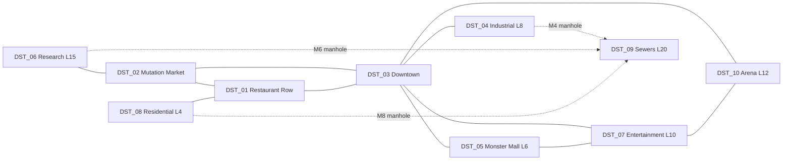
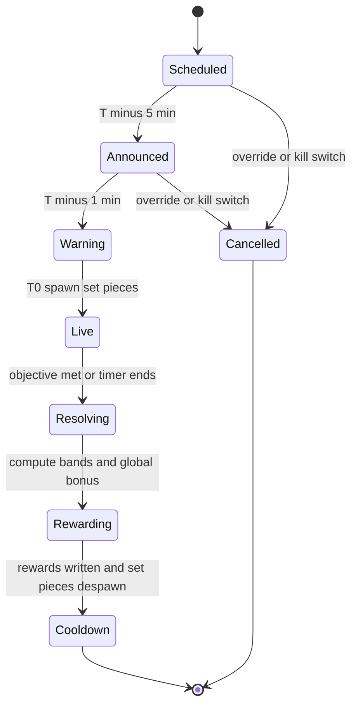

## 18. Morph City

> **Owner:** A12 City. **Binding inputs:** canon §C16 (districts, buildings, NPCs, plots, events, trophies),
> §C13.8 (Secret mutation conditions), §C17.4 (reward vocabulary), §C4 (economy), §C3 (constants).
> Building rows live in §36.10, event rows in §36.11. Acceptance criteria for all three A12 files use the
> `AC-18-NN` series (§18: 01–29 · §36.10: 30–49 · §36.11: 50–69) so IDs never collide inside §36.

Morph City is the **Explore** pillar made physical: a compact, neon-soaked cartoon metropolis where every
shop is a reason to spend what the restaurant earns, every alley might hide a Secret mutation, and every
30 minutes Anchor Andy (`NPC_030`) interrupts the news to announce something ridiculous happening *right now*.
The city exists to (1) convert restaurant income into morph progression (Cook → Earn → **Morph**), (2) pull
players out of the kitchen for short, social, high-reward bursts, and (3) make the world feel inhabited by
the same absurd mutants who eat in your dining room.

Design rules that apply everywhere in this section:

1. **Never punish leaving the kitchen.** Exploring pauses earning; it never costs reputation (§18.8.6).
2. **Everything is reachable in ≤ 10 s of input** from anywhere via Return Door, Metro or Pigeon Taxi (§18.4).
3. **Every district has at least one secret, one interactive toy and one shop or service.**
4. **The city is cosmetic-heavy on the client and authority-light on the server:** crowds, traffic and
   billboards are client-only; anything that grants rewards is validated on the server (§18.9).

---

### 18.1 City Overview & Visual Hooks

**Purpose.** Make the city instantly readable ("that glowing vending machine is where I buy arms") and
constantly funny without scripted cutscenes.

**Silhouette & scale rules.** Cartoon architecture with *exaggerated function-shaped buildings*: the
Mutation Mart is a 36-stud vending machine, the Training Gym flexes two tower-arms, the Delivery Depot wears
a snail shell. Façades lean 2–5° off vertical, windows are rounded, roofs carry a giant prop that names the
business. Street-level doors are 12 studs tall (so Giant Day morphs fit, §36.11), sidewalks 16 studs wide
(two morphs with wings pass each other), roads 32 studs. Palette per district (§18.3) keeps orientation
color-independent by pairing each palette with a unique roofline prop and district icon.

| Visual hook | Specification | Gameplay hook |
|---|---|---|
| Bright neon signs | Every storefront has a `Material.Neon` sign + `BloomEffect` (Intensity 0.6, Size 24, Threshold 1.6). Night intensity ×1.5. ≤ 1 `PointLight` per sign (lights budget §18.9.4). | Signs name the business in plain words; a flickering letter marks a nearby secret 3 times in the city. |
| Colorful storefronts | District palette + 2 accent colors; shop windows show *live stock* (e.g., today's Rare parts on mannequins at `BLD_01`). | Window-shopping = free information; drives visits. |
| Strange citizens | Client-only crowd built from the same procedural morph generator as customers (§8), seeded per district (§18.7). | Citizens react to you, to events and to each other (bumps, waves, gossip bubbles). |
| Unusual vehicles | Walking sedans with chicken legs, a bread-loaf bus ("Loaf Liner"), the Snail Bus, the Hot Dog Blimp, Pigeon Taxis, the centipede Morph Metro, rubber-duck boats. | Several are rideable or interactive (§18.5). |
| Animated billboards | Sprite-sheet flipbooks (8–12 fps) on `SurfaceGui` `ImageLabel`s; the Gravy Plaza Mega-Screen carries live data (news, events, top restaurants on the server). | Event countdowns and Anchor Andy's headlines live here. |
| Absurd advertisements | Parody of nothing real — see ad list below. | Some ads are interactive (pie the Baron's ad). |
| Cartoon architecture | Bendy lamp posts with eyes, chimneys puffing bubbles (never smoke), awnings that double as trampolines. | Traversal toys and launch pads. |
| Hidden alleyways | 10 alleys (one per district) behind revolving posters, laundry lines, dumpsters and doghouses (§18.6.1). | Secrets, dead pixels, the busker poster. |
| Interactive props | 30 catalogued props/vehicles (§18.5). | Micro-rewards, social play, secret triggers. |

**Parody ad rotation** (billboards cycle every 20 s; every brand is invented): *"SOGGY-OS: The Cereal That
Already Gave Up."* · *"Neck Extension Cream — results in 3–5 business giraffes."* · *"Bottled Silence — now
Extra Quiet!"* (interact → 2 s of total silence) · *"Square Wheels Co. — 4× BUMPIER."* · *"Instant Hole: just
add ground."* · *"Recycle your old tails! — Mayor Moosington"* · *"LE FANCY FIN — Too Fancy For You."* (throw any
food prop at it → 30 s sauce splat and a shouted complaint from Baron Von Bistro, `NPC_003`) · *"Pigeon Taxi:
We Probably Won't Drop You!"* · *"Morph Metro: Mostly On Time Since Recently."* · *"Gravy Plaza: it's gravy, on a
plaza."* · *"Mutation Mart: Arms! Legs! Things That Are Neither!"* and *"Body Mods: be the weirdo you were born to
be (again)."* (tap → map pin to `BLD_01` / `BLD_02`).

**City day/night.** The canon 24-minute cosmetic lighting loop (§C3) is divided: Dawn 0:00–2:00,
Day 2:00–14:00, Dusk 14:00–16:00, **Night 16:00–24:00** (8 min). "City night" in any rule (Secret
`MUT_280`, Museum after-hours, Pigeon Council) means the Night phase. The loop phase is
`((serverUnixTime − cycleEpoch) % 1440) / 60` minutes, identical on every server (cycleEpoch is a fixed
constant), so friends on different servers see the same sky. During `EVT_009` the Night look is forced.

---

### 18.2 City Layout & District Map

**Purpose.** Ten districts (canon §C16.1) arranged so that Downtown is the hub, the three starting districts
form a tight triangle around the spawn, and gated districts radiate outward in unlock order.

#### 18.2.1 District master table

| ID | District | Unlock | Connects to (canon) | Footprint (X × Z studs) | Center (X, Z) | Buildings | Metro station |
|---|---|---|---|---|---|---|---|
| `DST_01` | Restaurant Row | start | DST_02, DST_03, DST_08 | 640 × 420 | (−860, 60) | `BLD_03`, `BLD_10`, `BLD_17` | Row Station |
| `DST_02` | Mutation Market | start | DST_01, DST_03, DST_06 | 520 × 420 | (−860, −560) | `BLD_01`, `BLD_02`, `BLD_20` | Market Stop |
| `DST_03` | Downtown Morph City | start (opens on completing `QST_TUT_010`, tutorial step 10; open immediately if the tutorial is skipped) | DST_01, DST_02, DST_04, DST_05, DST_07, DST_10 | 760 × 640 | (0, 0) | `BLD_04`, `BLD_06`, `BLD_09`, `BLD_18` | Central Morph Metro Station (`BLD_18`, hub) |
| `DST_04` | Industrial District | L8 | DST_03, DST_09 | 640 × 520 | (880, −20) | `BLD_07`, `BLD_15` | Smokestack Stop |
| `DST_05` | Monster Mall | L6 | DST_03, DST_07 | 480 × 480 | (−760, 820) | `BLD_12` | Mall-tiplex Station |
| `DST_06` | Mutation Research District | L15 | DST_02, DST_09 | 520 × 460 | (−1,620, −560) | `BLD_11`, `BLD_16` | Petri Dish Platform |
| `DST_07` | Entertainment District | L10 | DST_03, DST_05, DST_10 | 640 × 520 | (0, 900) | `BLD_14`, `BLD_22` | Neon Strip Station |
| `DST_08` | Residential District | L4 | DST_01, DST_09 | 600 × 520 | (−1,620, 60) | `BLD_19` | Cul-de-Sac Stop |
| `DST_09` | Underground Mutation Sewers | L20 | DST_04, DST_06, DST_08 (hidden manholes) | 900 × 700 at floor Y = −700 | (−450, −100) | `BLD_13`, `BLD_21` | Drain Station (hidden) |
| `DST_10` | Arena District | L12 | DST_03, DST_07 | 520 × 520 | (820, 900) | `BLD_05`, `BLD_08` | Rumble Station |

World axes: +X east, +Z south (north is −Z, as on the map). Surface extents X −1,920…1,200, Z −790…1,160
(≈ 3,120 × 1,950 studs). The Sewers sit 700 studs below the surface so that surface streaming never loads
them (§18.9.1). Restaurant interiors live in the far-off Interiors region owned by §15/§27.

#### 18.2.2 ASCII map (connections exactly per §C16.1)

```text
                  SURFACE  (Y = 0)                                                                      N ^
     .----------------.               .----------------.
     | DST_06   [L15] |  Helix Bridge | DST_02 [start] |
  :..| Mut. Research  |===============| Mutation Market|
  :  | BLD_11  BLD_16 |               | BLD_01  BLD_02 |
  :  '----------------'               | BLD_20         |
  :                                   '----------------'
  :                                         |           \  Mutation Mile
  :                    Bazaar Steps         |             \_______              Smokestack Ave
  :                                         |                     .----------------.      .----------------.
  :  .----------------.               .----------------.          | DST_03 [start*]|      | DST_04    [L8] |
  :  | DST_08    [L4] | Picket Fence  | DST_01 [start] |          | Downtown       |======| Industrial     |
  :  | Residential    |===============| Restaurant Row |==========| Morph City     |      | BLD_07  BLD_15 |..:
  :  | BLD_19         |               | BLD_03  BLD_10 |Grand     | BLD_04  BLD_06 |      '----------------'  :
  :  '----------------'               | BLD_17 (plots) |Gravy Blvd| BLD_09  BLD_18 |                          :M4
  :           :M8                     '----------------'          '----------------'                          :
  :M6         :                                                           |                                   :
  :           :                                                    /      |       \    Rumble Road            :
  :           :                   Escalator Expwy              /          |          \                        :
  :           :                                            /              |Neon Strip   \                     :
  :           :                                        /                  |                \                  :
  :           :                       .----------------.          .----------------.      .----------------.  :
  :           :                       | DST_05    [L6] |          | DST_07   [L10] |      | DST_10   [L12] |  :
  :           :                       | Monster Mall   |==========| Entertainment  |======| Arena District |  :
  :           :                       | BLD_12         |          | BLD_14  BLD_22 |      | BLD_05  BLD_08 |  :
  :           :                       '----------------'          '----------------'      '----------------'  :
  :           :                         Food Court Footbridge             Confetti Causeway                   :
  :           :                                                                                               :
~~:~~~~~~~~~~~:~~~~~~~~~~~~~~~~~~~~~~~~~~~~~~~~~~~~~~~~~~~~~~~~~~~~~~~~~~~~~~~~~~~~~~~~~~~~~~~~~~~~~~~~~~~~~~~:~~~
  :           :   UNDERGROUND  (Y = -700)      : = hidden manhole drop-tube (slide down, ladder up)           :
  :           :                                                                                               :
  :           :               .--------------------------------------------------.                            :
  :           :...............| DST_09   [L20]   Underground Mutation Sewers     |                            :
  :...........................| BLD_13 Mystery Market   BLD_21 Throne Room       |............................:
                              | Drain Station (hidden Metro stop)                |
                              '--------------------------------------------------'
  [start*] = available from start but opens at tutorial step 10 (QST_TUT_010).  [Lnn] = player level gate.
```

#### 18.2.3 Connections (14 links)

| Link | Between | Kind | Length (studs) | Notes |
|---|---|---|---|---|
| Bazaar Steps | DST_01 ↔ DST_02 | stairway street | 200 | Awning trampolines along the steps. |
| Grand Gravy Boulevard | DST_01 ↔ DST_03 | boulevard | 160 | Main tutorial route; Snail Bus line. |
| Picket Fence Lane | DST_01 ↔ DST_08 | residential street | 140 | Gate closed with a "Wet Paint (Forever)" sign below L4. |
| Mutation Mile | DST_02 ↔ DST_03 | diagonal avenue | 222 | Neon arches every 40 studs. |
| Helix Bridge | DST_02 ↔ DST_06 | bridge over a soda canal | 240 | Barrier: a sleeping DNA-noodle across the bridge below L15. |
| Smokestack Avenue | DST_03 ↔ DST_04 | avenue | 180 | Bubble-puffing smokestacks; gate below L8 is a giant snail crossing. |
| Escalator Expressway | DST_03 ↔ DST_05 | moving walkway (×1.3 speed) | 295 | Gate below L6: escalator "under repair (by a sloth)". |
| Neon Strip | DST_03 ↔ DST_07 | pedestrian strip | 320 | Gate below L10: velvet rope + bouncer turtle. |
| Rumble Road | DST_03 ↔ DST_10 | road | 367 | Gate below L12: a sleeping sumo armadillo. |
| Food Court Footbridge | DST_05 ↔ DST_07 | skybridge | 200 | |
| Confetti Causeway | DST_07 ↔ DST_10 | causeway | 240 | Confetti cannons fire when anyone wins in the Arena. |
| Drain Gate (M4) | DST_04 ↔ DST_09 | hidden manhole drop-tube | scripted 4 s ride | Under a pallet in the forklift yard. |
| Specimen Chute (M6) | DST_06 ↔ DST_09 | hidden manhole drop-tube | scripted 4 s ride | Inside a walk-in specimen freezer. |
| Rubber Ducky Drain (M8) | DST_08 ↔ DST_09 | hidden manhole drop-tube | scripted 4 s ride | Under a doghouse in a back yard. |



**Locked districts.** A district whose level gate the player has not met is *visible* (skyline, signs,
sounds) but blocked by a comedic barrier on every link. Barriers are client-collidable parts for the locked
player only, plus a server **District Guard** (§18.4.6) that returns anyone who gets inside anyway (flying
mutations, launch pads, knockback). Touching a barrier shows: *"Come back at Level 8! (The snail is very
slow.)"* Metro and taxi never list locked districts. Unlocking plays a 2 s barrier-removal gag for that
player only (the snail finally finishes crossing) and pins the district on the map.

---

### 18.3 District Specifications

Each block lists: **Theme · Footprint · Landmarks · Buildings · Ambient life · Vehicles · Music & ambience
(described in words; IDs are A16's) · Secrets · Unlock · Customer flavor.** *Customer flavor* names the
citizen types that dominate the district crowd (§18.7) and, as an optional hook for §8, the personalities
whose spawn weight rises by ×1.25 [TUNABLE] while a city event is centered on that district.

#### DST_01 — Restaurant Row
- **Theme:** a greasy, cheerful food street of mismatched façades under strings of bulb lights; cartoon
  "scent lines" waft from every door. Palette ketchup red / mustard yellow; roofline prop: giant ketchup
  bottle water tower.
- **Footprint:** 640 × 420 studs; two facing rows of 4 plots (each 80 × 100) along Gravy Lane.
- **Landmarks:** Le Fancy Fin (Baron Von Bistro's glass-and-shark-fin restaurant, a story set, not a
  `BLD_`), the Ketchup Water Tower, Row Station, the empty lot behind the Job Board.
- **Buildings:** `BLD_03` Restaurant Supplies, `BLD_10` Job Board, `BLD_17` plots.
- **Ambient life:** customers queuing at player doors (these are real SPCV customers, §8), sweepers with mop
  tails, food-cart vendors yelling prices nobody pays, Sous-Chef Sniffles (`NPC_028`) sweeping outside Le
  Fancy Fin.
- **Vehicles:** Snail Bus stop, parked food trucks, 6 Pigeon Taxi perches.
- **Music & ambience:** upbeat kitchen-funk loop, sizzles, door chimes, distant cash registers; reverb *City*.
- **Secrets:** dead pixel `CPIX_01`, Time Capsule `CSEC_17`, alley *Grease Trap Gap*.
- **Unlock:** start. **Customer flavor:** Impatient Goblins (`PER_005`), Speedrunner Squirrels (`PER_026`),
  Hungry Hippo-Spiders (`PER_002`).

#### DST_02 — Mutation Market
- **Theme:** a crowded bazaar of striped awnings; spare tails hang like sausages, gummy-eyeball jars glow,
  every stall has a mirror. Palette teal / magenta; roofline prop: the spinning capsule atop `BLD_01`.
- **Footprint:** 520 × 420 studs.
- **Landmarks:** the giant vending-machine Mutation Mart, Glamtrax's salon-chair building, the mushroom
  produce stand, Helix Bridge head, Fortune-Telling Toaster, awning trampolines.
- **Buildings:** `BLD_01` Mutation Mart, `BLD_02` Body Mods, `BLD_20` Weird Produce Stand.
- **Ambient life:** citizens trying on tails and arguing with mirrors, a juggling octopus, capsule-delivery
  drones.
- **Vehicles:** giant-chicken rickshaws, capsule drones, 5 taxi perches.
- **Music & ambience:** bouncy bazaar percussion with a wheezy squeeze-box synth, haggling murmurs;
  reverb *Alley* under awnings, *City* in the open.
- **Secrets:** `CPIX_02`, Fortune Alley (toaster hints), alley *Fortune Alley*.
- **Unlock:** start. **Customer flavor:** Rich Mutants (`PER_008`), Influencers (`PER_009`), Picky
  Platypuses (`PER_014`).

#### DST_03 — Downtown Morph City
- **Theme:** the neon heart. Skyscrapers with cartoon faces that blink, the **MORPH CITY** sign on Billboard
  Hill, Gravy Plaza with its Mega-Screen and the **Sauce Fountain** (the "Downtown fountain" of
  `MUT_237`). Palette electric violet / hot cyan; roofline prop: the sign itself.
- **Footprint:** 760 × 640 studs (largest surface district).
- **Landmarks:** MORPH CITY sign (`CPROP_01`), Mega-Screen (`CPROP_02`), Sauce Fountain (`CPROP_15`),
  MCN news booth of Anchor Andy (`NPC_030`), ERROR billboard in Sauce Drip Alley (`CPROP_04`), City Hall
  roof (96 studs).
- **Buildings:** `BLD_04` Recruitment Office, `BLD_06` Cooking Academy, `BLD_09` City Hall, `BLD_18`
  Central Morph Metro Station.
- **Ambient life:** commuters with briefcases (and one with a brief-*case* of live crabs), Sergeant Rhonda
  (`NPC_026`) directing traffic, Inspector Grimewell (`NPC_022`) patrolling with a clipboard.
- **Vehicles:** chicken-legged "Leggy Sedans", Loaf Liner buses, Hot Dog Blimp overhead, 8 taxi perches.
- **Music & ambience:** big-city neon swing with synth brass; honks, crowd chatter; reverb *City*.
- **Secrets:** Glitch Head `CSEC_01`, Paper Airplane Wings `CSEC_05`, Mayor's Rubber Duck `CSEC_12`, Sign
  Fixer `CSEC_23`, `CPIX_03`, alley *Sauce Drip Alley*.
- **Unlock:** start, opens at tutorial step 10. **Customer flavor:** Robot Accountants (`PER_015`), Food
  Critics (`PER_004`), Undercover Inspectors (`PER_025`).

#### DST_04 — Industrial District
- **Theme:** chunky factories whose smokestacks puff soap bubbles, the Pickle Factory, conveyor skybridges,
  cranes dangling giant food. Palette safety orange / steel blue; roofline prop: a crane holding a pickle.
- **Footprint:** 640 × 520 studs.
- **Landmarks:** Pickle Factory and its conveyor (`CPROP_18`), steam vents (`CPROP_16`), forklift yard
  (`CPROP_17`), manhole M4 *Drain Gate*.
- **Buildings:** `BLD_07` Repair Workshop, `BLD_15` Delivery Depot.
- **Ambient life:** wrench-armed workers on lunch break, robots napping on pallets, crates riding conveyors.
- **Vehicles:** forklifts (rideable), snail delivery trucks, a crate train, 5 taxi perches.
- **Music & ambience:** machine-percussion funk (clank-hiss-clank in rhythm); reverb *Hangar*.
- **Secrets:** `CPIX_04`, manhole `CSEC_09`, Conveyor of Destiny `CSEC_14`, alley *Rust Bucket Row*.
- **Unlock:** L8. **Customer flavor:** Bodybuilder Pigeons (`PER_010`), Retired Wrestler Walruses
  (`PER_030`), Chaos Gremlins (`PER_007`).

#### DST_05 — Monster Mall
- **Theme:** one enormous mall shaped like a stack of monster-sized shopping bags, plus its parking lot.
  Palette bubblegum pink / mint; roofline prop: a peacock-tail fan sign.
- **Footprint:** 480 × 480 studs (mall 200 × 160 × 4 floors; parking 480 × 200).
- **Landmarks:** Monster Mall atrium with sideways escalators (`CPROP_19`), shopping-cart race track
  (`CPROP_20`), Food Court Footbridge.
- **Buildings:** `BLD_12` Monster Mall.
- **Ambient life:** shoppers buried under bags, mall-walking Grandma Golems, teen mutants sharing one
  milkshake with four straws.
- **Vehicles:** shopping carts, a caterpillar parking tram, 4 taxi perches.
- **Music & ambience:** wobbly elevator-muzak; reverb *ParkingLot* outside, *Hallway* inside.
- **Secrets:** `CPIX_05`, Floor ½ `CSEC_13`, alley *Loading Dock Labyrinth*.
- **Unlock:** L6. **Customer flavor:** Party Packs (`PER_016`), Birthday Beasts (`PER_031`), Toddler Titans
  (`PER_020`), Drama Llamas (`PER_018`).

#### DST_06 — Mutation Research District
- **Theme:** a sterile-but-silly campus of glass domes, a 60-stud DNA helix made of noodles, specimen tubes
  and robotic lawnmowers. Palette lab white / slime green; roofline prop: the noodle helix.
- **Footprint:** 520 × 460 studs.
- **Landmarks:** Noodle Helix, Specimen Tubes (`CPROP_24`), Helix Bridge, manhole M6 *Specimen Chute*.
- **Buildings:** `BLD_11` Mutation Laboratory, `BLD_16` Morph Museum.
- **Ambient life:** scientists with clipboards, tiny escaped specimens scurrying between bushes, lab robots.
- **Vehicles:** hover-segways, specimen drones, 4 taxi perches.
- **Music & ambience:** curious plinky lab synth over bubbling beakers; reverb *StoneCorridor* indoors.
- **Secrets:** Cosmic Void Face `CSEC_02`, manhole `CSEC_10`, Museum After Hours `CSEC_16`, Specimen Fetch
  `CSEC_22`, `CPIX_06`, alley *Specimen Back Lot*.
- **Unlock:** L15. **Customer flavor:** Conspiracy Moths (`PER_011`), Nervous Newts (`PER_012`), Mystery
  Mutants (`PER_032`), Health Nut Hamsters (`PER_021`).

#### DST_07 — Entertainment District
- **Theme:** maximum neon. Theaters, an arcade, light-up dance floors, buskers on every corner, Zorp's tour
  buses (no gambling of any kind). Palette ultraviolet / gold; roofline prop: a giant spinning microphone.
- **Footprint:** 640 × 520 studs.
- **Landmarks:** Neon Strip, busker corner (`CPROP_13`), dance floor (`CPROP_14`), the Grand Tournament
  Kitchen beside the Showcase Stage (Chef Supreme Omnivora, `NPC_029`), the mime statue.
- **Buildings:** `BLD_14` Food Critic Headquarters, `BLD_22` Showcase Stage.
- **Ambient life:** tourists photographing everything, Vlogzilla (`NPC_021`) live-streaming, Zorp (`NPC_027`)
  leading tour groups, street performers.
- **Vehicles:** Zorp's alien tour bus, centipede limos, 6 taxi perches.
- **Music & ambience:** neon disco-funk; applause swells; reverb *City* outside, *ConcertHall* at the stage.
- **Secrets:** Accordion Neck `CSEC_03`, Mime's Invisible Door `CSEC_18`, `CPIX_07`, alley *Kazoo Alley*.
- **Unlock:** L10. **Customer flavor:** Influencers (`PER_009`), Alien Tourists (`PER_029`), Lovebird
  Jellyfish Couples (`PER_027`), Mime Mantises (`PER_019`).

#### DST_08 — Residential District
- **Theme:** cul-de-sacs of houses shaped like boots, teapots and sleeping cats; picket fences; a
  laundromat; the park. Palette sunny yellow / sky blue; roofline prop: a teapot house steaming bubbles.
- **Footprint:** 600 × 520 studs.
- **Landmarks:** Morph Park & Fountain, laundromat, ice-cream truck loop (`CPROP_09`), manhole M8 under a
  doghouse, 24 delivery addresses (§36.10 `BLD_15`).
- **Buildings:** `BLD_19` Morph Park & Fountain.
- **Ambient life:** snails mowing lawns, young mutants playing hopscotch on wobbly legs, mail pigeons,
  Grandma Golems knitting scarves for lamp posts.
- **Vehicles:** the Tentacle Ice Cream Truck, tentacle tricycles, 4 taxi perches.
- **Music & ambience:** sunny ukulele and pigeon coos, sprinklers; reverb *Plain*.
- **Secrets:** manhole `CSEC_08`, Pigeon Council `CSEC_11`, Lost Sock Shrine `CSEC_19`, `CPIX_08`, alley
  *Laundry Line Lane*.
- **Unlock:** L4. **Customer flavor:** Grandma Golems (`PER_013`), Sleepy Sloth-Rockets (`PER_006`), Polite
  Demons (`PER_003`).

#### DST_09 — Underground Mutation Sewers
- **Theme:** kid-safe sewers: canals of fizzy lime soda, bioluminescent mushrooms, murals painted by very
  talented rats, pipes that hum in chords. Palette glow green / rust; landmark prop: a crown-shaped grate.
- **Footprint:** 900 × 700 studs, floor Y = −700, ceiling 60 studs.
- **Landmarks:** Mystery Market barge, Throne Room drain-mouth, Drain Station, rubber-duck canals
  (`CPROP_26`), the karaoke booth.
- **Buildings:** `BLD_13` Mystery Market, `BLD_21` Sewer King's Throne Room.
- **Entrances:** M4 (`DST_04`), M6 (`DST_06`), M8 (`DST_08`) — each a hidden manhole that must be found
  (§18.6) and opened at L20; a scripted 4 s slide-tube ride down, ladder ride up. Drain Station becomes a
  Metro stop once visited on foot.
- **Ambient life:** King Ratbeard's subjects hauling "borrowed" crates, glowing fish, dripping (gentle).
- **Vehicles:** rubber-duck boats, pipe slides. No taxi perches underground (taxi can *drop* at Drain
  Station once discovered).
- **Music & ambience:** echoey dub-lite bassline over drips; reverb *SewerPipe*.
- **Secrets:** Mystery Fog `CSEC_07`, Sewer Karaoke `CSEC_21`, alley *Drip Tunnel*.
- **Unlock:** L20. **Customer flavor:** Pirate Crabs (`PER_017`), Haunted Toasters (`PER_028`), Chaos
  Gremlins (`PER_007`).

#### DST_10 — Arena District
- **Theme:** sports zone with a colosseum of stacked giant food tins, a flexing gym, protein-shake fountains
  and stadium lights. Palette champion red / chrome; roofline prop: the Arena jumbotron.
- **Footprint:** 520 × 520 studs.
- **Landmarks:** Champions Walk (8 plinths that show the morphs of the server's top Arena players this week,
  client-built from public loadout data), Wallop-O-Meter (`CPROP_25`), Rumble Road.
- **Buildings:** `BLD_05` Training Gym, `BLD_08` Morph Arena.
- **Ambient life:** athletes jogging on wobbly mismatched legs, mascots, cheering crowds, the "Dizzy Wagon"
  that carries Seeing-Stars citizens off for juice.
- **Vehicles:** Dizzy Wagon, sports blimp, 5 taxi perches.
- **Music & ambience:** drumline stadium rock; crowd chants; reverb *Arena*.
- **Secrets:** Bag Whisperer `CSEC_15`, alley *Locker Room Back Door*.
- **Unlock:** L12. **Customer flavor:** Retired Wrestler Walruses (`PER_030`), Bodybuilder Pigeons
  (`PER_010`), Spicy Salamanders (`PER_022`).

---

### 18.4 Travel

**Purpose.** Let players cross a 3,120-stud city in seconds when they have a goal, while making walking
pleasant enough that discovery happens on foot.

**Rules & Mechanics.**

1. **Walking / sprinting.** Base movement uses the player's stat WalkSpeed (§C3/§C5). In city zones only
   (not restaurant interiors, not Arena pits, not boss arenas) a **City Sprint** toggle multiplies WalkSpeed
   by 1.35 [TUNABLE] with no stamina. Sprint is a traversal mode, not a stat; the MOVE cap (§C5) still
   applies to the stat value. Sprint is disabled while In Combat (§C12.1) and while carrying event objects
   flagged *Fragile*. Moving walkways (Escalator Expressway) add ×1.3 on top.
2. **Morph Metro.** One station per district (table §18.2.1). A station is **discovered** when the player
   enters its concourse trigger (14-stud radius around the turnstiles) or interacts with its map. Riding is
   **free** between any two discovered stations; the player must be inside a station concourse to board. A
   ride is a 3 s tunnel transition (centipede train, Conductor Choo `NPC_019` waves). Drain Station
   (`DST_09`) is only discoverable on foot after first entering the Sewers. Discovering all 10 stations
   completes the Metro Card (title "Commuter" + cosmetic palette "Line Colors", granted once).
3. **Pigeon Taxi.** Hail from any **street corner perch** (47 perches; a perch is usable within 12 studs) to
   any **discovered** district. Cost **25 MB × restaurant tier number** (TIER_01 = 25 MB … TIER_10 = 250 MB),
   charged on arrival. Ride = 4 s cosmetic flight (giant pigeon, wicker basket), skippable after 1.5 s.
   Drop point: the district's main perch, or the door of any building in that district the player has
   entered before (picked on the map). Every 100th taxi ride per player is a free Golden Pigeon (`CSEC_20`).
   A district is discovered by entering it on foot or by Metro.
4. **Return Door.** A HUD button available anywhere in the city (and inside other players' restaurants):
   free, **10 s cooldown**, 1.0 s door-opening animation (cancelled by taking damage), lands the player at
   their own restaurant's interior entrance. Unavailable while In Combat.
5. **Event Portal.** During the Live phase of a city event the event toast offers **Join**: free, one-way,
   no cooldown, lands at the event's staging pad. If the event area lies in a district the player has not
   unlocked but the player meets the event's minimum level, they receive **Event Access** to that event zone
   only for the event's duration (+30 s grace); it does not count as discovering the district.
6. **District Guard.** Every 1 s the server checks each character's position against district bounds
   (axis-aligned boxes from §18.2.1, any altitude up to Y +400). If the player is inside a district they
   cannot access (and has no Event Access), they are moved to their last safe position with the barrier
   toast. Last safe position is recorded every 1 s while grounded in an accessible area.
7. **Manholes.** Each hidden manhole (M4/M6/M8) is discovered by interacting with it once (any level); it
   opens only at L20. The ride down is a 4 s scripted slide (no physics); the ladder up returns to the same
   manhole.
8. **Visiting friends.** Walking into a friend's door on Restaurant Row follows §21 visit permissions;
   joining a friend on another server uses TeleportService (§C16.4, §21). Inside one server, *no* travel
   ever uses TeleportService.

**Variables.**

| Variable | Value | Notes |
|---|---|---|
| `CitySprintMultiplier` | 1.35 [TUNABLE] | city zones only |
| `MetroRideSeconds` | 3 [TUNABLE] | fixed, any distance |
| `MetroDiscoveryRadius` | 14 studs | concourse trigger |
| `TaxiCostPerTier` | 25 MB (canon) | × tier number |
| `TaxiRideSeconds` / skippable after | 4 / 1.5 [TUNABLE] | |
| `TaxiPerchRange` | 12 studs | |
| `ReturnDoorCooldown` | 10 s (canon) | |
| `ReturnDoorChannel` | 1.0 s [TUNABLE] | cancelled by damage |
| `StreamRequestTimeout` | 4 s [TUNABLE] | `RequestStreamAroundAsync` |
| `ArrivalAnchorMax` | 3 s | anchor until floor raycast hits |
| `DistrictGuardInterval` | 1 s | |
| `EventAccessGrace` | 30 s | after event end |
| `GoldenPigeonEvery` | 100 rides | free ride + 20 MS |
| `TravelRequestRateLimit` | 1 request / 2 s per player | server |

**UI.** The **City Map** (full-screen overlay, opens with `M` / Back button / map icon; usable as an
*overlay* during combat per §C22 E2 but travel buttons disabled) shows: districts (locked = padlock icon +
diagonal stripes + "Lv 8" label, never color alone), buildings (icons + names), discovered stations (train
icon), taxi perches (pigeon icon) with the nearest highlighted, the player's restaurant (house icon), active
event beacon with countdown, active quest markers (§20), and friends on this server (avatar dots). Selecting
a destination opens a **Travel Card** with the options valid from the player's current position: *Metro
(Free)* if standing in a station, *Taxi (125 MB)* if at a perch (price shown with balance check), *Walk*
(draws a route ribbon on the ground, client-only), *Return Door* always pinned bottom-right. Mobile: map
pinch-zoom, Travel Card as a bottom sheet with 56-px buttons; controller: right stick pans, A selects, Y opens
Return Door.

**Progression.** Districts gate by level (§C16.1); stations and perches expand as districts are discovered;
taxi costs scale with tier so travel stays a trivial convenience sink (≤ 0.4 % of hourly income at every tier).

**Player Interactions.** Party members can **share a taxi** (one pays; up to 4 players within 12 studs of
the perch ride together, each lands at the same drop point). Metro rides are per-player. A friend's map dot
can be selected to show a walking route ("Go to friend").

**Dependencies.** §C3 (WalkSpeed), §11 (In Combat flag), §15 (interior entrance spawn), §21 (visits,
cross-server join), §22 (taxi sink), §24 (map UI), §27 (`EconomyService`, `MultiplayerService`), §28 (city
progress fields), §30 (streaming).

**Roblox Implementation.** In-place travel is a server-side `PivotTo` preceded by a streaming pre-request:

```lua
--!strict
-- ServerScriptService/City/CityTravel.lua (module hosted with CityEventService's city package, §18.9)
local Players = game:GetService("Players")
local HttpService = game:GetService("HttpService")
local Config = require(game.ReplicatedStorage.Shared.Config.CityTravel)

local lastRequest: {[Player]: number} = {}

local function travel(player: Player, mode: "Metro" | "Taxi" | "ReturnDoor" | "EventPortal", destKey: string)
	local now = os.clock()
	if (lastRequest[player] or 0) > now - 2 then return false, "RateLimited" end
	lastRequest[player] = now
	local character = player.Character
	local root = character and character:FindFirstChild("HumanoidRootPart") :: BasePart?
	if not (character and root) then return false, "NoCharacter" end
	if CombatService.IsInCombat(player) then return false, "InCombat" end
	local dest = CityTravel.ResolveDestination(player, mode, destKey) -- validates unlock, discovery, cooldown, position (station/perch range)
	if not dest then return false, "InvalidDestination" end
	local cost = (mode == "Taxi" and not CityTravel.IsGoldenRide(player)) and 25 * RestaurantService.GetTierNumber(player) or 0
	if cost > 0 and EconomyService.GetBalance(player, "MB") < cost then return false, "InsufficientMB" end
	CityRemotes.TravelBegin:FireClient(player, mode, destKey)          -- client plays ride/fade
	pcall(function() player:RequestStreamAroundAsync(dest.Position, Config.StreamRequestTimeout) end)
	task.wait(Config.MinTransitionSeconds[mode])                      -- 3 s Metro, 1.5–4 s Taxi, 1 s Door
	if player.Parent == nil or player.Character ~= character then return false, "Aborted" end
	root.Anchored = true                                               -- hold until floor exists client-side
	character:PivotTo(dest.CFrame)
	if cost > 0 then
		EconomyService.Spend(player, "MB", cost, "city_taxi", HttpService:GenerateGUID(false))
	end
	CityTravel.AfterArrival(player, mode, dest)                         -- cooldowns, analytics mmr_city_travel
	task.delay(Config.ArrivalAnchorMax, function() if root.Parent then root.Anchored = false end end)
	CityRemotes.TravelEnd:FireClient(player, destKey)                  -- client unanchors early on floor raycast hit
	return true
end
```

Notes: the client requests `City.RequestTravel(mode, destKey)`; the server never trusts a client CFrame.
Client unanchoring is done by a server-owned request (`City.ArrivalReady`) after a downward raycast hits the
streamed floor, or automatically after 3 s. Taxi charge happens after a successful pivot, so aborted rides are
never charged. The Return Door teleports into the Interiors region and is implemented by `RestaurantService`'s
door handler with the same pre-stream call.

**Edge Cases.** §18.10 rows 1–5. **Acceptance Criteria.** AC-18-01 … AC-18-06.

---

### 18.5 City Interactivity Catalog

All props are server-placed instances; their *animation* is client-side. Interactions use `ProximityPrompt`
(server-created, `MaxActivationDistance` as listed, `RequiresLineOfSight` true unless noted) and are
validated server-side (§18.9.6). Micro-rewards use the Event Reward Minute unit **ERM** defined in §18.8.4
and are capped as listed.

| ID | Prop / vehicle | Location | Behavior | Interaction & reward | Limits / implementation |
|---|---|---|---|---|---|
| `CPROP_01` | MORPH CITY neon sign | DST_03 Billboard Hill | 9 letters, 12 studs tall; every 20 min one random letter "falls off" (cartoon bounce) and lies on the hill. | Players carry the letter back (2-player lift if not Giant) → +0.02 × XPRate (§C5.1) each; 10 returns → `CSEC_23`. | Atomic model, `LevelOfDetail` StreamingMesh; fallen letter is a server prop (1 at a time). |
| `CPROP_02` | Gravy Plaza Mega-Screen | DST_03 | Rotates: Anchor Andy headlines, event countdown, server top 3 restaurants (by ★), parody ads. | Look-only; tap to open event details. | Single live `SurfaceGui`; disabled > 150 studs. |
| `CPROP_03` | Parody billboards ×24 | all surface districts | Flipbook ads (§18.1); Le Fancy Fin ad accepts food splats. | Splat the Baron's ad → Baron taunt line; no reward. | Off-screen flipbooks pause (frustum check). |
| `CPROP_04` | ERROR billboard | DST_03, Sauce Drip Alley | Normally shows "SALE"; during `EVT_009` it flickers "ERROR". | 3 interactions during `EVT_009` → `MUT_040` (`CSEC_01`). | Prompt enabled only during `EVT_009`; counter per event instance. |
| `CPROP_05` | Pigeon Taxi perches ×47 | street corners (none in DST_09) | Pigeon idles, preens, judges your outfit. | Hail taxi (§18.4). | 12-stud range. |
| `CPROP_06` | Morph Metro centipede train | elevated loop over DST_01/02/03/05/07/10 | Cosmetic train circles every 90 s; legs scurry; honks a kazoo. | Look-only; wave emote → the train waves back with 40 legs. | Client-only spline animation. |
| `CPROP_07` | Snail Bus | loop DST_01 → DST_03 → DST_08 | 6 studs/s (slower than walking). | Ride the full 4-min loop once → title "Patient Passenger". | Server `VehicleSeat` ×6; bus path is server-tweened at 2 Hz, client-smoothed. |
| `CPROP_08` | Hot Dog Blimp | sky over DST_01/03/07 | Every 3 min drops a "Blimp Coupon" with a parachute at a random sidewalk spot. | Catch it → 0.5 ERM MB. | Max 3 coupons per player per real hour; server spawns ≤ 1 at a time. |
| `CPROP_09` | Tentacle Ice Cream Truck | DST_08 loop | Plays a jingle; tentacles wave cones. | Get a free cone (cosmetic held item, 60 s) + "Brain Freeze" face. | Once per city day per player. |
| `CPROP_10` | Fire hydrant geysers ×30 | all surface districts | Kick it (interact) → water spout. | Launches the player 25 studs up; `STS_SOAKED` (cosmetic drip, 5 s). | 5 s cooldown per hydrant; arc is a scripted `AssemblyLinearVelocity` impulse on the player's own character. |
| `CPROP_11` | Awning trampolines ×12 | DST_02, Bazaar Steps | Bouncy awnings. | Bounce +18 studs; 5 bounces in a row → confetti puff. | Client-side jump boost validated by server velocity sanity check. |
| `CPROP_12` | Fortune-Telling Toaster | DST_02 Fortune Alley | Pops toast with a printed fortune. | 1 free fortune per city day: a cryptic hint to one secret the player has not found. | Hint pool server-side (spoiler-safe). |
| `CPROP_13` | Busker instruments ×5 | DST_07 busker corner | Slide Whistle, Bucket Drums, Kazoo Organ, Banjo-Tuba, Rubber-Chicken Bagpipe. | Play each (1 note phrase); correct 5-sequence → `MUT_112` (`CSEC_03`). | Positional sounds, `RollOffMaxDistance` 60. |
| `CPROP_14` | Light-up dance floors | DST_07 & Gravy Plaza | 8 × 8 tiles light under feet; sync when ≥ 3 players dance. | 3 players emoting together for 10 s → "Floor Filler" emote unlock (once). | Tile lighting client-side; sync check server-side. |
| `CPROP_15` | Sauce Fountain | DST_03 Gravy Plaza | Gravy-brown (it's caramel) fountain, basin radius 14 studs. | Toss 1 MB for a splash (joke sink); 100 tosses → title "Wishful Thinker". Target of `MUT_237`. | Toss limited 1 per 3 s. |
| `CPROP_16` | Steam vents ×8 | DST_04 | Puffs bubbles every 4 s. | Stand on it → launch 30 studs (route to the conveyor roof). | Timed client impulse + server velocity check. |
| `CPROP_17` | Forklifts ×4 | DST_04 yard | Drivable at 10 studs/s. | Crate-stack minigame: 5 crates in 60 s → 1 ERM MB (3/day). | Server `VehicleSeat`; network ownership to driver; crates ≤ 6 physics parts. |
| `CPROP_18` | Pickle Factory conveyor | DST_04 | 180-stud belt through the factory. | Ride end to end (90 s) → `CSEC_14`. | Belt is `AssemblyLinearVelocity` on anchored belt parts. |
| `CPROP_19` | Sideways escalators | BLD_12 atrium | Move horizontally between stores. | Fun traversal. | Same belt technique. |
| `CPROP_20` | Shopping-cart racers ×8 | DST_05 parking lot | Push-cart karts. | 1-lap race vs friends (≥ 2 players) → winner +0.03 × XPRate (5/day). | `VehicleSeat` carts, max 8. |
| `CPROP_21` | Over-enthusiastic massage chairs ×6 | BLD_12 floor 2 | Vibrate wildly. | Sit 10 s → camera wobble + "Relaxed?" toast. | Wobble disabled under Reduced Motion. |
| `CPROP_22` | Sleeping armadillo speed bumps ×20 | roads | Snore; roll away squeaking when stepped on, return in 5 s. | Pure comedy. | Client-only. |
| `CPROP_23` | Talking trash cans ×40 | sidewalks | Compliment passers-by ("Nice tail!"). | Throw city litter (spawns near cans) in → +0.005 × XPRate (20/day). | Litter is client-visual; validated by can proximity. |
| `CPROP_24` | Specimen tubes ×12 | DST_06 | Tap the glass → specimen pulls a face or waves. | Pure comedy; one tube hides `CPIX_06`. | Client animation. |
| `CPROP_25` | Wallop-O-Meter | DST_10 | Carnival high-striker. | Hit with `ABL_002` Wallop → strength rating; server board of top 5 today. | Server reads the CombatService hit event; 1 hit / 3 s. |
| `CPROP_26` | Rubber-duck boats ×6 | DST_09 canals (surface streets during `EVT_013`) | Paddle-able 12 studs/s. | Canal tour; required to reach the karaoke booth (`CSEC_21`). | `VehicleSeat` boats on a water-plane collision layer. |
| `CPROP_27` | "Say Cheese(burger)" photo spots ×10 | one per district | Frame + pose marker. | Pose with an emote → camera framing for a native screenshot; 10 spots → palette "Postcard Pastels". | Client camera tween; progress server-side. |
| `CPROP_28` | Streetlamp creatures ×120 | all streets | Eyes track the nearest player; yawn at dawn; switch off during `EVT_009`. | Comedy; Blackout landmark. | Client-only, nearest 12 animate. |
| `CPROP_29` | Burping parking meters ×16 | DST_03, DST_05 | Eat a coin, burp. | 1 MB joke sink (no reward). | 1 per 3 s. |
| `CPROP_30` | Le Fancy Fin velvet rope | DST_01 | A snooty bouncer-turtle. | Interact → line varies by story chapter (§20) and your tier vs. the Baron's; no entry until the story allows. | Dialogue only. |

---

### 18.6 Hidden Alleyways & Secrets

**Purpose.** Reward curiosity with things worth bragging about — including all 7 Secret mutations — while
keeping every secret fair: each has an in-world clue, and none is random or purchasable.

**Rules & Mechanics.** A secret is a server-validated condition (position, state, counters). Clues come
from: the Fortune-Telling Toaster (`CPROP_12`, 1/city day), Old Man Pigeon's daily rumor (`NPC_025`,
1/real day, always about an *undiscovered* secret), torn posters, and flickering neon letters. The Museum's
*Vault of Secrets* (§36.10 `BLD_16`) shows a "?" silhouette for each Secret mutation not yet found. Rewards use
only §C17.4 vocabulary and are granted once per player (idempotent by secret ID).

#### 18.6.1 Hidden alleyways (one per district)

| Alley | District | How it is hidden | What it holds |
|---|---|---|---|
| Grease Trap Gap | DST_01 | 4-stud gap between plots 4 and 5 behind dumpsters | shortcut to the empty lot (`CSEC_17`) |
| Fortune Alley | DST_02 | through a bead curtain behind the produce stand | Fortune-Telling Toaster, `CPIX_02` route |
| Sauce Drip Alley | DST_03 | behind City Hall, under a dripping caramel pipe | ERROR billboard, window-washer lift to the City Hall roof |
| Rust Bucket Row | DST_04 | climb the conveyor roof via steam vents | `CPIX_04` vantage, factory back door |
| Loading Dock Labyrinth | DST_05 | stacked crate maze behind the mall | service elevator used by `CSEC_13` |
| Specimen Back Lot | DST_06 | hedge maze behind the Lab | escaped specimen blob (`CSEC_22`) |
| Kazoo Alley | DST_07 | revolving "Coming Soon" poster wall | the torn busker poster (`CSEC_03`) |
| Laundry Line Lane | DST_08 | duck under hanging laundry between two boot-houses | 3 of the 9 lost socks (`CSEC_19`) |
| Drip Tunnel | DST_09 | reachable only by rubber-duck boat | karaoke booth (`CSEC_21`) |
| Locker Room Back Door | DST_10 | behind the Gym's lockers (door marked "NOT A DOOR") | Very Old Punching Bag (`CSEC_15`) |

#### 18.6.2 Secret catalog (23 secrets)

| ID | Secret | Location | Discovery rule (server-validated) | Reward (§C17.4) |
|---|---|---|---|---|
| `CSEC_01` | Glitch in the System | DST_03, ERROR billboard (`CPROP_04`) | During `EVT_009` Blackout Night, interact with the flickering "ERROR" billboard **three times** (prompt cooldown 2 s; counter resets if the event instance ends). | `MUT_040` Glitch Head |
| `CSEC_02` | The Empty Exhibit | `BLD_16` Morph Museum, Grand Hall | Own **≥ 100 different mutation parts** (distinct IDs in inventory, any level), then inspect the "Empty Exhibit". Below 100 the plaque reads "Come back when you're more… complete. (n/100)". | `MUT_048` Cosmic Void Face |
| `CSEC_03` | The Busker Sequence | DST_07 busker corner + Kazoo Alley poster | Play the **five busker instruments in DST_07 in the order shown on the torn poster** in Kazoo Alley, within 60 s; a wrong note resets. The order is a per-player permutation `perm(hash(UserId))`, rendered client-side on the poster ("the poster rearranges itself when someone else looks"). | `MUT_112` Accordion Neck |
| `CSEC_04` | The Infinite Noodle | player's restaurant (hint: Wall of Noodles, `BLD_06`) | **Serve `RCP_PST_008` The Infinite Noodle 10 times at PERFECT quality** (cumulative; grading per §5). Professor Saucington (`NPC_009`) delivers the reward by hologram in the restaurant on the 10th. | `MUT_116` Noodle Neck |
| `CSEC_05` | Paper Planes | `BLD_09` City Hall roof → Sauce Fountain (`CPROP_15`) | **From the roof of City Hall, throw a paper menu (`ABL_005`) so it lands in the Downtown fountain.** Menus come from a "TOO MANY MENUS" box on the roof; thrown paper glides (descent 6 studs/s, forward 30 studs/s, deterministic wind drift); success = server-simulated landing point inside the 14-stud basin. | `MUT_237` Paper Airplane Wings |
| `CSEC_06` | Dead Pixels | DST_01–DST_08 (table 18.6.3) | **Find all 8 hidden dead pixels**, one per district `CPIX_01`–`CPIX_08` (any order; each +10 MS when found). | `MUT_276` Pixel Glitch |
| `CSEC_07` | Fog of the Market | `BLD_13` Mystery Market | **Hold 5.0 ★ for 50 consecutive customers**, then **visit the Mystery Market during city night** (§18.1). "5.0 ★" = displayed rating, i.e. Stars ≥ 4.95; the counter resets when the displayed rating drops below 5.0; eligibility, once earned, never expires. The Hagfish rings the Fog Bell on arrival. | `MUT_280` Mystery Fog |
| `CSEC_08` | Rubber Ducky Drain | DST_08, manhole M8 under a doghouse | Interact with the doghouse 3 times (the dog moves over). | Sewer entrance (opens at L20) + 25 MS |
| `CSEC_09` | Drain Gate | DST_04 forklift yard | Lift the marked pallet with a forklift (`CPROP_17`). | Sewer entrance + 25 MS |
| `CSEC_10` | Specimen Chute | DST_06, walk-in specimen freezer | Open the freezer at the back of the Lab; pull the lever labelled "DO NOT PULL (seriously)". | Sewer entrance + 25 MS; all three manholes → title "Drain Explorer" |
| `CSEC_11` | The Pigeon Council | `BLD_19`, Old Man Pigeon's bench | Sit beside `NPC_025` during city night for 60 continuous seconds. | Title "Honorary Pigeon" + emote "Bread Crumb Toss" |
| `CSEC_12` | Mayor's Rubber Duck | `BLD_09` Mayor's office | Squeeze the desk duck 10 times within 10 s. | 50 MS + title "Duck Enthusiast" |
| `CSEC_13` | Floor ½ | `BLD_12` service elevator | Press floor buttons 3-1-4 in order → elevator stops at "Floor ½", a room for tiny people. | 1 Morph Capsule + title "Half-Floor Hero" |
| `CSEC_14` | Conveyor of Destiny | DST_04 Pickle Factory (`CPROP_18`) | Ride the belt end to end without leaving it (90 s). | Emote "Conveyor Shuffle" + 0.1 × XPRate XP |
| `CSEC_15` | Bag Whisperer | `BLD_05`, Locker Room Back Door | Hit the Very Old Punching Bag 100 times in one visit. | 1 stat respec token + title "Bag Whisperer" |
| `CSEC_16` | Museum After Hours | `BLD_16` Grand Hall | During city night, interact with the T-Rex skeleton while it winks (every 20 s, 2 s window). | Palette "Fossil Fuchsia" |
| `CSEC_17` | Time Capsule | DST_01 empty lot | Dig (interact 5×) at the X that is only visible in a puddle's reflection. | 100 MS + title "Snack Archaeologist" |
| `CSEC_18` | Mime's Invisible Door | DST_07 mime statue | Perform any emote within 6 studs of the statue → an invisible door opens to a tiny room. | Emote "Invisible Box" |
| `CSEC_19` | Lost Sock Shrine | DST_08 laundromat | Find 9 lost socks hidden across DST_08 and place them on the shrine. | 1 Morph Capsule + title "Sock Detective" |
| `CSEC_20` | Golden Pigeon | any taxi perch | Every 100th Pigeon Taxi ride (deterministic counter) is free and golden. | 20 MS each time; first time title "Golden Fare" |
| `CSEC_21` | Sewer Karaoke | DST_09 Drip Tunnel | Finish the karaoke rhythm minigame with ≥ 80 % accuracy. | Emote "Sewer Serenade" |
| `CSEC_22` | Specimen Fetch | DST_06 Specimen Back Lot | Throw (`ABL_005`) 5 squeaky test-tube toys to the escaped blob; it follows you for 10 min. | Palette "Specimen Green" + 1 skill point |
| `CSEC_23` | Sign Fixer | DST_03 Billboard Hill (`CPROP_01`) | Return 10 fallen MORPH CITY letters (cumulative). | Title "Sign Fixer" + 50 MS |

#### 18.6.3 Dead pixels for `MUT_276`

Each dead pixel is a 0.6 × 0.6-stud black square with a magenta sub-pixel that flickers every 3 s; its prompt
appears only within 6 studs with line of sight.

| ID | District | Exact spot | Clue |
|---|---|---|---|
| `CPIX_01` | DST_01 | Back of the Job Board corkboard, between two flyers, 9 studs up (jump from the bench). | A flyer reads "LOST: one pixel. Black. Answers to nothing." |
| `CPIX_02` | DST_02 | The full stop after "MUTATION MART" on the roof sign (reach via awning trampolines). | The full stop never lights at night. |
| `CPIX_03` | DST_03 | A literal dead pixel on the Gravy Plaza Mega-Screen, interact from the adjacent rooftop. | Anchor Andy: "Our screen is fine. Mostly." |
| `CPIX_04` | DST_04 | Label of one pickle jar riding the factory conveyor (moves; catch it). | Factory sign "Quality Control: 99.9 %". |
| `CPIX_05` | DST_05 | Left eye of a mannequin in a floor-2 mall window. | The mannequin never blinks. Ever. |
| `CPIX_06` | DST_06 | Readout of the 7th specimen tube's monitor. | Tube label "Specimen 7: ??????". |
| `CPIX_07` | DST_07 | The one dance-floor tile that never lights. | Busker lyric: "…the tile that never shines…" |
| `CPIX_08` | DST_08 | Bottom of the Morph Park fountain basin (wade in). | Old Man Pigeon: "Saw something black in the water. Probably a raisin." |

**Variables.** Toaster hints 1/city day; Pigeon rumor 1/real day; dead-pixel prompt range 6 studs; busker
window 60 s; paper glide 6 studs/s down, 30 studs/s forward, wind drift ±4 studs/s (seeded per 10-s window).
**UI.** Discovery toast with a rainbow "?" frame for Secret mutations; a *Secrets* page in the journal lists
found secrets and counts unfound ones ("17 / 23 — something is hiding in Downtown"). **Progression.** Secrets
are spread across unlock levels so each new district brings 2–5 new ones. **Player Interactions.** Players may
help each other (e.g., point at a pixel) but rewards are personal; nothing is first-come-first-served.
**Dependencies.** §12/§36.3 (Secret parts, `SECRET` acquisition), §5 (PERFECT grading), §10 (Stars),
§11 (`ABL_005`), §20 (story gating of the velvet rope), §28 (progress fields).

**Roblox Implementation.** Secret definitions (positions, sequences, conditions) live in
`ServerStorage.Config.CitySecrets` — never replicated — so exploit tools cannot data-mine them. Client props
carry only a `PropId` attribute. Progress persists in the profile under `city.secrets` (set of IDs),
`city.deadPixels` (8-bit mask), `city.counters` (taxi rides, sign letters, fountain tosses, PERFECT Infinite
Noodles, consecutive 5★ customers) and `city.flags` (`fogEligible`). Grants go through `MutationService` /
`EconomyService` with the secret ID as idempotency key. The paper-menu throw is simulated on the server from
the validated roof origin, the throw direction (clamped to the `ABL_005` aim cone) and the server-seeded
wind; the client renders the same seeded path. **Edge Cases.** §18.10 rows 11–13. **Acceptance Criteria.**
AC-18-07 … AC-18-11.

---

### 18.7 City NPC Presence Model

**Purpose.** Make the city feel crowded on any device while keeping server cost flat.

**Rules & Mechanics.** Two populations:

1. **Named NPCs (`NPC_001`–`NPC_030`, plus §19's additional NPCs)** use the canon SPCV pattern (§C3): the
   server owns an anchored, invisible proxy part (ProximityPrompt + attributes `NpcId`, `PostId`, `State`);
   each client builds the morph visual locally when the proxy streams in and destroys it when it streams
   out. Wandering NPCs move along authored routes at ≤ 8 studs/s; the server updates proxy CFrames at
   2 Hz and clients interpolate. Named NPCs never path-find.
2. **Ambient crowds** are **client-only** cosmetic citizens generated by the customer morph generator (§8)
   from a per-district seed. They walk sidewalk splines, idle at shop windows, react to players (wave,
   startle, "Oof!" on bump), and react to events (flee from `EVT_007` rats, cheer at `EVT_002`, carry
   candles in `EVT_009`, umbrellas in `EVT_012`). They cannot be targeted, damaged or given quests.

**Named NPC posts.**

| NPC | ID | Post | Schedule / movement | City-event roles |
|---|---|---|---|---|
| Nana Gristle | `NPC_001` | `BLD_17` (hologram menu board in each player's restaurant) | static; contextual | relays Anchor Andy's alerts inside restaurants ("Go! I'll watch the grill. I won't, but go!") |
| Mayor Moosington | `NPC_002` | `BLD_09` Mayor's office / balcony | balcony speech 1 min before headline events | opens `EVT_002`, `EVT_028` |
| Baron Von Bistro | `NPC_003` | DST_01, Le Fancy Fin entrance | struts the Row every 10 min | contestant in `EVT_005`; sulks during `EVT_014` |
| Mutty McMutface | `NPC_004` | `BLD_01` counter | static | — |
| Glamtrax | `NPC_005` | `BLD_02` | static | judge in `EVT_002` |
| Bolt Butterworth | `NPC_006` | `BLD_03` | static | hands out tools in `EVT_010` |
| Ms. Hirewell | `NPC_007` | `BLD_04` | static | — |
| Coach Crunch | `NPC_008` | `BLD_05` | jogs a lap of DST_10 every 6 min | referee in `EVT_025` |
| Professor Saucington | `NPC_009` | `BLD_06` | static | head chef `EVT_001`; judge `EVT_005` |
| Wrenchy | `NPC_010` | `BLD_07` | static | generators in `EVT_009`; `EVT_010` |
| Rex Rumbleton | `NPC_011` | `BLD_08` jumbotron booth | static | commentary `EVT_007`, `EVT_025` |
| Pinboard Pete | `NPC_012` | `BLD_10` | static | posts event bounties |
| Dr. Splice | `NPC_013` | `BLD_11` | static | meteor science in `EVT_006` |
| Mallory Megamall | `NPC_014` | `BLD_12` atrium | rides the sideways escalators | — |
| The Hooded Hagfish | `NPC_015` | `BLD_13` | static | host `EVT_024`; rings the Fog Bell (`CSEC_07`) |
| Madame Fourchette | `NPC_016` | `BLD_14` | static | `EVT_008`; judge `EVT_005` |
| Dispatch Dot | `NPC_017` | `BLD_15` | zooms around the depot | `EVT_023` |
| Curator Fossilbottom | `NPC_018` | `BLD_16` | static | clue expert `EVT_022` |
| Conductor Choo | `NPC_019` | `BLD_18` | walks the platform | — |
| King Ratbeard | `NPC_020` | `BLD_21` throne | static outside events | boss of `EVT_007`; cameo `EVT_013` |
| Vlogzilla | `NPC_021` | DST_07 Neon Strip | wanders the Strip | alternate celebrity `EVT_014`; `EVT_027` |
| Inspector Grimewell | `NPC_022` | DST_03 (City Hall ↔ Gravy Plaza) | patrol loop 3 min | inspector in `EVT_026` |
| Farmer Fungus | `NPC_023` | `BLD_20` | static | `EVT_031`, `EVT_032` |
| DJ Morphenstein | `NPC_024` | `BLD_22` DJ booth | static | host `EVT_027` (mobile stage truck) |
| Old Man Pigeon | `NPC_025` | `BLD_19` bench | static; naps at dawn | daily rumor; `CSEC_11` |
| Sergeant Rhonda | `NPC_026` | DST_03 traffic island | patrols district gates | crowd control `EVT_004`, `EVT_007` |
| Zorp | `NPC_027` | DST_07 tour-bus depot | drives a tour loop every 8 min | host `EVT_018` |
| Sous-Chef Sniffles | `NPC_028` | DST_01, outside Le Fancy Fin | sweeps | helper in `EVT_010` |
| Chef Supreme Omnivora | `NPC_029` | DST_07 Grand Tournament Kitchen | static | host `EVT_005`; celebrity `EVT_014` |
| Anchor Andy | `NPC_030` | DST_03 MCN booth, Gravy Plaza | static; appears on every screen | announces every event (§18.8.3) |

**Ambient crowd density by device.**

| Bucket | Detection (client) | Max citizens within 120 studs | Ambient vehicles | Animated props |
|---|---|---|---|---|
| Low | `UserGameSettings.SavedQualityLevel` 1–3, or 5-s average frame time > 25 ms, or `Stats:GetTotalMemoryUsageMb()` > 1,100 | 8 | 3 | 12 |
| Medium | levels 4–6, or Automatic (start) | 18 | 6 | 24 |
| High | levels 7–10 and frame time < 14 ms | 32 | 10 | 40 |

When `SavedQualityLevel` is Automatic the controller starts at Medium and moves one bucket at most every
10 s based on frame time. During a Live event in the player's district, the crowd cap drops by 40 % to free
budget for event effects.

**Roblox Implementation.** Client `CrowdController` keeps a pool of 40 prebuilt citizen visuals (built over
the first 20 s, ≤ 2 per frame), each ≤ 24 MeshParts / 6,000 triangles with the §C13.7 1,500-triangle
impostor beyond 60 studs; citizens beyond 120 studs are returned to the pool. Citizens are `CanCollide`,
`CanQuery` and `CanTouch` false and animate through one shared `Animator` per visual using the core walk/idle
set (`ANM_001`, `ANM_002`). Named NPC visuals bind via `CollectionService` tag `CityNPC`
(`GetInstanceAddedSignal` / `GetInstanceRemovedSignal`). Ambient vehicles follow road splines, fade to 50 %
transparency and honk when any character is within 6 studs ahead, and stop until clear. **Edge Cases.**
§18.10 rows 14–15. **Acceptance Criteria.** AC-18-12 … AC-18-14.

---

### 18.8 City Event System

**Purpose.** Create shared, predictable-but-surprising moments that pull players out of their kitchens,
put eight weirdos in one place, and reward them with things cooking cannot give (MS, RT, Capsules,
trophies, Secret opportunities) — without ever damaging the restaurant they left behind. Rows for all 32
events are in §36.11; this section defines the machinery. Runtime owner: `CityEventService` (§C19).

#### 18.8.1 Event classes

| Class | Slot | Scope | Typical duration | Events (§36.11) |
|---|---|---|---|---|
| Headline (H) | every hour at :00 UTC | city-wide / district | 8–15 min | 11 rotating events |
| Side (S) | every hour at :30 UTC (50 % of slots are quiet) | restaurant or district | 6–8 min | 5 rotating events |
| Modifier (M) | odd hours at :15 UTC | city-wide rules change | 24 min (one city day); `EVT_018` 48 min | 8 rotating events |
| Fixed (F) | anchored UTC times | varies | 15–30 min | `EVT_005`, `EVT_007`, `EVT_024`, `EVT_025` |
| Seasonal (X) | replaces H slots in season | city-wide | 12–15 min editions + month-long track | `EVT_028`–`EVT_031` |

At most **one H/F/X + one S + one M** event run at once; rule conflicts are resolved by the compatibility
list in §36.11.

#### 18.8.2 Scheduler: global UTC grid + deterministic rotation

Every server computes the same schedule independently from UTC time, so no server is "in charge":

1. **Slot index** `s = floor(unixTime / 1800)`; even `s` = headline slot (:00), odd `s` = side slot (:30).
   Modifier windows start at `hour ∈ {1,3,…,23}` + 15 min. Day index `d = floor(unixTime / 86400)`; week index
   `w = floor((d + 3) / 7)` (Monday-based; the Unix epoch was a Thursday).
2. **Fixed anchors first:** `EVT_007` at 02:00/06:00/10:00/14:00/18:00/22:00; `EVT_024` daily 00:00–00:30
   (district scope, runs alongside the 00:00 headline); `EVT_025` Fri–Sun 20:00 and Sat–Sun 08:00; `EVT_005`
   finals Sat 19:00 and Sun 03:00 (qualifying runs all week, §36.11).
3. **Seasonal overrides:** inside a season window (Oct = `EVT_029`, Dec = `EVT_030`, Apr = `EVT_031`, Jul 1–7 =
   `EVT_028`) every unanchored headline slot whose hour is divisible by 3 runs the seasonal edition. `EVT_028`
   also has a monthly mini-edition on the first Saturday at 21:00.
4. **Rotation decks** fill the remaining slots: per day and per pool (H, S, M) build a weighted deck, shuffle
   it with `Random.new(seed)` where `seed = fnv1a(d, weekSalt, poolName)`, and deal cards in slot order,
   reshuffling when exhausted. A card equal to the previous slot's event is swapped with the next card.
   Side decks include Quiet cards equal to the number of event cards (→ ~50 % quiet).
5. **Live-ops overrides** (cancel/replace a slot, kill-switch an event) are read from MemoryStore before the
   announcement (§18.8.3) and applied on top.

```lua
--!strict
-- ReplicatedStorage/Shared/CitySchedule.lua  (pure; runs identically on server and client)
local Pools = require(script.Parent.Config.CityEventPools) -- {H = {{id="EVT_001", w=1}, ...}, S = ..., M = ...}

local function fnv1a(str: string): number
	local h = 2166136261
	for i = 1, #str do
		h = bit32.bxor(h, string.byte(str, i))
		h = (h * 16777619) % 4294967296
	end
	return h
end

local function deckFor(day: number, salt: number, pool: string): {string}
	local deck = {}
	for _, e in Pools[pool] do for _ = 1, e.w do table.insert(deck, e.id) end end
	local rng = Random.new(fnv1a(string.format("%d:%d:%s", day, salt, pool)))
	for i = #deck, 2, -1 do local j = rng:NextInteger(1, i); deck[i], deck[j] = deck[j], deck[i] end
	return deck
end

-- Returns the event scheduled for a slot, or nil (quiet). Anchors and seasons are checked before decks.
function CitySchedule.EventForSlot(slotIndex: number, salt: number): string?
	local anchored = CitySchedule.Anchor(slotIndex) or CitySchedule.Seasonal(slotIndex)
	if anchored then return anchored end
	local pool = (slotIndex % 2 == 0) and "H" or "S"
	local day = (slotIndex * 1800) // 86400
	local deck = deckFor(day, salt, pool)
	local ordinal = CitySchedule.FreeSlotOrdinal(slotIndex, pool) -- nth unanchored slot of this pool today
	local card = deck[((ordinal - 1) % #deck) + 1]
	if card == CitySchedule.PreviousCard(slotIndex, pool, salt) then
		card = deck[(ordinal % #deck) + 1]
	end
	return if card == "QUIET" then nil else card
end
```

#### 18.8.3 Cross-server sync & announcements

**MemoryStoreService** (all keys short-lived; quota ≈ 1,000 + 100 × CCU requests/min experience-wide):

| Structure | Key | Value | Writer | TTL |
|---|---|---|---|---|
| HashMap `CityEventsMeta` | `weekSalt:<w>` | random 31-bit integer | first server to `UpdateAsync` a nil key (create-if-absent) | 9 days |
| HashMap `CityEventsMeta` | `ovr:<slotIndex>` | `{action = "cancel"/"replace", evt = <event ID>}` | live-ops tool (Open Cloud MemoryStore API) | 2 days |
| HashMap `CityEventsMeta` | `kill:<EVT>` | `true` | live-ops tool | until removed |
| SortedMap `evtgoal:<EVT>@<slot>` | `b00`…`b63` | integer contribution | each server adds its 15-s delta to bucket `hash(JobId) % 64` via `UpdateAsync` | 3 h |
| SortedMap `tourney:<w>` | `UserId` | final score (sort key) | servers at `EVT_005` round end | 8 days |

Each server reads the 64 goal buckets with one `GetRangeAsync(Enum.SortDirection.Ascending, 64)` every 15 s
during events with a global goal (≈ 4 writes + 256 read units/min per server — well within quota).
**MessagingService** topic `CityEvents` pushes overrides and "global goal reached" instantly (payload < 1 KB);
because delivery is best-effort, servers also poll `ovr:` keys every 60 s and at T−6 min.
**Fallbacks:** if MemoryStore fails, `weekSalt = w × 7919` (all servers still agree); global goals become
server-local goals with the per-server target listed in §36.11; overrides cannot be applied until recovery.

**Announcements by Anchor Andy (`NPC_030`).**

| Time | Channel | Content |
|---|---|---|
| T−5:00 | Mega-Screen + all billboards switch to "BREAKING NEWS"; HUD chip | Headline + countdown, e.g. *"BREAKING: King Ratbeard has 'borrowed' the city's cheese again. Citizens are advised to bonk responsibly."* |
| T−1:00 | Non-modal portrait pop-up (4 s), Nana relays inside restaurants | Headline + **Join** (enabled at T0) + **Remind me** |
| T0 | HUD chip turns LIVE; sky beacon (400-stud client `Beam` pillar) over the event pad | **Join** button, objective summary |
| every 2 min | chip progress bar | "City progress 61 %"; global milestones as ticker lines |
| End | results card (non-modal) | band reached, rewards, global stat ("Morph City served 1,204,551 dishes!") |

Pop-ups are deferred while the player is mid-station-interaction (≤ 10 s) and suppressed entirely while In
Combat. Setting *Event notifications*: **All** · **Headline & Fixed only** · **Chip only** (the chip is never
hidden, so events stay discoverable).

#### 18.8.4 Rewards

- **ERM (Event Reward Minute):** MB reward = `round(ERM × NetMBPerHour[tier] / 60)` using the §C4.4 table
  (TIER_01 10.5 MB/ERM · TIER_04 51.7 · TIER_06 160 · TIER_08 546.7 · TIER_10 2,008.3). The same unit prices
  city micro-rewards (§18.5) and building activities (§36.10).
- **XPF:** XP = `round(XPF × XPRate(L))` with `XPRate(L) = 900 × 1.045^(L−1)` (§C5.1).
- **Bands:** **P** Participation = ≥ 60 s of active contribution *or* ≥ 10 % of the personal objective;
  **S** Success = personal objective met (or team objective met while P-qualified); **T** Top = top 3
  contributors on the server (ties → earlier contribution) unless the row defines an MVP rule. Listed values
  are the **total** for the highest band reached (not additive).
- **Global bonus:** +25 % MB if the event's cross-server goal is reached.
- **Caps [TUNABLE]:** full rewards for the first 16 H/S/F/X events and first 8 M objectives per UTC day, then
  ×0.5 MB and MS (XP unchanged); ≤ 3 event Morph Capsules per day (extra → 25 MS each); ≤ 10 event RT per week
  (`EVT_005` exempt). Trophies `FRN_901`–`FRN_910` are granted once; a repeat grant becomes 100 MS.
- **Delivery:** rewards are written at event end with idempotency key `<EVT>@<slotIndex>:<UserId>`; players
  who disconnected after qualifying receive them on next join from `pendingEventRewards`.
- **Event score items** (meteor chunks, candy, glow sparks, pickles) are *not* currencies: they exist only
  during the event and convert to the listed rewards at the end.

#### 18.8.5 How events pull players out of their restaurants

1. **Free instant Join** (§18.4 Event Portal) and **Return Door** home — the round trip costs nothing.
2. **Exclusive rewards:** MS, RT, Capsules and all event trophies come only from outside the kitchen.
3. **Secret hooks:** `MUT_040` exists only during `EVT_009`; several secrets are easier during events.
4. **Post-Event Rush:** owners who reached P in a headline/fixed/seasonal event get `EventMult ×1.25` on
   their restaurant demand for 5 min after returning ("hungry crowds follow you home").
5. **Zero-risk leaving** (§18.8.6) and staffed restaurants keep earning.
6. **Worked example (TIER_04, L20, 3,100 MB/active h):** `EVT_007` Success = 12 ERM = 620 MB + 40 MS + 1 RT +
   1 Capsule + 0.15 × 2,077 = 312 XP. An unstaffed restaurant would have netted ≈ 775 MB in those 15 min, so
   MB is near break-even before the Post-Event Rush (≈ +65 MB) and the MS/RT/Capsule are pure gain; with one
   chef on staff the restaurant keeps earning at online rates, making the event strictly positive.

#### 18.8.6 Restaurant protections while the owner is away

**Away Mode** engages when the owner's character has been outside their own interior for ≥ 20 s while still
online (disconnects follow §C22 E1 *Closing*).

| Situation | Restaurant behaviour | Reputation |
|---|---|---|
| **Staffed** (≥ 1 `ROLE_CHEF` on shift, or a co-op guest with Cook permission inside) | Stays **OPEN**: employees run it normally at online rates (§16); façade sign "OPEN — Staff on duty". Anger escalation into levels 4–6 is suppressed unless a `ROLE_SECURITY` is on shift: would-be escalators sulk and leave instead (standard storm-out, pay 0). | Served customers update ★ normally. During a Live event the extra storm-out penalty (−0.03 ★) is waived. |
| **Unstaffed, no event** → **Out to Lunch** | No new customers spawn; queued customers leave politely; seated customers without food get a *Rain Check* (pay 0, leave); customers already eating finish and pay; heat-station timers pause (nothing burns); special ingredients in stations return to stock. | ★ never decreases from rain checks or departures. |
| **Unstaffed, owner joined a Live event** → **Event Break** | Same as Out to Lunch; sign reads "Gone to the Giant Food Festival! Back soon!" with the event's name. | ★ frozen for the duration. |
| **Restaurant-scope events** (`EVT_003`, `EVT_004`, `EVT_010`, `EVT_026`) | Only apply to restaurants whose owner is inside, or to staffed restaurants where the row says so; an Away unstaffed restaurant is simply skipped. | No penalty for skipping. |

On return, Away Mode ends instantly (spawning resumes within 3 s) and any Post-Event Rush starts.

#### 18.8.7 Runtime lifecycle, variables, UI, dependencies



| Variable | Value |
|---|---|
| `SlotSeconds` | 1,800 |
| `AnnounceLead` / `WarnLead` | 300 s / 60 s |
| `JoinCutoff` | end of Live; boss phases close at boss HP < 25 % |
| `ParticipationSeconds` / `ParticipationShare` | 60 s / 10 % |
| `AwayGraceSeconds` | 20 |
| `PostEventRush` | EventMult ×1.25 for 300 s |
| `GoalPushInterval` | 15 s |
| `MidJoinMinRemaining` | 180 s (servers that boot mid-event) |
| `AFKNoContribution` | 120 s without contribution at end → no band |

**UI.** HUD event chip (top-centre, under objectives: icon, name, timer, progress), T−1 pop-up, Join toast,
results card, and the **Event Calendar** (map tab + City Hall desk) listing the next 24 h, computed
client-side with `CitySchedule` plus replicated overrides. **Progression.** Min levels per row (§36.11);
reward MB scales with tier, XP with level. **Player Interactions.** Server-wide co-op objectives, Top bands,
spectating for under-level players outside event zones. **Dependencies.** §8/§16 (Away behaviour), §10
(EventModifier −15…+15, ★), §11 (event combat), §20 (event bounties on the Job Board), §21 (Arena), §22
(sources), §24 (chip/toast/calendar), §27/§28 (service & reward persistence), §31 (`mmr_city_event_*`).
**Roblox Implementation.** Event state replicates as attributes on `ReplicatedStorage.CityEventState`
(`HeadlineId`, `Phase`, `EndsAt`, `Progress`, `SideId`, `ModifierId`); set pieces are cloned from
`ServerStorage.CityEvents.<EVT>` at T0 and destroyed in Cooldown; contribution is recorded server-side from
gameplay hooks (never from a client "I contributed" remote). **Edge Cases.** §18.10 rows 6–10, 16.
**Acceptance Criteria.** AC-18-15 … AC-18-22.

---

### 18.9 Roblox Implementation

#### 18.9.1 Streaming & world settings

| Setting | Value | Reason |
|---|---|---|
| `Workspace.StreamingEnabled` | true | city + interiors + sewers exceed mobile memory if fully loaded |
| `StreamingMinRadius` | 64 studs | guarantees the street around the player |
| `StreamingTargetRadius` | 320 studs [TUNABLE] | one district ahead; the engine lowers the effective radius on low-memory devices |
| `StreamOutBehavior` | `Opportunistic` | free memory from districts left behind |
| `StreamingIntegrityMode` | `MinimumRadiusPause` | pause the character if the 64-stud ring is missing after travel |
| `FallenPartsDestroyHeight` | −1,200 | default −500 would destroy everything in the Sewers (Y −700) |
| Sewer floor | Y = −700 | > target radius below the surface: never streamed from above |

**ModelStreamingMode plan.**

| Content | `ModelStreamingMode` | `LevelOfDetail` | Notes |
|---|---|---|---|
| District folder roots | (Folders; children stream individually) | — | roads, sidewalks, terrain decorations |
| Building façades (`<BLD>.Facade`) | `Atomic` | `StreamingMesh` | façade, door and sign arrive together; the skyline impostor keeps distant districts visible |
| Building interiors (`<BLD>.Interior`) | `Atomic` | `Disabled` | built inside the façade footprint; per-floor models for `BLD_12` and per-wing models for `BLD_16` |
| MORPH CITY sign, Noodle Helix, Ketchup Tower, Arena jumbotron | `Atomic` | `StreamingMesh` | orientation landmarks visible from everywhere |
| Restaurant façades on plots (`BLD_17`) | `Atomic` | `StreamingMesh` | swapped per tier (§15) |
| Named NPC proxies | `Atomic` | — | proxy + prompt arrive together |
| Event set pieces | `Atomic` | — | cloned at T0 |
| Throne Room boss arena (`BLD_21`) during `EVT_007` | `PersistentPerPlayer` + `Model:AddPersistentPlayer(p)` for each participant | — | arena cannot stream out mid-fight; `RemovePersistentPlayer` at Cooldown |
| District safe-spawn pads (10 tiny parts) | `Persistent` | — | fallback landing if streaming times out |

#### 18.9.2 Hierarchy

```text
Workspace
  City
    Districts
      DST_01 … DST_10            -- Folders; each has Roads, Props, Perches, Buildings
        Buildings
          <BLD> (Model)          -- Facade (Atomic, StreamingMesh), Interior (Atomic), Door, Counters
    NPCProxies                   -- named NPC proxy parts (tag CityNPC)
    EventSets                    -- live event set pieces (server-spawned)
    SafePads                     -- Persistent landing pads
  Interiors                      -- restaurant interiors (owned by §15/§27)
ReplicatedStorage.Shared
  CitySchedule (module)          -- deterministic schedule (server + client)
  Config.CityTravel / Config.Districts / Config.CityProps / Config.CityEventPools
ReplicatedStorage.CityEventState -- attributes: HeadlineId, SideId, ModifierId, Phase, EndsAt, Progress
ServerStorage
  Config.CitySecrets             -- secret definitions, never replicated
  CityEvents.<EVT>               -- event set-piece templates
ServerScriptService
  Services.CityEventService      -- canon service; hosts city submodules:
    City.Travel, City.Districts (guard), City.Props, City.Secrets, City.NpcPosts
StarterPlayerScripts.CityClient
  CrowdController, TrafficController, AmbienceController, BillboardController, PropAnimator
```

The submodules are module names, not new top-level services; §27 may re-home them without changing the
behaviour specified here.

#### 18.9.3 LOD rules

- Façades: `StreamingMesh` impostors beyond the target radius; interior props hidden until the player is
  inside the building trigger.
- Crowds: full visual ≤ 60 studs, 1,500-triangle impostor 60–120 studs, pooled > 120 studs (§18.7).
- Billboards: live `SurfaceGui` ≤ 150 studs (`Enabled` toggled by the client), static `Decal` texture beyond;
  flipbooks pause when off-screen (`Camera:WorldToViewportPoint` test every 0.5 s).
- Neon: `Material.Neon` + Bloom instead of light sources; at most the nearest 16 `PointLight`s enabled
  (Medium), toggled by `PropAnimator`.
- `Lighting.Technology = ShadowMap` (Future lighting is not required for the neon look and costs too much on
  mobile).

#### 18.9.4 Performance budgets

| Budget (city, per client) | Low | Medium | High |
|---|---|---|---|
| Parts streamed in | ≤ 12,000 | ≤ 20,000 | ≤ 30,000 |
| Triangles on screen | ≤ 250 k | ≤ 500 k | ≤ 900 k |
| Crowd citizens / ambient vehicles | 8 / 3 | 18 / 6 | 32 / 10 |
| Active `ParticleEmitter`s | ≤ 12 | ≤ 24 | ≤ 40 |
| Live `SurfaceGui`s | ≤ 4 | ≤ 8 | ≤ 12 |
| Enabled dynamic lights | ≤ 8 | ≤ 16 | ≤ 24 |
| Client memory | ≤ 900 MB | ≤ 1,300 MB | ≤ 1,800 MB |
| Frame time | ≤ 33 ms | ≤ 16.7 ms | ≤ 16.7 ms |

| Budget (server) | Value |
|---|---|
| City + event script time | ≤ 3 ms per Heartbeat (average over 60 s) |
| Named NPC proxies | 30 canon + §19 additions, ≤ 120 total |
| Event NPC proxies (rats, robots, critics, tourists) | ≤ 60 simultaneously |
| Event projectiles / server physics props | ≤ 40 scripted arcs / ≤ 30 physics parts |
| City replication per player | ≤ 2 KB/s average (attributes + remotes) |
| MemoryStore | ≤ 15 requests/min per server outside events, ≤ 40 during global-goal events |

#### 18.9.5 Sound zones

`AmbienceController` finds the player's district from `Config.Districts` bounds (and building interior
triggers) every 0.5 s, crossfades the ambience bed over 2 s and music over 3 s through `SoundGroup`s
(`CityAmbience`, `CityMusic`, `EventMusic`), and sets `SoundService.AmbientReverb`. Event music ducks
ambience by 6 dB. Positional props use `RollOffMode = InverseTapered`, `RollOffMaxDistance` 60.

| Zone | `AmbientReverb` | Zone | `AmbientReverb` |
|---|---|---|---|
| Restaurant Row (DST_01) | `City` | Research (DST_06) | `StoneCorridor` indoors / `Plain` outdoors |
| Mutation Market (DST_02) | `Alley` under awnings / `City` | Entertainment (DST_07) | `City` / `ConcertHall` at the stage |
| Downtown (DST_03) | `City` | Residential (DST_08) | `Plain` |
| Industrial (DST_04) | `Hangar` | Sewers (DST_09) | `SewerPipe` |
| Monster Mall (DST_05) | `ParkingLot` / `Hallway` inside the mall | Arena (DST_10) | `Arena` |
| Hidden alleys | `Alley` (district music −9 dB) | Building interiors | per §36.10 row (default `Room`) |

Ambience beds and music moods per district are listed in §18.3 (descriptions for A16, who owns the IDs).

#### 18.9.6 Remotes & validation

| Remote | Direction | Payload | Server validation |
|---|---|---|---|
| `City.RequestTravel` | C→S | mode, destKey | rate limit 1/2 s; In Combat; unlock/discovery; station or perch range (+2-stud tolerance); balance |
| `City.ArrivalReady` | C→S | — | only during an active arrival; unanchors |
| `City.InteractProp` | C→S | propId | prompt distance + 2 studs; prop cooldown; event state; daily caps |
| `City.DiscoverStation` | (server trigger) | — | concourse trigger touched by the character |
| `CityEvent.Join` | C→S | eventInstanceId | event Live; min level; not In Combat |
| `CityEvent.SetNotifications` | C→S | enum | — |
| `City.TravelBegin` / `City.TravelEnd` | S→C | mode, destKey | — |
| `CityEvent.Results` | S→C | bands, rewards | — |

All grants route through `EconomyService` / `MutationService` / `ProgressionService` (§C19); suspicious
patterns (prompt spam, impossible positions, teleport-like movement > 1.5× max speed for 2 s outside travel)
are logged to §29's anti-exploit pipeline and the District Guard returns the player to the last safe spot.

#### 18.9.7 Persistence & analytics

Profile fields required (schema owned by §28): `city.discoveredDistricts` (10-bit mask),
`city.discoveredStations` (10-bit), `city.manholes` (3-bit), `city.secrets` (set), `city.deadPixels` (8-bit),
`city.counters` (map), `city.flags` (map), `city.eventClaims` (ring buffer of last 50 instance keys),
`city.pendingEventRewards` (list), `city.seasonTrack` `{seasonKey, stamps}`. Analytics (§31, `AnalyticsService`
custom events): `mmr_city_district_enter`, `mmr_city_travel` (mode, cost), `mmr_city_secret_found`,
`mmr_city_event_join`, `mmr_city_event_result` (band, ERM), `mmr_city_away_mode` (staffed/unstaffed, minutes).

---

### 18.10 Edge Cases

| # | Situation | Expected behaviour |
|---|---|---|
| 1 | Travel requested while In Combat (incl. event boss fights) | Rejected with "Can't travel during a brawl!"; Return Door shows the remaining In Combat time. |
| 2 | Destination not streamed when `RequestStreamAroundAsync` times out (4 s) | Pivot proceeds; HumanoidRootPart stays anchored until the floor raycast hits or 3 s pass; if still no floor, the player is moved to the district's Persistent safe pad. |
| 3 | Player enters a locked district by flight, launch pad or knockback | District Guard returns them to the last safe position within 1 s and shows the barrier toast; no damage. |
| 4 | Taxi ride with insufficient MB, or MB spent during the ride | Button disabled with the price; server re-checks before the ride; charge happens on arrival and is skipped (ride still completes) if balance is short — balance never goes negative. |
| 5 | Character dies/resets or player leaves during a travel transition | Travel aborted; no charge; cooldowns not consumed. |
| 6 | Event starts while the player is cooking mid-rush | No forced exit; pop-up deferred ≤ 10 s, then non-modal; ignoring it has no cost. |
| 7 | Player disconnects after qualifying for a band | Reward stored in `pendingEventRewards`, granted on next join; idempotent by `<EVT>@<slot>:<UserId>`; rejoining the same instance on another server cannot double-claim. |
| 8 | A server boots mid-event | Joins the instance if ≥ 180 s remain; otherwise stays quiet until the next slot. |
| 9 | MemoryStore unavailable | Deterministic fallback salt keeps schedules identical; global goals switch to server-local targets; overrides wait for recovery. |
| 10 | MessagingService override lost | 60-s polling of `ovr:` keys reconciles; announcements always re-check overrides at T−6 min. |
| 11 | Secret attempted from far away / by remote spam | Server distance and state checks reject; rate-limited; logged (§29). |
| 12 | `EVT_009` ends after only 2 ERROR-billboard interactions | Counter resets; the next Blackout Night starts from 0. |
| 13 | Player becomes `fogEligible` but their rating later drops | Eligibility persists; `MUT_280` is granted on the next night-time Mystery Market visit. |
| 14 | Very low-end device in a crowded event | Crowd drops to the Low bucket and the event −40 % cap; event set pieces keep priority. |
| 15 | Named NPC proxy streams out mid-dialogue | Dialogue UI closes gracefully ("Mutty wandered off… he'll be right back"); reopening re-streams via `RequestStreamAroundAsync` on the server when the player walks back. |
| 16 | Owner leaves the restaurant during an Angry Customer Invasion (`EVT_004`) | Leaving through the door is blocked while In Combat; once out of combat, Away Mode applies and the invasion ends for that restaurant with no penalty. |
| 17 | Tiny Day / Giant Day while entering an interior | Scale returns to 1.0 inside interiors and Arena pits; re-applied on exit. |

---

### 18.11 Acceptance Criteria

- **AC-18-01:** From any accessible city position, Return Door lands the player inside their restaurant in
  ≤ 2.0 s (1.0 s channel + transition) at Medium quality on a reference mid-range phone, and its 10 s cooldown
  is enforced server-side (a second request at 9.9 s is rejected).
- **AC-18-02:** A Pigeon Taxi ride charges exactly 25 MB × the player's restaurant tier number, only on arrival,
  and is never offered for an undiscovered or locked district.
- **AC-18-03:** Metro rides between two discovered stations are free and take 3.0 s ± 0.2 s; boarding is
  rejected when the player is outside a station concourse.
- **AC-18-04:** No in-place travel (Metro, Taxi, Return Door, Event Portal, manholes) calls TeleportService;
  each calls `Player:RequestStreamAroundAsync` on the destination before `PivotTo`.
- **AC-18-05:** A player inside a locked district (no Event Access) is returned to their last safe position
  within 1.5 s in 100 % of 50 automated launch-pad/fly tests.
- **AC-18-06:** City Sprint raises WalkSpeed by exactly ×1.35 in city zones and is unavailable in restaurant
  interiors, Arena pits and while In Combat.
- **AC-18-07:** All 7 Secret mutations are obtainable exactly by their §C13.8 conditions, and an automated test
  confirms each grant fires once and only once per player.
- **AC-18-08:** Exactly 8 dead pixels exist, one in each of DST_01–DST_08; collecting the 8th grants `MUT_276`
  and each pixel's prompt is invisible beyond 6 studs.
- **AC-18-09:** The busker poster shows a different 5-instrument order for two different test accounts, and
  the server accepts only the viewing account's order.
- **AC-18-10:** The paper-menu throw from the City Hall roof lands in the Sauce Fountain basin for a scripted
  reference aim with seed X in 10/10 runs, and no client-supplied landing position is ever accepted.
- **AC-18-11:** `CitySecrets` is absent from every client's DataModel (verified by a client-side scan).
- **AC-18-12:** Ambient crowd counts never exceed 8 / 18 / 32 citizens within 120 studs on Low / Medium / High,
  and citizens never block player movement (no collisions).
- **AC-18-13:** All 30 canon named NPCs are present at their posts with a working prompt within 2 s of the
  player arriving within 30 studs.
- **AC-18-14:** City frame time stays ≤ 33 ms on the Low reference device in Gravy Plaza during a Live
  headline event with 8 players.
- **AC-18-15:** Two servers started 10 minutes apart compute identical event IDs for every slot of the next
  48 h (with and without MemoryStore available).
- **AC-18-16:** A live-ops override written to `ovr:<slot>` is applied by ≥ 99 % of servers before T−5 min.
- **AC-18-17:** Anchor Andy's T−5 and T−1 announcements fire within ±2 s of schedule on every server, and no
  pop-up appears while the player is In Combat.
- **AC-18-18:** An unstaffed owner who joins a Live event loses 0.00 ★ during Event Break, no customer pays
  0 after having been served, and no heat-station item burns while away.
- **AC-18-19:** A staffed owner's restaurant continues serving while the owner is in the city, with zero
  level-4+ escalations when no Security Guard is on shift.
- **AC-18-20:** Event MB rewards equal `round(ERM × NetMBPerHour[tier] / 60)` for all ten tiers in a unit test.
- **AC-18-21:** Event rewards are never granted twice for the same `<EVT>@<slot>:<UserId>` across disconnects,
  server hops and retries.
- **AC-18-22:** The Event Calendar's next-24-h list matches the server schedule for 100 % of slots.
- **AC-18-23:** Every district has ≥ 1 secret, ≥ 1 interactive prop and ≥ 1 service building or social
  building, verified against §18.3, §18.5, §18.6 and §36.10.
- **AC-18-24:** All city text, ads and NPC lines pass the kid-safety review: no real brands, no realistic
  weapons, no gore; defeat is shown only as Dizzy/Seeing Stars.
