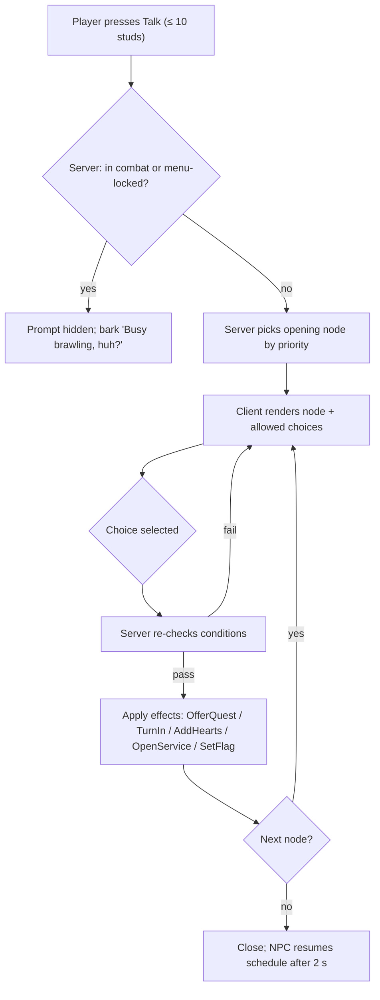

## 19. City NPCs

> Morph City's named residents are the game's living UI. They hand out quests, run shops, gossip, heckle,
> and react to what the player has done. This section covers the **NPC runtime system** (§19.1–§19.8) and the
> **NPC database** (§19.9): **115 named NPCs**, made up of canon `NPC_001`–`NPC_030` plus `NPC_031`–`NPC_115`,
> grouped by district. Quest IDs referenced here are defined in §20. Buildings, districts and events are
> canon (§C16) and are specified in §18 / §36.10 / §36.11.

### 19.1 Purpose

- Make the city feel inhabited and funny. Every named NPC has a distinct silhouette, a voice and a running joke.
- Act as the front end of every city service: shopkeepers open shop UIs, Ms. Hirewell opens hiring, Mayor
  Moosington issues permits.
- Deliver quests (§20) through markers, dialogue and turn-ins, and carry the story campaign's cast.
- Offer an optional, light **Hearts** friendship track (§19.6) that rewards curiosity with cosmetics. It
  never gates core progression.

### 19.2 Rules & Mechanics — the NPC data model

Each named NPC is a single data record (`ReplicatedStorage/Shared/Data/NPCs/<NPC_ID>.lua`, generated from
`gdd/data/npcs.jsonl`). Behavior is entirely data-driven: the runtime ships no per-NPC scripts.

```lua
--!strict
export type NPCDef = {
	id: string,                 -- "NPC_016"
	nameKey: string,            -- "npc.NPC_016.name"
	district: string,           -- "DST_07"
	building: string?,          -- "BLD_14" (nil = street NPC)
	morph: { parts: {string}, signature: {string}, scale: number }, -- MUT ids + NPC-only signature meshes
	role: "SERVICE" | "QUEST" | "AMBIENT" | "STORY" | "BOSS",
	service: string?,           -- UI screen opened by the "Shop"/"Service" option, e.g. "CriticHQ"
	schedule: {ScheduleEntry},  -- §19.5
	dialogueTree: string,       -- "dlg_NPC_016"
	questIds: {string},         -- quests offered or involving this NPC (§20)
	hearts: { enabled: boolean, favoriteCategory: string? }, -- §19.6
	voice: { blipSet: string, pitch: number },               -- gibberish "blip" voice, never real speech
	barkCooldown: number,       -- seconds, default 45 [TUNABLE]
}
```

**Morph rule.** Named NPCs are built by `MorphAssemblyService` from canon mutation parts (`MUT_` ids, §C13.6)
plus, where canon calls for something outside the catalog (a moose head, a vending-machine torso, a news-desk
body), **signature meshes**. These are NPC-only MeshParts authored to the same R15 attachment contract
(§C13.7) and the 24-MeshPart / 6,000-triangle NPC budget. Signature meshes are **never obtainable** and grant no
stats; they keep key characters unique (§25 owns the art). In §19.9 they appear in the morph column as plain
words with no ID.

**Role classes** (tagged in brackets at the start of each NPC's *Interaction behavior* cell in §19.9)

| Role class | Count | Always present? | Moves? | Notes |
|---|---|---|---|---|
| SERVICE | 18 | yes, at the counter | no (idles in place) | opens a building UI; must never be unavailable |
| STORY | 9 | yes (chapter-aware position) | scripted | campaign cast; may appear in the player's restaurant during set pieces |
| QUEST | 80 | while the district is loaded | short wander ≤ 12 studs (PATROL/RIDE NPCs: fixed loops) | gives or is involved in ≥ 1 quest |
| AMBIENT | 7 | district loaded | full schedule | color, barks, hints; still involved in ≥ 1 quest |
| BOSS | 1 | event-driven | event script | King Ratbeard during `EVT_007` (A6/A12 define the fight) |

### 19.3 Dialogue trees (conditions, variables, effects)

A dialogue tree is a graph of nodes. The client renders it. The **server** evaluates conditions and applies
effects, so a client can never pick a branch it isn't entitled to.

```lua
--!strict
export type DialogueNode = {
	id: string,                       -- "greet_day"
	speaker: string,                  -- "NPC_016" or "PLAYER"
	textKey: string,                  -- "npc.NPC_016.greet_day.01"
	conditions: {Condition}?,         -- all must pass
	effects: {Effect}?,               -- applied server-side when the node is shown
	choices: {{ textKey: string, next: string, conditions: {Condition}? }}?,
	next: string?,                    -- auto-advance when there are no choices
}
-- Condition examples:
-- {kind="QuestState", quest="QST_STY_007", state="Active"}   states: Locked|Available|Active|ReadyToTurnIn|Completed
-- {kind="LevelAtLeast", value=10}       {kind="TierAtLeast", value=3}     {kind="Hearts", npc="NPC_016", atLeast=2}
-- {kind="TimeOfDay", phase="Night"}     {kind="EventActive", event="EVT_008"}
-- {kind="HasMutationTag", tag="chef"}   {kind="Flag", name="baron_friend"}  {kind="Chance", p=0.25}
-- Effect examples:
-- {kind="OfferQuest", quest="QST_STY_007"}  {kind="TurnIn", quest="QST_STY_007"}  {kind="TalkObjective", npc="NPC_016"}
-- {kind="SetFlag", name="met_fourchette"}   {kind="AddHearts", npc="NPC_016", amount=5}  {kind="OpenService", screen="CriticHQ"}
```

**Variables** (resolved on the client from replicated state, inserted through `LocalizationTable` format
arguments, never by string concatenation): `{player}` morph nickname, `{restaurant}` restaurant name,
`{tierName}` canon tier name, `{level}`, `{stars}` reputation to one decimal, `{eventName}`, `{favDish}`
(the player's most-served recipe this week), `{hearts}`.

**Opening-line priority** (first match wins):
1. a quest is **ReadyToTurnIn** with this NPC → turn-in line (purple ? marker);
2. a story beat is pending → story line;
3. a quest is **Available** from this NPC → offer line (yellow ! marker);
4. an event in this district is active → event line;
5. Hearts ≥ 3 → friendly line (uses `{player}`);
6. a time-of-day line;
7. a random line from the NPC's pool of 6–10, never repeating any of the last 3 shown to this player.

**Barks.** These are ambient one-liners in a speech bubble when the player passes within 20 studs. Cooldown is
45 s per NPC per player. A client shows at most 2 bubbles at once, and none while the player is In Combat.
Barks react to systemic state such as "Nice Octopus Arm!" (the player has the `tentacle` tag), "Smells like
burnt toast…" (a fire in the last 60 s), or "Your reputation's up to {stars}★!", so humor comes out of play
rather than from scripts alone.



### 19.4 Interaction prompt rules

| Rule | Value [TUNABLE] |
|---|---|
| Prompt type | `ProximityPrompt` on the proxy, `RequiresLineOfSight = false`, `HoldDuration = 0` |
| Range | 10 studs (matches customers, §C3); server re-validates at 12 studs |
| Prompt selection | only the single best prompt shows: the nearest NPC inside a 60° view cone; ties go to quest markers |
| Labels | "Talk", "Shop", "Quest !", "Turn In ?", "Hire", "Permit" |
| Input | E (keyboard) · ButtonX (gamepad) · tap the prompt (mobile, 56 px minimum target) |
| Facing | NPC turns its head/torso toward the player over 0.3 s and pauses its schedule while dialogue is open |
| Auto-close | dialogue closes after 90 s idle, or if the player moves > 16 studs away |
| Combat | prompts hide while the player is In Combat (§C12.1) or targeted by a level-5 customer (E2) |
| Concurrency | any number of players can talk to the same NPC at once. Each sees their own dialogue. The NPC faces the most recent speaker |
| Rate limit | `NPC.Interact` remote: 4 calls/s per player; `NPC.Choose`: 8 calls/s; excess calls are dropped and logged (§29) |

**Quest markers** (shape plus color, so they never rely on color alone, §26.3): yellow **!** = new quest
available · purple **?** = ready to turn in · blue **↻** = daily/weekly poster · gold **★** = story quest ·
gray **…** = quest locked (tooltip gives the requirement, e.g. "Requires L20"). Markers are client-side
BillboardGuis, visible at 80 studs and on the minimap.

### 19.5 Idle schedules & behaviors

The city's cosmetic lighting cycle lasts 24 minutes (§C3), split into four phases: **Dawn** (min 0–4),
**Day** (4–14), **Dusk** (14–18) and **Night** (18–24). Each NPC has 1–4 schedule entries of
`{phase, anchor, behavior}`. Behaviors:

| Behavior | Description | Server cost |
|---|---|---|
| `STATION` | stands at a counter or desk; loops 2–3 idle animations (from §36.14, by role) | static proxy |
| `WANDER` | random waypoints within a radius (default 12 studs) on the district's waypoint graph | 4 Hz CFrame tween |
| `PATROL` | fixed waypoint loop (guards, mall walkers, couriers) | 4 Hz |
| `COMMUTE` | moves between two anchors at phase change, using the Metro platform as a door (despawn/respawn) | 4 Hz while moving |
| `PERFORM` | stage or busker loop with a crowd-cheer trigger when ≥ 3 players are nearby | static + client FX |
| `SIT` / `SLEEP` | bench, café table or hammock; snore bubbles at Night | static |
| `RIDE` | rides a Metro carriage loop (metro riders); can be talked to when the carriage is docked | rides carriage |

**Rules.** SERVICE NPCs are always `STATION` while their building's service is open, and services are open
24/7, so the schedule only changes their idle animation and barks. QUEST NPCs stay within 12 studs
of their anchor, or on a fixed PATROL/RIDE loop of ≤ 60 s drawn on the minimap while they hold a quest marker, so
quest givers stay findable. Only AMBIENT NPCs commute. During city events,
`CityEventService` may override schedules (`EventOverride`): for example, every DST_07 NPC gathers at the
Showcase Stage (`BLD_22`) during `EVT_027` Downtown Dance-Off.

### 19.6 Hearts — optional friendship (Progression · Player Interactions)

**Purpose.** Reward players who chat, help and feed the cast, with cosmetic goodies only.

| Rule | Value [TUNABLE] |
|---|---|
| Friendable NPCs | 60 (every canon NPC except `NPC_020` during `EVT_007`, plus 30 others; marked "♥ fav: CAT" in §19.9) |
| Scale | 0–5 Hearts; Heart points never decay and never go negative |
| Daily chat | +5 for the first conversation per NPC per UTC day |
| Quest | +20 when completing a quest this NPC gives; +10 when the NPC is only involved |
| Gift a dish | +15 (or +25 if it's their favorite category); 1 gift per NPC per UTC day. A gift is *virtual*: choose any recipe you have served at ≥ GOOD in the last 24 h (server-tracked list). It costs nothing and consumes nothing |
| Event together | +10 when you complete an event in which this NPC appears |
| Thresholds | 1♥ 20 · 2♥ 60 · 3♥ 120 · 4♥ 200 · 5♥ 300 points |

| Heart | Reward (canon C17.4 vocabulary only) |
|---|---|
| 1♥ | new dialogue pool; NPC uses your nickname; favorite category revealed |
| 2♥ | an emote themed on the NPC (plain-text cosmetic, e.g. "Monocle Pop") |
| 3♥ | a cosmetic color palette themed on the NPC |
| 4♥ | 10 × T MS (T = your current tier at the moment of unlock) |
| 5♥ | title "<NPC name>'s Best Friend" + 1 Morph Capsule |

**UI.** A heart row sits under the NPC's name in the dialogue header. The Quest Journal's "Friends of Morph City" tab lists
every friendable NPC met so far, their favorite (once revealed) and the next reward. **Pacing:** 5♥ takes about 10–14 days
of daily chat + gift, and the 60 one-time 5♥ capsules sit outside the capsule pity economy (§C4.7). Hearts never unlock
stats, recipes, mutations or services.

### 19.7 Roblox Implementation — SPCV placement, streaming, performance

- **Pattern:** Server Proxy + Client Visual (§C3). For each named NPC the server owns one anchored,
  invisible, non-colliding proxy `Part` (2 × 5 × 2 studs) under `Workspace/City/NPCProxies/<DST>`. Its
  attributes are `NpcId`, `State`, `Facing` and `Anim`, plus the `ProximityPrompt`.
  `MorphAssemblyService` (client builder) builds the visual locally when the proxy streams in
  (`StreamingEnabled`, `ModelStreamingMode = Atomic` for the visual container). Beyond 60 studs it swaps to the
  1,500-triangle impostor and destroys the visual at 150 studs.
- **Spawning:** SERVICE and STORY proxies always exist (static, cheap). QUEST and AMBIENT proxies exist
  only for districts with ≥ 1 player inside, plus a 30 s linger after the last player leaves.
- **Budgets [TUNABLE]:** ≤ 115 named-NPC proxies per server (separate from the 160 customer-proxy cap);
  ≤ 14 per district; ≤ 20 moving proxies per district at once; client visual cap 25 named NPCs (nearest
  first). City crowds stay client-only cosmetic (§C3).
- **Movement:** server tweens proxy CFrames along precomputed district waypoint graphs at 4 Hz, and clients
  interpolate. Named NPCs never use runtime `PathfindingService`. If a waypoint is blocked > 3 s, the NPC
  waits, then "poofs" to the next node (cartoon puff, "Pardon my morph!").
- **Services:** an `NPCService` module inside `QuestService`'s domain (§27 may host it as a submodule of
  `QuestService`) owns proxies, schedules and dialogue evaluation. Remotes: `NPC.Interact(npcId)`,
  `NPC.Choose(npcId, nodeId, choiceIndex)`, `NPC.Gift(npcId, recipeId)`. Server→client: `NPC.Dialogue(node)`,
  `NPC.Bark(npcId, key)`.
- **Persistence (§28):** `profile.npc = { hearts = {[npcId] = points}, lastChatDay = {[npcId] = dayIndex},
  lastGiftDay = {...}, flags = {...} }`. Days are UTC day indices computed from server `os.time()`.

### 19.8 Localization-ready dialogue keys

- Every visible string has a key: `npc.<NPC_ID>.name`, `npc.<NPC_ID>.<nodeId>.<nn>`, `npc.<NPC_ID>.bark.<nn>`,
  `npc.<NPC_ID>.role`. Example: `npc.NPC_025.bark.03` = "Back in my day, burgers had ONE patty and we LIKED it."
- English source lines are ≤ 90 characters, leaving about 30 % room for expansion. Placeholders use named
  arguments (`{player}`). Plurals use separate keys (`.one` / `.other`). Jokes that depend on English
  wordplay carry a `context` column note for translators ("pun on 'fork'; free to replace with a local food
  pun").
- Strings ship in a single `LocalizationTable` per domain (`NPC`, `Quest`). The voice is gibberish blips
  (never recorded speech), so localization never needs re-recording.
- Text passes through `TextService:FilterStringAsync` only when it contains player-authored content
  (`{player}` nickname, `{restaurant}`).

### 19.9 NPC database (115 named NPCs)

Column notes: **Morph** lists canon mutation parts by ID plus a short description. Unlisted words are
NPC-only signature meshes (§19.2). **Quest possibilities** is generated from §20: quests this NPC gives or is
involved in. **Interaction behavior** gives the behavior class (§19.5), what the prompt opens, and
"♥ fav: CAT" for friendable NPCs (favorite recipe category code, §C10).

#### 19.9.1 Restaurant Row (`DST_01`) — 13 NPCs

| ID | Name | Morph combination | Personality | Location | Role | Dialogue | Quest possibilities | Interaction behavior |
|---|---|---|---|---|---|---|---|---|
| `NPC_001` | **Nana Gristle** | Tortoise head + toaster torso + MUT_171 Oven Mitt Hands; appears as a flickering hologram on your menu board | Cranky, sentimental, allergic to compliments | `DST_01` · `BLD_17` (your shack's menu board) | Tutorial mentor; your great-aunt who left you the shack (now on a permanent retirement cruise) | “I'm on a retirement cruise, sweetie, not on vacation from judging you.” / “Back in my day we didn't have mutations. We had MOODS.” / “That patty is raw. I can hear it mooing through the hologram.” | QST_CHF_015, QST_RST_002, QST_STY_002, QST_STY_029, QST_STY_033, QST_TUT_001, QST_TUT_002, QST_TUT_003, QST_TUT_004, QST_TUT_005, QST_TUT_006, QST_TUT_007, QST_TUT_008, QST_TUT_009, QST_TUT_012 | [STORY] Client-local hologram inside each player's own restaurant; opens tutorial hints & story recap; ♥ fav: SAN |
| `NPC_003` | **Baron Von Bistro** | MUT_011 Shark Head + MUT_219 Peacock Tail + monocle; velvet waistcoat | Snooty, theatrical, secretly lonely | `DST_01` (Le Fancy Fin, end of the Row) | Comedic rival restaurateur and story antagonist; runs Le Fancy Fin | “Your shack has charm. The charm of a damp sock.” / “I'll buy it for three Morph Bucks and a coupon. Final offer. Fine — two coupons.” / “(after Ch. 9) Hmph. Your grilled cheese is… adequate. Make me another.” | QST_STY_001, QST_STY_003, QST_STY_004, QST_STY_008, QST_STY_009, QST_STY_024, QST_STY_027, QST_STY_028, QST_STY_029, QST_STY_032 | [STORY] STATION at Le Fancy Fin door; struts the Row at Dusk; position is chapter-aware; ♥ fav: SEA (friendable after QST_STY_029) |
| `NPC_006` | **Bolt Butterworth** | Beaver head (MUT_060 Beaver Teeth) + forklift legs + MUT_218 Beaver Tail | Chipper, pun-happy, measures everything twice | `DST_01` · `BLD_03` | Restaurant Supplies clerk (stations, ingredients, special stock) | “Need a grill? I've got grills that'll grill your grill.” / “Special stock's fresh today. Fresh-ish. Glowing is normal.” | QST_RST_001, QST_TUT_011 | [SERVICE] STATION at counter; opens Restaurant Supplies; slaps tail on the counter at each sale; ♥ fav: BRG |
| `NPC_012` | **Pinboard Pete** | MUT_004 Pigeon Head + corkboard torso covered in pinned notices | Frantic, helpful, loses pins constantly | `DST_01` · `BLD_10` | Job Board keeper (daily & weekly quest board, rerolls) | “New jobs! Hot off the board! Literally — someone pinned a pizza.” / “Reroll? Sure! Un-pin, re-pin… ow. Pinned myself.” | QST_DLY_001, QST_WKY_001 | [SERVICE] STATION at the Job Board; opens Daily/Weekly board; pecks at notices; ♥ fav: BRK |
| `NPC_028` | **Sous-Chef Sniffles** | MUT_006 Rat Head + mop arm (right) + MUT_139 Plain Human Arm (left); oversized chef hat | Nervous, sneezy, good-hearted underneath | `DST_01` (alley behind Le Fancy Fin) | Baron's sidekick; redeemable (switches sides in Ch. 8) | “The Baron says I can't say your food smells good. …It smells good.” / “A-CHOO! Allergic to pepper. I work in a kitchen. Life is hard.” / “(after Ch. 8) Need a mop? I AM a mop. Partly.” | QST_STY_001, QST_STY_003, QST_STY_009, QST_STY_025 | [STORY] WANDER behind Le Fancy Fin; hides behind bins when the Baron yells; ♥ fav: SOP |
| `NPC_031` | **Fizzwick Pompadour** | MUT_111 Flamingo Neck + MUT_125 Penguin Body + MUT_047 Mustache of Destiny | Snooty maître d', sniffs at everything | `DST_01` (Le Fancy Fin podium) | Rival restaurant staff: Le Fancy Fin maître d' | “Reservations are booked until the end of time. Try again Tuesday.” / “Your menu has… pictures. How quaint.” | QST_RST_013, QST_STY_004 | [QUEST] STATION at podium; looks down his flamingo neck at passers-by |
| `NPC_032` | **Truffle Trufflington** | MUT_058 Truffle Pig Super-Snout + MUT_002 Cat Head + MUT_156 Spatula Arm | Prim pastry perfectionist, privately impressed by you | `DST_01` (Le Fancy Fin back door) | Rival restaurant staff: Le Fancy Fin head pastry chef | “I sniffed your dessert from across the street. It is… not a crime.” / “A soufflé is like a reputation: rises slowly, collapses instantly.” | QST_STY_018, QST_WKY_003 | [QUEST] WANDER back alley; sniffs toward your plot at Dusk; ♥ fav: DES |
| `NPC_033` | **Busboy Bix** | MUT_042 Bandit Raccoon Mask + MUT_204 Roller Skates + MUT_212 Dog Tail | Hyper, honest to a fault, snack thief | `DST_01` (Restaurant Row sidewalk) | Rival restaurant staff: Le Fancy Fin busser (sneaks your fries) | “Le Fancy Fin fries are cut with a laser. Yours are cut with LOVE. And a knife.” / “I'm on break. I'm always on break. Don't tell Fizzwick.” | QST_DLY_016, QST_STY_004 | [QUEST] PATROL the Row on skates; bonks a lamppost at Night (comedy loop); ♥ fav: FRI |
| `NPC_034` | **Greta Griddlebottom** | MUT_120 Cow Body + MUT_013 Deer Head + MUT_171 Oven Mitt Hands | Warm, competitive neighbor, co-op fanatic | `DST_01` ('Dog Days' cart on the Row) | Street-food neighbor; co-op cooking champion | “Neighbor! Borrow a cup of ketchup? I'll trade a cup of mustard.” / “Cooking's better with friends. And worse with the Baron.” | QST_WKY_013 | [QUEST] STATION at cart; serves pretend hot dogs to crowd NPCs; ♥ fav: SAN |
| `NPC_035` | **Gus the Plot Surveyor** | MUT_015 Giraffe Head + MUT_110 Giraffe Neck + MUT_187 Robot Leg ×2 (tripod stance) | Precise, geometry-obsessed, deadpan | `DST_01` · `BLD_17` (between plots) | City plot surveyor; measures façades for tier upgrades | “Your façade is 0.3 studs off-center. I've lost sleep.” / “A circle is just a square that gave up.” | QST_CHF_002, QST_RST_003 | [QUEST] WANDER between plots with a theodolite; measures players who stand still |
| `NPC_036` | **Spork** | MUT_185 Spider Leg Cluster ×2 + toolbox-shaped MUT_022 Robot Head + MUT_173 Whisk Fingers | Eager apprentice, overcommits to everything | `DST_01` · `BLD_03` | Restaurant Supplies assistant (deliveries, repair tips) | “Boss says I'm half spoon, half fork, all enthusiasm!” / “I can carry six crates! …Five. Four. Help.” | QST_RPR_001 | [QUEST] WANDER aisles stacking crates; drops one every 5 min (comedy SFX) |
| `NPC_037` | **Tackatha** | MUT_063 Toucan Beak + MUT_085 Bunny Ears + MUT_232 Butterfly Wings | Bubbly, gossip-adjacent, speed-reader | `DST_01` · `BLD_10` | Job Board assistant; Pete's niece (posts dailies) | “Uncle Pete pinned himself again. I've got the board!” / “Fresh daily! Smells like burgers and ambition.” | QST_DLY_002 | [QUEST] STATION beside the board; pins new posters at 00:00 UTC with a fanfare; ♥ fav: DRK |
| `NPC_038` | **Lumpy the Line-Waiter** | MUT_001 Bear Head + MUT_259 Bear Fur + MUT_198 Rocket Booster Leg ×2 (never used) | Sleepy, philosophical professional queue-stander | `DST_01` (outside the busiest restaurant on the server) | Professional line-waiter | “I've waited in every line in Morph City. Yours is… adequate.” / “Rocket legs. Never used 'em. Waiting is an art.” | QST_DLY_018 | [AMBIENT] SIT on the sidewalk outside the busiest plot (street only, never a customer, never blocks the door) |

#### 19.9.2 Mutation Market (`DST_02`) — 12 NPCs

| ID | Name | Morph combination | Personality | Location | Role | Dialogue | Quest possibilities | Interaction behavior |
|---|---|---|---|---|---|---|---|---|
| `NPC_004` | **Mutty McMutface** | Chameleon head (MUT_077 Chameleon Eyes, MUT_255 Chameleon Skin) + vending-machine torso | Salesy, color-shifts with mood | `DST_02` · `BLD_01` | Mutation Mart shopkeeper | “Welcome to Mutation Mart! Today's special: arms. So many arms.” / “Buy, then try, then cry with joy!” | QST_TUT_010 | [SERVICE] STATION behind the vending torso; opens Mutation Mart; dispenses a capsule-shaped receipt; ♥ fav: ALN |
| `NPC_005` | **Glamtrax** | MUT_111 Flamingo Neck + MUT_123 Robot Body + MUT_272 Sparkle Aura | Fabulous, dramatic, brutally honest stylist | `DST_02` · `BLD_02` | Body Mods stylist (colors, palettes, looks) | “Darling, your colors are screaming. Let's make them sing.” / “Pink neck, chrome body, zero regrets.” | QST_RST_012 | [SERVICE] STATION at the mirror; opens Body Mods; strikes a pose at every compliment; ♥ fav: DRK |
| `NPC_023` | **Farmer Fungus** | MUT_248 Mushroom Cap + MUT_120 Cow Body + MUT_177 Leaf Hands | Laid-back, spore-tastic, speaks slowly | `DST_02` · `BLD_20` | Weird produce vendor (special crates: moon cheese, lava peppers) | “These lava peppers? Grown with love. And a volcano.” / “Moon cheese ain't from the moon. It's from a guy. The guy's from the moon.” | QST_STY_016 | [SERVICE] STATION at the stand; opens Weird Produce; sneezes a puff of glitter spores hourly; ♥ fav: SAL |
| `NPC_039` | **Cappy Capsule** | MUT_123 Robot Body + MUT_071 Googly Eyes + MUT_103 Antenna Bobbles; gumball-dome head | Bouncy, rule-loving, transparent about odds | `DST_02` · `BLD_01` | Mutation Mart assistant; explains capsule odds, pity counter and upgrades | “Capsule odds are posted right here! Common 55 percent! I love math!” / “Forty capsules without an Epic? The pity counter has your back!” | QST_TUT_010, QST_WKY_009 | [QUEST] STATION by the odds board; opens Capsule Odds & Upgrade help; ♥ fav: DES |
| `NPC_040` | **Snipsy Shearwater** | MUT_144 Crab Claw Arm ×2 (salon scissors) + MUT_009 Fish Head + MUT_046 Fish Gill Cheeks | Chatty hairdresser, snips the air when nervous | `DST_02` · `BLD_02` | Body Mods assistant (equip previews, color trials) | “Snip snip! Sorry, habit. Claws.” / “New look, who dis? You, darling. It's you.” | QST_EXP_014 | [QUEST] WANDER salon chairs snipping the air |
| `NPC_041` | **Auntie Okra** | MUT_093 Leaf Ears + MUT_209 Root Feet + MUT_117 Plain Human Torso | Folksy pickle evangelist; Farmer Fungus's rival | `DST_02` (pickle stall beside BLD_20) | Pickle & 'suspicious vegetable' vendor | “A pickle a day keeps the Karenosaurus away.” / “Fungus sells moon cheese. I sell TRUTH. In brine.” | QST_CHF_001, QST_STY_016 | [QUEST] STATION at stall; trades scripted barks with Farmer Fungus at Dusk; ♥ fav: BRG |
| `NPC_042` | **Haggle Hank** | MUT_007 Goat Head + MUT_097 Goat Horns + MUT_199 Goat Hoof Leg ×2 | Cheapskate who haggles with vending machines | `DST_02` (market plaza) | Professional haggler; money-making tips | “Five MB? I'll give you four and a compliment.” / “I haggled a lamppost down to half price. Still a lamppost.” | QST_DLY_006 | [QUEST] WANDER plaza; tries to haggle with Mutty (bark exchange) |
| `NPC_043` | **Mira-Bel** | MUT_021 TV Head (screen shows compliments) + MUT_232 Butterfly Wings + MUT_202 Bunny Slippers | Relentlessly positive compliment machine | `DST_02` (outside BLD_02) | Hype-mutant; cheers on players' morphs | “Your morph is a 10! My screen only goes to 9!” / “Chef's kiss! Literally — my screen shows lips now.” | QST_DLY_007 | [QUEST] STATION at the Body Mods window; screen shows the nearest player's rarest part name; ♥ fav: DES |
| `NPC_044` | **Professor Pocketlint** | MUT_247 Camel Humps + MUT_074 Owl Eyes + MUT_217 Monkey Tail | Know-it-all trivia host, pockets full of facts | `DST_02` (quiz kiosk) | Mutation trivia quizmaster; teaches employee job-fit | “Pop quiz! Better waiter: cheetah legs or a fridge body? …Legs. Always legs.” / “My humps store water. And trivia.” | QST_EMP_002 | [QUEST] STATION at kiosk; daily 3-question quiz (barks only; Hearts only reward) |
| `NPC_045` | **Sprinkles McGee** | MUT_080 Gummy Bear Eyes + MUT_085 Bunny Ears + MUT_161 Tiny T-Rex Arm ×2 | Sugar-rushed kid who wants everything rainbow | `DST_02` (candy corner) | Kid; pizza-party enthusiast | “Can pizza be a rainbow? Can a rainbow be pizza? WHY NOT BOTH?” / “My arms are tiny but my appetite is HUGE!” | QST_DLY_022 | [QUEST] WANDER candy corner; hops whenever a player emotes; ♥ fav: PIZ |
| `NPC_046` | **Barnaby Bargainbin** | MUT_050 Pig Snout + MUT_192 Unicycle Wheel Leg + MUT_213 Pig Curly Tail; shopping-cart torso | Upbeat hustler, terrible at math | `DST_02` (clearance cart) | Clearance-cart vendor (flavor only, sells nothing) | “Everything must go! Including me — I'm late for lunch.” / “This cart is 100 percent off! Because it's empty.” | QST_WKY_008 | [QUEST] PATROL market loop on one wheel; wobbles into stalls |
| `NPC_047` | **Yolanda Yolk** | MUT_008 Chicken Head + MUT_121 Chicken Body + MUT_180 Chicken Leg ×2 | Motherly worrier, egg-obsessed | `DST_02` (egg stall) | Egg vendor; breakfast challenge giver | “Gently! These eggs have feelings. Mostly scrambled.” / “Sunny side up means SMILING side up, dear.” | QST_CHF_003 | [QUEST] STATION at stall; clucks in alarm when a player sprints past; ♥ fav: BRK |

#### 19.9.3 Downtown Morph City (`DST_03`) — 17 NPCs

| ID | Name | Morph combination | Personality | Location | Role | Dialogue | Quest possibilities | Interaction behavior |
|---|---|---|---|---|---|---|---|---|
| `NPC_002` | **Mayor Moosington** | Moose head + MUT_125 Penguin Body + mayoral sash | Pompous ribbon-cutting addict, fair underneath | `DST_03` · `BLD_09` | Mayor; issues City Hall Expansion Permits | “By the antlers vested in me, I declare this permit… pending.” / “I've cut 400 ribbons this year. I may have a problem.” | QST_RST_004, QST_RST_005, QST_RST_006, QST_RST_007, QST_RST_008, QST_RST_009, QST_RST_010, QST_STY_013, QST_STY_027 | [SERVICE] STATION at City Hall desk; opens Permits; carries giant scissors at ceremonies; ♥ fav: SOP |
| `NPC_007` | **Ms. Hirewell** | MUT_016 Owl Head + MUT_074 Owl Eyes + filing-cabinet torso | Organized, unflappable; rotates head 270° when surprised | `DST_03` · `BLD_04` | Recruitment officer (hiring, rosters, training) | “Every mutant deserves a job. That octopus deserves eight.” / “Résumé says 'can juggle plates.' References say 'mostly.'” | QST_EMP_001, QST_EMP_003, QST_EMP_005, QST_STY_024, QST_TUT_012 | [SERVICE] STATION at desk; opens Recruitment; a drawer pops open with each hire; ♥ fav: DRK |
| `NPC_009` | **Professor Saucington** | MUT_029 Octopus Head + tweed torso + MUT_145 Octopus Arm ×2 | Absent-minded, joyful; lectures with all arms | `DST_03` · `BLD_06` | Cooking Academy dean (recipe learning, Alien Cuisine course) | “Today's lesson: the grill is hot. Tomorrow's lesson: the grill is STILL hot.” / “Eight arms, eight whisks, zero patience for soggy fries.” | QST_CHF_011, QST_STY_017 | [SERVICE] STATION at lectern; opens Cooking Academy; chalks with three arms at once; ♥ fav: PST |
| `NPC_019` | **Conductor Choo** | Centipede body + train-engine head with smokestack hat | Punctual to the nanosecond; choo-choo puns | `DST_03` · `BLD_18` | Morph Metro conductor (fast travel, station discovery) | “All aboard! Mind the gap. Mind the legs. I have many.” / “Next stop: everywhere you've already been!” | QST_EXP_001 | [SERVICE] STATION on the Central platform; opens Metro map; toots at each real-time minute :00 (SFX slider); ♥ fav: BRK |
| `NPC_022` | **Inspector Grimewell** | Mole head (MUT_054 Star-Nosed Mole Nose) + clipboard hands; trench coat | Stern squinter who secretly loves tidy kitchens | `DST_03` (Downtown streets; visits restaurants during inspections) | Health inspector (inspection story beats, EVT_026) | “I can smell a crumb from forty studs. Forty-one if it's a big crumb.” / “Clean kitchen, clean conscience. Clipboard says so.” / “That's a spill. That's a spill. That's… art? No. A spill.” | QST_RST_005, QST_STY_003, QST_STY_021 | [STORY] PATROL Downtown; enters player restaurants only during his quests and EVT_026; ♥ fav: SAL |
| `NPC_026` | **Sergeant Rhonda** | MUT_099 Rhino Horn + traffic-cone body + MUT_189 Elephant Leg ×2 | Gruff, protective, whistle-happy | `DST_03` (Downtown plaza checkpoint) | City security chief (combat tips, event defense) | “Halt! …Oh, you're just hungry. Carry on.” / “Tray up, knees bent, Calm Down! ready. The Rhonda Method.” | QST_CBT_002, QST_RST_008, QST_STY_011, QST_STY_019, QST_WKY_004 | [QUEST] PATROL Downtown plaza; whistles at sprinting players (cosmetic); ♥ fav: BRG |
| `NPC_030` | **Anchor Andy** | Anglerfish head with glowing lure + news-desk torso | Dramatic newscaster; everything is BREAKING | `DST_03` (jumbotron studio) | City news anchor (event announcements) | “BREAKING: Local chef makes burger. More at eleven.” / “This just in: it's raining pickles. Again.” | QST_STY_019, QST_STY_026, QST_WKY_006 | [QUEST] STATION at news desk; jumbotron shows live event countdowns; ♥ fav: SEA |
| `NPC_048` | **Clerk Stampwell** | MUT_145 Octopus Arm ×2 (a stamp in each sucker) + MUT_109 Turtle Neck + MUT_244 Turtle Backpack Shell | Slow, meticulous bureaucrat who loves forms | `DST_03` · `BLD_09` | City Hall permit clerk (stamps permits, Citizen Passport) | “Form 27-Moose? Triplicate. Quadruplicate if you're a hydra.” / “Stamp. Stamp. Stamp. Ahh. Best sound in the world.” | QST_EXP_004, QST_RST_004, QST_RST_005, QST_RST_006, QST_RST_007, QST_RST_008, QST_RST_009, QST_RST_010, QST_STY_013 | [QUEST] STATION at side desk; stamps the air in rhythm |
| `NPC_049` | **Paige Turner** | MUT_090 Fox Ears + MUT_226 Fluffy Fox Tail + MUT_117 Plain Human Torso; clipboard | Overworked, efficient, runs on coffee | `DST_03` · `BLD_09` | Mayor's assistant (emergencies, event coordination) | “The Mayor is cutting a ribbon. Again. How can I help?” / “Invasion at three, dance-off at four, lunch never.” | QST_CBT_007, QST_RST_006 | [QUEST] WANDER City Hall lobby at a speed-walk |
| `NPC_050` | **TA Basilica Basil** | MUT_030 Broccoli Head + MUT_167 Whisk Arm + MUT_139 Plain Human Arm | Earnest teaching assistant who grades everything | `DST_03` · `BLD_06` | Cooking Academy teaching assistant (Perfect-timing drills) | “A-plus for effort! C-minus for the smoke.” / “The Perfect window is green. Like me. Coincidence? Yes.” | QST_DLY_003 | [QUEST] WANDER Academy practice stations |
| `NPC_051` | **Gary the Applicant** | MUT_005 Frog Head + MUT_117 Plain Human Torso + MUT_142 Frog Arm ×2; clutching a résumé | Hopeful, endlessly cheerful, perpetually unhired | `DST_03` · `BLD_04` (waiting chair) | Eternal job applicant; shift-supervision tips | “Applying for chef! And waiter! And mop!” / “Interview number 47 today. Feeling lucky! Feeling… damp.” | QST_DLY_014 | [QUEST] SIT in the waiting chair; leaps up when anyone hires ('Was it me?') |
| `NPC_052` | **Commuter Carl** | MUT_186 Cheetah Leg ×2 + MUT_012 Wolf Head + briefcase | Frazzled; always late despite cheetah legs | `DST_03` · `BLD_18` (Metro carriages) | Metro rider; speed-cooking challenge giver | “Cheetah legs, and I STILL miss the train.” / “Breakfast in four minutes or I'm doomed!” | QST_CHF_004, QST_EXP_001 | [QUEST] RIDE the Metro loop; talkable when his carriage docks at Central; sprints platforms at Dawn |
| `NPC_053` | **Snapshot Sally** | MUT_073 Fly Compound Eyes + MUT_125 Penguin Body + MUT_210 Moon Boots; floral shirt | Camera-crazy tourist, thrilled by everything | `DST_03` (Downtown fountain) | Tourist; sightseeing dailies | “Smile! Now from 2,000 eye angles!” / “Is that a REAL mutant? Oh, they're all real. Wow!” | QST_DLY_015 | [QUEST] WANDER landmarks photographing players (soft flash; off with reduced FX); ♥ fav: DES |
| `NPC_054` | **Silent Simone** | MUT_026 Mantis Head + MUT_151 Mantis Scythe Arm ×2 (pantomime only) + striped torso | Mime; speaks only in gestures | `DST_03` (street corner by BLD_06) | Street mime; teaches Mime Mantis orders | “(mimes being trapped in an invisible soup bowl)” / “(points at you, then a burger, then gives two thumbs up)” | QST_DLY_023 | [QUEST] PERFORM on the corner; crowd-cheer when 3+ players watch; ♥ fav: DES |
| `NPC_055` | **Newsie Nibbles** | MUT_087 Mouse Ears + MUT_049 Rat Nose + MUT_191 Pogo Stick Leg; newsboy cap | Loud kid headline-shouter | `DST_03` (street corners) | Newspaper kid; headline hints | “EXTRA! EXTRA! Spaghetti tornado spotted downtown!” / “Read all about it! Baron loses argument with a pigeon!” | QST_CHF_007 | [QUEST] PATROL corners on a pogo stick; headlines react to live events |
| `NPC_056` | **Officer Biscuit** | MUT_003 Dog Head + MUT_212 Dog Tail + MUT_117 Plain Human Torso; whistle | Overeager rookie, tail always wagging | `DST_03` (Downtown plaza) | Rookie security officer (de-escalation dailies) | “Sergeant Rhonda says I'm a good boy. Officer! Good OFFICER!” / “Calm Down! works on customers. Not on squirrels. I tried.” | QST_DLY_004 | [QUEST] PATROL a few steps behind Sergeant Rhonda |
| `NPC_057` | **Fountain Fran** | MUT_119 Fish Body + MUT_183 Fish Tail Hopper ×2 + MUT_091 Fin Ears | Dreamy coin-diver who believes in wishes | `DST_03` (Downtown fountain) | Fountain dweller; wishes and landmark hints | “Every coin's a wish. Mostly wishes for fries.” / “Something once fell off City Hall's roof and landed right… here. Spooky.” | QST_EXP_013 | [QUEST] SIT in the fountain; dives for coins at Night; ♥ fav: SEA |

#### 19.9.4 Industrial District (`DST_04`) — 10 NPCs

| ID | Name | Morph combination | Personality | Location | Role | Dialogue | Quest possibilities | Interaction behavior |
|---|---|---|---|---|---|---|---|---|
| `NPC_010` | **Wrenchy** | MUT_185 Spider Leg Cluster ×2 + MUT_022 Robot Head + MUT_153 Wrench Claw Arm | Grumbly perfectionist, secretly soft | `DST_04` · `BLD_07` | Repair Workshop mechanic (repair skills, tools) | “Broken? Good. Broken means business.” / “Eight legs, one wrench, zero excuses.” | QST_RPR_003, QST_RPR_009, QST_WKY_005 | [SERVICE] STATION at workbench; opens Repair Workshop; climbs walls while idle; ♥ fav: BRG |
| `NPC_017` | **Dispatch Dot** | Snail head + rocket boots + MUT_123 Robot Body | Speed-obsessed boss, cheerfully ironic about being a snail | `DST_04` · `BLD_15` | Delivery Depot boss (delivery missions) | “I'm a snail in rocket boots. Speed is a STATE OF MIND.” / “Hot food delivered hot. Cold food delivered… also hot. Sorry.” | QST_STY_005, QST_STY_026, QST_WKY_007 | [SERVICE] STATION at dispatch desk; opens Delivery missions; zooms two studs, stops, repeats; ♥ fav: TAC |
| `NPC_058` | **Rivet Rosie** | MUT_153 Wrench Claw Arm + MUT_174 Wrench Fingers + MUT_246 Hermit Crab Shell | Can-do apprentice who whistles while welding | `DST_04` · `BLD_07` | Repair Workshop apprentice (daily repair jobs) | “We can fix it! Probably! Maybe twice!” / “My shell holds 40 screws and one sandwich.” | QST_DLY_005, QST_RPR_003 | [QUEST] WANDER workshop benches |
| `NPC_059` | **Zoomie Zara** | MUT_198 Rocket Booster Leg ×2 + MUT_126 Bee Body + MUT_236 Bee Wings | Hyperactive courier who talks at double speed | `DST_04` · `BLD_15` (loading dock) | Star courier (delivery tips) | “Delivered-it-before-you-ordered-it, that's my motto!” / “Buzz buzz, gotta zoom, soup's getting cold!” | QST_DLY_010, QST_STY_005 | [QUEST] PATROL loading dock to Downtown loop; ♥ fav: TAC |
| `NPC_060` | **Forklift Fernando** | MUT_053 Elephant Trunk + MUT_088 Elephant Ears + MUT_187 Robot Leg ×2 (forklift prongs) | Gentle giant who never forgets a chair | `DST_04` (warehouse yard) | Warehouse worker; furniture-rescue challenges | “I never forget. Especially chairs. I miss them all.” / “Lift with your legs. Or your trunk.” | QST_RPR_004 | [QUEST] PATROL warehouse yard lifting crates |
| `NPC_061` | **Dr. Kablooey** | MUT_036 Microwave Head + MUT_249 Extra Arm Backpack + MUT_123 Robot Body | Manic inventor whose inventions end in confetti | `DST_04` (garage lab) | Inventor; station-upgrade challenges | “Behold: the Self-Flipping Grill! (confetti) …Version two!” / “Microwave head? DING! New idea!” | QST_RST_011 | [QUEST] STATION at garage; harmless confetti 'explosion' every 3 min (reduced-FX safe); ♥ fav: FRI |
| `NPC_062` | **Smokestack Stan** | MUT_001 Bear Head + MUT_118 Bear Body + MUT_250 Fire Extinguisher Tank; hard hat | Safety-obsessed foreman | `DST_04` (factory gate) | Factory foreman (repair emergencies) | “Safety first! Second! Also third!” / “Grill fire? Extinguish it, then apologize to the grill.” | QST_RPR_005 | [QUEST] PATROL factory gate; mists harmless spray at cosmetic sparks |
| `NPC_063` | **Kate Crate** | MUT_024 Gorilla Head + MUT_148 Gorilla Arm ×2 + cardboard-box helmet | Strong, blunt, fond of rubble | `DST_04` · `BLD_15` (crate stacks) | Crate stacker; rebuild challenges | “Rubble's just furniture taking a break.” / “I stack crates. Crates stack me. It's a relationship.” | QST_RPR_002 | [QUEST] STATION at crate stack; restacks fallen crates |
| `NPC_064` | **Sir Squeaks-a-Lot** | MUT_022 Robot Head + MUT_192 Unicycle Wheel Leg + MUT_155 Magnet Hand Arm | Excessively polite robot who squeaks every step | `DST_04` (Industrial roads) | Oil-can courier robot; ally during EVT_017 | “Pardon me. Excuse me. Terribly sorry. Squeak.” / “My fellow robots are rising up. Politely. Please calm them gently.” | QST_CBT_011 | [QUEST] PATROL roads; bows to every player; ♥ fav: DRK |
| `NPC_065` | **Mildred Mopsworth** | MUT_066 Vacuum Mouth + MUT_260 Sheep Wool + MUT_202 Bunny Slippers; reading glasses | Retired cleaner; sweet but spotless standards | `DST_04` · `BLD_15` (Lost & Found window) | Retiree; Lost & Found keeper; cleanliness challenges | “Back in my day we cleaned with our mouths. Vacuum mouths. Different times.” / “Pristine, dear. Not 'pretty clean'. PRISTINE.” | QST_RPR_006 | [QUEST] SIT at Lost & Found; hoovers crumbs off players who linger; ♥ fav: DES |

#### 19.9.5 Monster Mall (`DST_05`) — 9 NPCs

| ID | Name | Morph combination | Personality | Location | Role | Dialogue | Quest possibilities | Interaction behavior |
|---|---|---|---|---|---|---|---|---|
| `NPC_014` | **Mallory Megamall** | MUT_219 Peacock Tail + escalator legs + MUT_117 Plain Human Torso; power blazer | Ambitious, trend-obsessed, loves foot traffic | `DST_05` · `BLD_12` | Monster Mall manager (cosmetics & decorations) | “Foot traffic! I love feet. And traffic.” / “Everything's on sale! Not really. But it FEELS like it.” | QST_RST_007, QST_STY_018 | [SERVICE] STATION at atrium kiosk; opens Monster Mall; ♥ fav: DES |
| `NPC_066` | **Mall Cop Mallomar** | MUT_009 Fish Head + MUT_129 Pufferfish Body + MUT_204 Roller Skates; tiny hat | Jumpy guard who puffs up when startled | `DST_05` · `BLD_12` | Mall security (bouncer dailies) | “Halt! Oh no, I'm puffing. Give me a second.” / “No running in the mall! Roller skating is fine.” | QST_DLY_013 | [QUEST] PATROL concourse; puffs up when a player jumps beside him |
| `NPC_067` | **Speedwalk Gladys** | MUT_013 Deer Head + MUT_260 Sheep Wool + MUT_188 Ostrich Leg ×2; sweatband | Fiercely fit retiree mall-walker | `DST_05` · `BLD_12` | Retiree; Grandma Golem service dailies | “Ten laps before lunch! Eleven if there's pie.” / “You young mutants and your 'sprinting'. Walk with PURPOSE.” | QST_DLY_011 | [QUEST] PATROL the mall loop fast; overtakes running players; ♥ fav: DES |
| `NPC_068` | **Kiosk Kevin** | MUT_103 Antenna Bobbles + MUT_068 Megaphone Mouth + MUT_117 Plain Human Torso | Pushy but harmless salesman | `DST_05` · `BLD_12` (antenna-case kiosk) | Kiosk vendor; social & photo weeklies | “Antenna case? Protect those bobbles!” / “Photo mode is FREE. Antenna cases are not.” | QST_WKY_014 | [QUEST] STATION at kiosk; megaphone-greets anyone within 12 studs (SFX slider) |
| `NPC_069` | **Lil' Tantrum Timmy** | Oversized toddler head + MUT_161 Tiny T-Rex Arm ×2 + MUT_202 Bunny Slippers | Dramatic, adorable, extremely loud toddler | `DST_05` · `BLD_12` (toy store) | Kid; Toddler Titan service dailies | “I WANT THE BIG BURGER! …no, the small one. NO, THE BIG ONE!” / “(stomps; a tiny burst of confetti)” | QST_DLY_024 | [QUEST] WANDER toy store; harmless tantrum stomp (ANM_050) every 4 min; ♥ fav: DES |
| `NPC_070` | **Duchess Decora** | MUT_101 Unicorn Horn + MUT_241 Fairy Wings + MUT_272 Sparkle Aura | Lavish sparkle-maximalist decorator | `DST_05` · `BLD_12` (Décor Boutique) | Decoration boutique owner; parade-float quests | “More sparkle. No, MORE. There's no such thing as too much sparkle.” / “A restaurant without a chandelier is a kitchen with chairs.” | QST_EXP_007 | [QUEST] STATION in boutique; glitter puff on every purchase (reduced-FX safe) |
| `NPC_071` | **Corndog Cornelius** | Corn-dog head + MUT_143 Noodle Arm ×2 + MUT_121 Chicken Body | Competitive but fair food-court rival | `DST_05` · `BLD_12` (food court stall) | Food-court stall owner (rival vendor) | “My corn dogs are battered with SUCCESS.” / “The Baron opened a kiosk here. A KIOSK. In MY food court.” | QST_STY_018 | [QUEST] STATION at stall flipping pretend corn dogs |
| `NPC_072` | **Escalator Ed** | MUT_113 Spring Neck + MUT_208 Spring Boots + MUT_117 Plain Human Torso | Bouncy escalator enthusiast; Mallory's cousin | `DST_05` · `BLD_12` | Mall regular who rides the escalators all day | “Up! Down! Up! This is the life.” / “Cousin Mallory says I'm 'bad for business'. I'm GREAT for escalators.” | QST_EXP_004 | [AMBIENT] PATROL the escalators endlessly; bounces at the top |
| `NPC_073` | **Photobooth Phoebe** | MUT_255 Chameleon Skin + MUT_095 Headphone Ears + MUT_202 Bunny Slippers | Cool, encouraging teen; color-shifts per photo | `DST_05` · `BLD_12` (photo booth) | Photo-booth attendant; staff-morale challenges | “Say 'mutation'! …Nailed it.” / “Happy staff, happy photos. Ever done a staff photo day?” | QST_EMP_004 | [QUEST] STATION at booth; skin shifts color whenever a player emotes |

#### 19.9.6 Mutation Research District (`DST_06`) — 10 NPCs

| ID | Name | Morph combination | Personality | Location | Role | Dialogue | Quest possibilities | Interaction behavior |
|---|---|---|---|---|---|---|---|---|
| `NPC_013` | **Dr. Splice** | MUT_014 Axolotl Head + lab coat + MUT_147 Robot Arm | Enthusiastic, slightly mad, very safety-conscious | `DST_06` · `BLD_11` | Mutation Lab scientist (fusion, research) | “Fusion is like cooking, but the soup has opinions.” / “Regeneration is my hobby. Also my species.” | QST_CHF_008, QST_EXP_002 | [SERVICE] STATION at the fusion chamber; opens Mutation Lab; ♥ fav: ALN |
| `NPC_018` | **Curator Fossilbottom** | Triceratops head (MUT_104 Triceratops Frill) + grandfather-clock torso | Slow-talking lore lover; chimes on the hour | `DST_06` · `BLD_16` | Museum curator (collection log & lore) | “Every part tells a story. This one tells a LOUD story.” / “BONG. Pardon me. That was my torso.” | QST_EXP_009, QST_STY_033 | [SERVICE] STATION in the Great Hall; opens Museum collection log; chimes each real-time minute :00 (SFX slider); ♥ fav: SOP |
| `NPC_074` | **Lab Assistant Beaker** | MUT_130 Jellyfish Body + MUT_044 Robot Visor + MUT_142 Frog Arm ×2 | Nervous, very kind, jiggles when anxious | `DST_06` · `BLD_11` | Lab assistant; safety orientation | “Please don't tap the glass. I am the glass. Sort of.” / “Safety orientation step one: don't panic. Step two: I'm panicking.” | QST_CHF_008, QST_EXP_002 | [QUEST] WANDER lab benches; glows brighter when a player approaches; ♥ fav: DES |
| `NPC_075` | **Dr. Hypothesis Hoot** | MUT_114 Brachiosaurus Neck + MUT_044 Robot Visor + MUT_123 Robot Body | Contrarian theorist with wild hypotheses | `DST_06` · `BLD_11` (rival research balcony) | Rival scientist; paradox-cooking challenges | “Hypothesis: soup can be frozen AND remain soup. Prove me right!” / “My neck lets me see the big picture. Literally.” | QST_CHF_005 | [QUEST] STATION on balcony; lowers his neck into conversations |
| `NPC_076` | **Test Subject Todd** | MUT_026 Mantis Head + MUT_119 Fish Body + MUT_191 Pogo Stick Leg + MUT_179 Plain Human Leg (wobbly gait) | Unbothered volunteer guinea pig and glitch-hunter | `DST_06` (Research plaza) | Professional test subject; secret-hunting hints | “I've tried 200 mutations. Today: mantis-fish-pogo. Tomorrow? Mystery!” / “I see dead pixels everywhere. Not spooky. Techy.” | QST_EXP_002, QST_EXP_005 | [QUEST] WANDER plaza with ANM_008 wobbly gait; ♥ fav: MUT |
| `NPC_077` | **Docent Dottie** | MUT_045 Moth Fuzz Face + MUT_094 Moth Feather Antennae + MUT_233 Moth Wings | Whispery guide, distracted by lamps | `DST_06` · `BLD_16` | Museum tour guide | “(whispering) Welcome to the museum… please whisper… WHISPER.” / “This fossil is 10,000 years old. Or 10. The label fell off.” | QST_EXP_009 | [QUEST] PATROL the exhibit loop; drifts toward lights at Night |
| `NPC_078` | **Professor Quark Quibble** | MUT_092 Satellite Dish Ears + MUT_197 Cloud Leg ×2 (hovers) + MUT_279 Tiny Moons | Cosmic physicist; inventor of the Anti-Gravity Wok | `DST_06` · `BLD_11` (observatory deck) | Physicist; meteor & Infinity Pizza challenges | “Infinity is just a pizza that refuses to end.” / “Meteor shower tonight! Bring a bucket. And a soft helmet.” | QST_CHF_013, QST_EXP_006 | [QUEST] STATION on the observatory deck, floating one stud up |
| `NPC_079` | **Specimen Seven (Sevvy)** | MUT_134 Slime Body + MUT_071 Googly Eyes; lives in a big glass jar on wheels | Polite, philosophical blob who wants to see the world | `DST_06` · `BLD_11` | Sentient slime; lab lore | “Hello! I am a slime. I contain multitudes. Mostly jelly.” / “Mutation cuisine? I AM mutation cuisine. Please don't eat me.” | QST_CHF_008, QST_EXP_002 | [AMBIENT] STATION in jar; waves a pseudopod at passers-by; ♥ fav: DES |
| `NPC_080` | **Archivist Inkwell** | MUT_075 Sea Slug Eye Stalks + MUT_146 Squid Tentacle Arm ×2 + ink-stained cardigan | Meticulous record-keeper who inks when startled | `DST_06` · `BLD_16` (archive stacks) | Museum archivist (city lore, Nana's old records) | “Shh. The archive is sleeping.” / “I've filed every recipe since the city began. Some twice. By accident.” | QST_STY_033 | [AMBIENT] STATION at the shelves; ink-puff if a player jumps nearby |
| `NPC_081` | **Night Guard Nocturna** | MUT_089 Bat Ears + MUT_234 Bat Wings + MUT_117 Plain Human Torso; flashlight | Night guard who is afraid of the dark | `DST_06` · `BLD_16` | Museum night guard; night-shift employee challenges | “I'm a bat who's scared of the dark. Don't make it weird.” / “Night shift is when the real work happens. Ask your employees.” | QST_EMP_007 | [QUEST] PATROL with a flashlight cone at Night; SIT by the door at Day |

#### 19.9.7 Entertainment District (`DST_07`) — 14 NPCs

| ID | Name | Morph combination | Personality | Location | Role | Dialogue | Quest possibilities | Interaction behavior |
|---|---|---|---|---|---|---|---|---|
| `NPC_016` | **Madame Fourchette** | MUT_110 Giraffe Neck + MUT_146 Squid Tentacle Arm ×2; tiny beret | Exacting, elegant, unexpectedly kind to effort | `DST_07` · `BLD_14` | Chief food critic; holds the city's star ratings | “I taste with my neck. It gives the food time to think about what it did.” / “Three stars. Do not cry. Cry at four.” / “A perfect grilled cheese is rarer than caviar, darling.” | QST_RST_009, QST_STY_007, QST_STY_010, QST_STY_022, QST_STY_023, QST_STY_028 | [STORY] STATION in the tasting salon; opens Critic HQ rating challenges; ♥ fav: SAN |
| `NPC_021` | **Vlogzilla** | MUT_017 Lizard Head + smartphone face + MUT_215 Lizard Tail | Hype-driven influencer, insecure, ultimately genuine | `DST_07` (Entertainment streets) | Influencer celebrity | “Hey Morph-fam! Smash that like button! On your face!” / “This restaurant? Mid. Wait — this fry? ELITE.” / “Sponsored by nobody. That's my brand.” | QST_STY_008 | [STORY] WANDER streets livestreaming (soft flash; off with reduced FX); ♥ fav: DRK |
| `NPC_024` | **DJ Morphenstein** | MUT_089 Bat Ears + boombox torso + MUT_175 Boxing Gloves (worn as headphone pads) | Loud party-starter, surprisingly wise | `DST_07` · `BLD_22` | Showcase Stage host (shows, contests) | “Drop the beat! Not the plates. Never the plates.” / “Tonight: chefs, freaks, and one very confused moose.” | QST_CHF_010 | [SERVICE] PERFORM at the DJ booth; opens Showcase Stage; ♥ fav: FRI |
| `NPC_027` | **Zorp** | MUT_033 Alien Grey Head + tour-bus torso + MUT_210 Moon Boots | Cheerful alien tour guide who mistranslates idioms | `DST_07` (tour-bus stop) | Alien tour guide (Alien Cuisine, EVT_018) | “Greetings, Earth-chef! My tourists hunger for… what is 'flavor'?” / “On my planet we eat with elbows. Is rude here? Okay.” / “Hold your antennae! Tour departs when bus remembers how to bus.” | QST_STY_014, QST_STY_015, QST_STY_017 | [STORY] STATION at the bus stop; honks his horn-face at passing players; ♥ fav: ALN |
| `NPC_029` | **Chef Supreme Omnivora** | MUT_031 Dragon Head + MUT_165 Kraken Tentacle Arm ×2 + MUT_178 Golden Chef Hands | Serene legend with impossible standards; warm to the worthy | `DST_07` (Grand Culinary Pavilion) | Legendary chef; story finale & Legendary Chef Tournament host | “Every great chef begins with a burnt burger. Most stop there.” / “Cook as if for your grandmother. A very picky grandmother.” / “The tournament awaits. Bring your best… and your strangest.” | QST_CHF_012, QST_CHF_014, QST_STY_030, QST_STY_031, QST_STY_032 | [STORY] STATION in the pavilion (visible from L45, talkable from L65); ♥ fav: LEG |
| `NPC_082` | **Critic Crumbsworth** | MUT_055 Anteater Snoot + MUT_117 Plain Human Torso; tweed jacket | Eager junior critic who sniffs every crumb | `DST_07` · `BLD_14` | Junior food critic (critic dailies) | “Sniff. Notes of grill. Hints of ambition. A whisper of pickle.” / “Madame says I'm 'promising'. I wrote it down. Twice.” | QST_DLY_012, QST_STY_007, QST_STY_022 | [QUEST] WANDER Critic HQ lobby; sniffs players' hands |
| `NPC_083` | **Paloma Peppermill** | MUT_053 Elephant Trunk + MUT_111 Flamingo Neck + MUT_272 Sparkle Aura | Flamboyant critic who rates by sneezes | `DST_07` · `BLD_14` | Senior food critic (tasting flights, five-star weeklies) | “One sneeze: bland. Two: pleasant. Three: MAGNIFIQUE! Achoo!” / “Darling, your plating is a poem. A limerick, but still.” | QST_CHF_009, QST_STY_022, QST_STY_023, QST_WKY_002 | [QUEST] STATION at the tasting table; confetti sneeze at Perfect dishes; ♥ fav: DES |
| `NPC_084` | **Stagehand Stubs** | MUT_087 Mouse Ears + MUT_150 Spider Arm Bundle + MUT_217 Monkey Tail | Grumbly behind-the-scenes fixer | `DST_07` · `BLD_22` (backstage) | Showcase Stage stagehand | “Six arms, one tail, zero applause. Story of my life.” / “Who put a grill on the stage? …For the contest? Fine.” | QST_CHF_010 | [AMBIENT] WANDER backstage; hangs from the rigging by his tail at Dusk |
| `NPC_085` | **Chuckles McGuffaw** | MUT_051 Clown Nose + MUT_068 Megaphone Mouth + MUT_202 Bunny Slippers | Pun-addicted comedian who laughs at his own jokes | `DST_07` (Giggle Grotto comedy club) | Stand-up comic; time-loop breakfast challenge | “Why did the burger go to school? To be well-bred! …I'll see myself out.” / “Breakfast for dinner for breakfast? That's my whole schedule!” | QST_CHF_006 | [QUEST] PERFORM at the club door; laugh-track SFX when a player emotes |
| `NPC_086` | **Fleem** | MUT_082 Alien Eye-Stalk Trio + MUT_210 Moon Boots + MUT_228 Comet Tail | Wide-eyed alien tourist who loves Earth weirdness | `DST_07` (Zorp's tour group) | Alien tourist from Zorp's group | “Earth food is so… solid. Fascinating!” / “I photographed a pickle. My planet will never believe it.” | QST_STY_014, QST_STY_015 | [QUEST] WANDER near Zorp's bus; stares at fountains with all three eyes; ♥ fav: ALN |
| `NPC_087` | **Sous-Chef Saffron** | MUT_096 Dragon Fin Ears + MUT_268 Dragon Scales + MUT_171 Oven Mitt Hands | Strict, precise, fiercely loyal to Omnivora | `DST_07` (Grand Culinary Pavilion gate) | Omnivora's sous-chef (tournament qualifiers, Dragon Feast trial) | “Chef Omnivora sees all. I see the rest.” / “Your sear is acceptable. Your garnish is a crime.” | QST_CHF_012, QST_STY_031, QST_STY_032 | [QUEST] STATION at the pavilion gate; inspects plating with a magnifying glass |
| `NPC_088` | **Busker Bellows** | MUT_115 Frill Lizard Collar + MUT_265 Snake Scales + MUT_222 Rattlesnake Tail | Wandering musician who speaks in rhymes | `DST_07` (busking corners) | Street musician; busker-tour exploration | “Five buskers play, five songs are sung; one secret waits for old and young.” / “My tail's a maraca. My collar's a speaker. My rent is late.” | QST_EXP_012 | [QUEST] PERFORM, rotating between busker spots each phase |
| `NPC_089` | **Neon Nell** | MUT_083 Firefly Glow Eyes + MUT_230 Lightning Tail + MUT_264 Static Fluff Fur | Electric, artsy sign-painter who hates blackouts | `DST_07` (neon sign workshop) | Neon sign artist; blackout repair quests | “Neon is just light that went to art school.” / “Blackout Night? My nightmare. Help me relight the street!” | QST_RPR_008 | [QUEST] STATION at the workshop; her tail powers the shop sign at Night |
| `NPC_090` | **Usher Umbra** | MUT_252 Ghost Sheet Cape + MUT_071 Googly Eyes + MUT_202 Bunny Slippers | Gentle, spooky-cute shusher | `DST_07` · `BLD_22` (stage entrance) | Theater usher; quiet-service daily | “Shhhh. The show is about to — shhhh.” / “Calm diners are happy diners. Shhh.” | QST_DLY_025 | [QUEST] STATION at the doors; shushes loud emotes |

#### 19.9.8 Residential District (`DST_08`) — 10 NPCs

| ID | Name | Morph combination | Personality | Location | Role | Dialogue | Quest possibilities | Interaction behavior |
|---|---|---|---|---|---|---|---|---|
| `NPC_025` | **Old Man Pigeon** | MUT_004 Pigeon Head + MUT_124 Muscle Torso + MUT_235 Pigeon Wings | Gossip who flexes constantly and knows everything | `DST_08` · `BLD_19` | Park regular; gossip, tips and story intel | “Back in my day, burgers had ONE patty and we LIKED it.” / “Coo. I've heard things. Rat things. Crown things.” / “Want a tip? Never trust a shark in a monocle.” | QST_EXP_010, QST_STY_005, QST_STY_006, QST_STY_026 | [STORY] SIT on the park bench; flexes at joggers; feeds crowd pigeons at Dawn; ♥ fav: BRG |
| `NPC_091` | **Granny Gumdrop** | MUT_135 Golem Rock Body + MUT_260 Sheep Wool + MUT_169 Mitten Paws | Sweet, stubborn, rock-solid baker | `DST_08` (cottage porch) | Retiree; dessert dailies and family-recipe lore | “Have a cookie, dearie. It's rock-hard. I'm a golem, it's tradition.” / “Dessert first. Life's short. Mine isn't — I'm a rock.” | QST_DLY_009 | [QUEST] SIT on the porch knitting; her 2♥ emote is 'Cookie Offer'; ♥ fav: DES |
| `NPC_092` | **Pipsqueak Polly** | MUT_231 Tiny Chicken Wings + MUT_180 Chicken Leg ×2 + MUT_085 Bunny Ears | Determined kid who wants to fly | `DST_08` · `BLD_19` | Kid; travel & sky exploration | “One day these wings will lift me! (flap flap) …One day.” / “Did you ride a Pigeon Taxi? What was it LIKE?” | QST_EXP_011 | [QUEST] WANDER the park; flaps and hops every 30 s; ♥ fav: DES |
| `NPC_093` | **Walter Walksalot** | MUT_012 Wolf Head + MUT_150 Spider Arm Bundle (nine leashes) + MUT_181 Frog Leg ×2 | Unflappable multitasker who walks nine pets | `DST_08` (sidewalk loop) | Pet-walker; staffing-capacity challenge | “Nine pets, nine leashes, one very organized brain.” / “Managing staff? Like pets, but they ask for wages.” | QST_EMP_008 | [QUEST] PATROL the sidewalk trailed by nine client-only cosmetic pets |
| `NPC_094` | **Mrs. Hedge Trimmington** | MUT_158 Vine Arm ×2 + MUT_107 Sprout Antlers + MUT_278 Falling Leaves | Competitive gardener, neighborly to a fault | `DST_08` (topiary garden) | Gardener; neighborly repair challenge | “My hedges are shaped like burgers. Took me eleven years.” / “Help a neighbor, help yourself. That's Residential law.” | QST_RPR_007 | [QUEST] STATION at her hedge; trims a new topiary shape each in-game day |
| `NPC_095` | **Captain Kerplunk** | MUT_246 Hermit Crab Shell + MUT_144 Crab Claw Arm + MUT_139 Plain Human Arm; paper pirate hat | Pirate-playing kid and treasure-map maker | `DST_08` · `BLD_19` (park pond) | Kid; owner of Squishy, a small lost pet kraken (EVT_022) | “Arr! Have ye seen Squishy? He's a kraken. A SMALL kraken.” / “X marks the spot! The spot is… also X.” | QST_CHF_014, QST_EXP_008 | [QUEST] WANDER the pond; digs for 'treasure' in the sandbox; ♥ fav: SEA |
| `NPC_096` | **Professor Emeritus Snore** | MUT_259 Bear Fur + MUT_109 Turtle Neck + MUT_202 Bunny Slippers; mortarboard | Retired Academy professor who dozes mid-sentence | `DST_08` · `BLD_19` | Retiree; soup dailies | “When I taught at the Academy, soup was… zzz…” / “A good broth needs patience. Zzz. And salt. Zzz.” | QST_DLY_017 | [QUEST] SLEEP on a park bench; wakes with a snort when talked to |
| `NPC_097` | **Mail Carrier Marge** | MUT_184 Kangaroo Leg ×2 + MUT_211 Cat Tail + MUT_117 Plain Human Torso; pouch satchel | Reliable, bouncy, never misses a mailbox | `DST_08` (Residential & Downtown routes) | Mail carrier (delivers offline reports & story letters as flavor) | “Special delivery! Your offline report, still warm.” / “Rain, sleet or pickle storm — the mail gets through.” | QST_STY_006, QST_WKY_011 | [QUEST] PATROL mailbox route; hops to your plot's mailbox when a report is pending (cosmetic) |
| `NPC_098` | **Lemonade Lulu** | MUT_002 Cat Head + MUT_142 Frog Arm ×2 + MUT_211 Cat Tail | Fierce kid entrepreneur | `DST_08` (lemonade stand near BLD_19) | Kid; drink dailies | “Lemonade! One MB! Two if you want a cup.” / “My business plan: lemons. That's the whole plan.” | QST_DLY_008 | [QUEST] STATION at her stand selling pretend lemonade to crowd NPCs; ♥ fav: DRK |
| `NPC_099` | **Neighborhood Watch Walt** | MUT_079 Eagle Eyes + MUT_110 Giraffe Neck + MUT_115 Frill Lizard Collar | Nosy, observant, tracks everyone's business | `DST_08` (lookout porch) | Neighborhood watch; personality-spotting weekly | “I saw a Karenosaurus at 3:42. She was asking for a manager's manager.” / “I know every customer type in this city. EVERY. ONE.” | QST_WKY_012 | [QUEST] STATION on the porch peering over hedges with his long neck |

#### 19.9.9 Underground Mutation Sewers (`DST_09`) — 10 NPCs

| ID | Name | Morph combination | Personality | Location | Role | Dialogue | Quest possibilities | Interaction behavior |
|---|---|---|---|---|---|---|---|---|
| `NPC_015` | **The Hooded Hagfish** | Hagfish head + mysterious cloak + MUT_275 Bubble Trail | Cryptic, theatrical, scrupulously honest merchant | `DST_09` · `BLD_13` | Mystery Market merchant (weekly rotation) | “Welcome, seeker… prices are fair. Mysteriously fair.” / “This week's wares came from… places. Wet places.” | QST_EXP_003 | [SERVICE] STATION behind a curtained stall; opens Mystery Market; ♥ fav: MUT |
| `NPC_020` | **King Ratbeard** | Giant rat head (MUT_006 Rat Head at 1.6× scale) + crown + MUT_144 Crab Claw Arm ×2; cape | Blustering, cheese-loving, soft-hearted monarch | `DST_09` · `BLD_21` | Sewer King; boss of EVT_007; story ally after Ch. 6 | “I don't STEAL. I BORROW. Permanently.” / “Bring me cheese and I shall bring you… more requests for cheese.” / “(after Ch. 6) The display crown looks better on your wall anyway.” | QST_STY_012, QST_STY_013, QST_STY_019, QST_STY_020 | [BOSS] STATION on the throne; leads the EVT_007 attack (fight by §11/§36.11); ♥ fav: PIZ (not during EVT_007) |
| `NPC_100` | **Duchess Drainsworth** | MUT_049 Rat Nose + MUT_087 Mouse Ears + MUT_225 Mermaid Fin Tail; ballgown | Aristocratic royal advisor with perfect sewer manners | `DST_09` · `BLD_21` | Ratbeard's royal advisor; court-management challenge | “One does not 'sludge'. One 'glides'.” / “His Majesty's staff are loyal. Staff are everything, dear.” | QST_EMP_009, QST_STY_012, QST_STY_020 | [QUEST] STATION beside the throne; curtsies to visitors |
| `NPC_101` | **Sir Gunk** | MUT_023 Crocodile Head + MUT_127 Crab Shell Torso + plunger lance | Earnest sewer knight, hopeless at sneaking | `DST_09` · `BLD_21` | Royal sewer guard | “Halt! Who goes there? …A chef. Carry on. Bring snacks.” / “My lance is a plunger. It is VERY effective.” | QST_CBT_010, QST_STY_012 | [QUEST] PATROL the throne-room bridge, clanking |
| `NPC_102` | **Mossimo the Hermit** | MUT_263 Moss Fur + MUT_248 Mushroom Cap + MUT_209 Root Feet | Zen hermit who speaks in calm riddles | `DST_09` (quiet grotto) | Hermit; calm-combat challenge | “The angriest customer is just a hungry friend.” / “Breathe in. Breathe out. Block the flying soup.” | QST_CBT_005 | [QUEST] SIT in the grotto with drifting spores; ♥ fav: SAL |
| `NPC_103` | **Gutter Gourmet Gloop** | MUT_005 Frog Head + MUT_256 Frog Slime Skin + MUT_102 Chef Hat Crest | Proud underground chef of 'sewer cuisine' (all fruit jelly) | `DST_09` (Sewer Supper Club) | Underground chef; spicy & sewer-cuisine challenges | “Sewer cuisine is all fruit jelly. The rumors are FALSE.” / “Spice is the sewer's secret. One of them.” | QST_CHF_016, QST_DLY_019 | [QUEST] STATION at the supper-club stove |
| `NPC_104` | **Phantasma** | MUT_159 Electric Eel Arm ×2 + MUT_266 Fish Scales + MUT_275 Bubble Trail | Dramatic pipe-organist who echoes everything | `DST_09` (Pipe Organ Hall junction) | Sewer musician; flood-cleanup combat quest | “Welcome to my pipe organ… organ… organ…” / “The flood clogged my pipes! Help! Pipes! Pipes!” | QST_CBT_010 | [QUEST] PERFORM at the pipe organ; echo filter on dialogue audio |
| `NPC_105` | **Glowcap Gillian** | MUT_075 Sea Slug Eye Stalks + MUT_046 Fish Gill Cheeks + MUT_177 Leaf Hands | Gentle forager of glowing mushrooms | `DST_09` (Glowcap Caverns) | Mushroom forager; sewer exploration | “Glowcaps glow when they're happy. So do I.” / “Six glowcaps hide in these tunnels. They're shy.” | QST_EXP_015 | [QUEST] WANDER the caverns; her lantern lights the path |
| `NPC_106` | **Slime Jr.** | MUT_256 Frog Slime Skin + MUT_071 Googly Eyes + miniature hooded cloak | Eager apprentice merchant who counts coins out loud | `DST_09` · `BLD_13` | Mystery Market apprentice | “One coin, two coin, slimy coin, new coin!” / “The master says I'm 'adequately mysterious'. Best day ever.” | QST_EXP_003 | [QUEST] STATION beside the Hagfish's stall |
| `NPC_107` | **Tunnel Tom** | MUT_196 Mole Digger Leg ×2 + MUT_054 Star-Nosed Mole Nose + hard hat with lamp | Chatty miner, very proud of his manholes | `DST_09` (tunnels; pops out of the DST_08 manhole) | Mole miner; sewer guide | “Every manhole's a front door if you're brave enough.” / “I dug this tunnel. And that one. That one's a mistake.” | QST_EXP_003, QST_STY_011 | [QUEST] WANDER tunnels; surfaces at the DST_08 manhole to offer QST_EXP_003 at L20 |

#### 19.9.10 Arena District (`DST_10`) — 10 NPCs

| ID | Name | Morph combination | Personality | Location | Role | Dialogue | Quest possibilities | Interaction behavior |
|---|---|---|---|---|---|---|---|---|
| `NPC_008` | **Coach Crunch** | MUT_004 Pigeon Head + MUT_148 Gorilla Arm ×2 + MUT_124 Muscle Torso | Motivational yeller who believes in everyone | `DST_10` · `BLD_05` | Training Gym coach (combat drills, staff training) | “DROP AND GIVE ME TWENTY… BURGERS!” / “Block! Dodge! Swipe! Calm Down! Repeat until dinner!” | QST_CBT_003, QST_EMP_006 | [SERVICE] STATION in the gym ring; opens Training Gym; ♥ fav: BRG |
| `NPC_011` | **Rex Rumbleton** | MUT_032 T-Rex Head + microphone hand + MUT_161 Tiny T-Rex Arm | Booming announcer who lives for a showdown | `DST_10` · `BLD_08` | Arena announcer (arena access, seasons) | “LADIES, GENTLEMEN, AND ASSORTED MUTANTS!” / “In this corner: a chef! In THAT corner: another chef! Fight… respectfully!” | QST_CBT_001, QST_CBT_009 | [SERVICE] STATION at the announcer booth; opens the opt-in Arena queue; ♥ fav: BRG |
| `NPC_108` | **Brawlin' Barbara** | MUT_069 Blender Mouth + MUT_149 Kangaroo Boxing Arm ×2 + MUT_184 Kangaroo Leg ×2 | Cheerful fighter who blends victory smoothies | `DST_10` · `BLD_08` | Arena fighter (contender challenge) | “They call me 'The Blender'. I make victory smoothies.” / “Good match! Smoothie? It's mostly protein and confetti.” | QST_CBT_008 | [QUEST] WANDER the arena tunnel shadow-boxing; ♥ fav: DRK |
| `NPC_109` | **Iron Ingrid** | MUT_128 Armadillo Body + MUT_269 Pangolin Plates + MUT_175 Boxing Gloves | Calm, dry-humored defensive champion | `DST_10` · `BLD_05` | Arena fighter; dodge & defense trainer | “Best offense? Never getting hit.” / “I roll into a ball when stressed. Also when winning.” | QST_CBT_003, QST_CBT_004 | [QUEST] STATION at the sparring mat; rolls across it every 2 min |
| `NPC_110` | **Referee Stripes** | MUT_261 Tiger Stripe Fur + MUT_072 Cat Eyes + MUT_207 Ice Skates; whistle | Scrupulously fair and whistle-obsessed | `DST_10` · `BLD_08` | Arena referee (fair-play rules, weekly matches) | “Fair fight! No biting! Unless you have shark jaws — then GENTLE biting!” / “TWEET! Foul. TWEET! …That was a bird. Carry on.” | QST_WKY_010 | [QUEST] PATROL the arena floor edge on skates |
| `NPC_111` | **Kid Knuckles** | MUT_175 Boxing Gloves (far too big) + MUT_085 Bunny Ears + MUT_202 Bunny Slippers | Tiny trainee with huge dreams | `DST_10` · `BLD_05` | Kid trainee; arena warm-up daily | “One day I'll be champion! Today I'm lunchtime champion.” / “These gloves were my dad's. And my dad's dad's.” | QST_DLY_020 | [QUEST] WANDER the gym; punches the bag and bounces off |
| `NPC_112` | **Grand Tusk Gerald** | MUT_064 Walrus Tusks + MUT_124 Muscle Torso + MUT_182 Bear Leg ×2; replica title belt | Gentle retired wrestler walrus who loves a story | `DST_10` · `BLD_05` | Retiree; bouncer certification | “Back in the day I pinned a hydra. All nine heads. Took a while.” / “A real bouncer protects the diner. And the diners.” | QST_CBT_006 | [QUEST] SIT ringside; flexes when cheered; ♥ fav: SEA |
| `NPC_113` | **Mascot Muncho** | MUT_136 Pizza Box Body + MUT_071 Googly Eyes + MUT_204 Roller Skates | Silent mascot running on maximum hype | `DST_10` · `BLD_08` | Arena mascot (cheers rookies) | “(enthusiastic pizza-box flapping)” / “MUN-CHO! MUN-CHO! (that is the whole chant)” | QST_CBT_001 | [AMBIENT] PERFORM in the stands; starts a crowd wave when a player wins |
| `NPC_114` | **Spin Doctor Dolores** | MUT_095 Headphone Ears + MUT_077 Chameleon Eyes + MUT_117 Plain Human Torso | Rapid-fire color commentator | `DST_10` · `BLD_08` | Arena color commentator | “What a dodge! What a block! Is that a… sandwich?” / “Statistically, 80 percent of fights end. The rest are cooking.” | QST_CBT_009 | [AMBIENT] STATION in the commentary booth beside Rex |
| `NPC_115` | **Professor Punch** | Hamster-cheek head + MUT_124 Muscle Torso + MUT_177 Leaf Hands | Energetic health-nut nutritionist | `DST_10` · `BLD_05` (gym juice bar) | Gym nutritionist; morph-workout daily | “Protein! Fiber! Mutations! The three food groups!” / “Use your abilities! Muscles that don't move become decorative.” | QST_DLY_021 | [QUEST] WANDER the gym juice bar |

### 19.10 Edge Cases

| # | Situation | Ruling |
|---|---|---|
| N1 | A quest needs an NPC in a district with no players loaded | The proxy spawns when the player enters the district (QUEST/AMBIENT spawn rule), and quest markers on the map always show the anchor position. |
| N2 | Story NPC "visits" the player's restaurant (Grimewell in `QST_STY_003`, Zorp in `QST_STY_014`, Baron in Ch. 9) | `NPCService` spawns a temporary proxy inside the owner's instanced interior. Co-op guests see it, but only the owner's quest advances. Guests get a "witness" bark. The proxy despawns when the beat ends or after 10 min. |
| N3 | Two players with different quest states talk to the same NPC | Dialogue is per player. The NPC faces the latest speaker, and neither conversation blocks the other. |
| N4 | Player disconnects mid-dialogue | No effect is applied until the server has processed the choice. `TurnIn` is a single atomic `QuestService` transaction (§20.7), so a half-finished conversation can never pay out. |
| N5 | NPC is moved by an event override (§19.5) while holding a quest marker | The marker and waypoint follow the NPC. Turn-in works at the override location, and the NPC returns to its anchor when the event ends. |
| N6 | King Ratbeard during `EVT_007` | Not talkable while in boss state (prompt label "Busy being dramatic"). Hearts and gifts are suspended until the event ends. |
| N7 | Baron Von Bistro before and after `QST_STY_029` | The dialogue tree switches pools on the flag `baron_friend`. Hearts unlock only after the flag is set, and earlier Heart points are not retroactive (the Baron "was being difficult"). |
| N8 | Player stands on an NPC's waypoint | The NPC waits 3 s, says a polite bark, then poofs to the next node (§19.7). It never pushes players. |
| N9 | Gift exploit attempts (spamming remotes, gifting un-cooked dishes) | The server checks `recentDishes` (served ≥ GOOD in the last 24 h) and `lastGiftDay[npc] < today`. Failing requests are dropped and rate-limit strikes are logged (§29). |
| N10 | Missing localization key | The EN source string is shown, and an `mmr_loc_missing` analytics event fires with the key. The UI never shows a raw key. |
| N11 | Player is In Combat or targeted by a level-5 customer near an NPC | The prompt is hidden. If dialogue was already open, it auto-closes and the player gets the canon 1.5 s invulnerability (E2). |
| N12 | Low-end mobile device | The client visual cap drops from 25 to 12 named NPCs (nearest first; quest-marker NPCs are prioritized). Barks still show as bubbles above impostors. |
| N13 | Player is in a different chapter from a friend in the same server | NPC positions and lines that depend on the chapter are client-local overlays. The shared server proxy stays at the NPC's neutral anchor, so each player sees their own story state. |

### 19.11 Dependencies

- **§18 / §36.10 / §36.11:** building interiors, anchors, waypoint graphs and event schedules (`EVT_` overrides).
- **§20:** quest IDs, states and markers. Dialogue effects call `QuestService` (`OfferQuest`, `TurnIn`, `TalkObjective`).
- **§12 / §36.3 / §13:** mutation parts used in NPC morphs; `MorphAssemblyService` builds the visuals.
- **§25 / §26 / §36.14 / §36.15:** signature meshes, idle animations, blip voices and bark SFX (A16 assigns IDs).
- **§24:** dialogue box, heart row, quest markers and the "Friends of Morph City" journal tab.
- **§27 / §28 / §29:** service hosting, the `profile.npc` schema, and remote rate limits.
- **§31:** analytics events `mmr_npc_talk {npcId, nodeId}`, `mmr_npc_gift {npcId, recipeId, fav}`, `mmr_npc_heart_up {npcId, hearts}`,
  `mmr_npc_bark_seen {npcId}` (sampled at 5 %).

### 19.12 Acceptance Criteria

- **AC-19-01:** The rendered database contains ≥ 110 named NPCs (currently 115). Every canon `NPC_001`–`NPC_030` keeps its canon name, morph, role and location, and each NPC appears in exactly one district table.
- **AC-19-02:** Every NPC row lists ≥ 1 quest possibility, and every listed `QST_` ID resolves to a row in §20 (enforced by `render_npcs_quests.py --check`).
- **AC-19-03:** Pressing Talk within 10 studs opens the correct opening node in ≤ 200 ms server round-trip at p95. A request from > 12 studs is rejected server-side.
- **AC-19-04:** Only one interaction prompt is visible at a time, and it belongs to the nearest NPC within a 60° view cone. Prompts are hidden 100 % of the time while the player is In Combat.
- **AC-19-05:** Opening-line priority follows §19.3: with a ReadyToTurnIn quest the turn-in line is shown first in 100 % of tests, and random lines never repeat any of the last 3 shown.
- **AC-19-06:** A client-forged `NPC.Choose` for a branch whose conditions fail produces no effect and no reward, and is logged.
- **AC-19-07:** SERVICE NPCs are present and interactable at all four day phases, and every service screen opens from its NPC.
- **AC-19-08:** Hearts: the first daily chat grants exactly +5 once per UTC day per NPC. Gifting twice to the same NPC on one UTC day grants points once. The 5♥ reward (title + 1 Morph Capsule) is granted exactly once per NPC, even across reconnects.
- **AC-19-09:** With 8 players spread over 3 districts, the server holds ≤ 115 named-NPC proxies and ≤ 20 moving proxies per district, and server NPC movement costs ≤ 1.5 ms per frame (MicroProfiler p95).
- **AC-19-10:** A mid-tier phone client renders ≤ 25 named-NPC visuals (≤ 12 in low-end mode). Visuals beyond 60 studs use impostors, and those beyond 150 studs are destroyed.
- **AC-19-11:** Every visible NPC string resolves through a `LocalizationTable` key of the form `npc.<NPC_ID>.<node>.<nn>`. The pseudo-localization build (+30 % length) shows no clipped dialogue lines.
- **AC-19-12:** Quest markers use shape plus color (!, ?, ↻, ★, …) and remain distinguishable in the three color-blind simulation modes.
- **AC-19-13:** No NPC dialogue line contains real brands, real people, copyrighted characters, violence beyond cartoon slapstick, or mean-spirited humor (content review checklist signed off before Beta).
- **AC-19-14:** NPCs blocked by a player for more than 3 s poof to their next waypoint, and no NPC ever physically pushes or traps a player.
