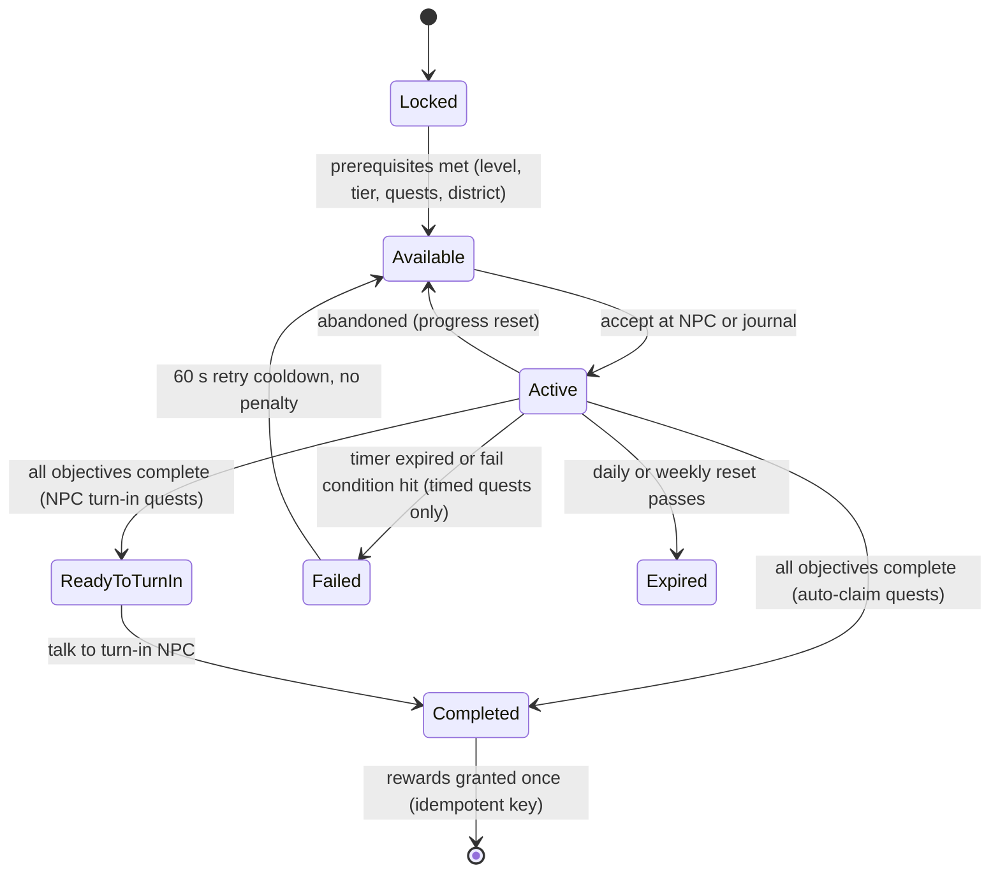

## 20. Quests

> Quests turn "cook, earn, morph" into a guided, funny journey. This section covers the quest runtime (§20.1–§20.7),
> the ten-chapter **story campaign** (§20.8), and the **quest database** (§20.9) of 157 fully specified quests.
> NPCs are defined in §19, events in §36.11, tiers in §36.12, recipes in §6 and mutation parts in §36.3. Rewards use
> only the canon C17.4 vocabulary: MB, MS, RT, XP, Morph Capsules, specific `MUT_` parts, `RCP_` recipe unlocks,
> trophies `FRN_901`–`FRN_910`, skill points, stat respec tokens, and plain-text titles, emotes and color palettes.

### 20.1 Purpose

- **Teach** each system at the moment it unlocks (tutorial, district/building access quests, first-hire quests).
- **Pace** progression: every tier has a story chapter, a City Hall permit (TIER_04+), and a handful of challenges.
- **Pull players into the city**: about a third of quests need a city visit, an event, or an NPC conversation.
- **Give every session a goal**: 3 dailies plus 5 weeklies, so a 10-minute session always finishes something.
- **Tell a lighthearted story** about becoming Morph City's greatest restaurateur. The rival is beaten by cooking, never by combat.

### 20.2 Rules & Mechanics — quest types and lifecycle

| Code | Type | Repeatable | Giver / turn-in | Abandon? | Concurrency |
|---|---|---|---|---|---|
| TUT | Tutorial | no | Nana Gristle (`NPC_001`) and the building NPCs named in each row; auto turn-in | no (skip offered, §32) | sequential |
| STY | Story | no | chapter cast; turn in to the giver | no (can untrack) | one chapter at a time, quests in order |
| DLY | Daily | daily pool | Job Board poster NPC (portrait only); auto-claim in journal | no; **reroll** instead | 3 slots |
| WKY | Weekly | weekly pool | Job Board poster NPC; auto-claim | no; weekly reroll | 5 slots |
| CHF | Cooking challenge | no | giver NPC | yes | up to 10 non-story quests active in total |
| CBT | Combat challenge | no | giver NPC | yes | shared cap of 10 |
| RPR | Repair challenge | no | giver NPC | yes | shared cap of 10 |
| EXP | Exploration challenge | no | giver NPC | yes | shared cap of 10 |
| EMP | Employee challenge | no | giver NPC | yes | shared cap of 10 |
| RST | Restaurant expansion (incl. permits) | no | Mayor/Bolt/etc. | permits: no; others: yes | shared cap of 10 |



**Progress rules**

1. **Server-only progress.** Objectives advance only from server-side gameplay signals (§20.3). The client never reports
   progress.
2. **No retroactive counting** for count objectives: progress starts at acceptance. **State objectives** (`ReachLevel`,
   `ReachReputation`, `ReachAtmosphere`, `UpgradeTier`, `OwnEmployees`) are evaluated immediately on accept, so they
   can already be true.
3. **Co-op attribution (§21).** Cook, serve, calm, defeat and repair objectives credit the player who performed the
   action, in any restaurant. `EarnMB`, reputation, atmosphere and staffing objectives count only for the restaurant
   owner. Guests never progress the owner's story quests.
4. **Multi-step objectives** are ordered unless marked "(any order)". The journal shows the current step plus a
   collapsed list.
5. **Recipe Loan rule.** When a STY or CHF objective names a specific `RCP_` the player doesn't know yet, and the player's
   level ≥ that recipe's unlock level, accepting the quest teaches the recipe permanently for free (counts as a C17.4
   recipe-unlock reward). Required stations are never granted. The quest card shows "Needs `STN_…`" with a shortcut to
   Restaurant Supplies (`BLD_03`).
6. **District gates.** A quest whose location is in a locked district stays **Locked** with the tooltip "Unlocks at L*n*"
   (canon §C16.1).

### 20.3 Objective grammar (typed objectives)

Objectives are typed records `{type, params, target, progress}` written in the database as `Type(params, target)`.
`⁺` after a target means it scales with the player's tier at accept time: `round(N × (1 + 0.15 × (T − 1)))` [TUNABLE].
Quality qualifiers: `≥GOOD` / `PERFECT` (§C8). `S≥n` means customer satisfaction ≥ n (§C11.3).

| Objective type | Parameters | Advanced by (server signal) | Validation notes |
|---|---|---|---|
| `TakeOrder` | n | `OrderService.OrderTaken` | tutorial only |
| `CookRecipe` | recipe, n, quality? | `CookingService.DishCompleted` | dish must be plated and served (not just cooked) for count > 1, to stop trash-farming |
| `CookCategory` | category or "distinct k", n, quality? | `CookingService.DishCompleted` | category from the recipe ID (§C10) |
| `CookQuality` | grade, n | `CookingService.DishCompleted` | any recipe |
| `ServeCustomers` | n, condition? | `OrderService.OrderServed` | condition e.g. "S≥80", "table service", "≥ 2 employees assigned" |
| `ServePersonality` | `PER_` or "distinct k", n, S≥? | `CustomerAIService.CustomerPaid` | only rolled or required if the personality is in the player's current spawn table (§9) |
| `AchieveSatisfaction` | threshold, n | `CustomerAIService.CustomerPaid` | uses final S after modifiers |
| `EarnMB` | amount | `EconomyService.Credit` (source ∈ sales, tips, offline) | quest rewards never count toward EarnMB |
| `CalmCustomers` | n, ability? | `CustomerAIService.Deescalated` | a customer counts once per visit |
| `DefeatHostiles` | n, location/event? | `CombatService.TargetDizzied` | hostile customers, event hostiles, training dummies when stated |
| `RepairObjects` | n, state/grade/location? | `RepairService.RepairCompleted` | an object counts once per damage instance (E3 rebuild counts once) |
| `MaintainCleanliness` | value, duration | `RestaurantService.CleanlinessTick` | timer resets if K < value |
| `VisitBuilding` | `BLD_` or "any distinct k" | `NPCService.ZoneEntered` | interior volume trigger, server-checked position |
| `DiscoverSecret` | secret key | `CityService.SecretFound` | secret keys are listed in §18 (story props) or by canon §C13.8 |
| `DiscoverLocation` | kind, n | `CityService.LocationDiscovered` | metro stations, landmarks, exhibits, collectibles |
| `Travel` | mode (Metro / Pigeon Taxi), n distinct districts | `CityService.TravelCompleted` | |
| `TalkToNPC` | `NPC_` or "distinct k" | `NPCService.TalkObjective` | dialogue node must be reached server-side |
| `CompleteEvent` | `EVT_` or "any", stage/score? | `CityEventService.ParticipationAwarded` | Bronze participation or better unless stated |
| `HireEmployee` | role or `EMP_001`, n | `EmployeeService.Hired` | |
| `AssignRole` | role or "distinct k" | `EmployeeService.Assigned` | |
| `TrainEmployee` | n sessions | `EmployeeService.Trained` | |
| `RaiseMorale` | n employees, threshold | `EmployeeService.MoraleChanged` | state check: true at the moment of evaluation |
| `OwnEmployees` | n, filter? | `EmployeeService.RosterChanged` | state objective |
| `UpgradeTier` | `TIER_` | `BuildingService.TierUpgraded` | state objective |
| `UpgradeStation` | level, n | `BuildingService.StationUpgraded` | |
| `PlaceFurniture` | n, category? | `BuildingService.Placed` | placing, removing and re-placing the same item counts once |
| `FillMenu` | n slots, min distinct categories? | `RecipeService.MenuChanged` | state objective; counts only recipes the player can currently cook (not SOLD OUT) |
| `ReachAtmosphere` | value | `RestaurantService.AtmosphereChanged` | state objective |
| `ReachReputation` | stars | `RestaurantService.ReputationChanged` | state objective |
| `PurchaseStock` | `ING_`, crates | `InventoryService.StockPurchased` | special stock only |
| `EquipMutation` | `MUT_` / "k slots" / family | `MutationService.Equipped` | |
| `UpgradeMutation` | part or "any", n | `MutationService.Upgraded` | |
| `UseAbility` | `ABL_` or "any mutation", n, outcome? | `CombatService.AbilityResolved` | outcome e.g. "blocked a hit", "successful dodge" |
| `CollectOffline` | n reports, minHours? | `OfflineEarningsService.Claimed` | idempotent by `reportId` (§C15) |
| `WinArenaMatch` | n, mode? | `MultiplayerService.ArenaResult` | every arena objective also accepts the non-PvP **Bash the Bots** (PvE) and **Cook-Off** race modes (§21), so **PvP is never required** |
| `DeliverOrders` | n, destination? | `OrderService.DeliveryCompleted` | Delivery Depot missions (§18) or quest drop-offs |
| `ReachLevel` | L | `ProgressionService.LevelUp` | state objective |
| `MoveTo` | marker | `NPCService.ZoneEntered` | tutorial only |

### 20.4 UI — journal, tracking, markers

- **Quest Journal** (full-screen; hotkey J / gamepad Select / mobile scroll icon). Tabs: **Story** (chapter cards, art
  thumbnails, "Previously on…" recap read by Nana's hologram), **Daily & Weekly** (slots, reset countdowns in local time,
  reroll button), **Challenges** (filter chips TUT · CHF · CBT · RPR · EXP · EMP · RST), **Completed**, and
  **Friends of Morph City** (§19.6).
- **Quest card:** name, giver portrait, short description, objective checklist with progress bars ("7/10"), timer chip
  for timed quests, rewards row (currency icons + item thumbnails with rarity shape), Track toggle, Abandon (where allowed).
- **HUD tracker:** up to **3** tracked quests (story auto-tracked first). Each shows the current step only. Tapping it
  sets a **waypoint** that draws an arrow-trail on the ground (client-only) and pins the map.
- **Markers:** ! ? ↻ ★ … above NPCs and on the minimap (§19.4). Completed objective = check + chime + a small confetti
  burst (reduced-FX: chime only).
- **Toasts:** "Quest updated" (≤ 1 per 2 s, merged), "Quest complete!" with a reward fly-out into the currency counters.
  Toasts never cover the order queue or the patience meters (§24 safe zones).
- **Accessibility:** every timer has a text countdown, colors are paired with icons, and the "Story Assist" toggle
  (§20.7) is reachable from any failed timed quest.

### 20.5 Daily & weekly rotation and rerolls

| Rule | Daily | Weekly |
|---|---|---|
| Slots | **3** | **5** |
| Reset | 00:00 UTC every day (§C3) | Monday 00:00 UTC |
| Draw | deterministic seeded draw from the eligible pool: `seed = hash(UserId, dayIndex, POOL_VERSION)` | `seed = hash(UserId, weekIndex, POOL_VERSION)` |
| Eligibility | unlock level, district unlocked, required systems (e.g. employees, Arena opt-in), personality in spawn table | same |
| Diversity | ≤ 1 per category tag (cook / serve / combat / repair / explore / staff) per day; no repeats from yesterday | ≤ 2 per category tag; no repeats from last week |
| Free reroll | **1 per UTC day** (any one slot) | **1 per week** |
| Extra rerolls | 0.02 × IncH(T) MB each, max 3 per day [TUNABLE]. MB only, never Robux (§23) | 0.1 × IncH(T) MB, max 1 per week |
| Social exemption | — | co-op/social weeklies (`QST_WKY_013`, `QST_WKY_014`) can be rerolled free at any time by players who prefer solo play |
| Completion bonus | **Daily Trio** — all 3 claimed: 1 Morph Capsule | **Weekly Sweep** — all 5 claimed: 2 Morph Capsules + 1 RT |
| Expiry | unfinished dailies expire at reset (no penalty) | unfinished weeklies expire at reset (no penalty) |

The draw is stored when the player first loads after reset (`profile.quests.daily = {dayIndex, slots, rerollsUsed}`).
Reconnecting the same day restores the same slots and progress, and rerolling replaces one slot's quest ID while
keeping the `dayIndex`.

### 20.6 Variables — reward scaling [TUNABLE]

**Notation.** `IncH(T)` = canon net MB per active hour at tier T (§C4.4). `XPR(L)` = `900 × 1.045^(L−1)` (§C5.1).
Fixed (one-time) quests carry a reference tier `t` and level `l`. Their database MB = `f_MB × IncH(t)` and XP =
`f_XP × XPR(l)`, rounded to friendly numbers (< 100 → 5, < 1,000 → 10, < 10,000 → 50, < 100,000 → 100, else 1,000).
Daily and weekly rewards are snapshotted at **accept** time from the player's current tier T and level L, so upgrading
mid-quest neither raises nor lowers the payout.

| Quest type | f_MB (× IncH) | f_XP (× XPR) | MS | RT | Other |
|---|---|---|---|---|---|
| TUT | fixed: 600 MB total | fixed: 390 XP total | — | — | `MUT_145` / `MUT_144` / `MUT_153` choice; 1 Morph Capsule |
| STY (regular / chapter finale) | 0.20 / 0.40 | 0.30 / 0.60 | 2×T to 6×T | from Ch. 3: 1–12 (finale Ch. 10: 50) | finales: 1 skill point; trophies, parts, titles |
| DLY | 0.03 | 0.25 (canon example) | 2 + T | — | Daily Trio bonus: 1 Morph Capsule |
| WKY | 0.12 | 0.50 | 5 × T | 1 + ⌊(T−1)/4⌋ | Weekly Sweep: 2 Morph Capsules + 1 RT |
| CHF / CBT / RPR / EXP / EMP | 0.10–0.25 | 0.15–0.40 | 2×T to 8×T | late-game only | trophies, parts, palettes, titles |
| Legendary Recipe quests (CHF_011–015) | 0.30 | 0.50 | 10×T | 10–25 | the `RCP_LEG_` recipe |
| RST permits / other RST | 0.15 / 0.10 | 0.50 / 0.20 | 3×T | — | permit flag (not a reward item) |

**Daily and weekly reward values by tier** (XP shown at each tier's entry level; generated):

| Tier | Entry L | IncH (MB/h) | Daily MB (0.03·IncH) | Daily XP (0.25·XPR) | Daily MS (2+T) | Weekly MB (0.12·IncH) | Weekly XP (0.5·XPR) | Weekly MS (5×T) | Weekly RT |
|---|---|---|---|---|---|---|---|---|---|
| `TIER_01` | 1 | 630 | 20 | 220 | 3 | 75 | 450 | 5 | 1 |
| `TIER_02` | 5 | 1,080 | 30 | 270 | 4 | 130 | 540 | 10 | 1 |
| `TIER_03` | 10 | 1,730 | 50 | 330 | 5 | 210 | 670 | 15 | 1 |
| `TIER_04` | 18 | 3,100 | 95 | 480 | 6 | 370 | 950 | 20 | 1 |
| `TIER_05` | 26 | 5,400 | 160 | 680 | 7 | 650 | 1,350 | 25 | 2 |
| `TIER_06` | 35 | 9,600 | 290 | 1,000 | 8 | 1,150 | 2,000 | 30 | 2 |
| `TIER_07` | 45 | 17,400 | 520 | 1,550 | 9 | 2,100 | 3,100 | 35 | 2 |
| `TIER_08` | 56 | 32,800 | 980 | 2,550 | 10 | 3,950 | 5,050 | 40 | 2 |
| `TIER_09` | 68 | 63,700 | 1,900 | 4,300 | 11 | 7,650 | 8,600 | 45 | 3 |
| `TIER_10` | 80 | 120,500 | 3,600 | 7,300 | 12 | 14,500 | 14,600 | 50 | 3 |

**Budget check** (generated from the database). One-time quest MB at each reference tier, divided by the income a player
earns while in that tier (`IncH × hours in tier`, from the cumulative-hours column of §C4.4), and one-time quest XP
divided by the XP needed to cross the tier's level band. Canon C4.4 assumes about 15 % of income comes from
quests + events. One-time quests are kept to ≤ 12 % of income in every tier, so dailies, weeklies and events fit in the
remaining headroom for a typical 1.5 h/day player (dailies ≈ 6 %, weeklies ≈ 4 % of income at that pace).

| Tier | P_MB | P_XP | Hours in tier | Income in tier (MB) | One-time quests | Quest MB | MB share | XP to cross band | Quest XP | XP share |
|---|---|---|---|---|---|---|---|---|---|---|
| `TIER_01` | ×0.3 | ×0.15 | 1 | 630 | 20 | 815 | 129.4 % | 1,098 | 710 | 64.7 % |
| `TIER_02` | ×0.3 | ×0.14 | 2 | 2,160 | 13 | 515 | 23.8 % | 2,563 | 510 | 19.9 % |
| `TIER_03` | ×0.35 | ×0.18 | 4 | 6,920 | 21 | 1,545 | 22.3 % | 8,250 | 1,475 | 17.9 % |
| `TIER_04` | ×0.5 | ×0.21 | 7 | 21,700 | 20 | 3,990 | 18.4 % | 16,491 | 2,475 | 15.0 % |
| `TIER_05` | ×0.7 | ×0.33 | 11 | 59,400 | 13 | 7,340 | 12.4 % | 35,347 | 4,180 | 11.8 % |
| `TIER_06` | ×1.2 | ×0.6 | 15 | 144,000 | 8 | 17,350 | 12.0 % | 75,512 | 8,800 | 11.7 % |
| `TIER_07` | ×2.0 | ×1.0 | 20 | 348,000 | 6 | 39,900 | 11.5 % | 162,549 | 18,550 | 11.4 % |
| `TIER_08` | ×2.8 | ×1.4 | 25 | 820,000 | 5 | 96,600 | 11.8 % | 355,214 | 41,500 | 11.7 % |
| `TIER_09` | ×3.8 | ×1.7 | 35 | 2,229,500 | 5 | 266,200 | 11.9 % | 708,673 | 83,750 | 11.8 % |
| `TIER_10` | ×5.0 | ×2.8 | 80 | 9,640,000 | 7 | 1,055,200 | 10.9 % | 2,953,708 | 327,900 | 11.1 % |

**Skill points.** Quests grant at most **15** skill points in total (§14 budget: levels 99 + achievements 10 + milestones
6 + quests ≤ 15). The database grants 12: one per story chapter finale, one for the epilogue, and one for
the final Legendary Recipe quest.

### 20.7 Failure, abandon, retry — and Roblox implementation

**Timed quests**

- The timer is server-side (`os.time()`). Shift-style challenges begin when the player presses **Start Challenge** in
  the journal or at the NPC, not on accept, so accepting and walking away is never punished.
- The timer runs only while the player is online and inside the required location (their restaurant, a district, an
  event zone). Leaving pauses it for up to 60 s; staying away longer fails the attempt.
- **Fail** → state `Failed` → 60 s cooldown → `Available`. There is **no currency, item or XP penalty, ever**. Only the
  timed attempt's progress resets; untimed steps already completed in the same quest stay completed.
- **Disconnect / server shutdown** during a timed attempt voids the attempt (no fail count, no cooldown).
- **Story Assist:** after 3 failed attempts of the same STY or TUT step, the player may toggle Story Assist for that step
  (+50 % time, −20 % count targets rounded up, same rewards). The story can always be finished (§26.4).

**Event-dependent quests**

- Non-story event quests (e.g. `QST_EXP_006`) are offered only while their event is active or scheduled within the
  next 24 h. Progress **persists across event occurrences** and they never fail.
- Story quests that need an event (`QST_STY_019`, `QST_STY_022`, `QST_STY_031`, `QST_STY_032`) open a **Story Replay**
  instance if the live event isn't running within 60 min of the player starting the step. Story Replay is a solo or
  party instance of the event's script that grants only the quest objective, not the event's own rewards. A12 provides
  the replay mode per event (§36.11).

**Abandon / retry**

- Challenge quests (CHF/CBT/RPR/EXP/EMP, non-permit RST) can be abandoned from the journal (confirmation dialog).
  Progress resets, and the quest can be re-accepted immediately.
- STY, TUT and permit quests can't be abandoned, only untracked. Dailies and weeklies are rerolled, not abandoned (§20.5).

**Server validation & duplicate-reward prevention**

```lua
--!strict
-- QuestService (server). Rewards come only from server data; clients send IDs, never values.
export type QuestState = {
	id: string, key: string, progress: {number}, acceptedAt: number,
	timerEndsAt: number?, tierSnap: number, levelSnap: number, status: string,
}

local function questKey(def, slotInfo): string
	if def.kind == "DLY" then return ("D:%d:%d:%s"):format(slotInfo.dayIndex, slotInfo.slot, def.id) end
	if def.kind == "WKY" then return ("W:%d:%d:%s"):format(slotInfo.weekIndex, slotInfo.slot, def.id) end
	return def.id                                    -- one-off quests: the ID itself, claimable once forever
end

function QuestService.Claim(player: Player, key: string)
	return PlayerDataService.Update(player, function(profile)  -- session-locked UpdateAsync wrapper (§28)
		local q = profile.quests.active[key]
		if not q or q.status ~= "Completed" then return false, "NotComplete" end
		if profile.quests.claimed[key] then return false, "AlreadyClaimed" end
		local bundle = QuestRewards.Build(QuestDefs[q.id], q.tierSnap, q.levelSnap)  -- §20.6 formulas
		local ok = EconomyService.GrantBundle(profile, bundle, "quest:" .. key)      -- idempotent key, txn log
		if not ok then return false, "GrantFailed" end
		profile.quests.claimed[key] = os.time()   -- one-offs: kept forever; repeatables: ring buffer of last 200
		profile.quests.active[key] = nil
		return true
	end)
end
```

- Remotes (rate-limited per player): `Quest.Accept(questId)` 2/s · `Quest.Claim(key)` 2/s · `Quest.Reroll(slot)` 1/s ·
  `Quest.Track(key, on)` 4/s · `Quest.StartChallenge(key)` 1/s. Server → client: `Quest.State(snapshot)`,
  `Quest.Progress(key, idx, value)` (batched at most every 0.5 s).
- Anti-farm: a customer, dish ticket, damaged object or hostile counts **once** per objective. Self-ordered dishes don't
  exist (orders come from `OrderService`), and trash-binned dishes never count.
- Claims and the profile write are one session-locked update. A reward bundle ≥ 10,000 MB triggers an immediate save
  (canon §C3). `EconomyService` rejects a repeated idempotency key (last 500 kept), so double-taps, reconnects and
  cross-server races can't pay twice (E11-style).
- Content updates: quest IDs are never reused. If a definition's target drops, active progress is clamped and
  re-evaluated. If a quest is retired, active instances with ≥ 50 % progress auto-complete with their rewards; the
  rest are removed with an apology toast and 1 Morph Capsule.
- Analytics (§31): `mmr_quest_accept`, `mmr_quest_progress` (sampled), `mmr_quest_complete {questId, durationS,
  attempts}`, `mmr_quest_fail {questId, reason}`, `mmr_quest_reroll {slot, paid}`, `mmr_story_chapter {chapter}`.

### 20.8 Story campaign — "From Shack to Legendary"

Ten chapters, one per restaurant tier (canon §C17.3). Each chapter opens when the player reaches its tier and
finishes the previous chapter. Chapter quests unlock in order. Finales grant a skill point and a signature reward.
Recurring jokes: the Baron's offers keep getting smaller ("three MB and a coupon" → "a coupon" → "half a coupon"),
Nana's hologram flickers at dramatic moments, and Old Man Pigeon always already knew.

#### Chapter 1 — "Grease Is the Word" (`TIER_01`, L1–4) · `QST_STY_001`–`QST_STY_003`
- **Synopsis:** You inherit Nana Gristle's crumbling shack. Baron Von Bistro makes an insulting offer, you refuse, and he
  "anonymously" tips off the health inspector.
- **Set pieces:** the Baron's contract arrives as a paper airplane that bonks you on the nose. Nana's recipe tin is hidden
  inside the cold fryer, guarded by one very offended pickle. During the inspection, Inspector Grimewell sniffs every
  surface while Sniffles hides in your trash can, sneezing.
- **Cast:** `NPC_001`, `NPC_003`, `NPC_028`, `NPC_022`. **Unlocks:** `RCP_DRK_002` Lemonade; finale skill point.

#### Chapter 2 — "Diner-Mite" (`TIER_02`, L5–9) · `QST_STY_004`–`QST_STY_006`
- **Synopsis:** Le Fancy Fin fires free canapés at your queue from a sample cannon. Meanwhile your crates vanish
  overnight, and tiny crowned footprints lead to a manhole.
- **Set pieces:** canapés splat on customers' faces (they need calming). Old Man Pigeon's informants arrange
  breadcrumbs into a map. Each footprint has a tiny crown imprint.
- **Cast:** `NPC_003`, `NPC_031`, `NPC_033`, `NPC_017`, `NPC_059`, `NPC_025`, `NPC_097`. **Unlocks:** `MUT_235`
  Pigeon Wings; skill point.

#### Chapter 3 — "Café Society" (`TIER_03`, L10–17) · `QST_STY_007`–`QST_STY_010`
- **Synopsis:** Madame Fourchette grants your first official rating. The Baron pays Vlogzilla for a bad review, then
  sends Sniffles to sneeze pepper through your vents. You climb to 3.5★ anyway.
- **Set pieces:** the whole café holds its breath as Fourchette's neck lowers inch by inch toward a fry. Vlogzilla's
  live chat rains thumbs-down icons that flip to flame icons on the first bite. Pepper clouds make customers sneeze
  their soup across the room.
- **Cast:** `NPC_016`, `NPC_082`, `NPC_021`, `NPC_028`, `NPC_003`. **Unlocks:** title "Café Celebrity"; skill point.
  Chapter barks point players to Arena access (`QST_CBT_001`, L12) and Lab access (`QST_EXP_002`, L15).

#### Chapter 4 — "Down the Drain" (`TIER_04`, L18–25) · `QST_STY_011`–`QST_STY_013`
- **Synopsis:** The footprints lead to King Ratbeard, who "borrows" ingredients through the pipes. A Borrowing Treaty
  ends the raids and reveals who has been buying the borrowed crates: the Baron.
- **Set pieces:** a throne room built from upturned colanders. The treaty is signed with a ketchup quill and notarized
  by the Mayor's giant stamp.
- **Cast:** `NPC_026`, `NPC_107`, `NPC_020`, `NPC_100`, `NPC_101`, `NPC_002`. **Requires:** Mystery Market access
  (`QST_EXP_003`, L20). **Unlocks:** `MUT_049` Rat Nose, title "Friend of the Sewer Crown"; skill point.

#### Chapter 5 — "Close Encounters of the Fried Kind" (`TIER_05`, L26–34) · `QST_STY_014`–`QST_STY_017`
- **Synopsis:** Zorp's tour bus parks inside your dining-room wall. The alien tourists find Earth food "too solid",
  so Professor Saucington and Zorp create the **Alien Cuisine course**.
- **Set pieces:** a cartoon crash (only the wall's pride is hurt) followed by aliens photographing the ketchup bottle.
  Zorp's translator glitches and customers order "a medium-rare emotion". Graduation happens in zero gravity, with
  mortarboards floating away.
- **Cast:** `NPC_027`, `NPC_086`, `NPC_023`, `NPC_041`, `NPC_009`. **Unlocks:** Alien Cuisine course (every ALN recipe
  becomes learnable at `BLD_06` at its unlock level, §C10), `RCP_ALN_001`, `MUT_103`; skill point.

#### Chapter 6 — "The Rat King Cometh" (`TIER_06`, L35–44) · `QST_STY_018`–`QST_STY_020`
- **Synopsis:** The Baron opens a kiosk in the Monster Mall food court and stops paying Ratbeard, who blames the whole
  city and storms the surface (`EVT_007`). You end it with an apology feast, not a knockout.
- **Set pieces:** a food-court cook-off with Corndog Cornelius as hype-man. Ratbeard rides a giant rolling cheese wheel
  down the avenue. At the feast he weeps happy cheese tears into a Bread Bowl in a Bread Bowl.
- **Cast:** `NPC_014`, `NPC_071`, `NPC_032`, `NPC_030`, `NPC_026`, `NPC_020`. **Unlocks:** `FRN_902` Rat King's Crown
  Display, `MUT_084` Crystal Ball Eyes (Legendary); Ratbeard becomes an ally; skill point.

#### Chapter 7 — "Five Forks Up" (`TIER_07`, L45–55) · `QST_STY_021`–`QST_STY_023`
- **Synopsis:** The Food Critic Convention comes to town. Undercover inspectors hide among your customers, and
  Fourchette offers her legendary five-course tasting challenge.
- **Set pieces:** every customer wears a fake mustache, so which one is the inspector? Paloma sneezes confetti at
  Perfect dishes. On the last course, Fourchette's neck rises right through a ceiling tile.
- **Cast:** `NPC_022`, `NPC_016`, `NPC_082`, `NPC_083`. **Unlocks:** `FRN_903` Critic's Five-Star Plaque, `MUT_038` Kraken
  Head + `MUT_137` Kraken Core (Legendary); skill point.

#### Chapter 8 — "Poach Perfect" (`TIER_08`, L56–67) · `QST_STY_024`–`QST_STY_026`
- **Synopsis:** The Baron slips glittery job offers into your staff lockers. He fires Sniffles for being too nice, and
  Sniffles switches sides, bringing the Baron's master plan: win the deeds to Restaurant Row in a public cook-off.
- **Set pieces:** a locker-room "poaching" montage, then Sniffles sobbing under a pickle drizzle. The "Mustache Memo"
  is delivered by forty pigeons in formation.
- **Cast:** `NPC_007`, `NPC_028`, `NPC_025`, `NPC_017`, `NPC_030`. **Unlocks:** emote "Sniffles Sneeze", `MUT_037` Phoenix Head +
  `MUT_200` Phoenix Talon Leg (Legendary); skill point.

#### Chapter 9 — "Cook-Off on Restaurant Row" (`TIER_09`, L68–79) · `QST_STY_027`–`QST_STY_029`
- **Synopsis:** The Baron challenges you (with a too-hot oven mitt) to a cook-off judged by Fourchette. He loses, and his
  famous mustache falls off: it was fake all along. A Perfect grilled cheese, his childhood favorite, turns the rival
  into a grumpy friend. Nana reveals she and the Baron's grandmother were bake-off rivals.
- **Set pieces:** all of Restaurant Row watching from rooftops. The mustache falls in slow motion. The Baron "hates"
  every bite of his grilled cheese while asking for seconds.
- **Cast:** `NPC_003`, `NPC_016`, `NPC_002`, `NPC_001`. **Unlocks:** `MUT_178` Golden Chef Hands + `MUT_108` Demon Horns
  (Legendary), `FRN_905` Baron's Defeated Mustache Portrait; the Baron becomes friendable; skill point.

#### Chapter 10 — "Legendary" (`TIER_10`, L80+) · `QST_STY_030`–`QST_STY_032`, epilogue `QST_STY_033`
- **Synopsis:** Chef Supreme Omnivora invites you to the **Legendary Chef Tournament** (`EVT_005`). You clear Saffron's
  qualifiers, and in the finale the Baron, in an apron reading "GRUMPY SOUS-CHEF", cooks at your side. Finishing the
  final at **any** placement completes the story; placements only change the event's own rewards (§36.11).
- **Set pieces:** the invitation appears written in sauce on your window. Omnivora tastes with all eight tentacles at
  once. City-wide confetti cannons fire when the final ends.
- **Epilogue:** at L90 Nana's hologram sends you to the Museum archives for her last recipe page, which unlocks the final
  Legendary Recipe quest (`QST_CHF_015`).
- **Cast:** `NPC_029`, `NPC_087`, `NPC_003`, `NPC_001`, `NPC_018`, `NPC_080`. **Unlocks:** `FRN_910` Omnivora's Signed
  Apron, a Mythic part of your choice (`MUT_039` Golden Burger Head **or** `MUT_242` Phoenix Wings), title "Legendary Chef";
  skill points (finale + epilogue).

### 20.9 Quest database

| Type | Code | Count | Minimum |
|---|---|---|---|
| Tutorial quests | TUT | 12 | 12 |
| Story quests (campaign) | STY | 33 | 30 |
| Daily quest pool | DLY | 25 | 20 |
| Weekly quest pool | WKY | 14 | 12 |
| Cooking challenges (incl. Legendary Recipe quests) | CHF | 16 | 10 |
| Combat challenges | CBT | 11 | 10 |
| Repair challenges | RPR | 9 | 8 |
| Exploration challenges | EXP | 15 | 10 |
| Employee management challenges | EMP | 9 | 8 |
| Restaurant expansion challenges (incl. City Hall permits) | RST | 13 | 10 |
| **Total** | — | **157** | 125 |

#### 20.9.1 Tutorial quests — 12 quests

| ID | Name | Description | NPC | Location | Objectives | Prerequisites | Completion conditions | Rewards | Failure conditions |
|---|---|---|---|---|---|---|---|---|---|
| `QST_TUT_001` | **Welcome to the Shack** | Nana's hologram flickers on: walk to your new (old) shack and step inside. | `NPC_001` Nana Gristle | DST_01 · BLD_17 | 1) MoveTo(glowing arrow at your plot) 2) VisitBuilding(BLD_17 — your shack's interior) | New profile | Auto-completes on entering the interior | 25 MB · 20 XP | None. Wander > 80 studs away and the hologram pings a waypoint every 20 s. |
| `QST_TUT_002` | **Your First Order** | A polite Grandma Golem waddles in. Take her order before she knits a sweater out of boredom. | `NPC_001` Nana Gristle | DST_01 · BLD_17 | 1) TalkToNPC — greet the scripted customer (PER_013) 2) TakeOrder(1) | QST_TUT_001 | Ticket appears on the order rail | 25 MB · 20 XP | None. The scripted customer's patience is frozen. |
| `QST_TUT_003` | **Burger 101** | Grab a bun and a patty, grill it to Perfect, stack it right. | `NPC_001` Nana Gristle | DST_01 · BLD_17 | 1) Collect ING_BUN and ING_BEEF_PATTY (STN_PANTRY / STN_FRIDGE) 2) Grill the patty at STN_GRILL (≥ OK) 3) CookRecipe(RCP_BRG_001, 1) at STN_ASSEMBLY | QST_TUT_002 | A Basic Burger is assembled | 50 MB · 30 XP | A burned patty triggers Nana's 'That's charcoal, sweetie' and a free retry (no ingredient charge). |
| `QST_TUT_004` | **Plate It, Serve It** | Plate it and hand it over the serving window. Presentation is 20 percent of… something. | `NPC_001` Nana Gristle | DST_01 · BLD_17 | 1) Plate the burger at STN_ASSEMBLY 2) ServeCustomers(1) via STN_WINDOW | QST_TUT_003 | Customer receives the dish | 50 MB · 30 XP | None (only one ticket exists, so it can't be mis-served). |
| `QST_TUT_005` | **Happy Customer, Happy Wallet** | Learn what makes customers happy: speed, quality and the occasional fry. | `NPC_001` Nana Gristle | DST_01 · BLD_17 | 1) ServeCustomers(2) — scripted orders RCP_BRG_002 + RCP_FRI_001 2) AchieveSatisfaction(≥70, 2) 3) Collect the tip from the counter | QST_TUT_004 | Satisfaction and tip tooltips viewed | 50 MB · 30 XP | If S < 70, Nana explains the satisfaction bar and spawns another easy customer (unlimited). |
| `QST_TUT_006` | **Uh-Oh, Karenosaurus** | She ordered a cheeseburger with no cheese and extra cheese. It goes about as well as you'd think. | `NPC_001` Nana Gristle | DST_01 · BLD_17 | 1) ServePersonality(PER_001, 1) — scripted order 2) Watch her escalate to anger level 3 (scripted, unavoidable) 3) UseAbility(ABL_004, 1 — dodge the thrown burger) | QST_TUT_005 | The burger misses you and splats on the wall | 50 MB · 30 XP | If hit, the burger bounces off harmlessly and the step repeats (no tutorial damage). |
| `QST_TUT_007` | **Defend the Diner** | The Karenosaurus wants a rematch. Block, dodge, swipe, then calm her down. | `NPC_001` Nana Gristle | DST_01 · BLD_17 | 1) UseAbility(ABL_003, 1 blocked hit) 2) UseAbility(ABL_004, 1 successful dodge) 3) UseAbility(ABL_001, 3 hits) 4) CalmCustomers(1, ABL_006) | QST_TUT_006 | She apologizes (ANM_053) and pays the 40 % Apology Payment | 75 MB · 40 XP | A KO plays 'Seeing Stars', respawns at full HP and restarts the current step. Nothing is ever lost (canon C12.1). |
| `QST_TUT_008` | **Fix It Up** | She flipped a table on her way out. Grab the hammer. | `NPC_001` Nana Gristle | DST_01 · BLD_17 | 1) RepairObjects(1 — the Broken table) | QST_TUT_007 | Table returns to Pristine | 75 MB · 30 XP | None. |
| `QST_TUT_009` | **Cash In** | Ka-ching! Empty the register and meet your wallet. | `NPC_001` Nana Gristle | DST_01 · BLD_17 | 1) Interact with the cash register (ANM_066) 2) Open the wallet and read the MB / MS / RT tooltip | QST_TUT_008 | Wallet tooltip closed | 100 MB · 30 XP | None. |
| `QST_TUT_010` | **Your First Mutation** | Mutty McMutface has a free arm with your name on it. Choose wisely (or randomly — we don't judge). | `NPC_004` Mutty McMutface (with `NPC_039`) | DST_02 · BLD_01 | 1) VisitBuilding(BLD_01) 2) TalkToNPC(NPC_004) 3) Choose one free part: MUT_145, MUT_144 or MUT_153 4) EquipMutation(chosen part) | QST_TUT_009 | Part equipped (ANM_065 flex). Completion unlocks DST_03 Downtown (canon tutorial step 10) | 25 MB · 30 XP · one free part: MUT_145 Octopus Arm (Chef) · MUT_144 Crab Claw Arm (Fighter) · MUT_153 Wrench Claw Arm (Repair) | None. The choice is final; all three can be bought later at BLD_01. |
| `QST_TUT_011` | **Fancy Upgrades** | You have about 600 MB. Make the shack slightly less shack-like. | `NPC_006` Bolt Butterworth | DST_01 · BLD_03 or the in-restaurant Build menu | 1) Open the Build menu 2) Buy your first restaurant upgrade from the Starter shelf (§15, priced ≤ 500 MB) 3) PlaceFurniture(1) if the item is placeable | QST_TUT_010 | First upgrade purchased | 50 MB · 40 XP | If the balance is below the cheapest Starter item, Nana's 'emergency savings' tops it up to exactly that price (once). |
| `QST_TUT_012` | **Hire Help** | Ms. Hirewell has an intern who is all arms and enthusiasm. | `NPC_007` Ms. Hirewell | DST_03 · BLD_04 | 1) VisitBuilding(BLD_04) 2) HireEmployee(EMP_001 'Ollie' the Octopus Intern — 0 MB) 3) AssignRole(ROLE_CHEF) 4) View the offline-income preview card | QST_TUT_011 | Ollie hired and assigned; the preview shows estimated offline MB/h for the current setup | 25 MB · 60 XP · 1 Morph Capsule | None. |

#### 20.9.2 Story quests (campaign) — 33 quests

| ID | Name | Description | NPC | Location | Objectives | Prerequisites | Completion conditions | Rewards | Failure conditions |
|---|---|---|---|---|---|---|---|---|---|
| `QST_STY_001` | **A Shark in a Monocle** | The Baron offers to buy your shack for three MB and a coupon. Prove you're staying. | `NPC_003` Baron Von Bistro (with `NPC_028`) | DST_01 (Le Fancy Fin) → BLD_17 | 1) TalkToNPC(NPC_003) 2) ServeCustomers(10) 3) TalkToNPC(NPC_001) — Nana's verdict | QST_TUT_012 | Turn in to NPC_001's hologram | 30 MB · 40 XP · 3 MS · title “Not For Sale” | None. |
| `QST_STY_002` | **Nana's Recipe Tin** | Nana hid her recipe tin somewhere in the shack. Somewhere greasy. | `NPC_001` Nana Gristle | DST_01 · BLD_17 | 1) DiscoverSecret(nana_recipe_tin — inside the cold fryer, guarded by a pickle) 2) CookRecipe(RCP_SAN_001, 3, ≥GOOD) | QST_STY_001 · L2 | Turn in to NPC_001 | 30 MB · 40 XP · 3 MS · RCP_DRK_002 | None. |
| `QST_STY_003` | **The Inspector Cometh** | An 'anonymous' tip sends Inspector Grimewell to your door. Keep it clean for 8 minutes. | `NPC_022` Inspector Grimewell (with `NPC_028`, `NPC_003`) | DST_01 · BLD_17 | 1) Start Challenge (8 min timer) 2) MaintainCleanliness(≥75, 8 min) 3) AchieveSatisfaction(≥70, 6) | QST_STY_002 · L3 | Grimewell stamps 'PASSED (barely)'; turn in to NPC_022. Chapter 1 finale | 55 MB · 90 XP · 5 MS · 1 skill point · title “Inspection Survivor” | Timer ends with an objective unmet, or any object Destroyed at the end → Failed (60 s retry; Story Assist after 3). |
| `QST_STY_004` | **Free Samples, Expensive Problems** | Le Fancy Fin's sample cannon is pelting your queue with canapés. Keep customers happy anyway. | `NPC_003` Baron Von Bistro (with `NPC_031`, `NPC_033`) | DST_01 · BLD_17 | 1) ServeCustomers(20) 2) CalmCustomers(3) | QST_STY_003 · TIER_02 · L5 | Return to NPC_003, who stomps off muttering | 50 MB · 45 XP · 6 MS | None (untimed). |
| `QST_STY_005` | **The Case of the Missing Crates** | Crates keep vanishing. Dispatch Dot has a theory: tiny nibbles. | `NPC_017` Dispatch Dot (with `NPC_059`, `NPC_025`) | DST_04 · BLD_15 → DST_08 | 1) VisitBuilding(BLD_15) 2) TalkToNPC(NPC_059) 3) TalkToNPC(NPC_025) 4) DiscoverSecret(crowned_footprints — manhole in DST_08) | QST_STY_004 · L8 | Turn in to NPC_017 | 50 MB · 50 XP · 6 MS | None. |
| `QST_STY_006` | **Pigeon Intelligence Network** | Old Man Pigeon's informants will talk… for snacks. Deliver food to the flock's contacts. | `NPC_025` Old Man Pigeon (with `NPC_097`) | DST_08 · BLD_19 | 1) DeliverOrders(5) 2) TalkToNPC(NPC_097) 3) TalkToNPC(NPC_025) — debrief | QST_STY_005 · L8 | Pigeon reveals 'a rat with a crown'. Chapter 2 finale | 95 MB · 100 XP · 8 MS · 1 skill point · MUT_235 | None. |
| `QST_STY_007` | **Meet the Fork** | Madame Fourchette will rate your café. Serve well — she's watching from somewhere tall. | `NPC_016` Madame Fourchette (with `NPC_082`) | DST_07 · BLD_14 → BLD_17 | 1) VisitBuilding(BLD_14) 2) TalkToNPC(NPC_016) 3) ServeCustomers(25, average S≥75 over the last 25) | QST_STY_006 · TIER_03 · L10 | Turn in to NPC_016 for your first official rating card | 90 MB · 70 XP · 9 MS · 1 RT | Never fails: serving continues until the rolling last-25 average reaches 75. |
| `QST_STY_008` | **Going Viral (Gently)** | The Baron paid Vlogzilla to trash your café. Win her over with three flawless visits. | `NPC_021` Vlogzilla (with `NPC_003`) | DST_07 → BLD_17 | 1) TalkToNPC(NPC_021) 2) ServePersonality(PER_009, 3, S≥90) | QST_STY_007 · L11 | Vlogzilla posts a glowing review; turn in to NPC_021 | 90 MB · 75 XP · 9 MS · emote “Selfie Spin” | None (Influencer visits under S 90 just don't count). |
| `QST_STY_009` | **Sneeze Sabotage** | Sniffles is sneezing pepper through your vents. Survive one chaotic shift. | `NPC_028` Sous-Chef Sniffles (with `NPC_003`) | DST_01 · BLD_17 | 1) Start Challenge (12 min timer) 2) CalmCustomers(5) or DefeatHostiles(5) (combined count) 3) ServeCustomers(15) | QST_STY_008 · L13 | Sniffles tumbles out of the vent; turn in to NPC_028 | 90 MB · 80 XP · 10 MS | Timer expires, or 4 storm-outs during the shift → Failed (60 s retry; Story Assist after 3). |
| `QST_STY_010` | **One-Star Wonder No More** | Fourchette's verdict: 'promising'. Prove it with a 3.5-star reputation. | `NPC_016` Madame Fourchette | DST_07 · BLD_14 | 1) ReachReputation(3.5★) 2) TalkToNPC(NPC_016) | QST_STY_009 · L15 | Turn in to NPC_016. Chapter 3 finale | 180 MB · 180 XP · 15 MS · 2 RT · 1 skill point · title “Café Celebrity” | None. |
| `QST_STY_011` | **Pipe Dreams** | Sergeant Rhonda has reports of crates disappearing down manholes. Follow the trail underground. | `NPC_026` Sergeant Rhonda (with `NPC_107`) | DST_03 → DST_09 | 1) TalkToNPC(NPC_107) 2) DiscoverSecret(stolen_crate_pile — DST_09) 3) VisitBuilding(BLD_21) | QST_STY_010 · QST_EXP_003 · TIER_04 · L20 | Auto-completes on entering BLD_21 | 230 MB · 130 XP · 12 MS · 1 RT | None. |
| `QST_STY_012` | **An Audience with the Sewer King** | King Ratbeard will listen — after a royal snack. | `NPC_020` King Ratbeard (with `NPC_100`, `NPC_101`) | DST_09 · BLD_21 | 1) TalkToNPC(NPC_020) 2) CookRecipe(RCP_SOP_005, 3, ≥GOOD) 3) DeliverOrders(3, destination BLD_21) | QST_STY_011 · L21 | Turn in to NPC_020 | 230 MB · 140 XP · 12 MS · 1 RT | None. |
| `QST_STY_013` | **The Borrowing Treaty** | Ratbeard will stop 'borrowing' for a weekly cheese delivery — and spills who's been buying his loot. | `NPC_020` King Ratbeard (with `NPC_002`, `NPC_048`) | DST_09 · BLD_21 → DST_03 · BLD_09 | 1) DeliverOrders(10, destination BLD_21) 2) TalkToNPC(NPC_002) — notarize the treaty | QST_STY_012 · L22 | Treaty stamped (it was the Baron!); turn in to NPC_020. Chapter 4 finale | 460 MB · 290 XP · 20 MS · 3 RT · 1 skill point · MUT_049 · title “Friend of the Sewer Crown” | None. |
| `QST_STY_014` | **Tour Bus Fender-Bender** | Zorp's tour bus parked in your dining room. Through the wall. Fix everything before lunch. | `NPC_027` Zorp (with `NPC_086`) | DST_01 · BLD_17 | 1) Start Challenge (10 min timer) 2) RepairObjects(8) | QST_STY_013 · TIER_05 · L26 | The bus backs out apologetically; turn in to NPC_027 | 570 MB · 270 XP · 15 MS · 2 RT · MUT_103 | Timer expires → Failed; bus damage is reset free of charge before the retry (60 s). |
| `QST_STY_015` | **Lost in Translation** | Zorp's tourists find Earth food 'too solid'. Satisfy eight of them anyway. | `NPC_027` Zorp (with `NPC_086`) | DST_01 · BLD_17 | 1) ServePersonality(PER_029, 8, S≥80) | QST_STY_014 · L27 | Turn in to NPC_027 | 570 MB · 280 XP · 15 MS · 2 RT | None. While active, PER_029 spawn weight is ×3 in your restaurant. |
| `QST_STY_016` | **Moon Cheese, Please** | Alien cuisine needs moon cheese. Farmer Fungus knows a guy. The guy knows the moon. | `NPC_023` Farmer Fungus (with `NPC_041`) | DST_02 · BLD_20 | 1) VisitBuilding(BLD_20) 2) TalkToNPC(NPC_041) — settle the pickle-vs-fungus feud 3) PurchaseStock(ING_MOON_CHEESE, 1 crate) | QST_STY_015 · L28 | Turn in to NPC_023 | 760 MB · 290 XP · 15 MS · 2 RT | None. |
| `QST_STY_017` | **Alien Cuisine 101** | Professor Saucington and Zorp co-teach the city's first Alien Cuisine course. Graduation is in zero gravity. | `NPC_009` Professor Saucington (with `NPC_027`) | DST_03 · BLD_06 | 1) TalkToNPC(NPC_009) — lecture (grants RCP_ALN_001) 2) CookRecipe(RCP_ALN_001, 5, ≥GOOD) 3) TalkToNPC(NPC_027) — graduation | QST_STY_016 · L30 | Sets course_alien = true: every ALN recipe becomes learnable at BLD_06 at its unlock level. Chapter 5 finale | 1,150 MB · 640 XP · 25 MS · 5 RT · 1 skill point · RCP_ALN_001 (granted at step 1) | None. |
| `QST_STY_018` | **Food Court Fracas** | The Baron opened a kiosk in Mallory's food court. Out-serve him for a day. | `NPC_014` Mallory Megamall (with `NPC_071`, `NPC_032`) | DST_05 · BLD_12 → BLD_17 | 1) TalkToNPC(NPC_071) 2) ServeCustomers(40, S≥80) | QST_STY_017 · TIER_06 · L35 | The kiosk closes in shame; turn in to NPC_014 | 1,750 MB · 720 XP · 20 MS · 3 RT | None. |
| `QST_STY_019` | **The Rat King Cometh** | BREAKING: the Sewer King is rolling down the avenue on a giant cheese wheel! Defend the city. | `NPC_030` Anchor Andy (with `NPC_020`, `NPC_026`) | DST_03 (event zone) | 1) CompleteEvent(EVT_007, Bronze+) | QST_STY_018 · L37 | Auto-completes on the participation award (or via Story Replay, §20.7) | 1,750 MB · 790 XP · 20 MS · 3 RT | None (Story Replay opens if the live event isn't running within 60 min). |
| `QST_STY_020` | **A Crown of Cheese** | Ratbeard was only angry because the Baron stopped paying. Cook him an apology feast. | `NPC_020` King Ratbeard (with `NPC_100`) | DST_09 · BLD_21 | 1) CookRecipe(RCP_SOP_009, 3, PERFECT) 2) DeliverOrders(3, destination BLD_21) 3) TalkToNPC(NPC_020) | QST_STY_019 · L40 | Ratbeard weeps happy cheese tears; turn in to NPC_020. Chapter 6 finale | 3,450 MB · 1,800 XP · 30 MS · 5 RT · 1 skill point · FRN_902 · MUT_084 | None. |
| `QST_STY_021` | **The Undercover Inspector** | Everyone at the Convention wears a fake mustache. Three are inspectors. Wow all of them. | `NPC_022` Inspector Grimewell | DST_01 · BLD_17 | 1) ServePersonality(PER_025, 3, S≥90) | QST_STY_020 · TIER_07 · L45 | Turn in to NPC_022 | 5,200 MB · 1,850 XP · 25 MS · 4 RT · title “Mustache Detective” | None. PER_025 spawn weight ×2 while active; ABL_064 Super Sniff reveals them. |
| `QST_STY_022` | **Convention Season** | The Food Critic Convention is in town and every critic wants a bite. | `NPC_016` Madame Fourchette (with `NPC_082`, `NPC_083`) | DST_07 (event zone) | 1) CompleteEvent(EVT_008, Bronze+) | QST_STY_021 · L47 | Auto (or Story Replay) | 5,200 MB · 2,050 XP · 25 MS · 4 RT | None (Story Replay available). |
| `QST_STY_023` | **Five Forks Up** | Fourchette's tasting challenge: five categories, five Perfect dishes, one very long neck. | `NPC_016` Madame Fourchette (with `NPC_083`) | DST_07 · BLD_14 | 1) ReachReputation(4.5★) 2) CookCategory(distinct 5, 1 each, PERFECT) 3) DeliverOrders(5, destination BLD_14) | QST_STY_022 · L50 | Fourchette's neck goes through the ceiling tile; turn in to NPC_016. Chapter 7 finale | 10,400 MB · 4,650 XP · 40 MS · 8 RT · 1 skill point · FRN_903 · MUT_038 · MUT_137 | None. |
| `QST_STY_024` | **Poach Perfect** | The Baron is slipping glittery job offers into your staff lockers. Keep your team happy. | `NPC_007` Ms. Hirewell (with `NPC_003`) | DST_03 · BLD_04 → BLD_17 | 1) RaiseMorale(4 employees, ≥80) 2) TrainEmployee(2) | QST_STY_023 · TIER_08 · L56 | Turn in to NPC_007 | 13,800 MB · 4,250 XP · 30 MS · 5 RT | None. |
| `QST_STY_025` | **Sniffles Switches Sides** | The Baron fired Sniffles for being too nice. He's sobbing in the pickle drizzle outside your door. | `NPC_028` Sous-Chef Sniffles | DST_01 · BLD_17 | 1) TalkToNPC(NPC_028) 2) CookRecipe(RCP_SOP_002, 1, PERFECT) and serve it to Sniffles 3) TalkToNPC(NPC_028) | QST_STY_024 · L58 | Sniffles hands over the Baron's notebook; sets flag sniffles_friend | 13,800 MB · 4,650 XP · 30 MS · 5 RT · emote “Sniffles Sneeze” | None. |
| `QST_STY_026` | **The Mustache Memo** | The notebook mentions a 'Mustache Memo'. Old Man Pigeon's flock can intercept it. | `NPC_025` Old Man Pigeon (with `NPC_017`, `NPC_030`) | DST_08 · BLD_19 | 1) DeliverOrders(15) 2) TalkToNPC(NPC_017) 3) TalkToNPC(NPC_030) — go public | QST_STY_025 · L60 | Memo revealed: the Baron plans to win Restaurant Row's deeds in a cook-off. Chapter 8 finale | 27,600 MB · 10,100 XP · 50 MS · 10 RT · 1 skill point · MUT_037 · MUT_200 · title “Memo Interceptor” | None. |
| `QST_STY_027` | **Gauntlet of Garnish** | The Baron slaps you with an oven mitt (it's hot; he regrets it) and demands a cook-off. Train for it. | `NPC_003` Baron Von Bistro (with `NPC_002`) | DST_01 → DST_03 · BLD_09 | 1) TalkToNPC(NPC_002) — register the cook-off 2) CookRecipe(RCP_SEA_010, 3, PERFECT) | QST_STY_026 · TIER_09 · L68 | Turn in to NPC_003 | 36,300 MB · 8,750 XP · 40 MS · 8 RT · MUT_178 | None. |
| `QST_STY_028` | **Cook-Off on Restaurant Row** | Twelve judges. Fifteen minutes. One Baron. Madame Fourchette keeps score. | `NPC_016` Madame Fourchette (with `NPC_003`) | DST_01 (cook-off stage instance) | 1) Start Challenge (15 min timer) 2) ServeCustomers(12 judges, average S≥90) | QST_STY_027 · L70 | Your average beats the Baron's scripted 89 and his fake mustache falls off; turn in to NPC_016 | 48,400 MB · 12,800 XP · 50 MS · 10 RT · FRN_905 | Timer expires, or average < 90 after 12 judges → Failed (60 s retry; Story Assist after 3). |
| `QST_STY_029` | **A Grumpy Friendship** | The Baron is sulking. Nana's hologram has a hint: his grandmother's grilled cheese. | `NPC_003` Baron Von Bistro (with `NPC_001`) | DST_01 (Le Fancy Fin) | 1) TalkToNPC(NPC_001) 2) CookRecipe(RCP_SAN_001, 1, PERFECT) and serve it to the Baron 3) TalkToNPC(NPC_003) | QST_STY_028 · L71 | Sets flag baron_friend: the Baron becomes friendable and visits as a regular. Chapter 9 finale | 72,600 MB · 20,000 XP · 60 MS · 12 RT · 1 skill point · MUT_108 · title “Baron's Frenemy” · emote “Monocle Pop” | None. |
| `QST_STY_030` | **An Invitation Written in Sauce** | Chef Supreme Omnivora has written your name on your window. In sauce. It's an invitation. | `NPC_029` Chef Supreme Omnivora | DST_07 (Grand Culinary Pavilion) | 1) ReachLevel(80) 2) CookRecipe(RCP_LEG_001, 1, ≥GOOD) 3) TalkToNPC(NPC_029) | QST_STY_029 · QST_CHF_011 · TIER_10 · L80 | Turn in to NPC_029 | 90,400 MB · 24,500 XP · 50 MS · 10 RT | None. |
| `QST_STY_031` | **Qualifier Rounds** | Saffron runs the qualifiers with a magnifying glass and no mercy. | `NPC_087` Sous-Chef Saffron (with `NPC_029`) | DST_07 (event zone) | 1) CompleteEvent(EVT_005, qualifier stage) | QST_STY_030 · L82 | Auto (or Story Replay) | 90,400 MB · 26,700 XP · 50 MS · 10 RT | None (Story Replay available). |
| `QST_STY_032` | **The Legendary Chef Tournament** | The final. The Baron ties on an apron reading GRUMPY SOUS-CHEF. Omnivora raises a fork in every tentacle. | `NPC_029` Chef Supreme Omnivora (with `NPC_003`, `NPC_087`) | DST_07 (event zone) | 1) CompleteEvent(EVT_005, final stage, any placement) 2) TalkToNPC(NPC_029) | QST_STY_031 · L85 | Story complete; city-wide confetti. Chapter 10 finale | 241,000 MB · 61,000 XP · 100 MS · 50 RT · 1 skill point · FRN_910 · one Mythic part of your choice: MUT_039 Golden Burger Head or MUT_242 Phoenix Wings · title “Legendary Chef” | None (Story Replay available). |
| `QST_STY_033` | **Nana's Last Recipe** | Nana's hologram flickers: 'One last thing, sweetie. Check the Museum archives.' | `NPC_001` Nana Gristle (with `NPC_018`, `NPC_080`) | DST_06 · BLD_16 | 1) ReachLevel(90) 2) VisitBuilding(BLD_16) 3) TalkToNPC(NPC_080) 4) TalkToNPC(NPC_001) | QST_STY_032 · L90 | Epilogue; unlocks QST_CHF_015 | 90,400 MB · 38,000 XP · 80 MS · 15 RT · 1 skill point · title “Nana's Favorite” | None. |

#### 20.9.3 Daily quest pool — 25 quests

| ID | Name | Description | NPC | Location | Objectives | Prerequisites | Completion conditions | Rewards | Failure conditions |
|---|---|---|---|---|---|---|---|---|---|
| `QST_DLY_001` | **Burger Bonanza** | The city is hungry for burgers. Feed it. | `NPC_012` Pinboard Pete | Any (your restaurant) | 1) CookCategory(BRG, 8⁺, served) | L1 | Auto-claim in journal | 0.03·IncH MB · 0.25·XPR XP · (2+T) MS | Expires at 00:00 UTC. |
| `QST_DLY_002` | **Happy Plates** | Fifteen happy customers. Smiles are free; burgers are not. | `NPC_037` Tackatha | Any (your restaurant) | 1) AchieveSatisfaction(≥70, 15⁺) | L1 | Auto-claim in journal | 0.03·IncH MB · 0.25·XPR XP · (2+T) MS | Expires at 00:00 UTC. |
| `QST_DLY_003` | **Perfectionist Practice** | Hit the green window. Basil is grading. | `NPC_050` TA Basilica Basil | Any (your restaurant) | 1) CookQuality(PERFECT, 6⁺) | L2 | Auto-claim in journal | 0.03·IncH MB · 0.25·XPR XP · (2+T) MS | Expires at 00:00 UTC. |
| `QST_DLY_004` | **Chill Pill** | Calm three upset customers. Officer Biscuit believes in you. | `NPC_056` Officer Biscuit | Any (your restaurant) | 1) CalmCustomers(3) | L3 | Auto-claim in journal | 0.03·IncH MB · 0.25·XPR XP · (2+T) MS | Expires at 00:00 UTC. |
| `QST_DLY_005` | **Fix-It Any Day** | Something is always broken. Fix four somethings. | `NPC_058` Rivet Rosie | Any (your restaurant) | 1) RepairObjects(4⁺) | L3 | Auto-claim in journal | 0.03·IncH MB · 0.25·XPR XP · (2+T) MS | Expires at 00:00 UTC. |
| `QST_DLY_006` | **Cash Flow** | Earn half an hour's income. Hank says haggling is optional. | `NPC_042` Haggle Hank | Any (your restaurant) | 1) EarnMB(0.5·IncH) | L2 | Auto-claim in journal | 0.03·IncH MB · 0.25·XPR XP · (2+T) MS | Expires at 00:00 UTC. |
| `QST_DLY_007` | **Chef's Kiss Club** | Five Delighted customers. Mira-Bel's screen will show lips. | `NPC_043` Mira-Bel | Any (your restaurant) | 1) AchieveSatisfaction(≥90, 5⁺) | L4 | Auto-claim in journal | 0.03·IncH MB · 0.25·XPR XP · (2+T) MS | Expires at 00:00 UTC. |
| `QST_DLY_008` | **Drink Up** | Lulu's lemonade stand has competition: you. | `NPC_098` Lemonade Lulu | Any (your restaurant) | 1) CookCategory(DRK, 6⁺, served) | L2 | Auto-claim in journal | 0.03·IncH MB · 0.25·XPR XP · (2+T) MS | Expires at 00:00 UTC. |
| `QST_DLY_009` | **Dessert First** | Granny's rule: dessert before everything. | `NPC_091` Granny Gumdrop | Any (your restaurant) | 1) CookCategory(DES, 5⁺, served) | L4 | Auto-claim in journal | 0.03·IncH MB · 0.25·XPR XP · (2+T) MS | Expires at 00:00 UTC. |
| `QST_DLY_010` | **Delivery Dash** | Zoom some orders across town. Zara already did six while you read this. | `NPC_059` Zoomie Zara | DST_04 · BLD_15 missions | 1) DeliverOrders(4) | L8 · DST_04 unlocked | Auto-claim in journal | 0.03·IncH MB · 0.25·XPR XP · (2+T) MS | Expires at 00:00 UTC. |
| `QST_DLY_011` | **Grandma Approved** | Serve two Grandma Golems. Bonus points for not rushing them. | `NPC_067` Speedwalk Gladys | Any (your restaurant) | 1) ServePersonality(PER_013, 2, S≥70) | PER_013 in your spawn table | Auto-claim in journal | 0.03·IncH MB · 0.25·XPR XP · (2+T) MS | Expires at 00:00 UTC. |
| `QST_DLY_012` | **Critic Proof** | One Food Critic, one great meal. Crumbsworth is taking notes. | `NPC_082` Critic Crumbsworth | Any (your restaurant) | 1) ServePersonality(PER_004, 1, S≥80) | L10 · PER_004 in spawn table | Auto-claim in journal | 0.03·IncH MB · 0.25·XPR XP · (2+T) MS | Expires at 00:00 UTC. |
| `QST_DLY_013` | **Bouncer Duty** | Three hostile customers need a gentle, cartoonish timeout. | `NPC_066` Mall Cop Mallomar | Any (your restaurant) | 1) DefeatHostiles(3) | L5 | Auto-claim in journal | 0.03·IncH MB · 0.25·XPR XP · (2+T) MS | Expires at 00:00 UTC. |
| `QST_DLY_014` | **Shift Supervisor** | Run a shift with your crew. Gary is taking notes for his next interview. | `NPC_051` Gary the Applicant | Any (your restaurant) | 1) ServeCustomers(15⁺, with ≥ 2 employees assigned) | L5 · ≥ 2 employees | Auto-claim in journal | 0.03·IncH MB · 0.25·XPR XP · (2+T) MS | Expires at 00:00 UTC. |
| `QST_DLY_015` | **City Stroll** | Visit three different buildings. Sally will photograph you at each. | `NPC_053` Snapshot Sally | City-wide | 1) VisitBuilding(any distinct 3) | L3 | Auto-claim in journal | 0.03·IncH MB · 0.25·XPR XP · (2+T) MS | Expires at 00:00 UTC. |
| `QST_DLY_016` | **Fry Day** | Every day is Fry Day if you believe. | `NPC_033` Busboy Bix | Any (your restaurant) | 1) CookCategory(FRI, 8⁺, served) | L1 | Auto-claim in journal | 0.03·IncH MB · 0.25·XPR XP · (2+T) MS | Expires at 00:00 UTC. |
| `QST_DLY_017` | **Soup's On** | Professor Snore dreams of soup. Make his dream come true. | `NPC_096` Professor Emeritus Snore | Any (your restaurant) | 1) CookCategory(SOP, 4⁺, served) | L4 · STN_SOUP_POT owned | Auto-claim in journal | 0.03·IncH MB · 0.25·XPR XP · (2+T) MS | Expires at 00:00 UTC. |
| `QST_DLY_018` | **Rush Hour** | Serve 25 customers. Lumpy will watch from the queue, approvingly. | `NPC_038` Lumpy the Line-Waiter | Any (your restaurant) | 1) ServeCustomers(25⁺) | L1 | Auto-claim in journal | 0.03·IncH MB · 0.25·XPR XP · (2+T) MS | Expires at 00:00 UTC. |
| `QST_DLY_019` | **Spicy Business** | Two Spicy Salamanders want it HOT. Gloop approves of spice. | `NPC_103` Gutter Gourmet Gloop | Any (your restaurant) | 1) ServePersonality(PER_022, 2, S≥70) | L10 · PER_022 in spawn table | Auto-claim in journal | 0.03·IncH MB · 0.25·XPR XP · (2+T) MS | Expires at 00:00 UTC. |
| `QST_DLY_020` | **Arena Warm-Up** | One win. Bots count. Kid Knuckles is cheering anyway. | `NPC_111` Kid Knuckles | DST_10 · BLD_08 | 1) WinArenaMatch(1, any mode — Bash the Bots (PvE) or Cook-Off race count; PvP optional) | QST_CBT_001 | Auto-claim in journal | 0.03·IncH MB · 0.25·XPR XP · (2+T) MS | Expires at 00:00 UTC. |
| `QST_DLY_021` | **Morph Workout** | Muscles that don't move become decorative. Use those abilities! | `NPC_115` Professor Punch | Anywhere | 1) UseAbility(any mutation ability, 15) | L2 · ≥ 1 equipped part with an active ability | Auto-claim in journal | 0.03·IncH MB · 0.25·XPR XP · (2+T) MS | Expires at 00:00 UTC. |
| `QST_DLY_022` | **Pizza Party** | Sprinkles demands pizza. Lots of pizza. | `NPC_045` Sprinkles McGee | Any (your restaurant) | 1) CookCategory(PIZ, 5⁺, served) | L3 · an oven station owned | Auto-claim in journal | 0.03·IncH MB · 0.25·XPR XP · (2+T) MS | Expires at 00:00 UTC. |
| `QST_DLY_023` | **Read My Hands** | Two Mime Mantises will order by pantomime. Watch closely. | `NPC_054` Silent Simone | Any (your restaurant) | 1) ServePersonality(PER_019, 2, S≥70) | PER_019 in spawn table | Auto-claim in journal | 0.03·IncH MB · 0.25·XPR XP · (2+T) MS | Expires at 00:00 UTC. |
| `QST_DLY_024` | **Toddler Tamer** | Two Toddler Titans. Nap time is not an option. | `NPC_069` Lil' Tantrum Timmy | Any (your restaurant) | 1) ServePersonality(PER_020, 2, S≥70) | PER_020 in spawn table | Auto-claim in journal | 0.03·IncH MB · 0.25·XPR XP · (2+T) MS | Expires at 00:00 UTC. |
| `QST_DLY_025` | **Hush Hour** | Serve ten in a row without anyone reaching Complaining. Shhh. | `NPC_090` Usher Umbra | Any (your restaurant) | 1) ServeCustomers(10 consecutive, none reaching anger level 2) | L6 | Auto-claim in journal | 0.03·IncH MB · 0.25·XPR XP · (2+T) MS | Expires at 00:00 UTC. A customer reaching anger level 2 resets the streak (not the quest). |

#### 20.9.4 Weekly quest pool — 14 quests

| ID | Name | Description | NPC | Location | Objectives | Prerequisites | Completion conditions | Rewards | Failure conditions |
|---|---|---|---|---|---|---|---|---|---|
| `QST_WKY_001` | **Century of Service** | One hundred customers this week. Pete will pin a gold star on you (and himself). | `NPC_012` Pinboard Pete | Any (your restaurant) | 1) ServeCustomers(100⁺) | L1 | Auto-claim in journal | 0.12·IncH MB · 0.5·XPR XP · 5×T MS · 1+⌊(T−1)/4⌋ RT | Expires Monday 00:00 UTC. |
| `QST_WKY_002` | **Five-Star Streak** | Forty Delighted customers this week. Paloma will sneeze thrice. | `NPC_083` Paloma Peppermill | Any (your restaurant) | 1) AchieveSatisfaction(≥90, 40⁺) | L5 | Auto-claim in journal | 0.12·IncH MB · 0.5·XPR XP · 5×T MS · 1+⌊(T−1)/4⌋ RT | Expires Monday 00:00 UTC. |
| `QST_WKY_003` | **Menu Tour** | Truffle dares you to master six categories. He'll pretend not to be impressed. | `NPC_032` Truffle Trufflington | Any (your restaurant) | 1) CookCategory(distinct 6, 5 each, served) | L8 | Auto-claim in journal | 0.12·IncH MB · 0.5·XPR XP · 5×T MS · 1+⌊(T−1)/4⌋ RT | Expires Monday 00:00 UTC. |
| `QST_WKY_004` | **Peacekeeper** | Sergeant Rhonda wants twenty calm customers. No whistles required. | `NPC_026` Sergeant Rhonda | Any (your restaurant) | 1) CalmCustomers(20) | L5 | Auto-claim in journal | 0.12·IncH MB · 0.5·XPR XP · 5×T MS · 1+⌊(T−1)/4⌋ RT | Expires Monday 00:00 UTC. |
| `QST_WKY_005` | **Handy Mutant** | Wrenchy's weekly quota: twenty-five repairs. Gently. | `NPC_010` Wrenchy | Any restaurant (co-op counts) | 1) RepairObjects(25⁺) | L8 | Auto-claim in journal | 0.12·IncH MB · 0.5·XPR XP · 5×T MS · 1+⌊(T−1)/4⌋ RT | Expires Monday 00:00 UTC. |
| `QST_WKY_006` | **Event Enthusiast** | Anchor Andy needs field reporters. Show up at two city events. | `NPC_030` Anchor Andy | City (event zones) | 1) CompleteEvent(any, 2) | L6 | Auto-claim in journal | 0.12·IncH MB · 0.5·XPR XP · 5×T MS · 1+⌊(T−1)/4⌋ RT | Expires Monday 00:00 UTC. |
| `QST_WKY_007` | **Courier of the Week** | Twenty deliveries. Dot says speed is a state of mind. | `NPC_017` Dispatch Dot | DST_04 · BLD_15 missions | 1) DeliverOrders(20) | L8 | Auto-claim in journal | 0.12·IncH MB · 0.5·XPR XP · 5×T MS · 1+⌊(T−1)/4⌋ RT | Expires Monday 00:00 UTC. |
| `QST_WKY_008` | **Big Earner** | Earn four hours' worth of income. Barnaby will count it (badly). | `NPC_046` Barnaby Bargainbin | Any | 1) EarnMB(4·IncH) | L3 | Auto-claim in journal | 0.12·IncH MB · 0.5·XPR XP · 5×T MS · 1+⌊(T−1)/4⌋ RT | Expires Monday 00:00 UTC. |
| `QST_WKY_009` | **Mutation Maintenance** | Cappy says every part deserves a level-up. Upgrade two. | `NPC_039` Cappy Capsule | DST_02 · BLD_01 or Morph menu | 1) UpgradeMutation(any, 2) | L5 | Auto-claim in journal | 0.12·IncH MB · 0.5·XPR XP · 5×T MS · 1+⌊(T−1)/4⌋ RT | Expires Monday 00:00 UTC. |
| `QST_WKY_010` | **Arena Regular** | Five wins this week. Referee Stripes will be watching. TWEET. | `NPC_110` Referee Stripes | DST_10 · BLD_08 | 1) WinArenaMatch(5, any mode — Bash the Bots (PvE) or Cook-Off race count; PvP optional) | QST_CBT_001 | Auto-claim in journal | 0.12·IncH MB · 0.5·XPR XP · 5×T MS · 1+⌊(T−1)/4⌋ RT | Expires Monday 00:00 UTC. |
| `QST_WKY_011` | **Offline Mogul** | Marge delivers your offline reports. Collect four of them. | `NPC_097` Mail Carrier Marge | Welcome Back screen | 1) CollectOffline(4 reports, ≥ 1 h each) | ≥ 1 ROLE_CHEF assigned | Auto-claim in journal | 0.12·IncH MB · 0.5·XPR XP · 5×T MS · 1+⌊(T−1)/4⌋ RT | Expires Monday 00:00 UTC. |
| `QST_WKY_012` | **Personality Bingo** | Walt has spotted every customer type. Serve eight different ones. | `NPC_099` Neighborhood Watch Walt | Any (your restaurant) | 1) ServePersonality(distinct 8, 1 each) | L10 | Auto-claim in journal | 0.12·IncH MB · 0.5·XPR XP · 5×T MS · 1+⌊(T−1)/4⌋ RT | Expires Monday 00:00 UTC. |
| `QST_WKY_013` | **Co-op Kitchen** | Cook in a friend's kitchen, or host one. Greta says food tastes better shared. | `NPC_034` Greta Griddlebottom | Any player restaurant | 1) ServeCustomers(30, as a guest, or as host with ≥ 1 guest present) | L6 · social weekly (free reroll any time) | Auto-claim in journal | 0.12·IncH MB · 0.5·XPR XP · 5×T MS · 1+⌊(T−1)/4⌋ RT | Expires Monday 00:00 UTC. |
| `QST_WKY_014` | **Going Viral IRL** | Strike a pose! Emote near other players, or snap photos at landmarks. | `NPC_068` Kiosk Kevin | City-wide | 1) Emote within 10 studs of 5 different players OR DiscoverLocation(Photo Mode shot at a landmark, 5) | L4 · social weekly (free reroll any time) | Auto-claim in journal | 0.12·IncH MB · 0.5·XPR XP · 5×T MS · 1+⌊(T−1)/4⌋ RT | Expires Monday 00:00 UTC. |

#### 20.9.5 Cooking challenges (incl. Legendary Recipe quests) — 16 quests

| ID | Name | Description | NPC | Location | Objectives | Prerequisites | Completion conditions | Rewards | Failure conditions |
|---|---|---|---|---|---|---|---|---|---|
| `QST_CHF_001` | **Pickle Mountain Climber** | Auntie Okra wants a burger with more pickle than burger. | `NPC_041` Auntie Okra | DST_02 → BLD_17 | 1) CookRecipe(RCP_BRG_006, 5, served) | L5 | Return to NPC_041 | 30 MB · 30 XP · 6 MS · title “Pickle Pilgrim” | None. |
| `QST_CHF_002` | **Pizza Geometry** | Gus needs a pizza that is both square and circle. For science. And lunch. | `NPC_035` Gus the Plot Surveyor | DST_01 → BLD_17 | 1) CookRecipe(RCP_PIZ_014, 4, PERFECT) | L19 | Return to NPC_035 | 160 MB · 85 XP · 12 MS · cosmetic color palette “Blueprint” | None. |
| `QST_CHF_003` | **Sunny Side Hustle** | Yolanda wants eight fried eggs, smiling side up. | `NPC_047` Yolanda Yolk | DST_02 → BLD_17 | 1) CookRecipe(RCP_BRK_002, 8, ≥GOOD) | L3 | Return to NPC_047 | 20 MB · 30 XP · 3 MS · emote “Egg Wobble” | None. |
| `QST_CHF_004` | **Speed Chef Trials** | Carl's train leaves in four minutes. Serve eight dishes before it does. | `NPC_052` Commuter Carl | DST_01 · BLD_17 | 1) Start Challenge (4 min timer) 2) ServeCustomers(8) | L10 | Auto on completion | 75 MB · 60 XP · 9 MS · title “Fast Food (Literally)” | Timer expires → Failed (60 s retry, no penalty). |
| `QST_CHF_005` | **Frozen Soup Paradox** | Dr. Hoot hypothesizes frozen soup is still soup. Prove it five times. | `NPC_075` Dr. Hypothesis Hoot | DST_06 → BLD_17 | 1) CookRecipe(RCP_SOP_003, 5, ≥GOOD) | L13 · STN_FREEZER owned | Return to NPC_075 | 60 MB · 55 XP · 9 MS · cosmetic color palette “Brain Freeze” | None. |
| `QST_CHF_006` | **Breakfast Time Loop** | Chuckles wants breakfast-for-dinner-for-breakfast. He's been awake since yesterday tomorrow. | `NPC_085` Chuckles McGuffaw | DST_07 → BLD_17 | 1) CookRecipe(RCP_BRK_009, 6, ≥GOOD) 2) AchieveSatisfaction(≥90, 3, customers who ordered RCP_BRK_009) | L36 | Return to NPC_085 | 1,150 MB · 500 XP · 24 MS | None. |
| `QST_CHF_007` | **Spaghetti Tornado Warning** | EXTRA! EXTRA! Spaghetti tornado! (It's you. You're the tornado.) | `NPC_055` Newsie Nibbles | DST_03 → BLD_17 | 1) CookRecipe(RCP_PST_005, 6, ≥GOOD) | L23 | Return to NPC_055 | 160 MB · 100 XP · 12 MS | None. |
| `QST_CHF_008` | **Mutation Cuisine Certification** | Dr. Splice certifies chefs to cook food that briefly mutates the eater. Totally safe. Mostly hilarious. | `NPC_013` Dr. Splice (with `NPC_074`, `NPC_079`) | DST_06 · BLD_11 → BLD_17 | 1) TalkToNPC(NPC_013) 2) CookRecipe(RCP_MUT_001, 5, ≥GOOD) 3) AchieveSatisfaction(≥90, 3, MUT dishes) | L42 · STN_INFUSER owned | Return to NPC_013 | 2,300 MB · 980 XP · 40 MS · 3 RT · title “Certified Mutagenic” | None. |
| `QST_CHF_009` | **The Critic's Tasting Flight** | Paloma's flight: five categories, each at least Good. Sneezes optional. | `NPC_083` Paloma Peppermill | DST_07 · BLD_14 | 1) CookCategory(distinct 5, 1 each, ≥GOOD) 2) DeliverOrders(5, destination BLD_14) | L30 | Return to NPC_083 | 450 MB · 270 XP · 20 MS · 1 RT | None. |
| `QST_CHF_010` | **Golden Spatula Gauntlet** | DJ Morphenstein's live cook-off show: three rounds, one golden spatula. | `NPC_024` DJ Morphenstein (with `NPC_084`) | DST_07 · BLD_22 | 1) Round 1: CookRecipe(RCP_BRG_014, 3, PERFECT) 2) Round 2: CookCategory(DES, 3, PERFECT) 3) Round 3: Start Challenge (6 min) — CookRecipe(RCP_TAC_010, 3, ≥GOOD) | L50 | Turn in to NPC_024 on stage | 8,700 MB · 3,100 XP · 60 MS · 5 RT · FRN_901 | Round 3 timer expires → only round 3 fails (rounds 1–2 stay done); 60 s retry. |
| `QST_CHF_011` | **Legendary Recipe: The Golden Patty Supreme** | Saucington opens the vault: the golden patty that started it all. | `NPC_009` Professor Saucington | DST_03 · BLD_06 | 1) PurchaseStock(ING_GOLDEN_PATTY, 1 crate) 2) CookRecipe(RCP_BRG_015, 3, PERFECT) 3) TalkToNPC(NPC_009) | L65 | Turn in to NPC_009; the recipe is learned instantly | 27,600 MB · 10,500 XP · 80 MS · 10 RT · RCP_LEG_001 | None. |
| `QST_CHF_012` | **Legendary Recipe: Dragon Feast** | Saffron tests whether you can handle dragon-grade heat. | `NPC_087` Sous-Chef Saffron (with `NPC_029`) | DST_07 (Grand Culinary Pavilion) | 1) CookRecipe(RCP_BRK_010, 5, PERFECT) 2) CookRecipe(RCP_PIZ_008, 5, ≥GOOD) 3) ServePersonality(PER_022, 5, S≥90) | L72 · QST_CHF_011 | Turn in to NPC_087 | 72,600 MB · 17,400 XP · 90 MS · 15 RT · RCP_LEG_002 | None. |
| `QST_CHF_013` | **Legendary Recipe: Infinity Pizza** | Professor Quibble has proven pizza can be infinite. Now someone has to cook it. | `NPC_078` Professor Quark Quibble | DST_06 · BLD_11 | 1) CookRecipe(RCP_PIZ_013, 5, PERFECT) 2) CookRecipe(RCP_PIZ_015, 3, PERFECT) 3) TalkToNPC(NPC_078) | L80 · QST_CHF_012 | Turn in to NPC_078 | 181,000 MB · 40,800 XP · 100 MS · 20 RT · RCP_LEG_003 | None. |
| `QST_CHF_014` | **Legendary Recipe: Kraken King Banquet** | Omnivora's banquet for a kraken king. Squishy the pet kraken is guest of honor (he eats jelly). | `NPC_029` Chef Supreme Omnivora (with `NPC_095`) | DST_07 (Grand Culinary Pavilion) | 1) CookRecipe(RCP_SEA_010, 5, PERFECT) 2) CompleteEvent(EVT_022) | L88 · QST_CHF_013 | Turn in to NPC_029 | 181,000 MB · 58,000 XP · 100 MS · 25 RT · RCP_LEG_004 | None; event progress persists across occurrences. |
| `QST_CHF_015` | **Legendary Recipe: The Mystery Morph Meal** | Nana's last page: one Perfect dish from every category in the city. Then the meal reveals itself. | `NPC_001` Nana Gristle | DST_01 · BLD_17 | 1) CookCategory(distinct 15 — every category incl. ALN, MUT, LEG — 1 each, PERFECT) 2) TalkToNPC(NPC_001) | L95 · QST_STY_033 | Turn in to NPC_001's hologram | 181,000 MB · 78,900 XP · 150 MS · 25 RT · 1 skill point · RCP_LEG_005 · title “Mystery Morph Master” | None. |
| `QST_CHF_016` | **Sewer Supper Club** | Gloop's guests want Swamp Stew delivered to the Supper Club. It's fruit jelly; no nose-holding needed. | `NPC_103` Gutter Gourmet Gloop | DST_09 (Sewer Supper Club) | 1) CookRecipe(RCP_SOP_007, 5, ≥GOOD) 2) DeliverOrders(5, destination Sewer Supper Club) | L27 · QST_EXP_003 | Return to NPC_103 | 450 MB · 230 XP · 15 MS | None. |

#### 20.9.6 Combat challenges — 11 quests

| ID | Name | Description | NPC | Location | Objectives | Prerequisites | Completion conditions | Rewards | Failure conditions |
|---|---|---|---|---|---|---|---|---|---|
| `QST_CBT_001` | **Ring Debut** | Rex wants a new face in the ring. Your first opponent is a very polite robot. | `NPC_011` Rex Rumbleton (with `NPC_113`) | DST_10 · BLD_08 | 1) VisitBuilding(BLD_08) 2) TalkToNPC(NPC_011) 3) WinArenaMatch(1, Bash the Bots exhibition) | L12 · DST_10 unlocked | Unlocks Arena access: Bash the Bots (PvE), Cook-Off race, and the opt-in PvP queues (§21) | 75 MB · 65 XP · 10 MS · title “Rookie Rumbler” | A loss simply retries (no penalty). |
| `QST_CBT_002` | **Tray Chic** | Sergeant Rhonda's lesson: a tray is a shield with snacks. | `NPC_026` Sergeant Rhonda | DST_03 → BLD_17 | 1) UseAbility(ABL_008, 15, blocked a thrown item) | L6 | Return to NPC_026 | 30 MB · 30 XP · 5 MS | None. |
| `QST_CBT_003` | **Gym Orientation** | Coach Crunch's obstacle drill. Three minutes. Infinite yelling. | `NPC_008` Coach Crunch (with `NPC_109`) | DST_10 · BLD_05 | 1) Start Challenge (3 min timer) 2) UseAbility(ABL_004, 10, successful dodge) 3) UseAbility(ABL_002, 5, landed) 4) DefeatHostiles(5 training dummies) | L12 | Auto on completion | 60 MB · 55 XP · 10 MS | Timer expires → Failed (60 s retry). |
| `QST_CBT_004` | **Dodge This** | Ingrid's rule: the best hit is the one that misses you. | `NPC_109` Iron Ingrid | Anywhere | 1) UseAbility(ABL_004, 25, successful dodge) | L14 · QST_CBT_003 | Return to NPC_109 | 60 MB · 55 XP · 10 MS · emote “Armadillo Roll” | None. |
| `QST_CBT_005` | **Calm Before the Storm** | Mossimo teaches the way of the calm chef: soothe eight tempers in one rush. | `NPC_102` Mossimo the Hermit | DST_09 → BLD_17 | 1) Start Challenge (10 min timer) 2) CalmCustomers(8) | L20 | Return to NPC_102 | 190 MB · 110 XP · 15 MS · title “Zen Chef” | Timer expires → Failed (60 s retry). |
| `QST_CBT_006` | **Bouncer Certification** | Gerald certifies bouncers: fifteen timeouts, zero naps on the floor. | `NPC_112` Grand Tusk Gerald | DST_10 · BLD_05 → BLD_17 | 1) DefeatHostiles(15) without being KO'd | L25 | Return to NPC_112 | 190 MB · 140 XP · 15 MS · MUT_175 | Being KO'd ('Seeing Stars') resets the count to 0; the quest stays active. |
| `QST_CBT_007` | **Invasion Defense** | Paige's calendar says: Angry Customer Invasion, 3 p.m. Be there. | `NPC_049` Paige Turner | DST_03 (event zone) | 1) CompleteEvent(EVT_004) 2) DefeatHostiles(20, during EVT_004) | L28 | Auto-claim | 570 MB · 290 XP · 25 MS · 1 RT | None; progress persists across event occurrences. |
| `QST_CBT_008` | **Arena Contender** | Barbara will blend you a victory smoothie for ten wins in any arena mode. | `NPC_108` Brawlin' Barbara | DST_10 · BLD_08 | 1) WinArenaMatch(10, any mode — Bash the Bots, Cook-Off race or opt-in PvP) | QST_CBT_001 | Return to NPC_108 | 190 MB · 100 XP · 20 MS · emote “Victory Smoothie” | None. |
| `QST_CBT_009` | **Champion of the Arena** | Become champion: clear the Bash the Bots Champion Gauntlet, top a Cook-Off final, or reach Gold in an opt-in season. | `NPC_011` Rex Rumbleton (with `NPC_114`) | DST_10 · BLD_08 | 1) WinArenaMatch(25, any mode — Bash the Bots, Cook-Off race or opt-in PvP) 2) One of: clear the Bash the Bots Champion Gauntlet (5 bots in a row) · win a Cook-Off race final · reach Gold rank in an opt-in PvP season (§21) | L40 · QST_CBT_008 | Return to NPC_011 | 2,300 MB · 1,200 XP · 60 MS · 5 RT · FRN_904 · title “Arena Champion” | A Gauntlet or final loss just restarts that attempt (no penalty). |
| `QST_CBT_010` | **Sewer Scuffle** | The Sewer Flood washed rowdy event hostiles into Phantasma's organ hall. Clear them out. | `NPC_104` Phantasma (with `NPC_101`) | DST_09 (event zone) | 1) DefeatHostiles(15, in DST_09 during EVT_013) | L22 · QST_EXP_003 | Return to NPC_104 | 190 MB · 120 XP · 15 MS · 1 RT | None; progress persists across event occurrences. |
| `QST_CBT_011` | **Politeness Protocol** | The robots are rising up — politely. Calm them down — politely. | `NPC_064` Sir Squeaks-a-Lot | DST_04 (event zone) | 1) CalmCustomers(12, robot hostiles during EVT_017) | L30 | Return to NPC_064 | 450 MB · 270 XP · 20 MS · 1 RT · MUT_155 | None; progress persists across event occurrences. |

#### 20.9.7 Repair challenges — 9 quests

| ID | Name | Description | NPC | Location | Objectives | Prerequisites | Completion conditions | Rewards | Failure conditions |
|---|---|---|---|---|---|---|---|---|---|
| `QST_RPR_001` | **Hammer Time** | Spork's tip: tap broken things gently. With a hammer. | `NPC_036` Spork | DST_01 · BLD_03 → BLD_17 | 1) RepairObjects(5) | QST_TUT_012 · L3 | Return to NPC_036 | 20 MB · 30 XP · 3 MS | None. |
| `QST_RPR_002` | **From Rubble to Table** | Kate says nothing's ever destroyed. Prove it: rebuild a rubble pile. | `NPC_063` Kate Crate | DST_04 → BLD_17 | 1) RepairObjects(1, from Destroyed — Rebuild) | L10 | Return to NPC_063 | 60 MB · 50 XP · 8 MS | None (re-arms automatically the next time an object is Destroyed). |
| `QST_RPR_003` | **Workshop Apprentice** | Wrenchy will teach you — if you can nail five Perfect repairs. | `NPC_010` Wrenchy (with `NPC_058`) | DST_04 · BLD_07 | 1) VisitBuilding(BLD_07) 2) RepairObjects(5, minigame grade PERFECT) | L8 | Return to NPC_010 | 30 MB · 35 XP · 6 MS · title “Wrench Wrangler” | None. |
| `QST_RPR_004` | **No Seat Left Behind** | Fernando can't bear an empty seat. After a brawl, fix every broken seat in 90 seconds. | `NPC_060` Forklift Fernando | DST_04 → BLD_17 | 1) When ≥ 2 seats are Broken: Start Challenge (90 s) 2) RepairObjects(all Broken seats) | L15 | Return to NPC_060 | 60 MB · 60 XP · 9 MS | Timer expires → Failed; re-arms at the next brawl. |
| `QST_RPR_005` | **Repair Emergency** | Stan's sirens are blaring: Restaurant Repair Emergency! | `NPC_062` Smokestack Stan | City (event zone) | 1) CompleteEvent(EVT_010) 2) RepairObjects(20, during EVT_010) | L18 | Auto-claim | 190 MB · 100 XP · 15 MS · 1 RT | None; progress persists across event occurrences. |
| `QST_RPR_006` | **Pristine Condition** | Mildred's standard: spotless for twenty minutes, and nothing left broken. | `NPC_065` Mildred Mopsworth | DST_01 · BLD_17 | 1) MaintainCleanliness(≥90, 20 min) 2) RepairObjects(10) | L24 | Return to NPC_065 | 190 MB · 130 XP · 12 MS · cosmetic color palette “Pristine White” | Cleanliness below 90 resets only the timer. |
| `QST_RPR_007` | **Neighborly Fix** | Help fix a neighbor's restaurant, or practice on the Workshop benches. | `NPC_094` Mrs. Hedge Trimmington | Any player restaurant or DST_04 · BLD_07 | 1) RepairObjects(10, in another player's restaurant) OR RepairObjects(10, Workshop practice benches at BLD_07) | L20 | Return to NPC_094 | 160 MB · 85 XP · 12 MS | None. |
| `QST_RPR_008` | **Blackout Electrician** | Blackout Night! Relight six streetlamps before Nell's neon nerves give out. | `NPC_089` Neon Nell | DST_03 / DST_07 (event zone) | 1) RepairObjects(6 city streetlamps, during EVT_009) | L30 | Return to NPC_089 | 450 MB · 270 XP · 20 MS · 1 RT | None; progress persists across event occurrences. |
| `QST_RPR_009` | **Master Mender** | Wrenchy's ultimate test: three hundred repairs. He'll pretend he isn't proud. | `NPC_010` Wrenchy | Any restaurant | 1) RepairObjects(300) | L35 · QST_RPR_003 | Return to NPC_010 | 2,900 MB · 960 XP · 40 MS · 3 RT · MUT_250 · title “Master Mender” | None. |

#### 20.9.8 Exploration challenges — 15 quests

| ID | Name | Description | NPC | Location | Objectives | Prerequisites | Completion conditions | Rewards | Failure conditions |
|---|---|---|---|---|---|---|---|---|---|
| `QST_EXP_001` | **Metro Pass** | Conductor Choo stamps your Metro pass at every station you discover. | `NPC_019` Conductor Choo (with `NPC_052`) | DST_03 · BLD_18 | 1) DiscoverLocation(Metro station, 4) 2) Travel(Metro, 2 distinct districts) | L4 | Return to NPC_019 | 20 MB · 30 XP · 4 MS · title “Mind the Gap” | None. |
| `QST_EXP_002` | **Lab Rat (Voluntary)** | Dr. Splice needs a volunteer for the safety orientation. It's not a trick. Mostly. | `NPC_013` Dr. Splice (with `NPC_074`, `NPC_076`, `NPC_079`) | DST_06 · BLD_11 | 1) VisitBuilding(BLD_11) 2) TalkToNPC(NPC_074) — safety orientation 3) TalkToNPC(NPC_013) | L15 · DST_06 unlocked | Unlocks Mutation Lab access (fusion & research, §12) | 60 MB · 60 XP · 20 MS · cosmetic color palette “Lab Coat” | None. |
| `QST_EXP_003` | **Down the Drain** | Tunnel Tom pops out of a manhole: 'Wanna see the best market in town? It's down here.' | `NPC_107` Tunnel Tom (with `NPC_015`, `NPC_106`) | DST_08 manhole → DST_09 · BLD_13 | 1) Enter the sewers through the DST_08 manhole 2) VisitBuilding(BLD_13) 3) TalkToNPC(NPC_015) | L20 | Unlocks Mystery Market access (weekly rotation, §18) | 160 MB · 85 XP · 15 MS · title “Drain Explorer” | None. |
| `QST_EXP_004` | **Every Nook and Cranny** | Clerk Stampwell's Citizen Passport needs a stamp from every building in the city. | `NPC_048` Clerk Stampwell (with `NPC_072`) | City-wide | 1) VisitBuilding(all 22: BLD_01–BLD_22) | L20 | Return to NPC_048 for the final stamp | 230 MB · 130 XP · 20 MS · 2 Morph Capsules · title “Certified Citizen” | None. |
| `QST_EXP_005` | **Dead Pixel Hunter** | Todd keeps seeing dead pixels. Find three — he swears there are more. | `NPC_076` Test Subject Todd | City-wide | 1) DiscoverSecret(dead pixel, 3 of 8) | L10 | Hint quest only; finding all 8 still triggers the secret part per canon §C13.8 | 60 MB · 50 XP · 10 MS · emote “Glitch Shuffle” | None. |
| `QST_EXP_006` | **Meteor Chaser** | Mutation Meteor Shower tonight! Professor Quibble needs ten fragments. Soft helmet recommended. | `NPC_078` Professor Quark Quibble | City (event zone) | 1) CompleteEvent(EVT_006, ≥ 10 meteor fragments collected) | L26 | Return to NPC_078 | 450 MB · 220 XP · 20 MS · 1 RT · FRN_906 | None; progress persists across event occurrences. |
| `QST_EXP_007` | **Float Your Boat** | Duchess Decora wants you on the Mutation Parade route, morph fully coordinated. | `NPC_070` Duchess Decora | DST_03 (parade route) | 1) EquipMutation(3 parts of one family) 2) CompleteEvent(EVT_002) | L12 | Return to NPC_070 | 75 MB · 65 XP · 12 MS · FRN_907 | None; progress persists across event occurrences. |
| `QST_EXP_008` | **Where's Squishy?** | Captain Kerplunk's pet kraken is loose again. Find him and coax him home with jelly. | `NPC_095` Captain Kerplunk | City (event zone) | 1) DiscoverSecret(squishy — during EVT_022) 2) CookRecipe(RCP_DES_008, 3, ≥GOOD) and deliver to Squishy | L30 | Return to NPC_095 | 450 MB · 270 XP · 20 MS · 1 RT · FRN_908 | None; progress persists across event occurrences. |
| `QST_EXP_009` | **Fossil Fun** | Curator Fossilbottom wants your thoughts on ten exhibits. Whispering mandatory. | `NPC_018` Curator Fossilbottom (with `NPC_077`) | DST_06 · BLD_16 | 1) DiscoverLocation(museum exhibit, 10) 2) TalkToNPC(NPC_077) | L16 | Return to NPC_018 | 60 MB · 65 XP · 10 MS · FRN_909 | None. |
| `QST_EXP_010` | **Gossip Tour** | Old Man Pigeon says you don't know a city until you know its gossip. | `NPC_025` Old Man Pigeon | City-wide | 1) TalkToNPC(distinct 10 named NPCs) | L6 | Return to NPC_025 | 30 MB · 30 XP · 5 MS | None. |
| `QST_EXP_011` | **Frequent Flyer** | Polly can't fly yet. Ride the Pigeon Taxi and tell her everything. | `NPC_092` Pipsqueak Polly | Any street corner | 1) Travel(Pigeon Taxi, 3 distinct districts) 2) TalkToNPC(NPC_092) | L8 | Return to NPC_092 | 50 MB · 35 XP · 5 MS · emote “Flap Flap” | None. |
| `QST_EXP_012` | **Busker Bingo** | Bellows rhymes: five buskers, five songs. Listen to them all. | `NPC_088` Busker Bellows | DST_07 | 1) DiscoverLocation(busker spot, 5) 2) TalkToNPC(NPC_088) | L10 | Return to NPC_088 (does not reveal the secret order, canon §C13.8) | 60 MB · 50 XP · 9 MS | None. |
| `QST_EXP_013` | **Make a Wish** | Fran says a fountain coin is lucky. Finding five lost bottle caps is luckier. | `NPC_057` Fountain Fran | DST_03 (Downtown fountain) | 1) Toss 1 MB into the fountain (interact) 2) DiscoverLocation(lost bottle cap, 5) | L3 · DST_03 unlocked | Return to NPC_057 | 20 MB · 30 XP · 3 MS | None. |
| `QST_EXP_014` | **New Look, Who Dis?** | Snipsy wants to see your morph in three new slots. Snip snip! | `NPC_040` Snipsy Shearwater | DST_02 · BLD_02 | 1) VisitBuilding(BLD_02) 2) EquipMutation(parts in 3 different slots) | L5 | Return to NPC_040 | 30 MB · 30 XP · 5 MS · cosmetic color palette “Salon Fresh” | None. |
| `QST_EXP_015` | **Glow Show** | Six shy glowcaps hide in the caverns. Gillian would love you to say hello to each. | `NPC_105` Glowcap Gillian | DST_09 (Glowcap Caverns) | 1) DiscoverLocation(glowcap, 6) 2) TalkToNPC(NPC_105) | L21 · QST_EXP_003 | Return to NPC_105 | 160 MB · 90 XP · 12 MS · cosmetic color palette “Glowcap” | None. |

#### 20.9.9 Employee management challenges — 9 quests

| ID | Name | Description | NPC | Location | Objectives | Prerequisites | Completion conditions | Rewards | Failure conditions |
|---|---|---|---|---|---|---|---|---|---|
| `QST_EMP_001` | **Second Pair of Tentacles** | Ollie needs a buddy. Ms. Hirewell has candidates. | `NPC_007` Ms. Hirewell | DST_03 · BLD_04 | 1) HireEmployee(any, 1) 2) AssignRole(ROLE_PREP or ROLE_DISH) | L5 · QST_TUT_012 | Return to NPC_007 | 30 MB · 30 XP · 5 MS | None. |
| `QST_EMP_002` | **Right Mutant, Right Job** | Pocketlint's quiz: match each employee to the role that fits. | `NPC_044` Professor Pocketlint | Any (Employee screen) | 1) AssignRole(distinct 3, each marked “Good Fit”) | L8 | Return to NPC_044 | 30 MB · 35 XP · 6 MS | None. |
| `QST_EMP_003` | **Waiter Wanted** | Table service means waiters. Hire one before customers start seating themselves on the counter. | `NPC_007` Ms. Hirewell | DST_03 · BLD_04 → BLD_17 | 1) HireEmployee(ROLE_WAITER, 1) 2) ServeCustomers(20, table service) | TIER_03 | Return to NPC_007 | 60 MB · 50 XP · 8 MS | None. |
| `QST_EMP_004` | **Morale Booster** | Phoebe's staff photo day: get one employee grinning at Morale 90. | `NPC_073` Photobooth Phoebe | Any (your restaurant) | 1) RaiseMorale(1 employee, ≥90) | L12 | Return to NPC_073 | 60 MB · 55 XP · 9 MS · emote “Staff Photo” | None. |
| `QST_EMP_005` | **Manager Material** | A manager keeps the lights on while you sleep. Hire one and see the difference. | `NPC_007` Ms. Hirewell | DST_03 · BLD_04 | 1) HireEmployee(ROLE_MANAGER, 1) 2) AssignRole(ROLE_MANAGER) 3) CollectOffline(1 report, ≥ 2.5 h) | L18 | Return to NPC_007 | 190 MB · 100 XP · 12 MS | None. |
| `QST_EMP_006` | **Training Montage** | Coach Crunch trains your staff. Cue the montage music. | `NPC_008` Coach Crunch | DST_10 · BLD_05 / Employee screen | 1) TrainEmployee(3) | L20 | Return to NPC_008 | 160 MB · 85 XP · 12 MS | None. |
| `QST_EMP_007` | **Night Shift** | Nocturna knows the real work happens at night. Collect a long, profitable offline report. | `NPC_081` Night Guard Nocturna | Welcome Back screen | 1) CollectOffline(1 report, ≥ 4 h, net > 0) | L22 · ROLE_MANAGER assigned | Return to NPC_081 | 160 MB · 95 XP · 12 MS | None. |
| `QST_EMP_008` | **Full House** | Walter walks nine pets. You can run eight staff. | `NPC_093` Walter Walksalot | Any (Employee screen) | 1) OwnEmployees(8, all assigned) | TIER_05 | Return to NPC_093 | 450 MB · 220 XP · 20 MS | None. |
| `QST_EMP_009` | **Dream Team** | Duchess Drainsworth: 'Staff are everything, dear.' Build a court worthy of a king. | `NPC_100` Duchess Drainsworth | DST_09 · BLD_21 / Employee screen | 1) OwnEmployees(Rare or better in 5 distinct roles) 2) AssignRole(ROLE_ASST_MGR) | L45 | Return to NPC_100 | 5,200 MB · 1,850 XP · 50 MS · 3 RT · title “Royal Employer” | None. |

#### 20.9.10 Restaurant expansion challenges (incl. City Hall permits) — 13 quests

| ID | Name | Description | NPC | Location | Objectives | Prerequisites | Completion conditions | Rewards | Failure conditions |
|---|---|---|---|---|---|---|---|---|---|
| `QST_RST_001` | **Fresh Coat of Paint** | Bolt says three new pieces will make the shack 'slightly less sad'. | `NPC_006` Bolt Butterworth | DST_01 · BLD_03 → BLD_17 | 1) PlaceFurniture(3) | QST_TUT_012 | Return to NPC_006 | 20 MB · 30 XP · 3 MS | None. |
| `QST_RST_002` | **Tiny Diner Dreams** | Nana's dream: the shack becomes a real diner. (No permit needed below TIER_04.) | `NPC_001` Nana Gristle | DST_01 · BLD_17 | 1) UpgradeTier(TIER_02) | L5 | Auto on upgrade; Nana's hologram cries one pixelated tear | 30 MB · 30 XP · 5 MS · title “Diner Owner” | None. |
| `QST_RST_003` | **Café Society** | Gus measured twice. Upgrade once, then add tables for table service. | `NPC_035` Gus the Plot Surveyor | DST_01 · BLD_17 | 1) UpgradeTier(TIER_03) 2) PlaceFurniture(2, tables) | L10 | Return to NPC_035 | 60 MB · 50 XP · 8 MS | None. |
| `QST_RST_004` | **Permit: Morph City Grill** | The Mayor needs proof your café is grill-worthy. And a stamp. Several stamps. | `NPC_002` Mayor Moosington (with `NPC_048`) | DST_03 · BLD_09 | 1) ReachReputation(3.0★) 2) ServeCustomers(60) 3) TalkToNPC(NPC_048) — stamp the forms | L18 · TIER_03 | Grants the City Hall Expansion Permit for TIER_04 (flag permit_T04); the tier-upgrade button unlocks | 90 MB · 170 XP · 9 MS · title “Licensed to Grill” | None. |
| `QST_RST_005` | **Permit: Mutant Family Restaurant** | Family restaurants need staff, safety, and an inspector's nod. | `NPC_002` Mayor Moosington (with `NPC_048`, `NPC_022`) | DST_03 · BLD_09 → BLD_17 | 1) ReachReputation(3.3★) 2) OwnEmployees(4, assigned) 3) MaintainCleanliness(≥80, 10 min) during Grimewell's spot check 4) TalkToNPC(NPC_048) | L26 · TIER_04 | Permit for TIER_05 (flag permit_T05) | 230 MB · 280 XP · 12 MS | Spot-check timer resets if cleanliness drops below 80 (never fails). |
| `QST_RST_006` | **Permit: Monster Food Court** | Paige has a checklist. It's long. It's laminated. | `NPC_002` Mayor Moosington (with `NPC_048`, `NPC_049`) | DST_03 · BLD_09 | 1) ReachReputation(3.6★) 2) FillMenu(10 slots) 3) EarnMB(2·IncH) 4) TalkToNPC(NPC_048) | L35 · TIER_05 | Permit for TIER_06 (flag permit_T06) | 570 MB · 660 XP · 15 MS | None. |
| `QST_RST_007` | **Permit: Mutation Megadiner** | Mallory must approve the foot traffic. The Mayor must approve Mallory's approval. | `NPC_002` Mayor Moosington (with `NPC_048`, `NPC_014`) | DST_03 · BLD_09 → DST_05 · BLD_12 | 1) ReachReputation(3.9★) 2) ReachAtmosphere(60) 3) RepairObjects(30) 4) TalkToNPC(NPC_014) 5) TalkToNPC(NPC_048) | L45 · TIER_06 | Permit for TIER_07 (flag permit_T07) | 1,750 MB · 1,850 XP · 18 MS | None. |
| `QST_RST_008` | **Permit: Luxury Freak Restaurant** | Luxury means security. Sergeant Rhonda will inspect your bouncers. | `NPC_002` Mayor Moosington (with `NPC_048`, `NPC_026`) | DST_03 · BLD_09 | 1) ReachReputation(4.2★) 2) AchieveSatisfaction(≥90, 60) 3) AssignRole(ROLE_SECURITY) 4) TalkToNPC(NPC_026) 5) TalkToNPC(NPC_048) | L56 · TIER_07 | Permit for TIER_08 (flag permit_T08) | 5,200 MB · 5,050 XP · 21 MS | None. |
| `QST_RST_009` | **Permit: Morph City Food Palace** | A palace needs a critic's blessing. Madame Fourchette's neck is already stretching. | `NPC_002` Mayor Moosington (with `NPC_048`, `NPC_016`) | DST_03 · BLD_09 → DST_07 · BLD_14 | 1) ReachReputation(4.5★) 2) CookCategory(distinct 10, 3 each, served) 3) CollectOffline(3 reports, net > 0) 4) TalkToNPC(NPC_016) 5) TalkToNPC(NPC_048) | L68 · TIER_08 | Permit for TIER_09 (flag permit_T09) | 13,800 MB · 12,000 XP · 24 MS | None. |
| `QST_RST_010` | **Permit: Legendary Mutation Restaurant** | The final permit. The Mayor has saved his biggest scissors for this. | `NPC_002` Mayor Moosington (with `NPC_048`) | DST_03 · BLD_09 | 1) ReachReputation(4.7★) 2) AchieveSatisfaction(≥98, 25) 3) ServePersonality(PER_008, 10, S≥90) 4) TalkToNPC(NPC_048) | L80 · TIER_09 | Permit for TIER_10 (flag permit_T10); the Mayor cuts a ribbon on your façade | 36,300 MB · 24,800 XP · 27 MS · title “Legendary License” | None. |
| `QST_RST_011` | **Station Tune-Up** | Dr. Kablooey insists your stations need 'more oomph'. Tune one to Lv2 (confetti not included). | `NPC_061` Dr. Kablooey | DST_04 → BLD_17 | 1) UpgradeStation(Lv2, 1) | L6 · TIER_02 | Return to NPC_061 | 30 MB · 30 XP · 5 MS | None. |
| `QST_RST_012` | **Atmosphere Architect** | Glamtrax: 'Darling, your dining room needs DRAMA.' | `NPC_005` Glamtrax | DST_02 · BLD_02 → BLD_17 | 1) ReachAtmosphere(50) | L14 | Return to NPC_005 | 60 MB · 55 XP · 8 MS · cosmetic color palette “Glam Dining” | None. |
| `QST_RST_013` | **Menu Maximalist** | Fizzwick sneers at your tiny menu. Fill every slot and watch him drop his borrowed monocle. | `NPC_031` Fizzwick Pompadour | DST_01 (Le Fancy Fin) → BLD_17 | 1) FillMenu(8 slots, ≥ 4 categories) | TIER_04 | Return to NPC_031 | 160 MB · 80 XP · 12 MS | None. |

### 20.10 Unlock & trophy map (quick reference)

| Unlock / reward | Granted by | Gate |
|---|---|---|
| Downtown district (`DST_03`) | `QST_TUT_010` (canon tutorial step 10) | tutorial |
| Arena access: Bash the Bots, Cook-Off race, opt-in PvP | `QST_CBT_001` Ring Debut | L12 (`DST_10`) |
| Mutation Lab access | `QST_EXP_002` Lab Rat (Voluntary) | L15 (`DST_06`) |
| Mystery Market access | `QST_EXP_003` Down the Drain | L20 (`DST_09`) |
| Alien Cuisine course (all ALN recipes learnable) | `QST_STY_017` Alien Cuisine 101 (Chapter 5, Zorp `NPC_027`) | L30, `TIER_05` |
| `RCP_LEG_001` … `RCP_LEG_005` | `QST_CHF_011` … `QST_CHF_015` (Legendary Recipe quests, chained) | L65 / 72 / 80 / 88 / 95 |
| City Hall Expansion Permits `TIER_04` … `TIER_10` | `QST_RST_004` … `QST_RST_010` (Mayor `NPC_002`) | the tier's canon required level (§C6) |
| `FRN_901` Golden Spatula Trophy | `QST_CHF_010` | L50 |
| `FRN_902` Rat King's Crown Display | `QST_STY_020` (Chapter 6 finale) | L40 |
| `FRN_903` Critic's Five-Star Plaque | `QST_STY_023` (Chapter 7 finale) | L50 |
| `FRN_904` Arena Champion Belt Case | `QST_CBT_009` | L40 |
| `FRN_905` Baron's Defeated Mustache Portrait | `QST_STY_028` (Chapter 9) | L70 |
| `FRN_906` Meteor Chunk Lamp | `QST_EXP_006` (`EVT_006`) | L26 |
| `FRN_907` Parade Float Mini | `QST_EXP_007` (`EVT_002`) | L12 |
| `FRN_908` Kraken Plush | `QST_EXP_008` (`EVT_022`) | L30 |
| `FRN_909` Museum Replica Fossil | `QST_EXP_009` | L16 |
| `FRN_910` Omnivora's Signed Apron | `QST_STY_032` (finale, `EVT_005`, host `NPC_029`) | L85 |
| Story mutation parts | Ch. 2 `MUT_235` · Ch. 4 `MUT_049` · Ch. 5 `MUT_103` · Ch. 6 `MUT_084` · Ch. 7 `MUT_038` + `MUT_137` · Ch. 8 `MUT_037` + `MUT_200` · Ch. 9 `MUT_178` + `MUT_108` · Ch. 10 choice of `MUT_039` or `MUT_242` | story |

Trophies are one per profile, non-tradeable and non-purchasable (§36.13). A trophy from an event quest can still be
earned in a later occurrence of that event if missed.

### 20.11 Edge Cases

| # | Situation | Ruling |
|---|---|---|
| Q1 | Player completes an objective while offline (e.g. offline report collected) | Only `CollectOffline` counts offline activity, and it counts at the moment of the server-validated claim. Offline customers never advance serve/cook objectives. |
| Q2 | Daily reset happens while the player is online mid-quest | Unclaimed completed dailies auto-claim at reset (rewards are never lost). Incomplete dailies expire, and the new draw appears with a toast. Weekly works the same way on Monday. |
| Q3 | Player upgrades tier between accepting and claiming a daily | Rewards use the tier and level snapshot taken at accept (§20.6). |
| Q4 | Event-dependent story step, but the event is weeks away | Story Replay opens after 60 min (§20.7), so the story never waits on the live calendar. |
| Q5 | Personality-based daily rolled but the personality stops spawning (e.g. event override) | Server re-validates eligibility at each daily draw. If a slot becomes impossible mid-day, a free reroll is granted for that slot. |
| Q6 | Player reaches a quest's level gate in a district they haven't unlocked | The quest stays Locked with a tooltip. District unlock levels (§C16.1) always take precedence. |
| Q7 | Required station not owned (e.g. `STN_SOUP_POT`, `STN_INFUSER`) | The quest card shows "Needs `STN_…`" with a shortcut. The quest can still be accepted, but cook objectives won't progress until the station exists. |
| Q8 | Co-op guest cooks for the host during the host's story challenge | Cook/serve actions credit whoever performed them (§20.2). The host's story objective counts dishes served in the host's restaurant regardless of who cooked them; the guest gets guest rewards (§21), not the host's story rewards. |
| Q9 | Player is KO'd during a timed challenge | The timer keeps running and the player respawns at kitchen spawn (canon C12.1). No extra penalty applies; the attempt fails only if the timer expires. |
| Q10 | Two claims race (double tap, two devices) | The session lock plus the idempotent `quest:<key>` grant means exactly one succeeds and the other returns `AlreadyClaimed` (§20.7). |
| Q11 | Story Assist enabled and then the player levels up | Assist applies only to the current attempt of that step and resets when the step completes. |
| Q12 | Player skipped the tutorial (§32) | Skipping auto-completes `QST_TUT_001`–`QST_TUT_012` with their full rewards (600 MB, 390 XP, the part choice, `EMP_001`, 1 Morph Capsule) after a 3-screen summary, so skippers are never behind. |
| Q13 | A quest grants a part the player already owns (e.g. `MUT_175`) | The duplicate follows canon dupe rules (kept for upgrades or auto-converted to MS, §C4.6–C4.7). It never fails. |
| Q14 | Player declines PvP entirely | Every arena objective accepts Bash the Bots or Cook-Off race (§21), and social weeklies reroll free. No quest requires PvP or another player. |

### 20.12 Dependencies

- **§19:** quest givers, dialogue effects and markers. **§18 / §36.10:** buildings, secrets and location triggers.
  **§36.11:** event participation awards and the Story Replay mode for `EVT_005`, `EVT_007` and `EVT_008`.
- **§5 / §6 / §C10:** cooking signals, recipe IDs and unlock levels. **§9:** personality spawn tables.
  **§12 / §36.3:** reward parts. **§15 / §36.12 / §36.13:** tiers, the Starter upgrade shelf, menu slots, trophies.
- **§16 / §17:** hiring, roles, training, morale, offline reports. **§21:** co-op attribution, Bash the Bots / Cook-Off / PvP modes.
- **§14:** skill-point budget (quests ≤ 15). **§22:** economy budget review. **§24:** journal and HUD tracker.
- **§27 / §28 / §29:** `QuestService`, the `profile.quests` schema and remote rate limits. **§31:** quest analytics.
  **§32:** tutorial script for `QST_TUT_001`–`QST_TUT_012`.

### 20.13 Acceptance Criteria

- **AC-20-01:** The database defines ≥ 125 quests: TUT 12 · STY ≥ 30 · DLY ≥ 20 · WKY ≥ 12 · CHF ≥ 10 · CBT ≥ 10 · RPR ≥ 8 · EXP ≥ 10 · EMP ≥ 8 · RST ≥ 10. Every row has all 10 columns filled.
- **AC-20-02:** `QST_TUT_001`–`QST_TUT_012` carry the canon titles. Their MB rewards sum to exactly 600 MB, and a player who never spends finishes `QST_TUT_010` with ≥ 525 MB from quests alone (enough for the ≤ 500 MB first upgrade). `QST_TUT_010` offers exactly `MUT_145` / `MUT_144` / `MUT_153`, and `QST_TUT_012` hires `EMP_001` at 0 MB.
- **AC-20-03:** Every quest's NPC and involved NPCs exist in §19, every NPC lists ≥ 1 quest, and every reward ID is a canon `MUT_`/`RCP_`/`FRN_901–910` (`render_npcs_quests.py --check` exits 0).
- **AC-20-04:** Exactly 3 dailies are drawn per UTC day and 5 weeklies per Monday-UTC week. The same `UserId` + day always yields the same draw (reconnect test), and resets fire at 00:00 UTC ± 5 s.
- **AC-20-05:** One free daily reroll per UTC day (one per week for weeklies). A second free reroll attempt is rejected server-side, and paid rerolls cost MB only.
- **AC-20-06:** Completing all 3 dailies grants exactly 1 Morph Capsule once per day, and all 5 weeklies grant 2 Morph Capsules + 1 RT once per week.
- **AC-20-07:** Spamming `Quest.Claim` 50 times (or claiming from two clients at once) grants a quest's rewards exactly once, verified via the `EconomyService` transaction log.
- **AC-20-08:** No client remote can advance objective progress. A forged `Quest.Progress` from a client is ignored and logged.
- **AC-20-09:** A failed timed quest applies no MB/MS/RT/XP/item penalty and becomes Available again after 60 s ± 1 s. After 3 fails of a STY/TUT step, Story Assist is offered.
- **AC-20-10:** Each story chapter opens only at its tier (`TIER_01`–`TIER_10`) after the previous chapter. All 10 chapters plus the epilogue are completable solo, with event steps completable via Story Replay within 60 min.
- **AC-20-11:** `QST_STY_017` sets the Alien Cuisine flag, after which every ALN recipe is learnable at `BLD_06` at its unlock level. `QST_CHF_011`–`QST_CHF_015` grant `RCP_LEG_001`–`RCP_LEG_005` respectively.
- **AC-20-12:** The tier-upgrade button for `TIER_04`–`TIER_10` stays disabled until the matching permit quest (`QST_RST_004`–`QST_RST_010`) is complete. `TIER_02`–`TIER_03` never require a permit.
- **AC-20-13:** All 10 trophies `FRN_901`–`FRN_910` are obtainable from exactly the quests listed in §20.10.
- **AC-20-14:** The sum of skill points granted by quests is ≤ 15 (currently 12), as printed by the renderer.
- **AC-20-15:** Every quest with an arena objective can be completed without entering PvP (Bash the Bots or Cook-Off race), verified by a PvP-disabled test account completing `QST_CBT_001`, `QST_CBT_008`, `QST_CBT_009`, `QST_DLY_020` and `QST_WKY_010`.
- **AC-20-16:** The HUD tracks ≤ 3 quests, and quest toasts never overlap the order queue or patience meters on a 1280×720 phone layout. Every timer has a text countdown.
