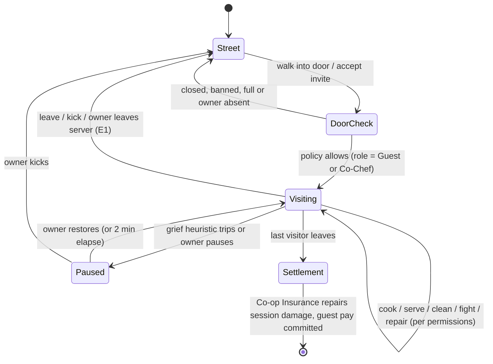
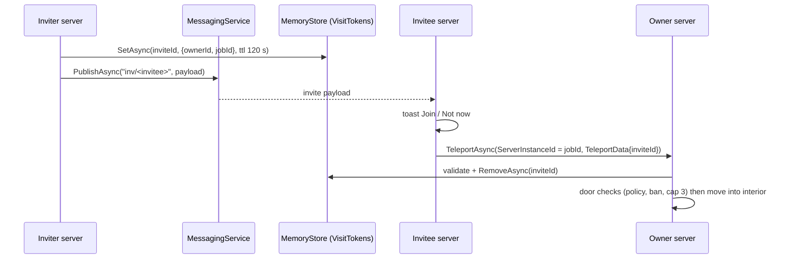

## 21. Multiplayer

> **Owner:** A14 Social & Economy. **Binding inputs:** §C3 (8 players per server, instanced interiors), §C16.4 (Restaurant
> Row plots, visiting via door or friends list), §C22 E1/E7/E12/E13 (disconnects, shared stations, Co-op Insurance,
> shutdown), §C12 (combat constants), §C19 (`MultiplayerService`, `CombatService`, `EconomyService`). Economy numbers
> (guest pay, caps, MS budgets) are defined in §22 and only applied here.

### 21.1 Purpose and Social Pillars

**Purpose.** Make Mystery Morph Restaurant a game you *want* to show friends: cook together in each other's kitchens,
hang out and show off morphs in a shared city, and — only if you choose to — food-fight other players in the Morph Arena.

**Pillars (requirements):**
1. **Helping is always a win-win.** Guests are paid and levelled *by the game*; the owner never loses currency, items,
   reputation or progress because someone visited (§C22 E12).
2. **The owner is in charge — no votes.** Every co-op power is the owner's to grant or revoke instantly.
3. **PvP is strictly opt-in** and exists only inside Morph Arena matches (`BLD_08`). Restaurant customers are always NPCs;
   players never appear as customers, invaders or targets anywhere else.
4. **Nothing moves between players.** No trading, gifting or dropping of currency, parts, staff or furniture (§22.14.4).
5. **Kid-safe by construction.** Roblox-filtered chat only, filtered display names for morphs and restaurants, block and
   report always one tap away, cartoon defeat ("Seeing Stars") with no loss.

### 21.2 Server, Plot and Visit Model

| Rule | Value [TUNABLE where marked] | Source |
|---|---|---|
| Players per main server | 8 [TUNABLE] | §C3 |
| Restaurant plots per server | 8 façades on Restaurant Row (`BLD_17`); one per player | §C16.4 |
| Interiors | instanced in the far-off `Interiors` region; entering a door moves the character there | §C3 |
| Visitors per restaurant | **max 3** at once (4 players inside incl. owner) [TUNABLE] | this section |
| Owner presence | visitors may enter only while the owner is in the same server; if the owner leaves the server, E1 Closing applies and visitors are moved to the street | §C22 E1 |
| Owner in the city | visitors already inside may keep helping; new visitors need an invite or Co-Chef status | this section |
| Customers | NPC only (SPCV pattern); co-op never adds player-controlled customers | §C3, §8 |
| Arena | separate reserved servers of the Arena place (same universe); up to 4 players per match | §21.9 |



### 21.3 Co-op Roles and Permission Matrix

**Purpose.** Let friends genuinely help (cook, serve, clean, fight, repair) while making theft and griefing impossible.

**Roles.**
- **Owner** — the player whose plot it is. Exactly one. All powers; some powers are *owner-only forever* (locked).
- **Co-Chef** — a Roblox friend (`Player:IsFriendsWith`) the owner has promoted. Saved in the owner's profile
  (`coop.coChefs`, max 10 UserIds); elevated defaults; still cannot spend owner currency or remove furniture.
- **Guest** — any other permitted visitor (door policy, §21.7). Default role.

**Door policy** (owner setting, default **Friends only**): *Open* (anyone in the server) · *Friends only* · *Invite only* ·
*Closed*. Banned players are refused under every policy.

**Permission matrix** (defaults; "toggle" = owner can switch it per role in the Co-op panel, and per player via
long-press on a name; "locked" = cannot be changed by anyone):

| Action | Owner | Co-Chef default | Guest default | Owner-configurable? | Notes |
|---|---|---|---|---|---|
| Cook (use stations, pick up / combine / plate items) | Yes | Yes | Yes | toggle (Co-Chef, Guest) | Station slot locks per E7; items are restaurant-owned |
| Serve (seat, take orders, deliver plates, Peace Offerings) | Yes | Yes | Yes | toggle | Peace Offering (free dessert/drink, §C11.5) uses basic stock only for Guests |
| Clean (trash, spills, dishes) | Yes | Yes | Yes | toggle | Raises shared cleanliness K |
| Fight (attack hostile customers, abilities, `ABL_006` Calm Down!) | Yes | Yes | Yes | toggle | Friendly fire **locked off**; players cannot damage, push or pull players |
| Repair (repair minigame, rebuild rubble) | Yes | Yes | Yes | toggle | Materials paid by Co-op Insurance for session damage (§21.4.3) |
| Move furniture (rearrange inside the restaurant) | Yes | No | No (locked) | toggle for Co-Chef only ("Rearrange") | Never store, sell, delete or recolour; placement validation (E10) still applies |
| Use special stock (cook recipes consuming stocked special ingredients) | Yes | Yes | No | toggle (Co-Chef, Guest) | When off, special-stock tickets show "Owner/Co-Chef" and are skipped by that player |
| Hire / assign staff | Yes | Assign: No; Hire: locked | locked | Assign toggle for Co-Chef | Hiring spends currency → owner-only forever |
| Spend owner currency (any purchase, stock order, upgrade, non-insured repair) | Yes | locked | locked | never | E12 |
| Change menu (menu slots, featured dish) | Yes | No | locked | toggle for Co-Chef | Prices are fixed by §6, never editable |
| Store / sell / delete furniture, tier upgrade, open/close, door policy, collect offline earnings | Yes | locked | locked | never | Owner-only forever |
| Kick a Guest | Yes | No | locked | toggle for Co-Chef | Co-Chefs can never kick the owner or other Co-Chefs |
| Invite others | Yes | Yes | No | toggle | Invites count toward the 3-visitor cap |
| Emotes, photo mode, chat | Yes | Yes | Yes | — | Chat is Roblox TextChatService (filtered) |

**Rules & Mechanics.**
- Permission changes apply **immediately**. An action already in progress (e.g. a chop tap sequence) finishes; no new
  action of that type can start. Items held when a permission is revoked are set down on the nearest free counter
  (special stock returns to the Pantry).
- All permission checks are server-side in `MultiplayerService.Can(player, action, target)`; the client only greys out
  buttons for clarity.
- A visitor's own mutations, stats, abilities and loadouts work normally (they are the visitor's), but **no visitor
  ability can affect owner property beyond normal gameplay** (e.g. `ABL_068` Web Sweep cleans trash, never furniture).

**UI.** Owner HUD gains a **Co-op chip** (visitor count `2/3`, Busy Kitchen bonus). The Co-op panel lists visitors with
role badge (chef hat = Co-Chef, ticket = Guest), live contribution (orders, cleans, repairs), and buttons *Promote/Demote*,
*Pause*, *Kick*, *Ban*. Role toggles are a two-column switch list (Co-Chef / Guest) with icons and text, never colour only.
Visitors see a small "Helping at <Restaurant name>" banner and their earned MB/XP ticking up.

### 21.4 Co-op Rewards

#### 21.4.1 Guest Rewards (game-funded, never from the owner)

```
GuestValue(order) = Σ_items Price_item × 1.05^(−max(0, L_recipe − L_guest))   -- valued at the guest's own level (§C4.2)
CreditShare       = 0.40 to the player who served the plate
                  + 0.60 split between players who performed processing steps on its components (by step count)
GuestMB(order)    = 0.50 × GuestValue(order) × CreditShare(guest)          -- [TUNABLE] 50 %
DailyCap          = 1.5 × NetRef(guest's own tier) MB per UTC day; beyond the cap guests earn XP only
GuestXP(action)   = 0.9 × XP the same action grants in the guest's own restaurant (level-relative, §C5.1) × BusyKitchenXP
```

- Accrued per order in the visit record and paid by `EconomyService` (reason `coop_guest_pay`, key
  `coop:<visitId>:<checkpointNo>`) every 10 min and at settlement (§22.16). **Nothing is ever debited from the owner.**
- Valuing orders at the guest's level stops a low-level friend from farming a `TIER_10` kitchen's prices; the daily cap
  bounds co-op income to ≈ 1.5 h of the guest's own play.
- No MS or RT per order (those come from co-op quests and events, §21.8.3). Helper titles and emotes unlock at co-op
  milestones (§21.8.5).

Generated examples (orders/h credited assumes the guest handles 30 % of the restaurant's customers):

<!-- sim:coop -->
<!-- /sim:coop -->

Same-tier helpers earn ≈ 17–19 % of their own hourly net from guest pay (on top of their own restaurant's away/offline
accrual per §17), so visiting friends is rewarding but never better than running your own restaurant; a helper far above
the owner earns little MB (and plenty of XP and goodwill), and a much lower helper is capped after ≈ 2.4 h.

#### 21.4.2 Owner Rewards — "Busy Kitchen"

- The owner receives **all** payments and tips for every order, whoever cooked or served it.
- **Busy Kitchen bonus** per *active* visitor (≥ 3 qualifying actions — cook step, serve, clean, repair, calm — in the last
  5 min): **+5 % tips, +5 % XP for everyone inside, +8 % customer arrival rate** (seat capacity still caps customers).
  Max 3 visitors → +15 % tips, +15 % XP, +24 % arrivals [TUNABLE]. AFK visitors give nothing. Anti-alt rules from §29.16:
  only visitors with `Player.AccountAge` ≥ 7 days count, at most 5 distinct visitors per owner per UTC day.
- Owner co-op milestones (orders completed with helpers) unlock cosmetic titles ("Head Chef of Chaos") and emotes.

#### 21.4.3 Co-op Insurance and Reputation Shield (E12)

- **Session damage ledger:** every durability loss during a co-op session (≥ 1 visitor present) is recorded with its
  cause (visitor, customer, event). After the last visitor leaves, all session damage is **repaired free** (cartoon
  "Insurance Gnome" sweep, 3 s). Repairs done *during* the visit cost no materials.
- Pre-existing damage (from before the session) is not covered — inviting a friend is not a free-repair exploit.
- Food wasted by visitors is never charged; special stock burned or trashed by visitors is refunded to the Pantry.
- **Reputation shield:** a customer whose anger was caused by a visitor (thrown food hit, their plate trashed, attacked
  while calm) applies no storm-out penalty and its Stars delta is floored at 0 (§C11.4); revenue from that customer is
  whatever they pay.

### 21.5 Shared Cooking, Serving, Cleaning and Combat

| Topic | Rule |
|---|---|
| Station locks | One interactor per **slot** (E7); multi-slot stations (grill 2, stove 2 burners, …) allow parallel use. A slot lock releases on completion, after 20 s without input from the holder (§29.16 anti-hogging), or when the holder moves > 9 studs away (7 + 2 tolerance, §C3). |
| Shared items | Every ingredient, component and plate is restaurant-owned: any permitted player may continue, plate or serve another player's item. Quality uses the component scores regardless of who made them (§C8). |
| Tickets | One shared ticket rail. Any permitted player can take an order. Tapping a ticket places a **soft claim** (name tag, 20 s) to reduce collisions — it is a hint, not a lock. |
| Carry | Each player's own capacity (1–3, §C3); passing items = put down / pick up (no throwing plates to players). |
| Credit tracking | Each component stores a provenance list (UserIds of processing steps); the plate stores the server-er. Used only for guest pay and contribution stats. |
| Cleaning & dishes | Any permitted player; cleanliness K and dish stock are shared. |
| Combat targets | Hostile customers choose targets per §11 AI among *all* players and staff inside. KO'd visitors respawn at this restaurant's kitchen spawn with §C12.1 rules (no loss). |
| Friendly fire | Off and locked: player attacks never damage, knock back, stun or pull another player outside the arena. Area abilities pass through allies. |
| Customer escalation | Hits on non-hostile customers add anger per §11.2.2 × a role factor: owner 1.0, Co-Chef 0.5, Guest 0.25 (`GUEST_ANGER_FACTOR`, §29.16) — a guest cannot easily start a brawl in a friend's diner; grief heuristics watch visitor-caused anger (§21.6). |
| Difficulty | Co-op does not raise customer hostility or anger probabilities; only arrivals rise (Busy Kitchen), bounded by seats. |
| Disconnects | Visitor leaves → held items set down; their soft claims clear; nothing is lost. Owner leaves → E1 Closing; visitors moved to the street with a friendly "The chef went home!" card. |

### 21.6 Anti-Grief and Anti-Theft

**Hard guarantees (locked, server-enforced):** visitors can never sell, store, delete, recolour or (Guests) move owner
furniture; never open the owner's inventory, wallet, stock orders, staff hiring, tier upgrades or offline report; never
take an item out of the restaurant (items are restaurant-owned and are dropped on the nearest counter when a visitor
leaves); never damage players. All session damage is insured (§21.4.3).

**Owner tools (vote-free, instant):**

| Tool | Effect | Persistence |
|---|---|---|
| Pause | Visitor can walk, chat and emote but not act | until restored or 2 min |
| Kick ("Show them the door", §29.16) | Visitor is moved to the street outside the door; cannot re-enter for 10 min | session |
| Ban | Visitor cannot enter or receive invites from this owner; listed in Co-op → Banned | profile `coop.banList` (max 50, oldest dropped with a prompt) |
| Close door | No new visitors; current visitors may stay or be removed with *Close & clear* | profile |
| Block (Roblox) | `StarterGui:SetCore("PromptBlockPlayer", player)`; blocked users are treated as banned (the client reports `GetCore("GetBlockedUserIds")` to the server — it can only restrict, never grant) | Roblox account |
| Report | Opens the standard Roblox report flow and logs `mmr_report_submitted` with the last 60 s of the co-op action log | — |

There is **no vote-kick, no majority rule and no way for visitors to remove the owner** or each other (Co-Chefs may
kick Guests only if the owner enables it).

**Automated grief heuristics** [TUNABLE] (server-side, per visitor, feeding the §29.16 guest disruption score). *Severe*
signals (first three rows) auto-remove the visitor (street, 10-min re-entry block) and notify the owner with *Ban / Undo*;
*mild* signals (last three rows) auto-**Pause** the visitor for 2 min and offer the owner *Restore / Kick / Ban*; a second
mild trigger in the same visit escalates to removal:

| Signal | Threshold |
|---|---|
| Plated, order-ready dishes trashed | ≥ 4 in 2 min |
| Food thrown that hits non-hostile customers | ≥ 3 in 1 min |
| Attacks on calm customers (anger level 0–1) | ≥ 3 in 1 min |
| Pick-up/put-down loops with no processing progress | ≥ 10 in 60 s |
| Station slot held idle (blocking) | ≥ 3 slots released by timeout in 2 min |
| Burned/ruined items caused | ≥ 6 in 2 min while the owner's burn rate is < 2 |

Text shown to players (restaurant names, morph names) goes through `TextService:FilterStringAsync` and
`GetNonChatStringForBroadcastAsync`; unfiltered text is never displayed to others.

### 21.7 Joining, Invites and Parties

#### 21.7.1 Same Server — Walk In
1. The owner's façade door shows a `ProximityPrompt` "Help at Bea's Tiny Mutation Diner (2/3)" when the policy allows.
2. Server validates: owner in server, policy, ban list, blocked list, visitor count < 3, visitor not In Combat.
3. Server calls `player:RequestStreamAroundAsync(interiorEntrance.Position)`, fades the client (0.4 s), pivots the
   character to the interior entrance, assigns the role and fires `Coop.VisitStarted`.
4. Leaving: the interior exit door, the HUD *Leave* button, or the restaurant **Return Door** for one's own restaurant.

#### 21.7.2 Different Server — Friends List / Join & Help
1. The Social panel lists online friends using `Player:GetFriendsOnline()`; entries whose `PlaceId` is this experience show
   their tier, server fullness and **Join & Help**.
2. On press, the origin server creates a visit token (`MemoryStore` hash map `VisitTokens`, TTL 120 s) and calls
   `TeleportService:TeleportAsync(game.PlaceId, {player}, options)` with `TeleportOptions.ServerInstanceId = friend.GameId`
   and `options:SetTeleportData({intent = "visit", ownerId = friendId, token = token})`.
3. The destination server reads `player:GetJoinData()`, **validates the token server-side** (teleport data is client-visible),
   then walks the arrival to the friend's door and runs 21.7.1 step 2–3.
4. `TeleportService.TeleportInitFailed` (e.g. `Enum.TeleportResult.GameFull`) → "Their server is full! We'll ping you when a
   spot opens": the origin subscribes to `slot/<jobId>` for 5 min; the target server publishes on `PlayerRemoving`.
   Other failures retry twice (2 s, 4 s) before showing an error.
5. Roblox's native "Join" from the Roblox friends list also works; the arrival is placed on Restaurant Row with a toast
   offering to visit the friend.

#### 21.7.3 Invites
- **Friends already in the experience (any server):** the inviter's server publishes to `MessagingService` topic
  `inv/<inviteeUserId>` a ≤ 1 KB payload `{inviteId, fromUserId, ownerId, placeId, jobId, expiresAt}`; every server
  subscribes one topic per local player (`SubscribeAsync` on join, `Disconnect` on leave — well inside the
  5 + 2 × players subscription limit). The invitee sees a toast (*Join / Not now / Mute invites*); acceptance teleports as in
  21.7.2 using the invite id as the token.
- **Friends not in the experience:** `SocialService:CanSendGameInviteAsync(player)` then
  `SocialService:PromptGameInvite(player, options)` with `ExperienceInviteOptions.InviteUser = friendId` and
  `LaunchData = '{"ownerId":…, "inviteId":…}'`. On launch the joining server parses `GetJoinData().LaunchData`, looks up
  the owner in the `Presence` map and teleports the player to that server.
- Limits [TUNABLE]: ≤ 5 invites per minute, ≤ 30 per hour per player; recipients choose *Accept invites from: Friends /
  No one*. Invites never carry free text.

#### 21.7.4 Parties (up to 4)
Parties exist for co-op quests, city events and arena Tag-Team. State lives in `MemoryStore` hash map `Parties`
(`partyId → {leader, members, createdAt}`, TTL 15 min, refreshed every 60 s by the leader's server). *Gather* teleports
members to the leader's server (same flow as 21.7.2). A party never shares currency, inventory or rewards — each member
earns their own.



### 21.8 Shared City

#### 21.8.1 Public Gathering Areas

| Building | District | Social features |
|---|---|---|
| `BLD_19` Morph Park & Fountain | `DST_08` | Emote Circle (5+ players emoting together trigger confetti, §36.10), picnic tables and benches (`Seat`s), wading in the fountain, the daily rumor from Old Man Pigeon (`NPC_025`), photo spots, seasonal areas for `EVT_030`/`EVT_031`; free |
| `BLD_22` Showcase Stage | `DST_07` | Morph shows with DJ Morphenstein (`NPC_024`, §21.8.6), runway and bleachers for 8 players plus NPC crowd, Grand Tournament Kitchen backstage for `EVT_005`; free |

Gathering areas are no-combat zones (abilities disabled except movement and emotes) and have a 16-player visual cap per
client for morph LOD (§30); farther players render as impostors.

#### 21.8.2 Social Activities (no new currency)
- **Emote Circle:** 5+ players emoting in the circle trigger a confetti burst (§36.10) and +1 progress toward the "In Sync"
  emote; progress counts once per player per 60 s.
- **Picnic Peace Offering:** two players at a picnic table can share a snack emote; both gain 0.01 × XPRate(L) (≤ 10/day).
- **Photo Mode:** free camera, poses, frames and filters; images stay on the device (no in-game upload or sharing of UGC).
- **Morph Swap Hour** (`EVT_021`): temporary *cosmetic* swaps of one visual part between consenting friends for 60 s
  (both accept; stats never change; reverts automatically).

#### 21.8.3 Cooperative Quests (parties up to 4)
§20 flags quests as `coop` (A13 owns the content). Framework:
- Shared objective counters; all members must be in the same server (Gather).
- **Every contributing member gets the full reward** of the quest (rewards follow §22.3/§22.13 budgets — no co-op
  multiplier on MB, so parties are not a farming tool); "contributing" = ≥ 15 % of progress or ≥ 3 qualifying actions.
- Co-op quest bonus: +10 % XP; MS rewards count toward the repeatable-MS soft cap (§22.14.2) after the first daily completion.
- Limit: 3 co-op quest completions per day with rewards; further completions give XP only.
- Typical activities: catering runs for the Delivery Depot (`BLD_15`), critic tasting tours for Food Critic HQ
  (`BLD_14`), sewer clean-ups near the Sewer King's Throne Room (`BLD_21`), Museum scavenger hunts (`BLD_16`).

#### 21.8.4 City Events in Multiplayer
`CityEventService` schedules events across servers (§18, §36.11 own the rules). Multiplayer participation rules:

| Event | Multiplayer shape |
|---|---|
| `EVT_007` Giant Rat King Attack | server-wide co-op boss vs King Ratbeard (`NPC_020`); rewards by personal contribution bands (damage, repairs, rescues, de-escalations count equally), never last-hit |
| `EVT_003` Citywide Restaurant Rush | all restaurants on the server add served customers to one shared goal; every contributing player earns the tier reward |
| `EVT_027` Downtown Dance-Off | rhythm emote mini-game at `BLD_22`; teams of up to 4 |
| `EVT_002` Mutation Parade | parade route walk with showcase-style cheering; cosmetic rewards |
| `EVT_025` Arena Brawl Bash | opt-in PvP king-of-the-hill with ring-outs in the local arena pits (§36.11), §11.11 normalization; the parallel PvE "Bash the Bots" waves give non-PvP players the same participation path — never PvP-only |
| `EVT_005` Legendary Chef Tournament | cooking finals in the Grand Tournament Kitchen behind `BLD_22`, hosted by Chef Supreme Omnivora (`NPC_029`); non-violent |
| `EVT_021` Morph Swap Hour | consensual cosmetic swaps (§21.8.2) |

Event rewards follow §18.8.4 (ERM bands, ×0.5 after 16 events per day, ≤ 3 capsules/day, ≤ 10 RT/week) and the §22.13 MS
budgets; contribution bands make co-op events reward helpers, never last hits; AFK players earn nothing.

#### 21.8.5 Emotes (all earnable)
Emotes are plain-text cosmetic rewards (§C17.4). Players equip 8 on the emote wheel (`B` / d-pad down / emote button).
Animations come from the §36.14 library. Robux emotes (§23) are extra and never replace any of these.

| Emote | How it is earned |
|---|---|
| Wave-o-Tentacle | default |
| Chef's Kiss | default |
| Thumbs Up (any appendage) | default |
| Happy Hop | reach level 5 |
| Pan Flip Flourish | serve 100 PERFECT dishes |
| Dizzy Spin | see stars for the first time (first KO) |
| Sauce Bow | complete 25 orders as a co-op guest |
| Head Chef Point | complete 100 orders with helpers as owner |
| Pigeon Strut | chat with Old Man Pigeon (`NPC_025`) 10 times |
| Mop Shuffle | clean 200 messes |
| Wrench Twirl | repair 100 objects |
| Zen Pose | calm 50 customers with `ABL_006` Calm Down! |
| Belly Bump Victory | win 10 arena matches (any combat mode) |
| Cook-Off Salute | finish 10 Cook-Off races |
| Runway Spin | win 10 morph shows at `BLD_22` (§36.10) |
| Confetti Pop | take part in `EVT_001` Giant Food Festival |
| Rat Rally Cheer | contribute to defeating King Ratbeard in `EVT_007` |
| Moonwalk-ish | finish a round of `EVT_027` Downtown Dance-Off |
| Pickle Rain Dance | play during `EVT_012` Pickle Rain |
| Tiny Wave | play during `EVT_015` Tiny Day |
| Big Stomp | play during `EVT_016` Giant Day |
| Spooky Toast Pop | play during `EVT_029` Haunted Kitchen Night (returns every October) |
| Snowmorph Shiver | play during `EVT_030` Snowmorph Holiday (returns every December) |
| Sprout Wiggle | play during `EVT_031` Spring Sprout Bloom (returns every April) |
| Five-Star Swoon | reach 5.0 ★ reputation |
| In Sync | trigger 20 Emote Circles |

Seasonal emotes always return with their yearly event, so missing one is never permanent (no FOMO).

#### 21.8.6 Morph Showcases (`BLD_22`, host DJ Morphenstein `NPC_024`)

§36.10 (`BLD_22`) fixes the show format; this subsection adds the social and anti-abuse rules `MultiplayerService` enforces.

**Format (§36.10):** shows auto-start every 15 min, or on demand when ≥ 3 players queue; 2–6 contestants walk the 40-stud
runway with pose prompts every 4 s while their **filtered** morph name is displayed; one theme per show (Most Tentacles ·
Tallest Morph · Best Color Coordination · Cutest Spooky · Most Legs · Breakfast Energy · Robot Chic · Ocean Vibes · Pure
Chaos · Tiny but Mighty · Shiniest · Animal Kingdom). **Score = 60 % audience votes + 40 % theme match** computed from the
contestant's equipped parts' categories, slots and §C13.5 tags. Rewards: every contestant 0.03 × XPRate(L) + 5 MS; winner
20 MS + 2 ERM; first win title "Showstopper"; 10 wins emote "Runway Spin"; 5 rewarded shows per player per day.

**Voting rules [TUNABLE]:**
- Eligible voters: players in the bleachers for ≥ 30 s plus the other contestants; no self-votes; one 1–5 vote per voter per
  contestant (`Stage.Vote(showId, contestantUserId, value)`, server-validated, §36.10).
- Vote weight 1.0, reduced to **0.5** for party members and Roblox friends of the contestant (AC-18-42), for accounts younger
  than 3 days (`Player.AccountAge`), and for voters who give every contestant the same value.
- Audience component = Bayesian average `(Σ w·v + 2 × 3.0) / (Σ w + 2)` so two friends cannot swing a quiet show; with
  fewer than 3 eligible human voters the theme match counts 100 % and MS rewards are withheld (XP still granted).
- Reciprocal maximum votes between the same two players in ≥ 3 shows on one UTC day drop that pair's weight to 0.25.

**Fairness and safety:** theme match ignores paid cosmetic overlays (§23) — only owned mutation parts count — so Robux never
wins a show; offensive combinations can be reported from the results card (hidden after 3 reports pending review);
contestants are live characters (no copies) and must stay on the runway; the stage is a no-combat zone.

