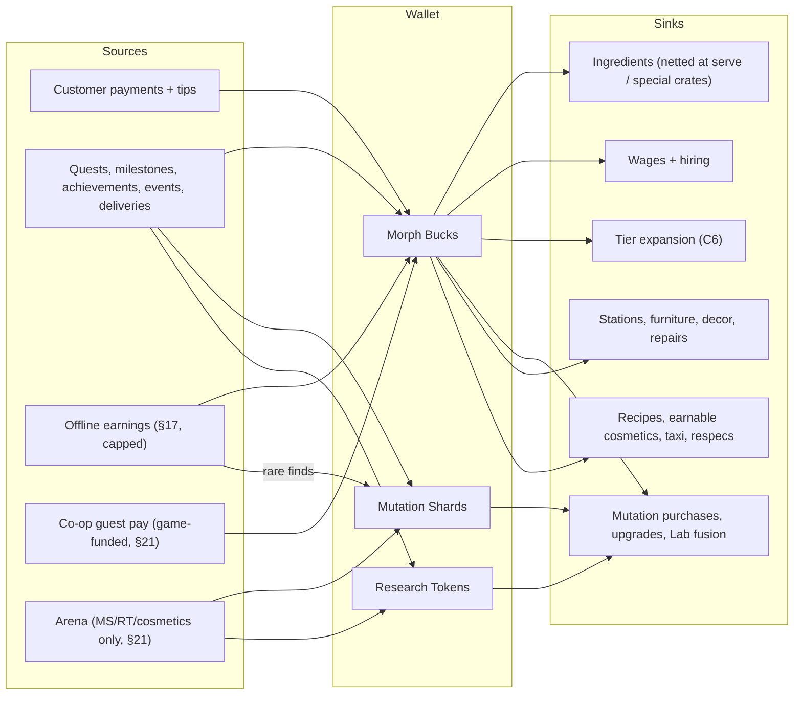

## 22. Economy

> **Owner:** A14 Social & Economy. **Binding inputs:** canon §C4 (currencies, price curve, pacing, mutation
> prices/upgrades, capsules, employee bands, station levels), §C5.1 (XP curve), §C6 (tiers), §C11.3–C11.4
> (satisfaction, payment, tips, reputation, DecorMult), §C14.3 (offline caps), §C15 (offline model), §C22 E8/E9/E11.
> **All tables marked "generated" are produced by `gdd/tools/economy_sim.py`** (Python 3 stdlib, deterministic) and can be
> refreshed in place with `python3 gdd/tools/economy_sim.py --render gdd/sections/22_economy.md`. `--check` re-validates
> the model against canon and exits non-zero on failure.

### 22.1 Purpose and Economy Pillars

**Purpose.** The economy turns the restaurant (how players *earn*) into morphs (what players *want*), as the creative
director demands: **Cook → Earn → Morph → Become More Powerful → Run a Better Restaurant → Earn More → Discover Rarer
Morphs.** It must stay understandable to an 8-year-old (three currencies, all visible on the HUD), deep enough for a
16-year-old optimiser, and impossible to break with exploits or Robux.

**Pillars (requirements, not tunables):**

1. **Three currencies, no more.** Morph Bucks (MB), Mutation Shards (MS), Research Tokens (RT) per §C4.1. No premium
   currency, no event tokens, no arena tokens. Robux buys cosmetics only (§23).
2. **MB-gated early, MS/RT-gated late.** In T1–T5 the binding constraint is MB (every purchase is a choice). From T7 the
   restaurant (plus offline earnings) produces more MB than power purchases can absorb, and **MS and RT — which are
   earned only by playing (never by Robux, RT never offline) — pace morph power.** Surplus MB flows into prestige and
   cosmetic MB sinks (§22.14).
3. **Tiers are level-gated.** A tier upgrade needs the §C6 cost *and* the §C6 level. Levels come only from XP (§C5.1),
   which comes only from active play, so extra MB (offline, co-op) can never fast-forward the tier ladder.
4. **One writer.** `EconomyService` is the only code that changes a balance; every change is an idempotent, logged
   transaction (§22.16).
5. **No player-to-player transfer of anything** — no trading, gifting, mailing or dropping currency, parts, staff or
   furniture (§22.14.4).
6. **Failure is funny, never ruinous.** Balances never go negative (E8), objects are never lost (§C6 damage states), KOs
   cost nothing (§C12.1), offline incidents are capped (§C15).



### 22.2 Currencies

**Purpose.** Give every reward and price exactly one unambiguous unit.

**Rules & Mechanics.**
- Balances are **non-negative integers** stored in the profile (`wallet.MB`, `wallet.MS`, `wallet.RT`); fractional
  accruals (offline steps, per-minute wages) use server-side accumulators and are floored when committed.
- **Sanity hard caps** (overflow protection, far beyond intended play): MB 1,000,000,000,000; MS 10,000,000; RT 1,000,000.
  A grant that would exceed a cap is clamped and logged `mmr_economy_cap_hit`.
- A spend is **all-or-nothing**: if the balance is insufficient the purchase fails with "Not enough MB!" and nothing changes.
  Wages are the only automatic spend; when a wage tick cannot be covered, staff take an **Unpaid Break** (E8).
- Prices are always shown **before** confirmation with the post-purchase balance; purchases ≥ 10,000 MB or ≥ 25 % of the
  balance need a second tap ("Hold to buy", 0.6 s) and trigger an immediate save (§C3).

**Variables [TUNABLE].**

| Currency | Code | Role | Earned from (§C4.1) | Spent on (§C4.1) | Hard cap | Never from |
|---|---|---|---|---|---|---|
| Morph Bucks | MB | restaurant currency; paces T1–T6 | customer payments, tips, quests, milestones, events, deliveries, offline earnings, achievements, co-op guest pay (§21) | special ingredients, furniture, equipment, repairs, wages, hiring, tier upgrades, mutation purchases & upgrades, recipe learning, earnable cosmetics, Pigeon Taxi, respecs | 1,000,000,000,000 | Robux, arena |
| Mutation Shards | MS | morph currency; paces Rare+ power | quests, dailies/weeklies, events, arena, duplicate conversion, offline discoveries, achievements | mutation upgrades, Lab fusion, Rare+ purchases, Mystery Market | 10,000,000 | Robux, customer payments |
| Research Tokens | RT | prestige morph currency; paces Epic Lv4+, Legendary, Mythic | weekly quests, story quests, Legendary dish orders, arena seasons, achievements, events | Epic+ upgrades Lv4+, Mythic fusion, Legendary purchases, advanced Lab research | 1,000,000 | Robux, offline, customer payments |

**UI.** HUD top bar shows MB (coin-stack icon, yellow), MS (shard icon, teal) and RT (scroll-and-flask icon, violet) with
thousands separators and compact notation above 10 million (`12.4M`). Every change animates a "+123 MB" float from its
source (customer, quest board, report). Colour is never the only cue: each currency has its own icon shape (§24).
Tapping a currency opens the **Wallet panel**: balance, last 20 transactions (reason text, signed amount, time) and a
"Where do I get this?" list linking to the sources above.

**Progression.** MB is visible from the first second; MS appears at tutorial step `QST_TUT_010` (first mutation);
RT appears the first time the player can spend it (first Epic part reaching Lv4, or first Legendary offer) with a one-time
explainer from Dr. Splice (`NPC_013`).

**Player Interactions.** Currencies are strictly personal: no trading, gifting or dropping (§22.14.4). Co-op guests are
paid **by the game**, never from the owner's wallet (§21).

**Dependencies.** §C4 (anchors), §10 (payment/tips), §12 (mutation sinks), §16–§17 (wages, offline), §20 (quest rewards),
§21 (co-op, arena), §23 (Robux boundaries), §28 (persistence), §29 (anti-exploit), §31 (analytics).

**Roblox Implementation.** See §22.16 (`EconomyService` API, transaction log, idempotency).

### 22.3 Revenue Sources

All reward budgets below scale with **NetRef(T)** = the §C4.4 "Net MB / active hour" of the player's *current* tier, so a
reward never becomes trivial or inflationary as the player climbs. §20 (quests), §36.11 (events), §36.16 (achievements)
and §36.17 (milestones) must express MB rewards as these fractions (rounded to "nice" numbers: 2 significant digits).

| Source | Currency | Formula / budget [TUNABLE] | Defined in | Share of active net (T1 → T10) |
|---|---|---|---|---|
| Customer payments | MB | `Σ item price × PayFactor(S)` — PayFactor 1.0 (S ≥ 50), 0.8 (30–49), Apology 0.4, storm-out 0 (§C11.4) | §10 | 119 % → 113 % of net (before costs) |
| Tips | MB | `Σ price × TipRate(S) × PersonalityTipMult`; Jackpot ×5 at `0.5 % + 0.1 %·LUCK` on S ≥ 90 (cap 500 / 5,000 MB) | §10 | 10 % → 16 % of net |
| Quests | MB, MS, RT | MB: daily 2 % NetRef each (3/day), weekly 4 % (5/week), challenge (CHF/CBT/RPR/EXP/EMP/RST) 2 %, story quest 3 %, chapter finale 15 %; tutorial chain `QST_TUT_001`–`012` total **400 MB** one-time | §20 | 12 % → 8 % |
| Milestones & achievements | MB, MS, RT, capsules | one-time; MB 10–50 % NetRef each; aggregate ≈ 5 % of net early → 1 % late | §36.16, §36.17 | 5 % → 1 % |
| City events | MB, MS, RT, capsules | MB in **ERM** (Event Reward Minute = NetRef ÷ 60, §18.8.4) by band Participation / Success / Top (typically 3–15 ERM); +25 % MB if the cross-server goal is met; MS/RT flat per §36.11; full rewards for the first 16 events (8 M objectives) per UTC day, then ×0.5 MB and MS; ≤ 3 event capsules/day (extras → 25 MS); ≤ 10 event RT/week (`EVT_005` exempt); repeat trophies (`FRN_901`–`FRN_910`) → 100 MS | §18, §36.11 | 1 % → 3 % (net uplift) |
| Deliveries | MB | Delivery Depot (`BLD_15`) run = 1.5 % NetRef (≤ 10 runs/day); `ROLE_DELIVERY` revenue stream per §16 | §16, §18 | 1 % → 2 % |
| Offline earnings | MB (+ rare MS, ≤ 1 capsule/day) | §C15: 35–50 % of active net/h, capped by §C14.3; never RT | §17 | see §22.11 |
| Co-op guest pay | MB, XP | 50 % of the guest-level base value of orders the guest completes, game-funded, daily cap 1.5 × own NetRef (§21.4) | §21 | optional |
| Arena | MS, RT, cosmetics | per-match MS with daily soft cap; RT at season end only; **never MB** (§C4.1) | §21 | optional |

**Events are mostly a time-for-reward swap for MB:** an event of D minutes pays about D ERM, i.e. roughly the restaurant
income of the minutes spent away (§18.8.5 worked example), so its *net* MB uplift per active hour is small (≈ 3 %,
from Post-Event Rush, global bonuses and staffed restaurants); the real event rewards are MS, RT, capsules and trophies.

The recurring "quests/events/other" share is **25 % of service net at T1, 22 % at T2, 19 % at T3, 17 % at T4 and 15 % from
T5** (front-loaded by onboarding, first-time milestones and story pacing), matching §C4.4's "~15 % quests/events".

### 22.4 Money Sinks

| Sink | Currency | Price rule | Scales with | Defined in | Notes |
|---|---|---|---|---|---|
| Ingredients | MB | basic: `price × ICR(D)` netted at serve (never upfront; wasted food charged at the trash, never below 0); special: crates bought upfront | recipe price (×1.05/level) | §7, §C9 | ICR target 25–40 % (D1 40 % → D5 25 %), × `(1 − 0.0015·EFFICIENCY)`, × `(1 − StockerDiscount)` for special stock |
| Stations & equipment | MB | purchase at base price B; upgrades ×1.5 / ×4 / ×10 / ×25 B (§C4.9) | station class, tier gate | §5, §36.13 | payback guidance §22.9.1 |
| Furniture & decor | MB | catalog price; atmosphere value per point targeted in §22.9.2 | tier | §15, §36.13 | atmosphere capped at 100 (DecorMult ≤ ×1.2) |
| Repairs | MB | material cost per damage point, −0.2 %/REPAIR pt (max −30 %); Destroyed → rebuild ≤ 25 % of item price | item price | §15, §C6 | expected 3.0 % of gross at T1 → 1.5 % at T10 |
| Wages | MB | §C4.8 per hour worked, online and offline | rarity | §16, §17 | E8 Unpaid Break if uncovered |
| Hiring & training | MB | §C4.8 hire bands; training/promotions per §16 | rarity | §16 | reference roster §22.8 |
| Tier expansion | MB | §C6 (includes the City Hall permit from `TIER_04`) | tier | §15, §C6 | ≈ 50 % of income in T3–T9 |
| Mutation purchases | MB (+MS, RT) | §C4.5 | rarity | §12 | Mart, Mystery Market rotation |
| Mutation upgrades & fusion | MB, MS, RT | §C4.6; Mythic fusion = 3 Legendary + 600 MS + 40 RT | rarity × level (×1.5/level) | §12 | §22.10 |
| Recipe learning | MB | `5 × price` at Cooking Academy (`BLD_06`); `RCP_LEG_*` quest-granted | recipe price | §6 | repays in ≈ 6 servings (§22.6) |
| Earnable cosmetics & prestige | MB | Body Mods (`BLD_02`) palettes, Monster Mall (`BLD_12`) decor beyond the atmosphere cap, façade flair | tier | §13, §15, §18 | absorbs late-game surplus (§22.14.3) |
| Misc | MB | Pigeon Taxi `25 × tier` per ride, charged on arrival (§18); stat respec `500 × level` after the free daily one (§C5) | tier / level | §18, §14 | ≈ 2 % of discretionary spend |

### 22.5 Active Income Model and Canon Calibration

**Purpose.** A bottom-up model that derives per-hour income from the canon mechanics (demand, seats, recipe price curve,
satisfaction, tips, ingredients, wages) and reproduces the §C4.4 "Net MB / active hour" targets. Every other table in this
section is built on it.

**Rules & Mechanics (per active hour, competent player, tier T, level L):**

```
RepMult     = 0.5 + 0.25 × Stars                         -- §C11.4
DecorMult   = 0.9 + 0.003 × Atmosphere                   -- §C11.4
Demand      = BaseDemand[T] × RepMult × DecorMult        -- §C6 (EventMult averages 1.0; events sit in "other")
SeatCap     = Seats[T] × 3600 / VISIT_SEC_ACTIVE         -- 225 s active seat turnover → 16 customers/seat/h
Customers N = min(Demand, SeatCap) × ServeRate           -- ServeRate: share who are served (not storm-outs)
MenuLevel   = 1 + 0.835 × (L − 1)                        -- the menu trails the player as it broadens
ItemPrice   = 1.10 × BasePrice(MenuLevel)                -- §C4.2 curve; 1.10 = menu-weighted difficulty × category mix
Ticket      = 1.4 × ItemPrice                            -- §C4.3
Payments    = N × Ticket × PayFactor                     -- PayFactor from the satisfaction mix (§C11.4)
Tips        = N × Ticket × TipRate                       -- TipRate from the satisfaction mix + Jackpot Tips
Ingredients = N × Ticket × ICR × (1 − 0.0015 × EFFICIENCY)
ServiceNet  = Payments + Tips − Ingredients − OnlineWages(roster)
Net         = ServiceNet × (1 + QuestShare[T])           -- quests, milestones, events, deliveries
```

**Variables [TUNABLE]** — reference state at tier entry; between tiers every value is interpolated linearly by level.

| Tier | Stars | Atmosphere | ServeRate | ICR (before EFFICIENCY) | EFFICIENCY stat | LUCK stat | QuestShare | Repairs (% of gross) |
|---|---|---|---|---|---|---|---|---|
| `TIER_01` | 2.60 | 10 | 0.920 | 38 % | 0 | 2 | 25 % | 3.0 % |
| `TIER_02` | 3.00 | 20 | 0.930 | 37 % | 3 | 5 | 22 % | 3.0 % |
| `TIER_03` | 3.30 | 30 | 0.940 | 36 % | 8 | 10 | 19 % | 2.8 % |
| `TIER_04` | 3.55 | 40 | 0.945 | 35 % | 15 | 16 | 17 % | 2.6 % |
| `TIER_05` | 3.75 | 50 | 0.950 | 34 % | 22 | 22 | 15 % | 2.4 % |
| `TIER_06` | 3.95 | 58 | 0.955 | 33 % | 30 | 30 | 15 % | 2.2 % |
| `TIER_07` | 4.10 | 66 | 0.960 | 32 % | 38 | 38 | 15 % | 2.0 % |
| `TIER_08` | 4.25 | 74 | 0.965 | 31 % | 46 | 46 | 15 % | 1.8 % |
| `TIER_09` | 4.40 | 82 | 0.970 | 30 % | 54 | 54 | 15 % | 1.6 % |
| `TIER_10` | 4.55 | 90 | 0.970 | 30 % | 60 | 60 | 15 % | 1.5 % |

Online wages use the reference roster of §22.8. A one-time **onboarding grant of 400 MB** (the tutorial chain) is paid in
the first 15 minutes and is *not* part of the hourly rate.

**Calibration result (generated).** The model lands within **±3.7 %** of every §C4.4 value with no per-tier fudge factor:

<!-- sim:calib -->
| Tier | Entry L | Stars / Atmos. | Customers/h | Avg ticket | Payments | Tips | Ingredients | Online wages | Quests/events/other | Model net/h | Canon C4.4 | Δ |
|---|---|---|---|---|---|---|---|---|---|---|---|---|
| `TIER_01` | 1 | 2.60 ★ / 10 | 49 | 15.4 | 733 | 61 | 288 | 12 | 124 | 618 | 630 | -1.9 % |
| `TIER_02` | 5 | 3.00 ★ / 20 | 73 | 18.1 | 1,273 | 106 | 484 | 30 | 190 | 1,055 | 1,080 | -2.3 % |
| `TIER_03` | 10 | 3.30 ★ / 30 | 99 | 22.2 | 2,122 | 179 | 780 | 98 | 270 | 1,693 | 1,730 | -2.1 % |
| `TIER_04` | 18 | 3.55 ★ / 40 | 127 | 30.8 | 3,825 | 402 | 1,338 | 148 | 466 | 3,207 | 3,100 | +3.5 % |
| `TIER_05` | 26 | 3.75 ★ / 50 | 158 | 42.6 | 6,578 | 701 | 2,211 | 370 | 705 | 5,402 | 5,400 | +0.0 % |
| `TIER_06` | 35 | 3.95 ★ / 58 | 191 | 61.5 | 11,476 | 1,244 | 3,698 | 682 | 1,251 | 9,591 | 9,600 | -0.1 % |
| `TIER_07` | 45 | 4.10 ★ / 66 | 225 | 92.5 | 20,478 | 2,477 | 6,280 | 1,740 | 2,240 | 17,175 | 17,400 | -1.3 % |
| `TIER_08` | 56 | 4.25 ★ / 74 | 262 | 144.8 | 37,351 | 4,596 | 10,955 | 3,040 | 4,193 | 32,145 | 32,800 | -2.0 % |
| `TIER_09` | 68 | 4.40 ★ / 82 | 302 | 236.0 | 70,223 | 8,787 | 19,675 | 5,980 | 8,003 | 61,358 | 63,700 | -3.7 % |
| `TIER_10` | 80 | 4.55 ★ / 90 | 353 | 384.8 | 133,709 | 16,940 | 37,096 | 10,260 | 15,494 | 118,787 | 120,500 | -1.4 % |
<!-- /sim:calib -->

#### 22.5.1 Customer Spending

Satisfaction bands follow §C11.3; tip rates §C11.4 (98–100 → 25 %, 90–97 → 18 %, 80–89 → 10 %, 70–79 → 5 %), mean
PersonalityTipMult 1.10. The mix improves with skill, stats and staff; competent players average ≈ 10 % tips across a
career (8 % early, 10–11 % mid, 12–13 % late including Jackpot Tips). Generated:

<!-- sim:customer -->
| Tier | Entry L | Menu-weighted item price | Avg ticket (×1.4) | Satisfaction mix % (98+/90/80/70/50/30/<30) | Pay factor | Tip rate (incl. Jackpot) | Ingredient ratio | Net per customer (MB) |
|---|---|---|---|---|---|---|---|---|
| `TIER_01` | 1 | 11.0 | 15.4 | 3 / 15 / 25 / 25 / 22 / 7 / 3 | 0.968 | 8.0 % | 38.0 % | 10.3 |
| `TIER_02` | 5 | 12.9 | 18.1 | 3 / 15 / 25 / 25 / 22 / 7 / 3 | 0.968 | 8.1 % | 36.8 % | 12.3 |
| `TIER_03` | 10 | 15.9 | 22.2 | 3 / 15 / 25 / 25 / 22 / 7 / 3 | 0.968 | 8.1 % | 35.6 % | 15.4 |
| `TIER_04` | 18 | 22.0 | 30.8 | 5 / 21 / 28 / 22 / 17 / 5 / 2 | 0.978 | 10.3 % | 34.2 % | 22.7 |
| `TIER_05` | 26 | 30.5 | 42.6 | 5 / 21 / 28 / 22 / 17 / 5 / 2 | 0.978 | 10.4 % | 32.9 % | 32.1 |
| `TIER_06` | 35 | 43.9 | 61.5 | 5 / 21 / 28 / 22 / 17 / 5 / 2 | 0.978 | 10.6 % | 31.5 % | 47.3 |
| `TIER_07` | 45 | 66.1 | 92.5 | 6 / 24 / 30 / 20 / 14 / 5 / 1 | 0.984 | 11.9 % | 30.2 % | 74.1 |
| `TIER_08` | 56 | 103.4 | 144.8 | 6 / 24 / 30 / 20 / 14 / 5 / 1 | 0.984 | 12.1 % | 28.9 % | 118.2 |
| `TIER_09` | 68 | 168.6 | 236.0 | 6 / 24 / 30 / 20 / 14 / 5 / 1 | 0.984 | 12.3 % | 27.6 % | 196.2 |
| `TIER_10` | 80 | 274.9 | 384.8 | 6 / 24 / 30 / 20 / 14 / 5 / 1 | 0.984 | 12.5 % | 27.3 % | 321.6 |
<!-- /sim:customer -->

#### 22.5.2 Expected Per-Hour Flows by Tier

Revenue sources and costs per active hour at tier entry (generated). "Operating margin" = (service net − repairs) ÷
(payments + tips).

<!-- sim:flows -->
| Tier (at entry) | Customer payments | Tips | Quests | Milestones & achievements | Events | Deliveries | − Ingredients | − Online wages | = Net/h (C4.4 basis) | Repairs (from net) | Operating margin |
|---|---|---|---|---|---|---|---|---|---|---|---|
| `TIER_01` | 733 | 61 | 74 | 33 | 9 | 7 | 288 | 12 | 618 | 24 | 59 % |
| `TIER_02` | 1,273 | 106 | 114 | 51 | 13 | 11 | 484 | 30 | 1,055 | 41 | 60 % |
| `TIER_03` | 2,122 | 179 | 162 | 73 | 19 | 16 | 780 | 98 | 1,693 | 64 | 59 % |
| `TIER_04` | 3,825 | 402 | 280 | 61 | 79 | 47 | 1,338 | 148 | 3,207 | 110 | 62 % |
| `TIER_05` | 6,578 | 701 | 423 | 92 | 120 | 70 | 2,211 | 370 | 5,402 | 175 | 62 % |
| `TIER_06` | 11,476 | 1,244 | 751 | 163 | 213 | 125 | 3,698 | 682 | 9,591 | 280 | 63 % |
| `TIER_07` | 20,478 | 2,477 | 1,299 | 224 | 448 | 269 | 6,280 | 1,740 | 17,175 | 459 | 63 % |
| `TIER_08` | 37,351 | 4,596 | 2,432 | 419 | 839 | 503 | 10,955 | 3,040 | 32,145 | 755 | 65 % |
| `TIER_09` | 70,223 | 8,787 | 4,642 | 800 | 1,601 | 960 | 19,675 | 5,980 | 61,358 | 1,264 | 66 % |
| `TIER_10` | 133,709 | 16,940 | 8,986 | 1,549 | 3,099 | 1,859 | 37,096 | 10,260 | 118,787 | 2,260 | 67 % |
<!-- /sim:flows -->

### 22.6 Recipe Profitability

**Formulas.**

```
Price(L, D, cat)    = round(10 × 1.05^(L−1) × (0.8 + 0.1·D) × CatFactor)      -- §C4.2 (± up to 15 % flavor variance in §6)
ICR(D)              = 0.40 − 0.0375 × (D − 1)                                 -- 40 % (D1) … 25 % (D5) [TUNABLE]
IngredientCost      = Price × ICR(D) × (1 − 0.0015·EFFICIENCY) × (1 − StockerDiscount if special)
ProfitPerItem       = Price × PayFactor − IngredientCost + Price × TipRate
ProfitPerKitchenMin = ProfitPerItem × 60 / PrepSec(recipe, station levels, COOK_SPD)
LearnPayback        = 5 × Price / ProfitPerItem                                -- servings to repay the Academy fee
```

Generated examples (D is an assumption for illustration; §6 is authoritative for real D, price and cost):

<!-- sim:recipes -->
| Recipe | Unlock L | D (assumed) | Cat. | Price | Ingredient cost | Margin | Profit + 10 % tip / item | Learn cost (5 × price) | Servings to repay learning |
|---|---|---|---|---|---|---|---|---|---|
| `RCP_BRG_001` | 1 | 1 | BRG | 9 | 4 | 56 % | 5.9 | start | — |
| `RCP_DRK_001` | 1 | 1 | DRK | 6 | 2 | 67 % | 4.6 | start | — |
| `RCP_PIZ_002` | 3 | 2 | PIZ | 11 | 4 | 64 % | 8.1 | 55 | 6.8 |
| `RCP_PST_003` | 6 | 3 | PST | 14 | 5 | 64 % | 10.4 | 70 | 6.7 |
| `RCP_DES_006` | 10 | 3 | DES | 14 | 5 | 64 % | 10.4 | 70 | 6.7 |
| `RCP_TAC_006` | 17 | 3 | TAC | 24 | 8 | 67 % | 18.4 | 120 | 6.5 |
| `RCP_BRG_010` | 25 | 3 | BRG | 35 | 11 | 69 % | 27.5 | 175 | 6.4 |
| `RCP_SEA_008` | 31 | 4 | SEA | 52 | 15 | 71 % | 42.2 | 260 | 6.2 |
| `RCP_ALN_004` | 40 | 4 | ALN | 80 | 23 | 71 % | 65.0 | 400 | 6.2 |
| `RCP_PIZ_015` | 55 | 4 | PIZ | 167 | 48 | 71 % | 135.7 | 835 | 6.2 |
| `RCP_MUT_005` | 70 | 5 | MUT | 377 | 94 | 75 % | 320.7 | 1,885 | 5.9 |
| `RCP_LEG_003` | 80 | 5 | LEG | 1,534 | 384 | 75 % | 1,303.4 | quest | — |
| `RCP_LEG_005` | 95 | 5 | LEG | 3,189 | 797 | 75 % | 2,710.9 | quest | — |
<!-- /sim:recipes -->

**Design rules for §6 / §7 (binding on this economy):**
1. For any level L, the menu-weighted average item price of a sensible menu (the player's best `MenuSlots[T]` recipes)
   must lie within ±10 % of `1.10 × BasePrice(1 + 0.835 (L − 1))`; the build validator (§35) recomputes this from §6.
2. Margin (price − ingredients) ÷ price stays in 60–75 %; higher difficulty must never be *less* profitable per item.
3. Legendary dishes (`RCP_LEG_*`, ×2.5) are the highest profit per item but consume stocked special ingredients and
   long prep, so their profit per kitchen-minute stays within 1.5× of a same-level standard dish.
4. Recipe learning is deliberately a *small* sink (≈ 6 servings to repay) — recipes are progression, never a wall.

### 22.7 Operating Margins

Operating margin *rises* gently with tier (59–60 % at T1–T3, 62–63 % at T4–T7, 65–67 % at T8–T10, see §22.5.2) because
better ingredient ratios (difficulty, EFFICIENCY, Stocker) and tips outpace rising wages. Guard-rails [TUNABLE]:

| Metric | Formula | Healthy band | Alarm (§22.15) |
|---|---|---|---|
| Ingredient ratio | Ingredients ÷ Payments | 27–39 % | > 42 % for 7-day median at any tier |
| Wage ratio (online) | Online wages ÷ (Payments + Tips) | 1.5–8 % | > 12 % (over-staffing) |
| Repair ratio | Repairs ÷ (Payments + Tips) | 1.5–3 % | > 6 % (chaos too punishing) |
| Operating margin | (ServiceNet − Repairs) ÷ (Payments + Tips) | 55–68 % | < 45 % |
| Offline ratio | Offline net/h ÷ active net/h (same state) | 35–50 % (§C15) | > 60 % or < 25 % |

### 22.8 Employee Return on Investment

**Reference roster (generated).** Counts by rarity at tier entry, the best manager (which sets the §C14.3 offline cap)
and the hire spend implied by §C4.8 mid-band prices. `EMP_001` Ollie is free (tutorial) and is one of the Commons.

<!-- sim:roster -->
| Tier | Staff / cap | Mix (C/U/R/E/L) | Best manager | Offline cap (C14.3) | Wages MB/h | New hire spend | Cumulative hire spend |
|---|---|---|---|---|---|---|---|
| `TIER_01` | 1 / 2 | 1 C | none | 2 h | 12 | 0 | 0 |
| `TIER_02` | 2 / 3 | 2 C | Common | 4 h | 30 | 400 | 400 |
| `TIER_03` | 4 / 4 | 3 C, 1 U | Common | 4 h | 98 | 2,500 | 2,900 |
| `TIER_04` | 5 / 6 | 3 C, 2 U | Common | 4 h | 148 | 2,100 | 5,000 |
| `TIER_05` | 7 / 8 | 2 C, 4 U, 1 R | Rare | 8 h | 370 | 14,700 | 19,700 |
| `TIER_06` | 9 / 10 | 1 C, 5 U, 3 R | Rare | 8 h | 682 | 23,100 | 42,800 |
| `TIER_07` | 11 / 12 | 4 U, 5 R, 2 E | Epic | 12 h | 1,740 | 131,000 | 173,800 |
| `TIER_08` | 13 / 14 | 2 U, 6 R, 5 E | Epic + Asst. Mgr | 14 h | 3,040 | 175,500 | 349,300 |
| `TIER_09` | 15 / 16 | 6 R, 7 E, 2 L | Legendary | 24 h | 5,980 | 740,000 | 1,089,300 |
| `TIER_10` | 19 / 20 | 4 R, 10 E, 5 L | Legendary | 24 h | 10,260 | 1,110,000 | 2,199,300 |
<!-- /sim:roster -->

**Formulas.**

```
Eff            = (RoleStat/100) × (0.6 + 0.4·Morale/100) × (0.7 + 0.3·Energy/100) × (1 + 0.001·EFFICIENCY)  -- §C14.2
ΔCustomers/h   = 3600 / PrepSec_avg × Eff / 1.4                                   -- chef, §C15 kitchen-capacity form
MarginalNet/h  = min(ΔCustomers/h, unmet demand) × NetPerCustomer − Wage
PaybackHours   = HireCost / MarginalNet/h          (operating hours: online + offline)
```

Marginal value is only real while the restaurant is **capacity-bound** (unmet demand > 0). The Employee panel (§16)
shows "Over-staffed: this hire adds ≈ 0 MB/h" when the new hire would exceed demand. Generated chef examples
(PrepSec_avg is an assumption; §5/§6 define real prep times):

<!-- sim:emp_roi -->
| Chef rarity | Typical tier | Cooking stat | Efficiency (C14.2; morale 80, energy 80) | PrepSec_avg (assumed) | Customers/h added | Net per customer | Wage/h | Marginal net/h | Hire cost | Payback (operating h) | Operating h/day (ref. player) | Payback (days) |
|---|---|---|---|---|---|---|---|---|---|---|---|---|
| Common | `TIER_02` | 28 | 0.242 | 40 s | 15.6 | 11.3 | 18 | 157 | 400 | 2.5 h | 9.5 h | 0.3 d |
| Uncommon | `TIER_04` | 42 | 0.363 | 50 s | 18.7 | 19.9 | 50 | 323 | 2,100 | 6.5 h | 9.5 h | 0.7 d |
| Rare | `TIER_06` | 57 | 0.493 | 60 s | 21.1 | 41.5 | 140 | 737 | 10,500 | 14.2 h | 17.5 h | 0.8 d |
| Epic | `TIER_08` | 72 | 0.623 | 75 s | 21.3 | 101.5 | 420 | 1,748 | 55,000 | 31.5 h | 24.0 h | 1.3 d |
| Legendary | `TIER_10` | 88 | 0.761 | 90 s | 21.7 | 275.9 | 1,100 | 4,900 | 315,000 | 64.3 h | 24.0 h | 2.7 d |
<!-- /sim:emp_roi -->

Rarer staff are long-term investments (2.5 operating hours for a Common, ~64 for a Legendary) but, because they also
run offline under higher caps, every rarity repays within ≈ 3 real days for the reference player — the "hire, log off,
come back richer" fantasy holds at every stage.

### 22.9 Upgrade Payback Periods

#### 22.9.1 Station Levels (§C4.9)

```
SpeedGain(Lv)  = time(Lv−1) / time(Lv) − 1           -- 0.90 / 0.80 / 0.70 / 0.60 multipliers
ΔNet/h         = ServiceNet × OrderShare × (Bottleneck × SpeedGain + QualityGain)
Payback (h)    = CostMult(Lv) × B / ΔNet/h            -- Bottleneck 0.5 (rush share), QualityGain 0.03 [TUNABLE]
```

Generated with illustrative base prices B (the real B values live in §36.13 — this table tells A10 which B values keep
upgrades worthwhile):

<!-- sim:stations -->
| Station class | Base price B (illustrative) | Order share | Upgrade | Cost mult. (C4.9) | Cost (MB) | Speed gain | Earliest tier | ΔNet/h there | Payback there | First tier with payback ≤ 10 h |
|---|---|---|---|---|---|---|---|---|---|---|
| Starter (e.g. `STN_GRILL`) | 150 | 35 % | Lv1→Lv2 | ×1.5 | 225 | +11.1 % | `TIER_02` | 26 | 8.7 h | `TIER_02` (8.7 h) |
| Starter (e.g. `STN_GRILL`) | 150 | 35 % | Lv2→Lv3 | ×4 | 600 | +12.5 % | `TIER_04` | 89 | 6.8 h | `TIER_04` (6.8 h) |
| Starter (e.g. `STN_GRILL`) | 150 | 35 % | Lv3→Lv4 | ×10 | 1,500 | +14.3 % | `TIER_06` | 296 | 5.1 h | `TIER_06` (5.1 h) |
| Starter (e.g. `STN_GRILL`) | 150 | 35 % | Lv4→Lv5 | ×25 | 3,750 | +16.7 % | `TIER_08` | 1,109 | 3.4 h | `TIER_08` (3.4 h) |
| Mid (e.g. `STN_MIXER`) | 400 | 25 % | Lv1→Lv2 | ×1.5 | 600 | +11.1 % | `TIER_02` | 18 | 32.4 h | `TIER_05` (6.0 h) |
| Mid (e.g. `STN_MIXER`) | 400 | 25 % | Lv2→Lv3 | ×4 | 1,600 | +12.5 % | `TIER_04` | 63 | 25.2 h | `TIER_06` (8.3 h) |
| Mid (e.g. `STN_MIXER`) | 400 | 25 % | Lv3→Lv4 | ×10 | 4,000 | +14.3 % | `TIER_06` | 211 | 18.9 h | `TIER_08` (5.6 h) |
| Mid (e.g. `STN_MIXER`) | 400 | 25 % | Lv4→Lv5 | ×25 | 10,000 | +16.7 % | `TIER_08` | 792 | 12.6 h | `TIER_09` (6.6 h) |
| Late (e.g. `STN_INFUSER`) | 2,000 | 15 % | Lv1→Lv2 | ×1.5 | 3,000 | +11.1 % | `TIER_06` | 107 | 28.0 h | `TIER_08` (8.4 h) |
| Late (e.g. `STN_INFUSER`) | 2,000 | 15 % | Lv2→Lv3 | ×4 | 8,000 | +12.5 % | `TIER_06` | 116 | 69.1 h | `TIER_10` (5.6 h) |
| Late (e.g. `STN_INFUSER`) | 2,000 | 15 % | Lv3→Lv4 | ×10 | 20,000 | +14.3 % | `TIER_06` | 127 | 157.6 h | — |
| Late (e.g. `STN_INFUSER`) | 2,000 | 15 % | Lv4→Lv5 | ×25 | 50,000 | +16.7 % | `TIER_08` | 475 | 105.2 h | — |
<!-- /sim:stations -->

**Rules for §36.13:** core starter stations must keep every upgrade's payback ≤ 10 active hours at the tier where it
unlocks; mid stations should reach ≤ 10 h within two tiers of unlock; niche late stations (`STN_ANTIGRAV`,
`STN_INFUSER`) may exceed that — their high levels are intentional prestige sinks in the MB-rich late game.

#### 22.9.2 Decor and Atmosphere (DecorMult)

A +1 atmosphere point raises demand by `0.003 / DecorMult` (≈ 0.25–0.33 %) and also feeds the satisfaction term
`M = Atmosphere/100` (weight 0.10). To make decor pay back in ≈ 10 active hours, **the MB cost of one atmosphere point
should equal `10 × 0.003 × ServiceNet / DecorMult`** at the tier where the item is first sold (generated):

<!-- sim:decor -->
| Tier | Typical atmosphere | DecorMult (C11.4) | Service net/h | ΔNet/h per +10 atmosphere | Target MB per atmosphere point (10 h payback) | Cost of +10 points |
|---|---|---|---|---|---|---|
| `TIER_01` | 10 | ×0.930 | 494 | 16 | 16 | 159 |
| `TIER_02` | 20 | ×0.960 | 865 | 27 | 27 | 270 |
| `TIER_03` | 30 | ×0.990 | 1,423 | 43 | 43 | 431 |
| `TIER_04` | 40 | ×1.020 | 2,741 | 81 | 81 | 806 |
| `TIER_05` | 50 | ×1.050 | 4,698 | 134 | 134 | 1,342 |
| `TIER_06` | 58 | ×1.074 | 8,340 | 233 | 233 | 2,330 |
| `TIER_07` | 66 | ×1.098 | 14,935 | 408 | 408 | 4,081 |
| `TIER_08` | 74 | ×1.122 | 27,952 | 747 | 747 | 7,474 |
| `TIER_09` | 82 | ×1.146 | 53,354 | 1,397 | 1,397 | 13,967 |
| `TIER_10` | 90 | ×1.170 | 103,293 | 2,649 | 2,649 | 26,485 |
<!-- /sim:decor -->

Atmosphere is capped at 100 (DecorMult ×1.2), so decor beyond the cap is purely cosmetic and is priced as a prestige
sink. Robux decor never exceeds the atmosphere value of an earnable equivalent and counts toward the same cap (§23.4).

#### 22.9.3 Restaurant Expansion (§C6)

Each tier step adds seats and base demand (plus staff, appliance and menu slots, story chapter and façade). The pure
seat/demand step pays back quickly early and slowly late — late tiers are bought for their unlocks and status, which is
why the tier fund absorbs ≈ 50 % of income (generated):

<!-- sim:expansion -->
| Tier | Name | Cost (C6) | Req. L | Seats | Base demand | Staff cap | Menu slots | Net/h before (at req. L) | Net/h after | Step | Payback of the seat/demand step | Cost ÷ prev. canon net/h |
|---|---|---|---|---|---|---|---|---|---|---|---|---|
| `TIER_02` | Tiny Mutation Diner | 1,000 | 5 | 4→6 | 50→65 | 2→3 | 4→5 | 825 | 1,055 | +27.9 % | 4.3 h | 1.6 h |
| `TIER_03` | Neighborhood Freak Café | 2,000 | 10 | 6→8 | 65→80 | 3→4 | 5→6 | 1,435 | 1,693 | +18.0 % | 7.7 h | 1.9 h |
| `TIER_04` | Morph City Grill | 5,000 | 18 | 8→10 | 80→95 | 4→6 | 6→8 | 2,615 | 3,207 | +22.7 % | 8.4 h | 2.9 h |
| `TIER_05` | Mutant Family Restaurant | 15,000 | 26 | 10→12 | 95→110 | 6→8 | 8→10 | 4,863 | 5,402 | +11.1 % | 27.8 h | 4.8 h |
| `TIER_06` | Monster Food Court | 40,000 | 35 | 12→14 | 110→125 | 8→10 | 10→12 | 8,704 | 9,591 | +10.2 % | 45.1 h | 7.4 h |
| `TIER_07` | Mutation Megadiner | 100,000 | 45 | 14→16 | 125→140 | 10→12 | 12→14 | 15,968 | 17,175 | +7.6 % | 82.8 h | 10.4 h |
| `TIER_08` | Luxury Freak Restaurant | 225,000 | 56 | 16→18 | 140→155 | 12→14 | 14→16 | 30,191 | 32,145 | +6.5 % | 115.1 h | 12.9 h |
| `TIER_09` | Morph City Food Palace | 525,000 | 68 | 18→20 | 155→170 | 14→16 | 16→20 | 58,718 | 61,358 | +4.5 % | 198.9 h | 16.0 h |
| `TIER_10` | Legendary Mutation Restaurant | 1,500,000 | 80 | 20→24 | 170→190 | 16→20 | 20→24 | 107,918 | 118,787 | +10.1 % | 138.0 h | 23.5 h |
<!-- /sim:expansion -->

### 22.10 Mutation Acquisition Pacing

**Sources** (acquisition codes §C13.8): `SHOP_MART` (Common–Rare, always stocked), `SHOP_ROTATION` (Mystery Market
`BLD_13`: Epic rotation, weekly Legendary), `CAPSULE` (earnable only, §C4.7 odds with pity at 40), `QUEST` (one tier-
appropriate part per story chapter, §20), `EVENT`, `ARENA` (always duplicated by a non-PvP source, §21.9), `LAB_FUSION`,
`OFFLINE_FIND` (≤ 1 capsule/day), `ACHIEVEMENT`, `SECRET`, `STARTER`.

**Cost to max a part (generated from §C4.6).** Duplicates come from capsules (players may keep them instead of the
auto-conversion) or, for Common/Uncommon, from simply buying a second copy:

<!-- sim:mut_costs -->
| Rarity | Acquisition price (C4.5) | Max Lv | MB to max (C4.6) | MS to max (base) | Duplicates needed | …or substitute MS | RT to max | MB to max ÷ net/h at equip tier |
|---|---|---|---|---|---|---|---|---|
| Common | 150–400 | 5 | 812 | 20 | 4 | 40 | 0 | 1.3 h @ `TIER_01` |
| Uncommon | 800–2,000 | 6 | 3,956 | 60 | 5 | 125 | 0 | 3.7 h @ `TIER_02` |
| Rare | 4,000–10,000 + 20 MS | 7 | 18,703 | 168 | 6 | 360 | 0 | 10.8 h @ `TIER_03` |
| Epic | 25,000–60,000 + 80 MS | 8 | 96,516 | 420 | 7 | 1,120 | 10 | 31.1 h @ `TIER_04` |
| Legendary | 150,000–400,000 + 250 MS + 10 RT | 9 | 492,578 | 1,080 | 8 | 3,200 | 30 | 51.3 h @ `TIER_06` |
| Mythic | fusion: 3 Legendary + 600 MS + 40 RT | 10 | 2,246,602 | 2,250 | 9 | 9,000 | 84 | 68.5 h @ `TIER_08` |
| Secret | discovery only | 10 | 1,123,301 | 1,800 | 9 | 5,400 | 63 | 117.0 h @ `TIER_06` |
<!-- /sim:mut_costs -->

**Purchase policy used by the simulation [TUNABLE behaviour model]:** the player buys the best rarity whose equip level is
met and whose mid price is ≤ 1 h (T1–T3), 2.5 h (T4–T6) or 6 h (T7–T10) of current net income; if MS/RT are short it
buys one rarity lower or waits. 55 % of the mutation budget buys parts, 45 % upgrades the two best rarities owned
(cheapest next level first); 30 % of Rare+ upgrades use a kept duplicate, the rest pay DupeSubstituteMS. Capsules arrive at
0.65 per play day (login streak, weekly chest, events); story chapters grant Uncommon (ch. 1–2), Rare (3–4), Epic (5–7),
Legendary (8–9) and Mythic (10, the finale).

**Expected new parts by rarity per week of play** (reference player: 10.5 active h/week; capsule values are expectations,
duplicates excluded; generated):

<!-- sim:mut_weekly -->
| Week | Active h | Common | Uncommon | Rare | Epic | Legendary | Mythic | Bought with MB | Upgrades done | Cumulative new parts |
|---|---|---|---|---|---|---|---|---|---|---|
| 1 | 0.0–10.5 | 2.8 | 3.9 | 1.4 | 0.1 | 0.0 | 0.0 | 2 | 0 | 8 |
| 2 | 10.5–21.0 | 1.4 | 0.7 | 1.3 | 0.1 | 0.0 | 0.0 | 0 | 4 | 12 |
| 3 | 21.0–31.5 | 1.4 | 0.7 | 2.3 | 1.1 | 0.0 | 0.0 | 2 | 6 | 17 |
| 4 | 31.5–42.0 | 1.4 | 0.7 | 2.3 | 0.1 | 0.0 | 0.0 | 2 | 9 | 22 |
| 5 | 42.0–52.5 | 0.8 | 0.4 | 1.2 | 1.1 | 0.0 | 0.0 | 1 | 9 | 25 |
| 6 | 52.5–63.0 | 0.8 | 0.4 | 0.2 | 2.1 | 0.0 | 0.0 | 1 | 9 | 29 |
| 7 | 63.0–73.5 | 0.8 | 0.4 | 0.2 | 1.1 | 0.0 | 0.0 | 1 | 10 | 31 |
| 8 | 73.5–84.0 | 0.8 | 0.4 | 0.2 | 1.1 | 0.0 | 0.0 | 1 | 9 | 33 |
| 9 | 84.0–94.5 | 0.8 | 0.4 | 0.2 | 0.1 | 1.0 | 0.0 | 0 | 10 | 36 |
| 10 | 94.5–105.0 | 0.8 | 0.4 | 0.2 | 0.1 | 1.0 | 0.0 | 1 | 6 | 38 |
| 11 | 105.0–115.5 | 0.8 | 0.4 | 0.2 | 0.1 | 0.0 | 0.0 | 0 | 7 | 39 |
| 12 | 115.5–126.0 | 0.8 | 0.4 | 0.2 | 0.1 | 2.0 | 0.0 | 1 | 7 | 43 |
| 13 | 126.0–136.5 | 0.8 | 0.4 | 0.2 | 7.1 | 0.0 | 1.0 | 7 | 2 | 52 |
| 14 | 136.5–140.0 | 0.3 | 0.1 | 0.1 | 5.0 | 0.0 | 0.0 | 5 | 1 | 58 |
<!-- /sim:mut_weekly -->

Reading the table: ~8 new parts in week 1 (tutorial part, story, capsules, first Mart buys), a steady 2–5 per week through
the mid-game with the first Epic from story chapter 5 (week 3), the first MB-bought Legendary around week 10 (`TIER_09`)
and the first Mythic from the story finale (week 13). Collecting all 280 parts is a multi-month goal by design; Mythic
fusion (3 Legendary of one category + 600 MS + 40 RT) is the long-tail aspiration.

### 22.11 Offline Earnings Summary (refer §17)

§17 owns the simulation (§C15): deterministic, server-time, capped by the best manager (§C14.3), idempotent claims (E11),
offline net/h 35–50 % of active net/h for a well-staffed restaurant (never > 60 %), no RT ever, MS only as rare
discoveries (8 %/h chance of 1–3 MS) and ≤ 1 Morph Capsule per real day. Economy view for the reference player who checks
in twice a day (generated):

<!-- sim:offline -->
| Tier | Active net/h (C4.4) | Offline net/h band (35–50 %) | Model offline net/h (42 %) | Ref. cap | Per capped window | Offline h/day (2 check-ins) | Offline MB/day | Active MB/day (1.5 h) | Offline share of daily MB |
|---|---|---|---|---|---|---|---|---|---|
| `TIER_01` | 630 | 220–315 | 265 | 2 h | 529 | 4 h | 1,058 | 945 | 53 % |
| `TIER_02` | 1,080 | 378–540 | 454 | 4 h | 1,814 | 8 h | 3,629 | 1,620 | 69 % |
| `TIER_03` | 1,730 | 606–865 | 727 | 4 h | 2,906 | 8 h | 5,813 | 2,595 | 69 % |
| `TIER_04` | 3,100 | 1,085–1,550 | 1,302 | 4 h | 5,208 | 8 h | 10,416 | 4,650 | 69 % |
| `TIER_05` | 5,400 | 1,890–2,700 | 2,268 | 8 h | 18,144 | 16 h | 36,288 | 8,100 | 82 % |
| `TIER_06` | 9,600 | 3,360–4,800 | 4,032 | 8 h | 32,256 | 16 h | 64,512 | 14,400 | 82 % |
| `TIER_07` | 17,400 | 6,090–8,700 | 7,308 | 12 h | 87,696 | 22.5 h | 164,430 | 26,100 | 86 % |
| `TIER_08` | 32,800 | 11,480–16,400 | 13,776 | 14 h | 192,864 | 22.5 h | 309,960 | 49,200 | 86 % |
| `TIER_09` | 63,700 | 22,295–31,850 | 26,754 | 24 h | 642,096 | 22.5 h | 601,965 | 95,550 | 86 % |
| `TIER_10` | 120,500 | 42,175–60,250 | 50,610 | 24 h | 1,214,640 | 22.5 h | 1,138,725 | 180,750 | 86 % |
<!-- /sim:offline -->

**Finding (accepted by design, monitored):** with §C14.3 caps and two check-ins a day, offline earnings become the
majority of a casual player's MB from day 1 (53 %) and ≈ 86 % from `TIER_07`. This is acceptable because (1) tiers are
level-gated (scenario B in §22.12 reaches every tier exactly at its §C5.1 level gate, never earlier), (2) Rare+ morph
power needs MS/RT which are active-play currencies, and (3) surplus MB is absorbed by prestige sinks (§22.14.3). The
alarm thresholds in §22.15 watch the offline share and MB hoarding; §38 lists the open question of offline diminishing
returns beyond 8 h.

### 22.12 Economy Simulations

**Method.** `economy_sim.py` steps one minute of active play at a time for a competent reference player whose level
follows the canon XP curve exactly (`t(L) = [180(L−1) + 15L(L−1)] / 900` h, the closed form of §C5.1). Income comes
from §22.5 with the actual hired roster's wages; a tier is bought when the tier fund holds the §C6 cost **and** the level
requirement is met. Spending policy [TUNABLE]:

| Policy element | Value |
|---|---|
| Tier fund share of net income | T1 90 %, T2 75 %, T3 55 %, T4–T6 50 %, T7–T8 48 %, T9 50 % (saving stops once the fund covers the next tier) |
| Discretionary split T1–T3 | 15 % stations, 10 % furniture, 2 % misc, rest to one goal at a time: first Mart part of the tier → Common Manager → remaining hires → recipes → upgrades |
| Discretionary split T4–T6 / T7–T10 | mutations 42 / 46 %, staff 24 / 26 %, stations 14 / 10 %, furniture 13 / 12 %, recipes 7 / 6 %, misc 2 % |
| Repairs | paid first from discretionary money (§22.5 rates) |
| Cash buffer | player keeps up to 6 h of income in hand; any surplus goes to MB cosmetics & prestige sinks |
| Calendar | 1.5 active h = one play day (dailies, events, capsules); weeklies credited every 7 play days |

**Scenario A — active-only reference (validates §C4.4).** No offline income, so the money pacing is purely active.
**Scenario B — typical daily player.** Same play, plus two capped offline windows per day (§22.11).

**Tier pacing (generated):**

<!-- sim:pacing -->
| Tier | Cost | Canon h (C4.4) | Level gate h (C5.1) | A: money-ready h | Δ money | A: reached h | Δ reach | A: binding | B: money-ready h | B: reached h | B: play day |
|---|---|---|---|---|---|---|---|---|---|---|---|
| `TIER_02` | 1,000 | 1 | 1.13 | 1.02 | +2 % | 1.15 | +15 % | level (C5.1) | 1.02 | 1.15 | 1 |
| `TIER_03` | 2,000 | 3 | 3.30 | 3.32 | +11 % | 3.32 | +11 % | level (C5.1) | 1.50 | 3.32 | 3 |
| `TIER_04` | 5,000 | 7 | 8.50 | 7.63 | +9 % | 8.52 | +22 % | level (C5.1) | 4.50 | 8.52 | 6 |
| `TIER_05` | 15,000 | 14 | 15.83 | 16.05 | +15 % | 16.05 | +15 % | money | 10.50 | 15.85 | 11 |
| `TIER_06` | 40,000 | 25 | 26.63 | 27.27 | +9 % | 27.27 | +9 % | money | 18.00 | 26.65 | 18 |
| `TIER_07` | 100,000 | 40 | 41.80 | 42.70 | +7 % | 42.70 | +7 % | money | 30.00 | 41.82 | 28 |
| `TIER_08` | 225,000 | 60 | 62.33 | 62.23 | +4 % | 62.35 | +4 % | level (C5.1) | 45.00 | 62.35 | 42 |
| `TIER_09` | 525,000 | 85 | 89.33 | 87.15 | +3 % | 89.35 | +5 % | level (C5.1) | 66.00 | 89.35 | 60 |
| `TIER_10` | 1,500,000 | 120 | 121.13 | 123.90 | +3 % | 123.90 | +3 % | money | 94.50 | 121.15 | 81 |
<!-- /sim:pacing -->

Scenario A reaches the tier fund within **+2 % to +15 %** of every §C4.4 time and every tier within ±15 %, except
`TIER_04` (+22 %), which is **level-gated**: §C5.1 places L18 at 8.5 h while §C4.4 lists T4 at 7 h — a canon-internal
offset no economy parameter can remove (flagged in §38). Scenario B shows offline income makes the money ready far earlier,
yet every tier lands exactly on its level gate: offline MB accelerates morphs and comfort, never the tier ladder.

#### 22.12.1 Early Game — first 3.5 h (`TIER_01`–`TIER_03`), 15-minute sessions (generated)

<!-- sim:sim_early -->
| # | Active h | Lvl (end) | Tier (end) | Net income | Tier upgrade | Mutations | Staff (hire/train) | Stations & equip. | Furniture & decor | Repairs | Recipes | Cosmetics & misc | Balance (end) | Staff/ref. | Events |
|---|---|---|---|---|---|---|---|---|---|---|---|---|---|---|---|
| 1 | 0.00–0.25 | 2 | `TIER_01` | 554 | 0 | 0 | 0 | 7 | 5 | 6 | 0 | 1 | 535 | 1/1 | — |
| 2 | 0.25–0.50 | 2 | `TIER_01` | 166 | 0 | 0 | 0 | 2 | 1 | 6 | 0 | 0 | 693 | 1/1 | — |
| 3 | 0.50–0.75 | 3 | `TIER_01` | 178 | 0 | 0 | 0 | 2 | 1 | 7 | 0 | 0 | 861 | 1/1 | — |
| 4 | 0.75–1.00 | 4 | `TIER_01` | 188 | 0 | 0 | 0 | 2 | 1 | 7 | 0 | 0 | 1,039 | 1/1 | — |
| 5 | 1.00–1.25 | 5 | `TIER_02` | 219 | 1,000 | 0 | 0 | 18 | 12 | 8 | 0 | 2 | 217 | 1/2 | → `TIER_02` |
| 6 | 1.25–1.50 | 5 | `TIER_02` | 269 | 0 | 0 | 0 | 8 | 6 | 10 | 0 | 1 | 461 | 1/2 | — |
| 7 | 1.50–1.75 | 6 | `TIER_02` | 285 | 0 | 0 | 0 | 9 | 6 | 11 | 0 | 1 | 719 | 1/2 | — |
| 8 | 1.75–2.00 | 7 | `TIER_02` | 292 | 0 | 0 | 0 | 9 | 6 | 11 | 0 | 1 | 984 | 1/2 | — |
| 9 | 2.00–2.25 | 7 | `TIER_02` | 304 | 0 | 275 | 0 | 9 | 6 | 11 | 0 | 1 | 984 | 1/2 | — |
| 10 | 2.25–2.50 | 8 | `TIER_02` | 315 | 0 | 0 | 0 | 10 | 7 | 12 | 0 | 1 | 1,270 | 1/2 | — |
| 11 | 2.50–2.75 | 8 | `TIER_02` | 323 | 0 | 0 | 0 | 10 | 7 | 12 | 0 | 1 | 1,563 | 1/2 | — |
| 12 | 2.75–3.00 | 9 | `TIER_02` | 338 | 0 | 0 | 0 | 11 | 7 | 12 | 0 | 1 | 1,869 | 1/2 | — |
| 13 | 3.00–3.25 | 9 | `TIER_02` | 343 | 0 | 0 | 0 | 11 | 7 | 12 | 0 | 1 | 2,180 | 1/2 | — |
| 14 | 3.25–3.50 | 10 | `TIER_03` | 415 | 2,000 | 0 | 0 | 22 | 15 | 15 | 0 | 3 | 541 | 1/4 | → `TIER_03` |
<!-- /sim:sim_early -->

The tutorial grant buys nothing yet — it is saved, with 90 % of T1 income, into `TIER_02` at 1.15 h (the instant L5 is
reached). The first Mutation Mart purchase (a Common) lands in the 2.00–2.25 h session. In `TIER_03` the player first buys
an Uncommon part, then hires the Common Manager (≈ 5.9 h, offline cap 2 h → 4 h) and fills the `TIER_03` roster by
8.4 h. Discretionary MB is thin by design: canon tier costs take ≈ 80 % of the first 3 h of income, so early morph
variety comes from the tutorial part, story chapter 1 and capsules.

#### 22.12.2 Mid Game — `TIER_05` to `TIER_07` entry (14 h → 41 h), 1.5-hour sessions (generated)

<!-- sim:sim_mid -->
| # | Active h | Lvl (end) | Tier (end) | Net income | Tier upgrade | Mutations | Staff (hire/train) | Stations & equip. | Furniture & decor | Repairs | Recipes | Cosmetics & misc | Balance (end) | Staff/ref. | Events |
|---|---|---|---|---|---|---|---|---|---|---|---|---|---|---|---|
| 1 | 14.00–15.50 | 25 | `TIER_04` | 6,739 | 0 | 1,350 | 404 | 433 | 402 | 213 | 120 | 63 | 17,317 | 5/5 | — |
| 2 | 15.50–17.00 | 27 | `TIER_05` | 7,976 | 15,000 | 0 | 155 | 513 | 477 | 247 | 360 | 75 | 8,465 | 5/7 | → `TIER_05` |
| 3 | 17.00–18.50 | 28 | `TIER_05` | 9,083 | 0 | 900 | 2,100 | 585 | 543 | 276 | 155 | 85 | 12,904 | 6/7 | — |
| 4 | 18.50–20.00 | 29 | `TIER_05` | 9,599 | 0 | 1,350 | 0 | 619 | 575 | 289 | 355 | 90 | 19,225 | 6/7 | — |
| 5 | 20.00–21.50 | 30 | `TIER_05` | 10,214 | 0 | 0 | 2,100 | 659 | 612 | 303 | 405 | 96 | 25,264 | 7/7 | — |
| 6 | 21.50–23.00 | 32 | `TIER_05` | 10,883 | 0 | 7,900 | 0 | 703 | 653 | 319 | 415 | 102 | 26,055 | 7/7 | — |
| 7 | 23.00–24.50 | 33 | `TIER_05` | 11,561 | 0 | 1,350 | 0 | 747 | 694 | 334 | 185 | 109 | 34,197 | 7/7 | — |
| 8 | 24.50–26.00 | 34 | `TIER_05` | 12,258 | 0 | 1,700 | 0 | 793 | 736 | 349 | 260 | 116 | 42,501 | 7/7 | — |
| 9 | 26.00–27.50 | 35 | `TIER_06` | 13,236 | 40,000 | 0 | 2,100 | 857 | 796 | 371 | 0 | 125 | 11,489 | 8/9 | → `TIER_06` |
| 10 | 27.50–29.00 | 36 | `TIER_06` | 15,550 | 0 | 2,025 | 0 | 1,008 | 936 | 430 | 305 | 147 | 22,188 | 8/9 | — |
| 11 | 29.00–30.50 | 37 | `TIER_06` | 16,393 | 0 | 9,250 | 0 | 1,063 | 987 | 447 | 610 | 155 | 26,069 | 8/9 | — |
| 12 | 30.50–32.00 | 38 | `TIER_06` | 17,261 | 0 | 0 | 0 | 1,120 | 1,040 | 465 | 335 | 163 | 40,206 | 8/9 | — |
| 13 | 32.00–33.50 | 39 | `TIER_06` | 18,116 | 0 | 2,025 | 10,500 | 1,177 | 1,092 | 483 | 0 | 172 | 42,874 | 9/9 | — |
| 14 | 33.50–35.00 | 40 | `TIER_06` | 18,829 | 0 | 9,925 | 0 | 1,223 | 1,136 | 501 | 0 | 178 | 48,740 | 9/9 | — |
| 15 | 35.00–36.50 | 41 | `TIER_06` | 19,768 | 0 | 1,350 | 0 | 1,285 | 1,193 | 519 | 0 | 187 | 63,974 | 9/9 | — |
| 16 | 36.50–38.00 | 42 | `TIER_06` | 20,730 | 0 | 2,025 | 0 | 1,348 | 1,252 | 537 | 0 | 197 | 79,344 | 9/9 | — |
| 17 | 38.00–39.50 | 43 | `TIER_06` | 21,712 | 0 | 9,250 | 0 | 1,413 | 1,312 | 556 | 0 | 206 | 88,319 | 9/9 | — |
| 18 | 39.50–41.00 | 44 | `TIER_06` | 22,585 | 0 | 2,025 | 10,500 | 1,471 | 1,365 | 575 | 0 | 214 | 94,755 | 10/9 | — |
<!-- /sim:sim_mid -->

Mid-game sessions each buy something meaningful (a Rare part ≈ every 3 sessions, a hire or an upgrade most sessions)
while the tier fund rebuilds; `TIER_06` arrives at 27.3 h (+9 %).

#### 22.12.3 Late Game — `TIER_09` to post-`TIER_10` (85 h → 135 h), 2.5-hour sessions (generated)

<!-- sim:sim_late -->
| # | Active h | Lvl (end) | Tier (end) | Net income | Tier upgrade | Mutations | Staff (hire/train) | Stations & equip. | Furniture & decor | Repairs | Recipes | Cosmetics & misc | Balance (end) | Staff/ref. | Events |
|---|---|---|---|---|---|---|---|---|---|---|---|---|---|---|---|
| 1 | 85.00–87.50 | 67 | `TIER_08` | 137,700 | 0 | 20,503 | 55,000 | 7,646 | 9,175 | 2,710 | 0 | 1,560 | 622,555 | 14/13 | — |
| 2 | 87.50–90.00 | 68 | `TIER_09` | 147,377 | 525,000 | 26,959 | 0 | 12,127 | 14,553 | 2,880 | 1,135 | 2,475 | 184,803 | 14/15 | → `TIER_09` |
| 3 | 90.00–92.50 | 69 | `TIER_09` | 165,969 | 0 | 10,125 | 0 | 7,819 | 9,383 | 3,195 | 4,725 | 1,596 | 313,929 | 14/15 | — |
| 4 | 92.50–95.00 | 70 | `TIER_09` | 172,783 | 0 | 20,250 | 55,000 | 8,141 | 9,769 | 3,323 | 600 | 1,661 | 387,968 | 15/15 | — |
| 5 | 95.00–97.50 | 71 | `TIER_09` | 180,859 | 0 | 20,250 | 0 | 8,524 | 10,228 | 3,454 | 0 | 1,739 | 524,631 | 15/15 | — |
| 6 | 97.50–100.00 | 72 | `TIER_09` | 188,773 | 0 | 15,000 | 55,000 | 8,898 | 10,678 | 3,589 | 0 | 1,816 | 618,423 | 16/15 | — |
| 7 | 100.00–102.50 | 73 | `TIER_09` | 196,743 | 0 | 30,375 | 0 | 9,275 | 11,130 | 3,727 | 0 | 1,893 | 758,767 | 16/15 | — |
| 8 | 102.50–105.00 | 74 | `TIER_09` | 205,492 | 0 | 290,188 | 55,000 | 9,690 | 11,628 | 3,867 | 0 | 1,978 | 591,909 | 16/15 | — |
| 9 | 105.00–107.50 | 75 | `TIER_09` | 213,765 | 0 | 25,000 | 0 | 10,081 | 12,098 | 4,011 | 0 | 2,057 | 752,426 | 16/15 | — |
| 10 | 107.50–110.00 | 75 | `TIER_09` | 223,142 | 0 | 30,375 | 55,000 | 10,526 | 12,632 | 4,159 | 0 | 2,148 | 860,728 | 16/15 | — |
| 11 | 110.00–112.50 | 76 | `TIER_09` | 232,056 | 0 | 15,188 | 0 | 10,948 | 13,138 | 4,310 | 0 | 2,234 | 1,046,965 | 16/15 | — |
| 12 | 112.50–115.00 | 77 | `TIER_09` | 241,328 | 0 | 22,500 | 0 | 11,389 | 13,667 | 4,451 | 0 | 2,324 | 1,233,963 | 16/15 | — |
| 13 | 115.00–117.50 | 78 | `TIER_09` | 250,807 | 0 | 22,500 | 0 | 11,839 | 14,207 | 4,594 | 0 | 2,416 | 1,429,213 | 16/15 | — |
| 14 | 117.50–120.00 | 79 | `TIER_09` | 260,488 | 0 | 45,562 | 0 | 12,299 | 14,759 | 4,740 | 0 | 2,510 | 1,609,830 | 16/15 | — |
| 15 | 120.00–122.50 | 80 | `TIER_09` | 270,366 | 0 | 22,781 | 0 | 12,769 | 15,323 | 4,887 | 0 | 2,606 | 1,821,831 | 16/15 | — |
| 16 | 122.50–125.00 | 81 | `TIER_10` | 296,566 | 1,500,000 | 322,781 | 165,000 | 20,884 | 25,060 | 5,355 | 4,665 | 4,262 | 70,389 | 19/19 | → `TIER_10` |
| 17 | 125.00–127.50 | 82 | `TIER_10` | 328,417 | 0 | 25,000 | 0 | 31,603 | 37,923 | 5,941 | 0 | 6,450 | 291,890 | 19/19 | — |
| 18 | 127.50–130.00 | 83 | `TIER_10` | 340,140 | 0 | 65,000 | 0 | 32,732 | 39,278 | 6,144 | 0 | 6,680 | 482,196 | 19/19 | — |
| 19 | 130.00–132.50 | 83 | `TIER_10` | 353,984 | 0 | 85,000 | 0 | 34,065 | 40,878 | 6,384 | 0 | 6,952 | 662,902 | 19/19 | — |
| 20 | 132.50–135.00 | 84 | `TIER_10` | 364,682 | 0 | 85,000 | 315,000 | 35,090 | 42,109 | 6,616 | 0 | 7,161 | 536,608 | 20/19 | — |
<!-- /sim:sim_late -->

In `TIER_09` sessions alternate Epic staff hires (replacing surplus low-rarity staff at the cap) and Epic part upgrades
while the mutation budget saves for a Legendary part (bought in the 102.5–105 h session) and the tier fund builds the
1,500,000 MB for `TIER_10`. After `TIER_10` (123.9 h, +3 %) the released fund buys another Legendary part and three Epic
hires, Legendary staff follow, and the binding constraint becomes MS (§22.13).

#### 22.12.4 Where the Money Goes (share of net income per tier phase, generated)

Scenario A (active only):

<!-- sim:phase_mix -->
| Tier phase | Net income in phase | of which offline | Tier fund | Mutations | Staff | Stations & equip. | Furniture & decor | Repairs | Recipes & misc | Cosmetics & prestige | Held (Δ balance) |
|---|---|---|---|---|---|---|---|---|---|---|---|
| `TIER_01` | 1,216 | 0 | 82 % | 0 % | 0 % | 2 % | 1 % | 3 % | 0 % | 0 % | 11 % |
| `TIER_02` | 2,674 | 0 | 75 % | 10 % | 0 % | 3 % | 2 % | 4 % | 0 % | 0 % | 5 % |
| `TIER_03` | 11,336 | 0 | 44 % | 12 % | 26 % | 8 % | 5 % | 3 % | 3 % | 0 % | -1 % |
| `TIER_04` | 30,025 | 0 | 50 % | 7 % | 9 % | 6 % | 6 % | 3 % | 4 % | 0 % | 14 % |
| `TIER_05` | 79,967 | 0 | 50 % | 17 % | 8 % | 6 % | 6 % | 3 % | 3 % | 0 % | 7 % |
| `TIER_06` | 200,097 | 0 | 50 % | 25 % | 10 % | 6 % | 6 % | 3 % | 2 % | 0 % | -2 % |
| `TIER_07` | 472,142 | 0 | 48 % | 20 % | 9 % | 5 % | 6 % | 2 % | 1 % | 0 % | 9 % |
| `TIER_08` | 1,219,131 | 0 | 43 % | 19 % | 14 % | 5 % | 6 % | 2 % | 1 % | 0 % | 9 % |
| `TIER_09` | 3,000,301 | 0 | 50 % | 20 % | 13 % | 5 % | 6 % | 2 % | 1 % | 0 % | 4 % |
| `TIER_10` | 2,294,276 | 0 | 0 % | 38 % | 14 % | 10 % | 12 % | 2 % | 2 % | 0 % | 23 % |
<!-- /sim:phase_mix -->

Scenario B (with offline earnings):

<!-- sim:phase_mix_offline -->
| Tier phase | Net income in phase | of which offline | Tier fund | Mutations | Staff | Stations & equip. | Furniture & decor | Repairs | Recipes & misc | Cosmetics & prestige | Held (Δ balance) |
|---|---|---|---|---|---|---|---|---|---|---|---|
| `TIER_01` | 1,216 | 0 | 82 % | 0 % | 0 % | 2 % | 1 % | 3 % | 0 % | 0 % | 11 % |
| `TIER_02` | 10,800 | 8,154 | 28 % | 44 % | 4 % | 11 % | 7 % | 1 % | 7 % | 0 % | -1 % |
| `TIER_03` | 32,900 | 21,793 | 15 % | 37 % | 15 % | 12 % | 8 % | 1 % | 2 % | 0 % | 9 % |
| `TIER_04` | 94,306 | 65,551 | 16 % | 32 % | 17 % | 11 % | 11 % | 1 % | 2 % | 0 % | 10 % |
| `TIER_05` | 387,592 | 314,150 | 11 % | 36 % | 2 % | 12 % | 11 % | 1 % | 2 % | 18 % | 8 % |
| `TIER_06` | 1,009,198 | 822,179 | 12 % | 24 % | 3 % | 12 % | 11 % | 1 % | 2 % | 32 % | 3 % |
| `TIER_07` | 3,480,121 | 3,008,913 | 8 % | 17 % | 4 % | 9 % | 11 % | 0 % | 2 % | 46 % | 3 % |
| `TIER_08` | 8,611,076 | 7,431,737 | 6 % | 15 % | 3 % | 9 % | 11 % | 0 % | 2 % | 52 % | 2 % |
| `TIER_09` | 19,285,800 | 16,608,799 | 7 % | 11 % | 1 % | 9 % | 11 % | 0 % | 2 % | 58 % | 1 % |
| `TIER_10` | 19,407,272 | 16,836,045 | 0 % | 6 % | 9 % | 10 % | 12 % | 0 % | 2 % | 59 % | 2 % |
<!-- /sim:phase_mix_offline -->

Scenario A confirms the §C4.4 design intent (≈ 50 % of income to tiers in T3–T9, ≈ 50 % to mutations, staff, stations,
decor and repairs). Scenario B shows the size of the late MB surplus that prestige sinks must absorb (18 % of income at
`TIER_05`, rising to ≈ 58–59 % at `TIER_09`–`TIER_10`) — the quantitative basis for §22.14.3.

### 22.13 Mutation Shard and Research Token Flows

**Budgets (binding targets for §20 quest rewards and §36.11 event rewards) [TUNABLE].** Bands: early = `TIER_01`–`03`,
mid = `TIER_04`–`06`, late = `TIER_07`–`10`.

| Source | MS (early / mid / late) | RT (early / mid / late) | Frequency |
|---|---|---|---|
| Daily quest | 6 / 10 / 15 each | — | 3 per day |
| City events (P/S/T bands, flat per §36.11) | ≈ 15 / 30 / 45 average per play day (band mix improves with skill) | ≈ 1 / 3 / 5 per week (cap 10/week, `EVT_005` exempt) | ≈ 1 event per play day; full rewards for the first 16/day |
| Event capsule overflow / repeat trophies | 25 MS per capsule beyond 3/day; 100 MS per repeated `FRN_901`–`FRN_910` | — | rare |
| Weekly quest | 40 / 70 / 110 each | 0 / 1 / 2 each | 5 per week |
| Story chapter finale | part (§22.10) | ch. 4–10: 5, 8, 10, 12, 15, 20, 25 | 1 per tier |
| Legendary dish orders (`RCP_LEG_*`, L65+) | — | +1 RT per 4 Legendary dishes served at S ≥ 90, max 5 RT/day (≈ 0.5 RT/h) | while serving |
| Duplicate conversion | §C4.6 (5 / 12 / 30 / 80 / 200 / 500) | — | per capsule duplicate |
| Offline discoveries | 8 %/h × 1–3 MS | never | offline |
| Arena (optional, §21.9) | win 8, draw 6, loss 4 per match; **daily soft cap 80 MS** then ×0.25; hard stop 120 MS/day | season end: 5–40 by peak bracket | per match / per 6-week season |
| Achievements / milestones | one-time (§36.16, §36.17) | one-time | — |

**Weekly MS and RT (scenario A reference player, without arena; generated):**

<!-- sim:ms_rt -->
| Week | MS dailies+events | MS weeklies | MS dupes | MS in | MS spent | MS balance | RT weeklies | RT events | RT story | RT Legendary dishes | RT in | RT spent | RT balance |
|---|---|---|---|---|---|---|---|---|---|---|---|---|---|
| 1 | 266 | 350 | 22 | 638 | 0 | 638 | 5 | 3 | 0 | 0 | 8 | 0 | 8 |
| 2 | 420 | 350 | 34 | 804 | 216 | 1,227 | 5 | 3 | 5 | 0 | 13 | 0 | 21 |
| 3 | 420 | 350 | 34 | 804 | 326 | 1,705 | 5 | 3 | 8 | 0 | 16 | 0 | 37 |
| 4 | 420 | 350 | 34 | 804 | 586 | 1,923 | 5 | 3 | 0 | 0 | 8 | 0 | 45 |
| 5 | 616 | 550 | 52 | 1,218 | 744 | 2,397 | 10 | 5 | 10 | 0 | 25 | 0 | 70 |
| 6 | 630 | 550 | 53 | 1,233 | 1,064 | 2,567 | 10 | 5 | 12 | 0 | 27 | 0 | 97 |
| 7 | 630 | 550 | 53 | 1,233 | 1,140 | 2,660 | 10 | 5 | 0 | 0 | 15 | 0 | 112 |
| 8 | 630 | 550 | 53 | 1,233 | 1,314 | 2,580 | 10 | 5 | 0 | 1 | 16 | 0 | 128 |
| 9 | 630 | 550 | 53 | 1,233 | 1,448 | 2,365 | 10 | 5 | 15 | 5 | 35 | 4 | 159 |
| 10 | 630 | 550 | 53 | 1,233 | 1,495 | 2,104 | 10 | 5 | 0 | 5 | 20 | 18 | 161 |
| 11 | 630 | 550 | 53 | 1,233 | 1,951 | 1,386 | 10 | 5 | 0 | 5 | 20 | 6 | 176 |
| 12 | 630 | 550 | 53 | 1,233 | 2,018 | 602 | 10 | 5 | 20 | 5 | 40 | 22 | 194 |
| 13 | 630 | 550 | 53 | 1,233 | 1,270 | 565 | 10 | 5 | 25 | 5 | 45 | 0 | 239 |
| 14 | 210 | 0 | 18 | 228 | 770 | 23 | 0 | 0 | 0 | 2 | 2 | 0 | 241 |
<!-- /sim:ms_rt -->

MS accumulates through the mid-game (a ≈ 2,600 MS reserve by week 7 lets players afford Rare/Epic purchases and the
first Lab experiments) and becomes the **binding late-game constraint from week 9–10** (`TIER_09`), when Epic and Legendary
upgrades consume 1,400–2,000 MS per week against 1,233 earned. RT keeps a reserve (≈ 240 by week 13, just after `TIER_10`) so
that the first Mythic fusion (40 RT) and Mythic Lv4+ upgrades (84 RT to Lv10) are reachable right after the finale; from
then on each Mythic costs ≈ 124 RT plus 30 RT per maxed Legendary, so RT paces Mythic progression. An arena regular adds up to 560 MS per week (80/day soft cap), i.e. +45 % — meaningful
but never required, and the soft cap keeps win-trading worthless.

### 22.14 Inflation Controls

#### 22.14.1 Scaling Sinks and Price Curves
- **Income and costs share one curve.** Recipe prices grow ×1.05 per unlock level (§C4.2); ingredient cost is a fixed
  25–40 % ratio of price, wages scale by rarity (§C4.8), repairs by item price, so margins stay stable while numbers grow.
- **Big-ticket sinks grow faster than income.** Tier costs grow ≈ ×2.5 per tier against income ≈ ×1.8 per tier;
  mutation upgrades grow ×1.5 per level (§C4.6); station levels cost ×1.5 → ×25 the base (§C4.9).
- **Level-scaled small sinks:** Pigeon Taxi `25 × tier`, respec `500 × level`, recipe learning `5 × price`.
- **Rewards are expressed in NetRef fractions** (§22.3), so a daily quest is always worth ≈ 2 % of an hour of income — never
  a trivial 50 MB at T10 nor a game-breaking lump at T1. Fixed-MB rewards are forbidden in §20/§36.

#### 22.14.2 Caps
| Cap | Value | Source |
|---|---|---|
| Customers per hour | ≤ seats × 3600 / visit time; demand ≤ BaseDemand × 1.75 × 1.2 × EventMult | §C6, §C11.4 |
| Offline time per window | 2 / 4 / 8 / 12 / 24 h by manager (+2 h Assistant, ≤ 24 h) | §C14.3 |
| Offline incidents | negative ≤ 10 %, positive ≤ 15 % of offline revenue | §C15 |
| Offline capsules | ≤ 1 per real day | §C15 |
| Jackpot Tip | 500 MB below `TIER_05`, 5,000 MB from `TIER_05` | §C11.4 |
| Atmosphere | 100 (DecorMult ≤ ×1.2), Robux decor counts toward it | §C11.4, §23.4 |
| Event rewards | full for the first 16 events (8 M objectives) per UTC day, then ×0.5 MB and MS; ≤ 3 event capsules/day; ≤ 10 event RT/week | §18.8.4 |
| Delivery runs | ≤ 10 per day | §22.3 |
| Co-op guest pay | ≤ 1.5 × own NetRef per day, then XP only | §21.4 |
| Repeatable MS (arena, repeatable event activities, showcases, co-op quest repeats) | **soft cap 150 MS/day** (arena sub-cap 80), ×0.25 beyond, **hard stop 250 MS/day** | §22.13, §21 |
| Legendary-dish RT | ≤ 5 RT/day | §22.13 |
| Welcome Back Crate | once per absence ≥ 7 days, at most once per 30 days | §C22 E5 |
| Sanity hard caps | MB 10^12, MS 10^7, RT 10^6 | §22.2 |

#### 22.14.3 Late-Game MB Surplus and Prestige Sinks
Scenario B (§22.12.4) shows a typical player accumulates far more MB than power purchases can absorb from `TIER_05`. That
is the intended "Earn" fantasy, but unchecked hoarding makes prices meaningless. Requirements:
1. **Prestige MB catalogue** at Body Mods (`BLD_02`) and Monster Mall (`BLD_12`): earnable cosmetic palettes, animated
   façade flair, luxury decor beyond the atmosphere cap, sign effects — **MB-priced, earnable, never stats**, priced
   2–40 × NetRef so every tier has goals (§13, §15, §18 own the items).
2. **Staff prestige:** training and promotions (§16) and Legendary hires remain open-ended sinks.
3. **Station Lv5 and niche station upgrades** are allowed to pay back slowly (§22.9.1).
4. **Monitoring:** median MB balance ≤ 12 × NetRef at `TIER_07`+ (alarm at 48 ×, §22.15). If breached, live-ops adds
   prestige items or rotating MB cosmetics — **never** MB→MS/RT conversion and never Robux-adjacent offers.

#### 22.14.4 No Player-to-Player Trading or Gifting (rule and justification)
**Rule:** currencies, mutation parts, capsules, employees, furniture, recipes, stock and cosmetics cannot be traded, gifted,
mailed, dropped or sold to other players. Co-op guests are paid by the game; arena rewards are personal.

**Why:**
- **Alt-farming:** any transfer channel lets alt accounts pipe offline income, capsules and dupes into a main, multiplying
  every faucet by the number of alts. Without transfer, an alt can only enrich itself.
- **Kid safety:** trading economies attract scams ("give me your Legendary first"), pressure and real-money trading
  (RMT) black markets aimed at children; removing them removes the incentive.
- **Pacing integrity:** every price in this section is calibrated to one player's income; external injections would
  break the tier/mutation pacing and the MS/RT gates.
- **Policy & simplicity:** no paid-item trading to evaluate against PolicyService `IsPaidItemTradingAllowed`, no
  trade-window exploits, nothing for support to reverse.
- **Social value is kept** through co-op (game-funded guest pay, Busy Kitchen bonus), showcases, co-op quests and
  arena (§21) — players help each other with time and skill, not with transfers.

#### 22.14.5 Level-Gated Tiers
Tier purchases require the §C6 level. Because XP is active-only (§C5.1), offline MB, co-op pay or event windfalls
can never push a player up the restaurant ladder faster than canon pacing (scenario B, §22.12).

### 22.15 Economy Telemetry and Alarm Thresholds

**Events.** Every committed transaction calls `AnalyticsService:LogEconomyEvent(player, flowType, currencyType, amount,
endingBalance, transactionType, itemSKU)` with `flowType` = `Enum.AnalyticsEconomyFlowType.Source/Sink`, `currencyType`
= `"MB"`, `"MS"` or `"RT"`, `transactionType` from `Enum.AnalyticsEconomyTransactionType` (`Gameplay`, `Shop`,
`TimedReward`, `Onboarding`) and `itemSKU` = the content id when present (e.g. `MUT_216`). High-frequency customer payments are aggregated per 60 s per
player into one event. Internal events (registered in §31): `mmr_currency_tx`, `mmr_tier_upgraded`,
`mmr_offline_collected`, `mmr_economy_cap_hit`, `mmr_ms_softcap_hit`, `mmr_purchase_failed_insufficient`,
`mmr_unpaid_break`, `mmr_wallet_snapshot` (daily per player: balances, NetRef, tier, level, active and offline hours).

**Alarms [TUNABLE] — computed daily per tier cohort (median unless stated):**

| Metric | Definition | Target | Warn | Alarm → action |
|---|---|---|---|---|
| Hours to tier | active hours from tier N to N+1 | §C4.4 ± 15 % | ± 20 % | ± 30 % → retune tier cost / QuestShare |
| Net MB per active hour | MB earned while active ÷ active hours | §C4.4 ± 10 % | ± 15 % | ± 25 % → check prices (§6), demand, wages |
| Offline share of MB | offline ÷ total MB, `TIER_05`+ | ≤ 86 % | > 90 % | > 94 % → propose offline diminishing returns (§38) |
| MB hoarding | balance ÷ NetRef, `TIER_07`+ | ≤ 12 h | > 24 h | > 48 h → add prestige sinks (§22.14.3) |
| MS starvation | weekly MS earned ÷ MS needed for next planned upgrade, `TIER_08`+ | 0.6–1.2 | < 0.4 | < 0.25 → raise weekly MS budget |
| MS glut | MS balance, `TIER_08`+ | ≤ 3,000 | > 6,000 | > 10,000 → lower MS budgets / add Lab sinks |
| Unpaid Break rate | sessions with ≥ 1 Unpaid Break | ≤ 3 % | > 5 % | > 10 % → lower wages or raise early income |
| Repair ratio | repairs ÷ gross | 1.5–3 % | > 4.5 % | > 6 % → soften chaos damage (§10, §11) |
| Guest-cap hits | co-op guests hitting the daily cap | ≤ 10 % | > 20 % | > 35 % → inspect alt-boosting, adjust §21.4 |
| Arena soft-cap hits | arena players hitting 80 MS/day | ≤ 10 % | > 20 % | > 30 % → win-trading review (§21.9) |
| Capsule odds honesty | realised rarity distribution vs §C4.7 | χ² p ≥ 0.01 | p < 0.01 | p < 0.001 → audit RNG |
| Outlier earner | any player's daily MB > 30 × NetRef (impossible legitimately) | 0 | 1 | auto-hold further grants, review ledger |
| Idempotency rejects | rejected duplicate keys ÷ transactions | ≤ 0.1 % | > 0.5 % | > 2 % → bug hunt (retry storms) |

### 22.16 Exploit Prevention and `EconomyService`

The transaction primitive, its reference implementation and the persistence guarantees are fixed by §27.8.12,
§27.12.5 and §28.17; anomaly rules and per-reason ceilings by §29.14. This section states the economy rules they
enforce and the keys for the flows this section and §21 own.

**Rules.**
1. `EconomyService` (§C19) is the **sole writer** of `wallet` through `Transact(player, req)` /
   `TransactWith(player, req, apply)`; every other service requests a transaction. A CI lint (Selene rule, §27) fails the
   build on any other wallet write.
2. **Server-derived amounts only.** Clients send intents (item id, quantity ≤ 99, a client GUID), never amounts or prices.
   Prices come from frozen server catalogs; the `ReplicatedStorage` copy is display-only.
3. **Registered reason codes** (§31.12) with per-transaction ceilings (§29.14): e.g. `serve_payment`, `serve_tip`,
   `quest_reward`, `event_reward`, `delivery_reward`, `offline_collect`, `coop_guest_pay`, `arena_reward`,
   `tier_upgrade`, `mutation_purchase`, `mutation_upgrade`, `lab_fusion`, `hire`, `wages`, `repair`, `recipe_learn`,
   `cosmetic_mb`. This section adds `furniture_sellback` (source, ceiling 0.5 × catalog price) for registration in §31.12.
4. **Idempotency keys** follow §28.17 (`serve:<ticketId>`, `quest:<questId>:<cycleStamp>`, `offline:<reportId>`,
   `tier:<TIER_NN>`, `hire:<recruitSeed>:<candidateIdx>`, `wage:<hourStamp>`, `repair:<jobId>`, client GUID per shop
   purchase). Keys for the flows owned here:

| Flow | Idempotency key | Long-horizon guard |
|---|---|---|
| Co-op guest pay (checkpoint every 10 min and at settlement) | `coop:<visitId>:<checkpointNo>` (refines §28.17 `coop:<visitId>`) | visit record closed at settlement; daily cap counter `social.coop.guestPayToday` |
| Arena match reward | `arena:<matchId>` | match record in `ArenaMatches` (§21.10) marked paid |
| Arena season reward | `arenaseason:<seasonId>` | `social.arena.season` ≥ reward season (§28) |
| Showcase podium reward | `showcase:<roundId>` | round record closed; daily round counter |
| Furniture sell-back | `sell:<placedItemUid>` | item removed in the same `TransactWith` |

5. **Ledger.** `wallet.ledger` (ring of 50, §28.9.4) feeds the Wallet panel (last 20); `wallet.txKeys` (ring of 64)
   dedupes retries; the full stream goes to analytics via `LogEconomyEvent`. Support and rollbacks use the ledger,
   the receipt ring and DataStore versions (§28).
6. **Atomic purchases.** Debit and grant run in one `TransactWith` critical section and are saved in the same write
   (§28.17): no state exists in which money moved but the item did not.
7. **Rate limits.** Purchase intents ≤ 5 per second per player (§27 remote budgets); ≥ 20 failed purchases per minute
   silently throttle for 30 s and log `mmr_purchase_failed_insufficient`.
8. **Plausibility.** §29.14 `AnomalyMonitor` flags active net income above 3 × §C4.4 and holds earnings above 6 ×; the model in
   §22.5 is the reference for those thresholds. No currency is ever granted from a client-reported value.

**Example — co-op guest pay checkpoint (server, `MultiplayerService` calling `EconomyService`):**

```lua
--!strict
-- Pays a guest the accrued, level-scaled guest pay for one visit checkpoint (§21.4.1), respecting the daily cap.
local function settleGuestPay(guest: Player, visit: VisitRecord, checkpointNo: number): ()
	local social = PlayerData:GetSection(guest, "social")
	local netRef = Economy.NetRef(guest)                         -- §C4.4 net MB/h of the guest's own tier
	local cap = math.floor(1.5 * netRef)                         -- daily guest-pay cap (§21.4.1)
	local today = Time.DayStamp()                                -- server UTC day (§C3)
	if social.coop.guestPayDay ~= today then
		social.coop.guestPayDay, social.coop.guestPayToday = today, 0
	end
	local accrued = math.floor(visit.accruedGuestMB[guest.UserId] or 0)
	local pay = math.clamp(accrued, 0, cap - social.coop.guestPayToday)
	visit.accruedGuestMB[guest.UserId] = 0                       -- surplus beyond the cap is dropped (XP only)
	if pay <= 0 then return end
	local result = EconomyService:TransactWith(guest, {
		deltas = { MB = pay },
		reason = "coop_guest_pay",
		idempotencyKey = string.format("coop:%s:%d", visit.visitId, checkpointNo),
	}, function()
		social.coop.guestPayToday += pay                         -- same critical section, same save (§28.17)
	end)
	if result.ok then Remotes.Multiplayer.GuestPaid:FireClient(guest, pay, cap - social.coop.guestPayToday) end
end
```

### 22.17 Edge Cases

| # | Situation | Expected behaviour |
|---|---|---|
| 1 | A wage tick exceeds the balance | E8: Unpaid Break, Morale −5/h, balance stays ≥ 0; resumes automatically when funds exist. |
| 2 | Two purchases race for the last MB (double-tap, two remotes in one frame) | Per-player transaction queue serialises them; the second fails `INSUFFICIENT_MB`; UI shows the real balance. |
| 3 | Client replays a purchase remote | Same client GUID → same idempotency key → `DUPLICATE`, balance unchanged (§28.17). |
| 4 | Profile failed to load (Safe Mode, E6) | All earn/spend calls return `SAFE_MODE`; customers are not spawned, so no income is lost silently. |
| 5 | Offline report collected twice after reconnect | E11: `reportId` already in `claimedReportIds` → no-op. |
| 6 | Server crashes after a debit but before saving | Debit and item were one in-memory mutation; the last saved state has neither; idempotency prevents double grants on retry. |
| 7 | Grant would exceed a sanity cap | Clamped to the cap, `mmr_economy_cap_hit` logged and reviewed (legitimately unreachable). |
| 8 | Price changed by live tuning while a purchase dialog is open | Server validates against the current price, returns `PRICE_CHANGED` with the new price; the player re-confirms. |
| 9 | Quest completed during a teleport between servers | Session lock prevents two servers holding the profile; `quest:<questId>:<cycleStamp>` key and quest state `CLAIMED` prevent a double reward. |
| 10 | Every menu item is SOLD OUT (no special stock) | E9: `RCP_BRG_001` auto-added; income continues at basic-menu rates; a hint links to Restaurant Supplies (`BLD_03`). |
| 11 | Event multiplies demand (e.g. `EVT_003` Citywide Restaurant Rush) | Demand rises but customers stay ≤ seat capacity; event rewards follow the §18.8.4 daily caps (×0.5 after 16 events). |
| 12 | Player sets the device clock forward | Ignored: dailies, weeklies, offline time and soft caps use server UTC (`os.time()` on the server, §C3). |
| 13 | Duplicate converted to MS while an upgrade wants it | `MutationService` locks the part stack; the upgrade re-checks and falls back to DupeSubstituteMS with a confirm prompt. |
| 14 | Player hoards 100 × NetRef | Allowed; telemetry alarm only. No decay, no tax — hoarding is never punished, sinks are added instead. |
| 15 | Furniture sell-back used as a loop (buy → place → sell) | Sell-back (if offered by §15) is processed as a Source with reason `furniture_sellback`, capped at ≤ 50 % of the paid price, so loops always lose MB. |
| 16 | Respec at high level | Free once per 24 h (§C5); otherwise `500 × level` (50,000 MB at L100) — shown before confirming. |

### 22.18 Acceptance Criteria

- **AC-22-01:** `python3 gdd/tools/economy_sim.py --check` exits 0: the model's net MB/active hour at every tier entry is
  within ±5 % of §C4.4 (current max deviation 3.7 %).
- **AC-22-02:** In the scenario-A simulation every tier's money-ready time is within ±20 % of §C4.4 and every reach time is
  within ±20 % or equals its §C5.1 level gate (±0.05 h).
- **AC-22-03:** In the scenario-B simulation (with offline earnings) no tier is reached before its §C5.1 level gate.
- **AC-22-04:** A telemetry cohort of ≥ 1,000 new players reaches `TIER_05` in a median of 14 ± 2.8 active hours (§C4.4 ±20 %).
- **AC-22-05:** No code path outside `EconomyService` writes `wallet.MB`, `wallet.MS` or `wallet.RT` (static lint in CI).
- **AC-22-06:** Replaying any economy remote 100 times with the same client GUID / idempotency key changes the balance exactly once.
- **AC-22-07:** Balances never go below 0 across a 10,000-session soak test with random purchases, wages and repairs.
- **AC-22-08:** A purchase interrupted by a forced server shutdown results in either both the debit and the item or neither
  (100 of 100 fault-injection trials).
- **AC-22-09:** Every MB reward in §20, §36.16 and §36.17 is expressed as a NetRef fraction, and every event MB reward in
  §36.11 in ERM (= NetRef ÷ 60), within the §22.3 budgets (validator check).
- **AC-22-10:** The tutorial chain `QST_TUT_001`–`012` grants exactly 400 MB in total.
- **AC-22-11:** No source grants RT while the player is offline; no Robux product grants MB, MS, RT, capsules or parts
  (validator + §23 catalog audit).
- **AC-22-12:** Repeatable MS stops at 250 MS per UTC day per player and pays ×0.25 between 150 and 250.
- **AC-22-13:** A co-op guest's MB from guest pay never exceeds 1.5 × their own NetRef per UTC day, and the owner's wallet
  shows no debit attributable to guests.
- **AC-22-14:** The Wallet panel lists the last 20 transactions with reason text and signed amounts within 1 s of opening.
- **AC-22-15:** Purchases ≥ 10,000 MB or ≥ 25 % of the balance require a 0.6 s hold confirmation and trigger an immediate save.
- **AC-22-16:** `AnalyticsService:LogEconomyEvent` is called for every committed transaction (customer payments aggregated
  per 60 s), verified by comparing event sums with ledger sums (≤ 0.5 % difference per day).
- **AC-22-17:** The daily alarm job evaluates every metric in §22.15 and posts warn/alarm states to the live-ops dashboard.
- **AC-22-18:** Realised Morph Capsule rarity frequencies over ≥ 100,000 openings pass a χ² test against §C4.7 at p ≥ 0.01,
  and the pity rule grants Epic-or-better on the 40th dry capsule in 100 % of cases.
- **AC-22-19:** There is no UI, remote or API that moves currency, parts, capsules, staff or furniture between two players.
- **AC-22-20:** The menu-weighted average item price of the best `MenuSlots[T]` recipes in §6 stays within ±10 % of
  `1.10 × BasePrice(1 + 0.835 (L − 1))` for every level 1–100 (validator recomputation).
