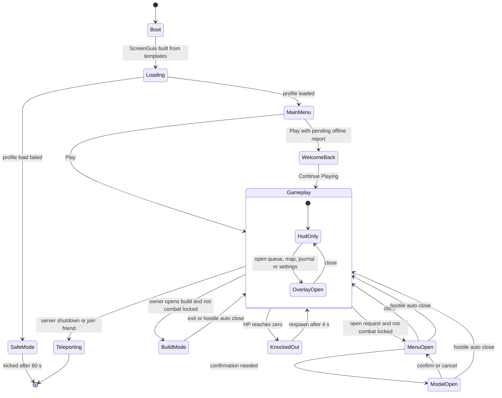

## 24. UI/UX

> **Owner:** A15 UI. This section specifies every player-facing interface of Mystery Morph Restaurant: the
> shared design system, input adaptation, scaling and safe areas, the screen stack and the `UIController` state
> machine, readability-in-chaos rules, accessibility, localization, UI performance, and a wireframe-level spec for
> every interface in brief Part 17. Rules owned elsewhere are **displayed, never redefined**: morph customization
> behavior (§13), the offline report and Welcome Back flow (§17), stat allocation and the Level panel (§14), cooking
> timing and scoring (§5), combat and targeting (§11), travel rules (§18), customers (§8–§10), prices (§22, §23), the
> tutorial script (§32). Where a screen shows a canon value, canon wins. The cooking (§5) and combat (§11) control
> schemes are merged into one default binding map in §24.3.
> UI internals (ScreenGui names, instance trees, localization keys, design tokens) are defined here; they are not
> database IDs.

### 24.1 System Summary

**Purpose.** An 8-to-16-year-old must be able to read the restaurant at a glance — what was ordered, who is about
to explode, what is on fire — on a 6-inch phone in the middle of a food fight, and every menu must work equally well
with keyboard/mouse, touch, and gamepad. Ridiculous on the surface (wobbly tickets, screaming cheese icons),
boringly reliable underneath (one state machine, one input router, one token set).

**Rules & Mechanics (binding on all UI work).**
1. **One client authority.** `UIController` (C19) owns every ScreenGui, the screen stack, the input mode, HUD
   visibility and the toast queue. Other client code *requests* UI through it and never parents GUI to `PlayerGui`
   directly.
2. **Five ordered layers:** HUD < Overlays < Full-screen menus < Modals < Toasts, plus a System curtain on top for
   loading/disconnect (§24.5).
3. **Combat gating** follows canon E2, E4 and E14 exactly (§24.5.4).
4. **Never color-only.** Every state is shown as color **+** shape/icon **+** text or number (C13.3, brief 26.3).
5. **Critical information is never hidden** — not by declutter, menu scrims, or toasts (§24.6).
6. **Every control is reachable** by gamepad focus, is ≥ 44×44 px on touch, and has a keyboard path.
7. **Server-authoritative display.** The UI never computes rewards or prices; it renders server-replicated values
   and sends intents. Optimistic feedback is cosmetic only and reverts on rejection (e.g. coin fly-up is withheld
   until `EconomyService` confirms).
8. **Localized by key.** Every player-facing string comes from a LocalizationService key (§24.11).

**Variables** (values marked [TUNABLE] are balancing assumptions owned here; others quote canon).

| Variable | Value | Notes |
|---|---|---|
| Reference resolution — Regular / Compact / TenFoot | 1920×1080 / 844×390 / 1920×1080 | authoring units "u" = px at reference [TUNABLE] |
| UIScale clamp — Regular / Compact / TenFoot | 0.70–1.40 / 0.92–1.30 / 1.00–1.50 | touch floor on Regular 0.79 (§24.4) [TUNABLE] |
| Minimum touch target | 44×44 rendered px | authored 48 u Compact, 56 u Regular |
| Minimum rendered text | 14 px | Caption role at lowest clamp |
| Toasts visible at once — desktop/console / phone | 3 / 2 | [TUNABLE] |
| Default toast duration | 3.0 s (critical: until resolved) | [TUNABLE] |
| Chaos declutter on / off | Chaos Level ≥ 5 / ≤ 3 for 4 s | hysteresis (§24.6) [TUNABLE] |
| Customer billboards rendered | nearest 16 of ≤ 28 (24 seats + 4 queue, C3) | Eagle Eye `ABL_070` lifts to all [TUNABLE] |
| Patience ring refresh | 10 Hz | numeric seconds at 2 Hz [TUNABLE] |
| Panel open / close | 0.25 s / 0.18 s | reduced motion: 0.12 s fade [TUNABLE] |
| In Combat flag | 6 s since last damage dealt/taken | canon C12.1 |
| Post-hostile invulnerability on menu auto-close | 1.5 s | canon E2 |
| Loadout swap channel / cooldown | 3 s / 10 s | canon E4 |
| Return Door cooldown / Pigeon Taxi fare | 10 s / 25 MB × tier | canon C16.1 |

**UI progression (progressive disclosure).** New players start with an almost empty screen; widgets appear the moment
the tutorial needs them (§32 owns the script; this table states the latest step by which each widget is revealed).
Returning players with `QST_TUT_012` complete see the full HUD from the first frame.

| Step | Tutorial quest | Widgets revealed |
|---|---|---|
| 1 | `QST_TUT_001` | interact prompts, movement hints (keyboard keycaps / thumbstick ghost / stick glyph) |
| 2 | `QST_TUT_002` | order queue, customer order bubbles, patience rings |
| 3 | `QST_TUT_003` | "Order:" ticket card, cooking minigame widgets, Level badge + XP bar (first XP) |
| 4 | `QST_TUT_005` | Morph Bucks counter, satisfaction reactions, tip pop-ups |
| 5 | `QST_TUT_006`–`QST_TUT_007` | HP bar, base combat buttons, hostile health bars, threat arrows |
| 6 | `QST_TUT_008` | restaurant condition widget, repair widget |
| 7 | `QST_TUT_010` | ability bar (4 slots), Morph menu entry, Mutation Shards counter |
| 8 | `QST_TUT_011` | Restaurant Hub + Upgrades entries in the quick-access menu |
| 9 | `QST_TUT_012` | Employees entry, offline income preview chip |

**Player Interactions.** Players act through the world (stations, customers, props) using contextual prompts; menus
are for management between rushes; overlays (order queue, map, journal, settings) stay usable mid-brawl.

**Dependencies.** Reads replicated state from the C19 services named in each interface's data table (all 19
gameplay services; `PlayerDataService` stores settings). Art/icons §25, UI sounds §26 (described in words here),
remotes and module placement §27, settings persistence §28, rate limits §29, performance targets §30, analytics §31.

**Roblox Implementation (summary).** `StarterGui:SetCoreGuiEnabled` disables `Backpack`, `Health` and `EmotesMenu`
(MMR draws its own HP and earnable emote wheel; Roblox avatar emotes don't fit R15 morph rigs, C13.7); Chat and the
Roblox top bar remain. `StarterPlayer.EnableMouseLockOption = false` (LeftShift = Dodge; see §24.3.3), and City
Sprint (§18) uses LeftCtrl. All ScreenGuis use `ResetOnSpawn = false`, `ZIndexBehavior = Sibling` and are
created once at boot from `ReplicatedStorage` templates. World-space UI is `BillboardGui` pooled in `PlayerGui` with
`Adornee` set (client-only, never replicated).

### 24.2 Design System

#### 24.2.1 Visual language

The mockup's bold, sticker-like look becomes a **"diner ticket"** language: panels are cream order-ticket paper with a
chunky dark outline, rounded corners and a hard drop shadow; headers look like a hand-stamped ticket top; the HUD floats
as die-cut stickers over the 3D scene. Reading order is always **icon → number → word**, so a player who can't read
yet (or reads another language) still parses the HUD. Panels may wobble or squash when they open — information inside
never moves once settled.

#### 24.2.2 Typography

Fonts are set through `TextLabel.FontFace` (`Font.fromEnum` / `Font.new`). Display faces are Latin-only; for locales
without glyph coverage `UIController` swaps them to BuilderSans Heavy (§24.11).

| Role | FontFace | Regular u | Compact u | TenFoot u | Use |
|---|---|---|---|---|---|
| Display | `Font.fromEnum(Enum.Font.LuckiestGuy)` | 72 | 40 | 88 | "LEVEL UP!", "WELCOME BACK", "SEEING STARS!" |
| Title | LuckiestGuy | 48 | 30 | 60 | screen titles ("Customize Your Morph") |
| Heading | `Font.fromEnum(Enum.Font.FredokaOne)` | 34 | 22 | 42 | panel headers, tabs |
| Button | FredokaOne | 26 | 18 | 32 | all button labels |
| HUD numeric | FredokaOne | 30 | 20 | 36 | currency, level, timers |
| Body | `Font.new("rbxasset://fonts/families/BuilderSans.json", Enum.FontWeight.Bold)` | 24 | 18 | 28 | descriptions, stats |
| Caption (minimum) | BuilderSans Bold | 20 | 16 | 24 | chips, tooltips, table cells (20 u × 0.70 = 14.0 px; 16 u × 0.92 = 14.7 px) |
| Fallback (GothamBold-equivalent) | `Font.new("rbxasset://fonts/families/GothamSSm.json", Enum.FontWeight.Bold)` | — | — | — | used if BuilderSans fails to load |

Rules: `TextScaled` only on single-word badges, always with a `UITextSizeConstraint` (Min = Caption, Max = role
size); all text drawn over the 3D world gets a 2 u `UIStroke` in `ink.primary` (ApplyStrokeMode Contextual);
`LineHeight` 1.1; caps only for Display/Button roles; numeric labels reserve the width of their widest expected value
(measured with `TextService:GetTextBoundsAsync` on "8,888,888") so counters never jitter. The Text Size setting
(§24.7) multiplies role sizes, not the layout; text containers use `AutomaticSize = Y` inside `UIListLayout` so
longer text reflows instead of clipping.

#### 24.2.3 Color tokens

| Token | Hex | Use |
|---|---|---|
| `ink.primary` | `#1B1D2B` | text on light panels, outlines, strokes |
| `ink.muted` | `#5B6178` | secondary text (contrast 5.6:1 on paper) |
| `ink.inverse` | `#FFFFFF` | text on dark/colored fills (always with 2 u ink stroke) |
| `paper.base` | `#FFF6E0` | panel and ticket fill |
| `paper.alt` | `#F2E6C9` | alternating rows, wells |
| `slate.base` | `#23263A` | dark panels (map, minigame backplates) |
| `scrim` | `#0B0E1A` @ 45 % | behind full-screen menus and modals |
| `brand.mustard` | `#FFC531` | primary CTA fill, focus ring |
| `brand.ketchup` | `#FF4B3E` | danger CTA, critical alerts |
| `brand.teal` | `#2EC4B6` | secondary/info accents, links |
| `cur.mb` | `#FFD23F` | Morph Bucks icon (mustached coin) |
| `cur.ms` | `#45E0E8` | Mutation Shards icon (crystal shard) |
| `cur.rt` | `#C9B6FF` | Research Tokens icon (beaker token) |

**Status tokens** (patience, quality, validity) have three palettes; the colorblind ones are built on the Okabe-Ito set
and are selected in Settings. Shapes/icons never change between palettes.

| Status token | Default | Deuteranopia / Protanopia | Tritanopia | Paired shape |
|---|---|---|---|---|
| `state.good` | `#48D16B` | `#009E73` | `#009E73` | ✓ check / smiling face |
| `state.warn` | `#FFC531` | `#F0E442` | `#F0E442` | ◆ diamond / hourglass |
| `state.alert` | `#FF8A1F` | `#E69F00` | `#CC79A7` | ▲ steam puff |
| `state.danger` | `#FF4B3E` | `#D55E00` | `#D55E00` | ! burst / ✕ |
| `state.info` | `#3A8DFF` | `#0072B2` | `#0072B2` | i bubble |
| `state.disabled` | `#9AA0A6` @ 40 % | same | same | padlock |

**Rarity tokens are canon (C13.3) and are never palette-swapped** — the shape carries the meaning for colorblind
players, and an optional text badge can be enabled (§24.7).

| Rarity | Token | Hex (C13.3) | Shape (atlas icon) | UI treatment |
|---|---|---|---|---|
| Common | `rarity.common` | `#9AA0A6` | ● circle | 3 u frame stroke + circle badge top-left |
| Uncommon | `rarity.uncommon` | `#3DDC84` | ▲ triangle | stroke + triangle badge |
| Rare | `rarity.rare` | `#3A8DFF` | ■ square | stroke + square badge + soft inner glow |
| Epic | `rarity.epic` | `#A15CFF` | ⬟ pentagon | stroke + pentagon badge + 2-stop `UIGradient` |
| Legendary | `rarity.legendary` | `#FF9F1C` | ★ star | stroke + star badge + slow shine sweep |
| Mythic | `rarity.mythic` | `#FF3EA5` | ⬢ hexagon | stroke + hexagon badge + sparkle sprites |
| Secret | `rarity.secret` | rainbow shimmer on `#000000` | ? glyph | black fill, rainbow `UIGradient` rotating 0→360° per 4 s (reduced motion: static) |

Rarity names are always rendered as `ink.primary` text on paper next to the shape — never as colored text — so
contrast stays ≥ 4.5:1. Shapes are images from the icon atlas, not font glyphs (⬟/⬢ lack coverage in Roblox fonts).
Contrast targets: body text ≥ 4.5:1, Display/HUD numerics and icons ≥ 3:1 (WCAG AA), verified in QA against the
brightest district lighting (§25).

#### 24.2.4 Iconography

- **Grid:** 128×128 master, 8 u safe padding, 6 u `ink.primary` outline, flat fills plus one highlight. Must read at
  24 px and in grayscale (QA desaturates every atlas).
- **Unique silhouettes** for every status family: patience (4 bands), anger (levels 1–6), satisfaction (5 bands),
  station state (idle / cooking / perfect / burning / on fire / broken), damage state (Pristine sparkle, Scuffed
  scratch, Cracked crack, Broken snapped leg, Destroyed rubble pile), rarity (7 shapes), the 9 stats (stopwatch-
  spatula `COOK_SPD`, chef's-kiss star `COOK_QLT`, fist `STR`, tray shield `DEF`, wrench `REPAIR`, sneaker `MOVE`,
  four-leaf clover `LUCK`, heart bow `CHARM`, gear-coin `EFFICIENCY`; frying pan for the combined Cooking row, §14).
- **Food icons** come one per recipe and ingredient from the art atlases (§25); modification chips use a small,
  separate glyph set (upside-down arrow, snowflake, "no circles" sign, number badge, etc., mapped by §6.18 data).
- **No baked-in text** in icons. Keyboard keycaps render `UserInputService:GetStringForKeyCode` (respects AZERTY);
  gamepad glyphs come from `UserInputService:GetImageForKeyCode` so each console family shows its own buttons.
- **Kid-safe damage language:** stars, feathers, sauce splats, confetti, soot puffs — never blood or weapons (C0.7).

#### 24.2.5 Spacing, shape, elevation

4 u base grid; spacing tokens `xs 4 · s 8 · m 12 · l 16 · xl 24 · xxl 32 · 3xl 48`. Radii (`UICorner`): chips
pill (0.5 scale), buttons 14 u, panels 20 u, tickets 10 u with a zig-zag bottom edge (9-slice `ImageLabel`,
`SliceCenter`). Strokes (`UIStroke`): panels 3 u, chips 2 u. Elevation is a hard offset shadow (6 u down, `ink.primary`
@ 70 %), never blur. Focus ring: 4 u `brand.mustard` + 2 u white inner, drawn via `SelectionImageObject`.

#### 24.2.6 Touch targets, buttons and states

Touch targets are ≥ 44×44 rendered px (authored 48 u Compact / 56 u Regular), with ≥ 8 px between adjacent targets.
Small visuals get an invisible hit area: an outer transparent `ImageButton` with the visual as a child.

| Variant | Fill / text | Use |
|---|---|---|
| Primary | `brand.mustard` / `ink.primary` | the one main action per screen (Buy, Collect, Equip) |
| Secondary | `paper.base` + 3 u ink stroke / `ink.primary` | alternatives (Compare, Details) |
| Danger | `brand.ketchup` / `ink.inverse` | destructive (Fire, Sell, Respec) — always hold-to-confirm 0.8 s |
| Ghost | transparent / `ink.primary` | tertiary (Cancel, Skip) |
| Icon | 56 u circle (48 u Compact) | HUD and toolbar |

| State | Visual | Behavior |
|---|---|---|
| Default | as above | — |
| Hover (KBM only) | +6 % brightness, scale 1.03 | soft tick sound |
| Pressed | scale 0.96, shadow offset 0, −10 % brightness | fires on release (touch: on release inside bounds) |
| Focused (gamepad) | focus ring + scale 1.03 | A/Cross activates |
| Disabled | 55 % desaturated, 40 % transparency, padlock or reason chip | `GuiObject.Interactable = false` for pointer, but still selectable on gamepad so its reason tooltip shows |
| Loading | spinner replaces label, width locked | used for every server round-trip; times out at 8 s with "The pigeons lost your request. Try again?" |
| Cooldown | radial sweep + numeric seconds | ability and Return Door buttons |

`AutoButtonColor = false` everywhere (states are explicit). Double-submission is prevented by entering Loading on the
first press.

#### 24.2.7 Motion and juice

Durations: micro 0.08–0.12 s, standard 0.20 s, panel open 0.25 s / close 0.18 s, celebrations 0.6–1.2 s. Easing via
TweenService: `Back`/`Out` for pops, `Quad`/`Out` for slides, `Linear` for progress. Juice never delays input — a
panel accepts input from its first frame. **Reduced Motion** is seeded from `GuiService.ReducedMotionEnabled` and can
be overridden in Settings.

| Effect | Default | Reduced Motion variant |
|---|---|---|
| Panel open | slide 40 u + squash 1.06→1.0 | 0.12 s fade only |
| Coin fly-up to wallet | ≤ 8 coin sprites arc to the MB counter, 0.5 s | counter tick + single "+12 MB" label |
| Counter change | roll-up 0.4 s | instant set |
| PERFECT stamp | ✓ scales 1.4→1.0 with wobble | ✓ appears, no scale |
| Ticket arrival | slides in, bounces once | appears in place |
| Urgent pulse (patience < 10 %, fire) | 2 Hz scale pulse | static thicker 4 u outline + "!" glyph |
| Ability ready | white flash + pop | outline turns solid |
| Level up | full-width Display banner + confetti sprites | banner fades in/out, no confetti |
| Screen shake (camera, combat hits) | amplitude ≤ 0.35 studs, ≤ 0.25 s | off (separate toggle, §24.7) |
| Rarity shimmer (Legendary+, Secret) | animated gradient | static gradient |

#### 24.2.8 Microcopy voice

Short, silly, kind, actionable. Lead with the action, then the joke. Never mock the player; blame the pickles. Never
use real brands, scary words, or anything mean about real groups. Examples (keys in §24.11):

| Situation | Copy |
|---|---|
| Menu blocked in combat (canon E2) | "Can't shop during a brawl!" |
| Station on fire | "GRILL ON FIRE! Cartoon fire, real problem — grab the extinguisher!" |
| Recipe sold out (E9) | "SOLD OUT. The pantry is just air and vibes now." |
| Employees on Unpaid Break (E8) | "Staff on Unpaid Break — they're sitting on the mop bucket in protest." |
| Level up mid-rush (E14) | "LEVEL 13! 2 stat points saved for after the burgers stop flying." |
| Customer about to leave | "Table 4 is getting hangry!" |
| Storm-out | "Table 2 stormed out. They took all the napkins." |
| Player KO | "SEEING STARS! Back in the kitchen in 4…" |
| Safe Mode (E6) | "Our filing cabinet is napping. Earning and spending paused to keep your stuff safe." |
| Server shutdown (E13) | "The city is moving your restaurant to a new street. Same restaurant, fresh pavement!" |

### 24.3 Input Adaptation

#### 24.3.1 Input modes and auto-switching

`InputMode` ∈ {`KeyboardMouse`, `Gamepad`, `Touch`} is tracked by `InputController` (§27), which also owns the single
`ContextActionService` binding table; `UIController` consumes its `InputModeChanged`. Detection rules, in order:
1. `UserInputService.PreferredInput` (`Enum.PreferredInput`) and its changed signal, where available.
2. Fallback: `UserInputService:GetLastInputType()` + `LastInputTypeChanged` — `Keyboard`, `MouseButton1–3`,
   `MouseMovement`, `MouseWheel` → KeyboardMouse; `Gamepad1–8` → Gamepad; `Touch` → Touch; `Focus`, `TextInput`,
   `None`, `Accelerometer`, `Gyro` are ignored.

**Switch rules.** A switch needs a *deliberate* input: a button/key press, a stick past 0.35 deadzone, or > 8 px of
mouse travel within 100 ms (stops a resting controller's drift or a bumped mouse from flipping prompts). Minimum 0.25 s
between switches. On switch: prompt glyphs re-render; the mobile cluster shows only in Touch; entering Gamepad inside a
menu selects the remembered focus (`GuiService.SelectedObject`) and leaving clears it; `UserInputService.MouseIconEnabled`
is false in Gamepad; tooltips change trigger (hover / focus / long-press 0.4 s). Hybrid devices (touch laptops, tablets
with keyboards, phones with controllers) simply switch back and forth. Layout class (§24.4) never changes with input
except the Regular touch floor.

#### 24.3.2 Unified default bindings

§5 (cooking) and §11 (combat) were drafted in parallel and originally collided on several keys. Because §11 routes
rebinding to §24 Settings and `InputController` needs exactly one table, this is the **single default map the UI
ships and renders glyphs for**; §5 and §11 have been aligned to it. It keeps §5 as the base (it is the complete scheme and already avoids Roblox's
reserved keys: Esc, Tab player list, `/` chat), keeps every non-colliding §11 entry, and resolves the collisions as
listed in §24.3.3. Everything is rebindable in Settings → Controls.

| Action | Keyboard / Mouse | Gamepad | Touch |
|---|---|---|---|
| Move / camera | WASD or arrows / RMB-drag, wheel zoom | Left stick / right stick | dynamic thumbstick (left 45 %) / drag right area, pinch |
| Jump | Space | A | JUMP button |
| Use / Interact (chop, flip, toss, dial step, take order, serve, extinguish, lift prop) | E (chop = E taps) | X (taps) | Context button (largest; icon + label change: "CHOP", "SERVE"…) |
| Grab: pick up / place | F | B (B = Back when a panel or minigame has focus) | GRAB button |
| Drop on floor | G | D-pad Down | long-press the carry widget 0.4 s |
| Swap held item | R | Y (tap) | tap the carry widget |
| Throw (hands full) | LMB hold = arc, release | RT hold = arc, release | ATTACK becomes THROW: hold, drag to aim, release |
| Swipe Combo / Wallop (hands empty) | LMB tap / hold 0.6 s | RT tap / hold | ATTACK tap / hold |
| Block | hold Q (toggle option) | hold LT | hold SHIELD (toggle option) |
| Dodge Roll | LeftShift | RB | swipe on SHIELD, or DODGE |
| Calm Down! | V | D-pad Up | speech-bubble CALM button |
| Ability slots 1–4 | 1, 2, 3, 4 | hold LB + X / Y / B / A | 4 buttons in an arc around ATTACK: tap = auto-aim, drag = aim, drag back = cancel |
| Lock-on / cycle | MMB; wheel cycles while locked | R3; flick right stick to cycle | tap an enemy (tap again releases) |
| Cycle interaction target | C (or mouse hover) | D-pad Right | tap the station |
| Call-out ping (co-op) | Z (wheel on hold) | D-pad Left (wheel on hold) | PING button → 6-wedge wheel |
| Revive ally | hold E 2 s | hold X 2 s | hold Context 2 s |
| Order queue / pin ticket | O or click the ticket strip / click, 1–6 while open | hold Y 0.4 s / D-pad Left-Right + A | tap the ticket strip / tap ticket |
| City Sprint (city zones only, §18) | LeftCtrl (toggle) | L3 (toggle) | SPRINT toggle beside the thumbstick |
| Quick-access radial | T (hold = radial, tap = panel) | Select (tap) | ≡ button top-right |
| City Map / Return Door | M / L | hold Select 0.4 s / Y while the map is open | map button / Return Door button (city only) |
| Direct menus | H Hub · N Morph · P Employees · I Inventory · J Journal · K Stats · B Build | via radial | via quick-access |
| Cancel minigame / Back / close | X or Backspace (Esc is Roblox's) | B (context) | ✕ button, or walk out of range |
| Menu tabs / sub-tabs · context · secondary | 1–9, mouse · double-click · right-click | LB/RB · LT/RT · Y · X | tap tabs · long-press 0.4 s |

Base-kit IDs: Swipe Combo `ABL_001`, Wallop `ABL_002`, Block `ABL_003`, Dodge Roll `ABL_004`, Grab & Throw `ABL_005`,
Calm Down! `ABL_006`; a held pan or tray swaps in `ABL_007`/`ABL_008` and the ATTACK/SHIELD glyphs re-skin (§11).
`ButtonStart` stays reserved for the Roblox menu; `ButtonSelect`'s default selection toggle is overridden (MMR manages
selection itself, §24.8). Shift Lock is disabled (`StarterPlayer.EnableMouseLockOption = false`, per §5) so
LeftShift can be Dodge; MMB lock-on gives combat framing instead.

#### 24.3.3 Binding reconciliation log (§5 vs §11, resolved)

| Action | §5 | §11 | Shipped default | Reason |
|---|---|---|---|---|
| Block (KB/M) | hold Q | hold F | hold Q | F is Grab in the cooking scheme, used every few seconds |
| Dodge (KB/M / pad) | LeftShift / RB | Q / B | LeftShift / RB | Q is Block; B is Grab and Back |
| Calm Down! (KB/M / pad) | V / D-pad Up | R / Y | V / D-pad Up | R / Y are Swap held item |
| Lock-on (KB/M / pad) | — | MMB or Z / RB tap | MMB / R3 | Z is Ping; RB is Dodge |
| Shift Lock | disabled in interiors | recommended | disabled | LeftShift is Dodge; lock-on replaces it |
| Grab (touch) | GRAB button | contextual INTERACT bubble | GRAB button | one fixed target is easier mid-chaos |
| Drop (touch) | long-press carry widget | long-press INTERACT | long-press carry widget | long-press Context is Flourish Serve and pantry radial |
| Ability arc size (touch) | 56 dp | ≥ 64 px | 64 u | satisfies both minimums |

### 24.4 Scaling, Layout Classes and Safe Areas

**Layout classes** (re-evaluated on `workspace.CurrentCamera:GetPropertyChangedSignal("ViewportSize")`, debounced
0.2 s, so window resizes and tablet rotation reflow live):

| Class | Condition | Reference | UIScale | Notes |
|---|---|---|---|---|
| TenFoot | `GuiService:IsTenFootInterface()` | 1920×1080 | clamp(short/1080, 1.00, 1.50) | +5 % title-safe `UIPadding` beyond device insets |
| Compact | safe-area short side < 500 | 844×390 | clamp(short/390, 0.92, 1.30) | phone landscape; tabs → left rail; panels full-bleed |
| Regular | otherwise | 1920×1080 | clamp(short/1080, 0.70, 1.40); **floor 0.79 when InputMode = Touch** | desktop, tablet, laptop |

The Regular touch floor guarantees 56 u × 0.79 ≥ 44 px. Roblox GUI pixels on phones are device-independent points, so
"44 px" matches the platform's 44-point guideline. Ultra-wide screens (> 21:9): side widgets anchor inside a centered
2520×1080 u column to limit eye travel. Mobile orientation is locked with
`StarterGui.ScreenOrientation = Enum.ScreenOrientation.LandscapeSensor` (the cooking/combat cluster needs width).

**Safe areas.** HUD, Overlay and Toast ScreenGuis use `ScreenInsets = Enum.ScreenInsets.CoreUISafeInsets` (clears the
Roblox top bar, notches and home indicator); Menu and Modal content use `DeviceSafeInsets`; backdrops and the System
curtain use `None` so scrims are full-bleed. `GuiService.TopbarInset` (with its changed signal) lets the Compact HUD put
the Level badge inline in the top-bar strip instead of spending a row; `GuiService:GetGuiInset()` is the fallback on
clients without it. Constraints: `UIAspectRatioConstraint` on every icon, portrait, minigame widget (1:1), map
(letterboxed) and ViewportFrame; `UISizeConstraint` on menu panels (min 640×360 u, max 1600×900 u; full-bleed on Compact).

### 24.5 UI Layering, Screen Stack and the UIController State Machine

#### 24.5.1 Layers

| Layer | ScreenGui | DisplayOrder | ScreenInsets | Contents | Captures gameplay input? |
|---|---|---|---|---|---|
| World | pooled `BillboardGui`s in PlayerGui | — | — | order bubbles, patience rings, anger icons, health bars, station rings | no |
| HUD | `MMR_HUD` | 10 | CoreUISafeInsets | HUD widgets, mobile cluster, minigame widgets, "Order:" ticket card, threat arrows | no |
| Overlays | `MMR_Overlay` | 20 | CoreUISafeInsets | expanded order queue, City Map, Quest Journal, Settings, quick-access radial, tutorial coach marks, NPC dialogue | UI input only; movement stays live (on gamepad the stick drives focus while a large overlay has focus) |
| Menu backdrop | `MMR_MenuBackdrop` | 29 | None | scrim; optional `BlurEffect` (Size 12, off with Reduced VFX/low graphics) | — |
| Full-screen menus | `MMR_Menu` | 30 | DeviceSafeInsets | Hub, Morph, Employees, Inventory, Lab, Marketplace, Upgrades, Achievements, Stats, building shops, Main Menu, Welcome Back | yes |
| Modal backdrop | `MMR_ModalBackdrop` | 39 | None | modal scrim | — |
| Modals | `MMR_Modal` | 40 | DeviceSafeInsets | confirmations, capsule reveal, respec, hire/fire | yes |
| Toasts | `MMR_Toast` | 50 | CoreUISafeInsets | toasts, level-up banner, event announcements | never takes focus |
| System | `MMR_System` | 60 | None | loading curtain, teleport/shutdown notice, Safe Mode banner | only while the curtain is up |

Roblox purchase prompts (MarketplaceService) and the Roblox menu are CoreGui and always render above MMR layers.

#### 24.5.2 Screen classes and stack rules

1. **Overlay** — game continues behind it; usable in combat. Max one *large* overlay (Map, Journal, Settings, expanded
   queue) at a time; small overlays (ticket card, coach marks) coexist.
2. **Full-screen menu** — max one; drill-downs push within it (back-stack depth ≤ 4, e.g. Hub → Staff → Employee →
   Training). Opening a menu closes any large overlay. While a menu or modal is open, UIController sinks movement and
   combat actions with `ContextActionService:BindActionAtPriority("MMR_MenuSink", sink, false,
   Enum.ContextActionPriority.High.Value, …)` returning `Enum.ContextActionResult.Sink`, and sets
   `GuiService.TouchControlsEnabled = false`.
3. **Modal** — one visible, FIFO queue ≤ 3, owned by its parent screen and destroyed with it.
4. **Mode** — Build mode and the KO sequence swap the HUD layout and camera (§24.23, §24.25).
5. **Back** pops modal → drill-down → menu → large overlay. Each screen remembers its last focused object and restores it.
6. **Toasts** never steal focus or block input; tap/click on an actionable toast performs its action.

#### 24.5.3 State machine



#### 24.5.4 Combat gating (canon E2, E4, E14)

- **Combat locked** = the character's `InCombat` attribute (dealt or took damage within 6 s, C12.1; replicated per
  §27) **or** a level-5 customer targeting the player (`TargetedByLevel5` attribute, proposed here for §27).
- **Open request while locked** (any full-screen menu or Build mode): denied, button shakes, toast
  "Can't shop during a brawl!", and locked quick-access entries show an "In combat 4 s" chip counting down.
- **Hostile while a menu is open:** UIController force-closes the menu stack, its modals and Build mode in one frame;
  unsaved selections are discarded (purchases are atomic server transactions — one already in flight completes or
  fails and reports by toast). The trigger is `CombatService`'s `Combat.ForceCloseMenus { invulnerableUntil }` remote
  (§27); the server-granted **1.5 s invulnerability** shows as a shield ring around the HP bar until
  `invulnerableUntil` (measured with `workspace:GetServerTimeNow()`).
- **Overlays stay usable** (order queue, map, journal, settings). Map *travel* buttons are disabled while In Combat.
- **E4:** the Morph menu is a full-screen menu, so it is unavailable in combat; single-part equips inside it are instant.
  A loadout swap from the quick-access radial shows a 3 s channel bar under the HP bar ("Swapping to Chef Loadout…");
  damage interrupts it ("Swap interrupted!"); then a 10 s cooldown sweep on the loadout entries.
- **E14:** level-up mid-rush shows only a toast and a "+2" pip on the Level badge; the Stats & Level-Up panel never
  opens by itself and allocation waits until the player opens it.
- **KO ("Seeing Stars")** closes overlays except Settings, dims the HUD to 50 %, and shows a 4…1 Display countdown;
  after respawn the `STS_WOOZY` icon sits on the HP bar for its 10 s.

```lua
--!strict
-- UIController/ScreenStack.lua (excerpt): gating per canon E2
local player = game:GetService("Players").LocalPlayer
local function combatLocked(): boolean
	local char = player.Character
	return (char ~= nil and char:GetAttribute("InCombat") == true) or player:GetAttribute("TargetedByLevel5") == true
end
function ScreenStack.request(name: string, class: "Overlay" | "Menu" | "Modal" | "Mode"): boolean
	if (class == "Menu" or class == "Mode") and combatLocked() then
		Toasts.push({ key = "ui.toast.combat_block", priority = "Warning" })
		Analytics.log("mmr_ui_menu_blocked_combat", { screen = name })
		return false
	end
	return ScreenStack._open(name, class)
end
Remotes.Combat.ForceCloseMenus.OnClientEvent:Connect(function(msg: { invulnerableUntil: number })
	ScreenStack.forceClose({ "Modal", "Menu", "Mode" }, "hostile")      -- one frame, discards unsaved selections
	Hud.showShieldRing(msg.invulnerableUntil - workspace:GetServerTimeNow()) -- 1.5 s per canon E2
end)
```

### 24.6 Readability During Chaos

**Chaos Level** (a UI-derived value, not stored) = the highest anger level among customers in the player's current
interior (0–6, C11.5), computed client-side from `CustomerAIService` replicated anger. It drives declutter.

| Tier | Elements | Rule |
|---|---|---|
| **P0 Critical** | own HP + status icons, threat arrows and wind-up telegraphs for attacks aimed at you, ON_FIRE alerts, held item, active minigame widget, KO countdown, Safe Mode banner | always visible; never covered by toasts, scrims or declutter (menus auto-close on hostiles, §24.5.4) |
| **P1 Operational** | order queue, patience rings < 25 %, ability bar + cooldowns, interact prompt | always visible; compacted at Chaos ≥ 5 |
| **P2 Status** | currencies, objective, restaurant condition, XP bar | collapsed to pills at Chaos ≥ 5 (MB-only wallet pill, stars-only condition, 4 u thin XP bar) |
| **P3 Flavor** | coin fly-ups, XP/tip pop-ups < 50 MB, non-hostile bark subtitles, low-priority toasts | hidden at Chaos ≥ 5 (counters tick instead; toasts queue) |

**Declutter at Chaos ≥ 5** (exit when Chaos ≤ 3 for 4 s, 0.3 s fade back):
- Billboards: anger icons only on customers at level ≥ 3; patience rings only below 25 %; health bars only for hostiles
  targeting you or within 25 studs; order bubbles shrink to the first dish icon + "+2".
- Order queue shows the 3 most urgent tickets in compact form; the rest become a "+4" chip.
- Damage numbers merge per target per 0.5 s window (max 6 on screen); toasts below Warning wait in the queue and are
  released merged ("+340 MB from 6 customers").
- `ABL_070` Eagle Eye overrides billboard filters for its duration (all patience/anger meters shown, per canon); `ABL_064`
  Super Sniff turns hidden-modification "?" chips on order bubbles into their real icons.

**Always-on readability rules.**
- **Threat arrows:** each level-5 hostile targeting you that is off-screen or behind the camera gets an edge arrow
  (boxing-glove icon, `state.danger`, pulse unless Reduced Motion), max 3. Wind-ups add a "!" above the attacker.
- **Urgent customers off-screen:** patience < 10 % adds an edge ticket marker (max 2, P1).
- **Fire:** an ON_FIRE station raises a P0 chip "GRILL ON FIRE!" with a direction arrow; its billboard flame icon is
  `AlwaysOnTop` so it shows through walls.
- **World-space legibility:** billboards always have a paper backplate and outline (never bare text on the scene),
  constant on-screen size (offset sizing, 64 u bubble), `LightInfluence = 0`, `MaxDistance` 60 studs with a fade from
  45 to 60 studs.

### 24.7 Accessibility Settings

All settings persist in the profile (`PlayerDataService`, §28, one `uiSettings` table ≤ 2 KB) and apply live.

| Setting | Options (default) | Effect |
|---|---|---|
| Reduced Motion | Off / On (seeded from `GuiService.ReducedMotionEnabled`) | applies every variant in §24.2.7 |
| Reduced VFX (§5 "Reduced Effects") | Full / Low / Minimal (Full) | particle density ×1 / ×0.5 / ×0.2 (fire VFX 30 % at Minimal), no `BlurEffect`, no full-screen flashes |
| Screen Shake | On / Off (On) | separate from Reduced Motion so players can keep juice but lose shake |
| Colorblind palette | Default / Deutan-Protan / Tritan (Default) | swaps status tokens (§24.2.3); shapes never change |
| Rarity text badges | Off / On (Off) | adds "RARE"-style text tag to every item tile |
| Text Size | 100 / 115 / 130 / 150 % (seeded from `GuiService.PreferredTextSize`) | multiplies type roles; layouts reflow |
| Panel opacity | 0–100 % (seeded from `GuiService.PreferredTransparency`) | panel background transparency |
| HUD Scale | 85–115 % (100 %) | multiplies UIScale; result is re-clamped to the class minimum and touch floor |
| Numeric patience | Off / On (Off) | seconds next to every patience ring (HUD + billboards) |
| Audio sliders | Master, Music, SFX, Voice, UI, Ambience: 0–100 % (80 / 60 / 80 / 70 / 70 / 60) + Kitchen Alerts (80) | sets `SoundGroup.Volume` by name (§26 / §36.15 own the tree; Kitchen Alerts drives the `Alerts` SoundGroup, a sibling of SFX under Master that is never ducked below −6 dB) |
| Reduce sudden loud sounds | Off / On (default Off) | applies a gentle limiter to stingers, crashes and explosions (Master-bus `CompressorSoundEffect`, Threshold −18 dB, Ratio 6) and lowers impact one-shots by 4 dB |
| Subtitles | Off / On (On), size S / M / L, backplate 0–100 % | customer barks and NPC lines as text, with speaker name |
| Auto-Rhythm | Off / On (Off) | every chop / pump / polish tap counts as yellow 0.8 (canon C8, §5) |
| Large Meter mode | Off / On (Off) | station meters +50 % and always mirrored in `MinigameHost` (§5) |
| Fewer Weird Requests | Off / On (Off) | gameplay option owned by §6.18; UI exposes the toggle only |
| Hold vs Toggle | Block, Sprint, hold-interactions (repair, extinguish, blend): Hold / Toggle (Hold) | toggle = tap to start, tap to stop |
| Targeting assist | soft lock / auto-target per device (defaults per §11: touch auto-target, controller soft lock, KB/M free aim) | toggles only; §11 owns the targeting rules |
| Reduced Flash | Off / On (Off) | replaces the `STS_BLINDED` white-out with a dark polka-dot vignette (§11) |
| Gentle Mode | Off / On (Off) | §11 combat assist (gentler incoming damage, longer telegraphs); no reward impact |
| Vibration (gamepad) | Off / On (On), intensity | `HapticService:SetMotor` on big hits and PERFECT |
| Tutorial hints | On / Off / Reset | coach marks and input hints (§24.20) |

**Colorblind-safe indicators (mandatory everywhere).** Patience = ring length + band icon + optional seconds; anger =
icon silhouette + 1–6 pips; satisfaction = face icon + word; quality = grade word + icon (✓ PERFECT, ● GOOD, ◐ OK,
❄ UNDERCOOKED, soot puff BURNED); validity (build ghost, buttons) = ✓/✕ icon + reason text; rarity = shape (C13.3).
**Photosensitivity:** no element flashes more than 3 times per second, no large saturated-red full-screen flashes;
damage feedback uses stars and a soft vignette.

### 24.8 Controller Navigation Maps

Global: `GuiService.GuiNavigationEnabled = true`; `GuiService.AutoSelectGuiEnabled = false` (UIController selects
explicitly via `GuiService.SelectedObject`). Every screen root sets `SelectionGroup = true` with
`SelectionBehaviorUp/Down/Left/Right = Enum.SelectionBehavior.Stop` at its edges so focus never escapes into the HUD.
Irregular layouts set `NextSelectionUp/Down/Left/Right` explicitly; regular grids use geometric navigation. When focus
moves inside a `ScrollingFrame`, the canvas tweens so the item plus one neighbor row is visible. Initial focus = the
primary action (or first item); returning restores the remembered object. Destructive modals focus Cancel first.

| Screen | Focus regions (← →) | LB / RB | LT / RT | A / B | Y / X | Right stick |
|---|---|---|---|---|---|---|
| Order queue overlay | ticket list | — | — | pin / close | locate customer / — | — |
| Restaurant Hub | tab rail → content | tabs | sub-tabs | select / back | context action / sort | scroll detail |
| Morph (§13) | categories ↔ preview ↔ grid | category | loadout | equip / back | upgrade / compare | rotate preview |
| City Map | free cursor (snaps to markers within 48 u) | layer filters | zoom out / in | select / close | Return Door / walk route | pan |
| Employees | roster ↔ detail | detail tabs | roster sort | select / back | assign / train | scroll detail |
| Inventory, Lab, shops, Marketplace | tabs → grid → detail | tabs | page | select / back | use-buy / filter | rotate preview |
| Settings | tabs → option list | tabs | — | toggle / back | reset option / — | — |
| Build mode | world grid cursor | rotate 90° | camera height | place / exit | move existing / store | camera |
| Modals | button row | — | — | confirm / cancel | — | — |

### 24.9 Mobile Button Cluster and Thumb Zones

Landscape phone, following §5's relative layout: the Context button sits where the right thumb rests (~170 u left of
and ~80 u above the bottom-right safe corner), GRAB above it, ATTACK/THROW to its left with the ability arc wrapped
around ATTACK, SHIELD/DODGE above JUMP, and rare actions in the top corners (stretch zone). The left 45 % belongs to the
Roblox dynamic thumbstick.

```text
Compact 844x390 safe area
[Lv12 ==XP==][HP =======]          [MB 12,450 | MS 85]     [Door][Map][=]
[> Serve 3 Perfect 1/3]                                     [3.7* K82 W2]
[T1 BRG o42s][T2 PIZ o18s][T3 TAC o9s!]                   (PING)
                                          (CALM)
                                    (A3)       (A4)  [ GRAB ]  (SHIELD)
                                  (A2)
   .-------.                    (A1)    [ATTACK]    [CONTEXT]
  ( stick   )  (SPRINT)   [carry: Patty|Bun]         [ CHOP  ]   (JUMP)
   '-------'
```

| Button | Size (Compact u) | Center offset from bottom-right safe corner (x, y) [TUNABLE] | Notes |
|---|---|---|---|
| JUMP | Roblox default (≈ 72) | Roblox default (≈ −62, −62) | default TouchGui jump, kept |
| Context (Use / Interact) | 96 | (−170, −80) | label + icon by target; CHOP taps; hold 0.8 s = Flourish Serve (§5) |
| GRAB | 88 | (−170, −215) | pick up / place |
| ATTACK / THROW | 88 | (−300, −70) | tap Swipe, hold 0.6 s Wallop; THROW while hands are full |
| SHIELD / DODGE | 64 | (−70, −190) | hold = Block (toggle option); swipe = Dodge |
| Abilities 1–4 | 64 each | (−423, −48), (−410, −129), (−351, −184), (−270, −191) | arc around ATTACK (radius 125 u); cooldown sweep + seconds; drag to aim |
| CALM (speech bubble) | 64 | (−300, −290) | above ATTACK, outside the arc |
| PING | 48 | (−75, −290) | co-op call-out wheel |
| SPRINT toggle | 56 | (+150, −210) from bottom-left | city zones only (§18) |
| Return Door, Map, Quick menu | 48 | top-right row | stretch zone; Return Door only in the city or a friend's restaurant |
| Carry widget | 64 × 128 | bottom-center | tap = swap held item, long-press 0.4 s = drop (§5) |

Geometry check: the smallest edge-to-edge gap between any two cluster buttons is 16.7 u (≥ 12 u primary-button rule,
§5), the leftmost edge is 455 u from the right (outside the thumbstick's 45 %), and the top edge is 322 u above the
bottom (clear of the top-bar row). Every button is ≥ 44 px rendered and combat buttons are ≥ 64 u (§11). Combat
buttons stay hidden until `QST_TUT_006`; empty ability slots show a dashed outline with "+" that opens the Morph menu
(outside combat). Settings → Controls → **Edit Touch Layout** lets players drag and resize buttons 80–130 %, saved in
`uiSettings`. Implementation: `InputController` binds each action once with
`ContextActionService:BindActionAtPriority(name, handler, true, priority, keyCode, gamepadButton)`, so keyboard, gamepad
and touch share one handler; touch buttons are restyled with `ContextActionService:SetImage`, `SetTitle`, `SetPosition`
and `GetButton(name)` (size, stroke, cooldown child). Map, Quick-menu and Return Door are plain `ImageButton`s in
`MMR_HUD`.

### 24.10 Notification and Toast System

`UIController.Toasts` is a single priority queue (length 12; overflow drops the oldest lowest-priority entry).

| Type | Priority | Position | Duration | Merge rule | Example |
|---|---|---|---|---|---|
| Critical | 0 | top-center (reserved strip) | until resolved, min 2 s | none | "GRILL ON FIRE!", "Brawl incoming!" |
| Warning | 1 | top-center, under Critical | 3 s | same key within 3 s → "×3" | "Can't shop during a brawl!" |
| Reward | 2 | right stack under wallet (phone: wallet counter pop) | 2.5 s | same currency within 1.5 s sums | "+18 MB tip! Chef's Kiss!" |
| Progress | 2 | right stack | 3 s (level banner 2 s) | per quest | "LEVEL 13! Points ready (K)" |
| Event | 3 | top-center ticker with Anchor Andy (`NPC_030`) portrait | 6 s | — | "Pickle Rain over Restaurant Row!" + **Join** (Event Portal, §18) |
| Social | 3 | right stack | 4 s | — | "Your friend is visiting!" |

Visible at once: 3 (desktop/console) / 2 (phone). At Chaos ≥ 5 only priorities 0–1 show (§24.6). Every toast = icon +
text; actionable toasts show the input glyph and act on click/tap/Select. Durations ×1.5 at Text Size ≥ 130 %. Toasts
never cover P0 elements (the top-center strip is reserved for Critical/Warning). Roblox has no screen reader, so the
last 30 notifications are kept in Quest Journal → Recent. Each type has its own short UI sound (§26).

### 24.11 Localization Readiness

- **Keys:** all strings live in `LocalizationTable`s under LocalizationService with keys `ui.<screen>.<element>[.<variant>]`
  (e.g. `ui.hud.level.label` = "Lv {level}", `ui.toast.combat_block` = "Can't shop during a brawl!"). Content names
  (recipes, parts, NPCs) are keyed by entity ID by the §27 data pipeline.
- **Translation path:** `GuiObject.AutoLocalize = false` on all MMR UI (no double translation; arguments formatted by
  us); text is set through `Translator:FormatByKey(key, args)` from `LocalizationService:GetTranslatorForPlayerAsync`
  (wrapped in `pcall`, fallback to the source-locale translator); screens re-render when `Player.LocaleId` changes.
- **+30 % expansion:** every text box is laid out for 1.3× its English width; rows use `UIListLayout` (`Wraps = true`)
  with `UIFlexItem`; buttons grow (`AutomaticSize = X`) up to a max, then wrap to 2 lines, then shrink to Caption via
  `UITextSizeConstraint`. Critical text is never truncated; "…" is allowed only in list rows whose full text appears in
  the detail pane or tooltip. Width checks use `TextService:GetTextBoundsAsync`.
- **Pseudo-locale build flag** pads every string by 30 % with accented characters ("[!! Ŝéŕvé ţĥé ćûšţöméŕ !!]"); QA
  screenshots every screen at Compact and Regular.
- **Plurals and numbers:** `.one`/`.other` key variants (Roblox tables have no ICU plurals); a `NumberFormat` module
  applies locale separators; HUD abbreviates ≥ 100,000 (100K, 1.25M) with the full value on hover/focus/long-press.
- **Fonts:** for locales outside Latin coverage, Display/Title/Heading/Button swap to BuilderSans Heavy; Roblox glyph
  fallback is verified for ja, ko, zh, th, ru in QA. No text inside images. Reset timers (00:00 UTC daily, Monday weekly,
  C3) display as local countdowns ("Resets in 5h 12m"). Right-to-left layout is out of scope at launch (§38).
- **Player-entered text** (morph names §13, restaurant sign text if §15 allows it) is filtered with
  `TextService:FilterStringAsync` → `GetNonChatStringForBroadcastAsync` before anyone else sees it.

### 24.12 UI Performance Budgets

| Budget | Value [TUNABLE] | Enforcement |
|---|---|---|
| ScreenGuis | 8 (§24.5.1), created once at boot | toggled via `Enabled`, never re-created |
| Live GuiObjects | ≤ 900 (HUD + overlays), ≤ 1,800 with the heaviest menu open | dev-build counter overlay; CI screenshot test logs counts |
| Active BillboardGuis | ≤ 28 (16 customers + 8 stations + 4 hostile bars) | pooled; hidden = `Enabled = false`, never destroyed |
| List virtualization | any list that can exceed 30 rows | pool = visible rows + 2 buffer per side; rebind on `CanvasPosition` change; `AutomaticCanvasSize` off |
| ViewportFrames | ≤ 1 animated (with `WorldModel`) + ≤ 4 static visible | grids use atlas icons, never VPFs; VPF morphs use LOD meshes (C13.7) |
| Icon atlases | 1024×1024 sheets, 64 cells of 128 px, via `ImageRectOffset`/`ImageRectSize` | ≤ 6 resident for HUD; menu atlases preloaded with `ContentProvider:PreloadAsync` during the open tween |
| CanvasGroups | ≤ 2 visible | whole-panel fades only (each renders to an offscreen texture) |
| Update rates | patience rings 10 Hz (one shared Heartbeat loop), numeric seconds 2 Hz, map arrow 5 Hz, cooldowns 20 Hz, minigames per frame | event-driven otherwise |
| Concurrent tweens | ≤ 40; coin sprites pooled (16) | — |
| UI frame time | ≤ 1.5 ms on the §30 low-tier mobile reference during a 24-customer rush | MicroProfiler capture in QA |
| GUI texture memory | ≤ 48 MB | Developer Console → Memory |

No `TextScaled` in list rows (forces re-layout); RichText only in description bodies.

### 24.13 Interface Specification Conventions

Each interface below gives: **Purpose & class** (Overlay / Full-screen menu / Modal / Mode / HUD) · **Wireframe**
(Regular; Compact and TenFoot notes after it) · **Hierarchy** (named instance tree; containers carry `UIScale`,
`UIPadding`, `UIListLayout`/`UIGridLayout` as implied) · **States** · **Data & source** · **Input** (KB/M · Gamepad ·
Touch) · **Edge cases**. Shared components (built once, cloned from `ReplicatedStorage.UI.Components`): `MmrButton`,
`MmrTabRail`, `MmrTicket`, `MmrRarityTile` (rarity stroke + shape badge + icon), `MmrCurrencyPill`, `MmrStatRow`,
`MmrProgressRing`, `MmrTooltip`, `MmrModal`, `MmrVirtualList`, `MmrPreview3D` (ViewportFrame + WorldModel + orbit).
Compact rule of thumb: horizontal tab bars become a left icon rail, two-pane layouts become drill-down (list → detail).
TenFoot rule: +25 % type roles, 5 % title-safe padding, glyph hints in every footer.

### 24.14 Main HUD (brief 17.1)

**Purpose & class.** HUD layer, always on during gameplay; shows everything needed to cook, serve and survive without
opening a menu.

```text
Regular 1920x1080 (inside CoreUISafeInsets)
+------------------------------------------------------------------------------------------------+
| [Roblox][Chat] [Lv 12 |======XP====------|   612/876   +2]   [MB 12,450][MS 85][v]  [Map][=]   |
|                [HP |==================    | 118/122] [WOOZY 7s]          [3.7 ***-][K 82][W 2] |
| +-ORDERS (5)-------------------+                                     +-OBJECTIVE--------------+ |
| | T3 [BRG][SODA]   (o) 42s  :) |                                     | Serve 3 PERFECT dishes | |
| | T5 [PIZ]         (o) 18s  [] |                                     | 1/3  [====------]      | |
| | T1 [TAC][ICE]    (o)  9s  !  |                                     +------------------------+ |
| | +2 more                      |                                                                |
| +------------------------------+      (3D world: order bubbles, rings, health bars)             |
|                                                                                                 |
|                    +-Order: Cheeseburger ---- T3 -------------------------+                     |
|                    | [BUN v] [PATTY ~] [CHEESE] [LETTUCE] [BUN]  [no-O mod] |                     |
|                    +------------------------------------------------------+                     |
| [Held: Patty  GOOD  o o]          [1 Web][2 Zap][3 --][4 --]   [Swipe][Block][Dodge][Calm]       |
+------------------------------------------------------------------------------------------------+
```
*Compact:* §24.9 layout — Level badge inline in the top-bar strip (`GuiService.TopbarInset`) with XP drawn as a ring
around the level number; queue = 3 mini-tickets in a row; objective = pill; condition = strip under the menu buttons;
the ticket card shows icons only, above the held item. *TenFoot:* Regular layout with title-safe padding, LB + face-button
glyphs on ability slots, queue max 4.

```text
MMR_HUD (ScreenGui, DisplayOrder 10)
├─ UIScale
├─ TopLeft (UIListLayout V)
│  ├─ LevelBadge (ImageButton) ─ LevelText · XpBar{Fill, XpText} | XpRing (Compact) · PendingPointsPip
│  └─ HealthBar ─ Fill · ShieldRing · HpText · StatusRow (≤ 6 StatusIcon + seconds)
├─ TopRight
│  ├─ Wallet ─ MbPill · MsPill · ExpandButton → RtPill (expanded only)
│  ├─ MapButton · QuickMenuButton · ReturnDoorButton (city / friend's restaurant, 10 s cooldown, §18)
│  └─ ConditionStrip ─ Stars (5 half-star images) · RepText · CleanIcon+Text · DamageIcon+Count
├─ ObjectiveTracker (ImageButton) ─ QuestIcon · Title · ProgressText · ProgressBar
├─ OrderQueue (MmrVirtualList, ≤ 5 rows) ─ TicketRow{TableTag, DishIcons ≤ 3, PatienceRing, Seconds, BandIcon, CookChip} · MoreChip
├─ ActiveTicket ─ Header "Order:" · StepIcons (≤ 8 StepIcon{StateMark}) · ModChips · TargetTag
├─ CarryWidget ─ ItemSlots (1–3, C3){Icon, QualityChip} · tap = swap, long-press 0.4 s = drop (§5)
├─ AbilityBar ─ BaseKit{Swipe, Block, Dodge, Calm} · Slot1–Slot4{Icon, RarityShape, CooldownSweep, CooldownText, KeyGlyph}
├─ ChannelBar (loadout swap, 3 s) · AlertChips (P0) · ThreatArrows (≤ 3 pooled)
├─ MinigameHost (§24.21 widgets mount here)
└─ MobileCluster (Touch only, §24.9)

BillboardPool (PlayerGui; pooled, Adornee = proxy/visual root)
├─ CustomerBillboard ─ OrderBubble{DishIcon ≤ 3, ModChip ≤ 3, HiddenModChip "?"} · PatienceRing{BandIcon, Seconds} · AngerIcon{Pips 1–6} · ReactionPop · HuffBar{Fill, NameText, StatusRow}
├─ StationBillboard ─ SlotRing × slots{StateIcon}
└─ PlayerCombatBillboard (other players, only while they are In Combat) ─ HpFill
```

**Patience indicator (color + icon + shrinking ring + optional seconds).** The ring is computed locally from the
server's `patienceEndsAt` timestamp and `workspace:GetServerTimeNow()`, so nothing replicates per tick. Bands follow the
wait factor W of C11.3 (W starts falling at 50 % of patience):

| Band | Patience left | Token | Icon | Extra |
|---|---|---|---|---|
| Fresh | 100–50 % | `state.good` | smiling face | W still 1.0 |
| Antsy | 50–25 % | `state.warn` | hourglass | tooltip "Tips shrinking!" |
| Hangry | 25–10 % | `state.alert` | steam puff | survives declutter |
| Last Straw | < 10 % | `state.danger` | "!" burst | 2 Hz pulse (Reduced Motion: 4 u outline); off-screen edge marker |
| Waiting to order | ordering phase (30 s × personality multiplier, C11.2) | `state.info` | notepad | dashed ring |

**Anger icon** (C11.5): 1 puff cloud · 2 grumble bubble · 3 tomato · 4 snapped chair · 5 boxing glove (Huff bar appears)
· 6 siren (plus HUD banner "RESTAURANT CHAOS!") — each with 1–6 pips. **Satisfaction pop** (C11.3): Delighted
heart-eyes ("Chef's Kiss!" at S ≥ 98), Happy smile, Meh flat, Unhappy frown, Furious storm cloud — face + word, then
pay/tip text. **Health bars over fighters:** hostile customers show a "Huff" bar (steam icon, orange) with the
personality name ("The Karenosaurus") and status icons such as `STS_DIZZY`; other players show HP only while In Combat.

**States.** Normal · Declutter (Chaos ≥ 5, §24.6) · Combat (In Combat: ability bar +10 % size, base kit full opacity) ·
KO (dimmed 50 %, countdown) · Build (replaced by the build HUD, §24.23) · Guest (condition strip shows the host's
restaurant, chip "Guest at Mo's Diner", Hub management and Build hidden) · Hidden (while a full-screen menu is open;
`MMR_HUD.Enabled = false` saves cost — safe because hostility closes menus first).

| Widget | Data | Source service | Update |
|---|---|---|---|
| Level, XP, pending points | level, XP / XPReq(L) (C5.1), unspent points | `ProgressionService` | on change |
| HP, statuses | HP / max (100 + 2 × (L − 1) + bonuses), `STS_` list | `CombatService` | on change |
| Wallet | MB, MS (RT in expanded view) | `EconomyService` | on change |
| Objective | tracked quest step | `QuestService` | on change |
| Order queue, "Order:" card | tickets, recipe steps, item states, mods | `OrderService`, `RecipeService`, `CookingService` | on change |
| Patience, anger, satisfaction | `patienceEndsAt`, anger level, S band | `CustomerAIService` | ring 10 Hz local |
| Abilities | equipped actives, `cooldownEndsAt` | `MutationService`, `CombatService` | 20 Hz sweep |
| Restaurant condition | Reputation ★ (1 decimal), cleanliness K, damaged-object count | `RestaurantService`, `RepairService` | on change |

**Input.** Level badge → Stats panel (K / radial / tap; blocked in combat). Wallet → hover, focus or long-press shows exact
values incl. RT. Objective → Journal overlay at that quest. Order queue → O / hold Y 0.4 s / tap the ticket strip expands to the overlay
(all tickets, scrollable, usable in combat); clicking a ticket (or 1–6 while open; D-pad Left/Right + A) pins it to the "Order:" card; Y or
right-click locates the customer (camera nudge + 1.5 s billboard ping). **Quick-access menu** (T / Select / ≡): radial
with Restaurant Hub, Morph, Employees, Inventory, Journal, Map, Emotes, Settings; inner ring Loadouts (Chef / Fighter /
Repair, E4 rules), Return Door (mirrors the HUD button), Build (owner only). Touch shows it as a 3×3 sheet; gamepad
picks wedges with the left stick, A confirms; keyboard releases T over a wedge.

**Edge cases.** 24 seats of tickets: queue sorts by patience left (ties: arrival), shows 5 / 3 rows plus "+N".
Party orders (`PER_016`) group under a "Party ×4" bracket. Storm-outs stamp "STORMED OUT" for 1.5 s, then remove.
Co-op (E7): a ticket someone else is cooking shows their avatar chip. Max HP changes after a loadout swap tween the bar.
MS pill appears at `QST_TUT_010` or the first MS earned. Owner disconnect (E1): guests see a "Closed for the day!" banner.
Safe Mode (E6): wallet shows a padlock and every spend button is disabled with the Safe Mode reason.

### 24.15 Restaurant Hub (brief 17.2)

**Purpose & class.** Full-screen menu (H). Management between rushes: orders, stations, customers, staff entry,
stock, repairs, upgrades entry, finances.

```text
+-- RESTAURANT HUB  Tiny Mutation Diner (TIER_02)  3.6 ***-  ------------------------------- [X] -+
| [Orders] [Stations] [Customers] [Staff >] [Stock] [Repairs] [Upgrades >] [Finances]              |
| +--------------------------------------------------------------------------------------------+   |
| | STATION            SLOT 1               SLOT 2          LEVEL    CONDITION                  |   |
| | [GRL] Grill        Patty 4s  PERFECT v  Patty 9s        Tuned    Scuffed 68%                |   |
| | [FRY] Fryer        Fries 2s             --              Stock    Pristine                   |   |
| | [CUT] Cutting Bd   idle                                 Stock    BROKEN x  [Go repair]      |   |
| +--------------------------------------------------------------------------------------------+   |
| Cleanliness 82 | Atmosphere 41 | Seats 6/6 | Menu 5/5 | Staff 2/3                  [Edit Menu]   |
+--------------------------------------------------------------------------------------------------+
FINANCES tab:  [Today] [7 days] [Offline reports]
 4.0K |      ##                    ## active (solid)   // offline (hatched)
 2.0K |  ## //## ##// ##
      +-Mon-Tue-Wed-Thu-Fri-Sat-Sun
 Revenue 18,450 | Tips 1,920 | Ingredients -4,100 | Wages -2,300 | Repairs -350 | NET 13,620
```
*Compact:* left icon rail with labels; tables become cards (one station per card). *TenFoot:* LB/RB tabs, footer glyphs.

```text
HubMenu (Frame in MMR_Menu)
├─ Header ─ TierName · TierBadge · Stars · CloseButton
├─ MmrTabRail (8 tabs)
├─ Pages
│  ├─ OrdersPage (MmrVirtualList of MmrTicket, filters)
│  ├─ StationsPage (MmrVirtualList StationRow{Icon, Name, SlotCells, LevelChip, ConditionChip, Actions})
│  ├─ CustomersPage ─ SeatMap (top-down ImageLabel + SeatDot{BandIcon, AngerPips}) | ListToggle
│  ├─ StockPage ─ SpecialStockList{IngIcon, Qty, DependentRecipes, LowChip} · BasicNote
│  ├─ RepairsPage ─ DamageList{Icon, StateChip, Cost, AssigneeChip, GoButton, RebuildButton}
│  └─ FinancesPage ─ RangeTabs · BarChart (pooled bars, pattern fills) · BreakdownRow · ReportHistory
└─ Footer ─ KPI chips · EditMenuButton
```
**States.** Closed → Opening (atlas preload) → Browsing(tab) → DrillDown (Staff/Upgrades push §24.18/§24.22; Edit Menu
pushes the §6 menu editor) → Closing; force-closed on hostility (E2).
**Data & source.** `OrderService` (tickets), `CookingService` (slot states, station level), `CustomerAIService`
(seats, bands), `EmployeeService` (staff summary), `InventoryService` (special stock; basic ingredients show
"Unlimited — cost taken at serve", C9), `RepairService` (damage states Pristine/Scuffed/Cracked/Broken/Destroyed,
C6), `RestaurantService` (tier, seats, menu slots, atmosphere), `EconomyService` + `OfflineEarningsService`
(finance aggregates and stored reports, §22, §17).
**Input.** Tabs: 1–8 / LB-RB / tap. "Go repair" sets a world waypoint and closes the hub. Charts: hovering, focusing
or tapping a bar shows its exact values (bars use solid vs hatched patterns plus labels, never color alone).
**Edge cases.** Guests see Orders/Stations/Customers read-only (E12). Unpaid Break (E8) shows a ketchup banner with a
"Wages owed" amount. All menu items sold out (E9): a note explains `RCP_BRG_001` was auto-added. A repair job absorbing
new damage (E3) shows its work bar growing, with the cost charged once at completion. Destroyed objects show
"Rebuild (≤ 25 % of price)".

### 24.16 Morph Interface (brief 17.3) — summary; full spec in §13

**Purpose & class.** Full-screen menu (N): character preview, mutation slots, inventory, stats, abilities, upgrades,
saved loadouts. **§13 owns every rule and detail of this screen**; this entry fixes only shell, layout and platform
behavior so it matches the rest of the UI.

```text
+-- CUSTOMIZE YOUR MORPH ------------------------------ [Chef][Fighter][Repair][+] -------- [X] -+
| [Head  ] |                               | [o Bear Head ] [^ Wolf Head ] [# TV Head   ]           |
| [Ears  ] |        ( 3D pedestal )        | [* Phoenix Hd] [o Cat Head  ] [^ Owl Head  ]           |
| [Eyes  ] |         drag to rotate        |----------------------------------------------------|
| [Arms  ] |                               | # TV Head   Rare   Lv 2   CHARM +7  REPAIR +5 (sample)|
| [Legs  ] |  "Sir Clawsalot"  [rename]    | Active: --        Passive: (per §13)                 |
| [Tails ] |  STR 34 (+4)  MOVE 100 MAXED  | [Equip]  [Upgrade]  [Compare]                        |
| [Extras] |                               |                                                    |
+------------------------------------------------------------------------------------------------+
```
`MorphMenu ─ LoadoutTabs · CategoryList (7 C13.1 groups → sub-slot chips, e.g. Head → HEAD/FACE/NOSE/MOUTH) ·
Preview (MmrPreview3D) · PartGrid (MmrVirtualList of MmrRarityTile) · DetailPane{StatDeltaRows, AbilityCard, Buttons} ·
NameField · ColorButton`. Data: `MutationService` (owned/equipped parts, upgrades), `MorphAssemblyService` (client
builder assembles the preview clone), `ProgressionService` (effective stats).
**States.** Closed → Opening → Browsing(group) → PartSelected → Equipping/Upgrading (Loading) → Browsing; force-closed
on hostility (E2); §13 defines the rest.
**Canon surfaced by the UI:** unavailable while In Combat and single-part equips instant (E4); rarity color + shape
(C13.3); equip-level padlock; "Paired +25 %" chip when both arms or both legs match (C13.4); FUR/SCALES exclusivity
warning (C13.1); "MAXED" on capped stats (C5); at least three loadouts — Chef, Fighter, Repair (brief 8).
**Platform.** *Compact:* category rail left, preview top half, grid as a bottom sheet, detail as a drill-down. *Gamepad:*
LB/RB category, LT/RT loadout, right stick rotates, Y upgrade, X compare. *Touch:* drag to rotate, pinch to zoom
preview. *KB/M:* drag or A/D rotates, wheel zooms. Preview is a client clone in a `WorldModel`, never the live character.

### 24.17 City Map (brief 17.4)

**Purpose & class.** Overlay (M / hold Select / map button); usable in combat (E2), but travel buttons are disabled
while In Combat.

```text
+-- MORPH CITY ------------------------------------- Layers: [Shops][Quests][Events][Friends] -- [X]-+
|  +-Residential-+   +-Restaurant Row-+   +-Mutation Market-+   +-Research (L15) [lock]-+            |
|  |  (park)     |   | [YOU] [home]   |   | [Mart] [Mods]   |   |                       |            |
|  +-------------+   +-------(M)------+   +-----------------+   +-----------------------+            |
|  +-Sewers (L20) [lock]+  +-Downtown (M)--------+  +-Entertainment [!EVT 4:12]-+  +-Arena-+ +-Mall-+  |
|  +--------------------+  | [Hall] [Jobs] [Acad]|  | [Stage] [Critic HQ]      |  | (M)  | |      |  |
|  +-Industrial--------+   +---------------------+  +--------------------------+  +------+ +------+  |
| TRAVEL CARD: Mutation Mart - Mutation Market   [Walk] [Metro: Free] [Taxi: 50 MB]   [Return Door 6s] |
+---------------------------------------------------------------------------------------------------+
```
The wireframe shows layout only; the illustrated map art (§25) draws district adjacency exactly as C16.1 lists it.

```text
CityMap (Frame in MMR_Overlay)
├─ MapViewport (Frame, ClipsDescendants) ─ MapCanvas (UIScale = zoom) ─ DistrictTiles ×10 · MarkerLayer (pooled MapMarker{Icon, Label, Timer})
├─ LayerChips (Shops, Quests, Events, Friends, Metro)
├─ Cursor (gamepad only) · YouArrow
└─ TravelCard (§18) ─ Title · District · Status · Buttons{Walk, Metro, Taxi, JoinFriend} · ReturnDoorButton (pinned bottom-right)
```
**States.** Closed → City zoom ⇄ District zoom ⇄ Street zoom → MarkerSelected (Travel Card) → TravelConfirm (Taxi
modal) → System curtain while travelling; travel buttons (incl. Return Door, §18) Disabled while In Combat.
**Markers.** Buildings `BLD_01`–`BLD_22` by shop-type icon + name; quest givers (diamond "!" available, circle "?"
turn-in); active events (beacon + countdown, from `CityEventService`); Metro stations (train icon, dashed until
discovered); taxi perches (pigeon icon, nearest highlighted); friends on this server (avatar dots from
`Players:GetUserThumbnailAsync`); you (arrow, 5 Hz); your restaurant (house icon). Locked districts use diagonal stripes
+ a padlock + "Lv 15" label (C16.1 levels), never color alone; hidden sewer manholes appear only once discovered.
**Travel Card (C16.1; §18 owns the rules).** Shows only options valid from the player's position: *Metro (Free)* when
standing in a station; *Taxi* (25 MB × tier, balance checked) at a perch; *Walk* draws a client-only route ribbon;
*Return Door* (free, 10 s cooldown sweep, 1.0 s door animation cancelled by damage) is always pinned bottom-right.
**Data & source.** `ProgressionService` (level → unlocks), `PlayerDataService` (discovered stations), `QuestService`,
`CityEventService`, `MultiplayerService` (friends: same-server position, or "Join" via TeleportService, §21),
`RestaurantService` (plot).
**Input.** KB/M: wheel zoom (3 levels: City / District / Street), drag pan, click marker, L Return Door. Gamepad:
left-stick cursor snapping to markers within 48 u, right stick pans, LT/RT zoom, LB/RB layers, A select, Y Return Door,
X walk route. Touch: pinch, drag, tap marker → Travel Card bottom sheet with 56 u buttons. *Compact:* full safe area,
layer chips in one row.
*TenFoot:* 1.5× cursor and markers.
**Edge cases.** Event in a locked district: beacon shown; Join appears if §18's Event Access applies, otherwise
"Unlocks at L20". Friend in a private or full server: no Join
button, reason shown. Taxi with insufficient MB: button disabled with "Need 50 MB". During a city event the event
toast's **Join** (Event Portal, §18) also appears on the event beacon. 2D tiles only — no ViewportFrame.

### 24.18 Employee Interface (brief 17.5)

**Purpose & class.** Full-screen menu (P): roster, roles, stats, wages, training, assignments, offline efficiency
preview, performance reports. Rules for hiring, training, raises and promotions belong to §16.

```text
+-- EMPLOYEES   Staff 3/3 (TIER_02)   Offline cap 2 h (no Manager) --------------- [Hire >]  [X] -+
| ROSTER  [Sort: Role v]         | "Ollie" the Octopus Intern   o Common   Chef   On shift         |
| [CHEF ] Ollie   Eff 41  [work] |  ( 3D preview )   Cooking 30 | Service 15 | Accuracy 28         |
| [WAIT ] Zippy   Eff 55  [work] |                   Repair  -- | Combat  -- | Reliability 40      |
| [CLEAN] Moppo   Eff 22  [zzz]  |  Energy [=====---] 62 %     Morale [=======-] 81                |
|                                |  Wage 12 MB/h   Trait: Eight Arms, One Brain Cell               |
|                                |  [Overview] [Assign] [Train] [Performance]                      |
| OFFLINE PREVIEW: ~410 MB/h net for up to 2 h   (needs >= 1 Chef: OK)  Hire a Manager: 4 h+      |
+-------------------------------------------------------------------------------------------------+
```
```text
EmployeesMenu (Frame in MMR_Menu)
├─ Header ─ StaffCount · OfflineCapChip · HireButton
├─ Roster (MmrVirtualList) ─ EmployeeRow{RoleIcon, RarityShape, Name, EffValue, StatusIcon}
├─ Detail ─ Preview3D · StatGrid (MmrStatRow × 6) · EnergyBar · MoraleBar · WageRow · TraitChips
│  └─ DetailTabs ─ Overview · Assign{RoleDropdown, StationPicker} · Train{CourseCards} · Performance{ShiftChart, IncidentList}
└─ OfflinePreviewBar ─ NetPerHour · CapText · RequirementChip
```
**States.** Closed → Roster → EmployeeDetail(tab) → Confirm modal (fire / raise / train) → Loading → EmployeeDetail;
force-closed on hostility (E2).
**Data & source.** `EmployeeService`: roster, roles (C14.1), stats (C14.2), Efficiency (tooltip shows the C14.2 formula),
wages, assignments, morale/energy, status. `OfflineEarningsService`: read-only preview from the C15 model and the
manager cap (C14.3, +2 h with an Assistant Manager). Status icons: working (spatula), break (cup), Unpaid Break (empty
wallet + "!", E8), exhausted (zzz), training (book).
**Input.** KB/M click; gamepad roster ↔ detail, LB/RB tabs, Y assign, X train; touch drill-down (roster → detail).
*Compact:* roster full-width, detail pushed as a page. *TenFoot:* footer glyph bar.
**Edge cases.** No Chef assigned: preview shows "0 customers — hire or assign a Chef to earn while offline" (C15).
Staff cap reached: Hire disabled with "Upgrade to TIER_03 for more staff". Firing is Danger + 0.8 s hold-to-confirm.
`EMP_001` arrives through `QST_TUT_012` and the tab pulses once. The Hire button routes to the Recruitment Office
(`BLD_04`) candidate cards (rarity shape, hire cost, wage, stats, traits) when the player is there; elsewhere it sets a
waypoint.

### 24.19 Main Menu

**Purpose & class.** Full-screen menu at boot over the live restaurant façade camera (real world, no ViewportFrame).

```text
+------------------------------------------------------------------+
|           MYSTERY MORPH RESTAURANT  (logo, gentle wobble)         |
|      (your façade + your morph waving at the camera)              |
|                        [    PLAY    ]                             |
|          [Customize]  [Settings]  [News]  [Credits]               |
|  Restaurant Row server - 5/8 chefs                     v1.0.3     |
+------------------------------------------------------------------+
```
`MainMenu ─ Logo · PlayButton · SecondaryRow{Customize, Settings, News, Credits} · ServerInfo · VersionText`.
**States.** System curtain (profile loading) → MainMenu → PLAY → Welcome Back (§24.33) if a pending offline report
exists, else Gameplay. New players see only PLAY and Settings; PLAY starts `QST_TUT_001`. Profile load failure → Safe
Mode banner (E6) and PLAY enters Safe Mode. **Data.** `PlayerDataService`, `RestaurantService` (plot camera),
`OfflineEarningsService` (pending flag). **Input.** PLAY is default focus (A), Enter/click, tap. *Compact:* secondary
row becomes icon buttons. *TenFoot:* title-safe padding. **Edge.** Arriving by teleport (friend join, E13 migration)
skips the menu and shows a 2 s curtain instead.

### 24.20 Tutorial Overlays

**Purpose & class.** Overlay for coach marks and Nana Gristle's (`NPC_001`) cranky hologram menu board; §32 owns the
script, timings, skip and recovery.

```text
 ##########################################################
 ####  +---------------+  ################################   <- 4-frame scrim with a hole
 ####  |  [GRILL] slot |  ####  ( arrow )  Press [E] to flip!
 ####  +---------------+  ################################
 +-[Nana hologram]--------------------------------------+
 | NANA GRISTLE: "Flip it before it turns into charcoal  |
 |  modern art, sweetie."            [Next (A)] [Skip]   |  Step 3/12
 +------------------------------------------------------+
```
`TutorialOverlay ─ SpotlightScrim{Top, Bottom, Left, Right} · CoachPointer · HintChip{Glyph, Text} ·
DialogBox{Portrait, Name, Body, NextButton, SkipButton} · StepChip · WorldBeacon (BillboardGui arrow)`.
**States.** Hidden → Dialog → CoachMark(target) → WaitingForAction → StepComplete (✓ stamp 0.6 s) → next step;
Suspended while a full-screen menu is open; Docked when the target is hidden.
Roblox has no GUI masks, so the spotlight is four scrim frames around the target's `AbsolutePosition`/`AbsoluteSize`,
re-anchored on change. Hints use the live input mode ("Press E" keycap / X glyph / "Tap CHOP"). Typewriter text is
instant under Reduced Motion. Coach marks never block the target and are allowed during combat steps
(`QST_TUT_007`). **Data:** `QuestService` (TUT step state). **Edge:** hidden or off-screen target → hint docks to the
screen edge with an arrow; input switch mid-step re-renders glyphs; Settings → Tutorial hints → Reset replays hints
(not rewards).

### 24.21 Cooking Minigame Widgets

**Purpose & class.** Station meters. Per §5 the primary meter is a world-space `BillboardGui` on the station (max 1
active per player); `MinigameHost` (HUD) mirrors it in screen space above the Context button on touch (150 u, so the
thumb never covers it) and, on other inputs, bottom-center (220 u) when Large Meter mode is on or the station is
occluded. Timing values (`T_ready`, `W_perfect`, `T_burn`, windows) arrive from `CookingService` per item with station
level and `COOK_QLT` applied — the UI hard-codes none (§5 owns every number). The client shows the predicted band from
replicated timestamps; the final stamp (✓ PERFECT, ● GOOD, ◐ OK, ❄ UNDERCOOKED, soot BURNED) comes from the server.

| Widget | Stations (verb) | Visual | Input (KB/M · Pad · Touch) | Mechanic displayed (§5, canon) |
|---|---|---|---|---|
| Chop rhythm ring | `STN_CUT` (CHOP) | ring shrinks onto a target circle; green and yellow zone bands; tap counter "2/4" | E taps · X taps · CHOP | N taps (default 4); green 1.0, yellow 0.8, miss 0.6; at N + 1 a "Stop chopping!" chip warns of MUSHY (> N + 3); Auto-Rhythm = all yellow (C8) |
| Grill window bar | `STN_GRILL` (GRILL), `STN_STOVE` (SAUTE/BOIL), `STN_SOUP_POT`, `STN_STEAMER`, `STN_ANTIGRAV` (FLOAT) | per-slot bar UNDERCOOKED (blue ❄) → PERFECT (green + ✓) → GOOD (yellow ●) → BURNED (gray soot) → ON_FIRE (red flame), with action markers on the bar (Flip, Toss ×2, Stir, Nudge) | E · X · tap the marker | PERFECT [T_ready, T_ready + W_perfect], burn at T_burn, fire at T_burn + 4 s (C8); unflipped grill capped at GOOD (§5) |
| Fryer heat gauge | `STN_FRYER` (FRY) | doneness needle through the same bands + oil thermometer with a face (calm → sweaty → panicking) + numeric heat; SHAKE marker | E · X · tap SHAKE | shake window and OilHeat overheating → fire (§5); Lv4 burn grace +3 s widens GOOD (C4.9) |
| Oven dial | `STN_OVEN`, `STN_PIZZA_OVEN` (BAKE) | dial LOW / MED / HIGH with 1 / 2 / 3 flame icons, progress arc, ✓ notch on the Perfect arc; pizza oven shows a SPIN marker | one tap per dial step / SPIN | dial cap × heat bands; co-op warning "Slot 2 wants MED!" (§5) |
| Mixing sequence | `STN_MIXER`, `STN_PREP` hand-mix (MIX) | row of ingredient slots in required order (next one glowing), then a hold-to-whisk meter with a green band | E · X · tap ADD; hold to whisk | sequence factor × zone score (§5); wrong insert → slot shakes (Reduced Motion: outline flash) + "That's not next!" |
| Blender | `STN_BLENDER` (BLEND) | hold meter: LUMPY → smooth (green) → MUSHY swirl; lid-pop warning icon | hold E · hold X · hold BLEND (toggle option) | smooth window (§5); over-blend → MUSHY (C8) |
| Assembly stack | `STN_ASSEMBLY` (ASSEMBLE) | ghost stack shows the next layer; placed items fill it; mismatch shows swap arrows | E · X · tap PLACE | order factor 1.0 / 0.85 / 0.7 (C8) |
| Plating | `STN_PLATING`, `STN_ASSEMBLY` at T1–T2 (PLATE) | plate outline with garnish dots; "Plated ✓" chip | E · X · tap PLATE | plating factor 1.0 vs 0.9 un-plated at T3+ (C8) |
| Pour meter | `STN_DRINK` (POUR) | cup fill gauge with the 90–100 % band, ice-tap counter, then an Agitate shake meter | hold E / X / Context; taps for ice | fill score; overflow SPILLED (§5) |
| Scoop & swirl | `STN_ICECREAM` (SCOOP) | scoop counter + swirl timing ring | tap / hold | swirl score (§5) |
| Pump gauge | `STN_INFUSER` (INFUSE) | pressure needle with its green band | rhythm taps (Auto-Rhythm applies) | in-band time scored on heat bands (§5) |

`STN_FREEZER` (FREEZE) shows a plain `MmrProgressRing`; `STN_DISHWASH` shows a scrub bar plus an optional polish rhythm.
`MinigameHost ─ WidgetFrame (UIAspectRatioConstraint 1) ─ ChopRing{TargetCircle, ShrinkRing, ZoneBands, TapCounter} |
HeatBar × slots{Bands, ActionMarkers, PerfectCheck, Needle, SlotLabel} | HeatGauge{OilFace} | OvenDial{DialSteps} |
SequenceRow{Slot × n} + WhiskMeter | BlendMeter | StackColumn{Ghost × n} | PlateTarget | PourMeter | SwirlRing | PumpGauge ─ ResultStamp`.
**States.** Hidden → Active(slot) → PerfectWindow (band highlighted) → ResultStamp (0.6 s) → Hidden; Locked (co-op
slot); Fire (EXTINGUISH prompt).
**Edge cases.** Multi-slot stations stack one mini-bar per slot. A slot locked by a co-op player shows their avatar +
padlock (E7). Walking out of range hides the widget while the station keeps cooking (its billboard ring stays). Fire
swaps the widget to an EXTINGUISH prompt. `ABL_066` Microwave Zap-Cook shows "ZAP! GOOD". Chaos never hides a widget (P0).

### 24.22 Restaurant Upgrades Screen

**Purpose & class.** Full-screen menu (Hub → Upgrades): tier upgrade, station upgrades, other upgrades (§36.12). The
header reuses the mockup's "Basic → Expand → Go Wild" strip as a progress motif (TIER_01–03 / 04–07 / 08–10).

```text
+-- UPGRADE YOUR RESTAURANT ----- [Basic] > [Expand] > [Go Wild] ----------------------- [X] -+
| NEXT: Tier 3, Neighborhood Freak Café    2,000 MB    Req. Lv 10 (you: 9) [lock]             |
|  Seats 6>8 | Appliance slots 8>10 | Menu 5>6 | Staff 3>4 | Demand 65>80/h | Table service!  |
|                                                         [ Upgrade (hold) ]                  |
| STATIONS: [GRL] Grill  Lv2 Tuned > Lv3 Pro: time x0.80, Perfect x1.25 (needs Tier 4)         |
| OTHER UPGRADES (§36.12): [card] [card] [card]                                               |
+---------------------------------------------------------------------------------------------+
```
`UpgradesMenu ─ ProgressStrip · TierCard{CompareRows, ReqChips, UpgradeButton} · StationList (MmrVirtualList
StationUpgradeRow{Icon, LevelFrom→To, EffectText, Cost, ReqChip}) · OtherUpgradeGrid`. **Data:** `RestaurantService`
(tier values C6), `BuildingService` (upgrade validation), `CookingService` (station levels, effects C4.9),
`EconomyService` (wallet), `QuestService` (City Hall Expansion Permit for TIER_04+, C6). **Input:** tier upgrade is
hold-to-confirm 0.8 s on every device; Y on a station row opens its compare tooltip. *Compact:* tier card full-width,
stations as a drill-down list. *TenFoot:* footer glyphs. **Edge:** missing level/permit/MB → padlock chips with exact
gap ("Need 1,230 more MB"); whether an upgrade waits for an empty dining room is §15's rule — the confirm modal shows
whatever `RestaurantService` reports.

### 24.23 Building Placement Mode

**Purpose & class.** Mode (B, owner only, not in combat): place, move, rotate and store furniture and appliances.

```text
+-- BUILD MODE -- Atmosphere 41 (+3) -- Appliance slots 6/8 ------------------------ [Exit (B)] -+
| [Seating] [Tables] [Decor] [Kitchen] [Lighting] [Stored 4]                                      |
|                   (top-down camera, grid overlay)                                               |
|        [ghost table  v OK]        or        [ghost  x "Blocks the path to a seat!"]            |
| [card] [card] [card] [card]        450 MB   [Rotate] [Place] [Store] [Undo] [Cancel]           |
+-------------------------------------------------------------------------------------------------+
```
`BuildHud (replaces MMR_HUD content) ─ TopBar{AtmosphereDelta, SlotCount, ExitButton} · CatalogTabs · CatalogList
(MmrVirtualList ItemCard{Icon, RarityShape, Price, OwnedCount}) · GhostBillboard{ValidityIcon, ReasonText} ·
ActionBar · GridOverlay (client-only floor Texture)`. **States.** Entering (camera tween 0.4 s) → Browsing → Placing (ghost valid / invalid) → Committing (Loading) →
Browsing; MovingExisting; Exiting.
Camera: 35° top-down orbit. **Data:** `BuildingService` (grid,
validation incl. door-to-seat path connectivity, E10), `InventoryService` (stored items), `RestaurantService`
(appliance slots per tier, C6), catalog §36.13. **Input:** KB/M — mouse moves ghost, R rotate 90°, LMB/E place, X store,
Ctrl+Z undo; gamepad — left-stick grid cursor, LB/RB rotate, A place, Y move existing, X store, B exit; touch — drag
ghost, two-finger pan/rotate camera, on-screen Rotate/Place/Store/Cancel (≥ 56 u). **Edge:** hostile → mode exits, ghost
discarded, nothing charged; guests can't enter (E12); appliance cap reached → kitchen cards disabled "All 8 appliance
slots used"; Destroyed objects can't be moved until rebuilt. Validity = ✓/✕ icon + reason text, never tint alone.

### 24.24 Repair Minigame

**Purpose & class.** HUD widget in `MinigameHost` when repairing a damaged object (`RepairService`). The widget
supports two modes that `RepairService` selects per object (§15 sets the values): **Hold** — the ring fills at repair
speed (`REPAIR`, C5); **Whack** — sweet-spot pips travel the ring and hitting one adds a burst.

```text
   +-- REPAIR: Wobbly Table   Cracked > Pristine ---+
   |          ( ring 64% )      * sweet spot         |
   |   Hold [E] to fix        Cost 38 MB at finish   |
   +-------------------------------------------------+
```
`RepairWidget ─ Header{ObjectName, StateFrom, StateTo} · Ring{Fill, SweetSpots} · CostText · Hint{Glyph}`.
**States.** Hidden → Repairing (Hold | Whack) → Paused (walked away or hit; progress kept) → Complete (Pristine stamp)
→ Hidden. **Data:** `RepairService` (state, remaining work, cost), `ProgressionService` (`REPAIR` for the tooltip).
**Input:** hold E / X / REPAIR button (toggle option); Whack: press at the sweet spot. *Compact:* above the Interact
button. **Edge:** new damage mid-repair grows the remaining work (ring drops, "More damage!" chip) and cost is charged once
at completion (E3); Destroyed → "Rebuild (≤ 25 % of price)" variant (C6); `ABL_062` Repair Burst shows a burst stamp.

### 24.25 Combat Abilities UI (bar, cooldowns, targeting)

**Purpose & class.** HUD: ability bar (4 mutation slots + base kit `ABL_001`–`ABL_006`), cooldowns, guard, targeting,
KO overlay.

```text
 [HP |==============    | 96/122]  Guard (=====-)
                      [ >  reticle  < ]  The Karenosaurus  Huff |=====---|  [DIZZY]
 [1 Web 2.4][2 Zap READY][3 Slam 8][4 + ]     [Swipe] [Block] [Dodge 0.6] [Calm 12]
```
`AbilityBar (§24.14) · TargetReticle (pooled BillboardGui: Brackets, LockIcon) · AimIndicator (client-only Part with
Decal/Beam, CanQuery = false) · GuardArc · KoOverlay{DisplayText, Countdown}`. **States.** Slot: Empty → Ready → Casting → Cooldown → Ready, plus Disabled (stunned, KO); reticle: None → Soft → Locked.
Cooldowns: radial sweep + seconds (one
decimal under 3 s) + ready pop; slots show the source part's rarity shape; a stunned player sees the status icon over
every slot. Guard meter (60, C12.1) is an arc under the HP bar; guard break shows `STS_STUN`. Dodge shows its 1.2 s
sweep. Targeting follows §11 (soft lock, auto-target, hard lock); MMB / R3 / tapping a hostile locks and
cycles, and the reticle shows which mode is active. Aimed abilities (e.g. `ABL_020` Web Shot, `ABL_018` Dragon Breath) show a range cone; on touch,
hold-drag from the button to aim, drag back onto the button to cancel, quick tap fires at the locked target. KO: "SEEING
STARS!" with a 4 s countdown (C12.1) — no loss message, because nothing is lost. **Data:** `CombatService` (HP, guard,
statuses, `cooldownEndsAt`), `MutationService` (equipped actives; ability data §36.6). **Edge:** loadout swap crossfades
slot icons; the Arena (§21) reuses this bar with restaurant widgets hidden.

### 24.26 Quest Journal

**Purpose & class.** Overlay (J) — readable mid-brawl. Tabs Story · Daily · Weekly · Challenges · Tutorial · Recent.

```text
+-- QUEST JOURNAL -- [Story][Daily 2/3][Weekly][Challenges][Tutorial][Recent] ----------- [X] -+
| > Chapter 2: Diner Drama        [Tracked] | Serve 3 PERFECT dishes   1/3                     |
|   Daily: Pickle Panic  resets 5h 12m      | Giver: Pinboard Pete, Job Board                  |
|   Daily: Fix-It Frenzy                    | Rewards: [300 MB] [XP] [5 MS]                    |
|                                           | [Track] [Show on map] [Claim]                    |
+---------------------------------------------------------------------------------------------+
```
`JournalOverlay ─ MmrTabRail · QuestList (MmrVirtualList QuestRow{TypeIcon, Title, Progress, TrackedPin}) ·
DetailPane{Objectives, GiverRow, RewardChips, Buttons} · RecentList (last 30 toasts)`. **States.** Closed → List(tab) → Detail → Claiming (Loading) → Claimed. Up to 3 tracked quests (first
one drives the HUD objective). Reward chips only use the C17.4 vocabulary. **Data:** `QuestService`. **Input:** J /
radial / objective tap; LB/RB tabs, Y track, X show on map. *Compact:* list → detail drill-down. **Edge:** daily reset
(00:00 UTC) while open refreshes the list with a toast; claims are allowed in combat (not shopping) and go through
Loading → server ack.

### 24.27 Achievements

**Purpose & class.** Full-screen menu: browse achievements (§36.16) and milestones (§36.17), equip earned titles.

```text
+-- ACHIEVEMENTS  212/400 -- [All][Cooking][Combat][Morph][Restaurant][City][Hidden] ---- [X] -+
| [tile 100% v] [tile 64% ==-] [tile ??? hint: "Something about pickles"] [tile] [tile]        |
| Selected: (title, description, progress 32/50, rewards [MS 20] [Title], [Equip title])       |
+---------------------------------------------------------------------------------------------+
```
`AchievementsMenu ─ CategoryTabs · TileGrid (MmrVirtualList grid AchievementTile{Icon, ProgressBar, State}) · DetailPane`.
**States.** Browsing(category) → TileSelected → EquippingTitle (Loading) → Browsing. **Data:** `ProgressionService`. **Input:** grid navigation; Y equip title. *Compact:* 3-column grid, detail as a bottom
sheet. **Edge:** hidden entries show "???" + hint until earned; trophy rewards (`FRN_901`–`FRN_910`) link to Build
mode's Stored tab.

### 24.28 Inventory

**Purpose & class.** Full-screen menu (I). Tabs: Mutations (equipping jumps to §24.16), Capsules, Stock (special
ingredients), Furniture (stored), Cosmetics (titles, emotes, palettes, owned shop items), Currencies (MB/MS/RT with
"where from / where to" help, C4.1).

```text
+-- INVENTORY -- [Mutations][Capsules 3][Stock][Furniture][Cosmetics][Currencies] ------- [X] -+
| Morph Capsule x3   Odds: Common 55% | Uncommon 27% | Rare 12% | Epic 4.5% |                  |
|                          Legendary 1.3% | Mythic 0.2% | Secret 0%                            |
| Pity: Epic or better guaranteed within 17 capsules                                           |
| Duplicates: (o) convert to MS   ( ) keep for upgrades              [ Open Capsule ]          |
+---------------------------------------------------------------------------------------------+
```
`InventoryMenu ─ MmrTabRail · ItemGrid (MmrVirtualList grid of MmrRarityTile) · DetailPane · CapsulePanel{OddsTable,
PityCounter, DupeChoice, OpenButton}` + `CapsuleRevealModal` (rarity shape and color burst; instant under Reduced
Motion). **States.** Browsing(tab) → ItemSelected → CapsuleReady → Opening (Loading) → Reveal modal → Browsing. **Data:** `InventoryService`, `MutationService` (parts, capsule results, pity), `EconomyService`.
**Input:** grid nav, Y use/open, X sort/filter (rarity, slot group, category). *Compact:* 3-column grid + bottom-sheet
detail. **Edge:** capsules are earnable only (C4.7) — no Robux price or shop link anywhere on this tab; odds and pity
are visible before Open is enabled; a full Stock tab item shows the recipes it keeps off SOLD OUT.

### 24.29 Mutation Research (Lab Fusion)

**Purpose & class.** Full-screen menu at the Mutation Laboratory (`BLD_11`, Dr. Splice `NPC_013`): fusion and advanced
research. §12 owns recipes and outcomes; C4.5 fixes the Mythic recipe.

```text
+-- MUTATION LAB (Dr. Splice) -- [Fusion] [Research] ---------------------------------- [X] -+
|  [star slot 1] + [star slot 2] + [star slot 3]   ==>   [hexagon ?  Mythic, MARINE]         |
|  Requirement: 3 Legendary parts, same category ............. OK                            |
|  Cost: 600 MS (you: 640)   40 RT (you: 31) x               [Possible results & odds]       |
|  [ Fuse (hold) ]   disabled: "Need 9 more RT"                                              |
+--------------------------------------------------------------------------------------------+
```
`LabMenu ─ ModeTabs · InputSlots ×3 (MmrRarityTile) · OutcomePreview · RequirementList · CostRow (MmrCurrencyPill ×3) ·
OddsButton · FuseButton (hold) · PartPicker (MmrVirtualList, filtered to valid inputs)` + `FusionRevealModal`.
**States.** Empty → Filling → Valid | Invalid(reason) → HoldConfirm → Loading → Reveal modal → Empty. **Data:** `MutationService` (validation, outcomes, odds disclosure), `EconomyService`. **Input:** A on a slot opens the
picker; Y fuse (hold); touch drag parts onto slots. *Compact:* slots in a row, picker as a bottom sheet. **Edge:**
using an equipped part asks for confirmation ("Equipped in Chef Loadout"); favorited parts are excluded from pickers;
the server re-validates on Fuse and the button stays in Loading until the result arrives.

### 24.30 Marketplace (Cosmetic Shop)

**Purpose & class.** Full-screen menu: Robux cosmetics only — morph skins, restaurant themes, decor packs, emotes,
extra cosmetic loadout slots, VIP visual effects (§23 owns catalog and prices) — plus an "Earnable" tab of MB
cosmetics from the Monster Mall (`BLD_12`).

```text
+-- MARKETPLACE -- [Featured][Skins][Themes][Decor][Emotes][Effects][Earnable] ---------- [X] -+
| [card  COSMETIC  R$ 99] [card  COSMETIC  R$ 249] [card OWNED]   |  ( 3D preview )            |
|                                                                 |  "Disco Fryer Theme"       |
|                                                                 |  COSMETIC: no stat changes |
|                                                                 |  [ Buy  R$ 249 ]           |
+---------------------------------------------------------------------------------------------+
```
`MarketMenu ─ MmrTabRail · CardGrid (MmrVirtualList ShopCard{Icon, CosmeticBadge, Price, OwnedChip}) · Preview3D ·
DetailPane{Name, Description, BuyButton}`. Buy calls `MarketplaceService:PromptProductPurchase` or
`PromptGamePassPurchase`; ownership appears only after the server grants it (§23 receipt processing via
`InventoryService`). **States.** Browsing → Previewing → PromptOpen (Roblox CoreGui) → Granted (OWNED chip) | Cancelled. **Rules:** every card carries the COSMETIC badge; there are no random items, no countdown timers
or fake urgency, and no gameplay stats anywhere on this screen. **Input:** Y buy, right stick rotates the preview.
*Compact:* grid → detail drill-down. **Edge:** the Roblox purchase prompt is CoreGui — if hostility auto-closes the
menu, the prompt stays up and its result arrives as a toast; `PolicyService:GetPolicyInfoForPlayerAsync` hides
anything the player's policy disallows.

### 24.31 Settings

**Purpose & class.** Overlay (quick-access → Settings), usable in combat so a player can switch off shake or flashes
mid-brawl. Tabs: Controls · Accessibility · Audio · Graphics · Gameplay · Account.

```text
+-- SETTINGS -- [Controls][Accessibility][Audio][Graphics][Gameplay][Account] ----------- [X] -+
| Reduced Motion ............ [ On ]        Screen Shake ........... [ Off ]                   |
| Colorblind palette ........ < Deutan-Protan >   Text Size ....... < 130% >                    |
| Auto-Rhythm chopping ...... [ On ]        Block ............ < Toggle >                       |
| Music  [======----] 60%     Barks [=======---] 70%     Subtitles [ On ]  size < M >          |
|                                           [Reset tab]  [Edit Touch Layout]                   |
+---------------------------------------------------------------------------------------------+
```
`SettingsOverlay ─ MmrTabRail · OptionList (rows: ToggleRow | SliderRow | ChoiceRow | BindingRow) · Footer{ResetTab,
EditTouchLayout}`. **States.** Closed → Tab → Editing (live apply) → Saving (debounced) → Saved; EditTouchLayout sub-mode. Options are those of §24.7 plus key/button rebinding, camera sensitivity and damage numbers on/off.
Changes apply in the same frame; saving is debounced 2 s into `PlayerDataService` (`uiSettings`). Language follows the
player's Roblox locale (shown read-only with a hint to change it in Roblox settings). **Input:** left/right adjusts
sliders and choices; A toggles; Y resets one option. *Compact:* rows 56 u tall, tabs on the left rail. **Edge:** a
binding conflict shows both actions in a warning chip and refuses until resolved; reserved keys (Esc, ButtonStart)
cannot be bound.

### 24.32 Stats & Level-Up Panel ("Level Up & Get Stronger") — summary; full spec in §14

**Purpose & class.** Full-screen menu (K / Level badge) matching the mockup's "Level 12" panel. **§14 owns the
allocation rules, layout and component names**; this entry fixes shell and platform behavior. Allocation is deferred
here by canon E14.

```text
+------------------- LEVEL UP & GET STRONGER -------------------+
|  LEVEL 12            [##############..........]  612 / 876 XP |
|  Stat points: 2                        Skill points: 1  (+)   |
|  [pan]    Cooking    24  (SPD 26 | QLT 22)        [ + ]       |
|  [fist]   Strength    9                           [ + ]       |
|  [wrench] Repair      7                           [ + ]       |
|  [clover] Luck        5                           [ + ]       |
|  v More Stats (9)                                              |
|  [Skill Trees]     [Respec: free in 03:12:44]     [Apply]     |
+---------------------------------------------------------------+
```
`LevelPanel ─ Header (level, XP bar) · PointsRow · HeadlineStats (4 × MmrStatRow: icon, label, value, MAXED badge, "+",
formula tooltip) · MoreStats (collapsible, all 9, C5) · Footer (Skill Trees, Respec, Apply)` (names per §14).
**States.** Viewing → Staging (pending "+") → Applying (Loading) → Viewing; RespecConfirm modal (Danger, hold-to-confirm).
**Canon surfaced (C5):** 2 points per level; a stat at 50 allocated shows "50/50" and its "+" disables; effective values
over the cap show "MAXED"; the Cooking "+" feeds whichever of `COOK_SPD`/`COOK_QLT` has fewer allocated points (§14);
respec free once per 24 h, else 500 MB × level (L12 = 6,000 MB). **Data:** `ProgressionService` (staged edits commit on
Apply or close; the server validates). **Input:** click/tap "+"; gamepad D-pad moves rows, A = "+", X = Apply; touch
targets 64 u. *Compact:* rows full-width, More Stats as a drill-down. *TenFoot:* footer glyph bar. **Edge:** opening while
combat locked is refused (E2); points earned while open update the chip live.

### 24.33 Offline Earnings Report and Welcome Back Screen — summary; full spec in §17

**Purpose & class.** Full-screen menu shown after PLAY when `OfflineEarningsService` holds a pending report; history
lives in Hub → Finances. **§17 owns content, states, server validation and button semantics**; this entry fixes only
the shell.

```text
+--------------------------- WELCOME BACK, YOU WEIRDO! ----------------------------+
| Your restaurant ran for 7 h 23 min  [capped]                                       |
| Customers 183 | Revenue 18,450 | Wages -2,300 | Ingredients -4,100 | Repairs -350   |
| TOTAL PROFIT 11,700 MB (count-up)                                                   |
| "Your Octopus Chef prepared 43 burgers simultaneously."                             |
| [Collect Earnings] [Employee Report] [Restaurant Damage] [Upgrade Suggestions]      |
| [Mutation Rewards]                                        [Continue Playing]        |
+-------------------------------------------------------------------------------------+
```
`WelcomeBackMenu ─ Headline · DurationRow{CappedChip} · LineItems · TotalCounter · EventLines (MmrVirtualList) ·
ButtonGrid (6 buttons, brief 11.10) · RewardCards (e.g. Welcome Back Crate after ≥ 7 days, E5)`. **States (shell; §17 is authoritative).** CountUp → Summary → Collecting (Loading) → Collected → SubPage → Continue
Playing → Gameplay. **UI rules:** amounts
are server values only; Collect is Primary and enters Loading until the server acknowledges the `reportId`, so repeated
presses cannot double-collect (C15, E11); the total counts up over 1.2 s (instant under Reduced Motion); drill-down
buttons push §17's sub-pages inside the menu. *Compact:* line items in a 2-column grid, buttons in a scrollable 2×3
grid. *TenFoot:* Collect has default focus.

### 24.34 Interface Coverage Matrix

Every interface below has a purpose/class line, an ASCII wireframe, a named instance hierarchy, states, data sources,
per-input interactions, Compact (mobile) and TenFoot (console) notes, and edge cases.

| Interface | Brief | § | Class |
|---|---|---|---|
| Main HUD (+ world billboards, "Order:" ticket card, quick-access menu) | 17.1 | 24.14 | HUD |
| Restaurant Hub | 17.2 | 24.15 | Menu |
| Morph interface (summary → §13) | 17.3 | 24.16 | Menu |
| City Map | 17.4 | 24.17 | Overlay |
| Employee interface | 17.5 | 24.18 | Menu |
| Main menu | 17.6 | 24.19 | Menu |
| Tutorial overlays | 17.6 | 24.20 | Overlay |
| Cooking minigames (8 widgets + simple ring) | 17.6 | 24.21 | HUD |
| Restaurant upgrades | 17.6 | 24.22 | Menu |
| Building placement | 17.6 | 24.23 | Mode |
| Repair minigame | 17.6 | 24.24 | HUD |
| Combat abilities (bar, cooldowns, reticle) | 17.6 | 24.25 | HUD |
| Quest journal | 17.6 | 24.26 | Overlay |
| Achievements | 17.6 | 24.27 | Menu |
| Inventory | 17.6 | 24.28 | Menu |
| Mutation research (Lab fusion) | 17.6 | 24.29 | Menu |
| Marketplace (cosmetic only) | 17.6 | 24.30 | Menu |
| Settings | 17.6 | 24.31 | Overlay |
| Stats & Level-Up panel (mockup "Level 12"; summary → §14) | 9.1 | 24.32 | Menu |
| Offline earnings / Welcome Back (summary → §17) | 17.6, 11.10 | 24.33 | Menu |

### 24.35 Acceptance Criteria

- **AC-24-01:** On an 844×390 viewport at UIScale 0.92, an automated scan of every screen finds no interactive
  GuiObject with `AbsoluteSize` below 44×44 px.
- **AC-24-02:** On a 1366×768 Regular viewport with Touch as preferred input, UIScale is ≥ 0.79 and AC-24-01 passes.
- **AC-24-03:** No rendered text is smaller than 14 px in any layout class at the lowest UIScale clamp and Text Size 100 %.
- **AC-24-04:** A request to open any full-screen menu or Build mode while combat locked is refused in the same frame,
  shows "Can't shop during a brawl!", and logs `mmr_ui_menu_blocked_combat` (E2).
- **AC-24-05:** When a customer turns level-5 hostile toward a player with a full-screen menu open, every menu, modal
  and Build mode closes within 100 ms, the shield ring shows for 1.5 s ± 0.1 s, and no purchase is charged twice (E2).
- **AC-24-06:** The order queue overlay, City Map, Quest Journal and Settings open and are fully operable while In
  Combat; map travel buttons are disabled with a reason until In Combat clears (E2).
- **AC-24-07:** Across 50 scripted level-ups during a rush, the Stats panel opens automatically 0 times; each level-up
  shows one toast and the pending-points pip (E14).
- **AC-24-08:** A loadout swap shows a 3.0 s channel bar, is cancelled by damage with "Swap interrupted!", then shows a
  10 s cooldown; a swap request while In Combat is refused (E4).
- **AC-24-09:** In a desaturated (grayscale) capture of every state of patience, anger, satisfaction, quality, rarity
  and placement validity, QA identifies 100 % of states by shape, icon or text alone.
- **AC-24-10:** Rarity tiles use exactly the C13.3 hex values and shapes; Secret renders black with a rainbow gradient
  and a "?" glyph; rarity colors do not change in any colorblind palette.
- **AC-24-11:** Patience rings change band at 50 %, 25 % and 10 % remaining within ±0.2 s of server time; with Numeric
  patience on, integer seconds update at 2 Hz on both the HUD and billboards.
- **AC-24-12:** At Chaos Level ≥ 5, P3 elements hide and P2 elements collapse within 0.3 s; P0 elements stay visible in
  100 % of frames; declutter ends only after Chaos ≤ 3 for 4 s.
- **AC-24-13:** At most 3 toasts (desktop/console) or 2 (phone) are visible; a Critical toast is never queued behind a
  lower-priority toast.
- **AC-24-14:** With Reduced Motion on, no panel position/scale tween exceeds 0.12 s, nothing pulses, and coin fly-ups
  are replaced by counter ticks.
- **AC-24-15:** With Screen Shake off, the camera shake offset is exactly 0 for every combat hit in a 5-minute brawl capture.
- **AC-24-16:** Frame analysis of a chaos-level-6 capture finds no UI element flashing more than 3 times per second.
- **AC-24-17:** Prompt glyphs switch on the first deliberate input from a new device and match it (the connected
  controller family's glyphs via `GetImageForKeyCode`); an idle controller with stick drift causes 0 switches over 60 s.
- **AC-24-18:** Every screen is completable with a gamepad alone: all interactive elements are reachable, focus never
  leaves the active screen root, and B always backs out one level.
- **AC-24-19:** With the pseudo-locale (+30 % length), screenshots of all screens at Compact and Regular show 0 clipped
  or overlapping critical strings.
- **AC-24-20:** A CI lint finds 0 player-facing strings assigned outside the localization helper (`FormatByKey`).
- **AC-24-21:** In a 24-customer rush on the §30 low-tier mobile reference, UI frame time is ≤ 1.5 ms at p95 and active
  BillboardGuis never exceed 28.
- **AC-24-22:** A mutation inventory of 400 entries scrolls at ≥ 55 FPS on the low-tier reference using ≤ 60 row instances.
- **AC-24-23:** At most 1 animated and 4 static ViewportFrames are visible at any moment on any screen.
- **AC-24-24:** Ten rapid presses of Collect Earnings send exactly one collect request for the `reportId` and change the
  wallet exactly once (C15, E11).
- **AC-24-25:** With Auto-Rhythm on, every chop tap registers and displays as yellow (0.8) (C8).
- **AC-24-26:** The grill window bar's PERFECT band spans exactly [T_ready, T_ready + W_perfect] as replicated, within
  1 frame, and is drawn green with a ✓ icon.
- **AC-24-27:** The build ghost shows ✕ plus a reason whenever `BuildingService` would reject the placement (path,
  slots, overlap) and ✓ when valid; 0 placements commit without server validation.
- **AC-24-28:** A catalog scan finds the COSMETIC badge on 100 % of Marketplace cards, and no Robux price on any capsule,
  mutation, currency or stat-affecting item anywhere in the UI.
- **AC-24-29:** The Capsules tab shows the C4.7 odds and the pity counter before Open Capsule becomes enabled.
- **AC-24-30:** After a rejoin, 100 % of changed settings are restored, and every setting change applies within 1 frame.
- **AC-24-31:** On Compact, an automated rect-intersection test of the HUD (level, HP, wallet, objective pill,
  3 tickets, condition strip, touch cluster, minigame widget) finds 0 overlaps.
- **AC-24-32:** Each widget in the §24.1 progression table is hidden before its tutorial step and visible no later than the
  completion of that step; a returning player with `QST_TUT_012` complete sees the full HUD on the first frame.
