## 25. Art Direction

The supplied graphics sheet is the visual bible. It shows polished, blocky Roblox characters with oversized,
expressive heads; chefs in white coats and toques; neon city signage in pink, cyan and green; warm wooden diners
that grow into purple-neon monster restaurants with aquariums; comic impact text ("WRONG ORDER?!", "THIS TASTES LIKE
GARBAGE!!!"); cartoon destruction (splintered wood, flying plates); and health bars over combatants. This section
turns that sheet into buildable rules. Animation and audio systems are in §26, and the content databases are §36.14
and §36.15.

### 25.1 Visual Pillars

| Pillar | Meaning | Pass test |
|---|---|---|
| **Readable Chaos** | At anger level 6 with 24 customers, the player can still find their target, the burning grill and the angriest customer. | 5-second screenshot test: ≥ 8 of 10 testers point to all three. |
| **Blocky but Bouncy** | Roblox-native chunky forms on a 0.25-stud grid, animated with anticipation, overshoot and holds. | Every asset passes the grid and bevel lint (§25.7.5). |
| **Absurd but Coherent** | Any combination of parts looks like *one* character: shared bevels, palette logic and face language. | 20 random customer morphs reviewed: 0 rejected for "doesn't belong". |
| **Neon Appetite** | Food and signage glow. Diners start warm-wood and end purple-neon. | Tier ladder review (§25.4.1). |
| **Cartoon Consequences** | Destruction is splinters, stars, sauce and soot. Nothing hurts, and nothing is lost (canon §C6). | Kid-safety scan (AC-25-19). |

### 25.2 Visual Style

#### 25.2.1 Proportions and grid
Baseline character height is **5.5 studs**. All parts are authored on a **0.25-stud grid** at R15 standard scale
(canon §C13.7). Pivots and sockets snap to the grid; vertices may sit anywhere.

| Region (standard morph) | Height (studs) | Share | Rule |
|---|---|---|---|
| Head (HEAD visual) | 2.0 | ≈ 36 % | Oversized on purpose. HEAD parts range 1.5–2.5 tall; head width ≥ 0.9 × shoulder width. |
| Torso (upper + lower) | 1.75 | ≈ 32 % | Shoulders 2.0–2.5 wide. Shell and box torsos may reach 3.0. |
| Legs (`LegLength`) | 2.0 | ≈ 36 % | Classes: Stubby 1.25 · Standard 2.0 · Long 2.75 · Stilt 3.5. Sets `HipHeight`. |
| Neck seam overlap | −0.25 | — | Hidden under the head. NECK parts add `NeckLength` 0.5–2.5. |
| **Total** | **5.5** | | |

- **Envelope.** Maximum morph height is 9.5 studs (Stilt legs plus a 2.5 neck). Maximum width is 7 studs with
  wings spread. Doorways and ceilings in §15 should clear 10 studs. `ANM_077` (door squeeze) covers tight spots.
- **Bevels.** Every hard edge gets a one-segment bevel of 0.05–0.1 stud to catch highlights. There are no needle
  points: minimum tip radius is 0.1 stud, so horns, claws and teeth read as toy-safe.

#### 25.2.2 Exaggerated silhouettes
1. **One hero shape per part**, at about 2× realistic proportion: the shark fin, the giraffe neck, the crab claw.
2. **Silhouette test:** a part is identifiable as a black silhouette on a neutral morph at 120 px tall (about 30
   studs at 1080p) by ≥ 8 of 10 testers.
3. **Negative space:** in `ANM_001` idle, arms and tails keep ≥ 0.25 stud of gap from the torso.
4. **Rarity reads in shape:** Common parts stay within 110 % of the slot envelope. Legendary, Mythic and Secret
   parts may reach 130 % and add one secondary flourish (crown spikes, flame tips, orbiting bits). Rarity is never
   color-only (canon §C13.3).
5. **Asymmetry is a feature.** Mismatched limbs are never "fixed". `ANM_008` celebrates them.

#### 25.2.3 Oversized facial features
- **Eyes:** combined eye width is 45–60 % of face width; pupils are 40 % of the eye; white sclera with a baked dark
  rim and one specular dot. Googly eyes are encouraged.
- **Brows:** thick (≥ 0.12 stud) floating "sticker" brows do half the emoting (§25.3.6).
- **Mouths:** ≥ 50 % of face width when open. Tongues are pink `#FF7AA8`. Teeth are blocky, rounded and white.
  Shark and piranha teeth are rounded triangles, never realistic.
- **Cheeks:** blush ovals `#FF9CB8` for happy and embarrassed. No pores, wrinkles or realistic lashes.

#### 25.2.4 Master palette
**Brand and environment colors**

| Token | Hex | Use |
|---|---|---|
| Chef White | `#F7F5EF` | chef coats, toques, plates (white plates give food contrast) |
| Ketchup Red | `#E8413C` | diner trims, sauces, waiter uniforms |
| Mustard | `#FFC93C` | accents, early-tier signage |
| Coin Gold | `#FFD447` | Morph Bucks, trophies, palace trim |
| Diner Wood / Dark / Light | `#B86B3C` / `#7A4325` / `#E0A86E` | TIER_01–05 interiors |
| Mint Diner | `#9FF0D0` | TIER_02 trims, fridges |
| Neon Pink | `#FF4FD8` | signage only (deliberately shifted away from Mythic `#FF3EA5`) |
| Neon Cyan | `#2EE6FF` | signage, tech, Morph Metro |
| Neon Green | `#7CFF4F` | signage, mutagen, Mutation Market |
| Neon Yellow | `#FFF35C` | signage, impact text |
| Monster Purple / Deep / Night | `#5B2A86` / `#2A1145` / `#1B1035` | TIER_06+ interiors, night sky, text outlines |
| Aquarium Teal / Deep | `#19C3B5` / `#0E6F8A` | aquariums (TIER_06+), sewer glow |
| Soot Gray | `#4A4A55` | soot, smoke, burnt food |
| Sky Day / Dusk | `#8FD8FF` / `#FF9E7A` | sky gradients |

**Reserved gameplay colors.** Each is always paired with a shape or icon, so no state is color-only.

| Meaning | Hex | Shape / icon partner |
|---|---|---|
| Interactable focus | `#FFF6D6` warm white | outline plus hand-tap icon |
| Ready / Perfect | `#B6FF3B` lime | ✓ check |
| Warning (patience, about to burn) | `#FFD23F` yolk | "!" in a burst bubble |
| Danger / hostile | `#FF4D3D` tomato | jagged burst, fist icon, scribble cloud |
| Calm / de-escalated | `#7FD3FF` sky | peace-dove icon |
| Repair needed | `#8FB3C9` steel | wrench icon |

**Rarity colors** (canon §C13.3) are reserved for rarity frames, beams and glyphs. A palette lint rejects any
non-rarity UI or highlight color within ΔE 10 of them.

**Value contrast.** Interactables are ≥ 3:1 relative-luminance contrast against their immediate background. Floors
sit in mid value (L* 35–60). Interactables are L* ≥ 65 or saturated. Background walls carry ≤ 60 % of foreground
saturation. On any character, the face region has the highest value.

#### 25.2.5 Readability rules
1. **Silhouette and grayscale tests** for every part, station and state (§25.2.2, §25.3.6).
2. **Gameplay highlighting** uses Roblox `Highlight`. The engine renders at most 31 at once, so the budget is:
   1 focus target (warm-white outline, `FillTransparency` 1), ≤ 8 hostile customers (tomato outline,
   `DepthMode.AlwaysOnTop` within 40 studs, ≤ 2 Hz pulse), and ≤ 6 station alerts (burning or fire). The rest is
   reserved. Anything beyond the budget uses BillboardGui icons.
3. **Overhead stack:** at most 2 rows per customer. Row 1 is the patience or anger icon; row 2 is the Huff Points
   bar, shown only in combat as on the mockup. Layout is in §24.
4. **Comic text:** ≤ 3 on screen at once. Text relevant to the player wins (§25.6.3).
5. **Clutter band:** decor within 0.5–3 studs of height beside walkways stays low-contrast, and walkways stay
   clear.
6. **Food:** every dish has a readable top-view hero silhouette on a white plate.

#### 25.2.6 Expressive animation principles (art side)
- **Anticipation:** ≥ 3 frames for any action, and ≥ 0.6 s tells for NPC attacks (`ANM_146`, `ANM_147`).
- **Squash and stretch** are faked with poses and prop swaps. Animation cannot scale rig parts (a `Motor6D`
  transform is a CFrame with no scale), so props squash through client-side `TweenService` size tweens (a plate
  boings 1.0 → 1.2 → 1.0) and puff-ups swap pre-modeled meshes (`ANM_325`).
- **Overshoot and settle:** 2–4 frames. **Comedic holds:** 2-frame freezes on CHOMP, KO and table-flip apex.
- **Smears:** speed-line `Trail`s and `Beam`s instead of mesh smears.
- **Faces change on the beat,** masked by a blink frame (§25.3.6).

#### 25.2.7 Cartoon destruction language

| Material | Breaks into | VFX | Never |
|---|---|---|---|
| Wood | 3–6 chunky planks (0.5–1.5 studs) with rounded zig-zag splinter ends | wood-chip puffs, "CRACK!" | sharp spikes |
| Ceramic (plates, cups) | 4–6 rounded "cookie" shards that bounce | ting stars, "CRASH!" | glassy shards |
| Metal appliances | panels pop open on hinges, springs boing out, bolts bounce | yellow star sparks, gray cartoon smoke | realistic arcs, burning |
| Fabric | stuffing tufts and drifting feathers | feather drift | — |
| "Jelly-glass" (aquariums, windows) | thick rounded chunks that bounce like gummies | blue cartoon splash blobs; fish pull "blub!" faces, then hop back in | sharp glass |
| Food | splat decals (ketchup, mustard, cream, slime green, chocolate) with seeds and chunks so they read as food | splat ring, drips | blood-like red on characters |
| Characters | **never break**: stars, birds, swirls, soot, food splats (≤ 2 s) | per §25.6 | wounds, bruises, detached limbs |

Debris pieces are client-only, ≤ 12 per event, and despawn in 4 s (canon §C3). Rubble piles from Destroyed items
are persistent props until rebuilt (§25.4.6).

#### 25.2.8 Neon city lighting and stylized interiors
- **`Lighting.Technology`** is set to `Future` in Studio. It cannot be changed from scripts, and Roblox
  automatically reduces quality on low-end devices. Art must read **without shadows**: neon comes from the `Neon`
  material's self-illumination plus painted glow decals.
- **City cycle** (24 min cosmetic loop, canon §C3). The client tweens `Lighting` and its effects over 60 s per
  phase:

| Phase | ClockTime | Ambient / OutdoorAmbient | Brightness | Atmosphere (Color, Density, Haze) | Bloom (Intensity / Size / Threshold) | ColorCorrection (Saturation, Contrast, Tint) |
|---|---|---|---|---|---|---|
| Day | 13.5 | `#6E7FA0` / `#9AB0D0` | 2.5 | `#C7E8FF`, 0.28, 1.0 | 0.4 / 24 / 1.8 | 0.15, 0.05, `#FFFFFF` |
| Dusk | 18.2 | `#8A6A8E` / `#B08AA0` | 1.8 | `#FFB4A0`, 0.32, 1.2 | 0.7 / 28 / 1.4 | 0.20, 0.08, `#FFF0E6` |
| Night | 22.0 | `#3A2A66` / `#4B3A80` | 1.0 | `#6B4FB0`, 0.38, 1.6 | 1.0 / 32 / 1.0 | 0.30, 0.10, `#F1E6FF` |
| Dawn | 6.3 | `#7C7096` / `#A39AC0` | 1.6 | `#FFD1B8`, 0.30, 1.1 | 0.5 / 24 / 1.6 | 0.15, 0.05, `#FFF6EE` |

- **Sky:** a custom stylized skybox (1024² faces) with puffy clouds; at night a giant moon wearing a monocle.
- **Light budget:** per streamed city chunk, ≤ 40 active lights (PointLight, SpotLight, SurfaceLight) and ≤ 6
  with `Shadows = true`. Hero signs get a PointLight (Range 12–16, Brightness 1.5); most neon uses no light at all.
- **Interiors** ignore the city clock. On entry the client tweens to the tier preset (§25.4.3) in ≤ 1.0 s.

#### 25.2.9 What to avoid

| Avoid | Do instead |
|---|---|
| Realistic PBR (pores, grime, photo wood) | SmoothPlastic plus painted toon MaterialVariants (2–3 tone grain) |
| Horror: realistic teeth, dark red, blood, skulls, jump scares, horror fonts | rounded teeth, googly eyes, silly-spooky pastel purples for EVT_009 and EVT_029 |
| Fire on bodies | soot for STS_TOASTY; cartoon flame on appliances and props only |
| Realistic weapons; knives in combat poses | utensils used comically (`ABL_007`, `ABL_008`); knives appear only in station animations |
| Muddy, desaturated grime | saturated palette; dirt as cartoon dust bunnies and stains |
| Details thinner than 0.1 stud | chunky readable forms |
| Real brands, logos, celebrity likenesses | original fictional names (§25.5.3) |
| Text-heavy signs | 1–3 words, icon first |
| Flicker > 3 Hz or full-screen flashes | ≤ 2 Hz pulses; Reduced-VFX mode (§25.6.4) |
| Gross-out realism | gummy eyeballs, candy bugs, fruit-jelly slime (canon §C9) |

### 25.3 Character Art

#### 25.3.1 Modular construction (skin-over-rig)
Every character (player, customer, employee, NPC) is a standard **R15** rig. Its default body meshes are hidden
(Transparency 1). Mutation visual MeshParts (Massless; CanCollide, CanTouch and CanQuery false) are welded to the
rig through the named attachments that MorphAssemblyService inserts (canon §C13.7). Art authors to those
attachments. The table below adds the art envelope and per-slot budgets. These per-slot maxima are designed so that
**any legal combination stays inside the canon caps by construction**.

| Slot | Attachment(s) (canon) | Max envelope W×H×D (studs) | Tris L0 | Tris L1 (NPC) | MeshParts L0 | Notes |
|---|---|---|---|---|---|---|
| HEAD | `MMR_HeadCore` | 2.5 × 2.5 × 2.5 | 1,600 | 640 | 2 (head + face card) | provides face-socket overrides (§25.3.2) |
| FACE | `MMR_FaceFront` | 2.0 × 1.5 × 0.5 | 300 | 120 | 1 | masks carry their own face card |
| NOSE | `MMR_Nose` | 1.0 × 1.0 × 1.5 (trunk 1.0 × 2.5 × 1.5) | 250 | 100 | 1 | |
| MOUTH | `MMR_Mouth` | 1.5 × 1.0 × 1.0 | 400 | 160 | 2 (upper + hinged jaw) | jaw flaps for gibberish (§26) |
| EYES | `MMR_Eyes` | 1.75 × 0.75 × 0.5 | 400 | 160 | 4 (2 eyes + 2 pupils) | pupils look at targets |
| EARS | `MMR_EarL`, `MMR_EarR` | 1.0 × 1.5 × 0.5 each | 500 (pair) | 200 | 2 | antennae are skinned |
| HORNS | `MMR_HeadTop` | 2.5 × 2.0 × 1.5 | 600 | 240 | 1 | toque interplay (§25.3.7) |
| NECK | `MMR_Neck` | 1.0 × `NeckLength` (≤ 2.5) × 1.0 | 500 | 200 | 1 (skinned) | |
| TORSO | `MMR_TorsoCore`, `MMR_Hips` | 2.5 × 2.0 × 1.75 (shells 3.0 × 2.25 × 2.25) | 2,000 | 800 | 2 | provides back, wing, tail and neck socket overrides |
| ARM ×2 | `MMR_ArmL_Upper/Lower/Hand` (R mirrored) | 1.0 × 2.5 × 1.0 each (tentacles 3.0 long) | 1,100 each | 440 each | 3 each | `GripStyle` attribute |
| HANDS ×2 | `MMR_HandL`, `MMR_HandR` | 0.75 cube each | 250 each | 100 each | 1 each | |
| LEG ×2 | `MMR_LegL_Upper/Lower` (R mirrored) | 1.0 × `LegLength` × 1.0 | 850 each | 340 each | 2 each | `LegLength` attribute |
| FEET ×2 | `MMR_FootL`, `MMR_FootR` | 1.0 × 0.5 × 1.5 each | 200 each | 80 each | 1 each | |
| TAIL | `MMR_TailBase` | 1.0 × 1.5 × 3.0 (fans 3.5 wide) | 900 | 360 | 1 (skinned) | |
| WINGS | `MMR_WingL`, `MMR_WingR` | 3.0 × 2.5 × 0.75 each | 1,000 (pair) | 400 | 2 | |
| BACK | `MMR_Back` | 2.5 × 2.5 × 1.5 | 900 | 360 | 1 | |
| SKIN / FUR / SCALES | surface swap on all parts | — | 0 | 0 | 0 | MaterialVariant plus palette swap; shells only inside HEAD/TORSO budgets |
| FX | `MMR_FXRoot` | 3-stud radius | 300 (orbitals) | 0 | 2 | particles have a separate budget (§25.6.2) |
| Chef toque + apron | `MMR_HeadTop`, `MMR_TorsoCore` | — | 500 | 200 | 2 | §25.3.7 |
| **Total (worst case)** | | | **14,950 ≤ 15,000** | **5,860 ≤ 6,000** | **38 ≤ 40** | canon §C13.7 caps |

#### 25.3.2 Scale and attachment guidelines
1. **Mount frame.** Each part is modeled with its mount point at the origin, +Y up and −Z forward (Roblox
   `LookVector`). Its `Mount` attachment sits at the origin. The builder welds `Mount` to the rig's `MMR_*`
   attachment (`Weld.C0` = rig attachment CFrame, `C1` = mount CFrame).
2. **Socket overrides.** Anatomy differs wildly: a shark's eyes are on its sides, and a TV head's "mouth" is its
   screen. So a HEAD part carries child attachments named exactly like the face sockets (`MMR_FaceFront`,
   `MMR_Nose`, `MMR_Mouth`, `MMR_Eyes`, `MMR_EarL`, `MMR_EarR`, `MMR_HeadTop`), and the builder moves the rig
   Head's sockets to them before attaching face parts. TORSO parts likewise override `MMR_Neck`, `MMR_WingL`,
   `MMR_WingR`, `MMR_Back` and `MMR_TailBase`.
3. **Clearance.** In `ANM_210` rest pose, no part may intersect a neighbor's envelope by more than 0.1 stud, except
   designed overlaps such as collars and the neck seam.
4. **Mirroring.** A MeshPart cannot take a negative scale, so ARM, LEG, EARS and WINGS ship explicit `_L` and `_R`
   meshes, mirrored in Blender. Text and decals on those parts must read correctly when mirrored.
5. **Variety scaling.** For customers, the client builder may scale HEAD and TORSO meshes by 0.9–1.1 through
   `Size`, rescaling the child sockets proportionally. It never scales below the silhouette test size.
6. **Leg classes.** `LegLength` takes only the four class values (§25.2.1), so animation stride and seat offsets
   stay predictable.

#### 25.3.3 Socket authoring rules in Blender
1. Start from the template file containing the R15 rest-pose body, per-slot envelope boxes and a 1 × 1 × 1 stud
   calibration cube. Scene units: 1 Blender unit = 1 stud. Export uses the template's FBX preset (Forward −Z, Up
   Y). On import, the Studio 3D Importer must report the calibration cube as exactly 1 × 1 × 1.
2. Build the part at the origin in its mount frame. Triangulate before export, and leave no n-gons and no
   zero-area faces.
3. **Sockets.** FBX empties do not import reliably as Attachments, so each socket is a 3-triangle marker mesh named
   `skt.` plus the exact canon attachment name (for example `skt.MMR_Eyes`), plus one `skt.Mount`. The in-house
   **Socket Baker** Studio plugin converts each marker into an `Attachment` with the same name (prefix removed) and
   CFrame, then deletes the marker.
4. **Skinned parts** (tails, long necks, tentacles, wings, antennae) use an armature of 2–6 bones with unique names
   and ≤ 4 weights per vertex. Bones arrive as `Bone` instances, which SecondaryMotion drives (§26).
5. **LODs.** Export `_L0`, `_L1` (≈ 40 % of L0 tris) and, for HEAD, TORSO, ARM, LEG, TAIL and WINGS, `_L2`
   (≈ 10 %) for the impostor.
6. The pre-export validator script checks tri counts against §25.3.1, envelope fit, required sockets, UVs inside
   the 0–1 atlas space, and the 0.25-stud pivot grid.
7. **Studio settings,** applied by the Asset Validator plugin on the templates (these cannot be changed at
   runtime): `CollisionFidelity = Box`, `RenderFidelity = Automatic` (L0) or `Performance` (L1/L2), `DoubleSided`
   false, Massless, no collision or queries. Templates are stored per part id and LOD level for the builder.

#### 25.3.4 Materials
- **SmoothPlastic first.** At least 80 % of a morph's surface is SmoothPlastic.
- **Palette atlases instead of painted textures.** Multi-color parts use `TextureID` pointing at a 256² category
  *palette atlas* (16 × 16 flat swatches), with UVs collapsed onto swatches. That gives crisp flat colors at near-zero
  texture memory, and recoloring a part only means swapping the atlas (cosmetic color palettes, canon §C17.4).
  Painted detail (stripes, eye whites, logos) comes from a shared 1024² category detail atlas.
- **Neon** for glow features only (laser eyes, mutagen, LEDs, firefly): ≤ 3 Neon MeshParts per morph, ≤ 15 % of
  surface.
- **SurfaceAppearance** (ColorMap, NormalMap, RoughnessMap, MetalnessMap, each ≤ 512²) is allowed only on
  Legendary, Mythic and Secret player parts (≤ 4 per player morph), trophies `FRN_901`–`FRN_910`, and TIER_09–10
  hero signage. Normals are soft painted bevels, roughness sits at 0.4–0.8, and metalness is used only on robots
  and gold. `AlphaMode = Overlay` lets the part's `Color` show through transparent ColorMap areas for tintable hero
  parts. NPC L1 and L2 meshes never use SurfaceAppearance.
- **SKIN / FUR / SCALES** apply a `MaterialVariant` from `MaterialService` (ToonFur on a Fabric base, ToonScales,
  ToonSlime, ToonRubber, ToonGold, ToonRock) plus a palette swap across all visual parts.
- **Never on characters:** Glass, ForceField, and realistic stock materials. Ghost Phase (`ANM_359`) fades with
  Transparency.

#### 25.3.5 Per-category color palettes
Part palettes avoid exact rarity hexes (ΔE ≥ 5), so a part's color is never mistaken for its rarity frame.

| Category | Base | Accent | Highlight / glow | Finish notes |
|---|---|---|---|---|
| MAMMAL | `#C68A5B` | `#7A4E33` | `#FFE2C4` | ToonFur option; soft fur fringe cards |
| BIRD | `#F7F5EF` | `#FFB627` | `#5AA9FF` | feather-card edges; beak orange |
| REPTILE | `#6CC24A` | `#2F7D32` | `#E6F57A` | ToonScales |
| AMPHIBIAN | `#5ED16A` | `#FF7AA8` | `#FFF35C` | glossy (SA roughness 0.3 on heroes) |
| FISH | `#3FA9F5` | `#FF8A3D` | `#E9FBFF` | atlas scale pattern |
| INSECT | `#FFCC33` | `#2B2B33` | `#9BE8FF` | iridescent wing atlas |
| ARACHNID | `#6B4AA8` | `#2B2340` | `#FF5DA2` | fuzzy and cute, big eye shines |
| MARINE | `#FF6F61` | `#7B5CFF` | `#9FF7E8` | suction-cup dots |
| DINOSAUR | `#8BC34A` | `#F4A259` | `#FFF1B5` | chunky plates |
| MYTHOLOGICAL | `#E85D75` | `#FFD447` | `#FFF6D6` | gold trim, sparkle accents |
| ROBOT | `#B8C4CE` | `#5BC0EB` | `#7CFF4F` | toon Metal variant, Neon LEDs |
| OBJECT | `#F2E8CF` | `#E8413C` | `#2EE6FF` | toy-like plastic |
| FOOD | `#F4A259` | `#E8413C` | `#7CC242` | glossy sauces; looks tasty, never rotten |
| PLANT | `#59B84A` | `#A0522D` | `#FF8FD1` | leaf cards, blossoms |
| ALIEN | `#8DF5A2` | `#7B3FE4` | `#2EE6FF` | Neon accents |
| ELEMENTAL | per element: fire `#FF7A2F`, ice `#9EE8FF`, storm `#FFE45C`, lava rock `#4A3A3A` | glow `#FF6A00` (lava), `#FFFFFF` (cloud) | `#F4F8FF` | animated glow via Neon cores, never body flames |

#### 25.3.6 Facial expression system
**Purpose.** Faces are the fastest read of a customer's state. A customer's face has to show their mood (and
whether they are about to throw the soup) before any UI does.

**Rules & Mechanics.**
- **Layers.**
  1. **EYES parts:** 3D eyeballs with pupil sub-meshes. Pupils look at the `Target` attribute by offsetting their
     `Weld.C0` by up to 0.08 stud.
  2. **Expression sheet:** a `Decal` on the HEAD's face card showing brows, the mouth (only when no MOUTH part is
     equipped) and cheeks.
  3. **MOUTH jaw hinge** for talking.
  4. **Head FX** (sweat drop, steam, scribble cloud, hearts) at `MMR_HeadTop`.
- **Face styles (6):**
  - **Toon:** default round.
  - **Beady:** small-eyed animals.
  - **Screen:** TV, microwave, robot visor. Pixel-emoji faces on the screen surface.
  - **Beak:** brows plus beak-corner marks.
  - **Fishy:** side-eyes; expression lives in the brows and bubbles.
  - **Bug:** antenna-brows and mandible marks.

  Each style has 16 textures (256² for players, 128² for NPCs). They are preloaded, because a `Decal` cannot crop an
  atlas.
- **The 16 expressions:**

| # | Expression | Used for | Head FX |
|---|---|---|---|
| 1 | Neutral | default, waiting | — |
| 2 | Happy | Happy (70–89) | — |
| 3 | Delighted | Delighted (≥ 90), STS_CHARMED (heart pupils) | hearts |
| 4 | Meh | Meh (50–69) | — |
| 5 | Unhappy | Unhappy (30–49) | tiny rain cloud when sulking |
| 6 | Annoyed | anger 1 | sweat drop |
| 7 | Complaining | anger 2: open shouting mouth, V brows | steam puffs (small) |
| 8 | Furious | Furious (< 30), anger 3–4: gritted blocky teeth | steam puffs (big at 4) |
| 9 | Rage | anger 5–6 | black scribble cloud (1 Hz pulse at 6) |
| 10 | Dizzy | STS_DIZZY, KO (`ANM_052`, `ANM_062`) | orbiting stars |
| 11 | Sleepy | STS_SLEEPY, `ANM_109` | "Z" bubbles |
| 12 | Eating | `ANM_043`: puffed cheeks, closed happy eyes | crumbs |
| 13 | Surprised | wrong dish, "Whoa!" (`ANM_106`) | "!" pop |
| 14 | Embarrassed | `ANM_053` apology | blush shine |
| 15 | Smug | `ANM_051` victory dance, `ANM_161` arena taunt | sparkle |
| 16 | Talk | gibberish mouth flap when no MOUTH part exists | — |

- **Resolution order:** action override (Eating, Talk) > status (Dizzy, Sleepy, Charmed) > anger ≥ 1 > mood
  (canon §C11.3 thresholds) > Neutral. Player characters use the same sheet, driven by their own state:
  concentration while cooking, Furious in combat, Dizzy on KO, Delighted on level-up.
- **Color independence.** Anger is carried by brow shape and FX shapes (sweat drop → steam → scribble cloud).
  Faces are **never tinted red**, so the grayscale test passes.

**Variables [TUNABLE].**
- Swap throttle: 4 Hz.
- A 0.08 s eyelid-closed blink frame is inserted before every swap, so swaps read as blinks.
- Idle blink every 2–6 s.
- LOD1 swaps only on Mood or Anger change.
- The impostor uses a 3-state decal: Happy, Meh, Angry.

**UI.** No UI of its own; it complements the overhead icon row (§24).

**Progression.** Cosmetic face-style palettes (earnable) recolor brows and blush only.

**Player interactions.** `ABL_070` Eagle Eye adds meters on top of faces; it never replaces them.

**Dependencies.** §8 and §10 (Mood, Anger attributes), §36.7 (statuses), §26 (mouth sync).

**Roblox implementation.** A client FaceController listens to `GetAttributeChangedSignal("Mood")`, `"Anger"` and
status attributes on each proxy. It sets `Decal.Texture` from the preloaded list and drives pupils within 30 studs.

**Edge cases.**
- A FACE mask covers the face card: the sheet renders on the mask's own face card.
- A MOUTH part is equipped: "no-mouth" sheet variants are used.
- Faceless heads (pumpkin, Golden Burger Head) put the sheet on a front sticker card.
- `MUT_040` Glitch Head uses Screen faces with a ≤ 2 Hz glitch offset, which is static in Reduced-VFX.

#### 25.3.7 Equipment compatibility (chef toque, apron, uniforms, held items)
- **Default chef whites.** The starter torso `MUT_117` wears a white double-breasted chef-coat palette by default,
  matching the mockup. Every player morph also shows a toque and apron (toggle in §13, default on). These cosmetic
  layers sit over any morph.
- **Toque fit.** Each HEAD part carries `HatOffset` (Vector3), `HatScale` (0.6–1.4) and `HatMode`:
  - **Top** (default).
  - **Perch:** a tiny toque tilted 15° for huge or irregular heads.
  - **Halo:** floats 0.25 stud above heads with no flat top (kraken, flytrap).
  - **Screen:** sits on top of a TV or microwave.
- **HORNS interplay.**
  - A single centered horn (unicorn, rhino, narwhal, lightning rod) uses the **Pierced** toque, where the horn pokes
    through a hole.
  - Paired horns ≤ 1.5 studs apart: the toque sits between them, 0.25 stud lower.
  - Wider antlers and frills force Perch.
  - `MUT_102` Chef Hat Crest replaces the toque, so there is never a double hat.
- **Apron fit.** Each TORSO part carries `ApronFit`, one of six apron meshes (≤ 250 tris each): Slim, Standard,
  Round, Shell, Box, Blob. Aprons are front-only plus a neck loop, so BACK and WINGS parts never clip.
- **Employee role uniforms.** Readability first. Uniform colors avoid rarity and gameplay hexes.

| Role | Uniform | Band color |
|---|---|---|
| ROLE_CHEF | toque + apron | `#F7F5EF` |
| ROLE_PREP | bandana + half-apron | `#9FF0D0` |
| ROLE_WAITER | bow tie + vest + tray | `#E8413C` |
| ROLE_CASHIER | visor + name tag | `#FFC93C` |
| ROLE_DISH | rubber gloves + splash apron | `#6EC6FF` |
| ROLE_CLEANER | headscarf + belt spray bottle | `#19C3B5` |
| ROLE_REPAIR | hard hat + tool belt | `#FF6B35` |
| ROLE_SECURITY | cap + "SECURITY" sash | `#2E3A87` |
| ROLE_MANAGER | necktie + clipboard | `#5B2A86` |
| ROLE_DELIVERY | cap + insulated backpack | `#2EE6FF` |
| ROLE_STOCKER | beanie + utility apron | `#B86B3C` |
| ROLE_ASST_MGR | necktie + whistle | `#C9B6FF` |

- **Held items.** Pans, trays, mops, hammers, wrenches and extinguishers each carry a `Grip` attachment (+Y up). The
  grip point is `MMR_ArmR_Hand`, or `MMR_HandR` when a HANDS part is equipped. The ARM or HANDS `GripStyle`
  attribute picks the pose:
  - **Hand:** fingers wrap.
  - **Pinch:** claws and wrenches.
  - **Curl:** tentacles, vines and noodles wrap 0.2 stud inside.
  - **Stick:** magnets, mitten paws and suction cups; the item sticks to the flat face.
  - **Balance:** scythes, spatulas and whisks; the item balances on the flat side.
  - **Hover:** fallback; the item floats 0.25 stud off the attachment with a 1 Hz bob.

#### 25.3.8 Budgets, LOD and impostors
- **Player (L0):** ≤ 40 MeshParts, ≤ 15,000 tris (canon), guaranteed by §25.3.1. Other players' morphs render at
  L0 within 40 studs, at L1 beyond that, and as impostors beyond 100 studs. This is a client choice, stricter than
  canon.
- **Customer and employee visuals (L1):** ≤ 24 MeshParts, ≤ 6,000 tris (canon). L1 bakes pupils into the eyes and
  the jaw into the mouth. If a generated morph still exceeds 24 MeshParts, the client builder drops slots in this
  fixed order: FX → FACE → FEET → BACK → NOSE → HORNS → EARS → NECK. The order is deterministic, so every client
  shows the same customer. Employees never drop their uniform.
- **Impostor (L2), beyond 60 studs** (canon; 35 studs at `SavedQualityLevel` ≤ 3): ≤ 8 MeshParts, ≤ 1,500 tris.
  It keeps the L2 HEAD, TORSO, one mesh per arm and per leg, TAIL and combined WINGS, plus the 3-state face decal. No
  FX and no secondary motion; the uniform color shows through the TORSO palette.
- **Texture memory per morph:** ≤ 2 palette atlases (256²), ≤ 4 SurfaceAppearance sets (512²), and the face sheet.

### 25.4 Restaurant Art

#### 25.4.1 Tier art progression ("Basic → Expand → Go Wild")
Names are canon §C6. Footprints, layouts and the façade brief for each tier belong to §15 and §36.12. This table is
the art treatment of those briefs.

| Tier | Exterior façade (per §15) | Interior look | Signature set piece | Façade / interior-shell tris |
|---|---|---|---|---|
| TIER_01 Broken Burger Shack | Crooked plywood shack, patched tin roof, flickering sign with missing letters ("BRO EN BURG R SHA K"), one flickering bulb | Worn warm wood, wobbly card tables, crooked stools, duct-taped counter, bare bulb plus string lights | Nana Gristle's cranky hologram menu board (NPC_001) | 6k / 8k |
| TIER_02 Tiny Mutation Diner | Mint paint, striped awning, small neon DINER sign with a winking mutant eye | Checkerboard floor, red vinyl stools, snack-bar row, counter service window | Winking-eye neon (2-frame blink, ≤ 1 Hz) | 8k / 10k |
| TIER_03 Neighborhood Freak Café | Corner café, chalkboard easel, window boxes of snapping flytraps, two patio umbrellas | Cozy tables, host podium, bookshelves, warm pendants; first table service | Flytrap window boxes that snap at passers-by | 10k / 12k |
| TIER_04 Morph City Grill | Red-brick grill house, chimney puffing burger-shaped smoke rings, City Hall permit plaque | Two dining wings, open kitchen under a steel hood, Edison bulbs, cartoon grill glow | Burger smoke rings (particle flipbook) | 12k / 15k |
| TIER_05 Mutant Family Restaurant | Two-story family front (the upper floor is painted on), big waving mascot board | Long-table center row, pastel booths, kids' corner, balloons, crayon-art walls | Waving mascot board | 14k / 18k |
| TIER_06 Monster Food Court | Arcade of three mini storefront arches under one roof, giant crossed fork and spoon on top | Three dining pods around a shared center, up to three serving windows, **first aquarium column**, purple neon begins | Aquarium column with cartoon fish | 16k / 22k |
| TIER_07 Mutation Megadiner | Chrome streamline megadiner, giant rotating burger on the roof, neon racing stripes | Horseshoe of booths, karaoke corner, jukebox, cyan and pink neon edge lights | Rotating roof burger | 18k / 26k |
| TIER_08 Luxury Freak Restaurant | Marble columns, red carpet, gold awning, waving cardboard valet | Fine-dining salon with a ramped VIP ring, purple velvet, fork chandeliers, jellyfish tanks, dessert bar | Jellyfish tanks | 20k / 30k |
| TIER_09 Morph City Food Palace | Palace with cloche-shaped domes, twin sauce fountains, sweeping searchlights | Banquet hall, gold chandeliers, stylized marble, garden patio | Twin sauce fountains | 22k / 35k |
| TIER_10 Legendary Mutation Restaurant | **Go Wild:** giant neon monster building whose open mouth is the entrance, roof tentacles holding neon signs, aquarium visible from the street, fireworks at 4.5 ★ | Purple-neon showpiece hall around a 16-stud aquarium wall, glass-floor aisle with fish below, glowing mutagen pipes | Monster-mouth entrance and the aquarium wall | 25k / 40k |

**Façade rules.**
- Fit the plot footprint in §15. Height ≤ 40 studs including the sign. TIER_10 roof tentacles and fireworks may
  extend 10 studs more as non-colliding visuals.
- The door is centered, ≥ 10 studs tall, with a glowing frame while the restaurant is open. During Closing (canon
  E1) it shows a "Closed for the day!" sign, and during renovation a "CLOSED FOR RENOVATION" banner (§15).
- Name-sign cap height runs from 3 studs (T1) to 5 studs (T10), legible at 80 studs on 1080p. The custom
  restaurant name renders through a SurfaceGui after the text filter (§21, §29).
- Façade LOD1 (≤ 30 % tris) applies beyond 120 studs, and neon stays at every LOD.
- Façades have no damage states; damage lives indoors (canon §C6).

#### 25.4.2 Interior lighting presets
The client applies these on door entry with a `TweenService` tween of ≤ 1.0 s. `Lighting.Technology` never changes.

| Tier | Ambient | Brightness | ColorShift_Top | Bloom (Int / Size / Thr) | ColorCorrection (Sat / Con / Tint) | Atmosphere Density | Key lights |
|---|---|---|---|---|---|---|---|
| TIER_01 | `#6B4A36` | 1.6 | `#FFD7A8` | 0.4 / 24 / 1.8 | 0.10 / 0.05 / `#FFE9CC` | 0.05 | bare bulb, string lights |
| TIER_02 | `#6E5048` | 1.8 | `#FFE1B8` | 0.5 / 24 / 1.6 | 0.15 / 0.08 / `#FFF0DC` | 0.05 | 3 chrome pendants, pink neon |
| TIER_03 | `#5E4B3A` | 1.7 | `#FFD9A0` | 0.5 / 24 / 1.6 | 0.15 / 0.05 / `#FFEBD1` | 0.05 | warm pendants |
| TIER_04 | `#4F4A4A` | 1.8 | `#FFD2A0` | 0.6 / 26 / 1.5 | 0.15 / 0.10 / `#FFF0E0` | 0.06 | Edison bulbs, grill glow |
| TIER_05 | `#6F6A80` | 2.0 | `#FFF0D8` | 0.5 / 24 / 1.6 | 0.25 / 0.05 / `#FFF6F0` | 0.04 | bright pastel panels |
| TIER_06 | `#4A3F66` | 1.9 | `#E8D8FF` | 0.8 / 28 / 1.3 | 0.25 / 0.10 / `#F4ECFF` | 0.06 | kiosk neons, aquarium glow |
| TIER_07 | `#3D3566` | 1.8 | `#D8E8FF` | 0.9 / 30 / 1.2 | 0.30 / 0.12 / `#EEF4FF` | 0.07 | cyan and pink neon tubes |
| TIER_08 | `#3A2550` | 1.6 | `#FFD6F0` | 0.8 / 28 / 1.3 | 0.25 / 0.15 / `#FFEFF8` | 0.08 | fork chandeliers, jellyfish tanks |
| TIER_09 | `#4A3A5E` | 1.9 | `#FFE8C0` | 0.8 / 30 / 1.3 | 0.25 / 0.12 / `#FFF5E6` | 0.06 | gold chandeliers, aquarium wall |
| TIER_10 | `#3A1E5C` | 1.7 | `#E6CCFF` | 1.0 / 32 / 1.1 | 0.30 / 0.15 / `#F1DEFF` | 0.08 | purple neon, mutagen pipes, aquarium tunnel |

#### 25.4.3 Kitchen equipment style sheet
Every appliance follows the same rules:
1. **Chunky and rounded,** like a kitchen toy.
2. **Status dome lamp** on top that shows state by icon *and* color: idle (off), working (spinning), Perfect (lime
   ✓), about to burn (yolk "!"), fire (tomato flame icon).
3. **A cartoon face** whose expression follows the damage state: smile, grimace, X-eyes when Broken.
4. **Upgrade kits** add ≤ 3 MeshParts per station level (canon §C4.9) instead of replacing the model:
   - Lv1 Stock: plain.
   - Lv2 Tuned: chrome trim.
   - Lv3 Pro: racing stripes plus an extra dial.
   - Lv4 Mutant: organic bits (tentacle handle, eyeball dial, green glow).
   - Lv5 Ridiculous: rockets, a crown, rainbow neon, a floating gizmo.

Budget: ≤ 2,000 tris at L0, plus ≤ 500 for the Lv5 kit, ≤ 6 MeshParts, and the shared 1024² kitchen atlas.

| Station | Shape language | Signature detail | Working VFX |
|---|---|---|---|
| STN_PANTRY | wooden shelf of goofy-labeled jars | jars wobble when grabbed | dust puff |
| STN_FRIDGE | rounded retro fridge (mint) | magnet face | frost puff on open |
| STN_FREEZER | chest freezer | icicle "teeth" lid | frost breath |
| STN_CUT | thick butcher block | timing ring appears above (§24) | veg chips |
| STN_PREP | steel counter with 3 tray inlays | hold-slot glow | — |
| STN_GRILL | flat-top with a grill-grate smile | grill marks appear on food | sizzle steam, heat shimmer |
| STN_FRYER | boxy fryer whose basket handles look like ears | cartoon golden oil | bubble bursts |
| STN_OVEN | porthole-window oven "face" | interior glow while baking | warm glow pulse |
| STN_PIZZA_OVEN | brick dome with an arch "mouth" | cartoon ember glow | embers (no flames outside) |
| STN_STOVE | 2-burner top with knob eyes | pan rattle | steam |
| STN_SOUP_POT | giant pot on a stand | bubbles form a smiley at Perfect | bubbles |
| STN_STEAMER | stacked basket tower | lid hops | steam puffs |
| STN_BLENDER | tall swirl jar on a dial base | jar shakes with progress | swirl |
| STN_MIXER | stand mixer with a curious head tilt | whisk spin | batter flecks |
| STN_DRINK | rainbow 3-nozzle soda fountain | fizz sparkles | bubbles |
| STN_ICECREAM | swirl machine with a cone crown | soft-serve curl | sprinkles |
| STN_ASSEMBLY | counter with 2 boards and squeeze bottles | ingredient stack ghost preview | — |
| STN_PLATING | stylized marble counter, garnish jars, spotlight lamp | spotlight on the finished plate | sparkle |
| STN_WINDOW | pass-through window, ticket rail, bell | tickets flutter | — |
| STN_DISHWASH | sink plus rack | suds bubbles | bubbles |
| STN_TRASH | bin with a "chomping" flip lid | lid burps | — |
| STN_DELIVERY | loading-dock door and crate chute | a cartoon delivery truck honks | crate thump dust |
| STN_INFUSER | lab rig with glowing green tubes and bellows | goo pulses down the tubes | green glow |
| STN_ANTIGRAV | wok floating over a ring emitter | orbiting sparkles | float sparkles |

#### 25.4.4 Furniture style
- **Style families by tier:** Shack Junk (T1), Diner Retro (T2), Café Cozy (T3), Grill Industrial (T4), Family Pastel
  (T5), Food Court Plastic (T6), Megadiner Chrome (T7), Luxury Velvet (T8), Palace Gold (T9), Legendary Mutant
  (T10: tentacle table legs, eyeball lamps, aquarium tables).
- **Animation contract** for `ANM_040`: seat height 1.5 studs, tabletop 2.75 studs, and a 0.25-stud seat-edge bevel.
  §15 items keep these heights so every morph sits correctly.
- **Budgets:**

  | Item | Tris (max) |
  |---|---|
  | Chair | 400 |
  | Table | 600 |
  | Booth | 1,200 |
  | Small decor | 300 |
  | Large decor | 1,500 |
  | Aquarium | 2,500, plus ≤ 6 fish at 150 each (client sine-swim) |
  | Trophies `FRN_901`–`FRN_910` | 1,200 (one SurfaceAppearance set allowed) |

- **Destructible items** ship a Pristine mesh, a Cracked variant, a Broken variant and ≤ 3 damage decals. Rubble uses the
  6 shared rubble sizes (§15), tinted with the item's primary color, plus one recognizable fragment (the fryer
  basket, a booth cushion).
- Interactive decor (jukebox, arcade cabinet, fish tank) idles with `TweenService` loops. No physics.

#### 25.4.5 Damage-state visuals
**Purpose.** Show durability at a glance and make breaking things funny, never sad. Objects are never lost (canon
§C6).

**Rules & Mechanics.** States and ranges are canon. Visuals:

| State (durability) | Wood furniture | Metal appliances | Soft goods | Jelly-glass decor (aquariums, windows) | Icon (shape-coded) |
|---|---|---|---|---|---|
| Pristine (100–76 %) | clean, slight sheen | face smiling, lamp normal | plump | crystal clear, fish happy | none |
| Scuffed (75–51 %) | scuff decals plus a "fix me?" sticky note (§15) | dent decal, peeling sticker | food-stain splat decal | smudges | 1 crack line |
| Cracked (50–26 %) | crack decals, 3° tilt, a cartoon bandage; the Cracked mesh variant has a plank sticking out | loose flapping panel, gray smoke puff every 4 s, grimace face | torn seam with a stuffing tuft | tape "X" over the crack, slow drip | 2 crack lines |
| Broken (25–1 %, unusable) | slumped "broken pose" mesh per model (fallback: 12° tilt plus a popped leg) | X-eyes, door hanging open, springs boing out, star sparks every 3 s. Timers paused (§5). | flattened, feathers out | window boarded with cartoon planks; aquarium water at half, fish in tiny snorkels | X badge |
| Destroyed (0 %) | poof into a tinted rubble pile (6 sizes, §15) plus a dust cloud | rubble pile with its signature fragment | fluff pile | rubble plus puddle decal, fish in a bowl | rubble icon plus "Rebuild" price badge (≤ 25 %) |

Lights go dark when Broken. Doors hang from one hinge but stay passable (§15).

**Variables [TUNABLE].**
- ≤ 3 decals per item.
- Tilt: 3° Cracked; 12° fallback for Broken.
- Smoke period 4 s; spark period 3 s.
- Debris: ≤ 12 pieces per event, 4 s life (canon).
- Transition wobble 0.3 s.
- Minimum 0.3 s between visual transitions of the same item.

**UI.** The shape-coded icon appears on hover or focus and in repair mode (§24). States are never color-only.

**Progression.** Higher-tier furniture breaks with more panache (more confetti, fancier rubble fragments) within the
same budgets.

**Player interactions.** Customers seated next to a Broken item show the Meh face (broken objects already lower cleanliness K, canon §C11.3).
Broken seats show the X badge and cannot be used (canon).

**Dependencies.** §15 and RepairService (durability, costs), §11 (damage sources), §36.13 (item list).

**Roblox implementation.** `MeshPart.MeshId` cannot be changed at runtime, so every state mesh is pre-parented
inside the item model. The client toggles visibility from the replicated `DamageState` attribute (via
`LocalTransparencyModifier`), so no clones are made. Debris is pooled and client-only.

**Edge cases.**
- A big hit that skips states (Pristine → Broken) plays the intermediate VFX in fast succession (0.1 s each).
- Rapid damage and repair ping-pong is throttled to 0.3 s per transition.
- Trophies (`FRN_901`–`FRN_910`) only wobble unless §15 marks them destructible.

#### 25.4.6 Repair effects
- **Progress.** Every 25 % of repair removes one damage decal or snaps a plank back with a boing (`SFX_122`). The
  repairer plays `ANM_060` (furniture) or `ANM_061` (appliances).
- **Completion.** A sparkle burst, "GOOD AS NEW!" comic text, and a 0.3 s white `Highlight` outline flash
  (`SFX_123`).
- **Rebuild from Destroyed.** `ANM_180` sweep, then `ANM_181`: 6–10 rubble pieces tween back into the object over
  1.2 s in a reverse explosion (`SFX_124`). `ABL_062` uses the same visuals in a ring (`ANM_362`).
- **Offline auto-repairs** (canon §C15) show small "fixed while you were away" sparkle tags on first entry.

#### 25.4.7 Upgrade and construction animation
The tier upgrade flow and its **Mutant Builders sequence** belong to §15: 10.0 s on first view, a 3.0 s short
version afterwards, skippable for others, camera on the exterior. This is the art and audio treatment of that
timeline. The crew is client-only cosmetic, built from random Common parts, and wears the ROLE_REPAIR hard-hat
uniform look.

| t (s) | Beat (§15) | Art treatment | Animation / audio |
|---|---|---|---|
| 0.0 | Fade to exterior | "CLOSED FOR RENOVATION" banner unrolls over the old façade | `MUS_034` starts |
| 0.5 | Crew of 6 pours out of a tiny van | Clown-car gag; a hard hat on every head shape, one on a tail | `SFX_177` toots |
| 1.5–7.0 | Scaffolding, hammering, crane lifts the new sign, dust hides the swap | Dust clouds ≤ 40 particles; "BANG!", "WHIRR!", "OOPS!" texts; one builder hits their thumb (stars). The new façade streams in hidden. | `ANM_183` (crew variant of `ANM_060`), `SFX_119`, `SFX_079` |
| 7.0 | Dust clears: new façade | Pop-up-book panel snap (`ANM_185`), confetti | `SFX_197` |
| 8.0–9.5 | Builders celebrate; sign lights letter by letter | Neon letters ignite at 0.1 s per letter | `ANM_064`, `SFX_174` |
| 10.0 | Door opens; fade inside | Interior already migrated (§15). The Grand Opening confetti burst can use `ANM_184` ribbon cutting. | — |

The 3.0 s short version keeps 0.0 → 7.0 → 8.0 compressed to a dust puff, the reveal and the sign. **Furniture and
appliance purchases** drop in from above in a gift box that unboxes in 0.6 s with a dust puff.

### 25.5 City Art

#### 25.5.1 City-wide rules
- **Modular kit** on an 8-stud module grid. Streets are 24 studs wide with 8-stud sidewalks and rounded curbs.
  Rooflines are bubbly and rounded, with crooked chimneys. Decorative leans are ≤ 3° (walls stay square for
  collision).
- **Signs** are 1–3 words, icon first, in 0.25-stud Neon tubes. Each district has its own neon color triad. A block
  face carries at most 2 animated signs.
- **Streaming.** `StreamingEnabled` (§30). Landmarks use `ModelStreamingMode.Atomic` and
  `Model.LevelOfDetail = StreamingMesh`, so distant districts still read on the skyline.
- **Client-only cosmetics** (canon §C3): crowds of ≤ 30 visible pedestrians (L2 meshes, `ANM_262`, `ANM_263`) and
  ≤ 6 food-shaped vehicles on splines (hot-dog car, toaster van, sushi scooter).
- **Animated billboards** use a SurfaceGui `ImageLabel` flipbook (`ImageRectOffset` steps through a 1024² sheet at
  ≤ 8 fps, ≤ 2 Hz for any brightness flash). At most 6 animate at once per client; the rest show a static frame.

#### 25.5.2 Districts

| District | Architecture | Signage & palette | Lighting | Props & ambient animation | Billboards / absurd ads |
|---|---|---|---|---|---|
| DST_01 Restaurant Row | 8 player façades (§25.4.1), BLD_03 warehouse with a giant whisk sign, BLD_10 corkboard kiosk, the Baron's snooty "Le Fancy Fin" | Pink, cyan and mustard neon | String lights across the street, warm windows | Steam vents, delivery toots, pigeons on the Job Board | "EAT HERE. OR THERE. WE'RE NOT YOUR MOM." · "Le Fancy Fin: You Can't Afford It" |
| DST_02 Mutation Market | Bazaar stalls under DNA-helix arches, BLD_01 supermarket with a giant capsule sign, BLD_02 salon with a tentacle barber pole, BLD_20 under a giant mushroom umbrella | Neon green, magenta-free pink, teal | Glowing specimen jars, lantern strings | Bubbling jars, awnings flapping, capsule-sign wobble | "Mutation Mart: Fresh Limbs Daily!" · "Tired of one head? Body Mods can help." |
| DST_03 Downtown Morph City | Rounded-top skyscrapers, the giant MORPH CITY sign from the mockup, BLD_09 City Hall with a cloche dome, BLD_18 Metro, BLD_04, BLD_06 with a toque dome, the Downtown fountain | Cyan, white and yellow neon wall | Plaza floodlights, billboard glow at night | Fountain, metro arrivals, NPC_030 news ticker | "Mayor Moosington: He's a Moose. Vote Moose." · "Morph Metro: Now With Doors!" |
| DST_04 Industrial | Factories whose smokestacks puff pastel "flavor clouds", cranes, conveyors, BLD_07, BLD_15 | Yellow-black hazard stripes, orange | Sodium-orange lamps | Conveyor crates, crane swing, steam whistles | "Bottled Air (Used) — Now 20 % Airier" |
| DST_05 Monster Mall | Giant glass mall, BLD_12, escalators, kiosk carts | Pastel plus neon trim | Bright atrium skylights | Escalators, fountain show, mall cop on a unicycle | "SALE! Everything Must Go (Including the Floor)" |
| DST_06 Mutation Research | Sleek white labs, green glowing tubes, BLD_11 bubbling dome, BLD_16 with a "Burgersaurus" skeleton | Cool white, cyan, lab green | Clean cool light, tube glow | Bubbling tubes, sliding doors, robot couriers | "Science! (Results May Vary)" |
| DST_07 Entertainment | Theater marquees, BLD_14 giant fork-and-monocle tower, BLD_22 stage, arcades, busker corners | Pink, purple and gold bulbs | Chaser bulbs, spotlights | Busker loops (`ANM_264`), marquee chasers | "Tonight: Interpretive Soup" · "Vlogzilla LIVE (Probably)" |
| DST_08 Residential | Pastel houses (shoe house, teapot house), picket fences, BLD_19 park fountain | Soft pastels, low neon | Warm porch lights | Sprinklers, laundry lines, NPC_025 feeding pigeons | "Lost: One Kraken. Answers to 'Kevin'." |
| DST_09 Underground Sewers | Friendly cartoon sewers: mint-glow water, mushrooms, cheerful murals, BLD_13 lantern market, BLD_21 junk-treasure throne | Bioluminescent teal and purple | Lantern pools, glowing water | Dripping (musical), rat-sized boats, lantern sway | "Sewer King Approved™-free Cheese" · "Rent: Cheap. Smell: Free." |
| DST_10 Arena District | BLD_08 stadium with a crossed-spatulas crest, BLD_05 gym with hot-dog dumbbells | Red-blue team banners, white | Stadium floodlights | Crowd-wave lights, banners flapping | "Pigeon Taxi: We Probably Won't Drop You" |

#### 25.5.3 Absurd ad library
All brands are fictional and contain no real-world parody of trademarks. Any billboard can use these:
"SPLORP! The Soda That Drinks Back" · "Gary's Discount Teeth" · "NEW! Pre-Chewed Gum" · "Socks for Tentacles (8-Pack)"
· "Lose 5 Legs in 5 Days!" · "Do You Smell Purple? Call 555-NOSE" · "Rent-a-Grandma Golem" · "Professor
Saucington's Night Classes: Boiling for Beginners" · "Is Your Fridge Running? Catch It!" · "Upside-Down Day Insurance"
· "Invisible Burgers: Now Even More Invisible". Ads rotate every 45 s and localize through §24 string tables.

### 25.6 VFX Guidelines

#### 25.6.1 VFX vocabulary

| Effect | Used for | Look | Max particles / lifetime | Texture |
|---|---|---|---|---|
| Impact stars | hits, bonks | yellow 5-point stars plus a white ring | 8 / 0.4 s | 128², `FlipbookLayout` Grid2x2 |
| Sauce splat | thrown food | splat decal (5 sauce colors) plus droplets | 6 / 0.5 s; decal fades over 6 s | 256² decal sheet |
| Soot puff | BURNED, STS_TOASTY | round charcoal puffs with a dark outline | 10 / 0.8 s | 128² Grid2x2 |
| Sparkles | Perfect, repair complete, rarity | 4-point twinkles | 12 / 0.6 s | 64² |
| Confetti | level-up, Delighted, tier upgrade | brand-color rectangles | 40 / 1.5 s (single burst) | 64² |
| Steam puffs | anger 2–4, cooking steam | white cartoon clouds | 6 / 1.0 s | 128² |
| Sweat drop / rage scribble | anger 1 / anger 5–6 | drop billboard / black scribble cloud (4 frames, 8 fps) | 1 billboard | 64² / 128² |
| Hearts | Delighted, STS_CHARMED | pink hearts | 6 / 0.8 s | 64² |
| Coin burst | payment, tips | gold coin arc | 12 / 0.7 s | 64² |
| Dust cloud | stomps, construction, scuffle (`ANM_104`) | tan puffs | 16 / 0.8 s | 128² Grid2x2 |
| Cartoon fire | ON_FIRE stations only | orange flame cards with a soot top | 20 / 0.6 s | 128² Grid4x4 |
| Foam | extinguisher | white blobs | 30 / 0.5 s | 64² |
| Zaps | STS_SHOCKED, `ABL_014` | zig-zag `Beam` plus sparks | 2 Beams + 6 | 128² |
| Frost | STS_FROZEN, freeze | snowflakes plus an ice-block mesh | 10 / 0.8 s | 64² |
| Stink lines | STS_STINKY, `ABL_024` | green wavy lines | 8 / 1.2 s | 128² |
| Speed lines | dashes, `ABL_063`, `ABL_046` | white `Trail` on root | Trail 0.25 s | 64² |
| Music notes | `ABL_065`, `ABL_006` | lavender notes | 6 / 1.2 s | 64² |
| Rarity beam | capsule reveal | vertical Beam in rarity color plus the shape glyph | 1 Beam + 20 | 256² |
| Debris | destruction | real mesh chunks (planks, cookie shards) | ≤ 12 meshes, 4 s | — |

#### 25.6.2 Particle budgets
- **Per client:** ≤ 60 active ParticleEmitters on desktop and 30 on mobile; ≤ 1,500 and 600 live particles
  respectively; ≤ 20 Beams; ≤ 16 Trails.
- **Per character** (`MMR_FXRoot`): ≤ 2 emitters and ≤ 40 particles. NPC FX emitters are off at LOD1 and beyond.
- **Emission:** `Rate` ≤ 30/s. Bursts use `:Emit(n)` with n ≤ 40.
- **Settings:** `LightInfluence` 0 and `LightEmission` ≤ 0.5. Flipbooks use `FlipbookMode.OneShot`.
- **Quality scaling.** Rates and bursts scale by
  `UserSettings():GetService("UserGameSettings").SavedQualityLevel`: levels 1–3 → × 0.4, 4–7 → × 0.7, 8–10 → × 1.0.
- **Pooling.** Emitters are pre-created per effect type and re-parented, never instanced mid-fight.

#### 25.6.3 Comic impact text
- **Vocabulary:** "BONK!", "SPLAT!", "CRASH!", "WRONG ORDER?!", "THIS TASTES LIKE GARBAGE!!!", "OOF!", "BOING!",
  "CHEF'S KISS!", "KA-CHING!", "GOOD AS NEW!", "CHAOS!!!".
- **Rendering:** BillboardGui `TextLabel` with `Enum.Font.LuckiestGuy` for impacts and `Enum.Font.Bangers` for
  customer shouts. White or tinted fill (impact `#FFF35C`, complaint white on a tomato burst, reward `#B6FF3B`) with
  a 3-px `UIStroke` in `#1B1035`.
- **Motion:** ±8° random rotation, a 0 → 1.2 → 1.0 pop over 0.18 s, 1.2 s life.
- **Limits:** ≤ 3 on screen. All strings are localized (§24).

#### 25.6.4 Reduced-VFX mode
An Accessibility toggle (§24), suggested automatically when `SavedQualityLevel` ≤ 2. It changes:
- Particle counts × 0.3 and debris ≤ 4 pieces.
- No camera shake or nudge, no full-screen flashes, Bloom intensity capped at 0.2.
- Every pulse ≤ 2 Hz. Comic text fades without the pop.
- `ABL_057` Firefly Flash shows a ring outline instead of a glow pulse. The rage scribble is static.

**Gameplay information is never removed.** Fire, burning and hostile states keep their icons and outlines.

### 25.7 Asset Pipeline

```mermaid
%% diagram: art-asset-pipeline
flowchart LR
    A["Concept (mockup-style sheet)"] --> B["Blender template: model on 0.25-stud grid"]
    B --> C["Sockets (skt. markers), LOD0/1/2, palette UVs"]
    C --> D["Pre-export validator (tris, envelope, sockets)"]
    D --> E["FBX export (template preset)"]
    E --> F["Studio 3D Importer -> MeshPart"]
    F --> G["Socket Baker + Asset Validator plugins"]
    G --> H["Art review checklist"]
    H --> I["Publish under group; register id"]
```

#### 25.7.1 Naming conventions

| Asset | Pattern | Example |
|---|---|---|
| Mutation part mesh | `mut_<part id>_<Name>_<L/R>_L<0-2>` | `mut_MUT_145_OctopusArm_R_L1` |
| Furniture | `frn_<Family>_<Name>_<State>` (A10 maps its ids) | `frn_DinerRetro_BoothRed_Cracked` |
| Appliance body / kit | `stn_<Station>_Body`, `stn_<Station>_Lv<N>Kit` | `stn_Grill_Lv3Kit` |
| Façade / interior shell | `fac_T<NN>_<Part>`, `int_T<NN>_<Part>` | `fac_T04_Sign` |
| City | `cty_D<NN>_<Name>` | `cty_D03_CityHallDome` |
| Prop / debris | `prp_<Name>`, `deb_<Material>_<Size>` | `deb_Wood_M` |
| Atlas / face sheet | `atl_<Category>_<Size>`, `face_<Style>_<Expression>_<Size>` | `atl_Marine_256`, `face_Toon_Furious_256` |
| VFX texture | `vfx_<Effect>_<Size>` | `vfx_ImpactStars_128` |
| Animation / sound | `anim_<ANM id>_<Name>`, `snd_<SFX or MUS id>_<Name>_<take>` | `anim_ANM_010_Chop`, `snd_SFX_001_ChopClean_03` |

#### 25.7.2 Texture atlases
- **Characters:** 16 category palette atlases (256²) plus 16 detail atlases (1024²). Cosmetic palettes are
  alternate palette atlases with identical UV layout.
- **Restaurant:** one 1024² atlas per tier style family, a shared 1024² kitchen atlas, and furniture-family
  atlases.
- **City:** a 1024² atlas per district, a shared 1024² sign and neon alpha atlas, and a 1024² billboard flipbook
  sheet per animated ad.
- **Memory target** on the reference mobile device in a TIER_10 interior:
  `Stats:GetMemoryUsageMbForTag(Enum.DeveloperMemoryTag.GraphicsTexture)` plus `GraphicsTextureCharacter` ≤ 300 MB.

#### 25.7.3 Triangle and texture budgets by asset class

| Asset class | Tris L0 | LOD | MeshParts | Textures | SurfaceAppearance |
|---|---|---|---|---|---|
| Mutation part | per slot (§25.3.1) | L1 ≈ 40 %, L2 ≈ 10 % | per slot | palette 256² + detail 1024² (shared) | Legendary+ player parts, 512² |
| Toque / apron | 250 each | L1 100 | 1 each | palette | no |
| Kitchen appliance | 2,000 (+500 Lv5 kit) | RenderFidelity | ≤ 6 | kitchen atlas | no |
| Chair / table / booth / small decor | 400 / 600 / 1,200 / 300 | — | ≤ 4 | family atlas | no |
| Aquarium | 2,500 + 6 × 150 fish | — | ≤ 10 | family atlas + 1 Glass pane | no |
| Trophy `FRN_901`–`FRN_910` | 1,200 | — | ≤ 4 | 512² | 1 set |
| Façade TIER_01 → TIER_10 | 6k → 25k | LOD1 30 % beyond 120 studs | ≤ 120 | tier atlas | TIER_09–10 sign only |
| Interior shell TIER_01 → TIER_10 | 8k → 40k | — | ≤ 200 | tier atlas | no |
| City building generic / landmark | 6k / 20k | StreamingMesh | ≤ 80 / ≤ 200 | district atlas | landmark sign only |
| Street prop / vehicle | 500 / 1,500 | — | ≤ 3 / ≤ 5 | shared | no |

**Scene target.** A TIER_10 interior in a full rush renders ≤ 600k triangles at high quality and ≤ 300k at
`SavedQualityLevel` ≤ 3 (impostors at 35 studs). Worst case: 28 customers and 20 employees at L1 (≈ 281k), 8
players (≤ 120k), shell plus furniture plus 24 appliances (≈ 140k).

#### 25.7.4 Review checklist (every asset, before merge)
1. Matches the mockup style: blocky, bevelled, saturated, friendly.
2. Passes the silhouette test (parts) or the grayscale state test (stations, furniture states).
3. Pivot and sockets on the 0.25-stud grid; sockets named exactly as canon `MMR_*` attachments.
4. Tris, MeshParts and textures are within the §25.3.1 or §25.7.3 budgets, including all LODs.
5. Fits its envelope and clears neighbors by ≤ 0.1 stud overlap in `ANM_210`.
6. Studio settings applied (CollisionFidelity, RenderFidelity, Massless, no collision or queries).
7. Palette atlas UVs; no rarity hex reused; Neon and SurfaceAppearance within limits.
8. Damage variants present (destructibles) and face sheets present (HEAD parts).
9. Toque and apron fit verified in the fit-test place (HEAD and TORSO parts).
10. Kid-safety: no gore or blood-like colors on characters, no sharp tips, no real brands or likenesses, no flashing
    above 2 Hz.
11. Published under the experience group, with the asset id registered under its naming-convention name.

### 25.8 Edge Cases
1. **Absurd scale clashes** (a giant head on Stubby legs). Socket overrides plus envelopes keep parts attached. Minor
   hidden interpenetration is accepted; visible clipping > 0.1 stud fails review.
2. **Horns plus toque.** Resolved by the HatMode and HORNS rules in §25.3.7. `MUT_102` suppresses the toque.
3. **Faceless and screen heads.** Front sticker cards or Screen-style faces (§25.3.6).
4. **NPC over the MeshPart budget.** Deterministic drop order (§25.3.8), so every client renders the same customer.
5. **Neon pink signage next to a Mythic item.** Signage pink `#FF4FD8` is offset from Mythic `#FF3EA5`, and rarity
   always carries its shape glyph.
6. **Low-end devices without Future lighting quality.** Neon self-illumination and painted glows keep signage
   readable. Bloom absence is acceptable.
7. **Reduced-VFX with fire.** The fire flipbook drops to 6 particles, but the station lamp icon and outline remain
   (§25.6.4).
8. **City night cycle versus interiors.** Interiors keep their tier preset regardless of the city clock (§25.2.8).
9. **Owner inside during a tier upgrade.** §15 cuts the camera to the exterior for the sequence and fades back
   inside afterwards, so nobody sees the interior swap.
10. **Debris storms in level-6 chaos.** The canon cap of 30 loose physics props is unaffected, because debris is
    client-only mesh (≤ 12 per event). Pools recycle the oldest pieces first.
11. **Temporary mutation from MUT dishes** (60 s, canon §C10). It is built at L1 with the normal sockets and pops in
    and out with `SFX_147`.
12. **Customer partly hidden by a booth.** The hostile outline (`Highlight` AlwaysOnTop) keeps level-5 customers
    visible through furniture within 40 studs.

### 25.9 Acceptance Criteria
- **AC-25-01:** Every mutation part is identified from its black silhouette at 120 px height by ≥ 8 of 10 testers.
- **AC-25-02:** For every legal combination of parts, including toque and apron, a player morph is ≤ 40 MeshParts and
  ≤ 15,000 triangles. The asset validator proves this by summing per-slot maxima.
- **AC-25-03:** Customer and employee visuals are ≤ 24 MeshParts and ≤ 6,000 triangles. Beyond 60 studs (35 at
  `SavedQualityLevel` ≤ 3) they swap to an impostor of ≤ 1,500 triangles within 0.5 s.
- **AC-25-04:** 100 % of imported parts carry a `Mount` attachment and only canon-named `MMR_*` sockets. The
  validator fails any mismatch.
- **AC-25-05:** A customer's face expression updates ≤ 0.3 s after its Mood or Anger attribute changes (within 30
  studs), masked by a blink frame.
- **AC-25-06:** Anger levels 1–6 are each distinguishable in a grayscale capture by brow shape and FX shape alone.
  No face is ever tinted red.
- **AC-25-07:** In all 10 tier interiors, interactables measure ≥ 3:1 luminance contrast against their immediate
  background.
- **AC-25-08:** Every destructible shows 5 visually distinct canon states. Testers order shuffled state captures
  correctly ≥ 90 % of the time.
- **AC-25-09:** A Destroyed object always leaves a rubble pile with a Rebuild badge priced ≤ 25 % of the item. No
  destructible ever disappears.
- **AC-25-10:** Destruction debris is client-only, ≤ 12 pieces per event, and despawns ≤ 4 s after spawning.
- **AC-25-11:** During TIER_10 level-6 chaos with 24 customers, live particles stay ≤ 600 on mobile and ≤ 1,500 on
  desktop, and active Highlights stay ≤ 31.
- **AC-25-12:** With Reduced-VFX on, particle counts are ≤ 30 % of default, camera shake is 0, Bloom intensity is
  ≤ 0.2, and nothing pulses above 2 Hz.
- **AC-25-13:** Entering a restaurant applies the tier lighting preset within 1.0 s. `Lighting.Technology` is never
  modified at runtime.
- **AC-25-14:** Each tier's name sign is legible at 80 studs on a 1080p display (cap height ≥ 3 studs).
- **AC-25-15:** The Mutant Builders sequence matches the §15 timeline (10.0 s first view, 3.0 s short version), and
  the façade swap is never visible outside the dust cloud.
- **AC-25-16:** No texture exceeds 1024². SurfaceAppearance maps are ≤ 512² and appear only on the asset classes
  allowed by §25.3.4.
- **AC-25-17:** All 10 districts contain ≥ 3 ambient animated elements and ≥ 2 absurd billboards from §25.5.
- **AC-25-18:** A legal review finds 0 real brands, logos or likenesses in shipped art.
- **AC-25-19:** A kid-safety scan finds 0 gore or blood assets. No VFX places flames on a character body (STS_TOASTY
  shows soot only).
- **AC-25-20:** In the fit-test place, the toque and apron fit all 40 HEAD and 22 TORSO parts with no visible
  clipping > 0.1 stud.
- **AC-25-21:** The palette lint finds 0 non-rarity UI or highlight colors within ΔE 10 of a rarity color.
- **AC-25-22:** 100 % of merged assets have a completed §25.7.4 checklist.
- **AC-25-23:** On the low-end reference mobile device (`SavedQualityLevel` ≤ 3), a TIER_10 rush holds ≥ 30 FPS
  with texture memory ≤ 300 MB (§25.7.2).
