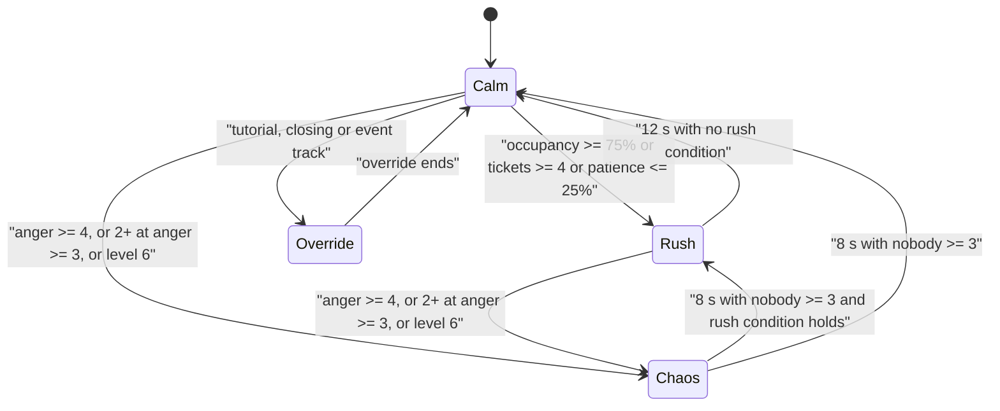

## 26. Animation and Audio

Animation and audio carry most of the comedy in Mystery Morph Restaurant. A tantrum is funny because of the windup,
the flailing arms, the trombone "wah-wahhh" and the plates flying, so this section covers how those layers are built.
It specifies the runtime systems; the content lives in the two databases, **§36.14 Animation Library** (`ANM_` ids)
and **§36.15 Sound Library** (`SFX_`/`MUS_` ids). Visual rules (rig contract, faces, VFX) are in §25.

### 26.1 Scope and Ownership

| Concern | Defined here | Content database | Consumers |
|---|---|---|---|
| Animator setup, priority policy, blending, gait classes, secondary motion, animation LOD | §26.2 | §36.14 | §5, §8, §11, §13, §16, §19, §30 |
| Employee work cycles, customer anger animation map, NPC combat-style sets | §26.2.2 | §36.14 | §8, §10, §11, §16 |
| SoundGroups, 3D rolloff, voice budget, ducking, gibberish voices, adaptive music, ambience zones, loudness | §26.3 | §36.15 | every gameplay section |
| Accessibility for audio and motion (captions, visual cues, reduced motion) | §26.2, §26.3 | — | §24 (renders the settings and caption UI) |

These systems run in the client pieces named in §27: the `Animate` and `CarryPose` LocalScripts (player locomotion
and carry layer), `MorphVisualController` (SPCV visuals, faces, NPC state animation), the `AnimCache` module (track
loading and caching, shown in §26.2.8), and `AudioController` (§26.3.8). This section adds one module,
**SecondaryMotion**, for the client `Modules` folder. Neither module owns any gameplay state. Each reads replicated state
(Humanoid state, proxy Attributes, existing domain remotes) and turns it into motion and sound. **The server never
waits on an animation or sound.** Hit timing, cooking timers and AI transitions are server-side (§5, §8, §11).

### 26.2 Animation System

#### 26.2.1 Purpose
Make every morph, from a Plain Human to a Kraken-Core-Pogo-Leg-Microwave-Head, move expressively with one shared
R15 animation set. Absurd anatomy has to read clearly in motion, and the animation cost has to fit inside the mobile
budget even with 24 customers, 20 employees and 8 players in one interior.

#### 26.2.2 Rules & Mechanics

##### Rig and Animator setup
- **Players.** R15 `Humanoid` with its `Animator`. The replacement `Animate` LocalScript (§27) picks locomotion
  from `Humanoid:GetState()`, root velocity and the character attribute `WobblyGait`. `CarryPose` layers
  `ANM_006`/`ANM_007` from the `CarryKind` attribute. Tracks played by the client on its own
  character replicate to other clients automatically.
- **SPCV visuals** (customers, employees, named NPCs, canon §C3). The client clones an R15 joint skeleton with
  `Motor6D`s plus `AnimationController` → `Animator`, with no `Humanoid`, which is cheaper. Each server proxy
  replicates `State`/`StateT0`, `MoveSpeed`, `AngerLevel`, `ItemS` and `Emote` as Attributes (§8), plus the
  `Customer.Emote` remote for one-off `ANM_` ids (§27). `MorphVisualController` maps them to tracks.
- **Mutation visuals** are welded (`WeldConstraint` per §30; the jaw and pupils use an animated `Weld`; Massless, no collision) to the rig parts through the canon `MMR_*`
  attachments (§C13.7), so the shared R15 animation drives every part. Nothing is retargeted per part.
- **Leg length.** The LEG part's `LegLength` attribute (canon) sets `Humanoid.HipHeight`. MorphAssemblyService also
  moves the hip, knee and ankle rig attachments proportionally and calls `Humanoid:BuildRigFromAttachments()`. SPCV
  rigs rebuild their `Motor6D` `C0`/`C1` directly. Animations are rotation-driven, so they stay valid on long or
  stubby legs. Stride-based speed matching uses `stride = LegLength / 2.0`.
- **In-place authoring.** No track uses root motion. Movement, including dashes and charges, is Humanoid or
  server-velocity driven so hit validation stays server-side. `Seg` tracks loop their middle section while the
  state holds.

##### Priority policy

| `Enum.AnimationPriority` | Use | Examples | Fade in / out (s) |
|---|---|---|---|
| Core | Fallback pose only | `ANM_210` | 0.2 / 0.2 |
| Idle | Standing, hovering and queue idles, combat stance | `ANM_001`, `ANM_073`, `ANM_100`, `ANM_140`, `ANM_211`, `ANM_260` | 0.3 / 0.3 |
| Movement | Gaits and full-body locomotion replacements, seated base | `ANM_002`–`ANM_005`, `ANM_008`, `ANM_009`, `ANM_040`, `ANM_054`, `ANM_067`–`ANM_072`, `ANM_239`, `ANM_282`, `ANM_348` | 0.15 / 0.15 (gait swap 0.25) |
| Action | Cooking, service, social, emotes, repair, employee cycles. **UB** tracks layer over gaits | `ANM_006`, `ANM_010`–`ANM_035`, `ANM_041`–`ANM_047`, `ANM_060`, `ANM_200`–`ANM_212`, `ANM_230`–`ANM_249` | 0.1 / 0.15 |
| Action2 | Attacks, tantrum attacks, ability casts | `ANM_048`–`ANM_050`, `ANM_104`, `ANM_145`–`ANM_149`, `ANM_301`–`ANM_360` | 0.05 / 0.1 |
| Action3 | Hit reactions and soft status overlays | `ANM_074`, `ANM_141`, `ANM_142`, `ANM_151`–`ANM_154`, `ANM_156`, `ANM_157`, `ANM_159` | 0.03 / 0.12 |
| Action4 | Hard-control statuses and system takeovers | `ANM_052`, `ANM_062`, `ANM_063`, `ANM_105`, `ANM_143`, `ANM_144`, `ANM_150`, `ANM_155` | 0.03 / 0.2 |

Rules:
1. Starting an Action4 track stops every playing Action–Action3 track with `Stop(0.1)`, so a wallop never blends
   into a KO.
2. When two tracks share a priority, the newest wins and the older one fades out with its own fade-out time.
3. Playing-track caps (§30): a player character has at most **6** (one Idle, one Movement, four Action layers). An
   NPC visual has at most **4** (2 on the LOW graphics tier).

##### Blending and layering
- **Upper-body carry over locomotion.** UB tracks (`ANM_006`, `ANM_007`, `ANM_075`, `ANM_076`, most service
  tracks) have no keyframes on `LowerTorso` or the hip, knee and ankle joints. Roblox resolves priority per joint,
  so the legs keep the Movement gait while the arms hold the tray. A carried item is welded to the `MMR_HandR` grip
  (§25 grip styles).
- **Speed matching.** Gait tracks use `AdjustSpeed(v / (v_authored × stride))`, where `v` is the horizontal
  `AssemblyLinearVelocity` magnitude, clamped to 0.5–1.6. Walk (`ANM_002`, authored at 8 studs/s) switches to run
  (`ANM_003`, 16 studs/s) at 12 studs/s, with 1 stud/s hysteresis and a 0.15 s crossfade. Single-cycle gait
  variants (`ANM_067`–`ANM_072`) cover every speed with speed scaling alone.
- **Partial-weight overlays.** A block flinch plays `ANM_141` at weight 0.5 over `ANM_303`, so the guard pose still
  reads. This relies on Roblox weighted blending between priorities; verify with
  `Workspace.AnimationWeightedBlendFix` enabled.
- **Station interaction** ends any carry track (the item goes into the station) and starts the station's Action
  track. If the player takes damage, the Action3 reaction overrides it for 0.35–0.7 s and the station track
  resumes. The server-side cook timer is unaffected (§5).

##### Gait classes and family flavor variants
The gait class is chosen from the LEG part family (canon §C13.6). FEET skates override a Standard gait.

| Gait class | LEG families | Track | Footsteps |
|---|---|---|---|
| Standard | human, cheetah, robot, mole | `ANM_002` / `ANM_003` | `SFX_063` |
| Heavy | bear, elephant, tree | `ANM_067` | `SFX_064` |
| Hop | frog, fish, kangaroo, grasshopper, pogo | `ANM_068` | `SFX_065` |
| Skitter | spider | `ANM_069` | `SFX_066` |
| Glide | octopus, cloud | `ANM_070` | `SFX_067` |
| Roll | wheel; also any Standard legs with FEET family skate or ice | `ANM_071` | `SFX_068` |
| Strut | chicken, ostrich, raptor, goat, phoenix | `ANM_072` | `SFX_069` |

| Base action | Condition | Variant | Notes |
|---|---|---|---|
| `ANM_010` Chop | Either ARM part has the `tentacle` tag | `ANM_033` | Same tap timing and quality rules |
| `ANM_021` Wash dishes | ROLE_DISH employee | `ANM_235` | Flavor only |
| `ANM_006` Carry item | Carrying ≥ 2 items | `ANM_075` | Canon carry cap 3 |
| `ANM_001` Idle | Airborne via `ABL_022` / `ABL_069` or a flying-tag WINGS hover | `ANM_073` | Procedural flaps |
| `ANM_048` Throw food | THROWER style | `ANM_149` | Shorter tell, backs away |
| `ANM_002` Walk | EVT_011 active | `ANM_282` | Event override |

Family flavor beyond these assets is procedural and costs no extra tracks: robot parts add servo whirr on
`FootL`/`FootR`; slime parts add a jiggle on landing; ghost parts get +0.15 transparency while moving.

##### Mismatched-leg wobble (`ANM_008`)
1. **Trigger.** LEG_L and LEG_R hold different part ids. Canon allows this with no penalty.
2. **Hip height.** `HipHeight` = the longer leg's `LegLength`. The shorter leg's visual foot gets a procedural
   tiptoe offset, so neither foot floats above the floor or sinks into it.
3. **Hip roll.** Roll amplitude = 12° + 4° per 0.5 stud of `LegLength` difference, capped at 20°. If the
   difference is ≥ 1.0 stud, the short leg adds a hop beat every second step.
4. **Footsteps.** Each foot plays its own gait-class footstep sound, so a pogo-plus-hoof morph goes
   "boing-clop-boing-clop".
5. **No gameplay effect.** WalkSpeed and hitboxes are unchanged.

##### Procedural secondary motion (client-only)
- **Scope.** TAIL parts, WINGS, `tentacle`-tagged ARM and LEG parts, NECK parts with `NeckLength` ≥ 1.0 stud,
  EARS antennae, and FX orbitals (orbitals use a simple rotation).
- **Method.** These parts are skinned MeshParts with a 2–6 `Bone` chain. SecondaryMotion runs a damped spring per
  bone in `RunService.PreRender` and writes `Bone.Transform` as a local rotation only. The part's attributes set
  `SpringStiffness` (default 120), `SpringDamping` (12), `MaxAngle` (35°) and `Lag` (0.04).
- **Wings** use a sine flap whose frequency comes from the family: insect 6 Hz (visually capped), bird 3 Hz, bat
  2.5 Hz, dragon 1.5 Hz. Amplitude is 10° idle and 50° hover.
- **Long necks** add an `IKControl` (Type `LookAt`) so heads track the food or the waiter. It is disabled beyond
  30 studs.
- **Budget.** At most 16 chains run at full rate within 30 studs, and chains at 30–60 studs update every second
  frame. Nothing updates beyond 60 studs. The total is ≤ 96 bones per frame and ≤ 0.6 ms on the reference mobile
  device, measured with `debug.profilebegin("mmrSecondaryMotion")`.
- **Reduced Motion** setting (§24): amplitude × 0.3, flaps ≤ 2 Hz, IK head tracking off.

##### Animation LOD by distance

| Band | Distance from camera (studs) | Tracks per NPC | Secondary motion | Face | Notes |
|---|---|---|---|---|---|
| LOD0 Near | 0–30 | up to 4 (LOW 2) | full rate | instant swaps plus blink mask | IKControl on |
| LOD1 Mid | 30–60 | primary track only (§30) | half rate | swaps on `AngerLevel` or mood change only | footstep SFX off beyond 40 |
| Impostor | > 60 (canon), or beyond the tier's full-detail cap (§30: 12 / 24 / 40) | one loop or none | off | 3-state decal (§25) | body-plan impostor, 1,500 tris |
| Paused / culled | off-screen beyond 30 studs; outside the current interior; > 120 studs in the city | 0 (`AdjustSpeed(0)` while off-screen) | off | — | resumes when visible |

Population caps per client follow §30 (total NPC visuals 40 / 56 / 80 by tier; interior worst case 28 customers
plus 20 staff). City crowds (client-only, §18) use `ANM_262`/`ANM_263` with LOD1 rules at every distance.

##### Employee work cycles per role
EmployeeService (§16) replicates the employee's task state. The client plays the matching cycle. Cycle lengths
follow the server task timer (track speed is scaled to fit, clamped 0.7–1.4). Every employee also uses `ANM_245`
when Energy < 30 %, `ANM_248` when Morale < 30, `ANM_246` during an Unpaid Break (canon E8), and `ANM_249` once
on hire.

| Role | Work-cycle loop (in order) | Typical cycle (s) | Idle filler between tasks |
|---|---|---|---|
| ROLE_CHEF | `ANM_031` → station track (`ANM_010`–`ANM_029`) → `ANM_017` → `ANM_018` → `ANM_230` | recipe prep time (§6) | `ANM_001` plus utensil twirl |
| ROLE_PREP | `ANM_031` → `ANM_231` (or `ANM_033` for tentacle arms) → `ANM_006` to STN_PREP | 6–8 | `ANM_016` (hand-mix) |
| ROLE_WAITER | `ANM_232` → `ANM_233` → `ANM_007` → `ANM_019` | 10–20 per table | `ANM_100`-style tray idle |
| ROLE_CASHIER | `ANM_234` → `ANM_066` | 3 | `ANM_260` lean |
| ROLE_DISH | `ANM_235` (loop per rack of 4) | 4 per rack-quarter | `ANM_245` (Sloth types yawn more) |
| ROLE_CLEANER | walk → `ANM_236` / `ANM_022` → `ANM_023` | 5–9 | `ANM_001` with a mop lean |
| ROLE_REPAIR | `ANM_237` → `ANM_060` (furniture) or `ANM_061` (appliances); `ANM_180` → `ANM_181` for Destroyed | repair duration (§15) | `ANM_001` |
| ROLE_SECURITY | patrol `ANM_002` → `ANM_238` intercept → `ANM_239` escort (customer plays `ANM_055`) | event-driven | `ANM_140` (stance, arms crossed) |
| ROLE_MANAGER | `ANM_240` pace → `ANM_241` on each morale tick | 30 per lap | `ANM_240` |
| ROLE_DELIVERY | `ANM_031` (bag) → `ANM_242` → off-screen → return walk | per delivery (§16) | `ANM_100` |
| ROLE_STOCKER | `ANM_076` crate → `ANM_243` | 8 per crate | `ANM_001` |
| ROLE_ASST_MGR | `ANM_240` pace → `ANM_244` at the busiest station | 20 per lap | `ANM_240` |

##### Customer animation map by anger level
Anger levels and thresholds are canon §C11.5; escalation logic is A5's (§10).

| Anger level | Body | Face (§25) | Voice / SFX | Adaptive music |
|---|---|---|---|---|
| 0 Happy | `ANM_040`, `ANM_041`, `ANM_043`, `ANM_102` on Delighted | mood-driven | `SFX_048`–`SFX_051`, `SFX_057` | Calm |
| 1 Annoyed | `ANM_046` | Annoyed | `SFX_052` | no change |
| 2 Complaining | `ANM_047` | Complaining | `SFX_054` loop | counts toward Rush |
| 3 Throwing food | `ANM_048` / `ANM_149` | Furious | `SFX_053`, `SFX_088`; `SFX_192` (first in scene) | Chaos if ≥ 2 customers at ≥ 3 |
| 4 Destroying furniture | `ANM_049`, `ANM_050`, `ANM_104` | Furious + steam | `SFX_115`, `SFX_111`–`SFX_113` | Chaos |
| 5 Fighting the player | style set below + ability tracks `ANM_309`–`ANM_360` | Rage | `SFX_158`, `SFX_193` | Chaos |
| 6 Restaurant-wide chaos | all of the above, crowd-wide | Rage, 1 Hz pulse | `SFX_194` once per episode | Chaos (full) |
| Resolution | `ANM_052` → `ANM_058` → `ANM_053` → `ANM_055` | Dizzy → Embarrassed | `SFX_091`, `SFX_094`, `SFX_059`; `SFX_195` when the last one calms | back to Rush/Calm |

| NPC combat style (§C11.6) | Core tracks |
|---|---|
| PACIFIST | `ANM_103` sulk, `ANM_056` cry, `ANM_057` storm out |
| THROWER | `ANM_149`, `ANM_048`, `ANM_009` spacing |
| BRAWLER | `ANM_140`, `ANM_145`, `ANM_003` chase |
| CHARGER | `ANM_146`, `ANM_049` (smashes furniture in path) |
| TANK | `ANM_147`, `ANM_067` gait, reduced `ANM_142` reaction (0.6 weight) |
| TRICKSTER | `ANM_148`, `ANM_054` |
| INSTIGATOR | `ANM_059`, `ANM_047` |

#### 26.2.3 Variables

| Variable | Value [TUNABLE] | Notes |
|---|---|---|
| `WalkRunThreshold` | 12 studs/s (± 1 hysteresis) | walk ↔ run swap |
| Authored gait speeds | walk 8, run 16 studs/s at LegLength 2.0 | stride scales with LegLength |
| Max playing tracks | player 6; NPC 4 (LOW 2) | §26.2.2 rule 3, §30 |
| `MaxLoadedTracksPerPlayerAnimator` | 64 | engine hard limit is 256 per Animator |
| `MaxLoadedTracksPerNpcAnimator` | 24 | crowd ≤ 4 |
| LOD distances | 30 / 60 studs; full-detail caps 12 / 24 / 40 by tier | §30 decimation |
| Secondary motion | 16 chains full rate, ≤ 96 bones/frame, ≤ 0.6 ms | half rate at 30–60 studs |
| Wobble hip roll | 12° + 4° per 0.5 stud ΔLegLength, max 20° | `ANM_008` |
| Idle fidget interval | 6–14 s random | `ANM_001` markers |
| Station track speed clamp | 0.7–1.4 | fits server timers |

#### 26.2.4 UI
- The emote wheel (§24) lists `ANM_200`–`ANM_206`. Earned emotes are plain-text reward names (canon §C17.4) mapped to
  these tracks.
- The Morph customization viewport (§13) plays `ANM_211`. Selecting a slot group blends in a focus pose (the arm
  raise or tail swish from the same track), and equipping a part plays `ANM_065`.
- Accessibility settings (§24) include **Reduced Motion**, seeded from `GuiService.ReducedMotionEnabled`: secondary
  motion × 0.3 and no squash overshoot on UI-triggered animations. Camera nudges follow §24's separate **Screen
  Shake** toggle.

#### 26.2.5 Progression
Ability tracks unlock with their mutation parts. Emotes unlock through rewards. Employee uniforms and cycle flavor
variants improve with rarity: Epic and Legendary employees play cycles at speed 1.1 with an extra flourish frame on
`ANM_230`/`ANM_234`. Restaurant tiers add no new tracks; they add props.

#### 26.2.6 Player Interactions
- Co-op players on different station slots (canon E7) each play their own station track. Players see each other's
  tracks through Humanoid replication.
- Guests visiting a friend's restaurant see the same SPCV customer visuals, built locally from the same proxy
  attributes, so animation state matches within one replication tick.
- Arena (§21): `ANM_160` on intro, `ANM_161` on taunt input, `ANM_051` for the winner.

#### 26.2.7 Dependencies
§5 (station states), §8/§10 (customer states, anger), §11 and §36.6 (ability timing), §36.7 (status visuals),
§12/§13 (part attributes `LegLength`, `NeckLength`, tags), §16 (employee task states), §25 (rig contract, faces),
§27 (module placement, remotes), §30 (performance budgets).

#### 26.2.8 Roblox Implementation

```lua
--!strict
-- AnimCache (client module, §27). Loads, caches and plays ANM_ tracks on any Animator.
local AnimationIds = require(script.Parent.AnimationIds)
-- AnimationIds["ANM_010"] = { id = "rbxassetid://...", priority = Enum.AnimationPriority.Action,
--                             looped = true, fadeIn = 0.1, fadeOut = 0.15 }

local AnimCache = {}
local cache: { [Animator]: { [string]: AnimationTrack } } = setmetatable({}, { __mode = "k" }) :: any

local function getTrack(animator: Animator, anmId: string): AnimationTrack?
	local perAnimator = cache[animator]
	if not perAnimator then
		perAnimator = {}
		cache[animator] = perAnimator
	end
	if perAnimator[anmId] then
		return perAnimator[anmId]
	end
	local def = AnimationIds[anmId]
	if not def then
		return nil
	end
	local anim = Instance.new("Animation")
	anim.AnimationId = def.id
	local ok, track = pcall(animator.LoadAnimation, animator, anim)
	if not ok then
		warn("[mmr] animation load failed", anmId) -- analytics: mmr_anim_load_fail
		return nil
	end
	track.Priority = def.priority
	track.Looped = def.looped
	perAnimator[anmId] = track
	return track
end

local HARD = Enum.AnimationPriority.Action4
local KEEP = { [Enum.AnimationPriority.Core] = true, [Enum.AnimationPriority.Idle] = true,
	[Enum.AnimationPriority.Movement] = true }

function AnimCache.play(animator: Animator, anmId: string, speed: number?): AnimationTrack?
	local def, track = AnimationIds[anmId], getTrack(animator, anmId)
	if not (def and track) then
		return nil
	end
	if def.priority == HARD then -- rule 1: hard control cancels every Action layer
		for _, playing in animator:GetPlayingAnimationTracks() do
			if playing ~= track and not KEEP[playing.Priority] then
				playing:Stop(0.1)
			end
		end
	end
	track:Play(def.fadeIn, 1, speed or 1)
	return track
end

-- Seg tracks: wrap between LoopStart and LoopEnd while the state holds.
function AnimCache.holdSegment(track: AnimationTrack, isHeld: () -> boolean)
	local loopStart = 0
	local startConn = track:GetMarkerReachedSignal("LoopStart"):Connect(function()
		loopStart = track.TimePosition
	end)
	local endConn: RBXScriptConnection
	endConn = track:GetMarkerReachedSignal("LoopEnd"):Connect(function()
		if isHeld() then
			track.TimePosition = loopStart
		else
			startConn:Disconnect()
			endConn:Disconnect()
		end
	end)
end

return AnimCache
```

```lua
--!strict
-- SecondaryMotion (client): damped springs on Bone chains (tails, wings, tentacles, necks).
local RunService = game:GetService("RunService")
type Chain = { root: BasePart, bones: { Bone }, ang: { Vector3 }, vel: { Vector3 },
	k: number, d: number, maxAngle: number, lag: number, everyN: number }
local chains: { Chain } = {} -- rebuilt by the LOD pass at 4 Hz (≤ 16 full-rate chains)
local frame = 0

RunService.PreRender:Connect(function(dt: number)
	debug.profilebegin("mmrSecondaryMotion")
	frame += 1
	for _, c in chains do
		if frame % c.everyN == 0 then
			local step = math.min(dt * c.everyN, 1 / 20)
			local v = c.root.CFrame:VectorToObjectSpace(c.root.AssemblyLinearVelocity)
			local target = Vector3.new(v.Z, 0, -v.X) * c.lag -- lean against the motion (radians)
			for i, bone in c.bones do
				local a, w = c.ang[i], c.vel[i]
				w += ((target * (i / #c.bones) - a) * c.k - w * c.d) * step
				a += w * step
				a = Vector3.new(math.clamp(a.X, -c.maxAngle, c.maxAngle), 0,
					math.clamp(a.Z, -c.maxAngle, c.maxAngle))
				c.ang[i], c.vel[i] = a, w
				bone.Transform = CFrame.Angles(a.X, 0, a.Z)
			end
		end
	end
	debug.profileend()
end)
```

**Authoring pipeline.** Animators key on the in-house R15 template rig (Blender or the Roblox Animation Editor) at
30 fps, in place. Animations are imported as KeyframeSequences, then markers are added with standard names. Every
animation is published under the group that owns the experience; an animation owned by another account does not
play. The asset id goes into the `AnimationIds` module, keyed by the `ANM_` id. The 52 canon core ids and the
current loadout's ability tracks are preloaded with `ContentProvider:PreloadAsync` during the loading screen.

#### 26.2.9 Edge Cases
1. **Part equip mid-animation.** Visual parts are welds, so tracks keep playing. A LEG swap that changes
   `LegLength` rebuilds joints. `Animate` then restarts the gait track at the same normalized phase.
2. **KO while carrying.** The carry track stops and the item drops per §5/§11. `ANM_062` takes over at Action4.
3. **Level-up during a station interaction.** `ANM_064` is queued and plays on the next idle moment, or in the
   stats menu preview (canon E14).
4. **Loadout swap interrupted** (canon E4). Damage stops `ANM_209` at once and no parts swap. `SFX_144` cuts with
   it.
5. **Track fails to load** (moderation, permissions or network). The character falls back to `ANM_210` (Core) for
   that layer, logs `mmr_anim_load_fail`, and retries once after 10 s.
6. **Approaching the 256-track engine limit.** The per-Animator cache caps at 64 (players) or 24 (NPCs). Least
   recently used, non-playing tracks are destroyed first.
7. **Stuck customer** (canon E10). `ANM_105` plays at Action4 so no half-blended walk shows during the teleport.
8. **Tiny Day and Giant Day** (EVT_015, EVT_016). If §18 scales characters with `Model:ScaleTo`, speed matching
   uses the scaled stride. Animations need no change because they are rotation-only.
9. **Empty ARM slot** (if §13 allows it). The hidden rig arm still animates, and a held item floats at the hidden
   hand in a comic "telekinesis" look. No special case is needed.

#### 26.2.10 Acceptance Criteria
- **AC-26-01:** All 52 canon core ids (§C21) and all 70 ability ids `ANM_301`–`ANM_370` resolve in `AnimationIds`
  to group-owned assets. A 30-minute soak logs 0 `mmr_anim_load_fail` events.
- **AC-26-02:** While carrying (`ANM_006`/`ANM_007`) at any speed from 8 to 21 studs/s, the legs play the active
  gait. Foot slide is ≤ 0.2 stud per stride, measured on the test rig at LegLength 1.25, 2.0 and 3.5.
- **AC-26-03:** For a morph with mismatched legs, `ANM_008` replaces the gait within 1 frame of the morph rebuild.
  WalkSpeed is identical (± 0.01) to the matched-legs control.
- **AC-26-04:** Starting any Action4 track stops all Action–Action3 tracks within 0.1 s. No player exceeds 6
  playing tracks, and no NPC visual exceeds 4 (2 on LOW), checked by lint on `GetPlayingAnimationTracks`.
- **AC-26-05:** With 24 customers, 20 employees and 8 players in a TIER_10 interior, SecondaryMotion costs ≤ 0.6 ms
  per frame on the reference mobile device, and no more than 16 chains run at full rate.
- **AC-26-06:** NPC visuals switch to LOD1 (primary track only) at 30 studs, and to the impostor at 60 studs or
  beyond the tier's full-detail cap, within 0.5 s of crossing. Impostors play at most 1 track, and off-screen visuals
  beyond 30 studs are paused.
- **AC-26-07:** Each role's cycle matches the §26.2.2 table, and the visual task changes within 0.5 s of the
  replicated task state changing.
- **AC-26-08:** Every NPC combat style plays its listed tracks. The CHARGER and TANK attack tells are ≥ 0.6 s and
  ≥ 0.8 s long, so they read before impact.

### 26.3 Audio System

#### 26.3.1 Purpose
Every action should sound satisfying and every important event should cut through the chaos: a customer hitting
anger 5 behind you, a patty about to burn, a fire. The mix should feel like a bright cartoon, never a horror movie,
and must stay inside mobile CPU and memory limits.

#### 26.3.2 Rules & Mechanics

##### SoundGroup hierarchy (authored in Studio under `SoundService`)

| SoundGroup | Parent | Default `Volume` | Effects chain | Contents |
|---|---|---|---|---|
| Master | `SoundService` | 1.0 | `CompressorSoundEffect` (Threshold −12 dB, Ratio 4, Attack 0.005 s, Release 0.25 s), `EqualizerSoundEffect` (all gains 0) | everything |
| Music | Master | 0.45 | `CompressorSoundEffect` (SideChain = Announce; Threshold −30 dB, Ratio 4, Attack 0.05 s, Release 0.6 s) | `MUS_` tracks, stingers |
| SFX | Master | 0.8 | `EqualizerSoundEffect` (menu-open duck: MidGain −3, HighGain −6) | kitchen, combat, destruction, repair, mutation, event one-shots |
| Alerts | Master | 0.9 | — (no compressor; **never ducked below −6 dB**, including during chaos) | kitchen warnings behind the "Kitchen Alerts" slider (§5, §24): ready ding `SFX_009`, order-up bell `SFX_022`, Perfect ting `SFX_029`, burn warning `SFX_030`, fire alarm `SFX_032`, patience-critical warning `SFX_157` |
| Voice | Master | 0.7 | `ChorusSoundEffect` (Mix 0 by default; set to 0.2 for Delighted grains) | customer gibberish |
| Announce | Voice | 1.0 | — | news jingle voice-overs, NPC_001 tutorial gibberish lines |
| UI | Master | 0.6 | — | UI, currency, level-up |
| Ambience | Master | 0.4 | `CompressorSoundEffect` (SideChain = SFX; Threshold −24 dB, Ratio 3) | district beds, emitters, room tone |

The player's settings sliders (0–100 %) multiply each default. A18 persists them (§28). **Alerts floor:** every duck
in the table below skips Alerts, and the AudioController clamps any scripted Alerts reduction to −6 dB. Only the
player's own Kitchen Alerts slider can go lower (readability and accessibility).

##### 3D rolloff
All 3D sounds use `RollOffMode = Enum.RollOffMode.InverseTapered` unless listed otherwise. Global settings:
`SoundService.DistanceFactor` 3.33 (default), `RolloffScale` 1.0, and **`DopplerScale` 0**, so dashes and charges
never pitch-bend.

| Sound class | Min / Max distance (studs) | Notes |
|---|---|---|
| Kitchen station loops (`SFX_004`, `SFX_007`, `SFX_012`, `SFX_014`) | 6 / 45 | parented to the station's slot attachment |
| Kitchen one-shots and cues | 8 / 60 | the acting player hears cues in 2D |
| Customer voice | 5 / 40 | parented to `MMR_Mouth` |
| Footsteps and creature barks | 4 / 30 | footsteps off beyond 40 studs (LOD1) |
| Combat and abilities | 10 / 90 | |
| Destruction | 10 / 100 | |
| Repair | 6 / 50 | |
| City point emitters (neon, fountain) | `Linear` 8 / 60 (fountain 15 / 90) | Ambience bus |
| Big event sources (`SFX_176`, `SFX_180`, `SFX_182`) | 20 / 200 (Rat King 30 / 300) | |

**No bleed rule.** The largest max distance is 300 studs, so instanced interiors must sit ≥ 600 studs from every
city emitter and from each other. This is an A17 layout requirement in §27.

##### Voice budget and stealing
- Concurrent one-shot and loop voices: **24** (§27 AudioController budget), counting SFX, Alerts, Voice and UI.
  Music stems and ambience beds are managed separately (≤ 4 stems + 3 beds).
- Per-category caps (maxima inside the 24): customer Voice 4, footsteps 4, kitchen loops 6, combat 8, destruction 4,
  UI 3. Alerts are never capped below their P1/P2 needs. Each id has
  an instance cap of 4 by default, and a retrigger of the same id within 50 ms merges into the playing instance.
- **Stealing order** when full: lowest priority first (P4 → P3 → P2), then farthest, then oldest. **P1 is never
  stolen.** If only P1 sounds are playing, a new P2–P4 sound is dropped.
- Pools: AudioController keeps up to 4 pre-created `Sound` instances per id, created on first use and reused, so it
  never calls `Instance.new` on the hot path.
- If the client's FPS stays below 30 for 5 s, the limit drops to 16 voices and footsteps turn off. Both return
  after 30 s above 40 FPS.

##### Mixing and ducking

| Situation | Effect | Attack / release | Mechanism |
|---|---|---|---|
| Announcement (`SFX_199` plus NPC_030 lines, tutorial lines) | Music −8 dB, Ambience −6 dB | 0.05 s / 0.6 s | Compressor SideChain = Announce |
| Stinger playing (`SFX_190`–`SFX_201`) | Music bed −6 dB for the stinger's length | 0.05 s / 0.4 s | scripted stem `Volume` tween |
| Chaos state (adaptive music in Chaos) | Ambience −6 dB, room tone `SFX_178` −3 dB, non-angry customer voices −3 dB; Alerts untouched | 0.3 s / 2.0 s | scripted |
| Player KO (`ANM_062`, 4 s) | SFX, Voice, Ambience EQ HighGain −12 dB ("muffled stars"), Music −6 dB; Alerts at most −6 dB | 0.1 s / 0.8 s | scripted |
| Full-screen menu open | SFX EQ duck, Ambience −6 dB | 0.15 s / 0.3 s | scripted |
| Heavy SFX bursts | Ambience compresses automatically | engine | Ambience Compressor SideChain = SFX |

##### Customer "voices": family gibberish
- **No real speech.** Each customer speaks in syllable grains from one of the 12 banks `SFX_036`–`SFX_047`,
  chosen from the HEAD part family (mapping in §36.15). Named NPCs with custom heads fall back by HEAD category:
  MAMMAL → `SFX_041`, or `SFX_036` if the head has the `heavy` or `tank` tag. BIRD → `SFX_038`. REPTILE and
  DINOSAUR → `SFX_043`. AMPHIBIAN → `SFX_039`. FISH and MARINE → `SFX_040`. INSECT and ARACHNID → `SFX_045`.
  ROBOT and OBJECT → `SFX_044`. FOOD and PLANT → `SFX_046`. ALIEN → `SFX_047`. MYTHOLOGICAL and ELEMENTAL →
  `SFX_036`.
- **Sentence synthesis.** Each sentence strings 3–9 grains with 30–60 ms gaps. The proxy's `Seed` attribute (§8)
  fixes a base pitch offset between −2 and +2 semitones, so a given customer always sounds like itself.
  Syllable order uses that seed plus a sentence counter.
- **Personality tint.** The shared personality data (A5, §9) may carry a voice pitch offset (±2 semitones) and
  tempo (0.8–1.25), looked up client-side by `PersonalityId`; for example, PER_006 talks at tempo 0.8. No extra
  attribute is replicated.
- **Mood pitch shifts** use `Sound.PlaybackSpeed`, which shifts pitch and tempo together for a deliberate cartoon
  "chipmunk/grumble" effect:

| Mood or anger | Semitones | `PlaybackSpeed` | Grain gap | Extra |
|---|---|---|---|---|
| Delighted (≥ 90) | +3 | 1.19 | 30 ms | Voice Chorus Mix 0.2 |
| Happy (70–89) | +1 | 1.06 | 40 ms | — |
| Meh (50–69) | 0 | 1.00 | 45 ms | — |
| Unhappy (30–49) / Anger 1 | −2 | 0.89 | 60 ms | — |
| Anger 2 Complaining | −2 | 0.89 | 25 ms | rant loop `SFX_054` |
| Furious (< 30) / Anger ≥ 3 | −4 | 0.79 | 20 ms | `DistortionSoundEffect` Level 0.12 (comic grit), +2 dB |
| EVT_015 Tiny Day / EVT_016 Giant Day | +5 / −5 extra | clamp 0.6–1.6 | — | event modifier |

- **Mouth sync.** On each grain onset, the client opens the MOUTH part's hinged jaw (a `Weld.C0` rotation of 8–20°)
  or plays a face-decal "talk" frame (§25). Speech bubbles show A5's text; the audio stays gibberish.
- **Caps.** At most 4 customer voices play at once. Priority order: anger ≥ 3 first, then the customer being served
  or targeting you, then the nearest. Each customer waits ≥ 2.5 s between sentences, and an order call (`SFX_048`)
  plays once per order.

##### Adaptive restaurant music (calm → rush → chaos)
Each tier track `MUS_003`–`MUS_012` ships three stems of identical length and BPM: **Calm**, **Rush** and
**Chaos**. The client computes state from replicated proxy Attributes in the current interior:

- **Rush** when seat occupancy ≥ 75 %, or ≥ 4 open tickets, or any customer's patience ≤ 25 %. It exits after 12 s
  with none of these true.
- **Chaos** when any customer is at anger ≥ 4, or ≥ 2 customers are at anger ≥ 3, or level-6 restaurant-wide chaos
  is active. It exits 8 s after no customer is at ≥ 3, going to Rush if Rush conditions still hold, else Calm.
- **Stem volumes.** Calm: Calm 1.0, Rush 0, Chaos 0. Rush: Calm 1.0, Rush 1.0, Chaos 0. Chaos: Calm 0.6, Rush 1.0,
  Chaos 1.0. Fades take 1.5 s going up and 4.0 s going down (`TweenService`, `EasingStyle.Quad`).
- **Sync.** All stems start together at load (upper stems at Volume 0). On the Calm stem's `Sound.DidLoop`, the
  other stems are re-aligned if they have drifted > 50 ms.
- **Stingers.** Entering Chaos plays `SFX_192`, or `SFX_194` at level 6. Leaving Chaos plays `SFX_195`.
- **Overrides.** Tutorial: `MUS_002` until QST_TUT_012 completes. Closing state (canon E1): `MUS_013`. EVT_003 and
  EVT_023: `MUS_035` replaces the tier track (2 s crossfade). EVT_009: `MUS_029`. Guests hear the host's tier
  track.



##### City ambience zones
Invisible, non-colliding zone parts in an `AudioZones` folder carry a `District` attribute. The client tests the
camera position against precomputed bounding boxes at 4 Hz. On a zone change, the district bed and district music
crossfade over 2.0 s and `SoundService.AmbientReverb` is set. The night layer `SFX_173` fades in over 5 s when the
city clock is at or after 19:00, or before 05:00.

| District | Bed | Music | `AmbientReverb` | Signature emitters |
|---|---|---|---|---|
| DST_01 Restaurant Row | `SFX_163` | `MUS_015` | City | neon `SFX_174`, delivery toots `SFX_177` |
| DST_02 Mutation Market | `SFX_164` | `MUS_016` | Alley | stall jars, neon |
| DST_03 Downtown | `SFX_165` | `MUS_017` | City | fountain `SFX_175`, metro `SFX_176` |
| DST_04 Industrial | `SFX_166` | `MUS_018` | Hangar | steam whistles |
| DST_05 Monster Mall | `SFX_167` | `MUS_019` | Hangar | escalators |
| DST_06 Research | `SFX_168` | `MUS_020` | StoneCorridor | bubbling tubes |
| DST_07 Entertainment | `SFX_169` | `MUS_021` | City | marquee neon, buskers |
| DST_08 Residential | `SFX_170` | `MUS_022` | Plain | fountain at BLD_19 |
| DST_09 Sewers | `SFX_171` | `MUS_023` | SewerPipe | drips |
| DST_10 Arena District | `SFX_172` | `MUS_024` | Arena | crowd swells |
| Restaurant interiors | `SFX_178` | `MUS_003`–`MUS_012` | Room (T1–T2), LivingRoom (T3–T5), Auditorium (T6–T7), CarpettedHallway (T8), ConcertHall (T9–T10) | station loops |

##### Loudness targets and mastering

| Asset / bus | Target | True peak | Notes |
|---|---|---|---|
| Full mix during a scripted rush capture | −16 LUFS-I ± 1 | ≤ −1 dBTP | measured from device output |
| Music stem (solo) | −20 LUFS-I | ≤ −3 dBTP | 3 stems sum to about −16 |
| SFX one-shots | P1/P2: −14 LUFS-M; P3/P4: −18 LUFS-M | ≤ −3 dBTP | normalized before upload |
| Voice gibberish grains | −20 LUFS-I per bank | ≤ −6 dBTP | Furious row adds +2 dB in game |
| UI | −22 LUFS-M | ≤ −6 dBTP | must not mask kitchen cues |
| Ambience beds | −28 LUFS-I | ≤ −10 dBTP | 60–90 s seamless loops |
| Stingers | −16 LUFS-M | ≤ −1 dBTP | duck the bed by 6 dB |

Delivery format: OGG, 44.1 kHz, mono for 3D sounds and stereo for 2D beds and music, within Roblox upload limits
(≤ 7 min, ≤ 20 MB per file).

##### Accessibility (§24 owns the settings and renders the UI)
- **Captions.** When §24's **Subtitles** setting is on (default on), every P1 and P2 sound also produces caption text
  from the localization table, for example `SFX_030` "[Sizzling – about to burn!]", `SFX_032` "[Fire!]",
  `SFX_157` "[Customer getting impatient]", `SFX_158` "[Customer wants to fight!]", `SFX_053` "[Angry
  gibberish]", `SFX_190` "[WRONG ORDER!]". A caption appears ≤ 100 ms after its sound and includes a direction
  arrow. Customer barks and NPC lines are already subtitled by §24.
- **Visual sound cues.** Off-screen P1 sounds show §24's edge-of-screen marker, with an icon, pointing at the source
  for 2 s. Shape plus icon, never color alone.
- **Haptics.** §24's Vibration setting drives `HapticService:SetMotor(Enum.UserInputType.Gamepad1,
  Enum.VibrationMotor.Large, intensity)` on big hits and PERFECT (§24) and for 0.15 s on each P1 alert.
- **Sliders** (§24 defaults): Master 80, Music 60, SFX 80, Voice 70, UI 70, Ambience 60, and **Kitchen Alerts** 80
  for the `Alerts` group. A slider at 0 mutes its bus, and Voice at 0 silences all gibberish.
- **Reduced Motion** is seeded from `GuiService.ReducedMotionEnabled` (§24) and applies the secondary-motion limits in
  §26.2.2.
- **Proposed for §24's list:** "Reduce sudden loud sounds" (Master compressor: Ratio 8, Threshold −18 dB).

#### 26.3.3 Variables

| Variable | Value [TUNABLE] | Notes |
|---|---|---|
| Max concurrent voices | 24 (§27) | 16 in low-FPS fallback |
| Customer voice cap | 4 concurrent; 2.5 s per-customer cooldown | |
| Stinger cooldown | 4 s per id; `SFX_194` once per chaos episode | |
| Adaptive music thresholds | Rush: 75 % seats / 4 tickets / 25 % patience; Chaos: anger ≥ 4 or 2 at ≥ 3 | hysteresis 12 s / 8 s |
| Stem fades | up 1.5 s, down 4.0 s | |
| Zone crossfade | 2.0 s; zone poll 4 Hz | |
| Ducking | announce −8 dB music; stinger −6 dB; chaos −6 dB ambience | Alerts floor −6 dB (never ducked further) |
| Pitch jitter | `PlaybackSpeed` 0.96–1.04 | per play |

#### 26.3.4 UI
UI sounds are mapped to UIController events: open and close `SFX_151`/`SFX_152`, tabs `SFX_153`, errors
`SFX_154`, toasts `SFX_155`, new tickets `SFX_156`. Currency counters use `SFX_126` (throttled) and the offline
report uses `SFX_201` + `SFX_134` with `MUS_014`. Audio settings are listed under Accessibility above.

#### 26.3.5 Progression
The restaurant soundtrack grows with the tier, from skiffle (`MUS_003`) to a gibberish choir (`MUS_012`). District
music plays as each district unlocks. Unlocks get audible punctuation: tier fanfare `SFX_197`, Epic+ reveals
`SFX_198`, secrets `SFX_148`. The §15 Mutant Builders sequence uses `MUS_034`, `SFX_177`, `SFX_119`, `SFX_079`,
`SFX_197` and `SFX_174` on the beats listed in §25.4.7.

#### 26.3.6 Player Interactions
Each client runs its own AudioController. Your own actions play at P2 (2D for cues). Other players' kitchen actions
play at P4 in 3D, so co-op kitchens stay readable. Guests hear the host's music and room tone. In the arena,
`MUS_025` adds its second stem at match point.

#### 26.3.7 Dependencies
§5 (station events and timing cues), §8/§10 (mood, anger, chaos flag), §11/§36.6/§36.7 (combat and status events),
§15 (damage states), §16 (employee tasks), §18 and §36.11 (districts, events), §24 (settings and captions UI), §27
(module placement, interior layout spacing), §28 (settings persistence), §30 (budgets).

#### 26.3.8 Roblox Implementation

```lua
--!strict
-- AudioController (client, §27): pooled playback, priority-based voice stealing, gibberish speech.
local SoundService = game:GetService("SoundService")
local SoundIds = require(script.Parent.SoundIds)
-- SoundIds["SFX_079"] = { assets = { "rbxassetid://..." }, group = "SFX", priority = 2,
--                         is3D = true, minD = 10, maxD = 90, maxInstances = 4 }

type Live = { sound: Sound, priority: number, startedAt: number }
local maxVoices = 24 -- §27 budget; 16 in the low-FPS fallback
local live: { Live } = {}
local rng = Random.new()

local function steal(newPriority: number): boolean
	local victimIndex: number? = nil
	for i, l in live do -- P1 (1) is never stolen; larger number = less important
		if l.priority > 1 and l.priority >= newPriority then
			local v = victimIndex and live[victimIndex]
			if not v or l.priority > v.priority or (l.priority == v.priority and l.startedAt < v.startedAt) then
				victimIndex = i
			end
		end
	end
	if victimIndex then
		live[victimIndex].sound:Stop()
		table.remove(live, victimIndex)
		return true
	end
	return false
end

local AudioController = {}

function AudioController.play(id: string, emitter: Instance?, speed: number?, take: number?): Sound?
	local def = SoundIds[id]
	if not def then
		return nil
	end
	if #live >= maxVoices and not steal(def.priority) then
		return nil -- dropped; captions still fire from the gameplay event
	end
	local s = Instance.new("Sound") -- production: taken from the per-id pool (4 instances)
	s.SoundId = def.assets[take or rng:NextInteger(1, #def.assets)]
	s.SoundGroup = SoundService.Master:FindFirstChild(def.group, true) :: SoundGroup
	s.PlaybackSpeed = (speed or 1) * rng:NextNumber(0.96, 1.04)
	if def.is3D and emitter then
		s.RollOffMode = Enum.RollOffMode.InverseTapered
		s.RollOffMinDistance, s.RollOffMaxDistance = def.minD, def.maxD
		s.Parent = emitter
	else
		s.Parent = SoundService
	end
	s:Play()
	local entry: Live = { sound = s, priority = def.priority, startedAt = os.clock() }
	table.insert(live, entry)
	s.Ended:Once(function()
		local i = table.find(live, entry)
		if i then
			table.remove(live, i)
		end
	end)
	return s
end

local moodSemitones = { Delighted = 3, Happy = 1, Meh = 0, Unhappy = -2, Furious = -4 }

function AudioController.speak(mouth: Attachment, bankId: string, mood: string, seed: number, sentence: number)
	local base = Random.new(seed):NextInteger(-2, 2) -- stable per customer
	local syl = Random.new(seed * 31 + sentence) -- new syllable order per sentence
	local speed = 2 ^ (((moodSemitones[mood] or 0) + base) / 12)
	local gap = if mood == "Furious" then 0.02 elseif mood == "Unhappy" then 0.06 else 0.04
	task.spawn(function()
		for _ = 1, syl:NextInteger(3, 9) do
			local s = AudioController.play(bankId, mouth, speed, syl:NextInteger(1, 28))
			if not s then
				return
			end
			task.wait(s.TimeLength / speed + gap) -- banks are preloaded, so TimeLength is valid
		end
	end)
end

return AudioController
```

**Production rules.** All audio is uploaded under the group that owns the experience, with experience-use permission
granted. `ContentProvider:PreloadAsync` loads the P1 cues, the 12 voice banks and the current tier's stems during
loading. District music streams on demand.

#### 26.3.9 Edge Cases
1. **Splat storm during level-6 chaos.** Instance caps (4 per id), the 50 ms merge window and P4 stealing keep the
   mix legible. Every P1 cue still plays.
2. **Music slider at 0.** Stingers live on the Music bus and go silent too. Every stinger event also has a visual
   equivalent (comic text, §25), so no information is lost.
3. **Asset fails to load** (moderation or permissions). The sound is skipped silently, `mmr_audio_load_fail` is
   logged, and the caption still shows.
4. **Interior and city overlap.** Prevented by the ≥ 600-stud spacing rule. QA checks that city emitters measure
   ≤ −60 dB inside interiors.
5. **Hostile customer while a full-screen menu is open** (canon E2). The menu auto-closes (`SFX_152`) and the menu
   duck releases in 0.3 s, so `SFX_158` is heard clearly.
6. **Offline report opens inside the restaurant.** `MUS_014` replaces the tier stems with a 1 s crossfade. When the
   report closes, the bed resumes in its current adaptive state.
7. **Low-end device.** The voice limit drops to 32, footsteps go off, and secondary sounds are culled first.
   Captions and visual cues are unaffected.
8. **Many players in one kitchen.** Remote players' station loops are capped at 10 in total. The nearest loops win.

#### 26.3.10 Acceptance Criteria
- **AC-26-09:** The SoundGroups Master, Music, SFX, Alerts, Voice, Announce, UI and Ambience exist with the listed
  defaults.
  Each settings slider changes its bus within 1 frame, and the value persists across rejoin.
- **AC-26-10:** During an announcement, Music drops 8 ± 1 dB within 100 ms and recovers within 600 ± 100 ms after
  the announcement ends.
- **AC-26-11:** Customer voices contain no intelligible words: 0 of 20 listeners transcribe a real word from a 2-min
  capture. Mood pitch follows the §26.3.2 table within ± 0.02 `PlaybackSpeed`. At most 4 voices play concurrently.
- **AC-26-12:** The Chaos stem reaches full volume ≤ 1.5 s after the first customer reaches anger ≥ 4, and fades
  out no earlier than 8 s after the last customer drops below anger 3. Stems stay within 50 ms of sync over a
  30-min session.
- **AC-26-13:** Crossing a district boundary crossfades the bed and music in 2.0 ± 0.2 s, with no silent gap
  > 0.5 s.
- **AC-26-14:** A scripted TIER_06 rush capture measures −16 ± 1 LUFS-I with true peak ≤ −1 dBTP.
- **AC-26-15:** In a TIER_10 level-6 chaos test, concurrent voices never exceed 24 (16 in the low-FPS fallback).
  No P1 sound is ever stolen or dropped (instrumented log).
- **AC-26-16:** With Subtitles on, 100 % of P1 and P2 sounds produce a caption ≤ 100 ms after playback. Off-screen
  P1 sources show a direction cue for 2 s.
- **AC-26-17:** All `SFX_` and `MUS_` assets are group-owned and permissioned. A 30-minute soak across all 10
  districts logs 0 `mmr_audio_load_fail` events.
- **AC-26-18:** Inside any interior, every city emitter measures ≤ −60 dB relative to its source level.
- **AC-26-19:** With Reduced Motion on, secondary-motion amplitude is ≤ 30 % of default and no wing flap exceeds
  2 Hz. With Screen Shake off, camera nudges are 0.
- **AC-26-20:** During a level-6 chaos capture with the player KO'd, the Alerts bus (`SFX_009`, `SFX_022`, `SFX_029`,
  `SFX_030`, `SFX_032`, `SFX_157`) never measures more than 6 dB below its undiminished level, unless the player's
  Kitchen Alerts slider is set lower.
