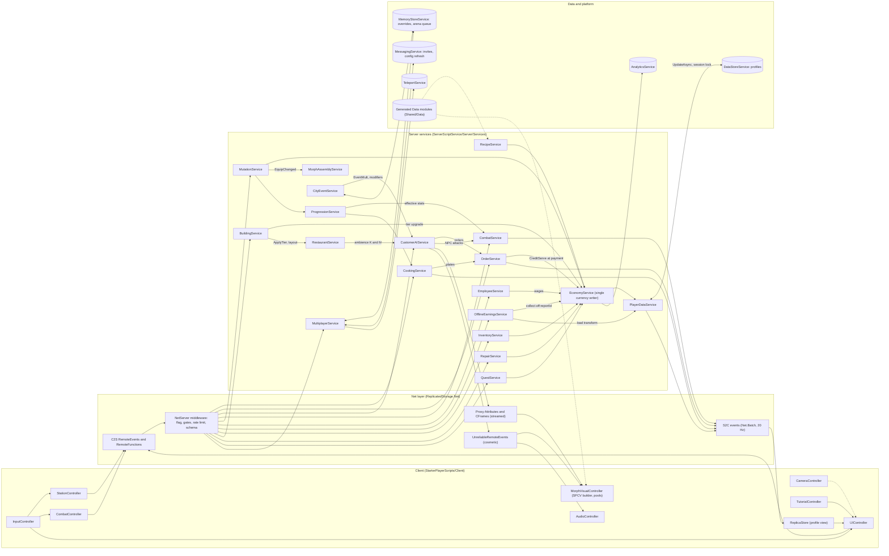
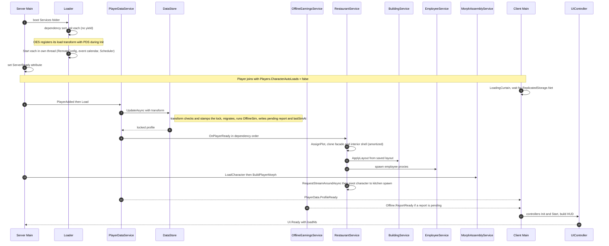

## 27. Roblox Architecture

> **Owner:** A17 Architecture. This section is the build plan for the game: the source tree, toolchain, content
> pipeline, service framework, networking layer, the 20 canon services (§C19) and the client controllers, startup
> and join flows, tick budgets, scaling and remote configuration. It **places and connects** systems; their rules
> live in their own sections (cooking §5, customers §8–§10, combat §11, mutations §12, offline §17, economy §22, UI
> §24). Persistence schemas are detailed in §28, security in §29, performance thresholds in §30, analytics in §31;
> this section gives the overview and never contradicts canon. On the surface a city of screaming pizza critics; under
> the hood, boring, single-writer, server-authoritative plumbing.

### 27.1 System Summary

**Purpose.** Let a small Roblox team (4–8 engineers) ship and live-operate Mystery Morph Restaurant on one codebase
where every rule from §C3–§C22 has exactly one owning module, every client request is validated in one place, every
currency change goes through one function, and new content (recipes, parts, employees, events) ships as data, not code.

**Rules & Mechanics.** The architecture is governed by nine principles (§27.2): server authority, single-writer
state, a single-writer `EconomyService`, data-driven content, SPCV NPCs, deterministic simulations, fail-safe
defaults, budgeted work, and observability. Services are server ModuleScripts loaded by one bootstrap with an
`Init`/`Start` lifecycle (§27.6); clients talk to them only through the declarative `Net` layer (§27.7).

**Variables** (architecture-owned; canon values quoted, others are balancing assumptions):

| Variable | Value | Notes |
|---|---|---|
| Max players / restaurants per server | 8 / 8 | canon §C3 |
| Customer proxies per restaurant / per server | seats + 4 queue (≤ 28) / hard cap 160 | canon §C3; fair-share allocator §27.14 |
| Autosave interval | 120 s; first save at `UserId % 120` s, then ±5 s jitter | canon §C3; schedule in §28 |
| Customer AI decision rate | per §8 and §30 (decimated when no player is in the interior), round-robin | movement is evaluated client-side from path segments |
| Employee work AI rate | 5 Hz | [TUNABLE] |
| Server gameplay script budget | ≤ 8.0 ms per Heartbeat (avg); Heartbeat ≥ 45 Hz sustained (§30) | per-system split §27.13 [TUNABLE] |
| Net batch flush | every 50 ms (20 Hz): one `Net.Batch` fire per player | §30 |
| Remote rate limits | per §29 rate class: `interact`, `chop`, `combat`, `menu`, `transaction`, `cosmetic`, `settings` | values and strike policy owned by §29 |
| UnreliableRemoteEvent payload ceiling | ≤ 900 bytes | stays under the engine limit [TUNABLE] |
| Rhythm-input lag window | 250 ms (`Cooking.ChopTap`, `Repair.Input`) | combat uses ping-based grace (§11) [TUNABLE] |
| Applied-transaction ring | last 200 transaction ids | §28; offline claims also use the canon ring of 20 (§C15) |
| Interiors region | ≥ 3,000 studs from the city, interiors 2,000 studs apart, within ±20,000 studs of the origin | one interior streams at a time (§8, §30) |
| Join → HUD ready | p50 ≤ 10 s, p95 ≤ 20 s on reference phone | [TUNABLE] |
| Remote config refresh | durable live config every 300 s (§28); emergency overrides every 60 s; MessagingService fast path | §27.15 [TUNABLE] |

**UI.** All screens belong to `UIController` (§27.8.20, layout and widgets in §24). Architecture guarantees the UI
only renders server-replicated values and sends intents.

**Progression.** The architecture scales with content, not code: each content drop bumps the generated
`ContentVersion` (§27.5); profiles record the last content version seen so content migrations (renamed/deprecated IDs)
run once per profile (§28).

**Player Interactions.** Players act through world prompts and HUD buttons; every action becomes a typed intent on a
named remote (`<Domain>.<Action>`, §C2) that the server validates, rate-limits and executes or rejects.

**Dependencies.** Everything in §5–§26 runs on this framework; schemas §28; threat model §29; budgets §30; event
schema §31; test plans §35.

**Roblox Implementation.** §27.3–§27.15. **Edge Cases.** §27.16 maps every canon ruling E1–E14 to its owning code.
**Acceptance Criteria.** §27.18.

### 27.2 Architecture Principles

| Principle | Rule | Enforcement | Violation example (rejected in review) |
|---|---|---|---|
| P1 Server authority | The client sends **intents** (which station, which customer, which ability), never outcomes (quality, damage, money, XP). | `Net` schemas contain no outcome fields; services compute outcomes from server state (§29). | `Cooking.InteractStation` carrying `quality = 1.0`. |
| P2 Single-writer state | Every profile section and every runtime entity has exactly one owning service; others read it or call the owner's API. | Ownership table §27.17; services write only through `PlayerDataService:Update(player, block, fn)`, which asserts ownership in test builds. | `QuestService` incrementing `profile.progression.xp` directly. |
| P3 Single-writer economy | Only `EconomyService:Transact` mutates MB, MS or RT; every call carries a reason code and an idempotency key. | CI test greps for writes to the `currency` block outside `EconomyService`; analytics `LogEconomyEvent` is emitted inside `TransactWith` only. | `OrderService` doing `wallet.MB += pay`. |
| P4 Data-driven content | Recipes, ingredients, stations, parts, abilities, employees, incidents, events, quests, furniture are rows in generated read-only modules; behavior is selected by data "kinds". | Generated modules are `table.freeze`d; content builds fail on dangling references (§27.5). | Hard-coding `if recipeId == "RCP_BRG_001"` in `OrderService`. |
| P5 SPCV NPCs | Customers, employees and named NPCs are an anchored invisible server proxy + attributes; each client builds the morph visual locally (§C3). | Proxy factory is the only place NPC instances are created server-side; visual builder exists only on clients. | Server cloning a 24-MeshPart customer model into Workspace. |
| P6 Deterministic simulation | Offline simulation, candidate pools, NPC appearance and event schedules derive from seeded, engine-independent RNG and server `os.time()`. | In-house xorshift32 `Rng` (bit32), FNV-1a `Hash`; identical outputs in Lune and Roblox tests (AC-27-09). | Using `math.random()` inside the offline simulation. |
| P7 Fail-safe defaults | When a dependency fails (DataStore, MemoryStore, remote config, a service), the game degrades to a state that cannot lose or duplicate value. | Safe Mode (E6), default flags, disabled-service stubs (§27.6). | Granting rewards when the save failed "to be nice". |
| P8 Budgeted work | Per-frame work runs under measured per-system budgets; heavy jobs are amortized across frames. | `Scheduler` with `os.clock()` budgets and MicroProfiler labels (§27.13). | Recomputing all 160 customer paths in one Heartbeat. |
| P9 Observability | Every service error, rejected remote and anomalous transaction is counted and reported. | `Telemetry` module, `mmr_` events (§31), xpcall-wrapped handlers. | `pcall(fn)` whose error is silently discarded. |

### 27.3 Toolchain & Workflow

The project is a **Rojo**-managed Git repository; Studio is an editor and test runner, never the source of truth for
code. Asset-heavy models (interiors, furniture, mutation parts) are authored in Studio or Blender, published as
packages/assets, and referenced by ID from data, or committed as `.rbxm` files when they must be versioned with code.

| Tool | Purpose | Status | Notes (honest constraints) |
|---|---|---|---|
| Rojo 7 | Filesystem ↔ Studio sync, `rojo build` place files, `rojo sourcemap` | required | `default.project.json` maps `src/` to services (below). Two-way sync of scripts only; models via `.rbxm`. |
| Git (trunk-based) | Version control, PR review | required | `main` always deployable to Staging; short-lived feature branches; content PRs reviewed by the owning designer. |
| Rokit | Pins tool versions (`rokit.toml`) | required | Successor to Aftman/Foreman; any of them works if the team prefers. |
| Wally | Package manager | optional | Keep dependencies few and vendored (`Packages/`, `wally.lock` committed). Candidates: React-Lua (UI), a Promise library. Everything in this section is implementable without packages. |
| StyLua | Formatter | required | `stylua --check src` in CI; tabs, 120 columns. |
| Selene | Linter | required | `std = "roblox"`; custom rule bans `wait()`, `spawn()`, `delay()` (use `task.*`) and `currency` writes outside `EconomyService`. |
| luau-lsp | Type checking (`--!strict`) | required | `luau-lsp analyze --sourcemap sourcemap.json --definitions globalTypes.d.luau src`; every module starts `--!strict` except generated data (also strict). |
| Lune | Standalone Luau runtime | recommended | Runs **pure** modules (Formulas, OfflineSim, Schema, Rng, Hash, the NetServer guard logic, Signal) in CI on Linux with no Roblox engine. |
| Spec runner | `describe/it/expect` unit tests in a test place | required | TestEZ-style specs (`*.spec.lua`). TestEZ itself is archived; Jest-Lua is the maintained runner with the same spec style. Pick one per repo. |
| run-in-roblox | Runs a script inside Studio from CI and pipes output | option A | Needs a Studio install and a logged-in user, so it runs on a **self-hosted Windows/macOS runner**, not headless Linux. Community tool, lightly maintained. |
| Open Cloud (Place Publishing + Luau Execution) | Publish a built test place, then execute the test runner script on Roblox servers | option B | Fully headless; needs an API key scoped to the **test universe** only; tests run against that universe's own DataStores, never production data. |

**Environments.** Three universes with identical structure: **Dev** (open Team Create sandbox), **Staging** (CI publishes
every `main` build), **Prod** (manual promotion of a Staging build). DataStores and MemoryStores are per universe, so
test data can never leak into Prod. Feature flags (§27.15) default per environment.

**CI pipeline (GitHub Actions or equivalent).**
1. `stylua --check`, `selene src`, `luau-lsp analyze` (Linux).
2. Content build: `python3 tools/contentgen.py --check` validates `gdd/data/*.json`, regenerates
   `src/shared/Data/*.lua`, and fails if the committed output differs (§27.5).
3. Pure unit tests under Lune (Linux, < 1 min).
4. `rojo build -o build/MMR_Test.rbxl` with the test project file (adds `Tests/` and the runner).
5. Integration tests: option A (run-in-roblox on a self-hosted runner) or option B (Open Cloud: publish the test place
   to the Test universe, start a Luau execution task that requires the runner, poll for completion, parse results).
6. On `main`: publish to Staging via Open Cloud Place Publishing; tag the build with `ContentVersion`.

```json
{
  "name": "MysteryMorphRestaurant",
  "tree": {
    "$className": "DataModel",
    "ReplicatedFirst": { "$path": "src/first" },
    "ReplicatedStorage": {
      "Shared": { "$path": "src/shared" },
      "Packages": { "$path": "Packages" },
      "Assets": { "$path": "assets/replicated" },
      "UI": { "$path": "src/ui" }
    },
    "ServerScriptService": { "Server": { "$path": "src/server" } },
    "ServerStorage": {
      "ServerModules": { "$path": "src/serverstorage" },
      "Templates": { "$path": "assets/server" }
    },
    "StarterPlayer": {
      "StarterPlayerScripts": { "Client": { "$path": "src/client" } },
      "StarterCharacterScripts": { "$path": "src/character" }
    },
    "Workspace": { "$properties": { "StreamingEnabled": true } },
    "SoundService": { "$path": "assets/sound" },
    "Lighting": { "$path": "assets/lighting" }
  }
}
```

### 27.4 Project Structure

Every container below is created by Rojo from `src/` or `assets/` (§27.3) except the runtime-only nodes marked
*(runtime)*. Folder names are code contracts: services locate templates by these paths, so renames go through review.

#### 27.4.1 ReplicatedFirst and ReplicatedStorage (shared by server and client)

```text
ReplicatedFirst
└─ LoadingCurtain (LocalScript)   -- RemoveDefaultLoadingScreen(); branded curtain until UIController says HUD ready;
                                     ContentProvider:PreloadAsync on HUD icons + the player's own morph parts
ReplicatedStorage
├─ Shared/                        -- code both sides may require (no secrets, no outcome logic)
│  ├─ Data/                       -- GENERATED, read-only, table.freeze'd (§27.5) — never hand-edited
│  │  ├─ ContentVersion           -- { hash, schemaVersion, builtAt, counts }
│  │  ├─ Recipes, Ingredients     -- §6, §7 (+ indexes byCategory / byStation / byUnlockLevel)
│  │  ├─ Stations                 -- 24 station rows (§5) + upgrade levels (§C4.9)
│  │  ├─ OrderModifications       -- §6.18, each with a feasibility requirement (stations/actions needed)
│  │  ├─ Personalities            -- §9 (patience mult, combat style, tip mult, escalation odds)
│  │  ├─ Mutations, Synergies, Combinations -- §36.3–§36.5 + asset manifest (MeshPart count, triangles)
│  │  ├─ Abilities, StatusEffects -- §36.6, §36.7 (ability "kind" + parameters, see §27.5.3)
│  │  ├─ Tiers, Upgrades, Furniture -- §36.12, §36.13
│  │  ├─ Roles, Employees, Incidents -- §16, §36.8, §36.9
│  │  ├─ Districts, Buildings, Events, Npcs -- §18, §36.10, §36.11, §19
│  │  ├─ Quests, Skills, Achievements, Milestones -- §20, §14, §36.16, §36.17
│  │  └─ Animations, Sounds       -- §36.14, §36.15 (content-id lookup by animation / sound ID)
│  ├─ Constants/                  -- Global (§C3), Economy (§C4), Stats (§C5), Combat (§C12.1)
│  ├─ Formulas/                   -- PURE functions: Satisfaction (§C11.3), Patience (§C11.2), Payment & Tips &
│  │                                 Reputation (§C11.4), Stats (§C5), Xp (§C5.1), PriceCurve (§C4.2),
│  │                                 HeatTiming (§C8), Damage (§C5/§C12) — used by server; client uses for previews only
│  ├─ Types/                      -- exported Luau types: ProfileTypes (§28), Net payloads, ids, results
│  ├─ Net/                        -- Net, Definitions, Schema, Batcher, Codec (buffer packing) (§27.7)
│  ├─ Morph/                      -- MorphBuilder (one assembly implementation, §C13.7), PartListGen (seeded NPC looks)
│  ├─ Npc/                        -- ProxyAttributes (the one table of NPC attribute keys, §8/§30), PathEval
│  ├─ Config/                     -- FeatureFlags + Tunables defaults (§27.15)
│  └─ Util/                       -- Signal, Trove (cleanup), Rng (xorshift32), Hash (FNV-1a 32), TableUtil,
│                                    Throttle, Time (UTC daily/weekly cycle ids), Log
├─ Packages/                      -- Wally output (optional, vendored)
├─ Assets/                        -- templates the CLIENT needs to build visuals
│  ├─ MorphParts/<SLOT>/<part id> -- one Model per mutation part (≈ 280), named by its MUT ID, §C13.7 attachments
│  ├─ Impostors/                  -- 1,500-triangle LOD impostors for NPC visuals beyond 60 studs
│  ├─ Rigs/R15Visual              -- client NPC rig: R15 Motor6Ds + AnimationController/Animator (no Humanoid)
│  ├─ Vfx/                        -- cartoon stars, sauce splats, feathers, soot puffs, confetti emitters
│  └─ Props/                      -- client-only debris and thrown-food meshes
├─ UI/                            -- ScreenGui templates (one per §24 layer), components, icon atlases
└─ Net/ (runtime)                 -- remote instances created by NetServer, including the Net.Batch carrier
```

#### 27.4.2 ServerScriptService and ServerStorage (server only)

```text
ServerScriptService
└─ Server/
   ├─ Main (Script)               -- bootstrap: Loader.boot(Services) → Init (ordered) → Start; BindToClose hook
   ├─ Framework/
   │  ├─ Loader                   -- discovery, dependency sort, lifecycle, error isolation (§27.6)
   │  ├─ Scheduler                -- per-system Heartbeat budgets, fixed-rate jobs, amortized queues (§27.13)
   │  ├─ NetServer                -- remote creation, guard pipeline in §29's order, 20 Hz Net.Batch, envelopes (§27.7)
   │  ├─ RemoteGuardPolicy        -- §29 rate-class values, strike thresholds and kick rules (data owned by §29)
   │  ├─ Telemetry                -- error counters, mmr_ events (§31), debug.profilebegin labels
   │  └─ RemoteConfig             -- defaults + durable live config (§28) + MemoryStore emergency overrides (§27.15)
   └─ Services/                   -- one folder per canon service; init.lua is the public module
      ├─ PlayerDataService/       -- SessionLock, Migrations/, SaveScheduler, ReadModel (persistence details §28)
      ├─ RestaurantService/       -- PlotRegistry, InteriorSpawner, Lifecycle, Ambience
      ├─ OrderService/            -- OrderGenerator, TicketBoard, ServeEvaluator, Settlement
      ├─ RecipeService/           -- Catalog (indexes), Learning, Menu
      ├─ CookingService/          -- StationRegistry, SlotMachine, ItemRegistry, Carry, Locks
      ├─ CustomerAIService/       -- Spawner, Allocator, Proxy, Brain/ (one module per state group), Pathing, Appearance
      ├─ CombatService/           -- HitResolver, History, Abilities/ (one module per ability kind), Status, Respawn
      ├─ MutationService/         -- Ownership, EquipRules, Loadouts, Upgrades, Fusion, Capsules, Shops
      ├─ MorphAssemblyService/    -- server player builds via Shared/Morph/MorphBuilder, budget checks
      ├─ EmployeeService/         -- Candidates, Roster, WorkAI, Wages, Morale
      ├─ OfflineEarningsService/  -- LoadTransform, Reports, Collect
      ├─ EconomyService/          -- Apply (§28 transaction core), TransactWith, Shops (offer tokens), Sources
      ├─ InventoryService/        -- Stock, Furniture, Items, Shops
      ├─ QuestService/            -- Objectives (signal routing), Cycles (UTC), Dialogue, Rewards
      ├─ CityEventService/        -- Schedule, Overrides, Runtime/ (one module per event kind)
      ├─ MultiplayerService/      -- Permissions, Visits, Presence, Arena
      ├─ BuildingService/         -- Grid, Connectivity (BFS), Atmosphere, TierUpgrade
      ├─ RepairService/           -- Durability, Jobs, Minigame, Messes, Insurance
      └─ ProgressionService/      -- Xp, Stats, Skills, Achievements, Milestones
ServerStorage
├─ ServerModules/
│  ├─ OfflineSim                  -- pure §C15 implementation; exports SIM_VERSION
│  ├─ SecretConditions            -- §C13.8 discovery checks, kept off the client so secrets stay secret
│  ├─ LootTables                  -- incident weights, discovery rolls (player-facing odds still disclosed, §C4.7)
│  └─ AdminCommands               -- QA/ops commands (Studio or allow-listed group rank only)
└─ Templates/
   ├─ Restaurants/Exteriors/TIER_01 … TIER_10  -- façade per tier (visible upgrade on the plot)
   ├─ Restaurants/Interiors/TIER_01 … TIER_10  -- interior shells: walls, floor grid origin, door, kitchen zone
   ├─ Furniture/<furniture id>    -- placeable models incl. trophies FRN_901–FRN_910 (non-purchasable)
   ├─ Stations/<station id>       -- station models: MMR_Interact attachment, one attachment per slot
   ├─ Proxies/                    -- CustomerProxy, EmployeeProxy, NpcProxy parts (§27.12.3)
   └─ City/EventProps/            -- props spawned by CityEventService runtimes
```

#### 27.4.3 StarterPlayer, StarterGui (client)

```text
StarterPlayer                     -- LoadCharacterAppearance = false (morphs replace avatars), CharacterWalkSpeed 16,
│                                    EnableMouseLockOption = false (§24); Players.CharacterAutoLoads = false (§27.11)
├─ StarterPlayerScripts/
│  └─ Client/
│     ├─ Main (LocalScript)       -- waits for ReplicatedStorage.Net, boots ControllerLoader (same Init/Start lifecycle)
│     ├─ Framework/               -- ControllerLoader, ClientScheduler, ReplicaStore (profile view + deltas)
│     ├─ Controllers/             -- UIController (§27.8.20), InputController, CameraController, MorphVisualController,
│     │                              StationController, CombatController, AudioController, TutorialController (§27.9)
│     └─ Modules/                 -- VisualPool, AnimCache, Interpolator, LightingCycle, BillboardPool, Haptics, Localize
└─ StarterCharacterScripts/
   ├─ Animate (LocalScript)       -- replacement animate: ANM_001 Idle, ANM_002 Walk, ANM_003 Run, ANM_004 Jump,
   │                                 ANM_005 Fall/land; ANM_008 when the character attribute WobblyGait = true
   ├─ CarryPose (LocalScript)     -- upper-body layer ANM_006 / ANM_007 from the CarryKind attribute
   └─ Footsteps (LocalScript)     -- surface footsteps, local only
StarterGui                        -- intentionally empty except BootNotice (static "Reconnecting…" fallback)
```

`StarterGui` stays empty on purpose: `UIController` clones the §24 layer ScreenGuis from `ReplicatedStorage.UI` into
`PlayerGui` once (`ResetOnSpawn = false`), so respawns never rebuild UI and no script bypasses the screen stack.

#### 27.4.4 Workspace, SoundService, Lighting

```text
Workspace                         -- StreamingEnabled (radii per §30); FallenPartsDestroyHeight = −1,200 (Sewers `DST_09` ≈ Y −700, §18)
├─ City/
│  ├─ DST_01 … DST_10/            -- district geometry; blocks are Models (default streaming)
│  ├─ RestaurantRow/Plots/Plot1 … Plot8 -- BLD_17: façade anchor, door ProximityPrompt (server Triggered)
│  ├─ Buildings/BLD_01 … BLD_22   -- shells + interaction zones (CollectionService tag MMR_Building)
│  ├─ Metro/                      -- Morph Metro station markers (fast travel)
│  └─ Secrets/                    -- discovery interactables (conditions evaluated server-side)
├─ Interiors/                     -- ≥ 3,000 studs from the city, 2,000 studs apart (§8, §30)
│  └─ Plot1 … Plot8/              -- one interior per occupied plot; shell ModelStreamingMode = Atomic
│     ├─ Shell, Stations/, Furniture/, Seats/  -- tags MMR_Station, MMR_Destructible, MMR_Seat
│     ├─ Customers/, Employees/   -- SPCV proxies (anchored, Transparency 1; tags MMR_Proxy + MMR_Customer / MMR_Employee)
│     └─ Props/                   -- ≤ 30 server-owned loose physics props (§C3)
├─ Npcs/                          -- named NPC proxies in the city (SPCV)
├─ Arena/                         -- BLD_08 local spar volume (opt-in PvP only, §21)
├─ SpawnLocations/                -- street fallback spawns (kitchen spawns live inside each interior)
└─ ClientOnly (runtime, per client, never replicated) -- NPC visuals, debris (despawn 4 s), city crowds, VFX
SoundService                      -- RespectFilteringEnabled = true
├─ SoundGroups: Master ▸ Music, SFX, Alerts, Voice ▸ Announce, UI, Ambience   -- volumes bound to player settings (§24, §26)
└─ Library/                       -- preloaded templates for the 20 most frequent sounds; others built on demand
Lighting                          -- Technology per §30 quality tiers
├─ Atmosphere, Sky, ColorCorrection, Bloom, SunRays (single instances, values tweened by LightingCycle)
└─ (profiles are data in Shared/Config: CityCycle 24-min loop, Interior, Blackout EVT_009, Neon EVT_028,
    Haunted EVT_029, Snow EVT_030)
```

The city day/night loop (24 min, cosmetic, §C3) is computed on each client from `workspace:GetServerTimeNow()`, so all
clients agree without replicating `ClockTime`. Interiors are spaced so no client ever streams two interiors at once.

### 27.5 Content Data Pipeline

#### 27.5.1 Flow

1. **Author.** Section owners keep databases as JSON in `gdd/data/<domain>.json` (the same files that render the §6,
   §7, §9, §19, §20 and §36 tables, §C0.12). One row per entity, keyed by its canon ID.
2. **Generate.** `python3 tools/contentgen.py` (Python 3 stdlib, idempotent) loads every JSON file, validates it
   (§27.5.2), computes derived columns (e.g. §C4.2 price, ingredient-cost ratio), and writes one `--!strict` ModuleScript
   per domain to `src/shared/Data/<Domain>.lua` plus `ContentVersion.lua`.
3. **Version.** The content hash is SHA-256 over the canonical JSON (sorted keys, no whitespace) of all data files plus
   the generator schema version; the first 8 hex digits are the display version (e.g. `3f9a1c27`).
4. **Ship.** Generated files are committed (reviewable diffs) and CI fails if regeneration produces a different file.
   At boot the server sets `workspace:SetAttribute("ContentVersion", hash)`; profiles store `meta.contentVersion`
   (§28); every MemoryStore/MessagingService payload carries `cv`, and receivers ignore payloads from an incompatible
   content version during rolling updates (old servers keep running until empty).

```lua
--!strict
-- AUTO-GENERATED by tools/contentgen.py from gdd/data/recipes.json — DO NOT EDIT.
-- ContentVersion 3f9a1c27 · generator schema 4. Values below are illustrative; §6 is authoritative.
local Types = require(script.Parent.Parent.Types)

local rows: { [string]: Types.RecipeDef } = {
	RCP_BRG_001 = {
		id = "RCP_BRG_001",
		nameKey = "RCP_BRG_001.name", -- LocalizationTable key (§24)
		category = "BRG",
		unlockLevel = 1,
		difficulty = 1,
		price = 9, -- §C4.2: 10 × 1.05^0 × (0.8 + 0.1 × 1)
		ingredients = { "ING_BUN", "ING_BEEF_PATTY" },
		steps = {
			{ station = "STN_GRILL", action = "GRILL", input = "ING_BEEF_PATTY" },
			{ station = "STN_ASSEMBLY", action = "ASSEMBLE", order = { "ING_BUN", "ING_BEEF_PATTY", "ING_BUN" } },
		},
	},
	-- … 149 more rows
}

local byCategory: { [string]: { string } } = { BRG = { "RCP_BRG_001" } }

local function deepFreeze<T>(t: T): T
	for _, v in t :: any do
		if type(v) == "table" and not table.isfrozen(v) then
			deepFreeze(v)
		end
	end
	return table.freeze(t :: any) :: any
end

return deepFreeze({ rows = rows, byCategory = byCategory, version = "3f9a1c27" })
```

#### 27.5.2 Build-time validation (a failing check blocks the merge)

| Check | Rule source | Example failure message |
|---|---|---|
| ID format & uniqueness | §C2 patterns; IDs never reused (`gdd/data/_retired.json`) | `mutations.json row 281: id reuses a retired ID` |
| References resolve | recipe → ingredient/station; part → ability; employee → role; quest → NPC/building/reward | `recipes.json RCP_…: steps[2].station unknown` |
| Station schedule | §C7.1: a recipe uses only stations available at ≤ its unlock level | `recipe unlock 3 uses a level-5 station` |
| Vocabularies | ingredient tags §C9, part tags §C13.5, slots §C13.1, rewards §C17.4, currencies §C4.1 | `quests.json: reward type "gems" not allowed` |
| Bands | employee hire/wage/stat ranges §C4.8; shop prices §C4.5 | `employees.json: Rare wage 250 outside 90–200` |
| Asset manifest | every part/furniture/station row has a template; parts carry `TriCount`; §C13.7 attachment names present | `MUT_… model missing MMR_TailBase attachment` |
| Budgets | worst-case NPC look ≤ 24 MeshParts / 6,000 triangles (§C13.7) | `PartListGen pool for PER_… can exceed 6,000 tris` |

The asset manifest is produced by a Lune script (`tools/asset_manifest.luau`) that reads committed `.rbxm` templates
with Lune's Roblox file library and emits JSON (MeshPart count, attachment names, `TriCount` attribute set by the
artists' export step), which `contentgen.py` cross-checks.

#### 27.5.3 Behavior by "kind" (why most content needs no code)

Rows never contain code; they select a **kind** implemented once and parameterized by the row:

| Content | Kind field examples | Implemented in |
|---|---|---|
| Abilities (§36.6) | `MeleeArc`, `Dash`, `Projectile`, `Cone`, `Aoe`, `Grab`, `Buff`, `Aura`, `StationUtility` | `CombatService/Abilities/<Kind>` |
| Order modifications (§6.18) | `ExtraCount`, `OmitIngredient`, `StateOverride`, `ReverseAssembly`, `JokeRequest` | `OrderService/ServeEvaluator` |
| Quest objectives (§20) | `CookRecipe`, `ServeCount`, `CalmCustomers`, `RepairObjects`, `VisitDistrict`, `TalkToNpc` | `QuestService/Objectives` |
| Offline incidents (§36.9) | `RevenuePercent`, `DamagePoints`, `MoraleDelta`, `Discovery` | `ServerModules/OfflineSim` |
| City events (§36.11) | `DemandMultiplier`, `SpawnWave`, `BossFight`, `LightingProfile`, `ScaleModifier` | `CityEventService/Runtime/<Kind>` |
| Employee traits (§36.8) | `MultiTask`, `SpeedMult`, `MistakeChance`, `IncidentMitigation` | `EmployeeService/WorkAI` |

#### 27.5.4 Designer workflows (no engineer required)

| Task | Steps | Result after merge |
|---|---|---|
| Add a recipe | 1) add row to `recipes.json` (all §6 fields, existing ingredient/station IDs); 2) add name/description strings to `localization.csv`; 3) run `contentgen.py`; 4) open PR | Learnable at the Cooking Academy (`BLD_06`) from its unlock level, selectable in the menu, orderable by customers, included in offline menu averages. |
| Add a mutation part | 1) author the model in the slot folder with §C13.7 attachments and a `TriCount` attribute; 2) add row to `mutations.json` (slot, category, rarity, family, tags, optional ability using an existing kind); 3) generate; 4) PR | Sold/dropped per its acquisition codes, equippable, participates in synergies by family/tag/slot (§C13.5), usable in NPC looks. |
| Add an employee archetype | 1) add row to `employees.json` (role, rarity within §C4.8, stats, traits from the trait-kind list, part list for its look); 2) generate; 3) PR | Appears in Recruitment Office (`BLD_04`) candidate pools weighted by tier; works online and offline. |
| Disable broken content live | set `content.disabled` remote-config list (§27.15) | Row treated as unavailable everywhere within ≤ 70 s; no rebuild. |

A new **kind** (e.g. a never-seen ability behavior) is the only content change that needs code.

### 27.6 Service Framework

#### 27.6.1 Lifecycle and ordering

| Phase | Contract | Yielding? |
|---|---|---|
| Require | Module returns a table with `Name`, `Dependencies`, `Critical`; no side effects. | no |
| `Init(registry)` | Called in dependency order. Resolve dependencies from `registry`, create Signals, register Net handlers and PlayerDataService load transforms. | **no** (asserted) |
| `Start()` | Called in dependency order, each in its own thread. Begin loops, poll MemoryStore, subscribe MessagingService. | yes |
| `OnPlayerReady(player, profile)` | After profile load + offline transform, in dependency order. | yes (bounded) |
| `OnPlayerLeaving(player, profile)` | On `PlayerRemoving`, in **reverse** dependency order, before the final save. | no |

Dependencies are explicit (`Dependencies = { "PlayerDataService", "EconomyService" }`); the loader topologically
sorts them and refuses to boot on a cycle or unknown name (AC-27-02). **Critical** services (PlayerDataService,
EconomyService, RestaurantService, RecipeService, OrderService, CookingService, CustomerAIService, MutationService,
MorphAssemblyService, ProgressionService) failing `Init` put the server in **Maintenance**: no profile is ever loaded
there, joiners get a friendly kick ("This kitchen is on fire! Please rejoin for a fresh server."), the empty server
closes on its own, and an alert fires. A **non-critical** service that fails
is replaced by a stub: its remotes answer `{ ok = false, code = "UNAVAILABLE" }`, its getters return safe defaults.

**Error isolation.** Every lifecycle call, signal handler, remote handler and scheduled job runs under
`xpcall(fn, debug.traceback)`. Errors go to `Telemetry` tagged with service and phase. A scheduled job that errors
≥ 5 times in 60 s is suspended (circuit breaker) and reported; player-facing state stays consistent because jobs never
hold half-applied changes across yields.

```lua
--!strict
-- ServerScriptService/Server/Framework/Loader.lua (abridged)
local Telemetry = require(script.Parent.Telemetry)

export type Service = {
	Name: string,
	Dependencies: { string }?,
	Critical: boolean?,
	Init: ((self: any, registry: { [string]: any }) -> ())?,
	Start: ((self: any) -> ())?,
}

local Loader = {}

local function sorted(services: { [string]: Service }): { Service }
	local order, state = {}, {} :: { [string]: number }
	local function visit(name: string, path: { string })
		local svc = services[name]
		assert(svc, `unknown dependency '{name}' via {table.concat(path, " -> ")}`)
		if state[name] == 2 then return end
		assert(state[name] ~= 1, `dependency cycle: {table.concat(path, " -> ")} -> {name}`)
		state[name] = 1
		table.insert(path, name)
		for _, dep in svc.Dependencies or {} do visit(dep, path) end
		table.remove(path)
		state[name] = 2
		table.insert(order, svc)
	end
	local names = {}
	for n in services do table.insert(names, n) end
	table.sort(names) -- deterministic boot order
	for _, n in names do visit(n, {}) end
	return order
end

function Loader.boot(folder: Instance, registry: { [string]: any }): boolean
	local services: { [string]: Service } = {}
	for _, child in folder:GetChildren() do
		if child:IsA("ModuleScript") then
			local svc = (require :: any)(child) :: Service
			services[svc.Name] = svc
			registry[svc.Name] = svc
		end
	end
	local order = sorted(services)
	for _, svc in order do
		local init = svc.Init
		if init then
			-- run Init in a fresh coroutine: if it is not dead after one resume, Init yielded (forbidden)
			local co = coroutine.create(init)
			local ok, err = coroutine.resume(co, svc, registry)
			if ok and coroutine.status(co) ~= "dead" then
				ok, err = false, "Init yielded"
			end
			if not ok then
				Telemetry.serviceError(svc.Name, "Init", debug.traceback(co, tostring(err)))
				if svc.Critical then return false end -- caller enters Maintenance
				registry[svc.Name] = Telemetry.disabledStub(svc)
			end
		end
	end
	for _, svc in order do
		local start = svc.Start
		if start and registry[svc.Name] == svc then
			task.spawn(function()
				local ok, err = xpcall(start, debug.traceback, svc)
				if not ok then Telemetry.serviceError(svc.Name, "Start", err) end
			end)
		end
	end
	return true
end

return Loader
```

#### 27.6.2 Signal

Services talk server-to-server through typed Signals (never through RemoteEvents or BindableEvents). Each handler runs
in its own thread under `xpcall`, so one faulty subscriber cannot break the publisher or other subscribers.

```lua
--!strict
-- ReplicatedStorage/Shared/Util/Signal.lua
export type Connection = { Connected: boolean, Disconnect: (self: Connection) -> () }
export type Signal<T...> = {
	Connect: (self: Signal<T...>, fn: (T...) -> ()) -> Connection,
	Once: (self: Signal<T...>, fn: (T...) -> ()) -> Connection,
	Wait: (self: Signal<T...>) -> T...,
	Fire: (self: Signal<T...>, T...) -> (),
	DisconnectAll: (self: Signal<T...>) -> (),
}

local Signal = {}
Signal.__index = Signal
Signal.onError = function(name: string, err: string) warn(`[Signal {name}] {err}`) end -- Telemetry rebinds

local function run(name: string, fn: (...any) -> (), ...: any)
	local ok, err = xpcall(fn, debug.traceback, ...)
	if not ok then Signal.onError(name, err) end
end

function Signal.new<T...>(name: string): Signal<T...>
	return (setmetatable({ _name = name, _conns = {} }, Signal) :: any) :: Signal<T...>
end

function Signal.Connect(self: any, fn: (...any) -> ()): Connection
	local conn = { Connected = true, _fn = fn }
	local conns = self._conns
	function conn.Disconnect(c: any)
		if not c.Connected then return end
		c.Connected = false
		local i = table.find(conns, c)
		if i then table.remove(conns, i) end
	end
	table.insert(conns, conn)
	return conn :: any
end

function Signal.Once(self: any, fn: (...any) -> ()): Connection
	local conn: Connection
	conn = Signal.Connect(self, function(...)
		conn:Disconnect()
		fn(...)
	end)
	return conn
end

function Signal.Fire(self: any, ...: any)
	for _, c in table.clone(self._conns) do -- snapshot: handlers may (dis)connect while firing
		if c.Connected then task.spawn(run, self._name, c._fn, ...) end
	end
end

function Signal.Wait(self: any): ...any
	local thread = coroutine.running()
	Signal.Once(self, function(...) task.spawn(thread, ...) end)
	return coroutine.yield()
end

function Signal.DisconnectAll(self: any)
	for _, c in table.clone(self._conns) do c:Disconnect() end
end

return Signal
```

#### 27.6.3 Service template

```lua
--!strict
-- ServerScriptService/Server/Services/RepairService/init.lua (template, abridged)
local ReplicatedStorage = game:GetService("ReplicatedStorage")
local Signal = require(ReplicatedStorage.Shared.Util.Signal)
local Types = require(ReplicatedStorage.Shared.Types)

local RepairService = {
	Name = "RepairService",
	Dependencies = { "PlayerDataService", "EconomyService", "RestaurantService", "MultiplayerService" },
	Critical = false,
	RepairCompleted = Signal.new("RepairService.RepairCompleted") :: Signal.Signal<string, string, number>,
}

local registry: Types.Registry
local jobs: { [string]: Types.RepairJob } = {}

function RepairService:Init(reg: Types.Registry)
	registry = reg -- resolve dependencies only; Init must not yield
	reg.Net.handle("Repair.Start", function(player: Player, p: { objectId: string }): Types.Envelope?
		local job, code = RepairService:StartRepair(player, p.objectId)
		return { ok = job ~= nil, code = code, data = job and job.id }
	end)
end

function RepairService:Start()
	registry.Scheduler.every("RepairService.jobs", 0.25, 0.2, function(dt: number) -- every 0.25 s, ≤ 0.2 ms
		for id, job in jobs do RepairService:_advance(job, dt) end
	end)
end

function RepairService:OnPlayerLeaving(player: Player, _profile: Types.Profile)
	for id, job in jobs do
		if job.actorUserId == player.UserId then jobs[id] = nil end -- unpaid partial work is kept on the object
	end
end

function RepairService:StartRepair(player: Player, objectId: string): (Types.RepairJob?, string)
	-- validation, permission, range, cost preview … (§27.8.18)
	return nil, "NOT_IMPLEMENTED_IN_TEMPLATE"
end

function RepairService:_advance(job: Types.RepairJob, dt: number) end

return RepairService
```

### 27.7 Networking Layer (`Net`)

#### 27.7.1 Rules

1. **Declarative.** Every remote is a row in `Shared/Net/Definitions`: `name` (`<Domain>.<Action>`, §C2), `kind`
   (`Event` | `Function` | `Unreliable`), `dir` (`C2S` | `S2C`), `schema`, `rateClass`, feature `flag`, and the
   switches `allowInSafeMode`, `noCombat`, `batched` (S2C) and `cosmetic` (required for Unreliable). The server
   creates the instances at Init in `ReplicatedStorage.Net`; only `NetServer` may create remotes or bind handlers
   (CI lint, AC-27-03). Security policy — rate-class values, strike thresholds, kick rules, the threat model — is
   owned by §29; `NetServer` + `Schema` are the generic implementation of §29's guard pipeline.
2. **Guard order** (§29): rate-class token bucket, evaluated before any parsing → schema (shape, types, ranges,
   content IDs) → session gates (feature flag, profile ready or Safe Mode session, Safe Mode, menu lock) → handler
   under `xpcall`, where the owning service checks legality, ownership, range and cooldown → response envelope.
   Rejections count toward §29's strike thresholds. Only `UI.Ready` and `Settings.Update` set `allowInSafeMode`.
   `noCombat` remotes are refused while the player's `InCombat` or `TargetedByLevel5` attribute is true (E2).
3. **Envelopes.** C2S `RemoteFunction`s always return `{ ok: boolean, code: string, data: any? }` and never error.
   The server **never** uses `InvokeClient`. Client `Net.invoke` resolves `{ ok = false, code = "TIMEOUT" }` after 10 s.
4. **Typed payloads.** One table per call, validated by a struct schema; payload types live in `Shared/Types`.
   Schemas reject wrong types, NaN/±inf, non-string or unexpected keys, over-long strings, out-of-range numbers,
   unknown content IDs and over-long vectors.
5. **Intents only** (P1). Prices, rewards, quality, damage and money-relevant timestamps are never accepted. The only
   client timestamps accepted are rhythm inputs (`Cooking.ChopTap`, `Repair.Input`), clamped to a 250 ms window;
   combat grace uses server receive time minus a capped half-ping (§11). Clients never choose idempotency keys:
   shop purchases echo a server-issued single-use `offerToken`, and every other money-moving request derives a
   deterministic transaction id server-side (§28).
6. **Unreliable = cosmetic.** `UnreliableRemoteEvent` carries only droppable, unordered cosmetic streams (sizzle and
   steam pulses, hit confirms, emotes); each payload ≤ 900 bytes, asserted in Studio.
7. **Batching.** Batched S2C remotes are logical names in `Definitions`: entries are coalesced per player by key
   (latest station state per slot wins), filtered by the player's zone (interior or district, from
   `RestaurantService:GetZone`), and delivered together in one `Net.Batch` RemoteEvent fire every 50 ms (20 Hz, §30).
   Numeric bulk (layout diffs, roster stats) is packed into a `buffer` by `Codec`.

| State | Mechanism | Rate |
|---|---|---|
| Profile read model | `PlayerData.ProfileReady` snapshot (≤ 64 KB, §30), then `PlayerData.Delta` | join, then batched |
| Wallet | `Economy.WalletChanged` (carries the reason, so coin juice plays only after confirmation, §24) | batched 20 Hz |
| XP, level, settings, quest progress | `PlayerData.Delta`, `Quest.Progress` | batched 20 Hz |
| Player combat locks | Player attributes `InCombat`, `TargetedByLevel5` (server-written) | on change |
| NPC proxy state (state, anger level, patience, seat, look seed, emote code) | attributes on the proxy (names §8, encoding §30) through `Shared/Npc/ProxyAttributes` | on change |
| NPC proxy movement | path-segment attribute (waypoints + start time + speed) evaluated client-side with `workspace:GetServerTimeNow()`; the server moves the proxy CFrame only for hit validation | per segment; CFrame ≤ 5 Hz (§30) |
| Station slot timing | `Cooking.StationState` with absolute server times; clients animate bars locally | batched, on change |
| Large lists (inventory, journal, candidates, shop offers) | pulled by RemoteFunction when a menu opens (paged) | on demand |
| Cosmetic pulses | Unreliable remotes | ≤ 10 Hz |

#### 27.7.2 Schema, definitions and middleware

```lua
--!strict
-- ReplicatedStorage/Shared/Net/Schema.lua (abridged)
export type Validator = (v: any) -> (boolean, string?)
local Data = require(script.Parent.Parent.Data) -- init module: domain name → generated table
local Schema = {}

local function finite(n: number): boolean
	return n == n and n ~= math.huge and n ~= -math.huge -- rejects NaN and ±inf
end

function Schema.number(min: number, max: number): Validator
	return function(v)
		if type(v) ~= "number" or not finite(v) then return false, "not a finite number" end
		if v < min or v > max then return false, "out of range" end
		return true
	end
end

function Schema.int(min: number, max: number): Validator
	local num = Schema.number(min, max)
	return function(v)
		local ok, why = num(v)
		if not ok then return false, why end
		return v % 1 == 0, "not an integer"
	end
end

function Schema.string(maxLen: number, pattern: string?): Validator
	return function(v)
		if type(v) ~= "string" or #v > maxLen or utf8.len(v) == nil then return false, "bad string" end
		if pattern and string.match(v, pattern) == nil then return false, "pattern mismatch" end
		return true
	end
end

function Schema.enum(values: { string }): Validator
	local set: { [string]: boolean } = {}
	for _, s in values do set[s] = true end
	return function(v) return set[v] == true, "not in enum" end
end

function Schema.contentId(domain: string, pattern: string): Validator
	local rows = Data[domain].rows
	return function(v)
		if type(v) ~= "string" or #v > 24 or string.match(v, pattern) == nil then return false, "bad id" end
		return rows[v] ~= nil, "unknown id"
	end
end

function Schema.unitVector(): Validator
	return function(v)
		if typeof(v) ~= "Vector3" or not (finite(v.X) and finite(v.Y) and finite(v.Z)) then
			return false, "bad vector"
		end
		return math.abs(v.Magnitude - 1) < 0.01, "not a unit vector"
	end
end

function Schema.optional(inner: Validator): Validator
	return function(v)
		if v == nil then return true end
		return inner(v)
	end
end

function Schema.struct(fields: { [string]: Validator }): Validator
	return function(v)
		if type(v) ~= "table" then return false, "not a table" end
		for k in v do
			if type(k) ~= "string" or fields[k] == nil then return false, "unexpected key" end
		end
		for k, check in fields do
			local ok, why = check(v[k])
			if not ok then return false, `{k}: {why}` end
		end
		return true
	end
end

return Schema
```

```lua
--!strict
-- ReplicatedStorage/Shared/Net/Definitions.lua (excerpt; the full catalog is the per-service tables in §27.8)
local S = require(script.Parent.Schema)
local UID = "^[%w%-_]+$"
local TOKEN = "^[%x%-]+$"

return {
	["Net.Batch"] = { kind = "Event", dir = "S2C" }, -- carrier for every `batched` S2C name
	["Cooking.InteractStation"] = {
		kind = "Event", dir = "C2S", flag = "cooking", rateClass = "interact",
		schema = S.struct({
			stationUid = S.string(36, UID),
			slot = S.int(1, 4),
			action = S.enum({ "Place", "Take", "Start", "Extinguish", "Clean" }),
		}),
	},
	["Cooking.ChopTap"] = {
		kind = "Event", dir = "C2S", flag = "cooking", rateClass = "chop",
		schema = S.struct({ stationUid = S.string(36, UID), slot = S.int(1, 4), tapTime = S.number(0, 2 ^ 31) }),
	},
	["Shop.Purchase"] = {
		kind = "Function", dir = "C2S", flag = "shops", rateClass = "transaction", noCombat = true,
		schema = S.struct({ offerToken = S.string(36, TOKEN) }), -- issued by Shop.Open, single use (§28)
	},
	["Cooking.StationState"] = { kind = "Event", dir = "S2C", batched = true },
	["Cooking.StationFx"] = { kind = "Unreliable", dir = "S2C", cosmetic = true },
}
```

```lua
--!strict
-- ServerScriptService/Server/Framework/NetServer.lua (abridged)
local ReplicatedStorage = game:GetService("ReplicatedStorage")
local Players = game:GetService("Players")
local RunService = game:GetService("RunService")
local Definitions = require(ReplicatedStorage.Shared.Net.Definitions)
local Telemetry = require(script.Parent.Telemetry)
local RemoteConfig = require(script.Parent.RemoteConfig)

export type Envelope = { ok: boolean, code: string, data: any? }
type Handler = (player: Player, payload: any) -> Envelope?
type Gates = { isReady: (Player) -> boolean, isSafeMode: (Player) -> boolean, isMenuLocked: (Player) -> boolean }
type Bucket = { tokens: number, last: number }

local RATE_CLASSES: { [string]: { perSec: number, burst: number } } = { -- values owned by §29
	interact = { perSec = 10, burst = 20 }, chop = { perSec = 1 / 0.12, burst = 10 },
	combat = { perSec = 8, burst = 12 }, menu = { perSec = 4, burst = 8 },
	transaction = { perSec = 2, burst = 4 }, cosmetic = { perSec = 3, burst = 6 },
	settings = { perSec = 2, burst = 4 },
}
local FLUSH_SEC = 1 / 20 -- §30
local folder = Instance.new("Folder")
folder.Name = "Net"
local buckets: { [Player]: { [string]: Bucket } } = {}
local queues: { [Player]: { [string]: { any } } } = {} -- coalescing key → { name, payload }
local gates: Gates
local batchRemote: RemoteEvent
local NetServer = {}

local function allow(player: Player, class: string): boolean
	local rc = RATE_CLASSES[class]
	local now = os.clock()
	local mine = buckets[player]
	if not mine then
		mine = {}
		buckets[player] = mine
	end
	local b = mine[class] or { tokens = rc.burst, last = now }
	mine[class] = b
	b.tokens = math.min(rc.burst, b.tokens + (now - b.last) * rc.perSec)
	b.last = now
	if b.tokens < 1 then return false end
	b.tokens -= 1
	return true
end

local function reject(player: Player, name: string, code: string, detail: string?): Envelope
	Telemetry.remoteRejected(player, name, code, detail) -- strike counting and kicks: §29
	return { ok = false, code = code }
end

local function run(player: Player, name: string, def: any, handler: Handler, payload: any): Envelope
	if not allow(player, def.rateClass) then return reject(player, name, "RATE_LIMITED") end -- before parsing
	local valid, why = def.schema(payload)
	if not valid then return reject(player, name, "BAD_PAYLOAD", why) end
	if not RemoteConfig.isRemoteEnabled(name, def.flag) then return reject(player, name, "DISABLED") end
	if not gates.isReady(player) then return reject(player, name, "NOT_READY") end
	if gates.isSafeMode(player) and not def.allowInSafeMode then return reject(player, name, "SAFE_MODE") end
	if def.noCombat and gates.isMenuLocked(player) then return reject(player, name, "IN_COMBAT") end
	local ok, result = xpcall(handler, debug.traceback, player, payload) -- legality/ownership/range/cooldown inside
	if not ok then
		Telemetry.handlerError(name, result)
		return { ok = false, code = "SERVER_ERROR" }
	end
	return (result :: Envelope?) or { ok = true, code = "OK" }
end

function NetServer.init(g: Gates)
	gates = g
	for name, def in Definitions do
		if not def.batched then -- batched names travel inside Net.Batch
			local class = if def.kind == "Function" then "RemoteFunction"
				elseif def.kind == "Unreliable" then "UnreliableRemoteEvent"
				else "RemoteEvent"
			local remote = Instance.new(class)
			remote.Name = name
			remote.Parent = folder
		end
	end
	batchRemote = folder:FindFirstChild("Net.Batch") :: RemoteEvent
	folder.Parent = ReplicatedStorage -- one replication burst, after all children exist
	Players.PlayerRemoving:Connect(function(p)
		buckets[p] = nil
		queues[p] = nil
	end)
	local acc = 0
	RunService.Heartbeat:Connect(function(dt: number)
		acc += dt
		if acc < FLUSH_SEC then return end
		acc = 0
		for player, q in queues do
			local out = {}
			for _, entry in q do table.insert(out, entry) end
			if #out > 0 then batchRemote:FireClient(player, out) end
			queues[player] = {}
		end
	end)
end

function NetServer.handle(name: string, handler: Handler) -- the only way to bind a C2S remote
	local def = Definitions[name]
	assert(def and def.dir == "C2S", `{name} is not a declared client-to-server remote`)
	local remote = folder:FindFirstChild(name)
	if def.kind == "Function" then
		(remote :: RemoteFunction).OnServerInvoke = function(player: Player, payload: any)
			return run(player, name, def, handler, payload)
		end
	else
		(remote :: RemoteEvent).OnServerEvent:Connect(function(player: Player, payload: any)
			run(player, name, def, handler, payload)
		end)
	end
end

function NetServer.send(player: Player, name: string, key: string, payload: any) -- S2C, reliable
	local def = Definitions[name]
	if not def.batched then
		(folder:FindFirstChild(name) :: RemoteEvent):FireClient(player, payload)
		return
	end
	local q = queues[player]
	if not q then
		q = {}
		queues[player] = q
	end
	q[`{name}|{key}`] = { name, payload } -- latest value per key wins
end

return NetServer
```

### 27.8 Core Services (§C19)

All 20 canon services follow one block format: **Responsibilities · Interface · Data · Signals · Remotes · Validation ·
Errors · Performance**. Nineteen are server ModuleScripts under `ServerScriptService/Server/Services`; `UIController`
is the client service (§27.8.20). Shared types:

```lua
--!strict
-- ReplicatedStorage/Shared/Types (excerpt; profile block types live in Types/ProfileTypes per §28)
export type Result = { ok: boolean, code: string, data: any? } -- same shape as a Net envelope
export type Wallet = { MB: number, MS: number, RT: number } -- integers ≥ 0, §C4.1 only
export type StatBlock = { [string]: number } -- keyed by §C5 stat codes (COOK_SPD … EFFICIENCY)
export type ContentId = string -- a canon ID validated against generated Data
export type Txn = { id: string, deltas: { [string]: number }, src: string, ref: string? } -- §28 transaction
export type Offer = { token: string, itemId: ContentId, cost: Wallet, expiresAt: number }
export type ShopProvider = {
	list: (player: Player, shopId: ContentId) -> { { itemId: ContentId, cost: Wallet } },
	grant: (player: Player, itemId: ContentId) -> (), -- runs inside EconomyService:TransactWith (no yields)
}
```

**Rate column** = §29 rate class: `interact` 10/s b20 · `chop` 1 per 0.12 s b10 · `combat` 8/s b12 · `menu` 4/s b8 ·
`transaction` 2/s b4 · `cosmetic` 3/s b6 · `settings` 2/s b4 (values owned by §29). "RF" = RemoteFunction, "Unrel" =
UnreliableRemoteEvent, "Batch" = logical S2C name delivered in `Net.Batch` at 20 Hz. Money-moving requests carry no
client key; the transaction id each one derives is noted in the interface comments (§28).

#### 27.8.1 PlayerDataService *(critical)*

**Responsibilities.** The only module doing DataStore I/O (§28): session-locked load/save with lock handoff,
ordered schema migrations, autosave every 120 s (§C3) plus immediate coalesced saves (spends ≥ 10,000 MB, high-value
moments, `PlayerRemoving` after E1 settles, `BindToClose`); Safe Mode (E6); **load transforms** executed inside the
lock-acquiring `UpdateAsync` (the §C15 offline simulation); the block write API that enforces single writers; the
client read model (snapshot + coalesced deltas); `userIds` tagging for erasure requests.

```lua
HandleJoin(player: Player): () -- Load → OnPlayerReady hooks (dependency order) → LoadCharacter
HandleLeave(player: Player): () -- OnPlayerLeaving hooks (reverse order) → final save → release lock
SaveAllAndRelease(budgetSec: number): () -- BindToClose: parallel saves of every loaded profile
Load(player: Player): (Profile?, string?) -- one UpdateAsync; retries 1, 2, 4, 8, 16 s (E6)
GetProfile(player: Player): Profile?; IsSafeMode(player: Player): boolean
Update(player: Player, block: string, fn: (blockData: any) -> ()): () -- caller must own `block` (§27.17); marks dirty
RequestSave(player: Player, reason: "Purchase" | "HighValue" | "Leave" | "Shutdown"): () -- coalesced
RegisterLoadTransform(name: string, fn: (data: ProfileData, now: number) -> ()): () -- Init only; pure, non-yielding
PushReadModel(player: Player, path: string, value: any): () -- coalesced into PlayerData.Delta
ProfileLoaded: Signal<Player, Profile>; ProfileReleasing: Signal<Player, Profile>; SaveFailed: Signal<Player, string>
```

**Data.** Profile, snapshot and lock structures named in §28; owns the `meta` and `settings` blocks.
**Signals.** Emits the three above; consumes `EconomyService.TransactionCommitted` (big-spend save trigger).

| Remote | Kind · Dir | Payload | Rate |
|---|---|---|---|
| `PlayerData.ProfileReady` | Event S2C | `{ cv: string, safeMode: boolean, view: ProfileView }` | once |
| `PlayerData.Delta` | Batch S2C | `{ path: string, value: any }` | 20 Hz |
| `PlayerData.SafeMode` | Event S2C | `{ reason: string, kickInSec: number }` | on enter |
| `Settings.Update` | Event C2S | `{ [settingKey]: boolean \| number }` (whitelisted keys) | settings |

**Validation.** `Update` asserts block ownership in Studio and test builds; settings keys and ranges whitelisted; no
other client write path exists. **Errors.** Backoff 1, 2, 4, 8, 16 s (max 5); load failure → Safe Mode banner, kick
with a retry message at 60 s; failed saves stay dirty and retry; a load transform that throws is skipped and logged and
never blocks the load. **Performance.** Autosave schedule and request-budget math per §28 (non-urgent writes check
`DataStoreService:GetRequestBudgetForRequestType`); read-model snapshot ≤ 64 KB (§30).

#### 27.8.2 RestaurantService *(critical)*

**Responsibilities.** Plot assignment (8 `BLD_17` plots), tier façade, instanced interior lifecycle
(`Spawning → Open ⇄ Paused → Closing → Despawned`), entering/leaving interiors, occupancy and player zones (feeds the
Net interest filter), ambience aggregation (K from RepairService, M from BuildingService), tier state, persistence of
co-op settings (`restaurant.coop`, edited through MultiplayerService), E1 Closing and the E13 shutdown hand-off.

```lua
AssignPlot(player: Player): number? -- 1..8
GetRestaurant(restaurantId: string): RestaurantState?
GetRestaurantOf(player: Player): RestaurantState? -- owned
GetCurrentRestaurant(player: Player): RestaurantState? -- interior the player stands in (owner or guest)
GetZone(player: Player): string -- interior uid or district ID
EnterInterior(player: Player, restaurantId: string): boolean -- RequestStreamAroundAsync, then PivotTo
ExitInterior(player: Player): ()
SetOpen(owner: Player, open: boolean): Result
ApplyTier(restaurantId: string, tierId: ContentId): () -- BuildingService, after payment
SetCoopSettings(restaurantId: string, settings: CoopSettings): () -- MultiplayerService only
GetAmbience(restaurantId: string): (number, number) -- K, M in 0..100
BeginClosing(restaurantId: string, reason: "OwnerLeft" | "Shutdown"): ()
RestaurantSpawned, RestaurantClosing, RestaurantDespawned, OccupantEntered, OccupantLeft, TierApplied: Signal<...>
```

**Data.** `restaurant.tier`, `restaurant.upgrades`, `restaurant.coop` blocks; Tiers data; interior templates.
**Signals.** Consumes `BuildingService.TierUpgraded/LayoutChanged`, `CustomerAIService.ReputationChanged` (façade
star sign), `PlayerDataService.ProfileReleasing`.

| Remote | Kind · Dir | Payload | Rate |
|---|---|---|---|
| `Restaurant.ReturnHome` | Event C2S | `{}` | interact + 10 s cooldown (§C16.1) |
| `Restaurant.ExitInterior` | Event C2S | `{}` | interact |
| `Restaurant.SetOpen` | RF C2S | `{ open: boolean }` | menu |
| `Restaurant.StateChanged` | Event S2C | `{ restaurantId, plot, ownerUserId, tier, state, stars }` | on change |

Door entry uses the plot door's server-side `ProximityPrompt.Triggered` (no remote). **Validation.** Owner-only
`SetOpen`; guests enter only with MultiplayerService permission; door distance re-checked. **Errors.** Interior spawn
failure retries once, then spawns the tier's default layout and flags the saved layout for repair (no data loss).
**Performance.** Interior cloning amortized ≤ 300 instances per frame; shells Atomic-streamed; despawn ≤ 60 s after
Closing completes.

#### 27.8.3 OrderService *(critical)*

**Responsibilities.** Order generation when a customer reaches *Place order* (menu minus SOLD OUT, personality
weights, ≈ 1.4 items, parties per member, feasible §6.18 modifications only); the ticket board (`Open → Cooking → Ready
→ Served → Settled | Expired | Cancelled`); serve validation (A, Q, C inputs to §C11.3, incl. pickup-spot serving at
`STN_WINDOW`); settlement at payment — pay, tips, Jackpot, Apology Payment, basic-ingredient netting (§C9) — credited
through `EconomyService:CreditServe` (single pay guaranteed by the one-way `Served → Settled` transition; journaled as
`serve_agg`, §28). Handles the §8 remotes `Customer.TakeOrder` and `Customer.ServePlate`.

```lua
GenerateOrder(customerId: string, partySize: number): Ticket?
GetTickets(restaurantId: string): { Ticket }
TakeOrder(actor: Player | EmployeeRef, customerId: string): Result
ServePlate(actor: Player | EmployeeRef, customerId: string): Result -- plate from CookingService:GetCarried
EvaluateServe(ticket: Ticket, plate: PlateRecord): ServeEvaluation -- { A: number, Q: number, C: number }
Settle(ticketId: string, satisfaction: number, outcome: "Paid" | "Apology" | "StormOut"): Result
CancelTicket(ticketId: string, reason: string): ()
TicketCreated, TicketReady, TicketServed, TicketExpired, TicketSettled: Signal<...>
```

**Data.** Recipes, OrderModifications, Personalities; runtime tickets (never persisted, E1/E13). **Signals.** Consumes
`CustomerAIService.CustomerOrdered`, `CookingService.DishPlated`; emits ticket signals (QuestService, analytics).

| Remote | Kind · Dir | Payload | Rate |
|---|---|---|---|
| `Customer.TakeOrder` | Event C2S | `{ customerId: string }` | interact |
| `Customer.ServePlate` | Event C2S | `{ customerId: string }` | interact |
| `Order.TicketsChanged` | Batch S2C | `{ restaurantId, tickets: { TicketView } }` (occupants only) | 20 Hz |
| `Order.Served` | Event S2C | `{ customerId, satisfaction, pay, tip, reaction }` | on serve |

**Validation.** Customer in the actor's current restaurant, within 10 + 2 studs (§C3); ticket state allows the action;
serve permission for guests; the plate is actually carried by that actor. **Errors.** If crediting fails (Safe Mode,
§29 earnings hold) the ticket stays `Served` and settlement retries next tick; `Settled` is entered once, so retries can
never double pay. **Performance.** ≤ 28 tickets per restaurant; generation O(menu); evaluation O(components).

#### 27.8.4 RecipeService *(critical)*

**Responsibilities.** Read-only recipe/ingredient/station catalog with indexes; recipe learning at the Cooking Academy
(`BLD_06`) as shop offers at 5 × price MB, or by quest grant, with the ALN/MUT/LEG gates (§C10); menu management
(≤ tier menu slots, §C6); SOLD OUT from special stock; E9 fallback (`RCP_BRG_001`); the orderable menu used by
OrderService and the offline simulation.

```lua
GetRecipe(id: ContentId): RecipeDef?; GetIngredient(id: ContentId): IngredientDef?
IsKnown(player: Player, recipeId: ContentId): boolean
GrantRecipe(player: Player, recipeId: ContentId, source: string): () -- quests
SetMenu(player: Player, recipeIds: { ContentId }): Result
GetOrderableMenu(restaurantId: string): { ContentId } -- excludes SOLD OUT, applies E9
AcademyShop: ShopProvider -- registered for BLD_06: learnable recipes at 5 × price
RecipeLearned, MenuChanged, SoldOutChanged: Signal<...>
```

**Data.** Recipes, Ingredients, Stations; `recipes` and `restaurant.menu` blocks. **Signals.** Consumes
`InventoryService.StockChanged`, `BuildingService.LayoutChanged` (stations present).

| Remote | Kind · Dir | Payload | Rate |
|---|---|---|---|
| `Recipe.SetMenu` | RF C2S | `{ recipeIds: { string } }` (≤ 24) | menu |
| `Recipe.MenuChanged` | Event S2C | `{ menu: { string }, soldOut: { string } }` | on change |

Learning is bought through `Shop.Open`/`Shop.Purchase` (§27.8.12). **Validation.** Level ≥ unlock, gate
quests/stations met, menu length ≤ tier slots, every menu recipe known and its stations owned. **Errors.** Learning
and charging are one `TransactWith` step. **Performance.** O(1) lookups on frozen tables.

#### 27.8.5 CookingService *(critical)*

**Responsibilities.** Station registry per interior (tag `MMR_Station`; attributes `StationId`, `Level`, `Slots`);
per-slot state machines implementing §C8 heat timing (`T_ready`, Perfect window, `T_burn`, ON_FIRE at `T_burn + 4 s`)
with §C4.9 level, `COOK_SPD`/`COOK_QLT` and mutation modifiers; chop rhythm grading; the **item registry**
(restaurant-owned ingredients, components and plates with quality records); carry (1 + carry parts, max 3); per-slot
locks (E7); fire, washing, trash (waste cost never below 0 MB); E1 discard/return-to-stock; the same API serves
employees. Station-level rules are §5's; this service is their runtime.

```lua
Interact(actor: Player | EmployeeRef, req: InteractRequest): Result
ChopTap(player: Player, stationUid: string, slot: number, tapTime: number): ()
GetCarried(player: Player): { ItemRecord }; DropCarried(player: Player): ()
GiveCarried(actor: Player | EmployeeRef, item: ItemRecord): boolean -- e.g. bussed dirty plates
ForceFinish(stationUid: string, slot: number, grade: "GOOD"): boolean -- ABL_066 Microwave Zap-Cook
ResetRestaurant(restaurantId: string, reason: "OwnerLeft" | "Shutdown"): () -- E1
ItemCooked, ItemBurned, StationFire, DishPlated, ItemTrashed: Signal<...>
```

**Data.** Stations, Recipes, Ingredients; effective stats; special stock via InventoryService. **Signals.** Consumes
`RepairService.StateChanged` (Broken stations unusable), `ProgressionService.StatsChanged`.

| Remote | Kind · Dir | Payload | Rate |
|---|---|---|---|
| `Cooking.InteractStation` | Event C2S | `{ stationUid, slot, action }` | interact |
| `Cooking.ChopTap` | Event C2S | `{ stationUid, slot, tapTime }` | chop |
| `Cooking.DropCarried` | Event C2S | `{}` | interact |
| `Cooking.StationState` | Batch S2C | `{ stationUid, slot, state, itemId?, tReady?, tPerfectEnd?, tBurn? }` | 20 Hz |
| `Cooking.CarryChanged` | Event S2C | `{ items: { ItemView } }` | on change |
| `Cooking.StationFx` | Unrel S2C | `{ stationUid, fx: "Sizzle" \| "Steam" \| "Smoke" \| "Ding" }` | ≤ 10 Hz |

**Validation.** Station in the actor's current interior; distance ≤ 7 + 2 studs; slot lock free or owned; action legal
in the slot state; carried item legal for the station action; cook permission for guests; `tapTime` clamped to
[last tap, now] and ≥ now − 250 ms. **Errors.** Locks of disconnecting players release immediately; a slot whose item
record is missing resets to Idle (never grants items). **Performance.** Absolute-time timers evaluated by one 4 Hz sweep
per restaurant plus exact `task.delay` wakeups; no per-frame loops.

#### 27.8.6 CustomerAIService *(critical)*

**Responsibilities.** Arrivals (`BaseDemand × RepMult × DecorMult × EventMult`, §C6) as a seeded Poisson process;
fair-share allocation under the 160-proxy cap (§27.14); SPCV proxies with the §8 attribute contract (§27.12.3); the §8
state machine; seating; patience (§C11.2); satisfaction (§C11.3); anger and escalation rolls (§C11.5); **reputation ★
and regulars** (single writer, §28); combat styles (§C11.6) executed through CombatService; seeded looks (clients
derive part lists from the proxy's seed); Cash Stack presentation and table bussing (§8); Peace Offerings (§10); the
MUT-dish cosmetic part; sets the player attribute `TargetedByLevel5` while a level-5 customer targets that player (E2);
E10 poof recovery; E1 forced leave.

```lua
SpawnCustomer(restaurantId: string, spec: CustomerSpec?): string?
GetCustomer(id: string): CustomerState?; GetCustomersIn(restaurantId: string): { CustomerState }
SeatParty(actor: Player | EmployeeRef, partyId: string, tableId: string): Result
PeaceOffering(player: Player, customerId: string): Result -- consumes the carried off-ticket dessert/drink
BusTable(actor: Player | EmployeeRef, tableId: string): Result -- dirty plates → CookingService:GiveCarried
AddAnger(id: string, amount: number, source: string): ()
Calm(id: string, method: "Ability" | "PeaceOffering" | "Aura" | "Security" | "PerfectDish"): ()
OnServed(id: string, eval: ServeEvaluation): number -- S in 0..100
GetReputation(restaurantId: string): number -- 1.0–5.0 ★
ForceLeave(restaurantId: string, reason: "Closed" | "Shutdown"): ()
CustomerSpawned, CustomerOrdered, SatisfactionComputed, AngerLevelChanged, CustomerTurnedHostile, CustomerLeft,
ReputationChanged: Signal<...>
```

**Data.** Personalities, Mutations, Tiers; `restaurant.reputation` and `regulars` blocks; ambience; event modifiers.
**Signals.** Consumes `OrderService.TicketServed/TicketExpired`, `CombatService.CombatantKO`,
`BuildingService.LayoutChanged` (path cache), `CityEventService.EventStarted`.

| Remote | Kind · Dir | Payload | Rate |
|---|---|---|---|
| `Customer.SeatParty` | Event C2S | `{ partyId, tableId }` | interact |
| `Customer.CollectCash` | Event C2S | `{ customerId }` (presentation only: money was credited at payment, §8) | interact |
| `Customer.BusTable` | Event C2S | `{ tableId }` | interact |
| `Customer.PeaceOffering` | Event C2S | `{ customerId }` | interact |

`Customer.TakeOrder` and `Customer.ServePlate` are handled by OrderService (§27.8.3). Proxy state replicates through
attributes (names §8, keys centralized in `Shared/Npc/ProxyAttributes`); dialogue bubbles are an `Emote` code chosen
client-side (§8). **Validation.** Table free, reachable, in the same interior; actor has serve permission; range
10 + 2 studs. **Errors.** A brain error for one customer moves only that customer to *Leave* (poof) and logs.
**Performance.** Round-robin decision ticks at the §8/§30 rates within 1.5 ms/frame average and ≤ 3.0 ms p95
(§27.12.6); door→seat paths precomputed per layout; ≤ 4 concurrent `ComputeAsync`; combat chasing uses direct steering
with raycasts; proxy CFrame writes ≤ 5 Hz while walking, 0 Hz while seated (§30).

#### 27.8.7 CombatService *(critical)*

**Responsibilities.** Server hit resolution from client intents with ping-based grace (receive time − min(ping/2,
cap), §11) against a 0.5 s position history; damage (§C5 `STR`/`DEF`); abilities from the base kit, held utensils and
equipped parts (`ABL_` IDs, kinds §27.5.3); cooldown authority (`readyAt`, corrected via `Combat.CooldownSync`); Guard
meter; dodge i-frames; status effects (`STS_` IDs); the player attributes `InCombat` (6 s, §C12.1) and, with
CustomerAIService, `TargetedByLevel5` (E2); KO "Seeing Stars" and respawn (4 s, 60 % HP, `STS_WOOZY`); E2 menu
auto-close + 1.5 s invulnerability; grab/throw with scripted raycast arcs and ≤ 30 loose props per interior (§C3);
knockback (the victim's client drives the displacement, the server audits it, §29); revive; NPC attacks and
telegraphs requested by CustomerAIService; arena rule hooks (§21). Combat rules and numbers are §11's.

```lua
UseAbility(player: Player, req: AbilityRequest): Result -- { abilityId, seq, aimDir, targetId? }
SetBlocking(player: Player, isBlocking: boolean, seq: number): ()
Dodge(player: Player, dir: Vector3, seq: number): ()
ApplyDamage(source: CombatantRef, target: CombatantRef, amount: number, info: DamageInfo): number
ApplyStatus(target: CombatantRef, statusId: ContentId, duration: number, source: CombatantRef?): ()
IsInCombat(player: Player): boolean
IsMenuLocked(player: Player): boolean -- InCombat or TargetedByLevel5 (E2); used by the Net noCombat gate
Throw(source: CombatantRef, item: string, aimDir: Vector3, charge: number): () -- arc resolved with Workspace:Raycast
DamageDealt, StatusApplied, CombatantKO, PlayerRespawned, CombatStateChanged: Signal<...>
```

**Data.** Abilities, StatusEffects, Combat constants; effective stats (ProgressionService); slotted abilities
(MutationService). **Signals.** Consumes `CustomerAIService.CustomerTurnedHostile`, `MutationService.EquipChanged`.

| Remote | Kind · Dir | Payload (names per §11) | Rate |
|---|---|---|---|
| `Combat.UseAbility` | Event C2S | `{ abilityId, seq, aimDir, targetId? }` | combat |
| `Combat.BlockState` | Event C2S | `{ isBlocking, seq }` | combat |
| `Combat.Dodge` | Event C2S | `{ dir, seq }` | combat |
| `Combat.Grab` / `Combat.Throw` | Event C2S | `{ propId }` / `{ aimDir, charge }` | combat |
| `Combat.Revive` | Event C2S | `{ targetUserId, begin: boolean }` | interact |
| `Combat.HitConfirm` | Unrel S2C | hit list batched per Heartbeat per interior (cosmetic; HP, Huff and guard replicate as attributes) | per Heartbeat |
| `Combat.Telegraph` | Event S2C | `{ npcId, abilityId, shape, serverStart, windup }` | on wind-up |
| `Combat.Knockback` | Event S2C (victim) | `{ displacement, duration }` | on hit |
| `Combat.CooldownSync` | Event S2C | `{ seq, reason, readyAt }` | on correction |
| `Combat.StatusChanged` | Event S2C | `{ entityId, statusId, endsAt }` | on change |
| `Combat.ForceCloseMenus` | Event S2C | `{ invulnerableUntil: number }` | on E2 |

**Validation.** Ability granted by the base kit, a held utensil or a slotted ability of an equipped part; `readyAt` on
the server clock (§11 tolerance); unit vectors; target in the same zone; range + 2 studs; line of sight via
`RaycastParams`; PvP only inside opted-in arena volumes; max targets per ability. **Errors.** Unknown combatant → drop;
respawn always completes (falls back to the interior door if the kitchen spawn is blocked). **Performance.** No physics
projectiles; `Workspace:GetPartBoundsInRadius` with `OverlapParams` filtered to proxies and characters; hostile-NPC
decision AI within §11's budget; history ring at 20 Hz.

#### 27.8.8 MutationService *(critical)*

**Responsibilities.** Part ownership (instances with uid, level, copies, acquisition code §C13.8), equip rules (slot
codes, ARM/LEG mirroring, FUR/SCALES exclusivity, level requirements, matched pairs), stat contribution (§C13.4),
loadouts (≥ 3; E4: 3 s channel, 10 s cooldown, blocked in combat), upgrades (§C4.6), Lab fusion (§C4.5 Mythic rule),
earnable capsules (§C4.7 odds, pity at 40, duplicate conversion; result committed before the reveal plays, §28), shop
offers for Mutation Mart (`BLD_01`) and Mystery Market (`BLD_13`), the starter morph and the `QST_TUT_010` pick
(`MUT_145` / `MUT_144` / `MUT_153`), secret discoveries (conditions server-only), and persistence of the `morph` block
(name, palettes) on behalf of MorphAssemblyService.

```lua
Grant(player: Player, mutationId: ContentId, source: string, txnId: string): PartInstance?
Equip(player: Player, slot: string, partUid: string): Result; Unequip(player: Player, slot: string): Result
SwapLoadout(player: Player, index: number): Result; SaveLoadout(player: Player, index: number, name: string): Result
Upgrade(player: Player, partUid: string, dupeUid: string?): Result -- txn "upg:<partUid>:<toLevel>"
Fuse(player: Player, partUids: { string }): Result -- txn "fuse:<fusionCount>"
OpenCapsule(player: Player): Result -- { mutationId, rarity, convertedMS? }; dupes "dup:<partId>:<capsulesOpened>"
SetMorphMeta(player: Player, meta: { name: string?, palette: { [string]: number }? }): () -- MorphAssemblyService only
GetEquipped(player: Player): { [string]: string }; GetStatContribution(player: Player): StatBlock
GetActiveAbilities(player: Player): { ContentId } -- ≤ 4 on the bar (§C12.1)
MutationShop: ShopProvider -- BLD_01, BLD_13 offers at §C4.5 prices
PartGranted, EquipChanged, LoadoutSwapped, PartUpgraded, CapsuleOpened: Signal<...>
```

**Data.** Mutations data; `mutations` (owned parts, equipped, loadouts, capsules, pity) and `morph` blocks.
**Signals.** Consumes `CombatService.DamageDealt` (interrupts the channel), `QuestService.QuestClaimed` (part rewards).

| Remote | Kind · Dir | Payload | Rate |
|---|---|---|---|
| `Mutation.Equip` / `Mutation.Unequip` | RF C2S | `{ slot, partUid? }` | menu |
| `Mutation.SwapLoadout` / `Mutation.SaveLoadout` | RF C2S | `{ index, name? }` | menu |
| `Mutation.Upgrade` / `Mutation.Fuse` | RF C2S | `{ partUid, dupeUid? }` / `{ partUids }` | transaction |
| `Mutation.OpenCapsule` | RF C2S | `{}` | transaction |
| `Mutation.InventoryChanged` | Event S2C | `{ changed: { PartView }, removed: { string } }` | on change |

**Validation.** Ownership of every uid; slot/part compatibility; level and rarity requirements; `noCombat` on every
equip and swap (E4). **Errors.** Costs and grants run as one `TransactWith`; capsule rolls use a server `Random` and
are logged for audits. **Performance.** Stat contribution cached and recomputed only on `EquipChanged`.

#### 27.8.9 MorphAssemblyService *(critical)*

**Responsibilities.** Owns the §C13.7 skin-over-rig contract. `Shared/Morph/MorphBuilder` is the single assembly
implementation: the server uses it for **player** characters (replicated to everyone), clients use it for SPCV visuals
(§27.9). It hides default R15 meshes (Transparency 1), clones part templates (Massless, CanCollide/CanTouch/CanQuery
false), joins them with `RigidConstraint`s between same-named `MMR_` attachments, applies `LegLength` →
`Humanoid.HipHeight` and `NeckLength` offsets, SKIN/FUR/SCALES surface swaps and FX on `MMR_FXRoot`, and enforces
budgets (player ≤ 40 MeshParts / 15,000 triangles; NPC ≤ 24 / 6,000). `Shared/Morph/PartListGen` turns an NPC seed
into a deterministic part list (same result on every client).

```lua
BuildPlayerMorph(player: Player, equipped: { [string]: string }): () -- diff-based rebuild
ValidateBudget(partIds: { ContentId }, kind: "Player" | "Npc"): (boolean, string?)
SetMorphName(player: Player, name: string): Result -- filtered, then MutationService:SetMorphMeta
SetPalette(player: Player, palette: { [string]: number }): Result -- owned palettes only
MorphBuilt: Signal<Player>
```

**Data.** Mutations + asset manifest; `morph` block through MutationService. **Signals.** Consumes
`MutationService.EquipChanged`, `Player.CharacterAdded`.

| Remote | Kind · Dir | Payload | Rate |
|---|---|---|---|
| `Morph.SetName` | RF C2S | `{ name: string (≤ 20) }` | menu + 5 s cooldown |
| `Morph.SetPalette` | RF C2S | `{ palette: { [slot]: paletteIndex } }` | menu |

**Validation.** Names filtered with `TextService:FilterStringAsync` + `GetNonChatStringForBroadcastAsync`; palettes
must be owned (§C17.4). **Errors.** Missing template → that slot falls back to the default human part and logs.
**Performance.** Server builds queued ≤ 1 per frame; only changed slots rebuilt.

#### 27.8.10 EmployeeService

**Responsibilities.** Seeded candidate pools at the Recruitment Office (`BLD_04`), hiring (§C4.8 bands, tier caps §C6),
roster, roles (§C14.1) and station assignments, online work AI (employees are SPCV proxies calling CookingService,
OrderService, CustomerAIService and RepairService through the same APIs as players), wages accrued per minute worked
and charged by the hourly wage tick (txn `wage:<hourStamp>`, §28; E8 Unpaid Break when uncovered),
energy/morale/efficiency (§C14.2), training and promotion, traits; `EMP_001` via `QST_TUT_012`; registers its pure
offline-effect function (energy, morale) with OfflineEarningsService.

```lua
GetCandidates(player: Player): { Candidate }
Hire(player: Player, candidateId: string): Result -- txn "hire:<recruitSeed>:<candidateIdx>"
Fire(player: Player, employeeUid: string): Result
Assign(player: Player, employeeUid: string, roleId: ContentId, stationUid: string?): Result
Train(player: Player, employeeUid: string, stat: string): Result -- txn "train:<employeeUid>:<toLevel>"
GetOfflineStaffing(data: ProfileData): StaffingSnapshot -- pure, used by OfflineSim
ApplyOfflineEffects(data: ProfileData, effects: OfflineEmployeeEffects): () -- pure; writes only `employees`
EmployeeHired, EmployeeFired, AssignmentChanged, UnpaidBreakChanged: Signal<...>
```

**Data.** Roles, Employees data; `employees` block. **Signals.** Consumes `RestaurantService.RestaurantSpawned`
(spawn proxies), `EconomyService.WalletChanged` (resume after Unpaid Break).

| Remote | Kind · Dir | Payload | Rate |
|---|---|---|---|
| `Employee.GetCandidates` | RF C2S | `{}` | menu |
| `Employee.Hire` / `Employee.Fire` | RF C2S | `{ candidateId }` / `{ employeeUid }` | transaction |
| `Employee.Assign` | RF C2S | `{ employeeUid, roleId, stationUid? }` | menu |
| `Employee.Train` / `Employee.SetWage` | RF C2S | `{ employeeUid, stat? , wage? }` | transaction |
| `Employee.RosterChanged` | Event S2C | `{ changed: { EmployeeView }, removed: { string } }` | on change |

**Validation.** Candidate in the player's current pool; employee cap; role IDs from §C14.1; wage ≥ archetype base.
**Errors.** An uncovered wage tick → Unpaid Break, never a negative balance (E8). **Performance.** 5 Hz work AI within
1.0 ms/frame; cached station routes; ≤ 20 per restaurant (§C6) with the on-floor proxy cap of §27.14.

#### 27.8.11 OfflineEarningsService

**Responsibilities.** The §C15 model as the pure `ServerModules/OfflineSim`, registered as a PlayerDataService load
transform, so the report, `pendingOfflineReport`, `lastSimAt = toTs`, the offline side effects (special-stock
consumption, durability damage, staff energy/morale — each applied by its owner's registered pure function) and the
Welcome Back Crate (E5, txn `wb:<lastSimAt>`) commit in the **same** session-locked `UpdateAsync` (E11); merges into an
existing pending report; idempotent Collect (`claimedReportIds` ring of 20, txn `off:<reportId>`); discoveries
(≤ 1 capsule per real day); negative elapsed time → 0 and flagged.

```lua
Simulate(data: ProfileData, now: number): () -- pure, non-yielding, seeded per §C15; the registered load transform
GetPendingReport(player: Player): OfflineReport?
Collect(player: Player, reportId: string): Result -- credits via EconomyService, txn "off:<reportId>"
Preview(player: Player): Result -- same pure sim for 1 h; the QST_TUT_012 income preview
ReportReady, ReportCollected: Signal<...>
```

**Data.** `offline` block; Tiers, Recipes, Employees, Incidents data; `SIM_VERSION`. **Signals.** Emits `ReportReady`
from `OnPlayerReady` when a report is pending; `ReportCollected` (InventoryService grants discovered crates).

| Remote | Kind · Dir | Payload | Rate |
|---|---|---|---|
| `Offline.ReportReady` | Event S2C | `{ report: OfflineReportView }` | on join |
| `Offline.GetReport` | RF C2S | `{}` | menu |
| `Offline.Collect` | RF C2S | `{ reportId: string }` | transaction |
| `Offline.Preview` | RF C2S | `{}` | menu |

**Validation.** `reportId` must equal the pending report's id and not be in `claimedReportIds`. **Errors.** If the
simulation throws inside the transform it is skipped and `lastSimAt` stays unchanged, so the next session simulates the
same interval (no loss, no duplicate). **Performance.** ≤ 24 hourly steps, < 1 ms; every save also stamps `lastSimAt`
(§28), so a crash never counts online time as offline beyond one autosave interval.

#### 27.8.12 EconomyService *(critical, single writer of currency)*

**Responsibilities.** The only module that mutates MB, MS or RT (§C19), via §28's transaction core: integer deltas,
balances never negative, all-or-nothing multi-currency transactions, deterministic txn ids with the `appliedTxnIds`
ring, the currency journal, registered source/sink codes (shared with §31); `TransactWith` for atomic "pay + grant"
across services; serve income credited without ringing (`serve_agg`); **shops**: issues single-use `offerToken`s
(bound to player, item and price, 120 s expiry, §28) when a shop opens and routes paid grants to the registered shop
provider; the big-spend save trigger (≥ 10,000 MB).

```lua
Transact(player: Player, txn: Txn): Result -- duplicate / insufficient / invalid / frozen per §28
TransactWith(player: Player, txn: Txn, grant: () -> ()): Result -- grant runs in the same non-yielding step (§27.12.5)
CreditServe(player: Player, mb: number, ticketId: string): Result -- not ringed; journaled as serve_agg
OpenShop(player: Player, shopId: ContentId): { Offer }
Purchase(player: Player, offerToken: string): Result -- txn "shop:<offerToken>"; grant via the shop's provider
RegisterShopProvider(shopId: ContentId, provider: ShopProvider): () -- Init only
GetBalances(player: Player): Wallet; CanAfford(player: Player, cost: Wallet): boolean
WalletChanged: Signal<Player, Wallet, string>; TransactionCommitted: Signal<Player, JournalEntry>
```

**Data.** `currency` (wallet, lifetime totals, journal, `appliedTxnIds`) and `purchases` blocks (§28).
**Signals.** Emits the two above (read model, big-spend save, QuestService "earn" objectives, analytics).

| Remote | Kind · Dir | Payload | Rate |
|---|---|---|---|
| `Economy.WalletChanged` | Batch S2C | `{ MB, MS, RT, reason }` | 20 Hz |
| `Economy.GetLedger` | RF C2S | `{ page: number }` | menu |
| `Shop.Open` | RF C2S | `{ shopId }` (a building ID) | menu |
| `Shop.Purchase` | RF C2S | `{ offerToken }` | transaction |

**Validation.** Source code registered; deltas finite integers within §28's sanity bound; per-source credit ceilings
(§29); offer token exists, is unexpired, unused, belongs to the player, and the player is inside that shop's zone;
Safe Mode and §29 earnings holds reject. **Errors.** A failing `grant()` restores the currency block exactly and returns
`APPLY_FAILED`. **Performance.** O(ring) duplicate check (200 ids), no yields inside the critical step.

#### 27.8.13 InventoryService

**Responsibilities.** Special-ingredient stock (§C9 crates in `restaurant.specialStock`; consumed when taken from
`STN_PANTRY`), the furniture inventory logic named in §C19 (grants, purchases, sales, trophy rules — trophies
`FRN_901`–`FRN_910` are never sold), E1 return-to-stock, discovered crates from offline reports, and shop offers at
Restaurant Supplies (`BLD_03`) and Monster Mall (`BLD_12`). Unplaced furniture is persisted in `restaurant.storage`,
whose single writer is BuildingService (§28), so InventoryService writes it through BuildingService's storage API.

```lua
GetStock(player: Player, ingredientId: ContentId): number
ConsumeStock(player: Player, ingredientId: ContentId, qty: number): boolean
AddStock(player: Player, ingredientId: ContentId, qty: number, source: string): ()
AddFurniture(player: Player, furnitureId: ContentId, source: string): string -- uid, via BuildingService:AddToStorage
SellFurniture(player: Player, uid: string): Result -- txn "sell:<uid>"; trophies refused
SuppliesShop: ShopProvider -- BLD_03 (stock crates, equipment, furniture), BLD_12 (decor)
StockChanged, FurnitureChanged: Signal<...>
```

**Data.** Ingredients, Furniture data; `restaurant.specialStock`; `restaurant.storage` via BuildingService.
**Signals.** Consumes `OfflineEarningsService.ReportCollected` (crates), `QuestService.QuestClaimed` (trophies).

| Remote | Kind · Dir | Payload | Rate |
|---|---|---|---|
| `Inventory.SellFurniture` | RF C2S | `{ uid }` | transaction |
| `Inventory.GetPage` | RF C2S | `{ category, page }` | menu |
| `Inventory.Changed` | Batch S2C | `{ stock?, furniture? }` (deltas) | 20 Hz |

Purchases go through `Shop.Open`/`Shop.Purchase` (§27.8.12). **Validation.** Owner-only selling (E12), uid owned and
unplaced, tier requirements in offers. **Errors.** Pay + grant atomic. **Performance.** Paged pulls; deltas only.

#### 27.8.14 QuestService

**Responsibilities.** Quest state (`Locked → Available → Active → Completed → Claimed`), objectives driven only by
server signals (kinds §27.5.3), rewards restricted to §C17.4 and paid through the owning services, daily/weekly
cycles (00:00 UTC; Monday 00:00 UTC) from server `os.time()`, the tutorial chain `QST_TUT_001`–`QST_TUT_012`, NPC
dialogue, city discovery state.

```lua
Accept(player: Player, questId: ContentId): Result; Abandon(player: Player, questId: ContentId): Result
Claim(player: Player, questId: ContentId): Result -- txn "q:<questId>:<cycleStamp>"
ReportProgress(player: Player, kind: string, payload: { [string]: any }): () -- server callers only
GetCycleStamp(kind: "Daily" | "Weekly", now: number): number
QuestAccepted, ObjectiveProgress, QuestCompleted, QuestClaimed: Signal<...>
```

**Data.** Quests, Npcs data; `quests`, `tutorial`, `city` blocks. **Signals.** Consumes `CookingService.ItemCooked`,
`OrderService.TicketSettled`, `CustomerAIService.CustomerLeft`, `CombatService.CombatantKO`,
`RepairService.RepairCompleted`, `RestaurantService.OccupantEntered`, `EmployeeService.EmployeeHired`.

| Remote | Kind · Dir | Payload | Rate |
|---|---|---|---|
| `Quest.Accept` / `Quest.Abandon` | RF C2S | `{ questId }` | menu |
| `Quest.Claim` | RF C2S | `{ questId }` | transaction |
| `Quest.Track` | Event C2S | `{ questId? }` | menu |
| `Quest.DialogueChoice` | Event C2S | `{ npcId, nodeId, choice: 1..4 }` | interact |
| `Quest.Progress` | Batch S2C | `{ questId, objective, value }` | 20 Hz |

**Validation.** No client "complete" remote exists; the dialogue node must be the player's current node with that NPC,
within interaction range. **Errors.** A failed reward grant leaves the quest `Completed` (claimable again; the txn id
keeps it single-pay). **Performance.** Objective index `kind → active objectives` keeps routing O(active).

#### 27.8.15 CityEventService

**Responsibilities.** The schedule for the 32 events (rules §18/§36.11) is computed identically on every server from
UTC time plus a **seeded weekly shuffle** (§18), so no leader is needed. MemoryStore holds the weekly seed, live-ops
overrides (inserted/cancelled events) and global-goal counters; MessagingService pushes changes, with polling as the
fallback. If the seed cannot be read, servers fall back to a hash of the week stamp (identical everywhere). Per-server runtimes
(kinds §27.5.3) supply `EventMult` (demand) and `EventModifier` (−15..+15 satisfaction), spawn waves inside NPC caps,
apply lighting/scale profiles, and report participation to QuestService. Seasonal windows: `EVT_029` October,
`EVT_030` December, `EVT_031` April.

```lua
GetActiveEvents(): { ActiveEvent }; GetUpcoming(hours: number): { ScheduledEvent }
GetDemandMultiplier(restaurantId: string): number; GetSatisfactionModifier(restaurantId: string): number
Participate(player: Player, eventId: ContentId, action: string, targetId: string?): Result
ForceStart(eventId: ContentId, durationSec: number): () -- QA/ops only
EventStarted, EventEnded, EventPhaseChanged: Signal<...>
```

**Data.** Events data; MemoryStore weekly seed, override map and global-goal counters. **Signals.** Consumed by
CustomerAIService, QuestService and, via remotes, AudioController and CameraController.

| Remote | Kind · Dir | Payload | Rate |
|---|---|---|---|
| `CityEvent.Schedule` | Event S2C | `{ upcoming: { { eventId, startsAt, endsAt } } }` | join + on change |
| `CityEvent.Started` / `CityEvent.Ended` | Event S2C | `{ eventId, districtId?, endsAt? }` | on change |
| `CityEvent.Participate` | Event C2S | `{ eventId, action, targetId? }` | interact |

**Validation.** Event active, player in its district/volume, action legal for the event kind, target exists.
**Errors.** MemoryStore/MessagingService outage → the UTC calendar continues; overrides and counters resume when
reachable (P7). **Performance.** Polling fallback every 60 s; global-goal increments batched every 10 s; runtime work
≤ 0.3 ms/frame.

#### 27.8.16 MultiplayerService

**Responsibilities.** Co-op permissions (owner presets and per-action toggles: cook, serve, clean, fight; persisted by
RestaurantService in `restaurant.coop`), guests and same-server visits (walk through the door), cross-server visits
(`TeleportService:GetPlayerPlaceInstanceAsync` locates a friend, `TeleportAsync` with
`TeleportOptions.ServerInstanceId`; the profile lock handoff is §28's), invites over MessagingService, E12 Co-op
Insurance bookkeeping, arena matchmaking (MemoryStore queue → `TeleportService:ReserveServer` → `TeleportAsync` with
the access code; `arena` block), emotes. It is the **single permission policy point**: every service asks
`GetPermission` before acting for a non-owner.

```lua
GetPermission(restaurantId: string, player: Player, action: "Cook" | "Serve" | "Clean" | "Fight" | "Build" | "Spend"): boolean
SetPermissions(owner: Player, perms: CoopPermissions): Result -- persists via RestaurantService:SetCoopSettings
Invite(owner: Player, targetUserId: number): Result
VisitFriend(player: Player, targetUserId: number): Result
JoinArenaQueue(player: Player, mode: string): Result; LeaveArenaQueue(player: Player): ()
RecordGuestDamage(restaurantId: string, objectId: string, points: number): ()
GuestJoined, GuestLeft, PermissionsChanged, ArenaMatchFound: Signal<...>
```

**Data.** `restaurant.coop` (through RestaurantService), `arena` block; MemoryStore arena queue. **Signals.** Consumes
`RestaurantService.OccupantEntered/OccupantLeft`, `RepairService.ObjectDamaged`.

| Remote | Kind · Dir | Payload | Rate |
|---|---|---|---|
| `Multiplayer.SetPermissions` | RF C2S | `{ preset, toggles: { [action]: boolean } }` | menu |
| `Multiplayer.Invite` | RF C2S | `{ targetUserId }` | menu + 5 s cooldown |
| `Multiplayer.RespondInvite` | Event C2S | `{ inviteId, accept: boolean }` | menu |
| `Multiplayer.VisitFriend` | RF C2S | `{ targetUserId }` | menu |
| `Multiplayer.ArenaQueue` | RF C2S | `{ mode, join: boolean }` | menu |
| `Multiplayer.InviteReceived` | Event S2C | `{ inviteId, fromUserId, expiresAt }` | on event |
| `Multiplayer.Emote` | Event C2S | `{ emote: string }` (owned) | cosmetic |
| `Multiplayer.EmotePlayed` | Unrel S2C | `{ userId, emote }` | on event |

**Validation.** Friendship via `Player:IsFriendsWith` (cached per session); guests never Build, Spend owner currency,
sell, move or store owner furniture (E12). **Errors.** Teleport failures (`TeleportInitFailed`) retried twice, then
reported; queue entries expire after 120 s. **Performance.** Presence lookups only on demand.

#### 27.8.17 BuildingService

**Responsibilities.** Placement grid (cell size and footprints §15), validation (bounds, overlap, appliance slots §C6,
floor space, door→every-seat connectivity via grid BFS, E10), applying a saved layout to a fresh interior, atmosphere
score M (§15), tier upgrades (cost, level, City Hall permit for `TIER_04`+, §C6) charged through `TransactWith` and
then `RestaurantService:ApplyTier`, layout migration into the larger shell (items that no longer fit move to storage,
never lost), and the furniture storage API (single writer of `restaurant.storage`, §28).

```lua
ValidatePlacement(restaurantId: string, p: Placement): (boolean, string?)
Place(owner: Player, itemUid: string, p: Placement): Result; Move(owner: Player, placedId: string, p: Placement): Result
Store(owner: Player, placedId: string): Result
AddToStorage(player: Player, furnitureId: ContentId, source: string): string; RemoveFromStorage(player: Player, uid: string): boolean
UpgradeTier(owner: Player, targetTier: ContentId): Result -- txn "tier:<TIER_NN>"
ApplyLayout(restaurantId: string, layout: Layout): ()
GetAtmosphere(restaurantId: string): number; GetSeats(restaurantId: string): { SeatRef }
LayoutChanged, TierUpgraded: Signal<...>
```

**Data.** Tiers, Furniture, Stations data; `restaurant.layoutPacked` and `restaurant.storage` blocks.
**Signals.** Consumes `InventoryService.FurnitureChanged`.

| Remote | Kind · Dir | Payload | Rate |
|---|---|---|---|
| `Building.EnterBuildMode` / `Building.ExitBuildMode` | RF C2S | `{}` | menu |
| `Building.Place` / `Building.Move` | RF C2S | `{ itemUid \| placedId, x: int, z: int, rot: 0 \| 90 \| 180 \| 270 }` | interact |
| `Building.Store` | RF C2S | `{ placedId }` | interact |
| `Building.UpgradeTier` | RF C2S | `{ targetTier }` | transaction |
| `Building.LayoutChanged` | Event S2C | `{ restaurantId, ops: { LayoutOp } }` (`buffer`-packed) | on change |

**Validation.** Owner only; `noCombat`; integer cells inside the shell; rotation enum; item owned and unplaced;
target tier = current + 1. **Errors.** A layout that fails validation on load (content change) moves offending items to
storage and logs. **Performance.** BFS over ≤ 64 × 64 cells < 1 ms; validation only on request.

#### 27.8.18 RepairService

**Responsibilities.** Durability for every destructible (tag `MMR_Destructible`; attributes for durability and damage
state per §C6 bands), damage intake (combat, incidents, events), repair jobs by players (minigame) or `ROLE_REPAIR`
employees, E3 (jobs absorb new damage; Destroyed converts to Rebuild; cost charged once at completion), Rebuild for
≤ 25 % of item price, E12 insurance, offline damage (its pure function runs inside the load transform), and **messes**
(trash, spills, dirty tables) that feed cleanliness K. Durability values persist inside `restaurant.layoutPacked`,
written through RepairService (§28).

```lua
ApplyDamage(objectId: string, amount: number, source: DamageSource): ()
StartRepair(actor: Player | EmployeeRef, objectId: string): (RepairJob?, string)
SubmitInput(player: Player, jobId: string, input: string, tapTime: number): ()
Rebuild(owner: Player, objectId: string): Result -- txn "rebuild:<objectId>:<destroyedAt>"
ApplyOfflineDamage(data: ProfileData, damage: OfflineDamage): () -- pure; registered with OfflineEarningsService
GetCleanliness(restaurantId: string): number
SpawnMess(restaurantId: string, kind: "Trash" | "Spill" | "DirtyTable", position: Vector3): ()
ObjectDamaged, StateChanged, RepairCompleted, ObjectDestroyed, MessCleaned: Signal<...>
```

**Data.** Furniture/Stations durability data; durability fields in `restaurant.layoutPacked`. **Signals.** Consumes
`CombatService.DamageDealt` (prop hits), `MultiplayerService.GuestLeft` (insurance).

| Remote | Kind · Dir | Payload | Rate |
|---|---|---|---|
| `Repair.Start` | Event C2S | `{ objectId }` | interact |
| `Repair.Input` | Event C2S | `{ jobId, input, tapTime }` | chop |
| `Repair.Cancel` | Event C2S | `{ jobId }` | interact |
| `Repair.Rebuild` | RF C2S | `{ objectId }` | transaction |

Durability and damage state replicate as attributes on the object; clients swap damage visuals locally.
**Validation.** Range 7 + 2 studs, clean/repair permission, job ownership, rhythm `tapTime` window as in §27.8.5.
**Errors.** If charging fails at completion, the repair still completes and the charge is waived — never a negative
balance (E8 spirit). **Performance.** Job sweep 4 Hz ≤ 0.2 ms.

#### 27.8.19 ProgressionService *(critical)*

**Responsibilities.** XP and levels (§C5.1, cap 100) — XP grants are expressed in **XP Units** (XPU = XPRate(L)/100,
§14) and one-time grants are idempotent through an optional `eventKey` stored in the profile's `xpOnceKeys`; stat
allocation (2 points/level, ≤ 50 per stat; free respec once per 24 h, else 500 MB × level); effective stats =
allocation + mutations + skills with §C5 caps (sets `Humanoid.WalkSpeed` = 16 × (1 + 0.003 × MOVE), max 20.8 at the
cap; HP formula); skill trees (§C18; free full respec once per 7 days; a SVC/MGMT specialization is chosen implicitly
by buying its first node — no separate remote); achievements and milestones (§36.16, §36.17); cosmetic unlocks
(titles, emotes, palettes) and respec tokens; E14 (level-up toast only; allocation deferred to the menu).

```lua
AddXp(player: Player, xpu: number, source: string, eventKey: string?): () -- XPU (§14); eventKey ⇒ once only
AllocateStat(player: Player, stat: string, points: number): Result
Respec(player: Player, kind: "Stats" | "Skills"): Result -- txn "respec:<kind>:<dayStamp>" when MB is charged
UnlockSkill(player: Player, skillId: ContentId): Result
GetEffectiveStats(player: Player): StatBlock
UnlockAchievement(player: Player, achievementId: ContentId): ()
XpGained, LevelUp, StatsChanged, AchievementUnlocked, MilestoneReached: Signal<...>
```

**Data.** Skills, Achievements, Milestones, Stats constants; `progression` and `achievements` blocks.
**Signals.** Consumes `MutationService.EquipChanged`, `QuestService.QuestClaimed`, `OrderService.TicketSettled` (XP).

| Remote | Kind · Dir | Payload | Rate |
|---|---|---|---|
| `Progression.AllocateStat` | RF C2S | `{ stat, points: 1..10 }` | menu |
| `Progression.Respec` | RF C2S | `{ kind }` | transaction |
| `Progression.UnlockSkill` | RF C2S | `{ skillId }` | menu |
| `Progression.LevelUp` | Event S2C | `{ level, statPoints, skillPoints }` | on event |
| `Progression.AchievementUnlocked` | Event S2C | `{ achievementId }` | on event |

**Validation.** Unspent points available, per-stat cap, prerequisite nodes, respec timers from server time.
**Errors.** XP from unregistered sources is rejected (sources registered like economy codes). **Performance.**
Effective stats cached; recomputed only on `EquipChanged`, allocation or skill unlocks.

#### 27.8.20 UIController *(client service)*

**Responsibilities.** The client UI state machine (`Boot → Loading → Hud ⇄ Overlay | Menu | Modal`, plus
`WelcomeBack`, `Tutorial`, `SafeMode`, `System` curtain), creation of the §24 layer ScreenGuis from
`ReplicatedStorage.UI` (once, `ResetOnSpawn = false`), HUD bindings to the `ReplicaStore`, input-mode adaptation
(driven by InputController), combat gating per E2 — refuses full-screen menus while the local Player's `InCombat` or
`TargetedByLevel5` attribute is true and closes them on `Combat.ForceCloseMenus` — the toast queue (E14),
accessibility and localization (§24).

```lua
Open(screen: string, params: any?): boolean -- false if gated (combat lock, tutorial lock)
Close(screen: string?): ()
Toast(spec: { key: string, args: { string }?, critical: boolean? }): ()
GetState(): UIState
StateChanged: Signal<UIState, UIState>
```

**Data.** `ReplicaStore` (profile read model), Player attributes, generated Data for names/icons. **Signals.** Consumes
every S2C remote through controllers and the replica; emits `StateChanged` (CameraController, InputController,
TutorialController).

| Remote | Kind · Dir | Payload | Rate |
|---|---|---|---|
| `UI.Ready` | Event C2S | `{ loadMs: number }` (HUD interactive; §31 onboarding funnel) | settings (once per session) |

**Validation.** Client checks are UX only (disable buttons, show reasons); the server re-validates everything.
**Errors.** Each screen renders under `pcall`; a failing screen shows a friendly "Oops, the menu tripped" panel while
the HUD keeps running. **Performance.** Event-driven updates, HUD numbers throttled to ≤ 10 Hz, billboards pooled (§24).

### 27.9 Client Controllers

Controllers live in `StarterPlayerScripts/Client/Controllers`, are booted by `ControllerLoader` with the same
`Init`/`Start` lifecycle and dependency sort as server services, and never hold authoritative state.

| Controller | Responsibilities | Inputs / outputs | Performance notes |
|---|---|---|---|
| `InputController` | Binds actions with `ContextActionService` (interact, chop, attack, block, dodge, abilities 1–4, carry drop, menu); tracks input mode from `UserInputService:GetLastInputType()` / `LastInputTypeChanged` (KBM, Gamepad, Touch); touch buttons per §24; haptics. | Emits `ActionTriggered`, `InputModeChanged` to other controllers; never fires remotes itself. | One binding table; no per-frame polling except held-chop timing. |
| `CameraController` | Third-person kitchen camera, city camera, combat lock-on, menu/preview cameras; view-context switches (City ⇄ Interior) that also swap Lighting profiles via `LightingCycle`; reduced-motion shake settings. | Reads `UIController.StateChanged`, `Restaurant.StateChanged`; sets `Workspace.CurrentCamera`. | `RenderStepped` work ≤ 0.3 ms. |
| `MorphVisualController` | SPCV client builder: on `CollectionService` tag `MMR_Proxy` added (streamed in) build the visual with `MorphBuilder` from the part list its kind implies (customer seed via `PartListGen`, employee archetype, named NPC); release on removal; evaluate published path segments (fallback: ease toward the proxy CFrame); play state animations; LOD impostor beyond 60 studs; pooled rigs and parts (§27.12.4). Also previews the player's own morph in the customization viewport. | Proxy attributes through `ProxyAttributes` (state, anger, seed, path segment, emote code). | ≤ 1 build per frame (queue), `Workspace:BulkMoveTo` for all visual roots each frame, pools: 32 rigs, 6 per part template [TUNABLE]. |
| `StationController` | Prompts and minigame UIs for stations: chop rhythm ring, timing bars rendered from absolute server times, burn warnings, carry display; sends `Cooking.InteractStation`, and `Cooking.ChopTap` with `tapTime = workspace:GetServerTimeNow()` for rhythm inputs; optimistic cosmetic feedback reverted on rejection. | `Cooking.StationState`, `Cooking.CarryChanged`, `Cooking.StationFx`. | Bars animate locally; zero network traffic while a timer runs. |
| `CombatController` | Ability bar, aim resolution (mouse ray / gamepad assist / touch auto-target), local wind-up animations and telegraph VFX, hit reactions on `Combat.HitConfirm`, knockback displacement driven locally from `Combat.Knockback`, status visuals, "Seeing Stars" sequence (`ANM_062`), `ANM_063` respawn poof. | `Combat.UseAbility/BlockState/Dodge/Grab/Throw/Revive` out; `Combat.HitConfirm`, `Combat.Telegraph`, `Combat.Knockback`, `Combat.CooldownSync`, `Combat.StatusChanged`, `Combat.ForceCloseMenus` in. | Predicts animations only, never damage; VFX pooled; debris client-only, 4 s. |
| `AudioController` | Music by context (kitchen, city district, event, combat), SFX pooling on `SoundService` groups, creature gibberish voice lines for bubbles, volumes from settings, ducking on toasts. | All cosmetic remotes, `CityEvent.Started/Ended`, UI state. | ≤ 24 simultaneous sounds; pooled `Sound` instances; streamed music. |
| `TutorialController` | Client side of `QST_TUT_001`–`QST_TUT_012` (§32): arrows, highlights, scripted camera beats, widget reveal steps (§24), skip/recover UI; progress itself is server-side in QuestService. | `Quest.Progress`, `PlayerData.ProfileReady` (tutorial flags); requests UI through `UIController`. | Idle when tutorial complete (no connections). |

### 27.10 Service Architecture Diagram



### 27.11 Server Startup and Player Join



**Boot.** `Main` waits for nothing but the loader; players who join before `ServerReady` are queued (the loader replays
`Players:GetPlayers()` after Start). `game:BindToClose` is registered first: it flags Closing, calls
`RestaurantService:BeginClosing("Shutdown")` for all restaurants, saves every profile in parallel threads and waits
≤ 25 s of the 30 s budget (E13).

| Join step | Owner | Target (p50 / p95) [TUNABLE] |
|---|---|---|
| Profile `UpdateAsync` incl. migration + offline transform | PlayerDataService / OfflineEarningsService | 0.4 s / 2.0 s (+ backoff on failures) |
| Plot assignment, façade + interior clone, layout apply | RestaurantService, BuildingService | 1.0 s / 2.5 s |
| Employee proxies + first customers scheduled | EmployeeService, CustomerAIService | 0.2 s / 0.5 s |
| `LoadCharacter`, morph build, stream-around, pivot | MorphAssemblyService, RestaurantService | 1.0 s / 3.0 s |
| Client boot, HUD build, preload own parts | UIController, controllers | 3.0 s / 8.0 s |
| **Total join → `UI.Ready`** | — | **≤ 10 s / ≤ 20 s** |

### 27.12 Reference Implementations

Abridged but compile-plausible `--!strict` Luau; module-level locals such as `Restaurant`, `Multiplayer`, `Stats`,
`Batcher`, `Telemetry` are dependencies resolved in `Init`.

#### 27.12.1 Server bootstrap

```lua
--!strict
-- ServerScriptService/Server/Main.server.lua
local Players = game:GetService("Players")
local ReplicatedStorage = game:GetService("ReplicatedStorage")
local Framework = script.Parent.Framework
local Loader = require(Framework.Loader)
local NetServer = require(Framework.NetServer)
local Scheduler = require(Framework.Scheduler)

Players.CharacterAutoLoads = false -- characters spawn only after profile + plot are ready (§27.11)
local registry: { [string]: any } = { Net = NetServer, Scheduler = Scheduler }

game:BindToClose(function() -- registered first (E13)
	workspace:SetAttribute("Closing", true)
	local data = registry.PlayerDataService
	if data then data:SaveAllAndRelease(25) end -- parallel saves within 25 s of the 30 s budget
end)

NetServer.init({ -- remotes must exist before services register handlers in Init
	isReady = function(p: Player) -- loaded profile, or an established Safe Mode session (E6)
		local data = registry.PlayerDataService
		return data:GetProfile(p) ~= nil or data:IsSafeMode(p)
	end,
	isSafeMode = function(p: Player) return registry.PlayerDataService:IsSafeMode(p) end,
	isMenuLocked = function(p: Player) return registry.CombatService:IsMenuLocked(p) end, -- InCombat or TargetedByLevel5 (E2)
})

if not Loader.boot(script.Parent.Services, registry) then
	workspace:SetAttribute("Maintenance", true) -- critical Init failure (P7): nothing can be earned or lost here
	local function sendAway(p: Player) p:Kick("This kitchen is on fire! Please rejoin for a fresh server.") end
	Players.PlayerAdded:Connect(sendAway)
	for _, p in Players:GetPlayers() do sendAway(p) end -- an empty server closes on its own
	return
end
workspace:SetAttribute("ContentVersion", require(ReplicatedStorage.Shared.Data.ContentVersion).hash)
workspace:SetAttribute("ServerReady", true)

local function onJoin(player: Player)
	registry.PlayerDataService:HandleJoin(player) -- load → OnPlayerReady hooks → LoadCharacter
end
Players.PlayerAdded:Connect(onJoin)
for _, p in Players:GetPlayers() do task.spawn(onJoin, p) end -- players who joined during boot
Players.PlayerRemoving:Connect(function(p: Player) registry.PlayerDataService:HandleLeave(p) end)
```

#### 27.12.2 Station interaction handler (CookingService)

```lua
--!strict
local INTERACT_RANGE, TOLERANCE, LAG_WINDOW, LOCK_HOLD = 7, 2, 0.25, 2 -- §C3; seconds

-- Shared by Cooking.InteractStation and Cooking.ChopTap: zone, station, range, damage, permission, slot lock.
local function resolveSlot(player: Player, stationUid: string, slotIndex: number): (any, any, any, string?)
	local restaurant = Restaurant:GetCurrentRestaurant(player)
	if not restaurant then return nil, nil, nil, "NOT_IN_RESTAURANT" end
	local station = Registry.get(restaurant.id, stationUid)
	if not station then return nil, nil, nil, "NO_STATION" end
	local character = player.Character
	local root = character and character:FindFirstChild("HumanoidRootPart") :: BasePart?
	if not root or (root.Position - station.interactPos).Magnitude > INTERACT_RANGE + TOLERANCE then
		return nil, nil, nil, "OUT_OF_RANGE"
	end
	if station.damageState == "Broken" or station.damageState == "Destroyed" then
		return nil, nil, nil, "STATION_BROKEN"
	end
	if restaurant.ownerUserId ~= player.UserId and not Multiplayer:GetPermission(restaurant.id, player, "Cook") then
		return nil, nil, nil, "NO_PERMISSION"
	end
	local slot = station.slots[slotIndex]
	if not slot then return nil, nil, nil, "NO_SLOT" end
	local now = workspace:GetServerTimeNow()
	if slot.lockedBy and slot.lockedBy ~= player.UserId and now < slot.lockUntil then
		return nil, nil, nil, "SLOT_BUSY" -- E7: one interactor per slot; other slots stay free
	end
	slot.lockedBy, slot.lockUntil = player.UserId, now + LOCK_HOLD
	return restaurant, station, slot, nil
end

local function publish(restaurantId: string, stationUid: string, slotIndex: number, slot: any)
	Batcher.queueZone(restaurantId, "Cooking.StationState", `{stationUid}#{slotIndex}`, SlotMachine.view(slot))
end

local function onInteract(player: Player, p: Types.InteractPayload): Types.Result?
	local restaurant, station, slot, err = resolveSlot(player, p.stationUid, p.slot)
	if err then return { ok = false, code = err } end
	local now = workspace:GetServerTimeNow()
	if p.action == "Place" then
		local item = Carry.peek(player)
		if not item or not StationRules.accepts(station.def, slot, item) then return { ok = false, code = "WRONG_ITEM" } end
		Carry.take(player, item.uid)
		SlotMachine.place(station, slot, item, Stats:GetEffectiveStats(player), now) -- sets tReady/tPerfectEnd/tBurn
	elseif p.action == "Take" then
		local item = SlotMachine.collect(station, slot, now) -- grade from server time (§C8)
		if not item then return { ok = false, code = "NOTHING_TO_TAKE" } end
		if not Carry.give(player, item) then
			SlotMachine.putBack(station, slot, item)
			return { ok = false, code = "HANDS_FULL" }
		end
	elseif p.action == "Start" then
		SlotMachine.start(station, slot, now) -- manual-start stations (blender, mixer)
	elseif p.action == "Extinguish" then
		SlotMachine.extinguish(station, slot, player)
	elseif p.action == "Clean" then
		SlotMachine.clean(station, slot)
	end
	publish(restaurant.id, p.stationUid, p.slot, slot)
	return nil -- RemoteEvent: the batched StationState is the response
end

local function onChopTap(player: Player, p: Types.ChopTapPayload): Types.Result?
	local restaurant, station, slot, err = resolveSlot(player, p.stationUid, p.slot)
	if err then return { ok = false, code = err } end
	local now = workspace:GetServerTimeNow()
	-- rhythm input: trust the client clock only inside [last tap, now] and no older than 250 ms
	local t = math.clamp(p.tapTime, math.max(slot.lastTap or 0, now - LAG_WINDOW), now)
	slot.lastTap = t
	SlotMachine.chopTap(station, slot, t) -- ring phase is a pure function of the slot's server start time
	publish(restaurant.id, p.stationUid, p.slot, slot)
	return nil
end

Net.handle("Cooking.InteractStation", onInteract)
Net.handle("Cooking.ChopTap", onChopTap)
```

#### 27.12.3 SPCV proxy (server)

```lua
--!strict
-- CustomerAIService/Proxy.lua — attribute names per §8; keys come from one module so §30 encodings change one file
local CollectionService = game:GetService("CollectionService")
local ReplicatedStorage = game:GetService("ReplicatedStorage")
local A = require(ReplicatedStorage.Shared.Npc.ProxyAttributes)
local BASE_SIZE = Vector3.new(2.5, 5, 2.5) -- × body scale (§8)

export type ProxySpec = { id: string, seed: number, band: string, personalityId: string, bodyScale: number, cf: CFrame }
local Proxy = {}

function Proxy.create(folder: Folder, c: ProxySpec): Part
	local p = Instance.new("Part")
	p.Name = c.id
	p.Size = BASE_SIZE * c.bodyScale
	p.Anchored = true
	p.CanCollide = false
	p.CanTouch = false
	p.CanQuery = true -- CombatService queries and click/tap targeting
	p.CastShadow = false
	p.Transparency = 1
	p.CollisionGroup = "Proxies"
	p.CFrame = c.cf
	p:SetAttribute(A.CustomerId, c.id)
	p:SetAttribute(A.Seed, c.seed) -- clients derive the look with Shared/Morph/PartListGen (deterministic)
	p:SetAttribute(A.Band, c.band)
	p:SetAttribute(A.PersonalityId, c.personalityId) -- e.g. "PER_014"
	p:SetAttribute(A.State, "SPAWN")
	p:SetAttribute(A.StateT0, workspace:GetServerTimeNow())
	p:SetAttribute(A.AngerLevel, 0)
	CollectionService:AddTag(p, "MMR_Proxy") -- generic tag: MorphVisualController builds every NPC kind
	CollectionService:AddTag(p, "MMR_Customer") -- kind tag (§8)
	p.Parent = folder -- Workspace.Interiors.<PlotId>.Customers: streams only to clients in that interior
	return p
end

function Proxy.setState(p: Part, state: string)
	if p:GetAttribute(A.State) ~= state then -- attributes are written only on change
		p:SetAttribute(A.State, state)
		p:SetAttribute(A.StateT0, workspace:GetServerTimeNow())
	end
end

function Proxy.setAngerLevel(p: Part, level: number)
	if p:GetAttribute(A.AngerLevel) ~= level then p:SetAttribute(A.AngerLevel, level) end
end

-- One write per path segment; clients evaluate position(t) locally, so walking costs ~0 bandwidth (§30).
function Proxy.setPath(p: Part, waypoints: { Vector3 }, speed: number)
	local pts = table.create(#waypoints)
	for i, w in waypoints do pts[i] = string.format("%.1f,%.1f,%.1f", w.X, w.Y, w.Z) end
	p:SetAttribute(A.Path, `{workspace:GetServerTimeNow()};{speed};{table.concat(pts, "|")}`)
end

return Proxy
```

#### 27.12.4 SPCV visual builder and pooling (client)

```lua
--!strict
-- MorphVisualController (abridged)
local CollectionService = game:GetService("CollectionService")
local RunService = game:GetService("RunService")
local ReplicatedStorage = game:GetService("ReplicatedStorage")
local MorphBuilder = require(ReplicatedStorage.Shared.Morph.MorphBuilder)
local PartListGen = require(ReplicatedStorage.Shared.Morph.PartListGen)
local A = require(ReplicatedStorage.Shared.Npc.ProxyAttributes)
local PathEval = require(ReplicatedStorage.Shared.Npc.PathEval)
local Data = require(ReplicatedStorage.Shared.Data)
local VisualPool = require(script.Parent.Parent.Modules.VisualPool)
local AnimCache = require(script.Parent.Parent.Modules.AnimCache) -- resolves IDs via Shared/Data/Animations

type Visual = { model: Model, root: BasePart, anim: Animator, lod: boolean, conn: RBXScriptConnection }
local STATE_ANIM: { [string]: string } = { -- §8 state → canon animation
	SIT = "ANM_040", REVIEW_MENU = "ANM_041", PLACE_ORDER = "ANM_042", EAT = "ANM_043", PAY = "ANM_044",
	TIP = "ANM_045", IMPATIENT = "ANM_046", COMPLAINING = "ANM_047", THROWING_FOOD = "ANM_048",
	APOLOGIZING = "ANM_053", FLEEING = "ANM_054", ESCORTED_OUT = "ANM_055",
}
local LOD_DISTANCE = 60 -- studs: swap to the 1,500-triangle impostor (§C13.7)
local visuals: { [BasePart]: Visual } = {}
local queue: { BasePart } = {}
local container = Instance.new("Folder")
container.Name = "ClientOnly"
container.Parent = workspace

local function partsFor(proxy: BasePart): { string } -- look by NPC kind
	if CollectionService:HasTag(proxy, "MMR_Customer") then
		return PartListGen.fromSeed(proxy:GetAttribute(A.Seed) :: number, proxy:GetAttribute(A.Band) :: string)
	elseif CollectionService:HasTag(proxy, "MMR_Employee") then
		return Data.Employees.rows[proxy:GetAttribute(A.ArchetypeId) :: string].parts
	end
	return Data.Npcs.rows[proxy:GetAttribute(A.NpcId) :: string].parts
end

local function play(v: Visual?, state: string?)
	local id = state and STATE_ANIM[state]
	if v and id then AnimCache.play(v.anim, id) end -- one cached AnimationTrack per (Animator, ID)
end

local function build(proxy: BasePart)
	if visuals[proxy] or not proxy:IsDescendantOf(workspace) then return end
	local rig = VisualPool.acquireRig() -- R15 Motor6Ds + AnimationController/Animator, anchored root
	MorphBuilder.assemble(rig, partsFor(proxy), VisualPool.acquirePart) -- same §C13.7 code path as player builds
	rig:PivotTo(proxy.CFrame)
	rig.Parent = container
	local controller = rig:FindFirstChildOfClass("AnimationController") :: AnimationController
	local v: Visual = {
		model = rig, root = rig.PrimaryPart :: BasePart, lod = false,
		anim = controller:FindFirstChildOfClass("Animator") :: Animator,
		conn = proxy:GetAttributeChangedSignal(A.State):Connect(function()
			play(visuals[proxy], proxy:GetAttribute(A.State) :: string?)
		end),
	}
	visuals[proxy] = v
	play(v, proxy:GetAttribute(A.State) :: string?)
end

local function release(proxy: BasePart)
	local v = visuals[proxy]
	if not v then return end
	visuals[proxy] = nil
	v.conn:Disconnect()
	VisualPool.release(v.model) -- parts back to per-ID pools (cap 6), rig to the rig pool (cap 32)
end

CollectionService:GetInstanceAddedSignal("MMR_Proxy"):Connect(function(i) table.insert(queue, i :: BasePart) end)
CollectionService:GetInstanceRemovedSignal("MMR_Proxy"):Connect(function(i) release(i :: BasePart) end)
for _, i in CollectionService:GetTagged("MMR_Proxy") do table.insert(queue, i :: BasePart) end

local roots: { BasePart }, goals: { CFrame } = {}, {}
RunService.RenderStepped:Connect(function(dt: number)
	local nextProxy = table.remove(queue, 1) -- ≤ 1 build per frame keeps frame time flat
	if nextProxy then build(nextProxy) end
	local cam = workspace.CurrentCamera.CFrame.Position
	local now = workspace:GetServerTimeNow()
	for proxy, v in visuals do
		local far = (proxy.Position - cam).Magnitude > LOD_DISTANCE
		if far ~= v.lod then
			v.lod = far
			VisualPool.setLod(v.model, far)
		end
		-- walking: evaluate the published path segment; otherwise ease toward the proxy CFrame
		local goal = PathEval.at(proxy:GetAttribute(A.Path) :: string?, now) or proxy.CFrame
		table.insert(roots, v.root)
		table.insert(goals, v.root.CFrame:Lerp(goal, math.min(1, dt * 15)))
	end
	workspace:BulkMoveTo(roots, goals, Enum.BulkMoveMode.FireCFrameChanged)
	table.clear(roots)
	table.clear(goals)
end)
```

#### 27.12.5 EconomyService transaction with an idempotent transaction id

The core `apply` (duplicate / invalid / frozen / insufficient checks, journal, `appliedTxnIds` ring) is §28's
`EconomyService/Apply` module; this wrapper adds Safe Mode, source registration, the atomic grant, analytics, the
big-spend save trigger and the client signal.

```lua
--!strict
local AnalyticsService = game:GetService("AnalyticsService")
local Apply = require(script.Apply) -- §28 transaction core
local BIG_SPEND = 10000 -- §C3: immediate save on purchases ≥ 10,000 MB

local function snapshot(c: any): any -- the currency block is small: wallet, lifetime totals, two capped rings
	return {
		wallet = table.clone(c.wallet), lifetimeEarned = table.clone(c.lifetimeEarned),
		lifetimeSpent = table.clone(c.lifetimeSpent), journal = table.clone(c.journal),
		appliedTxnIds = table.clone(c.appliedTxnIds),
	}
end

function EconomyService:TransactWith(player: Player, txn: Types.Txn, grant: (() -> ())?): Types.Result
	local profile = PlayerData:GetProfile(player)
	if not profile or PlayerData:IsSafeMode(player) then return { ok = false, code = "SAFE_MODE" } end
	local source = Sources[txn.src] -- registered source/sink codes, shared with §31
	if not source then return { ok = false, code = "UNKNOWN_SOURCE" } end
	local result: Types.Result
	PlayerData:Update(player, "currency", function(c) -- EconomyService owns this block; nothing below yields
		local before = snapshot(c)
		local outcome = Apply(profile.data, txn, os.time()) -- "applied" | "duplicate" | "insufficient" | "invalid" | "frozen"
		if outcome ~= "applied" then
			-- "duplicate" means a retry of something already paid for: report success, change nothing
			result = { ok = outcome == "duplicate", code = string.upper(outcome), data = table.clone(c.wallet) }
			return
		end
		if grant then
			local ok, err = pcall(grant) -- e.g. MutationService grants the part in its own block
			if not ok then
				for k, v in before do c[k] = v end -- restore the currency block exactly
				Telemetry.economyGrantFailed(player, txn, err)
				result = { ok = false, code = "APPLY_FAILED" }
				return
			end
		end
		result = { ok = true, code = "OK", data = table.clone(c.wallet) }
	end)
	if result.ok and result.code == "OK" then
		local wallet = result.data :: Types.Wallet
		for code, d in txn.deltas do
			local flow = if d > 0 then Enum.AnalyticsEconomyFlowType.Source else Enum.AnalyticsEconomyFlowType.Sink
			AnalyticsService:LogEconomyEvent(player, flow, code, math.abs(d), (wallet :: any)[code],
				source.transactionType, txn.ref)
		end
		if (txn.deltas.MB or 0) <= -BIG_SPEND then PlayerData:RequestSave(player, "Purchase") end
		EconomyService.WalletChanged:Fire(player, wallet, txn.src)
	end
	return result
end

-- Shop.Purchase: the token was issued by Shop.Open, bound to player + item + price, single use, 120 s (§28).
function EconomyService:Purchase(player: Player, offerToken: string): Types.Result
	-- nil if unknown, expired or another player's; a token stays readable until it expires, so a retried
	-- purchase reaches Apply and returns DUPLICATE via its `shop:<token>` id instead of charging twice
	local offer = Offers.get(player, offerToken)
	if not offer then return { ok = false, code = "OFFER_INVALID" } end
	if not Zones.isInShop(player, offer.shopId) then return { ok = false, code = "NOT_IN_SHOP" } end
	local deltas: { [string]: number } = {}
	for code, amount in offer.cost do deltas[code] = -amount end
	local provider = Providers[offer.shopId]
	return self:TransactWith(player, { id = `shop:{offerToken}`, deltas = deltas, src = provider.src, ref = offer.itemId },
		function() provider.grant(player, offer.itemId) end)
end
```

#### 27.12.6 CustomerAIService tick loop with budgeted updates

```lua
--!strict
local RunService = game:GetService("RunService")
local PathfindingService = game:GetService("PathfindingService")
local BUDGET_SEC = 0.0015 -- 1.5 ms average per Heartbeat (§8); p95 cap 3.0 ms (§30)
local STUCK_SEC = 6 -- E10
local MAX_PATH_JOBS = 4 -- concurrent ComputeAsync calls server-wide [TUNABLE]
local AGENT = { AgentRadius = 1.5, AgentHeight = 5, AgentCanJump = false }

local active: { Types.CustomerState } = {} -- dense array, swap-remove on leave
local cursor, pathJobs = 1, 0
local moveParts: { BasePart }, moveGoals: { CFrame } = {}, {}

local function requestPath(c: Types.CustomerState, goal: Vector3)
	pathJobs += 1
	task.spawn(function() -- ComputeAsync yields: never inside the Heartbeat budget
		local path = PathfindingService:CreatePath(AGENT)
		local ok = pcall(function() path:ComputeAsync(c.proxy.Position, goal) end)
		pathJobs -= 1
		if ok and path.Status == Enum.PathStatus.Success then
			c.pathFailures = 0
			Steering.follow(c, path:GetWaypoints()) -- also publishes the segment via Proxy.setPath
		else
			c.pathFailures += 1
			if c.pathFailures >= 2 then Brain.poofToGoal(c) end -- E10: cartoon puff + "Pardon me!"
		end
	end)
end

RunService.Heartbeat:Connect(function()
	debug.profilebegin("CustomerAI")
	local start = os.clock()
	local now = workspace:GetServerTimeNow()
	local n, visited = #active, 0
	while visited < n and os.clock() - start < BUDGET_SEC do
		if cursor > n then cursor = 1 end
		local c = active[cursor]
		cursor += 1
		visited += 1
		if now >= c.nextThinkAt then
			local dt = now - c.lastThinkAt
			-- decision rate per §8/§30 (decimated when no player is in the interior, slower while queued)
			c.lastThinkAt, c.nextThinkAt = now, now + Decimation.interval(c)
			Brain.step(c, dt, now) -- §8 state machine: patience, anger rolls (§C11.5), transitions
			if c.wantsPathTo and pathJobs < MAX_PATH_JOBS then
				requestPath(c, c.wantsPathTo) -- door→seat paths are precomputed; this is the rare dynamic case
				c.wantsPathTo = nil
			end
			local cf = Steering.serverCFrame(c, now) -- non-nil at most 5 Hz while walking, never while seated (§30)
			if cf then
				table.insert(moveParts, c.proxy)
				table.insert(moveGoals, cf)
			end
			if c.moving and now - c.lastProgressAt > STUCK_SEC then Brain.poofToGoal(c) end
		end
	end
	if #moveParts > 0 then
		workspace:BulkMoveTo(moveParts, moveGoals, Enum.BulkMoveMode.FireCFrameChanged)
		table.clear(moveParts)
		table.clear(moveGoals)
	end
	Telemetry.budget("CustomerAI", os.clock() - start, visited, n)
	debug.profileend()
end)
```

### 27.13 Server Tick Budgets and Scheduling

A server frame at 60 Hz is 16.7 ms; gameplay scripts get ≤ 8 ms on average so physics, replication and GC keep
headroom and Heartbeat stays ≥ 45 Hz (§30). The p95 caps below are §30's. `Scheduler.every(name, period, budgetMs, fn)` measures each job with `os.clock()`, wraps it in
`debug.profilebegin(name)` for the MicroProfiler, and reports overruns to Telemetry (§30 owns final thresholds).

| System | Cadence | Avg budget (ms/frame) | p95 cap | Notes [TUNABLE] |
|---|---|---|---|---|
| CustomerAIService | decision ticks at §8/§30 rates, round-robin | 1.5 | 3.0 | Over budget ⇒ thinking defers to next frame (customers act slightly later, never skip states). |
| EmployeeService work AI | 5 Hz | 1.0 | 1.5 | Cached station routes. |
| CombatService | event-driven + hostile-NPC decisions (§11) | 1.0 | 1.5 | Includes §11's combat-AI budget. |
| CookingService | 4 Hz sweep + exact `task.delay` wakeups | 0.4 | 1.0 | No per-frame timers. |
| OrderService + RecipeService | event-driven | 0.3 | 0.6 | |
| RepairService | 4 Hz | 0.2 | 0.4 | |
| CityEventService runtime | 2–10 Hz by event kind | 0.3 | 1.0 | |
| NetServer middleware | per request | 0.5 | 1.0 | ≈ 8 players × ~10 req/s. |
| `Net.Batch` flush + read-model deltas | 20 Hz | 0.6 | — | §30 |
| MorphAssemblyService builds | queue, ≤ 1 per frame | 0.5 | 2.0 | Amortized. |
| RestaurantService interior spawn | ≤ 300 instances per frame while spawning | 0.8 | 3.0 | Only during joins / tier upgrades. |
| PlayerDataService | staggered autosave | 0.1 | 0.5 | DataStore calls are async (off-frame). |
| Telemetry + RemoteConfig | 1 Hz / 60 s | 0.1 | 0.2 | |
| **Total gameplay scripts** | | **7.3** | **≤ 12** | all systems not capped above share ≤ 5.0 ms p95 (§30) |

**Degrade ladder** (automatic when total > 12 ms for 5 s, reverts after 30 s under 8 ms): 1) cosmetic Unreliable
streams 10 → 5 Hz; 2) customer decision intervals × 1.4; 3) new-customer arrival rate × 0.8. The ladder never touches
economy, saves, or validation.

**Parallel Luau (optional, profiling-gated).** Only if `Brain.step` averages > 1.5 ms: one `Actor` per interior runs
read-only perception/utility scoring in `task.desynchronize()` (distance checks, target choice, spatial reads), then
`task.synchronize()` before attribute writes and `BulkMoveTo`; results pass via Actor messages. DataStore, economy,
instance creation and pathfinding stay serial (they are either async already or unsafe in parallel). Flag: `parallelAi`.

### 27.14 Scaling Notes (8 restaurants per server)

- **Customer proxies.** Canon allows seats + 4 per restaurant (≤ 28) but 160 per server. The allocator gives each open
  restaurant `cap_i = min(seats_i + 4, floor(160 × w_i / Σw))` with `w_i = seats_i + 4`, redistributing unused share
  every 10 s. Eight `TIER_10` restaurants (224 wanted) get 20 each; queues shrink before seats. Offline income is
  unaffected (it never uses proxies).
- **Employees.** Up to 20 per restaurant (`TIER_10`) as SPCV proxies with cached routes; the worst case (8 × 20 =
  160 employee proxies alongside 160 customers) is §30's peak load test and must hold its Heartbeat target.
- **Interiors.** Spawned only while the owner is present (8 max), Atomic-streamed, despawned ≤ 60 s after Closing; each
  interior obeys the part/instance budgets in §30 and ≤ 30 loose props (§C3).
- **Named NPCs.** City NPC proxies are cheap anchored parts; visuals exist only on clients that stream them in.
- **DataStores.** Per-server request budgets scale with player count; 8 autosaves ≈ 4 writes/min plus event saves,
  far below budget (budget math in §28); non-urgent writes check `GetRequestBudgetForRequestType` first.
- **MemoryStore / MessagingService.** Small footprints beside §28's lock and presence structures: emergency config
  overrides (`MMR_ConfigOverride`, < 50 items), the city-event weekly seed, overrides and global-goal counters (§18),
  the arena queue and invites. MessagingService topics (§28's `MMR_ConfigBump`, plus `MMR_Invite` and
  `MMR_CityEvent`) carry ≤ 1 KB, low-rate, never gameplay-critical messages.
- **Places.** One universe: the **Main** place (city + restaurants, 8 players) and an **Arena** place for matched PvP
  (reserved servers, §21). Both build from the same Rojo project with a place-specific entry flag.
- **Updates.** New builds use Roblox's server migration; `BindToClose` saves, restaurants close cleanly, players are
  teleported to updated servers (E13); `cv` tags prevent old/new servers misreading each other's MemoryStore data.

### 27.15 Feature Flags and Remote Configuration

`Shared/Config/FeatureFlags` holds **defaults that are the safe state**; `RemoteConfig` overlays validated overrides.

| Key | Default | Effect when changed |
|---|---|---|
| `cooking`, `shops`, `capsules`, `cityEvents`, `arena` | true (arena per environment) | Disables the feature's remotes (`DISABLED`) and hides its UI entry. |
| `offlineCollect` | true | false ⇒ `Offline.Collect` answers `UNAVAILABLE`; pending reports persist, nothing is lost. |
| `parallelAi` | false | Enables the Actor path (§27.13). |
| `remotes.disabled` | `{}` | Per-remote kill switch by name. |
| `content.disabled` | `{}` | Content IDs treated as unavailable everywhere (e.g. a buggy ability `ABL_018` greys out; a recipe leaves menus). |
| `tunables.aiIntervalScale` / `tunables.spawnScale` / `tunables.cosmeticHz` | 1.0 / 1.0 / 10 | Live performance tuning within validated ranges (the same knobs as the §27.13 degrade ladder). |

**Backend.** Durable flags, experiments and kill switches live in §28's live-config DataStore (`MMR_LiveConfig_v1`),
read at boot, every 300 s, and immediately on its `MMR_ConfigBump` MessagingService topic. **Emergency overrides** go
to a MemoryStore sorted map `MMR_ConfigOverride` (TTL ≤ 24 h [TUNABLE]) polled every 60 s, so a kill switch reaches
every server in ≤ 60 s (≤ 5 s typical via MessagingService) and silently expires back to the durable config. Effective
flags replicate to clients as a JSON workspace attribute. Ops write through Open Cloud (DataStore and MemoryStore
APIs) or an allow-listed admin command; every value is type- and range-checked against the defaults, invalid values
are ignored and alerted, and an unreadable backend means defaults (P7). `RemoteConfig.get` hides the backend, so a
first-party Roblox configuration service could replace it without touching callers.

**Never remotely tunable:** anything that feeds deterministic simulations (offline coefficients, `SIM_VERSION`) or the
canon economy formulas (§C4); changing those requires a content/code release and a `SIM_VERSION` bump.

### 27.16 Edge-Case Ownership (§C22)

| Ruling | Owning code | Mechanism |
|---|---|---|
| E1 Owner disconnects while cooking | RestaurantService → EmployeeService, CustomerAIService, CookingService, InventoryService, PlayerDataService | `BeginClosing("OwnerLeft")`: online staff finish current tickets; `ForceLeave("Closed")` (pay 0, no reputation loss); `ResetRestaurant` discards basic food free and returns special stock; save stamps `lastSimAt`; guests moved to the street. |
| E2 Attack while in a menu | CombatService, CustomerAIService, UIController | Player attributes `InCombat` and `TargetedByLevel5` drive the server `noCombat` gate and the client menu lock; `Combat.ForceCloseMenus` + 1.5 s invulnerability; overlays stay usable. |
| E3 Damage during a repair | RepairService | Job absorbs damage; Destroyed converts to Rebuild; single charge at completion (txn `repair:<jobId>`). |
| E4 Mutations during combat | MutationService | `noCombat` gate; 3 s channel interrupted by `DamageDealt`; 10 s server cooldown; menu equips instant. |
| E5 Back after 30 days | OfflineEarningsService | Cap applied, report marked capped, wages only for simulated hours, Welcome Back Crate granted in the load transform at ≥ 7 days (txn `wb:<lastSimAt>`); no decay code exists. |
| E6 DataStore failure | PlayerDataService | Backoff 1–16 s; Safe Mode; kick at 60 s; session lock; `BindToClose` retries. |
| E7 Same station, two players | CookingService | Per-slot locks (§27.12.2). |
| E8 Can't pay employees | EconomyService, EmployeeService, OfflineSim | Never negative; Unpaid Break; offline net floored, manager closes early. |
| E9 No ingredients | RecipeService | SOLD OUT excluded from orders; `RCP_BRG_001` fallback. |
| E10 Unreachable table | BuildingService, CustomerAIService | BFS rejects disconnecting layouts; poof after 2 path failures or 6 s stuck. |
| E11 Double offline claim | OfflineEarningsService, PlayerDataService | Atomic load transform + `claimedReportIds` + session lock. |
| E12 Guest damage | MultiplayerService, RepairService | Single permission point; guest damage recorded and repaired free after the visit. |
| E13 Server shutdown | Main bootstrap, RestaurantService, PlayerDataService | `BindToClose` saves all; tickets discarded; teleport to a new server. |
| E14 Level-up mid-rush | ProgressionService, UIController | Toast only; allocation deferred to the menu. |

### 27.17 State Ownership, Persistence and Security Overview

Single-writer ownership of profile blocks (P2) — block names, field schemas, key layout, migration and recovery are
§28's; this table fixes which service's code may call `PlayerDataService:Update` for each block.

| Profile block | Single writer | Main readers |
|---|---|---|
| `meta`, `settings` | PlayerDataService | all |
| `currency` (wallet, lifetime totals, journal, `appliedTxnIds`), `purchases` | EconomyService | read model, QuestService |
| `progression` (level, XP, stats, skills, respec timers, respec tokens, titles, emotes, palettes, `xpOnceKeys`), `achievements` | ProgressionService | CombatService, CookingService, UI |
| `mutations` (owned parts, equipped, loadouts, capsules, pity), `morph` (name, palettes) | MutationService | MorphAssemblyService, CombatService, UI |
| `restaurant.tier`, `restaurant.upgrades`, `restaurant.coop` | RestaurantService | BuildingService, CustomerAIService, OfflineEarningsService |
| `restaurant.layoutPacked` (placement), `restaurant.storage` (unplaced furniture) | BuildingService (durability fields inside `layoutPacked` via RepairService) | RestaurantService, OfflineEarningsService |
| `restaurant.specialStock` | InventoryService | RecipeService, OrderService, OfflineEarningsService |
| `restaurant.menu`, `recipes` | RecipeService | OrderService, OfflineEarningsService |
| `restaurant.reputation`, `regulars` | CustomerAIService | RestaurantService, OfflineEarningsService |
| `employees` | EmployeeService | OfflineEarningsService, UI |
| `quests`, `tutorial`, `city` | QuestService | UI, CityEventService |
| `offline` | OfflineEarningsService | UI |
| `arena` | MultiplayerService | UI |
| `moderation`, `analytics` | §29 / §31 libraries through PlayerDataService | ops tooling |

Two cross-service writes are deliberate and still single-writer by code: (1) the offline load transform calls the pure
functions registered by EmployeeService, InventoryService and RepairService, each writing only its own data, inside the
same `UpdateAsync` (ownership by code, atomicity by transaction); (2) canon §C19 gives InventoryService the furniture
inventory, while §28 stores unplaced furniture in `restaurant.storage` owned by BuildingService — InventoryService
keeps the logic (grants, purchases, sales, trophy rules) and writes through `BuildingService:AddToStorage` /
`RemoveFromStorage`.

**Server authority map (brief Part 19.4; threat handling in §29).** Currency → EconomyService. Item purchases →
`Shop.Purchase` (EconomyService offer tokens) granting through the MutationService / InventoryService / RecipeService
shop providers. Mutation ownership → MutationService. Combat
damage → CombatService. Cooking results → CookingService (grades from server time). Quest rewards → QuestService
(signal-driven objectives, keyed claims). Offline earnings → OfflineEarningsService (server `os.time()`, seeded,
capped, idempotent). Employee hiring → EmployeeService. Restaurant upgrades → BuildingService. No remote carries a
reward value, price, grade or damage number.

### 27.18 Acceptance Criteria

- **AC-27-01:** On a live 8-player server, all 19 server services complete `Init` and `Start` within 5 s of boot; a
  forced error in a non-critical service's `Start` leaves every other service running and logs one `mmr_service_error`.
- **AC-27-02:** A unit test with a dependency cycle (A → B → A) or an unknown dependency makes `Loader.boot` fail
  before any `Init` runs, and the error message names the full cycle path.
- **AC-27-03:** CI fails if any RemoteEvent, RemoteFunction or UnreliableRemoteEvent is created outside `NetServer`, or
  if the instances under `ReplicatedStorage.Net` differ from the non-batched `Definitions` rows.
- **AC-27-04:** Firing `Cooking.InteractStation` 100 times within 1 s from one client results in ≤ 30 handler
  invocations (`interact` class: burst 20 + 10/s); the rest are rejected with `RATE_LIMITED` and counted.
- **AC-27-05:** A fuzz test sending 10,000 random payloads per C2S remote (wrong types, NaN, ±inf, extra keys, strings
  over limit, unknown IDs, oversized vectors) produces 0 handler invocations for invalid payloads and 0 server errors.
- **AC-27-06:** A static CI check finds no write to the `currency` block outside `EconomyService`, and in test builds
  `PlayerDataService:Update` rejects 100 % of writes to a block by any service other than its owner in §27.17.
- **AC-27-07:** Invoking `Shop.Purchase` twice with the same `offerToken` charges exactly once (the second call returns
  `DUPLICATE` with unchanged balances); an expired or another player's token returns `OFFER_INVALID`; replaying a
  server-derived txn id (e.g. `off:<reportId>`, `tier:<TIER_NN>`) never changes a balance.
- **AC-27-08:** A 1,000,000-transaction randomized simulation of `TransactWith` never yields a negative balance, a
  non-integer balance, or a partially applied multi-currency transaction (including forced `grant()` failures).
- **AC-27-09:** `OfflineSim` produces byte-identical JSON reports for identical inputs across 100 runs, and identical
  results under Lune (CI) and inside a Roblox server.
- **AC-27-10:** Reconnecting 10 times during an offline report and calling `Offline.Collect` from two concurrent
  sessions credits the report exactly once (E11).
- **AC-27-11:** Join → `UI.Ready` is ≤ 10 s at p50 and ≤ 20 s at p95 on the reference phone with 8 players present.
- **AC-27-12:** With 160 customer proxies active server-wide, the CustomerAI Heartbeat label averages ≤ 1.5 ms
  (p95 ≤ 3.0 ms) over a 10-minute capture, and total gameplay script time averages ≤ 8 ms.
- **AC-27-13:** A 2-hour soak with 8 players never exceeds 160 customer proxies server-wide or `seats + 4` in any
  restaurant.
- **AC-27-14:** No player morph exceeds 40 MeshParts / 15,000 triangles and no NPC visual exceeds 24 / 6,000;
  NPC visuals beyond 60 studs use the 1,500-triangle impostor (verified by an automated scene audit).
- **AC-27-15:** Each client builds visuals only for proxies currently streamed to it: in the city, a client builds
  0 customer visuals for interiors it is not in.
- **AC-27-16:** Adding a valid recipe row (no code change) and rebuilding makes it learnable at `BLD_06`, selectable in
  the menu and orderable; a row with a dangling ingredient reference fails `contentgen.py` with file, row and field.
- **AC-27-17:** Generated Data modules are frozen: any write attempt in a unit test raises an error, and the
  `ContentVersion` attribute equals the hash of the committed JSON.
- **AC-27-18:** With DataStore requests mocked to fail, a joining player enters Safe Mode after the 5th retry, sees the
  banner, cannot change any currency, and is kicked with a retry message 60 s later.
- **AC-27-19:** `BindToClose` with 8 dirty profiles saves all 8 within 25 s in a test server.
- **AC-27-20:** A `remotes.disabled` emergency override written to `MMR_ConfigOverride` takes effect on all servers
  within 70 s (≤ 5 s typical via MessagingService); with MemoryStore unavailable, the durable config (or defaults)
  applies and no error reaches players.
- **AC-27-21:** Two players interacting with the same station slot in the same frame: exactly one succeeds; on different
  slots of the same station both succeed (E7).
- **AC-27-22:** Every `Unreliable` definition is marked `cosmetic`, no unreliable payload exceeds 900 bytes (Studio
  assert), and dropping 100 % of unreliable traffic changes no gameplay outcome in the automated cooking/combat suite.
- **AC-27-23:** Owner disconnect mid-rush (E1): within 60 s the interior despawns, seated customers left paying 0 with
  no reputation change, special ingredients in stations are back in stock, and the saved `lastSimAt` equals the save time.
- **AC-27-24:** Every module under `Shared/Formulas`, `Shared/Net`, `Shared/Util` and `ServerModules/OfflineSim` has a
  spec file, and CI runs them (Lune) on every PR in < 2 min.
- **AC-27-25:** While a level-5 customer targets a player, that Player's `TargetedByLevel5` attribute is true within
  0.25 s and every `noCombat` remote (e.g. `Shop.Purchase`, `Mutation.Equip`) returns `IN_COMBAT`; the attribute
  clears within 0.25 s after targeting ends, and full-screen menus open again (E2).
