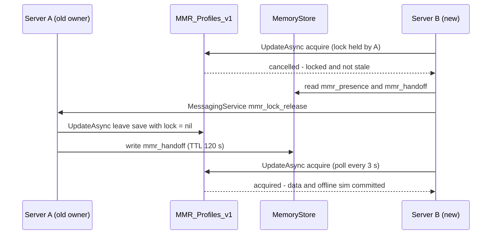
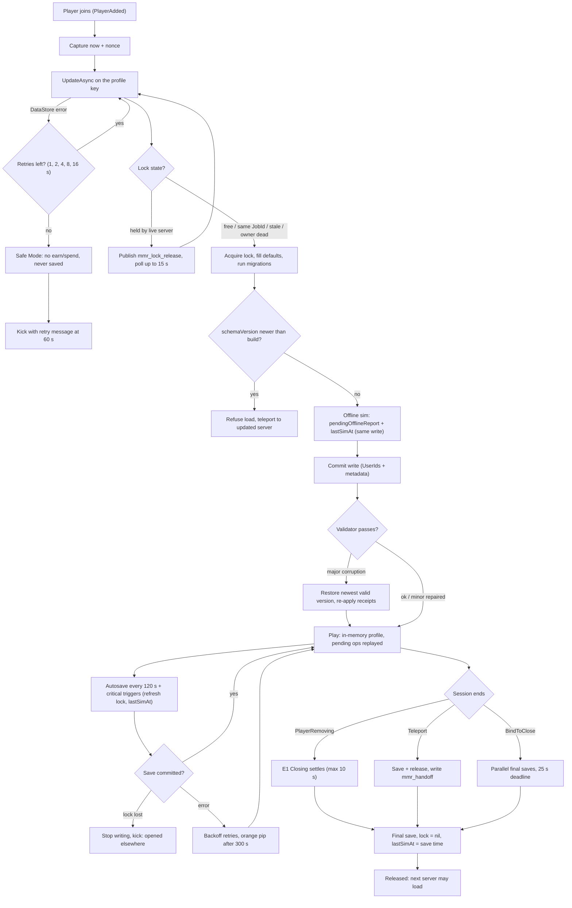

## 28. Data Persistence

> **Owner:** A18 Data & Ops. **Binding inputs:** §C3 (autosave 120 s, level cap 100, reputation scale),
> §C4 (MB/MS/RT only), §C5 (stat caps, respec rules), §C15 (offline persistence & idempotency),
> §C19 (`PlayerDataService`, `EconomyService`, `OfflineEarningsService`, …), §C22 E1/E5/E6/E11/E13.
> §27 places the modules named here in the project tree; this section is authoritative for *what* is
> stored, *how* it is written, and *which guarantees* hold. Flavor aside, Nana Gristle's recipe box never
> forgets, never double-pays, and never lets two kitchens cook from the same box at once.

### 28.1 Purpose

Persist every piece of player state that must survive a session — progression, wallets, mutations,
the restaurant, staff, quests, offline reports, purchases — so that:

1. **Nothing paid for is ever lost.** Robux receipts are acknowledged only after the grant is durably saved.
2. **Nothing is ever granted twice.** Every reward and every currency movement carries a claim key or
   transaction ID that is checked inside the same atomic write that applies it.
3. **Only one server writes a profile at a time** (session lock), including during teleports and crashes.
4. **The worst-case loss window is one autosave interval (120 s, §C3/§C22 E6)** for ordinary progress.
5. **Bad data is recoverable** (DataStore versioning, monthly snapshots, a rollback tool) and **erasable**
   on a right-to-be-forgotten request.

### 28.2 Rules & Mechanics (persistence invariants)

| # | Invariant | Consequence |
|---|---|---|
| P1 | One profile key per player; one writer at a time (session lock in the profile itself). | A second server cannot load a locked profile (§C22 E11). |
| P2 | Only the server reads/writes DataStores. Clients send *intents*, never values to persist (except validated settings). | No client-supplied currency, timestamps or rewards ever reach storage (§29). |
| P3 | Everything that must change together lives in **one key** (the profile). Cross-key effects go through the `pendingOps` journal. | A save is all-or-nothing; no half-applied fusions or purchases. |
| P4 | Every currency movement goes through `EconomyService:Transact`/`TransactWith` (§27.12.5) with an idempotency key; a repeated key is a no-op. | Retries, double-clicks and receipt re-deliveries cannot duplicate money. |
| P5 | Every claimable reward has a deterministic **claim key** (quest cycle, `reportId`, day-stamp, `PurchaseId`). | Duplicate reward prevention is data, not timing. |
| P6 | Time = server `os.time()` only (§C15). Client clocks are never read. | Offline-time and daily-reset manipulation is impossible from the client. |
| P7 | Every save carries a `writeId`; a save whose `writeId` is already stored is treated as committed. | Timeouts that actually committed are safe to retry. |
| P8 | Never load a profile whose `schemaVersion` is newer than the running build; never downgrade. | Rolling updates cannot corrupt data written by a newer build. |
| P9 | Every array has a cap (ring buffer or hard cap, §28.3). | The profile cannot grow toward the 4 MB key limit. |
| P10 | Safe Mode profiles are never written. | A failed load can never overwrite real data with defaults. |
| P11 | `lastSimAt` advances on every successful save while the owner is online and is set to the save time on leave (§C22 E1). | Online time is never also simulated as offline time. |

### 28.3 Variables

| Variable | Value | Notes |
|---|---|---|
| `SCHEMA_VERSION` | 3 | Current profile schema; increments with every migration (§28.12). |
| `AUTOSAVE_INTERVAL_S` | **120** (canon §C3) | Per player; staggered 15 s per player slot (8 slots × 15 s = 120 s, §27.1). |
| `LOCK_STALE_S` | **360** [TUNABLE] | = 3 missed refreshes × 120 s. A lock older than this may be stolen. |
| `PRESENCE_TTL_S` / `PRESENCE_REFRESH_S` | 90 / 30 [TUNABLE] | MemoryStore liveness key of the owning server (§28.13). |
| `PRESENCE_DEAD_CONFIRM` | 2 reads ≥ 10 s apart [TUNABLE] | Required before a "presence-confirmed" steal of a non-stale lock. |
| `RELEASE_WAIT_S` | 15 [TUNABLE] | How long a loader waits after a MessagingService release request. |
| `RETRY_BACKOFF_S` | **1, 2, 4, 8, 16** (canon E6) | Max 5 retries for every DataStore call. |
| `SAFE_MODE_KICK_S` | **60** (canon E6) | Safe Mode duration before the friendly kick. |
| `KEY_WRITE_MIN_GAP_S` | 6 | Roblox per-key write throttle; the save scheduler coalesces within it. |
| `BIG_PURCHASE_SAVE_MB` | **10,000** (canon §C3) | MB purchase that triggers an immediate save. |
| `CLOSING_SAVE_GRACE_S` | 10 [TUNABLE] | Max wait for the E1 *Closing* settlement before the leave save. |
| `BINDTOCLOSE_DEADLINE_S` | 25 | Internal deadline inside Roblox's 30 s `BindToClose` window. |
| `TX_KEY_RING` / `LEDGER_RING` | 64 (§27.12.5) / 50 [TUNABLE] | `wallet.txKeys` idempotency ring / recent ledger entries. |
| `CLAIMED_REPORT_RING` | **20** (canon §C15) | `offline.claimedReportIds`. |
| `RECEIPT_RING` | 100 [TUNABLE] | Robux `PurchaseId`s kept in-profile (global ledger is the backstop). |
| `REGULARS_CAP` / `ROSTER_BENCH_CAP` | 20 (§8) / 10 [TUNABLE] | Regular customers per restaurant; benched staff beyond the tier employee cap. |
| `PENDING_OPS_CAP` / `MODERATION_FLAG_RING` | 20 / 25 | Cross-key operation journal; moderation flags. |
| `SNAPSHOT_SLOTS` | 3 (monthly) + 1 pre-migration | `MMR_ProfileSnap_v1` (§28.20). |
| `SIZE_WARN` / `SIZE_SOFT` / `SIZE_HARD` | 512 KB / 1 MB / 3.5 MB | Encoded JSON length; DataStore limit is 4 MB per key. |
| `BUDGET_RESERVE_NONCRITICAL` | 20 requests | Below this, leaderboards/snapshots/mod-logs are deferred. |
| `BUDGET_RESERVE_AUTOSAVE` | 5 requests | Below this, autosaves slip 30 s (receipts and leave saves never slip). |
| `CLOCK_SKEW_TOLERANCE_S` | 120 | Negative elapsed time within this is silently treated as 0; beyond it is flagged (§C15). |
| `SIM_VERSION` | owned by `OfflineEarningsService` (§17) | Persisted in `offline.simVersion`; part of the offline seed. |

### 28.4 UI

| Element | Behavior |
|---|---|
| Save pip | A tiny pickle-jar icon next to the MB counter pulses once (0.6 s) after each successful save. No text, no sound. |
| "Saving delayed…" | If the last successful save is > 300 s old, the pip turns orange with a tooltip: *"The filing cabinet is stuck — we'll keep trying. Your progress is safe up to <time>."* |
| Safe Mode banner | Full-width, non-blocking: *"Your kitchen keys are stuck in the pickle jar! You can look around, but earning and spending are paused while we try again."* Countdown to the 60 s retry/kick. Shop, hire, collect and claim buttons are disabled with a lock glyph (not color-only). |
| Load screen | "Unlocking the shack…" with Nana Gristle's hologram tapping a clock; shows "Waiting for your other kitchen to close…" while a lock handoff is in progress (§28.13). |
| Kick texts | Load failure (E6): *"We couldn't open your restaurant's filing cabinet. Your progress is safe — please rejoin in a minute!"* · Lock lost: *"Your restaurant was opened somewhere else. Your saved progress is safe — rejoin to keep cooking!"* · Newer build: *"A fresher version of Morph City just opened! Hop over to keep cooking."* |
| Rollback notice | One-time modal after an automatic or support rollback: *"Nana Gristle tidied up a mix-up in your recipe box. Your restaurant was restored to <date/time>."* Optional compensation [TUNABLE]: 1 Morph Capsule (a §C17.4 reward). |

### 28.5 Progression

Persistence has no player-facing progression, but the profile **grows with the player** and the schema
grows with content. Growth is bounded by design:

| Player stage | Typical profile (JSON) | Driver |
|---|---|---|
| New player after tutorial (L5, TIER_01) | ≈ 9 KB | defaults, 5 starter parts, 12 layout objects |
| Mid-game (L26, TIER_05, ~15 h) | ≈ 32 KB | ~60 parts, 120 layout objects, 8 staff |
| Late-game (L80, TIER_10, ~120 h) | ≈ 67 KB | ~200 parts, 300 layout objects, 20 staff |
| Theoretical worst case (all 280 parts, all rings full) | ≈ 118 KB | §28.10 |

New content is **append-only**: new mutation, recipe, quest or achievement IDs extend the bitsets and maps
without a migration. Only *representation* changes (renamed/reshaped fields) need a schema migration (§28.12).

### 28.6 Player Interactions

- Saving is invisible: there is no save button. Players influence persistence only by playing.
- **Leaving** at any moment is safe: the leave save runs on `PlayerRemoving` (E1), and anything not yet
  saved is at most 120 s old.
- **Joining a friend's server** (TeleportService) hands the lock over without a stale wait (§28.13).
- **Co-op guests** never write to the owner's profile; everything a guest earns goes to the guest's own
  profile on the same server; owner-side damage is covered by Co-op Insurance (§C22 E12).
- **Settings** are the only client-originated values persisted, after clamping/whitelisting (§28.9.13).
- **Support requests** ("my capsule vanished") are answered from the wallet ledger, the receipt ring,
  DataStore versions and the moderation flag ring — never by trusting a screenshot.

### 28.7 Dependencies

Each service writes only its own profile section (single-writer table of §27.17): it reads the profile with
`PlayerDataService:GetProfile(player)`, mutates its section in place without yielding, and calls
`MarkDirty(player, section)`; only `PlayerDataService` performs DataStore I/O. Cross-section effects inside the
load transform run as the owners' registered pure functions (ownership by code, atomicity by transaction, §27.17).

| Profile section | Writer (§27.17) | Contents (§28.9) |
|---|---|---|
| `meta` | `PlayerDataService` | versions, session lock, pending ops, data flags; `moderation` (§29) and `analytics` (§31) sub-blocks written on behalf of the security and telemetry libraries |
| `settings` | `PlayerDataService` | `uiSettings` and graphics preferences via validated `PlayerData.UpdateSettings` |
| `wallet` | **`EconomyService` only** (§C19) | balances, idempotency keys, ledger, Robux receipt ring |
| `progression` | `ProgressionService` | level, XP, stats, skills, specializations, achievements, milestones, counters, titles, emotes |
| `mutations` | `MutationService` | owned parts, duplicates, capsules and pity, equipped body, ability bar, loadouts |
| `morph` | `MorphAssemblyService` | morph name, colors, owned palettes |
| `restaurant` | `RestaurantService` | tier, plot preference, upgrades (incl. per-station-type levels `UPG_…#n`), reputation, regulars |
| `layout` | `BuildingService` | packed placed objects — every placed item, appliances included, is a furniture record |
| `durability` | `RepairService` | sparse durability per placed object |
| `inventory` | `InventoryService` | special-ingredient stock, unplaced furniture and trophies, Robux cosmetics |
| `recipes` | `RecipeService` | known recipes, menu, tracked perfect counts, courses |
| `employees` | `EmployeeService` | roster, assignments, candidate board |
| `offline` | `OfflineEarningsService` | `lastSimAt`, pending report, claimed ring, capsule and welcome-back stamps |
| `quests` | `QuestService` | quest states and claims, daily/weekly cycles, login streak, tutorial |
| `city` | `CityEventService` (§27.17 lists no `city` section; added for §18.9.7 — single writer to be confirmed by §27) | discoveries, secrets, event claims, pending event rewards, season track |
| `social` | `MultiplayerService` | co-op permissions, arena record |

External platform dependencies: `DataStoreService`, `MemoryStoreService`, `MessagingService`,
`MarketplaceService`, `TeleportService`, `HttpService` (GUIDs, JSON), Open Cloud Data Stores API (ops tools).

### 28.8 Roblox Implementation — DataStore Layout

§28.8–§28.24 form the Roblox Implementation block of this section.

#### 28.8.1 Stores and keys

| Store name | Kind | Key pattern | Value | Writer | Purpose / notes |
|---|---|---|---|---|---|
| `MMR_Profiles_v1` | DataStore (versioned) | `u<UserId>/profile` | `Profile` JSON (§28.9) | `PlayerDataService` | Main profile; session lock embedded in `meta.lock`; `UserIds` = `{UserId}`; metadata `{s = schemaVersion, b = buildId}`. |
| `MMR_ProfileSnap_v1` | DataStore | `u<UserId>/m0`…`u<UserId>/m2`, `u<UserId>/premig` | compacted `Profile` copy | `PlayerDataService` | 3 rolling monthly snapshots (first leave-save of each UTC month, slot = month % 3) + one pre-migration copy for risky migrations. Survives the 30-day version horizon. |
| `MMR_Receipts_v1` | DataStore | `u<UserId>/<PurchaseId>` | `{prod, t, saveSeq}` | `EconomyService` | Write-once global receipt ledger; backstop for the in-profile receipt ring (§28.18). |
| `MMR_Moderation_v1` | DataStore | `u<UserId>/flags` | flag ring + strike history | security libraries (§29) | Long-term moderation history (in-profile ring holds the recent 25). |
| `MMR_LB_Served_v1` | OrderedDataStore | `<UserId>` | integer lifetime customers served | `PlayerDataService` (pendingOps) | Leaderboard storage only; display surfaces are owned by §21/§24. |
| `MMR_LB_Collection_v1` | OrderedDataStore | `<UserId>` | distinct mutation parts ever owned | `PlayerDataService` | Collection leaderboard. |
| `MMR_LB_Weekly_W<WeekStamp>` | OrderedDataStore | `<UserId>` | Delighted customers this week | `PlayerDataService` | New store name each Monday 00:00 UTC (§C3); old weeks are left to age out. |
| `MMR_LB_Arena_S<Season>` | OrderedDataStore | `<UserId>` | arena rating | `MultiplayerService` via `PlayerDataService` | One store per arena season. |

| MemoryStore structure | Kind | Key | TTL | Purpose |
|---|---|---|---|---|
| `mmr_presence` | HashMap | `u<UserId>` → `{jobId, nonce}` | 90 s, refreshed every 30 s | Liveness of the lock owner (§28.13). |
| `mmr_handoff` | HashMap | `u<UserId>` → `{fromJobId, releasedAt, saveSeq}` | 120 s | Tells a teleport destination that a release is in flight (wait, don't steal). |
| `mmr_lb_cache` | HashMap | `<board>` → top-100 rows | 300 s | Cross-server leaderboard cache; one elected server refreshes it. |
| `mmr_mod_queue` | Queue | — | 7 days | Flags awaiting human review (§29). |

| MessagingService topic | Payload (≤ 1 KB) | Purpose |
|---|---|---|
| `mmr_lock_release` | `{u = UserId, j = requesterJobId}` | Ask the current lock owner to save & release now (§28.13). |
| `mmr_kick` | `{u = UserId, reason = code}` | Moderation/erasure kick wherever the player is. |

Feature flags and remote configuration use §27.15's `mmr_remote_config` sorted map and `mmr_config` topic;
§28 adds no configuration store. Every MemoryStore/MessagingService payload above carries the `cv` content-version
tag (§27.5) so servers on different builds ignore each other's incompatible payloads.

#### 28.8.2 Naming rules

- **Every per-player key starts with `u<UserId>/`** so `ListKeysAsync(prefix)` finds *all* of a player's
  entries in a store — this is what makes erasure (§28.24) and support tooling tractable. Ordered stores
  use the bare `UserId` because they hold a single entry per player.
- Store names carry a `_v<N>` suffix. A store is never repurposed; a breaking storage change creates a new
  store plus a lazy copy-on-load migration.
- Keys and store names stay ≤ 50 characters (Roblox limit). The longest key here,
  `u<UserId>/<PurchaseId>`, is ≤ 50 for 36-character GUID purchase IDs and 11-digit user IDs.
- **Environments are separate universes** (dev / staging / production), so DataStores never mix test data
  with live data. "Enable Studio Access to API Services" is on only in dev and staging.

#### 28.8.3 Metadata and user association

Every profile write returns `UserIds = {UserId}` and metadata `{s = schemaVersion, b = buildId}` from the
`UpdateAsync` transform. `UserIds` links the key to the player for Roblox's data-subject tooling and for our
erasure procedure (§28.24); `b` lets the rollback tool find the last version written by a known-good build
(§28.20.4) without decoding every version.

### 28.9 Roblox Implementation — Profile Schema (typed Luau)

The profile is split into the **sections and single writers fixed in §27.17** (`meta`, `settings`, `wallet`,
`progression`, `mutations`, `morph`, `restaurant`, `layout`, `durability`, `inventory`, `recipes`,
`employees`, `offline`, `quests`, `social`). Types live in `ReplicatedStorage/Shared/Types` (types only, so
client code can be typed against the replicated view) and are enforced by the server validator (§28.20.4).
Field names stay readable: the worst case is ~2.9 % of the 4 MB key limit (§28.10), so only structures that
grow with content are compacted (§28.11). Fields marked *transient* exist in memory only and are stripped by
the encoder before every write.

#### 28.9.1 Primitives and enumerations

```lua
--!strict
-- ReplicatedStorage/Shared/Types/ProfileTypes.lua
export type UnixTime = number   -- server os.time() seconds; never a client clock (§C15)
export type DayStamp = number   -- math.floor(t / 86400): 00:00 UTC daily boundary (§C3)
export type WeekStamp = number  -- math.floor((t - 345600) / 604800): weeks since Mon 1970-01-05 00:00 UTC

export type CurrencyCode = "MB" | "MS" | "RT"                    -- §C4.1, no others
export type StatCode = "COOK_SPD" | "COOK_QLT" | "STR" | "DEF" | "REPAIR"
	| "MOVE" | "LUCK" | "CHARM" | "EFFICIENCY"                     -- §C5
export type Rarity = "Common" | "Uncommon" | "Rare" | "Epic" | "Legendary" | "Mythic" | "Secret"
export type AcquisitionCode = "SHOP_MART" | "SHOP_ROTATION" | "LAB_FUSION" | "CAPSULE" | "QUEST"
	| "EVENT" | "ARENA" | "OFFLINE_FIND" | "ACHIEVEMENT" | "SECRET" | "STARTER"   -- §C13.8
export type AnatomySlot = "HEAD" | "FACE" | "NOSE" | "MOUTH" | "EYES" | "EARS" | "HORNS" | "NECK"
	| "TORSO" | "ARM_L" | "ARM_R" | "HANDS" | "LEG_L" | "LEG_R" | "FEET" | "TAIL" | "WINGS"
	| "BACK" | "SKIN" | "FUR" | "SCALES" | "FX"                                    -- §C13.1
export type RoleId = "ROLE_CHEF" | "ROLE_PREP" | "ROLE_WAITER" | "ROLE_CASHIER" | "ROLE_DISH"
	| "ROLE_CLEANER" | "ROLE_REPAIR" | "ROLE_SECURITY" | "ROLE_MANAGER" | "ROLE_DELIVERY"
	| "ROLE_STOCKER" | "ROLE_ASST_MGR"                                             -- §C14.1
```

#### 28.9.2 `meta` — versions, session lock, journal, moderation, analytics (writer: `PlayerDataService`)

```lua
export type SessionLock = {
	jobId: string,          -- game.JobId of the owning server
	placeId: number,        -- game.PlaceId (Main place, Arena place, reserved soft-shutdown server)
	acquiredAt: UnixTime,
	refreshedAt: UnixTime,  -- bumped by every successful save (autosave = refresh)
	nonce: string,          -- per-session GUID: distinguishes a rejoin on the same JobId
}

export type PendingOpKind = "RECEIPT_LEDGER" | "LEADERBOARD" | "SNAPSHOT" | "MODERATION_LOG"
export type PendingOp = {
	opId: string,                 -- GUID; the external write is keyed by it (idempotent replay)
	kind: PendingOpKind,
	payload: { [string]: any },
	createdAt: UnixTime,
	attempts: number,             -- dropped + logged after 10 failed replays
}

export type ModFlag = { t: UnixTime, code: string, sev: number }    -- codes in §29.17
export type Moderation = {
	strikes: number,
	flags: { ModFlag },           -- ring of MODERATION_FLAG_RING
	econHold: boolean,            -- earning frozen pending review (§29.14)
	lastReviewAt: UnixTime,
}

export type AnalyticsState = {
	installDay: DayStamp,
	lastSessionDay: DayStamp,
	sessions: number,
	daysPlayed: number,
	firstsBits: { number },       -- 32-bit words; one bit per once-only "first X" event (§31.10)
	onboardingStep: number,       -- highest onboarding funnel step logged (§31.11)
}

export type Meta = {
	schemaVersion: number,        -- shape version (§28.12)
	contentVersion: string,       -- last ContentVersion seen (§27.5): drives one-time content migrations
	createdAt: UnixTime,
	lastSaveAt: UnixTime,
	saveSeq: number,              -- +1 on every committed write (monotonic)
	lastWriteId: string,          -- GUID of the last committed write (§28.20.1)
	buildId: string,              -- server build that wrote it (also in DataStore metadata)
	lock: SessionLock?,
	pendingOps: { PendingOp },    -- ≤ PENDING_OPS_CAP
	dataFlags: { string },        -- e.g. "ROLLBACK_AUTO_20261009", "MIGRATED_V3"
	lastSnapshotMonth: number,    -- yyyymm of the last monthly snapshot
	moderation: Moderation,       -- written via PlayerDataService by the §29 security libraries
	analytics: AnalyticsState,    -- written via PlayerDataService by Telemetry (§31)
}
```

#### 28.9.3 `progression` — level, XP, stats, skills, achievements, milestones (writer: `ProgressionService`)

```lua
export type Progression = {
	level: number,                     -- 1..100 (§C3)
	xp: number,                        -- XP into current level: 0 <= xp < XPReq(level) (§C5.1)
	totalXp: number,                   -- lifetime XP (cross-check against the cumulative curve)
	statAlloc: { [StatCode]: number }, -- allocated points, each 0..50; sum <= 2 * (level - 1) (§C5)
	unspentStatPoints: number,         -- allocation deferred, never forced mid-rush (§C22 E14)
	lastFreeStatRespecAt: UnixTime,    -- free respec once per 24 h, else 500 MB x level (§C5)
	respecTokens: number,              -- stat respec tokens (§C17.4 reward)
	skillNodes: { [string]: number },  -- node ID -> rank, e.g. skillNodes["SKL_CHEF_01"] = 2 (§14)
	specs: { string },                 -- unlocked specializations, max 2: "SVC", "MGMT" (§C18, §14)
	bonusSkillPoints: number,          -- quest/achievement grants on top of 1 per level from L2 (§C18)
	unspentSkillPoints: number,
	lastFreeSkillRespecAt: UnixTime,   -- free full respec once per 7 days (§C18)
	overtimeXp: number,                -- XP banked past the L100 cap (§14 Overtime)
	xpOnceKeys: { [string]: boolean }, -- one-time XP grant keys (duplicate-grant prevention, §14);
	                                   -- expired daily/weekly keys are pruned at load
	achievements: {
		unlocked: { [string]: UnixTime },   -- achievement ID (§36.16) -> claimed at
		milestones: { [string]: UnixTime }, -- milestone ID (§36.17) -> claimed at
		counters: { [string]: number },     -- shared lifetime counters ("customers_served", "tantrums_calmed",
		                                    -- "repairs_done", "perfect_dishes", ...) read by achievements & quests
	},
	titles: { string },                -- cosmetic text titles (§C17.4)
	equippedTitle: string?,
	emotes: { string },                -- earnable emote keys
}
```

#### 28.9.4 `wallet` — balances, idempotency keys, ledger, receipts (writer: `EconomyService` only)

```lua
export type Balances = { MB: number, MS: number, RT: number }  -- integers >= 0 (§C22 E8); hard caps per §22

export type LedgerEntry = {
	key: string,            -- the transaction's idempotency key (§28.17)
	t: UnixTime,
	reason: string,         -- registered reason code, shared with analytics (§31.12)
	dMB: number, dMS: number, dRT: number,   -- signed integer deltas
	sku: string?,           -- content ID, e.g. "TIER_04", "RCP_BRG_001", "MUT_216"
}

export type ReceiptRecord = { pid: string, prod: number, t: UnixTime }   -- Robux PurchaseId, ProductId

export type Wallet = {
	balances: Balances,
	lifetimeEarned: Balances,
	lifetimeSpent: Balances,
	txKeys: { string },          -- ring of 64 idempotency keys (§27.12.5)
	txKeySet: { [string]: boolean }?, -- transient: rebuilt from txKeys at load, never saved
	ledger: { LedgerEntry },     -- ring of LEDGER_RING (the Wallet panel shows the last 20, §22.2)
	receipts: { ReceiptRecord }, -- ring of RECEIPT_RING granted Robux receipts (§28.18)
}
```

#### 28.9.5 `mutations` — owned parts, duplicates, capsule pity, equipped, loadouts (writer: `MutationService`)

```lua
export type OwnedPart = {
	lvl: number,            -- upgrade level 1..max for rarity (§C4.6)
	copies: number,         -- extra duplicate copies held for upgrades (0 = only the base copy)
	at: UnixTime,           -- first acquired
	src: AcquisitionCode,   -- how the base copy was obtained
	fav: boolean,           -- protected from auto-conversion and fusion pickers
	new: boolean,           -- "NEW" badge not yet seen
}

export type Loadout = {
	name: string,                     -- player text (<= 20 chars): stored raw, filtered on display, never logged
	slots: { [string]: string },      -- AnatomySlot -> part ID
	abilityBar: { string },           -- <= 4 ABL IDs, each from an equipped part (§C12.1)
	palette: string?,                 -- palette key from morph.palettes
}

export type Mutations = {
	owned: { [string]: OwnedPart },   -- key = part ID, e.g. owned["MUT_145"]; one entry per distinct part
	everOwnedBits: string,            -- base64 bitset over the part index: collection log that survives fusion
	capsules: number,                 -- unopened earnable Morph Capsules (§C4.7)
	capsulePity: number,              -- opened since last Epic-or-better; the 40th is guaranteed (§C4.7)
	capsulesOpened: number,
	keepDuplicates: boolean,          -- false = auto-convert duplicates to MS per §C4.6
	secretProgress: { [string]: number }, -- e.g. secretProgress["MUT_116"] = PERFECT RCP_PST_008 served
	equipped: { [string]: string },   -- current body: AnatomySlot -> part ID (FUR/SCALES exclusive, §C13.1)
	abilityBar: { string },
	loadouts: { Loadout },            -- [1] Chef, [2] Fighter, [3] Repair, [4+] cosmetic extra slots (§23)
	activeLoadout: number,            -- 0 = unsaved custom body
	lastLoadoutSwapAt: UnixTime,      -- 10 s swap cooldown (§C22 E4)
}
```

Equipped and loadout parts must exist in `owned`; a part consumed by Lab fusion is unequipped from the body
and every loadout in the same in-memory step. Secrets cannot duplicate (§C4.6): a second Secret grant converts
to MS, and the validator rejects `copies > 0` on a Secret.

#### 28.9.6 `morph` — name, palettes, Morphdex (writer: `MorphAssemblyService`)

```lua
export type MorphColors = { primary: string, secondary: string, accent: string }  -- "#RRGGBB"
export type Morphdex = {               -- §12.9 Morphdex (§12b): keyIndex = headIdx x 256 + domIdx
	spotted: string,                  -- base64 bitset, 40 x 256 bits = 1,280 bytes
	worn: string,                     -- base64 bitset, same layout
	titleBits: number,                -- 32-bit mask of Morphdex titles earned
}
export type Morph = {
	morphName: string,          -- player text, same rules as Loadout.name (`Morph.SetName`)
	colors: MorphColors,        -- current colors (`Morph.SetPalette`)
	palettes: { string },       -- owned cosmetic palette keys (rewards §C17.4, Body Mods BLD_02)
	morphdex: Morphdex,
}
```

#### 28.9.7 `restaurant`, `layout`, `durability`, `inventory`

```lua
export type Reputation = {
	stars: number,                    -- 1.0..5.0, starts 2.5 (§C3, §C11.4)
	served: number,                   -- lifetime customers served
	delighted: number,                -- lifetime S >= 90
	stormOuts: number,
	fiveStarStreak: number,           -- consecutive customers at 5.0 stars (MUT_280 discovery, §C13.8)
}
export type Regular = {               -- repeat customer record defined by §8 (~120 B each)
	id: number,                       -- stable id within this restaurant
	name: string,                     -- generated name (§8 name tables; never player text)
	seed: number,                     -- reproduces the exact body (MorphAssemblyService)
	personalityId: string,            -- e.g. "PER_013"; PER_032 stores its revealed personality
	favoriteRecipe: string?,          -- RCP ID of the highest-S visit
	visits: number,
	loyalty: number,                  -- 0..100 (§8)
	grudge: number,                   -- 0..100 (§8)
	grudgeCause: string?,             -- cause code (§8)
	lastVisit: UnixTime,
}
export type Restaurant = {            -- writer: RestaurantService
	tier: string,                     -- "TIER_01".."TIER_10"
	plotPreference: number?,          -- last Restaurant Row plot (non-binding)
	upgrades: { string },             -- purchased restaurant upgrades (§36.12): plain "UPG_012" for one-offs,
	                                  -- "UPG_012#3" for leveled ones; station upgrade levels are per station
	                                  -- TYPE and live here (§15) — any per-object level only mirrors them
	reputation: Reputation,
	regulars: { Regular },            -- <= REGULARS_CAP = 20; replacement rule per §8 (lowest loyalty, newcomer S >= 95)
}

export type PlacedObject = {          -- decoded in memory from layout.packed (§28.11)
	uid: number,                      -- unique within this restaurant
	ref: string,                      -- catalog furniture ID, e.g. "FRN_901"; appliances/stations are furniture
	                                  -- records too (their §36.13 row names the STN_ type they provide, §15)
	x: number, z: number,             -- 2-stud cell indices on the interior placement grid (§15)
	rot: number,                      -- 0..3 quarter turns
	lvl: number,                      -- mirror of the per-type station level in restaurant.upgrades (1 for decor)
}
export type Layout = {                -- writer: BuildingService
	packed: string,                   -- compact {PlacedObject}
	objects: { PlacedObject }?,       -- transient decoded view
	nextUid: number,
}

export type Durability = {            -- writer: RepairService
	damaged: { [string]: number },    -- sparse: tostring(uid) -> durability 0..99 %; absent = 100 % Pristine.
	                                  -- Damage state is derived (§C6): 75-51 Scuffed, 50-26 Cracked,
	                                  -- 25-1 Broken, 0 Destroyed (rubble awaiting the auto-rebuild offer;
	                                  -- the entries at 0 are §15's `pendingRebuilds`, exposed as a derived view)
}

export type Inventory = {             -- writer: InventoryService
	stock: { [string]: number },      -- stocked special ingredients only (§C9): ING ID -> units
	furniture: { [string]: number },  -- unplaced items as counts only: FRN ID -> count (incl. earned trophies
	                                  -- FRN_901..FRN_910); only undamaged (100 %) items can be stored, which
	                                  -- prevents a store-to-heal exploit (§15)
	cosmetics: { string },            -- owned Robux cosmetic SKUs (§23): never gameplay power
}
```

Basic ingredients are unlimited and never stored (§C9). Pending tickets, food in stations and loose props are
**not** persisted (E1/E13); special ingredients sitting in stations at leave time return to `inventory.stock`
before the leave save (E1).

#### 28.9.8 `employees` — roster and assignments (writer: `EmployeeService`)

```lua
export type EmployeeStats = {
	cook: number, service: number, accuracy: number,
	repair: number, combat: number, reliability: number,   -- 1..100 (§C14.2)
}

export type Employee = {
	eid: string,                      -- "e" .. seq, unique per profile
	arch: string,                     -- archetype ID, e.g. "EMP_001" (§36.8)
	name: string,                     -- generated from §36.8 name tables (never player text)
	rarity: Rarity,                   -- Common..Legendary (§C4.8)
	role: RoleId,
	stationUid: number?,              -- PlacedObject.uid assigned (chefs/preps); nil = floating
	stats: EmployeeStats,
	potential: number,                -- potential cap by rarity (§C4.8)
	training: number,                 -- training level (§16)
	morale: number,                   -- 0..100
	energy: number,                   -- 0..100 %
	wage: number,                     -- MB per hour worked
	traits: { string },               -- trait keys (§36.8)
	status: "ACTIVE" | "UNPAID_BREAK" | "RESTING" | "BENCH",   -- UNPAID_BREAK per §C22 E8
	hiredAt: UnixTime,
}

export type Employees = {
	roster: { Employee },             -- ACTIVE <= employee cap of tier (§C6); BENCH <= ROSTER_BENCH_CAP
	nextSeq: number,
	lastWageTickAt: UnixTime,
	recruit: {
		seed: number,                 -- candidate board seed (Recruitment Office BLD_04)
		refreshedAt: UnixTime,
		hiredMask: number,            -- bit i set = candidate i already hired: no double hire
	},
}
```

#### 28.9.9 `recipes` — known recipes and menu (writer: `RecipeService`)

```lua
export type Recipes = {
	knownBits: string,                -- base64 bitset over the 150 recipes in §C10 order (§28.11)
	menu: { string },                 -- RCP IDs, #menu <= menu slots of tier (§C6)
	perfectCounts: { [string]: number }, -- only for recipes some condition tracks, e.g. ["RCP_PST_008"]
	courses: { string },              -- completed course keys, e.g. "ALIEN_CUISINE" (story chapter 5)
}
```

#### 28.9.10 `quests` (writer: `QuestService`) and `city` (writer: `CityEventService`)

```lua
export type QuestState = "ACTIVE" | "COMPLETE" | "CLAIMED" | "FAILED"
export type QuestProgress = {
	id: string,                       -- quest ID (§20)
	obj: { number },                  -- per-objective counters
	state: QuestState,                -- CLAIMED is the claim flag (§28.19)
	at: UnixTime,                     -- accepted at
}
export type CycleQuests = {
	stamp: number,                    -- DayStamp (daily) or WeekStamp (weekly)
	offers: { QuestProgress },        -- rolled at first load after the reset
	rerolls: number,
}
export type Tutorial = {               -- = §32.13 TutorialState
	v: number,                        -- tutorial script version (its own step migrations, §32)
	step: number,                     -- last COMPLETED step 0..12 (QST_TUT_001..QST_TUT_012); 12 = done
	skipped: boolean,
	choice: string?,                  -- "MUT_145" | "MUT_144" | "MUT_153" (QST_TUT_010, §C13.8)
	startedAt: UnixTime,
	completedAt: UnixTime?,
	tipsSeen: number,                 -- bitmask of tutorial tips shown
	assists: { [string]: number },    -- analytics counters (burn_recovery, auto_flip, ...)
}
export type Quests = {
	active: { [string]: QuestProgress }, -- story/challenge quests in progress (<= 25 tracked)
	doneBits: string,                 -- non-repeatable quests completed AND claimed (bitset by quest index)
	daily: CycleQuests,
	weekly: CycleQuests,
	storyChapter: number,             -- 1..10, one per tier (§C17.3)
	dailyLogin: { lastClaimDay: DayStamp, streak: number },
	tutorial: Tutorial,
}

export type City = {                  -- fields required by §18.9.7
	discoveredDistricts: number,      -- 10-bit mask, DST_01..DST_10 (bit i-1)
	discoveredStations: number,       -- 10-bit mask of Morph Metro stations (free fast travel, §C16.1)
	manholes: number,                 -- 3-bit mask of hidden sewer manholes (DST_09)
	secrets: { string },              -- found secret keys
	deadPixels: number,               -- 8-bit mask for MUT_276 (§C13.8)
	counters: { [string]: number },   -- city counters (§18)
	flags: { [string]: boolean },     -- city flags (§18)
	eventClaims: { string },          -- ring of the last 50 event instance keys claimed (dedupe, §28.19)
	pendingEventRewards: { { key: string, reward: { [string]: any } } }, -- granted at next safe moment
	seasonTrack: { seasonKey: string, stamps: number },
}
```

#### 28.9.11 `offline` — simulation state (writer: `OfflineEarningsService`)

```lua
export type IncidentLine = { inc: string, count: number, delta: number }  -- incident ID (§36.9), MB effect

export type OfflineReport = {
	reportId: string,                 -- deterministic: hash(UserId, fromTs, toTs, SIM_VERSION)
	fromTs: UnixTime, toTs: UnixTime,
	hours: number,                    -- simulated hours after cap
	capHours: number,                 -- manager cap applied (§C14.3)
	capped: boolean,                  -- "capped" label (§C22 E5)
	segments: number,                 -- intervals merged into this report (each capped separately, §C15)
	customers: number,
	revenue: number, tips: number, ingredients: number, wages: number, repairs: number,
	incidents: { IncidentLine },
	discoveries: { ms: number, crates: { [string]: number }, capsules: number },  -- never RT (§C4.1)
	net: number,                      -- max(0, sum of Net_step) (§C15)
	simVersion: number,
}

export type Offline = {
	lastSimAt: UnixTime,              -- §C15; advanced by online saves and set to leave time (E1)
	simVersion: number,
	pendingOfflineReport: OfflineReport?,
	claimedReportIds: { string },     -- ring of CLAIMED_REPORT_RING = 20 (§C15)
	lastCapsuleDay: DayStamp,         -- at most 1 offline Morph Capsule per real day (§C15)
	lastWelcomeBackAt: UnixTime,      -- Welcome Back Crate idempotency (§C22 E5)
	clockFlags: number,               -- loads where now < lastSimAt beyond tolerance (flagged, §C15)
}
```

#### 28.9.12 `social` — co-op permissions and arena (writer: `MultiplayerService`)

```lua
export type CoopSettings = {
	allowGuests: "FRIENDS" | "NOBODY" | "EVERYONE",
	guestCanCook: boolean, guestCanServe: boolean, guestCanRepair: boolean,   -- `Multiplayer.SetPermissions`
	guestPayToday: number,            -- MB earned as a guest today; daily cap 1.5 x NetRef (§22.3)
	guestPayDay: DayStamp,            -- resets guestPayToday when the DayStamp changes
}
export type Arena = { optedIn: boolean, season: number, rating: number, wins: number, losses: number }
export type Social = { coop: CoopSettings, arena: Arena }
```

#### 28.9.13 `settings` and `uiSettings` (writer: `PlayerDataService`)

```lua
export type SoundGroupName = "Master" | "Music" | "SFX" | "Voice" | "UI" | "Ambience" | "Alerts"
export type ColorblindMode = "OFF" | "SHAPES" | "SHAPES_AND_PATTERNS"   -- status never color-only (§C13.3)

export type UiSettings = {                 -- §24 Settings screen; <= 2 KB serialized (validator-enforced)
	rebinds: { [string]: string },         -- action -> KeyCode name, e.g. rebinds["Interact"] = "E" (<= 24 actions)
	holdToggle: { [string]: "HOLD" | "TOGGLE" }, -- per action, e.g. holdToggle["Block"] = "HOLD" (<= 12 actions)
	textScale: number,                     -- 0.8..1.5
	reducedVfx: boolean,                   -- lowers particle/debris budgets (§30.19)
	screenShakeOff: boolean,
	colorblindMode: ColorblindMode,        -- indicator mode
	volumes: { [SoundGroupName]: number }, -- 0..1 per SoundGroup (§26)
	subtitles: boolean,
	autoRhythm: boolean,                   -- chopping accessibility (§C8)
}

export type Settings = {
	uiSettings: UiSettings,
	graphicsTier: "AUTO" | "LOW" | "MID" | "HIGH",   -- §30.19
	showDamageNumbers: boolean,
	controlHints: "AUTO" | "KEYBOARD" | "GAMEPAD" | "TOUCH",
}
```

Settings arrive only through `PlayerData.UpdateSettings` (2/s, burst 4, allowed in Safe Mode, §27.7.1):
unknown keys are dropped, numbers clamped, enums whitelisted, rebind values checked against the
`Enum.KeyCode` names, and a payload that would push `uiSettings` past 2 KB encoded is rejected whole. In Safe
Mode the change applies for the session only (Safe Mode profiles are never saved, P10).

#### 28.9.14 Root profile and defaults

```lua
export type Profile = {
	meta: Meta,
	settings: Settings,
	wallet: Wallet,
	progression: Progression,
	mutations: Mutations,
	morph: Morph,
	restaurant: Restaurant,
	layout: Layout,
	durability: Durability,
	inventory: Inventory,
	recipes: Recipes,
	employees: Employees,
	offline: Offline,
	quests: Quests,
	city: City,
	social: Social,
}
```

`Defaults.new(userId, now)` builds a v3 profile: level 1, balances `{MB = 0, MS = 0, RT = 0}` (starting grants
are tutorial quest rewards, §20/§22), the §C13.8 starter morph (`MUT_117`, `MUT_139` ×2, `MUT_179` ×2 and one
random Common head from the canon list — chosen with `Random.new(userId)` so a retried first load picks the
same head), `TIER_01` with the §C7 starter kit in `layout`, reputation 2.5 ★, the L1 recipes known and on the
menu, `offline.lastSimAt = now`, `quests.tutorial.step = 0`. `Defaults.fill(profile)` adds any field missing
from an older profile, so purely additive changes never need a schema bump.

### 28.10 Roblox Implementation — Size Budget vs the 4 MB Key Limit

Encoded size = `#HttpService:JSONEncode(profile)`, measured before every write.

| Section | Typical late-game (L80, TIER_10) | Worst case | Bound that guarantees the worst case |
|---|---|---|---|
| `meta` (incl. pending ops, moderation, analytics) | 2 KB | 5 KB | `PENDING_OPS_CAP` 20, `MODERATION_FLAG_RING` 25 |
| `settings` | 1 KB | 2.5 KB | `uiSettings` ≤ 2 KB (validator) |
| `wallet` | 7 KB | 13 KB | ledger 50 × ~110 B, keys 64 × ~30 B, receipts 100 × ~60 B |
| `progression` | 8 KB | 20 KB | one entry per achievement/milestone/skill node; ≤ 60 counters; `xpOnceKeys` bounded by content (expired cycle keys pruned) |
| `mutations` | 21 KB | 31 KB | ≤ 280 distinct parts × ~95 B (+ ~95 B per future part) + ≤ 8 loadouts |
| `morph` | 4 KB | 4.5 KB | Morphdex bitsets ≈ 3.4 KB (§12b) + palettes |
| `restaurant` | 3 KB | 4 KB | regulars ≤ 20 × ~120 B + upgrade entries |
| `layout` | 4 KB | 6 KB | ≤ 400 objects × ~14 chars |
| `durability` | 0.5 KB | 6 KB | sparse; worst = every object damaged × ~14 B |
| `inventory` | 2 KB | 4 KB | ≤ 150 unplaced item types, stocked specials, cosmetics |
| `recipes` | 1 KB | 2 KB | bitset + menu ≤ 24 |
| `employees` | 7 KB | 10 KB | ≤ 20 active + 10 bench × ~330 B |
| `offline` | 1.5 KB | 2.5 KB | one pending report + ring 20 |
| `quests` | 3 KB | 5 KB | bitsets + ≤ 25 active quests + cycles |
| `city` | 2 KB | 4 KB | event-claim ring 50, secrets list, season track |
| `social` | 0.2 KB | 0.2 KB | fixed shape |
| **Total** | **≈ 67 KB (1.6 %)** | **≈ 119 KB (2.9 %)** | |

**Guards.** `> SIZE_WARN` (512 KB) logs `profile_size_warn` with the per-block breakdown; `> SIZE_SOFT`
(1 MB) halves every ring buffer before encoding and raises a P1 alert; `> SIZE_HARD` (3.5 MB) refuses the
write, keeps the last committed version, puts the player in Safe Mode and pages on-call — a profile that
large is a bug, not a player. Storage quota: Roblox's announced per-experience storage allowance (≈ 100 MB +
1 MB per lifetime user at time of writing — verify current numbers) comfortably covers profile + 3 snapshots
+ receipts at an average ≈ 200 KB per player; Data Stores Manager usage is reviewed monthly.

### 28.11 Roblox Implementation — Compaction Encodings

Only structures that grow with content are compacted. All encodings are versioned by the profile
`schemaVersion` and round-trip tested (§28.26).

| Structure | Encoding | Saving |
|---|---|---|
| `layout.packed` | 10 bytes per object via `string.pack("<BI2I2i2i2B", kind, num, uid, x, z, rotLvl)`, Base64 | ~75 B JSON → ~14 chars per object (5×) |
| `durability.damaged` | sparse map: only objects below 100 % are stored | 400 objects, typically < 20 damaged → < 0.5 KB |
| `mutations.everOwnedBits` | 1 bit per part index (index = numeric part of the ID), Base64 | 280 parts → 48 chars |
| `recipes.knownBits` | 1 bit per recipe in §C10 order (append-only index table) | 150 recipes → 28 chars |
| `quests.doneBits` | 1 bit per quest index (append-only `QuestIndex` generated from §20) | ~200 quests → 36 chars |

DataStore strings must be valid UTF-8, so packed binary is always Base64-wrapped. `kind` is always 0 (furniture
record — appliances and stations included, §15; other values are reserved); `num` = the numeric part of the
furniture ID; `x`, `z` = 2-stud cell indices; `rotLvl` = `rot + 4 × (lvl − 1)`, where `lvl` only mirrors the
per-type station level stored in `restaurant.upgrades` (decoders trust `restaurant.upgrades` if they disagree).

```lua
--!strict
-- ServerScriptService/Server/Services/PlayerDataService/Codec/Layout.lua
local Base64 = require(script.Parent.Base64)        -- pure-Luau RFC 4648 encoder/decoder
local Types = require(game:GetService("ReplicatedStorage").Shared.Types.ProfileTypes)

local FORMAT = "<BI2I2i2i2B"   -- kind, num, uid, x, z, rotLvl  (10 bytes)
local RECORD = string.packsize(FORMAT)

local Layout = {}

function Layout.encode(objects: { Types.PlacedObject }): string
	local parts = table.create(#objects)
	for i, o in objects do
		local num = tonumber(string.sub(o.ref, 5)) :: number   -- "FRN_901" -> 901
		local rotLvl = o.rot + 4 * (o.lvl - 1)
		parts[i] = string.pack(FORMAT, 0, num, o.uid, o.x, o.z, rotLvl)
	end
	return Base64.encode(table.concat(parts))
end

function Layout.decode(packed: string): { Types.PlacedObject }
	local raw = Base64.decode(packed)
	assert(#raw % RECORD == 0, "layout: truncated record")
	local out: { Types.PlacedObject } = table.create(#raw // RECORD)
	for offset = 1, #raw, RECORD do
		local kind, num, uid, x, z, rotLvl = string.unpack(FORMAT, raw, offset)
		assert(kind == 0, "layout: reserved record kind")
		table.insert(out, {
			uid = uid, ref = string.format("FRN_%03d", num),
			x = x, z = z, rot = rotLvl % 4, lvl = (rotLvl // 4) + 1,
		})
	end
	return out
end

return Layout
```

### 28.12 Roblox Implementation — Schema Versioning and Ordered Migrations

**Rules.** (1) `meta.schemaVersion` is the version of the shape. (2) Migrations are an ordered list of pure,
deterministic, non-yielding functions `vN → vN+1`; they run inside the load transform (§28.14), so a retried
`UpdateAsync` re-runs them identically. (3) Each migration is gated by version, so re-running is a no-op.
(4) Migrations never drop unknown fields they do not own. (5) A migration flagged `snapshot = true` first
causes a `SNAPSHOT` pending op that copies the *pre-migration* JSON to `u<UserId>/premig` (§28.20.3).
(6) If `schemaVersion > SCHEMA_VERSION`, the build is older than the data: load is refused, the player sees
the "fresher version" message and is teleported to a new server (`TeleportService:TeleportAsync` to
`game.PlaceId`; Roblox matchmaking routes to updated servers). (7) Every migration ships with ≥ 200 fixture
profiles from the previous version and must pass the validator afterwards.

Example history: **v1** (Alpha) stored owned parts as one row per copy and the restaurant layout as an array
of objects (with durability inline) inside `restaurant`; **v2** collapsed duplicate rows into `copies` and added
capsule pity; **v3** replaced the single `lastClaimedReportId` with the canon `claimedReportIds` ring and moved the
layout into the §27.17 `layout` (packed) and `durability` (sparse) sections.

```lua
--!strict
-- ServerScriptService/Server/Services/PlayerDataService/Migrations.lua
local Layout = require(script.Parent.Codec.Layout)

export type Migration = {
	from: number,
	to: number,
	name: string,
	snapshot: boolean,                     -- copy pre-migration data to u<UserId>/premig first
	run: (data: any, now: number) -> any,  -- pure: no yields, no DataStore calls, no randomness
}

local LIST: { Migration } = {
	{
		from = 1, to = 2, name = "collapse_duplicate_parts", snapshot = false,
		run = function(d: any, _now: number): any
			local owned: { [string]: any } = {}
			for _, row in ipairs(d.mutations.ownedList or {}) do
				local cur = owned[row.id]
				if cur then
					cur.copies += 1                      -- extra copy becomes a duplicate
					cur.lvl = math.max(cur.lvl, row.lvl) -- keep the best level
				else
					owned[row.id] = { lvl = row.lvl or 1, copies = 0, at = row.at or 0,
						src = row.src or "STARTER", fav = false, new = false }
				end
			end
			d.mutations.owned = owned
			d.mutations.ownedList = nil
			d.mutations.capsulePity = d.mutations.capsulePity or 0  -- pity starts counting from v2
			return d
		end,
	},
	{
		from = 2, to = 3, name = "claim_ring_and_packed_layout", snapshot = true,
		run = function(d: any, _now: number): any
			local ring: { string } = {}
			if type(d.offline.lastClaimedReportId) == "string" then
				table.insert(ring, d.offline.lastClaimedReportId)
			end
			d.offline.claimedReportIds = ring
			d.offline.lastClaimedReportId = nil
			local objects = d.restaurant.layout or {}
			local damaged: { [string]: number } = {}
			for _, o in ipairs(objects) do
				o.lvl = o.lvl or 1                       -- v2 decor rows carried no level
				if (o.dur or 100) < 100 then
					damaged[tostring(o.uid)] = math.clamp(o.dur, 0, 99)
				end
			end
			d.layout = { packed = Layout.encode(objects), nextUid = d.restaurant.nextUid or 1 }
			d.durability = { damaged = damaged }
			d.restaurant.layout, d.restaurant.nextUid = nil, nil   -- restaurant.upgrades stays where it is
			return d
		end,
	},
}

local Migrations = {}
Migrations.CURRENT = 3

-- Returns (data, changed, needsSnapshot, err). err = "future_schema" when data is newer than this build.
function Migrations.upgrade(data: any, now: number): (any, boolean, boolean, string?)
	local v: number = data.meta.schemaVersion or 1
	if v > Migrations.CURRENT then
		return data, false, false, "future_schema"
	end
	local changed, snapshot = false, false
	for _, m in ipairs(LIST) do
		if v == m.from then
			snapshot = snapshot or m.snapshot
			data = m.run(data, now)
			v = m.to
			data.meta.schemaVersion = v
			table.insert(data.meta.dataFlags, "MIGRATED_V" .. v)
			changed = true
		end
	end
	return data, changed, snapshot, nil
end

return Migrations
```

During a rolling update both builds may run; this is safe because an old server refuses data a new server
wrote (rule 6) and a new server migrates what an old server wrote. New fields are added with defaults by
`Defaults.fill(profile)` after migration, so purely additive changes never need a version bump.

**Content migrations** are a second, independent track: at load `meta.contentVersion` is compared with the running
`ContentVersion` (§27.5) and the content pipeline's rename/deprecation table is applied once — a renamed ID is
rewritten everywhere it appears (`mutations.owned`, `equipped`, loadouts, `recipes.menu`, `inventory`), a deprecated
ID stays reserved and its owned copies remain valid (§C2) — then `contentVersion` is stamped. Like shape migrations,
this is a pure function run inside the load transform.

### 28.13 Roblox Implementation — Session Locking and Teleport Handoff

The lock is the `meta.lock` field **inside the profile key**, so acquiring it and reading the data are one
atomic `UpdateAsync`. Lock shape: `{jobId, placeId, acquiredAt, refreshedAt, nonce}` (§28.9.2).

**Acquire / steal rules** (evaluated inside the transform with `now` captured *before* the call):

| # | Condition on existing `meta.lock` | Action | Log |
|---|---|---|---|
| L1 | `nil` (released or new player) | Acquire. | `lock_acquired` |
| L2 | `jobId == game.JobId` (rejoin to same server) | Re-acquire with a new `nonce`; the old in-memory session is discarded first. | `lock_reacquired` |
| L3 | `now − refreshedAt ≥ LOCK_STALE_S` (360 s = 3 missed refreshes) | **Steal.** | `lock_steal_stale` |
| L4 | Not stale, and `mmr_presence[u<UserId>]` is absent or names a different `jobId`/`nonce` on `PRESENCE_DEAD_CONFIRM` reads | **Presence-confirmed steal** (owner is dead: it would refresh presence every 30 s). | `lock_steal_presence` |
| L5 | Not stale and presence alive | Cancel the write (`return nil`), publish `mmr_lock_release`, poll every 3 s up to `RELEASE_WAIT_S`; if `mmr_handoff` shows a release in flight, keep polling. | `lock_wait` |
| L6 | Still held after the wait | Count as one failed attempt of the E6 backoff (1, 2, 4, 8, 16 s); after the 5th, Safe Mode (§28.16). | `lock_wait_timeout` |

If MemoryStore itself is unavailable, L4 is skipped and only the stale rule applies (worst case: a crashed
server's lock delays reload by ≤ 360 s; the player sees the load screen and then Safe Mode per E6).

**Refresh.** Every successful save sets `lock.refreshedAt = now` (autosave doubles as heartbeat); presence is
refreshed every 30 s independently. **Lock lost.** Every save transform first checks
`lock.jobId == game.JobId and lock.nonce == session.nonce`; if not, it returns `nil`, the session is marked
`lost`, no further writes are attempted, unsaved deltas are summarized to the moderation log for support,
and the player is kicked with the "opened somewhere else" message. **Release** happens only in the leave save
and the shutdown save (`lock = nil` in the same write that persists final state).

**Responding to release requests.** A server subscribed to `mmr_lock_release` that owns the named profile and
whose player is no longer in the server (Roblox already disconnected the older session) performs the leave
save immediately. If the player *is* still present (ghost request), it ignores the message.

```lua
--!strict
-- ServerScriptService/Server/Services/PlayerDataService/SessionLock.lua (excerpt: the acquire transform)
local Types = require(game:GetService("ReplicatedStorage").Shared.Types.ProfileTypes)
local BuildInfo = require(game:GetService("ServerScriptService").Server.Framework.BuildInfo) -- { ID: string }
local Defaults = require(script.Parent.Defaults)

export type AcquireOutcome = "acquired" | "reacquired" | "stolen_stale" | "stolen_presence" | "locked"

local LOCK_STALE_S = 360

local function acquireTransform(
	userId: number, now: number, nonce: string, presenceDead: boolean,
	onOutcome: (AcquireOutcome) -> ()
): (any, DataStoreKeyInfo?) -> (any, { number }?, { [string]: any }?)
	return function(current: any, _keyInfo: DataStoreKeyInfo?)
		local data: Types.Profile = current or Defaults.new(userId, now)
		local lock = data.meta.lock
		local outcome: AcquireOutcome
		if lock == nil then
			outcome = "acquired"
		elseif lock.jobId == game.JobId then
			outcome = "reacquired"
		elseif now - lock.refreshedAt >= LOCK_STALE_S then
			outcome = "stolen_stale"
		elseif presenceDead then
			outcome = "stolen_presence"
		else
			onOutcome("locked")
			return nil, nil, nil            -- cancel: do not touch the stored value
		end
		onOutcome(outcome)                  -- may run more than once on retry; last call wins
		data.meta.lock = {
			jobId = game.JobId, placeId = game.PlaceId,
			acquiredAt = now, refreshedAt = now, nonce = nonce,
		}
		-- §28.14: migrations and the offline simulation run here, on the same `data`, before returning.
		return data, { userId }, { s = data.meta.schemaVersion, b = BuildInfo.ID }
	end
end

return { acquireTransform = acquireTransform }
```

**Teleport handoff** (joining a friend's server, arena place, soft shutdown):

1. Source freezes the session (gameplay writes rejected for this player; UI shows "Packing your apron…").
2. Source runs the leave save with `lock = nil` and writes `mmr_handoff[u<UserId>] = {fromJobId, releasedAt, saveSeq}` (TTL 120 s).
3. Source calls `TeleportService:TeleportAsync(placeId, {player}, options)`; `TeleportData` carries only a
   non-authoritative `saveSeq` hint, never profile data.
4. Destination loads. If the lock is still present (release write lagging), `mmr_handoff` tells it to keep
   polling (rule L5) instead of stealing; if the loaded `saveSeq` is lower than the hint, it re-reads once
   after 2 s (DataStore read caching) before accepting.
5. If the teleport fails (`TeleportInitFailed`), the source re-acquires the lock (rule L2) and unfreezes.



### 28.14 Roblox Implementation — Load Pipeline (join)

1. `PlayerAdded` → `PlayerDataService:HandleJoin(player)` → `LoadProfile(player)` (§27.8.1). Capture `now = os.time()` and
   `nonce = HttpService:GenerateGUID(false)` **once**; every retry reuses them, so the transform is
   deterministic.
2. **One `UpdateAsync` on `u<UserId>/profile`** whose transform, in order: evaluates the lock rules (§28.13)
   → `Defaults.fill` → `Migrations.upgrade` and content migrations (§28.12) → the registered load transforms
   (`RegisterLoadTransform`, §27.8.1), chiefly **`OfflineEarningsService.SimulateTransform(data, ctx)`**, a pure
   seeded function (`Seed = hash(UserId, lastSimAt, SIM_VERSION)`) that builds or merges `pendingOfflineReport`,
   applies offline side effects through the owners' registered pure functions (special-stock consumption in
   `inventory`, offline damage in `durability`, staff energy/morale in `employees`) and sets `lastSimAt = toTs`
   (§C15) → grants the
   **Welcome Back Crate** if `now − lastSimAt ≥ 7 days` (1 Morph Capsule + 50 MS, txn `wb:<lastSimAt>`,
   §C22 E5) → returns `(data, {UserId}, metadata)`. This is exactly the canon "one session-locked
   `UpdateAsync`": the report and `lastSimAt` commit together or not at all (§C22 E11). A transform that throws
   is skipped and logged without blocking the load; for the offline transform that leaves `lastSimAt` unchanged,
   so the next session simulates the same interval — no loss, no duplicate (§27.8.11).
3. On `locked`: rules L4–L6. On `future_schema`: refuse, message, teleport (§28.12 rule 6).
4. After commit, in memory: decode packed fields; run the **validator** (§28.20.4); replay `pendingOps`
   (§28.20.2); roll daily/weekly quest offers if the stamps changed (`QuestService`); write presence; start
   the save scheduler; replicate the read model to the client; show Welcome Back if a report is pending.
5. Analytics: `mmr_session_start` and the onboarding step if new (§31).

`now < lastSimAt` (server clock skew between servers) yields `H = 0`; within `CLOCK_SKEW_TOLERANCE_S` it is
silent, beyond it `offline.clockFlags += 1` and a `clock_skew` flag is logged (§C15, §29.15).

### 28.15 Roblox Implementation — Autosave and Save Triggers

A per-player `SaveScheduler` owns a `dirty` flag, `lastWriteAt` and `nextAllowedAt = lastWriteAt + 6 s`
(Roblox per-key write throttle). Immediate requests are **coalesced**: several triggers within the gap produce
one write. After any successful save the periodic timer restarts at 120 s. Services request saves with
`RequestSave(player, reason)` (§27.8.1); receipts use the yielding `SaveNowAsync` (§28.18).

| Trigger | Timing | Lock effect | Source |
|---|---|---|---|
| Periodic autosave | every **120 s**, staggered 15 s per player slot | refresh | canon §C3, §27.1 |
| MB purchase ≥ **10,000 MB** (or ≥ 25 % of the balance, §22.2) | immediate (coalesced) | refresh | canon §C3 |
| Robux receipt grant | immediate; `PurchaseGranted` only after commit (§28.18) | refresh | §28.18 |
| Tier upgrade, Lab fusion, Epic-or-better part acquired, offline report collected | immediate (coalesced) [TUNABLE] | refresh | high-value moments |
| Teleport out | before `TeleportAsync` | **release** + `mmr_handoff` | §28.13 |
| `PlayerRemoving` | after E1 *Closing* settles, at most `CLOSING_SAVE_GRACE_S` = 10 s | **release** | canon E1 |
| `BindToClose` | all sessions in parallel, deadline 25 s | **release** | canon E13 |

Every save also: sets `lock.refreshedAt = now`, sets `offline.lastSimAt = now` (P11), and enqueues non-critical pending ops (leaderboards) which
are executed only if the request budget is above `BUDGET_RESERVE_NONCRITICAL`.

### 28.16 Roblox Implementation — Retry Handling and Safe Mode (§C22 E6)

Every DataStore call goes through `withRetry`. Non-retryable errors (value too large, invalid key, missing API
access) fail fast and alert; throttling and backend errors retry on the canon schedule.

```lua
--!strict
-- ServerScriptService/Server/Services/PlayerDataService/Retry.lua
local BACKOFF_S: { number } = { 1, 2, 4, 8, 16 }   -- canon §C22 E6: max 5 retries

local NON_RETRYABLE: { string } = { "too large", "KeyNameLimit", "not allowed", "API access" }

local function isRetryable(err: string): boolean
	for _, needle in NON_RETRYABLE do
		if string.find(err, needle, 1, true) then
			return false
		end
	end
	return true
end

-- Runs fn up to 6 times (1 try + 5 retries). Returns (ok, result, lastError).
local function withRetry<T>(label: string, fn: () -> T): (boolean, T?, string?)
	local lastErr: string? = nil
	for attempt = 0, #BACKOFF_S do
		local ok, result = pcall(fn)
		if ok then
			return true, result, nil
		end
		lastErr = tostring(result)
		if not isRetryable(lastErr :: string) or attempt == #BACKOFF_S then
			break
		end
		task.wait(BACKOFF_S[attempt + 1])
	end
	warn(string.format("[PlayerData] %s failed: %s", label, lastErr or "?"))
	return false, nil, lastErr
end

return withRetry
```

**Load failure → Safe Mode.** After the last retry (≈ 31 s of backoff) the player gets an in-memory default
profile flagged `safeMode = true`: it renders the city and a read-only shack, every remote except `UI.Ready` and
`PlayerData.UpdateSettings` is refused with `SAFE_MODE` by the `Net` middleware (§27.7.1, §29.10),
`PlayerData.SafeMode` tells the client, the banner shows a countdown, and **the
session can never be saved** (P10). One silent re-attempt runs at T + 30 s [TUNABLE]; if it succeeds, Safe Mode
ends and the kick is cancelled. Otherwise the player is kicked at **T + 60 s** with the friendly retry message.

**Save failure mid-session.** Play continues from memory; the scheduler retries on the backoff schedule, then
waits for the next 120 s cycle; the pip turns orange after 300 s without a commit. Because this server still
holds the lock, no other server can load stale data in the meantime.

**Leave-save failure.** The session stays in memory and keeps retrying until success or `BindToClose`; a
`mmr_lock_release` from the player's new server makes it retry immediately. Max loss = the autosave window.

### 28.17 Roblox Implementation — Idempotent Transactions

`EconomyService` is the only code that mutates `wallet` (§C19). The transaction primitive is
`EconomyService:Transact(player, req)` / `TransactWith(player, req, apply)` (reference implementation §27.12.5):
validate every delta (finite integer, registered reason, per-reason ceiling from §29.14) → reject a repeated
`idempotencyKey` as `DUPLICATE` → apply all deltas or none (balances never negative) → run `apply()` (the grant)
in the same non-yielding critical section → push the key into `wallet.txKeys` (ring of 64) and append a ledger
entry → `MarkDirty(player, "wallet")` → `LogEconomyEvent` (§31.12). Persistence adds three guarantees:

1. **Same write.** The wallet change, the key and the grant (part, tier, hire…) live in the same profile key and
   are committed by the same save — there is no state in which money moved but the item did not, or vice versa.
2. **Key set survives sessions.** `txKeySet` is transient and rebuilt from the saved `txKeys` at load, so dedupe
   holds across reconnects and server changes.
3. **Long-horizon guards.** 64 keys cover retries, double taps and re-deliveries (seconds to minutes). Rewards that
   could be re-requested days later are also guarded by domain state persisted in the same write (right-hand
   column), so the ring rolling over never re-opens a claim.

| Operation | `idempotencyKey` | Long-horizon guard (beyond the 64-key ring) |
|---|---|---|
| Customer payment / tip | `serve:<ticketId>` (§27.12.5) | a ticket settles once (`OrderService`); tickets are never persisted (E1/E13) |
| Quest reward claim | `quest:<questId>:<cycleStamp>` (0 for non-repeatables) | quest state `COMPLETE → CLAIMED`, `quests.doneBits` |
| Achievement / milestone claim | `ach:<id>` / `mls:<id>` | `progression.achievements.unlocked` / `.milestones` |
| Offline collect | `offline:<reportId>` (§27.8.11) | `claimedReportIds` ring + pending-equality check (§28.19) |
| Daily login reward | `login:<DayStamp>` | `quests.dailyLogin.lastClaimDay` |
| Welcome Back Crate | `wb:<lastSimAt>` | granted in the same write that advances `lastSimAt` |
| Robux cosmetic grant | `rbx:<PurchaseId>` | `wallet.receipts` + `MMR_Receipts_v1` (§28.18) |
| Tier upgrade | `tier:<TIER_NN>` | `restaurant.tier` already ≥ target |
| Shop purchase (MB/MS/RT) | client-generated GUID per purchase attempt (§27.12.5); price always read from the server catalog | none needed: a new GUID is a new, paid purchase |
| Hire | `hire:<recruitSeed>:<candidateIdx>` | `employees.recruit.hiredMask` |
| Duplicate → MS conversion | `dup:<partId>:<capsulesOpened>` | `copies` decremented in the same step |
| Hourly wage tick | `wage:<hourStamp>` | `employees.lastWageTickAt` |
| Repair charge (E3) | `repair:<jobId>` (§27.16) | the job completes once |
| City event reward | `evt:<instanceId>` | `city.eventClaims` ring of 50 (§18.9.7) |
| Co-op guest pay | `coop:<visitId>:<checkpointNo>` (§22) | visit record closed at settlement; `social.coop.guestPayToday` daily cap |
| Arena season reward | `arenaseason:<seasonId>` (§22) | `social.arena.season` ≥ reward season |

Luau runs one script at a time without preemption, so a transaction and its grant cannot interleave with another
request for the same player; the only requirement is that nothing inside the critical section yields (asserted in
Studio builds).

### 28.18 Roblox Implementation — Robux Purchases (`MarketplaceService.ProcessReceipt`)

Robux buys **cosmetics only** (§C4.1, §23). Developer products are granted through one `ProcessReceipt` callback
registered by `EconomyService` (owner of the receipt ledger); game passes are checked with
`UserOwnsGamePassAsync` and need no ledger. The grant is a zero-delta `TransactWith` whose `apply()` calls the
`InventoryService` grant (cosmetics live in `inventory.cosmetics`) and records the receipt in `wallet.receipts`.
**Rule: return `PurchaseGranted` only after the save containing the grant has committed.** This needs one
addition to the §27.8.1 interface: `SaveNowAsync(player, reason): boolean` — a yielding, coalesced save that
returns `true` only on commit.

```lua
--!strict
-- ServerScriptService/Server/Services/EconomyService/Receipts.lua
local MarketplaceService = game:GetService("MarketplaceService")
local Players = game:GetService("Players")

type Receipt = {
	PlayerId: number, PurchaseId: string, ProductId: number,
	CurrencySpent: number, CurrencyType: Enum.CurrencyType, PlaceIdWherePurchased: number,
}
type Deps = {
	PlayerData: any,   -- PlayerDataService: GetProfile, IsSafeMode, SaveNowAsync
	Economy: any,      -- EconomyService: TransactWith
	Inventory: any,    -- InventoryService: GrantCosmetic
	Ledger: any,       -- MMR_Receipts_v1 helpers: Exists
	Catalog: any,      -- ProductId -> cosmetic SKU (§23)
}

local unconfirmed: { [string]: boolean } = {}   -- PurchaseIds granted in memory but not yet committed

local function hasReceipt(profile: any, pid: string): boolean
	for _, r in profile.data.wallet.receipts do
		if r.pid == pid then
			return true
		end
	end
	return false
end

local function install(d: Deps)
	MarketplaceService.ProcessReceipt = function(receipt: Receipt): Enum.ProductPurchaseDecision
		local player = Players:GetPlayerByUserId(receipt.PlayerId)
		local profile = if player then d.PlayerData:GetProfile(player) else nil
		if player == nil or profile == nil or d.PlayerData:IsSafeMode(player) then
			return Enum.ProductPurchaseDecision.NotProcessedYet       -- Roblox re-delivers later
		end
		local pid = receipt.PurchaseId
		local present = hasReceipt(profile, pid)
		if present and not unconfirmed[pid] then
			return Enum.ProductPurchaseDecision.PurchaseGranted        -- granted and committed earlier
		end
		if not present then
			if d.Ledger.Exists(receipt.PlayerId, pid) then             -- backstop for ids pruned from the ring
				return Enum.ProductPurchaseDecision.PurchaseGranted
			end
			local sku = d.Catalog.skuFor(receipt.ProductId)
			if sku == nil then
				warn("[Receipts] unknown ProductId", receipt.ProductId)  -- never guess: alert, retry later
				return Enum.ProductPurchaseDecision.NotProcessedYet
			end
			local result = d.Economy:TransactWith(player, {
				deltas = {}, reason = "robux_cosmetic", idempotencyKey = "rbx:" .. pid, sku = sku,
			}, function()
				d.Inventory:GrantCosmetic(player, sku)                 -- writes inventory.cosmetics
				local ring = profile.data.wallet.receipts
				table.insert(ring, { pid = pid, prod = receipt.ProductId, t = os.time() })
				if #ring > 100 then
					table.remove(ring, 1)
				end
			end)
			if not result.ok and result.code ~= "DUPLICATE" then
				return Enum.ProductPurchaseDecision.NotProcessedYet
			end
			unconfirmed[pid] = true
		end
		if d.PlayerData:SaveNowAsync(player, "Purchase") then          -- yields; true only when committed
			unconfirmed[pid] = nil
			return Enum.ProductPurchaseDecision.PurchaseGranted
		end
		return Enum.ProductPurchaseDecision.NotProcessedYet            -- grant stays in memory; a later commit confirms
	end
end

return { install = install }
```

Why it is safe: if the server dies before any commit, neither the grant nor the receipt record survives and Roblox
re-delivers the receipt; if a commit succeeds but the callback's return is lost, the re-delivery finds the receipt
in `wallet.receipts` or the ledger. If the player leaves before the commit, the leave save commits the grant and
the re-delivery on the next server finds it in the ring. After the commit, a `RECEIPT_LEDGER` pending op writes
`MMR_Receipts_v1` key `u<UserId>/<PurchaseId>` with a write-once `UpdateAsync` (returns `nil` if the key exists),
so replay never duplicates it.

### 28.19 Roblox Implementation — Duplicate Reward Prevention

Every check below runs **inside the same in-memory step as the grant**, and the guard state is persisted in
the same profile key as the reward — so no ordering of reconnects, retries or double clicks can pay twice.

| Reward | Claim key / guard state | Check before granting |
|---|---|---|
| Quest rewards (story, challenge) | `QuestProgress.state`; `quests.doneBits` | state must be `COMPLETE`; transition to `CLAIMED` and txn `q:` in one step |
| Daily / weekly quests | `daily.stamp` / `weekly.stamp` + per-offer `CLAIMED` | offer belongs to the current stamp and is `COMPLETE` |
| Daily login streak | `dailyLogin.lastClaimDay` (DayStamp, server clock) | `today > lastClaimDay`; streak continues only if `today == lastClaimDay + 1` |
| **Offline earnings** (§C15) | `pendingOfflineReport.reportId`, `claimedReportIds` (ring 20) | request's `reportId == pending.reportId` **and** `∉ claimedReportIds`; then credit via key `offline:<reportId>`, append id, clear pending — one step |
| Merged offline intervals | new deterministic `reportId` for the merged span | the superseded id was never claimable once replaced |
| Offline Morph Capsule | `offline.lastCapsuleDay` | ≤ 1 per real day, decided at simulation time (§C15) |
| Welcome Back Crate (E5) | granted in the load write that advances `lastSimAt` | absence measured against the stored `lastSimAt` |
| Achievements / milestones | `progression.achievements.unlocked[id]` / `progression.achievements.milestones[id]` | key absent |
| One-time XP grants | `progression.xpOnceKeys` (§14) | key absent |
| Tutorial gifts (QST_TUT_010 part, `EMP_001` via QST_TUT_012) | `quests.tutorial.choice`, `quests.tutorial.step` | choice unset / step below the granting step |
| Capsule results | result committed to `mutations` before the reveal plays | disconnecting mid-reveal cannot re-roll: the leave save persists it |
| Recruit candidates | `employees.recruit.hiredMask` | candidate bit clear |
| Robux receipts | `wallet.receipts` + `MMR_Receipts_v1` | §28.18 |
| Secret parts | `mutations.owned[id]` | not owned (a repeat converts to MS per §C4.6 rules) |
| Arena season rewards | `social.arena.season` | reward season > stored season |
| City event rewards | `city.eventClaims` (ring 50) | instance key absent |

The Collect button is disabled client-side after one press, but correctness never depends on it.

### 28.20 Roblox Implementation — Recovery from Interrupted Saves and Corruption

#### 28.20.1 Interrupted writes (`writeId`)

`UpdateAsync` is atomic per key: a write either fully commits or not at all. The dangerous case is a call that
**errors after committing** (timeout). Every save therefore carries a fresh `writeId`; the transform cancels
itself if `current.meta.lastWriteId == writeId` and reports success.

```lua
--!strict
-- ServerScriptService/Server/Services/PlayerDataService/SaveTransform.lua (excerpt)
local function saveTransform(session: any, encoded: any, writeId: string, now: number, release: boolean)
	return function(current: any, _info: DataStoreKeyInfo?): (any, { number }?, { [string]: any }?)
		if current == nil then
			return nil, nil, nil                 -- key erased under us (§28.24): never resurrect it
		end
		if current.meta.lastWriteId == writeId then
			session.committed = true             -- an earlier attempt of THIS save already landed
			return nil, nil, nil
		end
		local lock = current.meta.lock
		if lock == nil or lock.jobId ~= game.JobId or lock.nonce ~= session.nonce then
			session.lost = true                  -- lock lost: never write (§28.13)
			return nil, nil, nil
		end
		encoded.meta.saveSeq = current.meta.saveSeq + 1
		encoded.meta.lastWriteId = writeId
		encoded.meta.lastSaveAt = now
		encoded.meta.lock = if release then nil else {
			jobId = lock.jobId, placeId = lock.placeId, acquiredAt = lock.acquiredAt,
			refreshedAt = now, nonce = lock.nonce,
		}
		encoded.offline.lastSimAt = now          -- P11 / §C22 E1
		session.committed = true
		return encoded, { session.userId }, { s = encoded.meta.schemaVersion, b = session.buildId }
	end
end
```

A server crash between saves loses at most the autosave window (E6); the orphaned lock is stolen by rule L3
or L4 on the next join, and the gap is simulated as offline time.

#### 28.20.2 Pending-ops journal (cross-key effects)

Effects outside the profile key (receipt ledger, leaderboards, snapshots, long-term moderation log) are
recorded first as `meta.pendingOps` entries **in the same write as the state that caused them**, then executed
after the commit, then removed in the next save. On every load, leftover ops are replayed. Every external
write is idempotent by construction: receipt ledger = write-once key; leaderboards = absolute `SetAsync` of
the current value (never increments); snapshots = whole-value overwrite of a slot; moderation = append keyed
by `opId`. Ops that fail 10 times are dropped with an alert (none of them affect player-visible balances).

#### 28.20.3 Backups: DataStore versioning and snapshots

- **Versioning (automatic).** Standard DataStores keep prior versions for 30 days. `ListVersionsAsync(key,
  Enum.SortDirection.Descending, minDate, maxDate, pageSize)`, `GetVersionAsync(key, version)` and
  `GetVersionAtTimeAsync(key, timestamp)` read them. Plan for coarse (≈ hourly) retention granularity rather
  than one version per save.
- **Monthly snapshots.** The first successful leave-save of each UTC month enqueues a `SNAPSHOT` op that writes
  a copy to `MMR_ProfileSnap_v1` slot `u<UserId>/m<month % 3>` — 90 days of coverage beyond the version
  horizon, 3 writes per player per quarter.
- **Pre-migration snapshot.** Migrations flagged `snapshot = true` copy the pre-migration JSON to
  `u<UserId>/premig` before the migrated profile is first saved.

#### 28.20.4 Corruption detection, automatic rollback, and the rollback tool

**Validator** (runs after every load and, in dev/staging, before every save):

| Severity | Examples | Action |
|---|---|---|
| Minor | stat allocation > 50 in one stat, ring over cap, menu entry not known, durability 101, `fav` missing | clamp/repair in memory, log `profile_repaired` with field list |
| Major | wallet NaN/negative/fractional, `level ∉ 1..100`, equipped part not owned, Secret with `copies > 0`, layout fails to decode, missing block, tier ID unknown | **automatic rollback** |

**Automatic rollback (at load, lock held):** list versions from the last 24 h (≤ 10 `GetVersionAsync` reads,
newest first) and take the newest that validates; else the newest valid monthly snapshot; else Safe Mode plus a
P1 support ticket. Then **re-apply every receipt in `wallet.receipts` newer than the restored version** (paid
cosmetics are never rolled back), set `dataFlags += "ROLLBACK_AUTO_<yyyymmdd>"`, show the rollback notice
(§28.4), and save.

**Rollback tool (support/ops).** Runs from a private ops place in the same universe; access requires both a
group-rank check and an allowlisted UserId; every action is audit-logged.
1. Kick the player if online (`mmr_kick`) and wait for the lock to release (or become stale).
2. List versions (`ListVersionsAsync`) with their metadata (`b` build, `s` schema) and a diff summary
   (wallet, level, parts, tier) for each candidate.
3. Restore the chosen version via `UpdateAsync` only if the lock is `nil` or stale, with fresh `meta`
   (`saveSeq = current + 1`, `dataFlags += "ROLLBACK_SUPPORT_<yyyymmdd>"`) and receipts re-applied as above.
4. **Bad-build rollback:** given a build ID known to corrupt data, a batch job lists affected keys from the
   moderation/telemetry logs, finds for each the newest version whose metadata `b` is a good build, and
   restores it with the same safeguards (paced to ≤ 50 % of the List/GetVersion budget).

### 28.21 Roblox Implementation — Shutdown (`BindToClose`, §C22 E13)

```lua
--!strict
-- ServerScriptService/Server/Services/PlayerDataService/Shutdown.lua
-- Implements PlayerDataService:SaveAllAndRelease(budgetSec), called by the bootstrap's BindToClose hook (§27.11).
local RunService = game:GetService("RunService")

local Shutdown = {}

function Shutdown.saveAllAndRelease(service: any, budgetSec: number)
	service:BeginShutdown()                    -- stop autosave loop, refuse earn/spend remotes, freeze sessions
	local deadline = os.clock() + budgetSec    -- 25 s inside Roblox's 30 s window
	local remaining = 0
	for _, session in service:Sessions() do
		remaining += 1
		task.spawn(function()
			-- E13: damage, stock and layout persist; pending tickets are discarded; lock released.
			-- Idempotent: a session already released by PlayerRemoving returns immediately.
			session:FinalSave({ release = true, reason = "Shutdown" })
			remaining -= 1
		end)
	end
	while remaining > 0 and os.clock() < deadline do
		task.wait(0.1)
	end
	if remaining > 0 and not RunService:IsStudio() then
		warn(string.format("[PlayerData] %d sessions unsaved at shutdown deadline", remaining))
	end
end

return Shutdown
```

Order of events: `RestaurantService:BeginClosing("Shutdown")` for every restaurant (§27.11) → freeze → parallel final saves with lock release (8 players = 8 writes, well inside the Set
budget even if the per-key 6 s throttle delays some) → non-critical pending ops are skipped and replayed on
next load → players are moved to a new server. For updates, use Roblox's **"Migrate to Latest Update"**
(players are teleported to updated servers; their new servers wait on `mmr_handoff`/lock release as in
§28.13); for ops-initiated shutdowns, teleport remaining players with `TeleportService:TeleportAsync` after
their saves commit.

### 28.22 Data Persistence Flow



### 28.23 Roblox Implementation — DataStore Request-Budget Math (per server)

Roblox per-server request budgets per minute (documented formulas at time of writing — re-verify at
implementation): **Get** = 60 + 10 × players, **Set** (`SetAsync`/`IncrementAsync`/`UpdateAsync`/`RemoveAsync`)
= 60 + 10 × players, **GetSorted** = 5 + 2 × players, **SetIncrementSorted** (ordered writes) = 30 + 5 × players,
**List** and **GetVersion** = 5 + 2 × players. `UpdateAsync` draws from **both** Get and Set. Each key also
accepts at most one write per 6 s. With the §C3 maximum of **8 players**: Get 140, Set 140, GetSorted 21,
SetIncrementSorted 70, List 21, GetVersion 21 per minute.

Steady-state load, 8 players, 25 min average session (≈ 0.32 joins and 0.32 leaves per minute):

| Activity | Calls / min | Budget(s) consumed |
|---|---|---|
| Autosave (8 players ÷ 120 s) | 4.00 | UpdateAsync → Get + Set |
| Critical-trigger saves (≈ 1 per player per 8 min, coalesced) | 1.00 | Get + Set |
| Join loads (0.32 × 1.25 attempts) + leave saves (0.32) | 0.72 | Get + Set |
| Contested-lock polling (≈ 5 % of joins × 5 polls) | 0.08 | Get + Set |
| Moderation log batch (every 5 min when non-empty) + receipt ledger | 0.22 | Get + Set |
| Leaderboard writes (on leave + every 10 min, changed boards only, ≈ 3 of 4) | 3.40 | SetIncrementSorted |
| Leaderboard reads (only the elected refresher server, 4 boards / 300 s) | 0.80 | GetSorted |
| Auto-rollback / tooling | ≈ 0 | List, GetVersion |
| **Totals** | **Get ≈ 6.0 (4.3 %) · Set ≈ 6.0 (4.3 %) · SortedSet ≈ 3.4 (4.9 %) · GetSorted ≤ 0.8 (3.8 %)** | |

Bursts: `BindToClose` = 8 writes in ≤ 25 s (6 % of Set); a full 8-player rejoin after a crash with
contested locks ≤ 48 calls in one minute (34 %). Policy, checked with
`DataStoreService:GetRequestBudgetForRequestType(Enum.DataStoreRequestType.UpdateAsync)` before each write:
below `BUDGET_RESERVE_NONCRITICAL` (20) defer leaderboards, snapshots and moderation batches; below
`BUDGET_RESERVE_AUTOSAVE` (5) slip autosaves by 30 s; receipt, leave and shutdown saves are never deferred.
MemoryStore use (presence: 16 requests/min per full server) is negligible against the experience quota
(≈ 1,000 + 100 × CCU request units/min at time of writing).

### 28.24 Roblox Implementation — Data Erasure (Right to Be Forgotten)

Roblox forwards right-to-erasure requests to the experience owner (Creator Hub notification and/or the
configured webhook) with the affected UserIds. Target completion: **7 days** [TUNABLE]; hard limit:
**30 days** from receipt.

1. **Intake.** The ops ticket stores the request reference and a salted SHA-256 of the UserId — never the raw
   UserId in long-lived logs.
2. **Kick** if online (`mmr_kick` broadcast) and wait for the profile lock to release or go stale.
3. **Per-player DataStores** (`MMR_Profiles_v1`, `MMR_ProfileSnap_v1`, `MMR_Receipts_v1`, `MMR_Moderation_v1`):
   list every key with prefix `u<UserId>/` (Open Cloud Data Stores API list-entries with prefix, or
   `ListKeysAsync(prefix)` from the ops place) and delete each entry. Older versions of deleted keys age out
   under Roblox's 30-day version retention; version-level deletion is used where the API offers it.
4. **Ordered stores:** enumerate store names with prefix `MMR_LB_` (`ListDataStoresAsync`) and `RemoveAsync`
   the `<UserId>` key in each (all weekly and season boards).
5. **MemoryStore:** remove `mmr_presence`/`mmr_handoff` keys (they also expire in ≤ 120 s); purge any queued
   moderation items for the user.
6. **Analytics:** Roblox processes its own AnalyticsService data; the optional external warehouse deletes all
   rows for the user's pseudonymous id (§31.17).
7. **Verify:** prefix listing returns zero keys in every store and every ordered `GetAsync` returns `nil`;
   close the ticket with the hashed id and date.

Design rule that keeps erasure complete: **no profile ever stores another player's UserId** (co-op visit IDs,
event instance IDs and regulars are opaque or NPC-only), so erasing one player never requires editing another
player's data.

### 28.25 Edge Cases

| # | Situation | Behavior |
|---|---|---|
| DP-01 | Owner disconnects while cooking (§C22 E1) | Closing settles (≤ 10 s), special ingredients in stations return to `inventory.stock`, basic food is discarded at no charge, then the leave save releases the lock with `lastSimAt` = save time. |
| DP-02 | Disconnect during a capsule reveal | Result was committed to `mutations` before the reveal began; the leave save persists it; the next join shows a "You got…" recap. No re-roll. |
| DP-03 | Collect pressed twice, from two devices, or after a reconnect (§C22 E11) | Second request fails the `reportId == pending.reportId` / `∉ claimedReportIds` check → no-op; the other server cannot load the locked profile at all. |
| DP-04 | Same account joins server B while still on A | Roblox disconnects A; B's acquire finds a live lock → `mmr_lock_release` → A's leave save releases → B acquires (typically < 10 s). |
| DP-05 | Server crashes with 8 players | Locks are orphaned; on rejoin, presence (TTL 90 s) is gone → presence-confirmed steal; without MemoryStore, stale steal at 360 s. Loss ≤ 120 s; the gap is simulated as offline time. |
| DP-06 | DataStore outage at join (§C22 E6) | Backoff 1/2/4/8/16 s → Safe Mode (never saved) → silent retry at 30 s → kick at 60 s with the friendly message. |
| DP-07 | DataStore outage at leave | Session stays in memory retrying until success or `BindToClose`; the lock prevents any other server from loading older data meanwhile. |
| DP-08 | Server clock is behind the stored `lastSimAt` | `H = 0`; beyond 120 s of skew, `clockFlags += 1` and a `clock_skew` flag (§C15). No negative earnings, no wage charge. |
| DP-09 | Return after 30 days (§C22 E5) | Offline hours capped at the manager cap ("capped" label); Welcome Back Crate granted in the load write; no decay of anything stored. |
| DP-10 | Robux purchase while saves are failing | Grant is applied in memory but `NotProcessedYet` is returned until a save commits; Roblox re-delivers; the player keeps the item visibly in-session and it becomes durable on the next commit. |
| DP-11 | An old build loads a profile written by a newer build | `future_schema` → refuse, no write, "fresher version" message, teleport to an updated server. |
| DP-12 | Shutdown during heavy throttling (§C22 E13) | Parallel final saves within 25 s; unsaved sessions keep their lock (no other server loads stale data) and are logged; worst-case loss = autosave window. |
| DP-13 | Profile grows abnormally (bug) | Size guard: warn 512 KB, shrink rings at 1 MB, refuse at 3.5 MB (Safe Mode + page). The last good version remains intact. |
| DP-14 | Teleport fails after the lock was released | Source re-acquires (rule L2, same JobId), unfreezes the session, shows "The taxi pigeon got lost — try again!" |
| DP-15 | Erasure request while the player is online | Kick first, wait for lock release, then delete; the save transform refuses to recreate a key that vanished mid-session. |
| DP-16 | Lab fusion consumes a part used in saved loadouts | The same in-memory step unequips it from the body and replaces it in every loadout with the slot's previous part or empty; validator would otherwise flag "equipped not owned". |
| DP-17 | New offline interval while a report is still pending | Merged per §C15 (each interval capped separately) under a new deterministic `reportId`; only the merged report is claimable. |
| DP-18 | Player tries to store a damaged item to "heal" it | `Building.Store` is refused unless durability is 100 % (storage keeps counts only, §15); the item must be repaired first, so storing never erases damage. |

### 28.26 Acceptance Criteria

- **AC-28-01:** With healthy DataStores, profile load (lock + migrations + offline simulation committed) completes in ≤ 3.0 s at p95 and ≤ 6.0 s at p99, measured from `PlayerAdded` across 1,000 test joins.
- **AC-28-02:** In a harness where 2 servers call acquire on the same profile simultaneously 1,000 times, exactly one acquire succeeds per round and the loser never writes (verified by `saveSeq` continuity).
- **AC-28-03:** Autosave fires every 120 s ± 6 s per player; each committed autosave advances `meta.saveSeq` by 1, `lock.refreshedAt` and `offline.lastSimAt` to the save time.
- **AC-28-04:** After a simulated server crash, a rejoining player's profile loads in ≤ 100 s when MemoryStore is available (presence-confirmed steal) and ≤ 380 s when it is not (stale steal); data loss is ≤ 120 s of play.
- **AC-28-05:** Pressing Collect on one offline report 1,000 times across double clicks, reconnects and a second server credits the wallet exactly once; `claimedReportIds` never exceeds 20 entries.
- **AC-28-06:** With a fault injector failing the receipt save, `ProcessReceipt` returns `NotProcessedYet`; after the fault clears, the item is granted exactly once and `PurchaseGranted` is returned only after a committed save (0 duplicates in 500 trials).
- **AC-28-07:** Applying the same idempotency key twice returns `DUPLICATE` and leaves all three balances, `txKeys` and the ledger unchanged; a transaction that would make any balance negative returns `INSUFFICIENT_FUNDS` and changes nothing (§27.12.5); after a server change, a key applied on the old server is still rejected on the new one.
- **AC-28-08:** Migrating 500 v1 fixture profiles to v3 yields 0 validator Major errors; running the migration list a second time changes 0 bytes.
- **AC-28-09:** A profile with `schemaVersion` above the build's `SCHEMA_VERSION` is never written by that build (store unchanged, verified by version listing) and the player is teleported or messaged within 5 s.
- **AC-28-10:** During a full DataStore outage, retries follow 1, 2, 4, 8, 16 s (±10 %), the Safe Mode banner appears within 1 s of the last failure, the kick occurs at 60 s ± 2 s, and 0 writes reach the store from Safe Mode sessions.
- **AC-28-11:** `BindToClose` with 8 loaded players commits and releases all 8 profiles within 25 s at p99 in a throttled-store test.
- **AC-28-12:** The worst-case fixture profile (all 280 parts, all rings full, 400 layout objects) encodes to ≤ 150 KB; layout and bitset codecs round-trip 10,000 random fixtures with 0 differences.
- **AC-28-13:** The erasure procedure leaves 0 keys under `u<UserId>/` in every per-player store and 0 entries in every `MMR_LB_` store for a test user, verified by prefix listing.
- **AC-28-14:** Daily login claims at 23:59:59 and 00:00:01 UTC grant two rewards on two DayStamps; two claims within one DayStamp grant one; changing the client device clock has no effect.
- **AC-28-15:** The rollback tool restores a chosen version only when the lock is free or stale, re-applies all receipts newer than that version, appends a `ROLLBACK_SUPPORT_` flag, and writes an audit entry (100 % of 50 scripted restores).
- **AC-28-16:** At steady state with 8 players, DataStore usage stays ≤ 15 % of each per-minute budget; when the UpdateAsync budget is < 20, leaderboard/snapshot writes are deferred while receipt and leave saves still execute.
- **AC-28-17:** A fixture with a NaN wallet triggers automatic restore of the newest valid version from the last 24 h, shows the rollback notice once, and sets `ROLLBACK_AUTO_<yyyymmdd>`.
- **AC-28-18:** When another server steals the lock, the original server performs 0 further writes and kicks the player with the "opened somewhere else" message within 5 s of detecting the loss.
- **AC-28-19:** Teleporting between servers loads the destination profile within 10 s at p95 without any stale or presence steal (`lock_steal_*` count = 0 in 200 teleports).
- **AC-28-20:** A capsule opened and followed immediately by a disconnect yields the same part on rejoin in 100 % of 200 trials (no re-roll), and the pity counter matches the number of capsules opened since the last Epic-or-better.
