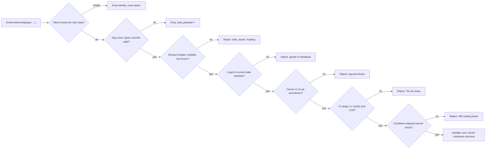

## 29. Security and Anti-Exploit

> **Owner:** A18 Data & Ops. **Binding inputs:** §C3 (interaction range 7/10 studs + 2-stud server
> tolerance, MOVE cap 20.8, prop caps), §C4 (MB/MS/RT only, cosmetic-only Robux), §C5 (stat caps),
> §C12 (combat constants), §C15 (server-time offline model), §C19 services, §C22 E2/E4/E7/E11/E12.
> Persistence-side guarantees (session lock, transaction IDs, receipts) live in §28; this section covers
> everything a hostile client can try at runtime. Our inspectors wear tiny hats and carry clipboards, but
> underneath they are a strict server-authority model.

### 29.1 Purpose

Assume **every client is compromised**: an exploiter can move their character anywhere, fire any remote
with any payload at any rate, read everything replicated to them, and run their own scripts. The game must
stay fair and the economy intact anyway, while **never punishing honest players on bad connections** —
most of our audience plays on phones over mobile data.

### 29.2 Rules & Mechanics (security principles)

| # | Principle |
|---|---|
| S1 | **The server owns every outcome.** Clients send *intents* ("interact with station 12, slot 2"), never results ("dish was PERFECT", "+500 MB"). |
| S2 | **Every remote passes the guard pipeline** (§29.10): rate → shape → session state → legality → ownership → range → cooldown, before any handler runs. |
| S3 | **Server time only.** Timers, cooldowns, cooking windows and offline elapsed time use server clocks (`os.clock()` for durations, `os.time()` for wall time). |
| S4 | **Identify things by server IDs**, not Instances: stations by `uid`, customers by proxy id, abilities by `ABL_` ID. Instance arguments, where unavoidable, are type-checked and ancestry-checked. |
| S5 | **Soft before hard.** Movement and timing anomalies are first corrected silently; flags accumulate for review; automatic kicks are reserved for blatant, unambiguous abuse. |
| S6 | **No client-trusted randomness.** Capsules, drops, incidents and crits roll on the server. |
| S7 | **Least replication.** Clients receive only what they render: no other players' wallets, no hidden order modifications before `ABL_064` reveals them, no RNG seeds. |
| S8 | **Kid-friendly enforcement.** Messages never accuse or shame; ban decisions beyond 24 h require a human. |
| S9 | **Defense in depth for money.** `EconomyService` checks (§28.17) + anomaly monitor (§29.14) + versioned rollback (§28.20). |
| S10 | **Measure false positives.** Every detector has an FP budget tracked in telemetry (§29.20, AC-29-02). |

### 29.3 Variables

| Variable | Value | Notes |
|---|---|---|
| Rate class `interact` | 10/s sustained, burst 20 [TUNABLE] | station & customer interactions, pick-up/drop |
| Rate class `chop` | 1 tap per 0.12 s, burst 10 | `Cooking.ChopTap` |
| Rate class `combat` | 8/s, burst 12 | ability/attack intents |
| Rate class `menu` | 4/s, burst 8 | shop browsing, inventory queries |
| Rate class `transaction` | 2/s, burst 4 | purchase, hire, upgrade, claim, collect |
| Rate class `cosmetic` | 3/s, burst 6 | emotes, pings (UnreliableRemoteEvent where possible) |
| Rate class `settings` | 2/s, burst 4 | `Settings.Update` |
| `SPAM_FLAG` / `SPAM_KICK` | 50 dropped calls / 10 s → flag; 500 / 60 s → kick | per player, all remotes |
| `MOVE_SAMPLE_S` | 0.25 s | server position sampling (4 Hz) |
| `MOVE_TOLERANCE` | ×1.30 + 4 studs per window | over the legal speed (§29.11) |
| `MOVE_CORRECT_AFTER` | 3 violations within 2 s | then one soft correction |
| `MAX_AIRTIME_S` | 3.0 s rising/hovering without an allowance | falling is always legal |
| `REWIND_MAX_S` | 0.15 s | lag-compensation rewind cap for hit checks |
| `HITS_PER_ATTACKER_PER_S` / `HITS_PER_TARGET_PER_S` | 12 / 4 [TUNABLE] | damage applications |
| `COOLDOWN_JITTER_S` | 0.05 s | early-fire tolerance on cooldowns |
| `ECON_FLAG_MULT` / `ECON_HOLD_MULT` | 3× / 6× canon §C4.4 net MB per active hour | §29.14 |
| `ECON_MIN_SAMPLE_MIN` | 20 active minutes | before rate rules evaluate |
| `GUEST_ANGER_FACTOR` | 0.25 [TUNABLE; §21 may override] | guest hits on non-hostile customers |
| `ALT_MIN_ACCOUNT_AGE_D` | 7 days | for owner-side co-op bonuses and ranked rewards |

### 29.4 UI

- **Rejected actions** never show "cheat detected". A rejected intent simply does not happen; if the player
  could plausibly have meant it (out of range, cooldown), `UIController` shows the normal gentle feedback
  ("Too far away!", "Still cooling down!").
- **Soft corrections** are a short rubber-band; no message.
- **Kick texts:** spam/blatant abuse — *"Whoa, the kitchen got overwhelmed! We sent you back to the lobby.
  Rejoin anytime."* Moderation kick — *"A Morph City inspector needs to check something. Please come back
  later!"*
- **Ban text** (Roblox Ban API `DisplayReason`): *"Our kitchen inspectors found something fishy with this
  account. You can cook again on the date shown."* No details that teach evasion.
- **Ops moderation console** (private ops place): per-player flag timeline, currency journal, offline report
  history, DataStore version list, rollback (§28.20.4), kick/ban/unban buttons with mandatory reason codes.

### 29.5 Progression (escalation ladder)

| Level | Trigger | Automatic action | Human action |
|---|---|---|---|
| 0 Info | single anomalies (sev 1) | log only | — |
| 1 Watch | ≥ 3 sev-2 flags in 24 h | `MMR_ModQueue` item; detectors log verbose | review within 72 h |
| 2 Hold | economy rule ≥ 6× or impossible-sequence chain | `moderation.econHold = true` (sources frozen, spending allowed) | review within 24 h; release or rollback |
| 3 Kick | spam ≥ 500/60 s; ≥ 10 blatant teleports/60 s after correction | kick with friendly text | — |
| 4 Ban | confirmed exploitation | none automatic | ladder §29.17 |

### 29.6 Player Interactions

- Owners control co-op permissions (`restaurant.coop`, §28.9.7) and can remove a guest instantly (§29.16).
- Players report others through Roblox's built-in Report Abuse; we do not build a parallel chat-report tool and
  we never log chat (§31.17).
- Arena PvP is opt-in (§21); anti-cheat there is symmetric to PvE combat validation (§29.12).

### 29.7 Dependencies

| Component | Kind | Owner | Used by |
|---|---|---|---|
| `RemoteGuard` | shared server library | A18 (this section) | every service exposing remotes (§C19) |
| `MovementSanity` | shared server library, started by the server bootstrap | A18 | allowances granted by `CombatService`, `RestaurantService` (door transitions), `MultiplayerService` (visits, arena), `CityEventService` (scale events), travel code |
| `AnomalyMonitor` | shared server library | A18 | subscribes to `EconomyService` journal + `OfflineEarningsService` reports |
| `SecurityLog` | shared server library | A18 | all of the above; persists via `PlayerDataService` (§28) |
| Hit validation, cooldown authority | inside `CombatService` | A6/A17 | spec in §29.12 |
| Cooking authority | inside `CookingService` | A2/A17 | spec in §29.13 |

These libraries are not new §C19 services; §27 places them in the tree. Roblox APIs: `Players:BanAsync`,
`Player:GetNetworkPing`, `Player.AccountAge`, `workspace:Raycast`, `workspace:GetPartBoundsInRadius`,
`MemoryStoreService`, `MessagingService`.

### 29.8 Threat Model

| ID | Threat | Vector | Impact | Primary mitigation | Detection |
|---|---|---|---|---|---|
| TM-01 | Speed / teleport / fly / noclip | client owns its character physics | reach stations/secrets instantly, escape fights | `MovementSanity` displacement + airtime + wall checks; soft correction (§29.11) | violation counters, `move_*` flags |
| TM-02 | Remote spam / flooding | fire remotes at thousands/s | server lag, brute-force races | token buckets per class; drop before parsing (§29.10) | `SPAM_FLAG`, `SPAM_KICK` |
| TM-03 | Forged / malformed payloads | NaN, huge numbers, wrong types, foreign Instances, deep tables | crashes, negative prices, out-of-bounds writes | schema validators; S4 server IDs; size/depth caps | `bad_payload` counter |
| TM-04 | Economy duping | race double-claims, replay purchases, reconnect tricks | inflation, unfair leaderboards | §28 transaction IDs, claim keys, session lock; one-step check+grant | `AnomalyMonitor`, journal audit |
| TM-05 | Reward forging | client sends "quest complete", "dish PERFECT", "+MB" | free progress | S1: server computes objectives, quality, payments | impossible-sequence rules |
| TM-06 | Combat cheating | reach, aimbot, no-cooldown, multi-hit, god mode | trivialize tantrums, arena unfairness | server hit resolution with rewind, LOS, caps; server HP (§29.12) | hit-rate & range-miss stats |
| TM-07 | Cooking automation | perfect-timing macros, instant chopping | inflated quality/income | server timers; tap spacing; ping-bounded fairness (§29.13) | perfect-rate statistics |
| TM-08 | Offline-time manipulation | device clock changes, forged timestamps, reconnect loops | infinite offline income | server `os.time()`; atomic report + `lastSimAt`; caps (§29.15) | `clock_skew` flags, payout bound check |
| TM-09 | Co-op griefing | guest breaks furniture, provokes customers, hogs stations | owner losses, frustration | permissions, Co-op Insurance (E12), guest anger factor, instant removal (§29.16) | guest disruption counters |
| TM-10 | Alt farming | alts feed co-op bonuses, arena win-trading | unearned rewards | account-age gates, per-guest daily caps, per-pair rating limits (§29.16) | pair-frequency analysis |
| TM-11 | Information leaks | reading replicated state (hidden mods, other wallets, seeds) | unfair advantage | S7 least replication; seeds never replicated | code review checklist |
| TM-12 | Server-to-client invoke abuse | client never answers `InvokeClient` | hung server threads | **no `RemoteFunction:InvokeClient`** anywhere; client→server functions time out | lint rule |
| TM-13 | Purchase spoofing | firing fake "purchase succeeded" remotes | free cosmetics | grants only from `ProcessReceipt` / `UserOwnsGamePassAsync` (§28.18) | unknown-receipt alerts |

### 29.9 Server-Authority Checklist

| Domain (brief Part 19.4 first) | Client may send | Server decides / validates | Owner service |
|---|---|---|---|
| **Currency changes** | nothing directly | every change is a `Txn` with `txnId`, integer deltas, non-negative balances (§28.17) | `EconomyService` |
| **Item purchases** (MB/MS/RT) | `offerToken` from a server-issued shop offer | token single-use & unexpired; price read from server catalog; level/tier requirement; balance | `EconomyService` + domain service |
| **Robux purchases** | prompt request only | grant only in `ProcessReceipt` after a committed save (§28.18) | `EconomyService` |
| **Mutation ownership** | equip/unequip/upgrade/fuse intents with `MUT_` IDs | part owned; level requirement (§C13.3); slot legality; not In Combat (E4); upgrade costs per §C4.6; fusion inputs owned and not `fav` | `MutationService` |
| **Combat damage** | `ABL_` ID + aim direction (+ optional target hint) | ability equipped; cooldown; status gates; hit volume, LOS, rewind; damage = server formula (§C5 STR/DEF) | `CombatService` |
| **Cooking results** | station `uid`, slot, verb; chop taps | server timers produce state & quality (§C8); station slot locks (E7); recipe step legality | `CookingService` |
| **Serving & payment** | "serve carried item to customer `id`" | carried item exists; customer seated & awaiting; satisfaction, pay & tip computed server-side (§C11) | `OrderService`, `CustomerAIService` |
| **Quest rewards** | claim intent with quest ID | objectives counted server-side from authoritative events; `COMPLETE → CLAIMED` once (§28.19) | `QuestService` |
| **Offline earnings** | collect intent with `reportId` | report computed at load from server time; claim idempotent (§C15, §28.19) | `OfflineEarningsService` |
| **Employee hiring** | candidate index on the current board | candidate exists & unhired; cost; employee cap of tier (§C6); balance | `EmployeeService` |
| **Restaurant upgrades** | tier/upgrade/station-level intents | requirements (level, permit quest for TIER_04+, §C6), costs, station tier gates (§C4.9) | `RestaurantService`, `BuildingService` |
| Furniture placement | object id, grid cell, rotation | owned/in storage; grid bounds; door-to-every-seat path connectivity (E10); slot counts | `BuildingService` |
| Repairs | repair intent on object `uid`; minigame inputs | object damaged; repair rate from §C5 REPAIR; cost charged once at completion (E3) | `RepairService` |
| Capsules | open intent | `capsules > 0`; server RNG with disclosed odds and pity 40 (§C4.7) | `MutationService` |
| Recipe learning | recipe ID | learnable at level; cost 5 × price (§C10); course/quest prerequisites | `RecipeService` |
| Co-op actions | same intents as owner | `MultiplayerService` permission matrix; guests never spend owner currency (E12) | `MultiplayerService` |
| Travel / teleports | destination id | discovered station (Metro), fee (Pigeon Taxi), cooldown (Return Door 10 s) | travel code + `MovementSanity.expectTeleport` |
| Settings | settings table | whitelist keys, clamp numbers (§28.9.13) | `PlayerDataService` |

### 29.10 Remote Validation Framework (`RemoteGuard`)

Every client→server remote is bound through `RemoteGuard.bind`; binding a remote any other way fails a CI
lint. Remote names follow §C2 (`<Domain>.<Action>`, e.g. `Cooking.InteractStation`, `Combat.UseAbility`,
`Offline.Collect`); §27 holds the authoritative list. Server→client `RemoteFunction:InvokeClient` is banned
(TM-12); client→server `RemoteFunction`s are allowed only for read-only queries and are guarded identically.



| Stage | Check | Failure handling |
|---|---|---|
| 1 Rate | per-player token bucket per class (§29.3); evaluated before any parsing | silent drop; counts toward `SPAM_FLAG`/`SPAM_KICK` |
| 2 Shape | exact arg count; per-arg validator; numbers finite (`x == x`, not ±inf), integers where required, strings ≤ declared length, tables ≤ 32 keys and depth ≤ 2, `Vector3` components finite and magnitude-bounded, Instances by `typeof` + `IsDescendantOf` | drop; `bad_payload` counter (sev 1; sev 2 after 20/min) |
| 3 Session | profile loaded, not Safe Mode (§28.16), not lock-lost, not `econHold` for earning actions | reject with reason; no strike |
| 4 Legality | the owning service's state machine allows the verb now (station slot state, customer state, In Combat for menus E2/E4) | reject + gentle UI; `impossible_sequence` only when the client could not have legitimately believed it legal |
| 5 Ownership | target belongs to the player's restaurant, or `MultiplayerService` grants the guest that verb (E12) | reject; `permission` log |
| 6 Range / LOS | stations 7 + 2 studs, customers 10 + 2 studs (§C3), measured from the server-side character position; LOS raycast for combat and throws | reject "Too far away!" |
| 7 Cooldown | server timestamps per ability/action; early by ≤ `COOLDOWN_JITTER_S` accepted (and the next cooldown starts from the accepted time) | reject "Still cooling down!" |

```lua
--!strict
-- ServerScriptService/Shared/RemoteGuard.lua (excerpt)
local Players = game:GetService("Players")
local SecurityLog = require(script.Parent.SecurityLog)

export type RateClass = "interact" | "chop" | "combat" | "menu" | "transaction" | "cosmetic" | "settings"
export type Validator = (value: any) -> boolean
export type Context = {
	isWritable: (Player) -> boolean,   -- loaded, not Safe Mode, lock held (§28)
	isFrozen: (Player) -> boolean,     -- moderation.econHold
}
export type Spec = {
	name: string,                      -- "<Domain>.<Action>" (§C2)
	rate: RateClass,
	args: { Validator },               -- positional; extra or missing args are rejected
	earns: boolean,                    -- true = rejected while econHold (§29.14)
	handler: (player: Player, ...any) -> (),  -- stages 4-7 run inside, using helpers below
}

local RATES: { [RateClass]: { rate: number, burst: number } } = {
	interact = { rate = 10, burst = 20 }, chop = { rate = 1 / 0.12, burst = 10 },
	combat = { rate = 8, burst = 12 }, menu = { rate = 4, burst = 8 },
	transaction = { rate = 2, burst = 4 }, cosmetic = { rate = 3, burst = 6 },
	settings = { rate = 2, burst = 4 },
}

type Bucket = { tokens: number, last: number }
local buckets: { [Player]: { [string]: Bucket } } = {}

local function take(player: Player, class: RateClass): boolean
	local mine = buckets[player]
	if mine == nil then
		mine = {}
		buckets[player] = mine
	end
	local cfg = RATES[class]
	local now = os.clock()
	local b = mine[class]
	if b == nil then
		b = { tokens = cfg.burst, last = now }
		mine[class] = b
	end
	b.tokens = math.min(cfg.burst, b.tokens + (now - b.last) * cfg.rate)
	b.last = now
	if b.tokens < 1 then
		return false
	end
	b.tokens -= 1
	return true
end

local RemoteGuard = {}

function RemoteGuard.bind(remote: RemoteEvent, spec: Spec, ctx: Context)
	remote.OnServerEvent:Connect(function(player: Player, ...: any)
		if not take(player, spec.rate) then
			SecurityLog.count(player, "rate_drop", spec.name)
			return
		end
		local n = select("#", ...)
		if n ~= #spec.args then
			SecurityLog.count(player, "bad_payload", spec.name)
			return
		end
		for i, validate in spec.args do
			if not validate((select(i, ...))) then
				SecurityLog.count(player, "bad_payload", spec.name)
				return
			end
		end
		if not ctx.isWritable(player) or (spec.earns and ctx.isFrozen(player)) then
			return
		end
		spec.handler(player, ...)
	end)
end

-- Stage 6 helper: canon range + 2-stud server tolerance (§C3), from the server's view of the character.
function RemoteGuard.inRange(player: Player, target: Vector3, range: number): boolean
	local character = player.Character
	local root = character and character:FindFirstChild("HumanoidRootPart") :: BasePart?
	return root ~= nil and (root.Position - target).Magnitude <= range + 2
end

Players.PlayerRemoving:Connect(function(player: Player)
	buckets[player] = nil
end)

return RemoteGuard
```

Validators come from a small library (`V.int(lo, hi)`, `V.number(lo, hi)`, `V.str(maxLen)`,
`V.enum({...})`, `V.catalogId(kind)` — checks the string against the server catalog, e.g. that an ability ID
exists in §36.6 — `V.unitVector()`, `V.optional(v)`). Example binding:
`Combat.UseAbility` = `{ rate = "combat", args = { V.catalogId("ability"), V.unitVector(), V.optional(V.int(0, 2^31)) } }`.

### 29.11 Movement Validation (`MovementSanity`)

Clients own their character physics (Roblox default network ownership), so the server samples each
`HumanoidRootPart` every `MOVE_SAMPLE_S` = 0.25 s and compares against the **legal envelope**:

`vLegal = MovementRules.maxSpeed(player)` — the same shared module that sets `Humanoid.WalkSpeed`:
`16 × (1 + 0.003 × MOVE)` capped at **20.8 studs/s** (§C5), × any sprint multiplier §18 defines for the
city, × event scale (`EVT_015` Tiny Day / `EVT_016` Giant Day, supplied by `CityEventService`).
**Allowed horizontal displacement since the last valid anchor** = `vLegal × Δt × 1.30 + 4 studs + allowance`,
where `Δt` is measured from the anchor's timestamp — so a lag stall followed by a burst of movement is judged
against the whole stalled interval, not one sample (no false positives on lag).

| Source of extra movement | Allowance granted (server-side, by the system that caused it) |
|---|---|
| Mobility abilities: `ABL_004` Dodge Roll, `ABL_063` Cheetah Dash, `ABL_046` Comet Blink, `ABL_013` Rhino Charge, `ABL_027` Armadillo Roll, `ABL_011` Kangaroo Kick, `ABL_044` Gust Kick, `ABL_037` Jelly Bounce, `ABL_055` Mole Burrow | `CombatService` grants (ability max travel from §36.6 + 3 studs) for the ability duration + 0.5 s, only after it validated the activation |
| Hover / flight: `ABL_022` Flap Hover, `ABL_069` Hover Serve, `STS_FLOATING` | airtime allowance for the duration; vertical limit = the ability's hover height (§36.6) + 2 studs |
| Phasing: `ABL_059` Ghost Phase | wall-crossing allowance for its duration, only if §36.6 defines it as phasing |
| Forced movement: knockback (`ABL_002`, `ABL_010`, `ABL_052`, `ABL_058`…), pulls (`ABL_016` Tongue Yank, `ABL_033` Magnet Pull, `ABL_045` Tractor Beam, `ABL_060` Kraken Grasp), `ABL_005` Grab & Throw, `STS_KNOCKDOWN` | the server computes the displacement it applies and grants the **victim** that distance + 3 studs for 1.0 s |
| Server teleports: interior door, Return Door, Morph Metro, Pigeon Taxi, respawn after Seeing Stars, soft shutdown, co-op removal | `expectTeleport(player, cframe, 2 s)`: the first sample within 8 studs of the target becomes the new anchor |
| Arena place | same envelope; first blatant violation is already sev 2 |

**Checks per sample:** (1) horizontal displacement vs allowed; (2) **rise** above `Humanoid.JumpHeight × scale
+ 2 studs` over the last ground contact without an allowance; (3) **airtime** — `FloorMaterial == Air` with
vertical velocity ≥ −1 stud/s for > 3.0 s (falling is always legal); (4) **noclip** — a raycast from anchor
to current position against the `World` collision group hitting a collidable non-door part with > 1 stud of
path beyond it; (5) **interior bounds** — inside an instanced interior, leaving its bounds (+4 studs) other
than through the door.

**Response:** a violation does not move the anchor. **3 violations within 2 s → one soft correction**
(`HumanoidRootPart:PivotTo(anchor)`, velocity zeroed) — honest players see at most a tiny rubber-band.
5 corrections in 60 s → `move_anomaly` (sev 2). A displacement > 10× allowed is *blatant*
(`move_blatant`, sev 2); ≥ 10 blatant events in 60 s → automatic kick (level 3). Movement alone never
triggers a ban without human review. Players with `GetNetworkPing() > 0.5 s` have flags (not corrections)
suppressed until ping recovers.

### 29.12 Combat Validation

Client sends `Combat.UseAbility(abilityId, aimDir, targetHint?)`; the client plays predicted VFX and the
animation immediately for feel, but **only the server applies hits**.

1. **Activation:** the ability is on the ability bar and comes from an *equipped* part (§C12.1, max 4 mutation
   abilities + base kit `ABL_001`–`ABL_008`); cooldown elapsed on the server clock (−0.05 s jitter);
   not disabled by `STS_STUN`, `STS_DIZZY`, `STS_FROZEN`, `STS_KNOCKDOWN` or Seeing Stars; utensil abilities
   (`ABL_007`, `ABL_008`) require the held utensil.
2. **Hit resolution (server):** the hit volume (range/arc/radius from §36.6) is evaluated with
   `workspace:GetPartBoundsInRadius` / shapecasts against customer **proxies** (SPCV) and, in arena,
   characters — after **rewinding targets** to `now − min(GetNetworkPing() / 2, 0.15 s)` using a 1 s position
   history sampled at 10 Hz. `targetHint` is only a tie-breaker, never a guarantee.
3. **Range & LOS:** target within ability range + 2 studs at the rewound time; a raycast from attacker head to
   target center not blocked by `World` geometry (thrown food uses the same scripted-arc raycast as the
   visual, §C3).
4. **Rate caps:** ≤ `HITS_PER_TARGET_PER_S` = 4 and ≤ `HITS_PER_ATTACKER_PER_S` = 12 damage applications
   (the 3-hit `ABL_001` combo at 0.35 s/hit is ≈ 2.9/s; multi-target abilities like `ABL_012` Octo-Flurry stay
   under the attacker cap). Excess hits are discarded.
5. **Damage & effects:** computed server-side: base × `(1 + 0.008·STR)` × target `100 / (100 + DEF)` (§C5), block
   −70 %, status effects per §36.7. HP, Huff Points, guard meter and KO state exist only on the server.
6. **Statistics:** per-session range-miss ratio, cooldown-early ratio and hit rate are logged; > 30 % of
   attempts rejected for range or cooldown across ≥ 100 attempts → `combat_anomaly` (sev 2).

### 29.13 Cooking Validation

- **Server timers only.** Putting an item on a heat station stores `placedAt = os.clock()` on the server; the
  item's state (UNDERCOOKED → cooked → Perfect window → BURNED → ON_FIRE, §C8) is a function of server time,
  station level (§C4.9) and the cook's COOK_SPD/COOK_QLT (§C5). Clients render a predicted progress bar
  driven by replicated `placedAt` and multipliers; they never report doneness.
- **Fair removal under latency:** a removal intent arriving at server time `t` is evaluated at
  `t − min(GetNetworkPing() / 2, 0.10 s)` — bounded, and only ever in the player's favor, so a phone on 4G is
  not robbed of a Perfect it saw on screen.
- **Chopping:** taps must be ≥ 0.12 s apart (rate class `chop`); the timing ring phase is computed by the
  server from the chop start time with the same bounded ping offset; Auto-Rhythm scores every tap 0.8 (§C8).
  > 98 % "Clean cut" over ≥ 200 taps in a session → `chop_perfect_anomaly` (sev 1, info only — some players are
  simply that good).
- **Legality:** station slot locks per slot (E7); a verb must match the station kind and the item's current
  state; assembly order is compared server-side against the recipe (§6); carry capacity ≤ 3 (§C3).
- **Outcomes:** food quality `Q`, satisfaction `S`, pay and tips (§C8, §C11) are computed by
  `CookingService`/`CustomerAIService`/`OrderService` from server state. A serve intent references the carried
  item and the customer id; the server checks both exist and match.

### 29.14 Economy Integrity and Anomaly Detection (`AnomalyMonitor`)

**Metric.** *Active net income rate* = Σ(customer payments + tips + quest/event MB) − (ingredient costs +
online wages) over the **rolling last 60 active minutes** (a minute is active if the player had an accepted
intent in it), divided by the current `EventMult` so event bonuses do not trip it. Offline collects, the
Welcome Back Crate and Robux cosmetics are excluded (validated separately). Rules evaluate only after
`ECON_MIN_SAMPLE_MIN` = 20 active minutes in the session.

| Tier | Canon net MB / active hour (§C4.4) | Flag at 3× (sev 2) | Earnings hold at 6× (sev 3) |
|---|---|---|---|
| `TIER_01` | 630 | 1,890 | 3,780 |
| `TIER_02` | 1,080 | 3,240 | 6,480 |
| `TIER_03` | 1,730 | 5,190 | 10,380 |
| `TIER_04` | 3,100 | 9,300 | 18,600 |
| `TIER_05` | 5,400 | 16,200 | 32,400 |
| `TIER_06` | 9,600 | 28,800 | 57,600 |
| `TIER_07` | 17,400 | 52,200 | 104,400 |
| `TIER_08` | 32,800 | 98,400 | 196,800 |
| `TIER_09` | 63,700 | 191,100 | 382,200 |
| `TIER_10` | 120,500 | 361,500 | 723,000 |

| Rule | Condition | Action |
|---|---|---|
| E-R1 | active net rate > 3× tier expectation | `econ_rate_3x` (sev 2), verbose journal logging for 24 h |
| E-R2 | active net rate > 6× | `moderation.econHold = true` (earning remotes rejected as `frozen`; spending and play still work; banner-free), `econ_rate_6x` (sev 3), review ≤ 24 h |
| E-R3 | any single credit above the largest legal grant for its source (e.g. a tip above the Jackpot cap of 500 / 5,000 MB, §C11.4) | reject the credit, sev 3 engineering alert (a server bug or a bypassed code path) |
| E-R4 | MS or RT earned per active hour > 3× the tier cohort's p95 (refreshed weekly from §31 data) | sev 2 |
| E-R5 | any RT credit whose source is offline (§C4.1: RT is never offline) | hard reject, sev 3 |
| E-R6 | wallet change between two saves ≠ Σ journal deltas for that window | sev 3 integrity alert (engineering) |
| E-R7 | offline net > 0.60 × tier active rate × simulated hours (§C15 "never above 60 %") | clamp the report to the bound, engineering alert (simulation bug, never the player's fault) |
| E-R8 | impossible sequence (list below); 3 within 10 min | sev 2 each; the third → hold (E-R2 path) |

**Impossible sequences** (each implies a forged remote or a server bug): serving a dish the player is not
carrying; claiming a quest not `COMPLETE`; collecting with no pending report; opening a capsule with
`capsules = 0`; hiring beyond the tier employee cap; a station level above its tier gate (§C4.9); a TIER_04+
upgrade without the City Hall permit quest (§C6); equipping an unowned part or one above its level
requirement; more serves in an hour than `seats × 3600 / minimum eat time` allows; learning a recipe above
the player's level.

**Reversal.** Confirmed exploited gains are reversed by journal-based compensating transactions
(`src = "mod_reversal"`, idempotent `txnId = "rev:<caseId>:<n>"`) or, for broad damage, by a version rollback
(§28.20.4). Paid cosmetics are never removed as punishment.

### 29.15 Offline-Time and Clock Integrity

- Offline elapsed time is `now − lastSimAt` with both values from **server** `os.time()` (§C15); the client's
  device clock is never read. Changing a phone's clock does nothing.
- Report and `lastSimAt` commit in one session-locked write (§28.14); an interval is never simulated twice,
  so **rejoin loops cannot multiply earnings** — 50 rejoins in an hour simulate, in total, at most that hour.
- **Splitting requirement on §17:** dividing an absence into many short intervals must not raise expected
  rewards: per-step incident/discovery chances scale with step length and the ≤ 1 capsule/day rule uses
  `offline.lastCapsuleDay` (§28.9.11). If §17 needs a fractional accumulator, it is added to the `offline`
  block (schema-additive, §28.5).
- Negative elapsed time → `H = 0`; beyond 120 s of skew → `clock_skew` (sev 1) — this flags *servers*, so
  ops can spot a bad host, not players.
- Daily/weekly resets use server UTC DayStamp/WeekStamp (§C3).

### 29.16 Co-op Griefing and Alt Farming

**Co-op guests** (permissions from `restaurant.coop`, enforced by `MultiplayerService`):

| Guests may (if the owner allows) | Guests may never |
|---|---|
| cook, serve, clean, repair, defend (fight hostile customers) | sell, move or store owner furniture; change the menu; hire/fire/assign staff; buy upgrades; spend owner currency; collect the owner's offline report (§C22 E12) |

- **Damage** a guest causes (or customers cause during co-op) is repaired free by **Co-op Insurance** after the
  visit (E12) — griefing cannot cost the owner money.
- **Provocation:** guest hits on non-hostile customers add anger × `GUEST_ANGER_FACTOR` (0.25; §21 may refine);
  no player-vs-player damage outside the arena (§21).
- **Station hogging:** a slot locked by an idle guest (no input for 20 s [TUNABLE]) auto-releases (E7).
- **Removal:** the owner's "Show them the door" button instantly moves a guest to the street and blocks
  re-entry to that restaurant for 10 min [TUNABLE]. A guest disruption score (furniture damage dealt +
  provocations) above threshold within 2 min auto-removes the guest and notifies the owner.

**Alt farming.** Canon defines no player-to-player transfer of currency or parts, so alts cannot funnel
wealth; their only value is in social rewards. Controls: owner-side co-op bonuses count only guests with
`Player.AccountAge ≥ 7` days, once per guest per owner per UTC day, at most 5 distinct guests per day
[TUNABLE]; guest reward accrual stops after a daily cap set by §21; arena rated matches are limited to 3 per
opponent pair per day and accounts younger than 3 days play unranked; alternating win patterns between the
same pair (> 6 per day) raise `pair_farming` (sev 2). Bans are issued with `ExcludeAltAccounts = false` so
Roblox extends them to detected alternate accounts. If §21/§22 ever add gifting, it must be a two-party
`EconomyService` transaction with account-age and daily caps.

### 29.17 Logging, Moderation Tooling, Ban/Kick Policy

`SecurityLog.flag(player, code, sev, ctx)` writes (1) the in-profile ring `moderation.flags` (25), (2) for
sev ≥ 2 an item on `MMR_ModQueue` plus a `MOD_LOG` pending op to `MMR_Moderation_v1` (§28.20.2), and (3) a
counter to analytics (`mmr_security_flag`, code + sev only, §31). `ctx` holds numbers and IDs only — never
chat or free text.

| Code | Sev | Source |
|---|---|---|
| `rate_drop` / `bad_payload` | 1 (2 when sustained) | §29.10 |
| `move_anomaly` / `move_blatant` | 2 | §29.11 |
| `combat_anomaly` | 2 | §29.12 |
| `chop_perfect_anomaly` | 1 | §29.13 |
| `econ_rate_3x` / `econ_rate_6x` | 2 / 3 | §29.14 |
| `impossible_sequence` | 2 | §29.14 |
| `clock_skew` | 1 | §29.15 (server health) |
| `guest_disruption` / `pair_farming` | 2 | §29.16 |
| `receipt_unknown` | 3 (engineering) | §28.18 |

**Moderation console** (ops place, group-rank + allowlist gated, every action audit-logged): flag timeline,
journal, offline report history, version list and rollback, kick, ban/unban, econ-hold release.

**Kick policy (automatic):** only for `SPAM_KICK`, ≥ 10 blatant teleports in 60 s, lock loss, Safe Mode
timeout, erasure and moderator action — always with the friendly texts of §29.4.

**Ban ladder (human-confirmed only):**

| Offense | Action |
|---|---|
| 1st confirmed exploit | 1-day ban + reversal of exploited gains |
| 2nd | 7-day ban + reversal |
| 3rd | 30-day ban + reversal |
| 4th, or distributing/mass-using a dupe | permanent ban |

```lua
--!strict
-- Ops place: issue a ban decided by a moderator (never called by automated detectors).
local Players = game:GetService("Players")

local function issueBan(userId: number, durationS: number, caseId: string)
	local config = {
		UserIds = { userId },
		ApplyToUniverse = true,
		Duration = durationS,              -- -1 = permanent
		DisplayReason = "Our kitchen inspectors found something fishy with this account. "
			.. "You can cook again on the date shown.",
		PrivateReason = "case " .. caseId, -- internal reference only; no personal data
		ExcludeAltAccounts = false,        -- extend to detected alternate accounts
	}
	local ok, err = pcall(function()
		Players:BanAsync(config)
	end)
	if not ok then
		warn("[Moderation] BanAsync failed for case", caseId, err)
	end
end
```

Never: public shaming or naming players, automated bans longer than a kick, fines beyond reversing exploited
gains, removal of purchased cosmetics.

### 29.18 Exploit Test Cases

| ID | Attempt | Harness method | Expected result |
|---|---|---|---|
| XT-01 | Speed hack (WalkSpeed ×2) | exploit-sim client sets `WalkSpeed = 42` | soft correction within 1.0 s; `move_anomaly` after 5 corrections/60 s |
| XT-02 | Teleport 300 studs to a secret | client `PivotTo` | snapped back within 0.75 s; `move_blatant` |
| XT-03 | Fly / hover 10 s | client `BodyVelocity` up | corrected at 3.0 s airtime |
| XT-04 | Noclip through kitchen wall | client disables collisions | snapped back to anchor; flag |
| XT-05 | Legit chain: `ABL_063` Cheetah Dash then `ABL_046` Comet Blink | real abilities | 0 violations, 0 corrections |
| XT-06 | 2 s lag spike at 600 ms ping, then catch-up | network conditioner | 0 corrections (stall-aware Δt) |
| XT-07 | `Shop.Purchase` fired 1,000×/s | script flood | ≤ burst processed; kick at 500 drops/60 s; server Heartbeat ≥ 45 Hz throughout |
| XT-08 | NaN / ±inf / 1e308 arguments | forged payloads | dropped at stage 2; 0 state change |
| XT-09 | Interact with another player's station uid | forged uid | rejected at ownership stage |
| XT-10 | Two concurrent quest claims | parallel remotes | exactly 1 grant |
| XT-11 | Replay an old `reportId` on Collect | forged remote | no-op |
| XT-12 | Device clock +24 h | OS clock change | 0 extra offline time |
| XT-13 | 50 rejoins in 30 min | scripted rejoin | Σ offline payout ≤ legal bound for elapsed time; ≤ 1 offline capsule per day |
| XT-14 | Ability spam ignoring cooldown | forged remotes | only cooldown-compliant activations apply |
| XT-15 | Reach: hit at 2× range | forged aim + hint | 0 damage |
| XT-16 | Hit through a wall | forged target hint | rejected by LOS |
| XT-17 | 50 hits/s on one customer | flood | capped at 4/target/s, 12/attacker/s |
| XT-18 | Claim "PERFECT" dish quality | forged cooking payload | no such field accepted; quality from server timers |
| XT-19 | Chop macro at 0.05 s | flood | 1 tap per 0.12 s accepted |
| XT-20 | Guest sells/moves owner furniture or spends owner MB | guest client | rejected (E12) |
| XT-21 | Guest provokes customers with thrown food | guest client | anger × 0.25; auto-removal at threshold |
| XT-22 | Fake "purchase succeeded" remote | forged remote | no grant (only `ProcessReceipt` grants) |
| XT-23 | Hire the same candidate twice concurrently | parallel remotes | 1 hire (`hiredMask`) |
| XT-24 | Equip an unowned `MUT_` part | forged remote | rejected |
| XT-25 | Open a full-screen shop while In Combat (E2) | forged remote | rejected "Can't shop during a brawl!" |
| XT-26 | Two players grab the same station slot (E7) | two clients | one lock holder; the other gets "Slot busy" |

### 29.19 Edge Cases

| # | Situation | Behavior |
|---|---|---|
| SE-01 | Player on a moving platform / escalator (Monster Mall) | platform velocity is added to `vLegal` by `MovementRules`; no violation |
| SE-02 | Seated in a Pigeon Taxi or Metro car | movement checks paused while the server-owned seat drives; `expectTeleport` at arrival |
| SE-03 | Server hitch (frame > 100 ms) | that sample is skipped; Δt always from server clock |
| SE-04 | Roblox reset button | disabled (`StarterGui:SetCore("ResetButtonCallback", false)`); KO is the custom Seeing Stars flow (§C12.1) |
| SE-05 | Knockback into a wall then a server correction | knockback allowance prevents a double snap; corrections never fire during an active allowance |
| SE-06 | High-ping player (> 500 ms) | flags suppressed until ping recovers; rewind capped at 0.15 s; cooking fairness capped at 0.10 s |
| SE-07 | Legit big earner during `EVT_003` Citywide Restaurant Rush | rate normalized by `EventMult`; no flag |
| SE-08 | Jackpot tip streak on a lucky player | tips are capped per §C11.4 and counted in the rolling hour; one jackpot cannot reach 3× alone |
| SE-09 | Guest disconnects mid-visit after causing damage | Co-op Insurance still repairs at visit end (owner side) |
| SE-10 | Moderator bans a player who is online | `BanAsync` removes them; the leave save runs normally (§28) |
| SE-11 | Hold applied while the player has a pending offline report | collect is an earning action → rejected as `frozen` until review; the report stays pending, nothing is lost |

### 29.20 Acceptance Criteria

- **AC-29-01:** 100 % of client→server remotes are bound through `RemoteGuard.bind` (CI lint fails the build otherwise), and no `RemoteFunction:InvokeClient` call exists in server code.
- **AC-29-02:** Movement false positives: across 500 honest bot-hours on simulated 4G (150–400 ms ping, 2 % packet loss) with all mobility abilities in use, soft corrections ≤ 1 per player-hour and 0 `move_blatant` flags.
- **AC-29-03:** XT-01 to XT-04 are corrected within the stated times in 100 % of 100 runs each.
- **AC-29-04:** A remote flood of 1,000 calls/s from one client keeps server Heartbeat ≥ 45 Hz and triggers the kick within 60 s.
- **AC-29-05:** Forged payloads (NaN, inf, wrong types, 10 KB strings, depth-5 tables, foreign Instances) produce 0 state changes and 0 server errors across a 10,000-case fuzz run.
- **AC-29-06:** Combat hits beyond range + 2 studs, through `World` geometry, or above 4/target/s or 12/attacker/s apply 0 damage in 100 % of XT-15 to XT-17 runs.
- **AC-29-07:** Cooking quality is a function of server state only: replaying identical server timings with arbitrary client payload values yields identical quality grades (1,000 trials).
- **AC-29-08:** A player earning > 3× the §C4.4 rate for their tier over 60 active minutes receives exactly one `econ_rate_3x` flag; > 6× sets `econHold` within 60 s of crossing the threshold.
- **AC-29-09:** XT-12 and XT-13 produce 0 MB beyond the legal offline bound and ≤ 1 offline capsule per UTC day.
- **AC-29-10:** Guests cannot perform any "may never" action of §29.16 (0 successes in 200 attempts per action), and guest-caused damage costs the owner 0 MB after the visit.
- **AC-29-11:** No automated detector issues a ban; every `BanAsync` call originates from the ops console with a case ID and moderator identity in the audit log.
- **AC-29-12:** Every player-facing enforcement text matches §29.4 wording and contains no accusation words ("cheat", "hack", "exploit") — verified by a string scan of the localization table.
- **AC-29-13:** RT credited from any offline source is rejected 100 % of the time (E-R5) in fault-injection tests.
- **AC-29-14:** Of a 20-person honest playtest cohort over 10 h, 0 players receive sev ≥ 2 flags (detector false-positive budget).
