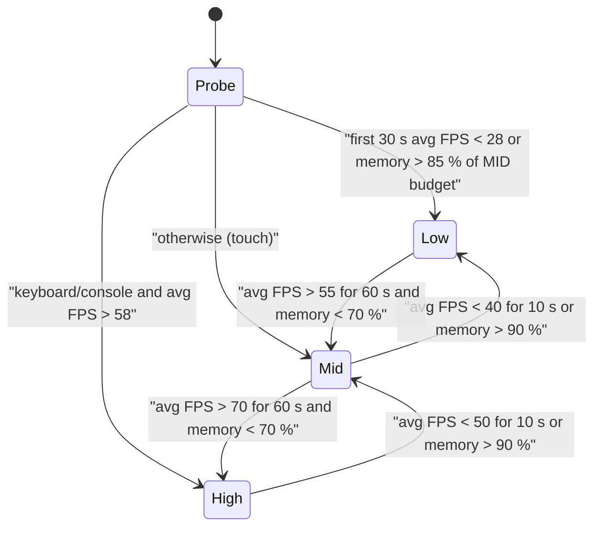

## 30. Performance Optimization

> **Owner:** A18 Data & Ops. **Binding inputs:** §C3 (8 players/server; customer cap = seats + 4 queue per
> restaurant, max 28; server hard cap 160 customer proxies; **SPCV** pattern; ≤ 30 loose props per interior;
> thrown food = scripted arc; debris client-only, 4 s), §C6 (seats/employee caps per tier), §C13.7 (morph rig
> & part budgets), §C19 services. The chaos is the product — a level-6 restaurant brawl with 28 mutants must
> still run at 30 FPS on a three-year-old phone. Everything here is about making ridiculous cheap.

### 30.1 Purpose

Guarantee a smooth, readable game on the weakest devices our audience actually uses (low-end Android and
older iPhones), keep servers healthy with 8 fully upgraded restaurants, and give the team budgets, tools and
tests that catch regressions before players do.

### 30.2 Rules & Mechanics (performance principles)

| # | Principle |
|---|---|
| R1 | **Server simulates, client decorates.** The server holds cheap invisible proxies and state; every morph visual, animation, debris piece and crowd walker is client-side (SPCV, §C3). |
| R2 | **Anchored by default.** Physics is the exception: only ≤ 30 loose props per interior, briefly, server-owned. |
| R3 | **Compute once, replay everywhere.** Paths are baked; movement is replicated as segments clients interpolate with the shared server clock, not as per-frame CFrames. |
| R4 | **Budgets are per device tier** and enforced at runtime by the client `QualityManager` module (§30.19). |
| R5 | **Pool everything that spawns repeatedly** (§30.18). No `Instance.new`/`Destroy` churn in hot paths. |
| R6 | **Only replicate what the client renders**: interest is the player's current interior or district (StreamingEnabled + event filtering). |
| R7 | **Measure in the field**: performance telemetry from real sessions (§30.20, §31) is the source of truth, not Studio on a gaming PC. |

### 30.3 Variables (master budget table)

| Budget | LOW tier | MID tier | HIGH tier | Notes |
|---|---|---|---|---|
| Target FPS (p50 / p5) | **30 / 25** | 45 / 35 | 60 / 50 | client, in a full TIER_10 rush |
| Client memory (`Stats:GetTotalMemoryUsageMb()`) | ≤ 900 MB | ≤ 1,400 MB | ≤ 2,500 MB | hard alarm at +15 % |
| Rendered triangles (scene) | ≤ 250,000 | ≤ 500,000 | ≤ 1,000,000 | Shift+F2 render stats |
| Full-detail NPC visuals | 12 | 24 | 40 | beyond the cap → impostor regardless of distance |
| Max NPC visuals (incl. impostors) | 40 | 56 | 80 | interior worst case = 28 customers + 20 staff |
| City crowd walkers (client-only) | 10 | 20 | 36 | [TUNABLE] |
| Concurrent particles | 400 | 1,000 | 2,000 | sum of live particles |
| Debris pool / per event | 24 / 8 | 48 / 12 | 96 / 16 | 4 s lifetime (§C3) |
| Server Heartbeat | **≥ 45 Hz** sustained (target 60) | | | `1000 / Stats.HeartbeatTimeMs` |
| Server gameplay script time | ≤ 8 ms avg, ≤ 12 ms p95 per Heartbeat | | | per-system split confirmed from §27.13 (§30.9) |
| Server memory | ≤ 3,500 MB | | | alarm 4,500 MB |
| Network server → client per player | ≤ **40 KB/s** avg, ≤ 80 KB/s 2-s burst | | | `Stats.DataReceiveKbps` on client |
| Network client → server per player | ≤ 6 KB/s avg, ≤ 12 KB/s burst | | | |
| Join → `UI.Ready` (reference LOW phone) | p50 ≤ 10 s, p95 ≤ 20 s | | | §27.11 join budget |
| Server-wide moving primitives | ≤ 120 | | | `Stats.MovingPrimitivesCount` |

### 30.4 UI

- **Settings → Graphics:** `Auto` (default) / `Low` / `Medium` / `High`, persisted in `settings.graphicsTier`
  (§28.9.13); the `uiSettings.reducedVfx` toggle halves particle and debris budgets and `screenShakeOff`
  removes camera shake, independent of the tier.
- When auto-scaling drops a tier, a 3 s toast: *"Kitchen got crowded — simplifying the view to keep things
  smooth."* (once per session; never during combat).
- **Developer overlay** (ops/QA allowlist only, toggled by a chat-free keybind): FPS, frame ms, memory by tag,
  KB/s in/out, visuals full/impostor counts, current quality tier.

### 30.5 Progression

Load grows with the player's tier, so performance is specified against the **worst case per tier** from §C6:
TIER_10 = 24 seats + 4 queue = 28 customers and 20 employees in one interior. The server worst case is 8
TIER_10 restaurants: 8 × 28 = 224 desired customers, clipped by the **160-proxy server hard cap** (§C3), plus
up to 8 × 20 = 160 employees. When the cap binds, §27.14's fair-share allocator applies
(`cap_i = min(seats_i + 4, floor(160 × w_i / Σw))`, queues shrink before seats: eight TIER_10 restaurants get 20
customers each); on-floor employee proxies have a server soft cap of 120, beyond which extra staff work "in the
back room" with identical outputs (§27.14).

### 30.6 Player Interactions

Players only notice performance through smoothness. They can override the graphics tier; they cannot raise
budgets above HIGH. Co-op guests render the host interior with their *own* tier budgets.

### 30.7 Dependencies

| System | Performance responsibility |
|---|---|
| `CustomerAIService` | proxy lifecycle, arrival distribution under the 160 cap, path following, attribute replication |
| `EmployeeService` | employee proxies, work AI at decimated tick rates |
| `MorphAssemblyService` | player morph builds (server), shared `MorphBuilder` code path |
| `MorphVisualController` (client, §27.9) | SPCV visual builds (≤ 1 per frame), impostors, interpolation, rig and part pools |
| `BuildingService` | nav-grid bake on layout commit (E10 connectivity) |
| `CombatService` | hit queries against proxies, projectile arcs |
| `RepairService` | damage-state swaps; destruction events → client debris |
| `UIController` | virtualized lists, pooled UI elements, `QualityManager` settings UI |
| Client modules `VisualPool`, `AnimCache`, `BillboardPool` (§27.4.3) + `QualityManager` (new, `Client/Modules`) | pooling, track caching, quality tiers |

### 30.8 Performance Budgets by Platform

| Platform | Reference devices (test lab) | Default tier | Primary risk |
|---|---|---|---|
| Low-end Android | 3 GB RAM, Adreno 610 / Mali-G52 class (2019–2021) | LOW | memory kills, GPU fill-rate |
| Older iPhone | iPhone 8 / SE (2nd gen), 2–3 GB | LOW | memory ceiling, thermal throttling |
| Mid phone / tablet | 4–6 GB Android, iPad 9th gen | MID | thermal throttling over 20 min |
| Laptop / desktop | integrated GPU laptops → gaming PCs | MID/HIGH | none significant |
| Console | Xbox One-class and newer | MID (One) / HIGH | 10-foot UI readability, not GPU |

**Frame-time split (LOW, 33.3 ms):** render ≤ 18 ms, client scripts ≤ 6 ms (SPCV visual updates ≤ 2.5,
UI ≤ 1.5, input/camera ≤ 1, misc ≤ 1), physics ≤ 3 ms, headroom ≥ 6 ms.

### 30.9 NPC Population and SPCV

**Caps (canon §C3):** per restaurant customers ≤ seats of tier (max 24) + 4 queue; **≤ 160 customer proxies
per server**; employees ≤ the tier employee cap (§C6, max 20). Named city NPCs have server proxies only
while a player is within 150 studs (otherwise dormant, state frozen). City crowds are client-only cosmetic.

**Server proxy** = one anchored, invisible `Part` (§27.12.3: 2.5 × 5.5 × 2.5 studs, Transparency 1,
`CanCollide = false`, `CanTouch = false`, `CanQuery = true` for hit queries and tap targeting, collision group
`Proxies`, tag `MMR_Proxy`) with the §27 attributes, written **only on change**:

| Attribute | Content | Update rate |
|---|---|---|
| `Kind`, `PersonalityId`, `Parts` | customer/employee/NPC; personality ID; ≤ 24 part IDs (comma list) | once |
| `State` | state-machine state (§8) | on change |
| `AngerLevel` | 0–6 (§C11.5) | on change |
| `Seat`, `TempPart` | assigned seat; temporary cosmetic part (Mutation Cuisine, §C10) | on change |

Patience and order details reach clients through `Order.TicketsChanged` (batched, occupants only, ≤ 10 Hz).

**Movement replication:** the server writes proxy `CFrame`s at the 10 Hz simulation rate (§27.7.1) and only
while a proxy moves; each client lerps its visual toward the proxy and moves all visual roots with one
`workspace:BulkMoveTo` per frame (§27.12.4), so visuals stay smooth at any frame rate.

**Server tick rates and budgets** (§27.13 values, confirmed here as the §30 thresholds): customer AI 10 Hz per
customer, round-robin (avg 2.0 ms, p95 3.0 ms); employee work AI 5 Hz (1.0 / 1.5 ms); `CombatService` event-driven
+ 10 Hz status sweep (0.8 / 2.5 ms); `CookingService` 4 Hz sweep + exact wake-ups (0.4 / 0.8 ms); everything
combined ≤ 8 ms average and ≤ 12 ms p95. Over budget, §27.13's degrade ladder steps in (cosmetic streams
10 → 5 Hz, customer think rate 10 → 7 Hz, arrivals × 0.8) and never touches economy, saves or validation.

**Client visual decimation (distance from camera):**

| Distance | Visual | Animation | Position update |
|---|---|---|---|
| < 30 studs | full morph (≤ 24 MeshParts, ≤ 6,000 tris) | all tracks | every frame |
| 30–60 studs | full morph | primary track only (no facial/tail secondary) | every 2nd frame |
| > 60 studs | **impostor** (1,500 tris, §C13.7) | one loop or none | 10 Hz |
| > 120 studs (city) | culled | — | — |

Off-screen visuals beyond 30 studs pause animation (`AdjustSpeed(0)`) until visible again. When more visuals
are in range than the tier's full-detail cap, the farthest beyond the cap use impostors even inside 60 studs.

### 30.10 Pathfinding Strategy

- **Interiors:** `BuildingService` already rasterizes each layout to a 2-stud nav grid to validate
  door-to-every-seat connectivity (E10). On each layout commit it **bakes a waypoint graph**: nodes at the
  door, queue spots, each seat's approach point, waiter stand points and station front points; edges from grid
  A*. Door→seat and seat→door routes are cached per seat. Bake cost ≤ 15 ms, run in a Parallel Luau `Actor`
  (`task.desynchronize`) so the main thread never stalls.
- **Runtime:** customers and employees follow cached routes; no runtime solves in the common case. Dynamic
  blockers (knocked furniture, rubble piles) mark grid cells; affected cached routes are re-solved lazily
  (≤ 4 solves per server frame, queued; each ≤ 0.5 ms on a ≤ 60 × 60 grid). After 2 failed paths or > 6 s
  stuck, the customer "poofs" to the seat (§C22 E10).
- **City:** named NPCs walk authored patrol splines; crowds walk lane splines with no avoidance (they are
  cosmetic and non-colliding).
- **`PathfindingService` is used only for baking and validation**: Studio tooling bakes city graphs with
  `PathfindingService:CreatePath` per agent size class, and CI re-validates connectivity of every district graph
  and of fixture restaurant layouts. It is never called per NPC at runtime.

### 30.11 Physics Limits

- Furniture, stations, proxies and NPC visuals are **anchored**; NPC visuals animate via `AnimationController`
  (no physics, no `Humanoid`).
- **Loose props ≤ 30 per interior** (§C3): a knocked chair/tray/plate unanchors for ≤ 3 s, is **server-owned**
  (`BasePart:SetNetworkOwner(nil)`) so clients cannot fling it, then re-anchors in place or tweens back. Oldest
  loose prop re-anchors first when the cap is reached.
- **Thrown food is a scripted arc** (raycast along a parabola, §C3); the flying food is a pooled client visual.
- **Collision groups:** `World`, `Players`, `Proxies`, `Props`, `Debris`. Players ↔ Proxies: no collision
  (no body-blocking, no physics cost); Debris collides with `World` only; Props collide with `World` and
  `Props`.
- Decor uses `CanTouch = false`; gameplay uses spatial queries (`GetPartBoundsInRadius`, `Raycast`) instead of
  `Touched` events. `workspace.PhysicsSteppingMethod = Adaptive`. Unused `Humanoid` states (Swimming,
  Climbing where no ladders exist) are disabled with `SetStateEnabled`.
- Server-wide `Stats.MovingPrimitivesCount ≤ 120`; above it, new knock events skip unanchoring and play an
  animation-only wobble.

### 30.12 Destruction Effects

- **Damage states are swaps, not fractures.** Scuffed/Cracked use shared tiling decals/texture swaps on the
  Pristine mesh (no extra mesh memory); Broken uses an authored mesh variant; Destroyed swaps to a shared
  rubble mesh per footprint class (§C6 "cartoon rubble pile").
- **Debris is client-only** (§C3): on a destruction event the server sends one compact event (object uid, state,
  impulse direction) through the batched channel; each client spawns pooled debris (LOW ≤ 8 pieces, MID 12,
  HIGH 16), collision with `World` only, **despawn at 4 s**, returned to the pool.
- VFX bursts use `ParticleEmitter:Emit(n)` on pooled attachments — stars, feathers, sauce splats, confetti and
  soot puffs (§C0 kid-safe vocabulary).
- **Chaos coalescing:** above 6 destruction events per second in one interior, extra events merge into one
  big puff and skip debris until the rate drops; screen shake is capped at one per 0.5 s.

### 30.13 Morph Complexity and Impostor LOD

| Budget (§C13.7 canon, plus implementation rules) | Player morph | Customer / employee visual |
|---|---|---|
| MeshParts | ≤ 40 | ≤ 24 |
| Triangles | ≤ 15,000 | ≤ 6,000; impostor 1,500 beyond 60 studs |
| Texture per part | ≤ 512² (Legendary+ may use 1024² on HIGH only) | shared category atlases (one 1024² atlas per §C13.2 category) |
| Materials | `SurfaceAppearance` allowed on HIGH; LOW/MID use the atlas color map only | atlas color map only |
| Physics flags | `Massless`, `CanCollide`/`CanTouch`/`CanQuery = false` (canon), `CollisionFidelity = Box` | same |
| Assembly cost | ≤ 2 ms per morph; ≤ 1 visual build per frame (§27.9), others queue | same |

- **Impostors** are pre-baked per body-plan class (biped, tall-neck, quadruped-leg, winged, tentacle-leg …) at
  1,500 triangles, tinted with the morph's three dominant colors, with a ≤ 300-triangle simplified head
  silhouette swapped in from the head part's LOD mesh so a Shark-Spider still *reads* as a shark at 80 studs.
- `MorphVisualController` clones parts from per-ID part pools (cap 6 per ID, §27.12.4) backed by a **template
  cache** (LRU of distinct part IDs; LOW 120, MID 220, HIGH
  all) and welds them with `WeldConstraint`s to the pooled R15 rig's host parts at the canon `MMR_*`
  attachments. FX-slot emitters are disabled on impostors and on LOW beyond 30 studs.
- Player morphs (`MorphAssemblyService` on the server for players) are built once per equip change; a loadout
  swap rebuilds only changed slots.

### 30.14 Animation Performance

- **Player characters:** `Humanoid` + `Animator`; ≤ 6 concurrently playing tracks (locomotion, upper-body carry
  `ANM_006`/`ANM_007`, one action, one facial/secondary).
- **NPC visuals:** client-only `AnimationController` + `Animator` (no `Humanoid`): ≤ 4 playing tracks (LOW 2);
  tracks are loaded once per pooled rig and reused (≤ 24 loaded tracks per animator) — never reloaded per spawn.
- **Decimation:** beyond 30 studs secondary tracks stop; impostors play one loop or none; off-screen far
  visuals pause. Ability animations `ANM_301`–`ANM_370` load on demand when the ability is first equipped.
- **Zero server animation for NPCs:** proxies have no `Animator`, so NPC animation costs no bandwidth.
  `State` attribute changes drive the client's animation state machine (e.g. `ANM_040` sit, `ANM_043` eat,
  `ANM_050` tantrum stomp, `ANM_052` dizzy stars).

### 30.15 Network Replication

| Data | Mechanism | Why |
|---|---|---|
| Slow-changing NPC/object state | **Attributes** on proxies/objects (`State`, `AngerLevel`, `Seat`, damage state) | replicate only to clients that have the instance streamed in; free interest management |
| Reliable state and events (tickets, station state, hits, destruction) | **§27.7 `Batcher`**: per player and remote, coalesced by key, flushed every 100 ms as one fire | one packet per flush instead of dozens |
| Cosmetic streams (emotes, VFX triggers, patience-bar shimmer, footsteps) | **`UnreliableRemoteEvent`**, payload ≤ 900 bytes (Roblox drops unreliable payloads above ~1 KB) | loss is harmless; no resend cost |
| Numeric bulk (arrays above 32 entries) | `Codec` packs them into a Luau `buffer` (§27.7.1) with the quantization below | 3–6× smaller than tables |
| Profile read model | `PlayerData.ProfileReady` once (≤ 64 KB), then `PlayerData.Delta` (≤ 10 Hz) | never resend the whole profile |

**Delta and quantization rules:** send only changed fields; positions relative to the interior origin as
int16 at 0.1 stud; angles as uint8; patience/anger as uint8. **Interest filter:** the server tracks each
player's zone (interior or district); the `Batcher` drops events for other zones, and large lists (inventory,
ledger, candidates) are pulled page by page when a menu opens, never pushed (§27.7.1).

### 30.16 Asset Streaming

**Workspace settings:** `StreamingEnabled = true`, `StreamingMinRadius = 64`, `StreamingTargetRadius = 384`
[TUNABLE] (Roblox further lowers the effective radius on memory-constrained devices),
`StreamOutBehavior = Opportunistic`, `StreamingIntegrityMode = MinimumRadiusPause`.

**Interiors region** (§27.1): origin X = 8,000 studs, interior slots 1,200 studs apart — more than
`StreamingTargetRadius` (384) plus an interior's half-extent, so a client never streams two interiors or the city
while inside one — all within ±20,000 studs of the origin to avoid floating-point jitter. Any change to the
target radius must keep `radius + interior half-extent < 1,200`.

| Model type | `ModelStreamingMode` | Extra |
|---|---|---|
| Restaurant interior shell (floor, walls, kitchen anchor) | `Atomic` | arrives whole; no half-built kitchens |
| Placed furniture / station models | `Atomic` | small, self-contained |
| Restaurant façades on Restaurant Row plots | `Default` | `LevelOfDetail = StreamingMesh` for distant silhouettes |
| The player's own façade and door | `PersistentPerPlayer` | `Model:AddPersistentPlayer(owner)` — your door is always there |
| City buildings (`BLD_*`) | `Nonatomic` | `LevelOfDetail = StreamingMesh` skyline |
| Customer / NPC proxies | `Atomic` | effectively single parts |
| Interactive secrets (dead pixels, busker instruments, billboard) | `Atomic` | never partially present |
| Metro station markers, district gates | `Persistent` | tiny, needed for the map |

**Before every server-initiated move** (interior door, Return Door, Metro, Pigeon Taxi, respawn) the server
calls `player:RequestStreamAroundAsync(destination, 3)` (3 s timeout), then pivots the character; the client
masks the wait with the 0.6 s door iris-wipe. Client code never assumes streamed instances exist: it uses
`WaitForChild` with timeouts or `ChildAdded`, and treats `nil` as "not streamed yet".

### 30.17 Memory

| Tag (`Stats:GetMemoryUsageMbForTag(Enum.DeveloperMemoryTag.*)`) | LOW budget | Main levers |
|---|---|---|
| `GraphicsTexture` | ≤ 220 MB | category atlases, 512² cap, decal-based damage states |
| `GraphicsMeshParts` | ≤ 120 MB | part template LRU, impostors, shared rubble meshes |
| `Script` / Lua heap | ≤ 120 MB | pools, no per-frame table churn |
| `Animation` | ≤ 30 MB | shared tracks per rig, on-demand ability animations |
| `Sounds` | ≤ 40 MB | streamed music, short preloaded SFX |
| `Instances` | ≤ 60 MB | SPCV (no NPC instance trees on the server), virtualized UI |

**Preloading:** `ContentProvider:PreloadAsync` at join for the tutorial-critical set only — TIER_01 starter
kit, starter parts (`MUT_117`, `MUT_139`, `MUT_179` and the seven starter heads), core animations
`ANM_001`–`ANM_066`, HUD atlases (target ≤ 60 MB). District assets preload when the player crosses into an
adjacent district's boundary trigger; mutation meshes load on first need into the LRU cache.

### 30.18 Object Pooling

| Pool | LOW / MID / HIGH size | Reset on release |
|---|---|---|
| Thrown-food projectile visuals | 16 / 32 / 48 | hide, park at the pool origin |
| VFX attachments (emitters) | 24 / 32 / 48 | `Enabled = false`, clear emitted particles |
| Debris pieces | 24 / 48 / 96 | anchor, hide |
| NPC rigs (R15 + `AnimationController`) | 32 (§27.9); tier caps limit how many are full-detail at once | strip part welds, stop tracks |
| Part instances per part ID | 6 (§27.12.4) | unweld, park |
| Floating text (MB pops, star hits, damage numbers) — `BillboardPool` | 20 / 30 / 40 | reset tween and text |
| UI list cells (mutation inventory 280+, recipe book 150, roster, achievements) | ~24 visible cells per list | rebind data (virtualized scrolling) |

```lua
--!strict
-- ReplicatedStorage/Shared/Pool.lua
export type Pool<T> = {
	acquire: (self: Pool<T>) -> T?,
	release: (self: Pool<T>, item: T) -> (),
}

local Pool = {}
Pool.__index = Pool

function Pool.new<T>(size: number, create: () -> T, reset: (T) -> ()): Pool<T>
	local free: { T } = table.create(size)
	for i = 1, size do
		free[i] = create()
	end
	local self = {}
	function self.acquire(_: any): T?
		return table.remove(free)              -- nil when exhausted: caller skips the effect
	end
	function self.release(_: any, item: T)
		reset(item)
		table.insert(free, item)
	end
	return (self :: any) :: Pool<T>
end

return Pool
```

An exhausted pool **skips** the cosmetic effect rather than allocating — under chaos, fewer feathers is fine.

### 30.19 Device Quality Tiers and Auto-Scaling

| Setting | LOW | MID | HIGH |
|---|---|---|---|
| Full-detail NPC visuals / total visuals | 12 / 40 | 24 / 56 | 40 / 80 |
| City crowd walkers | 10 | 20 | 36 |
| Particle budget / debris per event | 400 / 8 | 1,000 / 12 | 2,000 / 16 |
| Post-processing (Bloom, ColorCorrection, SunRays) | off | Bloom only | all |
| Neon signage `SurfaceLight`s in view | 8 | 16 | 32 |
| `SurfaceAppearance` on player morphs | off | off | on |
| FX-slot emitters on others' morphs | own only | ≤ 30 studs | ≤ 60 studs |

**Initial guess:** touch device with a short screen side < 900 px → LOW; touch otherwise → MID; keyboard/console
→ MID; the client's `UserGameSettings.SavedQualityLevel` (when not Automatic) nudges one tier.
**Controller** (client `QualityManager` module, sampled every 1 s):



Hysteresis: ≥ 120 s between changes; never upgrade above the player's manual choice; never change tier while
In Combat (§C12.1) — the change waits until combat ends.

### 30.20 Profiling Workflow

1. **Instrument:** every service tick and client visual update is wrapped in
   `debug.profilebegin("MMR.<Service>.<Step>")` / `debug.profileend()` so MicroProfiler shows our labels.
2. **Capture on device:** MicroProfiler (Ctrl+F6 on desktop; enabled from the in-game settings menu on mobile),
   30 s dumps during the scenario; server dumps from the Developer Console.
3. **Developer Console (F9):** Memory (client and server by tag), Network (per-remote KB/s), ScriptProfiler
   (CPU by function), Server Stats (Heartbeat, physics), Log.
4. **Field telemetry:** the client samples FPS (from `RenderStepped` deltas), `Stats:GetTotalMemoryUsageMb()`,
   `Stats.DataReceiveKbps`/`DataSendKbps` and the quality tier; the server samples `Stats.HeartbeatTimeMs`,
   `workspace:GetRealPhysicsFPS()`, `Stats.InstanceCount`, `Stats.MovingPrimitivesCount`. Aggregated per
   5-minute window into one `mmr_perf_sample` event (§31.10).
5. **Fix and guard:** every fixed regression gets a scenario in the test plan below.

### 30.21 Performance Test Plan

| ID | Scenario | Device / setup | Pass threshold |
|---|---|---|---|
| PT-01 | Cold join → tutorial `QST_TUT_001` playable | LOW Android on throttled 4G | join → `UI.Ready` p50 ≤ 10 s, p95 ≤ 20 s; ≤ 600 MB memory |
| PT-02 | 8 TIER_10 restaurants at capacity (160-proxy cap binding) + 160 employees + chaos in 2 interiors | live server, 8 clients (dev flag can fill restaurants with synthetic load) | Heartbeat ≥ 45 Hz p95; server memory ≤ 3,500 MB |
| PT-03 | Level-6 chaos brawl, 28 customers + 20 staff, debris and VFX maxed | LOW iPhone 8 class | ≥ 30 FPS p50, ≥ 25 FPS p5; no frame > 100 ms |
| PT-04 | Downtown during `EVT_002` Mutation Parade with 8 players | LOW Android | ≥ 30 FPS p50 |
| PT-05 | 2 h soak (rush → city → rush loops) | LOW + MID | client memory growth ≤ 50 MB/h; server ≤ 100 MB/h |
| PT-06 | Network: 8 players, chaos in all interiors | packet capture | ≤ 40 KB/s avg per player down, ≤ 6 KB/s up |
| PT-07 | Enter interior through the door | LOW on 4G | interior shell fully present on arrival in 100 % of 50 entries; transition ≤ 1.5 s |
| PT-08 | Scroll mutation inventory with 280 parts | LOW | ≥ 30 FPS; no hitch > 50 ms |
| PT-09 | 28 customers spawn within 10 s | LOW | no frame > 50 ms (assembly queue ≤ 2 per frame) |
| PT-10 | Thermal: 30 min continuous rush | MID tablet | FPS drop ≤ 20 % from minute 1 to 30 (auto-scaler may step down once) |

### 30.22 Edge Cases

| # | Situation | Behavior |
|---|---|---|
| PE-01 | Server proxy cap (160) binds | §27.14 allocator shrinks queues before seats; no restaurant starves; seated customers are never despawned |
| PE-02 | Client exceeds memory budget mid-rush | auto-scaler drops a tier; part LRU evicts; streaming radius shrinks (Roblox-managed) |
| PE-03 | Pool exhausted during chaos | effect skipped, never allocated |
| PE-04 | Streaming pause (integrity mode) at a door | iris-wipe holds until `RequestStreamAroundAsync` completes or times out (3 s), then proceeds |
| PE-05 | Guest on LOW in a HIGH player's TIER_10 interior | guest renders with LOW caps; host is unaffected |
| PE-06 | 30 loose props already active and another table is knocked | oldest prop re-anchors; the new one wobbles via animation only |
| PE-07 | Layout edit during a rush | nav bake runs in an `Actor`; customers keep old routes until the new graph swaps in atomically |
| PE-08 | Quality change requested during combat | deferred until the In Combat flag clears (6 s) |

### 30.23 Acceptance Criteria

- **AC-30-01:** PT-03 passes on both LOW reference devices: ≥ 30 FPS p50 and ≥ 25 FPS p5 over a 3-minute level-6 brawl with 28 customers and 20 employees.
- **AC-30-02:** PT-02 keeps server Heartbeat ≥ 45 Hz at p95 and ≥ 40 Hz at p99 for 30 minutes.
- **AC-30-03:** The server never holds more than 160 customer proxies (asserted every frame in debug builds; 0 violations in PT-02).
- **AC-30-04:** Client memory stays within the tier budget (LOW ≤ 900 MB) at p95 across field telemetry for the first 30 days after launch.
- **AC-30-05:** Average server→client bandwidth ≤ 40 KB/s per player and client→server ≤ 6 KB/s in PT-06.
- **AC-30-06:** `PathfindingService` has 0 runtime call sites in server or client code (static scan); interior routes come from baked graphs.
- **AC-30-07:** No more than 30 unanchored props exist in any interior at any time, all server-owned (debug assertion, 0 violations in PT-03).
- **AC-30-08:** Every customer/employee visual stays ≤ 24 MeshParts and ≤ 6,000 triangles, and every player morph ≤ 40 MeshParts and ≤ 15,000 triangles (asset-pipeline check rejects violations); visuals beyond 60 studs render as impostors.
- **AC-30-09:** Debris pieces exist only on clients and are gone within 4.0 s ± 0.1 s of spawning.
- **AC-30-10:** Entering an interior never shows a partially streamed kitchen (PT-07, 100 % of 50 entries).
- **AC-30-11:** The auto-scaler moves a LOW device that falls below 25 FPS for 10 s down a tier (or holds at LOW) within 12 s, and never changes tier more than once per 120 s.
- **AC-30-12:** A 2-hour soak shows client memory growth ≤ 50 MB/h and no pool allocations beyond configured sizes (PT-05).
- **AC-30-13:** Every server service tick is wrapped in MicroProfiler labels named `MMR.<Service>.<Step>` (static scan, 100 % of tick functions).
- **AC-30-14:** Cosmetic streams use `UnreliableRemoteEvent` with payloads ≤ 900 bytes (runtime assertion in debug builds).
