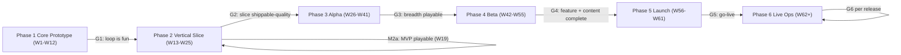
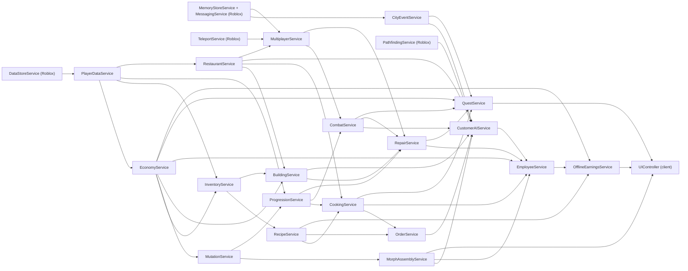

## 34. Development Roadmap

This section turns the design into a buildable plan: who builds what, in which order, with which assets,
and how we know each phase is finished. It schedules every system specified in §5–§33, uses only canon
identifiers, and links phase exits to the test gates in §35 and the Definition of Done in §40. Values
marked **[TUNABLE]** are planning assumptions that the producer re-baselines at every phase gate.

### 34.1 Planning Assumptions

#### 34.1.1 Team [TUNABLE]

| Discipline | Core headcount | Focus | Contract support (when) |
|---|---|---|---|
| Engineering | 3 | 1 gameplay/AI (Cooking, Customers, Combat), 1 systems/backend (data, economy, offline, security), 1 client/UI/tools (UI, morph assembly, building) | none planned; contingency in §34.14 |
| Art | 3 | 1 character/mutation artist, 1 environment/props artist (restaurant, city, food), 1 UI/2D + VFX artist | outsourced mutation parts, food, furniture, district props (VS → Beta) |
| Animation | 1 | rig pipeline, character, customer, employee and ability animations | outsourced ability animation batches (Alpha, Beta) |
| Design | 1 | systems, economy, combat tuning, data entry owner | 1 contract content designer (quests, NPC dialogue, data rows) from Alpha to Launch |
| Production / QA | 1 | producer + QA lead (test plans, triage, playtests, compliance) | 2 contract QA testers (Beta, Launch); external playtest vendor for age-banded playtests |
| Audio | 0 | — | contract sound designer/composer (VS → Beta) |

Total core team: **9 people** [TUNABLE]. All estimates below are **person-weeks (pw)** of core staff
unless the "Contract" column says otherwise.

#### 34.1.2 Estimation scale and cadence

| Size | Person-weeks (all disciplines) | Typical example |
|---|---|---|
| S | ≤ 2 pw | a pure formula module with unit tests |
| M | 2.5–6 pw | a service at v0/v1 with UI hook-up |
| L | 6.5–12 pw | a full system with content, art and tests |
| XL | > 12 pw (core + contract) | content-volume packages, cross-server systems |

- **Sprints:** 2 weeks; sprint review with build every second Friday; phase gates at the end of each phase.
- **Capacity rule:** plan at ≤ 92 % of nominal capacity per discipline (meetings, sick days, rework).
  Nominal capacity = headcount × working weeks.
- **Branching:** trunk-based with short-lived feature branches; Rojo-synced source of truth in Git;
  Studio places are build artefacts, never hand-edited in production.
- **Environments:** three separate experiences (Dev, Staging, Production) so that Dev and Staging never
  touch production DataStores; LiveConfig values promoted Dev → Staging → Production.

#### 34.1.3 Overall budget summary

| Phase | Working weeks | Core pw planned | Core capacity | Utilization | Contract pw |
|---|---|---|---|---|---|
| 1 Core Prototype | 11 (+1 holiday) | 86 | 99 | 87 % | 0 |
| 2 Vertical Slice | 13 | 103 | 117 | 88 % | 21 |
| 3 Alpha | 16 | 129 | 144 | 90 % | 72 |
| 4 Beta | 14 | 115.5 | 126 | 92 % | 89 |
| 5 Launch | 6 | 44.5 | 54 | 82 % | 15 |
| **Total to launch** | **60 (+1 holiday)** | **478** | **540** | **89 %** | **197** |

Live Operations (Phase 6) runs at steady-state capacity (≈ 39 core pw per month) — see §34.10.

### 34.2 Phase Overview and Milestone Calendar

Calendar assumes kickoff on **Monday 2026-11-02** (week W1) [TUNABLE]; dates shift 1:1 with kickoff.

| Phase | Weeks | Dates | Goal (one sentence) | Exit gate |
|---|---|---|---|---|
| 1 Core Prototype | W1–W12 (W9 holiday) | 2026-11-02 → 2027-01-22 | Prove the 60-second loop is fun: cook, serve, get yelled at, fight, morph. | G1 (§35.12) |
| 2 Vertical Slice | W13–W25 | 2027-01-25 → 2027-04-23 | One polished slice of the full game incl. employees, offline earnings, tutorial; MVP reached inside the phase. | G2 |
| 3 Alpha | W26–W41 | 2027-04-26 → 2027-08-13 | Breadth: most content, the city, quests and multiplayer, all playable end-to-end. | G3 |
| 4 Beta | W42–W55 | 2027-08-16 → 2027-11-19 | Feature- and content-complete, optimized and instrumented. | G4 |
| 5 Launch | W56–W61 | 2027-11-22 → 2027-12-31 | Stabilize, comply, soft-launch, launch, hypercare. | G5 |
| 6 Live Operations | W62 → | from 2028-01-03 | Grow content from player behavior and retention data. | per-release G6 |

| Milestone | Week | Date | What must be true |
|---|---|---|---|
| M0 Kickoff | W1 | 2026-11-02 | Repo, CI, service skeleton, style-guide brief signed off. |
| M1a "First Burger" | W5 | 2026-12-04 | `RCP_BRG_001` cooked on `STN_GRILL`, assembled, served to a greybox customer who pays MB. |
| M1 Prototype Gate | W12 | 2027-01-22 | Phase 1 completion criteria AC-34-01…AC-34-06 met. |
| M2a MVP Playable | W19 | 2027-03-12 | MVP definition of §34.4 met (AC-34-07…AC-34-12). |
| M2 Vertical Slice Gate | W25 | 2027-04-23 | Phase 2 criteria AC-34-13…AC-34-18 met. |
| M3a Alpha Playtest #1 | W33 | 2027-06-18 | First 8-player external playtest on phones and PC. |
| M3 Alpha Gate | W41 | 2027-08-13 | Phase 3 criteria AC-34-19…AC-34-24 met. |
| M4a Content Complete | W50 | 2027-10-15 | All launch-critical content rows of §34.12 implemented (art may be placeholder-final). |
| M4 Beta Gate | W55 | 2027-11-19 | Phase 4 criteria AC-34-25…AC-34-30 met; release-candidate branch cut. |
| M5a RC1 + compliance | W56 | 2027-11-26 | Launch checklist §37.4 complete except "go public". |
| M5b Closed beta | W57 | 2027-12-03 | Invite-only test (group members), telemetry live. |
| M5c Soft launch | W58 | 2027-12-07 | Public, unpromoted; capped sponsored traffic; telemetry gates watched. |
| M5 Global launch | W59 | Tue 2027-12-14 | Promotion on; on-call rota active. |
| M6a First seasonal | W60 | 2027-12-21 | `EVT_030` Snowmorph Holiday live through 2028-01-03. |
| M6 Live-ops steady state | W62 | 2028-01-04 | Biweekly patch train running; first monthly content drop scheduled. |

### 34.3 System Dependency Graph

Arrows read **"is required by"** (prerequisite → dependent). The build order in §34.5–§34.9 follows a
topological sort of this graph; anything on the left must reach v0 before its dependents start.

Critical path (longest chain, drives the calendar): `PlayerDataService` → `EconomyService` →
`MutationService` → `MorphAssemblyService` → `CustomerAIService` → `EmployeeService` →
`OfflineEarningsService` → Welcome Back UI. Every phase plan below protects this chain first.

### 34.4 Minimum Viable Playable Game (MVP)

**Definition.** The MVP is the smallest build in which a brand-new player, on phone or PC, can play the
complete core loop — *Cook → Serve → Survive → Earn → Morph → Upgrade → Hire → log off → return and
Collect* — for a ≈ 2-hour first session with persistent progress. It is reached at milestone **M2a (W19)**
inside Phase 2 and is the fallback "smallest shippable game" if the schedule collapses.

| Dimension | MVP scope (canon IDs) | Count | Notes / constraint |
|---|---|---|---|
| Restaurant tiers | `TIER_01`, `TIER_02` | 2 | `TIER_02` costs 1,000 MB and needs L5 (§C6); counter service only. |
| Player levels | L1–L10 playable | 10 | Full XP curve (§C5.1); LiveConfig soft cap at L10 for MVP builds. |
| Recipes | `RCP_BRG_001`, `RCP_BRG_002`, `RCP_BRG_003`, `RCP_BRG_006`, `RCP_FRI_001`, `RCP_FRI_002`, `RCP_DRK_001`, `RCP_DRK_002`, `RCP_SAN_001`, `RCP_SAN_002`, `RCP_SAN_003`, `RCP_SAL_001` | 12 | The four L1 recipes fill `TIER_01`'s 4 menu slots. All must be cookable with starter-kit stations; if §6 assigns a non-starter station to one, substitute the next eligible starter-kit recipe with unlock ≤ L8 (e.g. `RCP_FRI_003`, `RCP_BRG_005`). |
| Order modifications | ≥ 10 rows from §6.18 achievable with starter stations | ≥ 10 | No joke-only modifications in MVP. |
| Ingredients | basic ingredients used by the 12 recipes, e.g. `ING_BUN`, `ING_BEEF_PATTY`, `ING_CHEESE`, `ING_LETTUCE`, `ING_TOMATO`, `ING_ONION`, `ING_PICKLE`, `ING_KETCHUP`, `ING_MUSTARD`, `ING_POTATO`, `ING_BREAD_SLICE`, `ING_HAM`, `ING_BUTTER`, `ING_LEMON`, `ING_SUGAR`, `ING_ICE`, `ING_SODA_SYRUP` | ≈ 17 + any non-core ingredient §7 adds for `RCP_SAN_003` | All basic (unlimited, cost netted at serve); no special stock in MVP. |
| Stations | `STN_PANTRY`, `STN_FRIDGE`, `STN_CUT`, `STN_PREP`, `STN_GRILL`, `STN_FRYER`, `STN_DRINK`, `STN_ASSEMBLY`, `STN_WINDOW`, `STN_DISHWASH`, `STN_TRASH`, `STN_DELIVERY` | 12 | The `TIER_01` starter kit (§C7.1); upgrade levels Lv1–Lv2 (Lv2 needs `TIER_02`). |
| Personalities | `PER_001`, `PER_002`, `PER_003`, `PER_005`, `PER_006`, `PER_007`, `PER_010`, `PER_013` | 8 | Must span ≥ 4 of the 7 combat styles incl. PACIFIST, THROWER, BRAWLER; if §9's assignments do not, swap in `PER_012`, `PER_014` or `PER_018`. |
| Anger & chaos | levels 0–6 | 7 | Level 6 in basic form (≥ 3 customers at level ≥ 3); full polish in Beta. |
| Base abilities | `ABL_001`–`ABL_006` | 6 | Utensils `ABL_007`/`ABL_008` arrive in the Vertical Slice. |
| Mutation abilities | `ABL_010`, `ABL_012`, `ABL_017`, `ABL_034`, `ABL_058`, `ABL_062` | 6 | From `MUT_140`, `MUT_145`, `MUT_144`, `MUT_010`, `MUT_097`, `MUT_153`; bar max 4 (§C12.1). |
| Status effects | `STS_STUN`, `STS_DIZZY`, `STS_WOOZY`, `STS_KNOCKDOWN` + any applied by the 6 MVP abilities (§36.6) | 4–8 | |
| Mutation parts | Starter: `MUT_117`, `MUT_139`, `MUT_179`, `MUT_001`, `MUT_002`, `MUT_003`, `MUT_004`, `MUT_005`, `MUT_006`, `MUT_008`. Tutorial choice: `MUT_145`, `MUT_144`, `MUT_153`. Ability Commons: `MUT_010`, `MUT_097`, `MUT_140`. Variety Commons: `MUT_050`, `MUT_059`, `MUT_071`, `MUT_072`, `MUT_085`, `MUT_086`, `MUT_118`, `MUT_121`, `MUT_180`, `MUT_201`, `MUT_211`, `MUT_212`, `MUT_235`, `MUT_259` | 30 | 27 Common, 2 Uncommon, 1 Rare; covers all 7 UI groups (Head, Ears, Eyes, Arms, Legs, Tails, Extras). Acquisition: STARTER, QUEST, SHOP_MART. Upgrades Lv1→Lv3; capsules off. |
| Employees | `EMP_001` (via `QST_TUT_012`) + ≥ 3 Common archetypes from §36.8 | ≥ 4 | Roles `ROLE_CHEF`, `ROLE_PREP`, `ROLE_DISH`, `ROLE_MANAGER`; employee cap 2 (`TIER_01`) / 3 (`TIER_02`). |
| Offline simulation | full §C15 model; caps 2 h (no manager) and 4 h (Basic manager) | — | ≥ 8 incidents from §36.9; discoveries on; Welcome Back screen with all 6 buttons. |
| Quests | `QST_TUT_001`–`QST_TUT_012` + 3 daily quests from §20 | 15 | No story chapters yet. |
| City | `DST_01` (`BLD_17` ×8 plots, `BLD_03`); slice of `DST_02` (`BLD_01`); slice of `DST_03` (`BLD_04`, `BLD_06`) | 3 districts (2 partial) | Walking + Return Door; no Metro/Taxi. |
| Named NPCs | `NPC_001`, `NPC_004`, `NPC_006`, `NPC_007`, `NPC_009` | 5 | `NPC_003` optional cameo. |
| Furniture | 12 regular items from §36.13 (2 tables, 2 chairs, stool, 2 lights, 2 decor, floor, wall, sign) | 12 | All five damage states (§C6). |
| Repairs | manual repair of all states + `ABL_062` | — | No Repair Technician yet. |
| Progression | 9 stats (4-button default view), respec, level-up toast | — | Skill trees off. |
| Currencies | MB, MS | 2 | RT has no sink before Epic Lv4 — hidden in MVP. |
| Multiplayer | 8-player servers, shared Restaurant Row, owner-only interiors | — | Co-op visits arrive in Alpha. |
| UI screens | HUD, order queue overlay, cooking prompts, Morph screen, level-up/stats, shop template, build/placement, repair minigame, employee roster/hire, Welcome Back, quest tracker, settings | 12 | Touch, KBM, gamepad functional. |
| Animations | `ANM_001`–`ANM_008`, `ANM_010`–`ANM_012`, `ANM_017`–`ANM_023`, `ANM_030`, `ANM_040`–`ANM_055`, `ANM_060`, `ANM_062`–`ANM_066` + 12 ability animations | 41 + 12 | |
| Audio | ≥ 40 SFX + 2 music loops | 42 | Final-quality mix not required. |
| Analytics | onboarding funnel (12 tutorial steps + first offline collect) | 13 steps | §31 event schema. |

**Out of MVP (by design):** city events, co-op, arena, skill trees, Lab fusion, capsules, special
ingredients, table service (`TIER_03`+), Mystery Market, RT.

### 34.5 Phase 1 — Core Prototype (W1–W12)

**Goal.** Prove that one restaurant, one player and a handful of absurd customers already produce the
"cook → serve → chaos → fight → morph" fun, at greybox quality, on phone and PC.

#### 34.5.1 Features and effort

| # | Feature / work package | Size | Eng | Art | Anim | Design | Prod/QA | Total core | Contract |
|---|---|---|---|---|---|---|---|---|---|
| F1.1 | Foundations: Rojo/Git repo, CI (lint, Luau unit tests), service framework with 20 service stubs (§C19), typed remote layer, LiveConfig stub | M | 2.5 | 0 | 0 | 0 | 0.5 | 3 | — |
| F1.2 | `PlayerDataService` v0: session-locked profile, schema v1, 120 s autosave, PlayerRemoving/BindToClose saves | M | 2 | 0 | 0 | 0 | 0 | 2 | — |
| F1.3 | `RestaurantService` v0: one plot on `DST_01`, instanced interior in the Interiors region, door transfer, `TIER_01` greybox | M | 1.5 | 2 | 0 | 0.5 | 0 | 4 | — |
| F1.4 | `CookingService` v0: 12 starter-kit stations, heat timing model, chopping rhythm, quality grades, per-slot locks, carry rules | L | 4.5 | 3 | 1.5 | 1.5 | 0 | 10.5 | — |
| F1.5 | `RecipeService` + `OrderService` v0: 12 MVP recipes as data, 4 menu slots, tickets, serve validation | M | 2 | 3 | 0 | 1.5 | 0 | 6.5 | — |
| F1.6 | `CustomerAIService` v0: SPCV proxies, states 1–16 plus Angry/Fleeing, pathfinding to seats, patience, 8 personalities (greybox) | L | 4.5 | 2 | 2 | 1.5 | 0 | 10 | — |
| F1.7 | Pure formula modules (satisfaction, pay/tip/rep, patience, XP, stats) with unit tests | S | 1.5 | 0 | 0 | 0.5 | 0.5 | 2.5 | — |
| F1.8 | Anger levels 0–5, escalation roll, thrown-food arc, furniture-damage stub | M | 2 | 0 | 1 | 1 | 0 | 4 | — |
| F1.9 | `CombatService` v0: `ABL_001`–`ABL_006`, Huff Points, KO/respawn, `STS_STUN`/`STS_DIZZY`/`STS_WOOZY`/`STS_KNOCKDOWN` | L | 3 | 0 | 2.5 | 1 | 0 | 6.5 | — |
| F1.10 | `MutationService` + `MorphAssemblyService` v0: rig/attachment contract (§C13.7), 30 parts, stat calc, 6 mutation abilities | L | 2.5 | 8 | 1 | 0.5 | 0 | 12 | — |
| F1.11 | `EconomyService` + `ProgressionService` v0: MB wallet, transaction log, XP curve, level-ups, stat allocation | M | 1.5 | 0 | 0 | 0.5 | 0 | 2 | — |
| F1.12 | `UIController` v0: HUD, order queue, basic Morph screen, level-up panel, debug console | M | 2 | 2 | 0 | 0 | 0 | 4 | — |
| F1.13 | Art direction & pipeline: style guide, rig/attachment test scenes, palette, food & furniture style sheets, 3 key art pieces; animation pipeline | L | 0 | 8 | 2 | 0 | 0 | 10 | — |
| F1.14 | Placeholder audio (≈30 licensed placeholder cues) | S | 0 | 0 | 0 | 0.5 | 0.5 | 1 | — |
| F1.15 | QA & production: master test plan, 3 internal playtests, device smoke, sprint ops | M | 0 | 0 | 0 | 1 | 7 | 8 | — |
| | **Total** | | **29.5** | **28** | **10** | **10** | **8.5** | **86** | **0** |
| | Capacity (11 wk) | | 33 | 33 | 11 | 11 | 11 | 99 | |
| | Utilization | | 89 % | 85 % | 91 % | 91 % | 77 % | 87 % | |

#### 34.5.2 Dependencies

- Needs: style-guide brief (§25), rig & attachment contract (§C13.7), canon formulas (§C5, §C8, §C11),
  station list (§C7), recipe rows for the 12 MVP recipes (§6) and the 8 MVP personalities (§9).
- Blocks: everything; F1.2 and F1.11 (data + economy) must be green before any reward-granting code merges.
- External: Roblox `PathfindingService`, `DataStoreService` (Dev experience only).

#### 34.5.3 Required assets (delta for this phase)

| Asset type | Count | Quality bar |
|---|---|---|
| Mutation parts | 30 (10 final-style, 20 blockout) | rig-contract compliant, within §C13.7 budgets |
| Recipe dish models | 12 | blockout, readable silhouette |
| Ingredient models (incl. state variants by material swap) | ≈ 20 | blockout |
| Furniture | 12 | greybox with 5 damage-state swaps |
| Kitchen station models | 12 | greybox with slot markers |
| Animations | ≈ 30 general + 12 ability | blocking pass |
| Sounds | ≈ 30 placeholder SFX, 1 loop | licensed placeholder library |
| UI screens | 6 | wireframe skin |

#### 34.5.4 Technical tasks (by service)

See the service matrix in §34.11; Phase 1 column. Key Phase-1 engineering rules: every currency change
goes through `EconomyService`; every timer is server-timestamped; every remote has a typed schema even in
prototype; formula code lives in pure ModuleScripts with no Roblox instance access (unit-testable, §35.2).

#### 34.5.5 Testing requirements

- CI runs the pure-module unit tests on every push (satisfaction, pay/tip/rep, patience, stats, XP).
- Weekly internal playtest (≥ 6 people) with the loop questionnaire; daily smoke on one low phone.
- TC areas exercised: TC-COOK, TC-CUST, TC-SAT, TC-CMBT (basic), TC-MORPH (attachment), TC-DATA (save/load).

#### 34.5.6 Completion criteria

- **AC-34-01:** In a 10-minute internal playtest, ≥ 5 of 6 testers each serve ≥ 8 customers without
  facilitator help and rate the loop ≥ 3.5/5 on the fun questionnaire.
- **AC-34-02:** All 12 starter-kit stations implement the §C8 heat/chop models; 100 % of formula unit
  tests pass in CI on the gate build.
- **AC-34-03:** Customers traverse states 1–16; ≤ 1 stuck customer per 100 spawned (stuck = no state
  change for > 20 s outside eating).
- **AC-34-04:** A customer can escalate to anger level 5 and fight; player KO and respawn follow §C12.1
  with zero currency, item or mutation loss (TC-CMBT-07 passes).
- **AC-34-05:** ≥ 20 of the 30 parts across all 7 UI groups equip on the R15 rig via `MMR_` attachments
  with no visible detachment during `ANM_001`–`ANM_004`; player morph ≤ 40 MeshParts.
- **AC-34-06:** A `TIER_01` rush (4 seated + 4 queued) holds ≥ 30 FPS p50 on the low-phone reference
  device; MB, XP and parts survive 20 rejoin cycles with zero loss.

### 34.6 Phase 2 — Vertical Slice (W13–W25)

**Goal.** Make one slice of the real game at shippable quality — `TIER_01`–`TIER_03` in `DST_01` — with
polished cooking, restaurant upgrades, employee hiring, offline earnings, mutation customization, the first
city district and the complete tutorial. The MVP (§34.4) is reached at **W19** inside this phase.

#### 34.6.1 Features and effort

| # | Feature / work package | Size | Eng | Art | Anim | Design | Prod/QA | Total core | Contract |
|---|---|---|---|---|---|---|---|---|---|
| F2.1 | Cooking polish: all 22 non-late stations, station Lv1–Lv3, VFX/SFX hooks, touch & gamepad schemes, Auto-Rhythm | L | 4.5 | 6 | 2 | 1.5 | 0 | 14 | — |
| F2.2 | Recipes to 30 (vertical-slice list) + ≥ 20 order modifications from §6.18 | M | 1 | 4 | 0 | 1.5 | 0 | 6.5 | — |
| F2.3 | `BuildingService` v1: grid placement, path validation, `TIER_01`–`TIER_03`, 35 furniture items, atmosphere score | L | 4.5 | 5 | 0 | 0.5 | 0 | 10 | 3 |
| F2.4 | `RepairService` v1: five damage states, repair minigame, Destroyed → rebuild offer | M | 2.5 | 2 | 1 | 0.5 | 0 | 6 | — |
| F2.5 | `EmployeeService` v1: 7 roles, `EMP_001` + 9 archetypes, online work AI, wages, morale/energy | L | 4.5 | 3 | 2 | 1.5 | 0 | 11 | — |
| F2.6 | `OfflineEarningsService` v1: canon §C15 model, golden tests, idempotent claims, Welcome Back screen | L | 4 | 1 | 0 | 1 | 1 | 7 | — |
| F2.7 | Morph customization (§13): preview, slots, inventory, 3 loadouts, upgrades, capsules + pity, Mutation Mart; 42 new parts | XL | 3.5 | 3 | 1 | 1 | 0 | 8.5 | 14 |
| F2.8 | City: `DST_01` art-complete; tutorial-path slice of `DST_02`/`DST_03` (`BLD_01`, `BLD_04`, `BLD_06` functional, blockout exteriors) | L | 2 | 7 | 0 | 1 | 0 | 10 | — |
| F2.9 | `QuestService` v1: `QST_TUT_001`–`QST_TUT_012`, story chapter 1, 6 daily quests | L | 2.5 | 1 | 1 | 2 | 0.5 | 7 | — |
| F2.10 | Persistence v1: migrations, backoff + Safe Mode (E6), BindToClose, transaction log | M | 2 | 0 | 0 | 0 | 0 | 2 | — |
| F2.11 | UI pass 2: 18 screens, phone/tablet layouts, controller navigation | L | 1.5 | 3 | 0 | 0 | 0 | 4.5 | — |
| F2.12 | Audio v1 (contract): ≈70 SFX, 3 music loops | S | 0 | 0 | 0 | 0.5 | 0 | 0.5 | 4 |
| F2.13 | Analytics v0: onboarding funnel | S | 0.5 | 0 | 0 | 0 | 0 | 0.5 | — |
| F2.14 | Animation library to ≈60 general + 22 ability animations | M | 0 | 0 | 5 | 0 | 0 | 5 | — |
| F2.15 | QA: regression suite v1, device lab (6 devices), 2 external age-banded playtests | M | 0 | 0 | 0 | 0.5 | 10 | 10.5 | — |
| | **Total** | | **33** | **35** | **12** | **11.5** | **11.5** | **103** | **21** |
| | Capacity (13 wk) | | 39 | 39 | 13 | 13 | 13 | 117 | |
| | Utilization | | 85 % | 90 % | 92 % | 88 % | 88 % | 88 % | |

#### 34.6.2 Vertical-slice content list

| Dimension | Vertical-slice scope | Count |
|---|---|---|
| Tiers | `TIER_01`, `TIER_02`, `TIER_03` (first table-service tier) | 3 |
| Recipes | MVP 12 + `RCP_BRG_004`, `RCP_BRG_005`, `RCP_PIZ_001`, `RCP_PIZ_002`, `RCP_PIZ_003`, `RCP_TAC_001`, `RCP_TAC_002`, `RCP_SOP_001`, `RCP_PST_001`, `RCP_PST_002`, `RCP_BRK_001`, `RCP_BRK_002`, `RCP_DES_001`, `RCP_DES_002`, `RCP_DRK_003`, `RCP_DRK_004`, `RCP_SEA_001`, `RCP_FRI_003` | 30 |
| Stations | all except `STN_ANTIGRAV` and `STN_INFUSER`; upgrade levels Lv1–Lv3 | 22 |
| Personalities | MVP 8 + `PER_004`, `PER_008`, `PER_009`, `PER_016` | 12 |
| Mutation parts | all 63 Common parts + `MUT_144`, `MUT_145`, `MUT_153` + `MUT_061`, `MUT_062`, `MUT_100`, `MUT_148`, `MUT_184`, `MUT_243` | 72 |
| Abilities | `ABL_001`–`ABL_008` + `ABL_010`, `ABL_011`, `ABL_012`, `ABL_015`, `ABL_016`, `ABL_017`, `ABL_019`, `ABL_021`, `ABL_022`, `ABL_034`, `ABL_048`, `ABL_052`, `ABL_058`, `ABL_062` | 22 |
| Status effects | those used by the 22 abilities (§36.6), expected 8–10 of the 20 | 8–10 |
| Employees | `EMP_001` + 9 Common/Uncommon archetypes (§36.8); roles `ROLE_CHEF`, `ROLE_PREP`, `ROLE_WAITER`, `ROLE_CASHIER`, `ROLE_DISH`, `ROLE_CLEANER`, `ROLE_MANAGER` | 10 / 7 roles |
| Offline incidents | rows from §36.9 | ≥ 15 |
| Quests | `QST_TUT_001`–`QST_TUT_012`, story chapter 1 (§20), 6 daily quests | ≈ 22 |
| City | `DST_01` art-complete (`BLD_03`, `BLD_10`, `BLD_17`); `DST_02` slice (`BLD_01`); `DST_03` slice (`BLD_04`, `BLD_06`, `BLD_09` exterior) | 3 districts |
| Named NPCs | `NPC_001`, `NPC_002`, `NPC_003`, `NPC_004`, `NPC_006`, `NPC_007`, `NPC_009`, `NPC_012`, `NPC_025`, `NPC_028` | 10 |
| Furniture | regular items from §36.13 | 35 |
| Capsules | earnable Morph Capsules with disclosed odds and 40-capsule pity (§C4.7) | on |
| UI screens | MVP 12 + Mutation Mart, capsule reveal, recipe learning, tier upgrade, employee detail, financial report | 18 |
| Audio | ≈ 70 SFX, 3 music loops (contract) | 73 |
| Animations | ≈ 60 general + 22 ability | 82 |

#### 34.6.3 Dependencies

- Phase 1 gate G1 passed; F1.2/F1.11 hardened (session locking, transaction log) before offline earnings.
- Needs §13 wireframes, §15 placement rules, §16 roles/archetype rows, §17 worked examples, §32 tutorial
  script, §24 HUD hierarchy, §36.8/§36.9 starter rows.
- Contract art onboarding (mutation-part outsourcing) must start by W14 to land 42 parts by W23.

#### 34.6.4 Testing requirements

- Golden-file determinism tests for `OfflineEarningsService` (§35.2) in CI.
- Regression suite v1 (smoke + weekly) covers TC-COOK, TC-CUST, TC-SAT, TC-CMBT, TC-MUT, TC-MORPH,
  TC-BUILD, TC-DEST, TC-RPR, TC-EMP, TC-OFF, TC-DATA, TC-QST, TC-UI and canon edge cases TC-EDGE-01…TC-EDGE-21.
- Device lab (6 devices, §35.10) weekly; two external age-banded playtests (8–10, 11–13, 14–16).

#### 34.6.5 Completion criteria

MVP milestone (W19):

- **AC-34-07:** In an external playtest (n ≥ 12, ages 8–16), new players complete `QST_TUT_001`–`QST_TUT_012`
  with a median time ≤ 15 min and ≥ 75 % unaided completion.
- **AC-34-08:** A competent-play session reaches `TIER_02` and L5 within 1.1 h ± 25 % (§C5.1, §C4.4).
- **AC-34-09:** Offline reports for the MVP golden fixtures are byte-identical across 100 runs; Collect is
  idempotent (TC-OFF-01 and TC-EDGE-17 pass).
- **AC-34-10:** Every row of the MVP table is implemented; the ID validator reports 0 unresolved references
  in MVP data.
- **AC-34-11:** ≥ 98 % crash-free sessions over ≥ 200 test sessions; no open S0 bug.
- **AC-34-12:** The tutorial is completable end-to-end on touch, keyboard/mouse and gamepad (3 recorded runs).

Vertical-slice gate (W25):

- **AC-34-13:** 100 % of the §34.6.2 content list is implemented; `DST_01` and `TIER_01`–`TIER_03` are at
  final art quality (art director sign-off checklist §37.3).
- **AC-34-14:** External playtest (n ≥ 18 across 3 age bands): ≥ 80 % identify an angry customer within 3 s
  of escalation from icon + animation alone; ≥ 70 % rate "want to play again" ≥ 4/5.
- **AC-34-15:** Economy simulation: the `TIER_03` reference restaurant (2 chefs, 1 waiter, Basic manager)
  earns offline net 606–865 MB/h, i.e. 35–50 % of the 1,730 MB/h active target (§C4.4, §C15).
- **AC-34-16:** 500 automated save/load cycles with injected DataStore failures produce 0 corrupted
  profiles and enter Safe Mode exactly per §C22 E6.
- **AC-34-17:** Low-phone reference device holds ≥ 30 FPS p50 in a `TIER_03` rush (8 seated + 4 queued,
  4 employees) with client memory ≤ 900 MB (§30 LOW budget).
- **AC-34-18:** 0 open S0/S1 bugs in slice scope; ≤ 10 open S2 bugs.

### 34.7 Phase 3 — Alpha (W26–W41)

**Goal.** Breadth. Expanded recipes, many more mutations and personalities, restaurant expansion to
`TIER_06`, quests, all ten districts traversable, and multiplayer co-op — every launch system except the
Beta set playable end-to-end, art allowed to be placeholder-final outside the five finished districts.

#### 34.7.1 Features and effort

| # | Feature / work package | Size | Eng | Art | Anim | Design | Prod/QA | Total core | Contract |
|---|---|---|---|---|---|---|---|---|---|
| F3.1 | Recipes to 100, order modifications to ≥ 75, ingredients for all | L | 1 | 6 | 0 | 1 | 0 | 8 | 13 |
| F3.2 | Mutations to 180; Lab fusion; Mystery Market rotation | XL | 3 | 6 | 1 | 1.5 | 0 | 11.5 | 30 |
| F3.3 | Abilities to 50, all 20 status effects | XL | 5.5 | 2 | 6 | 2 | 0 | 15.5 | 2 |
| F3.4 | Personalities to 24, all 7 NPC combat styles, anger levels 0–6 | L | 3 | 2 | 2 | 2 | 0 | 9 | — |
| F3.5 | `TIER_04`–`TIER_06`, furniture to 75, station Lv4 | L | 2 | 7 | 0 | 1 | 0 | 10 | 7 |
| F3.6 | Quests: story chapters 1–6, daily/weekly pools, challenges (≈60 total), Expansion Permit flow | L | 3 | 0 | 0 | 1 | 0 | 4 | 9 |
| F3.7 | Morph City: 10 districts blocked out, 5 art-complete, Metro, Pigeon Taxi, Return Door, 15 buildings functional | XL | 4 | 12 | 0 | 1 | 0 | 17 | 4 |
| F3.8 | `MultiplayerService`: co-op visits, permissions, guest rewards, Co-op Insurance, friend-join teleport | XL | 7 | 0 | 0 | 1 | 0 | 8 | — |
| F3.9 | City NPCs to 60 with dialogue | M | 1 | 3 | 1 | 0.5 | 0 | 5.5 | 3 |
| F3.10 | Employees: all 12 roles, 40 archetypes, basic training | L | 3 | 2 | 2 | 1 | 0 | 8 | 4 |
| F3.11 | Persistence v2 + security pass 1 (remote schemas, rate limits, exploit tests) | L | 4 | 0 | 0 | 0 | 1 | 5 | — |
| F3.12 | Performance pass 1 (SPCV LOD/impostors, streaming, pooling) | L | 3 | 0 | 0 | 0 | 0 | 3 | — |
| F3.13 | UI to 30 screens | L | 2.5 | 3 | 0 | 0 | 0 | 5.5 | — |
| F3.14 | Analytics v1 + economy simulation harness | M | 1 | 0 | 0 | 1.5 | 0 | 2.5 | — |
| F3.15 | Animation library to ≈110 general | M | 0 | 0 | 3 | 0 | 0 | 3 | — |
| F3.16 | QA: full area test plans, automation, synthetic-load tests, 3 playtests | L | 0 | 0 | 0 | 0.5 | 13 | 13.5 | — |
| | **Total** | | **43** | **43** | **15** | **14** | **14** | **129** | **72** |
| | Capacity (16 wk) | | 48 | 48 | 16 | 16 | 16 | 144 | |
| | Utilization | | 90 % | 90 % | 94 % | 88 % | 88 % | 90 % | |

Contract column in Alpha = outsourced art (F3.1 10, F3.2 30, F3.5 7, F3.7 4, F3.10 4 pw), outsourced
ability animation (F3.3 2 pw) and the contract content designer (F3.1 3, F3.6 9, F3.9 3 pw = 15 pw).

#### 34.7.2 Dependencies

- G2 passed; §18 district layouts and §36.10 building rows final; §21 co-op permission matrix final;
  §20 quest rows for chapters 1–6; §36.3 rows 1–180 with stat distributions; §36.6/§36.7 rows for the
  first 50 abilities and all 20 statuses.
- Content designer onboarded by W26; outsourced part batches of ≈ 15 parts every 2 weeks from W27.
- `MultiplayerService` depends on `RestaurantService` interior lifecycle being re-entrant (guests).

#### 34.7.3 Required assets (delta)

Mutation parts +108 (→ 180) · recipe dishes +70 (→ 100) · furniture +40 (→ 75) · tier kits `TIER_04`–`TIER_06`
· districts: 10 blockouts, `DST_01`, `DST_02`, `DST_03`, `DST_05`, `DST_08` final · buildings 15 functional ·
NPCs +50 (→ 60) · employee archetypes +30 (→ 40) · general animations +50 (→ ≈ 110) · ability animations +28
(→ 50) · SFX +50 (→ ≈ 120) · music +3 (→ 6) · UI screens +12 (→ 30).

#### 34.7.4 Testing requirements

- All 17 area test plans of §35 written and ≥ 70 % automated where automatable (formula, data, persistence).
- Synthetic-load tests (§35.2) for 8 owners + co-op guests; exploit suite pass 1 (§35.11).
- Economy simulation harness compares pacing to §C4.4 every nightly build.
- Three external playtests (one 8-player co-op session on mixed devices).

#### 34.7.5 Completion criteria

- **AC-34-19:** All 20 services of §C19 exist at ≥ v1 with the public interfaces of §27; the integration
  suite passes ≥ 95 % on the gate build.
- **AC-34-20:** The content validator counts at least 100 recipes, 180 parts, 50 abilities, 20 status
  effects, 24 personalities, tiers `TIER_01`–`TIER_06`, 75 furniture items, 60 quests, 60 named NPCs and
  40 employee archetypes, all with resolving IDs.
- **AC-34-21:** 4 players co-op one interior for 20 min on an 8-player server: server heartbeat ≥ 55 Hz
  p50, zero item-ownership desyncs, and every §C22 E12 guest restriction holds (TC-MP suite).
- **AC-34-22:** All 10 districts are traversable; Metro, Pigeon Taxi and Return Door work; 15 buildings are
  functional.
- **AC-34-23:** Economy simulation: the competent archetype reaches `TIER_06` within ±20 % of 25 active
  hours (§C4.4).
- **AC-34-24:** Remote inventory audit: 100 % of remotes have a payload schema, server validation and a
  rate limit (§29).

### 34.8 Phase 4 — Beta (W42–W55)

**Goal.** Feature- and content-complete. Full employee management, the expanded offline simulation, city
events, advanced combat, the remaining tiers, analytics and performance optimization — the build that
becomes the launch candidate.

#### 34.8.1 Features and effort

| # | Feature / work package | Size | Eng | Art | Anim | Design | Prod/QA | Total core | Contract |
|---|---|---|---|---|---|---|---|---|---|
| F4.1 | Full employee management: training, promotion, salary, reviews, ≥ 75 archetypes | L | 3.5 | 2 | 2 | 1.5 | 0 | 9 | 10 |
| F4.2 | Expanded offline simulation: ≥ 50 incidents, discoveries, all manager caps, damage report, upgrade suggestions | L | 3 | 1 | 0 | 1.5 | 0 | 5.5 | 3 |
| F4.3 | `CityEventService`: cross-server schedule (MemoryStore), 20 launch events, rewards | XL | 5 | 6 | 2 | 2 | 0 | 15 | 6 |
| F4.4 | Advanced combat: abilities to 70, chaos level 6 polish, environmental combat, protective upgrades | L | 4 | 2 | 4 | 1 | 0 | 11 | 2 |
| F4.5 | `TIER_07`–`TIER_10`, furniture to 110, station Lv5, `STN_ANTIGRAV`, `STN_INFUSER` | L | 2.5 | 7 | 0 | 1 | 0 | 10.5 | 8 |
| F4.6 | Content complete: 150 recipes, 280 parts, 32 personalities | XL | 1.5 | 5 | 1 | 1.5 | 0 | 9 | 29 |
| F4.7 | Districts art-complete (remaining 5), all 22 buildings, secret discovery hooks | L | 1 | 8 | 0 | 0.5 | 0 | 9.5 | 6 |
| F4.8 | Story chapters 7–10, quests to ≥ 100, achievements, milestones, skill trees | L | 2 | 0 | 0 | 1.5 | 0 | 3.5 | 5 |
| F4.9 | Arena (casual, opt-in 1v1/2v2), matchmaking, rules | L | 3 | 1 | 1 | 0.5 | 0 | 5.5 | — |
| F4.10 | Analytics complete + live dashboards | M | 2 | 0 | 0 | 0.5 | 0 | 2.5 | — |
| F4.11 | Performance optimization to the §35 device matrix | L | 4.5 | 2 | 0 | 0 | 0 | 6.5 | — |
| F4.12 | Security hardening + exploit sweep | M | 3 | 0 | 0 | 0 | 1 | 4 | — |
| F4.13 | Monetization (cosmetics only): shop, game passes, receipts, PolicyService checks | M | 2 | 3 | 0 | 0.5 | 0 | 5.5 | — |
| F4.14 | Localization pipeline + accessibility options complete | M | 1.5 | 1 | 0 | 0.5 | 0 | 3 | — |
| F4.15 | Animation library ≥ 150 general + 70 ability; emotes | M | 0 | 0 | 3 | 0 | 0 | 3 | — |
| F4.16 | QA: full regression, perf matrix, economy sims, 3 external playtests, closed beta | L | 0 | 0 | 0 | 0.5 | 12 | 12.5 | 20 |
| | **Total** | | **38.5** | **38** | **13** | **13** | **13** | **115.5** | **89** |
| | Capacity (14 wk) | | 42 | 42 | 14 | 14 | 14 | 126 | |
| | Utilization | | 92 % | 90 % | 93 % | 93 % | 93 % | 92 % | |

Contract column in Beta = outsourced art (F4.1 8, F4.3 4, F4.5 8, F4.6 27, F4.7 6 pw), outsourced
ability animation (F4.4 2 pw), the contract content designer (F4.1 2, F4.2 3, F4.3 2, F4.6 2, F4.8 5 pw =
14 pw) and 2 contract QA testers × 10 weeks (F4.16 20 pw).

#### 34.8.2 Dependencies

- G3 passed; §36.9 (≥ 50 incidents), §36.11 (event rules), §36.12 (tier & upgrade rows), §36.13 (≥ 100
  furniture), §36.14/§36.15 (animation & sound libraries), §36.16/§36.17 (achievements, milestones), §23
  (cosmetic catalogue), §31 (event schema) final.
- `CityEventService` cross-server scheduling depends on MemoryStore quotas being validated in staging with
  ≥ 50 concurrent servers (synthetic) before W48.
- Localization string freeze at W50 (Content Complete); only bug-fix string changes afterwards.

#### 34.8.3 Required assets (delta)

Mutation parts +100 (→ 280) · recipe dishes +50 (→ 150) · furniture +35 (→ ≥ 110 incl. `FRN_901`–`FRN_910`)
· tier kits `TIER_07`–`TIER_10` · districts: remaining 5 final · buildings: all 22 · NPCs +40 (→ ≥ 100) ·
employee archetypes +35 (→ ≥ 75) · events: 20 launch set · general animations +40 (→ ≥ 150) · ability
animations +20 (→ 70) · SFX +30 (→ ≥ 150) · music +2 (→ ≥ 8) · UI screens +6 (→ ≈ 36) · store-page key art.

#### 34.8.4 Testing requirements

- Full regression every week (all P0 + P1 cases of §35); performance matrix §35.10 every two weeks.
- Exploit sweep (§35.11) with an external reviewer; economy sims for casual/regular/hardcore archetypes.
- Closed beta (≥ 500 players, group-gated) from W53 with telemetry dashboards; 3 external playtests.

#### 34.8.5 Completion criteria

- **AC-34-25:** Content complete per §34.11 Beta column: 150 recipes, 280 parts, 70 abilities, 20 status
  effects, 32 personalities, 10 tiers, ≥ 110 furniture, ≥ 100 quests, ≥ 100 named NPCs, ≥ 75 employee
  archetypes, ≥ 50 offline incidents, 20 launch events, ≥ 150 general + 70 ability animations, ≥ 150 SFX.
- **AC-34-26:** The §35.10 performance matrix targets are met on all 7 device classes for scenarios
  P-01…P-08.
- **AC-34-27:** Economy simulation pacing to L5, L10, L26, L45 and L80 is within ±15 % of §C5.1; offline
  net/h is 35–50 % of active net/h at every tier and never above 60 % (§C15).
- **AC-34-28:** All §31 analytics events fire in staging with ≤ 1 % schema errors over 24 h.
- **AC-34-29:** Closed beta (≥ 500 players): D1 ≥ 30 %, tutorial completion ≥ 75 %, crash-free sessions
  ≥ 99 %.
- **AC-34-30:** 0 open S0 and 0 open S1 bugs in launch-critical systems; ≤ 25 open S2 with documented
  workarounds (§35.13).

### 34.9 Phase 5 — Launch (W56–W61)

**Goal.** Polished, balanced, tested and compliant, with enough content for repeat play; go live
safely and hold steady through the holiday peak.

#### 34.9.1 Features and effort

| # | Feature / work package | Size | Eng | Art | Anim | Design | Prod/QA | Total core | Contract |
|---|---|---|---|---|---|---|---|---|---|
| F5.1 | Stabilization RC1 → RC3 (bug burn-down) | L | 9 | 2 | 1 | 0 | 2 | 14 | — |
| F5.2 | Balance pass from closed-beta & soft-launch telemetry | M | 1 | 0 | 0 | 3 | 0 | 4 | — |
| F5.3 | Compliance & experience settings (§37.4), store page, final localization | M | 1 | 0 | 0 | 0.5 | 1 | 2.5 | — |
| F5.4 | Store assets: icon, 10 thumbnails, trailer capture, creator kit | M | 0 | 6 | 1 | 0 | 0 | 7 | — |
| F5.5 | Live-ops readiness: LiveConfig, kill switches, dashboards, on-call, `EVT_030` seasonal prep | M | 3 | 6 | 2 | 1 | 0 | 12 | 3 |
| F5.6 | Soft launch, global launch, hypercare | M | 2 | 0 | 0 | 1 | 2 | 5 | 12 |
| | **Total** | | **16** | **14** | **4** | **5.5** | **5** | **44.5** | **15** |
| | Capacity (6 wk) | | 18 | 18 | 6 | 6 | 6 | 54 | |
| | Utilization | | 89 % | 78 % | 67 % | 92 % | 83 % | 82 % | |

Contract column = seasonal art for `EVT_030` (3 pw) and 2 contract QA testers × 6 weeks.

#### 34.9.2 Launch sequence

| Week | Activity | Go/No-Go owner | Exit condition |
|---|---|---|---|
| W56 | RC1 cut; compliance & experience settings (§37.4); store page; final loc import | Producer | Checklist §37.4 complete except "Public" |
| W57 | Closed beta on RC2 (group-gated); balance hotfix via LiveConfig | Designer | No S0; crash-free ≥ 99 % |
| W58 | Soft launch: public, unpromoted, capped sponsored traffic | Producer + Lead Eng | AC-34-32 trending green after 72 h |
| W59 | Global launch Tue 2027-12-14; promotion on | Producer | AC-34-33 met on soft-launch cohort |
| W60–W61 | Hypercare: daily triage, hotfix window 24 h, `EVT_030` live | Lead Eng (on-call) | AC-34-34 |

#### 34.9.3 Completion criteria

- **AC-34-31:** Launch checklist §37.4 is 100 % complete and signed by the producer and the lead engineer.
- **AC-34-32:** Over the first 7 soft-launch days: crash-free sessions ≥ 99.3 %, DataStore request errors
  ≤ 0.5 %, zero confirmed currency-duplication incidents.
- **AC-34-33:** Soft-launch cohort (≥ 2,000 new users): D1 ≥ 30 % and median session ≥ 20 min before
  promotion is switched on.
- **AC-34-34:** The on-call rota covers launch + 14 days with S0 response ≤ 1 h, 24/7.
- **AC-34-35:** A rollback rehearsal (LiveConfig version pin + previous place version) completes in
  ≤ 15 min on staging before W59.

### 34.10 Phase 6 — Live Operations (W62 onward)

**Goal.** Expand content based on player behavior and retention: every update is chosen from telemetry
(§31) and the content plan of §33, shipped through the release DoD of §40.

#### 34.10.1 Cadence and capacity

| Rhythm | Contents | Gate |
|---|---|---|
| Weekly (Tue) | hotfix window (S0/S1 only), LiveConfig tuning | smoke suite §35.9 |
| Biweekly (every 2nd Thu) | patch: bug fixes, balance, small content (2–6 parts, 1–3 furniture) | regression suite (P0) |
| Monthly (1st Thu) | content drop: 1–2 events, 8–12 parts, quests, cosmetics | full regression + perf spot-check |
| Quarterly | major update from §33 (district, tier-adjacent systems, new category) | full G6 gate (§35.12) |

Steady-state allocation [TUNABLE]: 40 % new content, 20 % events, 25 % fixes & tech debt, 15 % balance,
analytics and experiments.

#### 34.10.2 First six months (staging of launch-deferred content)

| Month | Planned content (already designed, deferred from launch) | Telemetry question it answers |
|---|---|---|
| Jan 2028 | `EVT_013`, `EVT_017`; economy/offline balance patch #1 | Are offline ratios inside 35–50 % for real players? |
| Feb 2028 | `EVT_027`, `EVT_028`; leaderboards if OD-15 approves | Does social competition lift D7? |
| Mar 2028 | Ranked arena season 1 + `EVT_025` | How many players opt into PvP; RT inflow vs sinks |
| Apr 2028 | `EVT_031` (seasonal, April), `EVT_015` | Seasonal return rate of lapsed players |
| May 2028 | `EVT_016`; cosmetic season pass if OD-07 approves | Cosmetic engagement without power creep |
| Jun 2028 | `EVT_021`, `EVT_022`; first §33 expansion beat | Late-game retention (L60+) |
| Oct 2028 | `EVT_029` (seasonal, October) | Year-1 seasonal baseline |

#### 34.10.3 Live-ops KPIs and completion criteria [TUNABLE targets]

| KPI | Floor (act if below for 2 weeks) | Target |
|---|---|---|
| D1 / D7 / D30 retention | 25 % / 9 % / 3 % | 32 % / 13 % / 5 % |
| Median session length | 18 min | 28 min |
| Tutorial completion | 70 % | 80 % |
| Returning DAU who collect offline earnings | 50 % | 65 % |
| Crash-free sessions | 99.0 % | 99.5 % |

- **AC-34-36:** ≥ 90 % of biweekly patches in the first quarter ship on their scheduled date.
- **AC-34-37:** Every monthly content drop satisfies the release Definition of Done (§40).
- **AC-34-38:** Any KPI below its floor for 2 consecutive weeks produces a tuning or content ticket with
  an owner within 48 h (§39 tuning process).

### 34.11 Technical Tasks by Service and Asset Production Plan

#### 34.11.1 Service task matrix

| Service (§C19) | P1 Core Prototype | P2 Vertical Slice | P3 Alpha | P4 Beta | P5 Launch / P6 Live Ops |
|---|---|---|---|---|---|
| `PlayerDataService` | v0 session lock, schema v1, 120 s autosave | migrations, backoff + Safe Mode (E6), BindToClose, save on purchase ≥ 10,000 MB | schema v2 (co-op, city, quests), stale-lock policy, versioned backups | budget & profile-size audit, erasure handler | prod key namespace, restore runbook; flagged live migrations |
| `RestaurantService` | one plot + instanced interior | 8 plots, façades `TIER_01`–`TIER_03`, Closing state (E1) | `TIER_04`–`TIER_06`, guest entry/exit, street eject | `TIER_07`–`TIER_10`, interior pooling, shutdown persistence (E13) | hypercare metrics; second-property R&D (OD-05) |
| `OrderService` | tickets, 4 menu slots, serve validation | ≥ 20 modifications, party orders, SOLD OUT + fallback (E9) | ≥ 75 modifications, special-stock hooks | ALN/MUT/LEG ordering rules, legendary dish orders | LiveConfig weights |
| `RecipeService` | 12 recipes as data | 30 recipes, learning at `BLD_06` (5 × price) | 100 recipes, Alien Cuisine flag, data validator | 150 recipes, LEG quest gating, `STN_INFUSER` gating | new categories (§33) |
| `CookingService` | 12 stations, heat/chop, per-slot locks | 22 stations, Lv1–Lv3, latency allowance, Auto-Rhythm | Lv4, fire/extinguish polish, co-op shared items | Lv5 gimmicks, `STN_ANTIGRAV`, `STN_INFUSER` | perf tuning |
| `CustomerAIService` | SPCV proxies, states 1–16, patience | 12 personalities, table service, poof rule (E10), anger 0–6 basic | 24 personalities, 7 combat styles, LOD/impostors, 160-proxy cap | 32 personalities, chaos 6 polish, event modifiers | tuning |
| `CombatService` | `ABL_001`–`ABL_006`, Huff Points, KO | `ABL_007`, `ABL_008` + 14 mutation abilities, In Combat flag, E2/E4 | 50 abilities, 20 statuses, hit-validation hardening | 70 abilities, environmental combat, arena rules | balance patches |
| `MutationService` | equip, stats, 30 parts | 72 parts, upgrades, capsules + pity, Mart | 180 parts, Lab fusion, Mystery Market rotation | 280 parts, secrets, Mythic fusion, RT costs | new parts (§33) |
| `MorphAssemblyService` | rig attachment, server build | client SPCV builder, loadouts | 60-stud LOD impostor swap, per-frame build budget | CI budget validator (≤ 40 MeshParts / 15,000 tris) | — |
| `EmployeeService` | — | hiring, 7 roles, online AI, wages, Unpaid Break (E8), `EMP_001` | 12 roles, 40 archetypes, basic training, repair absorption (E3) | ≥ 75 archetypes, promotion, reviews, salary | tuning |
| `OfflineEarningsService` | formula stub + unit tests | §C15 model, golden tests, idempotent claims, Welcome Back | ≥ 25 incidents, merge-pending rule | ≥ 50 incidents, discoveries, all caps, damage report, suggestions | SIM_VERSION bump procedure (§39) |
| `EconomyService` | MB wallet, transaction log | MS, sink/source dashboard, never-negative rule | RT, anomaly detector (MB/h > 3× tier target) | full sink/source telemetry, price validator | LiveConfig price tuning |
| `InventoryService` | furniture stub | furniture inventory, basic special stock | special crates, delivery station | cosmetics, trophies `FRN_901`–`FRN_910` | — |
| `QuestService` | — | `QST_TUT_001`–`QST_TUT_012`, dailies, 00:00 UTC reset | story ch. 1–6, weeklies, challenges, permits | story ch. 7–10, ≥ 100 quests, achievement hooks | seasonal quest lines |
| `CityEventService` | — | — | `EVT_003` single-server prototype | MemoryStore schedule, 20 launch events, once-per-user claims | 12 deferred events |
| `MultiplayerService` | 8-player server | owner-only interiors, friend-join | co-op visits, permissions, guest rewards, Co-op Insurance (E12) | casual arena matchmaking, opt-in | ranked arena |
| `BuildingService` | fixed layout | grid placement, path validation (E10), `TIER_01`–`TIER_03` | `TIER_04`–`TIER_06`, decor score | `TIER_07`–`TIER_10`, permit flow | themes (§33) |
| `RepairService` | damage stub | 5 states, repair minigame, rebuild ≤ 25 % | employee repair jobs (E3), co-op repair | offline auto-repair, protective upgrades | — |
| `ProgressionService` | XP, levels, 9 stats | respec, level-up toast (E14), level gates | CHEF/CMBT/RPR skill trees | SVC/MGMT trees, achievements, milestones | — |
| `UIController` | HUD, order queue, basic Morph | 18 screens, touch/gamepad, Welcome Back | 30 screens, map, quest journal | ≈ 36 screens, localization, accessibility | store polish |

#### 34.11.2 Asset production plan (cumulative counts at each phase gate)

| Asset type | Launch target | P1 | P2 | P3 | P4 (Beta) | P5 (Launch) |
|---|---|---|---|---|---|---|
| Mutation parts (§36.3) | 280 | 30 (blockout) | 72 | 180 | 280 | 280 polished |
| Recipe dish models (§6) | 150 | 12 | 30 | 100 | 150 | 150 |
| Ingredient models (§7) | all rows | ≈ 20 | ≈ 45 | ≈ 90 | 100 % | 100 % |
| Kitchen stations (§C7) | 24 | 12 | 22 | 22 + Lv4 visuals | 24 + Lv5 gimmicks | 24 |
| Furniture incl. trophies (§36.13) | ≥ 110 | 12 | 35 | 75 | ≥ 110 | ≥ 110 |
| Restaurant tier kits (§36.12) | 10 | 1 greybox | 3 | 6 | 10 | 10 |
| Districts (§18) | 10 | plot only | 1 full + 2 slices | 10 blockout / 5 final | 10 final | 10 |
| Functional buildings (§36.10) | 22 | 0 | 6 | 15 | 22 | 22 |
| Named NPCs (§19) | ≥ 100 | 1 | 10 | 60 | ≥ 100 | ≥ 100 |
| Customer personalities (§9) | 32 | 8 | 12 | 24 | 32 | 32 |
| Employee archetypes (§36.8) | ≥ 75 | 0 | 10 | 40 | ≥ 75 | ≥ 75 |
| Quests (§20) | ≥ 100 | 0 | ≈ 22 | ≈ 60 | ≥ 100 | ≥ 100 |
| City events (§36.11) | 32 designed / 20 live | 0 | 0 | 1 prototype | 20 | 20 + `EVT_030` ready |
| Offline incidents (§36.9) | ≥ 50 | 0 | ≥ 15 | ≥ 25 | ≥ 50 | ≥ 50 |
| General animations (§36.14) | ≥ 150 | ≈ 30 | ≈ 60 | ≈ 110 | ≥ 150 | ≥ 150 |
| Ability animations (one per `ABL_` row) | 70 | 12 | 22 | 50 | 70 | 70 |
| Sound effects (§36.15) | ≥ 150 | ≈ 30 placeholder | ≈ 70 | ≈ 120 | ≥ 150 | ≥ 150 mastered |
| Music tracks (§36.15) | ≥ 8 | 1 | 3 | 6 | ≥ 8 | ≥ 8 + 1 seasonal |
| UI screens (§24) | ≈ 36 | 6 | 18 | 30 | ≈ 36 | ≈ 36 |
| Abilities as data + VFX (§36.6) | 70 | 12 | 22 | 50 | 70 | 70 |
| Status-effect VFX (§36.7) | 20 | 4 | 8–10 | 20 | 20 | 20 |
| Synergies as data (§36.4) | ≥ 75 | 0 | 10 | 40 | ≥ 75 | ≥ 75 |
| Morph combo QA reference set (§36.5) | ≥ 100 | 10 | 30 | 60 | ≥ 100 | ≥ 100 |

Throughput check: 250 parts after Phase 1 over ≈ 43 weeks ≈ 5.8 parts/week (≈ 2/week core + ≈ 3.8/week
outsourced); Commons and Uncommons are scheduled first because they reuse family kits (shared textures per
`Family` column of §C13.6).

### 34.12 Launch-Critical vs Post-Launch

| System / content | Launch-critical scope | Post-launch (Live Ops) | Rationale |
|---|---|---|---|
| Cooking (§5) | all 24 stations, Lv1–Lv5, all actions of §C8 | new station gimmicks with new categories | core pillar "Cook" |
| Recipes (§6) | all 150 of §C10, ≥ 75 order modifications | new categories (§33) | 10-tier ladder needs the full menu |
| Customers (§8–§10) | 32 personalities, 7 combat styles, anger 0–6, chaos | legendary customers (§33) | emergent chaos is the USP |
| Combat (§11) | `ABL_001`–`ABL_070`, 20 status effects, KO rules | abilities attached to future parts | parts and abilities ship together |
| Mutations (§12, §13) | 280 parts incl. 7 secrets, upgrades, Lab fusion, capsules, 3 loadouts | seasonal parts, extra cosmetic loadout slots | morph system is the economy's center |
| Synergies & combos (§36.4, §36.5) | ≥ 75 synergies, ≥ 100 combo examples | more as parts are added | rule-based, scale automatically |
| Progression (§14) | L1–100, 9 stats, 5 skill trees, achievements, milestones | prestige-style titles (cosmetic) | 200-hour arc must exist at launch |
| Restaurant (§15) | `TIER_01`–`TIER_10`, ≥ 100 furniture + `FRN_901`–`FRN_910`, damage & repair | themes; second property (OD-05) | one restaurant per player at launch (§C3) |
| Employees & offline (§16, §17) | 12 roles, ≥ 75 archetypes, full §C15 model, ≥ 50 incidents, Welcome Back | new professions; tuning only for the model | "critical feature" per brief Part 2.5 |
| Morph City (§18) | 10 districts, 22 buildings, Metro, Taxi, Return Door, secrets | additional districts (§33) | exploration pillar |
| NPCs & quests (§19, §20) | ≥ 100 NPCs, ≥ 100 quests incl. story chapters 1–10, dailies, weeklies | seasonal quest lines | story arc spans all 10 tiers |
| City events (§36.11) | 20: `EVT_001`–`EVT_012`, `EVT_014`, `EVT_018`, `EVT_019`, `EVT_020`, `EVT_023`, `EVT_024`, `EVT_026`, `EVT_032` | 12: `EVT_013`, `EVT_015`, `EVT_016`, `EVT_017`, `EVT_021`, `EVT_022`, `EVT_025`, `EVT_027`, `EVT_028`, `EVT_029`, `EVT_030`, `EVT_031` | launch set includes story finale `EVT_005`, boss `EVT_007` and `EVT_009` (needed for `MUT_040`); deferred set holds scale-changing (`EVT_015`, `EVT_016`), morph-swapping (`EVT_021`), arena (`EVT_025`) and seasonal events |
| Multiplayer (§21) | shared city, co-op visits, permissions, Co-op Insurance, friend-join | co-op cooking tournaments | social pillar |
| Arena (§21) | casual opt-in 1v1 / 2v2 | ranked seasons, season rewards, new arenas | PvP never forced; RT has other sources |
| Monetization (§23) | cosmetic shop, cosmetic game passes, extra cosmetic loadout slots | cosmetic season pass (OD-07), theme packs | cosmetics only (§C4.1) |
| Analytics (§31) | full event schema, dashboards | A/B experiments at scale | tuning needs data from day 1 |
| Localization | English + 5 reviewed languages + automatic translation | more reviewed languages | §37.4 |
| Accessibility (brief Part 26.3) | all options: controls ×4, reduced VFX, audio sliders, color-independent status, Auto-Rhythm | additional assists (OD-17) | non-negotiable for ages 8–16 |
| Leaderboards | — | after OD-15 | not required for the loop |
| Trading | none | only if OD-03 changes | economy & safety risk |

### 34.13 Pre-Agreed Scope Cut List

If a gate is missed by > 2 weeks, cut from the top until the plan fits; nothing below the line is cut.

| Order | Candidate | Saving | Consequence |
|---|---|---|---|
| 1 | Casual arena → Live Ops month 3 | ≈ 5.5 pw (F4.9) | arena-season RT source absent; RT still from weeklies, story, events, achievements |
| 2 | 4 launch events (`EVT_011`, `EVT_012`, `EVT_019`, `EVT_020`) → post-launch | ≈ 4 pw | 16 events in rotation at launch |
| 3 | Employee promotion & reviews → simplified training only | ≈ 3 pw | depth arrives in Live Ops month 1 |
| 4 | Mystery Market rotation → fixed weekly stock table | ≈ 1.5 pw | less variety at `BLD_13` |
| 5 | SVC/MGMT specialization trees → post-launch | ≈ 2 pw | primary trees unaffected |
| 6 | Pigeon Taxi → post-launch (Metro + Return Door remain) | ≈ 1 pw | slightly slower travel |
| 7 | Up to 40 non-secret Uncommon/Rare parts' art → first two monthly drops | ≈ 13 contract pw | data rows ship; parts flagged "Coming Soon" in Mart |
| — | **Never cut:** tutorial, offline earnings + Welcome Back, persistence & security, 10 tiers, 150 recipes, accessibility, kid-safety review | | |

### 34.14 Risks and Mitigations

| Risk | Likelihood | Impact | Mitigation | Owner | Early signal |
|---|---|---|---|---|---|
| R-01 Art volume (280 parts, 150 dishes, 110 furniture, 10 districts) exceeds 3 artists | High | High | family kits; dishes composed from ingredient meshes; 197 contract pw; cut item 7 | Producer | outsourced batch acceptance < 80 % on time |
| R-02 Single designer bottleneck | High | Medium | contract content designer from Alpha; producer owns data entry tooling; spreadsheet → JSON pipeline | Producer | design utilization > 95 % two sprints running |
| R-03 Mobile performance with 8 restaurants and up to 160 proxies | Medium | High | SPCV, impostors at 60 studs, interior streaming, Phase 3 perf pass, matrix every 2 weeks in Beta | Lead Eng | low-phone FPS p50 < 30 in any matrix run |
| R-04 Data loss or currency duplication | Low | Critical | session locking, atomic offline writes (§C15), idempotent receipts, chaos tests (§35.11) | Systems Eng | any duplicate `reportId` or receipt in logs |
| R-05 Offline income makes active play irrelevant | Medium | High | §C15 cap ≤ 60 %; economy sims; LiveConfig tuning; SIM_VERSION discipline | Designer | offline/active ratio > 50 % for any tier cohort |
| R-06 Chaos unreadable for 8-year-olds | Medium | High | icon + animation + sound for every anger level; age-banded playtests each phase; reduced-VFX mode | Designer + UI artist | AC-34-14 below target |
| R-07 Roblox policy or maturity-label changes | Medium | Medium | quarterly policy review; questionnaire answered honestly (OD-09); PolicyService checks | Producer | Roblox developer announcements |
| R-08 Morph assembly cost (40 MeshParts × 8 players + NPCs) | Medium | High | §C13.7 budgets enforced by CI validator; per-frame build budget; pooled parts | Client Eng | build time > budget in TC-MORPH |
| R-09 Pathfinding failures in player-built layouts | Medium | Medium | placement validation (E10), poof fallback, nav test layouts in CI | Gameplay Eng | > 1 % customers poofing |
| R-10 Exploits (remote abuse, speed, damage) | High | High | server authority everywhere, remote schemas & rate limits, anomaly detection | Systems Eng | economy anomaly alerts |
| R-11 Holiday launch with a small team | Medium | High | 14-day on-call rota, code freeze W60–W61 except S0/S1, pre-built `EVT_030` | Producer | open S1 count at W58 |
| R-12 MemoryStore quota or outage breaks city events | Low | Medium | events degrade to per-server schedule; quota tests at 50 synthetic servers | Systems Eng | MemoryStore error rate > 1 % |
| R-13 Localization overflow in UI | Medium | Low | pseudo-localization (+40 %) from Alpha; auto-scaling text | UI Eng | pseudo-loc clipping bugs |
| R-14 Key-person dependency (one engineer per domain) | Medium | High | pairing on data/offline code; written runbooks; code review required by a second engineer | Lead Eng | bus-factor review each gate |
| R-15 Content treadmill after launch | Medium | Medium | rule-based content (synergies by tag/family), 4-week content buffer before launch | Producer | buffer < 2 weeks |
| R-16 Contractor quality drift on parts | Medium | Medium | rig/attachment test scene, budget validator, style checklist (§37.3) on every delivery | Art Lead | rework rate > 20 % |

