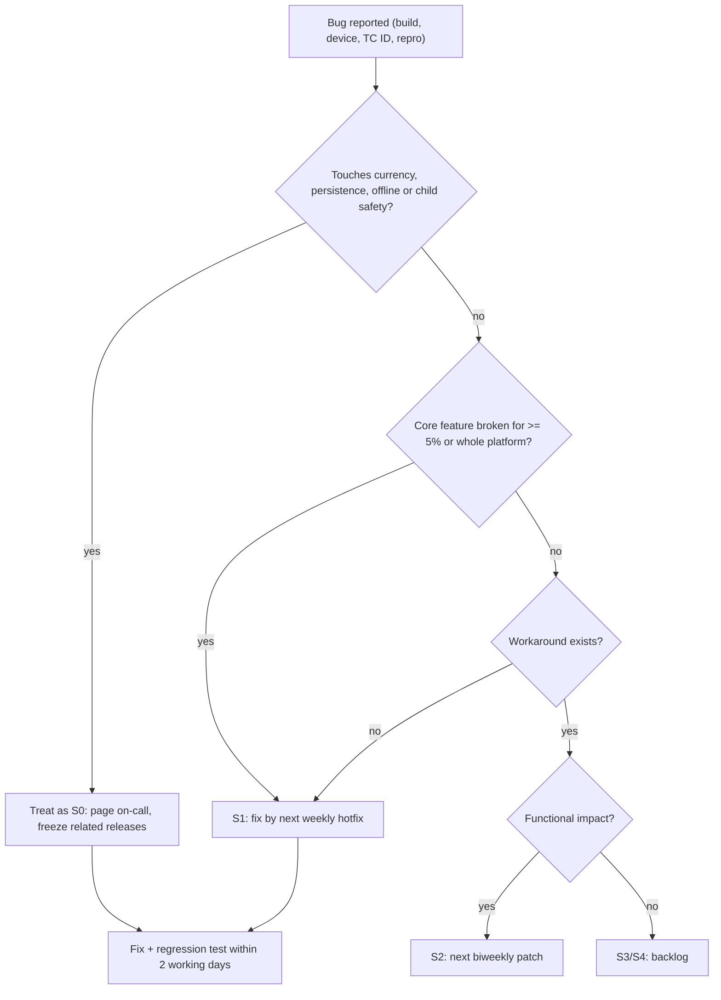

## 35. Testing and QA

This section is the master test plan for Mystery Morph Restaurant. It defines how every system in §5–§33
is verified, lists concrete test cases for each area required by the brief (Part 25), turns every canon
edge-case ruling (§C22 E1–E14) into an explicit test asserting that ruling, and sets the performance
matrix, exploit program, phase acceptance gates and bug-severity rules used by the roadmap (§34) and the
Definition of Done (§40). Thresholds marked **[TUNABLE]** are QA targets the producer may re-baseline at a
phase gate; values quoted from canon are not tunable here.

### 35.1 Principles

1. **Server truth is what we test.** Every reward, timer, damage number and currency change is asserted
   on the server (or in the pure formula module the server uses), never from what a client displays.
2. **Formulas are code, code is tested.** Every canon formula (§C4–§C15) lives in a pure Luau
   ModuleScript with zero Instance access, so it can be unit-tested headless in CI.
3. **Determinism first.** Offline simulation, capsule rolls and incident picks use seeded RNG; tests pin
   seeds and compare against golden outputs.
4. **Edge cases are features.** The rulings in §C22 are acceptance tests, not footnotes (§35.6).
5. **Kids are the audience.** Readability and safety are tested with age-banded playtests (§35.8), not
   assumed.
6. **Fail funny, never fail unfair.** Any test where a player loses mutations, items or currency through
   defeat or a platform failure is an automatic S0 (§35.13).

### 35.2 Test Strategy

| Layer | What | Tooling | Runs | Owner | Exit metric [TUNABLE] |
|---|---|---|---|---|---|
| L1 Unit | pure formula modules (below) | TestEZ-style or Jest-Lua specs, executed headless by a standalone Luau runtime (e.g. Lune) in CI | every push | engineers | 100 % pass; ≥ 90 % line coverage on formula modules |
| L2 Property | invariants over random inputs (10,000 cases per invariant) | same runner, seeded generators | every push | systems eng | 0 invariant violations |
| L3 Golden | offline simulation, capsule rolls, incident picks with pinned seeds | JSON goldens committed to Git | every push | systems eng | byte-identical output |
| L4 Integration | services together in a Studio test place (`MMR_TestPlace`) with fixtures and a mock DataStore with fault injection | in-place test runner; CI via Open Cloud Luau execution against the Staging test place | nightly | engineers + QA | ≥ 95 % pass on gate builds |
| L5 Multi-client | 2–8 clients against a local server (Studio "Clients and Servers") | Studio test sessions + scripted client harness | weekly / on demand | QA | all P0/P1 multi-client cases pass |
| L6 Synthetic load | server-side synthetic owners that drive service APIs (full rushes, employees, events) + client bot harness that plays via real remotes | load scripts in Staging | weekly from Alpha | systems eng | §35.10 server targets met |
| L7 Device lab | 7 device classes (§35.10) | manual + MicroProfiler captures, `Stats` sampling | weekly (VS), biweekly matrix (Beta) | QA | §35.10 client targets met |
| L8 Economy sim | Monte Carlo players over the same formula modules | Lune scripts, CSV outputs, charts | nightly from Alpha | designer | pacing within ±15 % of §C4.4 / §C5.1 |
| L9 Playtest | internal weekly; external age-banded per phase | playtest vendor, guardian consent, questionnaires | per phase | producer/QA | §35.8 readability targets |
| L10 Exploit & chaos | remote fuzzing, forged payloads, crash-during-write, clock tampering | exploit harness (§35.11) | each phase + every release | systems eng + external reviewer | 0 open S0/S1 exploits |

#### 35.2.1 Pure formula modules under unit test

| Module | Canon source | Key assertions |
|---|---|---|
| `PricingFormula` | §C4.2 | `BasePrice(L) = 10 × 1.05^(L−1)` × difficulty × category factor, ±15 % variance, whole-MB rounding; reference values L1 ≈ 10 … L95 ≈ 975 |
| `PatienceFormula` | §C11.2 | `(70 + 20 × (items − 1) + 5 × ΣD) × PersonalityPatienceMult × (1 + 0.004 × CHARM)`; ordering wait 30 s × mult |
| `SatisfactionFormula` | §C11.3 | weights 0.25/0.20/0.15/0.20/0.10/0.10, W piecewise, clamp 0–100, MutationBonus ≤ 10, EventModifier −15…+15 |
| `PaymentFormula` | §C11.4 | PayFactor 1.0 / 0.8 / 0.4 apology / 0 storm-out; TipRate bands; Jackpot chance and caps |
| `ReputationFormula` | §C11.4 | `Stars += 0.02 × (S/20 − Stars)`, storm-out −0.03, clamp 1.0–5.0, `RepMult = 0.5 + 0.25 × Stars`, `DecorMult = 0.9 + 0.003 × Atmosphere` |
| `StatFormula` | §C5 | all nine effect formulas and caps; "MAXED" flag when uncapped value exceeds cap; HP formula |
| `XPCurve` | §C5.1 | `XPReq(L)` and `XPRate(L)` reference values (XPReq(1) = 210, XPReq(10) = 713, XPReq(80) = 83,523; cumulative L100 = 4,319,405) |
| `HeatTiming` / `ChopScoring` | §C8, §C4.9 | windows, burn, fire, tap scoring, MUSHY, Auto-Rhythm, station-level multipliers |
| `MutationBudget` / `UpgradeCost` | §C13.4, §C4.6 | budgets by rarity × slot weight × level; upgrade MB/MS/RT/duplicate rules; max levels |
| `CapsuleRoller` | §C4.7 | disclosed odds, pity at the 40th capsule, duplicate conversion |
| `EmployeeEfficiency` | §C14.2 | `RoleStatAvg × (0.6 + 0.4 × Morale/100) × (0.7 + 0.3 × Energy/100) × (1 + 0.001 × EFFICIENCY)` |
| `DamageFormula` | §C5, §C12.1 | STR/DEF multipliers, Block −70 %, guard meter |
| `OfflineSim` | §C15 | full model; determinism; caps; close-early rule; incident bounds; discoveries |

**Determinism note.** `OfflineSim` and `CapsuleRoller` use an in-house seeded PRNG written in Luau (not
`Random`), so the CI runtime and Roblox servers produce identical sequences; a CI test compares 10,000
draws against a committed sequence.

#### 35.2.2 Property invariants (L2)

| Invariant | Applies to |
|---|---|
| 0 ≤ S ≤ 100 for any inputs in range | `SatisfactionFormula` |
| Pay ≥ 0 and Tip ≥ 0; Tip = 0 whenever S < 70 | `PaymentFormula` |
| 1.0 ≤ Stars ≤ 5.0 after any sequence of customers | `ReputationFormula` |
| Effective stat ≤ cap; WalkSpeed ≤ 16 × 1.3 | `StatFormula` |
| Upgrade cost strictly increasing in level; no RT below Epic or below Lv4 | `UpgradeCost` |
| `H ≤ OfflineCap ≤ 24`; Net ≥ 0; negative incidents ≤ 10 % and positive ≤ 15 % of (Revenue + Tips) | `OfflineSim` |
| Offline net/h ÷ active target net/h (§C4.4) ≤ 0.60 for every tier fixture | `OfflineSim` + fixtures |
| Wallet balance never < 0 after any transaction sequence | `EconomyService` transaction model |

### 35.3 Environments, Tooling and Test Data

- **Experiences:** Dev, Staging and Production are separate experiences (separate DataStores). QA never
  points a test at Production data; Studio API access is enabled only in Dev/Staging.
- **Injectable clock.** `OfflineEarningsService`, `QuestService` resets and capsule day limits read time
  from a `ClockProvider` (production: `os.time()` on the server; tests: a fake clock), so "return after
  30 days" runs in seconds.
- **Fault injection.** The mock DataStore can fail the next N calls, add latency, or throw on
  `UpdateAsync`; the server can be killed without BindToClose in the Staging test place.
- **Admin console (Dev/Staging only, gated by group rank, compiled out of Production):** spawn a
  customer of a given `PER_` ID, set anger, set tier, grant MB/MS/RT, set stats, advance the fake clock,
  force a seed, trigger a city event, toggle Reduced Effects, dump a profile.
- **Fixtures:** profile fixtures for every schema version; layout fixtures (connected, door-disconnected,
  seat-island); offline fixtures F-OFF-01…F-OFF-10 (`TIER_01`, `TIER_03`, `TIER_05`, `TIER_07`, `TIER_10` ×
  well-staffed / under-staffed) with committed golden reports.
- **Bug tracker fields:** build ID, device class, input mode, TC ID, severity (§35.13), repro rate,
  server JobId, profile key (hashed), video.

### 35.4 Test-Case Conventions

- **ID:** `TC-<AREA>-NN` (a test identifier, not a database ID). Areas: COOK, CUST, SAT, CMBT, MUT,
  MORPH, BUILD, DEST, RPR, EMP, OFF, DATA, MP, PERF, ECON, QST, UI, EDGE.
- **Priority:** **P0** = smoke, must pass on every build; **P1** = must pass for a phase gate;
  **P2** = should pass; a release may ship with a known P2 failure only if its bug is ≤ S2 with a workaround.
- **Expected results** quote canon values (§C…) or the owning section (§N). Where a section defines the
  exact value (e.g. a recipe's `T_ready`), the test reads it from the data module rather than hard-coding.
- **Tolerances [TUNABLE]:** timers ±50 ms server-side; probabilities verified with n ≥ 100,000 simulated
  trials and a 99 % confidence interval unless stated; FPS as p50 / p5 over a 5-minute capture.

### 35.5 Area Test Plans

Each area lists its scope, then a test-case table. Cross-area canon edge cases live in §35.6 and are
referenced, not duplicated.

#### 35.5.1 Cooking (§5, §C7, §C8, §C4.9)

Scope: station state machines, heat timing, chopping, mixing by hand, assembly order, plating, carry rules,
station upgrades, server authority over quality.

| ID | Preconditions | Steps | Expected result | Priority |
|---|---|---|---|---|
| TC-COOK-01 | `STN_GRILL` Lv1, COOK_QLT 0, item with `T_ready` from §5 data | Place item; remove at `T_ready` + 1.0 s | Grade PERFECT (1.00); Perfect band is exactly 2.0 s wide (`W_perfect`), shown green with a ✓ icon | P0 |
| TC-COOK-02 | Same as 01 | Repeat removing at `T_ready` − 0.5 s, `T_ready` + 3 s, `T_ready` + 6.5 s; then leave until `T_ready` + 10 s | UNDERCOOKED 0.35; GOOD 0.80; BURNED 0.15; at `T_burn` + 4 s (= `T_ready` + 10 s) the station enters ON_FIRE and must be extinguished (`ANM_030`) | P0 |
| TC-COOK-03 | `STN_CUT`, default N = 4 taps | Tap green, green, yellow, miss; then a fresh item with 8 taps | First item CHOPPED quality 0.85; second item MUSHY (0.35) because taps > N + 3 | P0 |
| TC-COOK-04 | Accessibility "Auto-Rhythm" on | Chop 4 taps with random timing | Every tap scores 0.8; CHOPPED quality = 0.80 | P1 |
| TC-COOK-05 | COOK_SPD effective 50, then admin-set 200 | Process the same item at Lv1 | At 50: process time × 0.769 (±1 %). At 200: capped at 150 → × 0.526; stat panel shows "MAXED" | P1 |
| TC-COOK-06 | COOK_QLT 100; separately station Lv3 with COOK_QLT 0 | Read Perfect window from server state | COOK_QLT 100: 3.0 s (2.0 × 1.5). Lv3: 2.5 s (× 1.25). Combination rule per §5 | P1 |
| TC-COOK-07 | Station at Lv2, Lv3, Lv4, Lv5 | Measure process time vs Lv1 | × 0.90 / 0.80 / 0.70 / 0.60; Lv4 adds burn grace +3 s; upgrade purchase blocked below `TIER_02` / `TIER_04` / `TIER_06` / `TIER_08` respectively | P1 |
| TC-COOK-08 | `TIER_03`, burger with 4 layers | Assemble in correct order; one swap; two swaps; serve un-plated | Assembly factor 1.0 / 0.85 / 0.70; un-plated × 0.9 at `TIER_03`+; at `TIER_01`–`TIER_02` `STN_ASSEMBLY` doubles as plating (no 0.9 penalty) | P1 |
| TC-COOK-09 | No `STN_MIXER` owned | Combine dough at `STN_PREP` | MIX by hand allowed and takes 1.5× the mixer time | P2 |
| TC-COOK-10 | Wallet 0 MB, basic-ingredient dish | Cook and trash a burned patty; then cook and serve a dish | Trash cost charged but balance stays 0 (never negative); served dish nets ingredient cost from the sale | P0 |
| TC-COOK-11 | Exploit client | Fire `Cooking.InteractStation` with a forged `quality = 1` field and early timestamps | Server ignores client quality/timestamps; grade computed from server timers within the §5 latency allowance; violation logged | P0 |
| TC-COOK-12 | Base carry 1; equip two `MUT_145` + `MUT_217` | Pick up items until refused | Carry 1 → 2 → 3; further pickups refused; never above hard max 3 | P1 |

#### 35.5.2 Customer Behavior (§8, §9, §C11)

Scope: spawn/approach/seat/order/eat/pay/leave flow, conditional states, personalities, patience, anger
escalation, combat styles, SPCV proxies, caps.

| ID | Preconditions | Steps | Expected result | Priority |
|---|---|---|---|---|
| TC-CUST-01 | `TIER_01`, 1 free seat | Spawn customer; serve correctly | States logged in order: Spawn → Approach → Enter → Request seating → Navigate → Sit → Review menu → Place order → Wait → Receive → Inspect → Evaluate → Eat → Pay → Tip → Leave | P0 |
| TC-CUST-02 | Seated customer, PersonalityPatienceMult 1.0 | Never take the order | Customer waits exactly 30 s for order-taking, then follows the §8 "not served" transition | P1 |
| TC-CUST-03 | 1 item, D = 2, mult 1.0, CHARM 0; then 2 items ΣD = 3, CHARM 50 | Read patience | 80 s; then 105 × 1.2 = 126 s | P0 |
| TC-CUST-04 | `TIER_01` (4 seats) | Force demand spike of 12 arrivals | At most 4 seated + 4 queued (8) customers exist; extra arrivals do not spawn or balk per §8 | P1 |
| TC-CUST-05 | 8 owners at `TIER_10` | Synthetic full rushes | Server never exceeds 160 customer proxies; spawner throttles fairly across restaurants (§30) | P1 |
| TC-CUST-06 | Admin anger control | Set anger 14, 15, 29, 30, 44, 45, 59, 60, 74, 75, 89, 90 | Levels 0,1,1,2,2,3*,3,4*,4,5*,5,6** (* only after a successful escalation roll; ** only if ≥ 3 customers are at level ≥ 3 or an event is active) | P0 |
| TC-CUST-07 | AngerProbability 0.5, CHARM 100 | 100,000 simulated crossings into level 3 | Escalation succeeds 25.0 % ± 0.4 %; failures resolve to sulk, complain or leave (never attack) | P1 |
| TC-CUST-08 | 2 customers at level 4, no event | Wait 60 s | Restaurant never enters level 6 chaos | P1 |
| TC-CUST-09 | A PACIFIST personality from §9 | Push it to levels 3–5 in 100 trials | 0 attacks; outcomes limited to sulking, dramatic crying or storming out | P1 |
| TC-CUST-10 | Customer at level 2 | Serve its order PERFECT; separately use `ABL_006` and a Peace Offering on level-3 customers | Each de-escalates per §10 values; no reward is granted for causing the anger first (see TC-ECON-14) | P1 |
| TC-CUST-11 | Two clients, one inside the interior, one on the street | Spawn customers | Server proxy is anchored and invisible; only the client inside builds visuals; the outside client builds none | P1 |
| TC-CUST-12 | Customer with a visible part that has an active ability | Drive it to fighting | It uses only abilities of its own visible parts (NPC-tuned, §36.6) | P2 |

#### 35.5.3 Customer Satisfaction, Payment and Reputation (§10, §C11.3–§C11.4)

| ID | Preconditions | Steps | Expected result | Priority |
|---|---|---|---|---|
| TC-SAT-01 | Fixture: A=1, Q=0.8, C=1, W=0.5, K=90, M=60, P_mult 1, offset 0 | Evaluate | S_base = 81.0 → Happy; TipRate 10 % | P0 |
| TC-SAT-02 | Patience 80 s | Serve at 40 s, 60 s, 80 s | W = 1.0, 0.5, 0.0 | P0 |
| TC-SAT-03 | S_base 98, MUT dish "Whoa!" +10, event +15 | Evaluate | S clamped to 100; with S_base 5 and event −15, S clamps to 0 | P1 |
| TC-SAT-04 | Two mutation bonuses totalling +18 | Evaluate | MutationBonus contributes at most +10 | P1 |
| TC-SAT-05 | Default thresholds | Evaluate S = 90, 89.9, 70, 69.9, 50, 49.9, 30, 29.9 | Delighted, Happy, Happy, Meh, Meh, Unhappy, Unhappy, Furious | P0 |
| TC-SAT-06 | Order Σ prices 20 MB | S = 50; S = 49.9; storm-out; calmed hostile | Pay 20; 16; 0; 8 MB apology and no tip | P0 |
| TC-SAT-07 | Σ prices 16 MB, PersonalityTipMult 1.0 | S = 69, 70, 80, 90, 98 | Tip 0, 5 %, 10 %, 18 %, 25 % ("Chef's Kiss") of 16 MB, rounding per §10 | P0 |
| TC-SAT-08 | LUCK 0, then LUCK 100; S ≥ 90 | 200,000 simulated tips each | Jackpot ×5 rate 0.5 % ± 0.05 %; 10.5 % ± 0.2 % | P1 |
| TC-SAT-09 | `TIER_04` vs `TIER_05`; base tip 150 MB | Force a jackpot | `TIER_04`: tip capped at 500 MB; `TIER_05`: 750 MB (cap 5,000) | P1 |
| TC-SAT-10 | Stars 2.5 | Serve S = 100; reset; serve S = 0; reset; storm-out at S = 0 | Stars 2.55; 2.45; 2.42; Stars clamped to 1.0–5.0 over 1,000 S = 0 customers | P0 |
| TC-SAT-11 | Stars 2.5, Atmosphere 50, no event | Read online demand | RepMult 1.125, DecorMult 1.05; customers/h = BaseDemand × 1.125 × 1.05 | P1 |
| TC-SAT-12 | Synthetic competent-play bot, 1,000 orders | Aggregate tips | Average tip rate between 8 % and 12 % (canon target ≈ 10 %) | P2 |

#### 35.5.4 Combat (§11, §C12)

| ID | Preconditions | Steps | Expected result | Priority |
|---|---|---|---|---|
| TC-CMBT-01 | STR 0, then STR 50 | Land the 3-hit `ABL_001` combo on a dummy | 8 dmg per hit at 0.35 s/hit; with STR 50 each hit = 11.2 | P0 |
| TC-CMBT-02 | STR 0 | Charge `ABL_002` | Requires 0.6 s charge; deals 20 dmg | P1 |
| TC-CMBT-03 | Player blocking (`ABL_003`) | Take a 20-dmg hit; then 60 guard damage | 6 dmg taken (−70 %); guard break → `STS_STUN` 1.0 s; guard regenerates 20/s after 2 s without guard damage | P0 |
| TC-CMBT-04 | `ABL_004` ready | Dodge through a hit at 0.1 s into the roll; dodge again at 1.0 s | 0 damage during the 0.25 s invulnerability; second dodge refused until 1.2 s cooldown elapses | P1 |
| TC-CMBT-05 | DEF 100, then 200, then 250 | Take a 30-dmg hit | 15; 10 (× 0.333); DEF capped at 200 → 10, "MAXED" | P1 |
| TC-CMBT-06 | Customer Huff Points reduced to 0 | Observe | `STS_DIZZY` 3 s (`ANM_052`) → Calming down → Apologizing (`ANM_053`) → Apology Payment 40 % → escorted out (`ANM_055`) | P0 |
| TC-CMBT-07 | Player L12, inventory snapshot | Get KO'd by a customer | `ANM_062` 4 s; respawn at kitchen spawn with 60 % of 122 HP and `STS_WOOZY` (−15 % move, 10 s); inventory, mutations and wallet hashes unchanged; the customer plays `ANM_051` and leaves without paying | P0 |
| TC-CMBT-08 | Player dealt damage at t = 0 | Poll the In Combat flag | True for exactly 6 s after the last damage dealt or taken | P0 |
| TC-CMBT-09 | 5 equipped parts with actives | Open ability bar | Max 4 mutation abilities slotted + fixed base kit; unequipping a part removes its ability immediately | P1 |
| TC-CMBT-10 | Exploit client | Claim a melee hit at 30 studs; fire an ability during cooldown | Both rejected server-side; no damage; violation logged | P0 |
| TC-CMBT-11 | Customer throws food at the player, player dodges | Projectile hits another customer | Scripted arc (raycast), no physics; struck customer +25 × sensitivity anger | P1 |
| TC-CMBT-12 | Players L1 and L50 | Read max HP | 100 and 198 (+ mutation HP bonuses, §12) | P1 |
| TC-CMBT-13 | Art review build | Trigger all 70 abilities and 20 statuses | No blood, gore, death or realistic weapons; damage shows as stars, feathers, sauce splats, confetti, soot; `STS_TOASTY` shows soot, never flames on bodies | P0 |

#### 35.5.5 Mutations (§12, §C13, §C4.5–§C4.7)

| ID | Preconditions | Steps | Expected result | Priority |
|---|---|---|---|---|
| TC-MUT-01 | Player L11 owns a Rare part | Try to equip; level to 12; retry | Blocked with a level message; equips at L12 (Rare default req.) | P0 |
| TC-MUT-02 | New profile at `QST_TUT_010` | Choose `MUT_153` | Granted at L1 despite Rare requirement; the other two choices are not granted; re-triggering the step grants nothing | P0 |
| TC-MUT-03 | Parts at Lv1 unless stated | Read budgets | Common HEAD 4.0; Uncommon EARS 3.5; Rare ARM at Lv7 18.92; Legendary TAIL at Lv9 43.12; any FX 0 | P1 |
| TC-MUT-04 | Two `MUT_184` legs; then one `MUT_184` + one `MUT_180` | Compare stats & animation | Matched: pair stats +25 % and `ABL_011` gains its paired bonus. Mismatched: `ANM_008` wobbly gait, no penalty | P1 |
| TC-MUT-05 | Owned parts and currencies | Upgrade Common Lv1→2; Common Lv4→5; Epic Lv4→5; Legendary Lv8→9 | 100 MB + 2 MS; 337.5 MB (rounded per §12) + 8 MS; 10,125 MB + 60 MS + 1 RT; 170,859.375 MB (rounded) + 240 MS + 10 RT — each also needs 1 duplicate or DupeSubstituteMS (10 / 10 / 160 / 400 MS) | P0 |
| TC-MUT-06 | Common at Lv5 | Attempt upgrade | Refused: max level 5 | P1 |
| TC-MUT-07 | Seeded roller | 1,000,000 capsule rolls with pity disabled | Common 55, Uncommon 27, Rare 12, Epic 4.5, Legendary 1.3, Mythic 0.2, Secret 0 % (each ± 0.15 pp) | P0 |
| TC-MUT-08 | 39 capsules opened without Epic+ | Rejoin; open the 40th | 40th is Epic or better; counter resets only after an Epic+ result; counter persisted across sessions | P0 |
| TC-MUT-09 | Duplicate parts of each rarity, "keep" toggle off | Receive duplicates | Auto-convert to 5 / 12 / 30 / 80 / 200 / 500 MS (Common → Mythic); with "keep" on, duplicate is stored | P1 |
| TC-MUT-10 | 3 Legendary parts of one category, 600 MS, 40 RT | Mythic fusion at `BLD_11`; force a failure mid-transaction | Success consumes all inputs atomically; forced failure consumes nothing | P0 |
| TC-MUT-11 | Fresh profile | Serve `RCP_PST_008` PERFECT 10 times | `MUT_116` granted once; an 11th serve grants nothing | P1 |
| TC-MUT-12 | §36.3 data | Data validator | Every shop price inside its rarity band (§C4.5); Rare+ carries the extra MS/RT cost; no Mythic/Secret is sold | P1 |
| TC-MUT-13 | Developer products list | Audit every Robux product | No product grants a mutation part, capsule, MS or RT | P0 |

#### 35.5.6 Morph Assembly (§13, §C13.1, §C13.7)

| ID | Preconditions | Steps | Expected result | Priority |
|---|---|---|---|---|
| TC-MORPH-01 | 7,000 synthetic new profiles | Inspect starter morphs | All have `MUT_117`, `MUT_139` ×2, `MUT_179` ×2; head ∈ {`MUT_001`, `MUT_002`, `MUT_003`, `MUT_004`, `MUT_005`, `MUT_006`, `MUT_008`}, each 1/7 ± 10 % relative | P1 |
| TC-MORPH-02 | Any equipped morph | Inspect the character model | Every part welded to its `MMR_` attachment per §C13.7; default R15 meshes Transparency 1; mutation MeshParts Massless with CanCollide/CanTouch/CanQuery false | P0 |
| TC-MORPH-03 | Equip `MUT_189` legs then `MUT_110` neck | Measure | `Humanoid.HipHeight` follows `LegLength`; head offset follows `NeckLength`; feet within ±0.1 stud of the floor in `ANM_001` | P1 |
| TC-MORPH-04 | Asset validator in CI | Submit an over-budget test part | Player morph > 40 MeshParts or > 15,000 tris rejected; NPC visual > 24 MeshParts or > 6,000 tris rejected; NPC beyond 60 studs swaps to a ≤ 1,500-tri impostor | P0 |
| TC-MORPH-05 | One ARM part | Equip to ARM_L, then ARM_R | Auto-mirrored; same part may occupy both arm slots | P1 |
| TC-MORPH-06 | FUR equipped | Equip a SCALES part | FUR and SCALES never both active (§13 resolution rule); SKIN remains the base | P1 |
| TC-MORPH-07 | 3 loadouts saved (Chef, Fighter, Repair) | Swap loadout; take damage at 2 s; swap again within 10 s | 3 s channel; damage interrupts; 10 s cooldown enforced (§C22 E4) | P0 |
| TC-MORPH-08 | Same part list | Build on server (player path) and via the client SPCV builder | Structural hash (part IDs, attachments, colors) identical | P1 |
| TC-MORPH-09 | Reference combo set from §36.5 (≥ 100) | Play `ANM_001`–`ANM_008`, `ANM_010`–`ANM_030` on each | No detached parts, no rig explosions, no T-pose; screenshots archived | P1 |
| TC-MORPH-10 | Low-phone client | Build 20 customer visuals entering at once | Builds spread across frames; no frame > 50 ms attributable to assembly [TUNABLE] | P1 |
| TC-MORPH-11 | Morph naming | Enter a name containing filtered text | Name filtered via `TextService` before storage and display to others | P0 |

#### 35.5.7 Restaurant Building (§15, §C6, §C7.1, §36.12)

| ID | Preconditions | Steps | Expected result | Priority |
|---|---|---|---|---|
| TC-BUILD-01 | `TIER_01`, 1,000 MB, L4 | Buy `TIER_02`; level to 5; retry | Blocked ("Reach level 5"); then succeeds and debits exactly 1,000 MB once | P0 |
| TC-BUILD-02 | `TIER_03`, 5,000 MB, L18, no permit | Buy `TIER_04`; complete the City Hall permit quest; retry | Blocked with a pointer to `BLD_09`; then succeeds for 5,000 MB with no extra permit charge | P1 |
| TC-BUILD-03 | Just upgraded to `TIER_03` | Read restaurant state | Seats 8, appliance slots 10, menu slots 6, employee cap 4, base demand 80/h; table service enabled | P0 |
| TC-BUILD-04 | `TIER_01` starter kit placed | Buy 2 extra appliances, then a 3rd; at `TIER_02` place `STN_FREEZER` | 2 accepted (6/6 slots), 3rd refused; `STN_FREEZER` does not consume an appliance slot | P1 |
| TC-BUILD-05 | Shop at `BLD_03` | Try `STN_MIXER` at L5 `TIER_01`; `STN_STEAMER` at L6 `TIER_02`; `STN_ANTIGRAV` at L30 `TIER_05`; `STN_INFUSER` at L40 `TIER_05` | Refused; refused; allowed; refused (needs `TIER_06`) | P1 |
| TC-BUILD-06 | Placement mode | Place overlapping and out-of-bounds items via a forged remote | Server rejects both regardless of client preview | P0 |
| TC-BUILD-07 | `TIER_02` then `TIER_03` | Serve a customer at each | `TIER_02`: counter service via `STN_WINDOW`; `TIER_03`: customer seated and served at the table | P1 |
| TC-BUILD-08 | 8 players on Restaurant Row | Owner upgrades tier | Façade on that plot updates for all clients within 2 s | P2 |
| TC-BUILD-09 | Layout with 50 items | Rejoin on another server | Every item restored within 0.01 stud and exact rotation; no duplicates or missing items | P0 |
| TC-BUILD-10 | Atmosphere 40 | Place decor raising Atmosphere to 60 | Atmosphere and DecorMult (0.9 + 0.003 × Atmosphere) update within 1 s; satisfaction term M uses the new value | P1 |
| TC-BUILD-11 | `TIER_01`, 4 menu slots filled, recipe learnable | Learn a recipe at `BLD_06`; add it to the menu | Costs 5 × its price; menu add refused until a slot is freed | P1 |

#### 35.5.8 Furniture Destruction (§15, §11, §C6)

| ID | Preconditions | Steps | Expected result | Priority |
|---|---|---|---|---|
| TC-DEST-01 | Admin durability control on a table | Set 76, 75, 51, 50, 26, 25, 1, 0 | Pristine, Scuffed, Scuffed, Cracked, Cracked, Broken, Broken, Destroyed; visual swaps exactly at the boundaries | P0 |
| TC-DEST-02 | One Broken seat, one Broken appliance | Spawn customers; try to load the appliance | No customer is assigned the Broken seat; appliance rejects items and prompts Repair | P0 |
| TC-DEST-03 | Item priced 800 MB | Destroy it | Cartoon rubble pile; rebuild offered for ≤ 200 MB (≤ 25 %); owned-item count unchanged | P0 |
| TC-DEST-04 | Interior with 40 throwable props | Trigger chaos | ≤ 30 loose physics props at any time; debris is client-only and despawns after 4 s | P1 |
| TC-DEST-05 | Scripted brief chain (Part 6.2) | Customer A throws a burger, player dodges, it hits B; B escalates and fights; someone crashes into a table | B gains +25 × sensitivity anger; the table loses durability; a repair job appears; no step requires physics simulation of food | P1 |
| TC-DEST-06 | CHARGER customer, 2 chairs in path | Trigger a charge | Both chairs damaged once per charge per §11; no object damaged twice by one charge | P2 |
| TC-DEST-07 | Clean dining room, K = 100 | Break 2 objects, spill 1 item | K drops per §15; the next satisfaction evaluation uses the lower K | P1 |
| TC-DEST-08 | Reduced Effects on | Destroy an object | Particle count reduced per §24; gameplay state identical to Reduced Effects off | P2 |
| TC-DEST-09 | 3 clients in one interior | Destroy an object | All clients show the same damage state within 250 ms of the server change | P1 |
| TC-DEST-10 | Offline report with damage | Return and open Restaurant Damage | Listed objects match the in-world states and counts | P1 |

#### 35.5.9 Repairs (§15, §C5 REPAIR, §C14)

| ID | Preconditions | Steps | Expected result | Priority |
|---|---|---|---|---|
| TC-RPR-01 | Cracked table, REPAIR 0, then 100 | Repair to Pristine | Base duration per §15; at REPAIR 100 the duration halves (speed × 2.0); at 150 speed × 2.5 | P0 |
| TC-RPR-02 | REPAIR 50, then 150, then 200 | Read material cost | × 0.90; × 0.70; capped at × 0.70 (−30 %) | P1 |
| TC-RPR-03 | `MUT_153` equipped | Use `ABL_062` on a Broken object | Restores the §36.6 amount; cooldown enforced; never exceeds 100 % durability | P1 |
| TC-RPR-04 | Each input mode | Complete the repair minigame | Completable with touch, keyboard/mouse and gamepad; no mouse-only step | P0 |
| TC-RPR-05 | Player repairing | Take damage mid-repair | Repair interrupted per §15; partial progress kept per §15; no charge for unrepaired damage | P1 |
| TC-RPR-06 | Two players on one object | Repair together | Progress handled per §15 co-op rule; total cost charged once at completion | P1 |
| TC-RPR-07 | Online `ROLE_REPAIR` employee | Damage 3 objects | Technician services them in §16 priority order playing `ANM_060`/`ANM_061` | P2 |
| TC-RPR-08 | Offline damage, Repair Tech with RepairSkill 60 | Return | Auto-repair charged at × 0.70 (discount 60/200); without a tech, objects stay damaged and Atmosphere drops | P1 |
| TC-RPR-09 | Destroyed object | Accept rebuild | Charged ≤ 25 % of price once; object returns to Pristine | P1 |
| TC-RPR-10 | Guest damaged owner furniture | Visit ends | Co-op Insurance repairs it free; guest wallet unchanged; owner wallet unchanged | P0 |

#### 35.5.10 Employee Hiring and Management (§16, §C4.8, §C14)

| ID | Preconditions | Steps | Expected result | Priority |
|---|---|---|---|---|
| TC-EMP-01 | Recruitment Office (`BLD_04`) board | Hire a Common candidate | Price within 200–600 MB, debited once; stats within 15–40; potential cap 55 | P0 |
| TC-EMP-02 | `TIER_01` with 2 employees | Hire a 3rd; upgrade to `TIER_02`; retry | Refused (cap 2); succeeds (cap 3) | P0 |
| TC-EMP-03 | Tutorial at `QST_TUT_012` | Accept Ollie | `EMP_001`: cost 0, `ROLE_CHEF`, Common, wage 12 MB/h, Cooking 30, Service 15, Accuracy 28, Reliability 40 | P0 |
| TC-EMP-04 | `EMP_001` on `STN_GRILL` | 10,000 cooked items | Cooks 2 items at once; "pickle on everything" in 5 % ± 0.5 % | P2 |
| TC-EMP-05 | RoleStatAvg 60, Morale 80, Energy 50, player EFFICIENCY 100 | Read Efficiency | 60 × 0.92 × 0.85 × 1.10 = 51.6 (± 0.1) | P1 |
| TC-EMP-06 | Assigned managers | Read offline cap for: none, Common, Rare, Epic, Legendary, Legendary + Asst, Rare + Asst, Asst only | 2, 4, 8, 12, 24, 24, 10, 2 h | P0 |
| TC-EMP-07 | Board shown | Rejoin; forge a remote requesting a specific candidate stat line | Board persisted (no free reroll by rejoining); forged request rejected; rerolls follow §16 cost/cooldown | P0 |
| TC-EMP-08 | Chef employee and player share `STN_GRILL` | Both use it | Per-slot locks shared (§C22 E7); employee never steals a slot mid-interaction | P1 |
| TC-EMP-09 | `TIER_03` with waiter | Run service | Waiter seats, takes orders and delivers; without waiters the owner must serve | P1 |
| TC-EMP-10 | Working employee | Observe 1 h online | Energy drains per §16; Efficiency recomputed from Energy and Morale | P2 |
| TC-EMP-11 | Hired employee | Fire / replace per §16 | Any refund strictly below hire cost; repeating hire→fire 100× never increases the wallet | P0 |

#### 35.5.11 Offline Earnings (§17, §C15, §C14.3)

| ID | Preconditions | Steps | Expected result | Priority |
|---|---|---|---|---|
| TC-OFF-01 | Fixtures F-OFF-01…10, pinned `lastSimAt` and fake clock | Simulate 100× on two server instances | Report JSON byte-identical in all runs (seed = hash(UserId, lastSimAt, SIM_VERSION)) | P0 |
| TC-OFF-02 | No manager, 10 h elapsed | Join | H = 2 h; report labelled "capped" | P0 |
| TC-OFF-03 | Fake clock set before `lastSimAt` | Join | H = 0; anomaly flagged in analytics; `lastSimAt` never moves backwards | P0 |
| TC-OFF-04 | No `ROLE_CHEF` assigned, 3 h elapsed | Join | 0 customers served, net 0, hint to assign a chef | P0 |
| TC-OFF-05 | `TIER_01`, Stars 2.5, Atmosphere 0, 1 chef (PrepSec_avg 40 s, Efficiency 50) | Read step values | Demand_off 30.375/h; Cap_seat 48/h; Cap_kitchen 32.14/h (Eff normalized to 0.50); Cap_service = Cap_kitchen; Q = 30.375/h | P1 |
| TC-OFF-06 | `TIER_03`, chef only; then + 1 waiter (Efficiency 50) and 1 cashier | Read Cap_service | 0.30 × Cap_kitchen; then 80 × 0.50 × 1.10 = 44/h | P1 |
| TC-OFF-07 | H = 8, SecurityMitigation 0.5 | 10,000 seeded runs | Base incident count 2 (+ seeded extra roll); Σ negative ≤ 10 % and Σ positive ≤ 15 % of (Revenue + Tips) in every run | P0 |
| TC-OFF-08 | Fixture where wages exceed revenue from step 3 | Simulate | Stops after step 3 ("closed early"); step-3 wages not charged; Net = max(0, Σ) | P0 |
| TC-OFF-09 | 1,000,000 simulated hours | Aggregate discoveries | MS finds 8 % ± 0.1 pp (1–3 MS each); crates 1 % ± 0.05 pp; ≤ 1 Morph Capsule per real day; RT always 0 | P1 |
| TC-OFF-10 | Well-staffed fixture per tier | Compare to §C4.4 | Offline net/h ÷ active net/h within 0.35–0.50 for every tier; never > 0.60 | P0 |
| TC-OFF-11 | 8 h, with and without a Manager | Read employee Energy/Morale | Energy −8 %/h (−5 %/h with Manager); Morale −1/h; only for simulated hours | P1 |
| TC-OFF-12 | Unclaimed pending report (4 h, Basic manager) | Leave 6 h more; rejoin | One merged pending report; second interval capped separately at 4 h; total 8 h | P0 |
| TC-OFF-13 | Pending report | Open Welcome Back | Buttons Collect, Employee Report, Restaurant Damage, Upgrade Suggestions, Mutation Rewards, Continue Playing; figures equal the server report; Collect disabled while in flight | P0 |
| TC-OFF-14 | Exploit client | Send Collect with extra fields (amount, timestamps) | Only `reportId` is read; extra fields ignored; logged | P0 |

#### 35.5.12 Data Persistence (§28, §C3, §C22 E6/E11/E13)

| ID | Preconditions | Steps | Expected result | Priority |
|---|---|---|---|---|
| TC-DATA-01 | Instrumented save calls | Play 15 min; buy a 9,999 MB item, then a 10,000 MB item; leave | Autosave every 120 s ± 5 s; no extra save at 9,999 MB; extra save at 10,000 MB; save on PlayerRemoving | P0 |
| TC-DATA-02 | Profile loaded on server A | Load the same profile on server B | B is refused/queued under the session lock; loads only after A releases | P0 |
| TC-DATA-03 | Fixture profiles of every prior schema version | Load | Migrate to current with field-level equality to expected; migrating twice yields the same result | P0 |
| TC-DATA-04 | Mock DataStore failing all reads | Join | Backoff and Safe Mode exactly as TC-EDGE-10 | P0 |
| TC-DATA-05 | 8 players, 1 h with purchases | Monitor | No DataStore throttling warnings; request rate under budget | P1 |
| TC-DATA-06 | Profile with NaN wallet injected in Staging | Load | Load rejected; last good version restored per §28; incident logged; player sees a friendly message | P0 |
| TC-DATA-07 | 2 h bot session | Audit `EconomyService` log | Σ logged deltas = final − initial balance for MB, MS and RT | P0 |
| TC-DATA-08 | Kill the Staging server process (no BindToClose) | Rejoin | Progress loss ≤ the last 120 s | P1 |
| TC-DATA-09 | Max-content late-game fixture | Serialize | Profile ≤ 1 MB and typical late-game ≤ 200 KB [TUNABLE] (well under the per-key limit) | P1 |
| TC-DATA-10 | Erasure request for a test user | Run the §28 erasure procedure | All keys for that UserId removed from every store; analytics contain no personal data | P1 |
| TC-DATA-11 | Robux cosmetic purchase | Replay the same receipt 3× | Granted once (idempotent by PurchaseId); `PurchaseGranted` returned only after the grant is saved | P0 |

#### 35.5.13 Multiplayer (§21, §C16.4, §C22 E12)

| ID | Preconditions | Steps | Expected result | Priority |
|---|---|---|---|---|
| TC-MP-01 | Empty server | Join 8 players; attempt a 9th | 8 plots assigned, one each; 9th cannot join this server (max 8); a plot frees only after its owner's Closing completes | P0 |
| TC-MP-02 | Friends on the same server, then on different servers | Walk into the friend's door; then join via the friends list | Same server: enter as guest per owner permissions. Different server: TeleportService to the friend's server; if full, a friendly message and no crash | P0 |
| TC-MP-03 | Owner permission toggles (§21) | Toggle cook / serve / clean / repair / fight for guests | Each disallowed guest action is rejected server-side; allowed actions work | P0 |
| TC-MP-04 | Guest with cook permission | Guest finishes the owner's grill item and serves it | Items are restaurant-owned (§C22 E7); payment to the owner's wallet; guest receives §21 guest rewards only | P1 |
| TC-MP-05 | 2 guests inside | Owner disconnects | Restaurant enters Closing (§C22 E1); guests moved to the street within 5 s | P0 |
| TC-MP-06 | Players in the city and in restaurants | Attempt player-vs-player attacks outside the Arena | No damage is ever applied; restaurant customers remain NPCs | P0 |
| TC-MP-07 | Arena opt-in queue (when shipped) | Queue 1v1, cancel, re-queue, disconnect mid-match | Matching per §21 rules; disconnect counts only as a match loss; no mutation, item or currency loss | P1 |
| TC-MP-08 | Text chat and restaurant sign text | Send and set text containing filtered words | Chat filtered by `TextChatService`; sign/restaurant/loadout names filtered via `TextService` for every viewer | P0 |
| TC-MP-09 | 8 players at `BLD_22` | Spam emotes | Emotes visible to players in range; emote input rate-limited per §21 | P2 |
| TC-MP-10 | 4 players co-op in one `TIER_10` interior | 20-minute rush | No item-ownership desync; station locks correct for 4 interactors; owner-only actions (build, buy, hire) unavailable to guests | P1 |

#### 35.5.14 Mobile Performance (§30)

Targets are defined in the matrix of §35.10; these cases are the gate checks run on the device lab.

| ID | Preconditions | Steps | Expected result | Priority |
|---|---|---|---|---|
| TC-PERF-01 | D1 (LOW), scenario P-01 | 5-min capture | FPS p50 ≥ 30, p5 ≥ 25; client memory ≤ 700 MB (well inside the 900 MB LOW budget) | P0 |
| TC-PERF-02 | D1 (LOW), scenario P-02 (`TIER_10` full rush, chaos level 6) | 5-min capture | FPS p50 ≥ 30, p5 ≥ 25; no frame > 100 ms; client memory ≤ 900 MB | P0 |
| TC-PERF-03 | Server, scenario P-03 (8 owners in full rush) | 30-min capture | Heartbeat ≥ 45 Hz at p95 and ≥ 40 Hz at p99; server memory ≤ 3,500 MB; ≤ 160 customer proxies | P0 |
| TC-PERF-04 | D1 (LOW), scenario P-04 (city event, 8 players in one district) | 5-min capture | FPS p50 ≥ 30, p5 ≥ 25; server → client ≤ 40 KB/s avg, ≤ 80 KB/s burst | P1 |
| TC-PERF-05 | D1 (LOW), scenario P-05 (8 max-budget morphs in view) | 5-min capture | FPS p50 ≥ 30, p5 ≥ 25 | P1 |
| TC-PERF-06 | D1 and D2, scenario P-08 (3-h soak) | Sample every 5 min | Client memory growth ≤ 50 MB/h; server ≤ 100 MB/h; instance count drift ≤ 2 % | P1 |
| TC-PERF-07 | D1 on a throttled 4G-class profile | Cold join; then enter the restaurant door | First input ≤ 20 s cold (≤ 10 s warm); ≤ 600 MB at tutorial start; interior transfer ≤ 3 s | P1 |
| TC-PERF-08 | Scenario P-02 | Measure per-client network | Server → client ≤ 40 KB/s avg; client → server ≤ 6 KB/s avg | P1 |
| TC-PERF-09 | D4 (tablet), 30-min P-02 loop | Watch thermal throttling | FPS drop ≤ 20 % from minute 1 to minute 30 (auto-scaler may step down once) | P2 |
| TC-PERF-10 | D7 (HIGH), scenario P-02 | 5-min capture | FPS p50 ≥ 60, p5 ≥ 50 | P1 |

#### 35.5.15 Economy Exploits (§22, §29, §C4)

| ID | Preconditions | Steps | Expected result | Priority |
|---|---|---|---|---|
| TC-ECON-01 | Exploit client | Fire the serve remote with forged price, satisfaction and tip fields | Server computes all values; forged fields ignored; violation logged | P0 |
| TC-ECON-02 | Exploit client | Fire the serve remote 50×/s | Only the §29 rate limit is processed; excess dropped; offender flagged for review (no automatic ban) | P0 |
| TC-ECON-03 | One plated dish | Serve it to two customers in quick succession | Second serve rejected; plate was consumed by the first | P0 |
| TC-ECON-04 | Completed quest | Fire the claim remote 20× in one frame | Exactly one reward grant | P0 |
| TC-ECON-05 | Capsule owned | Leave during the reveal animation; rejoin | Same result shown; the roll was persisted before reveal; no reroll | P0 |
| TC-ECON-06 | Furniture bought | Buy → sell 100× | Each sale refunds less than the price (§15/§22); wallet strictly decreases | P0 |
| TC-ECON-07 | Purchase in flight | Teleport/leave between debit and grant | Atomic: debit and grant both present in the log, or neither | P0 |
| TC-ECON-08 | Exploit client | Send NaN, ±inf, negative quantities, 10 KB strings, wrong types to every remote | All rejected; no server error spam; server heartbeat unaffected | P0 |
| TC-ECON-09 | Exploit client | Move at 2× max WalkSpeed; teleport 100 studs; interact from 15 studs | Movement validation flags; interactions beyond 7 + 2 studs (stations) or 10 + 2 (customers) rejected | P0 |
| TC-ECON-10 | Device clock +30 days | Rejoin | No offline credit and no daily reset (server time only) | P0 |
| TC-ECON-11 | Active cross-server event | Claim reward, server-hop, claim again | Reward claimed once per user per event instance | P0 |
| TC-ECON-12 | Owner + 3 alt guests | Co-op farm for 2 h | Guest rewards within §21 caps; no income multiplier; anomaly detector flags MB/h > 3× the tier's §C4.4 target | P1 |
| TC-ECON-13 | Deliberate anger farming | Provoke and calm customers for 30 min vs serve normally for 30 min | Apology 40 % < normal pay and combat XP capped per §14: provocation nets strictly less MB and XP | P1 |
| TC-ECON-14 | L20 player | Free respec; second respec within 24 h with 9,000 MB; then with 10,000 MB | Free; refused (needs 10,000 MB = 500 × 20); succeeds; wallet never negative | P1 |
| TC-ECON-15 | Duplicate part with "keep" toggle | Toggle keep/convert repeatedly | The same duplicate converts to MS at most once | P1 |

#### 35.5.16 Quest Progression (§20, §32, §C17)

| ID | Preconditions | Steps | Expected result | Priority |
|---|---|---|---|---|
| TC-QST-01 | New profile | Play the tutorial | `QST_TUT_001` → `QST_TUT_012` strictly in order; each completes only on its trigger; each reward granted once | P0 |
| TC-QST-02 | At `QST_TUT_007` | Disconnect mid-step; rejoin | Resumes per §32 recovery rules with state restored; no duplicate reward | P0 |
| TC-QST-03 | 100 fresh runs | Reach `QST_TUT_006` | Scripted `PER_001` spawns, escalates to the scripted level and resolves in 100/100 runs | P0 |
| TC-QST-04 | At `QST_TUT_003` | Cook `RCP_BRG_001` but trash it; then serve one | Completes only on serving to the tutorial customer | P1 |
| TC-QST-05 | At `QST_TUT_012` | Accept the hire | `EMP_001` granted once; offline income preview shown | P0 |
| TC-QST-06 | Fake clock 23:59:50 UTC on Sunday; two servers | Cross 00:00 UTC Monday; hop servers | Daily and weekly resets each happen once per player per period | P0 |
| TC-QST-07 | §20 data | Validator | Rewards use only the §C17.4 vocabulary (MB, MS, RT, XP, Morph Capsules, `MUT_` parts, `RCP_` unlocks, `FRN_901`–`FRN_910`, skill points, respec tokens, titles, emotes, palettes) | P1 |
| TC-QST-08 | §20 data | Validator | Daily-quest XP = 0.25 × XPRate(L) ± 10 % (≈ 334 XP at L10) | P1 |
| TC-QST-09 | §20 data | Validator | No daily quest grants RT; RT only from weekly, story, legendary dish orders, arena seasons, achievements, events | P1 |
| TC-QST-10 | Tier and story state | Advance tiers | Story chapter gating follows §20 (one chapter per tier); permit quest gates `TIER_04`+ | P1 |

#### 35.5.17 UI Behavior (§24, brief Parts 17 and 26.3)

| ID | Preconditions | Steps | Expected result | Priority |
|---|---|---|---|---|
| TC-UI-01 | Each input mode | Inspect HUD | Level, XP bar, HP, MB, MS, current objective, order queue, patience indicators, equipped abilities, restaurant condition and quick menu all present | P0 |
| TC-UI-02 | Touch active | Switch to gamepad, then keyboard/mouse | Prompts and glyphs update within 0.5 s; no input dead-end | P0 |
| TC-UI-03 | Colorblind simulation (protan, deutan, tritan) | Review rarity, anger and patience indicators | Every status readable by shape/icon/text alone (§C13.3 shapes) | P0 |
| TC-UI-04 | Phone with notch | Inspect all screens | No interactive element under the notch or home indicator; touch targets ≥ 44 pt [TUNABLE] | P1 |
| TC-UI-05 | Pseudo-localization (+40 % length, accented glyphs) | Visit all ≈ 36 screens | No clipping, overlap or truncated numbers | P1 |
| TC-UI-06 | Large values | Display 12500, 1500000 MB | Shown as 12,500 and 1,500,000 (or the §24 abbreviation); MB/MS/RT codes; s/min/h units | P2 |
| TC-UI-07 | Capsule in inventory | Open the capsule screen | Odds (§C4.7) and pity progress visible before opening | P0 |
| TC-UI-08 | Gamepad only | Navigate and close every screen | All screens reachable and closable; selection never lost | P0 |
| TC-UI-09 | Settings changed (audio sliders, Reduced Effects, Auto-Rhythm, camera shake) | Rejoin | Settings persisted per profile and applied on join | P1 |
| TC-UI-10 | Chaos level 6, Reduced Effects off | Watch HUD | Order queue and patience indicators stay visible; body text contrast ≥ 4.5:1 | P1 |

### 35.6 Canon Edge-Case Rulings (§C22) as Acceptance Tests

Every brief edge case (Part 25) maps to a canon ruling; every ruling has at least one test that asserts
it literally. These tests are P0 or P1 and are part of every regression run from Phase 2 onward.

| Brief edge case | Canon ruling | Test cases |
|---|---|---|
| Disconnect while cooking | E1 | TC-EDGE-01, TC-EDGE-02 |
| Customer attacks while the player is in a menu | E2 | TC-EDGE-03, TC-EDGE-04 |
| Restaurant damaged while an employee is repairing it | E3 | TC-EDGE-05, TC-EDGE-06 |
| Changing mutations during combat | E4 | TC-EDGE-07 |
| Returning after 30 days offline | E5 | TC-EDGE-08, TC-EDGE-09 |
| DataStore request failure | E6 | TC-EDGE-10, TC-EDGE-11 |
| Two players interacting with the same cooking station | E7 | TC-EDGE-12 |
| No money to pay employees | E8 | TC-EDGE-13 |
| No ingredients | E9 | TC-EDGE-14 |
| Customer cannot reach the assigned table | E10 | TC-EDGE-15, TC-EDGE-16 |
| Offline earnings received twice because of a reconnect | E11 | TC-EDGE-17, TC-EDGE-18 |
| (canon) Guest damages a friend's restaurant | E12 | TC-EDGE-19 |
| (canon) Server shutdown | E13 | TC-EDGE-20 |
| (canon) Player levels up mid-rush | E14 | TC-EDGE-21 |

| ID | Preconditions | Steps | Expected result | Priority |
|---|---|---|---|---|
| TC-EDGE-01 | [E1] Owner mid-rush, no online employees, 3 seated customers, 1 basic patty and 1 special-ingredient item in stations, 1 guest inside | Owner disconnects | Restaurant enters **Closing**; seated customers leave paying 0 under a "Closed for the day!" sign; Stars unchanged (no reputation loss); basic food discarded with no charge; special ingredient returned to stock (+1); profile saved on PlayerRemoving with `lastSimAt` = save time; guest moved to the street | P0 |
| TC-EDGE-02 | [E1] Same, but 2 online chef employees with 2 open tickets | Owner disconnects | Employees finish the current tickets; no new orders taken; then remaining customers leave paying 0; each finished ticket's payment is credited **exactly once** (never duplicated, never negative) — see canon gap note in §38 | P1 |
| TC-EDGE-03 | [E2] Player In Combat; separately, not in combat but targeted by a level-5 customer | Try to open a full-screen menu (shop, Morph) | Refused with "Can't shop during a brawl!" in both cases; overlay panels (order queue, map) still open | P0 |
| TC-EDGE-04 | [E2] Full-screen menu open, nearby customer at level 4 | Customer turns hostile toward the player | Menu auto-closes; player invulnerable for 1.5 s (hits in that window deal 0); overlays remain usable | P0 |
| TC-EDGE-05 | [E3] Employee repairing a Cracked table (40 %) | A customer damages it by 15 points during the repair | Remaining work grows by the new damage; on completion the cost charged equals the damage actually repaired, charged once | P1 |
| TC-EDGE-06 | [E3] Employee repairing a Broken table | Damage drives it to 0 % (Destroyed) | Job converts to Rebuild; total charged = rebuild cost only (≤ 25 % of price), never repair + rebuild | P1 |
| TC-EDGE-07 | [E4] Player In Combat, Morph menu closed | Attempt loadout swap; wait 6 s without damage; swap; take damage at 2 s; retry within 10 s; then equip a single part from the Morph menu out of combat | Blocked in combat; then 3 s channel starts; damage interrupts it; retry refused until 10 s cooldown; single-part equip in the Morph menu is instant | P0 |
| TC-EDGE-08 | [E5] Legendary Manager + Assistant Manager; fake clock +30 days | Rejoin | H = 24 h; report shows "capped"; wages charged only for simulated hours; Welcome Back Crate (1 Morph Capsule + 50 MS) granted once; restaurant durability, employees and mutations show no decay beyond the 24 simulated hours | P0 |
| TC-EDGE-09 | [E5] Fake clock absences of 6 d 23 h 59 min and of exactly 7 d | Rejoin each | No crate for the first; crate for the second (absence ≥ 7 days) | P1 |
| TC-EDGE-10 | [E6] Mock DataStore fails every read | Join | Retries at 1, 2, 4, 8, 16 s (max 5); then **Safe Mode** banner; earn/spend remotes rejected; kicked with a retry message after 60 s | P0 |
| TC-EDGE-11 | [E6] Mock DataStore fails the first 3 writes on leave; second server tries to load | Leave | Save retries within the BindToClose budget and succeeds on attempt 4; the session lock prevents the second server overwriting; measured data-loss window ≤ 120 s | P0 |
| TC-EDGE-12 | [E7] Two players; `STN_CUT` (1 slot) and `STN_GRILL` (2 slots) | Both interact with `STN_CUT`; both use `STN_GRILL`; player B removes player A's patty | Second `STN_CUT` interactor refused (slot lock); `STN_GRILL` used simultaneously on different slots; B may finish A's item (restaurant-owned) | P0 |
| TC-EDGE-13 | [E8] Wallet 0 MB, wage tick due, 2 employees; separately an offline interval with wages > revenue | Let the tick fire; then let a sale land; then simulate offline | Balance stays 0; employees take an **Unpaid Break** (stop working, Morale −5/h) until funds exist, then resume; offline net floored at 0 and the manager closes early | P0 |
| TC-EDGE-14 | [E9] Menu: 1 special-stock recipe with stock 0, others basic; then every menu item sold out | Spawn customers | Special recipe shows SOLD OUT and is never ordered; basic recipes always orderable with cost netted at serve; when all items are sold out, `RCP_BRG_001` is auto-added as the fallback | P0 |
| TC-EDGE-15 | [E10] Layout fixture that would disconnect the door from one seat | Place the blocking item | Placement rejected with the blocked path highlighted | P0 |
| TC-EDGE-16 | [E10] Customer path blocked at runtime (admin-spawned obstacle) | Wait | After 2 failed paths or > 6 s stuck, customer "poofs" (cartoon puff, "Pardon me!") to the seat | P1 |
| TC-EDGE-17 | [E11] Pending report computed; player disconnects; rejoins another server within 5 s | Join; press Collect twice; replay the Collect remote | Second server cannot load until the lock releases; same `reportId` shown; wallet credited once; `reportId` in `claimedReportIds` (ring buffer of 20); replays are no-ops | P0 |
| TC-EDGE-18 | [E11] Report computed; server crashes before Collect | Rejoin later | Same pending report shown (not recomputed); `lastSimAt` = report `toTs`; any new interval is merged into the pending report and capped separately | P0 |
| TC-EDGE-19 | [E12] Guest in a friend's restaurant; co-op customers fight | Guest damages furniture; guest tries to sell, move, store owner furniture and to spend owner currency | All four guest actions refused server-side; after the visit, Co-op Insurance repairs guest- and co-op-customer damage at no cost to the owner | P0 |
| TC-EDGE-20 | [E13] 6 players, restaurants with damage, stock and pending tickets | Shut the server down | BindToClose saves all profiles; damage and stock persist; pending tickets discarded; players teleported to a new server | P0 |
| TC-EDGE-21 | [E14] Player mid-rush with 2 items cooking | Earn enough XP to level up | Only a level-up toast appears; no modal; no input captured by UI; stat-point allocation deferred until the player opens the menu | P0 |

### 35.7 Additional Edge Cases (QA-originated)

| ID | Preconditions | Steps | Expected result | Priority |
|---|---|---|---|---|
| TC-EDGE-22 | Player carrying 3 items incl. 1 special ingredient | Get KO'd | No currency, mutation or inventory loss (§C12.1); special ingredient returns to stock; carried basic food handled per §11 at no charge | P0 |
| TC-EDGE-23 | Chaos level 6 active | A customer KOs the player | That customer does not leave; chaos continues (§C12.1 exception) | P1 |
| TC-EDGE-24 | Customers seated, enough MB for the next tier | Buy the tier upgrade | Applied per §15; no seated customer removed without payment resolution; no furniture lost or duplicated | P1 |
| TC-EDGE-25 | Daily quest 2/3 complete at 23:59 UTC | Cross 00:00 UTC; finish objective | Handled per §20 reset rule; never two rewards for one daily; one rollover per player per UTC day | P1 |
| TC-EDGE-26 | Pending report computed under SIM_VERSION n; deploy n+1 | Rejoin and Collect | Pending report unchanged (not recomputed); only intervals simulated after the deploy use n+1 | P0 |
| TC-EDGE-27 | 39 capsules without Epic+, one earned via offline discovery | Open it as the 40th | Pity applies regardless of capsule source; offline discoveries still ≤ 1 capsule per real day | P1 |
| TC-EDGE-28 | Secret part owned | Trigger its discovery condition again | No duplicate, no MS conversion; upgrades of secrets always use DupeSubstituteMS (600) | P1 |
| TC-EDGE-29 | Carrying 3 items with 2 carry-boosting parts | Unequip one carry-boosting part | Overflow handled per §5; invariant carried ≤ capacity at all times; no special ingredient lost | P1 |
| TC-EDGE-30 | Distances measured server-side | Interact with a station at 9.0 and 9.5 studs; with a customer at 12.0 and 12.5 studs | Accepted, rejected; accepted, rejected (7/10 studs + 2 tolerance) | P0 |
| TC-EDGE-31 | Patty on `STN_GRILL` | A customer reduces the grill to Broken mid-cook | Station unusable until repaired; item handled per §5/§15; no special ingredient lost; no charge for discarded basic food | P1 |
| TC-EDGE-32 | Player L4 | One reward grants enough XP for L6 | Two level-ups processed: +4 stat points pending, +2 skill points; one combined toast; no modal | P1 |
| TC-EDGE-33 | Owner rejoins a different server | Join | New plot assigned; façade and interior rebuilt from profile; old plot freed after Closing | P1 |
| TC-EDGE-34 | Customer eating | Its table is destroyed | Customer resolves per §8 (relocate or leave paying per current S); no stuck customer after 10 s | P1 |
| TC-EDGE-35 | Employee halfway through a ticket | Unassign the employee | Ticket returns to the queue; item stays restaurant-owned; no wage for unworked time | P2 |
| TC-EDGE-36 | 30 loose props already present | A customer throws another item | Oldest loose prop despawns; the thrown item still follows the scripted arc and anger logic still fires | P1 |
| TC-EDGE-37 | Non-heat stations (`STN_CUT`, `STN_BLENDER`, `STN_DRINK`) | Overrun every action | Never ON_FIRE (heat stations only); MUSHY or SPILLED instead | P1 |
| TC-EDGE-38 | Tier price displayed; MB spent elsewhere before confirming | Confirm purchase | Validated at commit; refused; balance never negative | P0 |
| TC-EDGE-39 | Customer eats a MUT dish | Observe server and clients | Cosmetic random part is client-visual only for 60 s; server proxy unchanged; +10 "Whoa!" applied once within the ≤ 10 MutationBonus cap | P2 |
| TC-EDGE-40 | Wallet set to 1,000,000,000 MB | Earn and spend | Integer-exact arithmetic (< 2^53); correct formatting; no overflow or precision loss | P1 |
| TC-EDGE-41 | Owner rejoins while their old server is still in Closing | Join | New server waits on the session lock until the old save completes, then loads; never two live restaurant instances for one profile | P0 |
| TC-EDGE-42 | Player inside their interior when a city event starts | Observe | Event announcement delivered; event modifiers applied per §18; the event is visible on exiting | P2 |
| TC-EDGE-43 | Cross-server event in progress | Join a fresh server mid-event | Current event state received within 5 s; reward eligibility per §18 | P1 |
| TC-EDGE-44 | Every seat Broken | Customers arrive | No customer is assigned a Broken seat; queue capped at 4; behavior per §8 when no seat is available | P1 |
| TC-EDGE-45 | Employees on Unpaid Break during an online rush | A sale credits MB | Employees resume within one wage tick; morale penalty stops accruing | P1 |

### 35.8 Playtest and Kids' Readability Protocol

- **Cadence:** internal playtest weekly; external age-banded playtests twice in Phase 2, three times in
  Phases 3 and 4, plus the closed beta in Phase 5.
- **Participants:** three bands (8–10, 11–13, 14–16), n ≥ 6 per band per external session, mixed phone /
  tablet / PC / gamepad. Recruited through a playtest vendor with verifiable guardian consent and the
  studio's child-research policy; no personal data retained beyond the consented scope; faces recorded
  only with explicit consent.
- **Facilitation:** no hints for the first 15 minutes (tutorial validity); think-aloud allowed for 14–16.

| Check | Method | Target [TUNABLE] |
|---|---|---|
| R1 Order readability | % who name the ordered dish within 5 s of the order bubble | ≥ 85 % |
| R2 Anger readability | % who point at the angriest of 6 customers within 3 s (icon + animation only, sound off) | ≥ 80 % |
| R3 Patience meter | % who explain the patience indicator unprompted | ≥ 75 % |
| R4 Repair discoverability | % who start repairing a broken table within 30 s without help | ≥ 80 % |
| R5 Rarity by shape | % who rank 5 parts by rarity with a grayscale filter on | ≥ 90 % |
| R6 Time to first serve | median seconds from spawn to first served customer | ≤ 90 s |
| R7 Tutorial completion | % completing `QST_TUT_001`–`QST_TUT_012` unaided | ≥ 75 % (Phase 2), ≥ 80 % (Phase 4) |
| R8 Comfort | "Was anything scary or mean?" (8–10 band) | 0 scary-content reports; any report triggers a content review |
| R9 Fair failure | % who answer "nothing" to "What did you lose when you got knocked out?" | ≥ 80 % |
| R10 Welcome Back | % who state how much they earned and how to collect | ≥ 85 % |

Fun questionnaire (1–5 Likert): loop fun, chaos fun, morph excitement, "want to play again". Gate
targets live in §34 (AC-34-01, AC-34-14).

### 35.9 Regression Suite

| Suite | Trigger | Budget | Contents | Pass rule |
|---|---|---|---|---|
| Smoke | every build | ≤ 30 min | all automated P0 cases (L1–L4) + the manual golden path below on 1 phone and 1 PC | 100 % |
| Nightly | every night | ≤ 2 h | all automated cases (unit, property, golden, integration), economy sim, ID validator | ≥ 98 %, no new P0 failure |
| Weekly full | every Thursday | ≈ 2 QA days | all P0 + P1 manual cases of §35.5–§35.7 | 100 % P0, ≥ 95 % P1 |
| Release candidate | each RC | ≈ 4 QA days | everything + performance matrix (§35.10) + exploit suite (§35.11) | gate rules of §35.12 |
| Live patch | each live release | ≤ 1 QA day | smoke + cases for touched areas + P-02 on the low-phone class + exploit cases for new remotes | G6 |

**Manual golden path (smoke):** 1) new profile plays `QST_TUT_001`–`QST_TUT_012`; 2) cook `RCP_BRG_001` at
PERFECT; 3) serve five customers; 4) provoke and calm one customer with `ABL_006`; 5) defeat a hostile
customer; 6) get knocked out and respawn; 7) buy and equip a part at `BLD_01`; 8) swap loadouts; 9) buy and
place furniture; 10) break and repair it; 11) hire an employee; 12) leave, advance the fake clock 3 h, rejoin
and Collect.

**Regression debt rule:** every fixed S0/S1 bug gets a regression test (automated where possible) within
2 working days of the fix; the bug cannot be closed without the test ID.

### 35.10 Performance Test Matrix

#### 35.10.1 Device classes

| Class | Description | Role |
|---|---|---|
| D1 Low phone | 2–3 GB RAM, entry-level SoC (≈ 2019), 720p | **minimum spec** — gate device |
| D2 Mid phone | 4 GB RAM, mid-range SoC (≈ 2021), 1080p | most common player device |
| D3 High phone | ≥ 6 GB RAM, recent high-end SoC | |
| D4 Tablet | 3–4 GB RAM, 10-inch class | large-touch layout check |
| D5 Console | current-generation console with controller | controller and 10-foot UI |
| D6 Low PC | integrated GPU, 8 GB RAM, 1080p | |
| D7 Mid PC | discrete GPU, 16 GB RAM | MicroProfiler reference |

#### 35.10.2 Scenarios

| Scenario | Definition |
|---|---|
| P-01 | `TIER_01` solo service: 4 seated + 4 queued customers, starter kit, no employees |
| P-02 | `TIER_10` full rush with **chaos level 6**: 24 seated + 4 queued customers, 20 employees, 30 loose props, 8 hostile customers fighting, 1 player |
| P-03 | **8-player server**, all 8 interiors in full rush at their tiers (server cap 160 customer proxies); client measured in its own interior |
| P-04 | **City event** with 8 players in one district (`EVT_003` Citywide Restaurant Rush, then `EVT_007` Giant Rat King Attack), client-only crowds at max density setting |
| P-05 | Morph showcase: 8 players with max-budget morphs (40 MeshParts / 15,000 tris each) at `BLD_22` |
| P-06 | Co-op: 4 players in one `TIER_10` interior during a P-02-style rush |
| P-07 | Arena 2v2 with 4 ability-heavy morphs |
| P-08 | 3-hour soak looping P-01 → city travel → P-02 → Welcome Back |

#### 35.10.3 Client targets [TUNABLE — owned by §30]

QA does not set its own budgets: the floors below are the §30 per-quality-tier budgets (LOW / MID / HIGH),
mapped to device classes, and **every scenario P-01…P-07 must meet the floor of its device class**. Device
classes run at the quality tier the §30 auto-scaler settles on (expected: D1, D4 → LOW; D2, D6 → MID;
D3, D5, D7 → HIGH).

| Metric | D1 | D2 | D3 | D4 | D5 | D6 | D7 |
|---|---|---|---|---|---|---|---|
| FPS p50 / p5, every scenario P-01…P-07 | 30 / 25 | 45 / 35 | 60 / 50 | 30 / 25 | 60 / 50 | 45 / 35 | 60 / 50 |
| Peak client memory (any scenario) | ≤ 900 MB | ≤ 1,400 MB | ≤ 2,500 MB | ≤ 900 MB | ≤ 2,500 MB | ≤ 1,400 MB | ≤ 2,500 MB |
| Single frame spike during P-02 | ≤ 100 ms | ≤ 100 ms | ≤ 100 ms | ≤ 100 ms | ≤ 100 ms | ≤ 100 ms | ≤ 100 ms |
| P-08 client memory growth | ≤ 50 MB/h | ≤ 50 MB/h | ≤ 50 MB/h | ≤ 50 MB/h | ≤ 50 MB/h | ≤ 50 MB/h | ≤ 50 MB/h |
| Join to first input (cold) | ≤ 20 s (throttled 4G) | ≤ 20 s | ≤ 20 s | ≤ 20 s | ≤ 20 s | ≤ 20 s | ≤ 20 s |

#### 35.10.4 Server and network targets [TUNABLE — owned by §30]

| Metric | P-02 | P-03 | P-04 | P-06 | P-08 |
|---|---|---|---|---|---|
| Heartbeat (target 60 Hz) | ≥ 45 Hz at p95 | ≥ 45 Hz at p95, ≥ 40 Hz at p99 | ≥ 45 Hz at p95 | ≥ 45 Hz at p95 | no downward trend |
| Server memory | ≤ 3,500 MB | ≤ 3,500 MB | ≤ 3,500 MB | ≤ 3,500 MB | growth ≤ 100 MB/h |
| Customer proxies | ≤ 28 | ≤ 160 | ≤ 160 | ≤ 28 | — |
| Loose physics props per interior | ≤ 30 | ≤ 30 | — | ≤ 30 | — |
| Server → client per player | ≤ 40 KB/s avg, ≤ 80 KB/s 2-s burst | same | same | same | — |
| Client → server per player | ≤ 6 KB/s avg, ≤ 12 KB/s burst | same | same | same | — |
| Server-wide moving primitives | ≤ 120 | ≤ 120 | ≤ 120 | ≤ 120 | — |

Mapping to the §30 performance tests: P-02 ≈ PT-03 (level-6 brawl), P-03 ≈ PT-02 (8 full restaurants),
P-04 ≈ PT-04 (city event), P-08 ≈ PT-05 (soak). QA runs the §30 tests as part of this matrix.

**Capture method:** client FPS from `RunService.RenderStepped` deltas, memory from
`Stats:GetTotalMemoryUsageMb()`, network from `Stats.DataReceiveKbps`/`DataSendKbps`; server from
Heartbeat deltas and `Stats`; MicroProfiler dumps on D6/D7 for every failing cell. Results are archived per
build ID; a cell fails if either p50 or p5 is below target in 2 of 3 captures.

### 35.11 Exploit Testing

| Category | Example attack | Defense (owner section) | Tests |
|---|---|---|---|
| Forged remote values | client sends price, quality, damage, reward | server computes everything (§29) | TC-COOK-11, TC-ECON-01, TC-OFF-14 |
| Remote flooding | serve or claim 50×/s | per-remote rate limits (§29) | TC-ECON-02, TC-ECON-04 |
| Malformed payloads | NaN, inf, wrong types, huge strings | typed schema validation (§27) | TC-ECON-08 |
| Movement cheats | speed, teleport, noclip to stations | server distance/time checks; interaction range + 2 studs | TC-ECON-09, TC-EDGE-30 |
| Combat cheats | long-range hits, cooldown bypass, invulnerability | server hit validation, server cooldowns (§11) | TC-CMBT-10 |
| Time manipulation | device clock change | server time only (§C15) | TC-ECON-10, TC-OFF-03 |
| Duplication | double collect, receipt replay, crash between debit and grant | idempotent IDs, atomic `UpdateAsync`, session lock (§28) | TC-EDGE-17, TC-DATA-11, TC-ECON-07 |
| Reroll | rejoin to reroll capsules or recruitment boards | persist result before reveal | TC-ECON-05, TC-EMP-07 |
| Social farming | alt-account guests, anger farming | guest reward caps (§21), apology < pay, anomaly detection (§22) | TC-ECON-12, TC-ECON-13 |
| Physics abuse | flinging NPCs or props | NPC proxies anchored and server-owned; scripted arcs | TC-DEST-04, TC-CMBT-11 |

Program: (1) **remote inventory** — every RemoteEvent/RemoteFunction listed with payload schema, rate limit,
caller rules (owner / guest / anyone) and validator; a CI check fails if a remote has no entry; (2) **fuzzer**
— 10,000 randomized payloads per remote in Staging, expecting zero uncaught server errors and zero state
changes from invalid input; (3) **exploit harness** — a Dev-only client script that emulates common
executor behaviors (WalkSpeed edits, CFrame teleports, replayed and out-of-order remote calls); (4) **crash
chaos** — kill the server at random points during 200 purchases and 200 collects, then verify atomicity;
(5) **anomaly drill** — inject abnormal income and verify the alert fires within 5 min; (6) an **external
review** of the Beta build before G4.

### 35.12 Acceptance Gates per Phase

| Gate | When | Required test evidence | Bug thresholds | Performance | Playtest |
|---|---|---|---|---|---|
| G1 Prototype | W12 | 100 % unit tests; smoke for implemented areas; TC-DATA-01/02 | S0 = 0; S1 ≤ 5 | P-01 on D1 ≥ 30 FPS p50 (§30 LOW) | AC-34-01 |
| G2 Vertical Slice | W25 (MVP check at W19) | all P0 in slice areas; TC-EDGE-01…TC-EDGE-21 pass; offline goldens | S0 = 0; S1 = 0 in slice; S2 ≤ 10 | P-01 and a `TIER_03` rush on D1, D2, D6 | R1–R7 at Phase-2 targets; AC-34-14 |
| G3 Alpha | W41 | all 17 area plans executed; ≥ 90 % of P0 + P1 pass; exploit pass 1 | S0 = 0; S1 ≤ 5 (none in data, economy, offline); S2 ≤ 40 | P-01, P-03, P-06 on all 7 classes within 10 % of targets | R1–R10 recorded |
| G4 Beta | W55 | 100 % P0, ≥ 97 % P1; external exploit review; economy sims within ±15 % | S0 = 0; S1 = 0 in launch-critical systems; S2 ≤ 25 | full matrix §35.10 met | closed beta: D1 ≥ 30 %, tutorial ≥ 75 % |
| G5 Launch | W59 | G4 + RC regression 100 % P0/P1 + rollback rehearsal | as G4, plus no S2 in persistence/economy | full matrix re-run on RC | soft-launch metrics AC-34-32/33 |
| G6 Live release | each release | live-patch suite (§35.9) | S0 = 0; no new S1 | P-02 on D1 | — |

### 35.13 Bug Severity Definitions and Triage

| Severity | Definition | Examples | Live response / fix target | Release rule |
|---|---|---|---|---|
| S0 Blocker | data loss or corruption; currency/item duplication or loss; crash or hang in ≥ 1 % of sessions; progression blocker without workaround; child-safety, moderation or Roblox-policy breach; exploit granting currency or power | double offline collect; unfiltered user text; mutation lost on KO | acknowledge ≤ 1 h; hotfix ≤ 24 h | blocks every release |
| S1 Critical | core feature broken for ≥ 5 % of sessions or on a whole platform; economy off by > 2× target; D1 FPS p50 < 20 in a common scenario; wrong offline amounts | gamepad cannot serve; tier cost charged twice | acknowledge ≤ 4 h; fix ≤ 72 h / next weekly hotfix | blocks G2+ in affected scope |
| S2 Major | partial breakage with workaround; one input mode impaired with alternative; crash < 1 % of sessions; values wrong within 2× | Welcome Back button misaligned on tablets | next biweekly patch | counted against gate limits |
| S3 Minor | cosmetic glitch, minor audio issue, rare low-impact edge case | wrong idle animation on one part | backlog by priority | allowed |
| S4 Trivial | typos, polish suggestions | tooltip typo | backlog | allowed |

**Triage:** weekly in Phases 1–2, twice weekly in Phase 3, daily in Phases 4–5 (producer/QA lead, lead
engineer, designer). Any bug touching currency, persistence, offline earnings or child safety is triaged as
S0 until proven otherwise.

### 35.14 Acceptance Criteria

- **AC-35-01:** Each of the 17 brief Part 25 areas has ≥ 8 test cases in §35.5 with preconditions, steps,
  expected result and priority.
- **AC-35-02:** Each canon ruling §C22 E1–E14 has ≥ 1 test asserting it (§35.6); all pass on every build
  from G2 onward.
- **AC-35-03:** Pure formula modules have ≥ 90 % line coverage; a failing unit test blocks merge.
- **AC-35-04:** Offline goldens are byte-identical across runs; any diff requires a SIM_VERSION bump and
  designer approval of the new goldens.
- **AC-35-05:** Every fixed S0/S1 bug has a linked regression test within 2 working days.
- **AC-35-06:** During Beta the performance matrix is captured on all 7 device classes at least every
  2 weeks, archived per build ID.
- **AC-35-07:** 100 % of remotes appear in the remote inventory with schema and rate limit; the fuzzer
  reports 0 uncaught server errors on the gate build.
- **AC-35-08:** From Phase 2, every phase runs ≥ 2 external age-banded playtests and records R1–R10.
- **AC-35-09:** The smoke suite completes on every build in ≤ 30 min.

