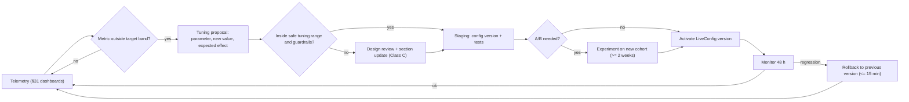

## 39. Balancing Assumptions

This section consolidates every balancing assumption fixed in canon into one tuning reference, grouped by
system. The **Value** column is the launch value and must equal the canon value; the other columns say why
it is that number, how we will know it is wrong, how far it may move without a redesign, and who owns it.
Sections §5–§33 remain the specification of each rule — this is the dashboard. LiveConfig production
defaults are generated from these tables (AC-39-02).

### 39.1 How to Read the Tables

- **[T]** in the Parameter cell = marked [TUNABLE] in canon. Rows without [T] are canon-fixed balancing
  values: they are listed because they shape the economy, but changing them needs a canon change and a
  section update, not just a LiveConfig edit.
- **Safe tuning range** = the band inside which the value may move by LiveConfig (or a data release)
  without re-validating dependent systems. "Locked" = do not tune live.
- **Telemetry signal** = the metric (§31) that tells us the value is off. "Median" is over active players
  of the relevant tier/level band, computed weekly.
- **Owner roles** (team of §34.1): **Design-Econ**, **Design-Sys**, **Design-Cbt** (hats of the designer),
  **Lead Eng**, **Producer**, **Art Dir**.

### 39.2 Global Constants (§C3, §C16.1)

| Parameter | Value | Unit | Rationale | Telemetry signal | Safe tuning range | Owner |
|---|---|---|---|---|---|---|
| Max players per server [T] | 8 | players | 8 plots on Restaurant Row; mobile server budget | avg players/server; P-03 heartbeat; friend-join failures | 6–12 (major update only, OD-01) | Lead Eng |
| Restaurants per player | 1 | restaurant | launch scope | — | Locked (OD-05) | Design-Sys |
| Autosave interval [T] | 120 | s | caps data-loss window vs DataStore budget | DataStore request rate; throttle warnings; lost-progress reports | 60–180 | Lead Eng |
| Extra save on purchase | ≥ 10,000 | MB | protects big purchases between autosaves | saves per minute | 5,000–25,000 | Lead Eng |
| Base WalkSpeed | 16 | studs/s | familiar Roblox feel | — | Locked | Design-Sys |
| Max WalkSpeed (MOVE cap) | 20.8 | studs/s | faster kitchens without breaking validation | median station-to-station time | 19–22 | Design-Sys |
| Carry capacity: base / per boosting part / hard max | 1 / +1 / 3 | items | juggling skill; prevents hoarding | items carried per serve | hard max 2–4 | Design-Sys |
| Interaction range: stations / customers / server tolerance | 7 / 10 / +2 | studs | phone reach; anti-teleport | rejected interactions per 1,000 | 6–9 / 8–12 / 1–3 | Lead Eng |
| Customers per restaurant | seats + 4 queue (max 28) | customers | throughput vs crowding | queue abandonment rate | queue 2–6 | Design-Sys |
| Server customer-proxy hard cap | 160 | proxies | server CPU at 8 busy restaurants | P-03 heartbeat; throttled spawns | 120–200 | Lead Eng |
| Loose physics props per interior | 30 | props | physics budget during chaos | physics step time | 20–40 | Lead Eng |
| Client debris lifetime | 4 | s | readability vs clutter | client particle count | 2–6 | Art Dir |
| City lighting cycle | 24 | min | cosmetic; night-only discoveries | — | 16–40 | Art Dir |
| Daily / weekly reset | 00:00 UTC / Monday 00:00 UTC | clock | one global rule | — | Locked | Producer |
| Level cap | 100 | level | ≈ 185-hour arc (C5.1) | % of players at cap | Locked at launch | Design-Sys |
| Reputation start / range | 2.5 / 1.0–5.0 | ★ | start mid-scale | Stars distribution by tier | Locked | Design-Sys |
| Return Door cooldown | 10 | s | free fast return without abuse | uses per session | 5–30 | Design-Sys |
| Pigeon Taxi fare | 25 × tier | MB | small convenience sink | rides per DAU | 10–50 × tier | Design-Econ |

### 39.3 Currencies and Economy (§C4.2–§C4.9)

#### 39.3.1 Prices, spend and pacing

| Parameter | Value | Unit | Rationale | Telemetry signal | Safe tuning range | Owner |
|---|---|---|---|---|---|---|
| Recipe base price [T] | `10 × 1.05^(L−1)` (L1 ≈ 10 … L95 ≈ 975) | MB | smooth value growth with unlock level | median ticket by tier vs §C4.3 | growth 1.04–1.06 | Design-Econ |
| Difficulty factor [T] | `0.8 + 0.1 × D` (D 1–5) | × | harder dishes pay more | orders/h and margin by difficulty | slope 0.05–0.15 | Design-Econ |
| Category factor [T] | Drinks/Fried/Salads 0.7 · Desserts 0.8 · Legendary 2.5 · others 1.0 | × | add-ons cheaper; Legendary aspirational | revenue share by category | ±0.1 (Legendary 2.0–3.0) | Design-Econ |
| Flavor variance [T] | ±15 | % | dish identity | — | 0–20 | Design-Econ |
| Ingredient cost target [T] | 25–40 % of price | % | 60–75 % gross margin | realized margin per recipe | 20–45 | Design-Econ |
| Items per customer | 1.4 (main + 40 % add-on) | items | ticket size | items per customer | 1.2–1.8 | Design-Econ |
| Recipe learning cost | 5 × price | MB | sink and pacing gate | days from unlock to learn | 3–8 × price | Design-Econ |
| Net income target by tier [T] | 630 · 1,080 · 1,730 · 3,100 · 5,400 · 9,600 · 17,400 · 32,800 · 63,700 · 120,500 (`TIER_01` → `TIER_10`) | MB / active h | pacing anchor incl. tips, after ingredients and online wages, ~15 % quests/events | median net MB per active hour by tier | retune if outside ±15 % for 2 weeks | Design-Econ |
| Cumulative active hours to reach tier [T] | 0 · 1 · 3 · 7 · 14 · 25 · 40 · 60 · 85 · 120 | h | first tier upgrade inside session 1 | median active hours to each tier | ±20 % | Design-Econ |
| Spend split intent [T] | ≈ 50 % tier/expansion · ≈ 50 % mutations, furniture, staff, upgrades | % | morph-centric economy | sink share by category | 40–60 % | Design-Econ |
| Time to L100 [T] | ≈ 200 (formula gives ≈ 185) | active h | long-term arc | median time-to-L100 (cohort) | 160–240 | Design-Sys |
| Stat respec | free once per 24 h, else 500 × level | MB | encourage experimenting | respecs per week | 250–1,000 × level | Design-Econ |
| Auto-rebuild of Destroyed object | ≤ 25 % of item price | % | destruction funny, not punishing | rebuilds per day; rebuild MB share | 10–35 % | Design-Econ |

#### 39.3.2 Mutation shop, upgrades and capsules

| Parameter | Value | Unit | Rationale | Telemetry signal | Safe tuning range | Owner |
|---|---|---|---|---|---|---|
| Shop price — Common [T] | 150–400 | MB | first purchase within session 1 | time to first purchase | ±25 % | Design-Econ |
| Shop price — Uncommon [T] | 800–2,000 | MB | | purchases per week by rarity | ±25 % | Design-Econ |
| Shop price — Rare [T] | 4,000–10,000 + 20 MS | MB, MS | Mart rotation aspiration | | ±25 % (MS 10–40) | Design-Econ |
| Shop price — Epic [T] | 25,000–60,000 + 80 MS | MB, MS | mid-game goal | | ±25 % (MS 50–120) | Design-Econ |
| Shop price — Legendary [T] | 150,000–400,000 + 250 MS + 10 RT | MB, MS, RT | weekly Mystery Market chase | | ±25 % (RT 5–20) | Design-Econ |
| Mythic fusion | 3 Legendary from one fusion route (§12.5) + 600 MS + 40 RT | — | prestige, never sold | fusions per week | MS 400–900; RT 25–60 | Design-Econ |
| Upgrade MB [T] | `BaseMB × 1.5^(L−1)`; BaseMB 100 · 300 · 900 · 3,000 · 10,000 · 30,000 · Secret 15,000 | MB | exponential late sink | upgrades per level band | growth 1.4–1.6 | Design-Econ |
| Upgrade MS [T] | `BaseMS × L`; BaseMS 2 · 4 · 8 · 15 · 30 · 50 · Secret 40 | MS | shard sink | median MS balance | ±30 % | Design-Econ |
| Upgrade RT [T] | `RTBase × (L − 3)` for Epic+ at L ≥ 4; RTBase 1 · 2 · 4 · Secret 3 | RT | gates the top levels | median RT balance; RT earned/week | ±1 per base | Design-Econ |
| Max upgrade level | 5 · 6 · 7 · 8 · 9 · 10 · Secret 10 | level | rarity ceiling | % parts at max | Locked | Design-Sys |
| Duplicate → MS / DupeSubstituteMS [T] | 5/10 · 12/25 · 30/60 · 80/160 · 200/400 · 500/1,000 · Secret —/600 | MS | duplicates always useful | dupes kept vs converted | ±30 % | Design-Econ |
| Capsule odds (disclosed) | Common 55 · Uncommon 27 · Rare 12 · Epic 4.5 · Legendary 1.3 · Mythic 0.2 · Secret 0 | % | earnable only, transparent | observed vs disclosed | change only with a same-release disclosure update | Design-Econ |
| Capsule pity | 40 | capsules | guaranteed Epic+ | capsules to first Epic+ | 30–50 (never raised on existing counters) | Design-Econ |
| Offline capsule discovery | ≤ 1 per real day | capsules | offline complements, not replaces | capsules per DAU by source | Locked | Design-Econ |
| Welcome Back Crate | 1 capsule + 50 MS after ≥ 7 days away | — | lapsed-player return | reactivation rate | 5–14 days; 25–100 MS | Design-Econ |

#### 39.3.3 Station upgrades (§C4.9)

| Parameter | Value | Unit | Rationale | Telemetry signal | Safe tuning range | Owner |
|---|---|---|---|---|---|---|
| Upgrade cost multiplier Lv2 / Lv3 / Lv4 / Lv5 [T] | × 1.5 / × 4 / × 10 / × 25 of station base price | × | late levels are big goals | station level distribution by tier | ±25 % each | Design-Econ |
| Process-time multiplier Lv2 / Lv3 / Lv4 / Lv5 [T] | 0.90 / 0.80 / 0.70 / 0.60 | × | felt speed-ups | median ticket time by station level | ±0.05 each | Design-Sys |
| Perfect-window multiplier Lv3–Lv4 / Lv5 [T] | × 1.25 / × 1.5 | × | skill forgiveness | PERFECT rate by station level | 1.1–1.4 / 1.3–1.7 | Design-Sys |
| Lv4 burn grace / non-heat failure reduction [T] | +3 s / −50 % | s, % | fewer fires late game | burns per 100 items | +2–5 s / −30–70 % | Design-Sys |
| Tier required for Lv2 / Lv3 / Lv4 / Lv5 | `TIER_02` / `TIER_04` / `TIER_06` / `TIER_08` | tier | pacing | — | Locked | Design-Sys |

### 39.4 Player Statistics and XP (§C5, §C5.1, §C18)

| Parameter | Value | Unit | Rationale | Telemetry signal | Safe tuning range | Owner |
|---|---|---|---|---|---|---|
| Stat points per level / max allocated per stat / total at L100 [T] | 2 / 50 / 198 | points | specialization without min-maxing one stat | allocation distribution | 1–3 / 40–60 | Design-Sys |
| COOK_SPD [T] | time × `1/(1 + 0.006·S)`, cap 150 (× 0.526) | — | visible speed-up | median process time by stat band | coeff 0.004–0.008 | Design-Sys |
| COOK_QLT [T] | window × `(1 + 0.005·S)`, burn delay +0.4 %/pt, cap 150 (× 1.75) | — | forgiveness for skill builds | PERFECT rate by stat band | coeff 0.003–0.007 | Design-Sys |
| STR [T] | dmg × `(1 + 0.008·S)`, knockback +0.4 %/pt, cap 150 (× 2.2) | — | combat build identity | TTK of customers by stat band | coeff 0.006–0.01 | Design-Cbt |
| DEF [T] | taken × `100/(100 + S)`, cap 200 (× 0.333) | — | diminishing returns | KOs per hour by stat band | cap 150–250 | Design-Cbt |
| REPAIR [T] | speed × `(1 + 0.01·S)`, cost −0.2 %/pt (max −30 %), cap 150 (× 2.5) | — | repair build identity | repair seconds per object | coeff 0.007–0.013 | Design-Sys |
| MOVE [T] | WalkSpeed `16 × (1 + 0.003·S)`, cap 100 (20.8) | studs/s | bounded for validation | movement-violation false positives | cap 80–120 | Design-Sys |
| LUCK [T] | drop weight × `(1 + 0.004·S)`, Jackpot +0.1 %/pt, cap 150 (× 1.6) | — | fun spikes | jackpot rate by LUCK band (15.5 % at cap) | jackpot coeff 0.05–0.1 %/pt | Design-Econ |
| CHARM [T] | patience × `(1 + 0.004·S)`, escalation × `100/(100 + S)`, cap 150 (× 1.6) | — | service build identity | storm-outs per 100 customers | coeff 0.003–0.005 | Design-Sys |
| EFFICIENCY [T] | ingredient cost × `(1 − 0.0015·S)`, employee output +0.1 %/pt, cap 150 (× 0.775, +15 %) | — | manager build identity | realized margin by stat band | coeff 0.001–0.002 | Design-Econ |
| Player HP | `100 + 2 × (Level − 1)` + mutation bonuses | HP | gentle growth | KOs per hour by level | Locked | Design-Cbt |
| XP to next level [T] | `round((180 + 30·L) × 1.045^(L−1))` (L1 210 · L10 713 · L80 83,523) | XP | calibrated to tier pacing | median hours per level band | growth 1.04–1.05 | Design-Sys |
| Reference XP rate [T] | `900 × 1.045^(L−1)` per active h (≈ 75 % cooking/serving) | XP/h | all rewards expressed against it | median XP/h by level band | ±15 % before retune | Design-Sys |
| Daily-quest XP | ≈ 0.25 × XPRate(L) | XP | dailies matter without dominating | XP share by source | 0.15–0.35 × | Design-Sys |
| Skill points | 1 per level from L2 (99 by L100) + grants; free tree respec every 7 days | points | meaningful choices | nodes bought per tree | Locked | Design-Sys |

### 39.5 Restaurant Tiers (§C6)

| Parameter | Value (`TIER_01` → `TIER_10`) | Unit | Rationale | Telemetry signal | Safe tuning range | Owner |
|---|---|---|---|---|---|---|
| Upgrade cost [T] | 0 · 1,000 · 2,000 · 5,000 · 15,000 · 40,000 · 100,000 · 225,000 · 525,000 · 1,500,000 | MB | ≈ 50 % of income goes to tiers | median hours saving for next tier | ±20 % | Design-Econ |
| Required level [T] | 1 · 5 · 10 · 18 · 26 · 35 · 45 · 56 · 68 · 80 | level | level and money gates arrive together | % blocked by level vs by money | ±2 levels | Design-Sys |
| Seats (max concurrent customers) [T] | 4 · 6 · 8 · 10 · 12 · 14 · 16 · 18 · 20 · 24 | seats | throughput and chaos scale | seat utilization % | ±2 (perf permitting) | Design-Sys |
| Appliance slots [T] | 6 · 8 · 10 · 12 · 14 · 16 · 18 · 20 · 22 · 24 | slots | early menu choices | % of slots used | ±2 | Design-Sys |
| Menu slots [T] | 4 · 5 · 6 · 8 · 10 · 12 · 14 · 16 · 20 · 24 | recipes | menu variety grows | distinct dishes ordered per hour | ±2 | Design-Sys |
| Employee cap [T] | 2 · 3 · 4 · 6 · 8 · 10 · 12 · 14 · 16 · 20 | employees | automation grows with tier | employees hired vs cap | ±2 | Design-Sys |
| Base demand [T] | 50 · 65 · 80 · 95 · 110 · 125 · 140 · 155 · 170 · 190 | customers/h | busy, not overwhelming | queue abandonment; idle seats | ±10 % | Design-Sys |
| Service style | counter (`TIER_01`–`TIER_02`), table (`TIER_03`+) | — | simple start | — | Locked | Design-Sys |
| Expansion Permit | required for `TIER_04`+ (cost included) | — | story gate (§20) | permit-quest completion time | Locked | Design-Sys |

### 39.6 Cooking Timing and Quality (§C7.1, §C8)

| Parameter | Value | Unit | Rationale | Telemetry signal | Safe tuning range | Owner |
|---|---|---|---|---|---|---|
| Perfect window `W_perfect` [T] | 2.0 at Lv1, before COOK_QLT | s | readable on phones with latency | PERFECT rate by device class (target 35–55 % for competent play) | 1.5–2.5 | Design-Sys |
| Burn time `T_burn` [T] | `T_ready` + 6 | s | room for juggling | BURNED per 100 heat items | +4–8 | Design-Sys |
| Fire delay | `T_burn` + 4 (heat stations only) | s | chaos without punishing | fires per hour | +3–6 | Design-Sys |
| Quality grade scores | PERFECT 1.00 · GOOD 0.80 · OK 0.60 · UNDERCOOKED 0.35 · BURNED 0.15 · RUINED 0.00 | score | clear steps | grade distribution | Locked | Design-Sys |
| Assembly-order factor | 1.0 / 0.85 (one swap) / 0.70 (worse) | × | order matters, mildly | swap rate | ±0.05 | Design-Sys |
| Plating factor | 0.9 un-plated at `TIER_03`+ | × | teaches plating later | un-plated serves % | 0.85–0.95 | Design-Sys |
| Chop taps N | 4 (green 1.0 · yellow 0.8 · miss 0.6; > N + 3 → MUSHY 0.35) | taps | short rhythm moment | average chop quality; time per chop | N 3–6 | Design-Sys |
| Auto-Rhythm tap score | 0.8 | score | accessible, never optimal | Auto-Rhythm adoption | Locked (OD-17) | Design-Sys |
| Hand-mixing penalty (no mixer owned) | 1.5× slower | × | reason to buy `STN_MIXER` | — | 1.25–2.0 | Design-Sys |
| Starter kit appliance usage | 4 of 6 `TIER_01` slots | slots | first menu choice | which 2 appliances bought first | Locked | Design-Sys |

### 39.7 Patience, Satisfaction, Payment, Reputation and Anger (§C11)

| Parameter | Value | Unit | Rationale | Telemetry signal | Safe tuning range | Owner |
|---|---|---|---|---|---|---|
| Patience [T] | `(70 + 20 × (items − 1) + 5 × ΣD) × PersonalityPatienceMult × (1 + 0.004 × CHARM)` | s | bigger orders get more time | % served within 50 % of patience; storm-outs | base 60–85; per item 15–25 | Design-Sys |
| Order-taking wait | 30 × PersonalityPatienceMult | s | prompts the player to greet | orders untaken at timeout | 20–40 | Design-Sys |
| Satisfaction weights | A 0.25 · Q 0.20 · C 0.15 · W 0.20 · K 0.10 · M 0.10 | weight | accuracy and speed first | correlation of each term with S | Locked (sum 1.0) | Design-Sys |
| Wait factor W | 1.0 until 50 % of patience, linear to 0 at 100 % | — | rewards brisk service | W distribution | breakpoint 40–60 % | Design-Sys |
| MutationBonus cap / EventModifier | ≤ +10 / −15…+15 | S points | flavor, not dominance | — | Locked | Design-Sys |
| Mood thresholds | Delighted ≥ 90 · Happy 70–89 · Meh 50–69 · Unhappy 30–49 · Furious < 30 | S | readable bands | mood distribution | per-personality shifts only | Design-Sys |
| PayFactor | 1.0 (S ≥ 50) · 0.8 (30–49) · 0.4 apology (calmed hostile) · 0 storm-out | × | failure costs, stays funny | revenue lost to low S | Locked | Design-Econ |
| Tip rate by S | 0 (< 70) · 5 % (70–79) · 10 % (80–89) · 18 % (90–97) · 25 % (98–100) | % of prices | excellence feels great | average tip rate (target ≈ 10 %) | ±3 pp per band | Design-Econ |
| Jackpot Tip | chance `0.5 % + 0.1 %·LUCK` on S ≥ 90; × 5; cap 500 MB (`TIER_01`–`TIER_04`) / 5,000 MB (`TIER_05`+) | %, MB | rare delight | jackpot MB share of income (watch high-LUCK builds: 15.5 % at cap) | per-pt 0.05–0.1 %; caps ±50 % | Design-Econ |
| Reputation step | `Stars += 0.02 × (S/20 − Stars)`; storm-out −0.03 | ★ | slow-moving reputation | Stars trajectory per player | step 0.01–0.04 | Design-Sys |
| Reputation demand multiplier | `RepMult = 0.5 + 0.25 × Stars` (× 0.75 … × 1.75) | × | quality drives demand | demand vs Stars | slope 0.2–0.3 | Design-Sys |
| Decor demand multiplier | `DecorMult = 0.9 + 0.003 × Atmosphere` (× 0.9 … × 1.2) | × | decoration pays back | decor spend vs demand gain | slope 0.002–0.004 | Design-Econ |
| Online demand | `BaseDemand × RepMult × DecorMult × EventMult` | customers/h | single demand formula | seat utilization | Locked (tune inputs) | Design-Sys |
| Anger level bands | 0–14 · 15–29 · 30–44 · 45–59 · 60–74 · 75–89 · 90–100 | anger | seven readable stages | time spent per level | Locked | Design-Sys |
| Escalation roll (into 3, 4, 5) | `AngerProbability × 100/(100 + CHARM)` | probability | not every unhappy customer attacks | fights per 100 unhappy customers (target 10–25) | via personality AngerProbability | Design-Sys |
| Hit-by-food anger | +25 × personality sensitivity | anger | chain reactions | chain length distribution | 15–35 | Design-Sys |
| Chaos (level 6) trigger | ≥ 3 customers at level ≥ 3 simultaneously, or an event | customers | rare spectacle | chaos events per hour (target ≤ 1 per 20 min at mid tiers) | 3–4 customers | Design-Sys |
| Mutation Cuisine effect | cosmetic random part 60 s + 10 satisfaction | s, S | comedy | — | duration 30–90 | Design-Sys |

### 39.8 Combat (§C12.1)

| Parameter | Value | Unit | Rationale | Telemetry signal | Safe tuning range | Owner |
|---|---|---|---|---|---|---|
| Swipe Combo (base melee) [T] | `ABL_001`: 8 dmg × STR mult, 3 hits, 0.35 s per hit | dmg, s | simple, snappy | median time-to-calm a customer | 6–10 dmg | Design-Cbt |
| Wallop (base heavy) [T] | `ABL_002`: 20 dmg, 0.6 s charge | dmg, s | risk/reward | heavy usage share | 15–25 dmg; 0.4–0.8 s | Design-Cbt |
| Block (base defense) [T] | `ABL_003`: −70 % damage; guard 60; break → `STS_STUN` 1.0 s; regen 20/s after 2 s | %, pts, s | defensive option for kids | guard breaks per fight | −60 to −80 %; guard 40–80 | Design-Cbt |
| Dodge Roll (base mobility) [T] | `ABL_004`: 0.4 s roll, 0.25 s invulnerable, 1.2 s cooldown | s | skill expression | dodge success rate | i-frames 0.2–0.3; cd 0.9–1.5 | Design-Cbt |
| Customer Huff Points [T] | 40–300 by personality | HP | short fights | median fight duration (target 8–20 s) | ±25 % | Design-Cbt |
| Customer defeat | `STS_DIZZY` 3 s → calming → apologizing → 40 % Apology Payment | s, % | defeat is comic, still pays a bit | — | Dizzy 2–4 s | Design-Cbt |
| Player KO [T] | 4 s KO, respawn 60 % HP, `STS_WOOZY` −15 % move for 10 s; no loss of mutations, items or currency | s, % | fail funny, never devastating | KOs per hour; quit-after-KO rate | KO 3–5 s; respawn HP 50–75 % | Design-Cbt |
| In Combat flag | 6 | s | menu safety | blocked-menu attempts | 4–8 | Design-Cbt |
| Mutation ability bar | 4 | abilities | readable on phones | slot usage | Locked | Design-Cbt |
| Menu auto-close invulnerability (E2) | 1.5 | s | fairness when ambushed | damage within 2 s of auto-close | Locked | Design-Cbt |
| Loadout swap channel / cooldown (E4) | 3 / 10 | s | no mid-fight swapping | swaps per hour | 2–4 / 6–15 | Design-Cbt |

### 39.9 Mutation Budgets (§C13.3–§C13.4, §C13.7)

| Parameter | Value | Unit | Rationale | Telemetry signal | Safe tuning range | Owner |
|---|---|---|---|---|---|---|
| BaseBudget by rarity [T] | Common 4 · Uncommon 7 · Rare 11 · Epic 16 · Legendary 22 · Mythic 28 · Secret 24 | stat points | rarity matters, not overwhelmingly | stat totals of equipped morphs by level band | ±15 % per rarity | Design-Sys |
| Slot weight | Major 1.0 (HEAD, TORSO, each ARM, TAIL, WINGS, BACK) · Minor 0.5 (FACE, NOSE, MOUTH, EYES, EARS, HORNS, NECK, HANDS, FEET, SKIN, FUR, SCALES, each LEG) · FX 0 | × | big parts give more | slot fill rates | Locked | Design-Sys |
| Upgrade budget growth [T] | `× (1 + 0.12 × (UpgradeLevel − 1))` | × | upgrades feel strong | upgrade rate per level | 0.08–0.15 per level | Design-Sys |
| Matched pair bonus | +25 % to the pair's stats + paired ability bonus | % | rewards collecting pairs | matched-pair adoption | 15–35 % | Design-Sys |
| Default equip level by rarity | 1 · 5 · 12 · 25 · 40 · 60 · condition | level | pacing of power | % blocked by level | ±3 levels | Design-Sys |
| Abilities per part | ≤ 1 active, ≤ 1 passive | — | readability | — | Locked | Design-Sys |
| Morph render budgets | player ≤ 40 MeshParts / 15,000 tris; NPC ≤ 24 / 6,000; impostor ≤ 1,500 beyond 60 studs | parts, tris | mobile performance | P-05 FPS on D1 | Locked (perf) | Lead Eng |

### 39.10 Employees (§C4.8, §C14)

| Parameter | Value | Unit | Rationale | Telemetry signal | Safe tuning range | Owner |
|---|---|---|---|---|---|---|
| Common band [T] | hire 200–600 MB · wage 10–25 MB/h · stats 15–40 · potential 55 | MB, MB/h, stat | first hire in hour 1 | hires per tier; payback time | ±25 % | Design-Econ |
| Uncommon band [T] | 1,200–3,000 · 30–70 · 30–55 · 70 | as above | `TIER_03`–`TIER_05` staff | | ±25 % | Design-Econ |
| Rare band [T] | 6,000–15,000 · 90–200 · 45–70 · 82 | as above | `TIER_05`–`TIER_07` | | ±25 % | Design-Econ |
| Epic band [T] | 30,000–80,000 · 250–600 · 60–85 · 92 | as above | `TIER_07`–`TIER_09` | | ±25 % | Design-Econ |
| Legendary band [T] | 180,000–450,000 · 700–1,500 · 75–100 · 100 | as above | `TIER_09`–`TIER_10` | | ±25 % | Design-Econ |
| Efficiency | `RoleStatAvg × (0.6 + 0.4 × Morale/100) × (0.7 + 0.3 × Energy/100) × (1 + 0.001 × EFFICIENCY)` | — | morale and rest matter | median Efficiency by role | coefficients ±0.1 | Design-Sys |
| Offline caps by manager | none 2 · Basic 4 · Experienced 8 · Elite 12 · Legendary 24 · + Assistant +2 (max 24) | h | managers are the offline upgrade path | cap distribution; D1/D7 by cap | OD-08 | Design-Econ |
| Prep Cook contribution | +15 % kitchen capacity each, max +45 % | % | support roles matter | preps hired | 10–20 % each | Design-Sys |
| Cashier contribution | +10 % service capacity; +1 % tip rate per 20 skill | % | | | ±5 pp | Design-Sys |
| Dishwasher absence penalty | −20 % kitchen capacity at `TIER_04`+ | % | | | 10–30 % | Design-Sys |
| Stocker discount | 5–15 % ingredient discount | % | | | 3–20 % | Design-Econ |
| Assistant Manager | +2 h cap (needs Manager), −20 % incident losses | h, % | | | +1–3 h; 10–30 % | Design-Econ |
| Tutorial intern "Ollie" | `EMP_001`: free; wage 12 MB/h; Cooking 30 · Service 15 · Accuracy 28 · Reliability 40 | — | tutorial gift that shows offline income | % keeping Ollie after `TIER_03` | Locked | Design-Sys |
| Unpaid Break morale loss | −5 per hour | morale | wages matter, balance never negative | unpaid-break hours per DAU | 3–8 | Design-Sys |

### 39.11 Offline Simulation (§C15)

| Parameter | Value | Unit | Rationale | Telemetry signal | Safe tuning range | Owner |
|---|---|---|---|---|---|---|
| Offline demand factor `OFFLINE_DEMAND_FACTOR` [T] | 0.6 | × | offline is quieter than active | offline/active ratio per tier | 0.4–0.8 | Design-Econ |
| Offline visit length `VISIT_SECONDS_OFFLINE` [T] | 300 | s | seat capacity = Seats × 12 per hour | binding-cap frequency (seat vs kitchen vs service) | 240–420 | Design-Econ |
| Waiter seconds per customer | 45 | s | service capacity | — | 30–60 | Design-Econ |
| No-waiter fallback (table-service tiers) | 0.30 × Cap_kitchen from `TIER_03` | × | waiters needed for table service | waiters hired at `TIER_03` | 0.2–0.5 | Design-Econ |
| Chef recipe-skill gate | D ≤ 1 + floor(CookingSkill / 25) | difficulty | better chefs cook harder dishes | menu coverage offline | divisor 20–30 | Design-Sys |
| Offline quality `q` | `min(0.95, 0.70 + 0.25 × avgChefAccuracy/100)` | × | accuracy matters | — | cap 0.9–0.98 | Design-Econ |
| Offline tips | `Revenue × (0.04 + 0.04 × avgWaiterService/100) × (1 + 0.01 × floor(cashierSkill/20))` | MB | small, staff-driven | tip share offline | base 0.02–0.06 | Design-Econ |
| Incident rate | `floor(H × 0.6 × (1 − SecurityMitigation))` + seeded extra roll | incidents | stories, not losses | incidents per report | 0.4–0.8 per h | Design-Sys |
| Incident bounds | Σ negative ≤ 10 % · Σ positive ≤ 15 % of (Revenue + Tips) | % | never catastrophic | realized incident share | Locked (fairness) | Design-Econ |
| Energy drain offline | −8 %/h per employee (−5 %/h with a Manager) | %/h | managers matter | Energy at return | 5–10 / 3–7 | Design-Sys |
| Morale drift offline | −1 per hour | morale | gentle care loop | morale at return | 0–2 | Design-Sys |
| Discoveries | per effective hour: 8 % chance of 1–3 MS · 1 % rare ingredient crate · ≤ 1 Morph Capsule per report and per UTC day · RT never | %, items | offline complements active play | MS/day from offline vs active | MS chance 5–12 %; crate 0.5–2 % | Design-Econ |
| Offline/active net ratio target | 35–50 % during the first 2 offline hours (well-staffed), never above 60 % | % | active play stays best | ratio by tier cohort (TC-OFF-10) | 30–55 %; hard max 60 % | Design-Econ |
| Long-absence taper [T] | offline hours 0–2 ×1.0 · 2–8 ×0.5 · 8–24 ×0.2 (24 h = 8.2 effective hours ≈ 3 active hours) | × | rewards checking in 2–3×/day without letting offline replace play | offline share of MB income | factors ±50 % | Design-Econ |
| Offline-share guardrail KPI | median player's offline share of MB income ≤ 60 % at D7, ≤ 70 % at D30 | % | offline complements active play | `mmr_offline_collected` vs all MB sources (§31) | Locked thresholds; tune the taper first | Design-Econ |
| Minimum absence for a report | 300 | s | no micro-reports from rejoins | reports per DAU | 120–600 | Design-Econ |
| Claimed-report ring buffer | 20 | reports | idempotent collects | — | Locked (≥ 20) | Lead Eng |
| Close-early rule | stop when a step's operating result (before incidents) < 0; that step's wages not charged; Net floored at 0 | — | no offline debt | closed-early reports % | Locked | Design-Econ |

### 39.12 Tuning Process

#### 39.12.1 Cadence

| Rhythm | Activity | Output |
|---|---|---|
| Daily | dashboards + anomaly alerts (income spikes > 3× tier target, offline ratio > 60 %, odds drift) | alert tickets |
| Weekly (Tue) | economy review: pacing vs §39.3.1, sinks/sources, offline ratio, capsule outcomes | ≤ 5 tuning proposals |
| Biweekly | patch train ships approved Class A/B changes (below); Class C changes ride code releases | LiveConfig version + notes |
| Monthly | deep review vs §C4.4/§C5.1 pacing per cohort; KPI floors (§34.10.3) | re-baseline proposals |
| Quarterly | re-validate this section; refresh safe ranges from data | updated §39 |

#### 39.12.2 Change classes

| Class | Examples | Mechanism | Lead time |
|---|---|---|---|
| A — hot | event reward multipliers, Pigeon Taxi fare, chaos frequency inputs, shop prices within band | LiveConfig version, MessagingService broadcast; servers apply at safe points | same day |
| B — cold | demand factors, offline parameters, patience/tip coefficients | LiveConfig version applied on new servers; offline parameters require a **SIM_VERSION** bump | next patch |
| C — release | formulas, slot weights, disclosed capsule odds, structures | code/data release with tests (§35) and section updates | next release |

#### 39.12.3 A/B testing

- Bucket = hash(UserId, experimentKey) mod 100; experiments target **new cohorts** for pacing questions;
  ≥ 2 weeks or ≥ 5,000 users per arm; guardrails: D1, session length, crash rate, complaint rate.
- **Never A/B:** disclosed capsule odds, Robux prices, anything that makes an existing player's owned item,
  level or pending report worse, or the KO no-loss rule.

#### 39.12.4 Rollback

- Every LiveConfig version is immutable and audit-logged (author, diff, reason). Rollback = set the active
  version to the previous one; MessagingService broadcast with a 60 s polling fallback; target ≤ 15 min end
  to end (AC-34-35). Code rollback = republish the previous tagged place version.

#### 39.12.5 Guardrails (never violated by tuning)

1. Offline net/h ≤ 60 % of active net/h at every tier.
2. Capsule odds changes ship with the in-game disclosure in the same release.
3. No retroactive reduction of owned parts, levels, upgrades or currencies.
4. Pending offline reports are never recomputed; new parameters apply only to intervals simulated after
   the SIM_VERSION bump.
5. Price increases on items players are saving for are announced ≥ 1 week in advance.
6. Defeat never costs mutations, items or currency.

#### 39.12.6 LiveConfig system (specification)

- **Purpose:** change balancing values safely without a client update.
- **Rules & Mechanics:** values live in versioned config documents keyed by system; servers load the
  active version at start and on broadcast; every read goes through typed accessors with canon defaults
  and the §39 safe ranges as hard clamps (out-of-range values are rejected and logged).
- **Variables:** every row of §39.2–§39.11 marked tunable; experiment overrides per bucket.
- **UI:** internal admin page in the Staging experience; no player UI except release notes.
- **Progression:** n/a.
- **Player Interactions:** none directly; changes announced in update notes.
- **Dependencies:** `EconomyService`, `OfflineEarningsService`, `CustomerAIService`, `CookingService`,
  `CombatService`, `MutationService`, `CityEventService`; DataStore (storage), MessagingService (broadcast).
- **Roblox Implementation:** config documents stored in a dedicated DataStore; active-version pointer in
  MemoryStore for fast reads; `MessagingService:PublishAsync` on activation; servers poll every 60 s as a
  fallback; values cached per server and applied at safe points (between customers, at offline-sim start).
- **Edge Cases:** broadcast lost → poll catches up ≤ 60 s; invalid document → previous version stays active;
  mid-rush change → applies to the next customer only; offline change → requires SIM_VERSION bump (TC-EDGE-26).
- **Acceptance Criteria:** AC-39-02 … AC-39-04.

### 39.13 Acceptance Criteria

- **AC-39-01:** Every value marked [TUNABLE] in canon (§C3, §C4.2–§C4.9, §C5, §C5.1, §C6, §C8, §C11.2,
  §C12.1, §C13.4, §C15) appears in §39 with unit, rationale, telemetry signal, safe range and owner.
- **AC-39-02:** An automated check confirms LiveConfig production defaults equal the §39 Value column at
  launch (0 mismatches).
- **AC-39-03:** LiveConfig rejects any value outside its safe range and logs the attempt; 100 % of config
  activations are audit-logged.
- **AC-39-04:** Rolling back a LiveConfig version takes ≤ 15 min end to end in the Staging rehearsal.
- **AC-39-05:** The weekly economy review produces a dated record comparing median net MB/active h per tier
  with §39.3.1 targets.

