# Gameplay screenshots

Frames from a real session of the game in `games/ra1 - Mystery Morph Restaurant/`. The actual server and client scripts ran on the mock engine
(`tests/mock/Engine.luau`), and a bot played through the real prompts, remotes and UI buttons. Everything in each
frame was produced by the game code: the restaurant, the stations, customers and their bubbles, prompts, the HUD,
panels, and every number in them. Three things are stand-ins:

- **The renderer:** three.js in headless Chromium (`tools/gameplay/`), so lighting and materials only approximate
  Roblox Studio.
- **The avatar:** a blocky placeholder, because Roblox would load your own.
- **The Roblox top-bar icons.**

Regenerate with these commands, run from the game folder (`games/ra1 - Mystery Morph Restaurant/`):

```bash
tools/luaurun/target/release/luaurun tools/gameplay/session.luau <jsonDir> 23   # 23 = random seed
node tools/gameplay/render.js <jsonDir> <pngDir> --modules <node_modules with puppeteer, three@0.149.0, @fontsource/fredoka, @fontsource/luckiest-guy>
```

### 1. First join: pick a free mutation

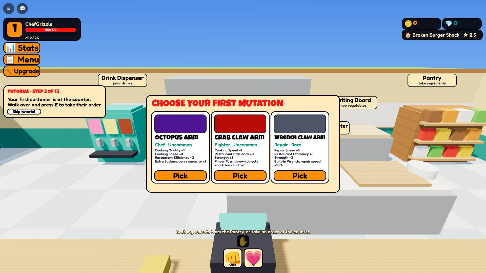

Octopus Arm, Crab Claw Arm or Wrench Claw Arm. The tutorial card on the left already says what comes next. The bot picks the Octopus Arm.

### 2. Tutorial step 2: take the first order

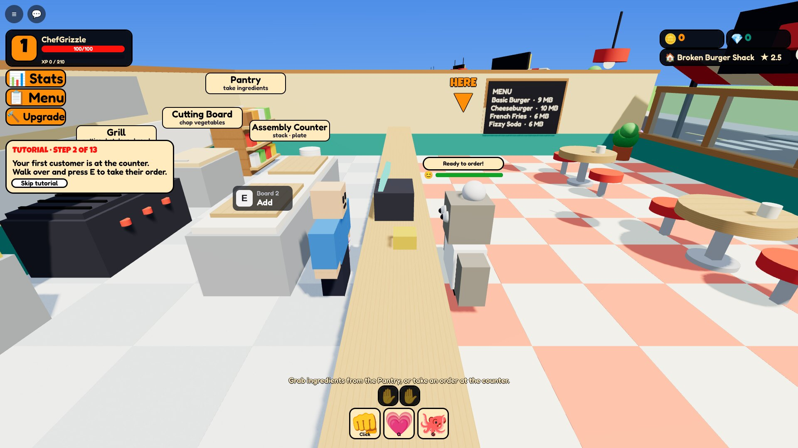

A scripted first customer, the Grandma Golem, waits at the counter. A bouncing **HERE** arrow and a glow mark the spot, and the card says exactly what to do. The menu board on the wall lists today's dishes and prices.

### 3. Step 3: the Pantry

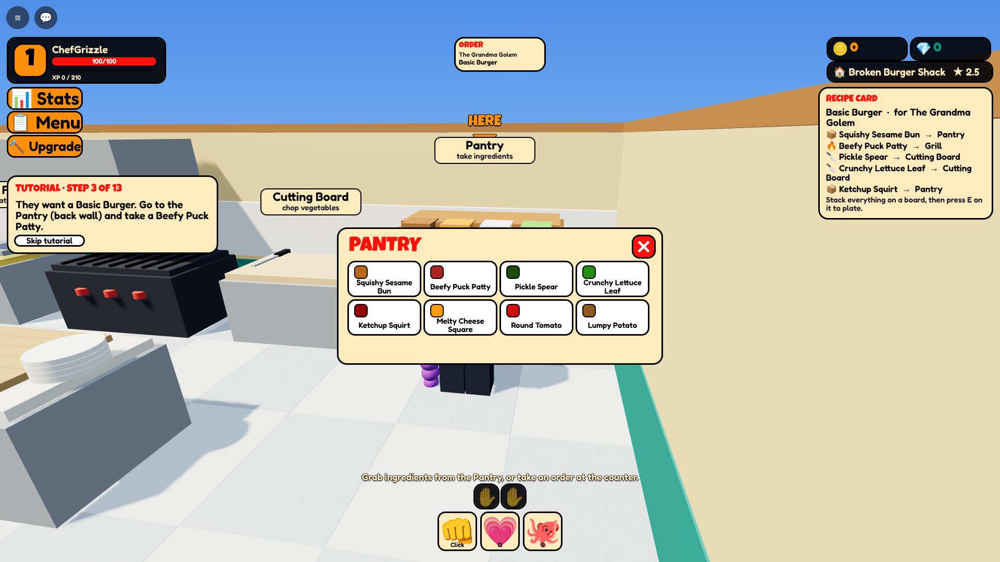

The recipe card on the right lists every part of the Basic Burger and where each one comes from (📦 Pantry, 🔥 Grill, 🔪 Cutting Board). The arrow moved to the Pantry.

### 4. Step 5: patty on the Grill

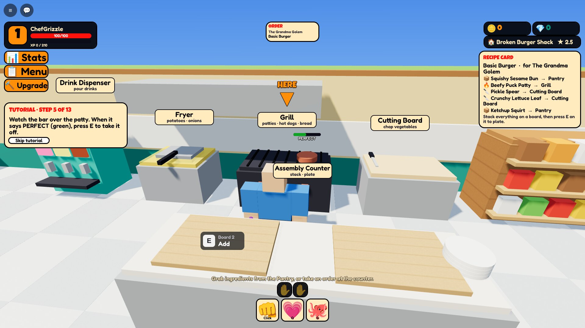

"When it says PERFECT (green), press E to take it off." The doneness bar over the patty is live.

### 5. Step 8: chopping a pickle

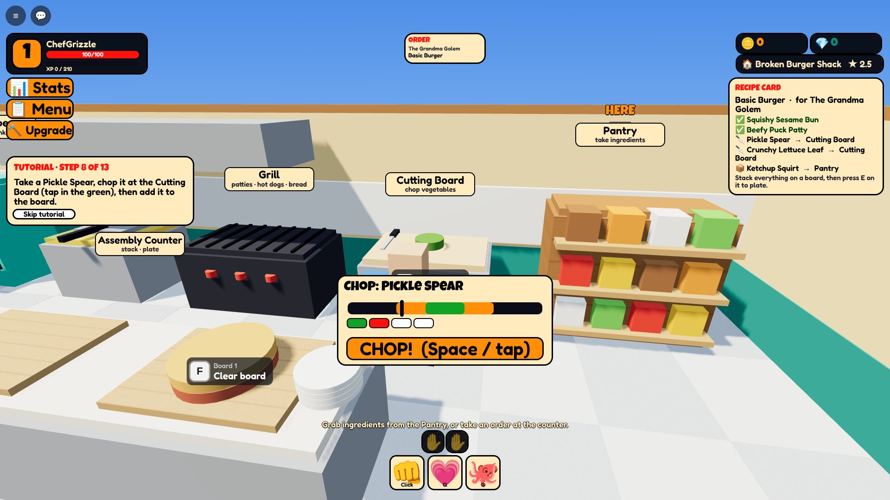

Tap when the marker is in the green. Ingredients already on the board are ticked ✅ on the recipe card.

### 6. Step 11: plating

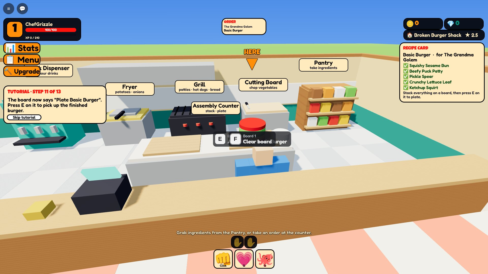

Everything is stacked, so the recipe card is all ticks and the arrow points at the board: "Press E to pick up the finished burger."

### 7. Step 12: serving

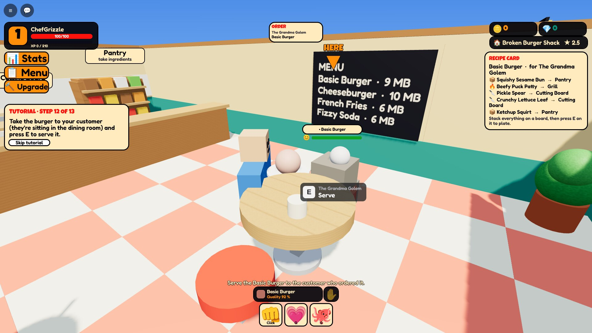

The customer is seated at a round table. The arrow and the Serve prompt are over them.

### 8. Paid

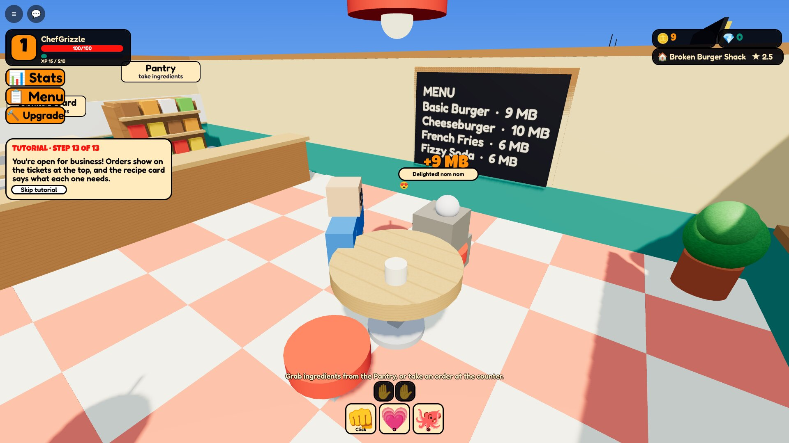

+9 MB and a Delighted customer. Step 13 says the restaurant is open for business: real customers start arriving, and the tutorial ends with a 25 MB bonus.

### 9. Pouring a Fizzy Soda

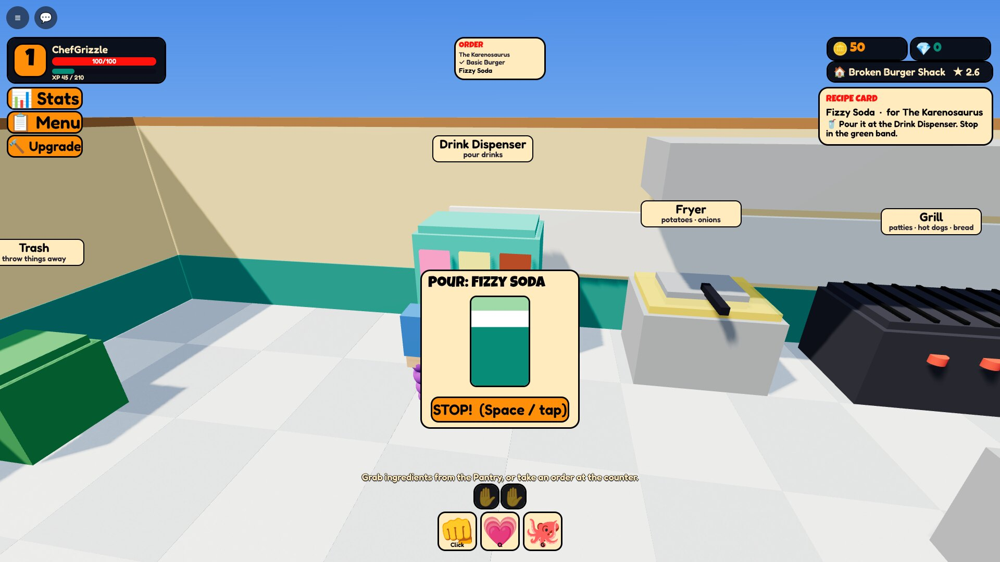

For drinks, the recipe card just says "Pour it at the Drink Dispenser. Stop in the green band."

### 10. Lunch rush


Three orders on the ticket rail. The recipe card always shows the oldest unserved order, so you know what to make next. You can see the street outside through the front windows.

### 11. Grill fire

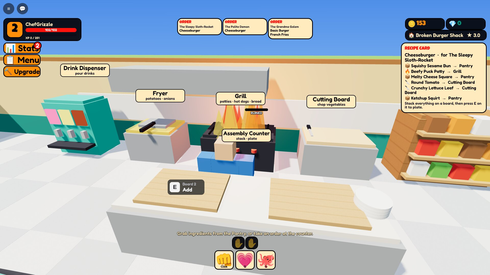

A forgotten patty burned and caught fire. Hold the prompt to put it out.

### 12. Food fight

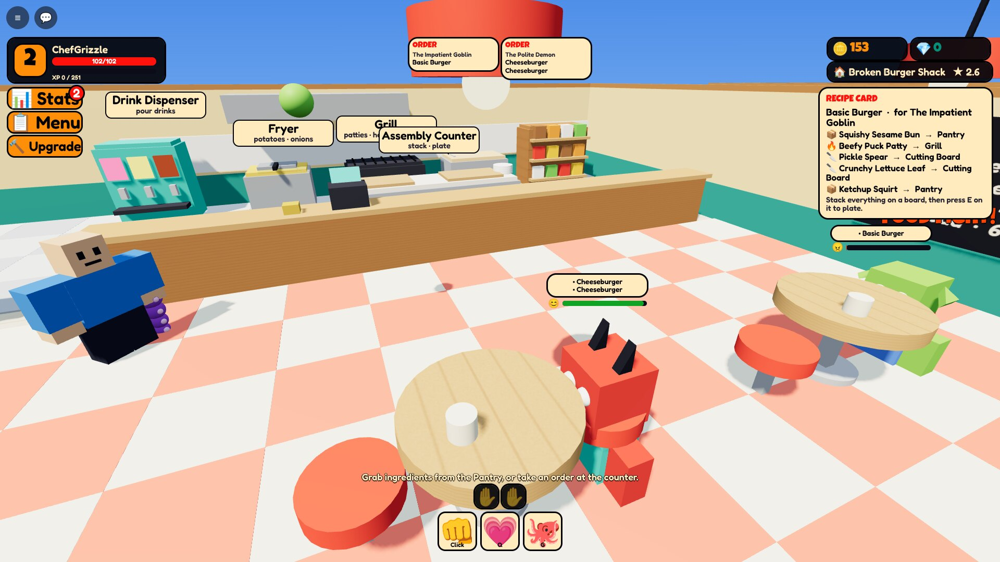

An Impatient Goblin hits anger level 3 and throws food. New players are protected: below level 2, an angry customer storms out instead of starting a fight.

### 13. Fighting back


Swipe Combo on an Impatient Goblin ("BIF!"). It wanted its burger with no lettuce, and its table is already cracked.

### 14. Dizzy

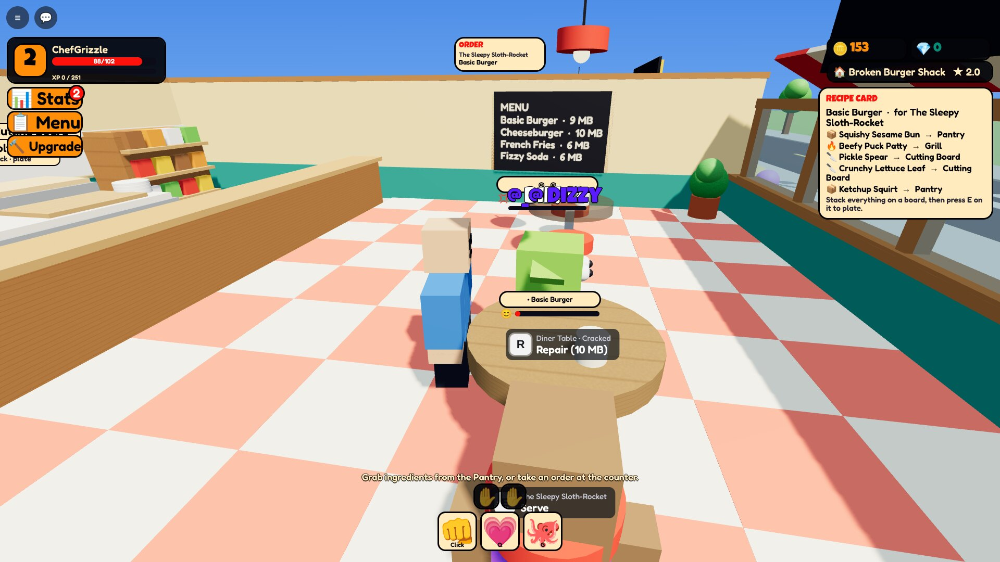

Huff Points gone. The customer pays a 40 % apology and leaves.

### 15. Level 3 stats


The four headline stats with 4 points to spend. "More stats" opens all nine.

### 16. Repairing a destroyed table

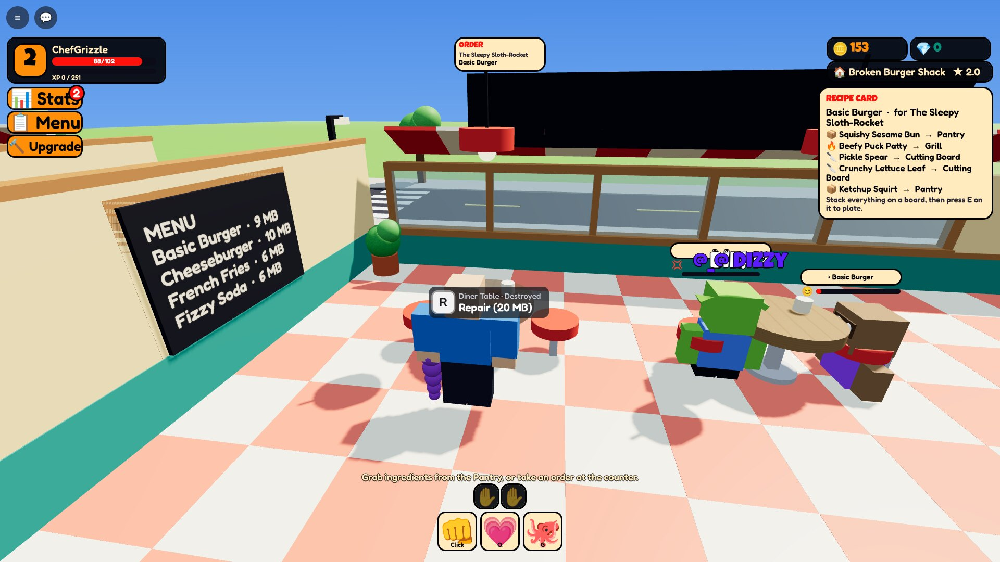

Smashed by an angry customer. Press R to rebuild it for 20 MB.

### 17. Menu editor

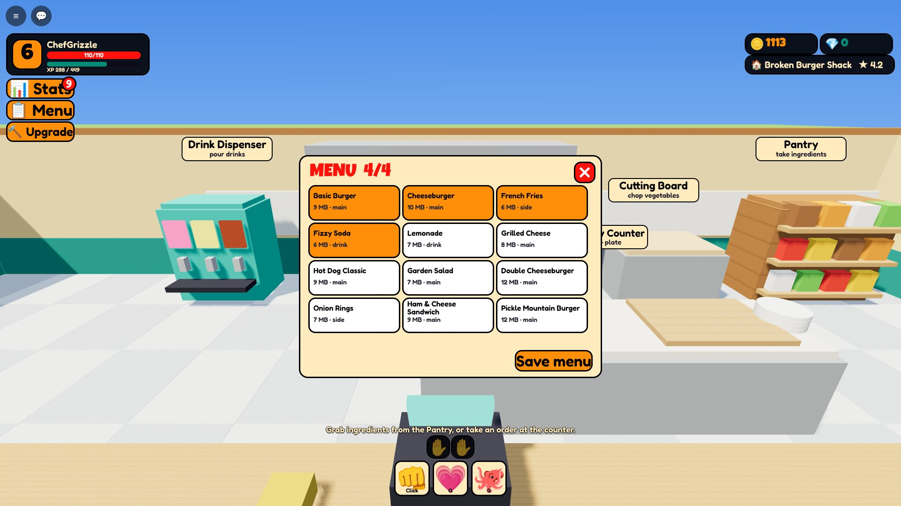

Four menu slots at TIER_01, and recipes unlock by level. Saving the menu also updates the menu board on the wall.

### 18. Upgrade

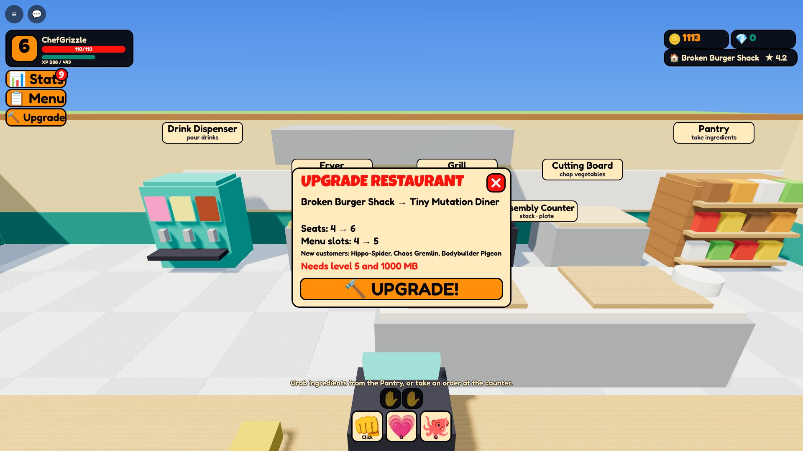

Level 6 and over 1,000 MB earned by the bot: ready to become the Tiny Mutation Diner.

### 19. The Tiny Mutation Diner

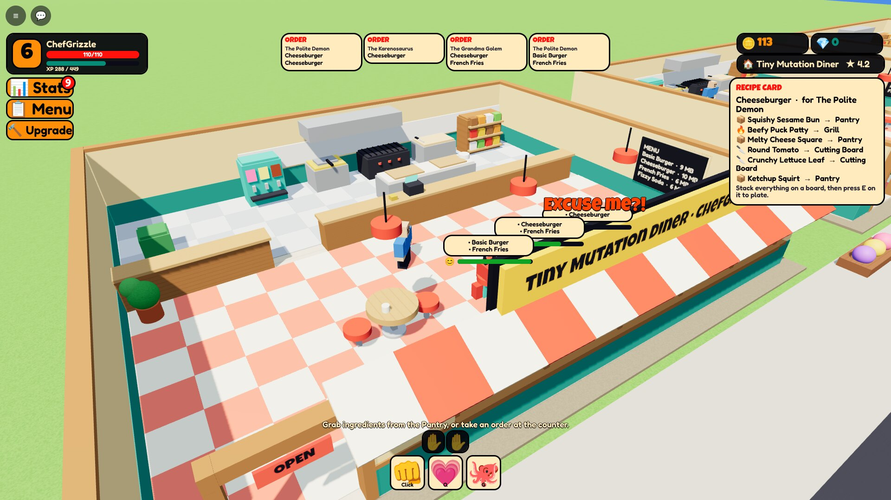

More seats, more menu slots, and a bigger dining room with a checkered floor, lamps, plants, a striped awning and a neon OPEN sign.

### 20. Restaurant Row

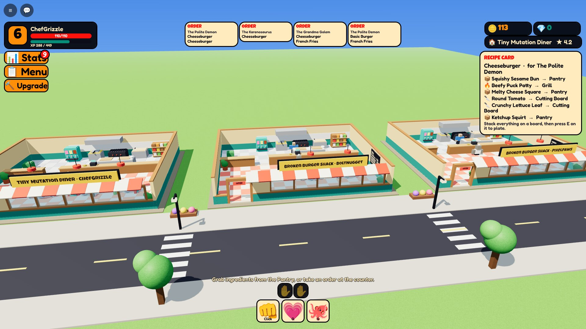

Three players' restaurants on the street, with trees, lamp posts, planters and crosswalks between the plots.
