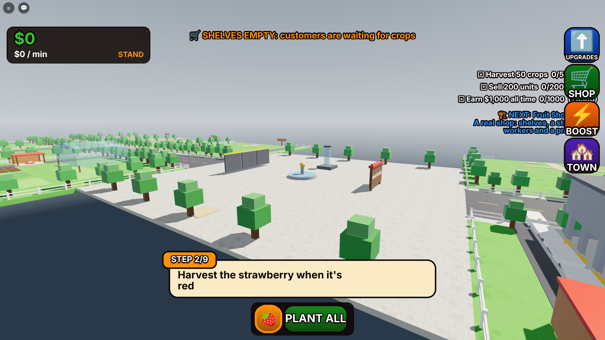

# Farm Empire — screenshots

Rendered from the mock engine through `tools/gameplay/empire.luau` and `render.js` (a stand-in for Roblox's
renderer: lighting and materials only approximate Studio).

| The first minute | A fruit shop | The warehouse's docks |
|---|---|---|
|  |  |  |
| **The distribution centre** | **Machines at work** | **An empire from above** |
|  |  |  |
| **The town square** | **The map** | **The UPGRADES panel** |
|  |  |  |
| **The SHOP** | **Welcome back** | |
|  |  | |
