# Steal a Dragon: gameplay screenshots

Frames from a real play session on a **phone screen (844 × 390, landscape)**. The game's own server and client
scripts ran on the mock engine while a bot played through the real prompts, remotes and buttons. Everything on
screen comes from the game code. Three things are stand-ins: the renderer (three.js, so lighting is only close to
Roblox's), the blocky avatar, and the Roblox top-bar buttons. The renderer draws every label on top, without
hiding the ones behind walls, so some views look busier than they will in Roblox.

### 1. Spawn in the lobby

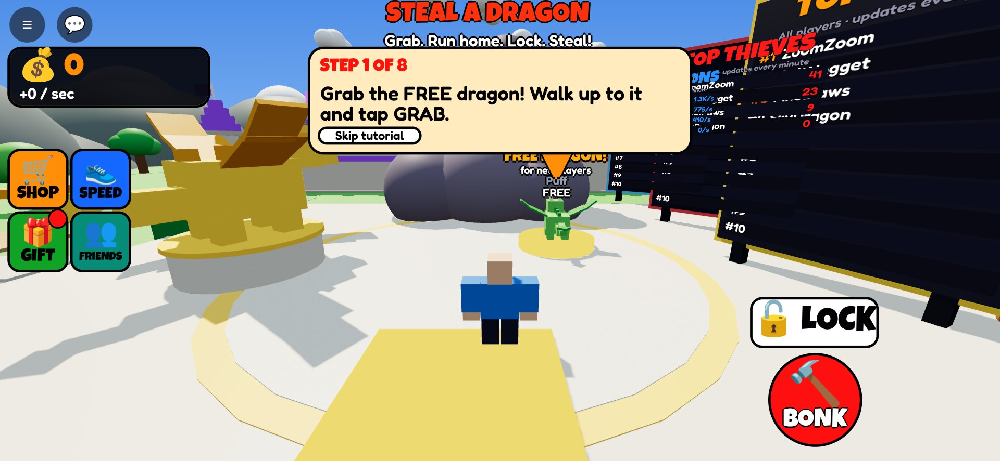

Tutorial step 1 points at the FREE dragon. The golden dragon statue stands on the plaza and the leaderboards are on the right. The phone HUD shows coins, four big
menu buttons above the thumbstick, and LOCK and BONK left of the jump button.

### 2. Grab the free dragon

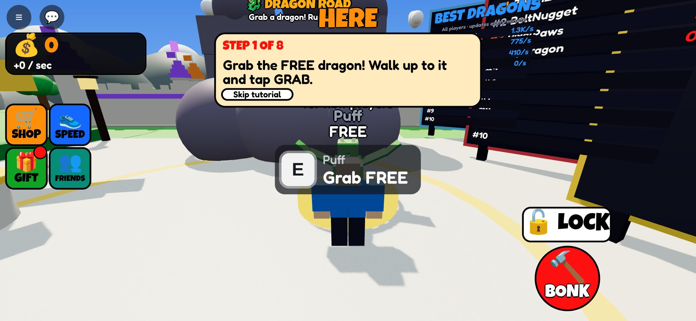

### 3. Run home

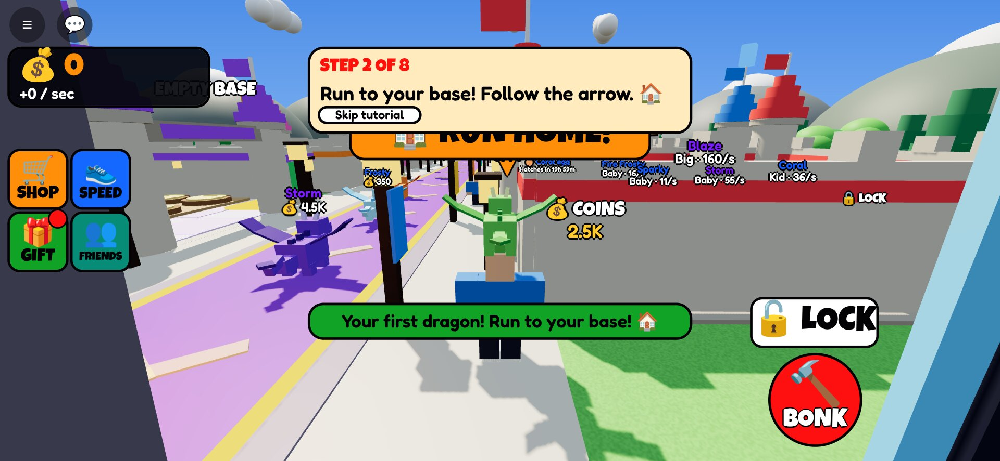

The dragon rides on your head and you walk slower. "RUN HOME!" and the "YOUR BASE" marker show the way down the lantern-lit sidewalk past the castle bases.

### 4. First nest

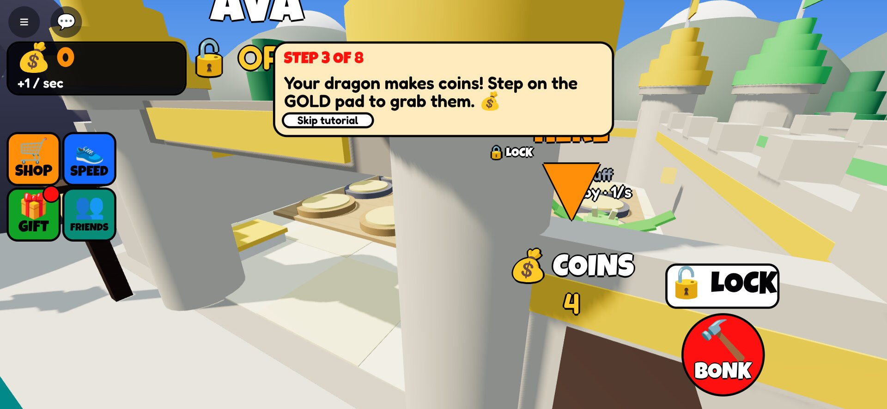

Step 3: your dragon makes coins. Step on the gold pad to collect them.

### 5. Lock your door

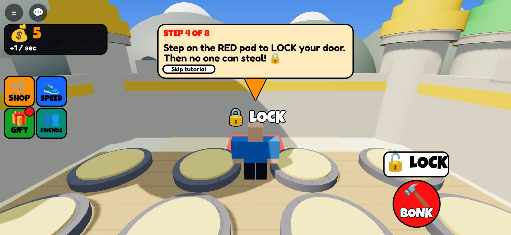

### 6. A locked base

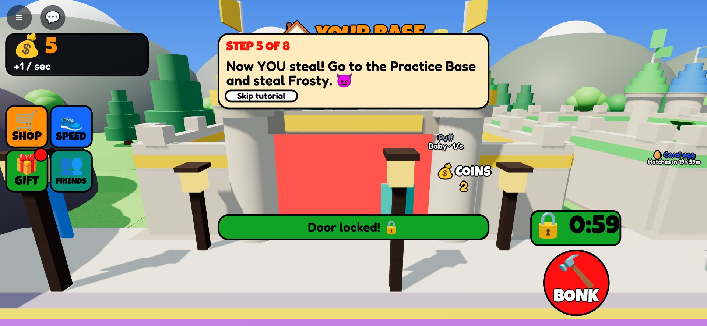

The red laser and the "LOCKED 0:59" sign. Thieves who walk in get pushed back out.

### 7. Practice steal

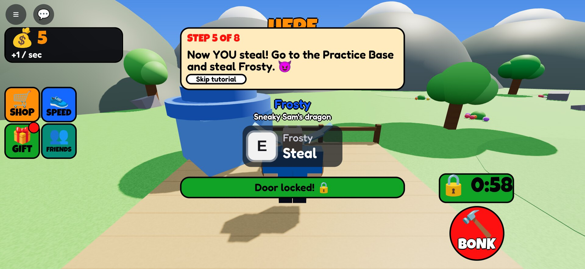

Step 5: steal Frosty from Sneaky Sam's Practice Base.

### 8. The Dragon Road

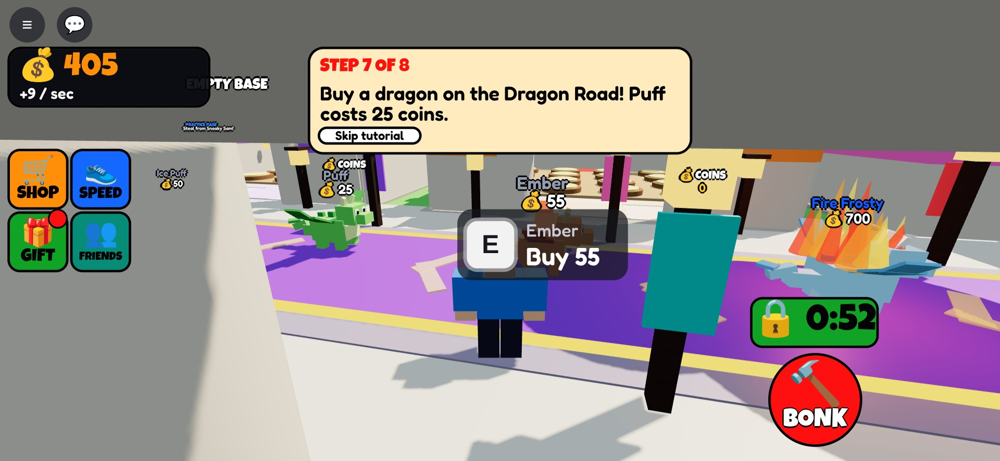

Dragons walk past with their price. Tap Buy.

### 9. Tutorial done: the egg

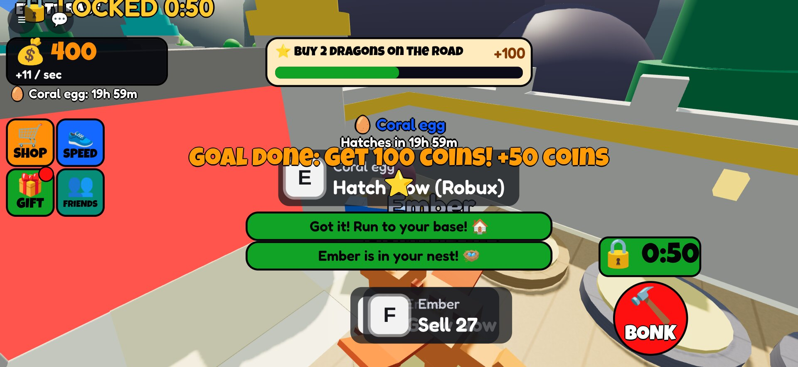

The gift egg shows what's inside and hatches tomorrow. The first goal pays out.

### 10. A busy base

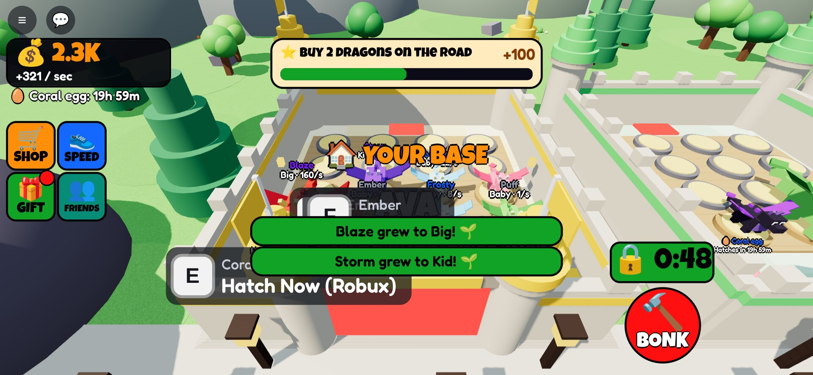

Grown dragons ("Big · 160/s") are worth far more, so they're worth stealing.

### 11. Stealing

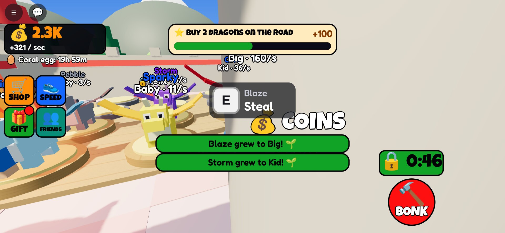

Hold Steal on BoltNugget's Big Blaze while their door is open.

### 12. Getting away

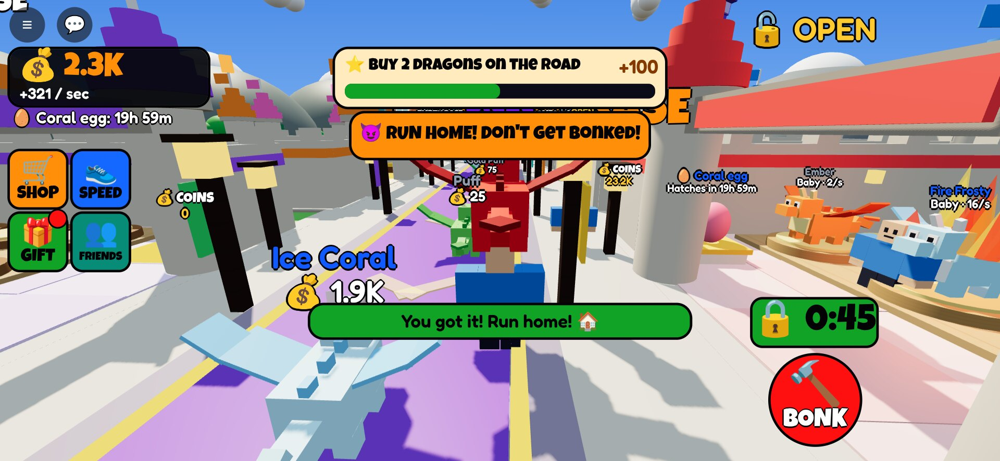

"RUN HOME! Don't get bonked!"

### 13. Bonked

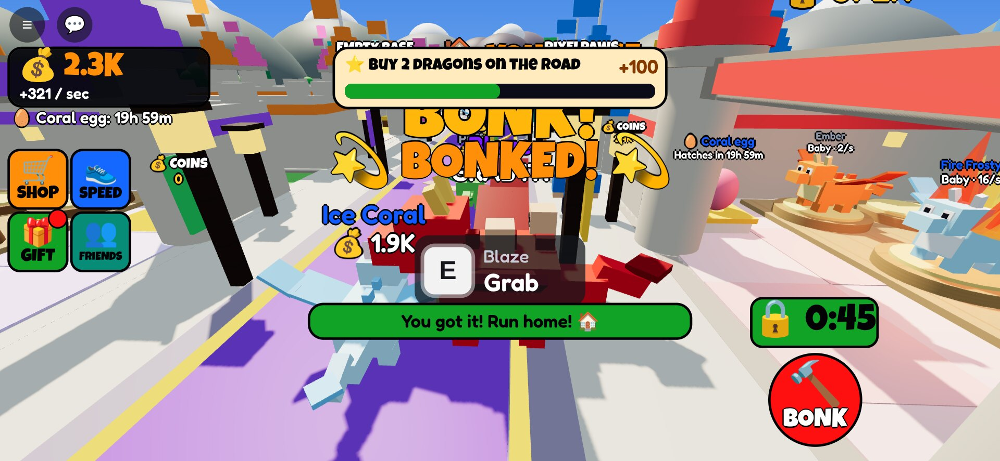

BoltNugget bonked us. Blaze fell on the ground, and anyone can grab it for 8 seconds.

### 14. Shop: boosts

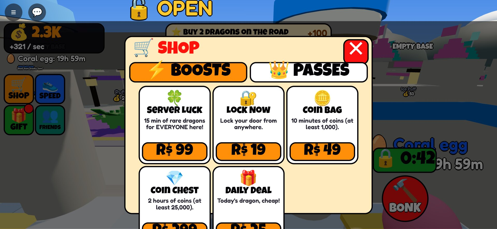

### 15. Shop: passes

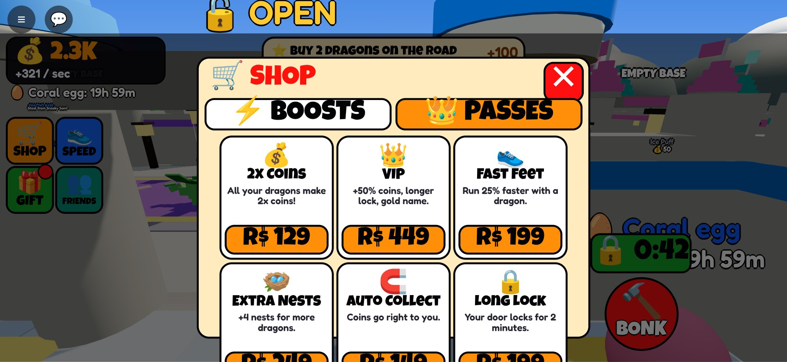

### 16. Daily gift

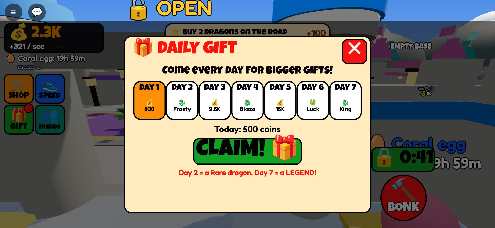

Seven days. Day 2 is a Rare dragon and day 7 is a Legend.

### 17. Speed upgrades

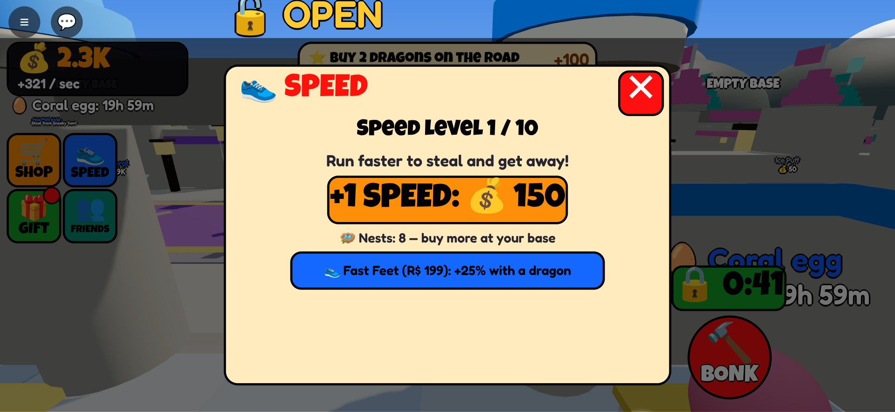

### 18. Welcome back

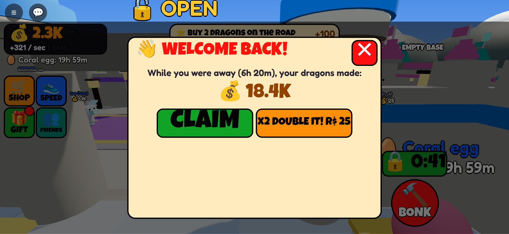

Coins your dragons made while you were away, with a Robux button to double them.

### 19. Legend dragon and Server Luck

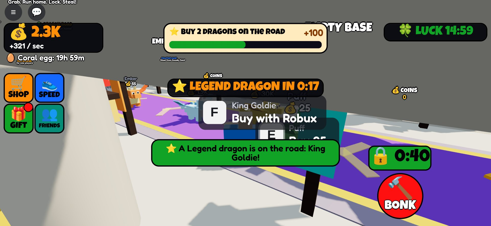

A Legend dragon every 5 minutes with a countdown, Server Luck bought by another player, and "Buy with Robux" on
King Goldie.

### 20. Lobby leaderboards

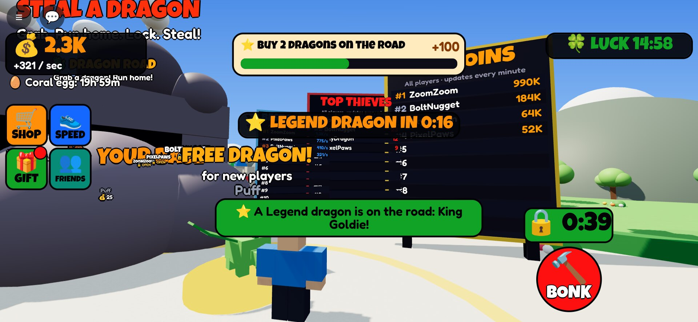

TOP COINS, TOP THIEVES and BEST DRAGONS.

### 21. The map

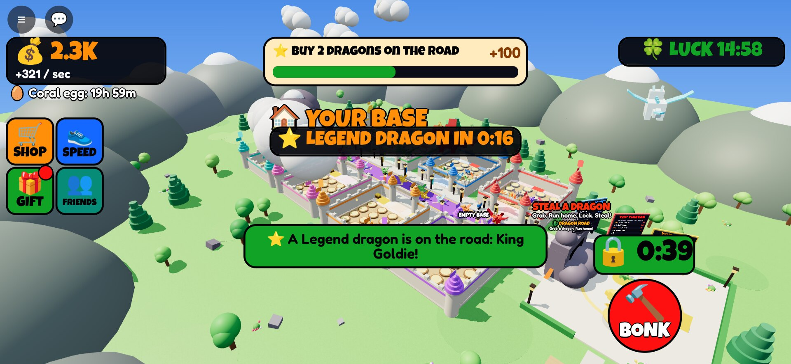

Eight castle bases along the Dragon Road, the lobby and its rocky cave arch (front right), the crystal-cave mountain at the far end, forests, mountains all around, clouds and dragons circling in the sky.
