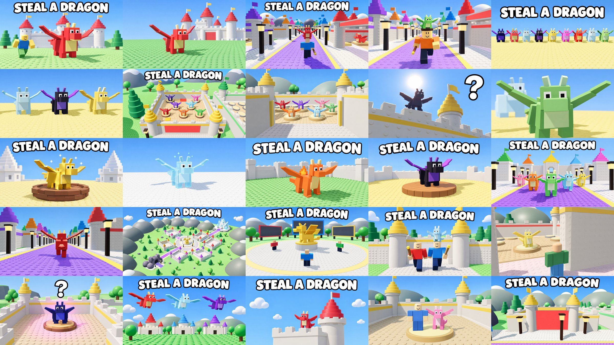
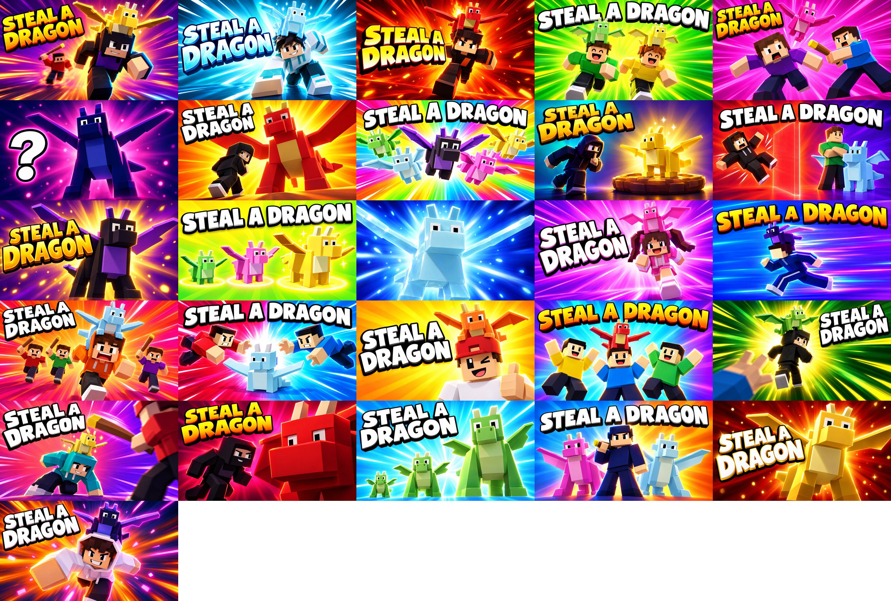

# Steal a Dragon: 25 thumbnails

Every file is **1920 × 1080 (16:9), JPG, under 0.7 MB**. That fits Roblox's experience thumbnails and the Ads
Manager image format.

**They only show what is in the game.** They were made with AI image generation, using real renders of the game as
references (the dragon models, the castle bases, the Dragon Road, the lobby and the map). The prompts told it to copy
those models and to add nothing else. So every image shows:

- the real dragons: a few smooth boxes, square eyes, flat wings, with no studs, scales or teeth
- the real world: white castles with stepped cone roofs, the purple road with yellow edges and black lanterns, the
  golden statue in the lobby, studded floors, round trees and snowy hills
- plain blocky avatars with the default smile face, holding the game's wooden bat, with a carried dragon sitting on
  top of the head (that is how carrying looks in the game)
- the game's afternoon daylight (the game is always at 3 pm)

The text is vague on purpose: the game name **STEAL A DRAGON**, a single **?**, or nothing. None of them promise a
reward, an event or an effect.

## Bold set (26)

Real game models (the box dragons, the special looks, the wooden bat with the yellow end, the nests, the red laser
door, a carried dragon sitting on the head) on **plain, very saturated backgrounds**: colour bursts, light rays
and speed lines, with no place or object in them. Each one has a different scene and a different background
colour, so they're easy to tell apart when you test them.

Every image went through the same check against the game code: the Fire, Ice and Gold looks are what those specials
really do; Legend dragons get a gold light and Secret dragons a pink one; and every person is a plain human
avatar. Three first drafts were redone because an avatar looked like a dragon. Rainbow dragons are left out because
in the game they change colour over time and can't be shown in one still picture.

| # | File | Scene | Background |
|---|---|---|---|
| 01 | `bold_01_gold_dragon_chase.jpg` | Thief with a gold dragon, owner chasing with the bat | Purple / orange |
| 02 | `bold_02_ice_dragon_slide.jpg` | Sliding with an Ice dragon (glass + sparkles) | Cyan |
| 03 | `bold_03_fire_dragon_run.jpg` | Running with a Fire dragon (flame on its back) | Red / orange |
| 04 | `bold_04_friends_run.jpg` | Two friends, each with a dragon | Lime green |
| 05 | `bold_05_bonk_drop.jpg` | Bonked: the dragon pops off the thief | Hot pink |
| 06 | `bold_06_secret_dragon.jpg` | Navy Secret dragon with its pink light, "?" | Navy / pink |
| 07 | `bold_07_giant_dragon_sneak.jpg` | Sneaking up on a giant dragon | Yellow / orange |
| 08 | `bold_08_five_dragons_burst.jpg` | Five dragons flying out | Rainbow |
| 09 | `bold_09_gold_dragon_sneak.jpg` | Tiptoeing to a gold dragon on a nest | Teal / violet |
| 10 | `bold_10_lock_bounce.jpg` | Thief bounces off the red laser door | Red / purple |
| 11 | `bold_11_shadow_dragon.jpg` | Shadow (Legend) with its gold light | Purple / gold |
| 12 | `bold_12_three_rarities.jpg` | Common, Epic and Legend side by side | Yellow / lime |
| 13 | `bold_13_ice_dragon_portrait_notext.jpg` | Ice dragon close-up, no text | Blue |
| 14 | `bold_14_pink_dragon_run.jpg` | Running with a pink dragon | Pink / purple |
| 15 | `bold_15_speed_run.jpg` | Side-on sprint with a purple dragon | Blue / violet |
| 16 | `bold_16_chased_by_three.jpg` | Three owners chasing one thief | Orange / pink |
| 17 | `bold_17_grab_dropped_dragon.jpg` | Two players dive for a dropped dragon | Red vs blue |
| 18 | `bold_18_wink_thumbs_up.jpg` | Wink and thumbs up with a dragon on the head | Yellow |
| 19 | `bold_19_team_celebrate.jpg` | Three friends celebrating a steal | Turquoise / violet |
| 20 | `bold_20_getaway.jpg` | Getting away from a reaching hand | Green / gold |
| 21 | `bold_21_dodge_bonk.jpg` | Ducking under a bat swing | Coral / violet |
| 22 | `bold_22_red_dragon_closeup.jpg` | Huge red dragon face, small sneaky thief | Crimson / magenta |
| 23 | `bold_23_grow_three_sizes.jpg` | The same dragon at three sizes | Sky blue |
| 24 | `bold_24_defender.jpg` | Owner guarding two dragons with the bat | Blue / orange |
| 25 | `bold_25_gold_dragon_portrait.jpg` | Gold dragon close-up | Ruby red |
| 26 | `bold_26_secret_dragon_leap.jpg` | Leaping with the Secret dragon | Orange / navy |

A first test set with five very different ones: **01, 05, 08, 16, 25** (chase, bonk, collection, crowd chase,
rare dragon).

## The 25

| # | File | Text | What it shows | In the game |
|---|---|---|---|---|
| 1 | `01_red_dragon_castle` | STEAL A DRAGON | A red dragon and an avatar in front of a castle | Blaze, castle bases |
| 2 | `02_red_dragon_castle_notext` | none | Same, without text | Same |
| 3 | `03_carry_home_road` | STEAL A DRAGON | Avatar from behind carrying a dragon down the road | Carrying a dragon on your head |
| 4 | `04_carry_home_notext` | none | Avatar running with a dragon on their head | Same |
| 5 | `05_dragon_lineup` | STEAL A DRAGON | Nine dragons in a row | The dragon models |
| 6 | `06_three_dragons_notext` | none | Three dragons close up | Frosty, Shadow, Goldie |
| 7 | `07_castle_base_aerial` | STEAL A DRAGON | A base from above with dragons on nests | Nests, gold and red pads |
| 8 | `08_castle_gate_notext` | none | Looking through a gate at dragons on nests | An open base |
| 9 | `09_mystery_dragon` | ? | A backlit dragon on a castle wall | Any dragon |
| 10 | `10_green_dragon_closeup_notext` | none | A green dragon's face up close | Puff |
| 11 | `11_gold_dragon` | STEAL A DRAGON | Gold dragon with small sparkles on a nest | Gold special (foil + sparkles) |
| 12 | `12_ice_dragon_notext` | none | See-through ice dragon with small sparkles | Ice special (glass + sparkles) |
| 13 | `13_fire_dragon` | STEAL A DRAGON | Orange dragon with a small flame on its back | Fire special (fire effect) |
| 14 | `14_shadow_dragon` | STEAL A DRAGON | Black and purple dragon on a nest | Shadow (Legend) |
| 15 | `15_dragon_road` | STEAL A DRAGON | Dragons walking down the road | Dragon Road |
| 16 | `16_dragon_road_notext` | none | One red dragon walking down the road | Dragon Road |
| 17 | `17_map_overview` | STEAL A DRAGON | The whole map from above | Lobby, road, cave, crystal mountain |
| 18 | `18_lobby_statue` | STEAL A DRAGON | The golden statue and the boards in the lobby | Lobby and leaderboards |
| 19 | `19_friends_at_gate` | STEAL A DRAGON | Two avatars leaving a castle, one with a dragon | Playing with friends |
| 20 | `20_sneak_in_notext` | none | Avatar inside a gate looking at a dragon | Stealing from an open base |
| 21 | `21_secret_dragon` | ? | Navy dragon with a soft pink light on a nest | Galaxy (Secret) |
| 22 | `22_flying_dragons` | STEAL A DRAGON | Three dragons flying over castles | Dragons flying over the map |
| 23 | `23_dragon_on_tower` | STEAL A DRAGON | A small dragon on a castle wall, lots of sky | Castle bases |
| 24 | `24_my_dragon_notext` | none | Avatar next to their dragon on a nest | Your own base |
| 25 | `25_locked_gate` | STEAL A DRAGON | A castle gate closed by the red see-through wall | Locking your door |

## What the research says (and how these follow it)

| Recommendation | How these follow it |
|---|---|
| Show what the game really is. Roblox removes thumbnails and rejects ads that show things not in the game | Only real models, places and effects (see above) |
| One clear focal point that reads at phone size (most Roblox players are on phones) | One dragon, one avatar or one place per image |
| Bright, clean colors and high contrast so it stands out in a grid of thumbnails | The game's own colors: blue sky, green grass, purple road, colorful dragons |
| Text short and huge, or no text at all | The game name, a single "?", or no text; 10 have no text so you can test both |
| Make each thumbnail clearly different, then let the data decide | Close-ups, wide shots, avatars, single dragons, the road, the map, the lobby |

## How to test them

Roblox tests thumbnails for you (**thumbnail personalization**): it shows different ones to different players and
picks the best one per player.

1. On the Creator Dashboard, open the experience and go to its thumbnail settings (under **Configure**). Upload
   **5** that are as different as possible, and turn on personalization if it isn't on. A good first set: **01, 03,
   07, 11, 17** (a dragon, carrying, a base, a rare dragon, the map).
2. Leave them for at least **7 days**, then check the thumbnail results on the dashboard (click rate and play time
   per thumbnail).
3. Swap out the worst two for two others from the list, and repeat.
4. Put the winner first.

For **Sponsored ads (Ads Manager)**, upload several images in one campaign (up to 10) and let Ads Manager split
the budget toward the best one.

## Getting ads approved quickly

Roblox reviews ad images (usually within about a day) and checks images separately when you upload them. The
common reasons for rejection, and how these thumbnails avoid them:

- [x] **Matches the game.** Only real models, places and effects. Nothing added: no coins, crowns, eggs, arrows,
  big glows, comic effects or exaggerated faces. If you change how something looks in the game (for example the
  Fire special), stop using its thumbnail.
- [x] **No Roblox logo or trademarks.** None are shown.
- [x] **No Robux symbol, no "FREE", no prices or promises of rewards.** None.
- [x] **No fake buttons or interface** (fake "Play" buttons, fake menus, fake prompts). None.
- [x] **No other games' characters or names**, and no real brands or real people.
- [x] **No violence, blood or scary images.** The bat appears only in avatars' hands.
- [x] **No claims** like "#1", "best" or "new". The only text is the game name or "?".
- [x] **Right size and format:** 1920 × 1080 JPG, well under the size limit.

**What's left to watch:**

- The images are cleaner than a real screenshot (softer light, sharper detail). If a reviewer still calls one
  misleading, use a real screenshot from Studio with the same text. The closest to a screenshot are **04**, **07**,
  **16** and **25**.
- The boards in the lobby (#18) are blank in the image, but in the game they show names. That's fine as a far-away
  view; don't zoom in on them.
- Watch the **play time** of players who arrived from each thumbnail, not only the click rate.

If an image is rejected, the rejection email gives the reason. Change only that part and upload it as a new image.
Uploading the same image again is rejected again.

## Icon

These are **thumbnails** (16:9). The game **icon** is a separate 512 × 512 square. A good icon is a close-up of one
dragon's face (for example from #10), with no text, because icons show very small.

## Sources

- [DevForum: 5 tips from Roblox staff to get the most out of thumbnail personalization](https://devforum.roblox.com/t/5-tips-from-roblox-staff-to-get-the-most-out-of-thumbnail-personalization/3471689)
- [Roblox Creator Hub: Ads Manager](https://create.roblox.com/docs/production/promotion/ads-manager)
- [Roblox Help: Advertising Standards](https://en.help.roblox.com/hc/en-us/articles/13722260778260-Advertising-Standards)
- [Roblox Wiki: Deceptive advertising](https://roblox.fandom.com/wiki/Deceptive_advertising)
- [DevForum: Consistent rejection of sponsored ad/thumbnail assets](https://devforum.roblox.com/t/consistent-rejection-of-sponsored-adthumbnail-assets-regardless-of-content-or-compliance/4633355)
- [Generalist Programmer: How to make a Roblox game icon and thumbnail](https://generalistprogrammer.com/tutorials/how-to-make-a-roblox-game-icon)
- [Vizzbees: How to make a Roblox thumbnail that gets clicks](https://vizzbees.com/blog/how-to-make-a-roblox-thumbnail)
