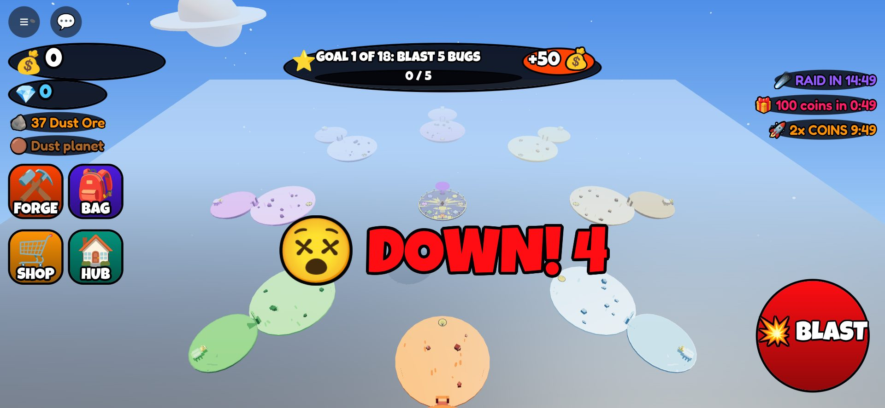

# Raid a Planet (ra3): how to run and play it

Status: **step 1 of the [plan](PLAN.md) is built: the solo loop.** Blast bugs on a planet, forge blasters from their
ore, beat the planet boss, open the next planet. Raids, trading, booths, pets and the rest come in the next steps.


## Run it in Roblox Studio

1. Install [Rokit](https://github.com/rojo-rbx/rokit), then in `games/ra3 - Raid a Planet/` run `rokit install`.
2. `rojo build -o RaidAPlanet.rbxl`, open the file in Studio, press Play. (Or `rojo serve` and connect the plugin.)
3. Without API access in Game Settings the game runs but doesn't save, and passes and products are free.

## How to play

| Do | Phone | Keyboard | Gamepad |
|---|---|---|---|
| Blast | hold the big red **BLAST** button, or tap the blaster | click, or hold **F** | R2 |
| Travel | walk onto a glowing **GO** pad in the Hub; the **HOME** pad on a planet brings you back | same | same |
| Menus | FORGE, BAG, SHOP, HUB buttons on the left | same | same |

1. **The Hub** floats in space. The Forge is in the middle. Eight glowing **GO** pads around the edge lead to the
   planets, in order: Dust, Ice, Lava, Jungle, Crystal, Storm, Shadow, Sun. Only Dust is open at first.
2. **Blast bugs.** On a planet, bugs walk at you (they never hurt you). Hold BLAST: your blaster shoots the nearest
   bug you're facing. Bugs drop **ore** and **coins**. Their health grows when more players are near.
3. **The Forge.** Put a planet's ore in and wait: Small (10 ore, 15 s), Big (50 ore, 3 min) or Mega (250 ore,
   30 min). Each one shows its exact odds (tap ℹ️ Odds). The roll happens when the forge starts and is hidden
   until you take the blaster out. One slot; three with the Triple Forge pass. It keeps working while you're away.
   **Finish Now** costs Robux, less and less as the timer runs down.
4. **Blasters.** Each one is a rarity (Common, Rare, Epic, Legend, Secret; Ultra from raids) from a planet: a
   "Frost Cannon" is an Epic from Ice. Each has four rolled stats (Damage, Speed, Luck, Gem Find), each plain,
   shiny ✨ or GOD 🌟 (1 in 1,000). **Power Up** adds 4% damage per level for coins (50 levels). **Sell** for coins.
   Every planet's blasters are 8x stronger than the last, and its bugs 8x tougher, so a blaster from the planet
   you're on always beats its bugs in about 6 shots.
5. **The boss.** Walk through the **BOSS GATE** at the far end of a planet. The boss wakes up and comes at you.
   Below half health it fires slow glowing balls: get hit and you're DOWN for 4 seconds (no death). Beat it and
   everyone who hit it gets 12 bugs' worth of ore, coins and a gem, and the next planet opens. Leave the yard
   and it heals up and waits again.
6. **Goals** at the top, one at a time: blast 5 bugs, forge a blaster, beat the Dust King, and on through all 8
   bosses. Coins or gems for each.
7. **First minutes.** New players earn 2x coins for 10 minutes, and playtime gifts arrive at 1, 3, 5, 10, 15, 20,
   30, 45 and 60 minutes (coins, ore, gems and whole blasters). The raid countdown runs on the right (the raid
   itself is step 3).

## Making money (so far)

Passes: Auto Blast (249), Triple Forge (449), 2x Gems (299), VIP (449). Products: Luck Elixir (49), Raid Callout
(149), gem packs (99 to 1,999), Finish Forge Now (9 to 149). IDs are 0 until `tools/setup_shop.py` creates them,
so in Studio everything is granted for free. Every random roll shows its odds.

## Code layout

```text
games/ra3 - Raid a Planet/
├─ default.project.json        Rojo project
├─ src/shared/                 Constants (every number), Formulas (math), Net, Signal, Format,
│                              Data/ (Planets, Blasters, Goals, Shop)
├─ src/server/
│  ├─ World/                   WorldBuilder (hub, 8 planet islands, boss yards), Scenery, BlasterBuilder, MobBuilder
│  └─ Services/                PlayerData, Economy (coins, gems, ore, passes), Planet (where you are, pads,
│                              unlocking), Blaster (bag, the tool in hand, sell, power up), Mob (bugs), Boss,
│                              Combat (blast), Forge, Goal, Playtime (gifts, boost, raid clock), Shop
├─ src/client/                 Theme, Store, Controllers/ (Hud, Blast, Panels)
├─ tests/                      formula unit tests, server and client smoke tests on the mock engine
└─ tools/                      run_tests.sh, the Luau runner, gameplay/ (screenshot session + renderer)
```

## Tests

`./tools/run_tests.sh`: 54 formula checks, 55 client checks, 74 server checks (and the same server run without
DataStores). The server test plays the whole loop: join, blast, forge, Finish Now, bag, boss, Ice, two players,
falling off, passes, products, playtime gifts, leaving.

## Screenshots

| | |
|---|---|
|  |  |
|  |  |
|  |  |
|  |  |

(The mock renderer draws a day sky; in Roblox the sky is night with stars.)
