# Raid a Planet (ra3): how to run and play it

Status: **fully built (all 9 steps of the [plan](PLAN.md)), not yet published.** Publishing needs a Roblox
experience for it and the place/universe IDs on the API key (see [Publish](#publish)).

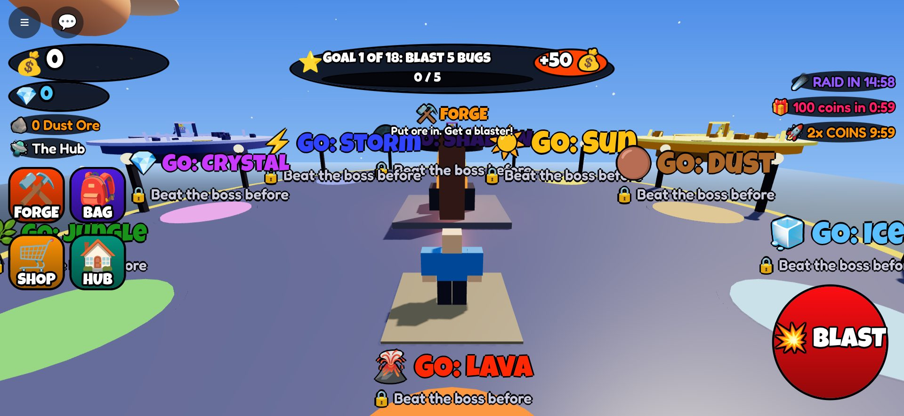

## Run it in Roblox Studio

1. Install [Rokit](https://github.com/rojo-rbx/rokit), then in `games/ra3 - Raid a Planet/` run `rokit install`.
2. Open `RaidAPlanet.rbxl` in Studio and press Play (or `rojo build -o RaidAPlanet.rbxl` to rebuild it,
   or `rojo serve` and connect the plugin).
3. Without API access in Game Settings the game runs but doesn't save, passes and products are free, and the
   leaderboards show this server only.

## How to play

| Do | Phone | Keyboard | Gamepad |
|---|---|---|---|
| Blast | hold the big red **BLAST** button, or tap the blaster | click, or hold **F** | R2 |
| Travel | walk onto a glowing **GO** pad in the Hub; the **HOME** pad on a planet brings you back | same | same |
| Menus | FORGE, BAG, SHOP, QUESTS, PETS, HUB (and NIGHTMARE after a rebirth) on the left | same | same |
| Use a thing | walk up to it and press the prompt (Forge, stalls, booths, Egg Machine, Rebirth, Squad Raid) | **E** | X |

### The solo loop

1. **The Hub** floats in space. The Forge is in the middle. Eight glowing **GO** pads around the edge lead to the
   planets, in order: Dust, Ice, Lava, Jungle, Crystal, Storm, Shadow, Sun. Only Dust is open at first.
2. **Blast bugs.** On a planet, bugs walk at you (they never hurt you). Hold BLAST: your blaster shoots the nearest
   bug you're facing. Bugs drop **ore** and **coins**. Their health grows when more players are near.
3. **The Forge.** Put a planet's ore in and wait: Small (10 ore, 15 s), Big (50 ore, 3 min) or Mega (250 ore,
   30 min). Each one shows its exact odds (tap ℹ️ Odds). One slot; three with the Triple Forge pass. It keeps
   working while you're away. **Finish Now** costs Robux, less and less as the timer runs down.
4. **Blasters.** Each one is a rarity (Common, Rare, Epic, Legend, Secret; Ultra only from raids and the daily
   prize) from a planet. Each has four rolled stats (Damage, Speed, Luck, Gem Find), each plain, shiny ✨ or GOD 🌟
   (1 in 1,000). **Power Up** adds 4% damage per level for coins (50 levels). **Sell** for coins. **Reroll** one
   stat for 15 gems. Every planet's blasters are 8x stronger than the last and its bugs 8x tougher.
5. **The boss.** Walk through the **BOSS GATE** at the far end of a planet. Below half health it fires slow glowing
   balls: get hit and you're DOWN for 4 seconds (no death). Beat it and everyone who hit it gets 12 bugs' worth of
   ore, coins and a gem, and the next planet opens. The Shadow boss (the Void Eye) only takes full damage when two
   players hit it within a moment of each other: **TAG TEAM**.
6. **Goals** at the top, one at a time, 18 of them: blast 5 bugs, forge a blaster, beat the Dust King... all 8
   bosses. Coins or gems for each.

### Always something to do

- **Forge timer**, **raid countdown**, **playtime gift** and **new-player 2x boost** pills on the right.
- **Daily quests** (3 a day, from a pool of 11) pay gems; one reroll a day. **Daily gift** streak over 7 days.
- Playtime gifts at 1, 3, 5, 10, 15, 20, 30, 45 and 60 minutes.

### The raid (every 15 minutes)

A portal ring opens over the Hub with a beam down to the RAID pad. Jump in (until the boss is at half health) and
you're in the arena over the Hub with the **Star Eater**. 3 minutes, three phases: blast; **shields** (four plates
light up, one player on each breaks them, four friends alone get a SQUAD BREAK); **rage** (dodge the balls).
Everyone who hit it gets ore, coins and gems (half if it gets away). The top 5 get a Mega-forge blaster, #1 has a
2% shot at an **ULTRA**. The **sky board** over the Hub shows the top 5 for a minute. Below 10 players, friendly
**ROBOTS** fill in. The **Raid Callout** product puts your name in gold when the raid starts.

### After 100%

- **Rebirth** (pad in the Hub, after all 8 bosses): planets reset, you keep blasters and pets, a ⭐ on your name
  and +25% damage for ever.
- **Nightmare** (after a rebirth, toggle in the menu): bugs 10x tougher for you, 10x loot, 1.3x forge luck.

### Friends

- **Squad bonus:** +10% damage per friend in the server, up to +30%. Friends on your planet: bosses drop 2x ore.
- **Lend a blaster** (Bag panel) to a friend for one raid. They hold it, you get half the gems they earn.
- **SQUAD RAID** pad in the Hub: you and your friends in the Hub get a private raid, once an hour. The public
  raid clock keeps running.

### Trade Plaza (north wing) and Booth Street (south wing)

- **12 stalls.** Put a blaster on one with a gem price (25 to 2,000). Anyone buys it with gems; you get the gems
  minus the **10% tax**. One stall per player; Ultra and lent blasters can't be listed. Players whose account
  can't trade paid random items (PolicyService) see the stalls but can't list or buy.
- **16 booths.** Claim one and show one of **your own** avatar items (shirts, pants, accessories, checked with
  `GetProductInfo`) with a filtered message. Others press it and get Roblox's own purchase prompt, so Roblox
  pays the creator and this experience gets its in-game commission. The Booth Rank pass puts you in the front 4.

### Pets

The **Egg Machine** in the Hub sells eggs for gems (Star 25, Nova 100, Galaxy 400), each with its odds shown;
accounts that can't buy paid random items don't see them. 16 pets float beside you and add damage and forge luck.
One out at a time, two with the Pet Slot pass.

### Leaderboards (the Board Deck, west of the Hub)

**TODAY'S TOP RAIDERS** (raid damage since 7pm ET; #1 at the reset wins an ULTRA blaster, once per day, even if
they're offline), **BEST BLASTERS** (the best blaster each player holds right now) and **MOST STARS**. Global
rows from OrderedDataStores, this server's players live on top. Banners when someone makes a board or a top-3 spot.

## Making money

| | Price | What it does |
|---|---|---|
| Auto Blast | 249 | fires at the nearest bug by itself |
| Triple Forge | 449 | 3 forge slots |
| 2x Gems | 299 | double gems from raids and quests |
| VIP | 449 | +25% damage, gold name |
| Booth Rank | 199 | front booths |
| Pet Slot +1 | 199 | two pets out |
| Luck Elixir | 49 | 15 min of better rolls |
| Raid Callout | 149 | your name in gold when the raid starts |
| Gems x50 / x300 / x1500 | 99 / 499 / 1,999 | gems (the only way to buy gems) |
| Finish Forge Now | 9 to 149 | by time left |

IDs are 0 until a `tools/setup_shop.py` run creates them (after the experience exists), so in Studio everything is
granted for free. Every random roll shows its odds. No Robux ever goes to players: trades are gems, booths are
Roblox's own purchase prompt.

## Discord game log

Same pipeline as ra2: the server posts joins/leaves (with session stats), chat, purchases, raids, trades, booths,
Legend+ hatches, Ultra blasters, rebirths, prize wins and script errors to the `roblox-game-log` Supabase function,
which forwards to the logs channel. It needs the `discord_log` secret in the experience's Secrets Store (same
key as ra2) and HTTP requests on (already set in `default.project.json`).

## Publish

1. Create the experience on the Creator Dashboard (name: Raid a Planet; 30 players per server).
2. Add its universe and place to the API key used for ra2 (Open Cloud: place publishing, assets).
3. `rojo build -o RaidAPlanet.rbxl`, then POST the file to
   `https://apis.roblox.com/universes/v1/{universeId}/places/{placeId}/versions?versionType=Published`.
4. Run `tools/setup_shop.py` (to write) to create the passes and products and fill their IDs in `Shop.lua`.
5. Add the `discord_log` secret, upload the icon and thumbnails from `thumbnails/`.

## Code layout

```text
games/ra3 - Raid a Planet/
├─ default.project.json        Rojo project (HttpEnabled, Future lighting)
├─ src/shared/                 Constants (every number), Formulas (math, odds, dates), Net, Signal, Format,
│                              Data/ (Planets, Blasters, Goals, Shop, Quests, Pets)
├─ src/server/
│  ├─ World/                   WorldBuilder (hub, wings, arena, Board Deck, 8 planet islands), Scenery, Themes,
│  │                           BlasterBuilder, MobBuilder, RobotBuilder
│  └─ Services/                PlayerData, Economy, Planet, Blaster, Mob, Boss, Combat, Forge, Goal, Playtime,
│                              Shop, Team, Raid, Rebirth, Quest, Trade, Booth, Pet, Leaderboard, GameLog
├─ src/client/                 Theme, Store, Controllers/ (Hud, Blast, Panel, Audio, Fx)
├─ tests/                      formula unit tests, server and client smoke tests on the mock engine
└─ tools/                      run_tests.sh, the Luau runner, gameplay/ (screenshot session + renderer)
```

## Tests

`./tools/run_tests.sh`: 54 formula checks, 88 client checks, 182 server checks (and the same server run without
DataStores). The server test plays everything: join, blast, forge, Finish Now, bag, boss, Ice, passes, products,
playtime gifts, the raid (all three phases, loot, timeout), rebirth and Nightmare, quests and the daily gift,
rerolls, stalls and the tax, booths, eggs and pets, tag team, lending, squad raids, leaderboards, the daily
prize, the game log, leaving.

## Screenshots

| | |
|---|---|
| 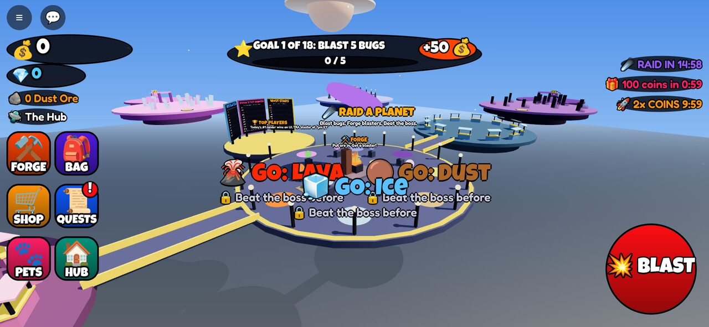 | 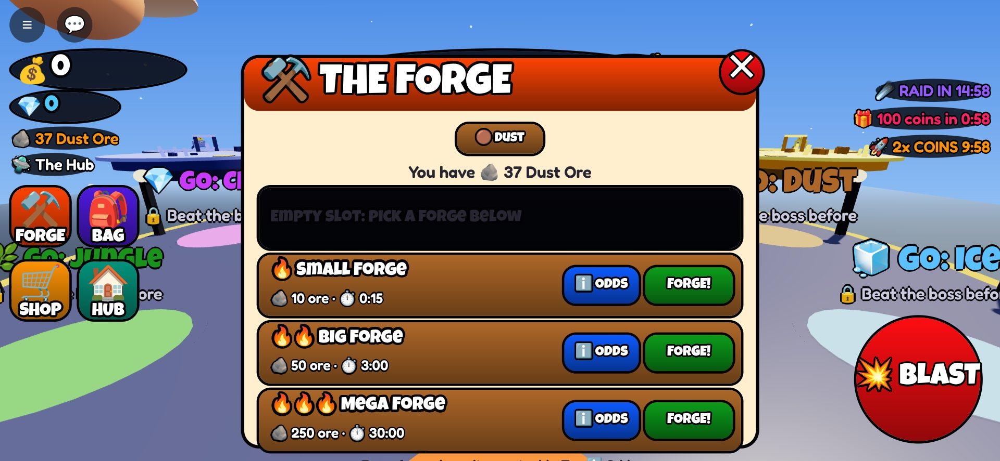 |
| 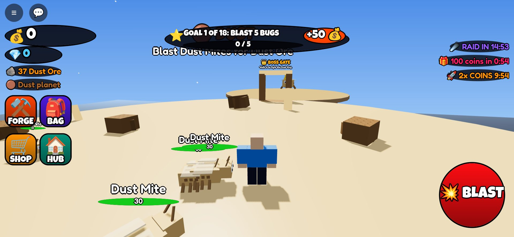 | 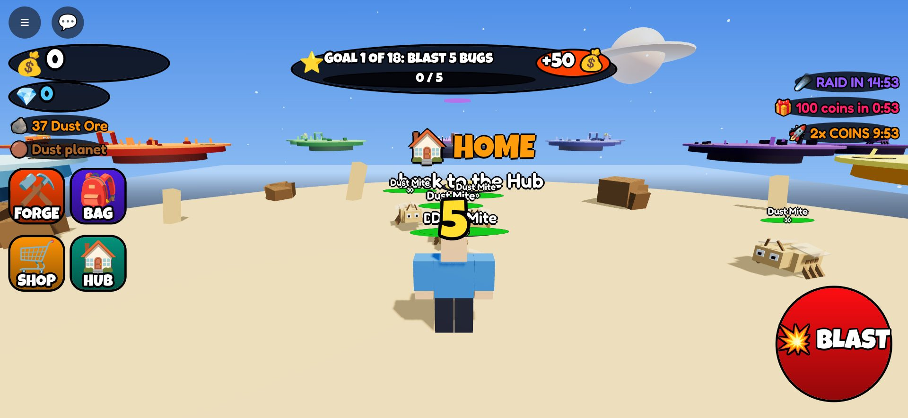 |
| 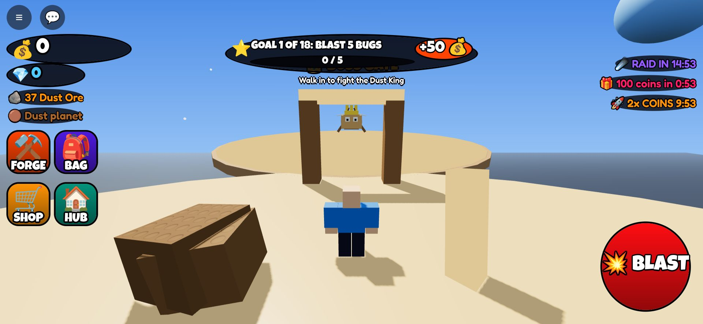 | 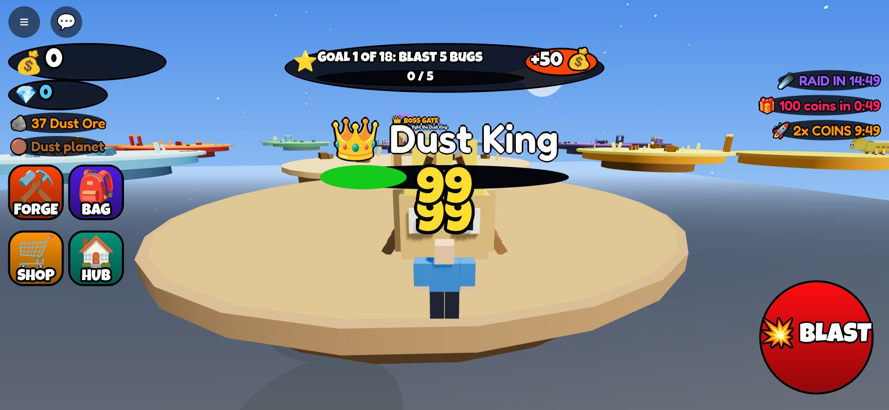 |
| 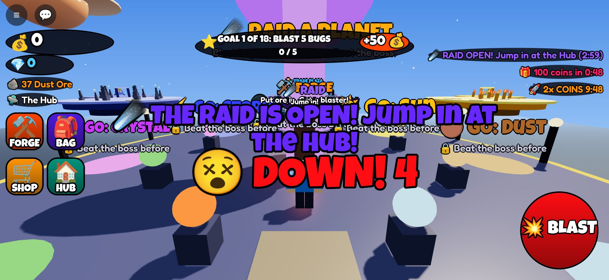 | 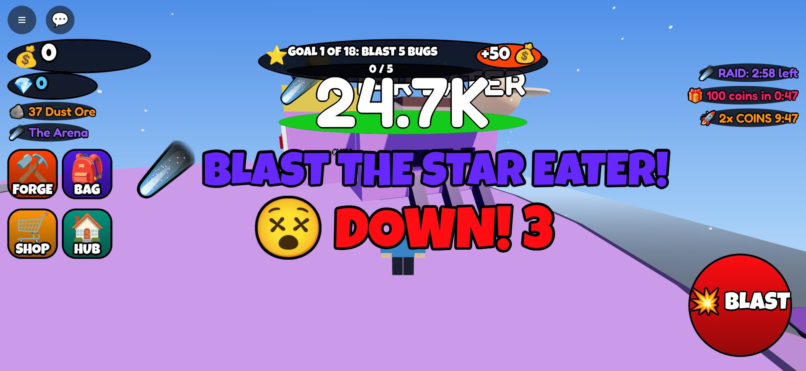 |
| 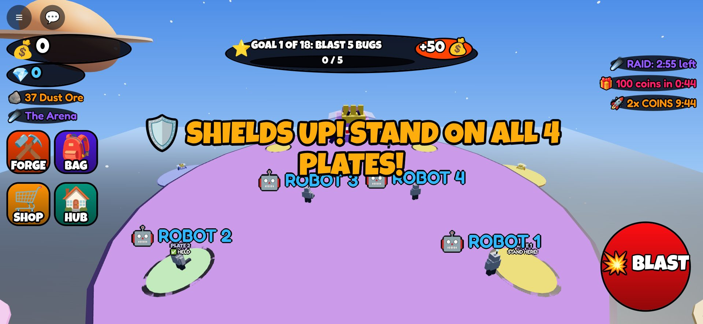 | 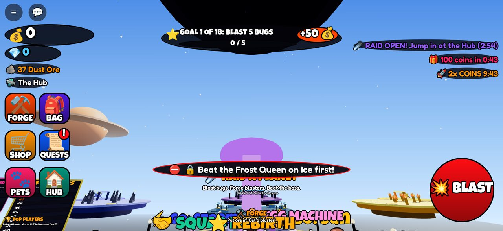 |
| 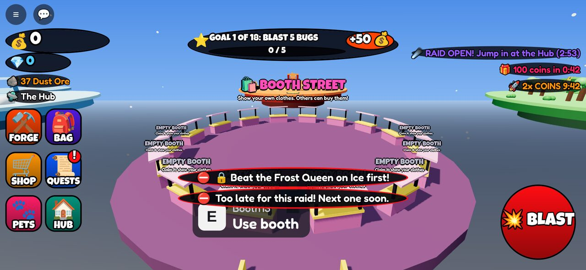 | 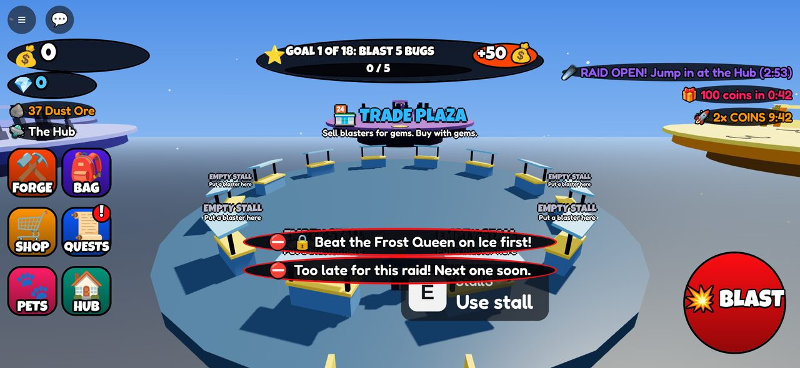 |
| 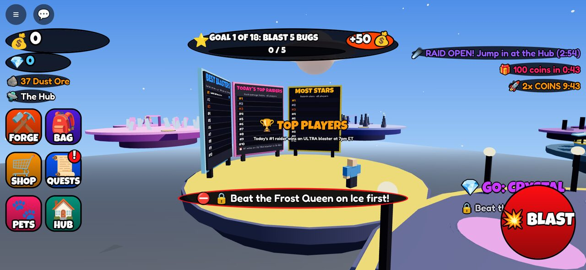 | 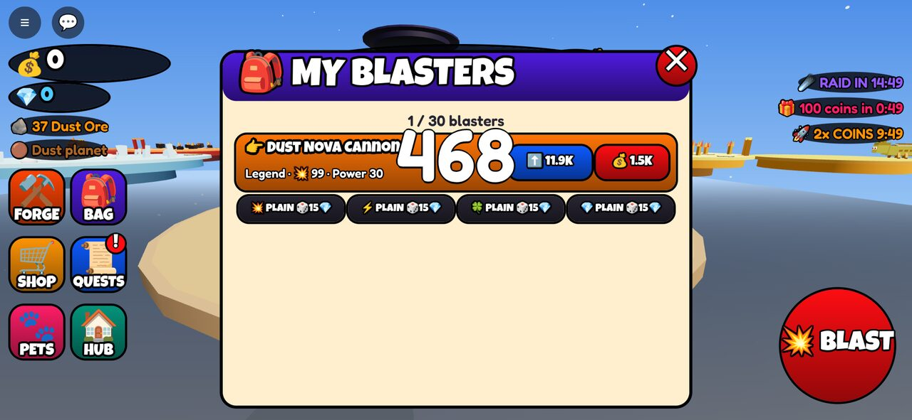 |

(The offline renderer draws a day sky; the game itself is night in space.)
