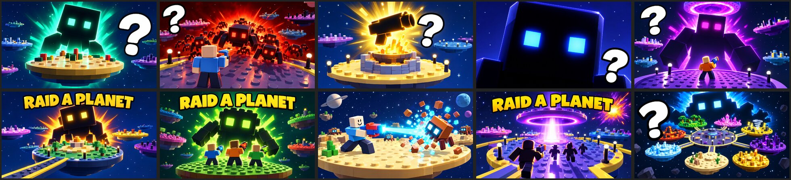

# Raid a Planet: 10 thumbnails and the icon

Every file is **1920 × 1080 (16:9), JPG, under 0.7 MB**. That fits Roblox's experience thumbnails and the Ads
Manager image format. The icon is `../icon/icon_boss_blaster.png`, 512 × 512 PNG.

**They only show what is in the game.** They were made with AI image generation, using real renders of the game as
references (the Hub, a planet island, the boss yard, the raid arena). The prompts told it to copy that look and add
nothing else. So every image shows:

- the real world: round floating brick islands with studs, a dark space sky with stars, the Hub with its gold edge
  and lamp posts, the stone Forge with its fire bowl, the purple portal ring with its beam
- the real mobs: box-shaped bugs and a cube-headed boss with square glowing eyes (the Star Eater is only ever a
  dark silhouette, which is also what makes the mystery formula work)
- plain blocky avatars holding the game's chunky toy blaster

The text is vague on purpose: the game name **RAID A PLANET**, a single **?**, or nothing. None of them promise a
reward, an event or an effect.

## Mystery set (6): the formula that had the best CTR on ra2

A dark silhouette with glowing square eyes, one bright energy burst, a giant white **?** with a black outline, and
nothing else. Each one changes the colour, subject or framing so they can be A/B tested.

| # | File | Scene | Colour |
|---|---|---|---|
| 1 | `01_mystery_teal_boss.jpg` | The boss rising behind a floating island | Emerald / teal |
| 2 | `02_mystery_crimson_swarm.jpg` | A player with a blaster facing a bug swarm | Crimson / orange |
| 3 | `03_mystery_golden_forge.jpg` | A blaster silhouette rising out of the Forge fire | Gold on navy |
| 4 | `04_mystery_shadow_eyes.jpg` | Huge boss face close-up, just the eyes | Indigo / electric blue |
| 5 | `05_mystery_looming_arena.jpg` | A player in the arena under a giant silhouette and the portal | Magenta / purple |
| 10 | `10_mystery_planet_ring.jpg` | The ring of 8 planets with the boss looming behind | Ice blue |

## Title set (3)

| # | File | Scene |
|---|---|---|
| 6 | `06_title_boss_island.jpg` | The boss behind the Hub island, "RAID A PLANET" |
| 7 | `07_title_squad.jpg` | Three friends with blasters facing the boss, "RAID A PLANET" |
| 9 | `09_title_portal.jpg` | Players running into the portal beam, "RAID A PLANET" |

## No text (1)

| # | File | Scene |
|---|---|---|
| 8 | `08_blast_bug_notext.jpg` | A player blasting a bug into blocks on Dust |

## Checklist (Roblox thumbnail and ad rules)

- [x] **Matches the game.** Only real places, mobs and the blaster. No coins, gems, chests, arrows or buttons.
- [x] **No promises.** No "FREE", "NEW", "UPDATE", rewards or prizes in the image.
- [x] **No fake interface.** No fake Play buttons, menus or prompts.
- [x] **Readable small.** One focal point, high contrast, the "?" or the title at least a fifth of the width.
- [x] **Size.** 16:9, 1920 × 1080, under 0.7 MB. Icon 512 × 512.
