# Snipe a Noob (ra4): how to run and play it

Status: **fully built (every step of the [plan](PLAN.md)), not yet published.** Publishing needs a Roblox
experience for it and the place/universe IDs on the API key (see [Publish](#publish)).

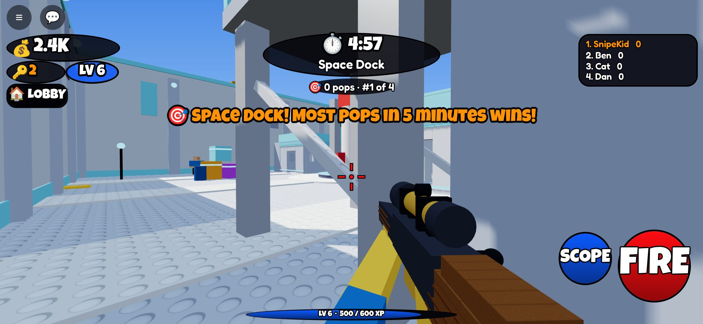

## Run it in Roblox Studio

1. Install [Rokit](https://github.com/rojo-rbx/rokit), then in `games/ra4 - Snipe a Noob/` run `rokit install`.
2. Open `SnipeANoob.rbxl` in Studio and press Play (or `rojo build -o SnipeANoob.rbxl` to rebuild it, or
   `rojo serve` and connect the plugin).
3. Use **Test > Clients and Servers** with 2 players to see a round start (one player alone waits in the lobby
   and can use the Range).
4. Without API access in Game Settings the game runs but doesn't save, passes and products are free, and the
   leaderboards show this server only.

## How to play

| Do | Phone | Keyboard + mouse | Gamepad |
|---|---|---|---|
| Fire | the big red **FIRE** button | left click | R2 |
| Scope | **SCOPE** button (tap to toggle) | hold right click | L2 |
| Swap rifle (Extra Loadout pass) | **🔁 SWAP** | Q | Y |
| Jump into a round | **▶ PLAY** button or the PLAY pad | same | same |
| Back to the lobby | **🏠 LOBBY** | same | same |
| Counters, stalls | walk up and press the prompt | E | X |

### The round loop

1. **The lobby.** You join here: a walled courtyard with towers, so nobody wanders off. Your rifle is on your back here,
   so the mouse is free for the shop; it's in your hands on the Range, in a round and in a duel. The sign over the PLAY pad says what's happening. With one player it waits
   (try the **Range** in the south-west corner, or the leaderboards on the west side).
2. **2 players is enough.** The 15-second countdown starts and a **vote card** shows three maps: tap one. Alone,
   you practice on the Range while you wait.
3. **The round: 5 minutes in an arena.** Everyone in the lobby goes in. Latecomers press PLAY. The arena size
   fits the crowd: small for 2 to 8 players, medium to 16, large to 24. Every map is built the same way on both halves, so
   it's fair: walk-in houses with roof decks and ramps, sniper towers, sandbags, crates and cars for cover, a
   big centerpiece, and bridges between the towers on the large size.
4. **First person, one shot, one pop.** The crosshair is your aim. From the hip the shot wobbles a little; scoped
   it's dead steady after a moment, with slower mouse speed. Light aim help pulls a near miss onto the target
   (more on phones and gamepads). Every hit pops anyone into bricks. Each shot kicks the view up and back; then
   you see your hands work the bolt (Twin drops its mag and reloads).
5. **Popped?** You see who got you (their level, rifle and skin) from their side for 5 seconds, then you're back
   at the spawn farthest from everyone. **⚡ BACK NOW** (9 Robux) skips the wait.
6. **The podium.** Everyone comes back to the lobby facing the podium, where the top 3's real avatars dance
   (their emote, or a dance) until the next round ends. Each leaderboard's #1 also dances on top of their board.

### In a round

- **Streaks:** 3 pops in a row = 🔥 ON FIRE, 5 = ⚡ UNSTOPPABLE, 10 = 👑 LEGEND (banners for everyone).
- **Revenge:** pop whoever popped you last for a bonus.
- **The crown:** the leader wears a crown everyone sees through walls for 2 seconds every 15. Pop the crown
  for +50 coins.
- **Double tap:** you and a friend both pop someone within 3 seconds: bonus for both.
- **Last minute:** faster music and 2x coins.
- Headshots pay double. Walls stop shots. The server decides every pop (with a little lag help so what you saw
  is what counts).

### Coins and what they buy

10 a pop, 20 a headshot, +5 on a streak, +15 revenge, +50 the crown, 2x in the last minute, plus a round bonus
and 100 / 60 / 30 for the podium. A normal round pays about 150 to 300. They buy (all in the lobby):

- **🛒 Daily Shop:** 6 skins, 2 pop effects, 2 emotes, new every day at 7pm ET.
- **🎁 Crates:** the Coin Crate (2,000 coins) or the Key Crate (1 key). Odds always shown.
- **🔫 Rifles:** Bolt, Swift (fast bolt, small zoom), Eagle (huge zoom, slow), Ghost (no tracer), Twin (two
  quick shots). They unlock by level and all pop in one hit. Each has its own look: Bolt is wood and steel,
  Swift has racing stripes, Eagle is desert camo, Ghost is snow camo with a silencer, Twin is red tiger.
- **✨ Style:** crosshairs and kill-feed name colours; pick your pop effect and podium emote.
- **Skins** paint the whole rifle with a pattern: camo, stripes, dots, tiger, scales, stars, gems, neon lines and
  more (see the skins picture below).
- **Mastery:** 100 / 500 / 2,000 pops with a rifle turn it Gold, Diamond, Rainbow.

You're seen in the **pop cam** (when you pop someone, they see your rifle and skin), the **kill feed** and on
the **podium**. That's why skins are worth it.

### Every day

- **Daily quests:** 3 a day (pop players, headshots, win a round, pop the crown...), coins or keys; swap one a
  day for 300 coins.
- **Daily gift:** a 7-day streak of coins and keys.
- **Playtime gifts:** 1, 3, 5, 10, 15, 20, 30, 45 and 60 minutes.
- **New players:** 2x coins and XP for 10 minutes. (Robots can fill quiet rounds: set `ROBOTS_FILL_TO` in
  Constants; they are off.)
- **Season (2 weeks):** XP fills 50 tiers. Free rewards for everyone; the Season Pass (399 Robux) adds
  season-only skins, effects, emotes and keys.
- **Leaderboards** on the west side: **TODAY'S TOP SNIPERS** (#1 at 7pm ET wins the Champion skin, never sold),
  **MOST POPS**, **BEST STREAK**, **HIGHEST LEVEL**.

### More in the lobby

- **🎯 Range:** walk past the yellow line: first person, six targets that pop back up. Practice only.
- **⚔️ Duel:** two players stand on the pad: a 1v1 in your own arena, first to 5 wins 60 coins.
- **🏪 Trade Plaza:** 8 stalls. Sell a skin for coins; the plaza keeps 10%. Prize skins can't be sold.
  Accounts that can't trade paid random items (PolicyService) can't use the stalls or open Key Crates.

## Making money

| | Robux | What it does |
|---|---|---|
| VIP | 399 | +20% coins, gold name in the feed |
| 2x Coins | 299 | double coins from playing |
| Extra Loadout | 199 | swap between two rifles in a round |
| Crate Keys | 49 / 199 / 499 | 1 / 5 / 15 keys |
| Season Pass | 399 | this season's pass rewards |
| Round Callout | 99 | your name in gold when the next round starts |
| Revive Now | 9 | skip the 5-second wait once |

Nothing bought shoots better. IDs are 0 until a setup run creates them, so in Studio everything is free.

## Discord game log

Same pipeline as ra2 and ra3 (the `roblox-game-log` Supabase function, the `discord_log` secret): joins and
leaves with session stats, chat, purchases, round results, Legend+ crate skins, trades, rifle buys, level 10 /
25 / 50 / 100, the daily prize, possible cheaters (more than 12 real pops in 20 seconds), script errors.

## Publish

- **Universe ID:** 10770612850 · **Place ID:** 80402814719145
- **Done through the API:** name and description, 24 players per server, the live build, and all 3 passes and 6
  products (IDs in `src/shared/Data/Shop.lua`; pass icons in `other/ra4/icon/passes/`). To rerun:
  `python3 tools/setup_shop.py` (it won't make duplicates).
- **Publish a new build** (from the game folder):

  ```bash
  rojo build -o SnipeANoob.rbxl
  curl -X POST -H "x-api-key: $ROBLOX_API_KEY" -H "Content-Type: application/octet-stream" \
    --data-binary @SnipeANoob.rbxl \
    "https://apis.roblox.com/universes/v1/10770612850/places/80402814719145/versions?versionType=Published"
  ```

- **Still by hand on the Creator Dashboard** (the API can't do these, or the key isn't allowed to):
  1. **Secrets:** add `discord_log` (same value as ra2/ra3), domain `kvedatksqkcsgivntskb.supabase.co`.
  2. **Icon** `other/ra4/icon/icon_noob_scope.png` and **thumbnails** from `other/ra4/thumbnails/`.
  3. **Avatar:** R15. **Genre:** Shooter. **Maturity questionnaire:** blocky, no blood, players pop into bricks
     (Mild violence).
  4. **Make it Public** when you're happy with it.

## Code layout

```text
games/ra4 - Snipe a Noob/
├─ default.project.json        Rojo project (HttpEnabled)
├─ src/shared/                 Constants (every number), Formulas (levels, coins, hit shapes, odds, shop, season,
│                              dates), Net, RifleModel, Data/ (Rifles, Maps, Cosmetics, Quests, Shop)
├─ src/server/
│  ├─ World/                   WorldBuilder (lobby, pop box), MapBuilder (4 arenas x 3 sizes), RobotBuilder, Scenery
│  └─ Services/                PlayerData, Economy, Team, Loadout, Combat (the shot, pops, respawns), Round (the
│                              loop, scoring), Robot, Range, Vote, Duel, Quest, Playtime, Crate, Season, Trade,
│                              Shop, Leaderboard, GameLog
├─ src/client/                 Theme, Store, Controllers/ (Hud, Rifle, Panel, Fx, Audio)
├─ tests/                      formula unit tests, server and client smoke tests on the mock engine
└─ tools/                      run_tests.sh, the Luau runner, gameplay/ (screenshot session + renderer)
```

## Tests

`./tools/run_tests.sh`: 141 formula checks, 120 client checks, 232 server checks (and the same server run
without DataStores). The server test plays whole rounds: waiting, the countdown, spawns, shots, shields, walls,
lag compensation, headshots, streaks, revenge, the crown, double tap, falls, leaving and rejoining, Revive Now,
the last minute, the podium, the next round, every map and size, levels, rifles, the Daily Shop, Style, skins,
mastery, quests, gifts, purchases, crates and policy rules, the season, trading, leaderboards and the prize,
robots, the vote, the range, duels and the game log.

## Screenshots

| | |
|---|---|
| 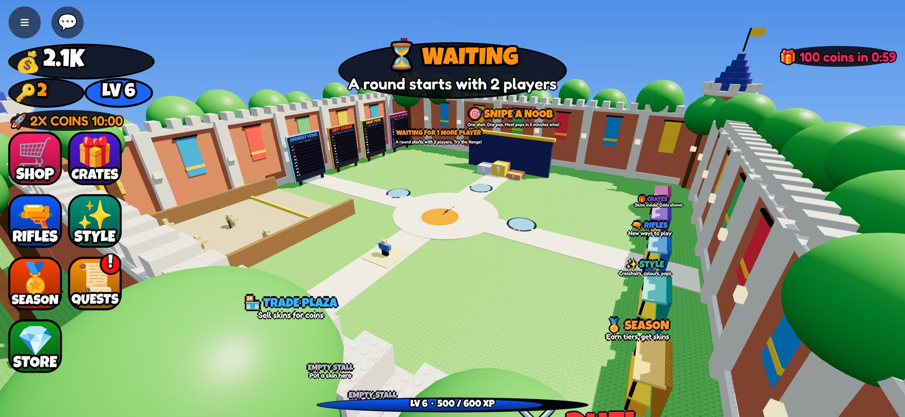 | 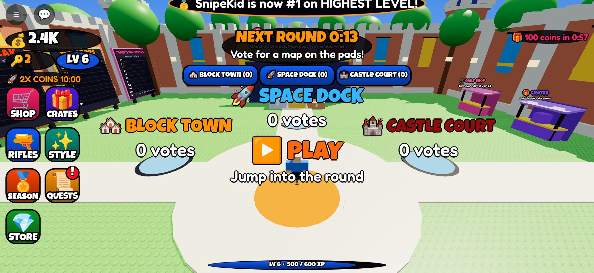 |
|  | 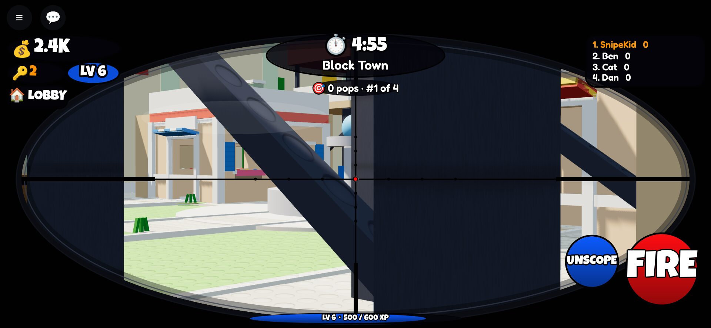 |
| 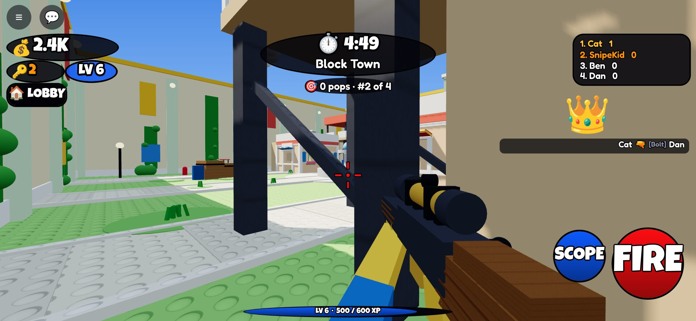 | 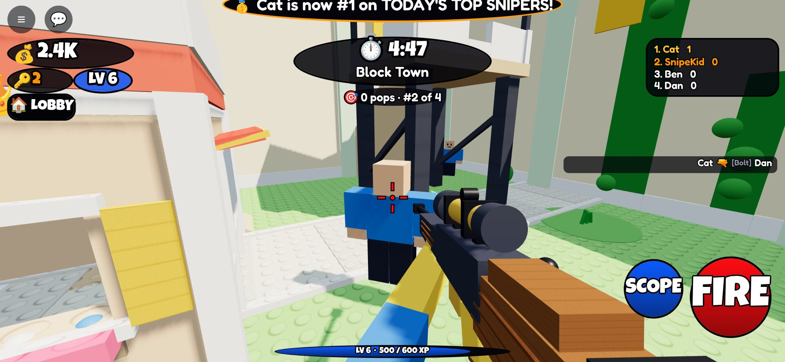 |
| 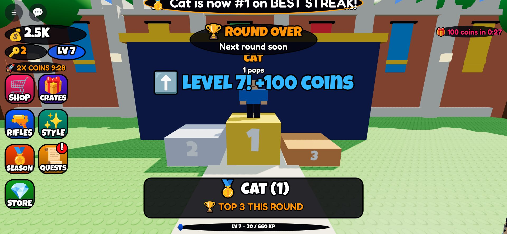 | 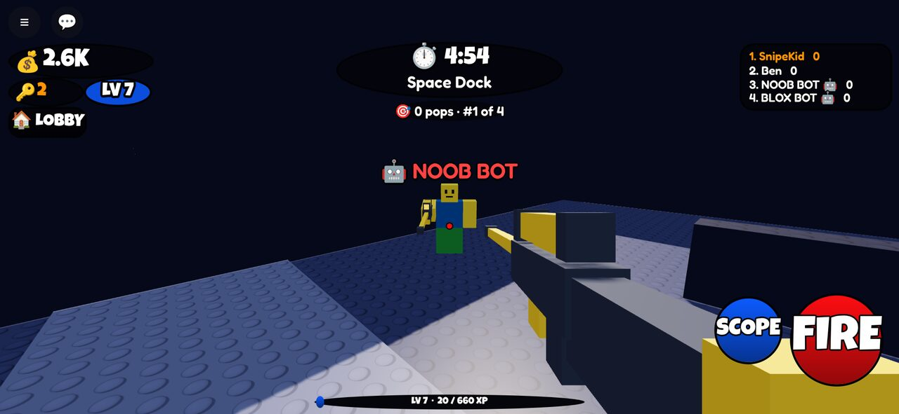 |
| 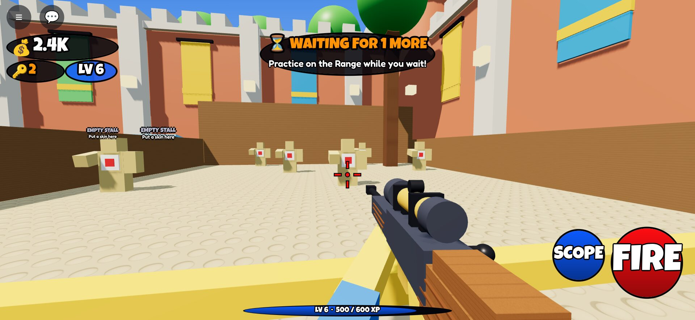 | 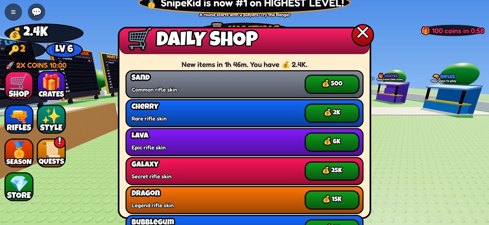 |
| 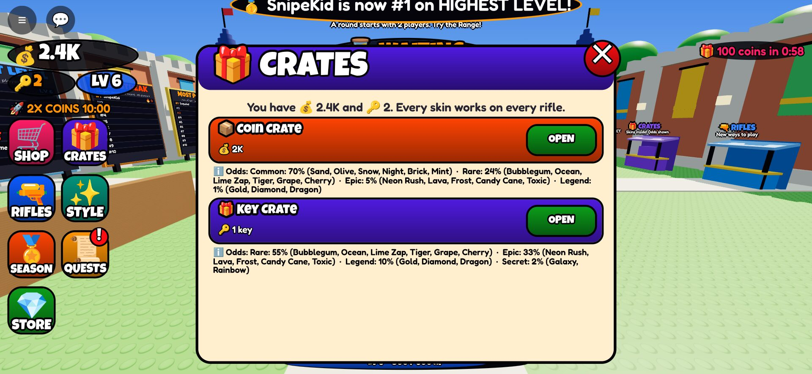 | 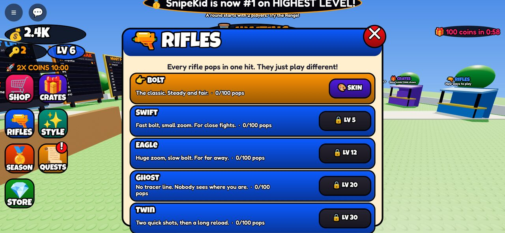 |
| 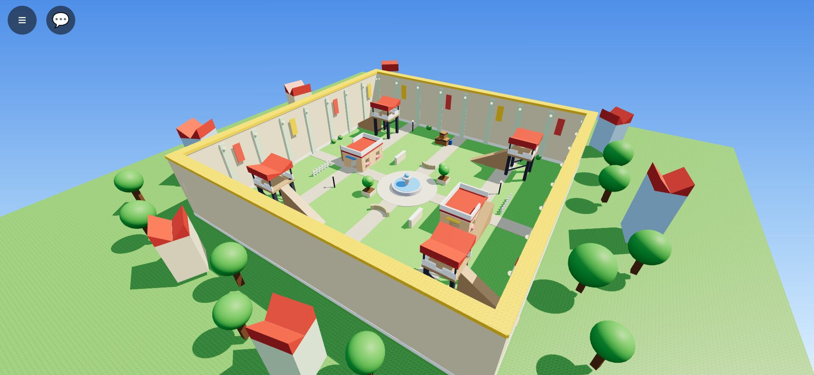 | 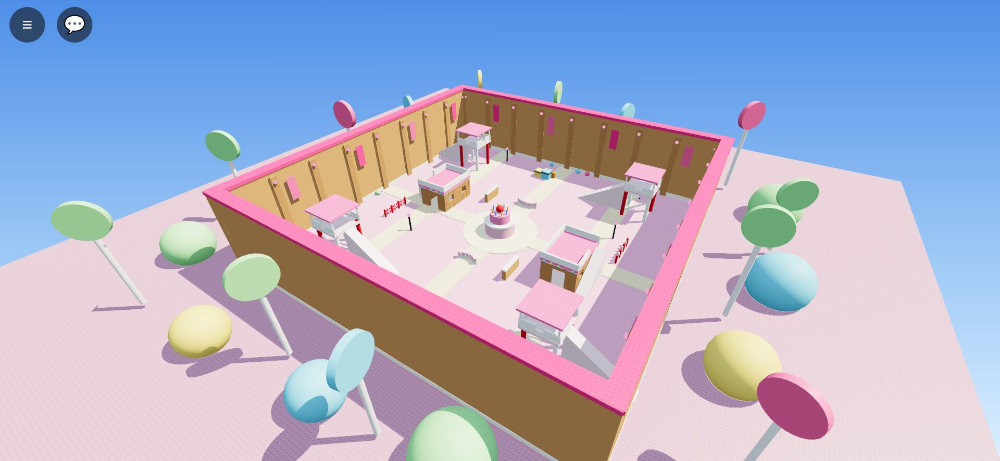 |
| 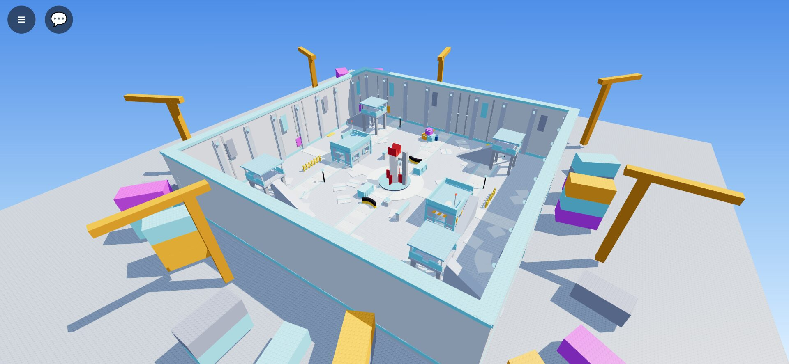 | 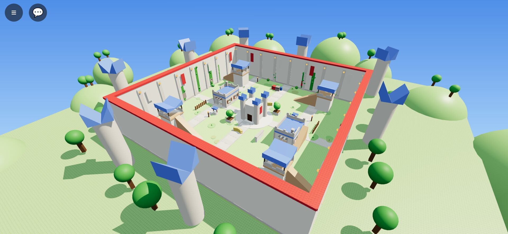 |
| 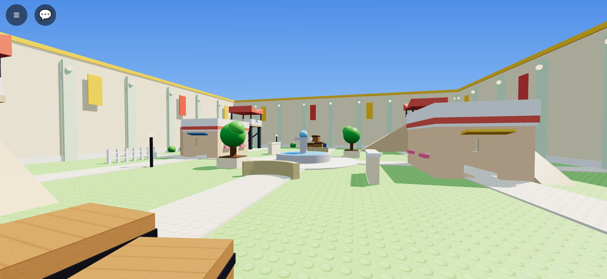 | 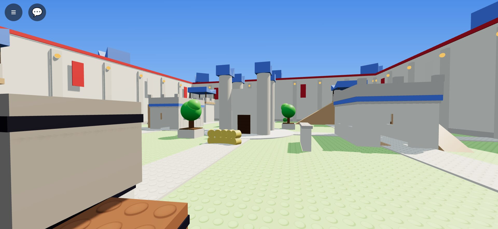 |
| 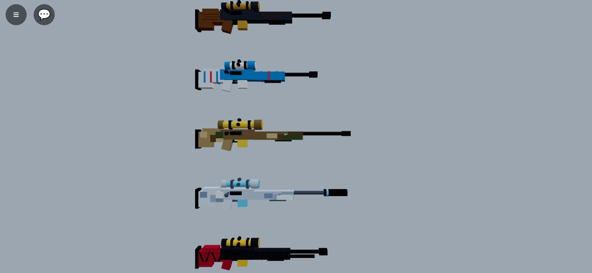 | 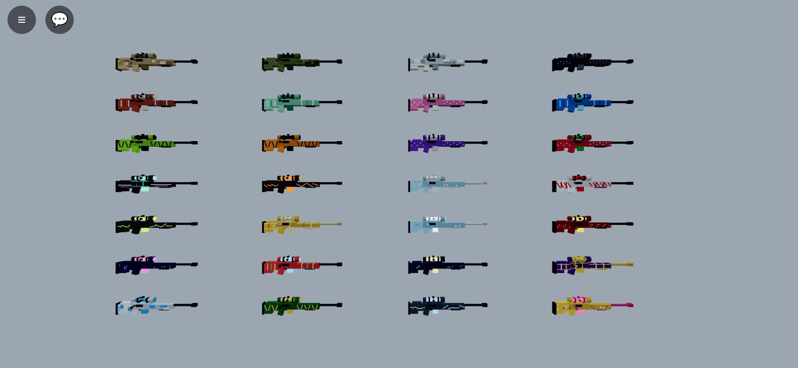 |
