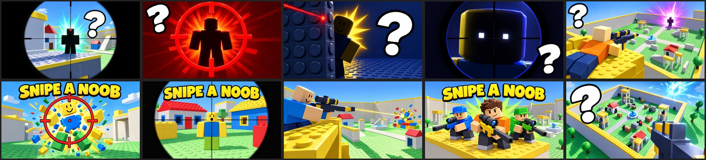

# Snipe a Noob: 10 thumbnails and the icon

Every file is **1920 × 1080 (16:9), JPG, under 0.7 MB**, for experience thumbnails and the Ads Manager. The icon
is `../icon/icon_noob_scope.png`, 512 × 512 PNG.

**They only show what is in the game.** They were made with AI image generation from real renders of the game
(the first-person rifle, the robot noobs, Block Town from above and on the ground):

- the real world: walled brick arenas with studs, little houses with red roofs, towers with ramps, the fountain
- the classic noob (yellow head, blue body, green legs), which is exactly how the game's robots look
- the chunky box rifle with its big scope, the round scope view, the red aim dot and the yellow tracer
- players popping into toy bricks (that's how a pop looks in the game: no blood)

The text is vague on purpose: the game name **SNIPE A NOOB**, a single **?**, or nothing. None of them promise a
reward, an event or an effect.

## Mystery set (6): the formula with the best CTR on ra2

A dark silhouette, one energy burst, a giant white **?** with a black outline, and nothing else.

| # | File | Scene | Colour |
|---|---|---|---|
| 1 | `01_mystery_scope_teal.jpg` | Through the scope: a noob silhouette on a rooftop with the red dot | Teal |
| 2 | `02_mystery_crosshair_red.jpg` | A big red crosshair over a noob silhouette | Crimson |
| 3 | `03_mystery_laser_wall.jpg` | A noob peeking from behind a brick wall, the red dot right next to it | Gold on navy |
| 4 | `04_mystery_scope_eyes.jpg` | A noob head in the scope, all shadow but the eyes | Indigo |
| 5 | `05_mystery_tower_far.jpg` | A player on a tower aiming at a far silhouette | Magenta |
| 10 | `10_mystery_arena_hide.jpg` | Noob silhouettes hiding all over Block Town, one with the dot | Ice blue |

## Title set (3)

| # | File | Scene |
|---|---|---|
| 6 | `06_title_noob_pop.jpg` | A noob popping into bricks in the crosshair |
| 7 | `07_title_scope_noob.jpg` | A surprised noob through the scope in Block Town |
| 9 | `09_title_squad.jpg` | Three friends with rifles on a rooftop |

## No text (1)

| # | File | Scene |
|---|---|---|
| 8 | `08_rooftop_shot_notext.jpg` | A player on a tower; the tracer pops a noob far away |

## Checklist (Roblox thumbnail and ad rules)

- [x] **Matches the game.** Real places, the noob look, the box rifle, pops into bricks.
- [x] **No promises.** No "FREE", "NEW", "UPDATE", rewards or prizes.
- [x] **No fake interface.** No fake buttons, menus or prompts.
- [x] **No blood or gore.** Pops are toy bricks.
- [x] **Size.** 16:9, 1920 × 1080, under 0.7 MB. Icon 512 × 512.
