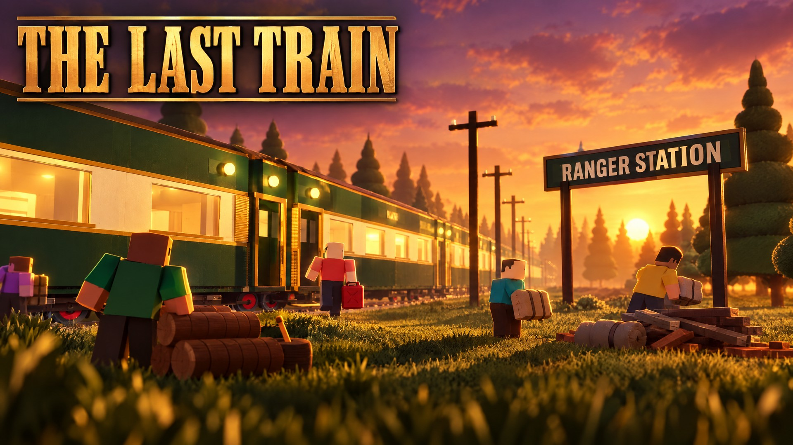

# The Last Train (ra5): how to run and play it

Status: **MVP built (every "Must build" item in the [master plan](MASTER_PLAN.md) §20, see [PLAN.md](PLAN.md)),
not yet published.** Publishing needs a Roblox experience for it (see [Publish](#publish)).



A crew boards one train that travels a mysterious line. At every stop the doors open for two and a half minutes:
scavenge materials, fuel and blueprints, and get back aboard before the doors close. Materials build **your own
cabin** (it's saved forever) or the **crew's train** (it goes farther). When the fuel runs out, the journey ends,
and the best crews go up in the station's **Hall of Records**.

## Run it in Roblox Studio

1. Install [Rokit](https://github.com/rojo-rbx/rokit), then in `games/ra5 - The Last Train/` run `rokit install`.
2. Open `TheLastTrain.rbxl` in Studio and press Play. Or rebuild it with `rojo build -o TheLastTrain.rbxl`, or
   run `rojo serve` and connect the plugin.
3. One player is enough: the boarding countdown starts as soon as someone is in the station. Use
   **Test > Clients and Servers** with 2 or 3 players to try a crew, a late joiner and being left behind.
4. Without API access in Game Settings the game runs but doesn't save, the Hall shows this server's records only,
   and friend teleports say they can't reach the train (teleports don't work in Studio).

## How to play

| Do | Phone | Keyboard + mouse | Gamepad |
|---|---|---|---|
| Collect a pile, take a blueprint | hold the prompt | hold E | hold X |
| Go to your cabin | **🚪 CABIN** | C | the CABIN button |
| Build in your cabin | **🛠 BUILD**, or the BUILD prompt in your cabin | B | the BUILD button |
| Give to the train | **⚙️ TRAIN**, or the board in the engine room | T | the TRAIN button |
| Join or invite friends | **👋 FRIENDS** | same | same |
| See the records | **🏆 HALL**, or a plaque in the station | same | same |

### The loop

1. **The station.** You arrive in a warm Victorian train shed with the train waiting and the **Hall of Records**
   on the concourse wall. The departure board counts down from 45 seconds once anyone is here.
2. **All aboard.** The doors shut 4 seconds after the "doors closing" call. At the station nobody is left behind:
   you're brought aboard. You have your own cabin (cabins 1-20, front of the train first).
3. **On the line.** About 36 seconds between stops: the forest streams past the windows (three moods: golden
   hour, blue twilight, morning mist). Half way, the train announces the next stop. Distance grows on the board.
4. **A stop.** The train brakes, the stop slides in, the doors open: **2:30 on the clock** (+15 s with the
   Searchlight). Four stops in the first region, the **Overgrown Line**: Ranger Station (cloth, wood), Timber Yard
   (wood, scrap), Signal Tower (parts, scrap; from 5 km) and the Overgrown Platform (rare finds; from 15 km).
5. **Scavenge.** Hold the prompt on a pile: everyone can take each pile once, so nobody fights over it. Fuel cans
   are the crew's (first come). Every stop has one **blueprint** at its landmark (the top of the tower, the crane,
   the old waiting room...). It all goes in your **field bag** (12 slots, more with the crate and locker), and
   it's banked the moment you're back inside the train.
6. **The warnings.** At 1:00 left the train calls "One minute!" and the board turns amber; at 0:20 the final call,
   the horn, flashing beacons, red screen edges and a glowing line to the nearest open door.
7. **Left behind?** If you're outside when the doors shut, the train goes without you. You lose only what was in
   your bag (never your cabin or storage) and wake up at an emergency signal hut in the woods at night: find 3
   fuses, fit them in the fuse box, pull the lever, and a maintenance trolley brings you back (45 s later, or
   right away with the Radio Mast).
8. **Fuel.** Every trip costs fuel (2 per trip, less with the Engine Overhaul, a little more every 10 km). If the
   crew can't afford the next trip, the journey ends: the train coasts, the record is written and a new
   expedition boards at the station.

### Your cabin (saved forever)

15 upgrades, one at a time, each visible the moment it's built (see a blue preview before you build):
bunk → wall lamp → storage crate (+2 bag) → bench → work surface → workbench (salvage 3 scrap into 1 part) →
then any order: insulation, display shelf (souvenirs from every stop), ceiling lamp, interior finish (4 looks,
change any time), map board (needs plans: shows the stops you've seen and your best distance), tool rack (faster
collecting), locker (+2 bag), comfort corner, and a specialist station (needs plans: Mechanic, Explorer or
Botanist). The cabin colour (door sign, blanket, curtains) is free. New players start with half a bunk's worth of
materials, so the first stop finishes it.

### The crew's train (this expedition only)

The **Engine Overhaul** (3 stages: trips cost 1.6, 1.3, then 1 fuel; the engine room fills with copper pipes, a
second boiler and gold trim) and the **Scout Lamp** (Searchlight: see the next stop ahead and +15 s at every stop;
Radio Mast: left-behind crew picked up at once and blueprints glow with a tall beacon). Anyone gives from their
own storage, only what the stage still needs, and the stage finishes by itself. Nobody is ranked on giving.

### Records

A record is the crew's: the distance, stops, time, the crew, how the train looked, and who helped most (fuel
brought back, materials given, blueprints found, finding the way back). **Full crew** = aboard for 2 stops or 5
minutes. The top record has its own stage in the Hall: bronze statues of the crew with their headshots in front of
a miniature of their train. Records are saved under the expedition's id, so they're never duplicated, never
shrink, and are checkpointed at every stop after 5 km (a crash keeps what was safely reached).

### Friends and late joining

- **FRIENDS** lists your friends in this game and how their trains are doing; **JOIN** teleports you to that
  exact train. **Train Full** offers *Wait for a Spot* (we try again every 15 s, up to 8 times: an honest retry,
  not a queue position), *Join Another Friend*, or *Start a New Expedition* (a fresh private train friends can
  still join from their panel).
- Late joiners arrive aboard and get a card: where the crew is, the distance and next milestone, fuel, the crew's
  goal, and how long the doors stay open.
- Dropped out? If your train is still going (within 15 minutes) you're offered to go back to it.

## How it's built

```text
games/ra5 - The Last Train/
  src/shared/   Constants (every tunable), Net (rate-limited remotes), Formulas (all game math),
                Data/ (CabinItems, TrainUpgrades, Resources, Stops), World/ (Kit, Layout, CabinBuilder,
                LightingPresets)
  src/server/   World/ (TrainBuilder, StationBuilder, StopBuilder, RecoveryBuilder, HallBuilder, WorldBuilder)
                Services/ ExpeditionService (the state machine), TrainService, ResourceService, CabinService,
                RecoveryService, RecordService, JoinService, TutorialService, AnalyticsService, GameLogService,
                FeedbackService, AntiCheatService, PlayerDataService
  src/client/   Controllers/ Hud, Panel, Travel, Prompt, Node, Recovery, Tutorial, Audio, Analytics, Notify,
                Performance; UI/Theme
  tests/        Formulas, ServerSmoke (whole expeditions, with and without DataStores), ClientSmoke
  tools/        run_tests.sh, luaurun (a small Luau runner), gameplay/ (thumbs.luau, render.js, thumbs_post.py)
```

- **The train never moves.** It stands on the track; the station or a stop is placed beside it, and each client
  draws the travel scenery and slides the stops in and out. The server owns the phase, the timer, the distance,
  the fuel, who's aboard, every pile and every record.
- **Mobile first:** a 1000 × 560 layout scaled to the screen, big touch targets, nothing in the thumb corners,
  the departure timer always visible, a lighter forest on phones, and Reduced Motion / transparency / text size
  respected. No state is shown by colour alone.

## Tests

```bash
cd "games/ra5 - The Last Train"
sh tools/run_tests.sh   # formulas (121), client smoke (129), server smoke (216, and about 210 without DataStores)
```

## Analytics and the game log

Same Supabase pipeline as Steal a Dragon, tagged `game = 'ra5'`: sessions, every request and prompt, the core
loop funnel (stepped out, collect, made it back, bank, built, deposit, second stop, friends), the guide steps,
feedback, and a live row for the dashboard. Open [`other/live.html?game=ra5`](../live.html) to watch it. The
Discord game log gets joins, leaves with session stats, finished expeditions, Hall entries, upgrades, anti-cheat
flags and errors. Both need the experience's **`discord_log`** secret (Creator Dashboard → the experience →
Secrets), the same key as ra2.

## Publish

1. **Create the experience.** In Studio, open `TheLastTrain.rbxl` → **File → Publish to Roblox As… → Create new
   experience**, name **The Last Train**.
2. **Game Settings:** Places → **Max Players 20**; Security → **Allow HTTP Requests** on and **Enable Studio
   Access to API Services** on; Avatar → R15. Check Lighting → Technology is **Future**.
3. **Secrets:** add `discord_log` (the same value as ra2's) so analytics and the Discord log work.
4. **Icon and thumbnails:** upload `icon/icon_locomotive.png` and the 8 images in [`thumbnails/`](thumbnails/README.md)
   in order.
5. **Later builds:** add the new universe and place to the Open Cloud API key and publish with
   `curl -X POST -H "x-api-key: $ROBLOX_API_KEY" -H "Content-Type: application/octet-stream" --data-binary
   @TheLastTrain.rbxl "https://apis.roblox.com/universes/v1/{universeId}/places/{placeId}/versions?versionType=Published"`.
6. **Sounds:** the effects reuse the studio's uploaded sounds from the other games (ids in `Constants.SOUNDS`).
   Train-specific recordings (whistle, horn, brakes, door chime, wheel rumble) can replace them later by id.
