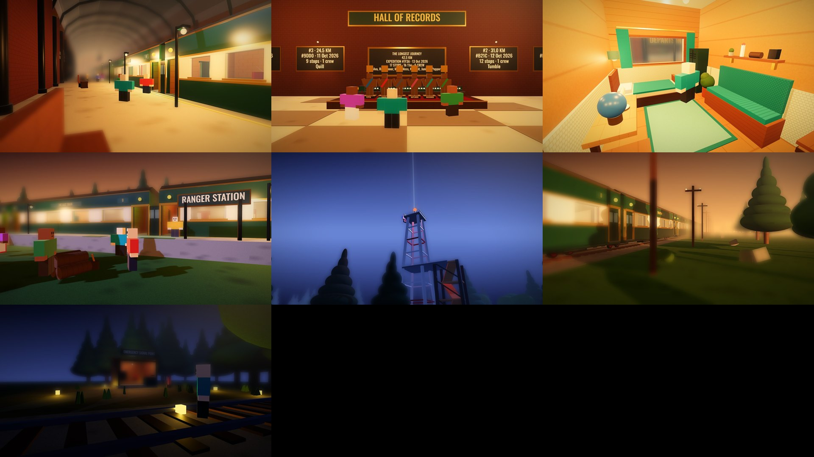

# The Last Train: real gameplay renders



These are **real renders of the game**, not AI: the server and client code played on the mock engine into a few
moments (`games/ra5 - The Last Train/tools/gameplay/thumbs.luau`), drawn with three.js (`render.js`), then the
shader pass (`thumbs_post.py`: colour grade, bloom, depth of field, vignette). They are the references the
[thumbnails](../thumbnails/README.md) were made from.

| File | Moment |
|---|---|
| `01_station_boarding.jpg` | The crew walking to the doors in the station before departure |
| `02_hall_of_records.jpg` | The Hall of Records: the top crew's statues and miniature train, the plaques |
| `03_my_cabin.jpg` | A finished cabin (all 15 upgrades, oak finish, teal) |
| `04_ranger_station.jpg` | Scavenging at Ranger Station at dusk |
| `06_signal_tower.jpg` | The signal tower at blue hour, with the Radio Mast's blueprint beacon |
| `07_on_the_line.jpg` | The train on the line through the forest at golden hour |
| `10_left_behind.jpg` | Left behind: the signal hut at night, fuses glowing in the grass |

Re-render them from the game folder:

```bash
luaurun tools/gameplay/thumbs.luau out
node tools/gameplay/render.js out renders --modules <node_modules with puppeteer, three, @fontsource>
cp out/*.json renders/   # (the shader pass reads each shot's camera from its snapshot)
python3 tools/gameplay/thumbs_post.py renders post --font <oswald-latin-700-normal.woff>
```
