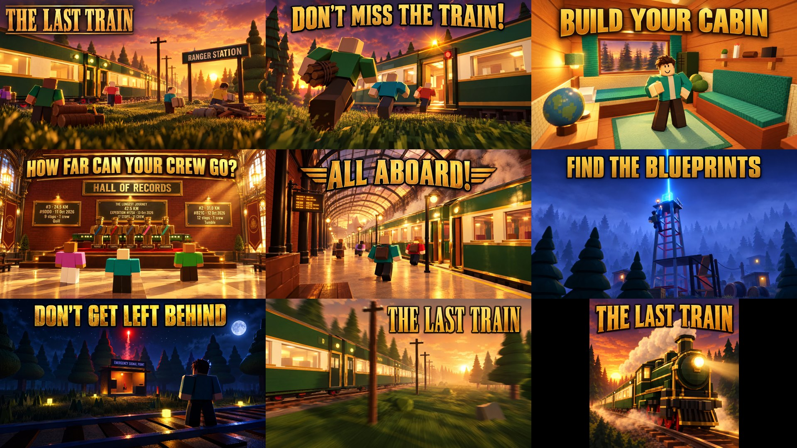

# The Last Train: thumbnails and the icon

Every thumbnail is **1920 × 1080 (16:9), JPG, under 0.6 MB**, for experience thumbnails and the Ads Manager. The
icon is `../icon/icon_locomotive.png`, **512 × 512 PNG**; `icon_headlamp_alt.png` and `icon_runner_alt.png` are
alternates for an icon A/B test.

**They only show what is in the game.** Each one was made with AI image generation (Higgsfield, GPT Image 2.5)
from a **real render of the game** as its reference (the renders are in [`../screenshots/`](../screenshots/README.md)),
so they keep the real world: the forest-green train with its cream window band, brass trim and red wheels, the
Victorian station with its iron arches, Ranger Station, the signal tower at blue hour, the signal hut at night,
the Hall of Records with the crew statues and the miniature train, the teal cabin, and blocky Roblox avatars.

The text only says what you do in the game. None of them promise a reward, an event or an effect.

| # | File | Scene | Text |
|---|---|---|---|
| 1 | `01_hero_ranger_station.jpg` | The crew scavenging at Ranger Station at sunset, the train waiting | THE LAST TRAIN |
| 2 | `02_dont_miss_the_train.jpg` | Running for the doors with wood, beacons flashing | DON'T MISS THE TRAIN! |
| 3 | `03_build_your_cabin.jpg` | A finished cabin: teal bunk and bench, shelf, globe, rug | BUILD YOUR CABIN |
| 4 | `04_hall_of_records.jpg` | The Hall of Records with the top crew's statues and plaques | HOW FAR CAN YOUR CREW GO? |
| 5 | `05_all_aboard.jpg` | Boarding under the station's iron arches | ALL ABOARD! |
| 6 | `06_find_the_blueprints.jpg` | The signal tower at blue hour, the Radio Mast's blueprint beacon | FIND THE BLUEPRINTS |
| 7 | `07_dont_get_left_behind.jpg` | The emergency signal hut at night, fuses in the grass, the flare | DON'T GET LEFT BEHIND |
| 8 | `08_on_the_line.jpg` | The train speeding through the forest at golden hour | THE LAST TRAIN |

## Checklist (Roblox thumbnail and ad rules)

- [x] **Matches the game.** Real places, the real train, the real cabin items, blocky avatars.
- [x] **No promises.** No "FREE", "NEW", "UPDATE", rewards or prizes.
- [x] **No fake interface.** No fake buttons, menus or prompts.
- [x] **No violence or scary imagery.** Being left behind is a night in the woods with a lit hut.
- [x] **Size.** 16:9, 1920 × 1080, under 0.6 MB. Icon 512 × 512.
