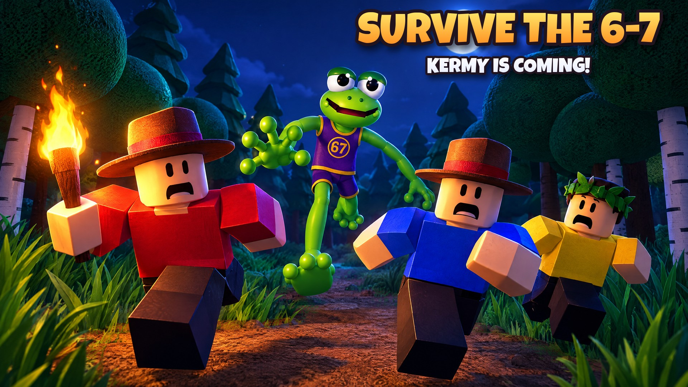

# Survive the 6-7 (ra6): how to run and play it

Status: **built (the [master plan](MASTER_PLAN.md)'s launch scope, §17; see [PLAN.md](PLAN.md)), not yet
published.** Publishing needs a Roblox experience for it (see [Publish](#publish)).



Up to six friends camp in the middle of a big forest. By day you chop trees, open crates, explore the findings
scattered through the trees and build the camp up. At night the forest's monsters come out, and Kermy, six foot
seven of swamp-green trouble in a too-small purple 67 jersey, hunts whoever wanders off. He yells "SIX...
SEVEN!" before he lunges: read the tell and dodge. Get through six nights, then beat Mega Kermy on the seventh.
Go down and a teammate can pick you up; bleed out and you're a ghost until dawn. What you carry belongs to the run;
your level, weapon mastery, discoveries, achievements and records are yours for good.

## Run it in Roblox Studio

1. Install [Rokit](https://github.com/rojo-rbx/rokit), then in `games/ra6 - Survive the 6-7/` run `rokit install`.
2. Open `SurviveThe67.rbxl` in Studio and press Play. Or rebuild it with `rojo build -o SurviveThe67.rbxl`, or
   run `rojo serve` and connect the plugin.
3. One player is enough: the first player into an empty server starts a run straight away; how many monsters
   come, their health and Mega Kermy's scale with the team (solo runs are winnable). Use **Test > Clients and
   Servers** with 2-6 players for revives and the friends-first leaderboards.
4. Without API access in Game Settings the game runs but doesn't save, the leaderboards show this server only,
   and joining a friend or a new run says it can't reach the server (teleports don't work in Studio).

## How to play

| Do | Phone | Keyboard + mouse | Gamepad |
|---|---|---|---|
| Swing, chop, shoot, eat, set a trap or throw what you hold | the big **ACT** button (hold to keep going) | click | R2 |
| Dodge (a quick roll you can't be hit in) | **💨 DODGE** | Q | B |
| Sprint (uses stamina) | **🏃 SPRINT** (a toggle) | hold Shift | L3 |
| Your weapon's special move (mastery 3) | **✨** (its cooldown fills it) | R | L2 |
| Pick a hotbar slot | tap it | 1-6 or the mouse wheel | L1 / R1 |
| Your bag | **🎒** | Tab | Y |
| Build, open, revive, vote, ring the bell, feed the fire | the prompts | E | X |
| Ping your team | **📢** | G | DPad up |
| The 6-7 | **⚙️ MORE** | H | MORE |
| Your level, the book, the leaderboards, friends, settings | the menu at the top right | same | same |

**Aiming is forgiving.** A swing goes where your camera looks (on PC, toward what the mouse is on, unless that's
behind you) and turns to the monster in front of you, or with nothing to fight, to the tree or rock most in front of
you: walk up to a tree and press ACT (or click) and you chop it. The giants of the deep forest are too big to chop
(the swing says so). Shift Lock is turned off, because Shift sprints.

### One run (about 27 minutes)

1. **Day 1** (3:30). Everyone spawns by the fire. The guide walks you through it one step at a time with an
   arrow and a beam to the target: chop a tree, build the Workbench (hold its glowing blueprint's prompt), open a
   crate, hold what you found, get back to camp before dark. At 2:30 Kermy shows himself at the edge of the
   camp. The team picks the difficulty by touching the standing stones; the camp bell calls the night early when
   everyone rings it. The roster is open all day: friends who join now are in the run.
2. **Dusk** (12 s): "Night is coming!", the first howls. **The roster locks** at night 1: anyone who joins
   later waits for the next run (they can watch, or find a run that's starting).
3. **Nights 1-6** (70-110 s, longer each night). Monsters come out of the trees in waves sized to the night, the
   team and the difficulty. Kermy hunts from night 1 (and peeks at people from the trees by day). From night 3 a
   night can bring an event: Fog Night, Firefly Night, a Blood Moon or a Thunderstorm. The campfire burns fuel all
   night: feed it wood. With the fire out, monsters hit harder and nobody can warm up by it.
4. **Days 2-7** (95-100 s): explore further, loot, build. Monster packs roam the deep forest by day from day 2,
   a golden pack guards rare loot from day 3, and a supply crate parachutes in on days 3 and 5.
5. **Night 7: Mega Kermy.** Bait his charge into one of the eight Ancient Pines round the clearing: he gets stuck
   and his glowing 67 is a weak spot (2.5x damage). He jumps (shockwave rings to jump over), slams, spits goo
   that cocoons a survivor (break them out, or mash out from inside), gets angrier at each third of his health,
   enrages at 5 minutes, and if he isn't beaten by dawn the run is lost.
6. **The results** (25 s): won or lost, nights, time, the team's kills, revives, builds and finds, the run's
   stars, your XP, levels and unlocks. Winners do the 6-7. A new run starts.

**Down, not out.** At 0 health you're down: you crawl, and a teammate can hold your prompt for 3.5 seconds to get
you up (a medkit halves it). On Normal and Hard you can also crawl into the fire's light and get up by yourself.
Bleed out (30 seconds on Normal) and you're a ghost until dawn, watching a teammate; your pack drops where you fell
and waits there. The run is lost when nobody is left standing and nobody can still get up.

### The forest

A round forest about a kilometre across: the camp's clearing in the middle (with the eight Ancient Pines), four
trails out from the camp's gates, a creek and a pond, rocky outcrops, and trees everywhere else, thicker and darker
the further out you go. Each run scatters **findings** through the trees at random (a cabin, a ranger tower, an
ice cream truck, a bear cave, a witch hut, a stone circle, a lost camp, a mushroom ring, a hollow log, a hunter's
blind, a rusty car, a beehive tree and Kermy's lair), 34 crates (a few close to camp for the first minutes), a
couple of mimics that bite, locked chests that need a Rusty Key, and the 7 pages of Kermy's diary.

### The monsters

| | Role | What to watch for |
|---|---|---|
| 🐸 **Kermy** | the hunter | "SIX... SEVEN!", forearms out, palms up: then a long lunge along a red line. Dodge sideways and he faceplants (free hits). Knocked out, he comes back the next night. |
| 🍄 **Snapcap** | a nuisance | a hopping toadstool; crouches, then leaps at a red circle |
| 🐺 **Grinwolf** | pack hunter | circles with its pack; its eyes flash red and it howls before it darts in |
| 🐿️ **Pinecone Pelter** | ranged | lobs pinecones at a red circle on the ground, then hides |
| 🪵 **Stumpy** | heavy | slow, smashes walls; a big wind-up before the slam |
| 📦 **Mimic** | trickster | a crate that breathes; open it and it runs off with the loot |
| 👹 **Mega Kermy** | final boss | his charge (a long red line), the jump's shadow, the goo |

Golden elites (more health, better loot) guard the deep forest from day 3, and every night on Nightmare and
Six-Seven.

### Items and the camp

**61 items** in five rarities (common, uncommon, rare, epic, legendary, each with its colour): wood, stone,
fiber, scrap, herbs and glowcaps; food; 20 weapons (axes, clubs, spears and bows); arrows; snares and bear traps;
firecrackers, flares and Kermy bait to throw; bandages, medkits, brews and a revive charm; torches, lanterns and
glow jars; armour, packs and lucky charms. Six hotbar slots and a 12-slot backpack (more with a pack).

**28 recipes** at the camp's Workbench, Anvil, Cookpot and Campfire (materials come from your backpack, then the
camp chest). The camp grows through **four tiers**, each built together: **The Campsite** (the fire, a chest, a
workbench) → **The Outpost** (walls and gates, spike traps, a repair bench, watch platforms) → **The Fort** (stone
walls, the anvil, the cookpot, lantern posts) → **The Stronghold** (catapults, fire pits, the Totem of the
Seventh Night). Each tier makes the fire bigger, brighter and longer-burning. What each player puts into the camp
is counted for them (XP, the results).

### Between runs (yours for good)

- **Levels** open starting **kits** (Woodsman, Hunter, Medic, Brawler, Trapper, Ranger: choices, not power),
  **perk** slots (Lumberjack, Quick Hands, Light Sleeper, Scavenger, Marathon, Medic, Trapper, Night Owl),
  titles and looks.
- **Weapon mastery** 1-10 for axes, clubs, spears, bows, traps and support items; at mastery 3 each opens a
  special move (Whirl Chop, Ground Pound, Lunge Thrust, Triple Shot, Quick Set, Field Medic).
- **The book**: every monster you've met and the tells you've learned to read, items found, findings visited,
  Kermy's diary, **31 achievements**.
- **Four difficulties**, each unlocked by winning the one before: Normal, Hard, Nightmare and Six-Seven (no
  getting up by the fire on the last two, and Kermy comes back faster).
- **Looks only** for showing off (a ranger hat, a leaf crown, a Kermy hood, a golden 67 chain, packs, a firefly
  trail, the Crown of the 67) and 19 titles. Nothing you earn makes anyone stronger in a run.

### Friends first

**🏆 TOP** shows eight leaderboards (highest difficulty cleared, fastest win, nights survived, rarest
discoveries, monsters defeated, teammates rescued, weapon mastery, achievements): your friends first, marked if
they're in this server, then everyone. **👥 FRIENDS** lists your friends in the game and how their run is going
(day or night, players, private); **JOIN** takes you to their server. If it's full: *Wait for a spot* (we try
every 15 s, up to 8 times) or start a **private run**. **NEW RUN** finds a server whose run is still on day 1, or
starts one. Dropped out? Your run waits for you (15 minutes), your things wait by the fire, and you're offered to
go back.

## How it's built

```text
games/ra6 - Survive the 6-7/
  src/shared/   Constants (every tunable), Net (rate-limited remotes), Formulas (all game math), Format,
                Data/ (Items, Recipes, Camp, Enemies, Findings, Progression, MobCodes),
                World/ (MapLayout, Kit, CampModels, FindingModels, ItemModels, Rigs, Looks, LightingPresets)
  src/server/   World/ (TerrainBuilder: the land as smooth terrain; MapBuilder: the forest and the camp)
                Services/ RunService (the run and the roster), SurvivorService (health, stamina, dodges, downs,
                revives, ghosts), InventoryService, ResourceService, LootService, CraftService, CampService,
                CombatService, MonsterService, BossService, WorldService (findings), ObjectiveService,
                TutorialService, ProgressService, LeaderboardService, JoinService, PingService,
                AnalyticsService, GameLogService, FeedbackService, AntiCheatService, PlayerDataService
  src/client/   Controllers/ Hud, Input, Panel, Monster, Anim, Fx, Tutorial, Lighting, Audio, Analytics,
                Notify, Performance; UI/ (Theme, Bus); Store
  src/character/ Health (no default regeneration: the server owns health)
  tests/        Formulas, Terrain, ClientSmoke (server + client together), ServerSmoke (whole runs, with and
                without DataStores)
  tools/        run_tests.sh, luaurun (a small Luau runner), gameplay/ (thumbs.luau, rigs.luau,
                preview.luau, render.js, terrain.js, fetch_textures.py, thumbs_post.py, title_art.py)
```

- **The server decides everything:** the clock and the roster, every hit (with a tell first), every dodge (with a
  small grace for the player's ping, so dodges never feel random on a phone), every item, recipe and structure.
  Clients only draw it and send requests, each rate-limited.
- **Monsters are data, not physics:** up to 26 move on the server 10 times a second and go out 8 times a second
  as a 13-byte-per-monster snapshot over an unreliable remote (`Data/MobCodes`); each client draws them a fifth of
  a second in the past, interpolated, and poses the rigs by hand every frame (walks, tells, attacks, staggers,
  faceplants, tumbles). Every attack's tell is drawn on the ground as it plays: a red line for a lunge or a
  charge, a red circle where something will land.
- **The land is Roblox smooth terrain** (forest floor, leaves and grass, dirt trails, the creek's mud and sand,
  rocky outcrops), with the forest's trees, undergrowth, the camp and the findings built from plain parts with
  Roblox's textured materials.
- **Phone first:** a layout scaled to the screen, the big buttons on the right, aim help on phones and gamepads,
  a lite mode on phones (no decoration, fewer particles, shorter monster draw distance), Reduced Motion respected.

## Tests

```bash
cd "games/ra6 - Survive the 6-7"
sh tools/run_tests.sh   # formulas (95), terrain (23), client smoke (277), server smoke (286, 274 without DataStores)
```

The server smoke test plays whole runs on the mock engine: day 1 with the guide, chopping, building, crates and
a mimic, crafting and the inventory, friends joining, the difficulty vote, the camp growing; night 1 with the
roster locking, a late joiner waiting, waves, fighting, Kermy's lunge and a dodge, going down, a revive, getting up
by the fire, bleeding out and coming back at dawn; nights 2-6; Mega Kermy (a charge into an Ancient Pine, the weak
spot, the goo, mashing out, the win); the results, XP, unlocks and leaderboards; the next run; a wipe; leaving and
coming back; friends' runs, a new run, a private run; pings, feedback, analytics, the game log and the
anti-cheat. The client smoke test runs the real server and the real client together as a phone and plays the
first five minutes, a night, Mega Kermy and the results through the client's own buttons and panels. Lint: selene
and stylua clean.

## Analytics and the game log

Same Supabase pipeline as the other games, tagged `game = 'ra6'`: sessions, every request and prompt, the
first-5-minutes funnel (first wood, first build, first crate, first held item, first kill, first dodge, seeing
Kermy, the first night, surviving it, the guide's steps, leaving in the first minute), runs started and ended (won
or lost, the night it ended, the difficulty), downs, revives, ghosts, Kermy's knockouts, finds, feedback, and a live
row per player (the phase and day, at camp / in the forest / deep forest / down / a ghost / waiting, health, the
camp's tier, kills, finds, revives). Open [`other/live.html?game=ra6`](../live.html) and pick **🌲 Survive the
6-7** at the top (it says "starts once it's live" until the first players join). The Discord game log gets joins, leaves with session stats, finished runs, anti-cheat
flags and errors. Both need the experience's **`discord_log`** secret (Creator Dashboard → the experience →
Secrets), the same key as ra2.

## Publish

1. **Create the experience.** In Studio, open `SurviveThe67.rbxl` → **File → Publish to Roblox As… → Create new
   experience**, name **Survive the 6-7** (the master plan, §2, says to check the name against Roblox search
   first).
2. **Game Settings:** Places → **Max Players 6**; Security → **Allow HTTP Requests** on and **Enable Studio
   Access to API Services** on; Avatar → R15. Check Lighting → Technology is **Future**.
3. **Secrets:** add `discord_log` (the same value as ra2's) so analytics and the Discord log work.
4. **Icon and thumbnails:** upload `icon/icon_kermy.png` and the images in [`thumbnails/`](thumbnails/README.md).
5. **Private servers:** Monetization → Private Servers → on, **free** (§8: free private servers are the target).
   The in-game PRIVATE RUN button reserves a server either way.
6. **Later builds:** add the new universe and place to the Open Cloud API key and publish with
   `curl -X POST -H "x-api-key: $ROBLOX_API_KEY" -H "Content-Type: application/octet-stream" --data-binary
   @SurviveThe67.rbxl "https://apis.roblox.com/universes/v1/{universeId}/places/{placeId}/versions?versionType=Published"`.
7. **Sounds:** the effects and music reuse the studio's uploaded sounds and Roblox library tracks (ids in
   `Constants.SOUNDS` and `Constants.MUSIC`); a real "SIX... SEVEN!" recording can replace them later by id.
