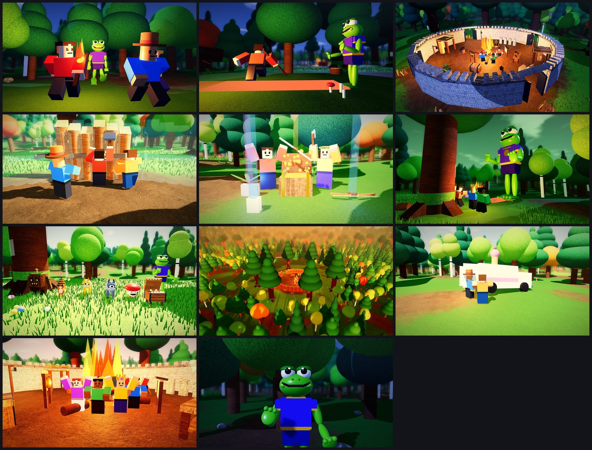

# Survive the 6-7: gameplay renders



These are **renders of the game's own models**, not AI: the real forest (the smooth terrain `TerrainBuilder`
writes, and the trees, undergrowth and camp props `MapBuilder` puts on it), the camp's structures
(`CampModels`), the monsters' rigs posed the way the client poses them (`Rigs`), items (`ItemModels`), looks
(`Looks`), findings (`FindingModels`) and the telegraphs' shapes, staged into a few moments by
`games/ra6 - Survive the 6-7/tools/gameplay/thumbs.luau`, drawn with three.js (`render.js` + `terrain.js`), then
the shader pass (`thumbs_post.py`: levels, colour grade, bloom, depth of field, vignette). Survivors are plain
blocky Roblox avatars (in the game they're the players' own avatars). They are the references the
[thumbnails and icon](../thumbnails/README.md) were made from.

The renderer stands in for Roblox's: the terrain's voxels are meshed and textured per material, and parts get
textures for their Roblox material (free CC0 sets from ambientCG picked to look like Roblox's own,
`fetch_textures.py`). Neon telegraphs come out a little pink here; in Roblox they're a strong red.

| File | Moment |
|---|---|
| `01_kermy_chase.jpg` | Night 1 on a forest trail: three survivors running for camp with a torch, Kermy right behind them |
| `02_sixseven.jpg` | "SIX... SEVEN!": Kermy's tell, his lunge drawn on the ground, a survivor rolling out of the way |
| `03_camp_night.jpg` | The camp at night (The Fort): stone walls, the fire, survivors round it, Grinwolves outside with red eyes |
| `04_build.jpg` | Day 1 at the camp: a wall rising out of its blueprint, a survivor hammering, another hauling wood |
| `05_loot.jpg` | A chest thrown open with a legendary bow inside, rarity beams on the loot around it |
| `06_mega_kermy.jpg` | Night 7: the team in front of an Ancient Pine, Mega Kermy towering over the forest |
| `07_monsters.jpg` | The cast: Kermy (in his tell), the Mimic, a Snapcap, a Grinwolf and a golden one, the Pinecone Pelter, Stumpy |
| `08_forest.jpg` | The forest from above at dusk: the camp's clearing and its fire, trees as far as you can see |
| `09_finding.jpg` | A finding: the ice cream truck, deep in the trees |
| `10_dawn.jpg` | Dawn after the last night: the team doing the 6-7 by the fire |
| `11_kermy.jpg` | Kermy up close, mid "SIX... SEVEN!" (the icon's reference) |

Re-render them from the game folder:

```bash
python3 tools/gameplay/fetch_textures.py textures        # once: the PBR texture sets
luaurun tools/gameplay/thumbs.luau out
node tools/gameplay/render.js out renders --modules <node_modules with puppeteer, three, @fontsource> --textures textures
cp out/*.json renders/   # (the shader pass reads each shot's camera from its snapshot)
python3 tools/gameplay/thumbs_post.py renders post --font <LuckiestGuy.ttf>
```

`post/<name>_notext.jpg` are the images here; `post/<name>.jpg` have the title and a caption.
