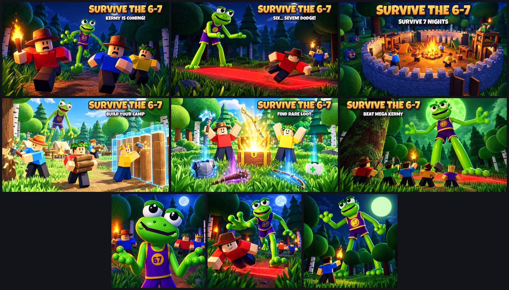

# Survive the 6-7: thumbnails and the icon

Every thumbnail is **1920 × 1080 (16:9), JPG, under 0.6 MB**, for experience thumbnails and the Ads Manager. The
icon is `../icon/icon_kermy.png`, **512 × 512 PNG**; `icon_dodge_alt.png` and `icon_mega_alt.png` are alternates
for an icon A/B test.

**They show what is in the game.** Each one was made with AI image generation (Higgsfield, GPT Image 2.5) from
**real renders of the game** as references (the renders are in [`../screenshots/`](../screenshots/README.md)):
Kermy's rig (the lanky lime-green frog in the too-small purple 67 jersey), Mega Kermy, the blocky survivors and
their looks (the ranger hat, the leaf crown, the Crown of the 67), the forest's round trees, pines and birches,
the camp's stone wall, fire, tents, workbench and watch platform, the log palisade rising out of its blue
blueprint, the Grinwolves, the chest and the rarity beams, the Ancient Pines, and the red telegraph strip drawn
under every lunge and charge. In the game the survivors are the players' own avatars. A few small details are
artistic: the moon, and Kermy watching the camp being built in broad daylight (he does peek from the trees by day,
but not that close). The loot on the ground is items from the game (a steel plate, a spiked club, a hunting bow, a
medkit); the medkit's cross was recoloured green. The title and captions were added afterwards
(`tools/gameplay/title_art.py`) in the game's own lettering (Luckiest Guy, like the HUD), beside Kermy rather than
over his face.

The master plan (§2, store presentation) asks for the monster pursuing players, the survival objective and the
camp, equipment and loot, cooperation and the final encounter. There's one of each, plus the core move:

| # | File | Shows | Scene | Text |
|---|---|---|---|---|
| 1 | `01_kermy_is_coming.jpg` | the monster pursuing players | Night on a forest trail: three survivors running for camp with a torch, Kermy right behind them | SURVIVE THE 6-7 · KERMY IS COMING! |
| 2 | `02_six_seven_dodge.jpg` | the core move: read the tell, dodge | Kermy's "SIX... SEVEN!", his lunge drawn on the ground in red, a survivor diving out of it | SURVIVE THE 6-7 · SIX... SEVEN! DODGE! |
| 3 | `03_survive_7_nights.jpg` | the objective and the camp | The walled camp at night round its fire, survivors on guard, Grinwolves' red eyes outside | SURVIVE THE 6-7 · SURVIVE 7 NIGHTS |
| 4 | `04_build_your_camp.jpg` | building together | Day at the camp: a palisade rising out of its blueprint, logs hauled, a tree chopped | SURVIVE THE 6-7 · BUILD YOUR CAMP |
| 5 | `05_find_rare_loot.jpg` | equipment and loot | A chest bursting open with a legendary bow, a crystal axe held up, loot with rarity beams | SURVIVE THE 6-7 · FIND RARE LOOT |
| 6 | `06_beat_mega_kermy.jpg` | cooperation and the final encounter | Night 7: the team in front of an Ancient Pine, Mega Kermy towering under a green moon | SURVIVE THE 6-7 · BEAT MEGA KERMY |

| Icon | Shows |
|---|---|
| `icon_kermy.png` (main) | Kermy up close doing the 6-7, the 67 on his jersey, survivors with torches behind him |
| `icon_dodge_alt.png` | A survivor diving out of Kermy's red lunge strip |
| `icon_mega_alt.png` | Mega Kermy over the treetops, a survivor holding up a torch |

The plan says the monster must be recognisable at a glance and that we must not recreate the composition, logo,
creature or branding of *99 Nights in the Forest*: Kermy (a goofy frog in a basketball jersey) leads every image,
and none uses its deer monster or its title layout. Test the thumbnails against each other and keep the one with
the most clicks that also keeps players.

## Checklist (Roblox thumbnail and ad rules)

- [x] **Matches the game.** The real monsters, survivors' looks, camp, forest, items and telegraphs.
- [x] **No promises.** No "FREE", "NEW", "UPDATE", rewards or prizes.
- [x] **No fake interface.** No fake buttons, menus or prompts.
- [x] **Kid-friendly.** Funny-scary monsters, no blood or gore.
- [x] **Big and bright.** Kermy and the survivors are large in the frame; the title reads on a phone.
- [x] **Size.** 16:9, 1920 × 1080, under 0.6 MB. Icons 512 × 512.

## Making them again

1. Render the references: see [`../screenshots/README.md`](../screenshots/README.md).
2. Upload the renders to Higgsfield and generate each picture with GPT Image 2.5 (high quality, 2k) with one or two
   renders as image references, plus Kermy's close-up for anything with Kermy in it.
3. Letter them: `python3 tools/gameplay/title_art.py art.png out.jpg --font LuckiestGuy.ttf --caption "KERMY IS
   COMING!" --right` (`--left`, `--right` or `--bottom` keep the lettering off the characters).
